# From Policy Evaluation to Off-Policy Control: Provable Emergence of In-Context Q-Learning

Yingjun Mo<sup>1</sup> Yajie Zhao<sup>2</sup> Fang Kong<sup>1∗</sup>

<sup>1</sup> Southern University of Science and Technology (SUSTech) <sup>2</sup> University of Electronic Science and Technology of China (UESTC)

## ABSTRACT

Transformers can implement reinforcement-learning algorithms in context, yet how off-policy control emerges within Transformers remains poorly understood. We study Q-learning, a foundational model-free control algorithm that combines offpolicy bootstrapping with greedy policy improvement. We prove that a two-layer attention-only Transformer can implement a finite-temperature form of Q-learning, where the temperature τ > 0 controls the approximation to greedy action selection, recovering window Q-learning as τ → 0. We train the structured Transformer on randomly generated MDP tasks using output-only supervision. Experiments show that the theoretically predicted parameter structure emerges during training, including the internal greedy action-selection mechanism, and that the trained Transformer achieves performance comparable to Q-learning on unseen tasks. Our theoretical analysis further shows that the equivalent realizations form a solution manifold and that, under suitable task-diversity conditions, the training iterates converge locally to this manifold at an exponential rate. For the random-task model analyzed here, the local worst-case number of gradient steps needed to reduce the distance to the manifold by a factor ϵ is Θ $\left( \tau ^ { - 5 } \log ( 1 / \dot { \varepsilon } ) \right)$ , quantifying the increasing optimization cost as the learned update approaches window Q-learning.

## 1 INTRODUCTION

In-context reinforcement learning (ICRL) offers an alternative to the conventional paradigm of reinforcement learning. Rather than adapting to a new task through parameter updates, a pretrained agent can adjust its behavior directly from the interaction history provided in its context. This phenomenon has motivated an algorithmic interpretation of ICRL: a Transformer may not merely map a trajectory to a prediction, but may execute a reinforcement-learning algorithm within its forward pass. Recent theoretical work supports this view. Transformers have been shown to implement temporal-difference (TD) methods for policy evaluation, and more recent results extend this perspective to policy-improvement methods such as SARSA and actor-critic (Wang et al., 2024; 2025; Xie et al., 2026a;b; Liang & Lai, 2026).

A central regime remains largely unexplored: off-policy control. Existing policy-improvement constructions focus primarily on on-policy learning, where the behavior policy and the policy being improved are tightly coupled (Liang & Lai, 2026). This coupling is restrictive in real applications where an agent must learn from previously collected, heterogeneous, or suboptimal experience rather than from trajectories generated by its current policy. Off-policy control asks whether useful policy improvement can still be carried out when these two roles are decoupled. Q-learning provides a canonical setting for studying this problem. Given a transition $( s , a , r , s ^ { \prime } )$ , its target is $r + \stackrel { \textstyle \cdot \gamma \mathrm { m a x } _ { a ^ { \prime } } Q ( s ^ { \prime } , a ^ { \prime } ) } { \textstyle \operatorname* { m a x } _ { a ^ { \prime } } Q ( s ^ { \prime } , a ^ { \prime } ) }$ which does not depend on the successor action selected by the behavior policy. Thus, subject to sufficient state-action coverage, Q-learning can use experience generated by a suboptimal behavior policy while improving toward a greedy target policy. This makes Q-learning a natural testbed for a more demanding form of in-context adaptation: whether a Transformer can use off-policy experience to carry out control, rather than merely evaluate or improve the policy that generated its context.

This transition is substantially more than a change of update rule. At a conceptual level, it marks the passage from Bellman evaluation to Bellman optimality. An in-context implementation of Q-learning must compare competing successor actions, resolve the resulting action selection, and then use that decision to construct the bootstrap target. We show that there exists a two-layer Transformer, combining masked softmax attention with linear attention, that jointly implements next-state action selection and the corresponding window semi-gradient Q-learning update in finite-temperature form, where the softmax temperature $\tau > 0$ controls the degree of approximation to greedy action selection, and standard window (hard-max) Q-learning is recovered in the limit $\tau  0$ . In this sense, the architecture of transformer does not merely reproduce the numerical output of Q-learning; its internal computation mirrors the decomposition of the algorithm itself.

What kind of pretraining can give rise to such a Transformer? We develop a gradient-based training algorithm in which a soft window-Q update serves as the teacher for each sampled context. Within the prescribed tokenization and attention mask, training supervises only the output update and imposes no numerical targets on the internal parameter blocks to implement either window Q-learning or action selection. Nevertheless, the constructed parameter structure emerges under training, recovering the underlying computation, including the internal action-selection mechanism. On unseen tasks, the trained Transformer achieves performance comparable to window Q-learning with the same step size.

To understand why a Q-learning implementation can emerge under this training procedure, we provide a theoretical analysis of its convergence. The nonlinear dependence of softmax attention on the action-score parameters makes the analysis substantially more intricate than in linear-attention settings. Meanwhile, the Q-learning realization is inherently non-identifiable, with different parameter configurations implementing the same update. This makes the relevant optimization target a manifold of functionally equivalent Q-learning realizations rather than a single parameter vector. We characterize this realization manifold and show that, under verifiable conditions on the training distribution, the discrete-time training dynamics converge locally to this manifold at an exponential rate. The analysis further reveals a quantitative difficulty in approaching greedy Q-learning: for the random-task model considered here, the local worst-case number of gradient steps needed to reduce the distance to the manifold by a factor ϵ is $\Theta \left( \tau ^ { - 5 } \log ( 1 / \varepsilon ) \right)$ , quantifying the increasing optimization cost as the learned update approaches standard Q-learning.

Our results make three concrete advances. First, we give an explicit attention-only construction that jointly realizes successor-action comparison and the window Q-learning update. Second, we design a gradient-based training procedure and characterize a smooth manifold of functionally equivalent Qlearning realizations, showing local exponential convergence of the training dynamics to this manifold. Third, we quantify how the softmax temperature governs the tradeoff between approximating greedy action selection and optimization difficulty. Together, these results extend the mechanistic analysis of ICRL from policy evaluation and on-policy control to off-policy Q-learning.

## 2 RELATED WORK

Transformer-based agents have been studied extensively for sequential decision making. Decision Transformer and Trajectory Transformer formulate reinforcement learning as sequence modeling (Chen et al., 2021; Janner et al., 2021), while Algorithm Distillation and related ICRL methods show that pretrained sequence models can adapt to unseen tasks through interaction histories without test-time parameter updates (Laskin et al., 2023; Lee et al., 2023; Grigsby et al., 2024). On the theoretical side, Lin et al. (2024) establish provable ICRL under supervised pretraining and show that Transformers can approximate classical online decision-making algorithms.

Recent work has taken a mechanistic view of ICRL, asking which RL algorithms can be implemented by Transformer forward computation and whether the corresponding algorithmic parameters can emerge through pretraining. Wang et al. (2024; 2025) show that linear-attention Transformers can implement TD updates for policy evaluation, while Xie et al. (2026b) extend this result to standard softmax attention via a kernel-weighted TD construction. Beyond policy evaluation, Liang & Lai (2026) show that Transformers can realize semi-gradient SARSA and actor-critic updates for policy improvement. However, analogous results for off-policy control, including classical Q-learning, where trajectory data are coupled with subsequent action selection, remain largely unexplored. We study the emergence of Q-learning updates within Transformers, including the Transformer construction, pretraining algorithm, and its convergence analysis. Unlike Liang & Lai (2026), we focus on the effect of the action-selection mechanism on convergence, and our analysis accounts for discrete-time training iterates and provides verifiable convergence conditions.

Off-policy learning is particularly relevant to ICRL when context trajectories are offline, heterogeneous, or generated by suboptimal behavior policies. In such settings, the quality of the learned policy need not be tied to that of the behavior generating the trajectories, making off-policy value-based learning particularly relevant. Dong et al. (2025) study ICRL from suboptimal historical trajectories and propose an advantage-weighted policy-learning framework to improve upon the behavior policies in the data. Scalable In-Context Q-Learning (Liu et al., 2026) combines context-conditioned value estimation, dynamic programming, and policy extraction to enable iterative improvement from subop timal offline experience. In-Context Compositional Q-Learning (Xu et al., 2026) instead formulates Q-function estimation as contextual inference and uses retrieved transitions to infer local Q-functions for offline RL. Our work differs fundamentally from these studies by taking a mechanistic view of how Transformers realize Q-learning in ICRL, characterizing both the forward-pass implementation of the Q-learning update and the emergence of the corresponding parameter structure through training.

## 3 BACKGROUND

## 3.1 TRANSFORMERS AND SELF-ATTENTION

All vectors are treated as column vectors. Let $I _ { n }$ denote the $n \times n$ identity matrix, $0 _ { m \times n }$ the $m \times n$ zero matrix, and $0 _ { m }$ the m-dimensional zero vector.

Let $\mathbf { H } = [ h _ { 1 } , \ldots , h _ { n } ] \in \mathbb { R } ^ { D \times n }$ denote a prompt representation, where each column $h _ { i } \in \mathbb { R } ^ { D }$ corresponds to one token. The standard single-head softmax self-attention (Vaswani et al., 2017) processes the prompt via $\mathbf { S o f t A t t n } \mathbf { P } , \mathbf { v } ( \mathbf { H } ) \triangleq \left( \mathbf { V } \mathbf { H } \right)$ softmax $\left( \mathbf { H } ^ { \top } \mathbf { P H } \right)$ , where $\mathbf { V } \in \mathbb { R } ^ { D \times D }$ is the value projection matrix, $\mathbf { P } : = \mathbf { W } _ { K } ^ { \top } \mathbf { W } _ { Q } \in \mathbb { R } ^ { D \times D }$ collects the key and query projection parameters, the conventional scaling factor in scaled dot-product attention is absorbed into P, and the softmax is applied independently to each query column, normalizing the attention scores over all key positions.

As a widely studied alternative to softmax self-attention, linear self-attention replaces the softmaxnormalized attention weights with unnormalized bilinear attention scores (Ahn et al. (2023), Gatmiry et al. (2024), Zhang et al. (2024)). Its formulation is given by LinAttn<sub>P</sub> $\begin{array} { r } { \mathbf { \nabla } _ { \mathbf { V } } ( \mathbf { H } ) \triangleq \frac { 1 } { n } ( \mathbf { V H } ) ( \mathbf { H } ^ { \top } \mathbf { P H } ) } \end{array}$ where the factor $\textstyle { \frac { 1 } { n } }$ normalizes the aggregation with respect to the prompt length.

To model a multi-layer Transformer structure, we stack L attention layers with residual connections. Let ${ \bf H } ^ { ( 0 ) } = \mathbf { \bar { H } } \in \mathbb { R } ^ { D \times n }$ denote the initial input prompt representation. For each layer $\ell \in \{ 1 , 2 , \ldots , L \}$ , the layer-wise update rule reads

$$
\mathbf { H } ^ { ( \ell ) } : = \mathbf { H } ^ { ( \ell - 1 ) } + \mathrm { A t t n } _ { \mathbf { P } ^ { ( \ell ) } , \mathbf { V } ^ { ( \ell ) } } \left( \mathbf { H } ^ { ( \ell - 1 ) } \right) \in \mathbb { R } ^ { D \times n } ,\tag{1}
$$

where Attn denotes either SoftAttn or LinAttn, and $\{ \mathbf { P } ^ { ( \ell ) } , \mathbf { V } ^ { ( \ell ) } \}$ are the layer-specific projection parameters at layer ℓ. After stacking $L$ attention layers, the final Transformer output is defined as

$$
\mathrm { T F } _ { L } \big ( \mathbf { H } ; \{ \mathbf { P } ^ { ( \ell ) } , \mathbf { V } ^ { ( \ell ) } \} _ { \ell = 1 } ^ { L } \big ) : = f _ { \mathrm { r e a d } } \big ( \mathbf { H } ^ { ( L ) } \big ) ,\tag{2}
$$

where $f _ { \mathrm { r e a d } } \colon \mathbb { R } ^ { D \times n } \to \mathbb { R } ^ { D _ { \mathrm { o u t } } }$ denotes a fixed readout map. Equation (2) establishes the notation convention we adopt for defining the output of an L-layer Transformer. Specifically, the attention mechanism produces a matrix, while we require a vector output for policy improvement. Following prior works (Xie et al. (2026b), Liang & Lai (2026),Wang et al. (2024)), we use the bottom-right d-dimensional vector of the output matrix as this vector.

## 3.2 REINFORCEMENT LEARNING AND Q-LEARNING

We consider an infinite-horizon discounted Markov decision process (MDP) $\mathcal { E } = ( S , \mathcal { A } , P , R , \gamma )$ where S is the state space, A is the action space, $P ( \cdot \mid s , \bar { a } ) \in \mathcal { P } ( S )$ is the transition kernel, $R : S \times \mathcal { A } \times \mathcal { S }  \mathbb { R }$ is the reward function, and $\gamma \in [ 0 , 1 )$ is the discount factor. Here, $\mathcal { P } ( \mathcal { X } )$ denotes the set of probability distributions over X . At time t, an agent in state $S _ { t }$ selects an action $A _ { t } \sim \pi ( \cdot \mid S _ { t } )$ according to a policy $\pi : { \mathcal { S } }  { \mathcal { P } } ( { \mathcal { A } } )$ , receives a reward $R _ { t + 1 } = R ( S _ { t } , A _ { t } , S _ { t + 1 } )$ and transitions to a successor state $\mathsf { \bar { \boldsymbol { S } } } _ { t + 1 } \sim P ( \cdot \mid \dot { \boldsymbol { S } } _ { t } , \boldsymbol { A } _ { t } )$ . The discounted return from time t is defined as $\begin{array} { r } { G _ { t } : = \sum _ { k = 0 } ^ { \infty } \gamma ^ { k } R _ { t + k + 1 } } \end{array}$ . The state-value and action-value functions associated with a policy π are respectively defined as $v _ { \pi } ( s ) : = \mathbb { E } _ { \pi } [ G _ { t } \mid S _ { t } = s ] , q _ { \pi } ( s , a ) : = \mathbb { E } _ { \pi } [ G _ { t } \mid S _ { t } = s , A _ { t } = a ]$ The objective of RL is to find a policy that maximizes the expected discounted return.

Q-learning (Watkins, 1989; Watkins & Dayan, 1992) is a classical off-policy TD control algorithm for estimating the optimal action-value function. In the tabular setting, an estimate $Q _ { t } ( s , a )$ is maintained explicitly for each state-action pair. Given a transition $( S _ { t } , A _ { t } , \bar { R } _ { t + 1 } , S _ { t + 1 } )$ , Q-learning updates the value of the visited state-action pair according to

$$
Q _ { t + 1 } ( S _ { t } , A _ { t } ) = ( 1 - \alpha ) Q _ { t } ( S _ { t } , A _ { t } ) + \alpha \left[ R _ { t + 1 } + \gamma \operatorname* { m a x } _ { a ^ { \prime } \in \mathcal { A } } Q _ { t } ( S _ { t + 1 } , a ^ { \prime } ) \right] ,\tag{3}
$$

where $\alpha \in ( 0 , 1 ]$ is the learning rate. All other state-action values remain unchanged. To handle large state-action spaces, we consider linear function approximation (Tsitsiklis & Van Roy, 1997; Melo et al., 2008). Given a feature map $\phi : \mathcal { S } \times \mathcal { A } \stackrel { \cdot \cdot } { \to } \mathbb { R } ^ { d }$ and a parameter vector ${ \bf w } _ { t } \in \mathbb { R } ^ { d }$ at time $t ,$ the action-value function is approximated by $q _ { \mathbf { w } _ { t } } ( s , a ) : = \mathbf { w } _ { t } ^ { \top } \phi ( s , a )$ . Given a transition $( S _ { t } , A _ { t } , R _ { t + 1 } , S _ { t + 1 } )$ , the semi-gradient Q-learning update is

$$
\mathbf { w } _ { t + 1 } = \mathbf { w } _ { t } + \alpha \left( R _ { t + 1 } + \gamma \operatorname* { m a x } _ { a ^ { \prime } \in \mathcal { A } } \mathbf { w } _ { t } ^ { \top } \phi ( S _ { t + 1 } , a ^ { \prime } ) - \mathbf { w } _ { t } ^ { \top } \phi ( S _ { t } , A _ { t } ) \right) \phi ( S _ { t } , A _ { t } ) .\tag{4}
$$

The tabular setting is recovered as a special case when S and A are finite, $d = | S | | A |$ , and each state-action pair $( s , a )$ is assigned a distinct one-hot feature vector $\boldsymbol { \phi } ( s , a ) = \mathbf { e } _ { ( s , a ) }$ . In this case, each coordinate of $\mathbf { w } _ { t }$ corresponds to a single state-action value $Q _ { t } ( s , a )$ , and the above semi-gradient update reduces exactly to the standard tabular Q-learning update.

## 4 TRANSFORMER CAN IMPLEMENT IN-CONTEXT SOFT Q-LEARNING

We consider a Boltzmann-smoothed Q-learning update that replaces the hard maximum over successor actions with a Boltzmann-weighted average. Given the current parameter w, trajectories $\left( s _ { 0 } , a _ { 0 } , r _ { 1 } , \ldots , s _ { n - 1 } , a _ { n - 1 } , r _ { n } , s _ { n } \right)$ can be obtained by interacting with environment under its behavioral policy, where behavioral policy is a behavior policy $\pi _ { b } .$ , which may differ from greedy target policy. Let z denote a context consisting of an n-transition window, parameter w, and the features of all candidate successor actions. For $i = 0 , \ldots , n - 1$ , define $\phi _ { i } = \phi ( s _ { i } , a _ { i } ) , \phi _ { i , a } ^ { + } = \phi ( s _ { i + 1 } , a )$ $a \in { \mathcal { A } }$ and

$$
\pi _ { i , a } ^ { \tau } = \frac { \exp ( \mathbf { w } ^ { \top } \phi _ { i , a } ^ { + } / \tau ) } { \sum _ { b \in \mathcal { A } } \exp ( \mathbf { w } ^ { \top } \phi _ { i , b } ^ { + } / \tau ) } , \quad \quad \bar { \phi } _ { i } ^ { + , \tau } = \sum _ { a \in \mathcal { A } } \pi _ { i , a } ^ { \tau } \phi _ { i , a } ^ { + } .\tag{5}
$$

The corresponding batched semi-gradient update is $\begin{array} { r } { \mathbf { w } _ { \mathrm { s o f t } } ^ { ( \tau ) } = \mathbf { w } + \frac { \alpha } { n } \sum _ { i = 0 } ^ { n - 1 } \phi _ { i } \big ( r _ { i + 1 } + \gamma \mathbf { w } ^ { \top } \bar { \phi } _ { i } ^ { + , \tau } - } \end{array}$ $\mathbf { w } ^ { \top } \phi _ { i } )$ . Here, $\mathbf { w } ^ { \top } \bar { \phi } _ { i } ^ { + , \tau }$ is the Boltzmann-weighted average of the successor action values, which replaces the hard maximum ma $\mathbf { x } _ { a \in \mathcal { A } } \mathbf { w } ^ { \top } \phi _ { i , a } ^ { + }$ in Q-learning. This soft backup recovers the Q-learning backup in the zero-temperature limit $\tau \downarrow$ 0; see Lemma A.1.

We now give an explicit Transformer construction and show that its forward pass implements the soft Q-learning update. Each token is partitioned into six blocks, $[ \Phi ; G ; R ; \Psi ; { \dot { U } } ; W ]$ of dimensions $[ d , d , 1 , d , d , \bar { d + 1 ] }$ , respectively. The prompt consists of three types of tokens: transition tokens, which encode the observed transitions; candidate-action tokens, which encode the features of candidate actions at the successor states; and a query token, which carries the current parameter vector. Letting $\widetilde { \mathbf { w } } = [ 1 ; \mathbf { w } ]$ , for each transition $i = 0 , \ldots , n - 1$ and candidate action $a \in { \mathcal { A } }$ , we define

$$
t _ { i } = [ \phi _ { i } ; 0 ; r _ { i + 1 } ; 0 ; \mathbf { w } ; 0 ] , \quad c _ { i , a } = [ 0 ; 0 ; \phi _ { i , a } ^ { + } ; 0 ; 0 ] , \quad p = [ 0 ; 0 ; 0 ; 0 ; \tilde { \mathbf { w } } ]\tag{6}
$$

Thus, the token dimension is $D = 5 d + 2$ , and the prompt contains $N = n ( m + 1 ) + 1$ tokens. For each transition i, we group the candidate-action tokens as $\mathbf { C } _ { i } = [ c _ { i , a ^ { 1 } } , c _ { i , a ^ { 2 } } , \ldots , c _ { i , a ^ { m } } ]$ , where $m : = | A | < \infty .$ , so that $\mathbf { C } _ { i }$ contains exactly the candidate-action tokens associated with all actions available at the successor state $s _ { i + 1 }$ . The resulting input prompt is

$$
{ \bf H } ^ { ( 0 ) } = \left[ t _ { 0 } , { \bf C } _ { 0 } , t _ { 1 } , { \bf C } _ { 1 } , \ldots , t _ { n - 1 } , { \bf C } _ { n - 1 } , p \right] .\tag{7}
$$

Our Transformer consists of two successive attention layers. The first layer uses single-head softmax attention to compute a Boltzmann-weighted aggregation over candidate successor actions, thereby implementing a smooth approximation to the maximization operator in Q-learning. The second layer then uses linear attention to realize the corresponding update. Specifically, the first layer is defined as

$$
\mathbf { H } ^ { ( 1 ) } = \mathbf { H } ^ { ( 0 ) } + \big ( \mathbf { V } _ { 1 } \mathbf { H } ^ { ( 0 ) } \big ) \mathrm { s o f t m a x } \Big ( ( \mathbf { H } ^ { ( 0 ) } ) ^ { \top } \mathbf { P } _ { 1 } \mathbf { H } ^ { ( 0 ) } + \mathbf { M } \Big ) .\tag{8}
$$

We use ⋆ to denote an arbitrary matrix block of the corresponding dimension. These blocks need not vanish and may take arbitrary values, since they do not affect the entries relevant to the construction under the prescribed attention mask and token structure. We choose

$$
\mathbf { P } _ { 1 } = \left[ \begin{array} { l l l l l l l } { \star } & { \star } & { \star } & { \star } & { \star } & { \star } \\ { \star } & { \star } & { \star } & { \star } & { \star } & { \star } \\ { \star } & { \star } & { \star } & { \star } & { \star } & { \star } \\ { 0 _ { d \times d } } & { \star } & { 0 _ { d \times 1 } } & { \star } & { \mathbf { A } _ { \theta } } & { \star } \\ { \star } & { \star } & { \star } & { \star } & { \star } & { \star } \\ { \star } & { \star } & { \star } & { \star } & { \star } & { \star } \end{array} \right] , \quad \mathbf { V } _ { 1 } = \left[ \begin{array} { l l l l l l l } { \star } & { \star } & { \star } & { \mathbf { D } _ { \Phi } } & { \star } & { 0 } \\ { \star } & { \star } & { \star } & { \mathbf { L } } & { \star } & { 0 } \\ { \star } & { \star } & { \star } & { \mathbf { D } _ { R } } & { \star } & { 0 } \\ { \star } & { \star } & { \star } & { 0 } & { \star } & { 0 } \\ { \star } & { \star } & { \star } & { \mathbf { D } _ { U } } & { \star } & { 0 } \\ { \star } & { \star } & { \star } & { \mathbf { D } _ { U } } & { \star } & { \mathbf { D } _ { \varphi } } \end{array} \right]\tag{9}
$$

where $\mathbf { A } _ { \theta } = \tau ^ { - 1 } I _ { d } , \mathbf { D } _ { \Phi } , \mathbf { D } _ { U } \in \mathbb { R } ^ { d \times d } , \mathbf { L } \in \mathrm { G L } ( d ) , \mathbf { D } _ { R } \in \mathbb { R } ^ { 1 \times d }$ , and ${ \bf E } _ { \rho } = { \bf Q } - I _ { d + 1 }$ . Here $\mathbf { Q } = \left[ \underset { d \times 1 } { \rho } b ^ { \top } \right] , b \in \mathbb { R } ^ { d } , \rho \neq 0$ , and GL(d) denotes the set of invertible $d \times d$ matrices.

We define the attention mask $\mathbf { M } \in \{ 0 , - \infty \} ^ { N \times N }$ , where rows index keys and columns index queries. The mask is chosen such that each transition token $t _ { i }$ attends only to its corresponding candidateaction tokens $\{ c _ { i , a } \} _ { a \in \mathcal { A } }$ , while each $c _ { i , a }$ and the query token p attend only to p. All other pairs are masked out, ensuring that each $t _ { i }$ aggregates only its corresponding successor action candidates.

The second layer employs single-head linear attention:

$$
\mathbf { H } ^ { ( 2 ) } = \mathbf { H } ^ { ( 1 ) } + \frac { 1 } { n } ( \mathbf { V } _ { 2 } \mathbf { H } ^ { ( 1 ) } ) \mathbf { \Lambda } \big ( ( \mathbf { H } ^ { ( 1 ) } ) ^ { \top } \mathbf { P } _ { 2 } \mathbf { H } ^ { ( 1 ) } \big ) .\tag{10}
$$

We choose

$$
\begin{array} { r } { \mathbf { P } _ { 2 } = \left[ \begin{array} { c c c c c } { \star } & { \star } & { \star } & { \star } & { \mathbf { B } _ { - } } \\ { \star } & { \star } & { \star } & { \star } & { \mathbf { B } _ { + } } \\ { \star } & { \star } & { \star } & { \star } & { \star } \\ { \star } & { \star } & { \star } & { \star } & { \star } \\ { \star } & { \star } & { \star } & { \star } & { \star } \\ { \star } & { \star } & { \star } & { \star } & { \star } \end{array} \right] , \mathbf { V } _ { 2 } = \left[ \begin{array} { c c c c c } { \star _ { ( 4 d + 2 ) \times d } } & { \star _ { ( 4 d + 2 ) \times ( d ) } } & { \star _ { ( 4 d + 2 ) \times ( 3 d + 2 ) } } \\ { \mathbf { C } } & { \mathbf { C } _ { G } } & { 0 _ { d \times ( 3 d + 2 ) } } \end{array} \right] . } \end{array}\tag{11}
$$

where ${ \bf B } _ { - } = - c { \bf J } { \bf Q } ^ { - 1 } , { \bf B } _ { + } = c { \bf L } ^ { - \top } [ - { \bf D } _ { R } ^ { \top } , \gamma I _ { d } + { \bf D } _ { \Phi } ^ { \top } - { \bf D } _ { U } ^ { \top } \Omega ] { \bf Q } ^ { - 1 } , { \bf B } _ { r } = c \epsilon _ { 0 } ^ { \top } { \bf Q } ^ { - 1 } , { \bf B } _ { U } = c { \bf R } _ { \Phi } ,$ $c \Omega { \bf J } { \bf Q } ^ { - 1 } , { \bf C } = ( \alpha / c ) I _ { d }$ , and $\mathbf { C } _ { G } = ( - \alpha / c ) \mathbf { D } _ { \Phi } \mathbf { L } ^ { - 1 }$ . Here, $\Omega ^ { \top } = - \Omega$ is arbitrary and may, in particular, be nonzero, $\mathbf { J } = [ 0 , I _ { d } ] , e _ { 0 } ^ { \top } = [ 1 , 0 _ { 1 \times d } ]$ , and $c \neq 0$

Theorem 1 (Forward pass as soft Q-learning). Consider two-layer Transformer defined above, with masked softmax attention (8) parameterized by $\mathbf { P } _ { 1 } , \mathbf { V } _ { 1 }$ in the first layer, and linear attention (10) parameterized by $\mathbf { P } _ { 2 } , \mathbf { V } _ { 2 }$ in the second layer. For the input prompt ${ \bf H } ^ { \left( 0 \right) } i n \left( 7 \right) ;$ , thefollowing hold.

(i) The Transformer exactly implements the soft Q-learning update:

$$
{ \bf w } _ { \mathrm { T F } } ^ { ( \tau ) } : = \mathrm { T F } ^ { ( \tau ) } ( { \bf H } ^ { ( 0 ) } ; { \bf P } _ { 1 } , { \bf V } _ { 1 } , { \bf P } _ { 2 } , { \bf V } _ { 2 } ) = { \bf w } + \frac { \alpha } { n } \sum _ { i = 0 } ^ { n - 1 } \phi _ { i } \left[ r _ { i + 1 } + \gamma { \bf w } ^ { \top } \bar { \phi } _ { i } ^ { + , \tau } - { \bf w } ^ { \top } \phi _ { i } \right] ,
$$

where $\begin{array} { r } { \bar { \phi } _ { i } ^ { + , \tau } = \sum _ { a \in \mathcal { A } } \pi _ { i , a } ^ { \tau } \phi _ { i , a } ^ { + } , \pi _ { i , a } ^ { \tau } = \exp ( \mathbf { w } ^ { \top } \phi _ { i , a } ^ { + } / \tau ) / \sum _ { b \in \mathcal { A } } \exp ( \mathbf { w } ^ { \top } \phi _ { i , b } ^ { + } / \tau ) . } \end{array}$

(ii) For each i, define $\begin{array} { r } { q _ { i , a } : = \textbf { w } ^ { \top } \phi _ { i , a } ^ { + } , ~ q _ { i } ^ { \star } : = \mathrm { m a x } _ { a \in \mathcal { A } } q _ { i , a } , } \end{array}$ , and $\begin{array} { r } { \mathcal { A } _ { i } ^ { \star } : = \arg \operatorname* { m a x } _ { a \in \mathcal { A } } q _ { i , a } } \end{array}$ . Let $m : = | { \mathcal { A } } | < \infty$ and $K _ { i } : = | \mathcal { A } _ { i } ^ { \star } |$ . Suppose that $\| \phi ( s , a ) \| _ { 2 } \leqslant B _ { \phi }$ and $| q _ { \mathbf { w } } ( s , a ) | \leqslant B _ { q }$ for all stateaction pairs. For every i such that $\mathcal { A } _ { i } ^ { \star } \neq \mathcal { A } ,$ define the action gap $\begin{array} { r } { \Delta _ { i } : = q _ { i } ^ { \star } - \operatorname* { m a x } _ { a \notin \mathcal { A } _ { i } ^ { \star } } q _ { i , a } > 0 . } \end{array}$ Then lim $_ { 1 _ { T } \downarrow 0 } \mathbf { w } _ { \mathrm { T F } } ^ { ( \tau ) } = \mathbf { w } _ { Q }$ and

$$
\left. \mathbf { w } _ { Q } - \mathbf { w } _ { \mathrm { T F } } ^ { ( \tau ) } \right. _ { 2 } \leqslant 2 \alpha \gamma B _ { q } B _ { \phi } \sum _ { i : A _ { i } ^ { \star } \neq A } \frac { m - K _ { i } } { n K _ { i } } e ^ { - \Delta _ { i } / \tau } ,
$$

where $\begin{array} { r } { { \bf w } _ { Q } = { \bf w } + \frac { \alpha } { n } \sum _ { i = 0 } ^ { n - 1 } \phi _ { i } \left[ r _ { i + 1 } + \gamma \operatorname* { m a x } _ { a \in \mathcal { A } } { \bf w } ^ { \top } \phi _ { i , a } ^ { + } - { \bf w } ^ { \top } \phi _ { i } \right] } \end{array}$ is window Q-learning update.

The proof of Theorem 1 is provided in Appendix A, together with the corresponding result for the tabular setting. Moreover, if each maximizer is unique and $\Delta _ { \mathrm { m i n } } : = \mathrm { m i n } _ { i } \Delta _ { i } \stackrel { \textstyle - } { > } 0 .$ , then $\| \mathbf { w } _ { Q } - \mathbf { w } _ { \mathrm { T F } } ^ { ( \tau ) } \| _ { 2 } \leqslant 2 \alpha \gamma B _ { q } B _ { \phi } ( m - 1 ) e ^ { - \Delta _ { \mathrm { m i n } } / \tau } , m > 1$ , showing that the Transformer update converges exponentially fast to the standard window Q-learning update as $\tau \downarrow 0$ . The theorem thus establishes that a two-layer Transformer can exactly implement soft Q-learning in its forward pass and recover standard Q-learning in the zero-temperature limit. We call this in-context Q-learning.

```latex
Algorithm 1 IC-Q-Learning Transformer Training with Independent-Context Minibatches
Require: Transformer parameters ${ \pmb \theta } ^ { ( 0 ) } = ( { \bf P } _ { 1 } ^ { ( 0 ) } , { \bf V } _ { 1 } ^ { ( 0 ) } , { \bf P } _ { 2 } ^ { ( 0 ) } , { \bf V } _ { 2 } ^ { ( 0 ) } )$ , trajectory window length n,
number of optimizer updates $U ,$ , minibatch size $B ,$ ϵ-greedy parameter ϵ, Transformer learning
rate η, Q-learning step size α, and temperature τ.
1: for $\dot { k } = \mathsf { \bar { 0 } } , \dots , \bar { U } - 1$ do
2: for $b = 1 , \dots , B$ do
3: Independently sample a new MDP $\mathcal { M } _ { b } ^ { ( k ) }$ , feature map $\phi _ { b } ^ { ( k ) } , \mathbf { w } _ { b } ^ { ( k ) }$ , and initial state $s _ { b }$
4: Estimate $\begin{array} { r } { q _ { \mathbf { w } _ { b } } ^ { ( k , b ) } ( s , a ) = ( \mathbf { w } _ { b } ) ^ { \top } { \phi } _ { b } ^ { ( k ) } ( s , a ) , \forall ( s , a ) \in \mathcal { S } \times \mathcal { A } . } \end{array}$
5: Sample an n-step trajectory $( s _ { b , 0 } , a _ { b , 0 } , r _ { b , 1 } , s _ { b , 1 } , a _ { b , 1 } , \dotsc , r _ { b , n } , s _ { b , n } )$ from $\mathcal { M } _ { b } ^ { ( k ) }$ according
to the ϵ-greedy behavior policy derived from ${ q _ { \mathbf { w } } ^ { ( k , b ) } }$
6: Formulate $\mathbf { H } _ { b }$ as in (7) using the sampled trajectory, the candidate features $\{ \phi _ { b } ^ { ( k ) } ( s _ { b , i + 1 } , a )$
$a \in { \mathcal { A } } \}$ , and the current parameter $\mathbf { w } _ { b } .$
7: Compute $\widetilde { \mathbf { H } } _ { b } = \mathbf { H } _ { b } + ( \mathbf { V } _ { 1 } \mathbf { H } _ { b } )$ softmax $\left( ( \mathbf { H } _ { b } ) ^ { \top } \mathbf { P } _ { 1 } \mathbf { H } _ { b } + \mathbf { M } \right)$
8: Compute $\begin{array} { r } { \mathbf { w } _ { \mathrm { T F } , b } = \left[ \widetilde { \mathbf { H } } _ { b } + \frac { 1 } { n } ( \mathbf { V } _ { 2 } \widetilde { \mathbf { H } } _ { b } ) \left( ( \widetilde { \mathbf { H } } _ { b } ) ^ { \top } \mathbf { P } _ { 2 } \widetilde { \mathbf { H } } _ { b } \right) \right] _ { - d : , - 1 } . } \end{array}$
9: Compute the teacher update $\mathbf { w } _ { \mathrm { s o f t } , b } ^ { ( \tau ) }$ according to soft $\mathrm { Q } \mathrm { - }$ learning.
10: end for
11: Compute $\begin{array} { r } { \widehat { \mathcal { L } } _ { B } ^ { ( k ) } = \frac { 1 } { 2 B } \sum _ { b = 1 } ^ { B } \| \mathbf { w } _ { \mathrm { T F } , b } - \mathbf { w } _ { \mathrm { s o f t } , b } ^ { ( \tau ) } \| _ { 2 } ^ { 2 } . } \end{array}$
12: Update $\pmb { \theta } ^ { ( k + 1 ) }  \pmb { \theta } ^ { ( k ) } - \eta \nabla _ { \theta } \widehat { \mathcal { L } } _ { B } ^ { ( k ) }$
13: end for
14: return trained Transformer parameters $\pmb \theta .$
```

## 5 IC-Q-LEARNING ALGORITHM AND TRAINING DYNAMICS ANALYSIS

## 5.1 IC-Q-LEARNING ALGORITHM AND TRAINING DYNAMICS

We now design an ICRL training procedure for the proposed soft Q-learning Transformer, inspired by prior ICRL training frameworks (Laskin et al., 2023; Liang & Lai, 2026), as summarized in Algorithm 1. The training objective follows the teacher-mimicking principle: for each sampled context, the Transformer is trained to predict the parameter obtained after one soft Q-learning update. In contrast to directly supervising the internal attention matrices, the loss is imposed only on the final parameter prediction. Hence, the Transformer is not explicitly provided with the analytical parameter construction derived in the preceding section.

Fix integers $d \geqslant 1 , m \geqslant 2 , n \geqslant 1$ and constants $\alpha > 0 , 0 < \gamma < 1 , \tau > 0$ . Let $\mathbf { z } : =$ $\begin{array} { r } { \left( \mathbf { w } , \{ \phi _ { i } , r _ { i + 1 } , \phi _ { i , j } ^ { + } : 0 \leqslant i < n , \ j \in [ m ] \} \right) \sim \mathcal { D } _ { n } . } \end{array}$ Let $\mathbf { w } _ { \mathrm { s o f t } } ^ { ( \tau ) } ( \mathbf { z } )$ denote the corresponding soft Q-learning target. We define the population teacher-mimicking objective as

$$
\mathscr { L } ( \pmb \theta ) : = \mathbb { E } _ { \mathbf { z } } \left[ \frac { 1 } { 2 } \| \operatorname { T F } _ { \pmb \theta } ( \mathbf { H } ( \mathbf { z } ) ) - \mathbf { w } _ { \mathrm { s o f t } } ^ { ( \tau ) } ( \mathbf { z } ) \| _ { 2 } ^ { 2 } \right] .\tag{12}
$$

where the expectation is taken jointly over the training-MDP distribution, random feature maps, behavior trajectories, and independently sampled input Q-function parameters.

We optimize the population objective in (12) using independently sampled training contexts. At each optimization step, we draw a minibatch $\mathbf { z } _ { 1 } , \ldots , \mathbf { z } _ { B } \stackrel { \mathrm { i . i . d . } } { \sim } \mathcal { D } _ { n }$ , where each context is generated from an independently sampled MDP and feature map. The empirical loss is $\widehat { \mathcal { L } } _ { B } ( \pmb { \theta } ) : =$ $\begin{array} { r } { { \frac { 1 } { 2 B } } \sum _ { b = 1 } ^ { B } \| \operatorname { T F } _ { \boldsymbol \theta } \big ( \mathbf { H } ( \mathbf { z } _ { b } ) \big ) - \mathbf { w } _ { \mathrm { s o f t } } ^ { ( \tau ) } ( \mathbf { z } _ { b } ) \| _ { 2 } ^ { 2 } } \end{array}$ . Here, B controls the amount of averaging across independently sampled training contexts within each parameter update, and hence the stochasticity of the resulting gradient estimate. Further details are provided in Proposition B.1.

Write $\mathcal { K } = ( \Phi , R , U )$ and ${ \mathcal { T } } = ( \Phi , G , R , U )$ . Let $W _ { \mathrm { o u t } }$ denote the last d coordinates of W. Let $\theta _ { \mathrm { o u t } }$ collect all entries of $\pmb { \theta } = ( \mathbf { P } _ { 1 } , \mathbf { V } _ { 1 } , \mathbf { P } _ { 2 } , \mathbf { V } _ { 2 } )$ outside the following 16 blocks: $\mathbf { P } _ { 1 , \Psi K } , \mathbf { V } _ { 1 , \mathcal { T } \Psi } , \mathbf { V } _ { 1 , W W }$ $\mathbf { P } _ { 2 , T W } , \mathbf { V } _ { 2 , W _ { \mathrm { o u t } } \mathcal { T } }$ . Under the full-matrix population gradient flow $\dot { \theta } = - \nabla \mathcal { L } ( \theta ) , \mathrm { i f } \ \theta _ { \mathrm { o u t } } ( 0 ) = 0$ then $\theta _ { \mathrm { o u t } } ( t ) = 0$ for all $t \geqslant 0$ (Proposition B.2). Consequently, the training dynamics are entirely determined by the retained blocks. We refer to these parameter blocks as valid parameter blocks.

However, the resulting parameterization remains highly redundant, with additional degrees of freedom associated with $\mathbf { D } _ { \Phi } , \mathbf { D } _ { U } , \rho , b , c , \mathbf { L } .$ and Ω. To isolate the essential parameter blocks, we define $\pmb { \theta } _ { \mathrm { s u p } } : = ( \mathbf { A } _ { \theta } , \mathbf { L } , \mathbf { B } _ { - } , \mathbf { B } _ { + } , \mathbf { B } _ { r } , \mathbf { C } ) \in \Theta _ { \mathrm { s u p } }$ . For any $\mathbf { L } \in \operatorname { G L } ( d )$ and $c \neq 0$ , let

$$
\bar { \pmb \theta } _ { \tau } ( { \bf L } , c ) = \left( \tau ^ { - 1 } I _ { d } , { \bf L } , [ 0 , - c I _ { d } ] , [ 0 , c \gamma { \bf L } ^ { - \top } ] , [ c , 0 ] , \frac { \alpha } { c } I _ { d } \right) .\tag{13}
$$

These six blocks form an inclusion-minimal sufficient support within the specified architecture: they realize the target update in Theorem 1 on all admissible prompts, whereas no proper subset does so when every other block is fixed to zero (Proposition B.3). We call these six parameter blocks the support parameter blocks.

## 5.2 EMPIRICAL ANALYSIS

Each MDP has $n _ { S } = 9$ states and n $\ O _ { ; A } = m = 4$ actions, with discount $\gamma = 0 . 5$ . For each MDP, the initial-state distribution $P _ { 0 }$ and transition kernel $\textstyle P ( \cdot \mid s , a )$ are drawn independently from Dirichlet $( 1 , \ldots , 1 )$ (uniform over the probability simplex on $n _ { S }$ states), and the rewards $\quad r ( a , s ^ { \prime } ) \sim$ $\mathrm { U n i f } ( - 1 , \dot { 1 } )$ are sampled i.i.d. per $( a , s ^ { \bar { \prime } } )$ . For each MDP, the state-action feature map $\phi \colon S \times \dot { \mathcal { A } }  \mathbb { R } ^ { d }$ $( d = n _ { S } n _ { A } = 3 6 )$ and the initial weight $\mathbf { w } \in \mathbb { R } ^ { d }$ have entries drawn i.i.d. from ${ \bar { \mathbf { U } } } { \mathbf { n i f } } ( - 1 , 1 )$ . The behavior policy is ϵ-greedy $( \epsilon = 0 . 1 )$ with $Q ( s , a ) = \phi ( s , a ) ^ { \top } \mathbf { w }$ , and the soft window Q-learning target $\mathbf { w } _ { \mathrm { s o f t } } ^ { ( \tau ) }$ is computed from the trajectory window with step size $\alpha = 0 . 2$

The Transformer uses embedding dimension $D = 5 d + 2 = 1 8 2$ . The prompt supplies w, current features $\phi _ { i }$ , rewards $r _ { i + 1 }$ , and all next-state candidate features $\phi _ { i , a } ^ { + } .$ . Tabular tests replace features by $\phi ( s , a ) = e _ { ( s - 1 ) m + a }$ and are explicitly separated from dense-feature tests. Training is performed over 46.40 million tasks per model and five paired seeds. Adam uses cosine learning-rate decay from the first update; the default temperature, batch size and context length are $\tau = 0 . 2 , B = 3 2$ and $n = 2 0$ . By Proposition B.2, the sixteen valid parameter blocks are initialized using Xavier normal initialization with gain 0.1. All remaining entries of the two-layer attention construction are initialized to zero, as they remain fixed during training. We conduct the following experiments, with full details provided in Appendix C.1.

Experiments show that parameter blocks other than the sixteen valid parameter blocks stay at zero as training progresse, confirming Proposition B.2. We evaluate the learned update using three complementary metrics: Soft error measures how accurately the Transformer realizes the soft Q update, Hard error measures its discrepancy from standard Q-learning, and Greedy agreement measures how often it selects the same greedy action as Q-learning. The learned Transformer closely approximates the soft Q-learning update and achieves nearly 100% greedy agreement.

Figure 1 presents the final learned matrices $\mathbf { P } _ { 1 } , \mathbf { V } _ { 1 } , \mathbf { P } _ { 2 } .$ , and $\mathbf { V } _ { 2 }$ obtained after training. Remarkably, the learned matrices recover the parameter structure predicted in Theorem 1. In particular, the diagonal entries of $\mathbf { A } _ { \theta }$ in $\mathbf { P } _ { 1 }$ approach $1 / \tau$ , indicating that the Transformer has learned the internal action-selection computation required by the soft Q-learning update. This provides direct evidence of parameter emergence. To quantitatively assess parameter recovery, we examine several construction relations. The learned parameters closely approximate analytical relations, and the task-exposure curves show improved recovery as training progresses. See Appendix C.1 for details of the heatmaps.

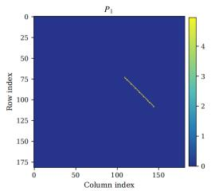

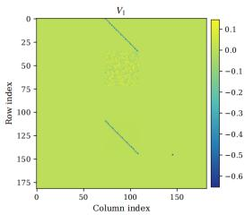

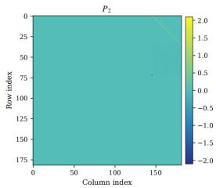

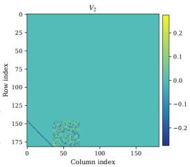  
Figure 1: Final learned $\mathbf { P } _ { 1 } , \mathbf { V } _ { 1 } , \mathbf { P } _ { 2 }$ and $\mathbf { V } _ { 2 }$ matrices after training at $\tau = 0 . 2 , B = 3 2 .$ , and $n = 2 0$ the non-zero structure matches the theoretical constructions $( \mathbf { P } _ { 1 } , \mathbf { V } _ { 1 } , \mathbf { P } _ { 2 } , \mathbf { V } _ { 2 } )$ in (9) and (11).

The left panel of Figure 2 deploys frozen dense-feature-trained Transformers on unseen tabular MDPs and measures exact policy returns under a common interaction budget. Comparisons include hard and soft window Q-learning, a model-informed Oracle, and uniform Random. The Transformer achieves returns close to those of the soft window teacher and a higher sample-mean return than the hard window-Q baseline using the same fixed step size.

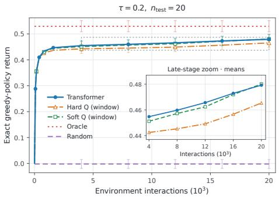

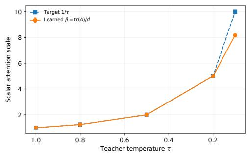  
Figure 2: Left: Performance of Transformers on unseen tabular MDPs (sixteen valid parameter blocks). Right: The learned scalar projection $\beta _ { \mathrm { a t t } }$ and its target $1 / \tau$ (six support parameter blocks).

The effect of the action-selection operator. To separately study how temperature affects the emergence of parameters, we analyze the six-block parameterization, which retains the complete soft Q-learning update mechanism and is inclusion-minimal (Proposition B.3). All six blocks remain jointly trainable under output-only supervision. Training is performed over 20.48 million tasks per model. At a given temperature τ, the trained Transformer is shown to approximate the soft Q-learning update and produce emergent parameters, verifying Proposition B.3. Decreasing $\tau$ brings the soft Q update closer to standard Q-learning, but increases the approximation error between the Transformer and the soft update. With a fixed training budget, the recovery error of the predicted parameter structure increases gradually as τ decreases. The most pronounced discrepancy appears in the scalar attention scale $\begin{array} { r } { \beta _ { \mathrm { a t t } } : = \mathrm { t r } ( \mathbf { \bar { A } } _ { \theta } ) / d . } \end{array}$ . As shown in the right panel of Figure 2, the learned scale falls below its theoretical target $1 / \tau$ at low temperatures. This implies that smaller τ requires greater task exposure for accurate parameter recovery. We further examine the effects of batch size and training-context length. See Appendix C.2 for details.

## 5.3 THEORETICAL ANALYSIS

In this section, we provide a theoretical account of the above empirical findings by explaining how parameter emergence arises from the pretraining algorithm. Our primary focus is to investigate the effect of the action-selection mechanism on convergence. To this end, we restrict optimization to the support parameter blocks, reducing parameter redundancy and isolating the Transformer’s Q-learning mechanism. Define the optimal parameter manifold as $\mathcal { M } _ { \tau } : = \{ \bar { \pmb { \theta } } _ { \tau } ^ { - } ( \mathbf { L } , c ) : \mathbf { L } \in \mathrm { G L } ( d ) , c \neq 0 \}$ we study whether deterministic gradient descent $\pmb { \theta } _ { k + 1 } = \pmb { \theta } _ { k } - \overset { \cdot } { \eta } \nabla \mathcal { L } ( \pmb { \theta } _ { k } )$ converges to $\mathcal { M } _ { \tau }$ and characterize how its convergence rate and iteration complexity depend on τ.

Let V be a vector space with dim $\gamma = 4 d ^ { 2 } + 3 d$ and $\zeta : = ( E _ { C } , e _ { q } , e _ { - } , E _ { - } , e _ { + } , E _ { + } , E _ { A } ) \in \mathcal { V } ,$ , where the four E-symbols are $d \times d$ matrices and the three lowercase e-symbols are vectors in $\mathbb { R } ^ { d }$ . Let the teacher-weighted covariance be $\begin{array} { r } { \Sigma _ { i } ^ { \tau } = \sum _ { a = 1 } ^ { m } \pi _ { i , a } ^ { \tau } ( \phi _ { i , a } ^ { + } - \bar { \phi } _ { i } ^ { + , \tau } ) ( \phi _ { i , a } ^ { + } - \bar { \phi } _ { i } ^ { + , \tau } ) ^ { \top } \in \mathbb { R } ^ { d \times d } } \end{array}$ and

$$
\begin{array} { l } { { \displaystyle \mathcal { B } _ { \tau , n } ( { \bf z } ) [ \zeta ] = \frac { 1 } { n } \sum _ { i = 0 } ^ { n - 1 } \Bigl \{ E _ { C } \phi _ { i } \delta _ { i } ^ { \tau } + \phi _ { i } \bigl [ \phi _ { i } ^ { \top } ( e _ { - } + E _ { - } { \bf w } ) + ( \bar { \phi } _ { i } ^ { + , \tau } ) ^ { \top } ( e _ { + } + E _ { + } { \bf w } ) } } \\ { { \displaystyle \qquad + r _ { i + 1 } e _ { q } ^ { \top } { \bf w } + { \bf w } ^ { \top } \Sigma _ { i } ^ { \tau } E _ { A } { \bf w } \Bigr ] \Bigl \} . } } \end{array}\tag{14}
$$

where $\delta _ { i } ^ { \tau } ( \mathbf { z } ) = r _ { i + 1 } - \mathbf { w } ^ { \top } \phi _ { i } + \gamma \mathbf { w } ^ { \top } \bar { \phi } _ { i } ^ { + , \tau } ( \mathbf { z } )$ . In these coordinates, the adjoint ${ \cal B } _ { \tau , n } ( { \bf z } ) ^ { * } : \mathbb { R } ^ { d }  \mathcal { V }$ is represented by the transpose of $B _ { \tau , n } ( \mathbf { z } )$ . We define the dim V × dim V data Gram matrix as $\mathsf { H } _ { n } ( { \bar { \tau } } ) = \mathbb { E } [ \bar { B } _ { \tau , n } ( \mathbf { z } ) ^ { * } \bar { B } _ { \tau , n } ( \bar { \mathbf { z } } ) ]$ , and denote its smallest eigenvalue by $\chi = \lambda _ { \operatorname* { m i n } } ( { \mathsf { H } } _ { n } ( \tau ) )$ ).

We now state the richness assumptions on the training-MDP distribution

Assumption 1. Let Π denote the class of behavior policies used to generate training trajectories. There exist positive constants $B _ { w } , B _ { \phi } , B _ { r }$ such that, for every $\pi \in \Pi , { \mathcal { D } } _ { n }$ is independent of θ and

(i) Boundedness. $\begin{array} { r } { \| \mathbf { w } \| _ { 2 } \leqslant B _ { w } , \| \phi _ { i } \| _ { 2 } , \| \phi _ { i , a } ^ { + } \| _ { 2 } \leqslant B _ { \phi } , | r _ { i + 1 } | \leqslant B _ { r } , \mathcal { D } _ { n } \mathrm { - a . s . } } \end{array}$

(ii) Joint observable richness. For the fixed $( n , \tau ) , \mathsf { H } _ { n } ( \tau ) \succ 0$ , meaning $\langle \zeta , \mathsf { H } _ { n } ( \tau ) \zeta \rangle > 0$ for every $\zeta \neq 0$ . Equivalently, $\begin{array} { r } { B _ { \tau , n } ( \mathbf { z } ) [ \zeta ] = 0 , \mathcal { D } _ { n } \mathbf { - a } . 5 . \Longrightarrow \zeta = 0 . } \end{array}$

Assumption 1 holds for a broad class of task populations with a nonzero absolutely continuous component and sufficient trajectory support, including the distribution used in our experiments. Explicit sufficient conditions and their verification are given in Appendix E.

Fix a nonempty relatively compact open set $\Omega \Subset \mathrm { G L } ( d ) \times ( \mathbb { R } \setminus \{ 0 \} )$ . Its closure $\overline { { \Omega } }$ is compact and remains inside $\mathrm { G L } ( d ) \times ( \mathbb { R } \setminus \{ 0 \} )$ . Define its images $\mathcal { U } _ { \tau } = \{ \bar { \pmb \theta } _ { \tau } ( { \mathbf { L } } , c ) : ( { \mathbf { L } } , c ) \in \Omega \} , \overline { { \mathcal { U } } } _ { \tau } =$ $\{ \bar { \pmb { \theta } } _ { \tau } ( { \mathbf { L } } , c ) : ( { \mathbf { L } } , c ) \in \overline { { \Omega } } \}$ . The set U is compact at each fixed τ.

At a point $\bar { \pmb { \theta } } \in \mathcal { M } _ { \tau }$ , the tangent space $T _ { \bar { \theta } } { \mathcal { M } } _ { \tau }$ consists of derivatives at zero of smooth curves lying in $\mathcal { M } _ { \tau }$ and passing through θ<sup>¯</sup>. The normal space is its orthogonal complement, $N _ { \bar { \pmb \theta } } \mathcal { M } _ { \tau } = ( T _ { \bar { \pmb \theta } } \mathbf { \dot { \mathcal { M } } } _ { \tau } ) ^ { \perp }$ ， define the tubular neighborhood of $\mathcal { U } _ { \tau }$ as

$$
\mathcal { T } : = \mathcal { T } _ { r } ( \mathcal { U } _ { \tau } ) = \{ \bar { \pmb { \theta } } + \Delta : \bar { \pmb { \theta } } \in \mathcal { U } _ { \tau } , \Delta \in N _ { \bar { \pmb { \theta } } } \mathcal { M } _ { \tau } , \| \Delta \| < r \} .\tag{15}
$$

A perturbation $\mathbf { U } \in \Theta _ { \mathrm { s u p } }$ has blocks denoted by $\Delta A , \ldots , \Delta C$ in the same order as (13). Let κ denote the minimum local curvature normal to $\mathcal { M } _ { \tau } .$ , defined by

$$
\kappa : = \operatorname* { i n f } _ { \bar { \theta } \in \mathcal { U } _ { \tau } , \mathbf { U } \bot T _ { \bar { \theta } } \mathcal { M } _ { \tau } , \| \mathbf { U } \| = 1 } \left. \mathbf { U } , \nabla ^ { 2 } \mathcal { L } ( \bar { \theta } ) \mathbf { U } \right. > 0 .\tag{16}
$$

Let $T _ { \eta } ( { \pmb \theta } ) = { \pmb \theta } - \eta \nabla \mathcal { L } ( { \pmb \theta } )$ and $d ( \pmb \theta ) : = \mathrm { d i s t } ( \pmb \theta , \mathcal { M } _ { \tau } )$ , define

$$
K _ { \mathrm { G D } } ( \varepsilon ; \pmb { \theta } _ { 0 } ) : = \operatorname* { m i n } \big \{ K \in \mathbb { N } _ { 0 } : d \big ( T _ { \eta } ^ { K } ( \pmb { \theta } _ { 0 } ) \big ) \leqslant \varepsilon d ( \pmb { \theta } _ { 0 } ) \big \} .
$$

Theorem 2. Under Assumption 1, there exist a neighborhood T, a constant $M _ { J } > 0$ such that, for $\begin{array} { r } { a n y \varepsilon \in ( 0 , 1 / 2 ] , 0 < \eta \leqslant \frac { \widetilde { \mathbf { \Gamma } } _ { 1 } } { 2 M _ { \eta } ^ { 2 } } , a n d \theta _ { 0 } \in A _ { \tau } : = \{ \widetilde { \pmb { \theta } } \in \mathcal { T } : d ( \pmb { \theta } ) > 0 , \frac { 4 M _ { J } } { \sqrt { \kappa } } d ( \pmb { \theta } ) < \mathrm { d i s t } ( \pmb { \theta } , \mathcal { T } ^ { c } ) \} } \end{array}$

(i) The gradient descent $\pmb { \theta } _ { k + 1 } = \pmb { \theta } _ { k } - \eta \nabla \mathcal { L } ( \pmb { \theta } _ { k } )$ , converges to some ${ \pmb \theta } _ { \infty } \in \mathcal { U } _ { \tau }$ , and $\| \pmb { \theta } _ { k } - \pmb { \theta } _ { \infty } \| \leqslant$ $\begin{array} { r } { \frac { 4 M _ { J } } { \sqrt { \kappa } } d ( \pmb { \theta } _ { 0 } ) ( 1 - \frac { 1 } { 4 } \eta \kappa ) ^ { k / 2 } } \end{array}$ , where $\textstyle 1 - { \frac { 1 } { 4 } } \eta \kappa \in ( 0 , 1 )$

$$
\begin{array} { r } { ( i i ) \ K _ { G D } ( \varepsilon ; \theta _ { 0 } ) = O ( \frac { 1 } { \eta _ { \kappa } } \log \frac { 1 } { \varepsilon } ) f o r e v e r y \ \theta _ { 0 } \in \mathcal { A } _ { \tau } , a n d \operatorname* { s u p } _ { \theta _ { 0 } \in \mathcal { A } _ { \tau } } K _ { G D } ( \varepsilon ; \theta _ { 0 } ) = \Theta _ { \Omega } ( \frac { 1 } { \eta _ { \kappa } } \log \frac { 1 } { \varepsilon } ) . } \end{array}
$$

In particular, under our experimental setting, we obtain the following corollary.

Corollary 3. Letfeature table Φ $: \mathcal { S } \times \mathcal { A }  \mathbb { R } ^ { d }$ , reward table $R : { \mathcal { A } } \times { \mathcal { S } }  \mathbb { R }$ , and an input weight w, $\mathcal { N } \subset \mathbb { N }$ be a nonemptyfinite set ofcontext lengths. Suppose $n _ { S } , d , m \geqslant 2 , P _ { 0 }$ and all transition rows are mutually independent Dirichle $( 1 , \ldots , 1 )$ , independent of $( \mathbf { w } , \Phi , R )$ , whose entries are mutually independent Unif(−1, 1). The behavior policy is ϵ -greedy with uniform exploration, $0 < \varepsilon _ { b } \leqslant 1$ There exists $\tau _ { * } > 0$ such that, for $0 < \tau \leqslant \tau _ { * } , n \in \mathcal { N }$ and η satisfying Theorem 2, $K _ { G D } ( \varepsilon ; \pmb { \theta } _ { 0 } ) =$ $\begin{array} { r } { O ( \frac { 1 } { \eta \tau ^ { 5 } } \log \frac { 1 } { \varepsilon } ) } \end{array}$ for every $\pmb { \theta } _ { 0 } \in \mathcal { A } _ { \tau }$ , and $\begin{array} { r } { \operatorname* { s u p } _ { \pmb { \theta } _ { 0 } \in A _ { \tau } } K _ { G D } ( \varepsilon ; \pmb { \theta } _ { 0 } , \tau , n ) = \Theta _ { \Omega , \mathcal { N } } ( \frac { 1 } { \eta \tau ^ { 5 } } \log \frac { 1 } { \varepsilon } ) } \end{array}$

The proofs of Theorem 2 and Corollary 3 are provided in Appendices D and E. Corollary 3 shows that as τ decreases, the local curvature diminishes, slowing convergence and requiring more iterations to achieve the same optimization accuracy, consistent with our empirical results.

## 6 DISCUSSION AND LIMITATIONS

This work takes a step toward white-boxing in-context reinforcement learning for off-policy control. We show that an attention-only Transformer can implement a finite-temperature Q-learning update in its forward pass and recover standard window Q-learning as the temperature approaches zero. We further show that the corresponding parameter structure can emerge through teacher-mimicking training, and establish local exponential convergence to a manifold of functionally equivalent soft Q-learning realizations, with particular attention to how action selection in soft Q-updates affects parameter emergence. These results provide a mechanistic account of how Q-learning can be represented and learned within Transformer computation.

Our analysis has several limitations. First, our theoretical analysis is restricted to the support parameter blocks because the valid parameter blocks exhibit substantial redundancy; extending the convergence analysis to all valid blocks remains future work. Second, we do not analyze minibatch SGD, which would be needed to characterize the dependence of convergence on minibatch size.

## AI USE STATEMENT

Generative AI tools were used to assist with code review, experimental implementation and analysis, verification of mathematical derivations, and linguistic refinement of the manuscript. In Appendix E, AI tools contributed key proof steps that were adopted by the authors. The core ideas of the other proofs were developed by the authors, with AI assistance in checking mathematical arguments, carrying out partial algebraic calculations, and identifying and correcting errors. The authors checked the proofs step by step and executed and tested the AI-assisted programs. All numerical results reported in the paper were obtained from executable simulation or model-evaluation code and its saved outputs. All AI-assisted content was reviewed and verified by the authors, who retain full responsibility for the accuracy, validity, and final presentation of this work.

## ETHICS STATEMENT

This work investigates the representation and learning of Q-learning updates in structured Transformers through mathematical analysis and experiments on synthetically generated Markov decision processes. The study does not involve human participants, personal or sensitive data, or real-world deployment. We do not identify specific ethical concerns arising from the reported experiments. The results apply under the stated architectural and mathematical assumptions and do not constitute a safety guarantee for real-world reinforcement-learning deployment.

## REPRODUCIBILITY STATEMENT

The Transformer architecture, prompt construction, attention mask, and teacher-mimicking objective are specified in Sections 4 and 5 and Algorithm 1. The assumptions and proofs supporting the theoretical results are provided in Appendices A, B, D, and E. Section 5.2 and Appendix C describe the synthetic task generation, training configurations, evaluation protocols, and definitions of the reported metrics. Appendix C also reports results across five paired random seeds and describes the uncertainty estimates used in the experiments. An anonymized implementation is provided in the supplementary material.

## REFERENCES

Kwangjun Ahn, Xiang Cheng, Hadi Daneshmand, and Suvrit Sra. Transformers learn to implement preconditioned gradient descent for in-context learning. Advances in Neural Information Processing Systems, 36:45614–45650, 2023.

Lili Chen, Kevin Lu, Aravind Rajeswaran, Kimin Lee, Aditya Grover, Michael Laskin, Pieter Abbeel, Aravind Srinivas, and Igor Mordatch. Decision transformer: Reinforcement learning via sequence modeling. In Advances in Neural Information Processing Systems, volume 34, 2021.

Juncheng Dong, Moyang Guo, Ethan X. Fang, Zhuoran Yang, and Vahid Tarokh. In-context reinforcement learning from suboptimal historical data. In Proceedings ofthe 42nd International Conference on Machine Learning, volume 267 of Proceedings of Machine Learning Research, pp. 14021–14039. PMLR, 2025.

Khashayar Gatmiry, Nikunj Saunshi, Sashank J. Reddi, Stefanie Jegelka, and Sanjiv Kumar. Can looped transformers learn to implement multi-step gradient descent for in-context learning? In Forty-first International Conference on Machine Learning, 2024. URL https://openreview. net/forum?id=o8AaRKbP9K.

Jake Grigsby, Linxi Fan, and Yuke Zhu. AMAGO: Scalable in-context reinforcement learning for adaptive agents. In International Conference on Learning Representations, 2024.

Michael Janner, Qiyang Li, and Sergey Levine. Offline reinforcement learning as one big sequence modeling problem. In Advances in Neural Information Processing Systems, volume 34, pp. 1273–1286, 2021.

Michael Laskin, Luyu Wang, Junhyuk Oh, Emilio Parisotto, Stephen Spencer, Richie Steigerwald, DJ Strouse, Steven Hansen, Angelos Filos, Ethan Brooks, Maxime Gazeau, Himanshu Sahni, Satinder Singh, and Volodymyr Mnih. In-context reinforcement learning with algorithm distillation. In International Conference on Learning Representations, 2023.

John M. Lee. Introduction to Smooth Manifolds, volume 218 of Graduate Texts in Mathematics. Springer, New York, 2 edition, 2013. doi: 10.1007/978-1-4419-9982-5.

Jonathan Lee, Annie Xie, Aldo Pacchiano, Yash Chandak, Chelsea Finn, Ofir Nachum, and Emma Brunskill. Supervised pretraining can learn in-context reinforcement learning. In Advances in Neural Information Processing Systems, volume 36, 2023.

Haodong Liang and Lifeng Lai. Transformers provably implement in-context reinforcement learning with policy improvement. arXiv preprint arXiv:2605.05755, 2026.

Licong Lin, Yu Bai, and Song Mei. Transformers as decision makers: Provable in-context reinforcement learning via supervised pretraining. In International Conference on Learning Representations, 2024.

Jinmei Liu, Fuhong Liu, Zhenhong Sun, Jianye Hao, Huaxiong Li, Bo Wang, Daoyi Dong, Chunlin Chen, and Zhi Wang. Scalable in-context q-learning. In International Conference on Learning Representations, 2026.

Francisco S. Melo, Sean P. Meyn, and M. Isabel Ribeiro. An analysis of reinforcement learning with function approximation. In Proceedings ofthe 25th International Conference on Machine Learning, pp. 664–671, 2008. doi: 10.1145/1390156.1390240.

John N. Tsitsiklis and Benjamin Van Roy. An analysis of temporal-difference learning with function approximation. IEEE Transactions on Automatic Control, 42(5):674–690, 1997.

Ashish Vaswani, Noam Shazeer, Niki Parmar, Jakob Uszkoreit, Llion Jones, Aidan N. Gomez, Łukasz Kaiser, and Illia Polosukhin. Attention is all you need. In Advances in Neural Information Processing Systems, volume 30, 2017.

Jiuqi Wang, Ethan H Blaser, Hadi Daneshmand, and Shangtong Zhang. Transformers learn temporal difference methods for in-context reinforcement learning. In ICML 2024 Workshop on In-Context Learning, 2024.

Jiuqi Wang, Rohan Chandra, and Shangtong Zhang. Towards provable emergence of in-context reinforcement learning. In Advances in Neural Information Processing Systems, volume 38, 2025.

Christopher J. C. H. Watkins. Learning from Delayed Rewards. PhD thesis, King’s College, University of Cambridge, 1989.

Christopher J. C. H. Watkins and Peter Dayan. Q-learning. Machine Learning, 8(3–4):279–292, 1992. doi: 10.1007/BF00992698.

Zixuan Xie, Xinyu Liu, Rohan Chandra, and Shangtong Zhang. Convergence and emergence of in-context reinforcement learning with chain of thought, 2026a. URL https://arxiv.org/ abs/2605.07123.

Zixuan Xie, Xinyu Liu, Claire Chen, Shuze Daniel Liu, Rohan Chandra, and Shangtong Zhang. Beyond linear attention: Softmax transformers implement in-context reinforcement learning. arXiv preprint arXiv:2605.07333, 2026b.

Qiushui Xu, Yuhao Huang, Yushu Jiang, Wenliang Zheng, Lei Song, Jinyu Wang, and Jiang Bian. In-context compositional q-learning for offline reinforcement learning. In International Conference on Learning Representations, 2026.

Ruiqi Zhang, Spencer Frei, and Peter L Bartlett. Trained transformers learn linear models in-context. Journal ofMachine Learning Research, 25(49):1–55, 2024.

## A TWO-LAYER TRANSFORMER FOR SOFT Q-LEARNING

Softmax weights at finite temperature τ are not exactly equivalent to max. Recall the definition of $\pi _ { i , a } ^ { \tau }$ in (5). Lemma A.1 states that softmax operator can approximate max arbitrarily well, with the true hard-max limit recovered only as the softmax temperature $\tau  0$

Lemma A.1. For each i, define $q _ { i , a } : = \mathbf { w } ^ { \top } \phi _ { i , a } ^ { + } , q _ { i } ^ { \star } : = \mathrm { m a x } _ { a \in \mathcal { A } } q _ { i , a } ,$ , and $\begin{array} { r } { \mathcal { A } _ { i } ^ { \star } : = \arg \operatorname* { m a x } _ { a \in \mathcal { A } } q _ { i , a } . } \end{array}$ Let m $: = | { \mathcal { A } } | < \infty$ and $K _ { i } : = | \mathcal { A } _ { i } ^ { \star } |$ . Then, as $\begin{array} { r } { \tau \downarrow 0 , \pi _ { i , a } ^ { \tau }  \frac { 1 } { K _ { i } } { \bf 1 } \{ a \in \mathcal { A } _ { i } ^ { \star } \} . \ I f { \mathcal { A } } _ { i } ^ { \star } \neq \mathcal { A } , } \end{array}$ define the action gap $\begin{array} { r } { \Delta _ { i } : = q _ { i } ^ { \star } - \operatorname* { m a x } _ { a \not \in \mathcal { A } _ { i } ^ { \star } } q _ { i , a } > 0 , } \end{array}$ , then $\begin{array} { r } { 1 - \sum _ { a \in \mathcal { A } _ { i } ^ { \star } } \pi _ { i , a } ^ { \tau } \leqslant [ ( m - K _ { i } ) / K _ { i } ] e ^ { - \Delta _ { i } / \tau } } \end{array}$

Proof of Lemma A.1. Fix i. Dividing the numerator and denominator of $\pi _ { i , a } ^ { \tau }$ by $\exp ( { q _ { i } ^ { \star } } / \tau )$ gives

$$
\pi _ { i , a } ^ { \tau } = \frac { \exp ( - ( q _ { i } ^ { \star } - q _ { i , a } ) / \tau ) } { \sum _ { b \in \mathcal { A } } \exp ( - ( q _ { i } ^ { \star } - q _ { i , b } ) / \tau ) } .
$$

For every $a \in \mathcal { A } _ { i } ^ { \star }$ , we have $q _ { i } ^ { \star } - q _ { i , a } = 0$ , whereas for a $\notin \mathcal { A } _ { i } ^ { \star } , q _ { i } ^ { \star } - q _ { i , a } > 0$ . Hence, as $\tau  0$ $\begin{array} { r } { \sum _ { b \in \mathcal { A } } \exp ( - ( q _ { i } ^ { \star } - q _ { i , b } ) / \tau ) \stackrel { \sim } {  } K _ { i } . } \end{array}$ , which yields $\pi _ { i , a } ^ { \tau } \to 1 / K _ { i }$ , for $a \in \mathcal { A } _ { i } ^ { \star } , \pi _ { i , a } ^ { \tau } \to 0$ , for a $\notin \mathcal { A } _ { i } ^ { \star }$ Therefore, $\begin{array} { r } { \sum _ { a \in \mathcal { A } _ { i } ^ { \star } } \pi _ { i , a } ^ { \tau } \to 1 } \end{array}$ . Now suppose $\mathcal { A } _ { i } ^ { \star } \neq \mathcal { A }$ and define $\Delta _ { i } = q _ { i } ^ { \star } - \operatorname* { m a x } _ { a \not \in \mathcal { A } _ { i } ^ { \star } } q _ { i , a } > 0$ . Then

$$
1 - \sum _ { a \in \mathcal { A } _ { i } ^ { \star } } \pi _ { i , a } ^ { \tau } = \frac { \sum _ { a \notin \mathcal { A } _ { i } ^ { \star } } e ^ { - ( q _ { i } ^ { \star } - q _ { i , a } ) / \tau } } { K _ { i } + \sum _ { a \notin \mathcal { A } _ { i } ^ { \star } } e ^ { - ( q _ { i } ^ { \star } - q _ { i , a } ) / \tau } } .
$$

Since $q _ { i } ^ { \star } - q _ { i , a } \geqslant \Delta$ <sub>i</sub> for all a $\notin \mathcal { A } _ { i } ^ { \star }$

$$
1 - \sum _ { a \in \mathcal { A } _ { i } ^ { \star } } \pi _ { i , a } ^ { \tau } \leqslant \frac { m - K _ { i } } { K _ { i } } e ^ { - \Delta _ { i } / \tau } .
$$

When $K _ { i } = 1$ , this reduces to $1 - \pi _ { i , a _ { i } ^ { \star } } ^ { \tau } \leqslant ( m - 1 ) e ^ { - \Delta _ { i } / \tau }$

We proceed to prove Theorem 1. Our Transformer architecture is two-layered, where the first layer adopts single-head softmax attention to produce Boltzmann-weighted aggregation across all candidate successor actions. To facilitate the proof, we first formally characterize the output behavior of this layer in Lemma A.2, before establishing the full result of Theorem 1.

We first recall the first-layer attention mask. Let $T _ { i } , C _ { i , a } .$ , and $P _ { o }$ denote the positions of $t _ { i } , c _ { i , a }$ , and $p ,$ respectively. For each transition query $T _ { i }$ , only its associated candidate-action tokens are unmasked:

$$
\mathbf { M } _ { C _ { j , a } , T _ { i } } = \left\{ \begin{array} { l l } { 0 , } & { j = i , } \\ { - \infty , } & { j \neq i , } \end{array} \right. \quad \mathbf { M } _ { T _ { j } , T _ { i } } = \mathbf { M } _ { P _ { o } , T _ { i } } = - \infty .
$$

For each candidate-action query and for the parameter query, only the parameter token $p$ is unmasked: $\mathbf { M } _ { P _ { o } , C _ { i , a } } = 0 , \mathbf { M } _ { P _ { o } , P _ { o } } = \bar { 0 }$ , and all remaining entries are set $\mathrm { t o } - \infty$ . Hence, each transition token $t _ { i }$ attends exactly to its own candidate-action set $\{ c _ { i , a } \} _ { a \in \mathcal { A } }$

Lemma A.2 (First layer computes the Boltzmann-weighted successor feature). Consider the singlehead masked softmax attention layer in (8) with mask M and parameters $\mathbf { P } _ { 1 } , \mathbf { V } _ { 1 }$ specified in (9). Define

$$
\begin{array} { r l r } { \zeta _ { Q } = ( \mathbf Q - I _ { d + 1 } ) \widetilde { \mathbf w } = \left[ { \boldsymbol \rho } - 1 + b ^ { \top } \mathbf w \right] , } & { } & { \widetilde { \mathbf w } _ { Q } = \mathbf Q \widetilde { \mathbf w } = \left[ { \boldsymbol \rho } + b ^ { \top } \mathbf w \right] . } \end{array}
$$

For the input prompt $\mathbf { H } ^ { ( 0 ) }$ in $( 7 )$ , the output is

$$
\mathbf { H } ^ { ( 1 ) } = \bigl [ t _ { 0 } ^ { ( 1 ) } , \mathbf { C } _ { 0 } ^ { ( 1 ) } , t _ { 1 } ^ { ( 1 ) } , \mathbf { C } _ { 1 } ^ { ( 1 ) } , \ldots , t _ { n - 1 } ^ { ( 1 ) } , \mathbf { C } _ { n - 1 } ^ { ( 1 ) } , p ^ { ( 1 ) } \bigr ] ,
$$

where $\mathbf { C } _ { i } ^ { ( 1 ) } = [ c _ { i , a } ^ { ( 1 ) } ] _ { a \in \mathcal { A } }$ and

$$
t _ { i } ^ { ( 1 ) } = \left[ \begin{array} { c c c } { \phi _ { i } + \mathbf { D } _ { \Phi } \bar { \phi } _ { i } ^ { + , \tau } } \\ { \mathbf { L } \bar { \phi } _ { i } ^ { + , \tau } } \\ { r _ { i + 1 } + \mathbf { D } _ { R } \bar { \phi } _ { i } ^ { + , \tau } } \\ { 0 _ { d } } \\ { \mathbf { w } + \mathbf { D } _ { U } \bar { \phi } _ { i } ^ { + , \tau } } \\ { 0 _ { d + 1 } } \end{array} \right] , \quad c _ { i , a } ^ { ( 1 ) } = \left[ \begin{array} { c c c } { 0 _ { d } } \\ { 0 _ { d } } \\ { 0 } \\ { \phi _ { i , a } ^ { + } } \\ { 0 _ { d } } \\ { \zeta _ { Q } } \end{array} \right] , \quad p ^ { ( 1 ) } = \left[ \begin{array} { c c c } { 0 _ { d } } \\ { 0 _ { d } } \\ { 0 } \\ { 0 _ { d } } \\ { 0 _ { d } } \\ { \widetilde { \mathbf { w } } _ { Q } } \end{array} \right] .\tag{A.1}
$$

Proof. Write ${ \bf H } ^ { ( 0 ) } = [ h _ { 1 } , \ldots , h _ { N } ]$ . Let A<sup>¯</sup> := softmax $\big ( ( \mathbf { H } ^ { ( 0 ) } ) ^ { \top } \mathbf { P } _ { 1 } \mathbf { H } ^ { ( 0 ) } + \mathbf { M } \big )$ , where the softmax is applied columnwise over the key positions. Thus, if $h _ { k }$ and $h _ { q }$ denote the tokens at key position k and query position $q ,$ respectively, then

$$
\bar { \mathbf { A } } _ { k , q } = \frac { \exp ( h _ { k } ^ { \top } \mathbf { P } _ { 1 } h _ { q } + \mathbf { M } _ { k , q } ) } { \sum _ { \ell = 1 } ^ { N } \exp ( h _ { \ell } ^ { \top } \mathbf { P } _ { 1 } h _ { q } + \mathbf { M } _ { \ell , q } ) } .\tag{A.2}
$$

Since the kth column of $\mathbf { V } _ { 1 } \mathbf { H } ^ { ( 0 ) }$ is ${ \bf V } _ { 1 } h _ { k }$ , the qth column of the attention output satisfies $\begin{array} { r } { \left[ ( { \bf V } _ { 1 } { \bf H } ^ { ( 0 ) } ) \bar { \bf A } \right] _ { : , q } = \sum _ { k = 1 } ^ { N } \bar { \bf A } _ { k , q } { \bf V } _ { 1 } h _ { k } } \end{array}$ . Therefore, using the residual connection, the output corresponding to query token $h _ { q }$ is

$$
h _ { q } ^ { ( 1 ) } = h _ { q } + \sum _ { k = 1 } ^ { N } \bar { \mathbf { A } } _ { k , q } { \mathbf { V } } _ { 1 } h _ { k } .\tag{A.3}
$$

We first consider a transition token $t _ { i } .$ By construction of the mask, the query $t _ { i }$ can attend only to its associated candidate-action tokens $\{ c _ { i , a } \} _ { a \in \mathcal { A } }$ . Hence, the only finite attention scores in the column corresponding to $t _ { i }$ are $c _ { i , a } ^ { \top } \mathbf { P } _ { 1 } t _ { i } , a \in \mathcal { A }$

Recall that $t _ { i } = [ \phi _ { i } ; 0 _ { d } ; \boldsymbol { r } _ { i + 1 } ; 0 _ { d } ; \mathbf { w } ; 0 _ { d + 1 } ] , c _ { j , a } = [ 0 _ { d } ; 0 _ { d } ; 0 ; \phi _ { j , a } ^ { + } ; 0 _ { d } ; 0 _ { d + 1 } ]$ . Since $c _ { j , a }$ is nonzero only in its Ψ block, the inner product $c _ { j , a } ^ { \top } \mathbf { P } _ { 1 } t _ { i }$ depends only on the Ψ block of $\mathbf { P } _ { 1 } t _ { i }$ . From the fourth block row of $\mathbf { P } _ { 1 } , ( \mathbf { P } _ { 1 } t _ { i } ) _ { \Psi } = 0 _ { d \times d } \phi _ { i } \stackrel {  } { + } \star 0 _ { d } + 0 _ { d \times 1 } r _ { i + 1 } + \star 0 _ { d } + \mathbf { A } _ { \theta } \mathbf { w } + \star 0 _ { d + 1 }$

All terms except the fifth vanish, so $( \mathbf { P } _ { 1 } t _ { i } ) _ { \Psi } = \mathbf { A } _ { \theta } \mathbf { w }$ . Since ${ \bf A } _ { \theta } = \tau ^ { - 1 } I _ { d } .$ , we obtain $( { \bf P } _ { 1 } t _ { i } ) _ { \Psi } =$ ${ \boldsymbol { \tau } } ^ { - 1 } \mathbf { w }$ . Therefore, for any candidate token $c _ { j , a } , c _ { j , a } ^ { \top } \mathbf { P } _ { 1 } t _ { i } = ( \phi _ { j , a } ^ { + } ) ^ { \top } ( \mathbf { P } _ { 1 } t _ { i } ) _ { \Psi } = \frac { 1 } { \tau } \mathbf { w } ^ { \top } \phi _ { j , a } ^ { + }$ . The arbitrary ⋆ blocks in ${ \bf P } _ { 1 }$ do not affect the relevant attention scores. Although $\mathbf { P } _ { 1 } t _ { i }$ may have nonzero components in other blocks, the candidate token $c _ { j , a }$ has zeros in all of those coordinates and therefore removes them in the inner product.

The mask now restricts the query t to the candidates with the same transition index i. Hence, $M _ { C _ { i , a } , T _ { i } } = 0$ , and $M _ { k , T _ { i } } = - \infty$ for every other key position k. It follows from (A.2) that

$$
\bar { \mathbf { A } } _ { C _ { i , a } , T _ { i } } = \frac { \exp ( c _ { i , a } ^ { \top } \mathbf { P } _ { 1 } t _ { i } ) } { \sum _ { b \in \mathcal { A } } \exp ( c _ { i , b } ^ { \top } \mathbf { P } _ { 1 } t _ { i } ) } = \frac { \exp ( \mathbf { w } ^ { \top } \phi _ { i , a } ^ { + } / \tau ) } { \sum _ { b \in \mathcal { A } } \exp ( \mathbf { w } ^ { \top } \phi _ { i , b } ^ { + } / \tau ) } = \boldsymbol { \pi } _ { i , a } ^ { \tau } .\tag{A.4}
$$

All other attention weights in the $T _ { i }$ th column are zero.

We next compute the corresponding value vectors. Since $c _ { i , a }$ is nonzero only in its Ψ block, only the fourth block column of $\mathbf { \hat { V } } _ { 1 }$ contributes to $\mathbf { V } _ { 1 } c _ { i , a }$ . From the prescribed form of $\mathbf { V } _ { 1 }$ , this block column is

$$
\begin{array} { r } { ( \mathbf { V } _ { 1 } ) _ { : , \Psi } = \left[ \begin{array} { c } { \mathbf { D } _ { \Phi } } \\ { \mathbf { L } } \\ { \mathbf { D } _ { R } } \\ { 0 _ { d \times d } } \\ { \mathbf { D } _ { U } } \\ { 0 _ { ( d + 1 ) \times d } } \end{array} \right] , \quad \mathbf { V } _ { 1 } c _ { i , a } = \left[ \begin{array} { c } { \mathbf { D } _ { \Phi } \boldsymbol { \phi } _ { i , a } ^ { + } } \\ { \mathbf { L } \boldsymbol { \phi } _ { i , a } ^ { + } } \\ { \mathbf { D } _ { R } \boldsymbol { \phi } _ { i , a } ^ { + } } \\ { 0 _ { d } } \\ { 0 _ { U } } \\ { 0 _ { d + 1 } } \end{array} \right] } \end{array}
$$

Hence, the attention contribution to the transition query $t _ { i }$ is

$$
\begin{array} { r l r } {  { [ ( \mathbf { V } _ { 1 } \mathbf { H } ^ { ( 0 ) } ) \bar { \mathbf { A } } ] _ { : , T _ { i } } = \sum _ { a \in \mathcal { A } } \bar { \mathbf { A } } _ { C _ { i , a } , T _ { i } } \mathbf { V } _ { 1 } c _ { i , a } = \sum _ { a \in \mathcal { A } } \pi _ { i , a } ^ { \top } \mathbf { V } _ { 1 } c _ { i , a } } } \\ & { } & { = [ \begin{array} { c } { \mathbf { D } \Phi \sum _ { a \in \mathcal { A } } \pi _ { i , a } ^ { \top } \phi _ { i , a } ^ { + } } \\ { \mathbf { L } \sum _ { a \in \mathcal { A } } \pi _ { i , a } ^ { \top } \phi _ { i , a } ^ { + } } \\ { \mathbf { D } _ { R } \sum _ { a \in \mathcal { A } } \pi _ { i , a } ^ { \top } \phi _ { i , a } ^ { + } } \\ { 0 _ { d } } \end{array} ] = [ \begin{array} { c } { \mathbf { D } \Phi \bar { \phi } _ { i } ^ { + , \tau } } \\ { \mathbf { L } \bar { \phi } _ { i } ^ { + , \tau } } \\ { \mathbf { D } _ { R } \bar { \phi } _ { i } ^ { + , \tau } } \\ { 0 _ { d } } \end{array} ] , } \\ & { } & { \quad \mathbf { D } _ { U } \sum _ { a \in \mathcal { A } } \pi _ { i , a } ^ { \top } \phi _ { i , a } ^ { + } } \end{array}\tag{A.5}
$$

where we used $\begin{array} { r } { \bar { \phi } _ { i } ^ { + , \tau } = \sum _ { a \in \mathcal { A } } \pi _ { i , a } ^ { \tau } \phi _ { i , a } ^ { + } } \end{array}$ in the last equality.

Finally, applying the residual connection gives

$$
t _ { i } ^ { ( 1 ) } = t _ { i } + \left[ ( \mathbf { V } _ { 1 } \mathbf { H } ^ { ( 0 ) } ) \bar { \mathbf { A } } \right] _ { : , T _ { i } } = \left[ \begin{array} { c } { \phi _ { i } } \\ { \mathbf { 0 } _ { d } } \\ { r _ { i + 1 } } \\ { \mathbf { 0 } _ { d } } \\ { \mathbf { W } } \\ { \mathbf { 0 } _ { d + 1 } } \end{array} \right] + \left[ \begin{array} { c } { \mathbf { D } _ { \Phi } \bar { \phi } _ { i } ^ { + , \tau } } \\ { \mathbf { L } \bar { \phi } _ { i } ^ { + , \tau } } \\ { \mathbf { D } _ { R } \bar { \phi } _ { i } ^ { + , \tau } } \\ { \mathbf { 0 } _ { d } } \\ { \mathbf { D } _ { U } \bar { \phi } _ { i } ^ { + , \tau } } \\ { \mathbf { 0 } _ { d + 1 } } \end{array} \right] = \left[ \begin{array} { c } { \phi _ { i } + \mathbf { D } _ { \Phi } \bar { \phi } _ { i } ^ { + , \tau } } \\ { \mathbf { L } \bar { \phi } _ { i } ^ { + , \tau } } \\ { r _ { i + 1 } + \mathbf { D } _ { R } \bar { \phi } _ { i } ^ { + , \tau } } \\ { \mathbf { 0 } _ { d } } \\ { \mathbf { w } + \mathbf { D } _ { U } \bar { \phi } _ { i } ^ { + , \tau } } \\ { \mathbf { 0 } _ { d + 1 } } \end{array} \right] .\tag{A.6}
$$

It remains to compute the candidate-action tokens and the parameter token. By the mask construction, each candidate-action query $c _ { i , a }$ and the parameter query p can attend only to p. There is exactly one unmasked key in each of these columns, so

$$
\bar { \mathbf { A } } _ { P _ { o } , C _ { i , a } } = \frac { \exp ( p ^ { \top } \mathbf { P } _ { 1 } c _ { i , a } ) } { \exp ( p ^ { \top } \mathbf { P } _ { 1 } c _ { i , a } ) } = 1 , \qquad \bar { \mathbf { A } } _ { P _ { o } , P _ { o } } = \frac { \exp ( p ^ { \top } \mathbf { P } _ { 1 } p ) } { \exp ( p ^ { \top } \mathbf { P } _ { 1 } p ) } = 1 .
$$

All other attention weights in these columns are zero.

Recall that $p = [ 0 _ { d } ; 0 _ { d } ; 0 ; 0 _ { d } ; 0 _ { d } ; \widetilde { \mathbf { w } } ]$ . The last block column of $\mathbf { V } _ { 1 }$ , corresponding to the W block, is zero except for its last block $\mathbf { Q } - I _ { d + 1 }$ . Hence

$$
\mathbf { V } _ { 1 } p = \left[ \begin{array} { c c c c c } { 0 _ { d } } \\ { 0 _ { d } } \\ { 0 } \\ { 0 _ { d } } \\ { 0 _ { d } } \\  ( \mathbf { Q } _ { \mathrm { - } } I _ { d + 1 } ) \widetilde { \mathbf { w } } \end{array} \right] = \left[ \begin{array} { c c c c c } { 0 _ { d } } \\ { 0 _ { d } } \\ { 0 } \\ { 0 _ { d } } \\ { 0 _ { d } } \\ { \zeta _ { Q } } \end{array} \right] ,
$$

where, explicitly, $( \mathbf { Q } - I _ { d + 1 } ) { \widetilde { \mathbf { w } } } = \left[ { \rho - 1 \mathrm { ~ } \mathrm { ~ } b ^ { \top } \mathrm { ~ } } \right] \left[ { \bf { w } } \right] = \left[ { \rho - 1 + b ^ { \top } \mathbf { w } } \right] = \zeta _ { Q } .$

Therefore, the attention outputs for all candidate-action queries and for the parameter query are $\big [ ( \mathbf { V } _ { 1 } \mathbf { H } ^ { ( 0 ) } ) \bar { \mathbf { A } } \big ] _ { : , C _ { i . a } } = \mathbf { V } _ { 1 } \rho , \big [ ( \mathbf { V } _ { 1 } \mathbf { H } ^ { ( 0 ) } ) \bar { \mathbf { A } } \big ] _ { : , P _ { o } } = \mathbf { V } _ { 1 } p$ . Using the residual connection once again,

$$
\begin{array} { r } { c _ { i , a } ^ { ( 1 ) } = c _ { i , a } + \mathbf { V } _ { 1 } p = \left[ \begin{array} { l } { 0 _ { d } } \\ { 0 _ { d } } \\ { 0 } \\ { \phi _ { i , a } ^ { + } } \\ { 0 _ { d } } \\ { 0 _ { d + 1 } } \end{array} \right] + \left[ \begin{array} { l } { 0 _ { d } } \\ { 0 _ { d } } \\ { 0 _ { d } } \\ { 0 _ { d } } \\ { 0 _ { d } } \end{array} \right] = \left[ \begin{array} { l } { 0 _ { d } } \\ { 0 _ { d } } \\ { 0 } \\ { \phi _ { i , a } ^ { + } } \\ { 0 _ { d } } \\ { \zeta _ { Q } } \end{array} \right] , \quad p ^ { ( 1 ) } = p + \mathbf { V } _ { 1 } p = \left[ \begin{array} { l } { 0 _ { d } } \\ { 0 _ { d } } \\ { 0 _ { d } } \\ { 0 _ { d } } \\ { 0 _ { d } } \\ { \widetilde { \mathbf { W } } } \end{array} \right] + \left[ \begin{array} { l } { 0 _ { d } } \\ { 0 _ { d } } \\ { 0 _ { d } } \\ { 0 _ { d } } \\ { 0 _ { d } } \\ { \zeta _ { Q } } \end{array} \right] , } \end{array}
$$

where $\widetilde { \mathbf { w } } + \zeta _ { Q } = \left( I _ { d + 1 } + \mathbf { Q } - I _ { d + 1 } \right) \widetilde { \mathbf { w } } = \mathbf { Q } \widetilde { \mathbf { w } } = \widetilde { \mathbf { w } } _ { Q }$

Thus, $\mathbf { H } ^ { ( 1 ) } = \bigl [ t _ { 0 } ^ { ( 1 ) } , \mathbf { C } _ { 0 } ^ { ( 1 ) } , t _ { 1 } ^ { ( 1 ) } , \mathbf { C } _ { 1 } ^ { ( 1 ) } , \ldots , t _ { n - 1 } ^ { ( 1 ) } , \mathbf { C } _ { n - 1 } ^ { ( 1 ) } , p ^ { ( 1 ) } \bigr ]$ , with all three types of tokens as stated. In particular, the candidate-action tokens and the parameter token remain unchanged for every w precisely when $\rho = 1$ and $b = 0$ , that is, when $\mathbf { Q } = I _ { d + 1 }$ □

With the above lemma established, we proceed to prove Theorem 1.

ProofofTheorem 1. (i) By Lemma A.2, after the first attention layer, each transition token takes the form

$$
t _ { i } ^ { ( 1 ) } = \left[ \begin{array} { c } { \phi _ { i } + \mathbf { D } _ { \Phi } \bar { \phi } _ { i } ^ { + , \tau } } \\ { \mathbf { L } \bar { \phi } _ { i } ^ { + , \tau } } \\ { + \mathbf { D } _ { R } \bar { \phi } _ { i } ^ { + , \tau } } \\ { 0 _ { d } } \\ { \mathbf { w } + \mathbf { D } _ { U } \bar { \phi } _ { i } ^ { + , \tau } } \\ { 0 _ { d + 1 } } \end{array} \right] , \qquad \bar { \phi } _ { i } ^ { + , \tau } = \sum _ { a \in \mathcal { A } } \pi _ { i , a } ^ { \tau } \phi _ { i , a } ^ { + } .
$$

The candidate-action tokens and the parameter token have the forms $c _ { i , a } ^ { ( 1 ) } = [ 0 _ { d } ; 0 _ { d } ; 0 ; \phi _ { i , a } ^ { + } ; 0 _ { d } ; \zeta _ { Q } ]$ $p ^ { ( 1 ) } = [ 0 _ { d } ; 0 _ { d } ; 0 ; 0 _ { d } ; 0 _ { d } ; \widetilde { \mathbf { w } } _ { Q } ]$ . In particular, the Φ and G blocks of these latter tokens are still zero, and the only possibly nonzero block of $p ^ { ( 1 ) }$ is its W block.

We now consider the second linear-attention layer. Write $\mathbf { H } ^ { ( 1 ) } = [ h _ { 1 } ^ { ( 1 ) } , \dots , h _ { N } ^ { ( 1 ) } ]$ . From $\mathbf { H } ^ { ( 2 ) } =$ $\begin{array} { r } { { \bf H } ^ { ( 1 ) } + \frac { 1 } { n } ( { \bf V } _ { 2 } { \bf H } ^ { ( 1 ) } ) \big ( ( { \bf H } ^ { ( 1 ) } ) ^ { \top } { \bf P } _ { 2 } { \bf H } ^ { ( 1 ) } \big ) } \end{array}$ , the update to the parameter token is

$$
\Delta p : = p ^ { ( 2 ) } - p ^ { ( 1 ) } = \frac { 1 } { n } \sum _ { j = 1 } ^ { N } \mathbf { V } _ { 2 } h _ { j } ^ { ( 1 ) } \big ( ( h _ { j } ^ { ( 1 ) } ) ^ { \top } \mathbf { P } _ { 2 } p ^ { ( 1 ) } \big ) .\tag{A.7}
$$

Indeed, this is simply the column of the matrix product corresponding to the query token $p ^ { ( 1 ) }$ : the jth entry of the corresponding score column is $( h _ { j } ^ { ( 1 ) } ) ^ { \top } { \bf P } _ { 2 } p ^ { ( 1 ) }$ , and the jth value column is ${ \bf V } _ { 2 } h _ { j } ^ { ( 1 ) }$

We only need the last d coordinates of $\Delta p ,$ since the readout extracts these coordinates of the parameter token. Recall $\begin{array} { r } { { \Pi } _ { \mathrm { o u t } } = [ 0 _ { d \times ( 4 d + 2 ) } , I _ { d } ] , { \bf C } = \frac { \alpha } { c } I _ { d } , { \bf C } _ { G } = - { \bf C } { \bf D } _ { \Phi } { \bf L } ^ { - 1 } } \end{array}$ . By the block structure of $\mathbf { V } _ { 2 } ,$ for any token $h ,$

$$
\Pi _ { \mathrm { o u t } } \mathbf { V } _ { 2 } h = \mathbf { C } h _ { \Phi } + \mathbf { C } _ { G } h _ { G } ,\tag{A.8}
$$

where $h _ { \Phi }$ and $h _ { G }$ denote its Φ and G blocks. The arbitrary entries in the first $4 d + 2$ rows of $\mathbf { V } _ { 2 }$ do not appear in this expression. Therefore,

$$
\begin{array} { l } { { \Pi _ { \mathrm { o u t } } { \bf V } _ { 2 } t _ { i } ^ { ( 1 ) } = { \bf C } \big ( \phi _ { i } + { \bf D } _ { \Phi } \bar { \phi } _ { i } ^ { + , \tau } \big ) + { \bf C } _ { G } { \bf L } \bar { \phi } _ { i } ^ { + , \tau } } } \\ { { \mathrm { } ~ = { \bf C } \phi _ { i } + { \bf C } { \bf D } _ { \Phi } \bar { \phi } _ { i } ^ { + , \tau } - { \bf C } { \bf D } _ { \Phi } { \bf L } ^ { - 1 } { \bf L } \bar { \phi } _ { i } ^ { + , \tau } } } \\ { { \mathrm { } ~ = { \bf C } \phi _ { i } + { \bf C } { \bf D } _ { \Phi } \bar { \phi } _ { i } ^ { + , \tau } - { \bf C } { \bf D } _ { \Phi } \bar { \phi } _ { i } ^ { + , \tau } = { \bf C } \phi _ { i } = \frac { \alpha } { c } \phi _ { i } . } } \end{array}\tag{A.9}
$$

Here the second equality uses ${ \bf C } _ { G } = - { \bf C } { \bf D } _ { \Phi } { \bf L } ^ { - 1 }$ , and the third uses ${ \mathbf { L } } ^ { - 1 } { \mathbf { L } } = I _ { d }$

On the other hand, both $c _ { i , a } ^ { ( 1 ) }$ and $p ^ { ( 1 ) }$ have zero Φ and G blocks. Applying (A.8) gives

$$
\Pi _ { \mathrm { o u t } } \mathbf { V } _ { 2 } c _ { i , a } ^ { ( 1 ) } = \mathbf { C } \boldsymbol { 0 } _ { d } + \mathbf { C } _ { G } \boldsymbol { 0 } _ { d } = 0 _ { d } , \qquad \Pi _ { \mathrm { o u t } } \mathbf { V } _ { 2 } p ^ { ( 1 ) } = \mathbf { C } \boldsymbol { 0 } _ { d } + \mathbf { C } _ { G } \boldsymbol { 0 } _ { d } = 0 _ { d } .\tag{A.10}
$$

Thus, only the transition tokens contribute to the last d coordinates of the parameter update. The additional W block $\zeta _ { Q }$ in each candidate token does not affect this conclusion, since the last d rows of the W block column of $\mathbf { V } _ { 2 }$ are zero. No assumption that the candidate or parameter scores vanish is needed: their projected value vectors already vanish.

It remains to compute the scalar score $( t _ { i } ^ { ( 1 ) } ) ^ { \top } \mathbf { P } _ { 2 } p ^ { ( 1 ) }$ . Since $p ^ { ( 1 ) } = [ 0 _ { d } ; 0 _ { d } ; 0 ; 0 _ { d } ; 0 _ { d } ; \widetilde { \mathbf { w } } _ { Q } ] , \widetilde { \mathbf { w } } _ { Q } =$ $\mathbf { Q } \widetilde { \mathbf { w } } = \mathbf { Q } \left[ \mathbf { 1 } \right]$ , only the last block column of $\mathbf { P } _ { 2 }$ contributes to $\mathbf { P } _ { 2 } p ^ { ( 1 ) }$ . Because $\mathbf { Q }$ is invertible, $\mathbf { Q } ^ { - 1 } \widetilde { \mathbf { w } } _ { Q } = \mathbf { Q } ^ { - 1 } \mathbf { Q } \widetilde { \mathbf { w } } = \widetilde { \mathbf { w } } = \bigg [ \mathbf { w } \bigg ]$ . From the definition of the specified blocks, we obtain

$$
{ \bf B } _ { - } \widetilde { \bf w } _ { Q } = - c { \bf J } { \bf Q } ^ { - 1 } { \bf Q } \widetilde { \bf w } = - c [ 0 _ { d \times 1 } , I _ { d } ] \left[ \begin{array} { l } { 1 } \\ { { \bf w } } \end{array} \right] = - c { \bf w } ,\tag{A.11}
$$

$$
\begin{array} { r l } & { \mathbf { B } _ { + } \widetilde { \mathbf { w } } _ { Q } = c \mathbf { L } ^ { - \top } \left[ - \mathbf { D } _ { R } ^ { \top } , \gamma I _ { d } + \mathbf { D } _ { \Phi } ^ { \top } - \mathbf { D } _ { U } ^ { \top } \boldsymbol { \Omega } \right] \mathbf { Q } ^ { - 1 } \mathbf { Q } \widetilde { \mathbf { w } } } \\ & { \qquad = c \mathbf { L } ^ { - \top } \left[ - \mathbf { D } _ { R } ^ { \top } , \gamma I _ { d } + \mathbf { D } _ { \Phi } ^ { \top } - \mathbf { D } _ { U } ^ { \top } \boldsymbol { \Omega } \right] \Big [ \mathbf { w } \Big ] } \\ & { \qquad = c \mathbf { L } ^ { - \top } \left[ - \mathbf { D } _ { R } ^ { \top } + ( \gamma I _ { d } + \mathbf { D } _ { \Phi } ^ { \top } - \mathbf { D } _ { U } ^ { \top } \boldsymbol { \Omega } ) \mathbf { w } \right] , } \end{array}\tag{A.12}
$$

$$
\mathbf { B } _ { r } \widetilde { \mathbf { w } } _ { Q } = c e _ { 0 } ^ { \top } \mathbf { Q } ^ { - 1 } \mathbf { Q } \widetilde { \mathbf { w } } = c [ 1 , 0 _ { 1 \times d } ] \left[ \mathbf { 1 } \right] = c ,\tag{A.13}
$$

$$
\mathbf { B } _ { U } \widetilde { \mathbf { w } } _ { Q } = c \boldsymbol { \Omega } J \mathbf { Q } ^ { - 1 } \mathbf { Q } \widetilde { \mathbf { w } } = c \boldsymbol { \Omega } [ 0 _ { d \times 1 } , I _ { d } ] \left[ \begin{array} { l } { 1 } \\ { \mathbf { w } } \end{array} \right] = c \boldsymbol { \Omega } \mathbf { w } .\tag{A.14}
$$

The fourth and sixth block rows of $\mathbf { P } _ { 2 } p ^ { ( 1 ) }$ may contain arbitrary terms arising from the corresponding ⋆ blocks. However, the Ψ and W blocks of $t _ { i } ^ { ( 1 ) }$ are both zero, so these terms do not contribute to the bilinear score. Consequently,

$$
\begin{array} { r l } & { ( t _ { i } ^ { ( 1 ) } ) ^ { \top } \mathbf { P } _ { 2 } p ^ { ( 1 ) } = \left( \phi _ { i } + \mathbf { D } _ { \Phi } \bar { \phi } _ { i } ^ { + , \tau } \right) ^ { \top } \mathbf { B } _ { - } \widetilde { \mathbf { w } } _ { Q } + \left( \mathbf { L } \bar { \phi } _ { i } ^ { + , \tau } \right) ^ { \top } \mathbf { B } _ { + } \widetilde { \mathbf { w } } _ { Q } + \left( r _ { i + 1 } + \mathbf { D } _ { R } \bar { \phi } _ { i } ^ { + , \tau } \right) \mathbf { B } _ { r } \widetilde { \mathbf { w } } _ { Q } } \\ & { \qquad + \left( \mathbf { w } + \mathbf { D } _ { U } \bar { \phi } _ { i } ^ { + , \tau } \right) ^ { \top } \mathbf { B } _ { U } \widetilde { \mathbf { w } } _ { Q } } \\ & { = - c \left( \phi _ { i } + \mathbf { D } _ { \Phi } \bar { \phi } _ { i } ^ { + , \tau } \right) ^ { \top } \mathbf { w } + c \left( \mathbf { L } \bar { \phi } _ { i } ^ { + , \tau } \right) ^ { \top } \mathbf { L } ^ { - \top } \left[ - \mathbf { D } _ { R } ^ { \top } + ( \gamma I _ { d } + \mathbf { D } _ { \Phi } ^ { \top } - \mathbf { D } _ { U } ^ { \top } \boldsymbol { \Omega } ) \mathbf { w } \right] } \\ & { \qquad + c \left( r _ { i + 1 } + \mathbf { D } _ { R } \bar { \phi } _ { i } ^ { + , \tau } \right) + c \left( \mathbf { w } + \mathbf { D } _ { U } \bar { \phi } _ { i } ^ { + , \tau } \right) ^ { \top } \boldsymbol { \Omega } \mathbf { w } . } \end{array}
$$

We simplify these terms one by one. First, $- c \big ( \phi _ { i } + \mathbf { D } _ { \Phi } \bar { \phi } _ { i } ^ { + , \tau } \big ) ^ { \top } \mathbf { w } = - c \phi _ { i } ^ { \top } \mathbf { w } - c ( \bar { \phi } _ { i } ^ { + , \tau } ) ^ { \top } \mathbf { D } _ { \Phi } ^ { \top } \mathbf { w } .$ Next, since $\mathbf { L } ^ { \top } \mathbf { L } ^ { - \top } = I _ { d } ,$

$$
\begin{array} { r l } & { c \big ( \mathbf { L } \bar { \phi } _ { i } ^ { + , \tau } \big ) ^ { \top } \mathbf { L } ^ { - \top } \left[ - \mathbf { D } _ { R } ^ { \top } + ( \gamma I _ { d } + \mathbf { D } _ { \Phi } ^ { \top } - \mathbf { D } _ { U } ^ { \top } \boldsymbol \Omega ) \mathbf { w } \right] } \\ & { \quad = c ( \bar { \phi } _ { i } ^ { + , \tau } ) ^ { \top } \mathbf { L } ^ { \top } \mathbf { L } ^ { - \top } \left[ - \mathbf { D } _ { R } ^ { \top } + ( \gamma I _ { d } + \mathbf { D } _ { \Phi } ^ { \top } - \mathbf { D } _ { U } ^ { \top } \boldsymbol \Omega ) \mathbf { w } \right] } \\ & { \quad = - c ( \bar { \phi } _ { i } ^ { + , \tau } ) ^ { \top } \mathbf { D } _ { R } ^ { \top } + c \gamma ( \bar { \phi } _ { i } ^ { + , \tau } ) ^ { \top } \mathbf { w } + c ( \bar { \phi } _ { i } ^ { + , \tau } ) ^ { \top } \mathbf { D } _ { \Phi } ^ { \top } \mathbf { w } - c ( \bar { \phi } _ { i } ^ { + , \tau } ) ^ { \top } \mathbf { D } _ { U } ^ { \top } \boldsymbol \Omega \mathbf { w } . } \end{array}
$$

The remaining two terms satisfy

$$
\begin{array} { r l } & { \quad c \big ( r _ { i + 1 } + \mathbf { D } _ { R } \bar { \phi } _ { i } ^ { + , \tau } \big ) = c r _ { i + 1 } + c \mathbf { D } _ { R } \bar { \phi } _ { i } ^ { + , \tau } , } \\ & { \quad c \big ( \mathbf { w } + \mathbf { D } _ { U } \bar { \phi } _ { i } ^ { + , \tau } \big ) ^ { \top } \Omega \mathbf { w } = c \mathbf { w } ^ { \top } \Omega \mathbf { w } + c ( \bar { \phi } _ { i } ^ { + , \tau } ) ^ { \top } \mathbf { D } _ { U } ^ { \top } \Omega \mathbf { w } . } \end{array}
$$

The terms involving D<sub>Φ</sub>, D<sub>R</sub>, and $\mathbf { D } _ { U }$ therefore cancel in pairs: − c(ϕ<sup>¯+,τ</sup>)<sup>⊤</sup>D<sup>⊤</sup>w + c(ϕ<sup>¯+,τ</sup>)<sup>⊤</sup>D<sup>⊤</sup>w = 0, − c(ϕ<sup>¯+,τ</sup><sub>i</sub> )<sup>⊤</sup>D<sup>⊤</sup><sub>R</sub> + cD<sub>R</sub>ϕ<sup>¯+,τ</sup><sub>i</sub> = 0, − c(ϕ<sup>¯+,τ</sup>)<sup>⊤</sup>D<sup>⊤</sup>Ωw + c(ϕ<sup>¯+,τ</sup>)<sup>⊤</sup>D<sup>⊤</sup>Ωw = 0.

For the second cancellation, we used the fact that $\mathbf { D } _ { R } \bar { \phi } _ { i } ^ { + , \tau }$ is a scalar, so it equals its transpose $( \bar { \phi } _ { i } ^ { + , \tau } ) ^ { \top } \mathbf { D } _ { R } ^ { \top }$ . Moreover, since $\Omega ^ { \top } = - \Omega$

$$
\begin{array} { r } { \mathbf { w } ^ { \top } \boldsymbol { \Omega } \mathbf { w } = ( \mathbf { w } ^ { \top } \boldsymbol { \Omega } \mathbf { w } ) ^ { \top } = \mathbf { w } ^ { \top } \boldsymbol { \Omega } ^ { \top } \mathbf { w } = - \mathbf { w } ^ { \top } \boldsymbol { \Omega } \mathbf { w } , } \end{array}
$$

and therefore $\mathbf { w } ^ { \top } \Omega \mathbf { w } = 0$ . Substituting these identities into (A.15) yields

$$
\begin{array} { r l } & { ( t _ { i } ^ { ( 1 ) } ) ^ { \top } { \bf P } _ { 2 } p ^ { ( 1 ) } = - c \phi _ { i } ^ { \top } { \bf w } + c \gamma ( \bar { \phi } _ { i } ^ { + , \top } ) ^ { \top } { \bf w } + c r _ { i + 1 } } \\ & { \qquad = c \big ( r _ { i + 1 } + \gamma { \bf w } ^ { \top } \bar { \phi } _ { i } ^ { + , \top } - { \bf w } ^ { \top } \phi _ { i } \big ) . } \end{array}\tag{A.16}
$$

Define $\delta _ { i } ^ { ( \tau ) } : = { r } _ { i + 1 } + \gamma \mathbf { w } ^ { \top } \bar { \phi } _ { i } ^ { + , \tau } - \mathbf { w } ^ { \top } \phi _ { i }$ . Then $( t _ { i } ^ { ( 1 ) } ) ^ { \top } { \mathbf P } _ { 2 } p ^ { ( 1 ) } = c \delta _ { i } ^ { ( \tau ) }$

Therefore, the last d coordinates of the second-layer update are

$$
\begin{array} { r l } & { \displaystyle \Pi _ { \mathrm { o u t } } \Delta p = \frac { 1 } { n } \sum _ { j = 1 } ^ { N } \Pi _ { \mathrm { o u t } } \mathbf { V } _ { 2 } h _ { j } ^ { ( 1 ) } \big ( ( h _ { j } ^ { ( 1 ) } ) ^ { \top } \mathbf { P } _ { 2 } p ^ { ( 1 ) } \big ) = \frac { 1 } { n } \sum _ { i = 0 } ^ { n - 1 } \Pi _ { \mathrm { o u t } } \mathbf { V } _ { 2 } t _ { i } ^ { ( 1 ) } \big ( ( t _ { i } ^ { ( 1 ) } ) ^ { \top } \mathbf { P } _ { 2 } p ^ { ( 1 ) } \big ) } \\ & { \displaystyle \quad \quad = \frac { 1 } { n } \sum _ { i = 0 } ^ { n - 1 } \left( \frac { \alpha } { c } \phi _ { i } \right) c \delta _ { i } ^ { ( \tau ) } = \frac { \alpha } { n } \sum _ { i = 0 } ^ { n - 1 } \phi _ { i } \delta _ { i } ^ { ( \tau ) } . } \end{array}\tag{A.17}
$$

The second equality follows from (A.10), and the third uses (A.9) and (A.16).

Since the W block of the first-layer parameter token is $\widetilde { \mathbf { w } } _ { Q } = [ \rho + b ^ { \top } \mathbf { w } ; \mathbf { w } ]$ , its last d coordinates are

$$
\Pi _ { \mathrm { o u t } } p ^ { ( 1 ) } = \mathbf { J } \widetilde { \mathbf { w } } _ { Q } = \mathbf { J } \mathbf { Q } \widetilde { \mathbf { w } } = \mathbf { J } \widetilde { \mathbf { w } } = \left[ 0 _ { d \times 1 } , I _ { d } \right] \left[ \mathbf { \overline { { \mathbf { w } } } } \right] = \mathbf { w } .
$$

Here $\mathbf { J } \mathbf { Q } = \mathbf { J }$ follows directly from the prescribed form of Q. The residual connection thus gives

$$
\begin{array} { l } { \displaystyle \mathrm { T F } _ { \tau } ( \mathbf { H } ^ { ( 0 ) } ) = \Pi _ { \mathrm { o u t } } p ^ { ( 2 ) } = \Pi _ { \mathrm { o u t } } p ^ { ( 1 ) } + \Pi _ { \mathrm { o u t } } \Delta p = \mathbf { w } + \frac { \alpha } { n } \displaystyle \sum _ { i = 0 } ^ { n - 1 } \phi _ { i } \delta _ { i } ^ { ( \tau ) } } \\ { \displaystyle = \mathbf { w } + \frac { \alpha } { n } \displaystyle \sum _ { i = 0 } ^ { n - 1 } \phi _ { i } \left[ r _ { i + 1 } + \gamma \mathbf { w } ^ { \top } \bar { \phi } _ { i } ^ { + , \tau } - \mathbf { w } ^ { \top } \phi _ { i } \right] . } \end{array}
$$

The readout extracts precisely these last d coordinates of $p ^ { ( 2 ) }$ . Hence we have proved part (i). Notice that this argument does not prescribe the first coordinate of the W block of $\bar { p ^ { ( 2 ) } }$ ; that coordinate is outside the readout.

(ii) Recall that $\begin{array} { r } { q _ { i , a } : = \mathbf { w } ^ { \top } \phi _ { i , a } ^ { + } , q _ { i } ^ { \star } : = \operatorname* { m a x } _ { a \in \mathcal { A } } q _ { i , a } , \mathcal { A } _ { i } ^ { \star } : = \arg \operatorname* { m a x } _ { a \in \mathcal { A } } q _ { i , a } , K _ { i } : = | \mathcal { A } _ { i } ^ { \star } | } \end{array}$ . The soft backup value is $\begin{array} { r } { \bar { q } _ { i } ^ { ( \tau ) } : = \mathbf { w } ^ { \top } \bar { \phi } _ { i } ^ { + , \tau } = \sum _ { a \in \mathcal { A } } \pi _ { i , a } ^ { \tau } q _ { i , a } } \end{array}$ . Since $\textstyle \sum _ { a \in { \mathcal { A } } } \pi _ { i , a } ^ { \tau } = 1$ and $q _ { i , a } = q _ { i } ^ { \star }$ for every $a \in \mathcal { A } _ { i } ^ { \star }$

$$
q _ { i } ^ { \star } - \bar { q } _ { i } ^ { ( \tau ) } = \sum _ { a \in \mathcal { A } } \pi _ { i , a } ^ { \tau } q _ { i } ^ { \star } - \sum _ { a \in \mathcal { A } } \pi _ { i , a } ^ { \tau } q _ { i , a } = \sum _ { a \in \mathcal { A } } \pi _ { i , a } ^ { \tau } ( q _ { i } ^ { \star } - q _ { i , a } ) = \sum _ { a \notin \mathcal { A } _ { i } ^ { \star } } \pi _ { i , a } ^ { \tau } ( q _ { i } ^ { \star } - q _ { i , a } ) .\tag{A.18}
$$

In particular, $q _ { i } ^ { \star } - { \bar { q } } _ { i } ^ { ( \tau ) } \geqslant 0$ . Since $| q _ { i , a } | \leqslant B _ { q }$ and $| q _ { i } ^ { \star } | \leqslant B _ { q }$ , we have $0 \leqslant q _ { i } ^ { \star } - q _ { i , a } \leqslant | q _ { i } ^ { \star } | + | q _ { i , a } | \leqslant$ $2 B _ { q }$ . Therefore, $\begin{array} { r } { 0 \leqslant q _ { i } ^ { \star } - \bar { q } _ { i } ^ { ( \tau ) } \leqslant 2 B _ { q } \sum _ { a \notin { \mathcal { A } } _ { \star } ^ { \star } } \pi _ { i , a } ^ { \tau } . \mathrm { ~ I f ~ } \mathcal { A } _ { i } ^ { \star } \neq \mathcal { A } } \end{array}$ , Lemma A.1 gives

$$
\sum _ { a \notin { \mathcal A } _ { i } ^ { \star } } \pi _ { i , a } ^ { \tau } = 1 - \sum _ { a \in { \mathcal A } _ { i } ^ { \star } } \pi _ { i , a } ^ { \tau } \leqslant \frac { m - K _ { i } } { K _ { i } } e ^ { - \Delta _ { i } / \tau } .\tag{A.19}
$$

Hence

$$
0 \leqslant q _ { i } ^ { \star } - \bar { q } _ { i } ^ { ( \tau ) } \leqslant 2 B _ { q } \frac { m - K _ { i } } { K _ { i } } e ^ { - \Delta _ { i } / \tau } .\tag{A.20}
$$

If ${ \mathcal { A } } _ { i } ^ { \star } = { \mathcal { A } } _ { }$ , then all actions have the same value and $q _ { i } ^ { \star } - { \bar { q } } _ { i } ^ { ( \tau ) } = 0$ for every $\tau > 0$

The difference between the hard Q-learning update and the Transformer update is therefore

$$
\mathbf { w } _ { Q } - \mathbf { w } _ { \mathrm { T F } } ^ { ( \tau ) } = \frac { \alpha } { n } \sum _ { i = 0 } ^ { n - 1 } \phi _ { i } \left[ ( r _ { i + 1 } + \gamma q _ { i } ^ { \star } - \mathbf { w } ^ { \top } \phi _ { i } ) - ( r _ { i + 1 } + \gamma \bar { q } _ { i } ^ { ( \tau ) } - \mathbf { w } ^ { \top } \phi _ { i } ) \right] = \frac { \alpha \gamma } { n } \sum _ { i = 0 } ^ { n - 1 } \phi _ { i } \big ( q _ { i } ^ { \star } - \bar { q } _ { i } ^ { ( \tau ) } \big ) .
$$

By the triangle inequality and $\lVert \phi _ { i } \rVert _ { 2 } \leqslant B _ { \phi }$

$$
\begin{array} { l } { { \displaystyle \left\| { \bf w } _ { Q } - { \bf w } _ { \mathrm { T F } } ^ { ( \tau ) } \right\| _ { 2 } \leqslant \frac { \alpha \gamma } { n } \sum _ { i = 0 } ^ { n - 1 } \| \phi _ { i } \| _ { 2 } \big | q _ { i } ^ { \star } - \bar { q } _ { i } ^ { ( \tau ) } \big | \leqslant \frac { \alpha \gamma B _ { \phi } } { n } \sum _ { i : A _ { i } ^ { \star } \neq A } \big ( q _ { i } ^ { \star } - \bar { q } _ { i } ^ { ( \tau ) } \big ) } } \\ { { \displaystyle \leqslant \frac { 2 \alpha \gamma B _ { q } B _ { \phi } } { n } \sum _ { i : A _ { i } ^ { \star } \neq A } \frac { m - K _ { i } } { K _ { i } } e ^ { - \Delta _ { i } / \tau } } . } \end{array}\tag{A.21}
$$

The second inequality uses the nonnegativity of the backup gap and the fact that this gap is zero whenever ${ \mathcal { A } } _ { i } ^ { \star } = { \mathcal { A } } ;$ the last inequality uses (A.20).

Since the number of transitions is finite and each $\Delta _ { i } > 0$ in the displayed sum, the right-hand side converges to zero as $\tau \downarrow 0$ . Thus lim $_ { \tau \downarrow 0 } \mathbf { w } _ { \mathrm { T F } } ^ { ( \tau ) } = \mathbf { w } _ { Q }$ . In particular, if m $\geqslant 2$ and every maximizer is unique, then $K _ { i } = 1$ and $1 - \pi _ { i , a _ { : } ^ { \star } } ^ { \tau } \leqslant ( m - 1 ) e ^ { - \Delta _ { i } / \tau }$ . Since there are finitely many transitions, $\begin{array} { r } { \Delta _ { \operatorname* { m i n } } : = \operatorname* { m i n } _ { 0 \leqslant i \leqslant n - 1 } \Delta _ { i } > 0 } \end{array}$ . Consequently, $e ^ { - \Delta _ { i } / \tau } \leqslant e ^ { - \Delta _ { \mathrm { m i n } } / \tau }$ , and hence

$$
\begin{array} { l } { \displaystyle \left\| \mathbf { w } _ { Q } - \mathbf { w } _ { \mathrm { T F } } ^ { ( \tau ) } \right\| _ { 2 } \leqslant \frac { 2 \alpha \gamma B _ { q } B _ { \phi } ( m - 1 ) } { n } \sum _ { i = 0 } ^ { n - 1 } e ^ { - \Delta _ { i } / \tau } \leqslant \frac { 2 \alpha \gamma B _ { q } B _ { \phi } ( m - 1 ) } { n } n e ^ { - \Delta _ { \operatorname* { m i n } } / \tau } } \\ { \displaystyle = 2 \alpha \gamma B _ { q } B _ { \phi } ( m - 1 ) e ^ { - \Delta _ { \operatorname* { m i n } } / \tau } . } \end{array}
$$

If $m = 1$ , all backup gaps are zero and $\mathbf { w } _ { \mathrm { T F } } ^ { ( \tau ) } = \mathbf { w } _ { Q }$ for every $\tau > 0$ . This proves the claimed exponential approximation bound. □

We next consider whether emergence of tabular Q-learning algorithms can be achieved within Transformers. Let $\boldsymbol { e } _ { ( s , a ) }$ denote the one-hot basis vector for state-action pair $( s , a )$

Corollary A.3 (Transformer implements tabular Q-learning). Under the conditions ofthe preceding theorem, let S and A be finite, and consider $\phi ( s , a ) = e _ { ( s , a ) } \in \mathbb { R } ^ { | S | | A | } , \mathbf { w } _ { ( s , a ) } = Q ( s , a )$ . The two-layer Transformer constructed in the preceding theorem implements the batch tabular Q-learning update up to softmax approximation error.

Proof. According to Theorem 1, the batch-update formula using n samples is

$$
{ \mathrm { T F } } _ { \tau } ( \mathbf { H } ^ { ( 0 ) } ; \mathbf { P } _ { 1 } , \mathbf { V } _ { 1 } , \mathbf { P } _ { 2 } , \mathbf { V } _ { 2 } ) = \mathbf { w } + \frac { \alpha } { n } \sum _ { i = 0 } ^ { n - 1 } e _ { ( s _ { i } , a _ { i } ) } \left[ r _ { i + 1 } + \gamma \sum _ { b \in \mathcal { A } } \pi _ { i , b } ^ { \tau } \mathbf { w } _ { ( s _ { i + 1 } , b ) } - \mathbf { w } _ { ( s _ { i } , a _ { i } ) } \right] ,
$$

where $\begin{array} { r } { \pi _ { i , a } ^ { \tau } : = \exp \bigl ( Q ( s _ { i + 1 } , a ) / \tau \bigr ) / \sum _ { b \in \mathcal { A } } \exp \bigl ( Q ( s _ { i + 1 } , b ) / \tau \bigr ) } \end{array}$ . Only the weight components corresponding to visited $( s _ { i } , a _ { i } )$ samples are updated; all remaining coordinates are multiplied by zero and thus remain unchanged.

The equivalent update rule for the Q-values reads

$$
[ \mathrm { T F } _ { \tau } ( \mathbf { H } ^ { ( 0 ) } ; \mathbf { P } _ { 1 } , \mathbf { V } _ { 1 } , \mathbf { P } _ { 2 } , \mathbf { V } _ { 2 } ) ] _ { ( s , a ) } = Q ( s , a ) + \frac { \alpha } { n } \sum _ { i : ( s _ { i } , a _ { i } ) = ( s , a ) } \left[ r _ { i + 1 } + \gamma \sum _ { b \in \mathcal { A } } \pi _ { i , b } ^ { \tau } Q ( s _ { i + 1 } , b ) - Q ( s _ { i } , a _ { i } ) \right] .
$$

Notably, only state-action pairs $( s , a )$ appearing within the mini-batch receive updates; all other entries stay fixed. □

## B TRAINING ALGORITHM

## B.1 INDEPENDENT-CONTEXT GRADIENT VARIANCE

$$
\begin{array} { r l r } { \ell ( \pmb { \theta } ; \mathbf z ) } & { : = } & { \frac { 1 } { 2 } \| \operatorname { T F } _ { \ b \theta } ( \mathbf H ( \mathbf z ) ) - \mathbf { w } _ { \mathrm { s o f t } } ^ { ( \tau ) } ( \mathbf z ) \| _ { 2 } ^ { 2 } } \end{array}
$$

$$
\begin{array} { r } { { \mathcal L } ( \pmb { \theta } ) } & { : = \mathbb { E } _ { \mathbf { z } \sim { \mathcal D } } [ \ell ( \pmb { \theta } ; \mathbf { z } ) ] } \end{array}
$$

$$
\mathbf { z } _ { 1 } , \ldots , \mathbf { z } _ { B } \stackrel { \mathrm { i . i . d . } } { \sim } \mathcal { D }
$$

$$
\begin{array} { r } { g ( \pmb { \theta } ; \mathbf { z } ) = \nabla _ { \pmb { \theta } } \ell ( \pmb { \theta } ; \mathbf { z } ) , \hat { g } _ { B } ( \pmb { \theta } ) = \frac { 1 } { B } \sum _ { b = 1 } ^ { B } g ( \pmb { \theta } ; \mathbf { z } _ { b } ) } \end{array}
$$

The following proposition shows that independent-context minibatching preserves the populationgradient direction in expectation while reducing context-specific gradient fluctuations.

Proposition B.1 (Independent-context minibatch gradient). Assume $\mathbb { E } \| g ( \pmb { \theta } ; \mathbf { z } ) \| _ { 2 } ^ { 2 } < \infty$ and that differentiation and expectation can be interchanged. Then

$$
\mathbb { E } [ \hat { g } _ { B } ( \pmb { \theta } ) | \pmb { \theta } ] = \nabla \mathcal { L } ( \pmb { \theta } ) ,\tag{B.1}
$$

$$
\operatorname { C o v } ( \hat { g } _ { B } ( \pmb { \theta } ) | \ \pmb { \theta } ) = \frac { 1 } { B } \operatorname { C o v } ( g ( \pmb { \theta } ; \mathbf { z } ) \ | \ \pmb { \theta } ) ,\tag{B.2}
$$

$$
\mathbb { E } \bigg [ \| \hat { g } _ { B } ( \pmb { \theta } ) - \nabla \mathcal { L } ( \pmb { \theta } ) \| _ { 2 } ^ { 2 } \bigg | \pmb { \theta } \bigg ] = \frac { 1 } { B } \mathbb { E } \bigg [ \| g ( \pmb { \theta } ; \mathbf { z } ) - \nabla \mathcal { L } ( \pmb { \theta } ) \| _ { 2 } ^ { 2 } \bigg | \pmb { \theta } \bigg ] .\tag{B.3}
$$

Equivalently,for every deterministic direction v, Var $\begin{array} { r } { \cdot ( v ^ { \top } \hat { g } _ { B } ( \pmb \theta ) | \pmb \theta ) = \frac { 1 } { B } \operatorname { V a r } ( v ^ { \top } g ( \pmb \theta ; \mathbf z ) | \pmb \theta ) } \end{array}$

Proof. (i) Let $\mu ( \pmb \theta ) : = \mathbb { E } _ { \mathbf { z } \sim \mathcal { D } } [ g ( \pmb \theta ; \mathbf { z } ) \mid \pmb \theta ]$ . By the interchange of differentiation and expectation,

$$
\begin{array} { r } { \mu ( \pmb \theta ) = \mathbb { E } _ { \mathbf z \sim \mathcal { D } } [ \nabla _ { \pmb \theta } \ell ( \pmb \theta ; \mathbf z ) ] = \nabla _ { \pmb \theta } \mathbb { E } _ { \mathbf z \sim \mathcal { D } } [ \ell ( \pmb \theta ; \mathbf z ) ] = \nabla \mathcal { L } ( \pmb \theta ) . } \end{array}
$$

Therefore, $\begin{array} { r } { \mathbb { E } \big [ \hat { g } _ { B } ( \pmb { \theta } ) \ | \ \pmb { \theta } \big ] = \frac { 1 } { B } \sum _ { b = 1 } ^ { B } \mathbb { E } \big [ g ( \pmb { \theta } ; \mathbf { z } _ { b } ) \ | \ \pmb { \theta } \big ] = \mu ( \pmb { \theta } ) = \nabla \mathcal { L } ( \pmb { \theta } ) } \end{array}$ , which proves (B.1).

(ii) Now define the centered gradients $\xi _ { b } : = g ( \pmb \theta ; \mathbf z _ { b } ) - \mu ( \pmb \theta )$ . Conditioned on θ, the random vectors $\xi _ { 1 } , \dots , \xi _ { B }$ are independent and identically distributed, with $\mathbb { E } [ \xi _ { b } ~ | ~ \pmb { \theta } ] = 0$ . Moreover, $\begin{array} { r } { \hat { g } _ { B } ( \pmb { \theta } ) - \nabla \mathcal { L } ( \pmb { \theta } ) = \frac { 1 } { B } \sum _ { b = 1 } ^ { B } \xi _ { b } } \end{array}$ . Hence

$$
\begin{array} { r l } & { \mathrm { C o v } ( \hat { g } _ { B } \mid \pmb \theta ) = \mathbb { E } \left[ \left( \frac { 1 } { B } \sum _ { b = 1 } ^ { B } \xi _ { b } \right) \left( \frac { 1 } { B } \sum _ { b ^ { \prime } = 1 } ^ { B } \xi _ { b ^ { \prime } } \right) ^ { \top } \Bigg | \pmb \theta \right] } \\ & { \quad \quad \quad = \frac { 1 } { B ^ { 2 } } \displaystyle \sum _ { b = 1 } ^ { B } \mathbb { E } [ \xi _ { b } \xi _ { b } ^ { \top } \mid \pmb \theta ] + \frac { 1 } { B ^ { 2 } } \sum _ { b \neq b ^ { \prime } } \mathbb { E } [ \xi _ { b } \xi _ { b ^ { \prime } } ^ { \top } \mid \pmb \theta ] . } \end{array}
$$

For $b \ne b ^ { \prime }$ , conditional independence and centering give $\mathbb { E } [ \xi _ { b } \xi _ { b ^ { \prime } } ^ { \top } \mid \pmb \theta ] = \mathbb { E } [ \xi _ { b } \mid \pmb \theta ] \mathbb { E } [ \xi _ { b ^ { \prime } } ^ { \top } \mid \pmb \theta ] = 0$ Thus Cov ${ \begin{array} { c } { { \cdot } ( { \hat { g } } _ { B } \mid \mathbf { \theta } ) = { \frac { B } { B ^ { 2 } } } \operatorname { C o v } ( g ( \mathbf { \theta } ; \mathbf { z } ) \mid \mathbf { \theta } ) = { \frac { 1 } { B } } \operatorname { C o v } ( g ( \mathbf { \theta } ; \mathbf { z } ) \mid \mathbf { \theta } ) } \end{array} }$ , which proves (B.2).

(iii) Taking the trace of the covariance identity yields

$$
\mathbb { E } \left[ \lVert \hat { g } _ { B } - \boldsymbol { \nabla } \mathcal { L } ( \pmb { \theta } ) \rVert _ { 2 } ^ { 2 } \middle | \pmb { \theta } \right] = \frac { 1 } { B } \mathbb { E } \left[ \lVert g ( \pmb { \theta } ; \mathbf { z } ) - \boldsymbol { \nabla } \mathcal { L } ( \pmb { \theta } ) \rVert _ { 2 } ^ { 2 } \middle | \pmb { \theta } \right] ,
$$

which is (B.3). Finally, for any deterministic v,

$$
\operatorname { V a r } ( v ^ { \top } \hat { g } _ { B } \mid \pmb \theta ) = v ^ { \top } \operatorname { C o v } ( \hat { g } _ { B } \mid \pmb \theta ) v = \frac { 1 } { B } v ^ { \top } \operatorname { C o v } ( g ( \pmb \theta ; \mathbf { z } ) \mid \pmb \theta ) v ,
$$

giving the directional variance identity.

## B.2 INVARIANT PARAMETER GROUPS

Proposition B.2 (Invariant parameter groups). Assume that the context distribution ${ \mathcal { D } } _ { n }$ is independent ofθ and satisfies the boundedness condition in Assumption 1 (i).

Let $\theta _ { \mathrm { o u t } }$ collect all entries of $\pmb \theta = \left( \mathbf P _ { 1 } , \mathbf V _ { 1 } , \mathbf P _ { 2 } , \mathbf V _ { 2 } \right)$ outside thefollowing 16 blocks:

$$
\mathbf P _ { 1 , \Psi K } , \mathbf V _ { 1 , \mathcal L \Psi } , \mathbf V _ { 1 , W W } , \mathbf P _ { 2 , \mathcal L W } , \mathbf V _ { 2 , W _ { \mathrm { o u t } } \mathcal L } .
$$

Under the update $\pmb { \theta } ^ { k + 1 } = \pmb { \theta } ^ { k } - \eta _ { k } \nabla \widehat { \mathcal { L } } _ { B } ( \pmb { \theta } ^ { k } ) , i f \pmb { \theta } _ { \mathrm { o u t } } ^ { 0 } = 0 , t h e n \pmb { \theta } _ { \mathrm { o u t } } ^ { k } = 0 f o r a l l \ k > 0 .$

Proof. Let $S _ { 1 6 } = \{ \pmb { \theta } : \pmb { \theta } _ { \mathrm { o u t } } = 0 \}$ . We will prove the pointwise identity

$$
\nabla _ { { \boldsymbol { \theta } } _ { \mathrm { o u t } } } \ell ( { \boldsymbol { \theta } } ; { \mathbf { z } } ) = 0 , \qquad \mathrm { f o r e v e r y ~ c o n t e x t ~ } { \mathbf { z } } \mathrm { ~ a n d ~ e v e r y ~ } { \boldsymbol { \theta } } \in S _ { 1 6 } ,\tag{B.4}
$$

where ℓ(θ; z) = <sup>1</sup> ∥f<sub>θ</sub>(z) − y<sub>τ</sub>(z)∥<sup>2</sup><sub>2</sub>, f<sub>θ</sub>(z) = TF<sub>θ</sub>(H(z)), and y<sub>τ</sub>(z) = w<sup>(τ)</sup> (z).

Here the context and teacher target are fixed when differentiating with respect to θ. Throughout the proof, derivatives are taken in the full space of the four matrices. The condition $\pmb { \theta } \in S _ { 1 6 }$ is imposed only when evaluating these derivatives.

Fix z and $\pmb { \theta } \in S _ { 1 6 }$ . The input tokens $t _ { i } , c _ { i , a } ,$ , and p are supported in K, Ψ, and $W$ , respectively. The first-layer mask allows $t _ { i }$ to attend only to $\{ c _ { i , a } : \stackrel { \textstyle - } { a } \in \mathcal { A } \}$ . Write

$$
u _ { i , a } = c _ { i , a } ^ { \top } \mathbf { P } _ { 1 } t _ { i } , \qquad \pi _ { i , a } = \frac { e ^ { u _ { i , a } } } { \sum _ { b \in \mathcal { A } } e ^ { u _ { i , b } } } , \qquad \bar { c } _ { i } = \sum _ { a \in \mathcal { A } } \pi _ { i , a } c _ { i , a } .\tag{B.5}
$$

The probabilities $\pi _ { i , a }$ are the student’s current attention weights; no teacher parameter value is imposed on $\mathbf { P } _ { 1 }$ . Since each $c _ { i , a }$ is supported in Ψ, so is $\bar { c } _ { i }$ . Every candidate query and the parameter query have exactly one allowed key, namely $p .$ Their attention weights are identically one, for arbitrary full matrices ${ \bf P } _ { 1 }$ and $\mathbf { V } _ { 1 }$ . Consequently, the first-layer tokens satisfy

$$
h _ { i } = t _ { i } + { \bf V } _ { 1 } { \bar { c } } _ { i } , \qquad { \widehat c } _ { i , a } = { c } _ { i , a } + { \bf V } _ { 1 } p , \qquad q = p + { \bf V } _ { 1 } p .\tag{B.6}
$$

On $S _ { 1 6 } .$ , the only possibly nonzero blocks of $\mathbf { V } _ { 1 }$ are $\mathbf { V } _ { 1 , \mathcal { Z } \Psi }$ and $\mathbf { V } _ { 1 , W W }$ . Therefore supp $( \mathbf { V } _ { 1 } { \bar { c } } _ { i } ) \subseteq { \mathcal { T } } ,$ supp $( \mathbf { { \bar { V } } } _ { 1 } p ) \subseteq \mathbf { \bar { W } }$ . Because $\kappa \subseteq \tau$ and the coordinate sets I, Ψ, W are pairwise disjoint, (B.6) gives

$$
\operatorname { s u p p } ( h _ { i } ) \subseteq { \mathcal { T } } , \qquad \operatorname { s u p p } ( { \widehat { c } } _ { i , a } ) \subseteq \Psi \cup W , \qquad \operatorname { s u p p } ( q ) \subseteq W .\tag{B.7}
$$

Neither $q = p$ nor $\widehat { c } _ { i , a } = c _ { i , a }$ is required. In particular, $\mathbf { V } _ { 1 , W W }$ can be any $( d + 1 ) \times ( d + 1 )$ matrix.

Let $\Pi = [ 0 _ { d \times ( 4 d + 2 ) } , I _ { d } ] , \widetilde { \mathbf { V } } _ { 2 } = \Pi \mathbf { V } _ { 2 }$ . Write $h _ { 1 } , \ldots , h _ { N }$ for all first-layer tokens, in their original order, with $h _ { N } = q .$ . For arbitrary full matrices, the second-layer readout is

$$
f _ { \theta } ( \mathbf { z } ) = \Pi q + \frac { 1 } { n } \sum _ { j = 1 } ^ { N } ( \widetilde { \mathbf { V } } _ { 2 } h _ { j } ) ( h _ { j } ^ { \top } \mathbf { P } _ { 2 } q ) .\tag{B.8}
$$

To compute its full differential, define $v _ { j } = \widetilde { \mathbf { V } } _ { 2 } h _ { j }$ and $\sigma _ { j } = h _ { j } ^ { \top } { \bf P } _ { 2 } q$ . The product rule gives

$$
\begin{array} { r } { \mathrm { d } ( v _ { j } \sigma _ { j } ) = \sigma _ { j } \big ( \Pi \mathrm { ~ d } \mathbf { V } _ { 2 } h _ { j } + \widetilde { \mathbf { V } } _ { 2 } \mathrm { ~ d } h _ { j } \big ) + v _ { j } \big ( ( \mathrm { d } h _ { j } ) ^ { \top } \mathbf { P } _ { 2 } q + h _ { j } ^ { \top } ( \mathrm { d } \mathbf { P } _ { 2 } ) q + h _ { j } ^ { \top } \mathbf { P } _ { 2 } \mathrm { ~ d } q \big ) . } \end{array}\tag{B.9}
$$

We now evaluate this differential at $\pmb { \theta } \in S _ { 1 6 }$ . Since $\mathbf { V } _ { 2 }$ has nonzero entries only in $( W _ { \mathrm { o u t } } , \mathcal { T } ) , \widetilde { \mathbf { V } } _ { 2 }$ has nonzero columns only in I. Similarly, $\mathbf { P } _ { 2 }$ has nonzero entries only in $( \mathcal { T } , W )$ , and q is supported in $W _ { ; }$ , so supp $( \mathbf { P } _ { 2 } q ) \subseteq \mathbb { Z }$ . For every candidate token and for the parameter token considered as a key/value token, (B.7) therefore implies

$$
v _ { j } = \widetilde { { \mathbf V } } _ { 2 } h _ { j } = 0 _ { d } , \qquad \sigma _ { j } = h _ { j } ^ { \top } { \mathbf P } _ { 2 } q = 0 .\tag{B.10}
$$

Substituting (B.10) into (B.9), every term vanishes:

$$
\mathrm { d } ( v _ { j } \sigma _ { j } ) = 0 \quad \mathrm { f o r e v e r y f u l l - m a t r i x p e r t u r b a t i o n d } \theta .
$$

For a transition token, write $a _ { i } = \widetilde { \mathbf { V } } _ { 2 } h _ { i } , s _ { i } = h _ { i } ^ { \top } \mathbf { P } _ { 2 } q$ , and $e = f _ { \pmb \theta } ( \mathbf { z } ) - y _ { \tau } ( \mathbf { z } )$ . The full differential evaluated on $S _ { 1 6 }$ is

$$
\begin{array} { l } { \displaystyle \mathrm { d } f _ { \pmb { \theta } } ( \mathbf { z } ) = \Pi \mathrm { ~ d } \boldsymbol { q } + \frac { 1 } { n } \sum _ { i = 0 } ^ { n - 1 } s _ { i } \big ( \Pi \mathrm { ~ d } \mathbf { V } _ { 2 } h _ { i } + \widetilde { \mathbf { V } } _ { 2 } \mathrm { ~ d } h _ { i } \big ) } \\ { \displaystyle \qquad + \frac { 1 } { n } \sum _ { i = 0 } ^ { n - 1 } a _ { i } \big ( ( \mathrm { d } h _ { i } ) ^ { \top } \mathbf { P } _ { 2 } \boldsymbol { q } + h _ { i } ^ { \top } ( \mathrm { d } \mathbf { P } _ { 2 } ) \boldsymbol { q } + h _ { i } ^ { \top } \mathbf { P } _ { 2 } \mathrm { ~ d } \boldsymbol { q } \big ) . } \end{array}\tag{B.11}
$$

The sample-loss differential is $\mathrm { d } \ell = e ^ { \top } \mathrm { d } f _ { \pmb { \theta } } ( \mathbf { z } )$

Gradient of $\mathbf { P } _ { 2 }$ and $\mathbf { V } _ { 2 }$ . Holding the first-layer tokens fixed, the terms involving $\mathrm { d } \mathbf { P } _ { 2 }$ in (B.11) give

$$
\mathrm { d } _ { \mathbf { P } _ { 2 } } \ell = \frac { 1 } { n } \sum _ { i = 0 } ^ { n - 1 } ( e ^ { \top } a _ { i } ) h _ { i } ^ { \top } ( \mathrm { d } \mathbf { P } _ { 2 } ) q .
$$

Since $\langle A , B \rangle _ { F } = \mathrm { t r } ( A ^ { \top } B )$ and $h _ { i } ^ { { \top } } ( \mathrm { d } { \bf P } _ { 2 } ) q ~ = ~ \langle h _ { i } q ^ { { \top } } , \mathrm { d } { \bf P } _ { 2 } \rangle _ { F } ,$ , we obtain $\nabla _ { \mathbf { P } _ { 2 } } \ell ( \pmb \theta ; \mathbf { z } ) =$ $\begin{array} { r } { { \frac { 1 } { n } } \sum _ { i = 0 } ^ { n - 1 } ( e ^ { \top } a _ { i } ) h _ { i } q ^ { \top } } \end{array}$ . Each $h _ { i }$ is supported in I and q is supported in W. Thus $h _ { i } q ^ { \top }$ has nonzero entries only in rows I and columns $\bar { W }$ , and supp $( \nabla _ { \mathbf { P } _ { 2 } } \bar { \ell } ) \subseteq ( \bar { \mathcal { T } } , W )$ ). Entrywise, for a row coordinate r and column coordinate $\begin{array} { r } { s , ( \nabla _ { \mathbf { P } _ { 2 } } \ell ) _ { r s } = \frac { 1 } { n } \sum _ { i } ( e ^ { \top } a _ { i } ) ( \dot { h } _ { i } ) _ { r } q _ { s } = 0 \operatorname { i f } r \not \in \dot { \mathbb { Z } } } \end{array}$ or s /∈ W.

Likewise, the terms involving $\mathrm { d } \mathbf { V } _ { 2 }$ in (B.11) give

$$
\mathrm { d } \mathbf { v } _ { 2 } \boldsymbol { \ell } = \frac { 1 } { n } \sum _ { i = 0 } ^ { n - 1 } s _ { i } e ^ { \top } \Pi ( \mathrm { d } \mathbf { V } _ { 2 } ) h _ { i } = \left. \frac { 1 } { n } \sum _ { i = 0 } ^ { n - 1 } s _ { i } \Pi ^ { \top } e h _ { i } ^ { \top } , \mathrm { d } \mathbf { V } _ { 2 } \right. _ { F } .
$$

Hence $\begin{array} { r } { \nabla { \mathbf { v } } _ { 2 } \ell ( \pmb { \theta } ; \mathbf { z } ) = \frac { 1 } { n } \sum _ { i = 0 } ^ { n - 1 } s _ { i } \Pi ^ { \top } e h _ { i } ^ { \top } } \end{array}$ . The vector $\Pi ^ { \top } e$ is supported in $W _ { \mathrm { o u t } }$ , while $h _ { i }$ is supported in I. Therefore supp $( \nabla _ { \mathbf { V } _ { 2 } } \ell ) \subseteq ( W _ { \mathrm { o u t } } , { \mathcal { T } } )$ . Every row outside $W _ { \mathrm { o u t } }$ , including the first row of the $W$ block, has zero gradient; within $W _ { \mathrm { o u t } }$ , the columns in $\Psi$ and $W$ also have zero gradient.

To propagate the loss gradient through the first layer, collect the $\mathrm { d } h _ { i }$ and dq terms in (B.11). For each transition token,

$$
 \mathrm { d } _ { h _ { i } } \ell = \frac 1 n [ s _ { i } e ^ { \top } \widetilde { \mathbf V } _ { 2 } \mathrm { d } h _ { i } + ( e ^ { \top } a _ { i } ) ( \mathrm { d } h _ { i } ) ^ { \top } \mathbf P _ { 2 } q ] = : \lambda _ { i } ^ { \top } \mathrm { d } h _ { i } ,
$$

Both $ { \widetilde { \mathbf { V } } } _ { 2 } ^ { \top } e$ and $\mathbf { P } _ { 2 } q$ are supported in $\mathcal { T } ,$ so supp $( \lambda _ { i } ) \subseteq \mathbb { Z }$ . For the parameter token, its residual contribution is $e ^ { \top }$ Π $\mathrm { d } q ,$ and its query contribution is $\begin{array} { r } { n ^ { - 1 } \sum _ { i } ( e ^ { \top } a _ { i } ) h _ { i } ^ { \top } { \bf P } _ { 2 } \mathrm { ~ d } q } \end{array}$ . Thus

$$
\mathrm { d } _ { q } \ell = [ \Pi ^ { \top } e + \frac { 1 } { n } \sum _ { i = 0 } ^ { n - 1 } ( e ^ { \top } a _ { i } ) \mathbf { P } _ { 2 } ^ { \top } h _ { i } ] ^ { \top } \mathrm { d } q = : \lambda _ { q } ^ { \top } \mathrm { d } q .
$$

There is no additional key/value contribution from $h _ { N } = q ,$ , because its summand has zero differential by (B.10). Since $\mathbf { P } _ { 2 }$ is supported in $( \mathcal { T } , W )$ , its transpose maps $h _ { i }$ into W. Also $\Pi ^ { \top } e$ is supported in $\dot { W } _ { \mathrm { o u t } } \subseteq W$ . Consequently, $\operatorname { s u p p } ( \lambda _ { q } ) \subseteq W$ . Each candidate token appears in the second layer only as a key/value token in its own summand. That summand has zero differential, so

$$
\nabla _ { \widehat { c } _ { i , a } } \ell = 0 .\tag{B.12}
$$

Here q and the candidate tokens are treated as separate intermediate variables; their shared dependence on $\mathbf { V } _ { 1 } p$ is included in the next step.

Gradient of $\mathbf { V } _ { 1 }$ . When varying $\mathbf { V } _ { 1 }$ and keeping ${ \bf P } _ { 1 }$ fixed, the attention weights and $\bar { c } _ { i }$ are fixed. Differentiating (B.6) yields $\mathrm d \bar { h _ { i } } = ( \mathrm { d } \mathbf V _ { 1 } ) \bar { c } _ { i } , \mathrm { d } \hat { c _ { i , a } } = ( \mathrm { d } \mathbf V _ { 1 } ) p , \mathrm { d } q = ( \mathrm { d } \mathbf V _ { 1 } ) \bar { p }$ . By the chain rule, including all three token types,

$$
\begin{array} { l } { { \displaystyle { \mathrm { d } } { \mathbf { v } } _ { 1 } \ell = \sum _ { i = 0 } ^ { n - 1 } \lambda _ { i } ^ { \top } ( { \mathrm { d } } { \mathbf { V } } _ { 1 } ) \bar { c } _ { i } + \sum _ { i , a } ( \nabla _ { \widehat { c } _ { i , a } } \ell ) ^ { \top } ( { \mathrm { d } } { \mathbf { V } } _ { 1 } ) p + \lambda _ { q } ^ { \top } ( { \mathrm { d } } { \mathbf { V } } _ { 1 } ) p } } \\ { { \displaystyle ~ = \sum _ { i = 0 } ^ { n - 1 } \lambda _ { i } ^ { \top } ( { \mathrm { d } } { \mathbf { V } } _ { 1 } ) \bar { c } _ { i } + \lambda _ { q } ^ { \top } ( { \mathrm { d } } { \mathbf { V } } _ { 1 } ) p } , } \end{array}
$$

where the candidate terms vanish by (B.12). It follows that $\begin{array} { r } { \nabla _ { \mathbf { V } _ { 1 } } \ell ( \pmb \theta ; \mathbf { z } ) = \sum _ { i = 0 } ^ { n - 1 } \lambda _ { i } \bar { c } _ { i } ^ { \top } + \lambda _ { q } p ^ { \top } } \end{array}$ . For the first sum, $\lambda _ { i }$ is supported in $\mathcal { T }$ and $\bar { c } _ { i }$ in Ψ, so its support is contained in $( \mathcal { T } , \Psi )$ . For the second term, both $\lambda _ { q }$ and $p$ are supported in $W$ , so its support is contained in $( W , W )$ . Hence

$$
\operatorname { s u p p } ( \nabla \mathbf { v } _ { 1 } \ell ) \subseteq ( { \mathcal { T } } , \Psi ) \cup ( W , W ) .
$$

Equivalently, the only possibly nonzero gradient blocks of $\mathbf { V } _ { 1 }$ are $( \Phi , \Psi ) , ( G , \Psi ) , ( R , \Psi ) , ( U , \Psi )$ $( \dot { W } , W )$ . Every entry outside these five blocks therefore has zero sample gradient.

Gradient of ${ \bf P } _ { 1 }$ (including the softmax derivative). Only transition queries have nonconstant first-layer attention weights. For a candidate query or the parameter query, the unique allowed-key weight is $e ^ { u } / e ^ { u } = 1$ , whose derivative with respect to every entry of ${ \bf P } _ { 1 }$ is zero.

For a transition query, differentiating (B.5) gives

$$
\begin{array} { l } { \displaystyle \mathrm { d } \pi _ { i , a } = \pi _ { i , a } \big ( \mathrm { d } u _ { i , a } - \displaystyle \sum _ { b \in \mathcal { A } } \pi _ { i , b } \mathrm { ~ d } u _ { i , b } \big ) , } \\ { \displaystyle \mathrm { d } \bar { c } _ { i } = \displaystyle \sum _ { a \in \mathcal { A } } c _ { i , a } \mathrm { ~ d } \pi _ { i , a } = \displaystyle \sum _ { a \in \mathcal { A } } \pi _ { i , a } c _ { i , a } \mathrm { ~ d } u _ { i , a } - \bar { c } _ { i } \displaystyle \sum _ { b \in \mathcal { A } } \pi _ { i , b } \mathrm { ~ d } u _ { i , b } = \displaystyle \sum _ { a \in \mathcal { A } } \pi _ { i , a } \big ( c _ { i , a } - \bar { c } _ { i } \big ) \mathrm { ~ d } u _ { i , a } . } \end{array}
$$

When only $\mathbf { P } _ { 1 }$ varies, $\mathrm { d } h _ { i } = \mathbf { V } _ { 1 } \ \mathrm { d } \bar { c } _ { i }$ , while $\mathrm { d } q = 0$ and $\mathrm { d } \widehat { c } _ { i , a } = 0$ . Therefore

$$
\mathrm { d } _ { \mathbf { P } _ { 1 } } \ell = \sum _ { i = 0 } ^ { n - 1 } \lambda _ { i } ^ { \top } \mathbf { V } _ { 1 } \mathrm { ~ d } \bar { c } _ { i } = \sum _ { i = 0 } ^ { n - 1 } \sum _ { a \in \mathcal { A } } \pi _ { i , a } \lambda _ { i } ^ { \top } \mathbf { V } _ { 1 } ( c _ { i , a } - \bar { c } _ { i } ) \mathrm { ~ d } u _ { i , a } .
$$

Define the scalar $\kappa _ { i , a } ~ : = ~ \pi _ { i , a } \lambda _ { i } ^ { \top } \mathbf { V } _ { 1 } ( c _ { i , a } - \bar { c } _ { i } )$ . Since the input tokens are fixed, $\begin{array} { r l } { \mathrm { d } u _ { i , a } } & { { } = } \end{array}$ $c _ { i , a } ^ { \top } ( \mathrm { d } \mathbf { P } _ { 1 } ) t _ { i } = \langle c _ { i , a } t _ { i } ^ { \top } , \mathrm { d } \mathbf { P } _ { 1 } \rangle _ { F }$ . Consequently, $\begin{array} { r } { \nabla _ { \mathbf { P } _ { 1 } } \ell ( \pmb { \theta } ; \mathbf { z } ) = \sum _ { i = 0 } ^ { n - 1 } \sum _ { a \in \mathcal { A } } \kappa _ { i , a } c _ { i , a } t _ { i } ^ { \top } } \end{array}$ . Each $c _ { i , a }$ is supported in $\Psi$ and each input transition token $t _ { i }$ is supported in $\mathcal { K } = ( \Phi , R , U )$ . Hence

$$
\operatorname { s u p p } ( \nabla _ { \mathbf { P } _ { 1 } } \ell ) \subseteq ( \Psi , K ) .
$$

Explicitly, only $\mathbf { P } _ { 1 , \Psi \Phi } , \mathbf { P } _ { 1 , \Psi R } .$ , and $\mathbf { P } _ { 1 , \Psi U }$ can have nonzero gradients.

Population gradients and zero coordinates. The calculations above hold for every fixed context z. Taking expectations gives the full-matrix population gradient formulas, evaluated at any $\theta \in S _ { 1 6 } \colon$

$$
\nabla _ { \mathbf { P } _ { 1 } } \mathcal { L } ( \pmb \theta ) = \mathbb { E } _ { \mathbf { z } } \left[ \sum _ { i , a } \kappa _ { i , a } c _ { i , a } t _ { i } ^ { \top } \right] , \quad \nabla _ { \mathbf { V } _ { 1 } } \mathcal { L } ( \pmb \theta ) = \mathbb { E } _ { \mathbf { z } } \left[ \sum _ { i } \lambda _ { i } \bar { c } _ { i } ^ { \top } + \lambda _ { q } p ^ { \top } \right] ,
$$

$$
\nabla _ { \mathbf { P } _ { 2 } } \mathcal { L } ( \pmb \theta ) = \frac { 1 } { n } \mathbb { E } _ { \mathbf { z } } \left[ \sum _ { i } ( e ^ { \top } a _ { i } ) h _ { i } \ b q ^ { \top } \right] , \quad \nabla _ { \mathbf { V } _ { 2 } } \mathcal { L } ( \pmb \theta ) = \frac { 1 } { n } \mathbb { E } _ { \mathbf { z } } \left[ \sum _ { i } s _ { i } \Pi ^ { \top } e h _ { i } ^ { \top } \right] .
$$

Their supports are therefore contained in

$$
\begin{array} { r l } & { \mathrm { s u p p } ( \nabla _ { \mathbf { P } _ { 1 } } \mathcal { L } ) \subseteq ( \Psi , K ) , \quad \mathrm { s u p p } ( \nabla _ { \mathbf { V } _ { 1 } } \mathcal { L } ) \subseteq ( \mathcal { L } , \Psi ) \cup ( W , W ) , } \\ & { \mathrm { s u p p } ( \nabla _ { \mathbf { P } _ { 2 } } \mathcal { L } ) \subseteq ( \mathcal { L } , W ) , \quad \mathrm { s u p p } ( \nabla _ { \mathbf { V } _ { 2 } } \mathcal { L } ) \subseteq ( W _ { \mathrm { o u t } } , \mathcal { L } ) . } \end{array}\tag{B.13}
$$

These are exactly the 16 retained blocks. Thus

$$
\nabla _ { \theta _ { \mathrm { o u t } } } \mathcal { L } ( \theta ) = 0 \quad \mathrm { w h e n e v e r } \theta _ { \mathrm { o u t } } = 0 .\tag{B.14}
$$

The boundedness condition in Assumption 1 (i) justifies differentiation under the expectation: on each compact parameter set, the fixed-mask softmax and the two attention layers have uniformly bounded derivatives of every fixed order on these bounded inputs. The teacher target is bounded as well. Thus the sample loss and its first two parameter derivatives admit an integrable bound there, so $\mathcal { L }$ is $C ^ { 2 }$ and the displayed expectation formulas are valid.

It remains to show that (B.14) holds along the entire training trajectory, rather than only at initialization. Write $\theta = ( x , y )$ , where x collects the retained coordinates and $y = \pmb { \theta } _ { \mathrm { o u t } }$ . Then the full gradient-flow system is

$$
\dot { \boldsymbol { x } } = - \nabla _ { \boldsymbol { x } } \mathcal { L } ( \boldsymbol { x } , \boldsymbol { y } ) , \qquad \dot { \boldsymbol { y } } = - \nabla _ { \boldsymbol { y } } \mathcal { L } ( \boldsymbol { x } , \boldsymbol { y } ) .\tag{B.15}
$$

By (B.14), $\nabla _ { \boldsymbol { u } } \mathcal { L } ( \boldsymbol { x } , 0 ) = 0$ for every x, not merely for the initial value $x ( 0 )$ . Consider the restricted system $\dot { \bar { x } } = - \nabla _ { x } \mathcal { L } ( \bar { x } , 0 ) , \bar { x } ( 0 ) = x ( 0 ) , \bar { y } ( t ) \equiv 0$ It satisfies $\dot { \bar { y } } ( t ) \stackrel { } { = } 0 = - \nabla _ { y } \mathcal { L } ( \bar { x } ( t ) , 0 )$ , so $( \bar { x } ( t ) , \bar { y } ( t ) )$ solves the full system (B.15) with the same initial condition as $( x ( t ) , y ( t ) )$ . Since $\mathcal { L }$ is $\dot { C } ^ { 2 }$ , its gradient is locally Lipschitz, and the initial-value problem has a unique local solution. The full solution therefore coincides with the restricted solution. Repeating this uniqueness argument along the trajectory gives $y ( t ) = 0$ throughout its maximal interval of existence.

For completeness, this interval contains every $t \geqslant 0$ . Along a gradient-flow solution, using the product Frobenius norm, $\begin{array} { r } { \frac { d } { d t } \mathcal { L } ( \pmb { \theta } ( t ) ) = \langle \nabla \mathcal { L } ( \pmb { \theta } ( t ) ) , \dot { \pmb { \theta } } ( t ) \rangle = - \| \bar { \nabla } \mathcal { L } ( \pmb { \theta } ( t ) ) \| ^ { 2 } = - \| \dot { \pmb { \theta } } ( t ) \| ^ { 2 } } \end{array}$ . Integrating and using $\mathcal { L } \geqslant 0$ yields $\begin{array} { r } { \int _ { 0 } ^ { t } \| \dot { \pmb \theta } ( s ) \| ^ { 2 } d s = \mathcal L ( { \pmb \theta } ( 0 ) ) - \mathcal L ( { \pmb \theta } ( t ) ) \leqslant \mathcal L ( { \pmb \theta } ( 0 ) ) } \end{array}$ . By the triangle inequality and Cauchy–Schwarz,

$$
\| \theta ( t ) - \theta ( 0 ) \| \leqslant \int _ { 0 } ^ { t } \| { \dot { \theta } } ( s ) \| d s \leqslant { \sqrt { t } } \left( \int _ { 0 } ^ { t } \| { \dot { \theta } } ( s ) \| ^ { 2 } d s \right) ^ { 1 / 2 } \leqslant { \sqrt { t { \mathcal { L } } ( \theta ( 0 ) ) } } .
$$

If the maximal existence time were finite, this bound would keep the trajectory inside a compact subset of the full parameter space up to that time. The locally Lipschitz vector field then permits continuation, contradicting maximality. Thus the solution is global, and $\theta _ { \mathrm { o u t } } ( t ) = 0$ for all $t \geqslant 0$

For any batch $\mathbf { z } _ { 1 } , \ldots , \mathbf { z } _ { B }$ , at every $\begin{array} { r } { \pmb { \theta } \in S _ { 1 6 } , \nabla _ { \pmb { \theta } _ { \mathrm { o u t } } } \widehat { \mathcal { L } } _ { B } ( \pmb { \theta } ) = \frac { 1 } { B } \sum _ { b = 1 } ^ { B } \nabla _ { \pmb { \theta } _ { \mathrm { o u t } } } \ell ( \pmb { \theta } ; \mathbf { z } _ { b } ) = 0 } \end{array}$ . Hence an update $\pmb { \theta } ^ { k + 1 } = \pmb { \theta } ^ { k } - \eta _ { k } \nabla \widehat { \mathcal { L } } _ { B } ( \pmb { \theta } ^ { k } )$ gives $\pmb { \theta } _ { \mathrm { o u t } } ^ { k + 1 } = \pmb { \theta } _ { \mathrm { o u t } } ^ { k } - \eta _ { k } 0 = 0$ whenever $\theta _ { \mathrm { o u t } } ^ { k } = 0$ . Induction proves invariance at every discrete iteration, without projecting the gradients or explicitly freezing these coordinates.

## B.3 SUPPORT PARAMETER BLOCKS

Denote the six blocks by

$$
\begin{array} { r l } & { \mathbf { A } = ( \mathbf { P } _ { 1 } ) _ { \Psi , U } , \mathbf { L } = ( \mathbf { V } _ { 1 } ) _ { G , \Psi } , \mathbf { B } _ { - } = ( \mathbf { P } _ { 2 } ) _ { \Phi , W } , } \\ & { \mathbf { B } _ { + } = ( \mathbf { P } _ { 2 } ) _ { G , W } , \mathbf { B } _ { r } = ( \mathbf { P } _ { 2 } ) _ { R , W } , \mathbf { C } = ( \mathbf { V } _ { 2 } ) _ { W _ { \mathrm { o u t } } , \Phi } . } \end{array}
$$

Let $S _ { 6 } = \left\{ { \bf A } , { \bf L } , { \bf B } _ { - } , { \bf B } _ { + } , { \bf B } _ { r } , { \bf C } \right\}$ . For ${ \mathcal { S } } \subseteq S _ { 6 }$ , let $\Theta ( S )$ be the parameter space in which the blocks in $s$ are unrestricted and every other entry of the four matrices is zero. Set $\Theta _ { \mathrm { s u p } } = \Theta ( S _ { 6 } )$ . Define

$$
F _ { \tau } ( \mathbf { H } ) = \mathbf { w } + \frac { \alpha } { n } \sum _ { i = 1 } ^ { n } \phi _ { i } \big ( r _ { i } + \gamma ( \mu _ { i } ^ { \tau } ) ^ { \top } \mathbf { w } - \phi _ { i } ^ { \top } \mathbf { w } \big ) .\tag{B.16}
$$

where $\begin{array} { r } { \mu _ { i } ( \mathbf { A } ) = \sum _ { a = 1 } ^ { m } \frac { \exp ( ( \phi _ { i , a } ^ { + } ) ^ { \top } \mathbf { A } \mathbf { w } ) } { \sum _ { b = 1 } ^ { m } \exp ( ( \phi _ { i , b } ^ { + } ) ^ { \top } \mathbf { A } \mathbf { w } ) } \phi _ { i , a } ^ { + } , \mathrm { a n d } \mu _ { i } ^ { \tau } = \mu _ { i } ( \tau ^ { - 1 } I _ { d } ) . } \end{array}$

The following Proposition shows that the six-block support realizes the target update $F _ { \tau } ( \mathbf { H } )$ exactly, whereas none of its proper subsets does so on all original prompts.

Proposition B.3 (Sufficiency and inclusion-minimality of the six-block support). Let H denote the class ofprompts oftheform (7), $d , n \geqslant 1$ , m $\geqslant 2 , \alpha > 0 , 0 < \gamma < 1$ , and $0 < \tau < \infty$ . Then

(i) There exists $\pmb { \theta } \in \Theta _ { \mathrm { s u p } } ,$ , such that for all $\mathbf { H } \in \mathcal { H } , \mathrm { T F } _ { \boldsymbol { \theta } } ( \mathbf { H } ) = F _ { \boldsymbol { \tau } } ( \mathbf { H } )$

(ii) For all ${ \cal S } \subsetneq { \cal S } _ { 6 } ,$ , and $\pmb \theta \in \Theta ( S )$ , there exists $\mathbf { H } \in \mathcal { H } ,$ , such that $\mathrm { T F } _ { \boldsymbol { \theta } } ( \mathbf { H } ) \neq F _ { \tau } ( \mathbf { H } )$

Proof. (i) For arbitrary parameters in $\Theta _ { \mathrm { s u p } }$ , the first-layer transition token is

$$
t _ { i } ^ { ( 1 ) } = [ \phi _ { i } ; \mathbf { L } \mu _ { i } ( \mathbf { A } ) ; r _ { i } ; 0 _ { d } ; \mathbf { w } ; 0 _ { d + 1 } ] .
$$

Indeed, the mask restricts transition i to its own successor candidates, whose scores are $\psi _ { i a } ^ { \top } \mathbf { A }$ w. The candidates and final query are unchanged, since each attends only to the final query p and $\mathbf { V } _ { 1 } p = 0$ . In the second layer, $\mathbf { P } _ { 2 } p$ is supported on $\Phi , G , R .$ . Consequently, the candidate and final-query scores against p are zero; only the transition tokens contribute. Their scores are $\sigma _ { i } =$ $\phi _ { i } ^ { \top } \mathbf { B } _ { - } \tilde { \mathbf { w } } + \mu _ { i } ( \mathbf { A } ) ^ { \top } \mathbf { \bar { L } } ^ { \top } \mathbf { B } _ { + } \tilde { \mathbf { w } } + r _ { i } \mathbf { B } _ { r } \tilde { \mathbf { w } }$ , and their value vectors in the output coordinates are $\mathbf { C } \phi _ { i }$ Including the residual readout gives

$$
\mathrm { T F } _ { \theta } ( \mathbf { H } ) - \mathbf { w } = \frac { 1 } { n } \sum _ { i = 1 } ^ { n } \mathbf { C } \phi _ { i } \left( \phi _ { i } ^ { \top } \mathbf { B } _ { - } \tilde { \mathbf { w } } + \mu _ { i } ( \mathbf { A } ) ^ { \top } \mathbf { L } ^ { \top } \mathbf { B } _ { + } \tilde { \mathbf { w } } + r _ { i } \mathbf { B } _ { r } \tilde { \mathbf { w } } \right) .\tag{B.17}
$$

For any $c \neq 0$ and any $\mathbf { L } \in \operatorname { G L } ( d )$ , choose $\mathbf { A } = \tau ^ { - 1 } I _ { d } , \mathbf { B } _ { - } = - c \mathbf { J } , \mathbf { B } _ { r } = c e _ { 0 } ^ { \top } , \mathbf { B } _ { + } = \gamma c \mathbf { L } ^ { - \top } \mathbf { J }$ $\mathbf { C } = { \frac { \alpha } { c } } I _ { d }$ . Then $\mathbf { J } \tilde { \mathbf { w } } = \mathbf { w } , e _ { 0 } ^ { \top } \tilde { \mathbf { w } } = 1$ , and $\mathbf { L } ^ { \top } \mathbf { B } _ { + } = \gamma c \mathbf { J }$ . Thus $\boldsymbol { \sigma } _ { i } = c \big ( r _ { i } + \gamma ( \mu _ { i } ^ { \tau } ) ^ { \top } \mathbf { w } - \phi _ { i } ^ { \top } \mathbf { w } \big )$ $\mathbf { C } \phi _ { i } = { \frac { \alpha } { c } } \phi _ { i }$ . Equation (B.17) becomes (B.16).

(ii) Fix a unit vector $e \in \mathbb { R } ^ { d }$ . In every counterexample below, take $\phi _ { 1 } = e$ and $\phi _ { i } = 0$ for $i \geqslant 2$ Accordingly only transition 1 contributes to either update, regardless of the fixed context length n. These inputs can be realized by a trajectory that moves from an initial state to a second state and subsequently selects a zero-feature action there. The successor feature lists used below are either all zero or $( e , 0 , \ldots , 0 )$ , so such an action exists because m $\geqslant 2 .$ . Set the later rewards to zero.

If $\mathbf { C } = 0 , ( \mathbf { B } . 1 7 )$ gives $\mathrm { T F } _ { \pmb { \theta } } ( \mathbf { H } ) = \mathbf { w }$ for every input. Choose $\mathbf { w } = 0 , r _ { 1 } = 1$ , and all first-transition successor features zero. The target increment is $\alpha e / n \neq 0$ , which cannot be reproduced.

If $\mathbf { B } _ { r } = 0$ , the output in (B.17) does not depend on any reward. Fix ${ \bf w } = 0$ and the first-transition successor features at zero, and compare otherwise identical inputs with $r _ { 1 } = 0$ and $r _ { 1 } = 1$ . Their target outputs differ by $\alpha e / n .$ , while the model outputs coincide. No fixed choice of the other blocks can fit both inputs; Set $\mathbf { w } = e , r _ { 1 } = 0$ , and all first-transition successor features to zero. Then $\mu _ { 1 } ( \mathbf { A } ) = 0$ for every A.

$\mathrm { I f } \ \mathbf { B } _ { - } = 0$ , the model increment is zero, but the target increment is $- \alpha e / n \neq 0 .$

If $\mathbf { L } = 0$ or $\mathbf { B } _ { + } = 0$ , then $\mathbf { L } ^ { \top } \mathbf { B } _ { + } = 0 .$ , so the output is independent of the successor features. Fix ${ \bf w } = e$ and $r _ { 1 } = 0 ;$ , and compare successor lists $( 0 , \ldots , 0 )$ and $( e , 0 , \ldots , 0 )$ . The target outputs differ by $\begin{array} { r } { \frac { \alpha \gamma } { n } \frac { \exp ( 1 / \tau ) } { \exp ( 1 / \tau ) + m - 1 } e \neq 0 . } \end{array}$ . Again the model outputs coincide, so they cannot both equal the targets.

If $\mathbf A = 0$ , attention weights are uniform. Holding the features and rewards fixed, $\mu _ { i } ( 0 )$ is independent of w, and the increment in (B.17) is an affine function of $\mathbf { w } .$ Choose the first-transition successor list $( e , 0 , \ldots , 0 ) , r _ { 1 } = 0$ , and $\mathbf { w } = t e$ , with t varying in an interval about zero. The target increment is $\begin{array} { r } { g ( t ) = \frac { \alpha } { n } e \bigl [ \gamma t p ( t ) - t \bigr ] , p ( t ) = \frac { \exp ( t / \tau ) } { \exp ( t / \tau ) + m - 1 } } \end{array}$ . Since $p ^ { \prime } ( 0 ) = ( m - 1 ) / ( \tau m ^ { 2 } )$ $\begin{array} { r } { g ^ { \prime \prime } ( 0 ) = \frac { 2 \alpha \gamma ( m - 1 ) } { n \tau m ^ { 2 } } e \neq 0 } \end{array}$ . Thus the target increment is not affine in t, whereas the model increment is affine. They cannot agree for all these inputs.

Every proper subset of $S _ { 6 }$ omits at least one of these blocks. The corresponding case applies irrespective of the values of the remaining blocks. □

## C EXPERIMENTAL REPRODUCIBILITY AND IMPLEMENTATION DETAILS

We evaluate parameter recovery and cross-task generalization in a structured two-layer Q-learning Transformer trained by output-only supervision. All models use cosine learning-rate decay from the first Adam update. Batch-size and context-length comparisons further reveal distinct effects on parameter recovery and functional accuracy under fixed task budgets. Frozen models transfer to 512 unseen tabular tasks, achieving returns close to their soft teachers.

Table 1: Notation. A task is one independently sampled MDP/feature realization; a context is a valid trajectory window generated in that task. In the training, one task supplies one context.  
Symbol Meaning and default   
$S , m , d$ State count $S = 9 ,$ action count $m = 4 ,$ Q-feature dimension $d = 3 6 .$   
$\mathbf { w } , \pmb \theta$ Q parameter w $\in \mathbb { R } ^ { d } \colon$ ; distinct Transformer parameter vector θ.   
τ Teacher temperature.   
$\alpha , \gamma , \epsilon , \eta$ Q-update step 0.2, discount 0.5, behavior exploration 0.1, Adam learning rate.   
$B , U$ Independent contexts per optimizer update; number of optimizer updates.   
$n$ Transitions within one context, default 20; not minibatch size $B .$   
$N _ { \mathrm { t a s k } } , N _ { \mathrm { o b s } }$ Tasks/contexts seen: $N _ { \mathrm { t a s k } } = B U$ ; supplied transitions: $N _ { \mathrm { o b s } } = n B U .$   
$D , N _ { \mathrm { t o k } }$ Token width $D = 5 d + 2 = 1 8 2 ;$ tokens per prompt $N _ { \mathrm { t o k } } = n ( m + 1 ) + 1 \qquad $

Task budget and optimization. Each independently sampled task contributes one context. Let B denote the number of contexts per optimizer update, n the number of transitions within a context, and $U _ { B }$ the number of optimizer updates. At update $k = 0 , \ldots , U _ { B } - 1$ , let $m _ { k } = k B$ be the number of tasks already consumed. The learning rate is $\begin{array} { r } { \eta ( m _ { k } ) = 1 0 ^ { - 6 } + \frac { 1 0 ^ { - 3 } - 1 0 ^ { - 6 } } { 2 } \left\lceil 1 + \cos \bigl ( \pi \frac { m _ { k } } { N _ { \mathrm { t a s k } } } \bigr ) \right\rceil } \end{array}$ . All blocks follow this schedule from the first update at $1 0 ^ { - 3 }$ , without warm-up, restarts, or an additional phase. Its minimum is $1 0 ^ { - 6 }$ at the budget boundary; the last actual update occurs at $m _ { k } = N _ { \mathrm { t a s k } } - B$ and uses a slightly larger value. Adam uses $( \beta _ { 1 } , \dot { \beta _ { 2 } } ) = ( 0 . 9 , 0 . 9 9 9 ) , \dot { \epsilon } _ { \mathrm { A d a m } } = 1 0 ^ { - 8 }$ , no weight decay, and float32 parameters and moments.

The study uses five paired seeds for each configuration. For experiments on valid parameter blocks, the cosine schedule terminates at $2 0 . 4 8 \times 1 0 ^ { 6 }$ tasks. Training continues at a learning rate of $1 0 ^ { - 6 }$ $\mathrm { t o 2 5 . 6 0 \times 1 0 ^ { 6 } }$ tasks, then $1 0 ^ { - 4 }$ , with the rate lowered to $1 0 ^ { - 5 }$ beyond $3 7 . 7 6 \times 1 0 ^ { 6 }$ tasks. The rate is finally switched to $1 0 ^ { - 6 }$ , ending at $4 6 . 4 0 \times 1 0 ^ { 6 }$ tasks per seed. For experiments on structured parameter blocks, the cosine schedule terminates at $2 0 . 4 8 \times 1 0 ^ { 6 }$ tasks.

## C.1 EXPERIMENTS ON VALID PARAMETER BLOCKS

Evaluating the accuracy of approximate Q updates. We adopt three metrics, namely Soft error $\mathrm { e r r } _ { \mathrm { s o f t } } .$ , Hard error $\mathrm { e r r } _ { \mathrm { h a r d } } ,$ and Greedy agreement, to quantify how closely the Transformer proposed in this work approximates the Q-learning update rule. Specifically,

$$
\mathrm { e r r } _ { \mathrm { s o f t } } = \sqrt { \frac { \sum _ { \mathbf { z } \in \mathcal { Z } } \| \hat { u } ( \mathbf { z } ) - u _ { \tau } ( \mathbf { z } ) \| _ { 2 } ^ { 2 } } { \sum _ { \mathbf { z } \in \mathcal { Z } } \| u _ { \tau } ( \mathbf { z } ) \| _ { 2 } ^ { 2 } } } , \qquad \mathrm { e r r } _ { \mathrm { h a r d } } = \sqrt { \frac { \sum _ { \mathbf { z } } \| \hat { u } ( \mathbf { z } ) - u _ { \mathrm { m a x } } ( \mathbf { z } ) \| _ { 2 } ^ { 2 } } { \sum _ { \mathbf { z } } \| u _ { \mathrm { m a x } } ( \mathbf { z } ) \| _ { 2 } ^ { 2 } } } .\tag{C.1}
$$

where $\begin{array} { r } { u _ { \tau } ( \mathbf { z } ) = \frac { \alpha } { n } \sum _ { i = 0 } ^ { n - 1 } \phi _ { i } [ r _ { i + 1 } + \gamma V _ { \tau , i } - \mathbf { w } ^ { \top } \phi _ { i } ] , u _ { \operatorname* { m a x } } ( \mathbf { z } ) = \frac { \alpha } { n } \sum _ { i = 0 } ^ { n - 1 } \phi _ { i } [ r _ { i + 1 } + \gamma \operatorname* { m a x } _ { a } q _ { i , a } ^ { + } - \phi _ { i } ] . } \end{array}$ $\mathbf { w } ^ { \top } \phi _ { i } ]$ , and $\begin{array} { r } { q _ { i , a } ^ { + } = \mathbf { w } ^ { \top } \phi _ { i , a } , V _ { \tau , i } = \sum _ { a } \pi _ { i } q _ { i , a } ^ { + } } \end{array}$ . The two greedy metrics quantify action agreement at distinct granularities: Greedy reports the fraction of individual transitions for which the model’s attention-selected action matches the teacher’s greedy action, i.e., the action with the maximum Q-value; $\mathrm { G r e e d y } _ { \mathrm { c t x } }$ is a stricter metric, defined as the fraction of contexts where such a match holds across all 20 transitions within the context. The Teacher bias is obtained by replacing the numerator of $_ \mathrm { e r r _ { h a r d } }$ with $\begin{array} { r } { \sum _ { \mathbf { z } } \| u _ { \tau } - u _ { \mathrm { m a x } } \| ^ { 2 } } \end{array}$ . Teacher bias is deterministic on the common corpus and is not assigned an artificial seed confidence interval.

Update errors and greedy agreement are reported as percentages. The identity/zero-update predictor yields a 100% update error: the residual w cannot mask an unlearned update. ± denotes a 95% Student-t interval across trained seeds.

Table 2 (dense features) demonstrates close reproduction of the soft-Q update by the model, yielding 0.01256% NRMSE and 99.990% transition-level greedy agreement; by contrast, the one-hot feature setting (Table 3) exhibits noticeably weaker performance, attaining 0.07950% NRMSE and 99.989% transition-level greedy agreement.

Table 2: Dense held-out contexts: update errors and greedy agreement
<table><tr><td>Tasks (106)</td><td>Soft error (%)</td><td>Hard error (%)</td><td> $\mathrm { G r e e d y _ { t r } \ ( \% ) }$ </td><td> $\mathrm { G r e e d y } _ { \mathrm { c t x } } \left( \% \right)$ </td></tr><tr><td>0.32</td><td> $9 . 0 1 5 7 \pm 0 . 6 5 0 8$ </td><td> $9 . 0 4 6 5 \pm 0 . 6 7 1 6$ </td><td> $9 5 . 3 1 4 \pm 0 . 1 0 2$ </td><td> $5 6 . 5 8 7 \pm 0 . 7 7 6$ </td></tr><tr><td>5.12</td><td> $7 . 1 2 8 7 \pm 0 . 2 2 2 5$ </td><td> $7 . 1 7 9 2 \pm 0 . 2 1 1 8$ </td><td> $9 6 . 7 0 8 \pm 0 . 1 5 7$ </td><td> $6 7 . 2 0 5 \pm 0 . 8 9 5$ </td></tr><tr><td>10.24</td><td> $4 . 4 6 9 4 \pm 0 . 6 9 5 2$ </td><td> $4 . 5 3 2 8 \pm 0 . 6 7 5 0$ </td><td> $9 8 . 2 4 6 \pm 0 . 0 8 7$ </td><td> $8 0 . 7 6 9 \pm 1 . 0 4 5$ </td></tr><tr><td>20.48</td><td> $0 . 0 6 5 7 \pm 0 . 0 0 0 2$ </td><td> $0 . 6 6 5 5 \pm 0 . 0 0 1 9$ </td><td> $9 9 . 9 2 0 \pm 0 . 0 0 5$ </td><td> $9 8 . 8 4 0 \pm 0 . 0 8 2$ </td></tr><tr><td>25.60</td><td> $0 . 0 6 2 5 \pm 0 . 0 0 0 2$ </td><td> $0 . 6 6 3 3 \pm 0 . 0 0 2 0$ </td><td> $9 9 . 9 2 7 \pm 0 . 0 0 3$ </td><td> $9 8 . 9 3 6 \pm 0 . 0 3 5$ </td></tr><tr><td>37.76</td><td> $0 . 7 3 9 3 \pm 0 . 0 5 5 7$ </td><td> $0 . 9 8 3 4 \pm 0 . 0 4 4 4$ </td><td> $9 9 . 6 5 4 \pm 0 . 0 1 2$ </td><td> $9 6 . 0 0 3 \pm 0 . 1 9 7$ </td></tr><tr><td>45.76</td><td> $0 . 0 8 4 6 \pm 0 . 0 1 0 7$ </td><td> $0 . 6 4 6 8 \pm 0 . 0 0 4 4$ </td><td> $9 9 . 9 7 1 \pm 0 . 0 0 2$ </td><td> $9 9 . 6 3 6 \pm 0 . 0 4 6$ </td></tr><tr><td>46.40</td><td> $0 . 0 1 2 6 \pm 0 . 0 0 0 5$ </td><td> $0 . 6 3 9 4 \pm 0 . 0 0 0 8$ </td><td> $9 9 . 9 9 0 \pm 0 . 0 0 4$ </td><td> $9 9 . 8 6 1 \pm 0 . 0 4 5$ </td></tr></table>

Table 3: One-hot held-out contexts: update errors and greedy agreement
<table><tr><td>Tasks (106)</td><td>Soft error (%)</td><td>Hard error (%)</td><td> $\mathrm { G r e e d y _ { t r } } \left( \% \right)$ </td><td> $\mathrm { G r e e d y } _ { \mathrm { c t x } } \left( \% \right)$ </td></tr><tr><td>0.32</td><td> $5 5 . 7 6 7 8 \pm 4 . 5 4 9 3$ </td><td> $5 7 . 4 6 4 1 \pm 4 . 8 2 4 4$ </td><td> $9 5 . 7 5 2 \pm 0 . 1 5 1$ </td><td> $6 6 . 6 3 6 \pm 0 . 8 9 9$ </td></tr><tr><td>5.12</td><td> $4 4 . 0 2 5 8 \pm 1 . 9 6 0 7$ </td><td> $4 5 . 6 2 1 6 \pm 1 . 9 9 7 1$ </td><td> $9 7 . 0 7 6 \pm 0 . 0 8 5$ </td><td> $7 5 . 9 2 8 \pm 0 . 8 3 3$ </td></tr><tr><td>10.24</td><td> $2 7 . 8 9 5 6 \pm 4 . 6 8 0 4$ </td><td> $2 9 . 2 4 0 7 \pm 4 . 7 8 2 0$ </td><td> $9 8 . 4 0 6 \pm 0 . 0 6 7$ </td><td> $8 6 . 0 3 5 \pm 0 . 4 8 3$ </td></tr><tr><td>20.48</td><td> $0 . 4 4 2 7 \pm 0 . 0 0 6 6$ </td><td> $5 . 1 3 7 2 \pm 0 . 0 0 7 1$ </td><td> $9 9 . 9 8 5 \pm 0 . 0 0 2$ </td><td> $9 9 . 8 3 4 \pm 0 . 0 2 3$ </td></tr><tr><td>25.60</td><td> $0 . 4 1 8 1 \pm 0 . 0 0 7 3$ </td><td> $5 . 1 1 3 7 \pm 0 . 0 0 9 7$ </td><td> $9 9 . 9 8 7 \pm 0 . 0 0 3$ </td><td> $9 9 . 8 7 5 \pm 0 . 0 2 2$ </td></tr><tr><td>37.76</td><td> $4 . 5 9 5 3 \pm 0 . 3 3 5 3$ </td><td> $6 . 7 7 7 4 \pm 0 . 2 2 0 0$ </td><td> $9 9 . 6 8 1 \pm 0 . 0 1 2$ </td><td> $9 7 . 0 7 0 \pm 0 . 0 7 7$ </td></tr><tr><td>45.76</td><td> $0 . 5 2 5 7 \pm 0 . 0 6 3 9$ </td><td> $4 . 8 3 8 1 \pm 0 . 0 1 7 1$ </td><td> $9 9 . 9 7 8 \pm 0 . 0 0 4$ </td><td> $9 9 . 7 8 3 \pm 0 . 0 2 0$ </td></tr><tr><td>46.40</td><td> $0 . 0 7 9 5 \pm 0 . 0 0 3 7$ </td><td> $4 . 8 0 9 1 \pm 0 . 0 0 2 9$ </td><td> $9 9 . 9 8 9 \pm 0 . 0 0 4$ </td><td> $9 9 . 8 9 0 \pm 0 . 0 3 9$ </td></tr></table>

Emergence of Parameters. To distinguish scalar calibration from nonscalar distortion, let $\beta _ { a t t } =$ $\operatorname { t r } ( \mathbf { A } _ { \theta } ) / d .$ Frobenius orthogonality of $\mathbf { A } _ { \theta } - \beta _ { a t t } I$ and I gives

$$
\begin{array} { r } { E _ { A } ^ { 2 } = \underbrace { ( \tau \beta _ { a t t } - 1 ) ^ { 2 } } _ { E _ { A , \mathrm { s c a l e } } ^ { 2 } } + \underbrace { \frac { \tau ^ { 2 } } { d } \| \mathbf { A } _ { \theta } - \beta _ { a t t } I \| _ { F } ^ { 2 } } _ { E _ { A , \mathrm { s h a p e } } ^ { 2 } } . } \end{array}
$$

When $\beta _ { a t t } > 0 , 1 / \beta _ { a t t }$ summarizes the effective temperature of the scalar projection; it is not an exact temperature when nonscalar components remain. A visible diagonal in a heatmap is therefore insufficient evidence of inverse-temperature recovery. As can be seen in Table 4, both residual components decrease substantially toward the end of training, demonstrating the emergence of an action-selection mechanism. Figures 3 presents heatmaps of the key matrices under $\tau = 0 . 2$ revealing that the training algorithm successfully induces the constructed parameters to emerge.

Table 4: Attention residual and scale across training.
<table><tr><td>Tasks  $( 1 0 ^ { 6 } )$ </td><td> $E _ { A }$ </td><td> $\beta _ { \mathrm { a t t } }$ </td><td> $E _ { A , \mathrm { s h a p e } }$ </td></tr><tr><td>0.32</td><td> $0 . 7 2 9 4 6 4 \pm 0 . 0 0 0 9 2 4$ </td><td> $1 . 3 5 3 7 3 0 \pm 0 . 0 0 4 5 9 6$ </td><td> $0 . 0 1 7 5 1 5 \pm 0 . 0 0 0 4 7 4$ </td></tr><tr><td>5.12</td><td> $0 . 4 3 5 0 3 8 \pm 0 . 0 0 1 2 7 3$ </td><td> $2 . 8 2 8 3 5 0 \pm 0 . 0 0 6 3 5 0$ </td><td> $0 . 0 2 4 8 0 5 \pm 0 . 0 0 0 6 1 3$ </td></tr><tr><td>10.24</td><td> $0 . 3 0 3 8 3 0 \pm 0 . 0 0 0 4 3 6$ </td><td> $3 . 4 8 3 2 0 3 \pm 0 . 0 0 2 2 3 3$ </td><td> $0 . 0 1 6 8 9 5 \pm 0 . 0 0 0 3 7 9$ </td></tr><tr><td>20.48</td><td> $0 . 0 8 1 8 8 4 \pm 0 . 0 0 0 1 9 2$ </td><td> $4 . 5 9 0 5 8 3 \pm 0 . 0 0 0 9 6 0$ </td><td> $0 . 0 0 0 2 7 4 \pm 0 . 0 0 0 0 0 9$ </td></tr><tr><td>25.60</td><td> $0 . 0 7 7 9 8 2 \pm 0 . 0 0 0 1 8 9$ </td><td> $4 . 6 1 0 0 8 9 \pm 0 . 0 0 0 9 4 4$ </td><td> $0 . 0 0 0 1 4 8 \pm 0 . 0 0 0 0 0 7$ </td></tr><tr><td>37.76</td><td> $0 . 0 2 3 3 7 7 \pm 0 . 0 0 0 1 8 8$ </td><td> $4 . 8 8 5 5 3 5 \pm 0 . 0 0 1 0 0 9$ </td><td> $0 . 0 0 4 7 3 1 \pm 0 . 0 0 0 0 9 2$ </td></tr><tr><td>45.76</td><td> $0 . 0 0 9 8 0 9 \pm 0 . 0 0 0 0 9 3$ </td><td> $4 . 9 5 1 0 0 0 \pm 0 . 0 0 0 4 6 2$ </td><td> $0 . 0 0 0 4 2 8 \pm 0 . 0 0 0 0 1 6$ </td></tr><tr><td>46.40</td><td> $0 . 0 0 9 7 8 1 \pm 0 . 0 0 0 0 9 1$ </td><td> $4 . 9 5 1 1 0 5 \pm 0 . 0 0 0 4 5 7$ </td><td> $0 . 0 0 0 1 8 5 \pm 0 . 0 0 0 0 0 8$ </td></tr></table>

Generalization to unseen tabular tasks We evaluate frozen Transformers on a common bank of 512 independent unseen MDPs. Deployment features are one-hot, $\phi ( s , a ) = e _ { 4 s + a }$ , whereas training uses dense features. These experiments assess dense-to-tabular transfer, not direct tabular training. Each learner recursively updates its own Q parameter w and generates its own ϵ-greedy actions and successor states. The Transformer parameters θ remain fixed, with no teacher parameters, actions, or states injected into its rollout. The primary comparison uses $\mathbf { w } _ { 0 } = 0 , n _ { \mathrm { t e s t } } = 2 0$ , and 20,000 environment interactions per learner.

Every temperature comparison includes the Transformer, hard and soft window-Q teachers, Oracle, and Random. The window teachers, or their hard-max counterpart, maintain a fixed w for each trajectory segment. Standard online Q-learning instead updates after every transition; we report both a constant step size of 0.2 and a visit-count step size of $\mathrm { ~ \bar { 1 } / { N _ { s a } } . }$ Oracle uses the true transition and reward model to compute an optimal policy and is therefore a privileged upper reference. Random uses a uniform action policy rather than a greedy policy induced by a random Q table.

We evaluate the exact discounted return $\begin{array} { r } { J ( \pi ) ~ = ~ P _ { 0 } ^ { \top } ( I - \gamma P _ { \pi } ) ^ { - 1 } r _ { \pi } , ~ r ( s , a ) ~ = ~ \sum _ { s ^ { \prime } } P ( s ^ { \prime } \mid } \end{array}$ $s , a ) R ( a , s ^ { \prime } )$ , where $P _ { \pi }$ and $r _ { \pi }$ are the policy-induced transition matrix and expected reward vector. For learned methods and Q-learning baselines, π is the current greedy policy; Oracle and Random use their specified policies. Thus, J is a policy-evaluation metric.

Table 5: Exact greedy-policy return after 20,000 interactions on 512 unseen MDPs.
<table><tr><td>Method</td><td>Mean J(π)</td><td>95% interval</td></tr><tr><td>Transformer</td><td>0.479225</td><td>[0.461365,0.497690]</td></tr><tr><td>Soft window-Q</td><td>0.480136</td><td>[0.462090, 0.498943]</td></tr><tr><td>Hard window-Q</td><td>0.465381</td><td>[0.447874, 0.483684]</td></tr><tr><td>Online Q, constant</td><td>0.449844</td><td>[0.426708, 0.473394]</td></tr><tr><td>Online Q, visit count</td><td>0.522897</td><td>[0.502016, 0.544255]</td></tr><tr><td>Oracle</td><td>0.529490</td><td>[0.508685, 0.550915]</td></tr><tr><td>Random</td><td>-0.002155</td><td> $[ - 0 . 0 1 9 1 0 9 , 0 . 0 1 5 1 9 6 ]$ </td></tr></table>

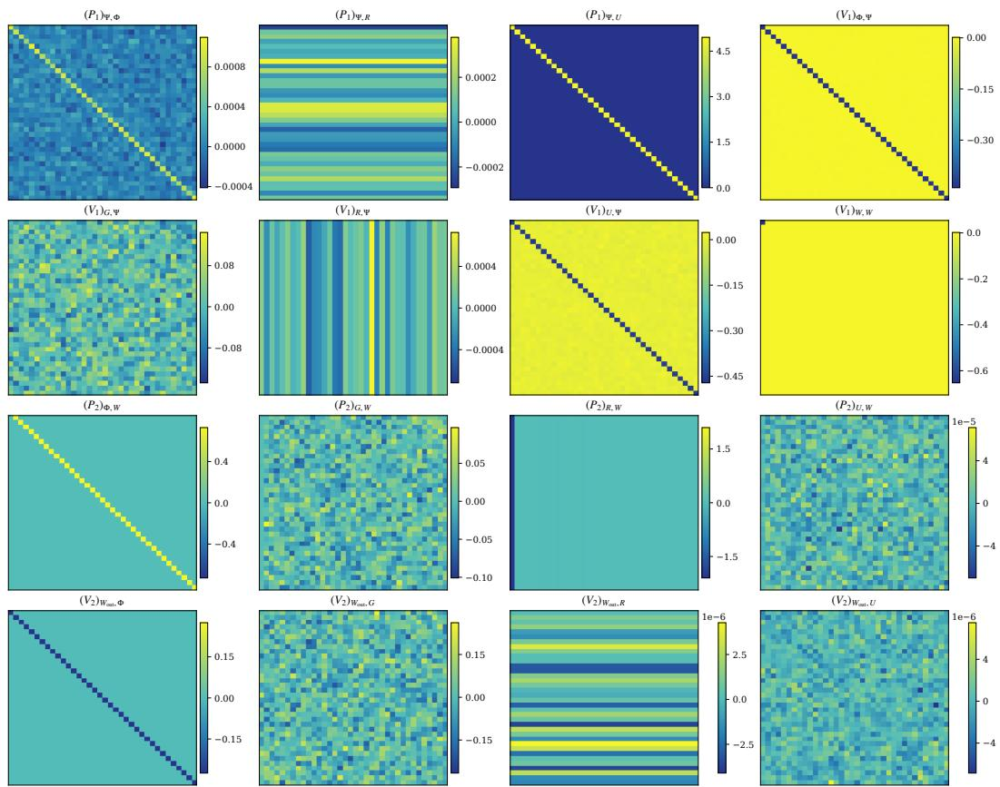  
Figure 3: Terminal detail of all 16 initialized blocks for seed 0. Each block has its own color range, shared across seeds for that block. This view complements the full matrices; it does not replace structural zeros by cropped or normalized values in the full-matrix figures.

Figure 4 deploys frozen dense-feature-trained Transformers on unseen tabular MDPs and measures exact policy returns under a common interaction budget. Comparisons include hard and soft window Q-learning, a model-informed Oracle, and uniform Random. The Transformer achieves returns close to those of the soft window teacher and a higher sample-mean return than the hard window-Q baseline using the same fixed step size.

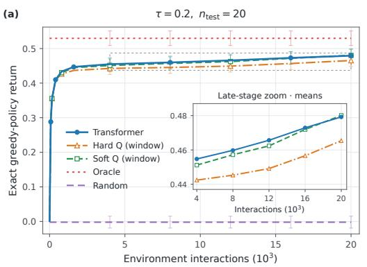

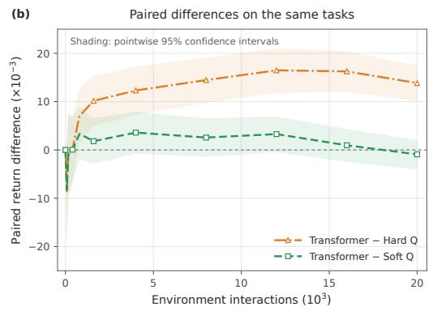  
Figure 4: Frozen dense-feature-trained Transformers on unseen tabular MDPs and measures exact policy returns under a common interaction budget.

## C.2 EXPERIMENTS ON STRUCTURED PARAMETER BLOCKS

Evaluating the accuracy of approximate Q updates. Learning error across different temperatures τ. Table 6 gives an analysis of the impacts of τ. The $\tau = 0 . 1$ model has a soft-update error of 0.07575% despite its appreciable parameter residual; the $\tau = 1$ model closely matches its soft teacher but has a large hard-update error, reflecting the finite-temperature teacher discrepancy. Here, Greedy agreement quantifies the fraction of contexts where the argmax action from the attention module matches the optimal maximizing next action of the Q-learning target.

Table 6: Update accuracy on 8,192 common dense-feature contexts.
<table><tr><td>T</td><td>Soft error (%)</td><td></td><td>Hard error (%) Teacher bias (%)</td><td>Greedy (%)</td></tr><tr><td>1</td><td> $0 . 0 0 2 8 3 \pm 0 . 0 0 1 0 7$ </td><td> $1 0 . 0 3 7 1 8 \pm 0 . 0 0 0 2 0$ </td><td>10.0370</td><td>99.9985</td></tr><tr><td>0.8</td><td> $0 . 0 0 2 6 1 \pm 0 . 0 0 0 7 1$ </td><td> $7 . 1 1 4 0 4 8 \pm 0 . 0 0 0 0 4 9$ </td><td>7.1140</td><td>99.9974</td></tr><tr><td>0.5</td><td> $0 . 0 0 2 7 6 \pm 0 . 0 0 0 7 8$ </td><td> $3 . 2 1 9 7 2 \pm 0 . 0 0 0 1 3$ </td><td>3.2198</td><td>99.9962</td></tr><tr><td>0.2</td><td> $0 . 0 0 3 9 3 \pm 0 . 0 0 0 1 9$ </td><td> $0 . 6 3 9 5 0 \pm 0 . 0 0 0 1 4$ </td><td>0.6385</td><td>99.9990</td></tr><tr><td>0.1</td><td> $0 . 0 7 5 7 5 \pm 0 . 0 0 0 2 5$ </td><td> $0 . 2 5 5 0 9 \pm 0 . 0 0 0 4 0$ </td><td>0.1960</td><td>99.9707</td></tr></table>

Table 7 illustrates how different batch sizes B affect the approximation error. The soft error decreases first and then rises with increasing batch size, minimized at $B = 6 4$ . Greedy agreement stays near 100%. The fitted effective temperature $\widehat { \tau } _ { \mathrm { e f f } } = 1 / \beta _ { a t t }$ , with $\beta _ { a t t } = \mathrm { t r } ( { \bf A } _ { \pmb { \theta } } ) / d > 0$ acting as a scalar projection diagnostic, remains around 0.2.

Table 7: Final checkpoints on 8,192 new shared contexts.
<table><tr><td>B</td><td>Soft error (%)</td><td>Hard error (%)</td><td>Greedy (%)</td><td> $\widehat { \tau } _ { \mathrm { e f f } }$ </td></tr><tr><td>1</td><td> $0 . 0 2 0 2 \pm 0 . 0 0 0 8$ </td><td> $0 . 6 3 4 8 \pm 0 . 0 0 0 7$ </td><td>99.994</td><td>0.200113</td></tr><tr><td>2</td><td> $0 . 0 1 3 5 \pm 0 . 0 0 1 3$ </td><td> $0 . 6 3 4 7 \pm 0 . 0 0 0 4$ </td><td>99.995</td><td>0.200128</td></tr><tr><td>4</td><td> $0 . 0 1 1 0 \pm 0 . 0 0 1 4$ </td><td> $0 . 6 3 4 9 \pm 0 . 0 0 0 4$ </td><td>99.995</td><td>0.200161</td></tr><tr><td>8</td><td> $0 . 0 0 7 7 \pm 0 . 0 0 0 9$ </td><td> $0 . 6 3 5 1 \pm 0 . 0 0 0 2$ </td><td>99.999</td><td>0.200223</td></tr><tr><td>16</td><td> $0 . 0 0 5 2 \pm 0 . 0 0 0 5$ </td><td> $0 . 6 3 5 2 \pm 0 . 0 0 0 3$ </td><td>99.999</td><td>0.200299</td></tr><tr><td>32</td><td> $0 . 0 0 4 1 \pm 0 . 0 0 0 3$ </td><td> $0 . 6 3 5 5 \pm 0 . 0 0 0 1$ </td><td>100.000</td><td>0.200373</td></tr><tr><td>64</td><td> $0 . 0 0 3 6 \pm 0 . 0 0 0 1$ </td><td> $0 . 6 3 5 7 \pm 0 . 0 0 0 1$ </td><td>100.000</td><td>0.200459</td></tr><tr><td>128</td><td> $0 . 0 0 4 5 \pm 0 . 0 0 0 1$ </td><td> $0 . 6 3 6 7 \pm 0 . 0 0 0 1$ </td><td>100.000</td><td>0.200784</td></tr><tr><td>256</td><td> $0 . 0 1 2 3 \pm 0 . 0 0 0 1$ </td><td> $0 . 6 4 2 4 \pm 0 . 0 0 0 3$ </td><td>99.998</td><td>0.202525</td></tr></table>

To compare the effects of different optimizations on experimental results, we also evaluated the following methods. 1. Constant Adam: All six blocks retain learning rate $1 0 ^ { - 3 }$ , with moments (0.9, 0.999) and numerical constant $1 0 ^ { - 8 } ; 2$ . Uniform cosine decay: separately labeled optimizer change. After the common 100,000-step prefix, all block learning rates decrease from $\mathrm { \dot { 1 } 0 ^ { - 3 } }$ to $1 0 ^ { - 5 }$ . For an update indexed by $j \in \{ 0 , \ldots , 2 1 9 9 9 9 \}$ after the fork, the rate for block k is $\eta _ { k } ( j ) =$ $\begin{array} { r } { 1 0 ^ { - 5 } + \frac { \eta _ { k , 0 } - 1 0 ^ { - 5 } } { 2 } [ 1 + \cos ( \frac { \pi j } { 2 1 9 9 9 9 } ) ] ; 3 } \end{array}$ . Low-rate extension: a larger, adaptively chosen budget. After observing the completed uniform-cosine runs and the aggressive schedule’s training/validation overscaling, we continue all five uniform-cosine endpoints to 20.48 million tasks. Every block uses $\begin{array} { r } { \eta ( j ) = 1 0 ^ { - 6 } + \frac { 1 0 ^ { - 5 } - 1 0 ^ { - 6 } } { 2 } [ 1 + \cos ( \frac { \pi j } { 3 1 9 9 9 } ) ] , j = 0 , \dots . } \end{array}$ , 319999. Table 8 reports three metrics under $\tau = 0 . 2$ with above learning rate schedules. Each dense-feature experiment uses $B = 3 2$ and $n = 2 0$

Table 8: Results of Soft error, Hard error, and Greedy agreement with three learning rate schedules.
<table><tr><td>Condition</td><td> $N _ { t a s k }$ </td><td>Soft error (%)</td><td>Hard error (%)</td><td>Greedy (%)</td></tr><tr><td>Constant Adam</td><td>10,240,000</td><td> $3 . 2 4 2 \pm 0 . 7 3 2$ </td><td> $3 . 3 3 2 \pm 0 . 7 1 7$ </td><td> $9 8 . 1 0 0 \pm 0 . 1 4 2$ </td></tr><tr><td>Uniform cosine</td><td>10,240,000</td><td> $0 . 0 4 0 2 8 \pm 0 . 0 0 4 1 9$ </td><td> $0 . 6 4 3 0 9 \pm 0 . 0 0 0 7 6$ </td><td> $9 9 . 9 8 0 \pm 0 . 0 0 6$ </td></tr><tr><td>Low-rate extension</td><td> $2 0 { , } 4 8 0 { , } 0 0 0$ </td><td> $0 . 0 0 4 1 5 \pm 0 . 0 0 0 2 3$ </td><td> $0 . 6 3 4 2 8 \pm 0 . 0 0 0 1 2$ </td><td> $1 0 0 . 0 0 0 \pm 0 . 0 0 0$ </td></tr></table>

Emergence of Parameters. Figure 5 presents the final learned matrices $\mathbf { P } _ { 1 } , \mathbf { V } _ { 1 } , \mathbf { P } _ { 2 }$ , and $\mathbf { V } _ { 2 }$ obtained after training with $\tau = 0 . 2$ . Remarkably, the learned matrices recover the parameter structure predicted in Theorem 1. In particular, the diagonal entries of $\mathbf { A } _ { \theta }$ in $\mathbf { P } _ { 1 }$ approach $1 / \tau .$ indicating that the Transformer has learned the internal action-selection computation required by the soft Q-learning update. This provides direct evidence of parameter emergence.

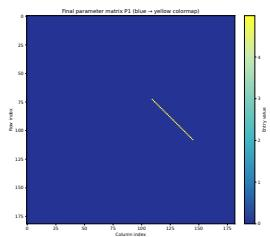  
(a) Learned $\mathbf { P } _ { 1 }$

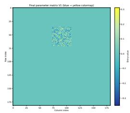  
(b) Learned $\mathbf { V } _ { 1 }$

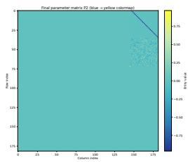  
(c) Learned $\mathbf { P } _ { 2 }$

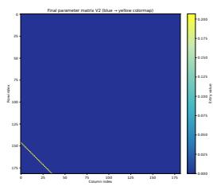  
(d) Learned $\mathbf { V } _ { 2 }$  
Figure 5: Final learned $\mathbf { P } _ { 1 } , \mathbf { V } _ { 1 } , \mathbf { P } _ { 2 }$ and $\mathbf { V } _ { 2 }$ matrices after training at $\tau = 0 . 2 , B = 3 2$ , and $n = 2 0 .$ the non-zero structure matches the theoretical constructions $( \mathbf { P } _ { 1 } , \mathbf { V } _ { 1 } , \mathbf { P } _ { 2 } , \mathbf { V } _ { 2 } )$ in (9) and (11).

We define some evaluation metrics to demonstrate whether the final parameters emerge. Write $\mathbf { B } _ { - } =$ $[ b _ { - } , K _ { - } ]$ and $\mathbf { B } _ { + } = [ b _ { + } , K _ { + } ]$ . The analytical construction defines a sufficient family satisfying $\mathbf { \tilde { A } } _ { \theta } = \tau ^ { - 1 } I , K _ { - } = - \dot { c } I , \mathbf { B } _ { r } = c [ 1 , 0 ] , \mathbf { L } ^ { \dagger } K _ { + } = \gamma c I , c \mathbf { C } = \alpha I , b _ { - } = 0 , \mathbf { L } ^ { \top } b _ { + } = 0$ , where $c \neq 0$ may be positive or negative. For each trained model, we estimate $\widehat { c } = ( ( \mathbf { B } _ { r } ) _ { 0 } - \mathrm { t r } K _ { - } ) / ( d + 1 )$ separately for each model, allowing either sign. The product $\mathbf { L } ^ { \top } K _ { + }$ removes the arbitrary invertible representation of the intermediate greedy feature. Likewise $\mathbf { L } ^ { \top } b _ { + }$ , rather than $b _ { + }$ alone, is the appropriate product entering the output relation. Low residuals indicate agreement with these sufficient relations. The complete diagnostics used in every table are

$$
E _ { { \bf A } _ { \theta } } = \frac { \| \tau { \bf A } _ { \theta } - I \| _ { F } } { \sqrt { d } } , \qquad E _ { - } = \frac { \| K _ { - } + \widehat c I \| _ { F } } { | \widehat c | \sqrt { d } } ,\tag{C.2}
$$

$$
E _ { r } = \frac { \| \mathbf { B } _ { r } - \widehat { c } [ 1 , 0 ] \| _ { F } } { | \widehat { c } | } , E _ { + } = \frac { \| \mathbf { L } ^ { \top } K _ { + } - \widehat { \gamma c } I \| _ { F } } { \gamma | \widehat { c } | \sqrt { d } } ,\tag{C.3}
$$

$$
E _ { C } = \frac { | | \widehat { \boldsymbol { c } } \mathbf { C } - \boldsymbol { \alpha } \boldsymbol { I } | | _ { F } } { \boldsymbol { \alpha } \sqrt { d } } , \qquad E _ { - , 0 } = \frac { | | \boldsymbol { b } _ { - } | | _ { 2 } } { | \widehat { c } | \sqrt { d } } ,\tag{C.4}
$$

$$
E _ { + , 0 } = \frac { \| \mathbf { L } ^ { \top } b _ { + } \| _ { 2 } } { \gamma | \hat { c } | \sqrt { d } } , \qquad E _ { \mathrm { T D } } ^ { 2 } = E _ { - } ^ { 2 } + E _ { r } ^ { 2 } + E _ { + } ^ { 2 } + E _ { C } ^ { 2 } + E _ { - , 0 } ^ { 2 } + E _ { + , 0 } ^ { 2 } .\tag{C.5}
$$

and $E _ { \mathrm { a l l } } ~ = ~ \sqrt { E _ { \mathbf { A } _ { \theta } } ^ { 2 } + E _ { \mathrm { T D } } ^ { 2 } , \widehat { \tau } _ { \mathrm { e f f } } } ~ = ~ 1 / \beta _ { a t t }$ with $\beta _ { a t t } ~ = ~ \mathrm { t r } ( \mathbf { A } _ { \pmb { \theta } } ) / d ~ > ~ 0$ is a scalar projection diagnostic, not an exact temperature when $\mathbf { A } _ { \theta }$ has nonscalar components. The scalar estimate is allowed to be negative. The full completed models have nondegenerate $\widehat { c } ;$ a normalization near zero is not interpreted as a zero residual. For arbitrary active blocks, $E _ { \mathrm { a l l } }$ is not an established Euclidean distance to all minimizers. Figures 6 and 7 present heatmaps of the key matrices and their relations under $\tau = 0 . 2 .$ , respectively, revealing that the training algorithm successfully induces the constructed parameters to emerge.


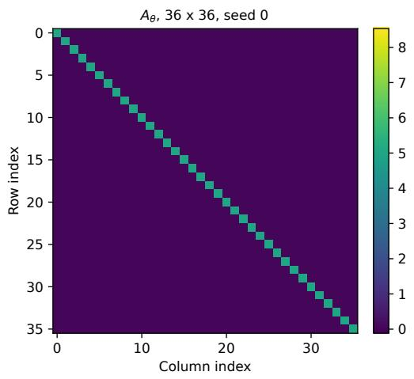

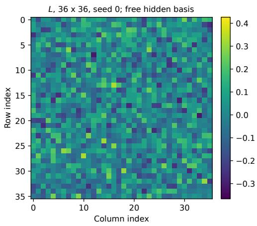

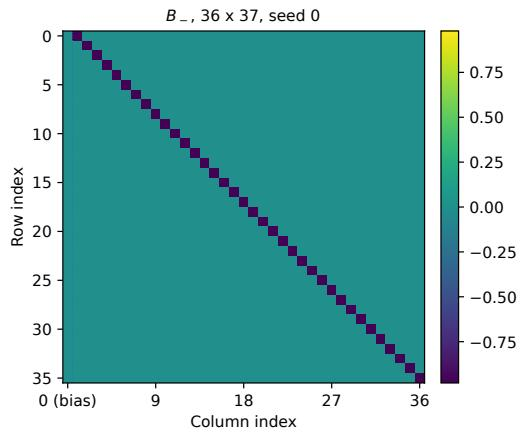

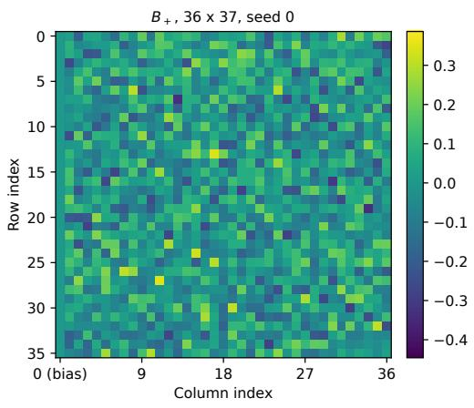

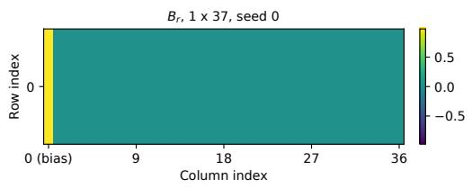

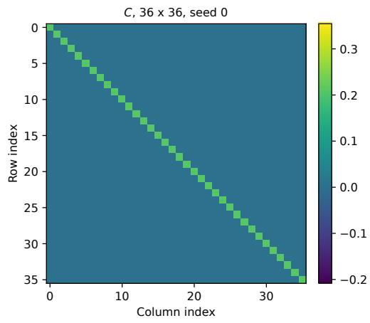  
Figure 6: All six actual trained $\mathbf { b l o c k s } ,$ seed 0. $\mathbf { A } _ { \theta } , \mathbf { L } , \mathbf { C }$ are $3 6 \times 3 6 ; \mathbf { B } _ { - } , \mathbf { B } _ { + }$ are $3 6 \times 3 7 ; \mathbf { B } ,$ is $1 \times 3 7$ . The fitted scalar is $\widehat { c } = 0 . 9 6 7 8 9 3$ . Dense L and $\mathbf { B } _ { + }$ are compatible with a nontrivial invertible gauge and are not replaced by identity-shaped pictures.

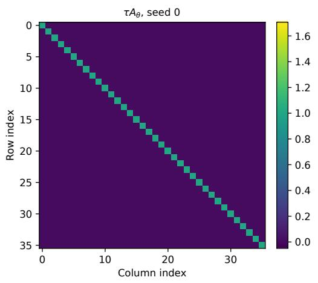

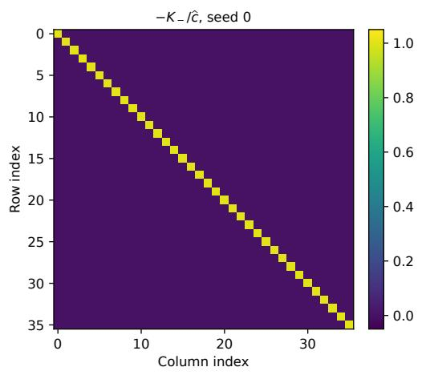

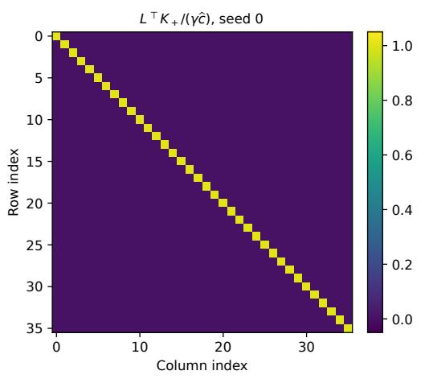

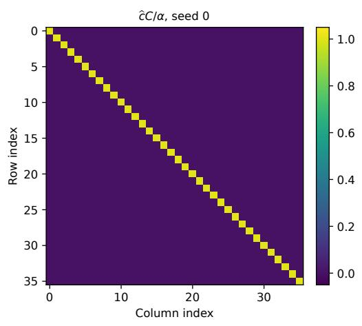


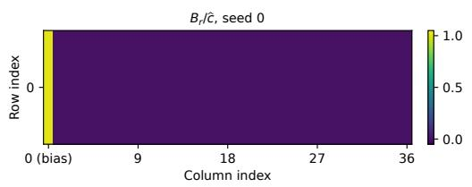

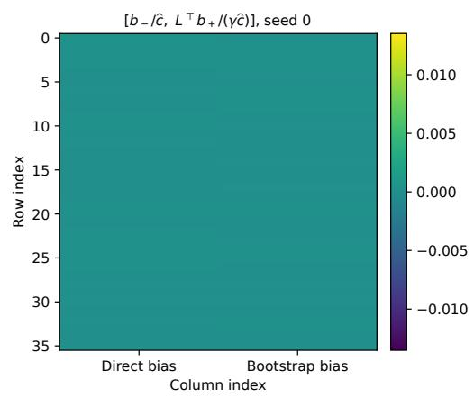  
Figure 7: Normalized relations for the same model. The first four targets are I, the reward-row target $\mathrm { i s } \left[ 1 , 0 , \dots , 0 \right]$ , and the two bias targets are zero. These are display-only diagnostics, not raw weights. Common limits are used for each named relation across seeds and methods, including the failed control.

For the relationship between the emergence of parameters and cumulative task exposure. Figure 8 tracks recovery along one training trajectory under growing cumulative task exposure. Reduced final TD residual shows attention-scale calibration dominates aggregate residual. Since task exposure and optimizer updates rise together, the curves cannot isolate task diversity’s fixed-compute effect.

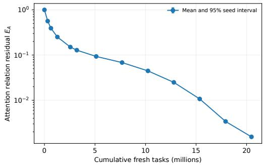

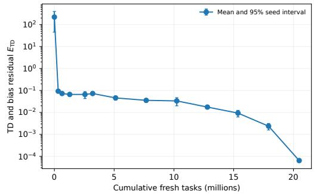  
Figure 8: Parameter recovery versus cumulative fresh tasks at $B = 3 2 , n = 2 0$ , and $\tau = 0 . 2 .$ . Left: attention residual $E _ { A }$ . Right: the aggregate of the six remaining TD and bias residuals, $E _ { \mathrm { T D } }$

Table 9 shows close agreement with the analytical relations at temperature $\tau = 1 , 0 . 8 , 0 . 5$ , and $0 . 2 ,$ , while recovery remains incomplete at $\tau = 0 . 1$ $\mathrm { { A t } } ~ \tau = 0 . 2$ , the learned scalar projection is $\beta _ { a t t } = 4 . 9 9 2 2 3 6$ against a target of 5. $\mathrm { { A t } } \ \tau = 0 . 1$ , it is 8.174396 against a target of 10, and $E _ { \mathrm { a l l } } = 0 . 1 8 2 6$ . Figure 9 makes this scale discrepancy explicit rather than inferring recovery from matrix appearance alone. No temperature-specific tuning is performed; the tested values do not establish a critical temperature or an impossibility result for lower-temperature recovery.

Table 9: Final parameter recovery at $2 0 . 4 8$ million tasks, $B = 3 2 .$ , and $n = 2 0$ . Entries are five-seed means; $E _ { \mathrm { a l l } }$ includes a pointwise 95% interval half-width. Residuals are dimensionless. The scalar projection $\beta _ { a t t }$ is compared with $1 / \tau$ without removing nonscalar distortion.
<table><tr><td>T</td><td> $1 / \tau$ </td><td> $\beta _ { a t t }$ </td><td> $E _ { A }$ </td><td> $E _ { \mathrm { T D } }$ </td><td> $E _ { \mathrm { a l l } }$ </td></tr><tr><td>1</td><td></td><td>1 1.000000</td><td> $3 . 8 0 8 \times 1 0 ^ { - 5 }$ </td><td> $5 . 4 1 0 \times 1 0 ^ { - 5 }$ </td><td> $( 6 . 6 2 4 \pm 2 . 1 0 2 ) \times 1 0 ^ { - 5 }$ </td></tr><tr><td>0.8</td><td>1.25</td><td>1.250000</td><td> $3 . 1 5 0 \times 1 0 ^ { - 5 }$ </td><td> $4 . 7 4 1 \times 1 0 ^ { - 5 }$ </td><td> $( 5 . 7 1 5 \pm 1 . 0 4 9 ) \times 1 0 ^ { - 5 }$ </td></tr><tr><td>0.5</td><td>2</td><td>2.000002</td><td> $2 . 4 2 4 \times 1 0 ^ { - 5 }$ </td><td> $4 . 8 8 2 \times 1 0 ^ { - 5 }$ </td><td> $( 5 . 4 6 6 \pm 1 . 3 2 3 ) \times 1 0 ^ { - 5 }$ </td></tr><tr><td>0.2</td><td>5</td><td>4.992236</td><td> $1 . 5 5 3 \times 1 0 ^ { - 3 }$ </td><td> $6 . 3 8 4 \times 1 0 ^ { - 5 }$ </td><td> $( 1 . 5 5 4 \pm 0 . 0 1 7 ) \times 1 0 ^ { - 3 }$ </td></tr><tr><td>0.1</td><td></td><td>108.174396</td><td> $0 . 1 8 2 6$ </td><td> $6 . 5 9 0 \times 1 0 ^ { - 4 }$ </td><td> $0 . 1 8 2 5 6 \pm 0 . 0 0 0 2 0$ </td></tr></table>

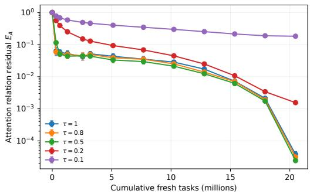

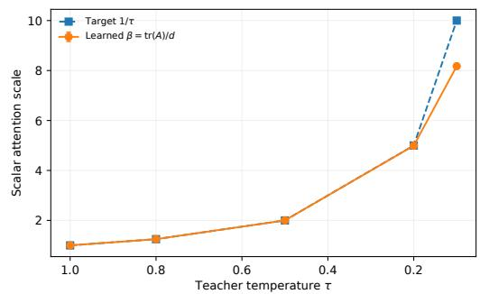  
Figure 9: Temperature-dependent recovery at $B = 3 2$ and $n = 2 0$ . Left: attention residual versus cumulative tasks, with five paired seeds per temperature. Right: the learned scalar projection $\beta _ { a t t }$ and its target $1 / \tau$ . The target is shown only for evaluation; no matrix target is supplied during training.

For the relationship between the emergence of parameters and batch size. We report scale calibration and matrix shape in Figure 10. The lowest endpoint mean of $E _ { \mathrm { a l l } }$ occurs at $\bar { B } = 1 2 8$ , with value $7 . 2 0 4 \times 1 0 ^ { - 4 }$ . By contrast, mean soft-update error continues to decrease up to $B = 6 4$ in Table 7. Thus, the best observed parameter recovery and the lowest observed functional error do not coincide in this sweep. At fixed $N _ { \mathrm { t a s k } }$ , reducing B increases the number of Adam updates, whereas increasing B averages more tasks in each update. Adam’s moment memories are defined in update units, so their span in task units also changes. The observed ranking is consequently specific to the shared schedule, numerical precision, architecture, and task budget; it does not establish a universally optimal batch size.

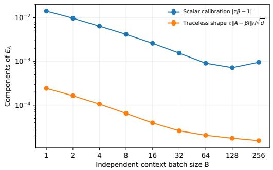

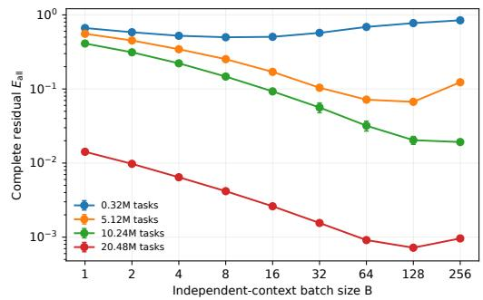  
Figure 10: Batch-size effects under a fixed task budget. Left: attention scale and traceless-shape residuals, whose squares sum to $E _ { A } ^ { 2 }$ for each model. Right: aggregate residuals at four checkpoints of the same training runs. Intermediate curves are not independently retrained short-budget experiments.

For the relationship between the emergence of parameters and Training context length. For each training length, only the first $n _ { \mathrm { t r a i n } }$ transitions of the common 80-step trajectory enter the loss. The teacher increment is recomputed from that prefix with normalization $\alpha / n _ { \mathrm { t r a i n } }$ . The $n _ { \mathrm { t r a i n } } = 2 0$ default uses the same paired generator and is shared across the three sweeps.

Table 10: Training-length comparison at $\tau = 0 . 2$ and $B = 3 2 .$ . Every model receives 20.48 million tasks and $6 4 0 { , } 0 0 0$ updates; supplied transitions differ. Residuals are five-seed means, with the 95% interval half-width for $E _ { \mathrm { a l l } }$ in the final column. The default is shared across sweeps.
<table><tr><td> $n _ { \mathrm { t r a i n } }$  Transitions (M)</td><td></td><td> $E _ { A }$ </td><td> $E _ { \mathrm { T D } }$ </td><td> $E _ { \mathrm { a l l } }$ </td><td>95% interval  $\mathbf { \hat { h a l f - w i d t h } }$ </td></tr><tr><td>1</td><td>20.48</td><td> $0 . 0 1 2 8$ </td><td> $2 . 0 3 3 \times 1 0 ^ { - 4 }$ </td><td> $0 . 0 1 2 8$ </td><td> $1 . 9 6 9 \times 1 0 ^ { - 4 }$ </td></tr><tr><td>5</td><td>102.4</td><td> $2 . 1 5 5 \times 1 0 ^ { - 3 }$ </td><td> $8 . 0 5 9 \times 1 0 ^ { - 5 }$ </td><td> $2 . 1 5 6 \times 1 0 ^ { - 3 }$ </td><td> $8 . 6 6 1 \times 1 0 ^ { - 5 }$ </td></tr><tr><td>10</td><td>204.8</td><td> $1 . 6 9 9 \times 1 0 ^ { - 3 }$ </td><td> $6 . 4 4 0 \times 1 0 ^ { - 5 }$ </td><td> $1 . 7 0 0 \times 1 0 ^ { - 3 }$ </td><td> $5 . 3 8 1 \times 1 0 ^ { - 5 }$ </td></tr><tr><td>20</td><td>409.6</td><td> $1 . 5 5 3 \times 1 0 ^ { - 3 }$ </td><td> $6 . 3 8 4 \times 1 0 ^ { - 5 }$ </td><td> $1 . 5 5 4 \times 1 0 ^ { - 3 }$ </td><td> $1 . 7 2 8 \times 1 0 ^ { - 5 }$ </td></tr><tr><td>40</td><td>819.2</td><td> $1 . 7 3 9 \times 1 0 ^ { - 3 }$ </td><td> $6 . 3 9 3 \times 1 0 ^ { - 5 }$ </td><td> $1 . 7 4 0 \times 1 0 ^ { - 3 }$ </td><td> $5 . 2 9 0 \times 1 0 ^ { - 5 }$ </td></tr><tr><td>80</td><td>1638.4</td><td> $2 . 0 1 9 \times 1 0 ^ { - 3 }$ </td><td> $7 . 0 5 0 \times 1 0 ^ { - 5 }$ </td><td> $2 . 0 2 0 \times 1 0 ^ { - 3 }$ </td><td> $3 . 8 4 6 \times 1 0 ^ { - 5 }$ </td></tr></table>

Table 11: Length-specific models on matched-length and $\mathrm { c o m m o n } – n _ { \mathrm { t e s t } } = 2 0$ dense tests, and matched-length one-hot tests. Entries are update NRMSE percentages with pointwise 95% seedinterval half-widths. The tabular column measures feature transfer without one-hot training.
<table><tr><td> $n _ { \mathrm { t r a i n } }$ </td><td></td><td>Dense matched (%) Dense common 20 (%) Tabular matched (%)</td><td></td></tr><tr><td>1</td><td> $0 . 0 1 8 9 3 \pm 0 . 0 0 0 3 2$ </td><td> $0 . 0 1 5 7 3 \pm 0 . 0 0 0 2 5$ </td><td> $0 . 0 8 4 6 7 \pm 0 . 0 0 0 9 5$ </td></tr><tr><td>5</td><td> $0 . 0 0 5 6 1 \pm 0 . 0 0 0 3 9$ </td><td> $0 . 0 0 5 2 5 \pm 0 . 0 0 0 3 8$ </td><td> $0 . 0 1 5 5 8 \pm 0 . 0 0 0 7 7$ </td></tr><tr><td>10</td><td> $0 . 0 0 4 3 1 \pm 0 . 0 0 0 4 3$ </td><td> $0 . 0 0 4 1 7 \pm 0 . 0 0 0 4 2$ </td><td> $0 . 0 1 2 8 4 \pm 0 . 0 0 0 4 9$ </td></tr><tr><td>20</td><td> $0 . 0 0 3 9 3 \pm 0 . 0 0 0 1 9$ </td><td> $0 . 0 0 3 9 3 \pm 0 . 0 0 0 1 9$ </td><td> $0 . 0 1 2 2 2 \pm 0 . 0 0 0 3 6$ </td></tr><tr><td>40</td><td> $0 . 0 0 3 6 7 \pm 0 . 0 0 0 2 0$ </td><td> $0 . 0 0 3 8 4 \pm 0 . 0 0 0 2 1$ </td><td> $0 . 0 1 4 1 3 \pm 0 . 0 0 0 6 0$ </td></tr><tr><td>80</td><td> $0 . 0 0 3 8 0 \pm 0 . 0 0 0 1 2$ </td><td> $0 . 0 0 4 1 1 \pm 0 . 0 0 0 1 2$ </td><td> $0 . 0 1 6 7 9 \pm 0 . 0 0 0 4 4$ </td></tr></table>

Among the tested lengths, $n _ { \mathrm { t r a i n } } = 2 0$ yields the lowest sample mean of $E _ { \mathrm { a l l } } , 1 . 5 5 4 \times 1 0 ^ { - 3 }$ (Table 10). This is a fixed-task, fixed-update comparison, not a fixed-transition or fixed-compute comparison: $n = 8 0$ supplies 80 times as many transitions per task as $n = 1$ . Context length also changes the distribution and variance of the window-averaged target. Table 11 therefore reports both matchedlength tests and tests at the common length $n _ { \mathrm { t e s t } } = 2 0$ . The common-length evaluation holds the test window fixed when comparing models trained with different lengths. The one-hot results measure dense-to-tabular feature transfer, not performance after one-hot training.

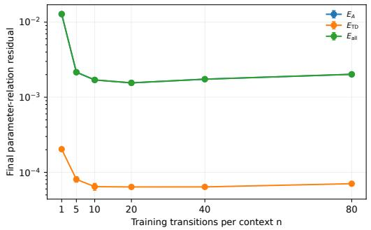

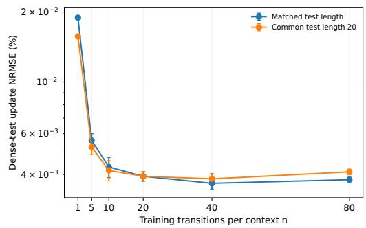  
Figure 11: Training context length at $\tau = 0 . 2$ and $B = 3 2$ , with 20.48 million tasks per model. Left: final parameter residuals. Right: update errors on matched-length and common-length dense-feature tests.

Generalization to unseen tabular tasks. ${ \mathrm { A t ~ } } \tau = 0 . 2 ,$ , the Transformer achieves mean return 0.4880, compared with 0.4861 for its soft teacher and 0.5374 for Oracle. The paired Transformerminus-soft difference is 0.00188. This comparison does not resolve a return advantage and does not establish equivalence or noninferiority. The visit-count online Q-learning baseline reaches 0.5318, exceeding the Transformer means in the primary comparison. The evidence therefore supports useful self-fed transfer (Figure 12). Deployment intervals use 5,000 percentile-bootstrap replicates with independent resampling of the training-seed and test-task axes, preserving paired methods and complete trajectories.

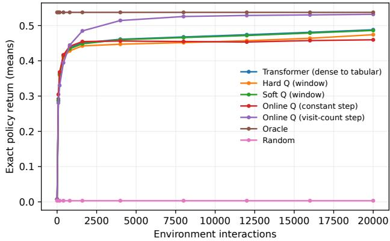  
Figure 12: Online Q-learning is included in the comparisons; the variant with decaying visit-count learning rate yields the best performance.

Table 12 and Figure 13 complete the five-temperature comparison; $\tau = 0 . 2$ appears in the main text. All curves use the same task bank, interaction axis, and evaluation protocol, and include Transformer, hard window-Q, soft window-Q, Oracle, and Random.

Table 12: Final returns on 512 unseen tabular tasks: $n _ { \mathrm { t e s t } } = 2 0$ , zero Q initialization.
<table><tr><td>T</td><td>Transformer [95% CI]</td><td>Hard Q (window)</td><td>Soft Q (window)</td><td>Oracle</td><td>Random</td></tr><tr><td>1</td><td>0.5036 [0.4835, 0.5237]</td><td>0.4740</td><td>0.5036</td><td>0.5374</td><td>0.0033</td></tr><tr><td>0.8</td><td>0.5033 [0.4829, 0.5227]</td><td>0.4740</td><td>0.5025</td><td>0.5374</td><td>0.0033</td></tr><tr><td>0.5</td><td>0.5003 [0.4804, 0.5198]</td><td>0.4740</td><td>0.4996</td><td>0.5374</td><td>0.0033</td></tr><tr><td>0.2</td><td>0.4880 [0.4686, 0.5074]</td><td>0.4740</td><td>0.4861</td><td>0.5374</td><td>0.0033</td></tr><tr><td>0.1</td><td>0.4833 [0.4644, 0.5022]</td><td>0.4740</td><td>0.4795</td><td>0.5374</td><td>0.0033</td></tr></table>

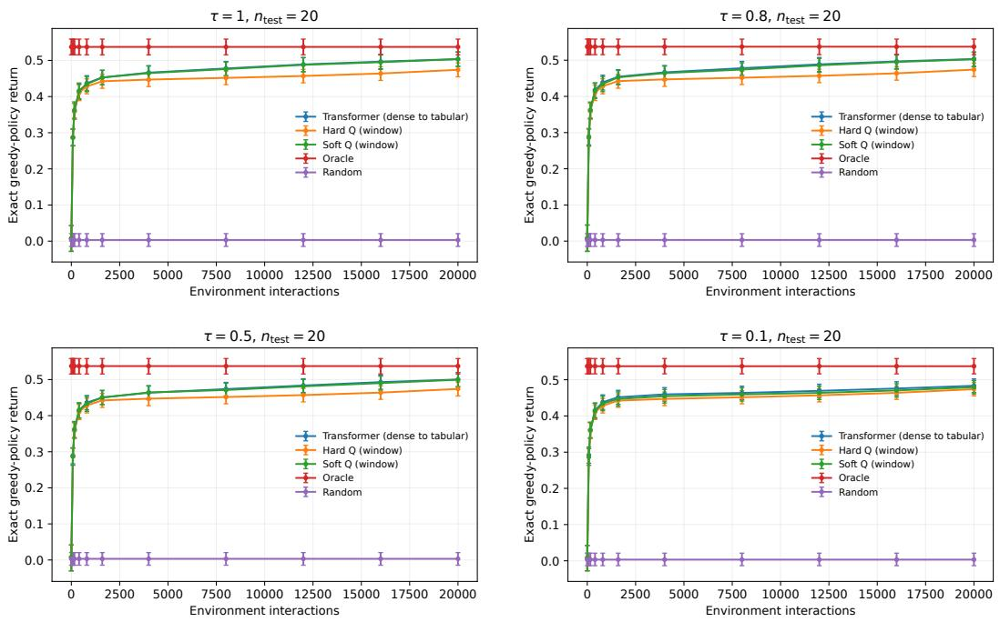  
Figure 13: Tabular transfer at $\tau = 1 , \tau = 0 . 8 , \tau = 0 . 5 ,$ , and $\tau = 0 . 1$ , with $n _ { \mathrm { t e s t } } = 2 0 .$ , zero Q initialization, and 20,000 interactions. Error bars denote pointwise 95% intervals. Transformer weights are frozen throughout. All experiments use the same 512 tasks and 20,000-interaction budget.

For training and deployment context lengths. We distinguish three evaluations. The frozen-length test varies $n _ { \mathrm { t e s t } }$ for models trained with $n _ { \mathrm { t r a i n } } = 2 0$ . The matched-length test deploys each lengthspecific model at its training length. The common-length test deploys all length-specific models at $n _ { \mathrm { t e s t } } = 2 0$ . Every learner receives 20,000 interactions, so a window-based learner performs $2 0 , 0 0 0 / n _ { \mathrm { t e s t } }$ updates. Varying the deployment length therefore changes both the window-averaging coefficient and the update frequency.

In the frozen-length test, $n _ { \mathrm { t e s t } } = 5$ yields the highest observed Transformer mean return, 0.5194, whereas $n _ { \mathrm { t e s t } } = 2 0$ yields 0.4880. The window teachers exhibit a similar dependence on deployment length. With common $n _ { \mathrm { t e s t } } = 2 0$ , the length-specific models instead have mean returns between 0.4868 and 0.4884. Thus, training-context effects should be distinguished from deployment update frequency; longer windows do not uniformly improve finite-budget control.

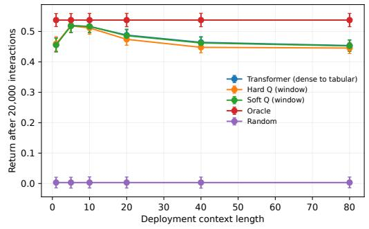

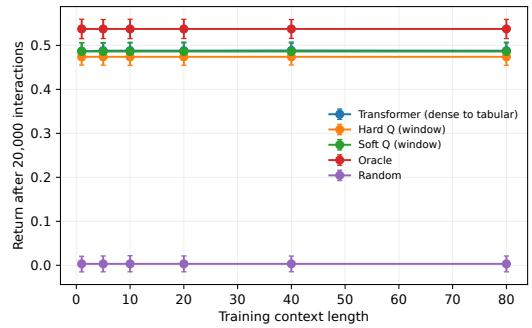  
Figure 14: Separating training-length and deployment-length effects at $\tau = 0 . 2 .$ Left: models trained at $n _ { \mathrm { t r a i n } } = 2 0$ and deployed with different windows. Right: models trained at different lengths and all deployed at $n _ { \mathrm { t e s t } } = 2 0$ . Both evaluations use the same task bank and 20,000-interaction budget.

## D THEORETICAL ANALYSIS

Fix integers $d \geqslant 1 , m \geqslant 2 , n \geqslant 1$ and real constants $\alpha > 0 , 0 < \gamma < 1 , \tau > 0$ . The meanings of these fixed quantities are given below. The temperature τ is fixed during optimization, let

$$
\mathbf { z } = \left( \mathbf { w } , \{ \phi _ { i } , r _ { i + 1 } , \psi _ { i , a } : 0 \leqslant i < n , \ a \in [ m ] \} \right) \sim \mathcal { D } _ { n } .
$$

Here $\mathbf { w } \in \mathbb { R } ^ { d }$ is an input vector, held fixed within a context. The vector $\phi _ { i } \in \mathbb { R } ^ { d }$ is the current state–action feature, $r _ { i + 1 } \in \mathbb { R }$ is the observed reward, and $\psi _ { i , a } \in \mathbb { R } ^ { d }$ is the feature of candidate action a at the successor state. These are allowed to be statistically dependent. The symbol ${ \mathcal { D } } _ { n }$ denotes their joint probability law, let

$$
\pi _ { i , a } ^ { \tau } ( \mathbf { z } ) = \frac { \exp ( \mathbf { w } ^ { \top } \psi _ { i , a } / \tau ) } { \sum _ { b = 1 } ^ { m } \exp ( \mathbf { w } ^ { \top } \psi _ { i , b } / \tau ) } , \qquad \quad \quad \bar { \psi } _ { i } ^ { \tau } ( \mathbf { z } ) = \sum _ { a = 1 } ^ { m } \pi _ { i , a } ^ { \tau } ( \mathbf { z } ) \psi _ { i , a } ,\tag{D.1}
$$

$$
\delta _ { i } ^ { \tau } ( \mathbf { z } ) = r _ { i + 1 } - \mathbf { w } ^ { \top } \phi _ { i } + \gamma \mathbf { w } ^ { \top } \bar { \psi } _ { i } ^ { \tau } ( \mathbf { z } ) , \qquad F _ { \tau , n } ( \mathbf { z } ) = \frac { \alpha } { n } \sum _ { i = 0 } ^ { n - 1 } \phi _ { i } \delta _ { i } ^ { \tau } ( \mathbf { z } ) .\tag{D.2}
$$

The probabilities $\pi _ { i , a } ^ { \tau }$ average successor features; they are not the behavior policy that generated the trajectory. The scalar $\delta _ { i } ^ { \tau }$ is the specified temporal-difference target minus the current score. The vector $F _ { \tau , n } \in \mathbb { R } ^ { d }$ is the update increment to imitate. Thus the teacher’s full prediction is $\mathbf { w } + F _ { \tau , n } .$

In this appendix, we explicitly restrict optimization to the six-block support of Proposition B.3, with every other block fixed at zero. The six-block support $\pmb { \theta } _ { \mathrm { s u p } } = ( \mathbf { A } _ { \theta } , \mathbf { L } , \mathbf { \bar { B } } _ { - } , \mathbf { B } _ { + } , \mathbf { \dot { B _ { r } } } , \mathbf { C } ) \in \Theta _ { \mathrm { s u p } }$ can be broken down into following blocks

$$
\pmb \theta = ( A , L , b _ { - } , K _ { - } , b _ { + } , K _ { + } , \beta , q , C ) \in \Theta , \qquad \mathrm { d i m } \Theta = 5 d ^ { 2 } + 3 d + 1 .\tag{D.3}
$$

where $A = \mathbf { A } _ { \theta } , L = \mathbf { L } , \mathbf { B } _ { - } = [ b _ { - } , K _ { - } ] , \mathbf { B } _ { + } = [ b _ { + } , K _ { + } ] , \mathbf { B } _ { r } = [ \beta , q ^ { \top } ]$ . The trainable matrix L is not assumed invertible; invertibility is imposed only on the exact-realization manifold.

$$
p _ { i , a } ( { \cal A } ; { \bf z } ) = \frac { \exp ( \psi _ { i , a } ^ { \top } { \cal A } { \bf w } ) } { \sum _ { b = 1 } ^ { m } \exp ( \psi _ { i , b } ^ { \top } { \cal A } { \bf w } ) } , \quad \bar { \psi } _ { i } ( { \cal A } ; { \bf z } ) = \sum _ { a } p _ { i , a } ( { \cal A } ; { \bf z } ) \psi _ { i , a } ,\tag{D.4}
$$

$$
s _ { i } ( \pmb \theta ; \mathbf z ) = \phi _ { i } ^ { \top } ( b _ { - } + K _ { - } \mathbf w ) + ( L \bar { \psi } _ { i } ( A ; \mathbf z ) ) ^ { \top } ( b _ { + } + K _ { + } \mathbf w ) + r _ { i + 1 } ( \beta + q ^ { \top } \mathbf w ) ,\tag{D.5}
$$

$$
F _ { { \pmb \theta } , n } ( { \mathbf z } ) = \frac { 1 } { n } \sum _ { i = 0 } ^ { n - 1 } C \phi _ { i } s _ { i } ( { \pmb \theta } ; { \mathbf z } ) .\tag{D.6}
$$

Both full outputs add the same w, so their difference is the increment error $e _ { \pmb { \theta } } ( \mathbf { z } ) : = F _ { \pmb { \theta } , n } ( \mathbf { z } ) -$ $F _ { \tau , n } ( \mathbf { z } )$ . For the fixed context length n, we write the loss as $L _ { n } ( \theta ) = \mathcal { L } ( \theta ) , \mathrm { i . e }$

$$
L _ { n } ( \pmb \theta ) = \frac { 1 } { 2 } \mathbb { E } _ { \pmb { z } \sim \mathcal { D } _ { n } } \| F _ { \pmb { \theta } , n } ( \mathbf { z } ) - F _ { \tau , n } ( \mathbf { z } ) \| _ { 2 } ^ { 2 } .\tag{D.7}
$$

We prove Theorem 2 in three parts. First, we characterize the local geometry and normal curvature of the optimal parameter manifold. Second, we establish a one-step contraction of gradient descent toward this manifold. Finally, we use these results to prove convergence to a single optimal parameter and derive the matching worst-case iteration complexity over the admissible initialization class.

## D.1 GEOMETRY AND CURVATURE OF THE OPTIMAL PARAMETER MANIFOLD

A perturbation $\mathbf { U } \in \Theta$ has blocks denoted by $\Delta A , \ldots , \Delta C$ in the same order as (D.3).

$$
\begin{array} { r l } & { \| \mathbf { U } \| _ { \Theta } ^ { 2 } = \| \Delta A \| _ { F } ^ { 2 } + \| \Delta L \| _ { F } ^ { 2 } + \| \Delta b _ { - } \| _ { 2 } ^ { 2 } + \| \Delta K _ { - } \| _ { F } ^ { 2 } + \| \Delta b _ { + } \| _ { 2 } ^ { 2 } } \\ & { \qquad + \| \Delta K _ { + } \| _ { F } ^ { 2 } + | \Delta \beta | ^ { 2 } + \| \Delta q \| _ { 2 } ^ { 2 } + \| \Delta C \| _ { F } ^ { 2 } . } \end{array}
$$

For a vector, $\begin{array} { r } { \| \boldsymbol { x } \| _ { 2 } ^ { 2 } = \sum _ { j } x _ { j } ^ { 2 } } \end{array}$ ; for a matrix, $\| M \| _ { F } ^ { 2 } = \mathrm { t r } ( M ^ { \top } M )$ . The product inner product is the corresponding sum of vector dot products and matrix Frobenius inner products. We abbreviate $\| \mathbf { U } \| _ { \Theta } \operatorname { t o } \| \mathbf { U } \|$ when the space is unambiguous. Norms of operators are induced by their domain and codomain norms, not entrywise norms unless specified.

For a fixed context z, let $J _ { \pmb \theta , n } ( \mathbf { z } ) : = D _ { \pmb \theta } F _ { \pmb \theta , n } ( \mathbf { z } ) : \Theta  \mathbb { R } ^ { d }$ denote the Jacobian of the Transformer output with respect to its parameters. Thus, for a parameter perturbation $\mathbf { U } \in \Theta , J _ { \pmb { \theta } , n } ( \mathbf { z } ) [ \mathbf { U } ] =$ $\begin{array} { r l } {  { \frac { d } { d t } F _ { \pmb { \theta } + t \mathbf { U } , n } ( \mathbf { z } ) \big \rvert _ { t = 0 } } } \end{array}$ . Equivalently, $F _ { { \pmb \theta } + t { \bf U } , n } ( { \bf z } ) = F _ { { \pmb \theta } , n } ( { \bf z } ) + t J _ { { \pmb \theta } , n } ( { \bf z } ) [ { \bf U } ] + o ( t )$ . Hence $J _ { \pmb { \theta } , n } ( \mathbf { z } ) [ \mathbf { U } ]$ measures the first-order change of the Transformer output, on the particular context z, when the parameters are perturbed in direction U.

Since our training objective is the population loss (D.7), we now introduce the population Jacobian. We therefore consider the Hilbert space

$$
\begin{array} { r } { \mathcal { H } _ { n } = L ^ { 2 } ( \mathcal { D } _ { n } ; \mathbb { R } ^ { d } ) , \quad \langle f , h \rangle _ { \mathcal { H } _ { n } } = \mathbb { E } \langle f ( \mathbf { z } ) , h ( \mathbf { z } ) \rangle _ { 2 } , } \end{array}
$$

with norm $| f | _ { \mathcal { H } _ { n } } ^ { 2 } = \mathbb { E } | f ( \mathbf { z } ) | _ { 2 } ^ { 2 }$ , and define the population Jacobian $\mathcal { I } _ { \pmb { \theta } , n } : \Theta  \mathcal { H } _ { n } , ( \mathcal { I } _ { \pmb { \theta } , n } \mathbf { U } ) ( \mathbf { z } ) =$ $J _ { \pmb { \theta } , n } ( \mathbf { z } ) [ \mathbf { U } ]$ . Thus $| \mathcal { I } _ { \pmb { \theta } , n } \mathbf { U } | _ { \mathcal { H } _ { n } } ^ { 2 } = \mathbb { E } | J _ { \pmb { \theta } , n } ( \mathbf { z } ) [ \mathbf { U } ] | _ { 2 } ^ { 2 }$ measures the average squared first-order output change caused by the parameter perturbation U over the entire context distribution.

Let $\mathcal { T } _ { \theta , n } ^ { * }$ denote the adjoint of the population Jacobian, defined by $\langle \mathcal { I } _ { \theta , n } \mathbf { U } , f \rangle _ { \mathcal { H } _ { n } } = \langle \mathbf { U } , \mathcal { I } _ { \theta , n } ^ { * } f \rangle _ { \Theta }$ Equivalently, $\mathcal { T } _ { \theta , n } ^ { * } f = \mathbb { E } \big [ J _ { \theta , n } ( \mathbf { z } ) ^ { * } f ( \mathbf { z } ) \big ]$

At an exact realization $\bar { \pmb { \theta } } \in \mathcal { M } _ { \tau } .$ , define the population Gauss-Newton operator $G ( { \bar { \pmb { \theta } } } ) : = \mathcal { I } _ { { \bar { \pmb { \theta } } } , n } ^ { * } \mathcal { I } _ { { \bar { \pmb { \theta } } } , n }$ For every parameter direction U,

$$
\langle \mathbf { U } , G ( \bar { \pmb { \theta } } ) \mathbf { U } \rangle = | \mathcal { I } _ { \bar { \pmb { \theta } } , n } \mathbf { U } | _ { \mathcal { H } _ { n } } ^ { 2 } = \mathbb { E } | J _ { \bar { \pmb { \theta } } , n } ( \mathbf { z } ) [ \mathbf { U } ] | _ { 2 } ^ { 2 } .
$$

Therefore $G ( \bar { \pmb { \theta } } )$ quantifies how strongly the Transformer output responds, to first order, to perturbations of its parameters around an exact realization. The minimum normal curvature over the chosen target patch $\mathcal { U } _ { \tau } \subset \mathcal { M } ,$ <sub>τ</sub> is defined by $\begin{array} { r } { \kappa : = \operatorname* { i n f } _ { \bar { \boldsymbol { \theta } } \in \mathcal { U } _ { \tau } , \mathcal { U } _ { \tau } \in N _ { \bar { \boldsymbol { \theta } } } \mathcal { M } _ { \tau } , | \mathbf { U } | = 1 } | \mathcal { I } _ { \bar { \boldsymbol { \theta } } , n } \mathbf { U } | _ { \mathcal { H } _ { n } } ^ { 2 } } \end{array}$

The quantity κ has a direct optimization interpretation. A large κ means that every unit perturbation away from the exact-realization manifold produces a substantial change in the Transformer output, so the population loss has appreciable curvature in every identifiable parameter direction. A small κ means that at least one identifiable direction is nearly flat and is therefore harder to learn by training.

Throughout the remainder of Appendix $ { \mathbf Ḋ \ Ḍ } , n$ and τ are fixed. We use the abbreviations $J _ { \theta } = J _ { \theta , n }$ $G = { \mathit { \hat { G } } } _ { n } , \varkappa = \varkappa _ { n }$ , and ${ \mathsf { H } } = { \mathsf { \bar { H } } } _ { n } ( \tau )$ . Below we mainly analyze the geometric and curvature information of the optimal parameter manifold, as detailed in Lemmas D.1, D.2 and D.3 below.

Structure of the optimal parameter manifold. The structure of the optimal parameter manifold establishes that every parameter on the manifold exactly realizes the target update and achieves zero loss, that the collection of such optimal parameters forms a smooth embedded manifold, and that the Hessian $\nabla ^ { 2 } L _ { n } ( \bar { \pmb { \theta } } )$ is degenerate exactly along the tangent directions of this manifold, which means motion within $\mathcal { M } _ { \tau }$ <sub>τ</sub> preserves zero loss, whereas every nonzero normal direction has strictly positive Hessian curvature.

Lemma D.1 (Structure of the optimal parameter manifold). For every $\bar { \pmb \theta } = \bar { \pmb \theta } _ { \tau } ( L , c ) \in \mathcal { M } _ { \tau }$ $F _ { { \bar { \pmb { \theta } } } , n } ( \mathbf { z } ) = F _ { \tau , n } ( \mathbf { z } )$ for every admissible input z, and

$$
\begin{array} { r } { ( i ) L _ { n } (  { \bar { \theta } } ) = 0 = \operatorname* { m i n } _ { \theta \in \Theta } L _ { n } ( \theta ) , a n d  { \mathcal { M } } _ { \tau } \subseteq \arg \operatorname* { m i n } _ { \theta \in \Theta } L _ { n } ( \theta ) . } \end{array}
$$

(ii) M<sub>τ</sub> is a closed smooth embedded submanifold of Θ, dim $( \mathcal { M } _ { \tau } ) = d ^ { 2 } + 1$

(iii) Under Assumption 1, ker $G _ { n } ( \bar { \pmb { \theta } } ) = T _ { \bar { \pmb { \theta } } } \mathcal { M } _ { \tau }$ and $\nabla ^ { 2 } L _ { n } ( { \bar { \pmb { \theta } } } ) = G _ { n } ( { \bar { \pmb { \theta } } } )$ , where ker T denotes the set of directions that the operator T maps to zero, i.e., the directions along which T has no effect.

Proof. (i) Since the population loss is $\begin{array} { r } { L _ { n } ( \pmb { \theta } ) = \frac { 1 } { 2 } \mathbb { E } \left\lceil \left\| F _ { \pmb { \theta } , n } ( \mathbf { z } ) - F _ { \tau , n } ( \mathbf { z } ) \right\| _ { 2 } ^ { 2 } \right\rceil } \end{array}$ , Theorem 1 immediately gives $L _ { n } ( { \bar { \pmb { \theta } } } ) = 0$ and $L _ { n } ( \pmb { \theta } ) \geqslant 0$ for every $\pmb \theta \in \Theta$ . Therefore $L _ { n } ( { \bar { \pmb { \theta } } } ) = 0 = \operatorname* { m i n } _ { { \pmb { \theta } } \in \Theta } L _ { n } ( { \pmb { \theta } } )$ . Since $\bar { \pmb { \theta } } \in \mathcal { M } _ { \tau }$ <sub>τ</sub> was arbitrary, $\begin{array} { r } { \mathcal { M } _ { \tau } \subseteq \arg \operatorname* { m i n } _ { \pmb { \theta } \in \Theta } L _ { n } ( \pmb { \theta } ) } \end{array}$

(ii) Define ${ \mathcal { G } } : = G L ( d ) \times ( \mathbb { R } \setminus \{ 0 \} )$ . Since $G L ( d ) = \{ L \in \mathbb { R } ^ { d \times d } : \operatorname* { d e t } ( L ) \neq 0 \}$ , and the determinant map is continuous, $G L ( d )$ is an open subset of $\mathbb { R } ^ { d \times d } \simeq \mathbb { R } ^ { d ^ { 2 } }$ . Likewise, $\mathbb { Q } \backslash \{ 0 \}$ is open in R. Therefore $\mathcal { G } \subset \mathbb { R } ^ { d ^ { 2 } + 1 }$ is an open smooth manifold of dimension dim $( \mathcal G ) = d ^ { 2 } + 1$

Define the parameterization $\Phi _ { \tau } : \mathcal { G } \to \Theta , \Phi _ { \tau } ( L , c ) : = \bar { \theta } _ { \tau } ( L , c )$ . Then, by definition, $\mathcal { M } _ { \tau } = \Phi _ { \tau } ( \mathcal { G } )$ Matrix inversion $L \mapsto L ^ { - 1 }$ is smooth on $G L ( \dot { d } )$ , while the scalar map $c \mapsto c ^ { - 1 }$ is smooth on R $\backslash \{ 0 \}$ Consequently, $\begin{array} { r } { ( L , c ) \mapsto c \gamma L ^ { - 1 } , ( L , c ) \mapsto \frac { \alpha } { c } \bar { L } _ { d } } \end{array}$ are smooth, and hence $\Phi _ { \tau }$ is a smooth map.

In order to prove $\mathcal { M } _ { \tau } = \Phi _ { \tau } ( \mathcal { G } )$ is an embedded submanifold of Θ, it suffices to verify that $\Phi _ { \tau }$ is an injective immersion which is a homeomorphism onto its image. Since $\Phi _ { \tau } ( L _ { 1 } , c _ { 1 } ) = \Phi _ { \tau } ( L _ { 2 } , c _ { 2 } ) $ $( \bar { L _ { 1 } } , c _ { 1 } ) = ( L _ { 2 } , c _ { 2 } ) , \Phi$ is injective. For a perturbation $( Z , \xi ) \overset { \smile } { \in } \mathbb { R } ^ { d \times d } \times \mathbb { R } \overset { \cdot } { \simeq } \dot { T } _ { ( L , c ) } \mathcal { G } .$ , where $T _ { ( L , c ) } { \mathcal { G } }$ is the tangent space of $\mathcal { G }$ at the point $( L , c )$ , the differential of $\Phi _ { \tau }$ is

$$
\begin{array} { r } { D \Phi _ { \tau } ( L , c ) [ Z , \xi ] = \Big ( 0 , Z , 0 , - \xi I _ { d } , 0 , \gamma \xi L ^ { - \top } - c \gamma L ^ { - \top } Z ^ { \top } L ^ { - \top } , \xi , 0 , - \alpha \xi c ^ { - 2 } I _ { d } \Big ) . } \end{array}
$$

This follows from differentiating $L ^ { - \top } L ^ { \top } = I _ { d }$ in the direction $Z ,$ , which gives $D ( L ^ { - \top } ) [ Z ] =$ $- L ^ { - \top } Z ^ { \top } L ^ { - \top }$ Suppose $D \bar { \Phi _ { \tau } } ( L , c ) [ Z , \xi ] = 0 $ , we have $( Z , \xi ) = ( \mathsf { \bar { 0 } } , 0 )$ , which means $D \Phi _ { \tau } ( L , c )$ is injective at every $( L , \bar { c } ) \in \mathcal { G } , \mathrm { i . e . } \Phi _ { \tau }$ is an immersion. For any $\theta \quad =$ $( A , L , b _ { - } , K _ { - } , b _ { + } , K _ { + } , \beta , q , C ) \in \mathcal { M } _ { \tau }$ , The inverse parameterization on $\mathcal { M } _ { \tau }$ is simply $\Phi _ { \tau } ^ { \dot { - } 1 } ( \pmb \theta ) =$ $( L , \beta )$ . Since coordinate projections are continuous, $\Phi _ { \tau } ^ { - 1 }$ is continuous on its image. Therefore, ${ \mathcal M } _ { \tau } \stackrel { \cdot } { = } \Phi _ { \tau } ( { \mathcal G } )$ is an embedded submanifold of Θ, and dim $( \mathcal { M } _ { \tau } ) = d ^ { 2 } + 1$ by the fact that an embedding preserves dimension.

It remains to show that $\mathcal { M } _ { \tau }$ is closed as a subset of Θ. Consider an arbitrary convergent sequence $\pmb { \theta } _ { j } = \bar { \pmb { \theta } } _ { \tau } ( L _ { j } , c _ { j } ) \in \mathcal { M } _ { \tau } , \pmb { \theta } _ { j }  \pmb { \theta }$ in Θ. We show that $\smash { \theta _ { \star } ~ \in \mathcal { M } _ { \tau } }$ . Since convergence in Θ implies convergence of every parameter block, $L _ { j } \to L _ { \star }$ . Since the seventh block satisfies $\beta _ { j } = c _ { j }$ $c _ { j }  c _ { \star } : = \beta _ { \star }$ . We need to verify that $c _ { \star } \neq 0$ and $L _ { \star } \in G L ( d )$

Suppose, for contradiction, that $c = 0$ , then $c _ { j } \to 0$ . However, the ninth parameter block is $\begin{array} { r } { C _ { j } = \frac { \alpha } { c _ { j } } I _ { d } } \end{array}$ Since $\begin{array} { r } { \alpha > 0 , \| C _ { j } \| _ { F } = \frac { \alpha } { | c _ { j } | } \| I _ { d } \| _ { F } = \frac { \alpha \sqrt { d } } { | c _ { j } | } \to \infty } \end{array}$ . This contradicts the assumed convergence of $\theta _ { j }$ in the finite-dimensional parameter space Θ, thus $c _ { \star } \neq 0$

Similarly, suppose that $L _ { \star }$ is singular. Since $L _ { j } \in G L ( d ) , L _ { j } \to L _ { \star }$ , with $L _ { \star }$ singular, the smallest singular value satisfies $\sigma _ { \operatorname* { m i n } } ( L _ { j } ) \to 0$ . Consequently, $\begin{array} { r } { \| L _ { j } ^ { - 1 } \| _ { \mathrm { o p } } = \frac { 1 } { \sigma _ { \mathrm { m i n } } ( L _ { j } ) } \to \infty } \end{array}$ . On the other hand, $c _ { j } ~  ~ c _ { \star } ~ \neq ~ 0$ , so for sufficiently large j, $\begin{array} { r } { | c _ { j } | \geqslant \frac { | c _ { \star } | } { 2 } > 0 } \end{array}$ . The sixth parameter block is $K _ { + , j } = c _ { j } \gamma L _ { j } ^ { - \top }$ . Therefore $\begin{array} { r } { \| K _ { + , j } \| _ { \mathrm { o p } } = \gamma | c _ { j } | \| L _ { j } ^ { - \top } \| _ { \mathrm { o p } } = \frac { \gamma | c _ { j } | } { \sigma _ { \operatorname* { m i n } } ( L _ { i } ) } \longrightarrow \infty . } \end{array}$ , contradicting convergence of the sixth block of $\theta _ { j }$ , thus $L _ { \star } \in G L ( d )$ . Since $L _ { \star } \in G \bar { L } ( d )$ and $c _ { \star } \neq 0$ , the pair $( L _ { \star } , c _ { \star } )$ belongs to G. Moreover, continuity of matrix inversion on $G L ( d )$ gives $L _ { j } ^ { - 1 } \to L _ { \star } ^ { - 1 }$ , and continuity of $\begin{array} { r } { c _ { \star } \mapsto 1 / c _ { \star } \mathrm { g i v e s } \ \frac { 1 } { c _ { j } } \to \frac { 1 } { c } , } \end{array}$

Therefore every block of $\theta _ { j }$ converges to the corresponding block of $\bar { \pmb { \theta } } _ { \tau } ( L , c )$ , so that $\begin{array} { r l } { \pmb { \theta } _ { \star } } & { { } = } \end{array}$ $\bar { \pmb \theta } _ { \tau } ( L _ { \star } , c _ { \star } ) \ \in \ { \mathcal M } _ { \tau }$ . Hence every convergent sequence in $\mathcal { M } _ { \mathcal { \tau } }$ <sub>τ</sub> whose limit exists in Θ has its limit again in $\mathcal { M } _ { \tau }$ . Since Θ is finite dimensional, this proves that $\mathcal { M } _ { \mathcal { T } }$ <sub>τ</sub> is closed.

(iii) We prove ker $G ( { \bar { \theta } } ) = T _ { \bar { \theta } } { \mathcal { M } } _ { \mathrm { \Omega } }$ <sub>τ</sub> and $\nabla ^ { 2 } L _ { n } ( \bar { \pmb { \theta } } ) = G ( \bar { \pmb { \theta } } ) : = J _ { \bar { \pmb { \theta } } } ^ { * } J _ { \bar { \pmb { \theta } } }$ in the following four steps.

Step 1: Tangent space of the optimal parameter manifold $\mathcal { M } _ { \tau }$

Consider a smooth curve $t \mapsto ( L ( t ) , c ( t ) )$ in $G L ( d ) \times ( \mathbb { R } \setminus \{ 0 \} )$ such that $L ( 0 ) = L , c ( 0 ) = c .$ Write $Z : = \dot { L } ( 0 ) , \xi : = \dot { c } ( 0 )$ . Differentiating $L ( t ) ^ { - 1 } L ( t ) = I _ { d } { \mathrm { ~ a t ~ } } t = 0$ gives

$$
\left. \frac { d } { d t } L ( t ) ^ { - \top } \right| _ { t = 0 } = - L ^ { - \top } Z ^ { \top } L ^ { - \top } .
$$

Hence differentiating $\bar { \pmb { \theta } } _ { \tau } ( L ( t ) , c ( t ) )$ gives

$$
\Delta A = 0 , \quad \Delta L = Z , \quad \Delta b _ { - } = 0 , \quad \Delta K _ { - } = - \xi I _ { d } ,
$$

$$
\Delta b _ { + } = 0 , \quad \Delta q = 0 , \quad \Delta \beta = \xi , \quad \Delta C = - \alpha \xi c ^ { - 2 } I _ { d } ,
$$

$$
\Delta K _ { + } = \frac { d } { d t } \left[ \gamma c ( t ) L ( t ) ^ { - \top } \right] _ { t = 0 } = \gamma \xi L ^ { - \top } - c \gamma L ^ { - \top } Z ^ { \top } L ^ { - \top } .
$$

Therefore

$$
T _ { \bar { \theta } } \mathcal M _ { \tau } = \Bigl \{ \left( 0 , Z , 0 , - \xi I _ { d } , 0 , \gamma \xi L ^ { - \top } - c \gamma L ^ { - \top } Z ^ { \top } L ^ { - \top } , \xi , 0 , - \alpha \xi c ^ { - 2 } I _ { d } \right) : Z \in \mathbb { R } ^ { d \times d } , \xi \in \mathbb { R } \Bigr \} .\tag{D.8}
$$

These are precisely the infinitesimal gauge directions.

Step 2: Sample Jacobian and collect the observable parameter combinations.

Recall $p _ { i , a } ( A )$ and $\bar { \psi } _ { i } ( A )$ defined in (D.4). Let $\begin{array} { r } { \Sigma _ { i } ^ { \tau } = \sum _ { a } \pi _ { i , a } ^ { \tau } ( \psi _ { i , a } - \bar { \psi } _ { i } ^ { \tau } ) ( \psi _ { i , a } - \bar { \psi } _ { i } ^ { \tau } ) ^ { \top } } \end{array}$ . The softmax derivative gives $D p _ { i , a } ( \tau ^ { - 1 } I _ { d } ) [ \Delta A ] = \pi _ { i , a } ^ { \tau } ( \psi _ { i , a } - \bar { \psi } _ { i } ^ { \tau } ) ^ { \top } \Delta A$ w. Consequently,

$$
D \bar { \psi } _ { i } ( \tau ^ { - 1 } I _ { d } ) [ \Delta A ] = \sum _ { a } \psi _ { i , a } D p _ { i , a } ( \tau ^ { - 1 } I _ { d } ) [ \Delta A ] = \Sigma _ { i } ^ { \tau } \Delta A \mathbf { w } .\tag{D.9}
$$

Recall $s _ { i } ( \theta ; \mathbf { z } ) = \phi _ { i } ^ { \top } ( b _ { - } + K _ { - } \mathbf { w } ) + b _ { + } ^ { \top } L \bar { \psi } _ { i } ( A ) + \mathbf { w } ^ { \top } K _ { + } ^ { \top } L \bar { \psi } _ { i } ( A ) + r _ { i + 1 } ( \beta + q ^ { \top } \mathbf { w } )$ defined in $( \mathrm { D } . 5 ) . \mathrm { A t } \bar { \theta } = \bar { \theta } _ { \tau } ( L , c )$ , we have $b _ { + } = 0$ and $K _ { + } = c \gamma L ^ { - \top }$ . For an arbitrary perturbation U, write $\xi : = \Delta \beta$ . Using the product rule and (D.9), we obtain

$$
\begin{array} { r l } & { { \dot { s } } _ { i } [ \mathbf { U } ] = \phi _ { i } ^ { \top } ( \Delta b _ { - } + \Delta K _ { - } \mathbf { w } ) + ( \bar { \psi } _ { i } ^ { \top } ) ^ { \top } \left[ L ^ { \top } \Delta b _ { + } + \left( L ^ { \top } \Delta K _ { + } + c \gamma \Delta L ^ { \top } L ^ { - \top } \right) \mathbf { w } \right] } \\ & { \qquad + r _ { i + 1 } \left( \xi + \Delta q ^ { \top } \mathbf { w } \right) + \gamma c \mathbf { w } ^ { \top } \Sigma _ { i } ^ { \top } \Delta A \mathbf { w } . } \end{array}\tag{D.10}
$$

Since $\begin{array} { r } { F _ { \pmb { \theta } , n } ( \mathbf { z } ) = \frac { 1 } { n } \sum _ { i } C \phi _ { i } s _ { i } ( \pmb { \theta } ; \mathbf { z } ) } \end{array}$ and $\begin{array} { r } { C = \frac { \alpha } { c } I _ { d } , s _ { i } (  { \bar { \theta } } ; { \mathbf z } ) = c \delta _ { i } ^ { \tau } } \end{array}$ , the sample Jacobian satisfies

$$
J _ { \bar { \theta } } ( \mathbf { z } ) [ \mathbf { U } ] = \frac { 1 } { n } \sum _ { i } \left[ c \Delta C \phi _ { i } \delta _ { i } ^ { \tau } + \frac { \alpha } { c } \phi _ { i } \dot { s } _ { i } [ \mathbf { U } ] \right] .\tag{D.11}
$$

Then we collect the observable parameter combinations. Define the linear map $Q _ { L , c } : \Theta \to \mathcal { V }$ $Q _ { L , c } \mathbf { U } = \left( E _ { C } , e _ { q } , e _ { - } , E _ { - } , e _ { + } , E _ { + } , E _ { A } \right)$ , by

$$
E _ { C } = \frac { c ^ { 2 } } { \alpha } \Delta C + \xi I _ { d } , \quad e _ { q } = \Delta q , \quad e _ { - } = \Delta b _ { - } , \quad E _ { - } = \Delta K _ { - } + \xi I _ { d } ,\tag{D.12}
$$

$$
e _ { + } = L ^ { \top } \Delta b _ { + } , \quad E _ { A } = \gamma c \Delta A , \quad E _ { + } = c \gamma \Delta L ^ { \top } L ^ { - \top } + L ^ { \top } \Delta K _ { + } - \gamma \xi I _ { d } .\tag{D.13}
$$

Subtracting $\xi \delta _ { i } ^ { \tau }$ from (D.10), where $\delta _ { i } ^ { \tau } = r _ { i + 1 } - \mathbf { w } ^ { \top } \phi _ { i } + \gamma \mathbf { w } ^ { \top } \bar { \psi } _ { i } ^ { \tau }$ , gives

$$
\dot { s } _ { i } [ \mathbf { U } ] - \xi \delta _ { i } ^ { \tau } = \phi _ { i } ^ { \top } ( e _ { - } + E _ { - } \mathbf { w } ) + ( \bar { \psi } _ { i } ^ { \tau } ) ^ { \top } ( e _ { + } + E _ { + } \mathbf { w } ) + r _ { i + 1 } e _ { q } ^ { \top } \mathbf { w } + \mathbf { w } ^ { \top } \Sigma _ { i } ^ { \tau } E _ { A } \mathbf { w } .
$$

Likewise, $\begin{array} { r } { c \Delta C = \frac { \alpha } { c } ( E _ { C } - \xi I _ { d } ) } \end{array}$ . Substitution into (D.11) shows that the terms proportional to $\xi \delta _ { i } ^ { \tau }$ cancel exactly. Thus

$$
J _ { \bar { \theta } } ( \mathbf { z } ) [ \mathbf { U } ] = \frac { \alpha } { c } B _ { \tau , n } ( \mathbf { z } ) [ Q _ { L , c } \mathbf { U } ] .\tag{D.14}
$$

Step 3: The kernels of $Q _ { L , c }$ and $G _ { n } ( \bar { \pmb { \theta } } )$ are exactly the tangent space.

Suppose $Q _ { L , c } \mathbf { U } = 0$ . Then $E _ { A } = e _ { q } = e _ { - } = e _ { + } = 0$ . Since $\gamma > 0 , c \neq 0$ , and L is invertible, this implies $\Delta A = 0 , \Delta q = 0 , \Delta b _ { - } = 0 , \Delta b _ { + } = 0$ . Moreover, $E _ { C } = 0$ implies $\Delta C = - \alpha \xi c ^ { - 2 } I _ { d }$ while $E _ { - } = 0$ gives $\Delta K _ { - } = - \xi I _ { d }$ . Finally, $E _ { + } = 0$ gives $L ^ { \top } \Delta \bar { K } _ { + } = \gamma \xi \bar { I _ { d } } - c \gamma \Delta L ^ { \top } L ^ { - \top }$ . Then $\Delta K _ { + } = \gamma \xi L ^ { - \top } - c \gamma L ^ { - \top } \Delta L ^ { \top } L ^ { - \top }$ . Set $Z : = \Delta L$ . Together with the preceding identities, this is precisely the tangent form in (D.8). Hence ker $Q _ { L , c } \subset T _ { \bar { \theta } } { \mathcal { M } } _ { \tau }$

Conversely, take any $\mathbf { U } \in T _ { \bar { \pmb { \theta } } } \mathcal { M } _ { \tau }$ . Then for some $Z$ and $\xi ,$ direct substitution of (D.8) into (D.12)- (D.13) gives $Q _ { L , c } \mathbf { U } = 0$ . Therefore $T _ { \bar { \theta } } \mathcal { M } _ { \tau } \subset \ker Q _ { L , c } ,$ which means

$$
\ker Q _ { L , c } = T _ { \bar { \theta } } \mathcal { M } _ { \tau } .\tag{D.15}
$$

Since $\mathcal { H } = L ^ { 2 } ( \mathcal { D } _ { n } ; \mathbb { R } ^ { d } )$ is the population output space, and $G ( \bar { \pmb { \theta } } ) = J _ { \bar { \pmb { \theta } } } ^ { * } J _ { \bar { \pmb { \theta } } }$ , then, for every perturbation U, by (D.14), we have

$$
\langle \mathbf { U } , G ( \bar { \theta } ) \mathbf { U } \rangle = \| J _ { \bar { \theta } } \mathbf { U } \| _ { \mathcal { H } } ^ { 2 } = \frac { \alpha ^ { 2 } } { c ^ { 2 } } \mathbb { E } \left[ \| \mathcal { B } _ { \tau , n } ( \mathbf { z } ) [ Q _ { L , c } \mathbf { U } ] \| _ { 2 } ^ { 2 } \right] = \frac { \alpha ^ { 2 } } { c ^ { 2 } } \left. Q _ { L , c } \mathbf { U } , H Q _ { L , c } \mathbf { U } \right. _ { \gamma } ,\tag{D.16}
$$

where $H = \mathbb { E } [ \boldsymbol { \mathcal { B } } _ { \tau , n } ( \mathbf { z } ) ^ { * } \boldsymbol { \mathcal { B } } _ { \tau , n } ( \mathbf { z } ) ]$ . By Assumption $1 ( \mathrm { i i } ) , H \succ 0$ . Therefore $\langle Q _ { L , c } \mathbf { U } , H Q _ { L , c } \mathbf { U } \rangle = 0$ if and only if $Q _ { L , c } \mathbf { U } = 0$ . Since $G ( \bar { \pmb { \theta } } ) = J _ { \bar { \pmb { \theta } } } ^ { * } J _ { \bar { \pmb { \theta } } }$ is positive semi-definite,

$$
\langle { \bf U } , G ( \bar { \pmb { \theta } } ) { \bf U } \rangle = 0 \quad \Longleftrightarrow \quad G ( \bar { \pmb { \theta } } ) { \bf U } = 0 .
$$

Combining this with (D.16) and (D.15), we obtain

$$
\ker G ( { \bar { \theta } } ) = \ker Q _ { L , c } = T _ { \bar { \theta } } { \mathcal { M } } _ { \tau } .\tag{D.17}
$$

Step 4: Prove $\nabla ^ { 2 } L _ { n } ( \bar { \pmb { \theta } } ) = G ( \bar { \pmb { \theta } } )$ ).

Recall that $\begin{array} { r } { L _ { n } ( \pmb { \theta } ) = \frac { 1 } { 2 } \mathbb { E } \| e _ { \pmb { \theta } } ( \mathbf { z } ) \| _ { 2 } ^ { 2 } } \end{array}$ , where $e _ { \pmb { \theta } } ( \mathbf { z } ) : = F _ { \pmb { \theta } , n } ( \mathbf { z } ) - F _ { \tau , n } ( \mathbf { z } )$ . Under Assumption 1 (i), the data are bounded. On a sufficiently small bounded parameter neighborhood, softmax smoothness gives common integrable bounds on the predictor and its first two derivatives. Hence differentiation under the expectation is valid. For arbitrary directions $\mathbf { U } , \mathbf { V }$

$$
D ^ { 2 } L _ { n } ( \pmb \theta ) [ \mathbf { U } , \mathbf { V } ] = \mathbb { E } \left[ \langle J _ { \pmb \theta } ( \mathbf { z } ) [ \mathbf { U } ] , J _ { \pmb \theta } ( \mathbf { z } ) [ \mathbf { V } ] \rangle \right] + \mathbb { E } \left[ \langle e _ { \pmb \theta } ( \mathbf { z } ) , D ^ { 2 } F _ { \pmb \theta , n } ( \mathbf { z } ) [ \mathbf { U } , \mathbf { V } ] \rangle \right] .\tag{D.18}
$$

By part (i), at every correct parameter $\bar { \pmb { \theta } } \in \mathcal { M } .$ <sub>τ</sub> we have the samplewise identity $e _ { \bar { \pmb { \theta } } } ( \mathbf { z } ) = 0$ . Therefore the second term in (D.18) vanishes identically, and

$$
D ^ { 2 } L _ { n } ( \bar { \theta } ) [ \mathbf { U } , \mathbf { V } ] = \mathbb { E } \left[ \langle J _ { \bar { \theta } } ( \mathbf { z } ) [ \mathbf { U } ] , J _ { \bar { \theta } } ( \mathbf { z } ) [ \mathbf { V } ] \rangle \right] = \langle \mathbf { U } , J _ { \bar { \theta } } ^ { * } J _ { \bar { \theta } } \mathbf { V } \rangle .
$$

Hence, as operators,

$$
\nabla ^ { 2 } L _ { n } ( \bar { \pmb { \theta } } ) = J _ { \bar { \pmb { \theta } } } ^ { * } J _ { \bar { \pmb { \theta } } } = G ( \bar { \pmb { \theta } } ) .\tag{D.19}
$$

Combining (D.19) with (D.17) yields

$$
\ker \nabla ^ { 2 } L _ { n } ( \bar { \pmb { \theta } } ) = T _ { \bar { \pmb { \theta } } } \mathcal { M } _ { \tau } .
$$

Equivalently, if $\mathbf { U } \notin T _ { \bar { \pmb { \theta } } } \mathcal { M } _ { \tau }$ , then $\langle { \bf U } , \nabla ^ { 2 } L _ { n } ( \bar { \pmb { \theta } } ) { \bf U } \rangle > 0$ . In particular, for every nonzero normal direction $\bar { \mathbf { U } } \in N _ { \bar { \pmb { \theta } } } \dot { \mathcal { M } } _ { \tau } \dot { \mathbf { \theta } } \big | ^ { \circ } \{ 0 \}$ , we have $\langle { \bf U } , \nabla ^ { 2 } { \cal L } _ { n } (  { \bar { \theta } } ) { \bf U } \rangle > 0$ □

Uniform normal curvature of the optimal parameter manifold By Lemma D.1, we have $\nabla ^ { 2 } L _ { n } ( \bar { \pmb { \theta } } ) = G ( \bar { \pmb { \theta } } )$ . It follows that the curvature κ defined in (16) characterizes the weakest secondorder growth of the loss when moving away from the optimal manifold.

Lemma D.2 shows that the loss has uniformly positive curvature in all normal, non-gauge directions around the optimal parameter manifold, and that this curvature is quantitatively comparable to the data-richness constant: $\kappa \asymp \chi : = \lambda _ { \operatorname* { m i n } } ( { \mathsf { H } } _ { n } ( \tau ) )$ , where $\mathsf { I } : = \mathbb { E } \left[ \bar { B _ { \tau , n } } ( \mathbf { z } ) ^ { * } \bar { B _ { \tau , n } } ( \mathbf { \bar { z } } ) \right]$ . Thus, stronger data identifiability leads to stronger local curvature and faster contraction toward the optimal manifold.

Recall that $\begin{array} { r } { \overline { { \Omega } } \Subset G L ( d ) \times ( \mathbb { R } \setminus \{ 0 \} ) , \mathcal { U } _ { \tau } : = \left\{ \bar { \pmb { \theta } } _ { \tau } ( L , c ) : ( L , c ) \in \Omega \right\} \subset \mathcal { M } _ { \tau } . } \end{array}$

Lemma D.2 (Uniform normal curvature). Under Assumptions 1, there exists constants $0 < c _ { \Omega } \leqslant$ $C _ { \Omega } < \infty$ such that, uniformly over $\bar { \pmb { \theta } } = \bar { \pmb { \theta } } _ { \tau } ( L , c ) \in \acute { \mathcal { U } } _ { \tau } , c _ { \Omega } \chi \leqslant \lambda _ { \operatorname* { m i n } } ( \nabla ^ { 2 } L _ { n } ( \bar { \pmb { \theta } } ) | _ { N _ { \bar { \pmb { \theta } } } \mathcal { M } _ { \tau } } ) \leqslant C _ { \Omega } \chi .$ Equivalently, $0 < c _ { \Omega } \chi \leqslant \kappa \leqslant C _ { \Omega } \chi .$

Proof. $\mathrm { F i x } \bar { \pmb { \theta } } = \bar { \pmb { \theta } } _ { \tau } ( L , c ) \in \mathcal { U } _ { \tau }$ . From (D.14), $\begin{array} { r } { J _ { \bar { \theta } } ( \mathbf { z } ) [ \mathbf { U } ] = \frac { \alpha } { c } B _ { \tau , n } ( \mathbf { z } ) [ Q _ { L , c } \mathbf { U } ] } \end{array}$ , where $Q _ { L , c } : T _ { \bar { \theta } } \Theta $ V is the linear map collecting the effective observable coefficients. Moreover, ker $Q _ { L , c } \doteq T _ { \bar { \theta } } \mathcal { M } _ { \tau }$

We first show that the restriction $Q _ { L , c } | _ { N _ { \bar { \theta } } , M _ { \tau } } : N _ { \bar { \theta } } \mathcal { M } _ { \tau } \to \mathcal { V }$ is an isomorphism (a bijective linear map that preserves linear operations). Since $\breve { N } _ { \bar { \pmb { \theta } } } \mathscr { M } _ { \tau }$ ∩ ker $Q _ { L , c } = \{ 0 \}$ , the restriction is injective. Furthermore, dim $N _ { \bar { \theta } } \mathcal { M } _ { \tau } = ( 5 d ^ { 2 } + 3 d + 1 ) - ( d ^ { 2 } + 1 ) = 4 d ^ { 2 } + 3 d$ . The dimension of observable coefficient space is dim $\dot { \mathcal { V } } = 4 d ^ { 2 } + 3 d .$ , thus the restriction is bijective. For completeness, one may construct an explicit right inverse $R _ { L , c } : \mathcal { V }  T _ { \bar { \pmb \theta } } \Theta$ . Specifically, for $\zeta = ( E _ { C } , e _ { q } , e _ { - } , E _ { - } , e _ { + } , E _ { + } , E _ { A } ) \in \mathcal { V }$ , set

$$
\begin{array} { l l } { { \Delta A = ( \gamma c ) ^ { - 1 } E _ { A } , ~ } } & { { ~ \Delta L = 0 , } } \\ { { \Delta C = \alpha c ^ { - 2 } E _ { C } , ~ } } & { { ~ \Delta b _ { - } = e _ { - } , } } \\ { { \Delta q = e _ { q } , ~ } } & { { ~ \Delta b _ { + } = L ^ { - \top } e _ { + } , ~ } } \end{array} \qquad \begin{array} { l l } { { \Delta \beta = 0 , } } & { { ~ \Delta \beta = 0 , } } \\ { { \Delta K _ { - } = E _ { - } , } } & { { ~ \Delta K _ { - } = E _ { - } , } } \\ { { \Delta K _ { + } = L ^ { - \top } E _ { + } . } } & { { ~ \Delta K _ { + } = L ^ { - \top } E _ { + } . } } \end{array}
$$

Then $Q _ { L , c } R _ { L , c } = I _ { \mathcal { V } }$ . Let $P _ { N }$ denote the orthogonal projection onto $N _ { \bar { \pmb { \theta } } } \mathcal { M } _ { \tau }$ . Since $Q _ { L , c }$ vanishes on $T _ { \bar { \theta } } \mathcal { M } _ { \tau } , Q _ { L , c } P _ { N } = Q _ { L , c } ,$ . Therefore $P _ { N } R _ { L , c }$ is the inverse of $Q _ { L , c } | _ { N _ { \bar { \theta } } \mathcal { M } _ { \tau } }$

Since Ω is compact and L, $L ^ { - 1 } , c , c ^ { - 1 }$ are uniformly bounded on $\overline { { \Omega } } .$ , the operator norms of $Q _ { L , c }$ and $R _ { L , c }$ are uniformly bounded. Hence there exist constants $0 < t _ { - } \leqslant t _ { + } <$ ∞ such that, for every ${ \bar { \pmb { \theta } } } \in \mathcal { U } _ { \tau }$ and every $\mathbf { U } \in N _ { \bar { \pmb { \theta } } } \mathcal { M } _ { \tau }$

$$
t _ { - } \| \mathbf { U } \| \leqslant \| Q _ { L , c } \mathbf { U } \| _ { \mathcal { V } } \leqslant t _ { + } \| \mathbf { U } \| .\tag{D.20}
$$

where one may take $\begin{array} { r } { t _ { - } = ( \operatorname* { s u p } _ { ( L , c ) \in \overline { { \Omega } } } \| R _ { L , c } \| _ { \mathrm { o p } } ) ^ { - 1 } , t _ { + } = \operatorname* { s u p } _ { ( L , c ) \in \overline { { \Omega } } } \| Q _ { L , c } \| _ { \mathrm { o p } } . } \end{array}$

We now transfer Assumption 1 from coefficient space to parameter space. Since $\mathsf { H } \succeq \chi I _ { \nu }$ , we can obtain $\langle Q _ { L , c } \mathbf { U } , \mathsf { H } \bar { Q _ { L , c } } \mathbf { U } \rangle \geqslant \chi \| Q _ { L , c } \mathbf { U } \| _ { \mathcal { V } } ^ { 2 }$ by (D.16). Thus, for every unit normal vector

$\mathbf { U } \in N _ { \bar { \pmb { \theta } } } \mathcal { M } _ { \tau } , \| \mathbf { U } \| = 1$ , yields $\begin{array} { r } { \langle \mathbf { U } , G ( \bar { \pmb { \theta } } ) \mathbf { U } \rangle \geqslant \frac { \alpha ^ { 2 } } { c ^ { 2 } } \chi t _ { - } ^ { 2 } } \end{array}$ from (D.20). Let $c _ { + } : = \operatorname* { m a x } _ { ( L , c ) \in \overline { { \Omega } } }$ |c|, then $\begin{array} { r } { \frac { 1 } { c ^ { 2 } } \geqslant \frac { 1 } { c _ { + } ^ { 2 } } } \end{array}$ , and hence $\begin{array} { r } { \langle \mathbf { U } , G ( \bar { \pmb { \theta } } ) \mathbf { U } \rangle \geqslant \frac { \alpha ^ { 2 } t _ { - } ^ { 2 } } { c _ { + } ^ { 2 } } \chi } \end{array}$ . Therefore, by taking $\begin{array} { r } { c _ { \Omega } = \frac { \alpha ^ { 2 } t _ { - } ^ { 2 } } { c _ { + } ^ { 2 } } } \end{array}$ , we have

$$
\lambda _ { \operatorname* { m i n } } ( G ( { \bar { \theta } } ) | _ { N _ { \bar { \theta } } { \mathcal { M } } _ { \tau } } ) \geqslant c _ { \Omega } \chi .\tag{D.21}
$$

Let $\zeta _ { * } \in \mathcal { V } , \| \zeta _ { * } \| _ { \mathcal { V } } = 1$ , be a unit eigenvector of H corresponding to its smallest eigenvalue $\mathsf { H } \zeta _ { * } = \chi \zeta _ { * }$ . Since $Q _ { L , c } | _ { N _ { \bar { \theta } } , M _ { \tau } }$ is invertible, define $\mathbf { U } _ { * } = ( Q _ { L , c } \big | _ { N _ { \bar { \theta } } \mathcal { M } _ { \tau } } \big ) ^ { - 1 } \zeta _ { * }$ . Then $Q _ { L , c } \mathbf { U } _ { * } = \zeta _ { * }$ By the upper estimate in $\begin{array} { r } { ( \dot { \bf D } . 2 0 ) , 1 = \| Q _ { L , c } { \bf U } _ { * } \| _ { \mathcal { V } } \leqslant t _ { + } \| { \bf U } _ { * } \| , \mathrm { s o } \ \| { \bf \bar { U } } _ { * } \| \geqslant \frac { 1 } { t _ { + } } } \end{array}$ . Using (D.16),

$$
\langle \widehat { { \mathbf { U } } } _ { * } , G ( \bar { \pmb { \theta } } ) \widehat { { \mathbf { U } } } _ { * } \rangle = \frac { \alpha ^ { 2 } } { c ^ { 2 } } \frac { \langle \zeta _ { * } , { \mathsf { H } } \zeta _ { * } \rangle } { \| { \mathbf { U } } _ { * } \| ^ { 2 } } = \frac { \alpha ^ { 2 } } { c ^ { 2 } } \frac { \chi } { \| { \mathbf { U } } _ { * } \| ^ { 2 } } \leqslant \frac { \alpha ^ { 2 } t _ { + } ^ { 2 } } { c ^ { 2 } } \chi , \quad \widehat { { \mathbf { U } } } _ { * } = \frac { { \mathbf { U } } _ { * } } { \| { \mathbf { U } } _ { * } \| }
$$

Let $c _ { - } : = \operatorname* { m i n } _ { ( L , c ) \in \overline { { \Omega } } } | c | > 0$ . Then $\textstyle { \frac { 1 } { c ^ { 2 } } } \leqslant { \frac { 1 } { c ^ { 2 } } }$ , and therefore, by taking $\begin{array} { r } { C _ { \Omega } = \frac { \alpha ^ { 2 } t _ { + } ^ { 2 } } { c ^ { 2 } } } \end{array}$

$$
\lambda _ { \operatorname* { m i n } } ( G ( \bar { \pmb \theta } ) | _ { N _ { \bar { \pmb \theta } } \mathcal { M } _ { \tau } } ) \leqslant C _ { \Omega } \chi .\tag{D.22}
$$

Finally, by Lemma D.1, $\nabla ^ { 2 } L _ { n } ( { \bar { \pmb { \theta } } } ) = G ( { \bar { \pmb { \theta } } } )$ for every $\bar { \pmb { \theta } } \in \mathcal { M } _ { \tau }$ . Combining (D.21) and (D.22) gives

$$
c _ { \Omega } \chi \leqslant \lambda _ { \mathrm { m i n } } \bigl ( \nabla ^ { 2 } L _ { n } ( \bar { \pmb \theta } ) | _ { N _ { \bar { \pmb \theta } } \mathcal { M } _ { \tau } } \bigr ) \leqslant C _ { \Omega } \chi .
$$

Taking the infimum over $\bar { \pmb { \theta } } \in \mathcal { U } _ { \tau }$ and over unit normal directions yields $c _ { \Omega } \chi \leqslant \kappa \leqslant C _ { \Omega } \chi$ . Since $\chi > 0$ by Assumption 1 and $c _ { \Omega } > 0$ , we conclude that $\kappa > 0$ □

Local tubular geometry and unique projection. Lemma D.3 provides a precise local notion of distance to the optimal parameter manifold.

For any parameter θ sufficiently close to $\mathcal { M } _ { \tau }$ , define,

$$
d ( \pmb \theta ) : = \mathrm { d i s t } ( \pmb \theta , \mathcal { M } _ { \tau } ) = \operatorname* { i n f } _ { \pmb \vartheta \in \mathcal { M } _ { \tau } } \| \pmb \theta - \pmb \vartheta \| .
$$

Lemma $\mathrm { D } . 3$ guarantees that this distance is attained at a unique nearest point $\bar { \pmb { \theta } } = \Pi ( \pmb { \theta } )$ . Moreover, the displacement $\Delta = \pmb \theta - \Pi ( \pmb \theta )$ is normal to the manifold, i.e. $d ( \pmb \theta ) = \hat { \lVert \pmb \theta - \Pi ( \pmb \theta ) \rVert }$

Lemma D.3 (Local tubular geometry and unique projection). There exists a constant $r _ { \mathrm { g e o } } > 0$ such that thefollowing statements hold.

(i) For every $\bar { \pmb { \theta } } \in \overline { { \mathcal { U } } } _ { \mathcal { 1 } }$ and $\Delta \in N _ { \bar { \pmb { \theta } } } \mathcal { M } _ { \tau }$ with $\begin{array} { r } { \| \Delta \| < r _ { \mathrm { g e o } } , } \end{array}$ , the point $\pmb { \theta } = \bar { \pmb { \theta } } + \Delta$ has $\bar { \pmb { \theta } }$ as its unique nearest point on the full manifold $\mathcal { M } _ { \tau }$

(ii) Define the normal tube $\mathcal { T } _ { r _ { \mathrm { g e o } } } ( \mathcal { U } _ { \tau } ) = \left\{ \bar { \pmb { \theta } } + \Delta : \bar { \pmb { \theta } } \in \mathcal { U } _ { \tau } , \Delta \in N _ { \bar { \pmb { \theta } } } \mathcal { M } _ { \tau } , \| \Delta \| < r _ { \mathrm { g e o } } \right\}$ . For every $\pmb \theta \in \mathcal { T } _ { r _ { \mathrm { e c o } } } ( \mathcal { U } _ { \tau } )$ , the nearest-point projection $\Pi ( \pmb \theta )$ onto $\mathcal { M } _ { \tau }$ is uniquely defined and satisfies $\theta -$ $\Pi ( \pmb \theta ) \in \mathring { N } _ { \Pi ( \pmb \theta ) } \backslash M _ { \tau }$ and $d ( \pmb \theta ) \overset { \cdot } { = } \lVert \pmb \theta - \operatorname { \operatorname { I I } } ( \pmb \theta ) \rVert$ . Moreover, $\mathcal { T } _ { r _ { \mathrm { g e o } } } ( \mathcal { U } _ { \tau } )$ is an open neighborhood $o f { \mathcal { U } } _ { \tau }$ in the ambient parameter space.

Proof. By Lemma $\mathrm { D } . 1 , \mathcal { M } _ { \tau }$ is a smooth closed embedded submanifold of the finite-dimensional Euclidean parameter space, and $\overline { { \ u { u } } } _ { \ u { \tau } }$ is compact. By the tubular neighborhood theorem (Lee, 2013, Theorem $\bar { 6 . 2 4 ) }$ , every point sufficiently close to $\dot { \mathcal { M } } _ { \tau }$ can be uniquely represented as $\pmb { \theta } = \bar { \pmb { \theta } } + \Delta$ where $\bar { \pmb { \theta } } \in { \mathcal { M } } .$ <sub>τ</sub> and $\bar { \Delta } \doteq N _ { \bar { \theta } } \mathcal M _ { \tau }$ <sub>τ</sub> is a sufficiently small normal displacement.

For each $\bar { \pmb { \theta } } \in \overline { { \mathcal { U } } } _ { \tau }$ , there exist a neighborhood $\nu _ { \bar { \theta } } \subset { \mathcal { M } } _ { \tau }$ and a radius $r _ { \bar { \theta } } > 0$ such that the above normal representation remains unique for all normal perturbations of size smaller than $r _ { \bar { \pmb { \theta } } }$ from points in $\nu _ { \bar { \theta } }$ . Since $\overline { { \ u { u } } } _ { \ u { \tau } }$ is compact, finitely many such neighborhoods, say $\mathcal { V } _ { 1 } , \dots , \mathcal { V } _ { L }$ , cover $\overline { { \ u { u } } } _ { \ u { \tau } }$ . Define $\textstyle \mathcal { V } = \bigcup _ { j = 1 } ^ { L } \mathcal { V } _ { j }$ and $r _ { 0 } = \mathrm { m i n } _ { 1 \leqslant j \leqslant L } r _ { j }$ . Since the minimum is taken over finitely many positive radii, $r _ { 0 } > 0 .$ . Thus every normal perturbation of norm smaller than $r _ { 0 }$ from a point in V lies in the region where the normal representation is unique.

(i) We choose the radius small enough so that the nearest point cannot leave V. Since $\overline { { u } } _ { \tau } \subset \nu , \overline { { u } } _ { \tau }$ is compact, and $\boldsymbol { \mathcal { M } } _ { \ u { \tau } } \setminus \mathcal { V }$ is closed, we have $\delta : = \mathrm { d i s t } ( \overline { { \mathcal { U } } } _ { \tau } , \ : \mathbf { \dot { \mathcal { M } } } _ { \tau } \setminus \mathcal { V } ) > 0 .$ . Choose $r _ { \mathrm { g e o } } > 0$ such that $r _ { \mathrm { g e o } } < \mathrm { m i n } \{ r _ { 0 } , \delta / 2 \}$ . Now take $\bar { \pmb { \theta } } \in \overline { { \mathcal { U } } } _ { \tau }$ and $\Delta \in N _ { \bar { \pmb { \theta } } } \mathcal { M } _ { \tau }$ with $\| \Delta \| < r _ { \mathrm { g e o } }$ , and set $\pmb { \theta } = \bar { \pmb { \theta } } + \Delta$ Since $\mathcal { M } _ { \tau }$ is closed, there exists at least one nearest point $\pmb { \theta } ^ { \star } \in \mathcal { M } _ { \tau }$ to θ. Because $\bar { \pmb { \theta } } \in \mathcal { M } _ { \tau }$

$$
\lVert { \pmb \theta } - { \pmb \theta } ^ { \star } \rVert \leqslant \lVert { \pmb \theta } - \bar { { \pmb \theta } } \rVert = \lVert \Delta \rVert < r _ { \mathrm { g e o } } .
$$

The triangle inequality then gives $\lVert { \pmb \theta } ^ { \star } - \bar { { \pmb \theta } } \rVert < 2 r _ { \mathrm { g e o } } < \delta$ . Hence $\pmb { \theta } ^ { \star } \in \mathcal { V }$

Since $\pmb { \theta } ^ { \star }$ minimizes the Euclidean distance from $\pmb \theta$ to $\mathcal { M } _ { \tau }$ , the first-order optimality condition implies $\pmb \theta - \pmb \theta ^ { \star } \in N _ { \pmb \theta ^ { \star } } \mathcal M _ { \tau } .$ . Therefore $\pmb \theta$ has two normal representations: $\pmb { \theta } = \bar { \pmb { \theta } } + \Delta$ and $\bar { \pmb \theta } = { \pmb \theta } ^ { \star } + ( { \pmb \theta } - \bar { \pmb \theta } ^ { \star } )$ . Both base points lie in $\nu ,$ , and both normal displacements have norm smaller than $r _ { 0 }$ . By uniqueness of the tubular representation, we must have $\smash { \theta ^ { \star } = \bar { \theta } }$ . Thus $\bar { \pmb { \theta } }$ is the unique nearest point to θ on the full manifold $\mathcal { M } _ { \tau }$ . Consequently,

$$
\Pi ( \pmb \theta ) = \bar { \pmb \theta } , \qquad \pmb \theta - \Pi ( \pmb \theta ) \in N _ { \Pi ( \pmb \theta ) } \mathcal { M } _ { \tau } , \qquad d ( \pmb \theta ) = \lVert \pmb \theta - \Pi ( \pmb \theta ) \rVert .
$$

(ii) Since $\mathcal { U } _ { \tau }$ is relatively open in $\mathcal { M } _ { \tau }$ , the normal perturbations of norm smaller than $r _ { \mathrm { g e o } }$ based at points of $\mathcal { U } _ { \tau }$ form an open set in the tubular coordinates. The tubular-neighborhood map sends this set to an open subset of the ambient parameter space containing $\mathcal { U } _ { \tau }$ . Hence the corresponding normal tube is an open neighborhood of $\mathcal { U } _ { \tau }$ □

## D.2 A DIRECT PARAMETER-DISTANCE ESTIMATE FOR ONE GD STEP

The identity $d ( \pmb { \theta } ) = \lVert \Delta \rVert$ is essential for the convergence analysis, where $\Delta = \pmb \theta - \Pi ( \pmb \theta )$ is the normal displacement from the current parameter to its nearest point on the optimal manifold. The operator $\bar { \mathcal { T } } _ { \mathrm { { I I } } ( \theta ) , n } [ \Delta ]$ describes the first-order change of the model output when the parameter moves from the nearest optimal point $\Pi ( \pmb \theta )$ in the direction $\Delta .$ Since $\Delta$ is normal to the manifold, the normal-curvature bound in Lemma D.2 can be applied directly, giving

$$
\begin{array} { r } { \left\| \mathcal { I } _ { \Pi ( \pmb { \theta } ) , n } [ \Delta ] \right\| _ { L ^ { 2 } ( D _ { n } ) } ^ { 2 } \geqslant \kappa \| \Delta \| ^ { 2 } = \kappa d ( \pmb { \theta } ) ^ { 2 } . } \end{array}
$$

Lemma D.4 shows that one gradient-descent step moves the current parameter closer to the optimal manifold. We first prove that the gradient has a sufficiently large component in the direction that reduces the normal displacement from the manifold. We then control the overall gradient norm to ensure that the update does not overshoot. Combining these two estimates yields a one-step contraction of the distance to $\mathcal { M } _ { \tau }$

Lemma D.4 (One-step contraction toward the optimal manifold). Under Assumption $^ { l , }$

(i) There exist constants $M _ { J } > 0 , L _ { J } > 0 ,$ , and $0 < \rho _ { 0 } < r _ { \mathrm { g e o } }$ such that, for all θ, $\theta ^ { \prime } \in \mathcal { T } _ { \rho _ { 0 } } ( \mathcal { U } _ { \tau } )$ $\| { \mathcal { I } } _ { \pmb { \theta } , n } \| _ { \mathrm { o p } } \leqslant M _ { J }$ , and $\| \mathcal { I } _ { \pmb { \theta } , n } - \mathcal { I } _ { \pmb { \theta } ^ { \prime } , n } \| _ { \mathrm { o p } } \leqslant L _ { J } \| \pmb { \theta } - \pmb { \theta } ^ { \prime } \|$

(ii) Let $r : =$ min $\begin{array} { r } { \bigg \{ \rho _ { 0 } , \frac { \sqrt { \kappa } } { 4 L _ { J } } \bigg \} , T : = { \mathcal { T } } _ { r } ( { \mathcal { U } } _ { \tau } ) } \end{array}$ . For any $\pmb \theta \in \mathcal T$ and every step size $0 < \eta \leqslant 1 / ( 2 M _ { J } ^ { 2 } )$ $\begin{array} { r } { d \left( \pmb { \theta } - \eta \nabla L _ { n } ( \pmb { \theta } ) \right) ^ { 2 } \leqslant \left( 1 - \frac { \eta \kappa } { 4 } \right) d ( \pmb { \theta } ) ^ { 2 } } \end{array}$ , and $\begin{array} { r } { \eta \left. \nabla L _ { n } ( \pmb { \theta } ) \right. \leqslant \frac { 4 M _ { J } } { \sqrt { \kappa } } \left[ d ( \pmb { \theta } ) - d \left( \pmb { \theta } - \eta \nabla L _ { n } ( \pmb { \theta } ) \right) \right] } \end{array}$ ], where $1 - \eta \kappa / 4 \in [ 7 / 8 , 1 )$

Proof. (i) Write the parameter as $\theta = ( A , x )$ , where x collects all parameter blocks other than $A .$ Since $\overline { { \mathcal { U } } } _ { \tau }$ is compact, there exists $M _ { 0 } <$ ∞ such that $\lVert x \rVert \leqslant M _ { 0 }$ on $\overline { { \ u { u } } } _ { \ u { \tau } }$ . Choose $0 < \rho _ { 0 } <$ min $\{ \boldsymbol { r } _ { \mathrm { g e o } } , 1 \}$ sufficiently small so that $\mathcal { T } _ { \rho _ { 0 } } ( \mathcal { U } _ { \tau } )$ and the line segment joining each point in this tube to its projection onto $\mathcal { M } _ { \tau }$ are contained in

$$
\mathcal { C } = \left\{ ( A , x ) : A \in \mathbb { R } ^ { d \times d } , \| x \| < M _ { 0 } + 1 \right\} .
$$

Although A is unrestricted in ${ \mathcal { C } } ,$ it enters the model through the softmax logits. The derivatives of the softmax are uniformly bounded, the features and weights are bounded by Assumption 1, and all remaining parameter blocks are bounded on C. Hence there exist constants $M _ { J } > 0$ and $L _ { J } > 0$ such that, for all $\theta , \theta ^ { \prime } \in \mathcal { T } _ { \rho _ { 0 } } ( \mathcal { U } _ { \tau } )$

$$
\| \mathcal I _ { \pmb { \theta } , n } \| _ { \mathrm { o p } } \leqslant M _ { J } , \qquad \| \mathcal I _ { \pmb { \theta } , n } - \mathcal I _ { \pmb { \theta ^ { \prime } } , n } \| _ { \mathrm { o p } } \leqslant L _ { J } \| \pmb { \theta } - \pmb { \theta ^ { \prime } } \| .\tag{D.23}
$$

Since $\kappa$ is the minimum curvature over unit normal directions on the selected optimal patch, the first bound in (D.23) also gives $\kappa \leqslant M _ { J } ^ { 2 }$ . For a fixed gauge domain Ω and temperature-independent data bounds, the constants $M _ { J }$ and $L _ { J }$ can be chosen independently of $\tau$ . Indeed, the non-A coordinates of the realization patch do not depend on $\tau _ { \ast }$ , while A enters the model only through the softmax logits, whose derivatives with respect to those logits are uniformly bounded.

(ii) Fix $\pmb \theta \in \mathcal T _ { r } ( \mathcal U _ { \tau } )$ and let $\bar { \pmb { \theta } } = \Pi ( \pmb { \theta } )$ and $\Delta = \pmb { \theta } - \bar { \pmb { \theta } }$ . By Lemma $\mathrm { D } . 3 , \Delta \in N _ { \bar { \theta } } \mathcal { M } _ { \tau }$ and $\| \Delta \| = d ( \pmb \theta )$ If $d ( \pmb \theta ) = 0$ , then $\theta \in { \mathcal { M } } _ { \tau }$ and $\begin{array} { r } { \nabla L _ { n } ( \pmb { \theta } ) = 0 } \end{array}$ , so the conclusions are immediate. Hence assume $d ( \pmb \theta ) > 0$ . Define $\pmb { \theta } ^ { + } = \pmb { \theta } - \eta \nabla L _ { n } ( \pmb { \theta } )$ and $d _ { + } : = d ( \pmb \theta ^ { + } )$ . Since $\bar { \pmb { \theta } } \in \mathcal { M } _ { \tau }$ is a valid comparison point in the definition of $d _ { + }$

$$
\begin{array} { r } { d _ { + } ^ { 2 } \leqslant \left\| \pmb { \theta } - \eta \nabla L _ { n } ( \pmb { \theta } ) - \bar { \pmb { \theta } } \right\| ^ { 2 } = d ( \pmb { \theta } ) ^ { 2 } - 2 \eta \langle \nabla L _ { n } ( \pmb { \theta } ) , \Delta \rangle + \eta ^ { 2 } \| \nabla L _ { n } ( \pmb { \theta } ) \| ^ { 2 } . } \end{array}\tag{D.24}
$$

Thus, it is enough to show that the directional component $\langle \nabla L _ { n } ( \pmb { \theta } ) , \Delta \rangle$ is uniformly positive and that the total gradient norm is controlled by this same quantity. We establish these two bounds below. For $\langle \nabla L _ { n } ( \pmb { \theta } ) , \Delta \rangle$ . Since $\bar { \pmb { \theta } } \in \mathcal { M } _ { \tau } , F _ { \bar { \pmb { \theta } } , n } = F _ { \tau , n }$ , and the fundamental theorem of calculus gives

$$
F _ { \pmb { \theta } , n } - F _ { \tau , n } = \int _ { 0 } ^ { 1 } \mathcal { T } _ { \pmb { \theta } + t \Delta , n } [ \Delta ] d t .\tag{D.25}
$$

Moreover, for every parameter direction U,

$$
\begin{array} { r } { \langle \nabla L _ { n } ( \pmb { \theta } ) , \mathbf { U } \rangle = \langle F _ { \pmb { \theta } , n } - F _ { \tau , n } , \mathcal { I } _ { \pmb { \theta } , n } [ \mathbf { U } ] \rangle _ { L ^ { 2 } ( \mathcal { D } _ { n } ) } . } \end{array}\tag{D.26}
$$

Because $\Delta$ is normal to $\mathcal { M } _ { \tau }$ , Lemma D.2 gives $\left. \mathcal { I } _ { \bar { \theta } , n } [ \Delta ] \right. _ { L ^ { 2 } ( \mathcal { D } _ { n } ) } \geqslant \sqrt { \kappa } d ( \pmb \theta )$ . Using the Jacobian Lipschitz bound in (D.23),

$$
\begin{array} { r } { \| \mathcal { I } _ { \pmb { \theta } , n } [ \Delta ] \| _ { L ^ { 2 } ( \mathcal { D } _ { n } ) } \geqslant \big \| \mathcal { I } _ { \pmb { \bar { \theta } } , n } [ \Delta ] \big \| _ { L ^ { 2 } ( \mathcal { D } _ { n } ) } - L _ { J } \| \pmb { \theta } - \pmb { \bar { \theta } } \| \| \Delta \| \geqslant \sqrt { \kappa } d ( \pmb { \theta } ) - L _ { J } d ( \pmb { \theta } ) ^ { 2 } . } \end{array}
$$

Since $d ( \pmb \theta ) < r$ and $r \leqslant \sqrt { \kappa } / ( 4 L _ { J } )$

$$
\lVert \mathcal { I } _ { \pmb { \theta } , n } [ \Delta ] \rVert _ { L ^ { 2 } ( \mathcal { D } _ { n } ) } \geqslant \frac { 3 } { 4 } \sqrt { \kappa } d ( \pmb { \theta } ) .\tag{D.27}
$$

Using (D.25), write

$$
F _ { \pmb { \theta } , n } - F _ { \tau , n } = \mathcal { I } _ { \pmb { \theta } , n } [ \Delta ] + R ,\tag{D.28}
$$

where $\begin{array} { r } { R : = \int _ { 0 } ^ { 1 } \left( \mathcal { I } _ { \bar { \theta } + t \Delta , n } - \mathcal { I } _ { \theta , n } \right) \left[ \Delta \right] } \end{array}$ dt. By the Jacobian Lipschitz bound,

$$
\| R \| _ { L ^ { 2 } ( { \mathcal { D } } _ { n } ) } \leqslant \int _ { 0 } ^ { 1 } L _ { J } ( 1 - t ) \| \Delta \| ^ { 2 } d t = { \frac { L _ { J } } { 2 } } d ( \theta ) ^ { 2 } \leqslant { \frac { 1 } { 8 } } \sqrt { \kappa } d ( \theta ) .\tag{D.29}
$$

Combining this with (D.27) gives $\| R \| _ { L ^ { 2 } ( \mathcal { D } _ { n } ) } \leqslant \frac { 1 } { 6 } \| \mathcal { I } _ { \pmb { \theta } , n } [ \Delta ] \| _ { L ^ { 2 } ( \mathcal { D } _ { n } ) }$ . Taking ${ \bf U } = \Delta$ in (D.26) and using (D.28), we have

$$
\langle \nabla L _ { n } ( \pmb \theta ) , \Delta \rangle = \langle \mathcal I _ { \pmb \theta , n } [ \Delta ] + R , \mathcal I _ { \pmb \theta , n } [ \Delta ] \rangle _ { L ^ { 2 } ( \mathcal D _ { n } ) } \geqslant \frac { 5 } { 6 } \| \mathcal I _ { \pmb \theta , n } [ \Delta ] \| _ { L ^ { 2 } ( \mathcal D _ { n } ) } ^ { 2 } .\tag{D.30}
$$

Together with (D.27), this yields

$$
\langle \nabla L _ { n } ( \pmb { \theta } ) , \Delta \rangle \geqslant \frac { 1 5 } { 3 2 } \kappa d ( \pmb { \theta } ) ^ { 2 } .\tag{D.31}
$$

For $\| \nabla L _ { n } ( \pmb \theta ) \|$ . By (D.28), $\begin{array} { r } { \| F _ { \pmb { \theta } , n } - F _ { \tau , n } \| _ { L ^ { 2 } ( \mathcal { D } _ { n } ) } \leqslant \frac { 7 } { 6 } \| \mathcal { I } _ { \pmb { \theta } , n } [ \Delta ] \| _ { L ^ { 2 } ( \mathcal { D } _ { n } ) } } \end{array}$ . Using (D.26), (D.23), and (D.30), we obtain

$$
\| \nabla L _ { n } ( \pmb \theta ) \| ^ { 2 } \leqslant \frac { 4 9 } { 3 0 } M _ { J } ^ { 2 } \left. \nabla L _ { n } ( \pmb \theta ) , \Delta \right. .\tag{D.32}
$$

We now return to the distance expansion (D.24). Using (D.32),

$$
d _ { + } ^ { 2 } \leqslant d ( \pmb \theta ) ^ { 2 } - \eta \left( 2 - \frac { 4 9 } { 3 0 } \eta M _ { J } ^ { 2 } \right) \left. \nabla L _ { n } ( \pmb \theta ) , \Delta \right. .\tag{D.33}
$$

If $\eta \leqslant 1 / ( 2 M _ { J } ^ { 2 } )$ , then $2 - ( 4 9 / 3 0 ) \eta M _ { J } ^ { 2 } \geqslant 7 1 / 6 0 > 1$ . Therefore, by (D.31),

$$
d _ { + } ^ { 2 } \leqslant d ( \pmb \theta ) ^ { 2 } - \eta \langle \nabla L _ { n } ( \pmb \theta ) , \Delta \rangle \leqslant \left( 1 - \frac { 1 5 } { 3 2 } \eta \kappa \right) d ( \pmb \theta ) ^ { 2 } \leqslant \left( 1 - \frac { \eta \kappa } { 4 } \right) d ( \pmb \theta ) ^ { 2 } .\tag{D.34}
$$

Since $\kappa \leqslant M _ { J } ^ { 2 }$ and $\eta \leqslant 1 / ( 2 M _ { J } ^ { 2 } )$ , the contraction factor satisfies $1 - \eta \kappa / 4 \in [ 7 / 8 , 1 )$ It remains to control the step length. From (D.33) and the same step-size condition,

$$
\eta \left. \nabla L _ { n } ( \pmb \theta ) , \Delta \right. \leqslant d ( \pmb \theta ) ^ { 2 } - d _ { + } ^ { 2 } \leqslant 2 d ( \pmb \theta ) \left( d ( \pmb \theta ) - d _ { + } \right) ,\tag{D.35}
$$

where $d _ { + } \leqslant d ( \pmb \theta )$ follows from (D.34). Furthermore, by (D.30), (D.27), and the bound $\parallel F _ { \pmb { \theta } , n } -$ $F _ { \tau , n } \| _ { L ^ { 2 } ( \mathcal { D } _ { n } ) } \leqslant ( 7 / 6 ) \| \mathcal { I } _ { \pmb { \theta } , n } [ \Delta ] \| _ { L ^ { 2 } ( \mathcal { D } _ { n } ) }$

$$
\frac { \| \nabla L _ { n } ( \pmb \theta ) \| } { \langle \nabla L _ { n } ( \pmb \theta ) , \Delta \rangle } \leqslant \frac { 2 8 M _ { J } } { 1 5 \sqrt { \kappa } d ( \pmb \theta ) } .\tag{D.36}
$$

Combining (D.35) and (D.36) yields

$$
\eta \| \nabla L _ { n } ( \pmb \theta ) \| \leqslant \frac { 5 6 M _ { J } } { 1 5 \sqrt { \kappa } } \left( d ( \pmb \theta ) - d _ { + } \right) \leqslant \frac { 4 M _ { J } } { \sqrt { \kappa } } \left[ d ( \pmb \theta ) - d \left( \pmb \theta - \eta \nabla L _ { n } ( \pmb \theta ) \right) \right] .
$$

This proves both the one-step contraction and the step-length estimate.

## D.3 THE PROOF OF THEOREM 2

Let $q _ { \eta } : = 1 - \eta \kappa / 4$ . By Lemma D.4, if $0 < \eta \leqslant 1 / ( 2 M _ { J } ^ { 2 } )$ , then $q _ { \eta } \in ( 0 , 1 )$

Convergence of the full parameter sequence and its limit. Let $d _ { k } : = d ( \pmb \theta _ { k } )$ . Assume $d _ { 0 } > 0$ Define $\begin{array} { r } { \Lambda _ { 0 } : = \frac { 4 M _ { J } } { \sqrt { \kappa } } d _ { 0 } } \end{array}$ . By the initialization condition, $\Lambda _ { 0 } < b \tau ( \pmb { \theta } _ { 0 } )$ , where $b _ { T } ( \pmb \theta ) : = \mathrm { d i s t } ( \pmb \theta , T ^ { c } )$ Therefore the closed ball $\overline { { B } } ( \theta _ { 0 } , \Lambda _ { 0 } )$ is contained in $\tau .$

We prove inductively that every iterate and every update segment remain in this ball and that $d _ { k } \leqslant q _ { \eta } ^ { k / 2 } d _ { 0 }$ . Suppose $\pmb \theta _ { k } \in \mathcal T$ . By Lemma D.4,

$$
d _ { k + 1 } \leqslant \sqrt { q _ { \eta } } d _ { k } , \qquad \| \pmb { \theta } _ { k + 1 } - \pmb { \theta } _ { k } \| \leqslant \frac { 4 M _ { J } } { \sqrt { \kappa } } ( d _ { k } - d _ { k + 1 } ) .\tag{D.37}
$$

The first inequality gives $d _ { k + 1 } \leqslant q _ { \eta } ^ { ( k + 1 ) / 2 } d _ { 0 }$

Now consider any point $\pmb { y } = \pmb { \theta } _ { k } + s ( \pmb { \theta } _ { k + 1 } - \pmb { \theta } _ { k } )$ , with $0 \leqslant s \leqslant 1$ , on the new update segment. Using (D.37) and the induction hypothesis,

$$
\begin{array} { l } { \displaystyle \| y - \pmb \theta _ { 0 } \| \leqslant \sum _ { j = 0 } ^ { k - 1 } \| \pmb \theta _ { j + 1 } - \pmb \theta _ { j } \| + s \| \pmb \theta _ { k + 1 } - \pmb \theta _ { k } \| } \\ { \displaystyle \leqslant \frac { 4 M _ { J } } { \sqrt { \kappa } } \sum _ { j = 0 } ^ { k } ( d _ { j } - d _ { j + 1 } ) = \frac { 4 M _ { J } } { \sqrt { \kappa } } ( d _ { 0 } - d _ { k + 1 } ) \leqslant \Lambda _ { 0 } . } \end{array}\tag{D.38}
$$

Hence the entire update segment remains in $\overline { { B } } ( \pmb { \theta } _ { 0 } , \Lambda _ { 0 } ) \subset \mathcal { T }$ . Every iterate remains in $\tau { } _ { \mathfrak { i } }$ , and $d _ { k } \leqslant q _ { \eta } ^ { k / 2 } d _ { 0 }$ holds for all $k \geqslant 0$

The decay $d _ { k } \to 0$ alone does not guarantee convergence of the full parameter sequence, since the iterates could in principle drift along the optimal manifold. The step-length estimate in (D.37) rules out this possibility. For integers $\ell > k .$ , summing the step-length bound gives

$$
\sum _ { j = k } ^ { \ell - 1 } \| \pmb { \theta } _ { j + 1 } - \pmb { \theta } _ { j } \| \leqslant \frac { 4 M _ { J } } { \sqrt { \kappa } } ( d _ { k } - d _ { \ell } ) \leqslant \frac { 4 M _ { J } } { \sqrt { \kappa } } d _ { k } \leqslant \Lambda _ { 0 } q _ { \eta } ^ { k / 2 } .\tag{D.39}
$$

The right-hand side tends to zero as $k \to \infty$ . Hence $\left( \pmb \theta _ { k } \right)$ is a Cauchy sequence. Since the parameter space is finite-dimensional, there exists $\pmb { \theta } _ { \infty }$ such that $\pmb { \theta } _ { k }  \pmb { \theta } _ { \infty }$

Letting $\ell \to \infty$ in (D.39) yields

$$
\lVert { \pmb \theta } _ { k } - { \pmb \theta } _ { \infty } \rVert \leqslant \Lambda _ { 0 } q _ { \eta } ^ { k / 2 } .\tag{D.40}
$$

Together with $d _ { k } \leqslant q _ { \eta } ^ { k / 2 } d _ { 0 }$ , this proves geometric convergence both to the optimal manifold and to a single parameter limit. The distance function $d ( \pmb \theta ) = \mathrm { d i s t } ( \pmb \theta , \mathcal { M } _ { \tau } )$ is 1-Lipschitz. Since $\pmb { \theta } _ { k }  \pmb { \theta } _ { \infty }$ and $d _ { k } \to 0$ , we obtain $d ( \pmb \theta _ { \infty } ) = 0$ . Because $\mathcal { M } .$ <sub>τ</sub> is closed, ${ \pmb { \theta } } _ { \infty } \in \mathcal { M } _ { \tau }$

Moreover, all iterates lie in the closed ball $\overline { { B } } ( \pmb { \theta } _ { 0 } , \Lambda _ { 0 } )$ , so the limit also lies in this ball and therefore in T. Since $\mathcal { T } = \mathcal { T } _ { r } ( \mathcal { U } _ { \tau } )$ ), there exist $\bar { \pmb { \theta } } \in \mathcal { U } _ { \tau }$ and $\Delta \in N _ { \bar { \theta } } \mathcal M _ { \tau }$ , with $\| \Delta \| < r$ , such that ${ \pmb \theta } _ { \infty } = \bar { \pmb \theta } + \Delta$

By Lemma D.3, θ<sup>¯</sup> is the unique nearest point of $\pmb { \theta } _ { \infty }$ on $\mathcal { M } _ { \tau }$ . But ${ \pmb { \theta } } _ { \infty } \in \mathcal { M } _ { \tau }$ , so $\pmb { \theta } _ { \infty }$ itself is a nearest point. Uniqueness therefore implies $\Delta = 0$ and ${ \pmb \theta } _ { \infty } = \bar { \pmb \theta } \in \mathcal { U } _ { \tau }$ . Hence there exist $( L _ { \infty } , c _ { \infty } ) \in \Omega$ such that $\pmb \theta _ { \infty } = \bar { \pmb \theta } _ { \tau } ( L _ { \infty } , \bar { c _ { \infty } } )$ . By exact realization on $M _ { \tau } , F _ { \pmb { \theta } _ { \infty } , n } = F _ { \tau , n }$ , and therefore $L _ { n } ( \pmb \theta _ { \infty } ) = 0 = \mathrm { m i n } _ { \pmb \theta \in \Theta } L _ { n } ( \pmb \theta )$

Iteration-complexity bound. By $d _ { k } \leqslant q _ { \eta } ^ { k / 2 } d _ { 0 } , d ( \pmb \theta _ { K } ) \leqslant q _ { \eta } ^ { K / 2 } d _ { 0 }$ . Since $q _ { \eta } = 1 - \eta \kappa / 4$ and $\begin{array} { r } { 1 - x \leqslant e ^ { - x } , d ( \theta _ { K } ) \leqslant \exp ( - \frac { \eta \kappa K } { 8 } ) d _ { 0 } } \end{array}$ . Thus $\begin{array} { r } { K \geqslant \frac { 8 } { \eta \kappa } \log ( 1 / \varepsilon ) } \end{array}$ is sufficient to guarantee $d ( \pmb \theta _ { K } ) \leqslant$ $\varepsilon d _ { 0 }$ . Consequently, $\begin{array} { r } { K _ { \mathrm { G D } } ( \varepsilon ; \pmb { \theta } _ { 0 } ) \leqslant \left\lceil \frac { 8 } { \eta \kappa } \log \frac { 1 } { \varepsilon } \right\rceil } \end{array}$

We prove the lower bound by considering a small perturbation along the normal direction with the smallest local curvature. This direction is the locally slowest contraction direction of gradient descent.

Choose an interior point $\bar { \pmb { \theta } } ^ { \circ } \in \mathcal { U } _ { \tau }$ and define

$$
\boldsymbol \ell : = \lambda _ { \mathrm { m i n } } \left( \nabla ^ { 2 } L _ { n } ( \bar { \pmb \theta } ^ { \circ } ) \big | _ { N _ { \bar { \pmb \theta } ^ { \circ } } \mathcal { M } _ { \tau } } \right) .\tag{D.41}
$$

Thus, ℓ is the smallest Hessian curvature over the normal directions at $\bar { \pmb { \theta } } ^ { \circ }$ . By Lemma $\begin{array} { r } { \mathbf { D } . 2 , \kappa \leqslant \ell \leqslant } \end{array}$ $( C _ { \Omega } / c _ { \Omega } ) \kappa$ . At an optimal parameter, $\nabla ^ { 2 } L _ { n } ( \bar { \pmb { \theta } } ^ { \circ } ) = \mathcal { I } _ { \bar { \pmb { \theta } } ^ { \circ } , n } ^ { * } \mathcal { I } _ { \bar { \pmb { \theta } } ^ { \circ } , n }$ . Hence the local Jacobian bound gives $\ell \leqslant M _ { J } ^ { 2 }$ . Since the Hessian is symmetric and ker $( \nabla ^ { 2 } L _ { n } ( \bar { \pmb { \theta } } ^ { \circ } ) ) = T _ { \bar { \pmb { \theta } } ^ { \circ } } { \mathcal M } _ { \tau }$ , the normal space is invariant under the Hessian. Therefore, there exists a unit vector $\dot { \mathbf { U } ^ { \circ } } \in N _ { \bar { \pmb { \theta } } ^ { \circ } } \mathcal { M } _ { \tau }$ such that

$$
\nabla ^ { 2 } L _ { n } ( \bar { \pmb { \theta } } ^ { \circ } ) \mathbf { U } ^ { \circ } = \ell \mathbf { U } ^ { \circ } .\tag{D.42}
$$

Thus, $\mathbf { U } ^ { \circ }$ is a normal direction with the smallest local curvature.

For $t > 0 ,$ define $\pmb \theta _ { t } = \bar { \pmb \theta } ^ { \circ } + t \mathbf { U } ^ { \circ }$ . For sufficiently small t, Lemma D.3 gives $d ( \pmb \theta _ { t } ) = t$ . We first verify that these perturbations are admissible initializations. Let $b ^ { \circ } : = b _ { T } ( \bar { \pmb \theta } ^ { \circ } ) > 0$ . Since the distance to $\mathcal { T } ^ { c }$ is 1-Lipschitz, $b _ { T } ( \pmb \theta _ { t } ) \geqslant b ^ { \circ } - t .$ . Thus, if t is sufficiently small so that $t < r , t < b ^ { \circ } / 2$ and $t < b ^ { \circ } \sqrt { \kappa } / ( 8 M _ { J } \bar { ) }$ , then

$$
\frac { 4 M _ { J } } { \sqrt { \kappa } } d ( \pmb \theta _ { t } ) < b _ { T } ( \pmb \theta _ { t } ) .\tag{D.43}
$$

Hence all sufficiently small nonzero $\theta _ { t }$ are admissible initializations.

We next determine how fast gradient descent contracts this perturbation. Define $T _ { \eta } ( \pmb \theta ) = \pmb \theta -$ $\eta \nabla L _ { n } ( \pmb \theta )$ . Since $\nabla L _ { n } ( \bar { \pmb { \theta } } ^ { \circ } ) = 0$ , the point $\bar { \pmb { \theta } } ^ { \circ }$ is a fixed point of $T _ { \eta }$ . Moreover, $D T _ { \eta } ( \bar { \pmb { \theta } } ^ { \circ } ) =$ $I - \eta \nabla ^ { 2 } L _ { n } ( \bar { \pmb { \theta } } ^ { \circ } )$ . Therefore, using (D.42), for every fixed finite integer $K .$

$$
D ( T _ { \eta } ^ { K } ) ( \bar { \pmb { \theta } } ^ { \circ } ) \mathbf { U } ^ { \circ } = ( 1 - \eta \ell ) ^ { K } \mathbf { U } ^ { \circ } .\tag{D.44}
$$

Hence, to first order, the perturbation along $\mathbf { U } ^ { \circ }$ is reduced by the factor $( 1 - \eta \ell ) ^ { K }$ after K gradientdescent steps.

We now make this local linearization precise. Fix K and then let t tend to zero. Since $L _ { n }$ is twice continuously differentiable in the local regularity region, $T _ { \eta }$ is continuously differentiable there. For sufficiently small t, the first K iterates remain in this region, and

$$
T _ { \eta } ^ { K } ( \pmb { \theta } _ { t } ) = \bar { \pmb { \theta } } ^ { \circ } + t ( 1 - \eta \ell ) ^ { K } \mathbf { U } ^ { \circ } + R _ { K } ( t ) , \qquad \frac { \| R _ { K } ( t ) \| } { t } \longrightarrow 0 \quad \mathrm { a s ~ } t \downarrow 0 .\tag{D.45}
$$

Here K is fixed before taking the limit $t \downarrow 0$ . Since $\ell \leqslant M _ { J } ^ { 2 }$ and $\eta \le 1 / ( 2 M _ { J } ^ { 2 } )$ , we have $0 < \eta \ell \leqslant 1 / 2 .$ , and therefore $( 1 - \eta \ell ) ^ { K } > 0$ . For sufficiently small t, Lemma D.3 gives $d ( \bar { \pmb { \theta } } ^ { \circ } + t ( 1 -$ $\eta \ell ) ^ { K } \mathbf { U } ^ { \circ } ) \stackrel { } { = } t ( 1 - \eta \ell ) ^ { K }$ . Because the distance to $\mathcal { M } _ { \tau }$ is 1-Lipschitz, (D.45) implies

$$
\operatorname* { l i m } _ { t \downarrow 0 } \frac { d ( T _ { \eta } ^ { K } ( \pmb { \theta } _ { t } ) ) } { d ( \pmb { \theta } _ { t } ) } = ( 1 - \eta \ell ) ^ { K } .\tag{D.46}
$$

Suppose that K iterations guarantee $d ( T _ { \eta } ^ { K } ( \pmb { \theta } _ { 0 } ) ) \leqslant \varepsilon d ( \pmb { \theta } _ { 0 } )$ for every admissible initialization. Since all sufficiently small $\theta _ { t }$ constructed above are admissible, (D.46) implies $( 1 - \eta \ell ) ^ { K } \leqslant \varepsilon .$ Therefore, $K \geqslant \log ( 1 / \bar { \varepsilon } ) / [ - \log ( 1 - \eta \ell ) ]$ . Since $0 < \eta \ell \leqslant 1 / 2$ and $- \log ( 1 - x ) \leqslant$ 2x for $0 < x \leqslant 1 / 2$ , we obtain

$$
\operatorname* { s u p } _ { \theta ^ { 0 } \in \mathcal { A } _ { \tau } } K _ { \mathrm { G D } } ( \varepsilon ; \theta ^ { 0 } ) \geqslant \frac { 1 } { 2 \eta \ell } \log \frac { 1 } { \varepsilon } \geqslant \frac { c _ { \Omega } } { 2 C _ { \Omega } } \frac { 1 } { \eta \kappa } \log \frac { 1 } { \varepsilon } .\tag{D.47}
$$

## E VERIFICATION FOR A CONCRETE POPULATION MODEL

In this section, we provide simple sufficient conditions under which the richness condition in Assumption 1 holds, showing that it is satisfied by a broad class of task distributions, including our experimental setting. We then quantify its dependence on the temperature parameter for the experimental distribution.

Let a task consist of an initial distribution $P _ { 0 } .$ , transition kernel $P ,$ feature table Φ : $S \times \mathcal { A }  \mathbb { R } ^ { d }$ reward table $R ( { \boldsymbol { a } } , { \boldsymbol { s } } ^ { \prime } )$ , and an input weight w. Given a task, a trajectory is generated by a fixed behavior policy $\pi _ { b }$ , and $\phi _ { i } = \Phi ( s _ { i } , a _ { i } ) , \psi _ { i , a } = \Phi ( s _ { i + 1 } , a )$ , and $r _ { i + 1 } = R ( a _ { i } , s _ { i + 1 } )$

## E.1 QUALITATIVE VERIFICATION OF OBSERVABLE RICHNESS

Theorem E.1 (Continuous-population verification). Under Assumption 1(i), assume that:

(i) the finite-dimensional random vectorformed by w, the entries ofthefeature Φ, and the entries of the reward R has a nonzero absolutely continuous component with respect to Lebesgue measure;

(ii) there exist distinct states $s _ { 0 } , s _ { 1 }$ and, when $n > 1 ,$ , distinct actions $a _ { x } , a _ { z }$ such that, almost surely over tasks, ${ \cal P } _ { 0 } ( s _ { 0 } ) > 0 , { \cal P } ( s _ { 1 } \mid s _ { 0 } , a _ { x } ) > 0 , { \cal P } ( s _ { 1 } \mid s _ { 1 } , a _ { z } ) > 0 ,$ and $\pi _ { b } ( a _ { x } \mid s _ { 0 } ) > 0$ $\pi _ { b } ( a _ { z } \mid s _ { 1 } ) > 0 .$ . For $n = 1$ , only $P _ { 0 } ( s _ { 0 } ) > 0 , P ( s _ { 1 } \mid s _ { 0 } , a _ { x } ) > 0 ,$ , and $\pi _ { b } ( a _ { x } \mid s _ { 0 } ) > 0$ are required. Then, for every fixed n $\geqslant 1$ and $\tau > 0 ,$ , Assumption 1 (ii) holds.

Proof. Fix $n \geqslant 1$ and $\tau > 0$ . Recall that $\mathsf { H } _ { \tau , n } = \mathbb { E } _ { \mathbf { z } } [ B _ { \tau , n } ( \mathbf { z } ) ^ { * } B _ { \tau , n } ( \mathbf { z } ) ]$ . Hence, for every coefficient vector $\zeta , \langle \zeta , \mathsf { H } _ { \tau , n } \zeta \rangle = \mathbb { E } [ \| B _ { \tau , n } ( \mathbf { z } ) [ \zeta ] \| ^ { 2 } ]$ . Therefore, it is enough to prove that $B _ { \tau , n } ( { \mathbf { z } } ) [ \zeta ] = 0$ almost surely implies $\zeta = 0$ . Let $T _ { n }$ denote the random discrete trajectory and ${ \mathcal { E } } _ { n } = \{ T _ { n } = { \dot { w } } _ { n } \}$ denote the calibration family. Since $\mathbb { E } | \mathcal { B } _ { \tau , n } ( \mathbf { z } ) [ \zeta ] | ^ { 2 } \geqslant \mathbb { E } \left[ | \mathcal { B } _ { \tau , n } ( \mathbf { z } ) [ \zeta ] | ^ { 2 } \mathbf { \bar { 1 } } _ { \mathcal { E } _ { n } } \right]$ , it suffices to show that every $\zeta \neq 0$ is detected on $\mathcal { E } _ { n } .$ , i.e., $\mathbb { E } \left[ | \boldsymbol { \mathcal { B } } _ { \tau , n } ( \mathbf { z } ) [ \zeta ] | ^ { 2 } \mathbf { 1 } _ { \mathcal { E } _ { n } } \right] > 0$

Consider the deterministic calibration path $\omega _ { n }$ consisting of $s _ { 0 } \xrightarrow { a _ { x } } s _ { 1 }$ , followed, when $n > 1$ , by n−1 repetitions of $s _ { 1 } \ \xrightarrow { a _ { z } } s _ { 1 }$ . For $n = 1$ , only the first transition is retained. Let $X _ { n }$ collect the continuous coordinates $W = \mathbf { w } , Y = \Phi ( s _ { 0 } , a _ { x } ) , \Psi _ { a } = \Phi ( s _ { 1 } , a ) , a \in [ m ]$ ], together with $R _ { 0 } = R ( a _ { x } , s _ { 1 } )$ and, when $n > 1 , R _ { 1 } = R ( a _ { z } , s _ { 1 } )$ . Define the subprobability measure $\nu _ { n } ( E ) : = \mathbb { P } \left( X _ { n } \in E , T _ { n } = \omega _ { n } \right)$ The calibration path $\omega _ { n }$ is not a null event. Let $\mu$ denote the task distribution, and define $p _ { \omega _ { n } } ( \Xi ) : =$ $\operatorname* { P r } ( T _ { n } = \omega _ { n } \mid \bar { \Xi } )$ , where $\Xi$ denotes the sampled task variables. By assumption (ii), every factor in $p _ { \omega _ { n } } ( \Xi )$ is strictly positive almost surely. Hence $p _ { \omega _ { n } } ( \Xi ) > 0$ for $\mu \cdot$ -almost every task, and $\mathrm { P r } ( \hat { T } _ { n } ^ { ' } = \omega _ { n } ) = \bar { \mathbb { E } } _ { \mu } [ p _ { \omega _ { n } } ( \Xi ) ] > 0$ . Let $\mu _ { X }$ denote the marginal distribution of $X _ { n } .$ , and define $\ell _ { n } ( x ) : = \mathbb { E } _ { \mu } \bigl [ p _ { \omega _ { n } } ( \Xi ) \ | \ X _ { n } = x \bigr |$ Since $p _ { \omega _ { n } } ( \Xi ) > 0$ almost surely, we have $\ell _ { n } ( x ) > 0$ for µ<sub>X</sub>-almost every x. By the tower property, for every Borel set $E , \nu _ { n } ( E ) = \operatorname* { P r } ( X _ { n } \in E , T _ { n } =$ $\begin{array} { r } { \omega _ { n } \big ) \ : = \ : \int _ { E } \ell _ { n } \big ( x \big ) \mu _ { X } \big ( \mathrm { d } x \big ) } \end{array}$ . By assumption (i), the joint distribution of $( \mathbf { w } , \Phi , R )$ has a nonzero absolutely continuous component. Since $X _ { n }$ is a coordinate subvector of $( \mathbf { w } , \Phi , R )$ , its marginal distribution $\mu _ { X }$ also has a nonzero absolutely continuous component, denoted by $\mu _ { X } ^ { \mathrm { a c } }$ . The measure $\widetilde \nu _ { n } ( \mathrm { d } x ) : = \dot { \ell } _ { n } ( x ) \mu _ { X } ^ { \mathrm { a c } } ( \mathrm { d } x )$ is absolutely continuous with respect to Lebesgue measure. Moreover, it is nonzero because $\mu _ { X } ^ { \mathrm { a c } } \neq 0$ and $\ell _ { n } > 0 \mu _ { X } ^ { \mathrm { a c } }$ -almost everywhere. Since $\mu _ { X } ^ { \mathrm { a c } } \leqslant \mu _ { X }$ , we also have $\widetilde \nu _ { n } \leqslant \nu _ { n }$ . Therefore, $\nu _ { n }$ has a nonzero absolutely continuous component.

Suppose that $B _ { \tau , n } ( { \mathbf { z } } ) [ \zeta ] = 0$ almost surely under the joint task-trajectory distribution. Restricting to the event $T _ { n } = \omega _ { n }$ gives $B _ { \tau , n } \big ( \mathbf { z } _ { \omega _ { n } } ( x ) \big ) [ \zeta ] = 0$ for $\nu _ { n }$ -almost every x. Each component of the left-hand side is real analytic in the continuous coordinates $x ,$ since it is formed from finite sums, products, exponentials, and divisions by strictly positive softmax denominators. Because $\nu _ { n }$ has a nonzero absolutely continuous component, each component vanishes on a set of positive Lebesgue measure. A nonzero real-analytic scalar function on R<sup>q</sup> has a Lebesgue-null zero set. Hence every component must vanish identically. Therefore, $B _ { \tau , n } ( { \mathbf { z } } ) [ \zeta ] = 0$ implies

$$
\begin{array} { r } { B _ { \tau , n } ( \mathbf { z } _ { \omega _ { n } } ( x ) ) [ \zeta ] = 0 , \mathrm { ~ f o r ~ a l l ~ } x . } \end{array}
$$

We now use this identity to identify the coefficient blocks in $\zeta .$

Let $a _ { x } = 1$ , set $Y = y , \Psi _ { 1 } = x .$ , and $\Psi _ { a } = 0$ for every $a \neq 1$ . Since $a _ { z } \neq a _ { x }$ when $n > 1$ , all later current-state features on the calibration path vanish. Writing $r = R _ { 0 } , n B _ { \tau , n } [ \zeta ] = 0$ reduces to

$$
\begin{array} { r } { 0 = E _ { C } y \big ( r - \mathbf { w } ^ { \top } y + \gamma \mathbf { w } ^ { \top } \bar { \psi } \big ) + y \Big [ y ^ { \top } ( e _ { - } + E _ { - } \mathbf { w } ) + \bar { \psi } ^ { \top } ( e _ { + } + E _ { + } \mathbf { w } ) + r e _ { q } ^ { \top } \mathbf { w } + \mathbf { w } ^ { \top } \Sigma E _ { A } \mathbf { w } \Big ] , } \end{array}
$$

for every $x , y , \mathbf { w } \in \mathbb { R } ^ { d }$ and $r \in \mathbb { R }$

The coefficient of r is $[ E _ { C } + ( e _ { q } ^ { \top } \mathbf { w } ) I _ { d } ] y$ . Setting ${ \bf w } = 0$ and varying y gives $E _ { C } = 0$ . The remaining identity $( e _ { a } ^ { \top } \mathbf { w } ) y = 0$ for every w, y then gives $e _ { q } = 0$ . After substituting $E _ { C } = e _ { q } = 0$ , the scalar multiplying y must vanish for every $y \ne 0$ . Its dependence on y is affine, so its linear coefficient satisfies $e _ { - } + E _ { - } { \bf w } = 0$ for every w. Setting $\mathbf { w } = 0 { \mathrm { ~ g i v e s ~ } } e _ { - } = 0$ , and varying w then yields $E _ { - } = 0$ . The remaining identity is

$$
\begin{array} { r } { \bar { \psi } ^ { \top } ( e _ { + } + E _ { + } \mathbf { w } ) + \mathbf { w } ^ { \top } \Sigma E _ { A } \mathbf { w } = 0 . } \end{array}\tag{E.1}
$$

For the candidate feature set $( x , 0 , \ldots , 0 )$ , define $\begin{array} { r } { p = \frac { \exp ( \mathbf { w } ^ { \top } { x } / \tau ) } { \exp ( \mathbf { w } ^ { \top } { x } / \tau ) + m - 1 } } \end{array}$ . Then ${ \bar { \psi } } = p x$ and $\Sigma =$ $p ( 1 - p ) x x ^ { \top }$ . Since $m \geqslant 2 ,$ , we have $0 < p < 1$ . Dividing (E.1) by p gives

$$
x ^ { \top } ( e _ { + } + E _ { + } \mathbf { w } ) + ( 1 - p ) ( \mathbf { w } ^ { \top } x ) ( x ^ { \top } E _ { A } \mathbf { w } ) = 0 .\tag{E.2}
$$

Set $x =$ tv with $t \neq 0$ and divide (E.2) by t. The second term is $O ( t )$ as $t  0$ , while the first term becomes $v ^ { \top } ( \dot { e } _ { + } + E _ { + } { \mathbf { w } } )$ . Letting $t  0$ gives $v ^ { \top } ( e _ { + } + E _ { + } { \mathbf { w } } ) = 0$ for every v, w. Hence $e _ { + } + E _ { + } { \mathbf { w } } = 0$ for every w, and therefore $e _ { + } = 0$ and $E _ { + } = 0$

Equation (E.2) now reduces to

$$
( \mathbf { w } ^ { \top } x ) ( x ^ { \top } E _ { A } \mathbf { w } ) = 0 \qquad { \mathrm { f o r ~ e v e r y ~ } } x , \mathbf { w } .\tag{E.3}
$$

Suppose, for contradiction, that $E _ { A } \mathbf { w } \neq 0$ for some w. Then $\mathbf { w } \neq 0$ , and the two proper hyperplanes $\{ x : \mathbf { w } ^ { \top } x = 0 \}$ and $\{ x : x ^ { \top } E _ { A } \mathbf { w } = 0 \}$ cannot cover $\mathbb { R } ^ { d }$ . Hence there exists x for which both factors in (E.3) are nonzero, a contradiction. Therefore $E _ { A } \mathbf { w } = 0$ for every w, and thus $E _ { A } = 0 . \mathrm { W e }$ have shown that all seven coefficient blocks vanish: $E _ { C } = e _ { q } = e _ { - } = E _ { - } = e _ { + } = E _ { + } = E _ { A } = 0$ Hence $\zeta = 0$ □

Corollary E.2 (Verification under the experimental generator). Let $N _ { s } \geqslant 2$ and m $\geqslant 2 .$ Suppose that $P _ { 0 } a n d a l l$ transition rows are mutually independent $\mathrm { D i r i c h l e t } ( 1 , \ldots , 1 )$ random vectors, independent $o f ( \mathbf { w } , \Phi , R )$ , whose scalar entries are mutually independent Uni $\mathsf { f } ( - 1 , 1 )$ random variables. Let the behavior policy be $\epsilon _ { b } – g r e e d y$ with uniform explorationfor some $0 < \epsilon _ { b } \leqslant 1$ . Then the hypotheses of Theorem E.1 are satisfied. Consequently,for everyfixed $n \geqslant 1$ and $\tau > 0 ,$ , Assumption 1 holds.

Proof. We verify the two conditions of Theorem E.1. First, collect all scalar coordinates of w, Φ, and R into a finite-dimensional random vector $X = ( \mathbf { w } , \mathrm { v e c } ( \Phi ) , \mathrm { v e c } ( R ) ) \in \mathbb { R } ^ { q }$ . By assumption, the coordinates of X are mutually independent $\mathrm { U n i f } ( - 1 , 1 )$ random variables. Hence X has density $f _ { X } ( x ) = 2 ^ { - q } \mathbf { 1 } _ { ( - 1 , 1 ) ^ { q } } ( x )$ with respect to q-dimensional Lebesgue measure. In particular, the law of X is absolutely continuous, with a nonzero density on the open set $( - 1 , 1 ) ^ { q }$ . Thus condition (i) of Theorem E.1 holds.

We next verify condition (ii). $\mathrm { \Delta \mathrm { D i r i c h l e t { ( 1 , \cdot \cdot \cdot , 1 ) } } }$ random vector is uniformly distributed on the probability simplex and lies in its relative interior almost surely. Therefore every coordinate is strictly positive almost surely. In particular, for any two distinct states $s _ { 0 } , s _ { 1 } , P _ { 0 } ( s _ { 0 } ) > 0 \mathrm { a . s }$ . and, for every action $a , P ( s _ { 1 } \mid s _ { 0 } , a ) > 0 , P ( s _ { 1 } \mid s _ { 1 } , a ) > 0 \mathrm { a . s }$

It remains to check the behavior-policy probabilities. Because the behavior policy is ϵ<sub>b</sub>-greedy with uniform exploration, every action receives at least its exploration probability: $\pi _ { b } ( \dot { a } \mid s ) \stackrel { - } { \geqslant } \frac { \epsilon _ { b } } { m } > 0$ for every $( s , a )$ , independently of which action is greedy and of how ties are broken.

Hence, when $n > 1$ , choose any distinct states $s _ { 0 } , s _ { 1 }$ and any distinct actions $a _ { x } , a _ { z }$ . Then, almost surely, $P _ { 0 } ( s _ { 0 } ) > 0 , P ( s _ { 1 } \mid s _ { 0 } , \stackrel { . . } { a _ { x } } ) > 0 , P ( s _ { 1 } \mid s _ { 1 } , a _ { z } ) > 0$ , and $\pi _ { b } ( a _ { x } \mid s _ { 0 } ) > 0 , \pi _ { b } ( a _ { z } \mid s _ { 1 } ) > 0$ Thus condition (ii) holds. For $n = 1 .$ , only the first transition is needed, and the same argument gives $P _ { 0 } ( s _ { 0 } ) > 0 , P ( s _ { 1 } \mid s _ { 0 } , a _ { x } ) > 0 , \pi _ { b } ( a _ { x } \mid s _ { 0 } ) > 0 { \mathrm { ~ a . s } }$ . Therefore all hypotheses of Theorem $\mathrm { E . 1 }$ are satisfied. Applying that theorem yields Assumption 1 for every fixed n $\geqslant 1$ and $\tau > 0$ □

## E.2 EFFECT OF TEMPERATURE ON CONVERGENCE RATE

In this section, we establish the lower bound on $\kappa ( \tau )$ and then construct a matching normal direction for the upper bound. By the normal-curvature comparison established in Lemma D.2, it is sufficient for the lower bound to control the smallest eigenvalue $\chi _ { \tau , n } : = \lambda _ { \operatorname* { m i n } } ( \mathsf { H } _ { \tau , n } )$ of the coefficient-space Gram matrix. Equivalently, we need to prove a uniform lower bound of $\mathbb { E } _ { \mathcal { D } _ { n } } \left| \boldsymbol { B } _ { \tau , n } ( \boldsymbol { z } ) [ \zeta ] \right| _ { 2 } ^ { 2 }$ for every coefficient direction $\zeta .$

Lemma E.3 further reduces this task to the reference law $U _ { n }$ on the calibration path. Hence it suffices to establish the corresponding coercivity bound for $\mathbb { E } _ { U _ { n } } | B _ { \tau , n } ( z _ { \omega _ { n } } ) [ \zeta ] | _ { 2 } ^ { 2 }$ . The only coefficient block whose response degenerates is the attention-score block in the first layer of Transformer. We therefore first isolate the successor-value and attention contribution $K _ { \tau } = \bar { \Psi } _ { \tau } ^ { \frac { \tau } { \tau } } ( e _ { + } + E _ { + } W ) + W ^ { \top } \Sigma _ { \tau } E _ { A } W$ and derive a quantitative lower bound for $\mathbb { E } _ { U _ { n } } K _ { \tau } ^ { 2 }$ , which shows in Lemma E.4. We then combine this estimate with orthogonal projections controlling the remaining coefficient blocks $( E _ { C } , e _ { q } , e _ { - } , E _ { - } )$ which yields the lower bound of $\kappa ( \tau )$

Lemma E.3 (Calibration-path reduction). Under the experimental generator, let $\omega _ { n }$ be the calibration path used in Theorem $E . \boldsymbol { j } ,$ , and let $U _ { n }$ denote the product-uniform law of the continuous coordinates appearing along this path. Then, for every coefficient direction $\zeta ,$

$$
\begin{array} { r } { \mathbb { E } _ { \mathcal { D } _ { n } } \left\| \mathcal { B } _ { \tau , n } ( \mathbf { z } ) [ \zeta ] \right\| _ { 2 } ^ { 2 } \geqslant p _ { n } \mathbb { E } _ { U _ { n } } \left\| \mathcal { B } _ { \tau , n } ( \mathbf { z } _ { \omega _ { n } } ) [ \zeta ] \right\| _ { 2 } ^ { 2 } , } \end{array}
$$

where

$$
p _ { n } = \frac { p _ { \mathrm { m i n } } ^ { n } } { N _ { s } ^ { 2 } } \frac { \Gamma ( N _ { s } ) \Gamma ( n ) } { \Gamma ( N _ { s } + n - 1 ) } > 0 , \qquad p _ { \mathrm { m i n } } : = \frac { \epsilon _ { b } } { m } .
$$

Proof. We use the same calibration path as in Theorem $\operatorname { E } . 1 , s _ { 0 } \ { \xrightarrow { a _ { x } } } \ s _ { 1 } , s _ { 1 } \ { \xrightarrow { a _ { z } } } \ s _ { 1 }$ for the remaining $n - 1$ transitions, with the second part omitted when $n = 1$ . Let $U _ { n }$ denote the product-uniform law of the continuous coordinates appearing along this path, and let $\mathbf { z } _ { \omega _ { n } }$ be the corresponding context.

Because the behavior policy selects every action with probability at least $p _ { \mathrm { m i n } }$ , the conditional probability of following the prescribed action sequence is at least $p _ { \mathrm { m i n } } ^ { n }$ . The remaining state-transition contribution is

$$
Q _ { n } = P _ { 0 } ( s _ { 0 } ) P ( s _ { 1 } \mid s _ { 0 } , a _ { x } ) P ( s _ { 1 } \mid s _ { 1 } , a _ { z } ) ^ { n - 1 } ,
$$

where the final factor is omitted for $n = 1$ . Hence the probability of the calibration path, conditional on the task, is bounded below by $p _ { \mathrm { m i n } } ^ { n } Q _ { n }$ . Since the initial-state probability $P _ { 0 } ( s _ { 0 } )$ and the transition probability $P ( s _ { 1 } \mid s _ { 0 } , a _ { x } )$ each have mean $1 / N _ { s }$ . The repeated self-transition probability $P ( s _ { 1 } \mid$ $s _ { 1 } , a _ { z } )$ has the Beta $( 1 , N _ { s } - 1 )$ distribution, so

$$
\mathbb { E } Q _ { n } = \mathbb { E } P _ { 0 } ( s _ { 0 } ) \mathbb { E } P ( s _ { 1 } \mid s _ { 0 } , a _ { x } ) \mathbb { E } P ( s _ { 1 } \mid s _ { 1 } , a _ { z } ) ^ { n - 1 } = { \frac { 1 } { N _ { s } ^ { 2 } } } { \frac { \Gamma ( N _ { s } ) \Gamma ( n ) } { \Gamma ( N _ { s } + n - 1 ) } } .
$$

Under the experimental generator, the environment variables in $Q _ { n }$ are independent of the selected continuous coordinates $( \mathbf { w } , \Phi , R )$ . Therefore, for every nonnegative measurable function $f ,$

$$
\begin{array} { r l } & { \mathbb { E } _ { \mathcal { D } _ { n } } f ( \mathbf { Z } ) \geqslant \mathbb { E } _ { \mathcal { D } _ { n } } \left[ f ( \mathbf { Z } ) \mathbf { 1 } _ { \{ T _ { n } = \omega _ { n } \} } \right] = \mathbb { E } \left[ f ( \mathbf { z } _ { \omega _ { n } } ( X _ { n } ) ) \mathbb { P } ( T _ { n } = \omega _ { n } \mid \Xi ) \right] } \\ & { \qquad \geqslant p _ { \operatorname* { m i n } } ^ { n } \mathbb { E } \left[ f ( \mathbf { z } _ { \omega _ { n } } ( X _ { n } ) ) Q _ { n } \right] = p _ { \operatorname* { m i n } } ^ { n } \mathbb { E } \left[ f ( \mathbf { z } _ { \omega _ { n } } ( X _ { n } ) ) \right] \mathbb { E } [ Q _ { n } ] \geqslant p _ { n } \mathbb { E } _ { U _ { n } } f ( \mathbf { z } _ { \omega _ { n } } ) . } \end{array}
$$

where $\begin{array} { r } { p _ { n } = \frac { p _ { \mathrm { m i n } } ^ { n } } { N _ { s } ^ { 2 } } \frac { \Gamma ( N _ { s } ) \Gamma ( n ) } { \Gamma ( N _ { s } + n - 1 ) } > 0 . \mathrm { L e t } f ( \mathbf { z } ) = \| \mathcal { B } _ { \tau , n } ( \mathbf { z } ) [ \zeta ] \| ^ { 2 } } \end{array}$ , we have the desired result. □

Let $\zeta = \left( E _ { C } , e _ { q } , e - , E _ { - } , e _ { + } , E _ { + } , E _ { A } \right)$ be the observable coefficient direction induced by U. We decompose the attention coefficient $E _ { A }$ as $\begin{array} { r } { D : = E _ { A } = D _ { 0 } + a I _ { d } , a : = \frac { \mathrm { t r } ( D ) } { d } , \mathrm { t r } ( D _ { 0 } ) = 0 } \end{array}$ . We first isolate the part of the response associated with the successor-feature and attention coefficients. Under the reference law $U _ { n }$ , let $W$ denote the weight vector and $\Psi _ { 1 } , \ldots , \Psi _ { m }$ the successor features. Their contribution is summarized by $K _ { \tau } : = \bar { \Psi } \tau ^ { \top } ( e ^ { + } + E _ { + } W ) + \bar { W } ^ { \top } \Sigma _ { \tau } \bar { D } W$

Lemma E.4 shows that the temperature dependence of $K _ { \tau }$ determines the weakest curvature contributed by the attention block and, in particular, reveals the $\tau ^ { 5 }$ scaling of the scalar attention direction. Lemma $\mathbf { E . 4 . }$ Assume d $\geqslant 2 .$ . Under the reference law $U _ { n } ,$ , there exist constants $b _ { \mathrm { { a t t } } } > 0$ and $\tau _ { * } > 0$ independent of τ and of the coefficient direction, such that for every $0 < \tau \leqslant \tau _ { * }$

$$
{ \mathbb E } _ { U _ { n } } K _ { \tau } ^ { 2 } \geqslant b _ { \mathrm { a t t } } \left( \| e _ { + } \| ^ { 2 } + \| E _ { + } \| _ { F } ^ { 2 } + \tau ^ { 3 } \| D _ { 0 } \| _ { F } ^ { 2 } + \tau ^ { 5 } d a ^ { 2 } \right) .\tag{E.4}
$$

Proof. (i) We first lower-bound $\mathbb { E } [ ( W ^ { \top } \Sigma _ { \tau } D W ) ^ { 2 } ]$ . The difficulty is that $D _ { 0 }$ may point in an arbitrary trace-free matrix direction. We first construct a finite collection of measurements $u ^ { \top } D _ { 0 } v$ that controls the entire matrix $D _ { 0 }$ . Define

$$
\mathcal { F } = \{ ( e _ { i } , e _ { j } ) : i \neq j \} \cup \left\{ \left( \frac { e _ { i } - e _ { j } } { \sqrt { 2 } } , \frac { e _ { i } + e _ { j } } { \sqrt { 2 } } \right) , \left( \frac { e _ { i } + e _ { j } } { \sqrt { 2 } } , \frac { e _ { i } - e _ { j } } { \sqrt { 2 } } \right) : i < j \right\} .
$$

The pairs $( e _ { i } , e _ { j } )$ directly measure the off-diagonal entries of $D _ { 0 }$ , while the rotated pairs also measure differences between its diagonal entries. Since $\mathrm { t r } ( D _ { 0 } ) = 0 .$ , we have

$$
\begin{array} { l } { \displaystyle \sum _ { ( u , v ) \in \mathcal { F } } \left( u ^ { \top } D _ { 0 } v \right) ^ { 2 } = \displaystyle \sum _ { i \neq j } ( D _ { 0 } ) _ { i j } ^ { 2 } + \sum _ { i < j } \frac { 1 } { 2 } \big ( ( D _ { 0 } ) _ { i i } - ( D _ { 0 } ) _ { j j } \big ) ^ { 2 } + \frac { 1 } { 2 } \big ( ( D _ { 0 } ) _ { i j } - ( D _ { 0 } ) _ { j i } \big ) ^ { 2 } } \\ { = \displaystyle \sum _ { i \neq j } ( D _ { 0 } ) _ { i j } ^ { 2 } + \frac { d } { 2 } \sum _ { i } ( D _ { 0 } ) _ { i i } ^ { 2 } + \frac { 1 } { 2 } \sum _ { i < j } \big ( ( D _ { 0 } ) _ { i j } - ( D _ { 0 } ) _ { j i } \big ) ^ { 2 } } \\ { \geqslant \displaystyle \sum _ { i \neq j } ( D _ { 0 } ) _ { i j } ^ { 2 } + \sum _ { i } ( D _ { 0 } ) _ { i i } ^ { 2 } = \| D _ { 0 } \| _ { F } ^ { 2 } . } \end{array}\tag{E.5}
$$

Hence the finite family F detects every nonzero trace-free direction.

For each $( u , v ) \in { \mathcal { F } } _ { : }$ , we construct a local configuration in which the attention response contains the measurement $u ^ { \top } D _ { 0 } v$ . Choose fixed sufficiently small constants $s , t , b > 0$ and set $W = s v$ $V : = \Psi _ { 1 } - \Psi _ { 2 } = t u ,$ and $M : = ( \Psi _ { 1 } + \Psi _ { 2 } ) / 2 = \stackrel { \cdot } { b } v$ , with $\Psi _ { a } = -$ bv for $a \geqslant 3 .$ Equivalently, $\Psi _ { 1 } = b v + ( t / 2 ) u$ and $\Psi _ { 2 } = b v - ( t / 2 ) u .$

Since $u ^ { \top } v = 0$ , actions 1 and 2 have the same score, $\boldsymbol { W } ^ { \top } \Psi _ { 1 } = \boldsymbol { W } ^ { \top } \Psi _ { 2 } = \boldsymbol { s b }$ , whereas every action $a \geqslant 3$ has score $- s b$ . Thus actions 1 and 2 are tied, while all remaining actions are separated from them by a fixed positive margin. Let $g : = W ^ { \top } V = W ^ { \top } ( \Psi _ { 1 } - \Psi _ { 2 } )$ denote the score gap between actions 1 and 2. At the center, $g = 0 .$ . In a sufficiently small neighborhood of each center, we use $^ { g , }$ together with the remaining local coordinates υ, as coordinates. The corresponding reference density can be written as $j _ { \ell } ( v , g )$ dυ $\mathrm { d } g ,$ with $0 < j _ { - } < j _ { \ell } ( v , g ) \ < j _ { + } < \infty$ . Since only finitely many charts are used, these constants can be chosen uniformly.

We restrict each chart to the near-tie region $\tau \leqslant | g | \leqslant 2 \tau$ . In this region, actions 1 and 2 both receive nonnegligible softmax mass, whereas all other actions remain separated by a fixed score gap and contribute only exponentially small terms. Using the pairwise representation of $\Sigma _ { \tau } .$ , we obtain

$$
\begin{array} { r } { W ^ { \top } \Sigma _ { \tau } D W = \pi _ { 1 } ^ { \tau } \pi _ { 2 } ^ { \tau } g V ^ { \top } D W + R _ { \tau } , | R _ { \tau } | \leqslant C e ^ { - g _ { 0 } / \tau } \| D \| _ { F } . } \end{array}\tag{E.6}
$$

Since $D = D _ { 0 } + a I _ { d }$ and $V ^ { \top } W = g$

$$
g V ^ { \top } D W = g V ^ { \top } D _ { 0 } W + a g ^ { 2 } .\tag{E.7}
$$

The trace-free component therefore contains one factor of the small gap $^ { g , }$ whereas the scalar component contains two. To make the dependence on τ explicit, set $g = \tau x$ and $a _ { e } : = \tau a$ . Then

$$
g V ^ { \top } D _ { 0 } W + a g ^ { 2 } = \tau \left( x V ^ { \top } D _ { 0 } W + a _ { e } x ^ { 2 } \right) .\tag{E.8}
$$

Squaring contributes a factor $\tau ^ { 2 }$ , while $\mathrm { d } g = \tau$ dx contributes one additional factor $\tau .$ Hence the near-tie contribution has an overall factor $\bar { \tau } ^ { 3 }$ . After removing this common factor, the corresponding quadratic forms converge to

$$
G _ { 0 } ( D _ { 0 } , a _ { e } ) = \sum _ { \ell } \int _ { Z _ { \ell } } j _ { \ell } ( v , 0 ) \int _ { 1 \leqslant | x | \leqslant 2 } k ( x ) \left( x f _ { \ell } ( v ; D _ { 0 } ) + a _ { e } x ^ { 2 } \right) ^ { 2 } \mathrm { d } x \mathrm { d } v ,\tag{E.9}
$$

where $k ( x ) : = e ^ { 2 x } / ( 1 + e ^ { x } ) ^ { 4 } > 0$ and $f _ { \ell } ( \upsilon ; D _ { 0 } ) : = V _ { \ell } ( \upsilon , 0 ) ^ { \top } D _ { 0 } W _ { \ell } ( \upsilon , 0 )$ ). The role of $G _ { 0 }$ is to rule out cancellation between the trace-free part $D _ { 0 }$ and the scalar part $a I _ { d }$ . Suppose $G _ { 0 } ( D _ { 0 } , a _ { e } ) = 0$ Since the integrand is nonnegative and the weights are strictly positive, we must have $\dot { x } f _ { \ell } ( v ; D _ { 0 } ) +$ $\ a _ { e } x ^ { 2 } = 0$ throughout each chart. Evaluating this identity at x and $- x$ , with $1 < x < 2 ,$ , gives $x f _ { \ell } + a _ { e } x ^ { 2 } = \bar { 0 , } - x f _ { \ell } + a _ { e } x ^ { 2 } = 0$ . Hence $a _ { e } = 0$ and $f _ { \ell } = 0$ . At the center of the ℓ-th chart, $V _ { \ell } = t u _ { \ell }$ and $W _ { \ell } = s v _ { \ell } ,$ , and therefore $f _ { \ell } ( 0 ; D _ { 0 } ) = s t u _ { \ell } ^ { \top } D _ { 0 } v _ { \ell } = 0$ . Since this holds for every $( u _ { \ell } , v _ { \ell } ) \in \mathcal { F } , ( \mathrm { E } . 5 )$ implies $D _ { 0 } = 0 .$ . Thus $G _ { 0 }$ is positive definite. Because the coefficient space is finite dimensional, compactness of its unit sphere gives a constant $\lambda _ { 0 } > 0$ such that

$$
G _ { 0 } ( D _ { 0 } , a _ { e } ) \geqslant \lambda _ { 0 } \left( \| D _ { 0 } \| _ { F } ^ { 2 } + d a _ { e } ^ { 2 } \right) .\tag{E.10}
$$

Moreover, after the rescaling $g = \tau x$ and $a = a _ { e } / \tau$ , the contribution of the remaining actions to the rescaled response is uniformly ${ \cal O } ( \tau ^ { - 2 } e ^ { - g _ { 0 } / \tau } ) = o ( 1 )$ on the coefficient unit sphere $\mathrm { t r } ( D _ { 0 } ) = 0$ $\| D _ { 0 } \| _ { F } ^ { 2 } + d a _ { e } ^ { 2 } = 1$ . The coordinate maps and densities also converge uniformly on the fixed chart domains, chosen with compact closures. Thus $G _ { \tau }$ converges uniformly to $G _ { 0 }$ on this unit sphere, equivalently in operator norm for the associated Gram operators. Hence, for all sufficiently small $\tau > 0$

$$
G _ { \tau } ( D _ { 0 } , a _ { e } ) : = \tau ^ { - 3 } \sum _ { \ell } \int _ { C _ { \ell , \tau } } \left[ W ^ { \top } \Sigma ^ { \tau } \left( D _ { 0 } + \frac { a _ { e } } { \tau } I _ { d } \right) W \right] ^ { 2 } d P \geqslant \frac { \lambda _ { 0 } } { 2 } \left( \| D _ { 0 } \| _ { F } ^ { 2 } + d a _ { e } ^ { 2 } \right) .\tag{E.11}
$$

Let $\mathcal { C } _ { \ell , \tau }$ denote the near-tie region in the ℓ-th chart and define $\mathcal { E } _ { \mathrm { t i e } } ( \tau ) : = \cup _ { \ell } \mathcal { C } _ { \ell , \tau }$ . Since there are only $L : = | \mathcal { F } |$ charts, their overlap multiplicity is at most L. Therefore, for every nonnegative function $\begin{array} { r } { \dot { h } , } \end{array}$

$$
\sum _ { \ell } \int _ { \mathcal C _ { \ell , \tau } } h \mathop { d P } \leqslant L \mathbb E \left[ h \mathbf { 1 } _ { \mathcal E _ { \mathrm { t i e } } ( \tau ) } \right] .\tag{E.12}
$$

Combining this finite-overlap bound with (E.11), and recalling that $a _ { e } = \tau a$ , gives

$$
\begin{array} { r } { \mathbb { E } \left[ \left( W ^ { \top } \Sigma _ { \tau } D W \right) ^ { 2 } \mathbf { 1 } _ { { \mathcal { E } } _ { \mathrm { t i e } } ( \tau ) } \right] \geqslant b _ { 3 } \tau ^ { 3 } \| D _ { 0 } \| _ { F } ^ { 2 } + b _ { 5 } \tau ^ { 5 } d a ^ { 2 } - C e ^ { - g _ { 0 } / \tau } \| D \| _ { F } ^ { 2 } . } \end{array}\tag{E.13}
$$

Thus the near-tie regions provide order- $\cdot \tau ^ { 3 }$ control of the trace-free component $D _ { 0 }$ and the weaker order $- \tau ^ { 5 }$ control of the scalar component $a I _ { d }$

(ii) We next control cancellation with $E _ { + } . ~ \mathrm { A l l }$ expectations below are under the reference law $U _ { n }$ Write $X _ { \tau } : = \bar { \Psi } _ { \tau } ^ { \mathsf { T } } E _ { + } W , Y _ { \tau } : = W ^ { \mathsf { T } } \Sigma _ { \tau } D \dot { W } , Z _ { \tau } : = \bar { \Psi } _ { \tau } ^ { \mathsf { T } } e _ { + }$ , where $D = D _ { 0 } + a I _ { d }$ and $\mathrm { t r } ( D _ { 0 } ) = 0$ In particular, $K _ { \tau } ^ { \cdot } = \dot { Z } _ { \tau } + X _ { \tau } + Y _ { \tau } , \| D \| _ { \mathrm { F } } ^ { 2 } = \| D _ { 0 } \| _ { \mathrm { F } } ^ { 2 } \dot { + } \dot { d a } ^ { 2 }$ . We choose all constants independently of $\tau$ and the coefficient direction. The parameters d and m are fixed.

Choose fixed, sufficiently small positive numbers $r _ { * } , a _ { * } , b _ { * }$ <sub>∗</sub>, and consider the following $d ^ { 2 }$ configurations in the interior of the product-uniform support:

$$
\begin{array} { r l r } & { { \cal W } = r _ { * } e _ { j } , \quad } & { \Psi _ { 1 } = b _ { * } e _ { j } , \quad \quad \Psi _ { a } = - b _ { * } e _ { j } \quad ( a \geqslant 2 ) , \quad \quad j = 1 , \ldots , d ; } \\ & { { \cal W } = r _ { * } e _ { j } , \quad } & { \Psi _ { 1 } = a _ { * } e _ { i } + b _ { * } e _ { j } , \quad \quad \Psi _ { a } = - b _ { * } e _ { j } \quad ( a \geqslant 2 ) , \quad \quad i \neq j . } \end{array}
$$

At each configuration, action 1 has a fixed positive winning gap. Take sufficiently small, fixed open neighborhoods of these configurations whose closures lie inside the support, and denote their union by $\bar { \mathcal { E } } _ { \mathrm { s e p } }$ . On this union, every gap $W ^ { \mathsf { T } } ( \Psi _ { 1 } - \Psi _ { a } ) , a \geqslant 2$ , is bounded below by a common constant $g _ { \mathrm { s e p } } > 0$

For $X _ { 0 } ( E ) : = \Psi _ { 1 } ^ { \top } E W$ , the center measurements are $b _ { * } r _ { * } E _ { j j }$ and $a _ { * } r _ { * } E _ { i j } + b _ { * } r _ { * } E _ { j j }$ . They jointly determine every entry of $E .$ . Hence the quadratic form $\mathbb { E } [ \bar { X } _ { 0 } ( E ) ^ { 2 } \mathbf { 1 } _ { \mathcal { E } _ { \mathrm { s e p } } } ]$ is positive definite: if it vanished, positivity of the reference density and continuity would force $\dot { \boldsymbol X } _ { 0 } \bar { ( \boldsymbol E ) }$ to vanish on each neighborhood, including at every center, and therefore $E = 0$ . The diagonal centers similarly show that $\mathbb { E } [ ( \Psi _ { 1 } ^ { \mathsf { T } } e ) ^ { 2 } \mathbf { 1 } _ { \mathcal { E } _ { \mathrm { s e p } } } ]$ is positive definite in e. Compactness of the respective unit spheres therefore gives constants $\lambda _ { E } , \lambda _ { e } > 0$ such that

$$
\begin{array} { r } { \mathbb { E } [ X _ { 0 } ( E ) ^ { 2 } \mathbf { 1 } _ { \mathcal { E } _ { \mathrm { s e p } } } ] \geqslant \lambda _ { E } \| E \| _ { \mathrm { F } } ^ { 2 } , \quad \mathbb { E } [ ( \Psi _ { 1 } ^ { \mathsf { T } } e ) ^ { 2 } \mathbf { 1 } _ { \mathcal { E } _ { \mathrm { s e p } } } ] \geqslant \lambda _ { e } \left\| e \right\| ^ { 2 } . } \end{array}\tag{E.14}
$$

All features and $W$ are bounded. The uniform winning gap gives

$$
\left\| \bar { \Psi } _ { \tau } - \Psi _ { 1 } \right\| + \left\| \Sigma _ { \tau } \right\| _ { \mathrm { o p } } \leqslant C e ^ { - g _ { \mathrm { s e p } } / \tau } \quad \mathrm { o n } \mathcal { E } _ { \mathrm { s e p } } .\tag{E.15}
$$

For example, the total softmax mass outside action 1 is at most $( m - 1 ) e ^ { - g _ { \mathrm { s e p } } / \tau }$ , which bounds both quantities in (E.15) up to fixed constants. The reverse triangle inequality in the restricted $L ^ { 2 }$ norm, together with (E.14), implies that, for all sufficiently small $\tau _ { \ast }$

$$
\mathbb { E } [ X _ { \tau } ^ { 2 } \mathbf { 1 } _ { { \mathcal { E } } _ { \mathrm { s e p } } } ] \geqslant \frac { \lambda _ { E } } { 4 } \| E _ { + } \| _ { \mathrm { F } } ^ { 2 } , \quad \mathbb { E } [ Z _ { \tau } ^ { 2 } \mathbf { 1 } _ { { \mathcal { E } } _ { \mathrm { s e p } } } ] \geqslant \frac { \lambda _ { e } } { 4 } \left\| e _ { + } \right\| ^ { 2 } .\tag{E.16}
$$

These estimates hold simultaneously for all coefficient directions, because the $L ^ { 2 }$ approximation errors are bounded by $C e ^ { - g _ { \mathrm { s e p } } / \tau } \Vert E _ { + } \Vert _ { \mathrm { F } }$ and $C e ^ { - g _ { \mathrm { s e p } } / \tau } \parallel e _ { + } \parallel$ , respectively. Also, (E.15) yields $\mathbb { E } [ Y _ { \tau } ^ { 2 } \mathbf { 1 } _ { \mathcal { E } _ { \mathrm { s e p } } } ] \leqslant C _ { \mathrm { s e p } } e ^ { - 2 g _ { \mathrm { s e p } } / \tau } \| D \| _ { \mathrm { F } } ^ { 2 }$ . The elementary inequality $( u + v ) ^ { 2 } \geqslant \frac { 1 } { 2 } u ^ { 2 } - v ^ { 2 }$ for $u , v \in \mathbb { R }$

follows by completing the square. Applying it with $u \ = \ X ,$ and $v = Y _ { \tau }$ , and weakening the exponential remainder if necessary, gives

$$
\mathbb { E } [ ( X _ { \tau } + Y _ { \tau } ) ^ { 2 } \mathbf { 1 } _ { \mathcal { E } _ { \mathrm { s e p } } } ] \geqslant b _ { E } \Vert E _ { + } \Vert _ { \mathrm { F } } ^ { 2 } - C _ { \mathrm { s e p } } e ^ { - g _ { \mathrm { s e p } } / \tau } \Vert D \Vert _ { \mathrm { F } } ^ { 2 } , \qquad b _ { E } : = \frac { \lambda _ { E } } { 8 } > 0 .\tag{E.17}
$$

Let $\mathcal { E } _ { \mathrm { t i e } } ( \tau )$ be the union of the near-tie charts from part (i). Their bounded densities, fixed bounded coordinate domains, and gap restriction $\tau \leqslant | g | \leqslant 2 \tau$ imply $\mathbb { P } ( \mathcal { E } _ { \mathrm { t i e } } ( \tau ) ) \leqslant C _ { t } \tau$ . Indeed, each chart contributes at most its upper density bound times its coordinate-domain volume times the gap-interval length $2 \tau ;$ summing over the finitely many charts gives this bound regardless of overlap. Since $\left\| \bar { \Psi } _ { \tau } \right\| , \left\| W \right\| \leqslant \sqrt { d }$

$$
\begin{array} { r } { \mathbb { E } \big [ X _ { \tau } ^ { 2 } \mathbf { 1 } _ { \mathcal { E } _ { \mathrm { t i e } } ( \tau ) } \big ] \leqslant C _ { X } \tau \big \| E _ { + } \big \| _ { \mathrm { F } } ^ { 2 } , \qquad C _ { X } : = d ^ { 2 } C _ { t } . } \end{array}\tag{E.18}
$$

Rewrite (E.13), retaining its coefficient-independent constants, as

$$
\mathbb { E } [ Y _ { \tau } ^ { 2 } \mathbf { 1 } _ { \mathcal { E } _ { \mathrm { t i e } } ( \tau ) } ] \geqslant b _ { 3 } \tau ^ { 3 } \| D _ { 0 } \| _ { \mathrm { F } } ^ { 2 } + b _ { 5 } \tau ^ { 5 } d a ^ { 2 } - C _ { \mathrm { t i e } } e ^ { - g _ { 0 } / \tau } \| D \| _ { \mathrm { F } } ^ { 2 } .\tag{E.19}
$$

Apply $( u + v ) ^ { 2 } \geqslant \frac { 1 } { 2 } u ^ { 2 } - v ^ { 2 }$ with $u = Y _ { \tau }$ and $v = X ,$ . Equations (E.18) and (E.19) give

$$
\mathbb { E } [ ( X _ { \tau } + Y _ { \tau } ) ^ { 2 } \mathbf { 1 } _ { \mathcal { E } _ { \mathrm { t i o } } ( \tau ) } ] \geqslant \frac { b _ { 3 } } { 2 } \tau ^ { 3 } \| D _ { 0 } \| _ { \mathrm { F } } ^ { 2 } + \frac { b _ { 5 } } { 2 } \tau ^ { 5 } d a ^ { 2 } - C _ { X } \tau \| E _ { + } \| _ { \mathrm { F } } ^ { 2 } - \frac { C _ { \mathrm { t i e } } } { 2 } e ^ { - g _ { 0 } / \tau } \| D \| _ { \mathrm { F } } ^ { 2 } .\tag{E.20}
$$

No disjointness of the two regions is needed: their indicators sum to at most two. Consequently,

$$
\mathbb { E } [ ( X _ { \tau } + Y _ { \tau } ) ^ { 2 } ] \geqslant \frac { 1 } { 2 } \big ( \mathbb { E } [ ( X _ { \tau } + Y _ { \tau } ) ^ { 2 } \mathbf { 1 } _ { \mathcal { E } _ { \mathrm { s e p } } } ] + \mathbb { E } [ ( X _ { \tau } + Y _ { \tau } ) ^ { 2 } \mathbf { 1 } _ { \mathcal { E } _ { \mathrm { t i e } } ( \tau ) } ] \big ) .
$$

Set $c = \mathrm { m i n } \{ g _ { 0 } , g _ { \mathrm { s e p } } \} > 0$ and $C _ { 0 } = C _ { \mathrm { s e p } } / 2 + C _ { \mathrm { t i e } } / 4$ . Combining the two regional lower bounds yields

$$
\mathbb { E } [ ( X _ { \tau } + Y _ { \tau } ) ^ { 2 } ] \geqslant \left( \frac { b _ { E } } { 2 } - \frac { C _ { X } \tau } { 2 } \right) \| E _ { + } \| _ { \mathrm { F } } ^ { 2 } + \frac { b _ { 3 } } { 4 } \tau ^ { 3 } \| D _ { 0 } \| _ { \mathrm { F } } ^ { 2 } + \frac { b _ { 5 } } { 4 } \tau ^ { 5 } d a ^ { 2 } - C _ { 0 } e ^ { - c / \tau } \big ( \| D _ { 0 } \| _ { \mathrm { F } } ^ { 2 } + d a ^ { 2 } \big ) .\tag{E.21}
$$

Choose $\tau _ { * } > 0$ smaller than the thresholds used above and in part (i), so that for every $0 < \tau \leqslant \tau _ { * }$

$$
\tau \leqslant 1 , \quad \quad C _ { X } \tau \leqslant \frac { b _ { E } } { 2 } , \quad \quad C _ { 0 } e ^ { - c / \tau } \leqslant \frac { \operatorname* { m i n } \{ b _ { 3 } , b _ { 5 } \} } { 8 } \tau ^ { 5 } .\tag{E.22}
$$

Such a choice exists because $e ^ { - c / \tau } / \tau ^ { 5 } \to 0 { \mathrm { a s } } \tau \downarrow 0$ . Every quantity used to choose this threshold is independent of $e _ { + } , E _ { + }$ , and D. Using $\tau ^ { 5 } \leqslant \tau ^ { 3 }$ and (E.22) in (E.21) gives

$$
\mathbb { E } [ ( X _ { \tau } + Y _ { \tau } ) ^ { 2 } ] \geqslant \frac { b _ { E } } { 4 } \| E _ { + } \| _ { \mathrm { F } } ^ { 2 } + \frac { b _ { 3 } } { 8 } \tau ^ { 3 } \| D _ { 0 } \| _ { \mathrm { F } } ^ { 2 } + \frac { b _ { 5 } } { 8 } \tau ^ { 5 } d a ^ { 2 } .\tag{E.23}
$$

The product-uniform law of $( W , \Psi _ { 1 } , \dots , \Psi _ { m } )$ is invariant under simultaneous sign reversal. This transformation preserves all softmax logits and $\Sigma _ { \tau } .$ reverses $\bar { \Psi } _ { \tau } .$ , and makes $Z _ { \tau }$ odd while $X _ { \tau } + Y _ { \tau }$ is even. Therefore $\begin{array} { r } { \mathbb { E } [ Z _ { \tau } ( X _ { \tau } + Y _ { \tau } ) ] = \breve { 0 } , \mathbb { E } [ K _ { \tau } ^ { 2 } ] = \mathbb { E } [ Z _ { \tau } ^ { 2 } ] + \mathbb { E } [ ( X _ { \tau } + Y _ { \tau } ) ^ { 2 } ] } \end{array}$ . The second estimate in (E.16) implies $\mathbb { E } [ Z _ { \tau } ^ { 2 } ] \geqslant \left( \lambda _ { e } / 4 \right) \left\| e _ { + } \right\| ^ { 2 }$ . Combining this with (E.23) proves

$$
\begin{array} { r } { \mathbb { E } [ K _ { \tau } ^ { 2 } ] \geqslant b _ { \mathrm { a t t } } \left( \left\| e _ { + } \right\| ^ { 2 } + \left\| E _ { + } \right\| _ { \mathrm { F } } ^ { 2 } + \tau ^ { 3 } \| D _ { 0 } \| _ { \mathrm { F } } ^ { 2 } + \tau ^ { 5 } d a ^ { 2 } \right) , } \end{array}\tag{E.24}
$$

where one may take $b _ { \mathrm { a t t } } =$ min $\left\{ \frac { \lambda _ { e } } { 4 } , \frac { b _ { E } } { 4 } , \frac { b _ { 3 } } { 8 } , \frac { b _ { 5 } } { 8 } \right\} > 0$ . Both $b _ { \mathrm { { a t t } } }$ and $\tau _ { * }$ are independent of the coefficient direction. They can also be chosen independently of $n ,$ since all quantities in this argument, including the near-tie construction in part (i), depend only on the same product-uniform marginal of $( W , \Psi _ { 1 } , \dots , \Psi _ { m } )$ under every $U _ { n }$ □

The proofofCorollary 3. (i) Since $\boldsymbol { B } _ { \tau , n } ( \mathbf { z } ) [ \boldsymbol { \zeta } ] = 0 , \mathcal { D } _ { n } \mathrm { - a . s . } \Longrightarrow \boldsymbol { \zeta } = 0$ has already been established in Corollary E.2; This step is quantitative only. Lemma E.4 analyzed $e _ { + } , E _ { + } , E _ { A }$ , we now incorporate $E _ { C } , e _ { q } , e _ { - } , E _ { - }$

On the calibration path, let $\begin{array} { r } { Y : = \Phi ( s _ { 0 } , a _ { x } ) , R _ { 0 } : = R ( a _ { x } , s _ { 1 } ) , Z _ { Y } : = Y Y ^ { \top } - \frac { 1 } { 3 } I _ { d } . } \end{array}$ , and $v _ { \tau } : =$ $W ^ { \top } \bar { \Psi } _ { \tau }$ . Conditional on all variables other than $Y$ and $R _ { 0 }$ , the observable response can be written as

$$
n B _ { \tau , n } ( z _ { \omega _ { n } } ) [ \zeta ] = R _ { 0 } A _ { r } ( Y ) + A _ { o } ( Y ) + A _ { 2 } ( Y ) + A _ { \mathrm { c o n s t } } ,\tag{E.25}
$$

where $A _ { r } ( Y ) = [ E _ { C } + ( e _ { q } ^ { \top } W ) I _ { d } ] Y , A _ { o } ( Y ) = \gamma v _ { \tau } E _ { C } Y + K _ { \tau } Y , A _ { 2 } ( Y ) = - E _ { C } Z _ { Y } W + Z _ { Y } ( e _ { - } + I _ { - } )$ $E _ { - } W )$ , and $A _ { \mathrm { c o n s t } } = { \scriptstyle { \frac { 1 } { 3 } } } ( - E _ { C } W + e _ { - } + E _ { - } W ) + A _ { \mathrm { l a t e r } }$ . Here $A _ { \mathrm { l a t e r } }$ is the sum of the contributions from transitions $1 , \ldots , n - 1$ , and is zero when $n = 1$

The calibration path has $s _ { 0 } \neq s _ { 1 }$ , and all later transitions use features associated with $s _ { 1 }$ . Hence, under the product reference law, $A _ { \mathrm { l a t e r } }$ is independent of $Y = \Phi ( s _ { 0 } , a _ { x } )$ and of $R _ { 0 }$ . Thus $A _ { \mathrm { { c o n s t } } }$ is constant with respect to the conditional variables $( Y , R _ { 0 } )$

The four terms in (E.25) are mutually orthogonal in $L ^ { 2 } ( Y , R _ { 0 } )$ . Indeed, $\mathbb { E } R _ { 0 } = 0$ and $R _ { 0 }$ independent on $Y ; A _ { o }$ is odd in Y, $. \mathrm { e } . , A _ { o } ( - Y ) = - \bar { A } _ { o } ( Y ) ;$ ; Since $Z _ { - Y } = Z _ { Y } , A _ { 2 }$ is even in Y and centered because $\mathbb { E } Z _ { Y } = 0 ;$ ; and $A _ { \mathrm { { c o n s t } } }$ is constant in $( Y , R _ { 0 } )$ . Odd and even functions are orthogonal under symmetric distributions. In particular, later transitions cannot cancel any of the first three components. The uniform moments satisfy $\begin{array} { r } { \mathbb { E } [ Y Y ^ { \top } ] = \mathbb { E } [ W W ^ { \top } ] = \frac { 1 } { 3 } I _ { d } , \mathbb { E } R _ { 0 } ^ { 2 } = \frac { 1 } { 3 } } \end{array}$ , and $\mathbb { E } Z _ { Y } ^ { 2 } = \nu I _ { d } , \nu : =$ $\frac { 5 d - 1 } { 4 5 } > 0$ . For the reward projection,

$$
\mathbb { E } \| R _ { 0 } A _ { r } ( Y ) \| ^ { 2 } = \frac { 1 } { 9 } \mathbb { E } \left\| E _ { C } + ( e _ { q } ^ { \top } W ) I _ { d } \right\| _ { F } ^ { 2 } = \frac { 1 } { 9 } \| E _ { C } \| _ { F } ^ { 2 } + \frac { d } { 2 7 } \| e _ { q } \| ^ { 2 } ,\tag{E.26}
$$

where the cross term vanishes because $\mathbb { E } W = 0 .$

For $0 < \delta < 1$ , we use $\begin{array} { r } { \| x + y \| ^ { 2 } \geqslant \delta \| y \| ^ { 2 } - \frac { \delta } { 1 - \delta } \| x \| ^ { 2 } } \end{array}$ . Since $| v _ { \tau } | \leqslant d ,$

$$
\mathbb { E } \Vert A _ { o } ( Y ) \Vert ^ { 2 } \geqslant \frac { \delta _ { o } d } { 3 } \mathbb { E } K _ { \tau } ^ { 2 } - \frac { \delta _ { o } } { 1 - \delta _ { o } } \frac { \gamma ^ { 2 } d ^ { 2 } } { 3 } \Vert E _ { C } \Vert _ { F } ^ { 2 } .\tag{E.27}
$$

Moreover, $Z _ { Y } e _ { - }$ is orthogonal to the terms linear in the centered variable W. Using $\begin{array} { r } { \mathbb { E } \| Z _ { Y } E _ { - } W \| ^ { 2 } = } \end{array}$ $\begin{array} { r } { \frac { \nu } { 3 } \| E _ { - } \| _ { F } ^ { 2 } , \mathbb { E } \| E _ { C } Z _ { Y } W \| ^ { \widetilde { 2 } } = \frac { \nu } { 3 } \| E _ { C } \| _ { F } ^ { 2 } } \end{array}$ , we obtain

$$
\mathbb { E } \Vert A _ { 2 } ( Y ) \Vert ^ { 2 } \geqslant \nu \Vert e _ { - } \Vert ^ { 2 } + \frac { \delta _ { 2 } \nu } { 3 } \Vert E _ { - } \Vert _ { F } ^ { 2 } - \frac { \delta _ { 2 } } { 1 - \delta _ { 2 } } \frac { \nu } { 3 } \Vert E _ { C } \Vert _ { F } ^ { 2 } .\tag{E.28}
$$

Choose $\begin{array} { r } { \delta _ { o } = \operatorname* { m i n } \Big \{ \frac { 1 } { 2 } , \frac { 1 } { 4 8 \gamma ^ { 2 } d ^ { 2 } } \Big \} , \delta _ { 2 } = \operatorname* { m i n } \big \{ \frac { 1 } { 2 } , \frac { 1 } { 4 8 \nu } \big \} } \end{array}$ . Since $\delta / ( 1 - \delta ) \leqslant 2 \delta$ for $\delta \leqslant 1 / 2$ , each negative coefficient multiplying $\| E _ { C } \| _ { F } ^ { 2 }$ in (E.27) and (E.28) is at most $1 / 7 2$ . Hence the coefficient $1 / 9$ in (E.26) retains at least $\textstyle { \frac { 1 } { 1 2 } }$ . Combining the orthogonal decomposition, (E.4), (E.26), (E.27), and (E.28), there exists $b _ { \mathrm { r e f } } > 0$ , independent of $n , \tau _ { : }$ , and $\zeta ,$ , such that for all sufficiently small $0 < \tau \leqslant 1$

$$
\mathbb { E } _ { U _ { n } } \left\| \mathcal { B } _ { \tau , n } ( \mathbf { z } _ { \omega _ { n } } ) [ \zeta ] \right\| _ { 2 } ^ { 2 } \geqslant \frac { b _ { \mathrm { r e f } } } { n ^ { 2 } } \Big ( \| E _ { C } \| _ { F } ^ { 2 } + \| e _ { q } \| ^ { 2 } + \| e _ { - } \| ^ { 2 } + \| E _ { - } \| _ { F } ^ { 2 }
$$

$$
+ \| e _ { + } \| ^ { 2 } + \| E _ { + } \| _ { F } ^ { 2 } + \tau ^ { 3 } \| D _ { 0 } \| _ { F } ^ { 2 } + \tau ^ { 5 } d a ^ { 2 } \Big ) .\tag{E.29}
$$

Since $\| D \| _ { F } ^ { 2 } = \| D _ { 0 } \| _ { F } ^ { 2 } + d a ^ { 2 }$ and $0 < \tau \leqslant 1$ , the right-hand side is bounded below by ${ \frac { b _ { \mathrm { r e f } } } { n ^ { 2 } } } \tau ^ { 5 } \| \zeta \| _ { \mathcal { V } } ^ { 2 }$ Using Lemma E.3,

$$
\mathbb { E } _ { \mathcal { D } _ { n } } \left\| \boldsymbol { B } _ { \tau , n } ( \mathbf { z } ) [ \zeta ] \right\| _ { 2 } ^ { 2 } \geqslant \frac { p _ { n } b _ { \mathrm { r e f } } } { n ^ { 2 } } \tau ^ { 5 } \| \zeta \| _ { \mathcal { V } } ^ { 2 } .\tag{E.30}
$$

Therefore $\begin{array} { r } { \chi _ { \tau , n } \geqslant \frac { p _ { n } b _ { \mathrm { r e f } } } { n ^ { 2 } } \tau ^ { 5 } } \end{array}$ . By Lemma D.2, $\begin{array} { r } { \kappa ( \tau , n ) \geqslant c _ { \Omega } \frac { p _ { n } b _ { \mathrm { r e f } } } { n ^ { 2 } } \tau ^ { 5 } } \end{array}$ . Since $\mathcal { N }$ is finite, $c _ { \mathrm { e x p } } : =$ $\begin{array} { r } { c _ { \Omega } b _ { \mathrm { r e f } } \operatorname* { m i n } _ { n \in \mathcal { N } } { \frac { p _ { n } } { n ^ { 2 } } } > 0 } \end{array}$ , and hence $\kappa ( \tau ) \geqslant c _ { \mathrm { e x p } } \tau ^ { 5 } , n \in \mathcal { N }$

(ii) For the upper bound, it suffices to exhibit a single unit normal direction whose response is $O ( \tau ^ { 5 } )$ Consider the pure scalar attention perturbation $\begin{array} { r } { \mathbf { U } _ { \mathrm { s c } } = ( \frac { I _ { d } } { \sqrt { d } } , 0 , \dots , 0 ) } \end{array}$ . Every tangent vector to $\mathcal { M } _ { \tau }$ has zero A-block, so $\mathbf { U } _ { \mathrm { s c } } \in N _ { \bar { \theta } } \mathcal { M } _ { \bar { \mathbf { \Gamma } } }$ <sub>τ</sub> at every $\bar { \theta } \in { \mathcal { M } } _ { \tau }$ , and $\| \mathbf { U } _ { \mathrm { s c } } \| = 1$

For a fixed successor state, define $g _ { a b } = W ^ { \top } ( \Psi _ { a } - \Psi _ { b } )$ . This random variable has a uniformly bounded density. Conditional on $W \neq 0 ,$ let $M _ { W } : = \operatorname* { m a x } _ { j } | W _ { j } |$ and choose a coordinate attaining this maximum. Since the difference of two independent $\operatorname { U n i f } ( - 1 , 1 )$ variables has density bounded by $1 / 2 ,$ , convolution with the remaining independent coordinates yields $\| f _ { g _ { a b } | W } \| _ { \infty } \leqslant \frac { 1 } { 2 M _ { W } }$ Furthermore, $\begin{array} { r } { \mathbb { P } ( M _ { W } \leqslant t ) = t ^ { d } , \mathbb { E } M _ { W } ^ { - 1 } = \frac { d } { d - 1 } } \end{array}$ , so, because d $\begin{array} { r } { \geqslant 2 , \| f _ { g _ { a b } } \| _ { \infty } \leqslant L _ { d } : = \frac { d } { 2 ( d - 1 ) } < \infty } \end{array}$

Set $V _ { \tau } : = W ^ { \top } \Sigma _ { \tau } W$ . The pairwise covariance identity gives $\begin{array} { r } { V _ { \tau } = \sum _ { a < b } \pi _ { a } ^ { \tau } \pi _ { b } ^ { \tau } g _ { a b } ^ { 2 } } \end{array}$ . Moreover, $\pi _ { a } ^ { \tau } \pi _ { b } ^ { \tau } \leqslant e ^ { - | g _ { a b } | / \tau }$ . Indeed, if the larger of the two logits is $q _ { a }$ , the softmax denominator is at least $e ^ { 2 q _ { a } / \tau }$ after multiplying the two probabilities.

Let $P _ { m } : = m ( m - 1 ) / 2$ . By Cauchy–Schwarz,

$$
\mathbb { E } V _ { \tau } ^ { 2 } \leqslant P _ { m } \sum _ { a < b } \mathbb { E } \left[ g _ { a b } ^ { 4 } e ^ { - 2 \left| g _ { a b } \right| / \tau } \right] \leqslant 2 L _ { d } P _ { m } ^ { 2 } \int _ { 0 } ^ { \infty } x ^ { 4 } e ^ { - 2 x / \tau } ~ \mathrm { d } x = C _ { V } \tau ^ { 5 } ,\tag{E.31}
$$

where $C _ { V } < \infty$ depends only on d and $m .$

Direct differentiation in the direction $\mathbf { U } _ { \mathrm { s c } }$ gives $\begin{array} { r } { J _ { \bar { \theta } } ( \mathbf { z } ) [ \mathbf { U } _ { \mathrm { s c } } ] = \frac { \alpha \gamma } { n \sqrt { d } } \sum _ { i = 0 } ^ { n - 1 } \phi _ { i } V _ { \tau , i } } \end{array}$ . Using convexity of the squared norm and $\begin{array} { r } { \| \phi _ { i } \| ^ { 2 } \leqslant d , \mathbb { E } \| J _ { \bar { \theta } } ( \mathbf { z } ) [ \mathbf { U } _ { \mathrm { s c } } ] \| _ { 2 } ^ { 2 } \leqslant \frac { \alpha ^ { 2 } \gamma ^ { 2 } } { n } \sum _ { i = 0 } ^ { n - 1 } \mathbb { E } V _ { \tau , i } ^ { 2 } . } \end{array}$

The visited successor state may depend on the task, so we do not condition on it. $\operatorname { I f } V _ { \tau } ( s )$ denotes the same scalar covariance computed using the feature table at a fixed state s, then

$$
\mathbb { E } V _ { \tau , i } ^ { 2 } = \sum _ { s \in \mathcal { S } } \mathbb { E } \left[ \mathbf { 1 } _ { \left\{ s _ { i + 1 } = s \right\} } V _ { \tau } ( s ) ^ { 2 } \right] \leqslant \sum _ { s \in \mathcal { S } } \mathbb { E } V _ { \tau } ( s ) ^ { 2 } \leqslant N _ { s } C _ { V } \tau ^ { 5 } .
$$

Therefore $\mathbb { E } \| J _ { \bar { \theta } } ( \mathbf { z } ) [ \mathbf { U } _ { \mathrm { s c } } ] \| _ { 2 } ^ { 2 } \leqslant \alpha ^ { 2 } \gamma ^ { 2 } N _ { s } C _ { V } \tau ^ { 5 }$ . Since $\kappa ( \tau )$ is the minimum squared response over unit normal directions, $\dot { \kappa } ( \tau , \ddot { n } ) \check { \leqslant } C _ { \mathrm { e x p } } \tau ^ { 5 } , C _ { \mathrm { e x p } } : = \alpha ^ { 2 } \gamma ^ { 2 } \dot { N } _ { s } C _ { V }$ , uniformly over all $n \geqslant 1$

Finally, by the uniform local derivative bounds established in Lemma D.4, the same admissible step size η may be used throughout the small-temperature regime. Applying the parameter-distance complexity result of Theorem 2 and substituting $\kappa ( \tau ) = \Theta ( \tau ^ { 5 } )$ yields sup<sub>θ</sub>0<sub>∈A</sub> $K _ { \mathrm { G D } } ( \varepsilon ; { \pmb \theta } ^ { 0 } , \tau , n ) =$ $\begin{array} { r } { \Theta _ { \Omega , \mathcal { N } } \big ( { \frac { 1 } { \eta \tau ^ { 5 } } } \log { \frac { 1 } { \varepsilon } } \big ) } \end{array}$ . □