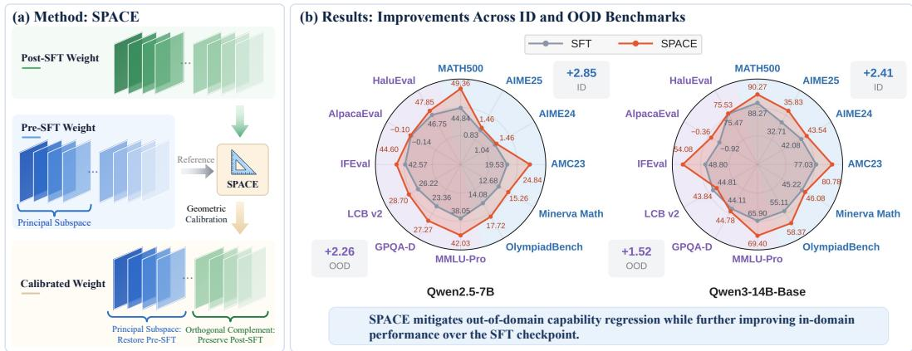
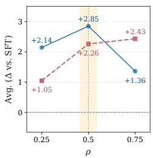
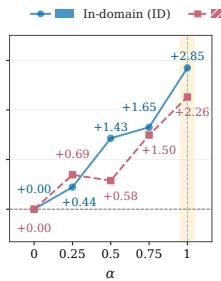
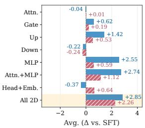
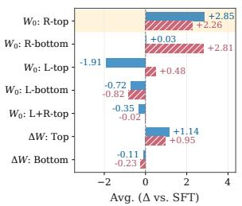
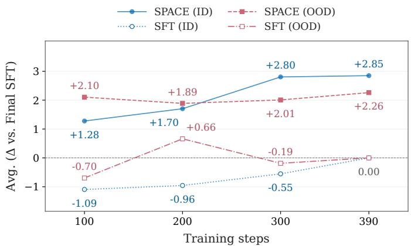

# GEOMETRIC CALIBRATION OF SUPERVISED FINE-TUNING

Jianzhu Bao1, Jia-Chen Gu2, Qingyuan Liu1, Haozhen Zhang1 Kai-Wei Chang2, Nanyun Peng2, Wenya Wang1∗

1Nanyang Technological University 2University of California, Los Angeles {jianzhu.bao, qingyuan.liu, haozhen.zhang, wangwy}@ntu.edu.sg {gujc@, kwchang@cs., violetpeng@cs.}ucla.edu

€ Website § Code

## ABSTRACT

Recent studies investigate the weight geometry through its spectral structure, which characterizes how the weights transform different input directions. Within this view, supervised fine-tuning (SFT) is shown to induce dense updates that perturb the spectral geometry of pre-SFT weights along their principal directions, potentially disrupting the model’s prior knowledge. These observations motivate using the geometry of pre-SFT weights as a reference for refining learned SFT updates. We study this perspective as Geometric Calibration and develop SPACE (Subspace Projection for Adapted Checkpoint Enhancement), a lightweight posthoc method that selectively reverts SFT update components within the principal subspace of the pre-SFT weights while preserving those in its orthogonal complement. SPACE is a data-free, training-free method that requires only the preand post-SFT checkpoints. We evaluate SPACE on Qwen2.5, Qwen3, Qwen3.5, Llama-3.1, and Olmo-3 models ranging from 2B to 14B, across mathematical, coding, and medical SFT, as well as several SFT variants. Overall, SPACE mitigates out-of-domain (OOD) capability regression while further improving indomain (ID) performance over the uncalibrated SFT checkpoints. For math SFT, SPACE yields average ID/OOD gains of 2.85/2.26 points on Qwen2.5-7B, and 2.41/1.52 points on Qwen3-14B-Base, respectively. These results highlight how the geometric relationship between SFT updates and pre-SFT weights shapes the adapted model’s capabilities and, more broadly, motivate geometry-aware parameter updates for continual model improvement.

## 1 INTRODUCTION

Supervised fine-tuning (SFT) is a standard approach for adapting large language models (LLMs) to target tasks, particularly for improving reasoning capabilities (Ho et al., 2023; Ye et al., 2025; Lai et al., 2025). However, gains on the target task can be accompanied by regression in capabilities beyond the training domain (Chu et al., 2025; Huan et al., 2026; Lai et al., 2026; Shenfeld et al., 2026), a phenomenon commonly studied as forgetting. To gain deeper insight into this problem, we believe it is important to understand how SFT changes the geometry of the model weights.

Recent work studies the weight geometry of LLMs through the spectral structure, which captures how different input directions are transformed (Zhu et al., 2025; Shen et al., 2026; Zhang et al., 2026). Under this view, SFT tends to induce dense updates that perturb this geometry along principal directions. These principal directions typically correspond to singular vectors associated with large singular values, which together span a principal subspace. This subspace has been associated with important pre-existing or transferable capabilities, and perturbations within it can contribute to forgetting (Luo et al., 2026; Wang et al., 2025a; Liu et al., 2026; Jin et al., 2026).

These insights lead to a direct question: can an SFT checkpoint be improved by removing the learned updates within these principal subspaces? More broadly, this motivates using pre-SFT weight geometry as a reference for refining completed SFT updates. We formalize this perspective as Geometric Calibration and instantiate it with SPACE (Subspace Projection for Adapted Checkpoint Enhancement), a lightweight post-hoc method for refining SFT checkpoints (Figure 1(a)). For each pre-SFT weight matrix, SPACE defines a principal input subspace using its leading right singular vectors. It then projects the SFT update onto the orthogonal complement of this subspace, restoring the pre-SFT transformation along the principal directions while retaining the learned update along the remaining directions. Unlike existing post-hoc methods that determine refinement through parameter interpolation (Wortsman et al., 2022b; Wang et al., 2025b) or properties of the learned update itself (Abdollahpoorrostam et al., 2026; Abro & Tahir, 2026), SPACE explicitly conditions the refinement on the geometric relationship between the SFT update and the pre-SFT weights. Moreover, SPACE operates directly on the pre- and post-SFT checkpoints in a data- and training-free manner.

  
Figure 1: Overview of SPACE and results. (a) Method. SPACE uses the principal input subspace of the pre-SFT weight as a geometric reference for calibrating the post-SFT weights. The pre-SFT weight is visualized as rank-one SVD components ordered by singular value, while the post-SFT weight is decomposed along the same pre-SFT input directions. Blue and green denote preand post-SFT components, respectively, with color intensity reflecting the corresponding pre-SFT singular value. SPACE restores the pre-SFT transformation along the selected principal directions while retaining the post-SFT transformation along the remaining directions. (b) Results. After regular SFT on mathematical data, SPACE improves both in-domain (ID) and out-of-domain (OOD) performance over the uncalibrated SFT checkpoints.

We evaluate SPACE across five model families—Qwen2.5, Qwen3, Qwen3.5, Llama-3.1, and Olmo-3—ranging from 2B to 14B parameters, and across mathematical, coding, and medical SFT. Across these settings, SPACE consistently yields positive average gains over the corresponding SFT checkpoints on both ID and OOD evaluations. For the two mathematical SFT settings in Figure 1(b), SPACE improves average ID/OOD performance by 2.85/2.26 points on Qwen2.5-7B and 2.41/1.52 points on Qwen3-14B-Base. The improvements further extend across different SFT variants, supporting the broad applicability of SPACE beyond standard SFT. It also outperforms a range of representative post-hoc model refinement baselines, highlighting the benefit of accounting for the relationship between SFT updates and pre-SFT geometry. Overall, these results support the use of pre-SFT weight geometry as a reference for refining completed SFT updates and motivate the development of more targeted and effective geometric calibration methods for SFT.

## 2 RELATED WORK

Generalization and forgetting in SFT. Recent work has increasingly focused on understanding the generalization and forgetting behaviors of LLMs during SFT (Wu et al., 2026b; Huan et al., 2026; Ren et al., 2026). Comparisons between SFT and reinforcement learning reveal distinct generalization and forgetting patterns (Chu et al., 2025; Shenfeld et al., 2026). To mitigate capability degradation, existing efforts mainly improve SFT through changes to the training data or objectives. One line of work improves the selection and use of training data (Ye et al., 2025; Kopiczko et al., 2026). Another line of work modifies the supervised objective through token reweighting or regularization (Wu et al., 2026b; Li et al., 2025; Zhu et al., 2026; Jin et al., 2026). These methods primarily intervene during SFT to control how the updates are learned. In contrast, we study whether a completed SFT update can be refined post hoc without data or additional training.

Weight geometry in model adaptation. Recent studies analyze the geometry of LLM weights during post-training through their spectral structure (Zhu et al., 2025; Shen et al., 2026; Zhang et al., 2026). These studies reveal that SFT typically produces dense updates along principal directions, which can distort the pretrained spectral structure. In contrast, reinforcement learning tends to induce sparse and off-principal updates, resulting in less disruption to the spectral structure (Liu et al., 2025b; Mukherjee et al., 2026). The role of principal directions has also been emphasized in studies of parameter-efficient fine-tuning (PEFT) and continual model merging. In these lines of work, principal subspaces of pretrained weights are often associated with prior or transferable capabilities. Accordingly, many PEFT methods organize adaptation around principal or complementary singular subspaces (Meng et al., 2024; Wang et al., 2025a; Luo et al., 2026; Xiong & Xie, 2026), while continual model merging methods leverage structured subspaces to reduce interference with previously acquired capabilities (Ilharco et al., 2023; Yu et al., 2024; Sun et al., 2026; Li et al., 2026; Shi et al., 2026; Qiu et al., 2026). Together, these studies suggest that the geometry of pretrained weights provides a useful reference for controlling how new updates interact with existing capabilities. Our work builds on this perspective but uses the principal subspace of the pre-SFT weights to refine a single completed SFT update post hoc.

Post-hoc model refinement. Our work is closely related to post-hoc model merging/editing/refinement methods that improve a trained model by directly modifying its parame ters (Wortsman et al., 2022b; Bandarkar et al., 2025; Huang et al., 2025; Bandarkar & Peng, 2025). Existing approaches refine completed checkpoints through weight interpolation (Wortsman et al., 2022b; Wang et al., 2025b), update pruning (Yu et al., 2024; Huang et al., 2025), model souping (Wortsman et al., 2022a; Abdollahpoorrostam et al., 2026), or spectral filtering (Abro & Tahir, 2026). Their refinement strategies are typically determined by parameter interpolation or by properties of the learned update or the fine-tuned weights themselves. Although some methods use the pre-SFT checkpoint, they generally do not explicitly consider its geometric relationship with the learned update when determining which update components should be modified. Motivated by the importance of pre-SFT weight geometry discussed above, we instead study this relationship directly and use it to refine completed SFT checkpoints post hoc.

## 3 PROBLEM FORMULATION

Supervised fine-tuning. SFT adapts an LLM to target tasks by learning from labeled training data. Prior work has shown that SFT can induce non-trivial parameter updates (Yuan et al., 2025; Mukherjee et al., 2026). While such updates can improve performance on the target task, they may also lead to capability regression beyond the training domain (Wu et al., 2026a; Shenfeld et al., 2026; Huan et al., 2026). These observations suggest that some components of the learned SFT updates may be redundant or detrimental to the adapted model. We therefore investigate whether identifying and calibrating such components can mitigate capability regression while preserving or further improving target-domain performance.

Geometric calibration. Given a pre-SFT checkpoint $\theta _ { 0 }$ and its corresponding post-SFT checkpoint $\theta _ { \mathrm { S F T } }$ , the SFT-induced parameter update is defined as

$$
\Delta \theta _ { \mathrm { S F T } } = \theta _ { \mathrm { S F T } } - \theta _ { 0 } .\tag{1}
$$

Rather than treating the post-SFT checkpoint as the endpoint of adaptation, we explore further refinement of the learned update to form the final adapted model. We approach this refinement through Geometric Calibration, using the geometric structure of the pre-SFT weights as a reference.

Formally, we define a calibration operator $\mathcal { C }$ that maps the learned SFT update to a calibrated update conditioned on the pre-SFT parameters:

$$
\begin{array} { r } { \Delta \theta _ { \mathrm { c a l } } = \mathcal { C } \left( \Delta \theta _ { \mathrm { S F T } } ; \theta _ { 0 } \right) , } \end{array}\tag{2}
$$

where $\Delta \theta _ { \mathrm { S F T } }$ is the update being calibrated and $\theta _ { 0 }$ serves as the geometric reference. We seek a calibrated checkpoint $\bar { \theta } _ { \mathrm { c a l } } = \theta _ { 0 } \dot { + } \Delta \theta _ { \mathrm { c a l } }$ with improved overall capabilities.

## 4 METHOD

We develop SPACE as a post-hoc implementation for Geometric Calibration. For a pre-SFT weight $W _ { 0 } \in \mathbb { R } ^ { d _ { \mathrm { o u t } } \times d _ { \mathrm { i n } } }$ and its post-SFT counterpart $W _ { \mathrm { S F T } } .$ , let $\Delta W = W _ { \mathrm { S F T } } - W _ { 0 }$ . The central idea is to refine the completed update $\Delta W$ using the principal subspace of $W _ { 0 }$ as a geometric reference.

## 4.1 MOTIVATION

Principal directions and capability preservation. A common view in existing work is to characterize the geometry of model weights through their singular directions, where directions associated with large singular values are referred to as principal directions and their span defines the principal subspace (Zhu et al., 2025; Wang et al., 2025a; Shen et al., 2026). Prior work suggests that this principal subspace is closely associated with important prior or broadly transferable knowledge, and that limiting changes to these directions can help preserve existing capabilities during adaptation (Wang et al., 2025a; Luo et al., 2026; Sun et al., 2026; Jin et al., 2026). At the same time, SFT tends to induce dense updates that perturb the pre-SFT weight geometry within the principal subspace (Zhu et al., 2025; Shen et al., 2026). Together, these findings motivate using the principal subspace of the pre-SFT weights as a reference for refining the learned SFT update. In particular, a natural calibration objective is to preserve the pre-SFT transformation within this subspace while retaining the post-SFT transformation along the remaining directions.

Preserving the pre-SFT transformation. For a layer input representation $h \in \mathbb { R } ^ { d _ { \mathrm { i n } } }$ , we seek a calibrated transformation $W _ { \mathrm { c a l } }$ that follows the pre-SFT transformation on the component associated with the principal subspace of $W _ { 0 } ,$ while retaining the post-SFT transformation on the remaining component. Let $P _ { 0 }$ be a rank-k orthogonal projector onto the principal subspace, where k denotes its dimension. The desired behavior is

$$
W _ { \mathrm { c a l } } h = W _ { 0 } P _ { 0 } h + W _ { \mathrm { S F T } } ( I - P _ { 0 } ) h .\tag{3}
$$

To determine $P _ { 0 }$ , we seek a projection that retains as much of the pre-SFT transformation as possible. Specifically, among all rank-k orthogonal projectors, we choose $P _ { 0 }$ such that $W _ { 0 } P _ { 0 }$ best approximates $W _ { 0 }$ in Frobenius norm:

$$
P _ { 0 } \in \underset { P = P ^ { \top } = P ^ { 2 } } { \arg \operatorname* { m i n } } \left\| W _ { 0 } - W _ { 0 } P \right\| _ { F } ^ { 2 } .\tag{4}
$$

Since $P$ is an orthogonal projector, minimizing this error is equivalent to maximizing $\mathrm { t r } ( P W _ { 0 } ^ { \top } W _ { 0 } )$ Let $\boldsymbol { W _ { 0 } } = U _ { 0 } \boldsymbol { \Sigma _ { 0 } } \boldsymbol { V _ { 0 } ^ { \intercal } }$ be the SVD of $W _ { 0 }$ . The Ky Fan maximum principle (Fan, 1949) gives a solution

$$
\begin{array} { r } { P _ { 0 } = V _ { 0 , k } V _ { 0 , k } ^ { \top } , } \end{array}\tag{5}
$$

where $V _ { 0 , k }$ contains the leading k right singular vectors of $W _ { 0 }$ . A complete derivation from equation 4 to equation 5 is provided in Appendix A. With this choice, $W _ { 0 } P _ { 0 } = U _ { 0 , k } \Sigma _ { 0 , k } V _ { 0 , k } ^ { \top }$ is a best rank-k approximation of $W _ { 0 }$ . Thus, $P _ { 0 } h$ selects the component of the input representation associated with this principal part of the pre-SFT transformation. We refer to $\operatorname* { s p a n } ( V _ { 0 , k } )$ as the principal input subspace, and use $P _ { 0 }$ for calibration.

## 4.2 SPACE: SUBSPACE PROJECTION FOR ADAPTED CHECKPOINT ENHANCEMENT

Subspace Projection. Requiring equation 3 to hold for any layer input representation h gives $W _ { \mathrm { c a l } } \bar { = } W _ { 0 } P _ { 0 } + W _ { \mathrm { S F T } } ( I - \bar { P } _ { 0 } )$ ). Using $W _ { \mathrm { S F T } } = W _ { 0 } + \Delta W$ , this can be equivalently written as

$$
W _ { \mathrm { c a l } } = W _ { 0 } + \Delta W ( I - P _ { 0 } ) .\tag{6}
$$

Applying this calibration to the selected weight matrices yields the model-level calibrated update $\Delta \theta _ { \mathrm { c a l } }$ defined in Section 3. SPACE therefore removes the SFT update within the principal input subspace while preserving it on the orthogonal complement.

Table 1: Main experimental results on mathematical reasoning SFT. We compare ID and OOD performance across different post-hoc methods. “Avg. (∆ vs. SFT)” denotes the average score change relative to the SFT checkpoint. Bold denotes the best score excluding the Base model.
<table><tr><td>Model</td><td>Benchmark</td><td>Base</td><td>SFT</td><td>WiSE-FT</td><td>TIES</td><td>LiNeS</td><td>DARE</td><td>POME</td><td>FAPM</td><td>DG-Hard</td><td>MonoSoup</td><td>SPACE</td></tr><tr><td rowspan="15"></td><td>In-domain (ID)</td><td></td><td></td><td></td><td></td><td></td><td></td><td></td><td></td><td></td><td></td><td></td></tr><tr><td>MATH500</td><td>28.79</td><td>44.84</td><td>45.14</td><td>45.70</td><td>43.89</td><td>44.13</td><td>46.23</td><td>46.83</td><td>47.50</td><td>46.43</td><td>49.36</td></tr><tr><td>AIME25</td><td>0.42</td><td>0.83</td><td>0.83</td><td>0.42</td><td>0.63</td><td>0.42</td><td>0.83</td><td>1.46</td><td>0.63</td><td>1.04</td><td>1.46</td></tr><tr><td>AIME24</td><td>1.65</td><td>1.04</td><td>1.04</td><td>0.63</td><td>0.83</td><td>0.83</td><td>1.04</td><td>1.67</td><td>1.46</td><td>1.46</td><td>1.46</td></tr><tr><td>OlympiadBench</td><td>7.69</td><td>14.08</td><td>17.06</td><td>14.62</td><td>14.34</td><td>13.82</td><td>15.75</td><td>17.44</td><td>15.39</td><td>15.06</td><td>17.72</td></tr><tr><td>Minerva Math</td><td>9.26</td><td>12.68</td><td>11.60</td><td>12.82</td><td>10.62</td><td>11.53</td><td>14.27</td><td>11.79</td><td>13.26</td><td>12.68</td><td>15.26</td></tr><tr><td>AMC23</td><td>15.65</td><td>19.53</td><td>22.03</td><td>19.38</td><td>20.00</td><td>18.28</td><td>20.94</td><td>24.84</td><td>22.97</td><td>20.00</td><td>24.84</td></tr><tr><td>Avg. (∆ vs. SFT)</td><td></td><td></td><td>+0.78</td><td>+0.10</td><td>-0.45</td><td>-0.67</td><td>+1.01</td><td>+1.84</td><td>+1.37</td><td>+0.61</td><td>+2.85</td></tr><tr><td colspan="4">Out-of-domain (OOD)</td><td></td><td></td><td></td><td></td><td></td><td></td><td></td><td></td><td></td></tr><tr><td>Owe-7B</td><td rowspan="20"></td><td></td><td></td><td>40.85</td><td>38.12</td><td>41.90</td><td>38.11</td><td>39.41</td><td>38.36</td><td>35.16</td><td>39.99</td><td>42.03</td></tr><tr><td>MMLU-Pro GPQA-D</td><td>40.33 26.77</td><td>38.05 23.36</td><td>26.77</td><td>23.96</td><td>26.42</td><td>22.73</td><td>24.37</td><td>25.95</td><td>24.34</td><td>25.44</td><td>27.27</td></tr><tr><td>LCB v2</td><td>28.96</td><td>26.22</td><td>29.03</td><td>26.74</td><td>28.83</td><td>26.48</td><td>27.92</td><td>26.61</td><td>28.64</td><td>28.25</td><td>28.70</td></tr><tr><td>IFEval</td><td>42.57</td><td>42.57</td><td>45.56</td><td>42.57</td><td>43.88</td><td>41.25</td><td>42.81</td><td>45.68</td><td>41.85</td><td>45.44</td><td>44.60</td></tr><tr><td>AlpacaEval</td><td>-1.13</td><td>-0.14</td><td>-0.20</td><td>-0.13</td><td>-0.12</td><td>-0.11</td><td>-0.15</td><td>-0.16</td><td>-0.20</td><td>-0.16</td><td>-0.10</td></tr><tr><td>HaluEval</td><td>46.86</td><td>46.75</td><td>47.80</td><td>46.71</td><td>47.67</td><td>46.56</td><td>46.36</td><td>46.49</td><td>47.15</td><td>47.23</td><td>47.85</td></tr><tr><td>Avg. (∆ vs. SFT)</td><td></td><td></td><td>+2.17</td><td>+0.19</td><td>+1.96</td><td>-0.30</td><td>+0.65</td><td>+1.02</td><td>+0.02</td><td>+1.56</td><td>+2.26</td></tr><tr><td rowspan="13">In-domain (ID)</td><td></td><td></td><td></td><td></td><td></td><td></td><td></td><td></td><td></td><td></td><td></td></tr><tr><td>MATH500</td><td>55.07</td><td>88.27</td><td>88.60</td><td>88.60</td><td>89.47</td><td>88.20</td><td>89.40</td><td>88.20</td><td>88.93</td><td>89.20</td><td>90.27</td></tr><tr><td>AIME25</td><td>5.21</td><td>32.71</td><td>29.58</td><td>36.25</td><td>33.96</td><td>34.79</td><td>34.58</td><td>31.25</td><td>33.33</td><td>36.67</td><td>35.83</td></tr><tr><td>AIME24</td><td>6.25</td><td>42.08</td><td>38.54</td><td>41.46</td><td>45.21</td><td>42.92</td><td>44.38</td><td>35.83</td><td>42.92</td><td>41.88</td><td>43.54</td></tr><tr><td>OlympiadBench</td><td>27.31</td><td>55.11</td><td>55.85</td><td>56.74</td><td>57.33</td><td>55.36</td><td>57.14</td><td>55.56</td><td>54.72</td><td>56.25</td><td>58.37</td></tr><tr><td>Minerva Math</td><td>22.92</td><td>45.22</td><td>42.40</td><td>45.71</td><td>43.87</td><td>45.71</td><td>44.24</td><td>42.52</td><td>44.98</td><td>44.49</td><td>46.08</td></tr><tr><td>AMC23</td><td>38.59</td><td>77.03</td><td>78.59</td><td>79.84</td><td>80.78</td><td>80.31</td><td>79.38</td><td>78.28</td><td>80.00</td><td>80.16</td><td>80.78</td></tr><tr><td>Avg. (∆ vs. SFT)</td><td></td><td></td><td>-1.14</td><td>+1.36</td><td>+1.70</td><td>+1.15</td><td>+1.45</td><td>-1.46</td><td>+0.74</td><td>+1.37</td><td>+2.41</td></tr><tr><td rowspan="8">w--ase</td><td colspan="8"></td><td></td><td></td><td></td><td></td></tr><tr><td>Out-of-domain (OOD)</td><td></td><td></td><td></td><td></td><td></td><td></td><td></td><td></td><td></td><td></td><td></td></tr><tr><td>MMLU-Pro</td><td>61.80</td><td>65.90</td><td>66.30</td><td>69.20</td><td>66.20</td><td>67.00</td><td>68.10</td><td>67.00</td><td>69.40</td><td>67.80</td><td>69.40</td></tr><tr><td>GPQA-D</td><td>44.61</td><td>44.11</td><td>45.29</td><td>45.62</td><td>44.28</td><td>42.93</td><td>40.24</td><td>43.94</td><td>42.59</td><td>44.95</td><td>44.78</td></tr><tr><td>LCB v2</td><td>46.71 65.35</td><td>44.81 48.80</td><td>44.88 48.20</td><td>44.10 51.80</td><td>44.55 47.48</td><td>45.08 52.16</td><td>45.47 52.04</td><td>45.01 45.08</td><td>43.77 50.00</td><td>44.81</td><td>43.84</td></tr><tr><td>IFEval AlpacaEval</td><td>0.42</td><td>-0.92</td><td>-0.18</td><td>-0.50</td><td>-0.95</td><td>-1.01</td><td>-0.78</td><td>-0.27</td><td>-0.79</td><td>51.20 -0.55</td><td>54.08 -0.36</td></tr><tr><td>HaluEval</td><td>53.97</td><td>75.47</td><td>73.10</td><td>75.53</td><td>75.70</td><td>75.80</td><td>76.87</td><td>72.07</td><td>75.93</td><td>75.83</td><td>75.53</td></tr><tr><td>Avg. (∆ vs. SFT)</td><td></td><td></td><td>-0.10</td><td>+1.26</td><td>-0.15</td><td>+0.63</td><td>+0.63</td><td>-0.89</td><td>+0.46</td><td>+0.98</td><td>+1.52</td></tr></table>

Adaptive subspace dimension. Since weight matrices in LLMs can differ substantially in both their dimensions and spectral concentration, using a fixed k across all matrices may capture very different fractions of their singular-value spectra. We therefore choose the subspace dimension $\dot { k }$ adaptively according to the singular-value spectrum of each weight matrix. Specifically, let $\sigma _ { 0 , 1 } \geq$ $\cdots \geq \sigma _ { 0 , r } \geq 0$ denote the singular values of $W _ { 0 }$ . We select the smallest k such that the leading singular components account for at least a fraction $\rho$ of the total spectral energy:

$$
k = \operatorname* { m i n } \left\{ m : \frac { \sum _ { i = 1 } ^ { m } \sigma _ { 0 , i } ^ { 2 } } { \sum _ { i = 1 } ^ { r } \sigma _ { 0 , i } ^ { 2 } } \geq \rho \right\} .\tag{7}
$$

This allows the selected subspace to capture a comparable fraction of the dominant singular structure across different weight matrices. In practice, we use $\rho = 0 . 5$ and apply the projection to all twodimensional weight matrices by default, as these choices work well across the evaluated settings.

## 5 EXPERIMENTS

## 5.1 MAIN EXPERIMENTS ON MATHEMATICAL REASONING SFT

We first evaluate SPACE in the setting of mathematical reasoning SFT, in which base models are fine-tuned on long chain-of-thought (CoT) mathematical reasoning data.

Training recipe. We conduct full-parameter SFT on two base models: Qwen2.5-7B (Yang et al., 2025b) and Qwen3-14B-Base (Yang et al., 2025a). Following prior studies (Zhu et al., 2026; Ren et al., 2026), we use pretrained checkpoints without instruction tuning. For Qwen2.5-7B, following Wu et al. (2026b); Zhu et al. (2026), we use 100K training examples sampled from NuminaMath-

  
(a) Subspace threshold

  
(b) Calibration strength

  
(c) Matrix selection

  
(d) Subspace selection  
Figure 2: Ablation study on Qwen2.5-7B. “Avg. (∆ vs. SFT)” denotes the average changes relative to the SFT checkpoint over the six ID mathematical benchmarks and the six OOD benchmarks. In (c), “Attn.” denotes attention projection matrices; “Gate”, “Up”, and “Down” denote the corresponding MLP matrices; “MLP” includes all MLP projection matrices; “Head+Emb.” denotes the output head and embedding matrices; and “All 2D” denotes all two-dimensional weight matrices. In (d), “R” and “L” denote the right and left singular vectors, while “top” and “bottom” denote the leading and trailing singular subspaces with their dimensions determined using the default threshold ρ = 0.5. “W ” and “∆W” indicate that the subspace is derived from the pre-SFT weights and the SFT update, respectively. Shading indicates the default SPACE configuration in each panel.

CoT (Li et al., 2024). For Qwen3-14B-Base, we follow Ren et al. (2026) and use Math-CoT-20k, which contains 20K examples. Additional training details are provided in Appendix B.1.

Benchmarks and evaluation protocol. We evaluate ID performance on six mathematical benchmarks: MATH-500 (Hendrycks et al., 2021), Minerva Math (Lewkowycz et al., 2022), Olympiad-Bench (He et al., 2024), AIME 2024 (Zhang & Math-AI, 2024), AIME 2025 (Zhang & Math-AI, 2025), and AMC 2023 (Mathematical Association of America, 2023). Following the benchmark suite used by Ren et al. (2026), we further evaluate OOD performance on six benchmarks: MMLU-Pro (Wang et al., 2024), GPQA-Diamond (GPQA-D) (Rein et al., 2024), LiveCodeBench v2 (LCB v2) (Jain et al., 2025), IFEval (Zhou et al., 2023), AlpacaEval (RM) (Dubois et al., 2024), and HaluEval (Li et al., 2023). Further evaluation details are provided in Appendix B.2.

Baselines. We compare SPACE with eight representative post-hoc model editing/merging baselines: WiSE-FT (Wortsman et al., 2022b), TIES (Yadav et al., 2023), LiNeS (Wang et al., 2025b), DARE (Yu et al., 2024), POME (Liu et al., 2025a), FAPM (Huang et al., 2025), DG-Hard (Abro & Tahir, 2026), and MonoSoup (Abdollahpoorrostam et al., 2026). See Appendix B.3 for details.

Main results. Table 1 shows that SPACE yields the strongest overall improvements among all baselines, achieving the highest “Avg. (∆ vs. SFT)” in both ID and OOD performance for both models. On Qwen2.5-7B, SPACE improves every evaluated benchmark over SFT and even surpasses the Base model on five of the six OOD benchmarks, suggesting that reasoning capabilities acquired during mathematical SFT may generalize to OOD tasks after calibration. On Qwen3- 14B-Base, SPACE also yields substantial additional gains despite the already strong mathematical reasoning performance after SFT. Importantly, the ID gains suggest that SPACE does more than recover capabilities degraded by SFT. They also suggest that reverting updates within the principal subspace can improve generalization to unseen ID examples. The comparison with WiSE-FT further highlights the benefit of selective calibration: global interpolation can recover OOD performance in some settings, but often provides smaller ID gains or degrades the adapted model, whereas SPACE improves both. Finally, SPACE’s advantage over spectral post-hoc baselines such as DG-Hard and MonoSoup, which operate on the learned update itself, suggests that the geometry of the pre-SFT weights provides additional information for post-hoc refinement. Overall, these results suggest that effective post-hoc refinement depends not simply on shrinking or restructuring the learned update, but on strategically calibrating it with respect to the geometry of the pre-SFT weights.

## 5.2 ABLATION STUDY

We conduct an ablation study on Qwen2.5-7B to examine the sensitivity of SPACE to its key hyperparameters and design choices. All training and evaluation settings follow those in Section 5.1. We report the average change relative to the SFT checkpoint separately over the six ID mathematical benchmarks and the six OOD benchmarks.

Hyperparameter sensitivity. We first study the sensitivity of SPACE to the subspace threshold ρ and calibration strength α. For the latter, we generalize equation 6 as $W _ { \mathrm { c a l } } = W _ { 0 } + \bar { \Delta } W ( I - \alpha P _ { 0 } )$ where $\alpha ~ \in ~ [ 0 , 1 ]$ controls the fraction of the SFT update reverted within the selected principal subspace. Thus, $\alpha = 1$ corresponds to the default SPACE. Figure 2(a) shows that $\rho = 0 . 5$ provides a good balance between ID and OOD performance. Using a smaller subspace weakens the gains, while a larger one further improves OOD performance at the cost of reduced ID improvement. We therefore use $\rho = 0 . 5$ as the default. Figure 2(b) shows that performance generally improves as the calibration strength increases, with $\alpha = 1$ performing best. Together, these results suggest that SPACE is best applied as a hard projection, with $\rho$ as the sole trade-off hyperparameter.

Matrix selection. We next examine which weight matrices should be calibrated. As shown in Figure 2(c), calibrating attention matrices alone has little effect, whereas jointly calibrating the MLP matrices yields substantially larger improvements. This is consistent with prior work suggesting that MLP modules serve as important sites for factual knowledge storage and recall (Geva et al., 2021; Dai et al., 2022; Meng et al., 2022). Among individual MLP projections, the Up projection provides the largest gains, while the Down projection alone is ineffective. Interestingly, attention contributes little on its own but provides additional gains when combined with MLP calibration, suggesting that MLPs drive the primary benefits while attention plays a complementary role. Finally, applying SPACE to all two-dimensional weight matrices gives the strongest overall results.

Subspace selection. Finally, we compare different choices of the calibration subspace. As shown in Figure 2(d), the leading right singular subspace of the pre-SFT weights, as used by SPACE, provides the best balance between ID and OOD improvements. In contrast, the bottom right singular subspace strongly favors OOD recovery but provides almost no ID gain, indicating a less balanced trade-off. Moreover, the weaker performance of subspaces derived from $\Delta W$ supports the central premise of Geometric Calibration: the pre-SFT weights provide a more informative reference for refining a completed SFT update. Overall, the clear advantage of the right over the left singular subspaces is consistent with the input-side formulation of SPACE.

## 5.3 EXPERIMENTS ON DIFFERENT TARGET DOMAINS

We next examine whether the benefits of SPACE extend beyond mathematical reasoning SFT by training on coding and medical data.

Setup. For medical SFT, we fine-tune Qwen2.5-7B on 23,493 high-quality medical reasoning examples from m23k (Huang et al., 2026), as used in prior work (Li et al., 2025). For coding SFT, following prior work (Zhu et al., 2026), we use 100K examples sampled from Magicoder-Evol-Instruct-110K (Wei et al., 2024) as training data, and evaluate ID performance using the EvalPlus library (Liu et al., 2023) on HumanEval, HumanEval+ (Chen et al., 2021), MBPP, and MBPP+ (Austin et al., 2021). LiveCodeBench v2 (Jain et al., 2025) is also included for ID evaluation. The maximum generation length is set to 4,096 tokens. For medical SFT, we use the evaluation toolkit provided by Li et al. (2025) and report results on MedMCQA (Pal et al., 2022), MedQA (Jin et al., 2021), PubMedQA (Jin et al., 2019), MMLU-Pro (Medical) (Wang et al., 2024), and GPQA (Medical) (Rein et al., 2024), with a maximum generation length of 8,192 tokens. Additionally, we include DG-Hard and MonoSoup as two strong baselines for comparison. All other training and evaluation settings follow the same protocol as in Section 5.1.

Results. As shown in Table 2, SPACE remains effective when the training domain shifts to coding or medicine. For coding SFT, where the uncalibrated SFT checkpoint already performs well on most ID benchmarks, SPACE largely preserves the learned adaptation while improving OOD performance. For medical SFT, the ID gains are more pronounced, particularly on benchmarks where SFT causes regression relative to the Base model. This pattern suggests that geometric calibration is particularly beneficial when SFT introduces stronger interference with capabilities already encoded in the pre-SFT model. Overall, SPACE improves upon SFT across both domains and outperforms two strong baselines, DG-Hard and MonoSoup, demonstrating its applicability across different forms of task adaptation rather than relying on properties specific to mathematical reasoning.

Table 2: Experimental results of training Qwen2.5-7B on coding and medical data. “(M)” denotes the medical subset. Bold indicates the best result excluding the Base model.
<table><tr><td></td><td colspan="5">Coding SFT</td><td colspan="6">Medical SFT</td></tr><tr><td>Benchmark</td><td>Base</td><td>SFT</td><td></td><td>DG-Hard MonoSoup</td><td>SPACE</td><td>Benchmark</td><td>Base</td><td>SFT</td><td></td><td>DG-Hard MonoSoup</td><td>SPACE</td></tr><tr><td>In-domain (ID), Coding</td><td></td><td></td><td></td><td></td><td></td><td colspan="5">In-domain (ID), Medical</td></tr><tr><td>HumanEval</td><td>77.4478.66</td><td></td><td>75.61</td><td>76.83</td><td>78.66</td><td>MedMCQA</td><td>53.7454.79</td><td></td><td>54.22</td><td>54.12</td><td>55.25</td></tr><tr><td>HumanEval+</td><td>71.3471.95</td><td></td><td>70.73</td><td>71.34</td><td>73.78</td><td>MedQA</td><td>58.68</td><td>65.12</td><td>60.80</td><td>63.39</td><td>64.65</td></tr><tr><td>MBPP</td><td>75.40</td><td>78.04</td><td>77.78</td><td>78.31</td><td>78.31</td><td>PubMedQA</td><td>71.70</td><td>70.00</td><td>70.60</td><td>70.00</td><td>73.20</td></tr><tr><td>MBPP+</td><td>65.61</td><td>67.99</td><td>67.99</td><td>68.78</td><td>67.99</td><td>MMLU-Pro (M)</td><td>55.83</td><td>57.65</td><td>55.83</td><td>59.15</td><td>59.54</td></tr><tr><td>LCB v2</td><td></td><td>28.9623.09</td><td>22.50</td><td>24.53</td><td>22.77</td><td>GPQA (M)</td><td>44.8736.92</td><td></td><td>37.95</td><td>42.82</td><td>47.69</td></tr><tr><td>Avg. (∆ vs. SFT)</td><td></td><td></td><td>-1.02</td><td>+0.01</td><td>+0.36</td><td>Avg. (Δ vs. SFT)</td><td></td><td></td><td>-1.02</td><td>+1.00</td><td>+3.17</td></tr><tr><td colspan="3">Out-of-domain (OOD)</td><td></td><td></td><td></td><td colspan="5">Out-of-domain (OOD)</td><td></td></tr><tr><td>MMLU-Pro</td><td>40.3338.35</td><td></td><td>39.30</td><td>40.39</td><td>42.32</td><td>MMLU-Pro</td><td>40.3353.90</td><td></td><td>53.41</td><td>53.68</td><td>52.47</td></tr><tr><td>GPQA-D</td><td>26.7725.35</td><td></td><td>22.16</td><td>26.04</td><td>27.27</td><td>GPQA-D</td><td>26.7724.91</td><td></td><td>26.04</td><td>25.22</td><td>25.88</td></tr><tr><td></td><td></td><td></td><td></td><td></td><td></td><td>LCB v2</td><td>28.9624.07</td><td></td><td>25.64</td><td>27.14</td><td>26.48</td></tr><tr><td>IFEval</td><td>42.5754.08</td><td></td><td>53.00</td><td>54.20</td><td>53.60</td><td>IFEval</td><td></td><td>42.5735.01</td><td>34.41</td><td>35.97</td><td>36.09</td></tr><tr><td>AlpacaEval</td><td>-1.13-0.43</td><td></td><td>-0.23</td><td>-0.25</td><td>-0.39</td><td>AlpacaEval</td><td>-1.13</td><td>-2.30</td><td>-2.31</td><td>-1.99</td><td>-1.73</td></tr><tr><td>HaluEval</td><td>46.8649.32</td><td></td><td>49.52</td><td>49.41</td><td>50.31</td><td>HaluEval</td><td>46.8663.31</td><td></td><td>64.05</td><td>65.39</td><td>65.10</td></tr><tr><td>Avg. (∆ vs. SFT)</td><td></td><td></td><td>-0.58</td><td>+0.62</td><td>+1.29</td><td>Avg. (∆ vs. SFT)</td><td></td><td></td><td>+0.39</td><td>+1.09</td><td>+0.90</td></tr></table>

Table 3: Compatibility with different SFT methods. “Original” denotes the checkpoint produced by each training method. “Avg. (∆ vs. Original)” denotes the average score change relative to the original checkpoint. Bold indicates the best score within each method.
<table><tr><td rowspan="2">Benchmark</td><td rowspan="2">Base</td><td colspan="3">DFT</td><td colspan="3">ASFT</td><td colspan="3">RPSFT</td></tr><tr><td>Original</td><td>MonoSoup</td><td>SPACE</td><td>Original</td><td>MonoSoup</td><td>SPACE</td><td>Original</td><td>MonoSoup</td><td>SPACE</td></tr><tr><td>In-domain (ID)</td><td></td><td></td><td></td><td></td><td></td><td></td><td></td><td></td><td></td><td></td></tr><tr><td>MATH500</td><td>28.79</td><td>54.40</td><td>57.33</td><td>58.64</td><td>60.55</td><td>61.56</td><td>61.12</td><td>45.98</td><td>46.64</td><td>48.69</td></tr><tr><td>AIME25</td><td>0.42</td><td>1.88</td><td>1.46</td><td>1.25</td><td>1.67</td><td>2.08</td><td>1.88</td><td>1.04</td><td>0.63</td><td>0.83</td></tr><tr><td>AIME24</td><td>1.65</td><td>2.08</td><td>3.54</td><td>3.75</td><td>5.83</td><td>5.00</td><td>5.21</td><td>1.46</td><td>1.25</td><td>1.25</td></tr><tr><td>OlympiadBench</td><td>7.69</td><td>23.22</td><td>26.29</td><td>27.18</td><td>27.98</td><td>28.81</td><td>28.45</td><td>14.40</td><td>15.53</td><td>17.03</td></tr><tr><td>Minerva Math</td><td>9.26</td><td>20.57</td><td>20.22</td><td>20.24</td><td>24.43</td><td>22.43</td><td>22.73</td><td>13.01</td><td>13.81</td><td>15.12</td></tr><tr><td>AMC23</td><td>15.65</td><td>27.81</td><td>29.06</td><td>28.91</td><td>35.31</td><td>36.72</td><td>38.28</td><td>21.72</td><td>17.97</td><td>20.16</td></tr><tr><td>Avg. (∆ vs. Original)</td><td></td><td></td><td>+1.32</td><td>+1.67</td><td></td><td>+0.14</td><td>+0.32</td><td></td><td>-0.30</td><td>+0.91</td></tr><tr><td>Out-of-domain (OOD)</td><td></td><td></td><td></td><td></td><td></td><td></td><td></td><td></td><td></td><td></td></tr><tr><td>MMLU-Pro</td><td>40.33</td><td>33.66</td><td>30.84</td><td>33.39</td><td>33.97</td><td>33.54</td><td>34.45</td><td>34.67</td><td>36.38</td><td>41.06</td></tr><tr><td>GPQA-D</td><td>26.77</td><td>27.27</td><td>27.78</td><td>26.14</td><td>26.48</td><td>27.02</td><td>25.88</td><td>24.15</td><td>25.69</td><td>27.27</td></tr><tr><td>LCB v2</td><td>28.96</td><td>30.85</td><td>32.22</td><td>33.27</td><td>27.14</td><td>29.35</td><td>28.90</td><td>29.03</td><td>29.35</td><td>29.75</td></tr><tr><td>IFEval</td><td>42.57</td><td>43.17</td><td>46.88</td><td>48.20</td><td>45.20</td><td>47.12</td><td>48.44</td><td>44.48</td><td>44.48</td><td>45.56</td></tr><tr><td>AlpacaEval</td><td>-1.13</td><td>-0.43</td><td>-0.17</td><td>-0.13</td><td>-0.08</td><td>-0.09</td><td>-0.09</td><td>-0.03</td><td>-0.01</td><td>-0.07</td></tr><tr><td>HaluEval</td><td>46.86</td><td>48.04</td><td>46.97</td><td>47.11</td><td>47.06</td><td>47.43</td><td>48.62</td><td>46.86</td><td>47.48</td><td>48.68</td></tr><tr><td>Avg. (∆ vs. Original)</td><td></td><td></td><td>+0.33</td><td>+0.90</td><td></td><td>+0.77</td><td>+1.07</td><td></td><td>+0.70</td><td>+2.18</td></tr></table>

## 5.4 COMPATIBILITY WITH DIFFERENT SFT METHODS

Recently, several variants of SFT have been proposed to improve performance and generalization.   
We further examine whether SPACE is compatible with these methods.

Setup. The comparison is conducted on Qwen2.5-7B trained with data from NuminaMath-CoT. Three SFT variants are considered: DFT (Wu et al., 2026b), which reweights the token-level objective; ASFT (Zhu et al., 2026), which augments DFT with distributional anchoring; and RPSFT (Jin et al., 2026), which introduces regularization to constrain weight updates during fine-tuning. For each method, we apply SPACE to its completed checkpoint using the same pre-SFT checkpoint as the geometric reference. Other training and evaluation settings remain consistent with Section 5.1.

Table 4: Generalization of SPACE across different model families and scales.
<table><tr><td rowspan="2">Benchmark</td><td colspan="3">Qwen3.5-2B-Base</td><td colspan="3">Qwen3-8B-Base</td><td colspan="3">Olmo-3-7B-Instruct-SFT</td><td colspan="3">Llama-3.1-8B-Instruct</td></tr><tr><td>Base</td><td>SFT</td><td>SPACE</td><td>Base</td><td>SFT</td><td>SPACE</td><td>Base</td><td>SFT</td><td>SPACE</td><td>Base</td><td>SFT</td><td>SPACE</td></tr><tr><td colspan="10">In-domain (ID)</td><td colspan="3"></td></tr><tr><td>MATH500</td><td>72.40</td><td>76.47</td><td>78.00</td><td>55.93</td><td>83.73</td><td>84.87</td><td>60.80</td><td>87.93</td><td>89.33</td><td>39.07</td><td>49.20</td><td>53.33</td></tr><tr><td>AIME25</td><td>15.63</td><td>17.29</td><td>17.50</td><td>4.58</td><td>23.96</td><td>24.38</td><td>3.33</td><td>35.00</td><td>34.38</td><td>0.21</td><td>1.46</td><td>1.25</td></tr><tr><td>AIME24</td><td>12.92</td><td>16.67</td><td>15.21</td><td>7.29</td><td>22.71</td><td>22.71</td><td>6.67</td><td>41.25</td><td>41.46</td><td>1.88</td><td>1.67</td><td>2.29</td></tr><tr><td>OlympiadBench</td><td>37.09</td><td>40.15</td><td>41.38</td><td>24.05</td><td>46.86</td><td>48.79</td><td>25.88</td><td>55.26</td><td>56.79</td><td>10.47</td><td>18.96</td><td>21.04</td></tr><tr><td>Minerva Math</td><td>27.08</td><td>39.95</td><td>40.32</td><td>19.49</td><td>41.79</td><td>40.44</td><td>25.74</td><td>33.95</td><td>34.56</td><td>15.56</td><td>18.01</td><td>21.57</td></tr><tr><td>AMC23</td><td>49.22</td><td>53.59</td><td>55.16</td><td>32.50</td><td>64.22</td><td>67.34</td><td>37.03</td><td>79.53</td><td>82.19</td><td>14.69</td><td>26.09</td><td>30.16</td></tr><tr><td>Avg. (∆ vs. SFT)</td><td></td><td></td><td>+0.58</td><td></td><td>-</td><td>+0.88</td><td></td><td></td><td>+0.97</td><td></td><td>-</td><td>+2.38</td></tr><tr><td colspan="10">Out-of-domain (OOD)</td><td colspan="3"></td></tr><tr><td>MMLU-Pro</td><td>46.40</td><td>52.60</td><td>54.00</td><td>56.70</td><td>56.40</td><td>56.20</td><td>42.70</td><td>44.40</td><td>44.90</td><td>43.50</td><td>40.80</td><td>44.80</td></tr><tr><td>GPQA-D</td><td>30.64</td><td>29.97</td><td>32.66</td><td>36.36</td><td>29.46</td><td>29.46</td><td>28.79</td><td>22.22</td><td>25.93</td><td>23.74</td><td>15.49</td><td>19.87</td></tr><tr><td>LCB v2</td><td>14.94</td><td>11.55</td><td>13.31</td><td>33.66</td><td>24.92</td><td>29.29</td><td>17.09</td><td>22.44</td><td>21.14</td><td>18.92</td><td>8.41</td><td>12.20</td></tr><tr><td>IFEval</td><td>57.67</td><td>45.32</td><td>53.84</td><td>54.08</td><td>35.85</td><td>40.89</td><td>83.57</td><td>79.26</td><td>82.49</td><td>81.89</td><td>29.14</td><td>36.81</td></tr><tr><td>AlpacaEval</td><td>0.21</td><td>-0.84</td><td>-0.23</td><td>-0.39</td><td>-2.32</td><td>-1.10</td><td>0.28</td><td>0.34</td><td>0.38</td><td>1.17</td><td>-1.87</td><td>-0.38</td></tr><tr><td>HaluEval</td><td>50.00</td><td>59.97</td><td>59.20</td><td>49.33</td><td>72.13</td><td>72.30</td><td>54.23</td><td>55.47</td><td>55.20</td><td>62.73</td><td>63.37</td><td>63.97</td></tr><tr><td>Avg. (∆ vs. SFT)</td><td></td><td></td><td>+2.37</td><td></td><td>-</td><td>+1.77</td><td></td><td>-</td><td>+0.99</td><td></td><td></td><td>+3.66</td></tr></table>

Results. Table 3 shows that SPACE improves overall ID and OOD performance across all three SFT methods. The consistent gains across methods with different training objectives suggest that the utility of pre-SFT geometry is not tied to a particular SFT update formation process. Notably, the gains are particularly pronounced on RPSFT, even though it already constrains weight geometry during training, suggesting that training-time regularization and post-hoc geometric calibration address complementary aspects. Moreover, SPACE consistently achieves larger aggregate gains than the strong baseline MonoSoup across all three SFT variants. Appendix C.1 shows that these benefits also extend to LoRA fine-tuning. Overall, these results show that SPACE can effectively complement different training objectives by refining their completed updates post hoc.

## 5.5 GENERALIZATION ACROSS MODEL FAMILIES AND SCALES

We further evaluate whether SPACE generalizes across different model families and scales, covering Qwen3.5, Qwen3, Olmo-3, and Llama-3.1 models from 2B to 8B parameters.

Setup. The experiments use Qwen3.5-2B-Base, Qwen3-8B-Base, Olmo-3-7B-Instruct-SFT (Olmo et al., 2025) and Llama-3.1-8B-Instruct (Grattafiori et al., 2024) as starting checkpoints for mathematical SFT. Math-CoT-20k is employed as the training data, which contains longer reasoning trajectories and enables more substantial performance improvements through SFT. Other training and evaluation settings are kept the same as in Section 5.1.

Results. As shown in Table 4, SPACE yields positive average gains in both ID and OOD performance across all evaluated models. Importantly, the OOD improvements are accompanied by further ID gains across different families and scales, suggesting that geometric calibration refines rather than reverses the SFT adaptation. The gains are particularly pronounced on Llama-3.1-8B, where SFT causes substantial OOD capability regression; in this setting, SPACE improves every evaluated OOD benchmark while further strengthening ID performance. Even at the smallest 2B scale, SPACE still performs well, indicating that its benefits are not limited to larger models. Additional results in Appendix C.2 show consistent gains on Qwen3-4B-Base and larger average improvements than MonoSoup across all evaluated models. Overall, these results demonstrate the broad applicability of SPACE across model families and scales.

## 5.6 ADDITIONAL ANALYSES

Further analyses show that SPACE is effective at intermediate SFT checkpoints (Appendix C.3), robust to SFT training hyperparameters (Appendix C.4), and more effective as a post-hoc calibration than as a training-time projection (Appendix C.5).

## 6 CONCLUSION

We study Geometric Calibration, a perspective for refining SFT updates using the geometry of the pre-SFT weights as a reference. We develop SPACE as a lightweight post-hoc implementation of this perspective, which removes SFT update components within the principal input subspace of the pre-SFT weights while preserving the remaining adaptation. SPACE operates directly on the pre- and post-SFT checkpoints, with no data or additional training required. Overall, across multiple model families, scales, training domains, and SFT variants, SPACE improves both ID and OOD performance over the SFT checkpoint and outperforms representative post-hoc baselines. Our ablations further support the principal right singular subspace of the pre-SFT weights as an effective calibration reference. Taken together, these results highlight the value of pre-SFT weight geometry for refining completed adaptations and, more broadly, motivate Geometric Calibration as a general principle for continued model improvement beyond SFT.

## AI USE STATEMENT

In this work, we used generative AI tools to assist with language editing and polishing, literature search and discovery, and software code assistance. All identified literature was independently reviewed and verified by the authors. Regarding code assistance, generative AI tools were used only to assist with code editing, completion, and debugging. All AI-assisted code was manually reviewed, tested, and validated. The research ideas, methodology, experimental design, code structure and implementation logic, and interpretation of the results were developed by the authors. All AI-assisted content was validated by the authors. We take responsibility for the final content of this work, including text, claims or artifacts produced with the aid of generative AI.

## ETHICS STATEMENT

Our study does not involve human-subject experiments or the collection of personal or sensitive data. The experiments are conducted using publicly available models, datasets, and standard evaluation benchmarks. Since SPACE operates on existing language-model checkpoints, the resulting models may retain safety risks associated with the underlying LLMs, including biased, inaccurate, or potentially harmful outputs. Appropriate validation, monitoring, and task-specific safeguards should therefore be maintained in downstream applications.

## REPRODUCIBILITY STATEMENT

Detailed training settings, evaluation protocols, and baseline details are provided in Appendices B.1, B.2, and B.3. Additional experiments examine robustness across models, SFT settings, and training configurations. Our source code is available at: https://github.com/jianzhubao/ SPACE.

## ACKNOWLEDGMENTS

This research was conducted at the AUMOVIO-NTU Corporate Lab. This research/project is supported by A\*STAR under the RIE2025 Industry Alignment Fund – Industry Collaboration Projects (IAF-ICP) Funding Initiative (Award: I2501E0045), as well as cash and in-kind contribution from the industry partner(s).

## REFERENCES

Alireza Abdollahpoorrostam, Nikolaos Dimitriadis, Adam Hazimeh, and Pascal Frossard. MODEL SOUPS NEED ONLY ONE INGREDIENT. In Forty-third International Conference on Machine Learning, 2026.

Aarash Abro and Muhammad Tahir. Spectral unforgetting: Post-hoc recovery of damaged capabilities without retraining. arXiv preprint arXiv:2605.20296, 2026.

Jacob Austin, Augustus Odena, Maxwell Nye, Maarten Bosma, Henryk Michalewski, David Dohan, Ellen Jiang, Carrie Cai, Michael Terry, Quoc Le, et al. Program synthesis with large language models. arXiv preprint arXiv:2108.07732, 2021.

Lucas Bandarkar and Nanyun Peng. The unreasonable effectiveness of model merging for crosslingual transfer in llms. In Proceedings of the 5th Workshop on Multilingual Representation Learning (MRL 2025), pp. 131–148, 2025.

Lucas Bandarkar, Benjamin Muller, Pritish Yuvraj, Rui Hou, Nayan Singhal, Hongjiang Lv, and Bing Liu. Layer swapping for zero-shot cross-lingual transfer in large language models. In International Conference on Learning Representations, volume 2025, pp. 51315–51338, 2025.

Mark Chen, Jerry Tworek, Heewoo Jun, Qiming Yuan, Henrique Ponde De Oliveira Pinto, Jared Kaplan, Harri Edwards, Yuri Burda, Nicholas Joseph, Greg Brockman, et al. Evaluating large language models trained on code. arXiv preprint arXiv:2107.03374, 2021.

Tianzhe Chu, Yuexiang Zhai, Jihan Yang, Shengbang Tong, Saining Xie, Dale Schuurmans, Quoc V Le, Sergey Levine, and Yi Ma. SFT memorizes, RL generalizes: A comparative study of founda tion model post-training. In Forty-second International Conference on Machine Learning, 2025.

Damai Dai, Li Dong, Yaru Hao, Zhifang Sui, Baobao Chang, and Furu Wei. Knowledge neurons in pretrained transformers. In Proceedings of the 60th Annual Meeting of the Association for Computational Linguistics (Volume 1: Long Papers), pp. 8493–8502, 2022.

Yann Dubois, Balazs Galambosi, Percy Liang, and Tatsunori B Hashimoto. Length-controlled al-´ pacaeval: A simple way to debias automatic evaluators. arXiv preprint arXiv:2404.04475, 2024.

Ky Fan. On a theorem of weyl concerning eigenvalues of linear transformations i. Proceedings of the National Academy ofSciences, 35(11):652–655, 1949.

Mor Geva, Roei Schuster, Jonathan Berant, and Omer Levy. Transformer feed-forward layers are key-value memories. In Proceedings of the 2021 conference on empirical methods in natural language processing, pp. 5484–5495, 2021.

Aaron Grattafiori, Abhimanyu Dubey, Abhinav Jauhri, Abhinav Pandey, Abhishek Kadian, Ahmad Al-Dahle, Aiesha Letman, Akhil Mathur, Alan Schelten, Alex Vaughan, et al. The llama 3 herd of models. arXiv preprint arXiv:2407.21783, 2024.

Chaoqun He, Renjie Luo, Yuzhuo Bai, Shengding Hu, Zhen Thai, Junhao Shen, Jinyi Hu, Xu Han, Yujie Huang, Yuxiang Zhang, et al. Olympiadbench: A challenging benchmark for promoting agi with olympiad-level bilingual multimodal scientific problems. In Proceedings of the 62nd Annual Meeting of the Association for Computational Linguistics (Volume 1: Long Papers), pp. 3828–3850, 2024.

Dan Hendrycks, Collin Burns, Saurav Kadavath, Akul Arora, Steven Basart, Eric Tang, Dawn Song, and Jacob Steinhardt. Measuring mathematical problem solving with the MATH dataset. In Thirty-fifth Conference on Neural Information Processing Systems Datasets and Benchmarks Track (Round 2), 2021.

Namgyu Ho, Laura Schmid, and Se-Young Yun. Large language models are reasoning teachers. In Proceedings of the 61st annual meeting of the association for computational linguistics (volume 1: long papers), pp. 14852–14882, 2023.

Maggie Ziyu Huan, Yuetai Li, Tianyu Zheng, Xiaoyu Xu, Seungone Kim, Minxin Du, Radha Poovendran, Graham Neubig, and Xiang Yue. Does math reasoning improve general LLM capabilities? understanding transferability of LLM reasoning. In Forty-third International Conference on Machine Learning, 2026.

Wei Huang, Anda Cheng, and Yinggui Wang. Mitigating catastrophic forgetting in large language models with forgetting-aware pruning. In Proceedings of the 2025 Conference on Empirical Methods in Natural Language Processing, pp. 21853–21867, 2025.

Xiaoke Huang, Juncheng Wu, Hui Liu, Xianfeng Tang, and Yuyin Zhou. m1: Unleash the potential of test-time scaling for medical reasoning in large language models. In Machine Learning for Health 2025, 2026.

Gabriel Ilharco, Marco Tulio Ribeiro, Mitchell Wortsman, Ludwig Schmidt, Hannaneh Hajishirzi, and Ali Farhadi. Editing models with task arithmetic. In The Eleventh International Conference on Learning Representations, 2023.

Naman Jain, Alex Gu, Wen-Ding Li, Fanjia Yan, Tianjun Zhang, Sida Wang, Armando Solar-Lezama, Koushik Sen, and Ion Stoica. Livecodebench: Holistic and contamination free evaluation of large language models for code. In International Conference on Learning Representations, volume 2025, pp. 58791–58831, 2025.

Di Jin, Eileen Pan, Nassim Oufattole, Wei-Hung Weng, Hanyi Fang, and Peter Szolovits. What disease does this patient have? a large-scale open domain question answering dataset from medical exams. Applied Sciences, 11(14):6421, 2021.

Hangzhan Jin, Tianwei Ni, Lu Li, Pierre-Luc Bacon, Mohammad Hamdaqa, and Doina Precup. Rotation-preserving supervised fine-tuning. arXiv preprint arXiv:2605.10973, 2026.

Qiao Jin, Bhuwan Dhingra, Zhengping Liu, William Cohen, and Xinghua Lu. Pubmedqa: A dataset for biomedical research question answering. In Proceedings of the 2019 conference on empirical methods in natural language processing and the 9th international joint conference on natural language processing (EMNLP-IJCNLP), pp. 2567–2577, 2019.

Dawid Jan Kopiczko, Sagar Vaze, Tijmen Blankevoort, and Yuki M Asano. Data repetition beats data scaling in long-cot supervised fine-tuning. In Third Conference on Language Modeling, 2026.

Hanyu Lai, Xiao Liu, Junjie Gao, Jiale Cheng, Zehan Qi, Yifan Xu, Shuntian Yao, Dan Zhang, Jinhua Du, Zhenyu Hou, et al. A survey of post-training scaling in large language models. In Proceedings of the 63rd Annual Meeting of the Association for Computational Linguistics (Volume 1: Long Papers), pp. 2771–2791, 2025.

Song Lai, Haohan Zhao, Rong Feng, Changyi Ma, Wenzhuo Liu, Hongbo Zhao, Xi Lin, Dong Yi, Qingfu Zhang, Hongbin Liu, Gaofeng Meng, and Fei Zhu. Reinforcement fine-tuning naturally mitigates forgetting in continual post-training. In Forty-third International Conference on Machine Learning, 2026.

Aitor Lewkowycz, Anders Andreassen, David Dohan, Ethan Dyer, Henryk Michalewski, Vinay Ramasesh, Ambrose Slone, Cem Anil, Imanol Schlag, Theo Gutman-Solo, et al. Solving quantitative reasoning problems with language models. Advances in neural information processing systems, 35:3843–3857, 2022.

Gaotang Li, Ruizhong Qiu, Xiusi Chen, Heng Ji, and Hanghang Tong. Beyond log likelihood: Probability-based objectives for supervised fine-tuning across the model capability continuum. arXiv preprint arXiv:2510.00526, 2025.

Jia Li, Edward Beeching, Lewis Tunstall, Ben Lipkin, Roman Soletskyi, Shengyi Huang, Kashif Rasul, Longhui Yu, Albert Q Jiang, Ziju Shen, et al. Numinamath: The largest public dataset in ai4maths with 860k pairs of competition math problems and solutions. Hugging Face repository, 2024.

Junyi Li, Xiaoxue Cheng, Xin Zhao, Jian-Yun Nie, and Ji-Rong Wen. Halueval: A large-scale hallucination evaluation benchmark for large language models. In Proceedings ofthe 2023 conference on empirical methods in natural language processing, pp. 6449–6464, 2023.

Longhua Li, Lei Qi, Qi Tian, and Xin Geng. Model merging in the essential subspace. arXiv preprint arXiv:2602.20208, 2026.

Jiawei Liu, Chunqiu Steven Xia, Yuyao Wang, and Lingming Zhang. Is your code generated by chatgpt really correct? rigorous evaluation of large language models for code generation. Advances in neural information processing systems, 36:21558–21572, 2023.

Qingyuan Liu, Jia-Chen Gu, Yunzhi Yao, Hong Wang, and Nanyun Violet Peng. Energy-regularized sequential model editing on hyperspheres. In International Conference on Learning Representations, volume 2026, pp. 149084–149112, 2026.

Yong Liu, Di Fu, Yang Luo, Zirui Zhu, Minhao Cheng, Cho-Jui Hsieh, and Yang You. Pome: Post optimization model edit via muon-style projection. arXiv preprint arXiv:2510.06627, 2025a.

Zihang Liu, Tianyu Pang, Oleg Balabanov, Chaoqun Yang, Tianjin Huang, Lu Yin, Yaoqing Yang, and Shiwei Liu. LIFT the veil for the truth: Principal weights emerge after rank reduction for reasoning-focused supervised fine-tuning. In Forty-second International Conference on Machine Learning, 2025b. URL https://openreview.net/forum?id=XHHIZNgrho.

Mao-Lin Luo, Zi-Hao Zhou, Yi-Lin Zhang, Yuanyu Wan, Min-Ling Zhang, and Tong Wei. Keeplora: Continual learning with residual gradient adaptation. In International Conference on Learning Representations, volume 2026, pp. 136017–136040, 2026.

Mathematical Association of America. AMC 2023 competition problems, 2023.

Fanxu Meng, Zhaohui Wang, and Muhan Zhang. Pissa: Principal singular values and singular vectors adaptation of large language models. Advances in Neural Information Processing Systems, 37:121038–121072, 2024.

Kevin Meng, David Bau, Alex Andonian, and Yonatan Belinkov. Locating and editing factual associations in gpt. Advances in neural information processing systems, 35:17359–17372, 2022.

Sagnik Mukherjee, Lifan Yuan, Dilek Hakkani-Tur, and Hao Peng. Reinforcement learning finetunes small subnetworks in large language models. Advances in Neural Information Processing Systems, 38:132119–132138, 2026.

Team Olmo, Allyson Ettinger, Amanda Bertsch, Bailey Kuehl, David Graham, David Heineman, Dirk Groeneveld, Faeze Brahman, Finbarr Timbers, Hamish Ivison, et al. Olmo 3. arXiv preprint arXiv:2512.13961, 2025.

Ankit Pal, Logesh Kumar Umapathi, and Malaikannan Sankarasubbu. Medmcqa: A large-scale multi-subject multi-choice dataset for medical domain question answering. In Conference on health, inference, and learning, pp. 248–260. PMLR, 2022.

Zihuan Qiu, Lei Wang, Yang Cao, Runtong Zhang, Bing Su, Yi Xu, Fanman Meng, Linfeng Xu, Qingbo Wu, and Hongliang Li. Null-space filtering for data-free continual model merging: Preserving stability, promoting plasticity. In International Conference on Learning Representations, volume 2026, pp. 128492–128518, 2026.

David Rein, Betty Li Hou, Asa Cooper Stickland, Jackson Petty, Richard Yuanzhe Pang, Julien Dirani, Julian Michael, and Samuel R. Bowman. GPQA: A graduate-level google-proof q&a benchmark. In First Conference on Language Modeling, 2024.

Qihan Ren, Wang Peng, Ruikun Cai, Shuai Shao, Dadi Guo, Yuejin Xie, Yafu Li, Quanshi Zhang, Xia Hu, Jing Shao, and Dongrui Liu. Rethinking generalization in reasoning SFT: A conditional analysis on optimization, data, and model capability. In Third Conference on Language Modeling, 2026.

Zhennan Shen, Yanshu Li, Qingyu Yin, Chak Tou Leong, Zhilin Wang, Yanxu Chen, Rongduo Han, Sunbowen Lee, and Yi R Fung. On the geometry of on-policy distillation. arXiv preprint arXiv:2606.07082, 2026.

Idan Shenfeld, Jyothish Pari, and Pulkit Agrawal. Rl’s razor: Why online reinforcement learning forgets less. In International Conference on Learning Representations, volume 2026, pp. 59839– 59864, 2026.

Ningyuan Shi, Zhipeng Zhou, Hao Wang, Chunyan Miao, and Peilin Zhao. Pact: Preserving anchored cores in task-vectors for model merging. arXiv preprint arXiv:2606.18627, 2026.

Wenju Sun, Qingyong Li, Tiancheng Li, Yangliao Geng, and Boyang Li. Revisiting the role of pretrained weights in model merging: On near-optimality within the core subspace. In Forty-third International Conference on Machine Learning, 2026.

Hanqing Wang, Yixia Li, Shuo Wang, Guanhua Chen, and Yun Chen. Milora: Harnessing minor singular components for parameter-efficient llm finetuning. In Proceedings of the 2025 Conference of the Nations of the Americas Chapter of the Association for Computational Linguistics: Human Language Technologies (Volume 1: Long Papers), pp. 4823–4836, 2025a.

Ke Wang, Nikos Dimitriadis, Alessandro Favero, Guillermo Ortiz-Jimenez, Francois Fleuret, and Pascal Frossard. Lines: Post-training layer scaling prevents forgetting and enhances model merging. In International Conference on Learning Representations, volume 2025, pp. 27100–27133, 2025b.

Yubo Wang, Xueguang Ma, Ge Zhang, Yuansheng Ni, Abhranil Chandra, Shiguang Guo, Weiming Ren, Aaran Arulraj, Xuan He, Ziyan Jiang, et al. Mmlu-pro: A more robust and challenging multitask language understanding benchmark. Advances in Neural Information Processing Systems, 37:95266–95290, 2024.

Yuxiang Wei, Zhe Wang, Jiawei Liu, Yifeng Ding, and LINGMING ZHANG. Magicoder: Empowering code generation with OSS-instruct. In Forty-first International Conference on Machine Learning, 2024. URL https://openreview.net/forum?id=XUeoOBid3x.

Mitchell Wortsman, Gabriel Ilharco, Samir Ya Gadre, Rebecca Roelofs, Raphael Gontijo-Lopes, Ari S Morcos, Hongseok Namkoong, Ali Farhadi, Yair Carmon, Simon Kornblith, et al. Model soups: averaging weights of multiple fine-tuned models improves accuracy without increasing inference time. In International conference on machine learning, pp. 23965–23998. Pmlr, 2022a.

Mitchell Wortsman, Gabriel Ilharco, Jong Wook Kim, Mike Li, Simon Kornblith, Rebecca Roelofs, Raphael Gontijo Lopes, Hannaneh Hajishirzi, Ali Farhadi, Hongseok Namkoong, et al. Robust fine-tuning of zero-shot models. In 2022 IEEE/CVF Conference on Computer Vision and Pattern Recognition (CVPR), pp. 7949–7961. IEEE, 2022b.

Chao-Chung Wu, Zhi Rui Tam, Chieh-Yen Lin, Yun-Nung Vivian Chen, Shao-Hua Sun, and Hungyi Lee. Mitigating forgetting in llm fine-tuning via low-perplexity token learning. Advances in Neural Information Processing Systems, 38:1708–1744, 2026a.

Yongliang Wu, Yizhou Zhou, Ziheng Zhou, Yingzhe Peng, Xinyu Ye, Xinting Hu, Wenbo Zhu, Lu Qi, Ming-Hsuan Yang, et al. On the generalization of sft: A reinforcement learning perspective with reward rectification. In International Conference on Learning Representations, volume 2026, pp. 27550–27571, 2026b.

Yifeng Xiong and Xiaohui Xie. Oplora: Orthogonal projection lora prevents catastrophic forgetting during parameter-efficient fine-tuning. In Proceedings of the AAAI Conference on Artificial Intelligence, volume 40, pp. 34088–34096, 2026.

Prateek Yadav, Derek Tam, Leshem Choshen, Colin A Raffel, and Mohit Bansal. Ties-merging: Resolving interference when merging models. Advances in neural information processing systems, 36:7093–7115, 2023.

An Yang, Beichen Zhang, Binyuan Hui, Bofei Gao, Bowen Yu, Chengpeng Li, Dayiheng Liu, Jianhong Tu, Jingren Zhou, Junyang Lin, et al. Qwen2.5-math technical report: Toward mathematical expert model via self-improvement. arXiv preprint arXiv:2409.12122, 2024.

An Yang, Anfeng Li, Baosong Yang, Beichen Zhang, Binyuan Hui, Bo Zheng, Bowen Yu, Chang Gao, Chengen Huang, Chenxu Lv, et al. Qwen3 technical report. arXiv preprint arXiv:2505.09388, 2025a.

An Yang, Baosong Yang, Beichen Zhang, Binyuan Hui, Bo Zheng, Bowen Yu, Chengyuan Li, Dayiheng Liu, Fei Huang, Haoran Wei, et al. Qwen2.5 technical report. arXiv preprint arXiv:2412.15115, 2025b.

Yixin Ye, Zhen Huang, Yang Xiao, Ethan Chern, Shijie Xia, and Pengfei Liu. LIMO: Less is more for reasoning. In Second Conference on Language Modeling, 2025.

Le Yu, Bowen Yu, Haiyang Yu, Fei Huang, and Yongbin Li. Language models are super mario: Absorbing abilities from homologous models as a free lunch. In Forty-first International Conference on Machine Learning, 2024.

Xiangchi Yuan, Xiang Chen, Tong Yu, Dachuan Shi, Can Jin, Wenke Lee, and Saayan Mitra. Mitigating forgetting between supervised and reinforcement learning yields stronger reasoners. arXiv preprint arXiv:2510.04454, 2025.

Jiaying Zhang, Lei Shi, Jiguo Li, Jun Xu, Jiuchong Gao, Jinghua Hao, and Renqing He. Geora: Geometry-aware low-rank adaptation for rlvr. In Proceedings of the 64th Annual Meeting of the Association for Computational Linguistics (Volume 1: Long Papers), pp. 24207–24221, 2026.

Yifan Zhang and Team Math-AI. American invitational mathematics examination (aime) 2024, 2024.

Yifan Zhang and Team Math-AI. American invitational mathematics examination (aime) 2025, 2025.

Jeffrey Zhou, Tianjian Lu, Swaroop Mishra, Siddhartha Brahma, Sujoy Basu, Yi Luan, Denny Zhou, and Le Hou. Instruction-following evaluation for large language models. arXiv preprint arXiv:2311.07911, 2023.

Hanqing Zhu, Zhenyu Zhang, Hanxian Huang, DiJia Su, Zechun Liu, Jiawei Zhao, Igor Fedorov, Hamed Pirsiavash, Zhizhou Sha, Jinwon Lee, et al. The path not taken: Rlvr provably learns off the principals. arXiv preprint arXiv:2511.08567, 2025.

He Zhu, Junyou Su, Peng Lai, Ren Ma, Wenjia Zhang, Linyi Yang, and Guanhua Chen. Anchored supervised fine-tuning. In International Conference on Learning Representations, volume 2026, pp. 110364–110385, 2026.

## Appendix Contents

A Derivation of the Principal Input Projector 16   
B Detailed Experimental Settings 17   
B.1 Detailed Training Settings of the Main Experiments 17   
B.2 Detailed Evaluation Settings of the Main Experiments 17   
B.3 Baseline Details . 17   
C Additional Experiments 18   
C.1 Compatibility with LoRA Fine-Tuning . 18   
C.2 Additional Results on Model Families and Scales 19   
C.3 Performance at Intermediate SFT Checkpoints 19   
C.4 Robustness to SFT Training Hyperparameters 20   
C.5 Training-Time vs. Post-Hoc Projection 20

## A DERIVATION OF THE PRINCIPAL INPUT PROJECTOR

We derive the solution to the projection problem in equation 4. Specifically, we solve the following optimization problem:

$$
P _ { 0 } \in \underset { P = P ^ { \top } = P ^ { 2 } } { \arg \operatorname* { m i n } } \ \| W _ { 0 } - W _ { 0 } P \| _ { F } ^ { 2 } .
$$

Since $P = P ^ { \top } = P ^ { 2 }$

$$
\begin{array} { r l } & { \| \boldsymbol { W _ { 0 } } - \boldsymbol { W _ { 0 } } P \| _ { F } ^ { 2 } = \| \boldsymbol { W _ { 0 } } ( I - P ) \| _ { F } ^ { 2 } } \\ & { \qquad = \mathrm { t r } \big ( ( I - P ) \boldsymbol { W } _ { 0 } ^ { \top } \boldsymbol { W _ { 0 } } ( I - P ) \big ) } \\ & { \qquad = \mathrm { t r } ( \boldsymbol { W } _ { 0 } ^ { \top } \boldsymbol { W } _ { 0 } ) - \mathrm { t r } ( P \boldsymbol { W } _ { 0 } ^ { \top } \boldsymbol { W } _ { 0 } ) . } \end{array}
$$

Therefore, minimizing equation 4 is equivalent to maximizing

$$
\mathrm { t r } ( P W _ { 0 } ^ { \top } W _ { 0 } )
$$

over rank-k orthogonal projectors.

Writing

$$
\begin{array} { r } { W _ { 0 } = U _ { 0 } \Sigma _ { 0 } { V _ { 0 } ^ { \top } } , } \end{array}
$$

we have

$$
\begin{array} { r } { W _ { 0 } ^ { \top } W _ { 0 } = V _ { 0 } \Sigma _ { 0 } ^ { 2 } V _ { 0 } ^ { \top } . } \end{array}
$$

Any rank-k orthogonal projector can be written as

$$
\boldsymbol { P } = \boldsymbol { Q } \boldsymbol { Q } ^ { \intercal } , \qquad \boldsymbol { Q } ^ { \intercal } \boldsymbol { Q } = \boldsymbol { I } _ { k } .
$$

Therefore,

$$
\mathrm { t r } ( P W _ { 0 } ^ { \top } W _ { 0 } ) = \mathrm { t r } ( Q ^ { \top } W _ { 0 } ^ { \top } W _ { 0 } Q ) .
$$

By the $\mathrm { K y }$ Fan maximum principle (Fan, 1949),

$$
\operatorname* { m a x } _ { Q ^ { \top } Q = I _ { k } } \mathrm { t r } ( Q ^ { \top } W _ { 0 } ^ { \top } W _ { 0 } Q ) = \sum _ { i = 1 } ^ { k } \sigma _ { 0 , i } ^ { 2 } ,
$$

and the maximum is attained when the columns of $Q$ span the eigenspace associated with the k largest eigenvalues of $W _ { 0 } ^ { \top } W _ { 0 }$ . Since these eigenvectors are precisely the leading k right singular vectors of $W _ { 0 } .$ , we may choose

$$
Q = V _ { 0 , k } .
$$

Hence, an optimal projector is

$$
\begin{array} { r } { P _ { 0 } = V _ { 0 , k } V _ { 0 , k } ^ { \top } . } \end{array}
$$

## B DETAILED EXPERIMENTAL SETTINGS

## B.1 DETAILED TRAINING SETTINGS OF THE MAIN EXPERIMENTS

Unless otherwise specified, we use AdamW with a global batch size of 256 and a learning rate of $5 \times 1 0 ^ { - 5 }$ . The learning rate follows a cosine decay schedule with a warm-up ratio of 0.1, and all models are trained for one epoch. We use standard next-token prediction over the response tokens as the SFT objective. All experiments are conducted using four NVIDIA H200 GPUs.

## B.2 DETAILED EVALUATION SETTINGS OF THE MAIN EXPERIMENTS

Following prior studies (Wu et al., 2026b; Zhu et al., 2026), for the mathematical benchmarks (MATH-500, Minerva Math, OlympiadBench, AIME 2024, AIME 2025, and AMC 2023), we adopt the Qwen2.5-Math (Yang et al., 2024) evaluation pipeline and use the default CoT prompt template with a temperature of 1.0 and top-p of 1.0. Following the benchmark suite used by Ren et al. (2026), we further consider OOD benchmarks. In particular, we use MMLU-Pro (Wang et al., 2024) for broad knowledge-intensive reasoning, GPQA-Diamond (GPQA-D) (Rein et al., 2024) for graduate level scientific reasoning, LiveCodeBench v2 (LCB v2) (Jain et al., 2025) for code reasoning, IFEval (Zhou et al., 2023) for instruction following, AlpacaEval (RM) (Dubois et al., 2024) for open-ended response quality, and HaluEval (Li et al., 2023) for hallucination detection. For these evaluations, we follow the prompt templates and evaluation settings of Ren et al. (2026), using a temperature of 0.6 and top-p of 0.95.

The remaining evaluation settings differ slightly between Qwen2.5-7B and Qwen3-14B-Base, as their training data have substantially different maximum CoT lengths (approximately 3K vs. 16K tokens), leading to different inference costs. For Qwen2.5-7B, we set the maximum generation length to 4,096 tokens. For Qwen3-14B-Base, we set the maximum generation length to 16,384 tokens. Moreover, for Qwen2.5-7B, we report avg@16 on the mathematical benchmarks and GPQA-Diamond, and evaluate MMLU-Pro and HaluEval on their full test sets. For Qwen3-14B-Base, following Ren et al. (2026), we report avg@3 on MATH-500, Minerva Math, OlympiadBench, and GPQA-Diamond, and avg@16 on the remaining mathematical benchmarks. Also, MMLU-Pro and HaluEval are evaluated on subsets of 1K and 3K examples. For both models, we report pass@1 for MMLU-Pro and HaluEval, strict instruction-level accuracy for IFEval, and avg@3 for LiveCodeBench v2. For AlpacaEval (RM), we generate one response for each instruction and report the average reward score from the allenai/Llama-3.1-8B-Instruct-RM-RB2 reward model.1

## B.3 BASELINE DETAILS

We compare SPACE with the following representative post-hoc model editing/merging baselines.

• WiSE-FT (Wortsman et al., 2022b) linearly interpolates the pre-SFT and SFT checkpoints.

• TIES (Yadav et al., 2023) applies task-vector trimming and sign-aware merging.

• LiNeS (Wang et al., 2025b) applies depth-dependent layer-wise scaling to the fine-tuning update.

• DARE (Yu et al., 2024) sparsifies the fine-tuning update through random dropping and rescaling.

• POME (Liu et al., 2025a) refines the fine-tuning update through Muon-style projection.

Table 5: Compatibility of SPACE with LoRA fine-tuning on Qwen2.5-7B (r = 64, α = 128). “Original” denotes the LoRA fine-tuned checkpoint. “Avg. (∆ vs. Original)” denotes the average score change after applying MonoSoup or SPACE relative to Original within each benchmark group. Bold indicates the best score.
<table><tr><td rowspan="2">Benchmark</td><td colspan="3">LoRA</td></tr><tr><td>Original</td><td>MonoSoup</td><td>SPACE</td></tr><tr><td>In-domain (ID)</td><td></td><td></td><td></td></tr><tr><td>MATH500</td><td>45.30</td><td>46.06</td><td>46.34</td></tr><tr><td>AIME25</td><td>0.21</td><td>1.25</td><td>0.63</td></tr><tr><td>AIME24</td><td>0.83</td><td>0.83</td><td>2.50</td></tr><tr><td>OlympiadBench</td><td>14.82</td><td>14.95</td><td>15.40</td></tr><tr><td>Minerva Math</td><td>12.94</td><td>13.03</td><td>13.63</td></tr><tr><td>AMC23</td><td>20.16</td><td>17.97</td><td>18.91</td></tr><tr><td>Avg. (∆ vs. Original)</td><td></td><td>-0.03</td><td>+0.53</td></tr><tr><td>Out-of-domain (OOD)</td><td></td><td></td><td></td></tr><tr><td>MMLU-Pro</td><td>38.20</td><td>37.28</td><td>43.28</td></tr><tr><td>GPQA-D</td><td>22.35</td><td>22.85</td><td>27.84</td></tr><tr><td>LCB v2</td><td>27.98</td><td>28.25</td><td>27.98</td></tr><tr><td>IFEval</td><td>42.81</td><td>44.00</td><td>48.44</td></tr><tr><td>AlpacaEval</td><td>-0.08</td><td>-0.06</td><td>-0.12</td></tr><tr><td>HaluEval</td><td>46.75</td><td>46.87</td><td>51.22</td></tr><tr><td>Avg. (∆ vs. Original)</td><td></td><td>+0.20</td><td>+3.44</td></tr></table>

• FAPM (Huang et al., 2025) performs forgetting-aware pruning of the fine-tuning update.

• DG-Hard (Abro & Tahir, 2026) performs spectral filtering of the fine-tuning update.

• MonoSoup (Abdollahpoorrostam et al., 2026) decomposes and reweights spectral components of the fine-tuning update.

Implementation details. We follow the recommended settings in the original papers or their released implementations, with the following adaptations. For TIES, we use a single SFT update, so the method reduces to global magnitude trimming. For FAPM, the default setting performs poorly, likely due to excessive update pruning in our setting. With the scoring rule unchanged, we evaluate several retention ratios and choose to retain 90% of entries per tensor, which provides good overall performance.

Comparison with SPACE. WiSE-FT and LiNeS scale updates globally or by layer depth. TIES, DARE, and FAPM prune individual update entries using magnitude-based scores or random masking. Although some of these methods incorporate pre-SFT weight information, they do not explicitly account for the geometry of the pre-SFT weights. POME, DG-Hard, and MonoSoup exploit spectral structure, but define their transformations using the learned update’s own singular components. SPACE instead calibrates post-SFT checkpoints against the geometry of the pre-SFT weights, removing update components within their principal input subspaces while preserving the update on the orthogonal complements.

## C ADDITIONAL EXPERIMENTS

## C.1 COMPATIBILITY WITH LORA FINE-TUNING

We further examine whether SPACE is compatible with parameter-efficient fine-tuning. Specifically, we fine-tune Qwen2.5-7B with LoRA on NuminaMath-CoT using rank r = 64 and scaling factor $\alpha = 1 2 8$ , while keeping the remaining training and evaluation settings consistent with Section 5.1. We then apply SPACE to the resulting LoRA checkpoint using the same pre-SFT checkpoint as the geometric reference. As shown in Table 5, SPACE improves average ID and OOD performance over the original LoRA checkpoint, with particularly pronounced OOD gains. It also achieves larger aggregate gains than MonoSoup. These results suggest that the applicability of SPACE extends beyond full-parameter SFT to parameter-efficient adaptation.

Table 6: Generalization of SPACE across Qwen models at different scales (2B, 4B, and 8B).
<table><tr><td rowspan="2">Benchmark</td><td colspan="4">Qwen3.5-2B-Base</td><td colspan="4">Qwen3-4B-Base</td><td colspan="4">Qwen3-8B-Base</td></tr><tr><td>Base</td><td>SFT</td><td>MonoSoup</td><td>SPACE</td><td>Base</td><td>SFT</td><td>MonoSoup</td><td>SPACE</td><td>Base</td><td>SFT</td><td>MonoSoup</td><td>SPACE</td></tr><tr><td colspan="10">In-domain (ID)</td><td colspan="3"></td></tr><tr><td>MATH500</td><td></td><td>72.4076.47</td><td>78.07</td><td>78.00</td><td>40.13</td><td>78.73</td><td>80.53</td><td>81.33</td><td>55.93</td><td>83.73</td><td>84.67</td><td>84.87</td></tr><tr><td>AIME25</td><td>15.63</td><td>17.29</td><td>17.29</td><td>17.50</td><td>2.29</td><td>17.50</td><td>20.00</td><td>18.13</td><td>4.58</td><td>23.96</td><td>23.96</td><td>24.38</td></tr><tr><td>AIME24</td><td>12.92</td><td>16.67</td><td>14.79</td><td>15.21</td><td>5.63</td><td>17.71</td><td>16.25</td><td>18.54</td><td>7.29</td><td>22.71</td><td>23.33</td><td>22.71</td></tr><tr><td>OlympiadBench</td><td>37.09</td><td>40.15</td><td>41.93</td><td>41.38</td><td>19.56</td><td>40.89</td><td>43.26</td><td>42.72</td><td>24.05</td><td>46.86</td><td>48.49</td><td>48.79</td></tr><tr><td>Minerva Math</td><td>27.08</td><td>39.95</td><td>40.81</td><td>40.32</td><td>16.79</td><td>37.99</td><td>36.76</td><td>39.22</td><td>19.4941.79</td><td></td><td>42.28</td><td>40.44</td></tr><tr><td>AMC23</td><td>49.22</td><td>53.59</td><td>54.53</td><td>55.16</td><td>22.0356.41</td><td></td><td>57.19</td><td>59.69</td><td>32.5064.22</td><td></td><td>65.47</td><td>67.34</td></tr><tr><td>Avg. (∆ vs. SFT)</td><td></td><td></td><td>+0.55</td><td>+0.58</td><td></td><td></td><td>+0.79</td><td>+1.73</td><td></td><td></td><td>+0.82</td><td>+0.88</td></tr><tr><td colspan="9">Out-of-domain (OOD)</td><td colspan="3"></td></tr><tr><td>MMLU-Pro</td><td></td><td>46.4052.60</td><td>51.80</td><td>54.00</td><td>37.1047.30</td><td></td><td>48.10</td><td>49.20</td><td>56.7056.40</td><td></td><td>56.50</td><td>56.20</td></tr><tr><td>GPQA-D</td><td></td><td>30.6429.97</td><td>32.83</td><td>32.66</td><td>18.8621.04</td><td></td><td>20.54</td><td>21.72</td><td>36.3629.46</td><td></td><td>28.96</td><td>29.46</td></tr><tr><td>LCB v2</td><td>14.94</td><td>11.55</td><td>11.35</td><td>13.31</td><td>31.83</td><td>15.33</td><td>17.87</td><td>18.33</td><td>33.66</td><td>24.92</td><td>27.66</td><td>29.29</td></tr><tr><td>IFEval</td><td>57.67</td><td>45.32</td><td>51.80</td><td>53.84</td><td>46.76</td><td>30.46</td><td>31.65</td><td>32.61</td><td>54.08</td><td>35.85</td><td>37.17</td><td>40.89</td></tr><tr><td>AlpacaEval</td><td>0.21</td><td>-0.84</td><td>-0.52</td><td>-0.23</td><td>-2.33</td><td>-3.08</td><td>-2.83</td><td>-2.71</td><td>-0.39</td><td>-2.32</td><td>-1.75</td><td>-1.10</td></tr><tr><td>HaluEval</td><td></td><td>50.0059.97</td><td>59.87</td><td>59.20</td><td>48.5055.13</td><td></td><td>55.70</td><td>57.17</td><td>49.3372.13</td><td></td><td>74.00</td><td>72.30</td></tr><tr><td>Avg. (∆ vs. SFT)</td><td></td><td></td><td>+1.43</td><td>+2.37</td><td></td><td>1</td><td>+0.81</td><td>+1.69</td><td></td><td>I</td><td>+1.02</td><td>+1.77</td></tr></table>

Table 7: Generalization of SPACE across Olmo and Llama model families.
<table><tr><td rowspan="2">Benchmark</td><td colspan="4">Olmo-3-7B-Instruct-SFT</td><td colspan="4">Llama-3.1-8B-Instruct</td></tr><tr><td>Base</td><td>SFT</td><td>MonoSoup</td><td>SPACE</td><td>Base</td><td>SFT</td><td>MonoSoup</td><td>SPACE</td></tr><tr><td>In-domain (ID)</td><td></td><td></td><td></td><td></td><td></td><td></td><td></td><td></td></tr><tr><td>MATH500</td><td>60.80</td><td>87.93</td><td>88.67</td><td>89.33</td><td>39.07</td><td>49.20</td><td>52.80</td><td>53.33</td></tr><tr><td>AIME25</td><td>3.33</td><td>35.00</td><td>30.83</td><td>34.38</td><td>0.21</td><td>1.46</td><td>1.04</td><td>1.25</td></tr><tr><td>AIME24</td><td>6.67</td><td>41.25</td><td>38.33</td><td>41.46</td><td>1.88</td><td>1.67</td><td>2.50</td><td>2.29</td></tr><tr><td>OlympiadBench</td><td>25.88</td><td>55.26</td><td>55.75</td><td>56.79</td><td>10.47</td><td>18.96</td><td>19.46</td><td>21.04</td></tr><tr><td>Minerva Math</td><td>25.74</td><td>33.95</td><td>34.19</td><td>34.56</td><td>15.56</td><td>18.01</td><td>20.47</td><td>21.57</td></tr><tr><td>AMC23</td><td>37.03</td><td>79.53</td><td>80.94</td><td>82.19</td><td>14.69</td><td>26.09</td><td>27.50</td><td>30.16</td></tr><tr><td>Avg. (∆ vs. SFT)</td><td></td><td></td><td>-0.70</td><td>+0.97</td><td></td><td></td><td>+1.40</td><td>+2.38</td></tr><tr><td colspan="2">Out-of-domain (OOD)</td><td></td><td></td><td></td><td></td><td></td><td></td><td></td></tr><tr><td>MMLU-Pro</td><td>42.70</td><td>44.40</td><td>43.20</td><td>44.90</td><td>43.50</td><td>40.80</td><td>44.40</td><td>44.80</td></tr><tr><td>GPQA-D</td><td>28.79</td><td>22.22</td><td>25.59</td><td>25.93</td><td>23.74</td><td>15.49</td><td>18.86</td><td>19.87</td></tr><tr><td>LCB v2</td><td>17.09</td><td>22.44</td><td>21.98</td><td>21.14</td><td>18.92</td><td>8.41</td><td>11.61</td><td>12.20</td></tr><tr><td>IFEval</td><td>83.57</td><td>79.26</td><td>78.90</td><td>82.49</td><td>81.89</td><td>29.14</td><td>34.65</td><td>36.81</td></tr><tr><td>AlpacaEval</td><td>0.28</td><td>0.34</td><td>0.34</td><td>0.38</td><td>1.17</td><td>-1.87</td><td>-0.83</td><td>-0.38</td></tr><tr><td>HaluEval</td><td>54.23</td><td>55.47</td><td>55.83</td><td>55.20</td><td>62.73</td><td>63.37</td><td>63.77</td><td>63.97</td></tr><tr><td>Avg. (∆ vs. SFT)</td><td></td><td></td><td>+0.29</td><td>+0.99</td><td></td><td></td><td>+2.85</td><td>+3.66</td></tr></table>

## C.2 ADDITIONAL RESULTS ON MODEL FAMILIES AND SCALES

We provide additional results for the model generalization experiments in Section 5.5. In addition to the models reported in the main text, we include Qwen3-4B-Base and compare SPACE with MonoSoup across all evaluated models. Tables 6 and 7 show that SPACE consistently improves the average ID and OOD performance of the corresponding SFT checkpoints across all evaluated models. The gains remain consistent across the evaluated Qwen scales and extend to the Olmo and Llama model families. Moreover, SPACE achieves larger average improvements than MonoSoup on both ID and OOD benchmarks for every evaluated model, further demonstrating its applicability.

## C.3 PERFORMANCE AT INTERMEDIATE SFT CHECKPOINTS

Setup. We further examine whether SPACE remains effective when applied before the end of SFT. For the Qwen2.5-7B mathematical SFT experiment, one epoch corresponds to approximately 390 optimization steps. We save intermediate checkpoints at 100, 200, and 300 steps along the same training trajectory, in addition to the final 390-step checkpoint. SPACE is applied independently to each checkpoint using the same default configuration as in the main experiments. We evaluate all checkpoints on the same six ID and six OOD benchmarks described in Section 5.1. For clarity, we report the average performance change relative to the final 390-step SFT checkpoint.

Results. As shown in Figure 3, the benefits of SPACE emerge early during SFT. After only 100 training steps, SPACE already outperforms the final 390-step SFT checkpoint by 1.28 points on

  
Figure 3: Performance of SFT and SPACE at different stages of the Qwen2.5-7B training trajectory. We report the average change over the six ID and six OOD benchmarks relative to the final 390-step SFT checkpoint. The 390-step checkpoint corresponds to one epoch of SFT.

ID benchmarks and 2.10 points on OOD benchmarks, whereas the corresponding 100-step SFT checkpoint remains 1.09 and 0.70 points below the final SFT checkpoint, respectively. As training proceeds, the ID improvement from SPACE further increases, reaching 2.85 points at 390 steps, while the OOD improvement remains relatively stable throughout training. These results show that SPACE does not rely on a fully trained SFT checkpoint and can provide substantial gains even at an early stage of adaptation.

## C.4 ROBUSTNESS TO SFT TRAINING HYPERPARAMETERS

Setup. We further examine the robustness of SPACE to different SFT training hyperparameters. Using Qwen2.5-7B fine-tuned on NuminaMath-CoT, we vary the batch size, learning rate, and number of training epochs while keeping the remaining settings fixed. For all experiments, SPACE uses the same default configuration as in the main experiments.

Results. Tables 8, 9, and 10 show that SPACE yields positive average gains over the corresponding SFT checkpoints across all evaluated training hyperparameters. Although the magnitude of the gains varies across settings, the improvements consistently extend to both ID and OOD performance. These results suggest that SPACE is robust to variations in SFT optimization, rather than being specific to a particular choice of training hyperparameters.

## C.5 TRAINING-TIME VS. POST-HOC PROJECTION

We further compare different ways of incorporating the projection used by SPACE into SFT. In addition to the default post-hoc SPACE, we consider a projection-based training loss that penalizes updates within the pre-SFT principal subspace, as well as an online variant that applies the SPACE projection every K optimization steps during training. We evaluate K = 1 and K = 100, and include RPSFT as a related training-time regularization baseline. RPSFT regularizes the update jointly within the leading left and right singular subspaces, whereas our projection loss only penalizes updates along the leading right singular subspace. All experiments use Qwen2.5-7B trained on NuminaMath-CoT with the same training and evaluation settings as the main experiments.

As shown in Table 11, the default post-hoc SPACE achieves the largest average gains on both ID and OOD benchmarks. Training-time projection loss improves OOD performance but provides little average ID gain, while online projection yields only modest improvements for both values of K. These results suggest that allowing SFT to learn its update first and calibrating it afterward is more effective than constraining or repeatedly projecting the update during optimization, which may interfere with the learning process.

Table 8: Performance of SPACE across SFT batch sizes for Qwen2.5-7B fine-tuned on NuminaMath-CoT. The learning rate is fixed at $5 \times 1 0 ^ { - 5 }$ , and training lasts one epoch. Projection uses $\rho = 0 . 5 , \alpha = 1$ , and all weight matrices. Bold marks the best score in each pair. † denotes the hyperparameters we used in the main experiment.
<table><tr><td rowspan="2">Benchmark</td><td colspan="2">Batch size 128</td><td colspan="2">Batch size 256†</td><td colspan="2">Batch size 512</td></tr><tr><td>SFT</td><td>SPACE</td><td>SFT</td><td>SPACE</td><td>SFT</td><td>SPACE</td></tr><tr><td colspan="7">In-domain (ID)</td></tr><tr><td>MATH500</td><td>43.40</td><td>48.88</td><td>44.84</td><td>49.36</td><td>45.31</td><td>48.45</td></tr><tr><td>AIME25</td><td>0.83</td><td>1.04</td><td>0.83</td><td>1.46</td><td>0.42</td><td>0.83</td></tr><tr><td>AIME24</td><td>0.21</td><td>2.08</td><td>1.04</td><td>1.46</td><td>0.63</td><td>1.25</td></tr><tr><td>OlympiadBench</td><td>13.06</td><td>18.49</td><td>14.08</td><td>17.72</td><td>14.31</td><td>17.70</td></tr><tr><td>Minerva Math</td><td>12.39</td><td>15.72</td><td>12.68</td><td>15.26</td><td>12.71</td><td>14.36</td></tr><tr><td>AMC23</td><td>17.34</td><td>25.31</td><td>19.53</td><td>24.84</td><td>18.44</td><td>22.34</td></tr><tr><td>Avg. (∆ vs. SFT)</td><td></td><td>+4.05</td><td></td><td>+2.85</td><td></td><td>+2.19</td></tr><tr><td colspan="7">Out-of-domain (OOD)</td></tr><tr><td>MMLU-Pro</td><td>38.42</td><td>43.28</td><td>38.05</td><td>42.03</td><td>36.09</td><td>39.30</td></tr><tr><td>GPQA-D</td><td>25.19</td><td>26.07</td><td>23.36</td><td>27.27</td><td>23.74</td><td>23.93</td></tr><tr><td>LCB v2</td><td>24.92</td><td>27.40</td><td>26.22</td><td>28.70</td><td>25.51</td><td>29.09</td></tr><tr><td>IFEval</td><td>44.36</td><td>46.04</td><td>42.57</td><td>44.60</td><td>38.49</td><td>41.97</td></tr><tr><td>AlpacaEval</td><td>-0.26</td><td>-0.25</td><td>-0.14</td><td>-0.10</td><td>-0.02</td><td>0.02</td></tr><tr><td>HaluEval</td><td>46.60</td><td>48.76</td><td>46.75</td><td>47.85</td><td>46.72</td><td>47.42</td></tr><tr><td>Avg. (∆ vs. SFT)</td><td></td><td>+2.01</td><td></td><td>+2.26</td><td></td><td>+1.87</td></tr></table>

Table 9: Performance of SPACE across SFT learning rates for Qwen2.5-7B fine-tuned on NuminaMath-CoT. The batch size is fixed at 256, and training lasts one epoch. Projection uses $\rho = 0 . 5 , \alpha = 1$ , and all weight matrices. Bold marks the best score in each pair. † denotes the hyperparameters we used in the main experiment.
<table><tr><td rowspan="2">Benchmark</td><td colspan="2">LR 2e-5</td><td colspan="2">LR 5e-5†</td><td colspan="2">LR 1e-4</td></tr><tr><td>SFT</td><td>SPACE</td><td>SFT</td><td>SPACE</td><td>SFT</td><td>SPACE</td></tr><tr><td colspan="7">In-domain (ID)</td></tr><tr><td>MATH500</td><td>45.60</td><td>44.80</td><td>44.84</td><td>49.36</td><td>39.41</td><td>49.21</td></tr><tr><td>AIME25</td><td>0.42</td><td>0.00</td><td>0.83</td><td>1.46</td><td>0.63</td><td>1.25</td></tr><tr><td>AIME24</td><td>1.67</td><td>1.46</td><td>1.04</td><td>1.46</td><td>1.04</td><td>1.25</td></tr><tr><td>OlympiadBench</td><td>14.83</td><td>14.29</td><td>14.08</td><td>17.72</td><td>10.98</td><td>18.18</td></tr><tr><td>Minerva Math</td><td>12.98</td><td>10.27</td><td>12.68</td><td>15.26</td><td>8.39</td><td>14.89</td></tr><tr><td>AMC23</td><td>17.50</td><td>22.50</td><td>19.53</td><td>24.84</td><td>16.09</td><td>21.25</td></tr><tr><td>Avg. (∆ vs. SFT)</td><td></td><td>+0.05</td><td></td><td>+2.85</td><td></td><td>+4.92</td></tr><tr><td colspan="7">Out-of-domain (OOD)</td></tr><tr><td colspan="7">MMLU-Pro</td></tr><tr><td></td><td>35.26</td><td>40.09</td><td>38.05</td><td>42.03</td><td>38.18</td><td>42.14</td></tr><tr><td>GPQA-D</td><td>25.57</td><td>28.16</td><td>23.36</td><td>27.27</td><td>24.18</td><td>25.32</td></tr><tr><td>LCB v2</td><td>29.22</td><td>30.53</td><td>26.22</td><td>28.70</td><td>12.46</td><td>19.96</td></tr><tr><td>IFEval</td><td>48.08</td><td>48.92</td><td>42.57</td><td>44.60</td><td>33.33</td><td>38.13</td></tr><tr><td>AlpacaEval</td><td>0.10</td><td>-0.12</td><td>-0.14</td><td>-0.10</td><td>-0.92</td><td>-0.60</td></tr><tr><td>HaluEval</td><td>47.64</td><td>48.66</td><td>46.75</td><td>47.85</td><td>48.92</td><td>49.38</td></tr><tr><td>Avg. (∆ vs. SFT)</td><td></td><td>+1.73</td><td></td><td>+2.26</td><td></td><td>+3.03</td></tr></table>

Table 10: Performance of SPACE across SFT training epochs for Qwen2.5-7B fine-tuned on NuminaMath-CoT. The learning rate is fixed at $5 \times 1 0 ^ { - 5 }$ , and the batch size is fixed at 256. Projection uses $\rho = 0 . 5 , \alpha = 1$ , and all weight matrices. Bold marks the best score in each pair.
<table><tr><td rowspan="2">Benchmark</td><td colspan="2">Epochs 2</td><td colspan="2">Epochs 4</td><td colspan="2">Epochs 8</td></tr><tr><td>SFT</td><td>SPACE</td><td>SFT</td><td>SPACE</td><td>SFT</td><td>SPACE</td></tr><tr><td colspan="7">In-domain (ID)</td></tr><tr><td>MATH500</td><td>53.06</td><td>53.55</td><td>56.04</td><td>56.04</td><td>55.49</td><td>58.43</td></tr><tr><td>AIME25</td><td>1.88</td><td>1.25</td><td>2.29</td><td>1.04</td><td>2.29</td><td>2.50</td></tr><tr><td>AIME24</td><td>2.08</td><td>2.92</td><td>2.71</td><td>2.71</td><td>3.54</td><td>3.33</td></tr><tr><td>OlympiadBench</td><td>19.06</td><td>20.27</td><td>22.77</td><td>23.36</td><td>23.43</td><td>26.32</td></tr><tr><td>Minerva Math</td><td>16.38</td><td>17.03</td><td>19.65</td><td>18.73</td><td>19.19</td><td>20.68</td></tr><tr><td>AMC23</td><td>26.41</td><td>28.28</td><td>28.12</td><td>30.31</td><td>28.44</td><td>33.59</td></tr><tr><td>Avg. (∆ vs. SFT)</td><td></td><td>+0.74</td><td></td><td>+0.10</td><td>=</td><td>+2.08</td></tr><tr><td colspan="7">Out-of-domain (OOD)</td></tr><tr><td colspan="7">MMLU-Pro</td></tr><tr><td></td><td>47.17</td><td>48.76</td><td>48.86</td><td>49.96</td><td>43.66</td><td>48.11</td></tr><tr><td>GPQA-D</td><td>25.09</td><td>28.03</td><td>28.85</td><td>30.84</td><td>26.36</td><td>30.93</td></tr><tr><td>LCB v2</td><td>31.70</td><td>31.44</td><td>30.01</td><td>28.96</td><td>21.00</td><td>27.59</td></tr><tr><td>IFEval</td><td>46.04</td><td>47.24</td><td>44.84</td><td>47.60</td><td>47.48</td><td>47.36</td></tr><tr><td>AlpacaEval</td><td>0.15</td><td>0.19</td><td>0.44</td><td>0.40</td><td>0.36</td><td>0.60</td></tr><tr><td>HaluEval</td><td>51.22</td><td>52.57</td><td>58.42</td><td>57.30</td><td>56.33</td><td>56.70</td></tr><tr><td>Avg. (∆ vs. SFT)</td><td></td><td>+1.14</td><td></td><td>+0.61</td><td></td><td>+2.68</td></tr></table>

Table 11: Comparison of training-time and post-hoc projection on Qwen2.5-7B. “Proj. Loss” introduces projection-based regularization during SFT with weight $\lambda = 1$ “Online Proj.” applies the projection every K optimization steps and at the end of training. SPACE denotes the default post-hoc projection. “Avg. (∆ vs. SFT)” denotes the average score change relative to SFT. Bold denotes the best score excluding the Base model.
<table><tr><td>Benchmark</td><td>Base</td><td>SFT</td><td>RPSFT (λ = 1)</td><td>Proj. Loss  $( \lambda = 1 )$ </td><td>Online Proj.  $( K = 1 )$ </td><td>Online Proj.  $( K = 1 0 0 )$ </td><td>SPACE (post-hoc)</td></tr><tr><td colspan="8">In-domain (ID)</td></tr><tr><td>MATH500</td><td>28.79</td><td>44.84</td><td>45.98</td><td>45.66</td><td>46.08</td><td>45.54</td><td>49.36</td></tr><tr><td>AIME25</td><td>0.42</td><td>0.83</td><td>1.04</td><td>0.63</td><td>0.42</td><td>0.63</td><td>1.46</td></tr><tr><td>AIME24</td><td>1.65</td><td>1.04</td><td>1.46</td><td>1.04</td><td>0.83</td><td>1.25</td><td>1.46</td></tr><tr><td>OlympiadBench</td><td>7.69</td><td>14.08</td><td>14.40</td><td>13.89</td><td>14.54</td><td>14.73</td><td>17.72</td></tr><tr><td>Minerva Math</td><td>9.26</td><td>12.68</td><td>13.01</td><td>12.73</td><td>12.80</td><td>12.64</td><td>15.26</td></tr><tr><td>AMC23</td><td>15.65</td><td>19.53</td><td>21.72</td><td>19.38</td><td>19.69</td><td>20.78</td><td>24.84</td></tr><tr><td>Avg. (∆ vs. SFT)</td><td></td><td>-</td><td>+0.77</td><td>+0.06</td><td>+0.23</td><td>+0.43</td><td>+2.85</td></tr><tr><td colspan="8">Out-of-domain (OOD)</td></tr><tr><td>MMLU-Pro</td><td>40.33</td><td>38.05</td><td>34.67</td><td>37.50</td><td>37.59</td><td>37.83</td><td>42.03</td></tr><tr><td>GPQA-D</td><td>26.77</td><td>23.36</td><td>24.15</td><td>25.73</td><td>24.59</td><td>23.48</td><td>27.27</td></tr><tr><td>LCB v2</td><td>28.96</td><td>26.22</td><td>29.03</td><td>29.75</td><td>28.44</td><td>27.40</td><td>28.70</td></tr><tr><td>IFEval</td><td>42.57</td><td>42.57</td><td>44.48</td><td>46.76</td><td>43.41</td><td>44.00</td><td>44.60</td></tr><tr><td>AlpacaEval</td><td>-1.13</td><td>-0.14</td><td>-0.03</td><td>0.05</td><td>-0.14</td><td>-0.05</td><td>-0.10</td></tr><tr><td>HaluEval</td><td>46.86</td><td>46.75</td><td>46.86</td><td>47.42</td><td>45.64</td><td>46.62</td><td>47.85</td></tr><tr><td>Avg. (∆ vs. SFT)</td><td></td><td></td><td>+0.39</td><td>+1.73</td><td>+0.45</td><td>+0.41</td><td>+2.26</td></tr></table>