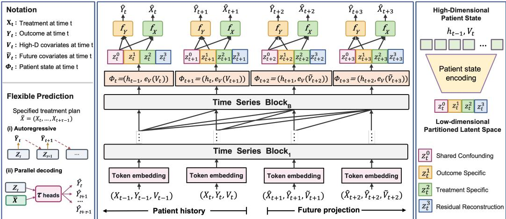
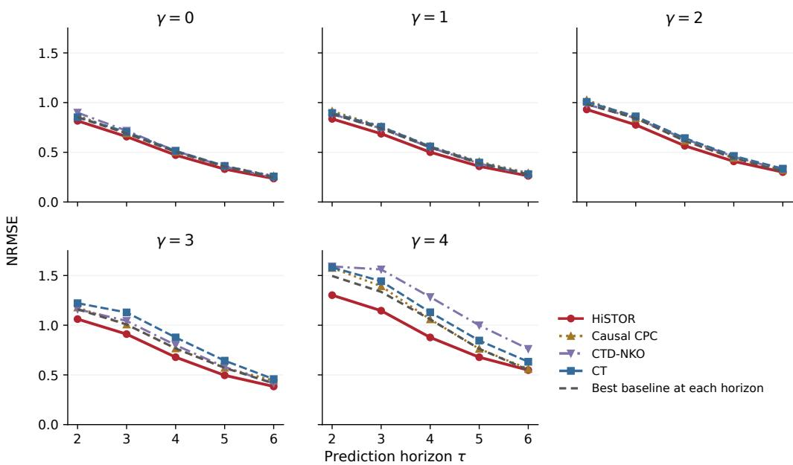
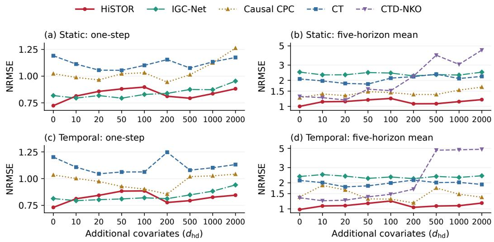
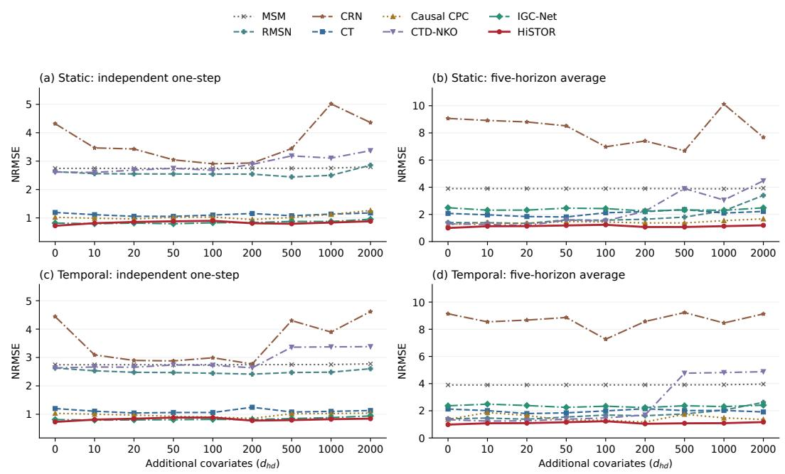

# HISTOR: STRUCTURED TREATMENT-OUTCOME REP-RESENTATION LEARNING FOR HIGH-DIMENSIONALLONGITUDINAL DATA

Chuanqi Lao1 Junzhou Huang1 Qiao Liu2,∗

1Department of Computer Science and Engineering, The University of Texas at Arlington

2Department of Biostatistics, Yale School of Public Health, Yale University

∗Corresponding author: qiao.liu@yale.edu

## ABSTRACT

Estimating potential outcomes under alternative treatment sequences is essential for personalized decision-making, but remains challenging with high-dimensional covariates and time-varying confounding. In this study, we propose HiSTOR (High-dimensional Structured Treatment-Outcome Representation), an end-toend framework that integrates nonlinear dimension reduction with longitudinal counterfactual prediction. The central idea is to learn structured low-dimensional representations of both current patient states and evolving histories, according to their shared and distinct relationships with treatment assignment and outcomes. This extends latent-space covariate adjustment to longitudinal settings, jointly addressing covariate dimensionality and historical complexity. The resulting framework supports one-step and multi-step outcome prediction under specified treatment sequences. Experiments on CVSim and CancerSim demonstrate the superiority of HiSTOR across varying covariate dimensions, confounding strengths, and prediction horizons compared to state-of-the-art methods. To sum up, HiS-TOR offers a unified approach to connecting high-dimensional covariate adjustment with longitudinal potential-outcome prediction. The code is available at https://github.com/liuq-lab/HiSTOR.

## 1 INTRODUCTION

Personalized treatment planning requires predicting outcomes under alternative treatment sequences from longitudinal observations. This problem is fundamentally challenging because treatment decisions may depend on time-varying covariates that also affect future outcomes and may themselves be influenced by prior treatments. The difficulty is further amplified in modern biomedical applications, where each patient is characterized by high-dimensional and strongly correlated measurements accumulated over time (Allam et al., 2021; Bica et al., 2021; Battalio et al., 2021; Murray et al., 2016). As the covariate dimension and observation history grow, effective counterfactual prediction therefore requires methods that can effectively compress patient information while retaining what is relevant to both treatment assignment and outcome prediction.

Recent modern AI approaches to longitudinal counterfactual prediction address time-varying confounding through reweighting, representation balancing, sequential outcome modeling, or recursive regression (Lim, 2018; Bica et al., 2020; Melnychuk et al., 2022; Li et al., 2021; Xiong et al., 2024; Hess et al., 2026). These methods primarily focus on how longitudinal histories should be adjusted, balanced, or propagated over time. Less attention has been paid to how high-dimensional covariates and accumulated histories should be jointly compressed and represented for treatment-conditioned outcome prediction.

To address the high-dimensional covariate and confounding challenges, we propose HiSTOR (High-dimensional Structured Treatment-Outcome Representation), an end-to-end framework for structured representation learning in high-dimensional longitudinal settings (Figure 1). The key idea of HiSTOR is to separately represent the current high-dimensional patient state and the preceding longitudinal history, and then organize their fusion into a task-structured low-dimensional latent space. This representation preserves information relevant to treatment assignment and outcome prediction. By explicitly separating current-state compression from historical representation learning, HiSTOR provides a unified representation for longitudinal covariate adjustment and treatment conditioned outcome prediction. We summarize our main contributions as follows:

  
Figure 1: Overview of HiSTOR. The model adopts a temporal Transformer backbone and combines a high-dimensional current patient state with a learned representation of longitudinal history, maps their fusion into a structured latent space, and supports treatment-conditioned flexible one-step and multi-step outcome prediction.

• We introduce a structured representation-learning framework for high-dimensional longitudinal causal inference that encodes the current patient state and preceding history by their roles in the treatment and outcome mechanisms.

• We extend structured latent covariate adjustment from cross-sectional to longitudinal settings and develop flexible prediction mechanisms for both one-step and multi-step treatment-conditioned potential outcomes.

• We demonstrate strong empirical performance of HiSTOR across varying confounding strengths, covariate dimensions, and prediction horizons. HiSTOR achieves the lowest mean one-step and five-horizon-average errors across all tested CancerSim confounding strengths, and the lowest five-horizon-average errors across all tested CVSim covariate dimensions.

## 2 RELATED WORK

Traditional longitudinal causal inference. Static estimators learn potential outcomes from covariate-treatment-outcome observations (Johansson et al., 2016; Alaa & Schaar, 2018; Wager & Athey, 2018; Yoon et al., 2018; Curth & Van der Schaar, 2021), whereas longitudinal methods condition on evolving patient histories. Classical approaches include marginal structural models and G-computation (Robins, 1986; Robins et al., 2000; Robins & Hernan, 2008). These approaches provide the statistical foundation for longitudinal causal inference, but their direct application can become challenging with complex, high-dimensional patient histories.

Modern AI for longitudinal counterfactual prediction. Recent work integrates these causal principles with flexible neural models for learning treatment effects from longitudinal data. RMSN combines recurrent outcome models with stabilized inverse-probability weights (Lim, 2018). CRN uses treatment-adversarial training to balance recurrent histories, and CT uses a multi-input Trans former with domain confusion (Bica et al., 2020; Melnychuk et al., 2022). Causal CPC combines recurrent encoding, contrastive predictive coding, and representation balancing (Bouchattaoui et al., 2024); CTD-NKO uses treatment-dependent neural Koopman dynamics and distributional weighting (Wang et al., 2025). G-Net and G-Transformer estimate future-variable distributions for Gcomputation (Li et al., 2021; Xiong et al., 2024), while IGC-Net recursively regresses pseudooutcomes without modeling complete future-covariate distributions (Hess et al., 2026). These approaches advance complementary aspects of confounding adjustment, temporal representation learning, and treatment-conditioned forecasting.

Structured representation learning for causal inference. In cross-sectional settings, DR-CFR learns treatment-related, outcome-related, and shared representations (Hassanpour & Greiner, 2019), while TEDVAE separates instrumental, confounding, and outcome risk factors (Zhang et al., 2021). CausalEGM, CausalBGM, and BGM-IV combine structured latent modeling with highdimensional covariate adjustment through encoding-generative or Bayesian formulations (Liu et al., 2024; Liu & Wong, 2026a; Luo & Liu, 2026). These methods do not model repeated treatments or evolving patient histories.

Positioning of HiSTOR. HiSTOR addresses this longitudinal prediction task with a focus on highdimensional patient covariates. Its contribution is to couple explicit covariate compression with a latent-space partition designed for both prediction and reconstruction. The partition combines shared and task-specific predictive components with a dedicated residual reconstruction component, linking the organization of treatment-outcome information with information retention under compression. This design brings together structured covariate adjustment and longitudinal representation learning for patient histories containing many correlated covariates.

## 3 PROBLEM FORMULATION

Let $\mathcal { D } = \{ \{ V _ { i t } , X _ { i t } , Y _ { i t } \} _ { t = 1 } ^ { T _ { i } } \} _ { i = 1 } ^ { N }$ contain independent patient trajectories. Here $V _ { i t }$ denotes the covariates available before treatment at time t, including baseline components and, when present, time-varying components; $X _ { i t }$ is the observed treatment; and $Y _ { i t }$ is the associated post-treatment outcome. Suppressing i, the observed history before treatment at time t is

$$
\mathcal { H } _ { t } = ( X _ { < t } , Y _ { < t } , V _ { \leq t } ) .\tag{1}
$$

Here $\mathcal { H } _ { t }$ is the observed history, whereas $h _ { t - 1 }$ is the representation of the preceding trajectory through time $t - 1$ . Appendix A summarizes the notation and temporal alignment.

Following the longitudinal potential-outcomes framework (Robins, 1986; Robins & Hernan, 2008), let $Y _ { t } ( x )$ be the outcome under treatment x at time t with prior treatments observed. For history h and a specified sequence $\bar { x } = x _ { t : t + \tau - 1 }$ , the targets are

$$
\left\{ \begin{array} { l l } { \mu _ { t } ( x , h ) = \mathbb { E } [ Y _ { t } ( x ) \mid \mathcal { H } _ { t } = h ] , } \\ { \mu _ { t } ^ { ( \tau ) } ( \bar { x } , h ) = \mathbb { E } [ Y _ { t + \tau - 1 } ( \bar { x } ) \mid \mathcal { H } _ { t } = h ] . } \end{array} \right.\tag{2}
$$

Thus $\tau = 1$ reduces to the one-step target. At prediction time only $\mathcal { H } _ { t }$ and the specified treatment sequence are available, while future outcomes and covariates are not.

Identification from observational data requires longitudinal consistency, positivity, and sequential ignorability (Robins et al., 2000; Robins & Hernan, 2008). For $t \leq s \leq u$ and an intervention sequence $x _ { s : u }$ , we state these conditions as

$$
\left\{ \begin{array} { l l } { Y _ { u } ( X _ { s : u } ) = Y _ { u } } & { ( \mathrm { C o n s i s t e n c y } ) , } \\ { \operatorname* { P r } ( X _ { s } = x _ { s } \mid \mathcal { H } _ { s } = h _ { s } ) > 0 } & { ( \mathrm { P o s i t i v i t y } ) , } \\ { X _ { s } \perp \perp Y _ { u } ( x _ { s : u } ) \mid \mathcal { H } _ { s } } & { ( \mathrm { S e q u e n t i a l i g n o r a b i l i t y } ) . } \end{array} \right.\tag{3}
$$

Positivity is required for intervention-relevant treatments at histories that can arise under the intervention, while sequential ignorability assumes no unmeasured treatment-outcome confounding conditional on $\mathcal { H } _ { s }$ . Under these assumptions, the targets in Equation 2 are identified within the standard longitudinal potential-outcome framework.

## 4 METHODS

## 4.1 COVARIATE AND HISTORY ENCODING

At each decision time t, HiSTOR encodes the pre-treatment information in $\mathcal { H } _ { t }$ through two complementary paths: a covariate encoder for the current covariates $V _ { t } .$ , and a causally masked temporal network for the preceding trajectory.

The covariate encoder $e _ { V }$ maps the current covariates to a low-dimensional representation $c _ { t } =$ $e _ { V } ( V _ { t } )$ . The temporal network $\tau$ summarizes the trajectory preceding treatment $X _ { t }$ . At sequence position t, it receives the treatment, outcome, and covariate encoding from the previous time step, which are embedded and summed into an input token. T is a stack of $B$ Transformer decoder blocks and produces the embedding $h _ { t - 1 } = \mathscr { T } ( X _ { < t } ^ { \cdot } , Y _ { < t } , V _ { < t } )$ . The attention masks ensure that $h _ { t - 1 }$ uses only information available through time $t - 1$ . The current covariate encoding $c _ { t }$ and preceding trajectory representation $h _ { t - 1 }$ are subsequently fused and mapped into the structured latent space.

## 4.2 STRUCTURED LATENT REPRESENTATION

Treatment assignment and outcomes may depend on overlapping but distinct aspects of the pretreatment history. A single entangled representation does not distinguish such structure. To consider this, HiSTOR fuses the current covariate encoding and preceding trajectory representation, then maps their concatenation into a partitioned latent space:

$$
\Phi _ { t } = [ h _ { t - 1 } , c _ { t } ] , \qquad Z _ { t } = Q ( \Phi _ { t } ) = [ z _ { t } ^ { 0 } , z _ { t } ^ { 1 } , z _ { t } ^ { 2 } , z _ { t } ^ { 3 } ] .\tag{4}
$$

$z _ { t } ^ { 0 }$ is provided to both the treatment and outcome prediction heads. This encourages $z _ { t } ^ { 0 }$ to retain information in the observed history that is predictive of both treatment assignment and outcomes, and is therefore most directly relevant to confounding adjustment. In contrast, $z _ { t } ^ { 1 }$ is used only for outcome prediction and $z _ { t } ^ { 2 }$ only for treatment prediction, allowing outcome-specific and treatmentspecific variation to be learned. The remaining latent component $z _ { t } ^ { 3 }$ is trained through residual reconstruction, providing additional capacity to preserve irrelevant covariate information.

## 4.3 LEARNING THE STRUCTURED REPRESENTATION

The partition in equation 4 does not by itself determine the functional role of each latent component. HiSTOR induces this structure through task-specific supervision that controls which components are available to the treatment and outcome prediction heads.

For a specified treatment $x _ { t } .$ , the outcome and auxiliary treatment predictions are

$$
\widehat { y } _ { t } ( x _ { t } ) = f _ { Y } ( [ z _ { t } ^ { 0 } , z _ { t } ^ { 1 } , x _ { t } ] ) , \qquad \widehat { \pmb { \pi } } _ { t } = f _ { X } ( [ z _ { t } ^ { 0 } , z _ { t } ^ { 2 } ] ) ,\tag{5}
$$

where $\widehat { \pi } _ { t }$ denotes the predicted treatment-assignment distribution. The treatment head is used only to supervise representation learning. The outcome head always conditions on the observed or externally specified treatment $x _ { t } ,$ rather than on the auxiliary treatment prediction.

During training, the outcome head is optimized using the factual outcome loss $\mathcal { L } _ { Y }$ , while the treatment head is optimized using the auxiliary treatment loss $\mathcal { L } _ { X }$ . The residual component $z _ { t } ^ { 3 }$ is trained through reconstruction. Together, these objectives learn the structured representation end-to-end, while the complete loss definitions and regularization terms are given in Section 4.4.

## 4.4 TRAINING OBJECTIVES

HiSTOR jointly trains the current-state encoder, temporal network, structured mapping, prediction heads, and reconstruction modules. The overall objective combines factual outcome prediction, auxiliary treatment prediction, reconstruction, and representation regularization:

$$
\mathcal { L } _ { \mathrm { t o t a l } } = \mathcal { L } _ { Y } + \lambda _ { X } \mathcal { L } _ { X } + \lambda _ { r e c } \mathcal { L } _ { \mathrm { r e c } } + \lambda _ { \mathrm { a d v } } ( e ) \mathcal { L } _ { \mathrm { a d v } } + \lambda _ { \mathrm { n o r m } } \mathcal { L } _ { \mathrm { n o r m } } + \lambda _ { \mathrm { r o l l } } \mathcal { L } _ { \mathrm { r o l l } } .\tag{6}
$$

Here, $\mathcal { L } _ { Y }$ and $\mathcal { L } _ { X }$ are introduced in Equation 5. The reconstruction objective $\mathcal { L } _ { \mathrm { r e c } }$ encourages the compressed representation to retain information about the observed patient state and provides supervision for the residual component $z _ { t } ^ { 3 }$ . The distribution-matching loss $\mathcal { L } _ { \mathrm { a d v } }$ regularizes the learned current-state representation, while $\mathcal { L } _ { \mathrm { n o r m } }$ controls its scale. This combination of reconstruction and distribution matching is also used in bidirectional generative modeling (Liu et al., 2021).

To reduce train-prediction discrepancy, we optionally introduce a rollout loss $\mathcal { L } _ { \mathrm { r o l l } }$ that recursively applies the one-step predictor over factual multi-step windows and propagates its predictions through subsequent histories. Complete definitions of the reconstruction, distribution-matching, rollout, and weighting objectives are provided in Appendix B.

## 4.5 ONE-STEP AND MULTI-STEP PREDICTION

For a specified treatment $x _ { t } ,$ , the one-step prediction is

$$
\begin{array} { r } { \widehat { \mu } _ { \theta } ^ { ( 1 ) } ( x _ { t } , \mathcal { H } _ { t } ) = f _ { Y } ( [ z _ { t } ^ { 0 } , z _ { t } ^ { 1 } , x _ { t } ] ) , } \end{array}\tag{7}
$$

where $\theta$ denotes the fitted model parameters and $\mathcal { H } _ { t }$ is the observed pre-treatment history. This is the prediction $\widehat { y } _ { t } ( x _ { t } )$ defined in Equation 5. Alternative treatments change $x _ { t }$ while retaining the same pre-treatment information.

Autoregressive prediction. For a treatment plan $\bar { x } = x _ { t : t + \tau - 1 }$ of length τ , we recursively predict

$$
\begin{array} { r } { \widehat { y } _ { s } ^ { \mathrm { A R } } = \widehat { \mu } _ { \theta } ^ { ( 1 ) } ( x _ { s } , \widehat { \mathcal { H } } _ { s } ) , \qquad s = t , \dots , t + \tau - 1 , } \end{array}\tag{8}
$$

where $\widehat { \mathcal { H } } _ { s }$ combines the observed history up to the prediction origin, the specified treatment sequence, and previously generated outcomes. For $\widetilde { V } _ { t } .$ , static covariates are reused unchanged while time-varying covariate inputs are carried forward from their last observed values at the prediction origin. This autoregressive construction can accommodate arbitrary prediction horizons, but its recursive dependence on model-generated outcomes allows prediction errors to propagate across future steps.

Parallel decoding. To avoid recursive outcome feedback, HiSTOR also supports direct multi-step prediction. Given the structured representation $Z _ { t }$ at the prediction origin and a specified treatment plan $\bar { x } = x _ { t : t + \tau - 1 }$ , a decoder predicts the complete outcome trajectory in a single forward pass:

$$
( \widehat { y } _ { t } ^ { \mathrm { D } } , \ldots , \widehat { y } _ { t + \tau - 1 } ^ { \mathrm { D } } ) = D _ { \tau } ( Z _ { t } , \bar { x } ) .\tag{9}
$$

The decoder uses a shared representation of the treatment plan together with horizon-specific outcome heads. It is trained additionally on factual multi-step windows. Thus, autoregressive and parallel decoding provide complementary strategies for extending the same structured representation to longitudinal treatment-conditioned prediction.

Appendix D specifies the dataset-specific preparation at the forecast origin, and Appendix B gives the direct-decoder architecture.

## 5 EXPERIMENTS

## 5.1 EXPERIMENTAL SETUP

Datasets. We evaluate HiSTOR on two simulated longitudinal benchmarks with known counterfactual outcomes. CancerSim models tumor volume under four treatment options: no treatment, chemotherapy, radiotherapy, and their combination, with treatment-assignment confounding strength $\gamma \in \{ 0 , 1 , 2 , 3 , 4 \}$ (Geng et al., 2017; Bica et al., 2020; Melnychuk et al., 2022; Hess et al., 2026). We use 10,000 training patients, 1,000 validation patients, and two separately generated 1,000-patient cohorts for one-step and multi-step testing. CVSim augments seven base covariates with $d _ { \mathrm { h d } } \in \{ 0 , 1 0 , 2 0 , 5 0 , 1 0 0 , 2 0 0 , 5 0 0 , 1 0 0 0 , 2 0 0 0 \}$ correlated noisy covariates while keeping the underlying trajectory-generating process fixed. The additional covariates remain fixed within patients in the Static setting and vary over time in the Temporal setting. We split 5,000 patient tra jectories into training, validation, and test sets using an 80/10/10 patient-level split. Appendix C provides the data-generation details. To complement these controlled simulation studies, we also include a semi-synthetic evaluation based on de-identified MIMIC-III covariates; its data construction, evaluation protocol, and results are reported in Appendix I.

Prediction tasks. We evaluate independent one-step prediction at observed histories and multistep prediction under fixed treatment plans, without access to future observed outcomes or covariates. The multi-step plans prescribe sustained combined therapy in CancerSim and treatment category 2 in CVSim. Both benchmarks evaluate five future positions: CVSim scores horizons $\tau = 1$ to 5, whereas CancerSim scores $\tau = 2$ to 6 after an unscored boundary prediction under the factual treatment. For HiSTOR, the one-step benchmark uses the outcome head, and the main multi-step comparisons use the direct decoder. Autoregressive prediction is evaluated in the ablation study. Appendix D specifies the treatment plans, forecast boundaries, and input preparation.

Baselines. We compare HiSTOR with MSM (Robins et al., 2000), RMSN (Lim, 2018), CRN (Bica et al., 2020), CT (Melnychuk et al., 2022), Causal CPC (Bouchattaoui et al., 2024), CTD-NKO (Wang et al., 2025), and IGC-Net (Hess et al., 2026). Within each experimental condition, all methods use the same data realization, patient splits, and evaluation protocol. Baseline configurations are provided in Appendix F.

Evaluation and reporting. For the primary CancerSim and CVSim experiments, we report normalized root mean squared error (NRMSE), using the tumor-death volume threshold for CancerSim and the task-specific test-target range for CVSim. These results are summarized as the mean and sample standard deviation across five random seeds, {3, 101, 42, 8, 9}. For multi-step evaluation, we average the five horizon-specific NRMSE values within each seed before aggregating across seeds. Independent one-step evaluation and the first multi-step horizon use distinct evaluation protocols. HiSTOR’s backbone and direct-decoder checkpoints are selected using their respective factual validation objectives, with counterfactual test targets excluded from model selection. Appendices E and B provide the metric definitions and optimization details, respectively.

## 5.2 OUTCOME PREDICTION UNDER VARYING CONFOUNDING

We evaluate HiSTOR on CancerSim across confounding strengths $\gamma = 0$ to 4 for independent onestep prediction and multi-step prediction under sustained combined therapy. For each condition, relative improvements are calculated against the baseline with the lowest mean NRMSE.

HiSTOR achieves the lowest mean one-step NRMSE at all five confounding strengths, with relative reductions ranging from 4.2% to 13.4% (Table 1). The gains are more significant under stronger confounding. $\mathrm { A t } \gamma = 3 ,$ HiSTOR reduces NRMSE from 0.7122 for CTD-NKO to 0.6165, corresponding to a 13.4% reduction. $\mathrm { A t } \gamma = 4 ,$ it reduces NRMSE from 0.7620 to 0.6703 relative to the same strongest baseline, yielding a 12.0% reduction. These gains exceed the 4.2%–5.2% reductions observed at $\gamma = 0$ and 1, indicating a larger predictive advantage when treatment assignment is more strongly confounded.

Table 1: The results for CancerSim one-step prediction. Mean ± sample SD of NRMSE over five seeds are shown. Best means are bold, second-best underlined; the final row reports HiSTOR’s relative reduction over the best baseline.
<table><tr><td>Method</td><td> $\gamma = 0$ </td><td>γ = 1</td><td> $\gamma = 2$ </td><td> $\gamma = 3$ </td><td> $\gamma = 4$ </td></tr><tr><td>MSM (Robins et al., 2000)</td><td> $1 . 0 2 9 8 \pm 0 . 0 6 3 3$ </td><td> $1 . 1 3 1 2 \pm 0 . 0 6 3 3$ </td><td> $1 . 3 0 0 5 \pm 0 . 1 0 3 9$ </td><td> $1 . 6 0 5 9 \pm 0 . 1 6 8 1$ </td><td> $2 . 0 1 1 3 \pm 0 . 2 4 4 6$ </td></tr><tr><td>RMSN (Lim, 2018)</td><td> $0 . 6 9 9 4 \pm 0 . 0 6 9 0$ </td><td> $0 . 6 7 8 9 \pm 0 . 0 7 5 8$ </td><td> $0 . 7 4 4 6 \pm 0 . 1 1 5 3$ </td><td> $0 . 7 3 2 4 \pm 0 . 1 0 4 2$ </td><td> $0 . 8 2 5 6 \pm 0 . 0 8 5 0$ </td></tr><tr><td>CRN (Bica et al., 2020)</td><td> $0 . 5 9 6 9 \pm 0 . 0 6 3 9$ </td><td> $0 . 6 0 9 8 \pm 0 . 0 4 8 0$ </td><td> $0 . 6 4 9 2 \pm 0 . 0 5 8 5$ </td><td> $0 . 7 1 4 3 \pm 0 . 0 8 6 8$ </td><td> $0 . 8 2 5 6 \pm 0 . 0 9 9 4$ </td></tr><tr><td>CT (Melnychuk et al., 2022)</td><td> $0 . 5 9 2 8 \pm 0 . 0 6 6 5$ </td><td> $\underline { { 0 . 5 9 7 4 \pm 0 . 0 8 5 5 } }$ </td><td> $0 . 6 3 9 0 \pm 0 . 0 6 1 2$ </td><td> $0 . 7 3 7 2 \pm 0 . 0 9 5 4$ </td><td> $0 . 9 3 3 5 \pm 0 . 0 7 4 8$ </td></tr><tr><td>Causal CPC (Bouchattaoui et al., 2024)</td><td> $\overline { { 0 . 6 1 4 2 \pm 0 . 0 5 3 5 } }$ </td><td> $\overline { { 0 . 6 2 2 8 \pm 0 . 0 6 3 6 } }$ </td><td> $\overline { { 0 . 6 9 2 2 \pm 0 . 1 3 1 3 } }$ </td><td> $0 . 7 2 3 5 \pm 0 . 0 7 6 7$ </td><td> $0 . 8 4 2 7 \pm 0 . 0 8 5 7$ </td></tr><tr><td>CTD-NKO (Wang et al., 2025)</td><td> $0 . 6 8 5 2 \pm 0 . 0 8 2 5$ </td><td> $0 . 6 4 5 4 \pm 0 . 1 0 1 1$ </td><td> $0 . 6 6 5 9 \pm 0 . 1 0 5 6$ </td><td> $\underline { { 0 . 7 1 2 2 } } \pm 0 . 0 3 9 0$ </td><td> $0 . 7 6 2 0 \pm 0 . 0 5 6 6$ </td></tr><tr><td>IGC-Net (Hess et al., 2026)</td><td> $0 . 6 6 7 0 \pm 0 . 0 5 6 5$ </td><td> $0 . 6 8 8 0 \pm 0 . 0 3 7 4$ </td><td> $0 . 7 5 3 7 \pm 0 . 0 8 2 8$ </td><td> $\overline { { 0 . 9 2 8 8 \pm 0 . 2 4 7 7 } }$ </td><td> $\overline { { 1 . 1 3 1 0 \pm 0 . 0 9 1 1 } }$ </td></tr><tr><td>HiSTOR</td><td> $\mathbf { 0 . 5 6 8 0 \pm 0 . 0 5 3 3 }$ </td><td> $\mathbf { 0 . 5 6 6 3 \pm 0 . 0 6 0 7 }$ </td><td> $\mathbf { 0 . 5 7 9 3 \pm 0 . 0 4 3 8 }$ </td><td> $\mathbf { 0 . 6 1 6 5 \pm 0 . 0 5 5 1 }$ </td><td> $\mathbf { 0 . 6 7 0 3 \pm 0 . 0 4 5 1 }$ </td></tr><tr><td>Relative improvement</td><td>4.2%</td><td>5.2%</td><td>9.3%</td><td>13.4%</td><td>12.0%</td></tr></table>

For multi-step prediction, HiSTOR achieves the lowest five-horizon-average NRMSE at every confounding strength (Table 2). Its relative improvement over the strongest baseline increases steadily from 6.5% at $\gamma = 0$ to 14.9% at $\gamma = 4$ . In the strongest-confounding setting, HiSTOR reduces the five-horizon average from 1.0701 for the strongest baseline Causal CPC to 0.9105. This advantage of HiSTOR is also consistent across multiple repeated runs with different random seeds at each confounding strength for the five-horizon average (Appendix G.1).

The horizon-specific results further demonstrate that the improvement extends across the prediction window. As shown in Figure 2, HiSTOR achieves the lowest mean NRMSE across all 25 combinations of confounding strength and prediction horizon. For example, at $\gamma = 4$ and $\tau = 4 .$ , HiSTOR reduces NRMSE from 1.0591 for Causal CPC to 0.8772, a relative reduction of 17.2%. Although the strongest competing method varies across horizons, HiSTOR consistently achieves the lowest mean NRMSE, complementing the aggregate multi-step results. Complete horizon-specific results and paired seed-level comparisons are provided in Appendix G.

Table 2: The results for CancerSim multi-step prediction averaged over τ = 2 to 6. Mean ± sample SD of NRMSE over five seeds are shown. Best means are bold, second-best underlined; the final row reports HiSTOR’s relative reduction over the best baseline.
<table><tr><td>Method</td><td> $\gamma = 0$ </td><td> $\gamma = 1$ </td><td> $\gamma = 2$ </td><td> $\gamma = 3$ </td><td> $\gamma = 4$ </td></tr><tr><td>MSM (Robins et al., 2000)</td><td> $1 . 0 1 7 0 \pm 0 . 0 6 0 0$ </td><td> $0 . 8 8 5 6 \pm 0 . 0 4 1 0$ </td><td> $0 . 8 8 2 2 \pm 0 . 0 2 2 4$ </td><td> $0 . 9 8 3 3 \pm 0 . 0 5 3 3$ </td><td> $1 . 2 1 2 4 \pm 0 . 0 6 4 5$ </td></tr><tr><td>RMSN (Lim, 2018)</td><td> $0 . 5 7 3 5 \pm 0 . 0 6 3 7$ </td><td> $0 . 5 9 6 8 \pm 0 . 0 5 1 5$ </td><td> $0 . 6 5 8 4 \pm 0 . 0 3 7 3$ </td><td> $0 . 8 3 0 3 \pm 0 . 0 8 5 1$ </td><td> $1 . 0 9 5 3 \pm 0 . 0 8 2 1$ </td></tr><tr><td>CRN (Bica et al., 2020)</td><td> $0 . 5 5 7 3 \pm 0 . 0 1 5 7$ </td><td> $0 . 5 9 5 1 \pm 0 . 0 3 1 7$ </td><td> $0 . 6 9 4 6 \pm 0 . 0 3 5 3$ </td><td>0.8111 ± 0.0463</td><td> $1 . 0 9 0 8 \pm 0 . 0 9 3 7$ </td></tr><tr><td>CT (Melnychuk et al., 2022)</td><td> $0 . 5 3 8 1 \pm 0 . 0 3 9 9$ </td><td> $0 . 5 7 7 6 \pm 0 . 0 3 1 5$ </td><td> $0 . 6 6 1 9 \pm 0 . 0 5 4 9$ </td><td> $0 . 8 6 5 7 \pm 0 . 0 5 1 0$ </td><td> $1 . 1 2 6 7 \pm 0 . 1 9 6 1$ </td></tr><tr><td>Causal CPC (Bouchattaoui et al., 2024)</td><td> $0 . 5 3 7 4 \pm 0 . 0 3 6 6$ </td><td> $0 . 5 8 6 5 \pm 0 . 0 5 4 7$ </td><td> $0 . 6 4 9 4 \pm 0 . 0 2 1 8$ </td><td> $\underline { { 0 . 7 9 3 4 } } \pm 0 . 0 5 4 3$ </td><td> $\underline { { 1 . 0 7 0 1 } } \pm 0 . 0 5 7 5$ </td></tr><tr><td>CTD-NKO (Wang et al., 2025)</td><td> $0 . 5 4 6 2 \pm 0 . 0 5 0 2$ </td><td> $0 . 5 6 6 4 \pm 0 . 0 2 9 5$ </td><td> $\underline { { 0 . 6 4 7 3 \pm 0 . 0 5 1 4 } }$ </td><td> $\overline { { 0 . 7 9 9 7 \pm 0 . 0 9 9 3 } }$ </td><td> $1 . 2 3 9 4 \pm 0 . 1 6 1 4$ </td></tr><tr><td>IGC-Net (Hess et al., 2026)</td><td> $0 . 6 2 2 8 \pm 0 . 0 4 6 8$ </td><td> $\overline { { 0 . 6 9 1 8 \pm 0 . 0 7 6 5 } }$ </td><td> $0 . 7 3 7 3 \pm 0 . 0 3 7 0$ </td><td> $0 . 9 1 1 2 \pm 0 . 1 3 7 5$ </td><td> $1 . 1 0 7 7 \pm 0 . 1 1 1 5$ </td></tr><tr><td>HiSTOR  $\mathbf { 0 . 5 0 2 4 \ : \pm 0 . 0 2 2 2 }$ </td><td> $\mathbf { 0 . 5 2 9 1 \pm 0 . 0 1 7 3 }$ </td><td></td><td> $\mathbf { 0 . 5 9 6 4 \pm 0 . 0 3 6 5 }$ </td><td> $\mathbf { 0 . 7 0 6 1 \pm 0 . 0 4 8 9 }$ </td><td> $\mathbf { 0 . 9 1 0 5 \pm 0 . 0 2 0 8 }$ </td></tr><tr><td>Rel. improvement</td><td>6.5%</td><td>6.6%</td><td>7.9%</td><td>11.0%</td><td>14.9%</td></tr></table>

  
Figure 2: CancerSim sustained-treatment NRMSE over $\tau = 2 , \ldots , 6 .$ . Lines are five-seed means; the gray envelope is the lowest mean among all baselines at each horizon and may switch methods. Complete results and SDs are in Appendix G.

## 5.3 OUTCOME PREDICTION WITH HIGH-DIMENSIONAL COVARIATES

We evaluate HiSTOR on CVSim as the number of correlated noisy covariates increases, while holding the underlying trajectory-generating process fixed. In the Static setting, the additional covariates remain fixed within each patient, assessing prediction in the presence of redundant high-dimensional measurements. In the Temporal setting, these covariates additionally exhibit temporal drift and timespecific noise, assessing prediction when the added measurements also vary over time. Both settings evaluate independent one-step prediction and multi-step prediction under sustained treatment.

For CVSim one-step prediction, HiSTOR achieves the lowest mean NRMSE at all evaluated dimensions from $d _ { \mathrm { h d } } = 2 0 0$ to 2000 in both settings (Figure 3(a,c)). At $d _ { \mathrm { h d } } = 2 0 0 0$ , HiSTOR reduces NRMSE from 0.954 for the best baseline IGC-Net to 0.882 in the Static setting and from 0.941 to 0.845 in the Temporal setting, corresponding to relative reductions of 7.5% and 10.2%. Although IGC-Net has the lowest mean error at $d _ { \mathrm { h d } } = 1 0 { - } 1 0 0$ , HiSTOR leads at $d _ { \mathrm { h d } } = 0$ and across all the higher-dimensional settings. Its one-step advantage is therefore most consistent when the observed covariate space is large. These results highlight HiSTOR’s predictive advantage in settings with high-dimensional, correlated covariates.

  
Figure 3: CVSim NRMSE across nine $d _ { \mathrm { h d } }$ settings. Panels (a,b) show Static and panels $^ { ( \mathrm { c } , \mathrm { d } ) }$ Temporal results; the left panels report independent one-step error and the right panels report five-horizon means. Lines are five-seed means. Appendix Figure 4 includes all methods.

HiSTOR shows a more consistent advantage for multi-step prediction, achieving the lowest fivehorizon-average NRMSE in all 18 combinations of covariate dimension and Static/Temporal setting (Figure $^ { 3 ( \mathrm { b , d } ) } ,$ . At $d _ { \mathrm { h d } } = 2 0 0 0$ , HiSTOR reduces NRMSE by 28.4% in Static and 14.3% in Temporal relative to baseline Causal CPC, the strongest baseline under this metric in both settings. The advantage also extends across individual prediction horizons: HiSTOR achieves the lowest mean NRMSE in 71 of the 72 conditions with $\tau \geq 2 .$ The only exception is Static $d _ { \mathrm { h d } } = 2 0$ at $\tau = 2 ,$ where CTD-NKO has a slightly lower mean error. At the highest evaluated dimension, $d _ { \mathrm { h d } } = 2 0 0 0 ,$

Table 3: CVSim NRMSE at $d _ { \mathrm { h d } } = 2 0 0 0$ , reported as mean ± sample SD over five seeds. Independent one-step and multi-step $\tau = 1$ are distinct tasks. Best means are bold, second-best underlined; relative improvements are computed against the lowest-mean baseline in each column.
<table><tr><td rowspan="2">Method</td><td rowspan="2">One-step</td><td colspan="5">Multi-step</td></tr><tr><td> $\tau = 1$ </td><td> $\tau = 2$ </td><td> $\tau = 3$ </td><td> $\tau = 4$ </td><td> $\tau = 5$ </td></tr><tr><td>CVSim Static</td><td></td><td></td><td></td><td></td><td></td><td></td></tr><tr><td>MSM (Robins et al., 2000)</td><td> $2 . 7 9 7 \pm 1 . 6 5 9$ </td><td> $3 . 7 9 7 \pm 2 . 3 5 7$ </td><td> $3 . 8 6 0 \pm 2 . 3 9 2$ </td><td> $3 . 9 1 4 \pm 2 . 4 1 9$ </td><td> $4 . 0 1 7 \pm 2 . 4 7 9$ </td><td> $4 . 0 8 2 \pm 2 . 5 1 5$ </td></tr><tr><td>RMSN (Lim, 2018)</td><td> $2 . 8 5 7 \pm 0 . 9 7 5$ </td><td> $3 . 7 7 5 \pm 1 . 1 8 1$ </td><td> $3 . 2 0 2 \pm 0 . 7 3 5$ </td><td> $3 . 1 4 7 \pm 0 . 6 3 9$ </td><td> $3 . 3 2 3 \pm 0 . 5 9 1$ </td><td> $3 . 5 4 4 \pm 0 . 5 5 3$ </td></tr><tr><td>CRN (Bica et al., 2020)</td><td> $4 . 3 5 9 \pm 0 . 9 0 9$ </td><td> $6 . 0 7 6 \pm 1 . 6 7 5$ </td><td> $7 . 0 0 4 \pm 1 . 8 7 8$ </td><td> $7 . 6 6 9 \pm 1 . 9 1 1$ </td><td> $8 . 4 3 3 \pm 1 . 9 0 7$ </td><td> $9 . 1 9 2 \pm 1 . 9 4 5$ </td></tr><tr><td>CT (Melnychuk et al., 2022)</td><td> $1 . 1 7 5 \pm 0 . 3 1 8$ </td><td> $1 . 4 1 2 \pm 0 . 4 5 4$ </td><td> $1 . 8 4 6 \pm 0 . 4 7 2$ </td><td> $2 . 2 3 4 \pm 0 . 8 0 2$ </td><td> $2 . 6 3 2 \pm 1 . 1 5 0$ </td><td> $2 . 9 8 4 \pm 1 . 3 4 2$ </td></tr><tr><td>Causal CPC (Bouchattaoui et al., 2024)</td><td> $1 . 2 6 2 \pm 0 . 3 0 7$ </td><td> $1 . 5 3 3 \pm 0 . 6 2 4$ </td><td> $1 . 5 8 6 \pm 0 . 5 1 1$ </td><td> $1 . 6 4 0 \pm 0 . 3 7 2$ </td><td> $\underline { { 1 . 7 4 1 } } \pm 0 . 2 6 2$ </td><td> $1 . 8 5 8 \pm 0 . 3 0 8$ </td></tr><tr><td>CTD-NKO (Wang et al., 2025)</td><td> $3 . 3 7 0 \pm 1 . 7 1 9$ </td><td> $3 . 8 5 6 \pm 1 . 4 4 9$ </td><td> $3 . 8 6 5 \pm 2 . 0 0 0$ </td><td> $4 . 2 2 2 \pm 2 . 2 6 8$ </td><td> $4 . 8 5 9 \pm 2 . 2 8 2$ </td><td> $\overline { { 5 . 5 6 7 \pm 2 . 1 3 5 } }$ </td></tr><tr><td>IGC-Net (Hess et al., 2026)</td><td> $\underline { { 0 . 9 5 4 \pm 0 . 2 7 4 } }$ </td><td> $\underline { { 1 . 0 5 4 \pm 0 . 2 8 8 } }$ </td><td> $1 . 6 9 9 \pm 0 . 6 3 3$ </td><td> $2 . 4 7 6 \pm 1 . 3 7 3$ </td><td> $2 . 9 7 2 \pm 1 . 4 4 7$ </td><td> $4 . 2 2 6 \pm 1 . 8 3 9$ </td></tr><tr><td>HiSTOR</td><td> ${ \bf 0 . 8 8 2 \pm 0 . 2 5 7 }$ </td><td> $\mathbf { 0 . 9 9 3 \pm 0 . 3 2 2 }$ </td><td></td><td>1.070 ± 0.379 1.180 ± 0.404</td><td> $\mathbf { 1 . 2 9 4 \ : \pm 0 . 4 0 6 }$ </td><td> $\mathbf { 1 . 4 5 0 \pm 0 . 4 0 5 }$ </td></tr><tr><td>Rel. improvement</td><td>7.5%</td><td>5.8%</td><td>32.5%</td><td>28.0%</td><td>25.7%</td><td>22.0%</td></tr><tr><td>CVSim Temporal</td><td></td><td></td><td></td><td></td><td></td><td></td></tr><tr><td>MSM (Robins et al., 2000)</td><td> $2 . 7 7 6 \pm 1 . 6 6 1$ </td><td> $3 . 8 4 1 \pm 2 . 4 2 5$ </td><td> $3 . 9 0 5 \pm 2 . 4 3 2$ </td><td> $3 . 9 4 4 \pm 2 . 4 2 0$ </td><td> $4 . 0 4 7 \pm 2 . 4 6 6$ </td><td> $4 . 0 8 2 \pm 2 . 4 8 6$ </td></tr><tr><td>RMSN (Lim, 2018)</td><td> $2 . 6 0 5 \pm 0 . 9 6 7$ </td><td> $3 . 0 4 0 \pm 1 . 3 2 1$ </td><td> $2 . 4 1 2 \pm 0 . 7 5 5$ </td><td> $2 . 3 0 2 \pm 0 . 7 1 8$ </td><td> $2 . 5 3 4 \pm 0 . 6 9 9$ </td><td> $2 . 8 2 6 \pm 0 . 6 7 9$ </td></tr><tr><td>CRN (Bica et al., 2020)</td><td> $4 . 6 1 7 \pm 2 . 5 0 0$ </td><td> $7 . 5 5 1 \pm 5 . 7 1 7$ </td><td> $8 . 6 5 8 \pm 6 . 4 5 0$ </td><td> $9 . 1 8 7 \pm 6 . 4 2 1$ </td><td> $9 . 7 9 4 \pm 6 . 4 1 1$ </td><td> $1 0 . 4 5 2 \pm 6 . 4 6 1$ </td></tr><tr><td>CT (Melnychuk et al., 2022)</td><td> $1 . 1 3 2 \pm 0 . 2 8 3$ </td><td> $1 . 3 5 8 \pm 0 . 4 5 1$ </td><td> $1 . 5 9 5 \pm 0 . 3 9 8$ </td><td> $1 . 8 9 4 \pm 0 . 3 0 5$ </td><td> $2 . 2 1 0 \pm 0 . 6 1 5$ </td><td> $2 . 5 1 0 \pm 0 . 9 0 4$ </td></tr><tr><td>Causal CPC (Bouchattaoui et al., 2024)</td><td> $1 . 0 4 2 \pm 0 . 1 8 5$ </td><td> $1 . 2 5 7 \pm 0 . 5 1 2$ </td><td> $1 . 2 5 3 \pm 0 . 4 5 7$ </td><td> $1 . 3 1 8 \pm 0 . 4 2 7$ </td><td> $1 . 4 2 8 \pm 0 . 4 2 9$ </td><td> $1 . 5 5 6 \pm 0 . 4 5 5$ </td></tr><tr><td>CTD-NKO (Wang et al., 2025)</td><td> $3 . 3 8 2 \pm 1 . 7 9 9$ </td><td> $4 . 4 5 4 \pm 2 . 2 4 8$ </td><td> $\overline { { 4 . 4 8 9 \pm 2 . 3 7 4 } }$ </td><td> $4 . 7 4 8 \pm 2 . 5 6 2$ </td><td> $\overline { { 5 . 1 4 0 \pm 2 . 7 5 4 } }$ </td><td> $\overline { { 5 . 5 5 0 \pm 2 . 8 7 5 } }$ </td></tr><tr><td>IGC-Net (Hess et al., 2026)</td><td> $0 . 9 4 1 \pm 0 . 2 4 8$ </td><td> $1 . 0 8 4 \pm 0 . 3 0 7$ </td><td> $1 . 5 3 1 \pm 0 . 7 1 7$ </td><td> $2 . 3 1 5 \pm 1 . 3 2 7$ </td><td> $3 . 1 8 5 \pm 1 . 3 5 2$ </td><td> $3 . 9 4 5 \pm 1 . 9 9 2$ </td></tr><tr><td>HiSTOR</td><td> $\mathbf { 0 . 8 4 5 \pm 0 . 2 5 4 }$ </td><td>0.974 ± 0.230</td><td> $\mathbf { 1 . 0 4 1 \pm 0 . 3 0 7 }$ </td><td> $\mathbf { 1 . 1 5 0 \ : \pm 0 . 3 6 1 }$ </td><td> $\mathbf { 1 . 2 5 1 \pm 0 . 4 4 2 }$ </td><td> $\mathbf { 1 . 4 2 1 \pm 0 . 4 6 4 }$ </td></tr><tr><td>Rel. improvement</td><td>10.2%</td><td>10.2%</td><td>16.9%</td><td>12.7%</td><td>12.4%</td><td>8.7%</td></tr></table>

HiSTOR achieves the lowest mean error for both one-step prediction and all five multi-step horizons in both settings (Table 3). $\mathrm { { A t } } \tau = 2 ,$ , its NRMSE reductions relative to the strongest baseline reach 32.5% in Static and 16.9% in Temporal. These gains persist through the final evaluated horizon, with corresponding reductions of 22.0% and 8.7% at $\tau = 5 .$ . Together, these results highlight

HiSTOR’s advantage in forecasting treatment-conditioned trajectories with high-dimensional covariates, whether the additional measurements remain fixed or vary over time. Complete results are provided in Appendix H.

## 5.4 ABLATION STUDY

Table 4: CancerSim ablation NRMSE, reported as mean ± sample SD over five seeds. Bold values indicate the lowest mean in each column. One-step results for autoregressive prediction are omitted because it uses the same frozen backbone as HiSTOR.
<table><tr><td rowspan="2">Variant</td><td colspan="2"> $\gamma = 1$ </td><td colspan="2"> $\gamma = 4$ </td></tr><tr><td>One-step</td><td>Five-horizon mean</td><td>One-step</td><td>Five-horizon mean</td></tr><tr><td>HiSTOR</td><td> $\mathbf { 0 . 5 6 6 3 \pm 0 . 0 6 0 7 }$ </td><td> $\mathbf { 0 . 5 2 9 1 \pm 0 . 0 1 7 3 }$ </td><td> $\mathbf { 0 . 6 7 0 3 \pm 0 . 0 4 5 1 }$ </td><td> $\mathbf { 0 . 9 1 0 5 \pm 0 . 0 2 0 8 }$ </td></tr><tr><td>w/o Covariate Bottleneck</td><td> $0 . 5 9 2 8 \pm 0 . 0 5 0 0$ </td><td> $0 . 5 6 6 4 \pm 0 . 0 4 9 5$ </td><td> $0 . 6 7 9 7 \pm 0 . 0 3 5 6$ </td><td> $0 . 9 5 5 5 \pm 0 . 0 3 4 9$ </td></tr><tr><td>w/o Distribution Matching</td><td> $0 . 5 7 7 7 \pm 0 . 0 6 2 2$ </td><td> $0 . 5 5 1 6 \pm 0 . 0 2 0 5$ </td><td> $0 . 6 8 0 5 \pm 0 . 0 3 3 6$ </td><td> $0 . 9 1 8 9 \pm 0 . 0 4 9 8$ </td></tr><tr><td>w/o Reconstruction</td><td> $0 . 5 7 7 1 \pm 0 . 0 5 2 4$ </td><td> $0 . 5 4 9 2 \pm 0 . 0 2 8 2$ </td><td> $0 . 6 8 1 3 \pm 0 . 0 5 5 4$ </td><td> $0 . 9 1 5 1 \pm 0 . 0 5 7 0$ </td></tr><tr><td>Autoregressive Prediction</td><td></td><td> $0 . 5 5 0 2 \pm 0 . 0 2 1 0$ </td><td></td><td> $0 . 9 1 9 3 \pm 0 . 0 4 0 9$ </td></tr></table>

We assess the contributions of HiSTOR’s components using the CancerSim benchmark at confounding strengths $\gamma = 1$ and 4. We separately remove the covariate encoding bottleneck, distributionmatching regularization, and reconstruction objectives. We also replace direct multi-step decoding with autoregressive prediction. Table 4 summarizes the results over five seeds. All relative error increases below are calculated against the full model at the corresponding confounding strength. The full model achieves the lowest mean error in every reported comparison. Removing the covariate bottleneck produces the largest increases in multi-step errors. The five-horizon-average NRMSE rises from 0.5291 to 0.5664 at $\gamma = 1$ and from 0.9105 to 0.9555 at $\gamma = 4$ , corresponding to relative increases of 7.0% and 4.9%. The corresponding one-step errors increase by $4 . 7 \%$ and 1.4%. These results identify the covariate bottleneck as the most influential component among those evaluated, with benefits across both prediction tasks and confounding strengths.

Distribution matching and reconstruction provide additional improvements whose magnitudes depend on the setting. Removing distribution matching increases the five-horizon-average NRMSE by 4.3% at $\gamma = 1$ and 0.9% at $\gamma = 4$ . Removing the reconstruction objectives increases the same metric by 3.8% and 0.5%, respectively. Both modifications also increase the mean one-step error. Thus, these objectives contribute to predictive performance, although their effects are smaller than those of the covariate bottleneck in the evaluated settings.

Finally, replacing parallel decoding with autoregressive prediction increases the five-horizonaverage NRMSE by 4.0% at $\gamma = 1$ and 1.0% at $\gamma = 4 .$ . This result indicates the benefit of direct multi-step parallel decoding compared to autoregressive predictions where the error may accumulate across multi-steps.

## 6 CONCLUSION

We introduced HiSTOR, a structured representation learning framework for longitudinal counterfactual outcome prediction with high-dimensional covariates. HiSTOR combines current-covariate compression with masked history encoding and partitions their fusion into shared, outcome-specific, treatment-specific, and residual components. Joint predictive and reconstruction objectives encour age distinct functional roles and retention of information about the observed patient state. Across CancerSim and CVSim, HiSTOR achieves the lowest mean five-horizon-average NRMSE in every evaluated setting, with one-step advantages across CancerSim confounding strengths and at higher CVSim dimensions.

Our evaluation currently focuses on simulated and semi-synthetic benchmarks. Future work will extend evaluation to real-world clinical data and broader treatment regimes, explore separate modeling of future covariate dynamics, and incorporate uncertainty quantification (Liu & Wong, 2026b; Liu, 2026). We will also investigate when compressed histories retain sufficient information for confounding adjustment.

## ACKNOWLEDGMENTS

Q.L. was supported in part by the National Human Genome Research Institute (NHGRI) under Award Number R00HG013661, the Operations Core of the Claude D. Pepper Older Americans Independence Center at Yale School of Medicine (P30AG021342), and the YSPH Transformation Pilot Grant. J.H. was partially supported by US National Science Foundation IIS-2412195, CCF-2400785, the Cancer Prevention and Research Institute of Texas (CPRIT) award (RP230363) and the National Institutes of Health (NIH) R01 awards (1R01AI190103-01 and 1R01LM015497-01). We thank Yixuan Luo for conducting exploratory experiments in the early stage of this project.

## REFERENCES

Ahmed Alaa and Mihaela Schaar. Limits of estimating heterogeneous treatment effects: Guidelines for practical algorithm design. In International conference on machine learning, pp. 129–138. PMLR, 2018.

Ahmed Allam, Stefan Feuerriegel, Michael Rebhan, and Michael Krauthammer. Analyzing patient trajectories with artificial intelligence. Journal ofmedical internet research, 23(12):e29812, 2021.

Samuel L Battalio, David E Conroy, Walter Dempsey, Peng Liao, Marianne Menictas, Susan Murphy, Inbal Nahum-Shani, Tianchen Qian, Santosh Kumar, and Bonnie Spring. Sense2stop: a micro-randomized trial using wearable sensors to optimize a just-in-time-adaptive stress management intervention for smoking relapse prevention. Contemporary Clinical Trials, 109:106534, 2021.

Ioana Bica, Ahmed M Alaa, James Jordon, and Mihaela Van Der Schaar. Estimating counterfactual treatment outcomes over time through adversarially balanced representations. arXiv preprint arXiv:2002.04083, 2020.

Ioana Bica, Ahmed M Alaa, Craig Lambert, and Mihaela Van Der Schaar. From real-world patient data to individualized treatment effects using machine learning: current and future methods to address underlying challenges. Clinical Pharmacology & Therapeutics, 109(1):87–100, 2021.

Mouad E Bouchattaoui, Myriam Tami, Benoit Lepetit, and Paul-Henry Cournede. Causal contrastive\` learning for counterfactual regression over time. Advances in Neural Information Processing Systems, 37:1333–1369, 2024.

Alicia Curth and Mihaela Van der Schaar. Nonparametric estimation of heterogeneous treatment effects: From theory to learning algorithms. In International conference on artificial intelligence and statistics, pp. 1810–1818. PMLR, 2021.

Changran Geng, Harald Paganetti, and Clemens Grassberger. Prediction of treatment response for combined chemo-and radiation therapy for non-small cell lung cancer patients using a biomathematical model. Scientific reports, 7(1):13542, 2017.

Ishaan Gulrajani, Faruk Ahmed, Martin Arjovsky, Vincent Dumoulin, and Aaron Courville. Improved training of wasserstein gans. Advances in neural information processing systems, 30, 2017.

Negar Hassanpour and Russell Greiner. Learning disentangled representations for counterfactual regression. In International Conference on Learning Representations, 2019.

Konstantin Hess, Dennis Frauen, Valentyn Melnychuk, and Stefan Feuerriegel. Igc-net for conditional average potential outcome estimation over time. In International Conference on Learning Representations, volume 2026, pp. 74263–74298, 2026.

Fredrik Johansson, Uri Shalit, and David Sontag. Learning representations for counterfactual inference. In International conference on machine learning, pp. 3020–3029. PMLR, 2016.

Alistair E. W. Johnson, Tom J. Pollard, Lu Shen, Li-Wei H. Lehman, Mengling Feng, Mohammad Ghassemi, Benjamin Moody, Peter Szolovits, Leo Anthony Celi, and Roger G. Mark. MIMIC-III, a freely accessible critical care database. Scientific Data, 3(1):160035, 2016.

Rui Li, Stephanie Hu, Mingyu Lu, Yuria Utsumi, Prithwish Chakraborty, Daby M Sow, Piyush Madan, Jun Li, Mohamed Ghalwash, Zach Shahn, et al. G-net: a recurrent network approach to g-computation for counterfactual prediction under a dynamic treatment regime. In Machine Learningfor Health, pp. 282–299. PMLR, 2021.

Bryan Lim. Forecasting treatment responses over time using recurrent marginal structural networks. Advances in neural information processing systems, 31, 2018.

Qiao Liu. Missingness-aware data imputation via ai-powered bayesian generative modeling. arXiv preprint arXiv:2605.01676, 2026.

Qiao Liu and Wing Hung Wong. An ai-powered bayesian generative modeling approach for causal inference in observational studies. Journal of the American Statistical Association, pp. 1–12, 2026a.

Qiao Liu and Wing Hung Wong. A bayesian generative modeling approach for arbitrary conditional inference. arXiv e-prints, pp. arXiv–2601, 2026b.

Qiao Liu, Jiaze Xu, Rui Jiang, and Wing Hung Wong. Density estimation using deep generative neural networks. Proceedings ofthe national academy ofsciences, 118(15):e2101344118, 2021.

Qiao Liu, Zhongren Chen, and Wing Hung Wong. An encoding generative modeling approach to dimension reduction and covariate adjustment in causal inference with observational studies. Proceedings ofthe National Academy ofSciences, 121(23):e2322376121, 2024.

Guyue Luo and Qiao Liu. Bgm-iv: an ai-powered bayesian generative modeling approach for instrumental variable analysis. arXiv preprint arXiv:2605.07029, 2026.

Valentyn Melnychuk, Dennis Frauen, and Stefan Feuerriegel. Causal transformer for estimating counterfactual outcomes. In International conference on machine learning, pp. 15293–15329. PMLR, 2022.

Elizabeth Murray, Eric B Hekler, Gerhard Andersson, Linda M Collins, Aiden Doherty, Chris Hollis, Daniel E Rivera, Robert West, and Jeremy C Wyatt. Evaluating digital health interventions: key questions and approaches, 2016.

James Robins. A new approach to causal inference in mortality studies with a sustained exposure period—application to control of the healthy worker survivor effect. Mathematical modelling, 7 (9-12):1393–1512, 1986.

James Robins and Miguel Hernan. Estimation of the causal effects of time-varying exposures. Chapman & Hall/CRC Handbooks ofModern Statistical Methods, pp. 553–599, 2008.

James M Robins, Miguel Angel Hernan, and Babette Brumback. Marginal structural models and causal inference in epidemiology. Epidemiology, 11(5):550–560, 2000.

Stefan Wager and Susan Athey. Estimation and inference of heterogeneous treatment effects using random forests. Journal ofthe American Statistical Association, 113(523):1228–1242, 2018.

Shirly Wang, Matthew B. A. McDermott, Geeticka Chauhan, Marzyeh Ghassemi, Michael C. Hughes, and Tristan Naumann. MIMIC-Extract: A data extraction, preprocessing, and representation pipeline for MIMIC-III. In Proceedings of the ACM Conference on Health, Inference, and Learning, pp. 222–235, 2020.

Xin Wang, Shengfei Lyu, Kangyang Luo, Lishan Yang, Huanhuan Chen, and Chunyan Miao. Enhancing counterfactual estimation: a focus on temporal treatments. In Proceedings of the Thirty Fourth International Joint Conference on Artificial Intelligence, pp. 6442–6450, 2025.

Hong Xiong, Feng Wu, Leon Deng, Megan Su, Zach Shahn, and Li-wei H Lehman. G-transformer: Counterfactual outcome prediction under dynamic and time-varying treatment regimes. Proceedings of machine learning research, 252:https–proceedings, 2024.

Jinsung Yoon, James Jordon, and Mihaela Van Der Schaar. Ganite: Estimation of individualized treatment effects using generative adversarial nets. In International conference on learning representations, 2018.

Weijia Zhang, Lin Liu, and Jiuyong Li. Treatment effect estimation with disentangled latent factors. In Proceedings of the AAAI Conference on Artificial Intelligence, volume 35, pp. 10923–10930, 2021.

## A NOTATION AND TEMPORAL ALIGNMENT

Table 5: Core notation.
<table><tr><td>Symbol</td><td>Meaning</td></tr><tr><td> $X _ { t }$ </td><td>Treatment assigned at time t</td></tr><tr><td> $Y _ { t }$ </td><td>Post-treatment outcome associated with  $X _ { t }$ </td></tr><tr><td> $V _ { t }$ </td><td>Covariates available before treatment at time  $t ,$  “1 including baseline and, when present, time-</td></tr><tr><td> $\mathcal { H } _ { t }$ </td><td>varying components</td></tr><tr><td> $W _ { t }$ </td><td>Observed information available before treatment at time t Implementation-only notation for the dataset-specific raw input supplied to the current-state</td></tr><tr><td> $S$ </td><td>projection  $P$  Static CancerSim patient-type feature; the baseline component of  $V _ { t }$  used through the static-</td></tr><tr><td> $s _ { i } ^ { \mathrm { s t a t } }$ </td><td>feature channel</td></tr><tr><td> $P , E _ { V }$ </td><td>Dataset-specific static feature vector supplied to the direct decoder</td></tr><tr><td> $u _ { t } , c _ { t }$ </td><td>Dataset-specific projection of  $W _ { t }$  and the fixed-width current-state encoder</td></tr><tr><td> $\tau , Q$ </td><td>Intermediate current-state embedding and fixed-width current-state encoding</td></tr><tr><td> $e _ { X } , e _ { Y }$ </td><td>Complete temporal history network and structured representation mapping</td></tr><tr><td> $\mathrm { L N } _ { X , Y , C }$ </td><td>Learned treatment and outcome embedding networks Separately parameterized layer-normalization operators for the treatment, outcome, and</td></tr><tr><td></td><td>current-state inputs</td></tr><tr><td> $s _ { t }$   $\mathrm { P E }$ </td><td>Fused history token aligned with the observations available through time  $t - 1$  Addition of fixed sinusoidal positional encodings to the history-token sequence</td></tr><tr><td> $\mathrm { T D }$ </td><td>Stack of temporal Transformer decoder blocks used as the masked history encoder</td></tr><tr><td> $W _ { c } , W _ { m }$ </td><td>Learned projections into the fused-token and cross-attention-memory spaces, respectively;</td></tr><tr><td></td><td>bias terms are omitted from the notation</td></tr><tr><td> $T , [ \cdot ] _ { t }$ </td><td>Padded sequence length and selection of the output at sequence position t</td></tr><tr><td> $M _ { t j } , M _ { \mathrm { p a d } }$ </td><td>Causal attention mask for query position t and key position  $j ,$  and the key-padding mask</td></tr><tr><td> $h _ { t - 1 }$ </td><td>Masked representation of the observations available through time  $t - 1$ </td></tr><tr><td> $\Phi _ { t } , Z _ { t }$ </td><td>Fused patient representation and its structured latent representation</td></tr><tr><td> $z _ { t } ^ { 0 } , z _ { t } ^ { 1 } , z _ { t } ^ { 2 } , z _ { t } ^ { 3 }$ </td><td>Shared, outcome-specific, treatment-specific, and residual-reconstruction branches</td></tr><tr><td> $G _ { V } , D _ { \mathrm { r a w } } , R$ </td><td>Embedding decoder, standardized raw-input decoder, and residual-reconstruction predictor</td></tr><tr><td> $D _ { c } , D _ { u }$ </td><td>Critics operating in the current-state encoding and intermediate embedding spaces</td></tr><tr><td> $f _ { Y } , f _ { X }$ </td><td>One-step outcome head and auxiliary treatment head</td></tr><tr><td> $\widehat { y } _ { t } ( x _ { t } )$ </td><td>Predicted outcome under the observed or externally specified treatment  $x _ { t }$ </td></tr><tr><td> $\ell _ { t } ^ { X }$ </td><td>Unnormalized logits produced by the auxiliary treatment head</td></tr><tr><td> $p _ { t } ^ { X }$ </td><td>Predicted treatment-probability vector, defined as  $p _ { t } ^ { X } = \mathrm { s o f t m a x } ( \ell _ { t } ^ { X } )$ </td></tr><tr><td> $\widehat { x } _ { t }$ </td><td> $\widehat { x } _ { t } = \arg \operatorname* { m a x } _ { k } p _ { t , k } ^ { X }$ </td></tr><tr><td> $\mathcal { T } , \mathcal { T } _ { b }$ </td><td>Hard auxiliary treatment prediction, defined as Set of valid patient-time observations in the dataset and in a minibatch, respectively</td></tr><tr><td> $\beta _ { t } , \eta _ { k }$ </td><td>Direct-decoder boundary encoding and treatment-GRU state at horizon offset k</td></tr><tr><td> $E _ { X } , g _ { k }$ </td><td>Treatment embedding used by the direct decoder and its outcome head for horizon offset k</td></tr><tr><td> $\widetilde y _ { t - 1 }$ </td><td>Previous-outcome input after dataset-specific forecast-boundary preparation</td></tr><tr><td> $w _ { k }$ </td><td>Training-derived weight for treatment category k</td></tr><tr><td> $\mathcal { W } , \tau$ </td><td>Minibatch of complete factual windows and their prediction horizon</td></tr><tr><td> $\mathrm { s g }$ </td><td>Identity in the forward pass with zero gradient through its argument</td></tr><tr><td> $d _ { W } , d _ { u } , d _ { c }$ </td><td>Dimensions of the dataset-specific raw input, intermediate embedding, and fixed-width</td></tr><tr><td> $d _ { h } , d _ { Z }$ </td><td>current-state encoding</td></tr><tr><td> $d _ { 0 } , d _ { 1 } , d _ { 2 } , d _ { 3 }$ </td><td>Dimensions of the historical representation and structured latent representation Widths of the four structured latent branches</td></tr><tr><td> $d _ { y }$ </td><td>Outcome dimension</td></tr><tr><td> $m _ { i t }$ </td><td>Indicator of an active patient-time entry in the evaluation metric</td></tr></table>

For one patient, the information available before treatment at time t is

$$
\mathcal { H } _ { t } = ( X _ { < t } , Y _ { < t } , V _ { \leq t } ) .
$$

The model processes this information through two complementary paths. The temporal path constructs $h _ { t - 1 }$ from the shifted sequence of preceding treatments, outcomes, and current-state encodings. The current-state path separately constructs $c _ { t }$ from the dataset-specific raw input $W _ { t }$ . These representations are fused as

$$
\Phi _ { t } = [ h _ { t - 1 } , c _ { t } ] , \qquad Z _ { t } = Q ( \Phi _ { t } ) .
$$

The symbol $W _ { t }$ is used only for implementation details in the appendix. Its construction differs across datasets and is specified in Appendix C. In all cases, it contains only information observed before treatment $X _ { t }$

At sequence position $t ,$ the shifted inputs $X _ { t - 1 } , Y _ { t - 1 }$ , and $c _ { t - 1 }$ are combined into the fused history token $s _ { t }$ . Fixed positional encodings are added only to the token sequence. The projected sequence $W _ { m } c _ { 0 : T - 1 }$ forms the cross-attention memory and receives no positional encoding. The causal mask permits position t to attend only to positions $j \leq t ,$ , while $M _ { \mathrm { p a d } }$ excludes inactive padded positions. Because the inputs are shifted by one position, the resulting output $h _ { t - 1 }$ summarizes observations only through time $t - 1$

The auxiliary treatment head outputs logits $\ell _ { t } ^ { X }$ , which are converted into categorical probabilities by

$$
p _ { t } ^ { X } = \mathrm { s o f t m a x } ( \ell _ { t } ^ { X } ) .
$$

If a hard auxiliary prediction is needed, it is obtained as

$$
\widehat { x } _ { t } = \arg \operatorname* { m a x } _ { k } p _ { t , k } ^ { X } .
$$

This auxiliary prediction does not provide the treatment input to the outcome model. One-step outcome prediction instead conditions on the observed or externally specified treatment $x _ { t } .$

For one-step prediction, the model uses the information available at the prediction origin and predicts $Y _ { t }$ under the observed or specified treatment $x _ { t }$ . For multi-step prediction, the model receives a specified treatment sequence and does not use future outcomes or future covariates. The first output of a multi-step evaluation may use different patient origins from the aggregate independent one-step benchmark and therefore need not reproduce the same statistic. Dataset-specific input construction is described in Appendix $\mathrm { C } ,$ while sequence initialization and forecast-boundary preparation are described in Appendices B and D.

## B ARCHITECTURE AND OBJECTIVES

Structured branch configuration. We set $( d _ { 0 } , d _ { 1 } , d _ { 2 } , d _ { 3 } ) = ( 2 4 , 2 4 , 4 8 , 6 4 )$ , giving $d _ { Z } = 1 6 0$ The same allocation is used for all datasets. During backbone training, dropout is applied to $[ z _ { t } ^ { 0 } , z _ { t } ^ { 2 } ]$ before the auxiliary treatment head. Both simulation datasets use categorical treatment prediction. The direct multi-step decoder uses all four branches as its representation context.

Representation and temporal configuration. Both simulation adapters use $d _ { u } = 1 2 8 , d _ { c } = 1 6 .$ $d _ { h } = 1 2 8 .$ , and $d _ { Z } = 1 6 0$ , so that Q maps $\mathbb { R } ^ { 1 4 4 }$ to $\mathbb { R } ^ { 1 6 0 }$ . The raw input width $d _ { W }$ depends on the dataset and input configuration. The treatment and outcome embedding MLPs each have two hidden layers of width 256 and output width 128. The structured mapping likewise has two hidden layers of width 256. The temporal backbone has four Transformer decoder blocks, four attention heads per block, a feedforward width of 256, and dropout 0.15. Fixed sinusoidal positional encodings are added only to the fused tokens; the projected current-state memory has no added positional encoding. Both attention paths apply the same causal and key-padding masks. The direct prediction decoder uses a boundary and GRU hidden width of 32, a treatment embedding width of 8, and a separate outcome head with hidden width 32 for each horizon.

Current-state projection and reconstruction objectives. The main text writes the current-state encoding at a high level as $c _ { t } = e _ { V } ( V _ { t } )$ . In the implementation, this encoding is computed from the dataset-specific input $W _ { t }$ using a projection followed by the encoder:

$$
u _ { t } = P ( W _ { t } ) , \qquad c _ { t } = E _ { V } ( u _ { t } ) .
$$

Thus, $e _ { V }$ in the main text is shorthand for the implementation-level mapping. The input $W _ { t }$ is dataset-specific: CVSim uses $W _ { t } = V _ { t }$ , whereas CancerSim uses $W _ { i t } = \tilde { [ Y _ { i , t - 1 } } , S _ { i } ]$ , as defined in Appendix C.

They are connected by two first-level reconstruction objectives:

$$
\begin{array} { r } { \widehat { u } _ { t } = G _ { V } ( c _ { t } ) , \qquad \widehat { W } _ { t } ^ { \mathrm { s t d } } = D _ { \mathrm { r a w } } ( c _ { t } ) , \qquad \mathcal { L } _ { \mathrm { e m b } } = \mathrm { M S E } ( \widehat { u } , u ) , \quad \mathcal { L } _ { \mathrm { r a w } } = \mathrm { M S E } ( \widehat { W } ^ { \mathrm { s t d } } , W ^ { \mathrm { s t d } } ) . } \end{array}\tag{10}
$$

Here $G _ { V }$ is the embedding decoder and $D _ { \mathrm { r a w } }$ reconstructs the standardized raw input. Both losses are averaged over valid patient–time pairs. The raw reconstruction targets are standardized using training-set statistics that remain fixed during validation and testing.

The residual-reconstruction target is the embedding information left unreconstructed by the firstlevel decoder:

$$
r _ { t } = \mathrm { s g } [ u _ { t } - G _ { V } ( c _ { t } ) ] , \qquad \mathcal { L } _ { \mathrm { r e s } } = \mathrm { M S E } \big ( R ( z _ { t } ^ { 3 } ) , r _ { t } \big ) ,\tag{11}
$$

where sg blocks gradients through the residual target. The complete reconstruction objective is

$$
\mathcal { L } _ { \mathrm { r e c } } = \mathcal { L } _ { \mathrm { e m b } } + \mathcal { L } _ { \mathrm { r a w } } + \mathcal { L } _ { \mathrm { r e s } } .\tag{12}
$$

The embedding decoder $G _ { V }$ also maps standard-normal samples into the embedding space for the adversarial distributional objective in Equation 16.

Projection branches. Both projection branches are used in the experiments. CancerSim and the five CVSim settings with $d _ { \mathrm { h d } } \leq 1 0 0$ use fixed sinusoidal features followed by an MLP. The feature expansion concatenates $W _ { t }$ with sin $( 2 ^ { k } W _ { t } )$ and cos $( 2 ^ { k } W _ { t } )$ for $k = 0 , \ldots , 7$ , and each of the two hidden layers has width max $( \lfloor 1 7 d _ { W } / 2 \rfloor , \dot { 1 2 8 } )$ . The four CVSim settings with $d _ { \mathrm { h d } } \geq 2 0 0$ use an MLP directly on $W _ { t } ,$ with two hidden layers of width $\operatorname* { m a x } ( d _ { W } , 1 2 8 )$ . Thus, the embedding width remains 128, but the projection network’s capacity varies with the input dimension.

Sequence initialization. The initial treatment input is the all-zero vector, used as a sequencestart placeholder rather than a treatment category. In particular, it differs from the CancerSim notreatment category, encoded as $( 1 , 0 , 0 , 0 )$ . Dataset-specific initialization of the outcome and raw current-state inputs is described in Appendix C. The first historical current-state slot is set directly to zero in the $d _ { c }$ -dimensional encoding space, before the $W _ { c }$ and $W _ { m }$ projections; it is not obtained by encoding a zero-valued raw input.

## TEMPORAL NETWORK AND ALIGNMENT DETAILS

Let $d _ { h }$ denote the temporal hidden dimension. The learned multilayer-perceptron embeddings $e _ { X }$ and $e _ { Y }$ map the preceding treatment and outcome into $\mathbb { R } ^ { d _ { h } }$ , while the learned projection $W _ { c }$ maps the preceding current-state encoding into the same space. The history token at sequence position t is

$$
s _ { t } = \mathrm { L N } _ { X } \big ( e _ { X } \big ( X _ { t - 1 } \big ) \big ) + \mathrm { L N } _ { Y } \big ( e _ { Y } \big ( Y _ { t - 1 } \big ) \big ) + \mathrm { L N } _ { C } \big ( W _ { c } c _ { t - 1 } \big ) ,\tag{13}
$$

where $\mathrm { L N } _ { X } , \mathrm { L N } _ { Y }$ , and $\mathrm { L N } _ { C }$ are separately parameterized layer-normalization operators.

Let PE denote the addition of fixed sinusoidal positional encodings to the token sequence. A second learned projection, $W _ { m }$ , maps the historical current-state encodings to the cross-attention memory. The temporal network produces

$$
h _ { t - 1 } = [ \mathrm { T D } ( \mathrm { P E } ( s _ { 1 : T } ) , W _ { m } c _ { 0 : T - 1 } ; M , M _ { \mathrm { p a d } } ) ] _ { t } ,\tag{14}
$$

where $T$ is the padded sequence length, TD is the stack of temporal Transformer decoder blocks, and $[ \cdot ] _ { t }$ selects its output at position t. The first input supplies the position-encoded tokens, and the second supplies the historical memory without added positional encoding. These decoder blocks implement the historical encoder $\tau$ ; the direct treatment-plan decoder is a separate module.

Both attention paths use the causal mask M, with $M _ { t j } = 0$ for $j \le t$ and $M _ { t j } = - \infty$ otherwise. Here t indexes query positions and j indexes key positions. The key-padding mask $M _ { \mathrm { p a d } }$ excludes inactive positions. Since position $j$ contains inputs aligned with time $j - 1$ , the output at position t depends only on observations available through time $t - 1$

At the first sequence position, $X _ { 0 }$ is an all-zero start placeholder. The initial outcome input $Y _ { 0 }$ is zero for CVSim and the standardized observed initial tumor volume for CancerSim. The initial historical encoding $c _ { 0 }$ is set directly to zero in the encoding space before applying $W _ { c }$ and $W _ { m }$ . The current encoding $c _ { t }$ remains outside this shifted stream and is fused with $h _ { t - 1 }$ after temporal processing.

## HISTOR OPTIMIZATION DETAILS

Auxiliary treatment prediction. Let K index the treatment categories, and let

$$
p _ { i t } ^ { X } = \mathrm { s o f t m a x } ( \ell _ { i t } ^ { X } )
$$

denote the auxiliary treatment-probability vector for patient i at time t. Its k-th element, $p _ { i t , k } ^ { X } ,$ , is the predicted probability of treatment category $k .$ . For each minibatch, let $\mathcal { T } _ { b }$ denote the valid patient– time observations. The auxiliary treatment loss is

$$
\mathcal { L } _ { X } = - \frac { 1 } { \vert \mathcal { T } _ { b } \vert } \sum _ { ( i , t ) \in \mathcal { T } _ { b } } \sum _ { k \in \mathcal { K } } \mathbf { 1 } \{ X _ { i t } = k \} \log p _ { i t , k } ^ { X } ,\tag{15}
$$

Both simulation datasets encode each treatment choice as one categorical label; in CancerSim, the category representing both therapies is treated as a single treatment class. The auxiliary treatment loss is not weighted by treatment frequency, and its contribution to the backbone objective is scaled by $\lambda _ { X }$

The complete backbone objective is given in Equation 6, where e is the training epoch and the λ coefficients weight the corresponding objectives.

Regularization and updates. The backbone uses $( \lambda _ { X } , \lambda _ { \mathrm { { r o l l } } } ) = ( 0 . 0 1 , 0 . 2 5 )$ for CVSim and (1, 0) for CancerSim. The latent-norm coefficient is $\lambda _ { \mathrm { n o r m } } = 0 . 0 1$

The encoding critic $D _ { c }$ compares the current-state encoding $c _ { t }$ with standard-normal samples $\epsilon \sim$ $\mathcal { N } ( 0 , I _ { d _ { c } } )$ , where $I _ { d _ { c } }$ is the $d _ { c }$ -dimensional identity matrix. The embedding critic $D _ { u }$ compares generated embeddings $G _ { V } ( \epsilon )$ with observed embeddings $u _ { t } .$ . The encoder and generator minimize

$$
\begin{array} { r } { \mathcal { L } _ { E , \mathrm { a d v } } = - \mathbb { E } [ D _ { c } ( c _ { t } ) ] , \qquad \mathcal { L } _ { G , \mathrm { a d v } } = - \mathbb { E } [ D _ { u } ( G _ { V } ( \epsilon ) ) ] . } \end{array}\tag{16}
$$

The adversarial term in Equation 6 is the sum of the encoder and generator objectives:

$$
\mathcal { L } _ { \mathrm { a d v } } = \mathcal { L } _ { E , \mathrm { a d v } } + \mathcal { L } _ { G , \mathrm { a d v } } .\tag{17}
$$

These distributional objectives act on the first-level encoding and embedding spaces. The critics use Wasserstein losses with gradient penalties (Gulrajani et al., 2017) and jointly minimize

$$
\begin{array} { r l } & { \mathcal { L } _ { D } = \mathbb { E } _ { \mathcal { T } } [ D _ { c } ( c _ { t } ) ] - \mathbb { E } _ { \epsilon } [ D _ { c } ( \epsilon ) ] } \\ & { \quad \quad \quad + \mathbb { E } _ { \epsilon } [ D _ { u } ( G _ { V } ( \epsilon ) ) ] - \mathbb { E } _ { \mathcal { T } } [ D _ { u } ( u _ { t } ) ] } \\ & { \quad \quad \quad + \lambda _ { \mathrm { g p } } \left( \mathcal { R } _ { \mathrm { g p } } ^ { c } + \mathcal { R } _ { \mathrm { g p } } ^ { u } \right) . } \end{array}\tag{18}
$$

During critic updates, the current-state representations and generated samples are detached from the remaining network. For each critic, the gradient penalty is

$$
\mathcal { R } _ { \mathrm { g p } } ( D ) = \mathbb { E } _ { \widetilde { v } } \left[ \left( \| \nabla _ { \widetilde { v } } D ( \widetilde { v } ) \| _ { 2 } - 1 \right) ^ { 2 } \right] ,\tag{19}
$$

where

$$
\widetilde { v } = \alpha v _ { \mathrm { r e f } } + ( 1 - \alpha ) v _ { \mathrm { m o d e l } } , \qquad \alpha \sim \mathcal { U } ( 0 , 1 ) .
$$

The paired reference and model inputs are $( \epsilon , c _ { t } )$ for $D _ { c }$ and $\left( u _ { t } , G _ { V } ( \epsilon ) \right)$ for $D _ { u }$ . We use $\lambda _ { \mathrm { g p } } = 1 0$ and perform three critic updates for each backbone update.

The latent-norm penalty is

$$
\mathcal { L } _ { \mathrm { { n o r m } } } = \mathbb { E } _ { \mathcal { T } } \left[ \left( \frac { \Vert c _ { t } \Vert _ { 2 } ^ { 2 } } { d _ { c } } - 1 \right) ^ { 2 } \right] ,\tag{20}
$$

with $\lambda _ { \mathrm { n o r m } } = 0 . 0 1$ . This term regulates the normalized latent scale around one, while distribution matching is handled by the adversarial objective. With zero-based epoch index e, the adversarial coefficient is

$$
\lambda _ { \mathrm { a d v } } ( e ) = 0 . 0 1 \operatorname* { m i n } \biggl ( 1 , \operatorname* { m a x } \biggl ( 0 , \frac { e - 1 0 } { 2 0 } \biggr ) \biggr ) .\tag{21}
$$

The CVSim rollout coefficient remains 0.25 throughout training, without an additional warm-up schedule. The CVSim backbone rollout horizon is five steps. Training samples one origin uniformly from the complete valid five-step windows of each eligible trajectory. At rollout offset j, the currentand previous-treatment input arrays are masked at positions later than $t + j$ , so later treatment entries are not exposed to earlier predictions. Generated outcomes remain connected to the computational graph when they are inserted into subsequent history inputs. Validation uses one deterministically selected middle valid origin for each eligible trajectory.

For CVSim, let $\rho _ { k }$ denote the empirical proportion of treatment category k in the training data. The treatment weight for category k is computed once as

$$
w _ { k } = \frac { \rho _ { k } ^ { - 1 / 2 } } { \sum _ { \ell \in \mathcal { K } } \rho _ { \ell } \rho _ { \ell } ^ { - 1 / 2 } } .\tag{22}
$$

These weights are used for the backbone one-step outcome loss and for the direct decoder training and validation losses. They are not used for the auxiliary treatment loss, the backbone rollout loss, or the backbone validation criterion. CancerSim uses unit weights throughout.

Outcome and rollout losses. Let $w _ { X _ { i t } }$ be the weight of the observed treatment category. The factual one-step outcome loss is

$$
\mathcal { L } _ { Y } = \frac { \sum _ { ( i , t ) \in \mathbb { Z } _ { b } } w _ { X _ { i t } } \left. \widehat { y } _ { i t } \left( X _ { i t } \right) - Y _ { i t } \right. _ { 2 } ^ { 2 } } { d _ { y } \sum _ { ( i , t ) \in \mathbb { Z } _ { b } } w _ { X _ { i t } } } ,\tag{23}
$$

where $d _ { y }$ is the outcome dimension. CVSim uses the training-derived treatment weights defined above, whereas CancerSim uses unit weights.

For CVSim, let $\mathcal { W } _ { b } ^ { ( 5 ) }$ be the sampled valid five-step factual windows in a minibatch. The rollout prediction $\widehat { y } _ { i , t + j } ^ { \mathrm { r o l l } }$ is generated recursively, with each prediction supplied to the subsequent history. The rollout loss is

$$
\mathcal { L } _ { \mathrm { r o l l } } = \frac { \sum _ { ( i , t ) \in \mathcal { W } _ { b } ^ { ( 5 ) } } \sum _ { j = 0 } ^ { 4 } \left. \widehat { y } _ { i , t + j } ^ { \mathrm { r o l l } } - Y _ { i , t + j } \right. _ { 2 } ^ { 2 } } { 5 d _ { y } \left. \mathcal { W } _ { b } ^ { ( 5 ) } \right. } ,\tag{24}
$$

and does not use treatment weights. CancerSim sets $\lambda _ { \mathrm { r o l l } } = 0 .$

Direct-decoder architecture. At the prediction origin, the decoder forms

$$
\beta _ { t } = \operatorname { t a n h } \left( W _ { b } [ Z _ { t } , s _ { i } ^ { \mathrm { s t a t } } , \widetilde { y } _ { t - 1 } ] \right) .
$$

Here $W _ { b }$ is learned and $\widetilde { y } _ { t - 1 }$ is the dataset-specific previous-outcome input. Here $s _ { i } ^ { \mathrm { s t a t } }$ denotes the static decoder input: patient-factor features in CVSim and the patient-type feature in CancerSim. The main-text expression $D _ { \tau } ( Z _ { t } , \bar { x } )$ is a high-level shorthand; the implementation also supplies $s _ { i } ^ { \mathrm { s t a t } }$ and the prepared previous-outcome input $\widetilde { y } _ { t - 1 }$ at the prediction boundary. A shared treatmentplan GRU and horizon-specific heads then produce

$$
\eta _ { k } = \mathrm { G R U } ( E _ { X } ( x _ { t + k } ) , \eta _ { k - 1 } ) , \qquad \hat { y } _ { t + k } ^ { \mathrm { D } } = g _ { k } ( [ \beta _ { t } , \eta _ { k } ] ) , \quad \eta _ { - 1 } = \beta _ { t } ,
$$

for $k = 0 , \ldots , \tau - 1$ . Here $E _ { X }$ is the decoder treatment embedding and $g _ { k }$ is the outcome head at offset k. Generated outcomes are not fed between heads.

Direct-decoder objective. After backbone selection, the exponential-moving-average backbone is frozen and used to extract decoder contexts without gradients. Let W be a minibatch of complete factual windows indexed by patient i and prediction origin t, let τ be the number of target steps, and let $d _ { y }$ be the outcome dimension. The direct decoder minimizes

$$
\mathcal { L } _ { \mathrm { d i r } } = \frac { \sum _ { ( i , t ) \in \mathcal { W } } \sum _ { j = 0 } ^ { \tau - 1 } w _ { X _ { i , t + j } } \Vert \widehat { y } _ { i , t + j } ^ { \mathrm { D } } - Y _ { i , t + j } \Vert _ { 2 } ^ { 2 } } { d _ { y } \sum _ { ( i , t ) \in \mathcal { W } } \sum _ { j = 0 } ^ { \tau - 1 } w _ { X _ { i , t + j } } } .\tag{25}
$$

Here $\widehat { y } _ { i , t + j } ^ { \mathrm { D } }$ is the direct prediction at horizon offset $j ,$ and $w _ { X _ { i , t + j } }$ is the weight assigned to the observed treatment category at that step. CVSim uses the training-derived treatment weights defined above, whereas CancerSim uses unit weights. Decoder checkpoints are selected using the corresponding factual validation objective.

Backbone training uses AdamW with separate learning-rate groups for the current-state autoencoder and the remaining non-critic modules, together with a separate optimizer for the critics. Gradients are clipped to norm 1. An exponential moving average with decay 0.99 is maintained for the backbone and is used for validation, one-step prediction, and decoder-context extraction. Decoder contexts are extracted without gradients after backbone selection.

The direct decoder uses AdamW with learning rate $1 0 ^ { - 3 }$ , weight decay $1 0 ^ { - 3 }$ , gradient clipping at norm 1, no parameter averaging, hidden width 32, batch size 4096, early-stopping patience 20, and a maximum training budget of 200 epochs. Decoder windows contain only valid targets and exclude the first sequence position, which lacks a genuine preceding outcome. The decoder uses all four latent branches of $Z _ { t } ;$ ; its treatment GRU shares parameters across horizons, while each horizon has an independent outcome head.

## C DATA AND EVALUATION PROTOCOLS

## CVSIM

CVSim is a stochastic longitudinal dynamical system in which a six-dimensional state evolves with the preceding categorical treatment and a three-dimensional observed patient-factor vector. Four noisy state projections form the base time-varying covariates. Treatment is sampled from a threecategory softmax mechanism depending on the covariates and patient factor. The scalar outcome combines state and covariate contributions with treatment main effects and state-dependent treat ment interactions. The observed configuration supplies the patient factor as static input.

For the current-state projection, CVSim directly uses the observed covariate vector. Under the implementation-only notation introduced in Appendix $\mathbf { A }$

$$
W _ { i t } = V _ { i t } .
$$

Thus, $d _ { W } = 7 + d _ { \mathrm { h d } }$ , consisting of the four base time-varying covariates, the three observed patient factors supplied as static inputs, and any additional dimensions. The preceding-outcome channel is initialized to zero at the sequence start.

The additional dimensions are not pure-noise features or separate latent patient factors. Each dimension is generated as a noisy linear measurement of the same three-dimensional observed patientfactor vector. These measurements are added after the base trajectories have been generated and therefore do not directly alter the base treatment-assignment or outcome equations.

Writing $q _ { i } \in \mathbb { R } ^ { 3 }$ for the observed patient-factor vector and $W _ { \mathrm { h d } } \in \mathbb { R } ^ { d _ { \mathrm { h d } } \times 3 }$ for a projection matrix sampled once for each simulated dataset, the extensions are

$$
V _ { i } ^ { \mathrm { h d } } = W _ { \mathrm { h d } } q _ { i } + \epsilon _ { i } \quad \mathrm { ( S t a t i c ) } , \qquad V _ { i , t } ^ { \mathrm { h d } } = W _ { \mathrm { h d } } q _ { i } + \frac { t } { T - 1 } { \bf 1 } _ { d _ { \mathrm { h d } } } + \epsilon _ { i , t } \quad \mathrm { ( T e m p o r a l ) } .
$$

The entries of $W _ { \mathrm { h d } }$ are drawn independently from $\mathcal { N } ( 0 , 0 . 5 ^ { 2 } )$ , and the entries of the measurementnoise vectors are drawn independently from $\mathcal { N } ( 0 , 0 . 3 ^ { 2 } )$ . Thus, conditional on $q _ { i }$ , the noise components are independent, but the complete added measurements are not generally independent because they share the signal $W _ { \mathrm { h d } } q _ { i }$ . In the Static setting, $\epsilon _ { i }$ is sampled once per patient and the resulting measurements are held fixed over time. In the Temporal setting, $\epsilon _ { i , t }$ is resampled independently for each time point, and a common linear drift is added.

Consequently, increasing $d _ { \mathrm { h d } }$ increases the number of noisy, redundant observed measurements rather than the number of underlying patient factors; the patient-factor dimension remains three. The two extension modes coincide when $d _ { \mathrm { h d } } = 0$ . The simulator generates potential outcomes for all three treatments at every time point. For multi-step evaluation, it starts from the factual state at the forecast origin and reuses the exogenous noise under the fixed treatment plan. The resulting future covariates are not supplied to the prediction models.

## CANCERSIM

CancerSim simulates tumor volume $Y _ { i t }$ using Gompertz-type growth, chemotherapy concentration, linear and quadratic radiotherapy effects, and multiplicative noise. The simulator has no separate time-varying covariate channel beyond the tumor-volume trajectory. The patient-type feature $S _ { i }$ is a baseline covariate that modifies the treatment-response coefficients. Accordingly, the Cancer-Sim covariate variable in the general formulation contains the baseline component $S _ { i } ,$ , while tumor volume remains the outcome ${ \bar { Y } } _ { i t }$

Table 6: CVSim simulation and evaluation parameters used in the experiments.
<table><tr><td>Parameter</td><td>Value</td></tr><tr><td>Patients; train/validation/test</td><td>5,000; 4,000/500/500</td></tr><tr><td>Trajectory length; state dimension</td><td>50; 6</td></tr><tr><td>Base time-varying/static covariates</td><td>4/3</td></tr><tr><td>Treatment categories</td><td>0, 1, 2, encoded as three-way one-hot vectors</td></tr><tr><td>Integration step; confounding coefficient</td><td>0.1; 1.0</td></tr><tr><td>State/covariate/outcome noise SD</td><td>0.05/0.05/0.05</td></tr><tr><td>Treatment main/interaction coefficient SD</td><td>0.20/0.10</td></tr><tr><td>Added dimensions  $d _ { \mathrm { h d } }$ </td><td>0, 10, 20, 50, 100, 200, 500, 1,000, 2,000</td></tr><tr><td>Extension modes</td><td>Static and temporal, both with observed patient factors</td></tr><tr><td>Extension noise SD; temporal drift</td><td>0.3; linear drift from 0 to 1</td></tr><tr><td>Base-covariate temporal drift</td><td>Disabled; separate from the temporal extension</td></tr><tr><td>Total raw covariate width</td><td> $7 + d _ { \mathrm { h d } } ,$  including static inputs</td></tr><tr><td>Forecast origin (zero-based array index)</td><td> $s = 5 0 - 5 = 4 5$ </td></tr><tr><td>Fixed treatment; scored horizons</td><td>Arm  $2 , ( 0 , 0 , 1 ) ; \tau = 1 , \dots , 5$ </td></tr></table>

Treatment probabilities at time t depend on the recent mean tumor diameter computed from the observed outcome history $Y _ { i , < t }$ . Past outcomes therefore belong to the observed pre-treatment history and provide time-varying confounding information, while retaining their definition as outcomes.

For the implemented current-state projection, the raw input is constructed as

$$
W _ { i t } = [ Y _ { i , t - 1 } , S _ { i } ] .
$$

Here $W _ { i t }$ is an implementation-only input tensor; this construction does not redefine the outcome $Y _ { i , t - 1 }$ as a covariate. The first input uses the observed initial tumor volume after dataset-level standardization, and the static patient-type feature is repeated across time. Hence $d _ { W } = 2$ , and the projection expands this two-dimensional input to the 16-dimensional current-state encoding $c _ { t }$ . The initial historical outcome input is the standardized baseline tumor volume.

The training, validation, one-step counterfactual, and multi-step counterfactual cohorts are generated separately. Counterfactual expansion produces multiple evaluation entries per patient; these entries must not be counted as independent patients. The one-step test includes factual prefixes and alternative-treatment branches, and its metric scores all active entries rather than only the final counterfactual position of each branch.

Table 7: CancerSim simulation and evaluation parameters used in the experiments. Sampling means and standard deviations refer to the parameter distributions before truncation.  
Parameter Value   
Training/validation patients 10,000/1,000   
Patients per counterfactual test cohort 1,000 for each separately generated test   
Maximum simulation length 60; at most 59 shifted factual prediction slots   
Treatment categories None, chemotherapy, radiotherapy, both   
Static covariate Patient type, sampled uniformly from {1, 2, 3}   
Chemo/radio assignment coefficients Both equal $\gamma \in \{ 0 , 1 , 2 , 3 , 4 \}$   
Assignment window; lag 15; 0   
Logistic slope; diameter midpoint γ/13; 6.5   
Chemotherapy dose; half-life 5; 1   
Radiotherapy dose; noise SD 2; 0.01   
Carrying capacity; death threshold $\pi 3 0 ^ { 3 } / 6 ; D _ { C } = \pi 1 3 ^ { 3 } / 6$   
Growth-rate sampling mean/SD $7 \times \dot { 1 0 } ^ { - 5 } / 7 . 2 3 \times 1 0 ^ { - 3 }$   
Radiotherapy α sampling mean/SD 0.0398/0.168   
Chemotherapy coefficient mean/SD 0.028/0.0007   
α–growth correlation; $\alpha / \beta$ 0.87; 10   
Patient-type adjustments Type 1: add 0.00398 to α; type 3: add 0.0028 to the chemotherapy   
coefficient   
Recovery probability $\exp ( - 5 . 8 \times 1 0 ^ { 8 }$ volume)   
Fixed treatment; scored horizons Both therapies, (0, 0, 0, 1); τ = 2, . . . , 6

Initial diameters follow a truncated log-normal stage mixture. For stages I, II, IIIA, IIIB, and IV, the log-scale $( \mu , \sigma )$ pairs are (1.72, 4.70), (1.96, 1.63), (1.91, 9.40), (2.76, 6.87), and (3.86, 8.82), with sampling weights 1432, 128, 1306, 7248, and 12840. The lower diameter bound is 0.3; the upper bound is 5 for stage I and 13 otherwise. Diameters are converted to volumes. Factual trajectories stop at the death threshold, stochastic recovery, or the maximum length. Outcome and patient-type scaling statistics are fitted on training data; treatment indicators retain their categorical encoding.

## D FORECAST BOUNDARY AND MODEL ADAPTATIONS

For fixed-regime multi-step evaluation in CVSim, $Y _ { s - 1 }$ and $V _ { s }$ remain observed, later previousoutcome slots are cleared, and future covariate placeholders repeat $V _ { s }$ . Models may mask, replace, or bypass these placeholders. In CancerSim, the boundary outcome is first predicted under the factual boundary treatment and inserted into the subsequent history. This bridge is not scored; the five fixed-plan targets correspond to horizons two through six. Scoring uses each model’s multi-step output directly, without replacing its first scored entry with a separate one-step prediction.

Table 8: Future-covariate handling within the common forecast boundary.
<table><tr><td>Method</td><td>Multi-step inputs</td></tr><tr><td>HiSTOR</td><td>Direct decoding uses the boundary representation, static covariates, previous-outcome input, and treatment plan, without future covari- ates or outcome feedback between horizon heads. CancerSim first</td></tr><tr><td>CT (Melnychuk et al., 2022)</td><td>supplies a predicted bridge outcome at the boundary. Masks access to post-origin covariates and recursively updates out- comes.</td></tr><tr><td>CRN, RMSN</td><td>Decode from the encoded history using treatment, static informa- tion, and predicted outcomes; decoders do not consume future co-</td></tr><tr><td>MSM (Robins et al., 2000)</td><td>variates. Uses origin-history features and cumulative treatment-plan features, without future-covariate simulation.</td></tr><tr><td>Causal CPC (Bouchattaoui et al., 2024)</td><td>Decodes from origin context and the treatment plan, without future covariates.</td></tr><tr><td>CTD-NKO (Wang et al., 2025)</td><td>Recursively predicts outcomes and subsequent covariates, replacing placeholders.</td></tr><tr><td>IGC-Net (Hess et al., 2026)</td><td>Uses origin history and separately fitted fixed-prefix regressions, without sampling future covariate distributions.</td></tr></table>

## E METRIC DEFINITIONS AND AGGREGATION

We report normalized root mean squared error (NRMSE); lower values are better. The normalization constants are defined without using model predictions: CancerSim uses the simulator’s fixed tumordeath volume threshold, whereas CVSim uses ranges computed from the corresponding test targets. For CancerSim one-step prediction, let $m _ { i t }$ mark an active expanded test entry and let ${ \mathcal T } _ { + } = \{ t :$ $\begin{array} { r } { \sum _ { i } m _ { i t } > 0 \} } \end{array}$ . The reported error is

$$
E _ { C , 1 } = \frac { 1 0 0 } { D _ { C } } \sqrt { \frac { 1 } { | \mathcal { T } _ { + } | } \sum _ { t \in \mathcal { T } _ { + } } \frac { \sum _ { i } m _ { i t } ( \widehat { y } _ { i t } - y _ { i t } ) ^ { 2 } } { \sum _ { i } m _ { i t } } } .\tag{26}
$$

Here i indexes counterfactually expanded test entries and $D _ { C } = \pi 1 3 ^ { 3 } / 6 \approx 1 1 5 0 . 3 4 6 5$ is the simulator’s tumor-death threshold. Thus CancerSim first averages squared error across active entries at each time and then averages across valid times; it does not pool all active entries before taking the square root.

For CVSim one-step prediction, let $\mathcal { T } _ { 1 }$ contain all active patient–time–treatment entries. With $D _ { V , 1 }$ equal to the range of their target potential outcomes,

$$
E _ { V , 1 } = \frac { 1 0 0 } { \operatorname* { m a x } ( D _ { V , 1 } , 1 0 ^ { - 8 } ) } \sqrt { \frac { 1 } { | \mathcal { T } _ { 1 } | } \sum _ { ( i , t , a ) \in \mathcal { T } _ { 1 } } ( \widehat { y } _ { i t } ( a ) - y _ { i t } ( a ) ) ^ { 2 } } .\tag{27}
$$

This definition pools the active test units, time points, and all three current treatment arms.

For scored multi-step position h, let $\mathcal { T } _ { h }$ contain the entries with finite predictions and targets. The horizon-specific error is

$$
E _ { h } = \frac { 1 0 0 } { \operatorname* { m a x } ( D , 1 0 ^ { - 8 } ) } \sqrt { \frac { 1 } { | \mathcal { T } _ { h } | } \sum _ { i \in \mathcal { T } _ { h } } ( \widehat { y } _ { i , h } - y _ { i , h } ) ^ { 2 } } .\tag{28}
$$

CancerSim uses $D = D _ { C }$ and reports horizons 2 through 6 after the unscored bridge prediction. CVSim uses the range of all fixed-regime multi-step targets across patients and the five scored positions, shared across horizons within the same seed and condition, and reports horizons 1 through 5. This rollout denominator differs from $D _ { V , 1 }$ because the one-step and multi-step evaluations use different target arrays. With the same simulator seed and patient split, adding high-dimensional measurements leaves the outcome trajectories unchanged, so the CVSim rollout denominator is constant across dimensions within a seed but may differ across seeds.

Within seed r, the horizon average is $\begin{array} { r } { \overline { { E } } ^ { ( r ) } = \frac { 1 } { 5 } \sum _ { h = 1 } ^ { 5 } E _ { h } ^ { ( r ) } } \end{array}$ . For either a one-step score, a horizonspecific score, or this average, we report the mean and sample standard deviation across seeds {3, 101, 42, 8, 9}, using denominator $\dot { R } - 1$ with $R = 5$ . No errors are pooled across datasets.

## F BASELINES AND TRAINING CONFIGURATIONS

The comparison uses HiSTOR and the seven baselines listed in Section 5.1. All methods receive the same simulated data realization, split, intervention regime, forecast boundary, and seed within each experimental condition. CancerSim uses 10,000 training and 1,000 validation patients, together with separate 1,000-patient one-step and multi-step test cohorts. CVSim uses an 80/10/10 patient split of 5,000 trajectories. Counterfactual test targets are used only for evaluation.

CRN uses an encoder LSTM with hidden width 24, balancing width 12, and head width 36, followed by a one-layer decoder with balancing width 18 and head width 36. Its encoder and decoder use Adam with learning rates $1 0 ^ { - 2 }$ and $1 0 ^ { - 3 }$ and batch sizes 128 and 1,024, respectively. CT uses one Transformer layer, two heads, dropout 0.1, and EMA decay 0.99; its CancerSim sequence/balancing/head widths vary across dataset-specific configurations, while CVSim uses widths 16/12/24. RMSN retains its four propensity, history, encoder, and decoder stages with datasetspecific widths, learning rates, batch sizes, and clipping thresholds.

Causal CPC uses dataset-specific local, context, and head widths with six-step contrastive prediction and an autoregressive treatment-plan decoder; its representation and outcome modules use AdamW and its treatment adversary uses SGD. CTD-NKO uses condition-specific CancerSim widths and a 24-dimensional CVSim model, with Adam, EMA, and validation-based selection. IGC-Net uses a 16/8/4 CancerSim hidden/history/head configuration and a 48/88/44 CVSim configuration; multistep prediction fits a separate fixed-regime model for each required treatment-plan prefix. MSM uses unregularized multinomial logistic propensity models, stabilized weights clipped at the first and 99th percentiles, and weighted linear outcome regressions.

HiSTOR uses a 16-dimensional current-covariate encoding, a 128-dimensional four-layer, four-head Transformer with feed-forward width 256, and a 160-dimensional structured representation split into widths 24/24/48/64. The backbone uses AdamW with learning rates $1 0 ^ { - 3 }$ for the main generator, $5 \times 1 0 ^ { - 4 }$ for the autoencoder modules, and $1 0 ^ { - 4 }$ for the critics, together with gradient-penalty weight 10, three critic updates, and EMA decay 0.99. The direct treatment-plan decoder has hidden width 32, uses all four representation branches, and is trained with AdamW at learning rate $1 0 ^ { - 3 }$ weight decay $1 0 ^ { - 3 }$ , batch size 4,096, and gradient clipping at 1. The selected backbone remains frozen during decoder training.

CRN, CT, and RMSN use fixed training budgets, while HiSTOR, Causal CPC, CTD-NKO, and IGC-Net use the validation and checkpoint-selection criteria reported in Table 9. All stochastic experiments use the five reported evaluation seeds.

Table 9: Training budgets and validation criteria.
<table><tr><td>Method</td><td>Maximum budget</td><td>Validation and checkpoint selection</td></tr><tr><td>CRN (Bica et al., 2020)</td><td>100 epochs per encoder/decoder stage</td><td>Fixed budget; no best-validation restoration</td></tr><tr><td>CT (Melnychuk et al., 2022)</td><td>150 epochs</td><td>Fixed budget; final EMA parameters</td></tr><tr><td>RMSN (Lim, 2018)</td><td>100 epochs per propensity/prediction stage</td><td>Fixed budget; no best-validation restoration</td></tr><tr><td>HiSTOR (backbone)</td><td>CancerSim: 50 epochs; CVSim: 120 epochs</td><td>EMA validation. CancerSim: one-step MSE; CVSim: one-step MSE plus 0.25 times rollout MSE. Patience: 12/25, respectively.</td></tr><tr><td>HiSTOR (decoder)</td><td>200 epochs</td><td>Factual multi-step loss in Equation 25; no EMA; patience 20.</td></tr><tr><td>MSM (Robins et al., Weighted regression 2000)</td><td></td><td>Training-set fit; no validation checkpoint</td></tr><tr><td>Causal CPC (Bouchattaoui et al., 2024)</td><td>2,000 epochs per stage</td><td>Contrastive pretraining and outcome fine-tuning objectives; patience 30</td></tr><tr><td>CTD-NKO (Wang et al., 2025)</td><td>CancerSim: 150; CVSim: 500</td><td>Weighted outcome, covariate, and Koopman validation losses with EMA; patience 30</td></tr><tr><td>IGC-Net (Hess et al., 2026)</td><td>CancerSim: 50; CVSim: 100</td><td>Factual MSE for the one-step head; pseudo-outcome validation for each fixed prefix; patience 30</td></tr></table>

## G DETAILED CANCERSIM RESULTS

Values are NRMSE, mean ± sample SD across five randomly selected seeds $\{ 3 , 1 0 1 , 4 2 , 8 , 9 \}$ Lower is better; the lowest mean is bold and the second-lowest underlined. Figure 2 summarizes the horizon-specific mean results, followed by the corresponding mean and sample-SD tables and paired seed-level comparisons.

Table 10: CancerSim: τ=2. Values are NRMSE, mean ± sample SD across five randomly selected seeds {3, 101, 42, 8, 9}. Lower is better; the lowest mean is bold and the second-lowest underlined.
<table><tr><td>Method</td><td> $\gamma { = } 0$ </td><td> $\gamma { = } 1$ </td><td> $\gamma = 2$ </td><td> $\gamma { = } 3$ </td><td> $\gamma { = } 4$ </td></tr><tr><td>MSM (Robins et al., 2000)</td><td> $1 . 2 7 4 1 \pm 0 . 1 1 0 0$ </td><td> $1 . 1 6 3 5 \pm 0 . 0 9 0 0$ </td><td> $1 . 2 0 6 6 \pm 0 . 0 5 8 5$ </td><td> $1 . 4 0 6 5 \pm 0 . 1 0 2 0$ </td><td> $1 . 8 1 5 4 \pm 0 . 1 0 6 2$ </td></tr><tr><td>RMSN (Lim, 2018)</td><td> $0 . 9 2 1 1 \pm 0 . 1 1 8 6$ </td><td> $0 . 9 3 2 9 \pm 0 . 0 7 3 2$ </td><td> $1 . 0 3 3 1 \pm 0 . 0 7 5 0$ </td><td> $1 . 1 9 2 3 \pm 0 . 1 3 3 7$ </td><td> $1 . 5 8 3 5 \pm 0 . 1 7 0 0$ </td></tr><tr><td>CRN (Bica et al., 2020)</td><td> $0 . 9 2 7 6 \pm 0 . 0 5 5 2$ </td><td> $0 . 9 5 7 8 \pm 0 . 0 7 7 1$ </td><td> $1 . 0 8 2 2 \pm 0 . 0 6 0 9$ </td><td> $1 . 1 7 9 1 \pm 0 . 0 7 4 4$ </td><td> $1 . 4 9 5 6 \pm 0 . 1 4 1 7$ </td></tr><tr><td>CT (Melnychuk et al., 2022)</td><td> $0 . 8 5 2 6 \pm 0 . 0 6 6 6$ </td><td> $0 . 8 9 5 6 \pm 0 . 0 5 1 0$ </td><td> $1 . 0 0 7 3 \pm 0 . 0 7 8 1$ </td><td> $1 . 2 2 1 7 \pm 0 . 1 0 7 8$ </td><td> $1 . 5 8 2 2 \pm 0 . 1 9 5 4$ </td></tr><tr><td>Causal CPC (Bouchattaoui et al., 2024)</td><td> $0 . 8 7 0 7 \pm 0 . 0 6 4 2$ </td><td> $0 . 9 1 4 4 \pm 0 . 0 6 6 1$ </td><td> $1 . 0 2 6 5 \pm 0 . 0 2 9 7$ </td><td> $1 . 1 7 8 6 \pm 0 . 0 8 2 3$ </td><td> $1 . 5 7 6 4 \pm 0 . 0 8 4 4$ </td></tr><tr><td>CTD-NKO (Wang et al., 2025)</td><td> $0 . 8 9 8 8 \pm 0 . 0 9 0 3$ </td><td> $0 . 8 8 3 6 \pm 0 . 0 4 6 6$ </td><td> $0 . 9 8 2 7 \pm 0 . 0 8 7 8$ </td><td> $\underline { { 1 . 1 6 0 8 \pm 0 . 1 4 5 9 } }$ </td><td> $1 . 5 9 1 9 \pm 0 . 1 8 1 2$ </td></tr><tr><td>IGC-Net (Hess et al., 2026)</td><td> $0 . 9 0 2 8 \pm 0 . 0 8 1 0$ </td><td> $0 . 9 4 3 7 \pm 0 . 0 8 0 0$ </td><td> $\overline { { 1 . 0 6 1 6 \pm 0 . 0 7 1 2 } }$ </td><td> $1 . 2 9 6 9 \pm 0 . 1 9 6 8$ </td><td> $1 . 5 0 7 9 \pm 0 . 1 7 0 4$ </td></tr><tr><td>HiSTOR</td><td> $\mathbf { 0 . 8 1 6 4 \pm 0 . 0 4 7 1 }$ </td><td> $\mathbf { 0 . 8 3 5 9 \pm 0 . 0 4 5 5 }$ </td><td> $\mathbf { 0 . 9 3 1 3 \pm 0 . 0 6 7 8 }$ </td><td> $\mathbf { 1 . 0 6 1 6 \pm 0 . 0 6 9 6 }$ </td><td> $\mathbf { 1 . 3 0 2 3 \pm 0 . 0 4 0 3 }$ </td></tr></table>

Table 11: CancerSim: τ=3. Values are NRMSE, mean ± sample SD across five randomly selected seeds {3, 101, 42, 8, 9}. Lower is better; the lowest mean is bold and the second-lowest underlined.
<table><tr><td>Method</td><td> $\gamma { = } 0$ </td><td> $\gamma { = } 1$ </td><td> $\gamma = 2$ </td><td> $\gamma { = } 3$ </td><td> $\gamma { = } 4$ </td></tr><tr><td>MSM (Robins et al., 2000)</td><td> $1 . 2 1 5 1 \pm 0 . 0 8 0 2$ </td><td> $1 . 0 6 7 6 \pm 0 . 0 6 1 2$ </td><td> $1 . 0 7 6 0 \pm 0 . 0 3 7 8$ </td><td> $1 . 2 1 0 9 \pm 0 . 0 8 5 8$ </td><td> $1 . 4 9 3 8 \pm 0 . 0 9 1 5$ </td></tr><tr><td>RMSN (Lim, 2018)</td><td> $0 . 7 5 3 1 \pm 0 . 0 8 6 3$ </td><td> $0 . 7 7 9 8 \pm 0 . 0 6 7 7$ </td><td> $0 . 8 6 8 8 \pm 0 . 0 5 4 7$ </td><td> $1 . 0 7 0 9 \pm 0 . 0 9 8 5$ </td><td> $1 . 4 4 4 6 \pm 0 . 1 3 4 2$ </td></tr><tr><td>CRN (Bica et al., 2020)</td><td> $0 . 7 2 0 7 \pm 0 . 0 2 0 0$ </td><td> $0 . 7 6 0 5 \pm 0 . 0 4 7 0$ </td><td> $0 . 8 9 1 8 \pm 0 . 0 4 9 3$ </td><td> $1 . 0 1 2 4 \pm 0 . 0 4 6 8$ </td><td> $1 . 3 3 5 8 \pm 0 . 1 3 0 4$ </td></tr><tr><td>CT (Melnychuk et al., 2022)</td><td> $0 . 7 0 3 9 \pm 0 . 0 5 1 2$ </td><td> $0 . 7 5 6 5 \pm 0 . 0 3 7 1$ </td><td> $0 . 8 6 1 3 \pm 0 . 0 5 8 4$ </td><td> $1 . 1 2 8 6 \pm 0 . 0 8 2 0$ </td><td> $\overline { { 1 . 4 4 2 7 \pm 0 . 1 8 2 2 } }$ </td></tr><tr><td>Causal CPC (Bouchattaoui et al., 2024)</td><td> $0 . 6 8 9 2 \pm 0 . 0 4 4 2$ </td><td> $0 . 7 5 9 3 \pm 0 . 0 6 4 8$ </td><td> $0 . 8 4 2 6 \pm 0 . 0 3 6 6$ </td><td> $1 . 0 0 7 2 \pm 0 . 0 8 0 9$ </td><td> $1 . 3 9 2 4 \pm 0 . 0 7 3 5$ </td></tr><tr><td>CTD-NKO (Wang et al., 2025)</td><td> $0 . 7 1 6 8 \pm 0 . 0 6 7 9$ </td><td> $0 . 7 4 0 2 \pm 0 . 0 3 9 8$ </td><td> $0 . 8 4 2 4 \pm 0 . 0 7 2 6$ </td><td> $\overline { { 1 . 0 4 3 3 \pm 0 . 1 2 8 9 } }$ </td><td> $1 . 5 6 1 3 \pm 0 . 1 7 9 0$ </td></tr><tr><td>IGC-Net (Hess et al., 2026)</td><td> $0 . 7 6 9 0 \pm 0 . 0 7 9 6$ </td><td> $\overline { { 0 . 8 2 3 3 \pm 0 . 0 4 1 1 } }$ </td><td> $\overline { { 0 . 8 9 1 0 \pm 0 . 0 5 9 2 } }$ </td><td> $1 . 0 9 9 4 \pm 0 . 1 6 9 4$ </td><td> $1 . 3 8 3 4 \pm 0 . 1 1 9 4$ </td></tr><tr><td>HiSTOR</td><td> $\mathbf { 0 . 6 5 7 3 \pm 0 . 0 3 0 2 }$ </td><td> $\mathbf { 0 . 6 8 6 4 \pm 0 . 0 2 0 9 }$ </td><td> $\mathbf { 0 . 7 7 6 2 \pm 0 . 0 5 2 1 }$ </td><td> $\mathbf { 0 . 9 1 0 5 \pm 0 . 0 6 6 7 }$ </td><td> $\mathbf { 1 . 1 4 6 2 \pm 0 . 0 3 1 0 }$ </td></tr></table>

Table 12: CancerSim: τ=4. Values are NRMSE, mean ± sample SD across five randomly selected seeds {3, 101, 42, 8, 9}. Lower is better; the lowest mean is bold and the second-lowest underlined.
<table><tr><td>Method</td><td>γ=0</td><td>γ=1</td><td>γ=2</td><td> $\gamma { = } 3$ </td><td>γ=4</td></tr><tr><td>MSM (Robins et al., 2000)</td><td> $1 . 0 3 9 6 \pm 0 . 0 5 5 8$ </td><td> $0 . 8 9 4 0 \pm 0 . 0 3 9 5$ </td><td> $0 . 8 8 1 5 \pm 0 . 0 2 5 1$ </td><td> $0 . 9 6 7 5 \pm 0 . 0 5 0 6$ </td><td> $1 . 1 6 7 9 \pm 0 . 0 7 3 8$ </td></tr><tr><td>RMSN (Lim, 2018)</td><td> $0 . 5 4 6 7 \pm 0 . 0 6 4 0$ </td><td> $0 . 5 7 6 4 \pm 0 . 0 6 5 3$ </td><td> $0 . 6 3 5 6 \pm 0 . 0 3 6 0$ </td><td> $0 . 8 2 7 9 \pm 0 . 0 8 7 6$ </td><td> $1 . 1 0 9 3 \pm 0 . 0 8 6 7$ </td></tr><tr><td>CRN (Bica et al., 2020)</td><td> $0 . 5 2 0 4 \pm 0 . 0 2 5 6$ </td><td> $0 . 5 6 3 7 \pm 0 . 0 2 8 0$ </td><td> $0 . 6 7 2 3 \pm 0 . 0 4 8 3$ </td><td> $0 . 7 9 3 2 \pm 0 . 0 3 1 1$ </td><td> $1 . 0 6 1 4 \pm 0 . 0 8 9 3$ </td></tr><tr><td>CT (Melnychuk et al., 2022)</td><td> $0 . 5 1 4 4 \pm 0 . 0 4 0 4$ </td><td> $0 . 5 5 8 9 \pm 0 . 0 3 1 4$ </td><td> $0 . 6 4 2 7 \pm 0 . 0 4 7 4$ </td><td> $0 . 8 7 7 1 \pm 0 . 0 6 1 0$ </td><td> $1 . 1 3 0 2 \pm 0 . 2 0 0 3$ </td></tr><tr><td>Causal CPC (Bouchattaoui et al., 2024)</td><td> $0 . 5 0 4 1 \pm 0 . 0 3 6 8$ </td><td> $0 . 5 6 0 8 \pm 0 . 0 5 4 5$ </td><td> $0 . 6 1 4 9 \pm 0 . 0 2 7 9$ </td><td> $0 . 7 6 6 5 \pm 0 . 0 6 0 6$ </td><td> $1 . 0 5 9 1 \pm 0 . 0 8 2 2$ </td></tr><tr><td>CTD-NKO (Wang et al., 2025)</td><td> $0 . 5 1 3 5 \pm 0 . 0 5 0 4$ </td><td> $0 . 5 4 8 6 \pm 0 . 0 3 5 2$ </td><td> $0 . 6 3 4 7 \pm 0 . 0 5 2 8$ </td><td> $0 . 7 9 9 9 \pm 0 . 1 0 0 4$ </td><td> $\overline { { 1 . 2 8 3 2 \pm 0 . 1 6 7 3 } }$ </td></tr><tr><td>IGC-Net (Hess et al., 2026)</td><td> $0 . 6 2 5 3 \pm 0 . 0 5 9 0$ </td><td> $0 . 6 7 0 9 \pm 0 . 0 6 3 2$ </td><td> $0 . 7 3 1 7 \pm 0 . 0 9 5 7$ </td><td> $0 . 9 4 3 5 \pm 0 . 1 4 8 5$ </td><td> $1 . 1 8 1 0 \pm 0 . 1 5 7 1$ </td></tr><tr><td>HiSTOR</td><td> $\mathbf { 0 . 4 7 1 6 \pm 0 . 0 2 0 9 }$ </td><td> $\mathbf { 0 . 5 0 1 3 \pm 0 . 0 2 0 7 }$ </td><td> $\mathbf { 0 . 5 6 5 4 \pm 0 . 0 3 4 3 }$ </td><td> $\mathbf { 0 . 6 7 8 4 \pm 0 . 0 5 0 9 }$ </td><td> $\mathbf { 0 . 8 7 7 2 \pm 0 . 0 4 0 1 }$ </td></tr></table>

Table 13: CancerSim: τ=5. Values are NRMSE, mean ± sample SD across five randomly selected seeds {3, 101, 42, 8, 9}. Lower is better; the lowest mean is bold and the second-lowest underlined.
<table><tr><td>Method</td><td>γ=0</td><td>γ=1</td><td>γ=2</td><td> $\gamma { = } 3$ </td><td>γ=4</td></tr><tr><td>MSM (Robins et al., 2000)</td><td> $0 . 8 5 6 6 \pm 0 . 0 4 4 8$ </td><td> $0 . 7 2 2 7 \pm 0 . 0 2 9 9$ </td><td> $0 . 6 9 8 7 \pm 0 . 0 2 9 1$ </td><td> $0 . 7 5 2 0 \pm 0 . 0 2 9 3$ </td><td> $0 . 8 9 4 8 \pm 0 . 0 5 7 5$ </td></tr><tr><td>RMSN (Lim, 2018)</td><td> $0 . 3 8 2 0 \pm 0 . 0 4 8 6$ </td><td> $0 . 4 0 8 7 \pm 0 . 0 5 2 8$ </td><td> $0 . 4 4 5 3 \pm 0 . 0 2 4 8$ </td><td> $0 . 6 1 2 6 \pm 0 . 0 9 3 2$ </td><td> $0 . 7 8 9 6 \pm 0 . 0 5 2 3$ </td></tr><tr><td>CRN (Bica et al., 2020)</td><td> $0 . 3 6 4 3 \pm 0 . 0 2 6 2$ </td><td> $0 . 4 0 6 4 \pm 0 . 0 2 2 9$ </td><td> $0 . 4 8 3 8 \pm 0 . 0 3 4 1$ </td><td> $0 . 6 0 9 1 \pm 0 . 0 4 7 0$ </td><td> $0 . 8 5 7 1 \pm 0 . 0 6 8 5$ </td></tr><tr><td>CT (Melnychuk et al., 2022)</td><td> $0 . 3 6 3 0 \pm 0 . 0 3 2 7$ </td><td> $0 . 3 9 6 6 \pm 0 . 0 2 6 9$ </td><td> $0 . 4 6 2 9 \pm 0 . 0 4 6 7$ </td><td> $0 . 6 4 3 3 \pm 0 . 0 5 0 2$ </td><td> $0 . 8 4 5 8 \pm 0 . 2 1 3 0$ </td></tr><tr><td>Causal CPC (Bouchattaoui et al., 2024)</td><td> $0 . 3 6 1 0 \pm 0 . 0 2 8 7$ </td><td> $0 . 4 0 5 5 \pm 0 . 0 5 1 3$ </td><td> $0 . 4 4 1 8 \pm 0 . 0 2 2 2$ </td><td> $0 . 5 7 1 0 \pm 0 . 0 4 3 1$ </td><td> $0 . 7 6 2 7 \pm 0 . 0 5 7 3$ </td></tr><tr><td>CTD-NKO (Wang et al., 2025)</td><td> $0 . 3 5 5 3 \pm 0 . 0 3 4 8$ </td><td> $0 . 3 8 7 2 \pm 0 . 0 2 6 4$ </td><td> $0 . 4 5 4 7 \pm 0 . 0 3 2 2$ </td><td> $\overline { { 0 . 5 8 0 1 \pm 0 . 0 7 5 4 } }$ </td><td> $0 . 9 9 8 7 \pm 0 . 1 6 4 7$ </td></tr><tr><td>IGC-Net (Hess et al., 2026)</td><td> $\overline { { 0 . 4 3 9 0 \pm 0 . 0 5 3 2 } }$ </td><td> $\overline { { 0 . 5 3 9 7 \pm 0 . 1 1 0 7 } }$ </td><td> $0 . 5 7 3 2 \pm 0 . 0 4 6 8$ </td><td> $0 . 7 0 3 0 \pm 0 . 0 8 3 0$ </td><td> $0 . 8 2 8 7 \pm 0 . 1 3 2 9$ </td></tr><tr><td>HiSTOR</td><td> $\mathbf { 0 . 3 3 0 7 \pm 0 . 0 1 6 5 }$ </td><td> $\mathbf { 0 . 3 5 9 0 \pm 0 . 0 1 8 2 }$ </td><td> $\mathbf { 0 . 4 0 8 8 \pm 0 . 0 2 4 9 }$ </td><td> $\mathbf { 0 . 4 9 5 9 \pm 0 . 0 4 0 8 }$ </td><td> $\mathbf { 0 . 6 7 8 0 \pm 0 . 0 2 9 4 }$ </td></tr></table>

Table 14: CancerSim: τ=6. Values are NRMSE, mean ± sample SD across five randomly selected seeds {3, 101, 42, 8, 9}. Lower is better; the lowest mean is bold and the second-lowest underlined.
<table><tr><td>Method</td><td> $\gamma { = } 0$ </td><td>γ=1</td><td> $\gamma = 2$ </td><td> $\gamma { = } 3$ </td><td> $\gamma { = } 4$ </td></tr><tr><td>MSM (Robins et al., 2000)</td><td> $0 . 6 9 9 5 \pm 0 . 0 3 8 7$ </td><td> $0 . 5 8 0 5 \pm 0 . 0 2 7 2$ </td><td> $0 . 5 4 8 2 \pm 0 . 0 2 8 5$ </td><td> $0 . 5 7 9 2 \pm 0 . 0 1 9 4$ </td><td> $0 . 6 8 9 9 \pm 0 . 0 3 9 7$ </td></tr><tr><td>RMSN (Lim, 2018)</td><td> $0 . 2 6 4 8 \pm 0 . 0 3 8 0$ </td><td> $0 . 2 8 6 3 \pm 0 . 0 3 8 0$ </td><td> $0 . 3 0 9 1 \pm 0 . 0 1 8 8$ </td><td> $0 . 4 4 7 9 \pm 0 . 1 0 2 1$ </td><td> $0 . 5 4 9 8 \pm 0 . 0 4 0 0$ </td></tr><tr><td>CRN (Bica et al., 2020)</td><td> $0 . 2 5 3 3 \pm 0 . 0 2 3 6$ </td><td> $0 . 2 8 7 4 \pm 0 . 0 1 6 5$ </td><td> $\overline { { 0 . 3 4 2 8 \pm 0 . 0 2 2 5 } }$ </td><td> $0 . 4 6 1 6 \pm 0 . 0 8 7 3$ </td><td> $\overline { { 0 . 7 0 4 1 \pm 0 . 0 5 9 2 } }$ </td></tr><tr><td>CT (Melnychuk et al., 2022)</td><td> $0 . 2 5 6 6 \pm 0 . 0 2 8 6$ </td><td> $0 . 2 8 0 6 \pm 0 . 0 2 2 5$ </td><td> $0 . 3 3 5 2 \pm 0 . 0 5 1 3$ </td><td> $0 . 4 5 7 8 \pm 0 . 0 3 8 0$ </td><td> $0 . 6 3 2 3 \pm 0 . 2 1 7 1$ </td></tr><tr><td>Causal CPC (Bouchattaoui et al., 2024)</td><td> $0 . 2 6 2 2 \pm 0 . 0 1 8 2$ </td><td> $0 . 2 9 2 5 \pm 0 . 0 4 7 9$ </td><td> $0 . 3 2 1 3 \pm 0 . 0 1 7 0$ </td><td> $0 . 4 4 3 4 \pm 0 . 0 4 1 6$ </td><td> $0 . 5 5 9 8 \pm 0 . 0 4 4 0$ </td></tr><tr><td>CTD-NKO (Wang et al., 2025)</td><td> $\underline { { 0 . 2 4 6 6 \pm 0 . 0 2 3 7 } }$ </td><td> $0 . 2 7 2 3 \pm 0 . 0 1 9 0$ </td><td> $0 . 3 2 1 9 \pm 0 . 0 1 8 2$ </td><td> $0 . 4 1 4 4 \pm 0 . 0 5 6 6$ </td><td> $0 . 7 6 1 7 \pm 0 . 1 6 5 5$ </td></tr><tr><td>IGC-Net (Hess et al., 2026)</td><td> $\overline { { 0 . 3 7 7 7 } } \pm 0 . 0 3 1 6$ </td><td> $\overline { { 0 . 4 8 1 3 \pm 0 . 2 0 8 8 } }$ </td><td> $0 . 4 2 9 1 \pm 0 . 0 8 0 2$ </td><td> $\overline { { 0 . 5 1 3 4 \pm 0 . 1 2 4 4 } }$ </td><td> $0 . 6 3 7 4 \pm 0 . 0 8 5 9$ </td></tr><tr><td>HiSTOR</td><td> $\mathbf { 0 . 2 3 5 9 \pm 0 . 0 1 7 1 }$ </td><td> $\mathbf { 0 . 2 6 2 7 \pm 0 . 0 1 7 8 }$ </td><td> $\mathbf { 0 . 3 0 0 4 \ : \pm 0 . 0 1 8 1 }$ </td><td> $\mathbf { 0 . 3 8 4 0 \pm 0 . 0 4 7 1 }$ </td><td> $\mathbf { 0 . 5 4 8 5 \pm 0 . 0 5 3 6 }$ </td></tr></table>

## G.1 PAIRED COMPARISONS

We compare HiSTOR with the strongest external baseline identified by the cross-seed mean in each condition. HiSTOR achieves a lower mean within-seed NRMSE difference in every CancerSim condition. It wins in three or more of the five seeds for every independent one-step comparison and in all five seeds for every five-horizon-average comparison. The tables report the mean paired difference, defined as HiSTOR minus the comparator, together with approximate 95% t intervals across the five seeds.

Table 15: CancerSim: paired comparisons for independent one-step.
<table><tr><td>Condition</td><td>Comparator</td><td>Wins / 5</td><td>Mean difference</td><td>Approx. 95% interval</td></tr><tr><td>0</td><td>CT (Melnychuk et al., 2022)</td><td>3/5</td><td>-0.0248</td><td>[-0.0693, 0.0198]</td></tr><tr><td>1</td><td>CT (Melnychuk et al., 2022)</td><td>4/5</td><td>-0.0311</td><td>[-0.0811, 0.0188]</td></tr><tr><td>2</td><td>CT (Melnychuk et al., 2022)</td><td>5/5</td><td>-0.0597</td><td>[-0.1243, 0.0049]</td></tr><tr><td>3</td><td>CTD-NKO (Wang et al., 2025)</td><td>5/5</td><td>-0.0957</td><td>[-0.1435, -0.0478]</td></tr><tr><td>4</td><td>CTD-NKO (Wang et al., 2025)</td><td>5/5</td><td>-0.0917</td><td>[-0.1622, -0.0212]</td></tr></table>

Table 16: CancerSim: paired comparisons for five-horizon averages.
<table><tr><td>Condition</td><td>Comparator</td><td>Wins / 5</td><td></td><td>Mean difference Approx. 95% interval</td></tr><tr><td>0</td><td>Causal CPC (Bouchattaoui et al., 2024)</td><td>5/5</td><td>-0.0351</td><td>[-0.0633, -0.0068]</td></tr><tr><td>1</td><td>CTD-NKO (Wang et al., 2025)</td><td>5/5</td><td>-0.0373</td><td>[-0.0650, -0.0096]</td></tr><tr><td>2</td><td>CTD-NKO (Wang et al., 2025)</td><td>5/5</td><td>-0.0509</td><td>[-0.1024, 0.0007]</td></tr><tr><td>3</td><td>Causal CPC (Bouchattaoui et al., 2024)</td><td>5/5</td><td>-0.0873</td><td>[-0.1167, -0.0579]</td></tr><tr><td>4</td><td>Causal CPC (Bouchattaoui et al., 2024)</td><td>5/5</td><td>-0.1596</td><td>[-0.2107, -0.1085]</td></tr></table>

## H DETAILED CVSIM RESULTS

Values are NRMSE, mean ± sample SD across five randomly selected seeds {3, 101, 42, 8, 9}.   
Lower is better; the lowest mean is bold and the second-lowest underlined.

Table 17: CVSim Static: independent one-step. Values are NRMSE, mean ± sample SD across five randomly selected seeds {3, 101, 42, 8, 9}. Lower is better; the lowest mean is bold and the second-lowest underlined.
<table><tr><td>Method</td><td>d_hd=0</td><td> $\mathrm { d . h d } { = } 1 0$ </td><td> $\mathrm { d } \mathrm { \lrcorner } \mathrm { h d } = 2 0$ </td><td> $\mathrm { d . h d } { = } 5 0$ </td><td> $\mathrm { { d } \_ { h d = 1 0 0 } }$ </td></tr><tr><td>MSM (Robins et al., 2000)</td><td> $2 . 7 4 5 0 \pm 1 . 6 3 2 2$ </td><td> $2 . 7 4 5 4 \pm 1 . 6 3 3 3$ </td><td> $2 . 7 4 5 0 \pm 1 . 6 3 3 7$ </td><td> $2 . 7 4 4 2 \pm 1 . 6 3 2 3$ </td><td> $2 . 7 4 4 9 \pm 1 . 6 3 3 6$ </td></tr><tr><td>RMSN (Lim, 2018)</td><td> $2 . 6 2 8 8 \pm 1 . 4 0 7 7$ </td><td> $2 . 5 5 8 7 \pm 1 . 3 9 9 4$ </td><td> $2 . 5 4 9 5 \pm 1 . 3 6 0 5$ </td><td> $2 . 5 4 8 2 \pm 1 . 3 3 5 8$ </td><td> $2 . 5 4 1 6 \pm 1 . 3 0 6 3$ </td></tr><tr><td>CRN (Bica et al., 2020)</td><td> $4 . 3 1 9 7 \pm 3 . 1 2 7 8$ </td><td> $3 . 4 6 6 2 \pm 1 . 5 1 7 8$ </td><td> $3 . 4 2 8 5 \pm 1 . 5 0 9 0$ </td><td> $3 . 0 4 5 5 \pm 1 . 3 4 0 4$ </td><td> $2 . 9 0 7 0 \pm 1 . 3 5 2 8$ </td></tr><tr><td>CT (Melnychuk et al., 2022)</td><td> $1 . 1 9 0 9 \pm 0 . 2 3 0 6$ </td><td> $1 . 1 1 3 0 \pm 0 . 2 3 0 9$ </td><td> $1 . 0 5 6 1 \pm 0 . 2 6 2 3$ </td><td> $1 . 0 5 4 4 \pm 0 . 2 5 3 7$ </td><td> $1 . 1 0 1 1 \pm 0 . 2 7 5 4$ </td></tr><tr><td>Causal CPC (Bouchattaoui et al., 2024)</td><td> $1 . 0 2 2 9 \pm 0 . 2 8 0 6$ </td><td> $0 . 9 8 7 8 \pm 0 . 1 4 6 2$ </td><td> $0 . 9 6 4 7 \pm 0 . 2 1 5 7$ </td><td> $1 . 0 2 2 2 \pm 0 . 1 7 4 6$ </td><td> $1 . 0 3 1 5 \pm 0 . 1 3 3 4$ </td></tr><tr><td>CTD-NKO (Wang et al., 2025)</td><td> $2 . 6 1 5 5 \pm 1 . 3 3 2 0$ </td><td> $2 . 6 0 2 8 \pm 1 . 2 8 7 9$ </td><td> $2 . 6 8 3 0 \pm 1 . 3 2 4 8$ </td><td> $2 . 7 4 6 6 \pm 1 . 3 3 1 6$ </td><td> $2 . 6 7 8 9 \pm 1 . 3 2 2 1$ </td></tr><tr><td>IGC-Net (Hess et al., 2026)</td><td> $0 . 8 1 8 5 \pm 0 . 1 6 4 9$ </td><td> $\mathbf { 0 . 7 9 5 2 \pm 0 . 1 9 3 7 }$ </td><td> $\mathbf { 0 . 8 1 8 2 \pm 0 . 2 0 0 2 }$ </td><td> $\mathbf { 0 . 7 9 4 2 \pm 0 . 1 9 6 2 }$ </td><td> $\mathbf { 0 . 8 2 8 9 \pm 0 . 1 9 8 5 }$ </td></tr><tr><td>HiSTOR</td><td> $\mathbf { 0 . 7 2 4 0 \pm 0 . 2 1 3 7 }$ </td><td> $0 . 8 1 3 9 \pm 0 . 2 2 8 2$ </td><td> $0 . 8 5 7 4 \pm 0 . 2 6 8 5$ </td><td> $0 . 8 8 0 7 \pm 0 . 2 5 8 7$ </td><td> $\underline { { 0 . 8 9 7 6 \pm 0 . 2 5 7 6 } }$ </td></tr></table>

Table 18: CVSim Static: independent one-step. Values are NRMSE, mean ± sample SD across five randomly selected seeds {3, 101, 42, 8, 9}. Lower is better; the lowest mean is bold and the second-lowest underlined.
<table><tr><td>Method</td><td>d_hd=200</td><td> $\mathrm { d } \mathrm { \lrcorner } \mathrm { h d } = 5 0 0$ </td><td> $\mathrm { d } \mathrm { \lrcorner } \mathrm { h d } = 1 0 0 0$ </td><td> $\mathrm { d } \mathrm { \lrcorner } \mathrm { h d } { = } 2 0 0 0$ </td></tr><tr><td>MSM (Robins et al., 2000)</td><td> $2 . 7 4 8 0 \pm 1 . 6 3 6 4$ </td><td> $2 . 7 4 7 0 \pm 1 . 6 3 5 2$ </td><td> $2 . 7 5 3 3 \pm 1 . 6 3 7 2$ </td><td> $2 . 7 9 6 7 \pm 1 . 6 5 9 0$ </td></tr><tr><td>RMSN (Lim, 2018)</td><td> $2 . 5 4 2 7 \pm 1 . 2 5 9 3$ </td><td> $2 . 4 4 3 0 \pm 1 . 1 5 5 6$ </td><td> $2 . 4 9 8 7 \pm 1 . 0 9 0 9$ </td><td> $2 . 8 5 7 1 \pm 0 . 9 7 4 5$ </td></tr><tr><td>CRN (Bica et al., 2020)</td><td> $2 . 9 3 4 4 \pm 1 . 2 8 1 7$ </td><td> $3 . 4 4 3 2 \pm 1 . 2 3 9 5$ </td><td> $5 . 0 1 7 0 \pm 2 . 5 2 7 8$ </td><td> $4 . 3 5 9 3 \pm 0 . 9 0 9 0$ </td></tr><tr><td>CT (Melnychuk et al., 2022)</td><td> $1 . 1 5 4 6 \pm 0 . 2 0 0 4$ </td><td> $1 . 0 7 5 9 \pm 0 . 2 8 1 7$ </td><td> $1 . 1 3 3 6 \pm 0 . 3 5 1 1$ </td><td> $1 . 1 7 4 6 \pm 0 . 3 1 7 8$ </td></tr><tr><td>Causal CPC (Bouchattaoui et al., 2024)</td><td> $0 . 9 4 4 1 \pm 0 . 1 8 7 1$ </td><td> $1 . 0 1 3 5 \pm 0 . 1 5 4 3$ </td><td> $1 . 1 2 4 2 \pm 0 . 2 0 5 8$ </td><td> $1 . 2 6 2 2 \pm 0 . 3 0 7 4$ </td></tr><tr><td>CTD-NKO (Wang et al., 2025)</td><td> $2 . 8 8 4 8 \pm 1 . 5 1 5 7$ </td><td> $3 . 1 8 5 3 \pm 1 . 6 8 3 0$ </td><td> $3 . 1 0 7 1 \pm 1 . 5 1 5 6$ </td><td> $3 . 3 7 0 1 \pm 1 . 7 1 9 4$ </td></tr><tr><td>IGC-Net (Hess et al., 2026)</td><td> $0 . 8 3 9 0 \pm 0 . 2 0 1 0$ </td><td> $\underline { { 0 . 8 7 5 0 \pm 0 . 2 7 2 5 } }$ </td><td> $\underline { { 0 . 8 7 3 3 } } \pm 0 . 2 3 4 0$ </td><td> $0 . 9 5 3 5 \pm 0 . 2 7 4 3$ </td></tr><tr><td>HiSTOR</td><td> $\mathbf { 0 . 8 1 1 8 \pm 0 . 2 3 4 8 }$ </td><td> $\mathbf { 0 . 7 9 3 6 \pm 0 . 2 2 7 9 }$ </td><td> $\mathbf { 0 . 8 3 6 2 \pm 0 . 2 4 4 2 }$ </td><td> $\mathbf { 0 . 8 8 1 9 \pm 0 . 2 5 7 1 }$ </td></tr></table>

Table 19: CVSim Static: H=5 mean. Values are NRMSE, mean ± sample SD across five randomly selected seeds {3, 101, 42, 8, 9}. Lower is better; the lowest mean is bold and the second-lowest underlined.
<table><tr><td>Method</td><td>d_hd=0</td><td> $\mathrm { d . h d } { = } 1 0$ </td><td> $\mathrm { d . h d } { = } 2 0 $ </td><td> $\mathrm { d . h d } { = } 5 0$ </td><td> $\mathrm { { d } \mathrm { { . h d } = 1 0 0 } }$ </td></tr><tr><td>MSM (Robins et al., 2000)</td><td> $3 . 8 9 9 5 \pm 2 . 3 9 3 6$ </td><td> $3 . 9 0 2 3 \pm 2 . 3 9 6 6$ </td><td> $3 . 9 0 1 1 \pm 2 . 4 0 1 9$ </td><td> $3 . 8 9 7 0 \pm 2 . 3 9 6 8$ </td><td> $3 . 9 0 3 0 \pm 2 . 4 0 0 9$ </td></tr><tr><td>RMSN (Lim, 2018)</td><td> $1 . 4 0 4 9 \pm 0 . 2 4 9 0$ </td><td> $1 . 3 8 7 0 \pm 0 . 2 6 1 1$ </td><td> $1 . 3 3 6 2 \pm 0 . 3 5 6 7$ </td><td> $1 . 5 9 8 7 \pm 0 . 4 1 1 1$ </td><td> $1 . 5 7 3 9 \pm 0 . 2 9 6 9$ </td></tr><tr><td>CRN (Bica et al., 2020)</td><td> $9 . 0 6 7 3 \pm 7 . 7 7 0 2$ </td><td> $8 . 9 1 7 1 \pm 7 . 0 4 6 0$ </td><td> $8 . 8 0 5 9 \pm 6 . 8 4 8 2$ </td><td> $8 . 5 1 6 9 \pm 6 . 0 7 0 1$ </td><td> $6 . 9 7 8 0 \pm 4 . 4 3 3 2$ </td></tr><tr><td>CT (Melnychuk et al., 2022)</td><td> $2 . 0 7 5 0 \pm 0 . 4 0 9 1$ </td><td> $1 . 9 7 0 3 \pm 0 . 5 8 8 2$ </td><td> $1 . 8 4 3 0 \pm 0 . 4 5 8 6$ </td><td> $1 . 8 1 2 0 \pm 0 . 4 3 5 2$ </td><td> $2 . 1 2 1 6 \pm 0 . 6 5 7 3$ </td></tr><tr><td>Causal CPC (Bouchattaoui et al., 2024)</td><td> $1 . 2 5 8 3 \pm 0 . 2 2 4 3$ </td><td> $1 . 3 9 2 6 \pm 0 . 2 1 4 6$ </td><td> $1 . 3 3 2 7 \pm 0 . 3 7 0 8$ </td><td> $1 . 4 7 9 9 \pm 0 . 2 8 3 4$ </td><td> $1 . 4 4 4 1 \pm 0 . 1 8 8 0$ </td></tr><tr><td>CTD-NKO (Wang et al., 2025)</td><td> $1 . 3 0 2 5 \pm 0 . 3 8 5 4$ </td><td> $1 . 2 6 2 0 \pm 0 . 4 4 2 4$ </td><td> $1 . 1 8 5 8 \pm 0 . 5 0 1 1$ </td><td> $\overline { { 1 . 5 8 3 4 \pm 0 . 6 5 9 7 } }$ </td><td> $1 . 5 2 0 2 \pm 0 . 6 1 2 3$ </td></tr><tr><td>IGC-Net (Hess et al., 2026)</td><td> $2 . 4 9 1 8 \pm 1 . 0 7 9 1$ </td><td> $2 . 3 1 2 8 \pm 0 . 8 8 7 4$ </td><td> $2 . 3 1 7 6 \pm 0 . 8 2 3 6$ </td><td> $2 . 4 6 2 2 \pm 0 . 9 5 8 0$ </td><td> $2 . 4 2 9 7 \pm 1 . 2 1 0 3$ </td></tr><tr><td>HiSTOR</td><td> $\mathbf { 1 . 0 0 0 5 \pm 0 . 2 7 9 6 }$ </td><td> $\mathbf { 1 . 1 3 0 9 \pm 0 . 2 9 3 2 }$ </td><td> $\mathbf { 1 . 1 3 8 9 \pm 0 . 3 5 5 6 }$ </td><td> $\mathbf { 1 . 1 8 9 4 \pm 0 . 2 8 5 3 }$ </td><td> $\mathbf { 1 . 2 3 5 0 \pm 0 . 3 5 2 5 }$ </td></tr></table>

Table 20: CVSim Static: H=5 mean. Values are NRMSE, mean ± sample SD across five randomly selected seeds {3, 101, 42, 8, 9}. Lower is better; the lowest mean is bold and the second-lowest underlined.
<table><tr><td>Method</td><td>d_hd=200</td><td>d_hd=500</td><td> $\mathrm { d } \mathrm { . } \mathrm { h d } { = } 1 0 0 0$ </td><td>d_hd=2000</td></tr><tr><td>MSM (Robins et al., 2000)</td><td> $3 . 9 0 2 9 \pm 2 . 3 9 8 9$ </td><td> $3 . 8 9 7 9 \pm 2 . 4 0 0 4$ </td><td> $3 . 8 8 0 4 \pm 2 . 3 8 6 7$ </td><td> $3 . 9 3 3 8 \pm 2 . 4 3 1 3$ </td></tr><tr><td>RMSN (Lim, 2018)</td><td> $1 . 6 4 4 6 \pm 0 . 3 5 1 7$ </td><td> $1 . 8 0 2 3 \pm 0 . 4 8 1 9$ </td><td> $2 . 2 6 6 0 \pm 0 . 6 3 2 7$ </td><td> $3 . 3 9 8 3 \pm 0 . 6 8 7 7$ </td></tr><tr><td>CRN (Bica et al., 2020)</td><td> $7 . 4 0 6 1 \pm 4 . 4 9 5 4$ </td><td> $6 . 6 7 9 7 \pm 3 . 4 7 5 0$ </td><td> $1 0 . 1 1 5 1 \pm 5 . 9 7 2 1$ </td><td> $7 . 6 7 4 9 \pm 1 . 7 3 1 9$ </td></tr><tr><td>CT (Melnychuk et al., 2022)</td><td> $2 . 2 0 7 0 \pm 0 . 5 5 2 5$ </td><td> $2 . 3 5 5 9 \pm 0 . 6 7 0 2$ </td><td> $2 . 0 9 9 0 \pm 0 . 4 8 5 7$ </td><td> $2 . 2 2 1 7 \pm 0 . 7 0 3 7$ </td></tr><tr><td>Causal CPC (Bouchattaoui et al., 2024)</td><td> $1 . 3 7 2 8 \pm 0 . 3 3 2 7$ </td><td> $1 . 3 7 1 8 \pm 0 . 3 3 5 7$ </td><td> $1 . 5 4 2 1 \pm 0 . 6 9 8 2$ </td><td> $1 . 6 7 1 4 \pm 0 . 3 5 3 3$ </td></tr><tr><td>CTD-NKO (Wang et al., 2025)</td><td> $\overline { { 2 . 2 3 7 8 \pm 1 . 1 5 7 3 } }$ </td><td> $\overline { { 3 . 9 0 3 3 \pm 2 . 6 2 0 8 } }$ </td><td> $3 . 0 5 6 8 \pm 1 . 5 7 0 3$ </td><td> $4 . 4 7 3 8 \pm 2 . 0 1 2 4$ </td></tr><tr><td>IGC-Net (Hess et al., 2026)</td><td> $2 . 2 5 0 2 \pm 0 . 7 9 4 0$ </td><td> $2 . 3 2 8 9 \pm 1 . 0 3 8 3$ </td><td> $2 . 3 0 2 8 \pm 1 . 1 1 1 9$ </td><td> $2 . 4 8 5 4 \pm 1 . 0 4 7 2$ </td></tr><tr><td>HiSTOR</td><td> $\mathbf { 1 . 0 7 2 2 \pm 0 . 3 0 3 5 }$ </td><td> $\mathbf { 1 . 0 7 4 0 \pm 0 . 2 8 7 9 }$ </td><td> $\mathbf { 1 . 1 3 5 5 } \pm \mathbf { 0 . 3 9 0 9 }$ </td><td> $\mathbf { 1 . 1 9 7 3 \pm 0 . 3 5 7 2 }$ </td></tr></table>

Table 21: CVSim Static: τ=1. Values are NRMSE, mean ± sample SD across five randomly selected seeds {3, 101, 42, 8, 9}. Lower is better; the lowest mean is bold and the second-lowest underlined.
<table><tr><td>Method</td><td>d_hd=0</td><td>d_hd=10</td><td>d_hd=20</td><td>d_hd=50</td><td>d_hd=100</td></tr><tr><td>MSM (Robins et al., 2000)</td><td> $3 . 7 9 6 7 \pm 2 . 3 4 1 7$ </td><td> $3 . 7 9 8 0 \pm 2 . 3 4 3 1$ </td><td> $3 . 7 9 8 2 \pm 2 . 3 4 8 0$ </td><td> $3 . 7 9 5 0 \pm 2 . 3 4 7 1$ </td><td> $3 . 7 9 8 9 \pm 2 . 3 4 8 7$ </td></tr><tr><td>RMSN (Lim, 2018)</td><td> $1 . 1 5 3 1 \pm 0 . 2 9 6 3$ </td><td> $1 . 0 5 9 0 \pm 0 . 2 6 7 9$ </td><td> $1 . 0 4 4 8 \pm 0 . 1 8 9 7$ </td><td> $1 . 2 7 5 0 \pm 0 . 4 3 4 4$ </td><td> $1 . 3 7 7 5 \pm 0 . 4 1 4 9$ </td></tr><tr><td>CRN (Bica et al., 2020)</td><td> $6 . 8 5 2 1 \pm 6 . 2 2 2 2$ </td><td> $4 . 8 8 1 5 \pm 3 . 3 5 6 8$ </td><td> $4 . 8 3 2 6 \pm 3 . 4 8 8 1$ </td><td> $4 . 0 4 6 5 \pm 3 . 2 6 6 4$ </td><td> $3 . 8 6 9 9 \pm 3 . 3 5 5 4$ </td></tr><tr><td>CT (Melnychuk et al., 2022)</td><td> $1 . 4 0 1 4 \pm 0 . 3 8 9 5$ </td><td> $1 . 3 0 0 1 \pm 0 . 4 9 2 7$ </td><td> $1 . 2 0 0 9 \pm 0 . 3 3 0 7$ </td><td> $1 . 1 9 9 5 \pm 0 . 3 7 0 9$ </td><td> $1 . 2 6 7 9 \pm 0 . 3 9 0 2$ </td></tr><tr><td>Causal CPC (Bouchattaoui et al., 2024)</td><td> $1 . 1 4 4 3 \pm 0 . 2 7 2 3$ </td><td> $1 . 1 7 3 4 \pm 0 . 3 1 9 0$ </td><td> $1 . 2 3 8 0 \pm 0 . 6 3 9 0$ </td><td> $1 . 2 5 1 9 \pm 0 . 3 0 4 6$ </td><td> $1 . 2 2 3 8 \pm 0 . 4 0 6 8$ </td></tr><tr><td>CTD-NKO (Wang et al., 2025)</td><td> $1 . 0 1 8 2 \pm 0 . 3 7 8 1$ </td><td> $\mathbf { 0 . 9 3 7 5 \pm 0 . 1 3 5 9 }$ </td><td> $0 . 8 8 4 5 \pm 0 . 2 9 0 5$ </td><td> $1 . 2 0 3 5 \pm 0 . 1 9 3 2$ </td><td> $1 . 3 6 4 6 \pm 0 . 2 7 5 4$ </td></tr><tr><td>IGC-Net (Hess et al., 2026)</td><td> $0 . 9 9 5 5 \pm 0 . 1 8 3 9$ </td><td> $\underline { { 0 . 9 4 4 7 } } \pm 0 . 1 8 7 5$ </td><td> $\mathbf { 0 . 8 7 6 9 \pm 0 . 1 3 4 4 }$ </td><td> $\mathbf { 0 . 9 0 5 7 \pm 0 . 1 5 7 1 }$ </td><td> $\mathbf { 0 . 9 7 6 6 \pm 0 . 1 8 0 4 }$ </td></tr><tr><td>HiSTOR</td><td> $\mathbf { 0 . 8 3 1 9 \pm 0 . 1 9 6 8 }$ </td><td> $0 . 9 5 9 2 \pm 0 . 2 2 3 8$ </td><td> $1 . 0 0 3 4 \pm 0 . 2 1 9 5$ </td><td> $1 . 0 0 1 0 \pm 0 . 2 7 2 6$ </td><td> $\underline { { 1 . 0 1 9 8 \pm 0 . 2 5 5 4 } }$ </td></tr></table>

Table 22: CVSim Static: τ=1. Values are NRMSE, mean ± sample SD across five randomly selected seeds {3, 101, 42, 8, 9}. Lower is better; the lowest mean is bold and the second-lowest underlined.
<table><tr><td>Method</td><td>d_hd=200</td><td>d_hd=500</td><td> $\mathrm { d } \mathrm { \lrcorner } \mathrm { h d } { = } 1 0 0 0$ </td><td>d_hd=2000</td></tr><tr><td>MSM (Robins et al., 2000)</td><td> $3 . 8 0 0 5 \pm 2 . 3 5 0 1$ </td><td> $3 . 7 9 3 4 \pm 2 . 3 4 8 9$ </td><td> $3 . 7 6 3 6 \pm 2 . 3 2 5 7$ </td><td> $3 . 7 9 6 5 \pm 2 . 3 5 6 8$ </td></tr><tr><td>RMSN (Lim, 2018)</td><td> $1 . 4 6 3 4 \pm 0 . 3 9 4 8$ </td><td> $1 . 6 7 3 1 \pm 0 . 2 4 8 5$ </td><td> $2 . 3 9 6 8 \pm 0 . 7 0 5 5$ </td><td> $3 . 7 7 5 3 \pm 1 . 1 8 1 2$ </td></tr><tr><td>CRN (Bica et al., 2020)</td><td> $4 . 0 8 6 3 \pm 3 . 4 0 0 4$ </td><td> $4 . 5 0 5 1 \pm 3 . 0 3 4 9$ </td><td> $8 . 0 1 8 1 \pm 5 . 7 6 1 8$ </td><td> $6 . 0 7 5 5 \pm 1 . 6 7 4 5$ </td></tr><tr><td>CT (Melnychuk et al., 2022)</td><td> $1 . 4 2 6 5 \pm 0 . 3 9 1 4$ </td><td> $1 . 4 0 0 2 \pm 0 . 5 1 0 1$ </td><td> $1 . 3 6 3 5 \pm 0 . 4 6 1 4$ </td><td> $1 . 4 1 2 2 \pm 0 . 4 5 4 2$ </td></tr><tr><td>Causal CPC (Bouchattaoui et al., 2024)</td><td> $1 . 2 1 0 6 \pm 0 . 4 0 5 9$ </td><td> $1 . 2 2 8 0 \pm 0 . 4 6 2 7$ </td><td> $1 . 4 7 6 5 \pm 0 . 9 7 0 3$ </td><td> $1 . 5 3 2 6 \pm 0 . 6 2 4 3$ </td></tr><tr><td>CTD-NKO (Wang et al., 2025)</td><td> $1 . 8 4 5 9 \pm 1 . 1 8 9 8$ </td><td> $2 . 8 9 1 9 \pm 1 . 5 1 2 8$ </td><td> $2 . 6 5 3 3 \pm 1 . 1 2 8 8$ </td><td> $3 . 8 5 5 7 \pm 1 . 4 4 9 2$ </td></tr><tr><td>IGC-Net (Hess et al., 2026)</td><td> $0 . 9 4 6 9 \pm 0 . 2 7 4 5$ </td><td> $1 . 0 1 1 9 \pm 0 . 2 9 0 2$ </td><td> $\mathbf { 0 . 9 6 2 4 } \pm \mathbf { 0 . 2 5 2 0 }$ </td><td> $\underline { { 1 . 0 5 4 3 } } \pm 0 . 2 8 7 6$ </td></tr><tr><td>HiSTOR</td><td> $\mathbf { 0 . 9 3 1 3 \pm 0 . 2 8 4 4 }$ </td><td> $\mathbf { 0 . 9 0 5 9 \pm 0 . 2 7 2 1 }$ </td><td> $0 . 9 7 5 2 \pm 0 . 3 3 4 0$ </td><td> $\mathbf { 0 . 9 9 2 8 \pm 0 . 3 2 2 4 }$ </td></tr></table>

Table 23: CVSim Static: τ=2. Values are NRMSE, mean ± sample SD across five randomly selected seeds {3, 101, 42, 8, 9}. Lower is better; the lowest mean is bold and the second-lowest underlined.
<table><tr><td>Method</td><td>d_hd=0</td><td> $\mathrm { d . h d } { = } 1 0$ </td><td> $\mathrm { d . h d } { = } 2 0 $ </td><td>d_hd=50</td><td> $\mathrm { { d } \mathrm { { . h d } = 1 0 0 } }$ </td></tr><tr><td>MSM (Robins et al., 2000)</td><td> $3 . 8 4 2 1 \pm 2 . 3 6 6 9$ </td><td> $3 . 8 4 4 4 \pm 2 . 3 6 8 8$ </td><td> $3 . 8 4 3 5 \pm 2 . 3 7 4 4$ </td><td> $3 . 8 3 9 8 \pm 2 . 3 7 1 7$ </td><td> $3 . 8 4 3 6 \pm 2 . 3 7 3 3$ </td></tr><tr><td>RMSN (Lim, 2018)</td><td> $1 . 2 8 1 8 \pm 0 . 3 6 0 1$ </td><td> $1 . 3 2 0 9 \pm 0 . 3 7 5 8$ </td><td> $1 . 2 3 1 6 \pm 0 . 4 0 5 3$ </td><td> $1 . 5 3 9 2 \pm 0 . 5 2 5 1$ </td><td> $1 . 4 7 0 6 \pm 0 . 3 8 4 5$ </td></tr><tr><td>CRN (Bica et al., 2020)</td><td> $8 . 7 8 9 1 \pm 7 . 7 5 9 1$ </td><td> $9 . 0 4 1 7 \pm 8 . 4 2 0 2$ </td><td> $9 . 2 3 1 8 \pm 8 . 6 0 4 3$ </td><td> $8 . 8 7 7 2 \pm 7 . 9 2 1 5$ </td><td> $6 . 3 4 0 5 \pm 5 . 1 0 4 7$ </td></tr><tr><td>CT (Melnychuk et al., 2022)</td><td> $1 . 7 8 1 5 \pm 0 . 5 2 0 7$ </td><td> $1 . 6 3 6 1 \pm 0 . 5 0 8 9$ </td><td> $1 . 5 8 1 1 \pm 0 . 2 8 7 5$ </td><td> $1 . 5 1 7 7 \pm 0 . 3 5 7 7$ </td><td> $1 . 7 8 5 7 \pm 0 . 4 0 5 4$ </td></tr><tr><td>Causal CPC (Bouchattaoui et al., 2024)</td><td> $1 . 2 1 2 5 \pm 0 . 1 9 1 8$ </td><td> $1 . 3 2 2 0 \pm 0 . 2 8 4 7$ </td><td> $1 . 2 7 8 1 \pm 0 . 5 2 3 6$ </td><td> $1 . 4 1 0 2 \pm 0 . 3 2 9 5$ </td><td> $1 . 3 5 4 7 \pm 0 . 2 7 2 0$ </td></tr><tr><td>CTD-NKO (Wang et al., 2025)</td><td> ${ \underline { { 1 . 1 6 2 5 \pm 0 . 3 7 4 5 } } }$ </td><td> $1 . 1 3 6 4 \pm 0 . 2 8 1 3$ </td><td> $\mathbf { 1 . 0 6 3 2 \pm 0 . 3 7 6 0 }$ </td><td> $1 . 2 6 6 6 \pm 0 . 4 7 6 2$ </td><td> $\underline { { 1 . 2 2 7 3 \pm 0 . 5 1 5 1 } }$ </td></tr><tr><td>IGC-Net (Hess et al., 2026)</td><td> $\overline { { 1 . 4 2 9 7 \pm 0 . 6 5 4 0 } }$ </td><td> $1 . 5 6 1 5 \pm 0 . 5 3 7 8$ </td><td> $1 . 4 2 8 6 \pm 0 . 6 1 3 8$ </td><td> $\overline { { 1 . 5 8 3 7 \pm 0 . 6 2 9 5 } }$ </td><td> $1 . 3 7 6 0 \pm 0 . 6 3 7 8$ </td></tr><tr><td>HiSTOR</td><td> $\mathbf { 0 . 9 0 8 9 \pm 0 . 2 8 4 6 }$ </td><td> $\mathbf { 1 . 0 3 7 5 \pm 0 . 3 1 0 1 }$ </td><td> $\underline { { 1 . 0 6 6 9 \pm 0 . 2 9 4 3 } }$ </td><td> $\mathbf { 1 . 0 8 7 8 \pm 0 . 3 0 1 9 }$ </td><td> $\mathbf { 1 . 1 3 5 9 } \pm \mathbf { 0 . 3 1 1 9 }$ </td></tr></table>

Table 24: CVSim Static: τ=2. Values are NRMSE, mean ± sample SD across five randomly selected seeds {3, 101, 42, 8, 9}. Lower is better; the lowest mean is bold and the second-lowest underlined.
<table><tr><td>Method</td><td>d_hd=200</td><td>d_hd=500</td><td> $\mathrm { d } \mathrm { \lrcorner } \mathrm { h d } = 1 0 0 0$ </td><td> $\mathrm { d } \mathrm { \lrcorner } \mathrm { h d } { = } 2 0 0 0$ </td></tr><tr><td>MSM (Robins et al., 2000)</td><td> $3 . 8 4 7 3 \pm 2 . 3 7 3 5$ </td><td> $3 . 8 3 9 0 \pm 2 . 3 6 9 8$ </td><td> $3 . 8 1 7 1 \pm 2 . 3 5 7 6$ </td><td> $3 . 8 6 0 2 \pm 2 . 3 9 2 0$ </td></tr><tr><td>RMSN (Lim, 2018)</td><td> $1 . 5 2 8 5 \pm 0 . 4 5 9 9$ </td><td> $1 . 6 3 9 6 \pm 0 . 6 3 1 1$ </td><td> $2 . 0 5 9 5 \pm 0 . 7 1 0 0$ </td><td> $3 . 2 0 2 0 \pm 0 . 7 3 4 7$ </td></tr><tr><td>CRN (Bica et al., 2020)</td><td> $7 . 0 9 4 6 \pm 5 . 1 8 4 5$ </td><td> $5 . 9 0 1 0 \pm 3 . 9 5 5 7$ </td><td> $9 . 5 4 9 8 \pm 6 . 1 7 7 3$ </td><td> $7 . 0 0 4 1 \pm 1 . 8 7 8 3$ </td></tr><tr><td>CT (Melnychuk et al., 2022)</td><td> $1 . 8 7 1 7 \pm 0 . 3 5 8 9$ </td><td> $1 . 9 6 1 2 \pm 0 . 6 6 6 4$ </td><td> $1 . 7 4 3 1 \pm 0 . 5 3 4 6$ </td><td> $1 . 8 4 6 4 \pm 0 . 4 7 2 1$ </td></tr><tr><td>Causal CPC (Bouchattaoui et al., 2024)</td><td> $1 . 2 9 4 1 \pm 0 . 3 6 4 0$ </td><td> $1 . 3 0 2 4 \pm 0 . 4 0 4 4$ </td><td> $1 . 5 3 4 4 \pm 0 . 8 3 4 8$ </td><td> $1 . 5 8 5 9 \pm 0 . 5 1 0 7$ </td></tr><tr><td>CTD-NKO (Wang et al., 2025)</td><td> $1 . 7 4 6 2 \pm 1 . 0 3 2 0$ </td><td> $\overline { { 3 . 0 7 3 4 \pm 2 . 2 7 1 2 } }$ </td><td> $2 . 5 6 3 5 \pm 1 . 4 7 3 3$ </td><td> $3 . 8 6 5 4 \pm 1 . 9 9 9 6$ </td></tr><tr><td>IGC-Net (Hess et al., 2026)</td><td> $1 . 3 9 9 0 \pm 0 . 5 3 9 4$ </td><td> $1 . 5 3 3 4 \pm 0 . 7 6 8 3$ </td><td> $1 . 4 1 9 6 \pm 0 . 7 0 5 7$ </td><td> $1 . 6 9 8 6 \pm 0 . 6 3 3 0$ </td></tr><tr><td>HiSTOR</td><td> $\mathbf { 1 . 0 5 1 1 \pm 0 . 2 5 1 1 }$ </td><td> $\mathbf { 0 . 9 9 9 2 } \pm \mathbf { 0 . 2 5 7 1 }$ </td><td> $\mathbf { 1 . 0 6 6 9 \pm 0 . 3 8 5 7 }$ </td><td> $\mathbf { 1 . 0 6 9 9 } \pm \mathbf { 0 . 3 7 9 1 }$ </td></tr></table>

Table 25: CVSim Static: τ=3. Values are NRMSE, mean ± sample SD across five randomly selected seeds {3, 101, 42, 8, 9}. Lower is better; the lowest mean is bold and the second-lowest underlined.
<table><tr><td>Method</td><td>d_hd=0</td><td>d_hd=10</td><td>d_hd=20</td><td> $\mathrm { d . h d } { = } 5 0$ </td><td> $\mathrm { { d } \_ { h d = 1 0 0 } }$ </td></tr><tr><td>MSM (Robins et al., 2000)</td><td> $3 . 8 8 5 8 \pm 2 . 3 8 3 3$ </td><td> $3 . 8 8 8 9 \pm 2 . 3 8 6 9$ </td><td> $3 . 8 8 7 8 \pm 2 . 3 9 2 8$ </td><td> $3 . 8 8 2 7 \pm 2 . 3 8 6 7$ </td><td> $3 . 8 8 9 3 \pm 2 . 3 9 0 0$ </td></tr><tr><td>RMSN (Lim, 2018)</td><td> $1 . 3 4 7 6 \pm 0 . 3 1 1 8$ </td><td> $1 . 3 4 3 7 \pm 0 . 2 8 4 7$ </td><td> $1 . 2 5 3 0 \pm 0 . 4 2 3 0$ </td><td> $1 . 5 5 2 6 \pm 0 . 4 8 0 8$ </td><td> $1 . 5 0 1 1 \pm 0 . 3 2 8 1$ </td></tr><tr><td>CRN (Bica et al., 2020)</td><td> $9 . 1 8 9 4 \pm 8 . 0 2 1 7$ </td><td> $9 . 4 8 0 0 \pm 8 . 2 6 4 0$ </td><td> $9 . 4 0 5 1 \pm 8 . 1 3 9 0$ </td><td> $9 . 3 3 3 1 \pm 7 . 6 7 2 1$ </td><td> $7 . 1 9 4 3 \pm 4 . 7 8 5 8$ </td></tr><tr><td>CT (Melnychuk et al., 2022)</td><td> $2 . 0 5 6 5 \pm 0 . 4 4 6 1$ </td><td> $1 . 9 4 6 8 \pm 0 . 6 1 5 5$ </td><td> $1 . 8 4 5 5 \pm 0 . 4 5 2 5$ </td><td> $1 . 7 7 7 9 \pm 0 . 4 6 4 4$ </td><td> $2 . 1 1 9 3 \pm 0 . 6 5 0 4$ </td></tr><tr><td>Causal CPC (Bouchattaoui et al., 2024)</td><td> $1 . 2 3 9 2 \pm 0 . 1 9 7 0$ </td><td> $1 . 3 9 0 1 \pm 0 . 2 3 1 1$ </td><td> $1 . 3 1 7 2 \pm 0 . 3 7 7 6$ </td><td>1.4882 ± 0.3049</td><td> $1 . 4 3 8 4 \pm 0 . 1 7 1 7$ </td></tr><tr><td>CTD-NKO (Wang et al., 2025)</td><td> $1 . 2 6 0 2 \pm 0 . 3 7 1 5$ </td><td> $1 . 2 0 5 6 \pm 0 . 4 2 2 7$ </td><td> $1 . 1 2 6 4 \pm 0 . 4 7 0 6$ </td><td> $1 . 4 3 1 5 \pm 0 . 6 4 8 3$ </td><td> $\underline { { 1 . 3 1 7 7 } } \pm 0 . 6 7 1 7$ </td></tr><tr><td>IGC-Net (Hess et al., 2026)</td><td> $2 . 2 3 4 4 \pm 1 . 2 8 9 1$ </td><td> $\overline { { 2 . 2 2 1 0 \pm 0 . 9 9 0 3 } }$ </td><td> $\overline { { 2 . 4 9 1 8 \pm 1 . 2 6 3 0 } }$ </td><td> $2 . 7 5 0 2 \pm 1 . 6 7 6 9$ </td><td> $2 . 2 0 8 3 \pm 1 . 2 5 7 5$ </td></tr><tr><td>HiSTOR</td><td> $\mathbf { 0 . 9 9 0 0 } \pm \mathbf { 0 . 3 0 2 3 }$ </td><td> $\mathbf { 1 . 1 0 9 0 \pm 0 . 3 4 0 7 }$ </td><td> $\mathbf { 1 . 1 0 3 7 \pm 0 . 3 9 8 7 }$ </td><td> $\mathbf { 1 . 2 0 1 5 \pm 0 . 2 9 6 7 }$ </td><td> $\mathbf { 1 . 2 1 6 6 \pm 0 . 3 9 7 5 }$ </td></tr></table>

Table 26: CVSim Static: τ=3. Values are NRMSE, mean ± sample SD across five randomly selected seeds {3, 101, 42, 8, 9}. Lower is better; the lowest mean is bold and the second-lowest underlined.
<table><tr><td>Method</td><td>d_hd=200</td><td>d_hd=500</td><td>d_hd=1000</td><td>d_hd=2000</td></tr><tr><td>MSM (Robins et al., 2000)</td><td> $3 . 8 8 8 5 \pm 2 . 3 8 9 0$ </td><td> $3 . 8 8 3 1 \pm 2 . 3 8 8 8$ </td><td> $3 . 8 6 2 0 \pm 2 . 3 7 3 0$ </td><td> $3 . 9 1 3 5 \pm 2 . 4 1 8 7$ </td></tr><tr><td>RMSN (Lim, 2018)</td><td> $1 . 5 6 9 3 \pm 0 . 4 1 6 7$ </td><td> $1 . 6 9 6 6 \pm 0 . 5 9 1 1$ </td><td> $2 . 0 6 2 5 \pm 0 . 6 4 5 2$ </td><td> $3 . 1 4 7 1 \pm 0 . 6 3 9 1$ </td></tr><tr><td>CRN (Bica et al., 2020)</td><td> $7 . 7 5 1 2 \pm 5 . 0 5 5 5$ </td><td> $6 . 7 1 2 1 \pm 3 . 7 5 9 2$ </td><td> $1 0 . 1 6 7 8 \pm 6 . 1 4 9 7$ </td><td> $7 . 6 6 9 4 \pm 1 . 9 1 1 0$ </td></tr><tr><td>CT (Melnychuk et al., 2022)</td><td> $2 . 2 2 1 5 \pm 0 . 5 2 2 8$ </td><td> $2 . 4 0 1 2 \pm 0 . 7 2 4 4$ </td><td> $2 . 0 8 3 9 \pm 0 . 4 9 1 7$ </td><td> $2 . 2 3 3 6 \pm 0 . 8 0 1 7$ </td></tr><tr><td>Causal CPC (Bouchattaoui et al., 2024)</td><td> $1 . 3 4 4 0 \pm 0 . 3 0 4 9$ </td><td> $1 . 3 5 2 8 \pm 0 . 3 2 7 2$ </td><td> $1 . 5 3 8 4 \pm 0 . 6 8 7 3$ </td><td> $1 . 6 3 9 6 \pm 0 . 3 7 2 1$ </td></tr><tr><td>CTD-NKO (Wang et al., 2025)</td><td> $\overline { { 2 . 0 0 7 5 \pm 1 . 1 1 3 9 } }$ </td><td> $3 . 6 4 8 3 \pm 2 . 8 2 5 0$ </td><td> $2 . 8 0 3 5 \pm 1 . 7 0 3 0$ </td><td> $\overline { { 4 . 2 2 2 0 \pm 2 . 2 6 8 1 } }$ </td></tr><tr><td>IGC-Net (Hess et al., 2026)</td><td> $1 . 9 4 8 3 \pm 0 . 8 7 1 5$ </td><td> $2 . 1 2 6 9 \pm 1 . 0 6 2 3$ </td><td> $2 . 2 3 8 3 \pm 1 . 2 7 1 9$ </td><td> $2 . 4 7 5 5 \pm 1 . 3 7 3 1$ </td></tr><tr><td>HiSTOR</td><td> $\mathbf { 1 . 0 5 9 4 } \pm \mathbf { 0 . 3 1 3 6 }$ </td><td> $\mathbf { 1 . 0 5 8 7 \pm 0 . 3 1 6 7 }$ </td><td> $\mathbf { 1 . 1 2 7 2 \pm 0 . 4 2 7 9 }$ </td><td> $\mathbf { 1 . 1 7 9 9 } \pm \mathbf { 0 . 4 0 3 6 }$ </td></tr></table>

Table 27: CVSim Static: τ=4. Values are NRMSE, mean ± sample SD across five randomly selected seeds {3, 101, 42, 8, 9}. Lower is better; the lowest mean is bold and the second-lowest underlined.
<table><tr><td>Method</td><td>d_hd=0</td><td>d_hd=10</td><td>d_hd=20</td><td> $\mathrm { d . h d } { = } 5 0$ </td><td> $\mathrm { { d } \mathrm { { . h d } = 1 0 0 } }$ </td></tr><tr><td>MSM (Robins et al., 2000)</td><td> $3 . 9 6 5 1 \pm 2 . 4 2 0 4$ </td><td> $3 . 9 6 8 5 \pm 2 . 4 2 4 4$ </td><td> $3 . 9 6 7 2 \pm 2 . 4 2 9 5$ </td><td> $3 . 9 6 2 5 \pm 2 . 4 2 2 4$ </td><td> $3 . 9 6 9 9 \pm 2 . 4 3 0 3$ </td></tr><tr><td>RMSN (Lim, 2018)</td><td> $1 . 5 0 6 5 \pm 0 . 3 0 6 1$ </td><td> $1 . 4 9 2 2 \pm 0 . 2 9 2 4$ </td><td> $1 . 4 3 9 8 \pm 0 . 4 8 4 8$ </td><td> $1 . 7 0 7 8 \pm 0 . 5 3 0 4$ </td><td> $1 . 6 5 8 3 \pm 0 . 3 6 1 6$ </td></tr><tr><td>CRN (Bica et al., 2020)</td><td> $9 . 8 8 8 4 \pm 8 . 3 5 8 7$ </td><td> $1 0 . 2 2 3 8 \pm 8 . 2 6 4 0$ </td><td> $9 . 9 6 2 1 \pm 7 . 8 2 1 5$ </td><td> $9 . 8 4 8 9 \pm 7 . 2 3 5 1$ </td><td> $8 . 2 2 6 0 \pm 4 . 7 8 8 4$ </td></tr><tr><td>CT (Melnychuk et al., 2022)</td><td> $2 . 4 0 5 8 \pm 0 . 4 3 3 4$ </td><td> $2 . 3 0 7 8 \pm 0 . 8 2 7 0$ </td><td> $2 . 1 2 8 2 \pm 0 . 7 2 2 2$ </td><td> $2 . 0 9 7 5 \pm 0 . 6 8 9 1$ </td><td> $2 . 5 2 3 1 \pm 1 . 0 1 9 8$ </td></tr><tr><td>Causal CPC (Bouchattaoui et al., 2024)</td><td> $1 . 2 9 6 9 \pm 0 . 3 3 0 9$ </td><td> $1 . 4 8 7 3 \pm 0 . 2 1 1 9$ </td><td> $1 . 3 8 0 0 \pm 0 . 2 7 0 3$ </td><td> $1 . 5 8 2 9 \pm 0 . 3 4 2 3$ </td><td> $1 . 5 4 4 9 \pm 0 . 1 9 5 7$ </td></tr><tr><td>CTD-NKO (Wang et al., 2025)</td><td> $\overline { { 1 . 4 4 2 8 \pm 0 . 4 6 1 9 } }$ </td><td> $1 . 4 2 3 8 \pm 0 . 6 4 3 6$ </td><td> $\underline { { 1 . 3 3 0 5 \pm 0 . 6 5 5 6 } }$ </td><td> $\overline { { 1 . 8 0 5 7 \pm 0 . 9 3 5 4 } }$ </td><td> $\overline { { 1 . 6 4 4 0 \pm 0 . 7 9 3 6 } }$ </td></tr><tr><td>IGC-Net (Hess et al., 2026)</td><td> $3 . 6 2 1 5 \pm 1 . 6 1 2 7$ </td><td> $\overline { { 2 . 9 6 4 4 \pm 1 . 3 0 3 2 } }$ </td><td> $\overline { { 3 . 2 6 2 0 \pm 1 . 2 8 5 5 } }$ </td><td> $2 . 5 9 7 0 \pm 1 . 5 1 9 2$ </td><td> $3 . 1 9 7 5 \pm 1 . 5 4 9 1$ </td></tr><tr><td>HiSTOR</td><td> $\mathbf { 1 . 0 7 9 8 \pm 0 . 3 4 2 5 }$ </td><td> $\mathbf { 1 . 2 1 7 5 \pm 0 . 3 5 2 9 }$ </td><td> $\mathbf { 1 . 2 0 3 4 \pm 0 . 4 3 9 7 }$ </td><td> $\mathbf { 1 . 2 7 7 6 \pm 0 . 3 2 0 2 }$ </td><td> $\mathbf { 1 . 3 2 7 6 \pm 0 . 4 2 1 7 }$ </td></tr></table>

Table 28: CVSim Static: τ=4. Values are NRMSE, mean ± sample SD across five randomly selected seeds {3, 101, 42, 8, 9}. Lower is better; the lowest mean is bold and the second-lowest underlined.
<table><tr><td>Method</td><td>d_hd=200</td><td>d_hd=500</td><td> $\mathrm { d } \mathrm { \lrcorner } \mathrm { h d } = 1 0 0 0$ </td><td>d_hd=2000</td></tr><tr><td>MSM (Robins et al., 2000)</td><td> $3 . 9 6 7 7 \pm 2 . 4 2 2 9$ </td><td> $3 . 9 6 3 0 \pm 2 . 4 2 5 2$ </td><td> $3 . 9 5 5 7 \pm 2 . 4 1 9 1$ </td><td> $4 . 0 1 6 5 \pm 2 . 4 7 9 1$ </td></tr><tr><td>RMSN (Lim, 2018)</td><td> $1 . 7 1 5 9 \pm 0 . 4 6 8 2$ </td><td> $1 . 8 6 9 6 \pm 0 . 5 3 5 5$ </td><td> $2 . 2 6 2 6 \pm 0 . 6 1 6 6$ </td><td> $3 . 3 2 3 1 \pm 0 . 5 9 0 6$ </td></tr><tr><td>CRN (Bica et al., 2020)</td><td> $8 . 6 0 2 1 \pm 5 . 1 5 2 3$ </td><td> $7 . 6 6 9 6 \pm 3 . 5 4 2 1$ </td><td> $1 1 . 0 0 5 1 \pm 6 . 0 5 3 6$ </td><td> $8 . 4 3 3 4 \pm 1 . 9 0 6 8$ </td></tr><tr><td>CT (Melnychuk et al., 2022)</td><td> $2 . 5 9 7 1 \pm 0 . 8 8 0 8$ </td><td> $2 . 8 3 1 6 \pm 0 . 8 8 2 9$ </td><td> $2 . 4 7 2 2 \pm 0 . 6 2 6 5$ </td><td> $2 . 6 3 2 2 \pm 1 . 1 5 0 0$ </td></tr><tr><td>Causal CPC (Bouchattaoui et al., 2024)</td><td> $1 . 4 5 0 6 \pm 0 . 3 6 9 8$ </td><td> $1 . 4 4 7 8 \pm 0 . 3 2 5 7$ </td><td> $1 . 5 7 0 2 \pm 0 . 5 7 2 0$ </td><td> $1 . 7 4 0 9 \pm 0 . 2 6 1 9$ </td></tr><tr><td>CTD-NKO (Wang et al., 2025)</td><td> $\overline { { 2 . 5 0 2 0 \pm 1 . 2 2 7 8 } }$ </td><td> $\overline { { 4 . 4 9 8 3 \pm 3 . 1 9 4 2 } }$ </td><td> $\overline { { 3 . 3 1 3 0 \pm 1 . 8 0 8 7 } }$ </td><td> $4 . 8 5 9 0 \pm 2 . 2 8 1 9$ </td></tr><tr><td>IGC-Net (Hess et al., 2026)</td><td> $2 . 6 4 3 0 \pm 1 . 1 4 3 6$ </td><td> $3 . 1 5 0 6 \pm 1 . 8 6 5 8$ </td><td> $2 . 8 2 6 6 \pm 1 . 5 5 7 8$ </td><td> $2 . 9 7 2 1 \pm 1 . 4 4 6 7$ </td></tr><tr><td>HiSTOR</td><td> $\mathbf { 1 . 1 2 4 3 \pm 0 . 3 4 9 6 }$ </td><td> $\mathbf { 1 . 1 4 2 8 \pm 0 . 3 7 1 9 }$ </td><td> $\mathbf { 1 . 2 0 1 8 \pm 0 . 4 6 5 0 }$ </td><td> $\mathbf { 1 . 2 9 4 2 \pm 0 . 4 0 6 4 }$ </td></tr></table>

Table 29: CVSim Static: τ=5. Values are NRMSE, mean ± sample SD across five randomly selected seeds {3, 101, 42, 8, 9}. Lower is better; the lowest mean is bold and the second-lowest underlined.
<table><tr><td>Method</td><td>d_hd=0</td><td>d_hd=10</td><td> $\mathrm { d . h d } { = } 2 0 $ </td><td>d_hd=50</td><td>d_hd=100</td></tr><tr><td>MSM (Robins et al., 2000)</td><td> $4 . 0 0 7 7 \pm 2 . 4 5 9 4$ </td><td> $4 . 0 1 1 4 \pm 2 . 4 6 4 0$ </td><td> $4 . 0 0 9 0 \pm 2 . 4 6 8 4$ </td><td> $4 . 0 0 5 3 \pm 2 . 4 5 9 7$ </td><td> $4 . 0 1 3 1 \pm 2 . 4 6 6 2$ </td></tr><tr><td>RMSN (Lim, 2018)</td><td> $1 . 7 3 5 5 \pm 0 . 2 8 4 4$ </td><td> $1 . 7 1 9 1 \pm 0 . 3 7 0 2$ </td><td> $1 . 7 1 1 8 \pm 0 . 5 4 1 9$ </td><td> $1 . 9 1 8 9 \pm 0 . 6 0 0 2$ </td><td> $1 . 8 6 2 3 \pm 0 . 4 0 8 5$ </td></tr><tr><td>CRN (Bica et al., 2020)</td><td> $1 0 . 6 1 7 3 \pm 8 . 6 7 9 2$ </td><td> $1 0 . 9 5 8 7 \pm 8 . 2 7 0 2$ </td><td> $1 0 . 5 9 7 7 \pm 7 . 6 6 9 3$ </td><td> $1 0 . 4 7 8 8 \pm 7 . 0 1 8 3$ </td><td> $9 . 2 5 9 6 \pm 4 . 9 2 5 1$ </td></tr><tr><td>CT (Melnychuk et al., 2022)</td><td> $2 . 7 2 9 7 \pm 0 . 5 1 4 2$ </td><td> $2 . 6 6 0 9 \pm 1 . 0 7 0 4$ </td><td> $2 . 4 5 9 3 \pm 1 . 0 1 0 7$ </td><td> $2 . 4 6 7 2 \pm 0 . 9 9 4 6$ </td><td> $2 . 9 1 2 2 \pm 1 . 3 9 2 7$ </td></tr><tr><td>Causal CPC (Bouchattaoui et al., 2024)</td><td> $1 . 3 9 8 5 \pm 0 . 4 4 6 6$ </td><td> $1 . 5 9 0 3 \pm 0 . 3 2 4 3$ </td><td> $1 . 4 5 0 0 \pm 0 . 2 5 0 3$ </td><td> $\underline { { 1 . 6 6 6 2 \pm 0 . 4 2 0 7 } }$ </td><td> $1 . 6 5 8 7 \pm 0 . 3 0 4 9$ </td></tr><tr><td>CTD-NKO (Wang et al., 2025)</td><td> $\overline { { 1 . 6 2 8 6 \pm 0 . 5 0 9 1 } }$ </td><td> $\overline { { 1 . 6 0 6 9 \pm 0 . 8 0 5 7 } }$ </td><td> $1 . 5 2 4 2 \pm 0 . 7 6 4 2$ </td><td> $\overline { { 2 . 2 0 9 7 \pm 1 . 1 3 6 7 } }$ </td><td> $2 . 0 4 7 3 \pm 0 . 8 8 6 6$ </td></tr><tr><td>IGC-Net (Hess et al., 2026)</td><td> $4 . 1 7 7 8 \pm 2 . 0 6 4 7$ </td><td> $3 . 8 7 2 2 \pm 1 . 7 2 6 7$ </td><td> $3 . 5 2 8 6 \pm 1 . 3 1 8 0$ </td><td> $4 . 4 7 4 1 \pm 2 . 1 3 7 3$ </td><td> $4 . 3 9 0 2 \pm 2 . 6 5 2 2$ </td></tr><tr><td>HiSTOR</td><td> $\mathbf { 1 . 1 9 1 8 \pm 0 . 3 1 6 0 }$ </td><td> $\mathbf { 1 . 3 3 1 1 \pm 0 . 3 1 9 9 }$ </td><td> $\mathbf { 1 . 3 1 7 2 \pm 0 . 4 6 4 3 }$ </td><td> $\mathbf { 1 . 3 7 9 4 \pm 0 . 2 8 7 7 }$ </td><td> $\mathbf { 1 . 4 7 5 1 \pm 0 . 4 0 3 1 }$ </td></tr></table>

Table 30: CVSim Static: $\scriptstyle \tau = 5 .$ Values are NRMSE, mean ± sample SD across five randomly selected seeds {3, 101, 42, 8, 9}. Lower is better; the lowest mean is bold and the second-lowest underlined.
<table><tr><td>Method</td><td>d_hd=200</td><td>d_hd=500</td><td> $\mathrm { d } \mathrm { \lrcorner } \mathrm { h d } = 1 0 0 0$ </td><td> $\mathrm { d } \mathrm { \lrcorner } \mathrm { h d } { = } 2 0 0 0$ </td></tr><tr><td>MSM (Robins et al., 2000)</td><td> $4 . 0 1 0 3 \pm 2 . 4 6 2 7$ </td><td> $4 . 0 1 0 8 \pm 2 . 4 7 3 3$ </td><td> $4 . 0 0 3 6 \pm 2 . 4 6 2 0$ </td><td> $4 . 0 8 2 3 \pm 2 . 5 1 5 3$ </td></tr><tr><td>RMSN (Lim, 2018)</td><td> $1 . 9 4 5 8 \pm 0 . 5 2 3 9$ </td><td> $2 . 1 3 2 5 \pm 0 . 5 3 4 9$ </td><td> $2 . 5 4 8 7 \pm 0 . 5 9 7 2$ </td><td> $3 . 5 4 4 0 \pm 0 . 5 5 3 4$ </td></tr><tr><td>CRN (Bica et al., 2020)</td><td> $9 . 4 9 6 3 \pm 5 . 3 3 5 8$ </td><td> $8 . 6 1 0 7 \pm 3 . 3 4 3 9$ </td><td> $1 1 . 8 3 4 7 \pm 5 . 9 8 5 3$ </td><td> $9 . 1 9 2 1 \pm 1 . 9 4 4 9$ </td></tr><tr><td>CT (Melnychuk et al., 2022)</td><td> $2 . 9 1 8 4 \pm 1 . 2 1 4 0$ </td><td> $3 . 1 8 5 5 \pm 1 . 1 4 4 6$ </td><td> $2 . 8 3 2 1 \pm 0 . 8 3 4 7$ </td><td> $2 . 9 8 4 2 \pm 1 . 3 4 2 3$ </td></tr><tr><td>Causal CPC (Bouchattaoui et al., 2024)</td><td> $1 . 5 6 4 5 \pm 0 . 4 7 3 8$ </td><td> $1 . 5 2 7 8 \pm 0 . 3 4 6 9$ </td><td> $1 . 5 9 1 0 \pm 0 . 4 8 5 1$ </td><td> $1 . 8 5 8 0 \pm 0 . 3 0 8 1$ </td></tr><tr><td>CTD-NKO (Wang et al., 2025)</td><td> $\overline { { 3 . 0 8 7 2 \pm 1 . 3 9 2 3 } }$ </td><td> $\overline { { 5 . 4 0 4 5 \pm 3 . 4 0 2 6 } }$ </td><td> $\overline { { 3 . 9 5 0 9 \pm 1 . 8 5 0 3 } }$ </td><td> $\overline { { 5 . 5 6 7 1 \pm 2 . 1 3 4 7 } }$ </td></tr><tr><td>IGC-Net (Hess et al., 2026)</td><td> $4 . 3 1 3 7 \pm 1 . 9 0 7 0$ </td><td> $3 . 8 2 1 7 \pm 1 . 3 7 4 5$ </td><td> $4 . 0 6 7 1 \pm 1 . 9 6 5 4$ </td><td> $4 . 2 2 6 4 \pm 1 . 8 3 9 4$ </td></tr><tr><td>HiSTOR</td><td> $\mathbf { 1 . 1 9 5 0 \pm 0 . 3 9 1 0 }$ </td><td> $\mathbf { 1 . 2 6 3 3 \pm 0 . 3 4 5 1 }$ </td><td> $\mathbf { 1 . 3 0 6 5 \pm 0 . 4 2 3 6 }$ </td><td> $\mathbf { 1 . 4 4 9 7 \pm 0 . 4 0 5 1 }$ </td></tr></table>

Table 31: CVSim Temporal: independent one-step. Values are NRMSE, mean ± sample SD across five randomly selected seeds {3, 101, 42, 8, 9}. Lower is better; the lowest mean is bold and the second-lowest underlined.
<table><tr><td>Method</td><td>d_hd=0</td><td> $\mathrm { d . h d } { = } 1 0$ </td><td> $\mathrm { d . h d } { = } 2 0 $ </td><td> $\mathrm { d . h d } { = } 5 0$ </td><td> $\mathrm { { d } \mathrm { { . h d } = 1 0 0 } }$ </td></tr><tr><td>MSM (Robins et al., 2000)</td><td> $2 . 7 4 5 0 \pm 1 . 6 3 2 2$ </td><td> $2 . 7 4 5 4 \pm 1 . 6 3 3 3$ </td><td> $2 . 7 4 5 2 \pm 1 . 6 3 2 5$ </td><td> $2 . 7 4 5 9 \pm 1 . 6 3 2 6$ </td><td> $2 . 7 4 6 8 \pm 1 . 6 3 3 9$ </td></tr><tr><td>RMSN (Lim, 2018)</td><td> $2 . 6 2 9 4 \pm 1 . 4 0 7 5$ </td><td> $2 . 5 3 1 7 \pm 1 . 3 3 7 9$ </td><td> $2 . 4 7 8 8 \pm 1 . 3 3 3 1$ </td><td> $2 . 4 6 9 1 \pm 1 . 3 1 0 5$ </td><td> $2 . 4 4 5 1 \pm 1 . 1 8 8 0$ </td></tr><tr><td>CRN (Bica et al., 2020)</td><td> $4 . 4 4 2 2 \pm 3 . 0 4 0 5$ </td><td> $3 . 0 9 2 2 \pm 0 . 9 7 9 1$ </td><td> $2 . 8 9 6 1 \pm 1 . 2 9 6 6$ </td><td> $2 . 8 7 9 0 \pm 1 . 6 2 2 9$ </td><td> $2 . 9 9 0 1 \pm 1 . 1 9 5 6$ </td></tr><tr><td>CT (Melnychuk et al., 2022)</td><td> $1 . 2 0 1 5 \pm 0 . 2 3 1 8$ </td><td> $1 . 1 0 7 4 \pm 0 . 2 4 8 3$ </td><td> $1 . 0 4 5 1 \pm 0 . 2 3 9 0$ </td><td> $1 . 0 6 2 0 \pm 0 . 2 6 3 3$ </td><td> $1 . 0 6 2 7 \pm 0 . 2 8 5 7$ </td></tr><tr><td>Causal CPC (Bouchattaoui et al., 2024)</td><td> $1 . 0 3 4 3 \pm 0 . 2 1 2 7$ </td><td> $1 . 0 0 1 6 \pm 0 . 1 4 6 2$ </td><td> $0 . 9 7 3 7 \pm 0 . 2 3 6 4$ </td><td> $0 . 9 2 6 2 \pm 0 . 1 2 0 2$ </td><td> $0 . 9 0 2 0 \pm 0 . 2 2 8 0$ </td></tr><tr><td>CTD-NKO (Wang et al., 2025)</td><td> $2 . 6 3 3 7 \pm 1 . 3 7 4 8$ </td><td> $2 . 6 6 5 8 \pm 1 . 4 0 1 7$ </td><td> $2 . 6 5 7 3 \pm 1 . 3 1 2 1$ </td><td> $2 . 7 3 6 8 \pm 1 . 3 7 0 8$ </td><td> $2 . 7 2 5 4 \pm 1 . 4 4 7 2$ </td></tr><tr><td>IGC-Net (Hess et al., 2026)</td><td> $0 . 8 1 3 5 \pm 0 . 1 6 8 4$ </td><td> $\mathbf { 0 . 7 9 3 6 \pm 0 . 1 8 1 6 }$ </td><td> $\mathbf { 0 . 8 0 3 0 \pm 0 . 1 7 6 4 }$ </td><td> $\mathbf { 0 . 8 1 0 0 \pm 0 . 1 9 6 2 }$ </td><td> $\mathbf { 0 . 8 2 0 6 \pm 0 . 1 9 4 2 }$ </td></tr><tr><td>HiSTOR</td><td> $\mathbf { 0 . 7 3 0 9 \pm 0 . 2 1 1 0 }$ </td><td> $\underline { { 0 . 8 1 1 9 \pm 0 . 2 5 8 1 } }$ </td><td> $\underline { { 0 . 8 4 3 6 \pm 0 . 2 7 5 6 } }$ </td><td> $\underline { { 0 . 8 8 3 2 \pm 0 . 2 9 2 6 } }$ </td><td> $\underline { { 0 . 8 8 5 1 \pm 0 . 2 7 6 3 } }$ </td></tr></table>

Table 32: CVSim Temporal: independent one-step. Values are NRMSE, mean ± sample SD across five randomly selected seeds {3, 101, 42, 8, 9}. Lower is better; the lowest mean is bold and the second-lowest underlined.
<table><tr><td>Method</td><td>d_hd=200</td><td>d_hd=500</td><td>d_hd=1000</td><td>d_hd=2000</td></tr><tr><td>MSM (Robins et al., 2000)</td><td> $2 . 7 4 7 3 \pm 1 . 6 3 2 8$ </td><td> $2 . 7 5 0 3 \pm 1 . 6 3 7 0$ </td><td> $2 . 7 5 1 3 \pm 1 . 6 3 5 0$ </td><td> $2 . 7 7 6 4 \pm 1 . 6 6 1 1$ </td></tr><tr><td>RMSN (Lim, 2018)</td><td> $2 . 4 1 3 9 \pm 1 . 1 7 4 9$ </td><td> $2 . 4 7 1 4 \pm 1 . 1 3 1 3$ </td><td> $2 . 4 8 2 6 \pm 1 . 0 4 7 4$ </td><td> $2 . 6 0 5 3 \pm 0 . 9 6 7 4$ </td></tr><tr><td>CRN (Bica et al., 2020)</td><td> $2 . 7 7 2 1 \pm 1 . 1 4 1 7$ </td><td> $4 . 2 9 9 4 \pm 3 . 0 8 1 3$ </td><td> $3 . 8 9 5 6 \pm 2 . 0 1 3 2$ </td><td> $4 . 6 1 7 0 \pm 2 . 4 9 9 8$ </td></tr><tr><td>CT (Melnychuk et al., 2022)</td><td> $1 . 2 4 6 8 \pm 0 . 2 0 4 1$ </td><td> $1 . 0 7 9 2 \pm 0 . 3 0 3 6$ </td><td> $1 . 1 0 1 8 \pm 0 . 3 0 7 9$ </td><td> $1 . 1 3 1 6 \pm 0 . 2 8 2 8$ </td></tr><tr><td>Causal CPC (Bouchattaoui et al., 2024)</td><td> $0 . 8 5 5 4 \pm 0 . 2 1 0 0$ </td><td> $1 . 0 1 8 6 \pm 0 . 1 9 8 4$ </td><td> $1 . 0 2 5 9 \pm 0 . 2 3 9 8$ </td><td> $1 . 0 4 1 7 \pm 0 . 1 8 5 2$ </td></tr><tr><td>CTD-NKO (Wang et al., 2025)</td><td> $2 . 6 3 6 2 \pm 1 . 3 5 3 6$ </td><td> $3 . 3 6 3 5 \pm 1 . 7 9 3 4$ </td><td> $3 . 3 7 4 7 \pm 1 . 7 9 5 4$ </td><td> $3 . 3 8 1 9 \pm 1 . 7 9 9 2$ </td></tr><tr><td>IGC-Net (Hess et al., 2026)</td><td> $0 . 8 1 2 5 \pm 0 . 1 9 0 1$ </td><td> $0 . 8 4 7 7 \pm 0 . 2 0 5 7$ </td><td> $0 . 8 8 2 6 \pm 0 . 2 5 6 5$ </td><td> $0 . 9 4 0 9 \pm 0 . 2 4 7 5$ </td></tr><tr><td>HiSTOR</td><td> $\mathbf { 0 . 7 7 6 8 \pm 0 . 2 0 8 6 }$ </td><td> $\mathbf { 0 . 7 9 4 1 \pm 0 . 2 1 7 9 }$ </td><td> $\mathbf { 0 . 8 2 6 1 \pm 0 . 2 3 8 7 }$ </td><td> $\mathbf { 0 . 8 4 5 1 \pm 0 . 2 5 3 5 }$ </td></tr></table>

Table 33: CVSim Temporal: H=5 mean. Values are NRMSE, mean ± sample SD across five randomly selected seeds {3, 101, 42, 8, 9}. Lower is better; the lowest mean is bold and the secondlowest underlined.
<table><tr><td>Method</td><td>d_hd=0</td><td>d_hd=10</td><td>d_hd=20</td><td>d_hd=50</td><td>d_hd=100</td></tr><tr><td>MSM (Robins et al., 2000)</td><td> $3 . 8 9 9 5 \pm 2 . 3 9 3 6$ </td><td> $3 . 8 9 8 6 \pm 2 . 3 9 7 5$ </td><td> $3 . 8 9 8 9 \pm 2 . 3 9 6 9$ </td><td> $3 . 9 0 1 6 \pm 2 . 3 9 7 4$ </td><td> $3 . 9 0 4 9 \pm 2 . 3 9 5 0$ </td></tr><tr><td>RMSN (Lim, 2018)</td><td> $1 . 4 0 8 1 \pm 0 . 2 4 7 7$ </td><td> $1 . 4 6 3 3 \pm 0 . 3 7 6 6$ </td><td> $1 . 3 7 8 0 \pm 0 . 3 2 2 0$ </td><td> $1 . 5 4 0 7 \pm 0 . 3 8 9 9$ </td><td> $1 . 6 8 5 1 \pm 0 . 4 3 5 7$ </td></tr><tr><td>CRN (Bica et al., 2020)</td><td> $9 . 1 3 9 8 \pm 7 . 6 9 7 4$ </td><td> $8 . 5 4 5 1 \pm 6 . 8 8 4 4$ </td><td> $8 . 6 7 5 1 \pm 6 . 9 3 4 9$ </td><td> $8 . 8 6 4 7 \pm 7 . 0 0 6 3$ </td><td> $7 . 2 6 8 6 \pm 4 . 7 1 2 7$ </td></tr><tr><td>CT (Melnychuk et al., 2022)</td><td> $2 . 1 2 9 6 \pm 0 . 5 0 8 6$ </td><td> $2 . 0 1 0 2 \pm 0 . 6 0 1 2$ </td><td> $1 . 7 9 5 2 \pm 0 . 3 7 1 4$ </td><td> $1 . 8 4 5 2 \pm 0 . 4 3 0 1$ </td><td> $1 . 9 9 1 4 \pm 0 . 4 4 7 9$ </td></tr><tr><td>Causal CPC (Bouchattaoui et al., 2024)</td><td> $1 . 3 7 2 7 \pm 0 . 3 4 8 2$ </td><td> $1 . 8 6 8 8 \pm 0 . 9 3 8 1$ </td><td> $1 . 6 5 3 1 \pm 0 . 5 8 4 8$ </td><td> $1 . 3 0 3 9 \pm 0 . 3 0 7 6$ </td><td> ${ \underline { { 1 . 2 9 6 7 \pm 0 . 2 7 8 8 } } }$ </td></tr><tr><td>CTD-NKO (Wang et al., 2025)</td><td> $1 . 3 4 4 2 \pm 0 . 2 6 6 0$ </td><td> $1 . 2 4 1 0 \pm 0 . 4 0 0 4$ </td><td> $1 . 2 5 9 3 \pm 0 . 5 0 0 8$ </td><td> $\overline { { 1 . 3 7 7 1 \pm 0 . 4 5 2 3 } }$ </td><td> $\overline { { 1 . 4 7 4 1 \pm 0 . 5 1 7 9 } }$ </td></tr><tr><td>IGC-Net (Hess et al., 2026)</td><td> $2 . 3 6 5 2 \pm 1 . 1 9 2 1$ </td><td> $2 . 4 8 9 6 \pm 0 . 8 2 8 4$ </td><td> $2 . 3 8 7 6 \pm 0 . 9 3 7 2$ </td><td> $2 . 2 5 0 0 \pm 0 . 9 9 8 9$ </td><td> $2 . 3 3 5 3 \pm 1 . 1 6 2 7$ </td></tr><tr><td>HiSTOR</td><td> $\mathbf { 0 . 9 8 3 1 \pm 0 . 2 8 4 0 }$ </td><td> $\mathbf { 1 . 0 8 0 2 \pm 0 . 3 1 5 4 }$ </td><td> $\mathbf { 1 . 0 9 0 1 \pm 0 . 3 1 3 5 }$ </td><td> $\mathbf { 1 . 1 5 8 9 \pm 0 . 4 0 4 3 }$ </td><td> $\mathbf { 1 . 2 3 3 3 \pm 0 . 3 1 5 8 }$ </td></tr></table>

Table 34: CVSim Temporal: H=5 mean. Values are NRMSE, mean ± sample SD across five randomly selected seeds {3, 101, 42, 8, 9}. Lower is better; the lowest mean is bold and the secondlowest underlined.
<table><tr><td>Method</td><td>d_hd=200</td><td>d_hd=500</td><td> $\mathrm { d . h d } { = } 1 0 0 0$ </td><td> $\mathrm { d } \mathrm { \lrcorner } \mathrm { h d } { = } 2 0 0 0$ </td></tr><tr><td>MSM (Robins et al., 2000)</td><td> $3 . 9 0 5 0 \pm 2 . 4 0 2 2$ </td><td> $3 . 9 0 8 8 \pm 2 . 4 0 4 9$ </td><td> $3 . 9 1 8 4 \pm 2 . 3 9 4 6$ </td><td> $3 . 9 6 3 8 \pm 2 . 4 4 5 3$ </td></tr><tr><td>RMSN (Lim, 2018)</td><td> $1 . 6 3 6 2 \pm 0 . 4 1 1 0$ </td><td> $1 . 7 6 7 5 \pm 0 . 4 5 3 4$ </td><td> $2 . 0 4 2 2 \pm 0 . 5 4 6 4$ </td><td> $2 . 6 2 3 0 \pm 0 . 8 0 3 9$ </td></tr><tr><td>CRN (Bica et al., 2020)</td><td> $8 . 5 7 2 8 \pm 7 . 5 0 5 5$ </td><td> $9 . 2 3 0 3 \pm 8 . 2 7 5 1$ </td><td> $8 . 4 6 2 0 \pm 6 . 3 2 0 7$ </td><td> $9 . 1 2 8 4 \pm 6 . 2 6 6 6$ </td></tr><tr><td>CT (Melnychuk et al., 2022)</td><td> $2 . 1 5 2 3 \pm 0 . 7 6 2 0$ </td><td> $2 . 0 1 3 6 \pm 0 . 5 7 5 5$ </td><td> $2 . 0 2 5 2 \pm 0 . 4 9 1 1$ </td><td> $1 . 9 1 3 4 \pm 0 . 3 3 5 5$ </td></tr><tr><td>Causal CPC (Bouchattaoui et al., 2024)</td><td> $\underline { { 1 . 1 7 2 1 } } \pm 0 . 2 2 5 2$ </td><td> $1 . 7 4 2 8 \pm 0 . 4 9 5 5$ </td><td> $1 . 4 7 7 0 \pm 0 . 8 0 9 9$ </td><td> $1 . 3 6 2 4 \pm 0 . 4 0 7 4$ </td></tr><tr><td>CTD-NKO (Wang et al., 2025)</td><td> $\overline { { 1 . 6 8 9 2 \pm 0 . 6 1 9 0 } }$ </td><td> $4 . 7 6 6 9 \pm 2 . 4 9 5 6$ </td><td> $\overline { { 4 . 8 1 2 9 \pm 2 . 5 1 2 4 } }$ </td><td> $\overline { { 4 . 8 7 6 2 \pm 2 . 5 5 2 3 } }$ </td></tr><tr><td>IGC-Net (Hess et al., 2026)</td><td> $2 . 2 3 5 3 \pm 0 . 9 8 9 6$ </td><td> $2 . 3 7 0 7 \pm 1 . 0 2 5 9$ </td><td> $2 . 3 0 8 4 \pm 1 . 0 9 0 9$ </td><td> $2 . 4 1 1 9 \pm 1 . 0 9 1 4$ </td></tr><tr><td>HiSTOR</td><td> $\mathbf { 1 . 0 4 2 0 \pm 0 . 2 7 6 3 }$ </td><td> $\mathbf { 1 . 0 7 8 6 \pm 0 . 3 0 0 4 }$ </td><td> $\mathbf { 1 . 0 8 8 3 \pm 0 . 3 1 6 1 }$ </td><td> $\mathbf { 1 . 1 6 7 4 \pm 0 . 3 3 2 5 }$ </td></tr></table>

Table 35: CVSim Temporal: τ=1. Values are NRMSE, mean ± sample SD across five randomly selected seeds {3, 101, 42, 8, 9}. Lower is better; the lowest mean is bold and the second-lowest underlined.
<table><tr><td>Method</td><td>d_hd=0</td><td> $\mathrm { d . h d } { = } 1 0$ </td><td> $\mathrm { d . h d } { = } 2 0 $ </td><td> $\mathrm { d . h d } { = } 5 0$ </td><td> $\mathrm { { d } \mathrm { { . h d } = 1 0 0 } }$ </td></tr><tr><td>MSM (Robins et al., 2000)</td><td> $3 . 7 9 6 7 \pm 2 . 3 4 1 7$ </td><td> $3 . 7 9 6 2 \pm 2 . 3 4 6 0$ </td><td> $3 . 7 9 4 8 \pm 2 . 3 4 1 1$ </td><td> $3 . 7 9 8 1 \pm 2 . 3 4 3 6$ </td><td> $3 . 8 0 2 2 \pm 2 . 3 4 3 9$ </td></tr><tr><td>RMSN (Lim, 2018)</td><td> $1 . 1 5 2 5 \pm 0 . 2 9 5 9$ </td><td> $1 . 0 5 6 1 \pm 0 . 2 3 7 8$ </td><td> $1 . 0 4 9 4 \pm 0 . 1 7 2 7$ </td><td> $1 . 0 9 1 5 \pm 0 . 1 5 3 1$ </td><td> $1 . 4 2 6 6 \pm 0 . 3 5 2 1$ </td></tr><tr><td>CRN (Bica et al., 2020)</td><td> $7 . 1 5 3 9 \pm 6 . 0 2 0 0$ </td><td> $4 . 2 9 6 5 \pm 2 . 6 3 0 0$ </td><td> $4 . 0 3 5 6 \pm 3 . 2 3 6 8$ </td><td> $4 . 0 4 0 0 \pm 3 . 4 5 9 3$ </td><td> $3 . 9 9 9 5 \pm 3 . 0 8 7 1$ </td></tr><tr><td>CT (Melnychuk et al., 2022)</td><td> $1 . 4 2 3 5 \pm 0 . 4 2 7 4$ </td><td> $1 . 3 0 1 3 \pm 0 . 4 9 5 1$ </td><td> $1 . 2 2 1 7 \pm 0 . 3 6 5 2$ </td><td> $1 . 2 4 0 6 \pm 0 . 3 8 2 8$ </td><td> $1 . 2 9 4 0 \pm 0 . 4 0 5 9$ </td></tr><tr><td>Causal CPC (Bouchattaoui et al., 2024)</td><td> $1 . 2 2 8 3 \pm 0 . 3 7 4 9$ </td><td> $1 . 3 4 7 9 \pm 0 . 5 8 1 3$ </td><td> $1 . 4 3 2 8 \pm 0 . 8 2 3 6$ </td><td> $1 . 0 8 9 8 \pm 0 . 4 2 9 0$ </td><td> $1 . 1 0 8 2 \pm 0 . 3 8 1 8$ </td></tr><tr><td>CTD-NKO (Wang et al., 2025)</td><td> $1 . 0 9 4 4 \pm 0 . 3 7 5 9$ </td><td> $\mathbf { 0 . 8 2 4 1 \pm 0 . 2 6 5 7 }$ </td><td> $\mathbf { 0 . 8 8 1 3 \pm 0 . 2 5 6 6 }$ </td><td> $\underline { { 1 . 0 0 2 9 \pm 0 . 2 2 2 9 } }$ </td><td> $1 . 1 1 8 1 \pm 0 . 2 8 1 9$ </td></tr><tr><td>IGC-Net (Hess et al., 2026)</td><td> $0 . 9 6 5 6 \pm 0 . 1 7 9 6$ </td><td> $0 . 9 5 6 3 \pm 0 . 1 6 6 8$ </td><td> $0 . 9 1 5 9 \pm 0 . 1 6 0 6$ </td><td> $\mathbf { 0 . 9 3 2 5 \pm 0 . 1 3 9 3 }$ </td><td> $\mathbf { 0 . 9 9 7 7 \pm 0 . 1 8 5 7 }$ </td></tr><tr><td>HiSTOR</td><td> $\mathbf { 0 . 8 1 5 0 \pm 0 . 1 9 6 5 }$ </td><td> $0 . 9 0 9 4 \pm 0 . 2 0 4 2$ </td><td> $0 . 9 2 5 9 \pm 0 . 2 8 6 0$ </td><td> $1 . 0 1 8 6 \pm 0 . 3 1 4 4$ </td><td> $\underline { { 1 . 0 2 6 4 \pm 0 . 3 0 2 6 } }$ </td></tr></table>

Table 36: CVSim Temporal: τ=1. Values are NRMSE, mean ± sample SD across five randomly selected seeds {3, 101, 42, 8, 9}. Lower is better; the lowest mean is bold and the second-lowest underlined.
<table><tr><td>Method</td><td>d_hd=200</td><td>d_hd=500</td><td> $\mathrm { d } \mathrm { \lrcorner } \mathrm { h d } = 1 0 0 0$ </td><td> $\mathrm { d } \mathrm { \lrcorner } \mathrm { h d } { = } 2 0 0 0$ </td></tr><tr><td>MSM (Robins et al., 2000)</td><td> $3 . 8 0 2 8 \pm 2 . 3 5 4 0$ </td><td> $3 . 8 0 7 6 \pm 2 . 3 7 3 1$ </td><td>3.8032 ± 2.3484</td><td> $3 . 8 4 1 4 \pm 2 . 4 2 5 4$ </td></tr><tr><td>RMSN (Lim, 2018)</td><td> $1 . 4 4 4 3 \pm 0 . 1 7 6 2$ </td><td> $1 . 9 0 9 3 \pm 0 . 4 2 6 4$ </td><td> $2 . 3 7 3 9 \pm 0 . 7 3 0 1$ </td><td> $3 . 0 4 0 2 \pm 1 . 3 2 1 3$ </td></tr><tr><td>CRN (Bica et al., 2020)</td><td> $3 . 7 3 8 3 \pm 2 . 5 8 5 7$ </td><td> $6 . 9 8 4 6 \pm 7 . 1 0 6 5$ </td><td> $5 . 6 1 7 0 \pm 3 . 8 9 3 2$ </td><td> $7 . 5 5 1 0 \pm 5 . 7 1 7 1$ </td></tr><tr><td>CT (Melnychuk et al., 2022)</td><td> $1 . 4 0 2 0 \pm 0 . 3 3 6 8$ </td><td> $1 . 2 7 8 6 \pm 0 . 4 5 6 7$ </td><td> $1 . 3 4 3 0 \pm 0 . 4 7 8 9$ </td><td> $1 . 3 5 8 0 \pm 0 . 4 5 1 1$ </td></tr><tr><td>Causal CPC (Bouchattaoui et al., 2024)</td><td> $1 . 0 6 3 1 \pm 0 . 3 2 0 7$ </td><td> $1 . 4 1 9 0 \pm 0 . 7 1 9 1$ </td><td> $1 . 4 8 3 9 \pm 1 . 2 2 2 1$ </td><td> $1 . 2 5 6 7 \pm 0 . 5 1 2 1$ </td></tr><tr><td>CTD-NKO (Wang et al., 2025)</td><td> $1 . 4 2 1 4 \pm 0 . 3 3 1 7$ </td><td> $4 . 4 2 6 7 \pm 2 . 1 8 3 8$ </td><td> $4 . 4 6 1 5 \pm 2 . 2 1 4 7$ </td><td> $4 . 4 5 4 2 \pm 2 . 2 4 7 5$ </td></tr><tr><td>IGC-Net (Hess et al., 2026)</td><td> $0 . 9 0 0 4 \pm 0 . 1 8 1 0$ </td><td> $\underline { { 1 . 0 2 8 1 \pm 0 . 2 7 8 0 } }$ </td><td> $1 . 0 3 7 3 \pm 0 . 3 2 6 0$ </td><td> $\underline { { 1 . 0 8 4 1 \pm 0 . 3 0 6 5 } }$ </td></tr><tr><td>HiSTOR</td><td> $\mathbf { 0 . 8 5 6 3 \pm 0 . 2 3 2 2 }$ </td><td> $\mathbf { 0 . 9 0 7 2 } \pm \mathbf { 0 . 2 9 0 4 }$ </td><td> $\mathbf { 0 . 9 5 0 7 \pm 0 . 2 5 1 9 }$ </td><td> $\mathbf { 0 . 9 7 3 5 \pm 0 . 2 3 0 4 }$ </td></tr></table>

Table 37: CVSim Temporal: τ=2. Values are NRMSE, mean ± sample SD across five randomly selected seeds {3, 101, 42, 8, 9}. Lower is better; the lowest mean is bold and the second-lowest underlined.
<table><tr><td>Method</td><td>d_hd=0</td><td>d_hd=10</td><td>d_hd=20</td><td>d_hd=50</td><td>d_hd=100</td></tr><tr><td>MSM (Robins et al., 2000)</td><td> $3 . 8 4 2 1 \pm 2 . 3 6 6 9$ </td><td> $3 . 8 4 1 1 \pm 2 . 3 7 1 3$ </td><td> $3 . 8 4 1 8 \pm 2 . 3 7 0 8$ </td><td> $3 . 8 4 5 2 \pm 2 . 3 7 0 5$ </td><td> $3 . 8 5 0 3 \pm 2 . 3 7 2 4$ </td></tr><tr><td>RMSN (Lim, 2018)</td><td> $1 . 2 8 5 6 \pm 0 . 3 5 9 7$ </td><td> $1 . 4 2 3 6 \pm 0 . 4 4 9 7$ </td><td> $1 . 3 0 6 9 \pm 0 . 3 9 7 3$ </td><td> $1 . 4 9 1 0 \pm 0 . 4 5 8 8$ </td><td> $1 . 5 8 2 3 \pm 0 . 4 6 8 0$ </td></tr><tr><td>CRN (Bica et al., 2020)</td><td> $8 . 7 5 9 9 \pm 7 . 7 8 8 9$ </td><td> $9 . 1 8 0 7 \pm 8 . 6 5 0 8$ </td><td> $9 . 1 7 0 5 \pm 8 . 6 3 3 7$ </td><td> $9 . 0 3 6 7 \pm 8 . 3 2 8 6$ </td><td> $6 . 8 9 7 8 \pm 5 . 0 4 5 2$ </td></tr><tr><td>CT (Melnychuk et al., 2022)</td><td> $1 . 8 2 7 3 \pm 0 . 5 9 5 2$ </td><td> $1 . 6 2 3 3 \pm 0 . 4 8 8 9$ </td><td> $1 . 5 5 9 2 \pm 0 . 3 4 2 6$ </td><td> $1 . 5 5 5 8 \pm 0 . 4 0 1 1$ </td><td> $1 . 6 7 3 1 \pm 0 . 4 3 6 6$ </td></tr><tr><td>Causal CPC (Bouchattaoui et al., 2024)</td><td> $1 . 3 3 8 7 \pm 0 . 3 2 9 5$ </td><td> $1 . 5 6 3 2 \pm 0 . 6 2 3 0$ </td><td> $1 . 5 2 5 0 \pm 0 . 6 9 5 9$ </td><td> $1 . 1 9 6 3 \pm 0 . 3 5 6 8$ </td><td> ${ \underline { { 1 . 1 8 0 7 \pm 0 . 3 0 3 8 } } }$ </td></tr><tr><td>CTD-NKO (Wang et al., 2025)</td><td> $1 . 2 2 6 6 \pm 0 . 2 9 3 0$ </td><td> ${ 1 . 0 6 1 4 \pm 0 . 3 0 5 8 }$ </td><td> $1 . 0 8 5 8 \pm 0 . 3 3 6 9$ </td><td> $1 . 1 2 6 7 \pm 0 . 2 7 4 7$ </td><td> $\overline { { 1 . 2 5 6 8 \pm 0 . 3 5 5 3 } }$ </td></tr><tr><td>IGC-Net (Hess et al., 2026)</td><td> $\overline { { 1 . 4 8 2 2 \pm 0 . 6 2 8 5 } }$ </td><td> $\overline { { 1 . 5 4 2 2 \pm 0 . 5 6 0 3 } }$ </td><td> $\overline { { 1 . 4 2 9 1 \pm 0 . 6 5 4 2 } }$ </td><td> $\overline { { 1 . 5 3 7 1 \pm 0 . 7 9 3 0 } }$ </td><td> $1 . 4 5 3 9 \pm 0 . 7 8 4 1$ </td></tr><tr><td>HiSTOR</td><td> $\mathbf { 0 . 8 9 5 8 \pm 0 . 3 0 5 6 }$ </td><td> $\mathbf { 0 . 9 8 5 7 \pm 0 . 3 0 4 2 }$ </td><td> $\mathbf { 0 . 9 7 4 4 } \pm \mathbf { 0 . 3 4 7 0 }$ </td><td> $\mathbf { 1 . 0 7 9 2 \pm 0 . 3 6 3 1 }$ </td><td> $\mathbf { 1 . 1 1 2 0 \pm 0 . 3 3 7 4 }$ </td></tr></table>

Table 38: CVSim Temporal: $\tau { = } 2 .$ Values are NRMSE, mean ± sample SD across five randomly selected seeds {3, 101, 42, 8, 9}. Lower is better; the lowest mean is bold and the second-lowest underlined.
<table><tr><td>Method</td><td>d_hd=200</td><td> $\mathrm { d } \mathrm { \lrcorner } \mathrm { h d } = 5 0 0$ </td><td> $\mathrm { d } \mathrm { \lrcorner } \mathrm { h d } { = } 1 0 0 0$ </td><td> $\mathrm { d } \mathrm { \lrcorner } \mathrm { h d } { = } 2 0 0 0$ </td></tr><tr><td>MSM (Robins et al., 2000)</td><td> $3 . 8 4 2 7 \pm 2 . 3 7 6 0$ </td><td> $3 . 8 4 9 5 \pm 2 . 3 6 7 8$ </td><td> $3 . 8 6 0 5 \pm 2 . 3 7 3 2$ </td><td> $3 . 9 0 4 5 \pm 2 . 4 3 2 1$ </td></tr><tr><td>RMSN (Lim, 2018)</td><td> $1 . 4 7 3 4 \pm 0 . 4 9 1 2$ </td><td> $1 . 5 5 1 4 \pm 0 . 5 4 5 5$ </td><td> $1 . 8 4 5 0 \pm 0 . 5 6 3 9$ </td><td> $2 . 4 1 1 8 \pm 0 . 7 5 4 5$ </td></tr><tr><td>CRN (Bica et al., 2020)</td><td> $8 . 4 1 9 1 \pm 8 . 0 6 2 8$ </td><td> $8 . 7 9 6 4 \pm 8 . 6 2 6 0$ </td><td> $8 . 1 0 6 4 \pm 7 . 0 5 0 6$ </td><td> $8 . 6 5 8 4 \pm 6 . 4 4 9 8$ </td></tr><tr><td>CT (Melnychuk et al., 2022)</td><td> $1 . 8 3 7 9 \pm 0 . 3 9 2 8$ </td><td> $1 . 6 8 2 6 \pm 0 . 5 7 0 8$ </td><td> $1 . 7 0 2 7 \pm 0 . 5 1 0 7$ </td><td> $1 . 5 9 5 4 \pm 0 . 3 9 7 9$ </td></tr><tr><td>Causal CPC (Bouchattaoui et al., 2024)</td><td> $\underline { { 1 . 1 0 9 0 \pm 0 . 2 5 6 1 } }$ </td><td> $1 . 5 5 0 2 \pm 0 . 6 1 3 8$ </td><td> $1 . 4 8 7 0 \pm 1 . 0 5 0 8$ </td><td> $1 . 2 5 2 9 \pm 0 . 4 5 6 8$ </td></tr><tr><td>CTD-NKO (Wang et al., 2025)</td><td> $\overline { { 1 . 4 8 6 6 \pm 0 . 4 6 2 0 } }$ </td><td> $\overline { { 4 . 4 4 6 0 \pm 2 . 3 3 7 7 } }$ </td><td> $4 . 4 8 5 8 \pm 2 . 3 7 6 0$ </td><td> $\overline { { 4 . 4 8 8 7 \pm 2 . 3 7 3 9 } }$ </td></tr><tr><td>IGC-Net (Hess et al., 2026)</td><td> $1 . 4 5 4 7 \pm 0 . 6 5 0 7$ </td><td> $1 . 5 5 8 6 \pm 0 . 8 9 5 8$ </td><td> $1 . 5 4 8 7 \pm 0 . 7 4 1 5$ </td><td> $1 . 5 3 0 5 \pm 0 . 7 1 7 4$ </td></tr><tr><td>HiSTOR</td><td> $\mathbf { 0 . 9 2 4 0 \pm 0 . 2 9 4 2 }$ </td><td> $\mathbf { 1 . 0 3 4 4 \ : \pm 0 . 2 6 8 0 }$ </td><td> $\mathbf { 1 . 0 3 8 9 \pm 0 . 2 7 3 5 }$ </td><td> $\mathbf { 1 . 0 4 0 8 \pm 0 . 3 0 6 7 }$ </td></tr></table>

Table 39: CVSim Temporal: τ=3. Values are NRMSE, mean ± sample SD across five randomly selected seeds {3, 101, 42, 8, 9}. Lower is better; the lowest mean is bold and the second-lowest underlined.
<table><tr><td>Method</td><td>d_hd=0</td><td> $\mathrm { d . h d } { = } 1 0$ </td><td> $\mathrm { d . h d } { = } 2 0 $ </td><td> $\mathrm { d . h d } { = } 5 0$ </td><td> $\mathrm { { d } \mathrm { { . h d } = 1 0 0 } }$ </td></tr><tr><td>MSM (Robins et al., 2000)</td><td> $3 . 8 8 5 8 \pm 2 . 3 8 3 3$ </td><td> $3 . 8 8 4 2 \pm 2 . 3 8 6 8$ </td><td> $3 . 8 8 6 5 \pm 2 . 3 8 9 7$ </td><td> $3 . 8 8 8 8 \pm 2 . 3 9 0 2$ </td><td> $3 . 8 9 0 8 \pm 2 . 3 8 5 6$ </td></tr><tr><td>RMSN (Lim, 2018)</td><td> $1 . 3 5 2 2 \pm 0 . 3 1 0 8$ </td><td> $1 . 4 3 0 7 \pm 0 . 4 1 3 2$ </td><td> $1 . 3 0 8 1 \pm 0 . 3 3 6 5$ </td><td> $1 . 5 2 1 3 \pm 0 . 4 3 3 8$ </td><td> $1 . 6 3 2 1 \pm 0 . 4 5 7 0$ </td></tr><tr><td>CRN (Bica et al., 2020)</td><td> $9 . 2 0 2 3 \pm 7 . 9 9 9 2$ </td><td> $9 . 1 4 5 3 \pm 8 . 1 6 4 9$ </td><td> $9 . 5 1 9 1 \pm 8 . 6 3 5 0$ </td><td> $9 . 8 5 0 0 \pm 8 . 8 8 5 9$ </td><td> $7 . 6 5 0 1 \pm 5 . 3 2 9 1$ </td></tr><tr><td>CT (Melnychuk et al., 2022)</td><td> $2 . 1 1 8 0 \pm 0 . 5 4 7 6$ </td><td> $1 . 9 7 6 5 \pm 0 . 6 2 3 3$ </td><td> $1 . 7 8 2 2 \pm 0 . 3 8 5 7$ </td><td> $1 . 8 2 5 3 \pm 0 . 5 1 9 6$ </td><td> $1 . 9 6 4 5 \pm 0 . 4 5 2 5$ </td></tr><tr><td>Causal CPC (Bouchattaoui et al., 2024)</td><td> $1 . 3 7 5 1 \pm 0 . 3 2 0 6$ </td><td> $1 . 8 1 7 4 \pm 0 . 8 5 8 4$ </td><td> $1 . 6 3 3 7 \pm 0 . 5 9 1 8$ </td><td> $1 . 2 9 1 9 \pm 0 . 2 8 8 8$ </td><td> $1 . 2 5 0 9 \pm 0 . 2 6 5 7$ </td></tr><tr><td>CTD-NKO (Wang et al., 2025)</td><td> $1 . 3 1 0 9 \pm 0 . 2 3 5 4$ </td><td> $\underline { { 1 . 1 8 6 7 \pm 0 . 3 9 5 9 } }$ </td><td> $\underline { { 1 . 1 9 3 4 \pm 0 . 4 9 4 3 } }$ </td><td> $1 . 2 9 3 5 \pm 0 . 3 9 2 4$ </td><td> $\overline { { 1 . 3 9 5 3 \pm 0 . 4 5 3 7 } }$ </td></tr><tr><td>IGC-Net (Hess et al., 2026)</td><td> $2 . 2 2 6 5 \pm 1 . 2 8 5 0$ </td><td> $\overline { { 2 . 1 1 2 1 \pm 0 . 7 8 4 7 } }$ </td><td> $2 . 3 9 3 3 \pm 1 . 9 4 7 3$ </td><td> $1 . 9 5 7 6 \pm 0 . 8 4 0 3$ </td><td> $2 . 0 2 9 1 \pm 0 . 9 7 4 5$ </td></tr><tr><td>HiSTOR</td><td> $\mathbf { 0 . 9 6 5 6 \pm 0 . 3 0 7 8 }$ </td><td> $\mathbf { 1 . 0 6 7 1 \pm 0 . 3 3 6 2 }$ </td><td> $\mathbf { 1 . 0 4 7 3 \pm 0 . 3 6 2 8 }$ </td><td> $\mathbf { 1 . 1 4 1 8 \pm 0 . 4 1 0 7 }$ </td><td> $\mathbf { 1 . 2 0 5 1 \pm 0 . 3 5 3 4 }$ </td></tr></table>

Table 40: CVSim Temporal: τ=3. Values are NRMSE, mean ± sample SD across five randomly selected seeds {3, 101, 42, 8, 9}. Lower is better; the lowest mean is bold and the second-lowest underlined.
<table><tr><td>Method</td><td>d_hd=200</td><td>d_hd=500</td><td>d_hd=1000</td><td> $\mathrm { d } \mathrm { \lrcorner } \mathrm { h d } { = } 2 0 0 0$ </td></tr><tr><td>MSM (Robins et al., 2000)</td><td> $3 . 8 9 0 3 \pm 2 . 3 9 2 0$ </td><td> $3 . 8 8 7 1 \pm 2 . 3 9 5 9$ </td><td>3.9055 ± 2.3782</td><td> $3 . 9 4 3 8 \pm 2 . 4 1 9 9$ </td></tr><tr><td>RMSN (Lim, 2018)</td><td> $1 . 4 9 9 1 \pm 0 . 4 9 4 7$ </td><td> $1 . 5 6 4 3 \pm 0 . 4 6 9 2$ </td><td> $1 . 7 5 8 8 \pm 0 . 5 1 2 0$ </td><td> $2 . 3 0 2 2 \pm 0 . 7 1 7 6$ </td></tr><tr><td>CRN (Bica et al., 2020)</td><td> $9 . 6 5 2 3 \pm 9 . 7 5 2 3$ </td><td> $9 . 3 4 5 1 \pm 8 . 5 7 5 3$ </td><td> $8 . 7 5 4 3 \pm 6 . 9 7 7 9$ </td><td> $9 . 1 8 6 9 \pm 6 . 4 2 0 9$ </td></tr><tr><td>CT (Melnychuk et al., 2022)</td><td> $2 . 1 6 1 2 \pm 0 . 7 5 7 0$ </td><td> $2 . 0 1 4 4 \pm 0 . 5 8 1 5$ </td><td> $2 . 0 0 1 7 \pm 0 . 5 0 2 7$ </td><td> $1 . 8 9 3 7 \pm 0 . 3 0 4 8$ </td></tr><tr><td>Causal CPC (Bouchattaoui et al., 2024)</td><td> $1 . 1 4 7 8 \pm 0 . 2 0 3 8$ </td><td> $1 . 7 0 7 9 \pm 0 . 4 8 6 9$ </td><td> $1 . 4 8 2 6 \pm 0 . 8 3 9 9$ </td><td> $1 . 3 1 8 2 \pm 0 . 4 2 6 9$ </td></tr><tr><td>CTD-NKO (Wang et al., 2025)</td><td> $\overline { { 1 . 6 3 5 1 \pm 0 . 6 2 8 1 } }$ </td><td> $4 . 6 4 2 0 \pm 2 . 5 1 1 2$ </td><td> $\overline { { 4 . 6 8 7 3 \pm 2 . 5 4 7 3 } }$ </td><td> $4 . 7 4 7 5 \pm 2 . 5 6 1 8$ </td></tr><tr><td>IGC-Net (Hess et al., 2026)</td><td> $2 . 0 1 1 1 \pm 1 . 0 4 5 6$ </td><td> $2 . 0 7 4 4 \pm 1 . 3 0 2 2$ </td><td> $2 . 2 9 3 8 \pm 1 . 1 7 6 3$ </td><td> $2 . 3 1 5 3 \pm 1 . 3 2 7 1$ </td></tr><tr><td>HiSTOR</td><td> $\mathbf { 1 . 0 2 1 7 \mathop { \pm } 0 . 3 0 8 2 }$ </td><td> $\mathbf { 1 . 0 7 6 1 \pm 0 . 3 2 8 6 }$ </td><td> $\mathbf { 1 . 0 8 2 7 \mathop { \pm } 0 . 3 4 9 0 }$ </td><td> $\mathbf { 1 . 1 5 0 2 \pm 0 . 3 6 1 4 }$ </td></tr></table>

Table 41: CVSim Temporal: τ=4. Values are NRMSE, $\mathrm { m e a n } \pm \mathrm { s a m p l e }$ SD across five randomly selected seeds $\{ 3 , 1 0 1 , 4 2 , 8 , 9 \}$ . Lower is better; the lowest mean is bold and the second-lowest underlined.
<table><tr><td>Method</td><td>d_hd=0</td><td>d_hd=10</td><td>d_hd=20</td><td>d_hd=50</td><td>d_hd=100</td></tr><tr><td>MSM (Robins et al., 2000)</td><td> $3 . 9 6 5 1 \pm 2 . 4 2 0 4$ </td><td> $3 . 9 6 4 9 \pm 2 . 4 2 4 0$ </td><td> $3 . 9 6 5 0 \pm 2 . 4 2 3 0$ </td><td> $3 . 9 6 7 4 \pm 2 . 4 2 4 6$ </td><td> $3 . 9 6 8 1 \pm 2 . 4 1 8 0$ </td></tr><tr><td>RMSN (Lim, 2018)</td><td> $1 . 5 1 0 9 \pm 0 . 3 0 5 5$ </td><td> $1 . 5 8 4 7 \pm 0 . 4 5 3 8$ </td><td> $1 . 4 8 2 5 \pm 0 . 4 1 6 0$ </td><td> $1 . 6 8 2 5 \pm 0 . 4 6 7 1$ </td><td> $1 . 7 7 9 5 \pm 0 . 5 4 0 6$ </td></tr><tr><td>CRN (Bica et al., 2020)</td><td> $9 . 9 2 2 0 \pm 8 . 2 9 6 3$ </td><td> $9 . 7 2 3 0 \pm 8 . 2 4 9 1$ </td><td> $1 0 . 0 3 3 3 \pm 8 . 3 2 8 7$ </td><td> $1 0 . 4 0 4 3 \pm 8 . 5 7 0 7$ </td><td> $8 . 4 9 7 1 \pm 5 . 6 5 6 7$ </td></tr><tr><td>CT (Melnychuk et al., 2022)</td><td> $2 . 4 6 6 2 \pm 0 . 5 4 0 5$ </td><td> $2 . 3 8 0 8 \pm 0 . 8 8 6 3$ </td><td> $2 . 0 4 3 9 \pm 0 . 5 5 5 1$ </td><td> $2 . 1 2 7 0 \pm 0 . 6 7 9 9$ </td><td> $2 . 3 3 6 8 \pm 0 . 5 8 9 2$ </td></tr><tr><td>Causal CPC (Bouchattaoui et al., 2024)</td><td> $1 . 4 2 8 3 \pm 0 . 3 8 9 9$ </td><td> $2 . 1 4 4 4 \pm 1 . 2 5 3 5$ </td><td> $1 . 7 7 2 6 \pm 0 . 5 0 5 4$ </td><td> $1 . 4 1 7 0 \pm 0 . 2 9 9 0$ </td><td> $1 . 3 9 4 9 \pm 0 . 3 4 7 6$ </td></tr><tr><td>CTD-NKO (Wang et al., 2025)</td><td> $\overline { { 1 . 4 7 0 2 \pm 0 . 3 1 6 4 } }$ </td><td> $1 . 4 2 1 1 \pm 0 . 5 6 8 4$ </td><td> $1 . 4 4 3 8 \pm 0 . 7 0 2 9$ </td><td> $1 . 5 7 3 2 \pm 0 . 6 6 2 7$ </td><td> $1 . 6 5 1 5 \pm 0 . 7 1 3 7$ </td></tr><tr><td>IGC-Net (Hess et al., 2026)</td><td> $3 . 1 2 1 3 \pm 1 . 9 3 3 4$ </td><td> $3 . 5 0 1 5 \pm 1 . 5 9 4 4$ </td><td> $\overline { { 3 . 0 2 4 1 \pm 0 . 8 2 3 2 } }$ </td><td> $2 . 9 3 7 7 \pm 2 . 0 3 8 2$ </td><td> $3 . 2 6 4 1 \pm 1 . 3 2 5 8$ </td></tr><tr><td>HiSTOR</td><td> $\mathbf { 1 . 0 6 3 4 \pm 0 . 3 3 0 9 }$ </td><td> $\mathbf { 1 . 1 5 8 9 \pm 0 . 3 9 4 5 }$ </td><td> $\mathbf { 1 . 1 7 4 4 \pm 0 . 3 2 5 9 }$ </td><td> $\mathbf { 1 . 2 1 8 7 \pm 0 . 4 9 4 8 }$ </td><td> $\mathbf { 1 . 3 4 0 2 \pm 0 . 3 3 5 1 }$ </td></tr></table>

Table 42: CVSim Temporal: τ=4. Values are NRMSE, mean ± sample SD across five randomly selected seeds {3, 101, 42, 8, 9}. Lower is better; the lowest mean is bold and the second-lowest underlined.
<table><tr><td>Method</td><td>d_hd=200</td><td> $\mathrm { d } \mathrm { \lrcorner } \mathrm { h d } = 5 0 0$ </td><td> $\mathrm { d } \mathrm { . } \mathrm { h d } { = } 1 0 0 0$ </td><td> $\mathrm { d } \mathrm { \lrcorner } \mathrm { h d } { = } 2 0 0 0$ </td></tr><tr><td>MSM (Robins et al., 2000)</td><td> $3 . 9 7 5 6 \pm 2 . 4 2 5 7$ </td><td> $3 . 9 8 4 1 \pm 2 . 4 4 3 7$ </td><td> $3 . 9 8 6 6 \pm 2 . 4 1 5 3$ </td><td> $4 . 0 4 7 2 \pm 2 . 4 6 5 5$ </td></tr><tr><td>RMSN (Lim, 2018)</td><td> $1 . 7 2 3 2 \pm 0 . 5 1 5 0$ </td><td> $1 . 7 6 6 0 \pm 0 . 4 5 9 1$ </td><td> $1 . 9 7 3 9 \pm 0 . 5 1 9 5$ </td><td> $2 . 5 3 4 3 \pm 0 . 6 9 8 8$ </td></tr><tr><td>CRN (Bica et al., 2020)</td><td> $1 0 . 2 0 4 1 \pm 9 . 6 7 3 4$ </td><td> $1 0 . 1 1 1 2 \pm 8 . 5 5 6 1$ </td><td> $9 . 5 2 2 3 \pm 6 . 9 0 3 8$ </td><td> $9 . 7 9 4 2 \pm 6 . 4 1 1 4$ </td></tr><tr><td>CT (Melnychuk et al., 2022)</td><td> $2 . 5 2 0 2 \pm 1 . 1 8 5 8$ </td><td> $2 . 3 8 3 8 \pm 0 . 7 7 5 2$ </td><td> $2 . 3 7 4 4 \pm 0 . 6 6 4 7$ </td><td> $2 . 2 0 9 9 \pm 0 . 6 1 4 8$ </td></tr><tr><td>Causal CPC (Bouchattaoui et al., 2024)</td><td> $1 . 2 2 2 9 \pm 0 . 2 3 3 6$ </td><td> $1 . 9 1 5 5 \pm 0 . 4 8 7 1$ </td><td> $1 . 4 7 8 5 \pm 0 . 6 0 7 9$ </td><td> $1 . 4 2 7 9 \pm 0 . 4 2 8 9$ </td></tr><tr><td>CTD-NKO (Wang et al., 2025)</td><td> $\overline { { 1 . 8 2 7 1 \pm 0 . 8 1 7 5 } }$ </td><td> $4 . 9 7 6 9 \pm 2 . 6 8 8 7$ </td><td> $\overline { { 5 . 0 2 7 1 \pm 2 . 7 0 3 6 } }$ </td><td> $\overline { { 5 . 1 4 0 0 \pm 2 . 7 5 3 7 } }$ </td></tr><tr><td>IGC-Net (Hess et al., 2026)</td><td> $2 . 9 4 6 4 \pm 1 . 6 8 5 0$ </td><td> $3 . 4 2 4 8 \pm 1 . 4 6 9 6$ </td><td> $3 . 0 4 5 8 \pm 1 . 6 1 7 8$ </td><td> $3 . 1 8 4 5 \pm 1 . 3 5 1 7$ </td></tr><tr><td>HiSTOR</td><td> $\mathbf { 1 . 1 2 5 4 \pm 0 . 3 3 5 3 }$ </td><td> $\mathbf { 1 . 1 6 0 1 \pm 0 . 3 3 5 0 }$ </td><td> $\mathbf { 1 . 1 3 2 0 \pm 0 . 3 9 3 0 }$ </td><td> $\mathbf { 1 . 2 5 1 0 \pm 0 . 4 4 1 8 }$ </td></tr></table>

Table 43: CVSim Temporal: τ=5. Values are NRMSE, mean ± sample SD across five randomly selected seeds {3, 101, 42, 8, 9}. Lower is better; the lowest mean is bold and the second-lowest underlined.
<table><tr><td>Method</td><td>d_hd=0</td><td>d_hd=10</td><td>d_hd=20</td><td>d_hd=50</td><td>d_hd=100</td></tr><tr><td>MSM (Robins et al., 2000)</td><td> $4 . 0 0 7 7 \pm 2 . 4 5 9 4$ </td><td> $4 . 0 0 6 4 \pm 2 . 4 6 3 1$ </td><td> $4 . 0 0 6 6 \pm 2 . 4 6 4 1$ </td><td> $4 . 0 0 8 5 \pm 2 . 4 6 2 1$ </td><td> $4 . 0 1 3 1 \pm 2 . 4 5 8 7$ </td></tr><tr><td>RMSN (Lim, 2018)</td><td> $1 . 7 3 9 3 \pm 0 . 2 8 3 6$ </td><td> $1 . 8 2 1 6 \pm 0 . 5 4 6 8$ </td><td> $1 . 7 4 3 3 \pm 0 . 4 9 5 6$ </td><td> $1 . 9 1 7 3 \pm 0 . 5 0 4 8$ </td><td> $2 . 0 0 4 9 \pm 0 . 6 2 1 4$ </td></tr><tr><td>CRN (Bica et al., 2020)</td><td> $1 0 . 6 6 1 2 \pm 8 . 5 8 1 5$ </td><td> $1 0 . 3 8 0 2 \pm 8 . 4 1 3 2$ </td><td> $1 0 . 6 1 6 9 \pm 8 . 1 5 6 5$ </td><td> $1 0 . 9 9 2 8 \pm 8 . 2 8 5 9$ </td><td> $9 . 2 9 8 6 \pm 5 . 9 1 5 8$ </td></tr><tr><td>CT (Melnychuk et al., 2022)</td><td> $2 . 8 1 3 2 \pm 0 . 6 4 0 3$ </td><td> $2 . 7 6 9 2 \pm 1 . 1 5 2 9$ </td><td> $2 . 3 6 8 7 \pm 0 . 8 1 0 5$ </td><td> $2 . 4 7 7 0 \pm 0 . 9 2 4 7$ </td><td> $2 . 6 8 8 7 \pm 0 . 8 1 4 4$ </td></tr><tr><td>Causal CPC (Bouchattaoui et al., 2024)</td><td> $\underline { { 1 . 4 9 3 3 \pm 0 . 4 7 5 8 } }$ </td><td> $2 . 4 7 1 1 \pm 1 . 7 5 2 1$ </td><td> $1 . 9 0 1 5 \pm 0 . 4 8 7 4$ </td><td> $1 . 5 2 4 7 \pm 0 . 3 5 2 2$ </td><td> $1 . 5 4 8 9 \pm 0 . 4 2 8 4$ </td></tr><tr><td>CTD-NKO (Wang et al., 2025)</td><td> $\overline { { 1 . 6 1 9 1 \pm 0 . 4 0 6 1 } }$ </td><td> $1 . 7 1 1 9 \pm 0 . 5 8 8 1$ </td><td> $1 . 6 9 2 4 \pm 0 . 8 6 6 4$ </td><td> $\overline { { 1 . 8 8 9 2 \pm 0 . 9 0 1 7 } }$ </td><td> $\overline { { 1 . 9 4 8 6 \pm 0 . 9 4 8 5 } }$ </td></tr><tr><td>IGC-Net (Hess et al., 2026)</td><td> $4 . 0 3 0 2 \pm 2 . 1 1 4 4$ </td><td> $\overline { { 4 . 3 3 6 1 \pm 1 . 3 9 2 6 } }$ </td><td> $\overline { { 4 . 1 7 5 5 \pm 1 . 5 6 2 7 } }$ </td><td> $3 . 8 8 4 9 \pm 1 . 5 2 0 6$ </td><td> $3 . 9 3 2 0 \pm 2 . 8 3 9 8$ </td></tr><tr><td>HiSTOR</td><td> $\mathbf { 1 . 1 7 5 7 \pm 0 . 3 0 3 5 }$ </td><td> $\mathbf { 1 . 2 7 9 8 \pm 0 . 3 7 2 0 }$ </td><td> $\mathbf { 1 . 3 2 8 4 \pm 0 . 3 0 9 4 }$ </td><td> $\mathbf { 1 . 3 3 6 3 \pm 0 . 4 9 9 1 }$ </td><td> $\mathbf { 1 . 4 8 3 0 \pm 0 . 3 6 2 1 }$ </td></tr></table>

Table 44: CVSim Temporal: τ=5. Values are NRMSE, mean ± sample SD across five randomly selected seeds {3, 101, 42, 8, 9}. Lower is better; the lowest mean is bold and the second-lowest underlined.
<table><tr><td>Method</td><td>d_hd=200</td><td>d_hd=500</td><td> $\mathrm { d } \mathrm { \lrcorner } \mathrm { h d } = 1 0 0 0$ </td><td> $\mathrm { d } \mathrm { \lrcorner } \mathrm { h d } { = } 2 0 0 0$ </td></tr><tr><td>MSM (Robins et al., 2000)</td><td> $4 . 0 1 3 7 \pm 2 . 4 6 7 4$ </td><td> $4 . 0 1 5 7 \pm 2 . 4 4 7 5$ </td><td> $4 . 0 3 6 2 \pm 2 . 4 6 1 6$ </td><td> $4 . 0 8 2 2 \pm 2 . 4 8 6 2$ </td></tr><tr><td>RMSN (Lim, 2018)</td><td> $2 . 0 4 1 3 \pm 0 . 5 5 4 0$ </td><td> $2 . 0 4 6 3 \pm 0 . 4 7 9 2$ </td><td> $2 . 2 5 9 1 \pm 0 . 5 3 6 9$ </td><td> $2 . 8 2 6 1 \pm 0 . 6 7 8 6$ </td></tr><tr><td>CRN (Bica et al., 2020)</td><td> $1 0 . 8 5 0 1 \pm 9 . 6 6 7 0$ </td><td> $1 0 . 9 1 4 1 \pm 8 . 5 9 0 1$ </td><td> $1 0 . 3 1 0 1 \pm 6 . 9 0 3 6$ </td><td> $1 0 . 4 5 1 7 \pm 6 . 4 6 1 1$ </td></tr><tr><td>CT (Melnychuk et al., 2022)</td><td> $2 . 8 4 0 3 \pm 1 . 5 2 8 7$ </td><td> $2 . 7 0 8 9 \pm 1 . 1 2 8 3$ </td><td> $2 . 7 0 4 0 \pm 0 . 8 8 2 1$ </td><td> $2 . 5 1 0 2 \pm 0 . 9 0 4 1$ </td></tr><tr><td>Causal CPC (Bouchattaoui et al., 2024)</td><td> $1 . 3 1 7 9 \pm 0 . 2 9 0 2$ </td><td> $2 . 1 2 1 7 \pm 0 . 6 3 1 5$ </td><td> $1 . 4 5 2 8 \pm 0 . 3 8 4 6$ </td><td> $1 . 5 5 6 4 \pm 0 . 4 5 5 0$ </td></tr><tr><td>CTD-NKO (Wang et al., 2025)</td><td> $2 . 0 7 5 5 \pm 0 . 9 6 4 4$ </td><td> $5 . 3 4 2 8 \pm 2 . 7 9 6 0$ </td><td> $\overline { { 5 . 4 0 2 9 \pm 2 . 7 7 3 4 } }$ </td><td> $\overline { { 5 . 5 5 0 4 \pm 2 . 8 7 4 9 } }$ </td></tr><tr><td>IGC-Net (Hess et al., 2026)</td><td> $3 . 8 6 4 0 \pm 1 . 6 4 2 9$ </td><td> $3 . 7 6 7 4 \pm 1 . 4 6 1 0$ </td><td> $3 . 6 1 6 6 \pm 1 . 8 3 2 2$ </td><td> $3 . 9 4 5 1 \pm 1 . 9 9 1 6$ </td></tr><tr><td>HiSTOR</td><td> $\mathbf { 1 . 2 8 2 6 \pm 0 . 3 1 6 1 }$ </td><td> $\mathbf { 1 . 2 1 5 1 \pm 0 . 3 8 3 4 }$ </td><td> $\mathbf { 1 . 2 3 7 1 \pm 0 . 3 9 2 9 }$ </td><td> $\mathbf { 1 . 4 2 1 4 \pm 0 . 4 6 3 6 }$ </td></tr></table>

  
Figure 4: All eight methods across the complete CVSim dimension grid. Lines show five-seed mean NRMSE.

## I MIMIC-III SEMI-SYNTHETIC EVALUATION

Data and protocol. To complement the controlled simulation studies, we evaluate HiSTOR on MIMIC-III ICU covariates processed using the MIMIC-Extract pipeline (Johnson et al., 2016; Wang et al., 2020), followed by the IGC-Net semi-synthetic outcome and treatment generator (Hess et al., 2026). This is a semi-synthetic counterfactual benchmark, not a real-outcome clinical prediction experiment. The cohort contains 1,000 patients with a patient-level split of 600/200/200 for training, validation, and testing. Each raw trajectory contains 30–50 time points; the upstream indexing shift makes the effective model sequence one time point shorter. The benchmark has three binary treatment variables and two synthetic outcomes. We use seeds {3, 101, 42, 8, 9}. $\mathbf { A } \mathbf { t } \ \tau = 1$ , we evaluate one-step counterfactual prediction. For $\tau = 2 , \ldots , 6 .$ , we evaluate multi-step prediction under the six-step treatment plan [0, 0, 1] repeated at every step.

Comparison protocol. We include CT (Melnychuk et al., 2022) and IGC-Net (Hess et al., 2026) as two strong prior methods with released support for this benchmark. CT and IGC-Net use their released official implementations and configurations, whereas HiSTOR uses its model-specific configuration. All three models share the same cached cohort, patient split, seeds, forecast boundary, and evaluation implementation. The table reports arithmetic means over the five seeds.

Table 45: Values are mean scaled RMSE over seeds {3, 101, 42, 8, 9}; lower is better. Standard deviations are omitted from this compact table.
<table><tr><td>Method</td><td> $\tau = 1$ </td><td> $\tau = 2$ </td><td> $\tau = 3$ </td><td> $\tau = 4$ </td><td> $\tau = 5$ </td><td> $\tau = 6$ </td></tr><tr><td>CT (Melnychuk et al., 2022)</td><td>0.1269</td><td>0.3157</td><td>0.4134</td><td>0.4717</td><td>0.5256</td><td>0.5824</td></tr><tr><td>IGC-Net (Hess et al., 2026)</td><td>0.1349</td><td>0.3537</td><td>0.4430</td><td>0.5299</td><td>0.5599</td><td>0.6519</td></tr><tr><td>HiSTOR</td><td>0.1701</td><td>0.3148</td><td>0.3951</td><td>0.4709</td><td>0.4949</td><td>0.5446</td></tr></table>

CT achieves the lowest one-step error at $\tau \ = \ 1$ , whereas HiSTOR achieves the lowest error among the three evaluated methods at every multi-step horizon $\tau = 2 , \ldots , 6$ . Relative to CT, the strongest competing method at these horizons, HiSTOR reduces error by approximately 0.3%, 4.4%, 0.2%, 5.8%, and 6.5%, respectively. These results provide complementary evidence for HiSTOR’s multi-step prediction performance on clinically grounded covariates under the semi-synthetic fixedtreatment protocol.