# How Reliable Are Large Language Models for Soil Organic Carbon Assessment? An Australian Benchmark

Yingxuan Cheng1, Tong Li2,∗, Yayong Li1, Yuchuan Fan3,4, You-Gan Wang1 Jinran Wu1,∗, Scott Chapman2, Geoffrey J. McLachlan1

1School of Mathematics and Physics, The University of Queensland, QLD 4072, Australia   
2School of Agriculture and Food Sustainability, The University of Queensland, QLD 4072, Australia 3College of Jiyang, Zhejiang A&F University, Zhuji 311800, China   
4Department of Soil, Water, and Ecosystem Sciences, University of Florida-IFAS, FL 32611, USA ∗Correspondence: tong.li1@uq.edu.au; jinran.wu@uq.edu.au

## ABSTRACT

Soil organic carbon (SOC) is an indicator of agricultural soil condition and carbon storage, but numerical outputs from large language models (LLMs) require validation before use in monitoring or management. We evaluated seven general-purpose LLM configurations on three direct-response tasks: estimating 0–10 cm SOC concentrations for 308 Australian paddocks under two information conditions, calculating SOC stock in 120 matched scenarios, and comparing 300 paddock pairs. References were measured SOC records or deterministic calculations; response validity, repeated-call dispersion and estimated API cost were assessed separately. Additional measured soil attributes reduced concentration mean absolute error by 13–62% across configurations, although high-SOC underprediction and paddock-specific errors persisted. Six configurations were highly accurate in stock calculations using equation-native units without coarse fragments, but accuracy declined with physically equivalent alternative units. Pairwise accuracy was 90.5–94.6% overall and 59.1–70.9% for 52 closely separated pairs; some configurations were sensitive to presentation order. Nearly all outputs were parseable, without necessarily being correct. The benchmark identifies three distinct requirements for AI-mediated SOC assessment: agreement with measured concentrations, unitconsistent stock calculations and reliable discrimination between sites. These findings support task-specific validation and auditable calculations, rather than unverified use of LLM outputs as ecological evidence.

Keywords: Soil organic carbon; Large language models; Indicator validation; Unit invariance; Agricultural soils

## 1 Introduction

Soil organic carbon (SOC) concentration and stock are widely used in agricultural monitoring, carbon accounting and land management (T. Li, Tian, et al., 2026; Meurer et al., 2024; Padarian et al., 2022). Concentration describes carbon per unit dry soil mass; stock expresses carbon per unit area within a defined layer. Although SOC is related to nutrient cycling and soil structure, it is not a complete measure of soil health, which also depends on physical and biological functions (Cusset et al., 2024; Hu et al., 2026; Zeng et al., 2025). Interpreting either SOC quantity requires attention to soil context, sampling depth and intended use (Dale & Beyeler, 2001; Heink & Kowarik, 2010). Errors in concentration estimates or stock conversion can therefore distort a monitoring result without any underlying ecological change.

Interpretation also depends on reference systems. SOC benchmarking methods can yield different classifications for the same soil, and regional variation reflects pedogenic conditions as well as management (Bernardini et al., 2025; Dynarski et al., 2026). Consequently, acceptable error and useful discrimination depend on whether a value supports exploratory screening, local management or formal stock reporting. Evaluating an AI-generated SOC value requires more than numerical plausibility, but it must not imply that SOC alone establishes ecosystem services or management impacts.

General-purpose large language models (LLMs) can produce numerical answers from textual instructions without task-specific fitting (Brown et al., 2020). Their use in soil science and agricultural advice is expanding (Cahyana et al., 2024; Cantonjos & Biswas, 2026; Cui et al., 2026), yet fluent responses may be inaccurate (Ji et al., 2023). Unlike established SOC prediction approaches evaluated against field observations, such as spectroscopy and spatial modelling (T. Li, Beniwal, et al., 2026; T. Li, Xia, et al., 2026; Tian et al., 2026), LLM applications have primarily been assessed for workflow assistance, literature synthesis or hypothesis generation (Cui et al., 2026; Leitao et al., 2026; Minasny et al., 2026). The validation scope of conventional soil modelling also remains important when interpreting apparent predictive skill (Cheng et al., 2026; Du et al., 2026).

Existing LLM benchmarks cover scientific calculation, numerical reasoning and agricultural knowledge (Khandekar et al., 2024; C. Li et al., 2026; Wang et al., 2024; Xu et al., 2025; Yan et al., 2026), including soil-science questions and ecological knowledge (Dorm et al., 2026; Khanifar, 2025). Their findings cannot be transferred directly to field-referenced SOC estimates. Results on regression and geographic tasks depend on the examples, contextual inputs and spatial information provided (Manvi et al., 2024; Pavlidis et al., 2026; Truong et al., 2026; Vacareanu et al., 2024). A SOC-specific evaluation must instead specify the reference quantity and test the conditions under which an output remains correct.

Three potential failure modes are particularly relevant to SOC monitoring: disagreement with measured concentration, inconsistent stock calculations under equivalent unit representations, and unreliable ordering of paddocks with similar SOC. These operations have different references and error consequences, so a single aggregate score would obscure their limitations. Broader evidence that soil-health assessments can disagree even for identical sites reinforces the need to evaluate indicator performance against its intended purpose (Zwaan et al., 2026).

We benchmarked seven LLM configurations on concentration estimation (T1), stock calculation (T2) and pairwise comparison (T3). T1 evaluated direct estimates against measured 0–10 cm references and assessed the effect of additional soil measurements; T2 tested execution of a supplied stock equation under matched unit and coarse-fragment conditions; T3 assessed ordering accuracy by SOC separation and presentation position. Independent API calls excluded retrieval, external calculators and conversation history (A. Roberts et al., 2020; Samsami & Sayed, 2026). T1 and T3 drew on 308 Australian paddocks in SOC-M (Karunaratne et al., 2026; Pasut et al., 2026), whereas T2 used deterministic synthetic cases. Spatially validated supervised baselines contextualised T1, without being equivalent closed-book comparators. The analysis asks when additional data improve estimation, whether physically equivalent unit expressions preserve calculation accuracy, how separation and order affect comparison, and whether validity, output variability and cost add independent operational information. It provides a baseline for testing future retrieval- or calculator-assisted workflows, not a replacement for SOC measurement or a composite model ranking.

## 2 Methods

## 2.1 Data and reference SOC values

The empirical data were obtained from version 1 of the Soil Organic Carbon Monitoring (SOC-M) dataset (Karunaratne et al., 2026; Pasut et al., 2026). SOC-M resampled 308 agricultural sites across six Australian states during 2022–2025, revisiting locations surveyed in 2009–2012 (Fig. 1). The sampling design targeted ten soil cores per site, generally within a $2 5 \times 2 5$ m grid, with larger sampling areas at some Queensland rangeland sites. Samples were analysed individually or composited by depth according to the sampling design (Pasut et al., 2026).

The benchmark retained 1,213 analytical records from the 0–10 cm layer across all 308 sites. These sites are hereafter referred to as paddocks, although each reference represents the sampled area rather than the entire field. Each reference SOC concentration was the unweighted arithmetic mean of the paddock’s retained records, expressed in $\boldsymbol { \mathrm { g } } \mathbf { \mathrm { C } } \mathbf { \mathrm { k g } } ^ { - 1 }$ on an oven-dry soil mass basis. Paddock counts retained record counts and reference SOC distributions are summarised by state in Table 1. Reference concentrations ranged from 1.1 to $9 3 . 0 \mathrm { g } \mathrm { C } \mathrm { k g ^ { - 1 } }$ , with a median of $1 8 . 0 \mathrm { g C k g ^ { - 1 } }$ . Statespecific medians ranged from $1 1 . 8 \ : \mathrm { g } \ : \mathrm { C } \ : \mathrm { k g ^ { - 1 } }$ in Queensland to $3 9 . 7 \ : \mathrm { g } \mathrm { C } \mathrm { \bar { k } g ^ { - 1 } }$ in Tasmania. These descriptive differences provide context for the prespecified same-state median baseline. Retained records per paddock are summarised in Table 1.

Dataset-level laboratory documentation describes high-temperature oxidative combustion of finely ground soil from the <2 mm fraction, with inorganic carbon removed from carbonate-bearing samples where required (Farrell et al., 2025; Pasut et al., 2026). The released analytical table lacked a record-specific analytical-method field, preventing independent verification for every retained record. No inter-method conversion was applied.

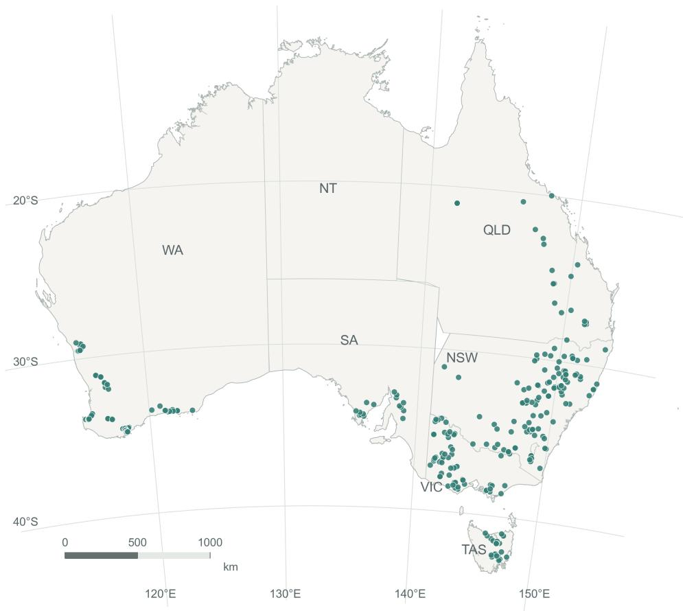  
Figure 1: Geographical distribution of the study paddocks in Australia. Points show the dataset-reported sampling locations of the 308 paddocks with 0–10 cm reference SOC values across six Australian states; they do not mark paddock centroids or boundaries, and colour does not encode SOC concentration. No sampling point was moved or omitted. Coordinates were projected to Australian Albers (EPSG:3577), and coastline and state polygons were simplified for display. Data sources: SOC-M v1 (Karunaratne et al., 2026), CSIRO Data Access Portal, DOI: 10.25919/z378- 4286, © CSIRO 2025; and Australian Bureau of Statistics (ABS) Australian Statistical Geography Standard (ASGS) Edition 3 States and Territories 2021, © Commonwealth of Australia. Both datasets are used under CC BY 4.0 (https://creativecommons.org/licenses/by/4.0/).

Table 1: Paddock-level reference SOC concentrations and retained analytical records for the 0–10 cm layer by Australian state
<table><tr><td>State</td><td>Paddocks</td><td>Records</td><td>Records/site</td><td>Mean</td><td>SD</td><td>Median</td><td>Q1-Q3</td><td>Min-max</td></tr><tr><td>NSW</td><td>103</td><td>363</td><td>3.5</td><td>20.1</td><td>10.2</td><td>18.3</td><td>14.5-24.0</td><td>3.0-69.1</td></tr><tr><td>WA</td><td>79</td><td>326</td><td>4.1</td><td>23.0</td><td>20.0</td><td>14.1</td><td>5.9-35.7</td><td>3.0-72.4</td></tr><tr><td>VIC</td><td>64</td><td>210</td><td>3.3</td><td>30.4</td><td>23.1</td><td>22.1</td><td>13.5-44.7</td><td>1.1-93.0</td></tr><tr><td>TAS</td><td>25</td><td>160</td><td>6.4</td><td>42.1</td><td>16.9</td><td>39.7</td><td>29.0–51.8</td><td>15.7–82.4</td></tr><tr><td>QLD</td><td>21</td><td>93</td><td>4.4</td><td>11.6</td><td>4.3</td><td>11.8</td><td>9.7-14.1</td><td>4.8-18.7</td></tr><tr><td>SA</td><td>16</td><td>61</td><td>3.8</td><td>15.2</td><td>5.2</td><td>13.6</td><td>12.4-16.6</td><td>10.0–30.2</td></tr><tr><td>All</td><td>308</td><td>1,213</td><td>3.9</td><td>24.0</td><td>18.0</td><td>18.0</td><td>11.8-31.3</td><td>1.1-93.0</td></tr></table>

Note. SOC concentrations are expressed in $\mathbf { g } \mathbf { C } \mathbf { k g } ^ { - 1 }$ . Each paddock contributes one reference value, calculated as the unweighted arithmetic mean of its retained 0–10 cm analytical records. Records/site is the retained record count divided by the paddock count. SD denotes the sample standard deviation; Q1–Q3 gives the 25th and 75th percentiles. Overall SOC statistics were calculated directly across all 308 paddocks, rather than by averaging state-level summaries. NSW, New South Wales; WA, Western Australia; VIC, Victoria; TAS, Tasmania; QLD, Queensland; SA, South Australia.

## 2.2 Model configurations and evaluation protocol

Seven configurations from six providers were evaluated (Table 2). A configuration denotes the requested model ID and recorded settings; provider-side versions could not be independently verified. The benchmark comprised 616 T1 items, 120 T2 items and 300 T3 pairs (Fig. 2). Each configuration had 20 planned responses per T1 or T2 item and 20 per T3 pair, split equally between presentation orders, giving 145,040 planned responses.

Table 2: Evaluated model configurations
<table><tr><td>Configuration</td><td>Provider</td><td>Model ID</td><td>Reasoning</td><td>Token limit</td></tr><tr><td>GPT-5.6 Sol</td><td>OpenAI</td><td>gpt-5.6-sol</td><td>none</td><td>1,024</td></tr><tr><td>GPT-5.6 Terra</td><td>OpenAI</td><td>gpt-5.6-terra</td><td>none</td><td>1,024</td></tr><tr><td>Claude Sonnet 5</td><td>Anthropic</td><td>claude-sonnet-5</td><td>disabled</td><td>1,024</td></tr><tr><td>Gemini 3.8 Flash</td><td>Google</td><td>gemini-3.8-flash</td><td>low</td><td>1,024</td></tr><tr><td>Grok 4.6</td><td>xAI</td><td>grok-4.6</td><td>low</td><td>1,024</td></tr><tr><td>DeepSeek V4 Pro</td><td>DeepSeek</td><td>deepseek-v4-pro</td><td>disabled</td><td>1,024</td></tr><tr><td>Mistral Medium 3.5</td><td>Mistral</td><td>mistral-medium-3-5</td><td>none</td><td>1,024</td></tr></table>

Note. Settings are those recorded in the request bodies. Token-limit definitions differed among provider interfaces, so identical numerical limits do not imply identical visible-output budgets.

Each response was requested through a separate application programming interface (API) call without conversation history, retrieval or tool access. T1 and T3 prompts included coordinates but omitted dataset names, internal paddock identifiers and reference SOC values. Temperature, top-p and seed were not specified. Reasoning controls were explicitly set to none or disabled for five configurations and low for Gemini 3.8 Flash and Grok 4.6. At the time of collection, low was the lowest setting supported by these two interfaces. These settings do not establish equivalent internal computation across providers. All requests specified a 1,024-token generation limit, subject to provider-specific counting conventions; Gemini’s limit included both thought and candidate tokens.

Responses were collected between 29 September and 5 October 2026 using a fixed interleaved, serial schedule. Operational failures could trigger retries of the same request, but answers were not retried because they were incorrect or unparseable. Exact prompts, request fields, token-limit definitions and collection details are described in the Methods section.

## 2.3 Quantitative SOC tasks

The tasks assessed three complementary operations: agreement of estimated concentration with measured SOC (T1), correct stock calculation across unit and fragment conditions (T2), and accurate paddock comparison across SOC separations and presentation orders (T3). Their distinct references, metrics and statistical contrasts are summarised in Table 3; task scores were not combined.

## 2.3.1 T1: SOC concentration estimation

T1 requested one SOC concentration in g $\mathrm { C \ k g ^ { - 1 } }$ for each paddock’s 0–10 cm layer under two nested information conditions. T1b supplied state, coordinates, depth interval and, where available, the Grains Research and Development Corporation (GRDC) region. T1a retained these fields and added historical 2012 land use, whole-soil bulk density, coarse-fragment dry-mass fraction, total nitrogen, electrical conductivity and $\mathrm { C a C l _ { 2 } \ p H }$ . Additional information was evaluated as one block, rather than through individual-field ablation. Missing fields were omitted without imputation; the benchmark used fixed prompt templates.

Absolute errors of valid finite predictions were averaged within each configuration–paddock–condition cell and then equally across paddocks to obtain mean absolute error (MAE). The information contrast was the within-paddock difference in mean error, T1b - T1a, averaged equally across paddocks; positive values indicate lower error under T1a. Relative MAE reductions were expressed as 100 × (MAE T1b - MAE T1a)/MAE T1b.

Four supervised baselines contextualised T1: the training-fold SOC median (B0); the same-state training-fold median, falling back to B0 where needed (B1); and random forests using T1a and T1b predictors (B2 and B2′, respectively; (Breiman, 2001)). All used five-fold spatial cross-validation with coordinate-based, SOC-blind clusters, and preprocess ing was fitted only on training folds. Withheld geographical groups make these spatially held-out predictions rather than random-split results (D. R. Roberts et al., 2017; Wadoux et al., 2021). The supervised baselines used measured training labels and were not like-for-like closed-book comparators (Supplementary Methods M3; Table S6).

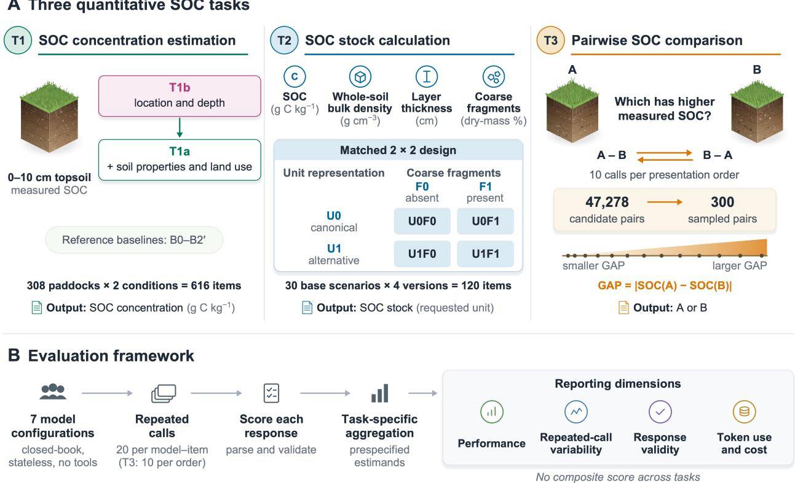  
Figure 2: Benchmark design and evaluation framework. (A) T1 evaluated SOC concentration estimation for 308 paddocks under two nested information conditions: T1a added soil properties and historical land use to the location and depth information in T1b; B0, B1, B2 and B2′ are prespecified supervised reference baselines. T2 crossed a single-dimension unit-representation condition (U0/U1) with a coarse-fragment dry-mass condition (F0/F1) across 30 base scenarios, yielding 120 items; each response gave SOC stock in the requested unit. T3 sampled 300 pairs without replacement from 47,278 eligible unordered pairs and presented each pair ten times in each presentation order; GAP, the absolute difference in reference SOC between the two paddocks, was analysed as a continuous variable. (B) Seven configurations were evaluated through stateless, closed-book calls without tools or retrieval. Responses were scored before task-specific aggregation. Performance, repeated-call variability, response validity, token use and estimated API cost were reported separately, without a cross-task composite score. The total of 145,040 refers to planned responses.

Figure 3 reports paddock-level mean errors and paired contrasts. Figure 4 shows the mean valid prediction for each paddock–condition cell against its reference, with descriptive linear fits. T1 MAE was calculated from individual responses, not from averaged predictions; the plots were added after data collection.

## 2.3.2 T2: SOC stock calculation

T2 assessed execution of a supplied equation using 30 synthetic base scenarios rather than empirical SOC-M records:

$$
\mathbf { S } = \mathbf { C } \times \mathbf { B D } \times \mathbf { d } \times ( 1 - \mathbf { C F } ) \times 0 . 1\tag{1}
$$

where S is SOC stock (t C ha-1), C is SOC concentration (g C kg-1), BD is whole-soil bulk density (g cm-3), d is layer thickness (cm), and CF is the coarse-fragment dry-mass fraction. Coarse fragments were displayed as a percentage and converted to a fraction for calculation. Under these definitions, BD(1 - CF) represents fine-soil dry mass per unit bulk-soil volume (Poeplau et al., 2017). The physical interpretation of Eq. (1) as fine-soil SOC stock requires C to be expressed per unit dry fine-soil mass. T2 evaluated execution of the supplied calculation convention, with CF defined as a dry-mass fraction rather than a volumetric fraction.

Each base scenario had four matched versions: U0F0, U1F0, U0F1 and U1F1. U0 used the equation’s units; U1 re-expressed one input or the output unit without changing the physical stock at a fixed fragment level. F0 specified no coarse fragments, whereas F1 supplied a non-zero mass fraction and changed the reference stock. All 120 references used the displayed, rounded prompt quantities. Thus, U tested representational invariance and F tested application of the specified fragment correction.

Table 3: Benchmark tasks, performance metrics and statistical contrasts
<table><tr><td>Task</td><td>Benchmark items</td><td>Primary metric</td><td>Main contrasts</td><td>Uncertainty</td></tr><tr><td>T1</td><td>308 paddocks  $\times \_ 2$  conditions (616 items); 20 responses per configuration-item; 86,240 planned re-</td><td>MAE  $( \mathbf { g } \ \mathbf { C } \ \mathbf { k g } ^ { - 1 } ) { : }$  ab- solute errors averaged within paddock and condition, then equally across paddocks</td><td>Paired T1b — T1a error difference; supervised baselines  $\tt B O \mathrm { - } \tt B \bar { 2 } ^ { \prime }$ </td><td>Point estimates only</td></tr><tr><td>T2</td><td>sponses 30 base scenarios  $\times ~ 4$  matched versions (120 items); 16,800 planned responses</td><td>Accuracy (absolute rela- tive  $\mathrm { e r r o r } \leq 2 \% ) \colon$  mean binary score across 20 re- sponses per item, then equally across items</td><td>Matched U1 — U0; F1 — FO; U × F interaction</td><td>Pointwise repeated-call 95% intervals</td></tr><tr><td>T3</td><td>300 paddock pairs × 2 presentation orders; 42,000 planned re- sponses</td><td>Direct accuracy: mean binary score within each order, then equal weight- ing of orders and pairs</td><td>21 pairwise configura- tion differences; GAP and position associations</td><td>Pointwise repeated-call 95% intervals; pointwise Wald intervals for sec- ondary estimates</td></tr></table>

Note. Response counts refer to planned responses, not request attempts or valid outputs (total: 145,040). Repeated-call intervals are conditional on the fixed benchmark items and do not include uncertainty from sampling additional paddocks, scenarios or pairs.

A valid finite response was scored as correct if its unrounded absolute relative error from the deterministic reference did not exceed the prespecified tolerance of 2%; invalid or unavailable responses were scored as incorrect. For each configuration, accuracy was calculated by averaging binary scores across the 20 planned responses per item and then equally across all 120 items. Unit-representation (U1 - U0) and coarse-fragment (F1 - F0) contrasts were calculated within each base scenario by averaging matched differences over the other factor. The U × F interaction was defined as

$$
\left( p _ { 1 1 } - p _ { 0 1 } \right) - \left( p _ { 1 0 } - p _ { 0 0 } \right)\tag{2}
$$

where $p _ { u f }$ denotes item accuracy under $U = u$ and $F = f$ within a base scenario. All contrasts were averaged equally across the 30 base scenarios and reported in percentage points. Unit-representation and coarse-fragment contrasts are shown in Figure 5B and 5C, respectively, and interaction contrasts are reported in the Supplementary Methods (M4; Table S4). Scenario ranges, unit variants and prompts are described in the Methods section.

## 2.3.3 T3: Pairwise SOC comparison

T3 tested identification of the paddock with the higher reference SOC. A simple random sample of 300 pairs was drawn without replacement from 47,278 eligible unordered pairs, without GAP stratification. Each paddock was described using its available T1a fields. The higher-SOC paddock appeared as A in ten planned responses and B in the other ten. GAP was the absolute difference between reference SOC concentrations in $\mathbf { g } \mathbf { \Lambda } \mathbf { C } \mathbf { k } \mathbf { g } ^ { - 1 }$ . Direct accuracy averaged binary correctness within each order, weighted the two orders equally within pairs, and then weighted pairs equally.

A secondary grouped-binomial model with a logit link related correctness to continuous GAP and correct-answer position. A three-degree-of-freedom natural cubic spline represented log(1 + GAP), with configuration-specific spline and position terms and penalised terms accounting for shared-paddock, pair and configuration-by-pair dependence. No GAP-by-position interaction was included on the logit scale. A separate prespecified sensitivity analysis reported accuracy for 248 pairs meeting a nominal separation threshold and the remaining 52 pairs. The threshold used a nominal 10% relative-error convention for each reference; it neither quantified measured reference uncertainty nor determined primary pair selection. Direct accuracy and conditional associations are displayed separately in Fig. 6. Full specifications are provided in the Supplementary Methods (M5).

## 2.4 Response validity, repeated-call variability and estimated cost

Outputs were scored for one task-specific answer: a finite number for T1 and T2, or A/B for T3. Strict JSON parsing and prespecified fallback acceptance were recorded separately, without reference-assisted repair. Invalid content was distinguished from terminally unavailable responses. Only valid finite predictions contributed to T1 errors; invalid and unavailable responses counted as incorrect in T2 and T3. Validity was calculated over all planned responses (Supplementary Methods M6).

Additional descriptive summaries of repeated outputs were constructed after data collection (Fig. 7A). T1 dispersion was the interquartile range (IQR) of valid predictions within each configuration–paddock–condition cell. T2 dispersion was the IQR of valid finite numerical answers within each configuration–item cell, expressed as a percentage of the absolute reference stock:

$$
D _ { \mathrm { T 2 } } = 1 0 0 \times \frac { Q _ { ( 0 . 7 5 ) } ( \hat { S } ) - Q _ { ( 0 . 2 5 ) } ( \hat { S } ) } { | S _ { \mathrm { r e f } } | } .\tag{3}
$$

Predictions and references used matching units. Valid but incorrect answers were retained. T3 disagreement was calculated separately within each configuration–pair–presentation-order cell:

$$
D _ { \mathrm { T 3 } } = 1 0 0 \times \left[ 1 - \frac { \mathrm { m a x } ( n _ { \mathrm { A } } , n _ { \mathrm { B } } ) } { n _ { \mathrm { v a l i d } } } \right]\tag{4}
$$

where $n _ { A }$ and $n _ { B }$ count valid A and B choices, respectively, and $n _ { \mathrm { v a l i d } } = n _ { A } + n _ { B }$ . Orders were not pooled when calculating disagreement. Cell-level distributions were displayed with equal cell weights; cells with fewer than two valid responses were unavailable, not assigned zero. Quartiles were calculated before display transformations. Zero numerical IQR does not establish identical answers, and zero choice disagreement does not establish correctness. These task-specific measures were not combined into a common stability score. Further implementation details are provided in Supplementary Methods M7.

API cost was estimated from interpretable provider-reported token usage across all attempts, including retries, using the fixed input and output rates recorded on 29 September 2026. Separate cached-input discounts were not applied. Reasoning tokens already included in output totals were not counted again. Missing or uninterpretable usage retained a separate unknown-cost reservation rather than being priced at zero. Reported costs were standardised rate-based estimates, not reconstructed invoices, and the recorded input and output rates are listed in Table S14.

## 2.5 Statistical analysis

Inference concerned performance on fixed benchmark items, separating finite repeated-response uncertainty from variation across potential new sites or scenarios (Miller, 2024). T2 and T3 intervals quantify repeated-call uncertainty conditional on those items and reference values, not performance on new monitoring sites. T1 was reported descriptively, without confidence intervals or tests.

Bootstrap resampling used 20 planned binary outcomes within each T2 item and ten within each T3 pair–presentationorder cell, retaining all items, conditions and aggregation weights across 10,000 replicates (Tibshirani & Efron, 1993). Invalid and unavailable outcomes remained zero scores. Repeated responses were treated as exchangeable within cells, without pairing repeat indices across cells. Bootstrap deviations from the observed estimate were multiplied by $\sqrt { n / ( n - 1 ) }$ , with $n = 2 0$ for T2 and $n = 1 0$ for T3, to account for finite-sample variance shrinkage under empirical resampling (Hesterberg, 2015). Pointwise 95% intervals used the 2.5th and 97.5th percentiles of the rescaled distributions (Supplementary Methods M6).

The 21 prespecified T3 between-configuration accuracy differences used $Z = { \Delta } / { \mathrm { S E } } ( { \Delta } )$ , with each configuration’s variance estimated as $\Sigma [ p ( 1 - p ) / 9 ] / \bar { 6 0 0 } ^ { 2 }$ over its 600 pair–position cells (p = observed ten-call cell accuracy) and the contrast SE as the square root of the two configuration variances summed, without a cross-configuration covariance term. Two-sided normal-approximation $P$ values were adjusted as one family by Holm’s step-down procedure (Holm, 1979). This adjustment did not alter individual pointwise intervals. The secondary model in Section 2.3.3 provided conditional GAP predictions and position contrasts with random effects set to zero. Pointwise 95% Wald intervals were conditional on estimated penalty parameters, not simultaneous confidence bands. No composite score was calculated across tasks.

## 3 Results

## 3.1 T1: SOC concentration estimation

Additional measured soil attributes and historical land use reduced MAE for all seven configurations (Fig. 3; Table 4). T1b MAE was 8.78–11.51 g C kg-1 versus 3.62–10.00 g C kg-1 under T1a, with paired reductions of $1 . { \overset { - } { . } } 1 { - } 6 . 2 0 \ \mathrm { g } \mathrm { C }$ kg-1 (13–62%). Gemini 3.8 Flash and Grok 4.6 had the lowest T1a errors (3.62 and 3.82 g C kg-1), whereas Mistral Medium 3.5 had the highest (10.00 g C kg-1) and smallest reduction.

Table 4: Summary performance across the three quantitative SOC tasks
<table><tr><td>Configuration</td><td>T1a MAE</td><td>T1b MAE</td><td>T1b - T1a</td><td>T2 accuracy (95% interval)</td><td>T3 accuracy (95% interval)</td></tr><tr><td>GPT-5.6 Sol</td><td>4.24</td><td>10.11</td><td>+5.87</td><td>84.0% (83.2–84.7%)</td><td>94.0% (93.9–94.2%)</td></tr><tr><td>GPT-5.6 Terra</td><td>5.11</td><td>9.97</td><td>+4.86</td><td>78.2% (77.3–79.1%)</td><td>94.2% (94.0–94.3%)</td></tr><tr><td>Claude Sonnet 5</td><td>6.65</td><td>9.87</td><td>+3.22</td><td>76.7% (75.6–77.7%)</td><td>94.3% (94.2–94.4%)</td></tr><tr><td>Gemini 3.8 Flash</td><td>3.62</td><td>8.78</td><td>+5.17</td><td>89.0% (88.4–89.7%)</td><td>94.6% (94.5–94.7%)</td></tr><tr><td>Grok 4.6</td><td>3.82</td><td>10.02</td><td>+6.20</td><td>83.2% (82.6–83.8%)</td><td>93.7% (93.4–93.9%)</td></tr><tr><td>DeepSeek V4 Pro</td><td>6.34</td><td>9.87</td><td>+3.53</td><td>76.1% (74.8–77.4%)</td><td>93.5% (93.2–93.8%)</td></tr><tr><td>Mistral Medium 3.5</td><td>10.00</td><td>11.51</td><td>+1.51</td><td>38.9% (38.1–39.6%)</td><td>90.5% (90.3–90.6%)</td></tr></table>

Note. T1 MAE and T1b - T1a are in $\mathbf { g } \mathbf { \Lambda } \mathbf { C } \mathbf { k g } ^ { - 1 }$ ; a positive paired difference denotes lower error under T1a. The paired differences were calculated from unrounded paddock scores and may differ slightly from subtraction of rounded MAEs. T2 and T3 intervals are pointwise repeated-call 95% intervals.

Paddock-level errors remained heterogeneous under both conditions (Fig. 3). Every configuration showed some increased errors after information was added; Mistral Medium 3.5 had a near-zero median paired improvement. Long upper error tails persisted despite lower average MAE.

Under T1b, measured-versus-predicted fits were shallower than the 1:1 line, particularly at high reference SOC (Fig. 4).   
Six configurations showed steeper descriptive fits with T1a information, but underprediction remained at the upper end.   
Mistral Medium 3.5 showed little change. These fits were descriptive, not externally validated calibrations.

Spatially cross-validated baselines yielded MAEs of 13.48 g C kg-1 for B0, 18.51 for B1, 14.29 for B2′ and 3.13 for B2 (Table S6). Additional measured predictors reduced random-forest MAE by 11.16 g C kg-1, more than for any LLM. All T1b LLM MAEs were below B0, but these are not like-for-like model comparisons: supervised baselines used measured labels and spatial holdout.

## 3.2 T2: SOC stock calculation

Overall T2 accuracy ranged from 38.9% to 89.0% (Table 4). Under equation-native units without coarse fragments (U0F0), six configurations achieved 92.8–100.0% accuracy; Mistral Medium 3.5 achieved 58.3% (Fig. 5A; Table S7).

Unit re-expression reduced accuracy in all configurations (Fig. 5B). The matched U1 - U0 contrast was -45.2 to -21.6 percentage points for six configurations and -1.6 for Mistral Medium 3.5; all pointwise 95% repeated-call intervals excluded zero. The F1 - F0 coarse-fragment contrast was -5.3 to +1.3 points for five configurations, -10.3 for GPT-5.6 Terra and -39.3 for Mistral Medium 3.5 (Fig. 5C).

Overall accuracies of 76.1–78.2% concealed different condition profiles for GPT-5.6 Terra, Claude Sonnet 5 and DeepSeek V4 Pro. Claude exceeded 99% in both U0 conditions but scored 59.5% and 48.7% in U1F0 and U1F1; Terra scored 79.5% under U0F1. Mistral ranged from 17.5% to 58.7% across the four conditions. The U × F interaction contrasts (Table S7) further distinguished the condition profiles. GPT-5.6 Terra had a positive U × F contrast of 17.5 percentage points, whereas Claude Sonnet 5 had a negative contrast of -11.0 points. The other five interactions remained within ±7 points.

## 3.3 T3: Pairwise SOC comparison

Direct T3 accuracy ranged from 90.5% to 94.6% across 300 pairs (Fig. 6A; Table 4). Six configurations clustered at 93.5–94.6%, compared with 90.5% for Mistral Medium 3.5. Eighteen of 21 prespecified between-configuration contrasts were significant after Holm correction, despite only a 1.1-percentage-point range among the six higher-scoring configurations (Table S9).

Reference SOC separation strongly affected accuracy: it was 97.0–99.6% for 248 pairs meeting the nominal separation threshold, but 59.1–70.9% for the remaining 52 pairs (Table S10). These 52 pairs represented 17% of the sample and accounted for most errors. The continuous-GAP model similarly showed rising conditional accuracy with greater separation (Fig. 6B).

The estimated effect of presenting the higher-SOC paddock as A rather than B was +18.1 percentage points (95% interval 9.8–26.4) for Mistral Medium 3.5, versus -1.6 to +3.4 for the other configurations (Table S8). Gemini 3.8 Flash showed a smaller positive effect (+2.7; 0.1–5.2), whereas five intervals included zero. These were conditional model estimates, not unadjusted differences between orders.

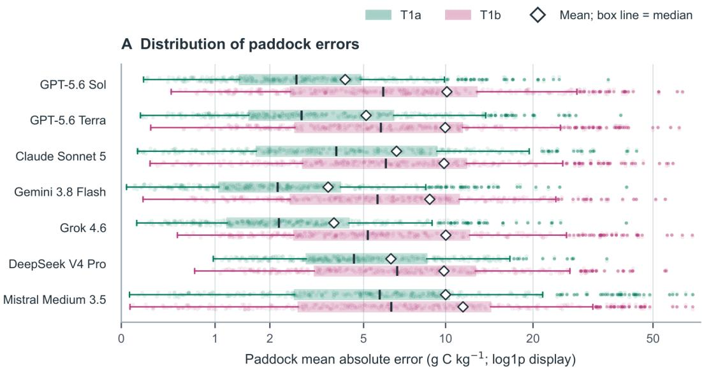

B Within-paddock change after adding information  
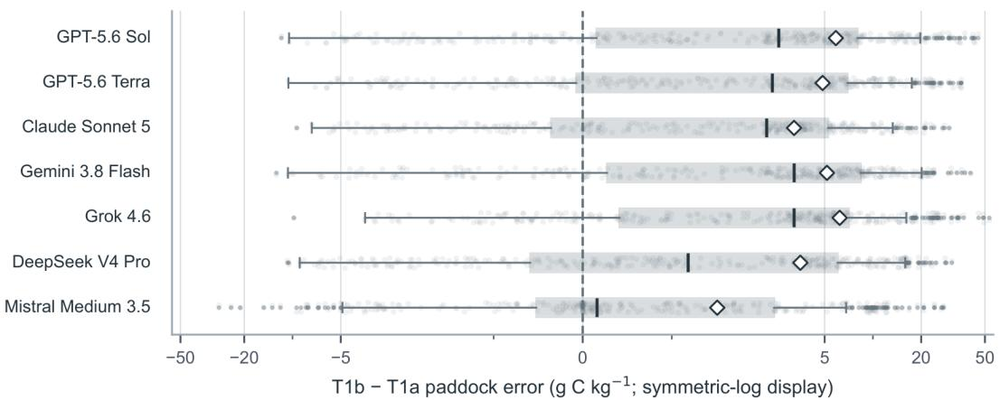  
Positive difference: lower error under T1a; outliers retained.

Figure 3: Paddock-level SOC concentration error distributions. (A) For each of the seven configurations, each T1a or T1b box contains 308 paddock-level mean absolute errors, calculated by averaging call-level absolute error over the valid finite responses for that paddock and condition. Open diamonds show the mean of these 308 values, which equals the reported MAE; box centre lines show medians. (B) Each box contains 308 within-paddock differences in mean absolute error (T1b − T1a). Positive differences indicate lower error under T1a; open diamonds show the mean paired difference. Boxes span Q1–Q3, whiskers reach the most extreme values within $\mathrm { i . 5 \times I Q R } .$ , and outliers are retained. Box statistics were computed in the original $\ \mathrm { g } \mathrm { C } \mathrm { k g } ^ { - 1 }$ units; Panel A uses a log1p display and Panel B a symmetric-log display. No T1 confidence interval or hypothesis test is implied. Supervised baselines are reported in Section 3.1 and Table S6.

## 3.4 Response validity, repeated-call variability and estimated cost

Of 145,040 planned responses, 145,011 were valid (99.98%), with at least 99.7% validity in each configuration–task cell (Fig. 7B; Table S5). Fallback parsing accounted for 10.1% of valid responses, concentrated in Gemini 3.8 Flash (67.9% in T1, 91.3% in T2, 32.8% in T3) and Claude Sonnet 5 (86.8% in T2). These proportions use each cell’s valid responses as the denominator. Repeated-call dispersion varied by configuration and condition (Fig. 7A; Table S11). T1 IQRs generally narrowed with T1a for several configurations, including Gemini 3.8 Flash, but widened for DeepSeek V4 Pro. Mistral Medium 3.5 often had near-zero T1 IQRs despite large estimation errors. T2 relative IQRs were frequently near zero but had long upper tails, especially for Claude Sonnet 5 and Mistral Medium 3.5; Claude had extreme item-level dispersion.

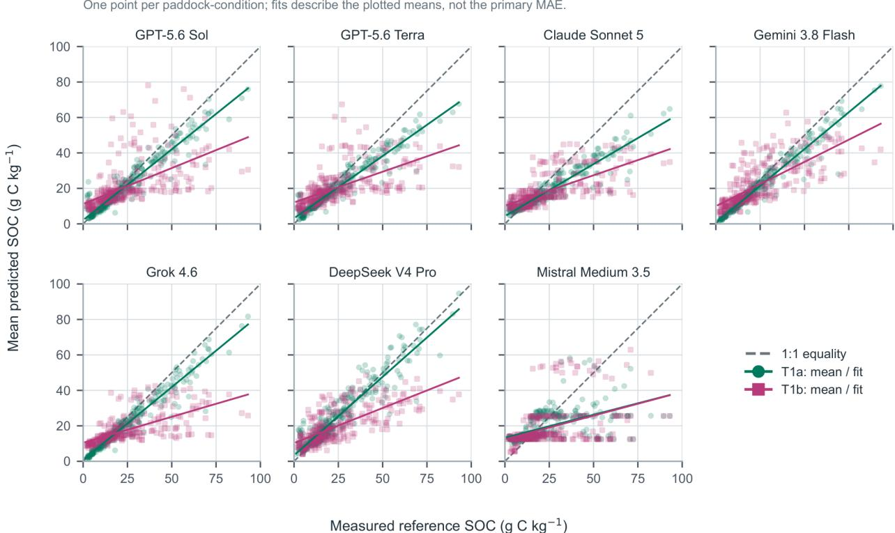  
Figure 4: Measured versus predicted SOC concentration. Each of the seven facets shows the measured 0–10 cm paddock reference against the mean valid finite prediction for that paddock under T1a (green circles) and T1b (pink squares), with 308 paddocks per condition. The dashed line is 1:1 equality; solid condition-specific lines are descriptive ordinary-least-squares fits with freely estimated intercepts, drawn only over the observed reference range. Axes are linear, share the same scale across facets, and express SOC concentration in g C kg-1. A plotted point averages valid repeated predictions; it is not an additional paddock or an MAE observation. The fitted lines are descriptive; they do not calibrate predictions and are not used for tests or intervals. MAE was scored from individual responses and generally differs from the absolute error of a mean prediction.

For T3, the proportion of estimable pair–order cells with nonzero choice disagreement ranged from 0.3% to 10.7% across configurations and canonical presentation orders (Supplementary Table S12). All 300 cells in each configuration– order group were estimable. This proportion describes cells with nonzero disagreement among valid choices, not an error rate or the mean disagreement; canonical forward and reverse orders do not by themselves identify the higher-SOC paddock’s A/B position.

Estimated API cost was US\$174.64: US\$86.30 for T1, US\$29.85 for T2 and US\$58.49 for T3 (Fig. 7C; Table S13). Configuration totals ranged from US\$7.30 (DeepSeek V4 Pro) to US\$80.92 (Grok 4.6), an approximately elevenfold difference. A separate US\$1.55 reservation for uninterpretable token usage was excluded. These were standardised provider-rate estimates, not invoiced costs.

## 4 Discussion

## 4.1 Measured inputs improve SOC indicator agreement but do not eliminate bias

The improvement with T1a information shows that LLM estimates respond to soil observations, not that they independently measure SOC. The added predictor block included bulk density, total nitrogen, pH, electrical conductivity, coarse fragments and historical land use. Supplying comparable predictors reduced the spatially cross-validated random-forest MAE by 11.16 g C kg-1, indicating substantial information content. Carbon–nitrogen coupling makes nitrogen a plausible contributor (Kirkby et al., 2011), but individual effects cannot be separated in this blockwise design. For monitoring, model-derived SOC must therefore be distinguished from laboratory observation and interpreted with the provenance and limitations of its inputs.

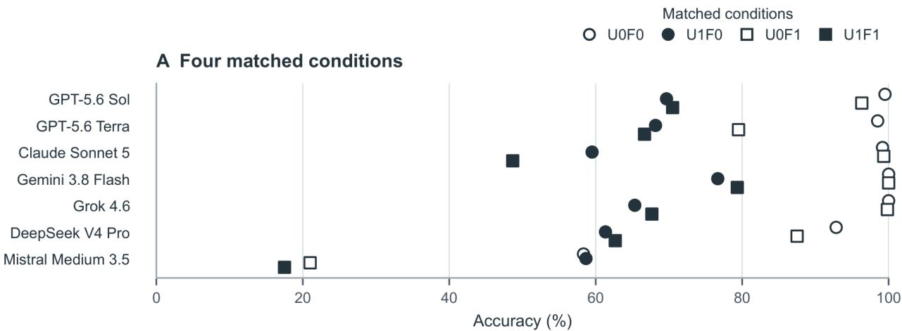

B Unit-representation contrast  
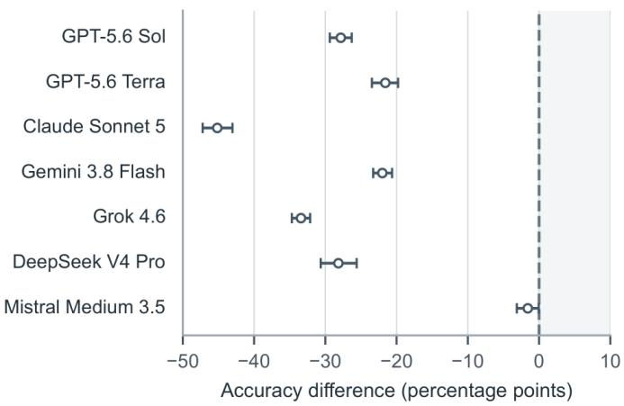

C Coarse-fragment contrast  
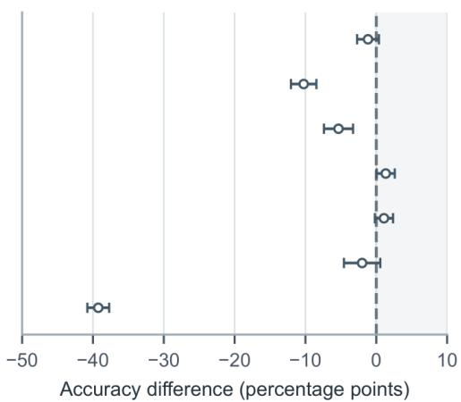  
Figure 5: SOC stock calculation under matched conditions. (A) Accuracy in the four matched unit-representation (U) and coarse-fragment (F) conditions for each configuration. Open versus filled symbols indicate U0 versus U1; circles versus squares indicate F0 versus F1. U1 changes one unit-representation dimension (SOC concentration, bulk density, layer thickness, or requested output unit) relative to U0. F1 changes the physical coarse-fragment condition and its reference stock. (B) Matched U1 − U0 accuracy difference, averaged equally over F and the 30 base scenarios. (C) Matched F1 − F0 accuracy difference, averaged equally over U and base scenarios. Points are the matched contrasts and horizontal bars their pointwise repeated-call 95% intervals, in percentage points; dashed lines indicate zero. Panels B and C share a −50 to +10 percentage-point display range. Accuracy uses the prespecified absolute-relative-error tolerance of ≤ 2%, with invalid and terminally unavailable responses scored as incorrect. U × F interaction contrasts are reported in the Results section.

Local errors and high-SOC underprediction matter beyond average MAE. Where measured SOC supports locally defined status classes, compressed high-end predictions could mischaracterise carbon-rich paddocks or reduce apparent contrasts. We did not calculate class changes or management outcomes; the concern is an interpretive risk, not an observed decision error. Soil- and climate-dependent SOC reference systems further limit universal thresholds (Bernardini et al., 2025; Dynarski et al., 2026). Concentration-dependent bias should therefore be checked before applying estimates to ecological assessment, rather than translating these results into a general soil-health classification.

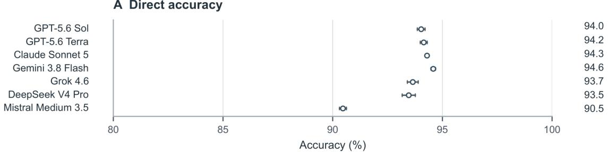

B Conditional association with GAP  
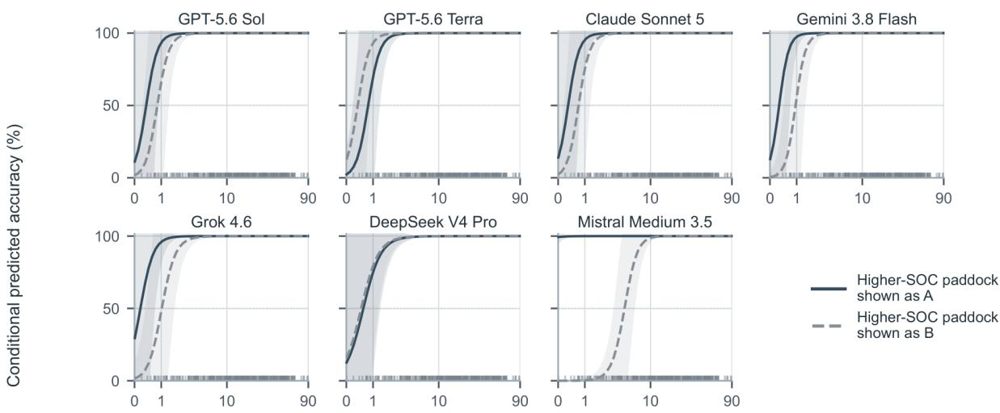  
Absolute measured SOC difference $( \mathsf { G A P } ; \mathsf { g C k g } ^ { - 1 }$ , log1p display)

Figure 6: Pairwise SOC comparison accuracy and association with SOC separation. (A) Direct accuracy gives each of the 300 paddock pairs equal weight and balances the two presentation orders within pair. Points and horizontal bars are the direct accuracy estimates and pointwise repeated-call 95% intervals; the values at right show one-decimal percentages. The horizontal axis in panel A is restricted to 80–100% for display. (B) Conditional predicted accuracy from the secondary model against the continuous absolute measured SOC difference (GAP, g C kg-1; log1p display), separately for the higher-SOC paddock shown as A or B. Shading gives pointwise, not simultaneous, 95% Wald intervals conditional on estimated penalty parameters. Shared-paddock, pair and configuration-by-pair random effects are set to zero for these curves; they are not an average of the direct scores in A. Rug marks show the 300 observed pair GAP values. The fitted model has no GAP × position interaction on the logit scale.

Sparse-input performance also has limits. The same-state median and sparse-input random forest did not outperform the global median under spatial holdout, which is not interchangeable with map-accuracy evaluation (Wadoux et al., 2021). LLMs may encode geographic information from pretraining (Manvi et al., 2024; Truong et al., 2026), and exposure to publicly available SOC-M or related soil-carbon data cannot be excluded (Baldock et al., 2013; Deng et al., 2024; Karunaratne et al., 2026). These results do not establish generalisation to unseen regions or the mechanism underlying location-based estimates.

SOC is only one dimension of soil condition: physical, chemical and biological indicators are needed to assess wider soil functions (Cusset et al., 2024; Hu et al., 2026; Zeng et al., 2025). Unverified SOC numbers cannot provide a secure basis for site-specific ecological or management claims.

## 4.2 Equivalent units expose a failure of stock-indicator consistency

Six configurations performed near ceiling on stock calculations in native units but lost approximately 22–45 percentage points of accuracy under equivalent unit re-expression. Unlike concentration, areal SOC stock depends on depth, bulk density and mass-basis conventions. These physical inputs can alter true calculated stock; unit notation alone cannot. The matched U contrast therefore tests whether the same carbon quantity survives conversion, and shows that supplying

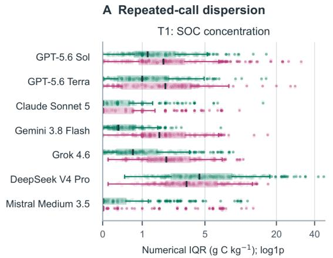  
B Response validity

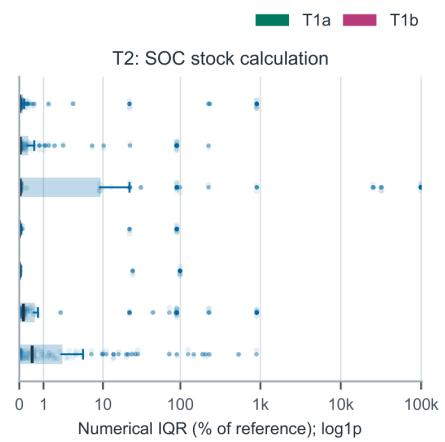

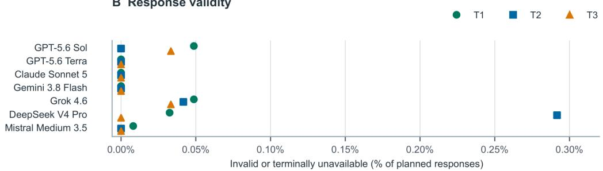

C Estimated API cost  
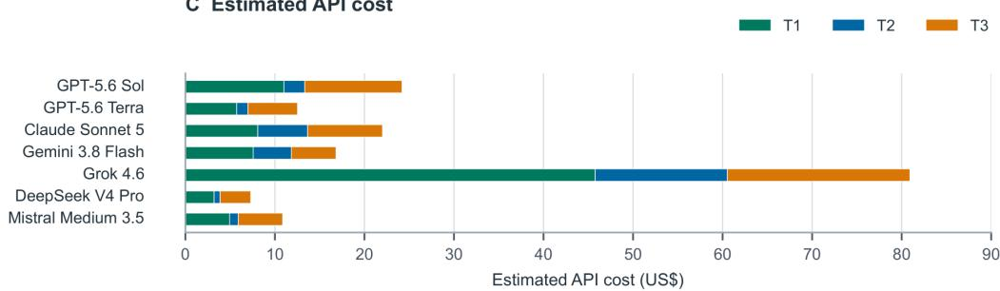  
A: equal-weight eligible cells; <2 valid calls unavailable. B/C: adopted planned denominators and cost

Figure 7: Repeated-call dispersion, response validity and estimated API cost. (A) Post-collection descriptive summary of within-cell numerical-answer dispersion for T1 and T2. T1 shows the interquartile range (IQR) of valid finite SOC predictions within each configuration–paddock–condition cell $( \mathbf { g } \mathbf { \Lambda } \mathbf { } \mathbf { } \mathbf { } \mathbf { } \mathbf { } \mathbf { } \mathbf { } \mathbf { } \mathbf { } \mathbf { } \mathbf { } \mathbf { } \mathbf { } \mathbf { } \mathbf { } \mathbf { } ( \mathbf { \Lambda } \mathbf { } \mathbf { } \mathbf { } \mathbf { } \mathbf { } \mathbf { } \mathbf { } \mathbf { } \mathbf { } \mathbf { } \mathbf { } \mathbf { } \mathbf { } \mathbf { } \mathbf { } \mathbf { } \mathbf { } \mathbf { } ( \mathbf { \Lambda } \mathbf { } \mathbf { } \mathbf { } \mathbf { } \mathbf { } \mathbf { } \mathbf { } \mathbf { } \Lambda ( \mathbf { } \mathbf { } \mathbf { } \mathbf { } \mathbf { } \mathbf { } \Xi \mathbf { } \mathbf { } \Lambda ( \mathbf { } \mathbf { } \mathbf { } \mathbf { } \mathbf { } \mathbf { } \Xi \mathbf { } \mathbf { } \Lambda \mathbf { } )  $ , separately for T1a and T1b. T2 shows 100 × IQR of valid finite stock predictions divided by the absolute reference stock in the same requested output unit, within each configuration–item cell. Each estimable cell contributes once; at least two valid responses are required. Zeros and the complete observed upper tail are retained, and log1p affects only display, not box statistics. (B) Invalid returned outputs plus responses that remained unavailable after operational failures, as percentages of planned responses; both are counted separately in Table S5. This is response validity, not accuracy. (C) Estimated API cost (US\$) by task and configuration, based on provider-reported usage rather than invoiced charges. The separate US\$1.55 reservation for attempts without interpretable usage is excluded. T3 within-order choice disagreement is reported in Supplementary Table S12.

an equation did not ensure consistency. Similar sensitivity to numerical substitutions has been reported in other LLM tests (Mirzadeh et al., 2025), although T2 specifically involved physical units.

Adding coarse fragments, unlike changing units, alters the reference stock. Correct use of the supplied dry-mass fraction remained necessary, given the sensitivity of stocks to bulk-density and fragment treatment (Fenton et al., 2024; Poeplau et al., 2017). The smaller fragment penalty for most configurations does not establish that fragment handling is intrinsically easier; the two contrasts test different operations.

For stock reporting, the input mass basis, unit conversions, fragment correction and arithmetic should be independently auditable. A deterministic implementation of the stated equation provides the appropriate calculation reference; tool-enabled comparisons and individual conversion types remain useful targets for future validation.

This distinction matters for monitoring, reporting and verification (MRV): an unchecked calculation error could enter a reported stock or apparent change even when measured soil properties were unchanged. Transparent sampling and stock-accounting procedures remain essential (Meurer et al., 2024; Schilling et al., 2026). Because T2 was synthetic, it did not measure farm-level changes, audit an MRV programme or establish the effectiveness of proposed safeguards.

## 4.3 SOC discrimination requires separation- and order-aware evaluation

High mean T3 accuracy concealed weak discrimination among closely matched paddocks. Exploratory ranking can be informative only when sites share comparable sampling depth, soil context and reference basis. Otherwise an incorrect ordering could mislead interpretation or prioritisation, although no such decisions were measured. The nominal GAP split identifies difficult comparisons within this sample, not an ecological or administrative action threshold.

Small GAP also does not imply that measured reference orderings were wrong. Reference SOC estimates have sampling and laboratory uncertainty, and field heterogeneity may exceed the changes sought in monitoring (Stanley et al., 2023). The 10% separation convention did not quantify paddock-specific uncertainty. T3 compared different paddocks, not changes over time; monitoring interpretation requires an appropriate reference population and assessment objective (Bernardini et al., 2025; Zwaan et al., 2026). Reversing A/B order preserves the reference ordering yet affected some LLM responses, most notably Mistral Medium 3.5. Such position effects have been observed in other language-model evaluations (Shi et al., 2025; Zheng et al., 2024). Balancing order reveals the bias but does not remove it; no GAPby-position interaction was fitted. Applications requiring comparisons should test both order and performance near relevant SOC separations.

Relative SOC status is also distinct from attainable carbon gain. Lower current SOC does not necessarily imply greater management potential: mineralogy, climate, historical disturbance and feasible practices constrain stocks. No such intervention potential was evaluated in T3, so pairwise rankings should not be read as management prescriptions.

## 4.4 Output validity and response dispersion are distinct from indicator quality

Repeated-call consistency is not evidence of correctness. Mistral Medium frequently produced near-zero T1 IQR despite high error, while T2 contained extreme item-level answer ranges (Fig. 7A). IQR measures dispersion among outputs, not reference uncertainty; identical-looking repeated results still require checking against measurement or a deterministic calculation (Atıl et al., 2025). Likewise, 99.98% scoreability is a response-format result, not indicator accuracy. Fallback parsing was common in selected model–task cells, underscoring the need to distinguish strict compliance from answers accepted by permissive rules.

The approximately elevenfold cost difference reflects recorded provider prices and token accounting, not intrinsic computational efficiency or environmental impact. Validity, error, repeat dispersion and estimated cost should remain separate reporting dimensions.

## 4.5 Implications for ecological-indicator monitoring and management

The task-specific findings support a proposed quality-control sequence (Table 5): define whether the target is concentration, areal stock or relative ordering; record sampling depth, measurement provenance and mass basis; then check the relevant operation against independent measurements (T1), deterministic unit-consistent calculations (T2), or reference separation and order reversal (T3). These checks follow observed failure modes but were not evaluated as a deployed management system. The benchmark statistics describe model reliability, not additional ecological state indicators (Dale & Beyeler, 2001; Heink & Kowarik, 2010).

Appropriate safeguards depend on use. For education or early-stage extension, an explicitly provisional estimate may prompt discussion about required measurements. For monitoring and land-management prioritisation, biased concentration estimates or unstable ordering warrant local references and independent review. Contractual carbon reporting additionally requires traceable stock calculations and established verification procedures (Meurer et al., 2024; Schilling et al., 2026). These are proposed decision pathways, not management effects observed in this study.

Outcome-focused ecological monitoring depends on reliable links from measured soil properties to interpretation and management (Winowiecki et al., 2026). Our study tests the numerical link for SOC, not ecosystem services or ecological responses; broader soil-health inference requires complementary indicators and appropriate reference systems (Hu et al., 2026; Zwaan et al., 2026).

Table 5: Practical interpretation of the benchmark for soil organic carbon indicator workflows.
<table><tr><td>Indicator operation</td><td>Benchmark evidence</td><td>Interpretive limitation</td><td>Minimum check before applied use</td></tr><tr><td>SOC concentration (T1)</td><td>Added measurements improved average MAE; high-SOC underprediction carbon-rich sites; no and local errors remained.</td><td>Estimated SOC may mischaracterise soil-health classes or management effects were tested.</td><td>Verify against independent 0–10 cm measurements, suitable local references and concentration-dependent bias.</td></tr><tr><td>SOC stock (T2)</td><td>Equivalent-unit re-expression reduced correctness under a supplied stock equation.</td><td>A unit-induced stock difference is an arithmetic artefact, not a change in soil carbon storage.</td><td>Document concentration mass basis, depth, bulk density and fragment convention; recalculate deterministically.</td></tr><tr><td>Paddock comparison (T3) Accuracy fell for close</td><td>SOC pairs; some A/B position effects were observed.</td><td>not establish the potential quantify measured management response.</td><td>Relative SOC ranking does Compare like soil contexts; for carbon gain or a causal uncertainty; verify both presentation orders.</td></tr><tr><td>Operational quality</td><td>Almost all responses were parseable, although repeated-call dispersion and estimated costs varied. or numerical validity.</td><td>and price are not substitutes for ecological</td><td>Formatting, reproducibility Audit strict validity, input provenance, correctness, repeat variation and costs separately.</td></tr></table>

## 4.6 Scope, limitations and future validation

The 308 empirical references cover sampled 0–10 cm areas, not whole paddocks or deeper profiles, and include sampling and analytical uncertainty. T2 comprised 30 synthetic scenarios; T3 reused the same paddock pool. Repeated-call intervals do not represent performance uncertainty for new farms or scenarios, and collection used one prompt and reasoning setting per configuration within a short period. Provider-side model versions were not independently verified; descriptive fits and dispersion summaries were prepared after collection. The study did not evaluate ecological thresholds, intervention outcomes, decision losses or tool-augmented deployment. Future validation should use independent sites, quantify reference uncertainty and prespecify tolerances linked to particular monitoring or management purposes.

## 5 Conclusions

Across three SOC tasks, LLM reliability depended on both the environmental information supplied and the representation of the problem. Added soil attributes reduced concentration error, but high-SOC underprediction and local failures remained. Stock calculations were vulnerable to physically equivalent changes in units, while comparisons were less accurate for similar paddocks and sometimes sensitive to presentation order. Near-universal parseability and low repeated-call dispersion did not guarantee correctness. The ecological-indicator contribution is to distinguish errors in estimated soil condition, derived stock and relative site ordering. These failure modes matter for interpretation, but their effects on management decisions were not tested. Before applied use, SOC estimates require measured validation, stock figures require auditable unit handling, and rankings require separation- and uncertainty-aware review. The benchmark provides a direct-response reference for future field-oriented, tool-augmented evaluation—not evidence of soil-health improvement or carbon sequestration.

## Data availability and reproducibility

The source Soil Organic Carbon Monitoring (SOC-M) dataset (version 1) is publicly available through the CSIRO Data Access Portal (https://doi.org/10.25919/z378-4286). Benchmark item definitions, prompt templates, scoring conventions and collection settings are described in the Methods section of this manuscript.

## Funding

This research was funded by the National Foundation for Australia-China Relations [NFACR240313] and the Australian Research Council [DP230101671].

## Declaration of competing interests

No.

## CRediT author contributions

Yingxuan Cheng: Writing – review & editing, Writing – original draft, Visualization, Software, Methodology, Formal analysis, Conceptualization. Tong Li and Jinran Wu: Supervision; Writing – review & editing, Visualization, Software, Methodology, Formal analysis, Conceptualization. Yayong Li, Yuchuan Fan, You-Gan Wang, and Geoffrey J. McLachlan: Writing – review & editing.

## Declaration of generative AI and AI-assisted technologies

A large language model (LLM) was used to assist with the language editing of this manuscript. The authors take full responsibility for the content and interpretation presented in this work.

## Acknowledgements

NA.

## References

Atıl, B., Aykent, S., Chittams, A., Fu, L., Passonneau, R. J., Radcliffe, E., Rajagopal, G. R., Sloan, A., Tudrej, T., Ture, F., et al. (2025). Non-determinism of “deterministic”’ LLM system settings in hosted environments.¨ Proceedings ofthe 5th Workshop on Evaluation and Comparison ofNLP Systems, 135–148.

Baldock, J., Sanderman, J., Macdonald, L., Allen, D., Cowie, A. L., Dalal, R. C., Davy, M., Doyle, R., Herrmann, T., Murphy, D., & Robertson, F. (2013). Australian Soil Carbon Research Program.

Bernardini, L. G., Bruni, E., Izquierdo-Verdiguier, E., Keiblinger, K. M., Rosinger, C., & Bodner, G. (2025). Benchmarking the benchmark: Comparison of methods for soil health assessment. Geoderma, 464, 117619.

Breiman, L. (2001). Random forests. Machine Learning, 45(1), 5–32.

Brown, T. B., Mann, B., Ryder, N., Subbiah, M., Kaplan, J., Dhariwal, P., Neelakantan, A., Shyam, P., Sastry, G., Askell, A., Agarwal, S., Herbert-Voss, A., Krueger, G., Henighan, T., Child, R., Ramesh, A., Ziegler, D. M., Wu, J., Winter, C., . . . Amodei, D. (2020). Language models are few-shot learners. Advances in Neural Information Processing Systems, 1877–1901.

Cahyana, D., Hadiarto, A., Irawan, Hati, D. P., Pratamaningsih, M. M., Karolinoerita, V., Mulyani, A., Sukarman, Hikmat, M., Ramadhani, F., Gani, R. A., Yatno, E., Heryanto, R. B., Suratman, Gofar, N., & Suriadikusumah, A. (2024). Application of ChatGPT in soil science research and the perceptions of soil scientists in Indonesia. Artificial Intelligence in Geosciences, 5, 100078.

Cantonjos, N. A. P., & Biswas, A. (2026). AgroAskAI: A multi-agentic AI framework for supporting smallholder farmers’ enquiries globally. Proceedings ofthe AAAI Conference on Artificial Intelligence, 40(47), 40217– 40223.

Cheng, Y., Wu, J., Tian, X., Li, Y., Fang, J., & Li, T. (2026). Foundation models for soil organic carbon: Evidence, process integration and future directions. Ecological Frontiers, 47.

Cui, H., Chang, X., & Gang, S. (2026). Optimizing data preprocessing and hyperparameter tuning for soil organic carbon content prediction using large language models: A case study of the black soil and windblown sandy soil regions in Northeast China. Applied Sciences, 16(7), 3349.

Cusset, E., Bennegadi-Laurent, N., Recous, S., Bernard, P.-Y., Perrin, A.-S., Tscheiller, R., Trinsoutrot-Gattin, I., & Riah-Anglet, W. (2024). Which soil microbial indicators should be included in routine laboratory tests to support the transition to sustainable management of arable farming systems? A meta-analysis. Ecological Indicators, 167, 112706.

Dale, V. H., & Beyeler, S. C. (2001). Challenges in the development and use of ecological indicators. Ecological indicators, 1(1), 3–10.

Deng, C., Zhao, Y., Tang, X., Gerstein, M., & Cohan, A. (2024). Investigating data contamination in modern benchmarks for large language models. Proceedings of the 2024 Conference of the North American Chapter of the Associationfor Computational Linguistics: Human Language Technologies (Volume 1, Long Papers), 8706– 8719.

Dorm, F., Millard, J., Purves, D., Harfoot, M., & Aodha, O. M. (2026). Large language models possess some ecological knowledge, but how much? Ecological Informatics, 95, 103699.

Du, Y., Minasny, B., Ng, W., Zhang, L., Saby, N. P., Zhou, Y., van Wesemael, B., Ma, Y., Wang, Z., Luo, Z., et al. (2026). Spatiotemporal modelling of soil organic carbon: Integrating process-based and machine learning approaches. Geoderma, 473, 117967.

Dynarski, K. A., Adeleke, E., Baumhardt, R. L., Burke, J., Carter, T., DeLaune, P., Gan, H., Grossman, J., Heitman, J., Kandanool, D., Lewis, K., Naasko, K., O’Kelley, R., Osmond, D., Perrone, S., Presley, D., Racelis, A., Tao, H., Tomlinson, P., . . . Wills, S. A. (2026). Soil health indicator variability and management sensitivity across soils, bioregions, and agricultural systems. Agriculture, Ecosystems and Environment, 399, 110203.

Farrell, M., Karunaratne, S., Pasut, C., Asanopoulos, C., Stower, L., Adkins, P., Carter, T., Macdonald, L., McGowan, J., Moreton, R., et al. (2025). Soil Organic Carbon Monitoring (SOC-M): Updated field and laboratory methodologies. CSIRO Data Set, 6793.

Fenton, O., Bondi, G., Bracken, C., O’Sullivan, L., Lopez-Sangil, L., Tuohy, P., & Daly, K. (2024). Relative and absolute difference in soil organic carbon stocks in grassland soils in Ireland: Impact of rock fragments, bulk density and calculation methods. Geoderma Regional, 36, e00769.

Heink, U., & Kowarik, I. (2010). What are indicators? On the definition of indicators in ecology and environmental planning. Ecological indicators, 10(3), 584–593.

Hesterberg, T. C. (2015). What teachers should know about the bootstrap: Resampling in the undergraduate statistics curriculum. The american statistician, 69(4), 371–386.

Holm, S. (1979). A simple sequentially rejective multiple test procedure. Scandinavian Journal of Statistics, 65–70.

Hu, Y., Cross, A., Shen, Z., Bouma, J., & Viscarra Rossel, R. A. (2026). On soil health and the pivotal role of sensing. Soil, 12(1), 227–252.

Ji, Z., Lee, N., Frieske, R., Yu, T., Su, D., Xu, Y., Ishii, E., Bang, Y. J., Madotto, A., & Fung, P. (2023). Survey of hallucination in natural language generation. ACM Computing Surveys, 55(12), 1–38.

Karunaratne, S., et al. (2026). Soil Organic Carbon Monitoring project. https://doi.org/10.25919/z378-4286

Khandekar, N., Jin, Q., Xiong, G., Dunn, S., Applebaum, S. S., Anwar, Z., Sarfo-Gyamfi, M., Safranek, C. W., Anwar, A. A., Zhang, A., Gilson, A., Singer, M. B., Dave, A., Taylor, A., Zhang, A., Chen, Q., & Lu, Z. (2024). MedCalc-Bench: Evaluating large language models for medical calculations. Advances in Neural Information Processing Systems, 84730–84745.

Khanifar, J. (2025). Evaluating AI-generated responses from different chatbots to soil science-related questions. Soil Advances, 3, 100034.

Kirkby, C., Kirkegaard, J., Richardson, A., Wade, L., Blanchard, C., & Batten, G. (2011). Stable soil organic matter: A comparison of C: N: P: S ratios in Australian and other world soils. Geoderma, 163(3-4), 197–208.

Leitao, R., Podpecan, V., Cunha, L., Vazquez, C., David, F., Imbert, C., Symanczik, S., Sousa, J. P., Bˇ unemann, E. K.,¨ Debeljak, M., et al. (2026). Rapid evidence mapping of soil fauna responses to agricultural management assisted by large language models. Geoderma, 471, 117890.

Li, C., Deng, W., Lu, M., & Yuan, B. (2026). AtmosSci-Bench: Evaluating the recent advance of large language model for atmospheric science. Advances in Neural Information Processing Systems, 38.

Li, T., Beniwal, D., Dalal, R. C., Manning, S., Fu, P., Xia, A., Wu, J., Liu, Q., Filipovic, V., Tsiminis, G., et al. (2026).´ Mid-infrared spectroscopy for soil organic carbon estimation. Part II: Evaluating preprocessing at global and national scales. Soil and Tillage Research, 262, 107237.

Li, T., Tian, X., Dalal, R. C., Kyriazopoulos, A., Sharififar, A., Xia, A., Pandey, R., Fu, P., Bolan, N., Wu, J., et al. (2026). Beyond carbon measurement: Turning agricultural carbon into credible climate action. The Innovation, 7(9).

Li, T., Xia, A., Dalal, R. C., Manning, S., Beniwal, D., Xu, Z., Pandey, R., Cui, L., Chen, S., Fu, P., et al. (2026). Mid-infrared spectroscopy for soil organic carbon estimation. Part I: Global review and meta-analysis. Soil and Tillage Research, 262, 107236.

Manvi, R., Khanna, S., Mai, G., Burke, M., Lobell, D. B., & Ermon, S. (2024). GeoLLM: Extracting geospatial knowledge from large language models. International Conference on Learning Representations.

Meurer, K. H., Hendriks, C. M., Faber, J. H., Kuikman, P. J., van Egmond, F., Garland, G., Putku, E., Barancikova, G., Makovn´ıkova, J., Chenu, C., et al. (2024). How does national SOC monitoring on agricultural soils align with the EU strategies? An example using five case studies. European Journal ofSoil Science, 75(2), e13477.

Miller, E. (2024). Adding error bars to evals: A statistical approach to language model evaluations. arXiv preprint arXiv:2411.00640.

Minasny, B., McBratney, A., Dematte, J. A., Romˆ an Dobarco, M., & Smith, P. (2026). Enhancing soil science research´ with multi-agent artificial intelligence systems. Frontiers in Science, 4, 1721295.

Mirzadeh, I., Alizadeh, K., Shahrokhi, H., Tuzel, O., Bengio, S., & Farajtabar, M. (2025). GSM-Symbolic: Understanding the limitations of mathematical reasoning in large language models. The Thirteenth International Conference on Learning Representations (ICLR 2025).

Padarian, J., Stockmann, U., Minasny, B., & McBratney, A. (2022). Monitoring changes in global soil organic carbon stocks from space. Remote Sensing ofEnvironment, 281, 113260.

Pasut, C., Asanopoulos, C., Zhao, X., Farrell, M., Li, M., Powell, A., Reed, G., Adkins, P., Carter, T., McBeath, A., et al. (2026). Key soil attributes and land-management dataset for Australian agroecosystems linking baseline and resampling surveys. Scientific Data.

Pavlidis, N., Perifanis, V., Symeonidis, S., & Efraimidis, P. S. (2026). Large language models as universal predictors? An empirical study on small tabular datasets. In Model and data engineering (pp. 109–116). Springer.

Poeplau, C., Vos, C., & Don, A. (2017). Soil organic carbon stocks are systematically overestimated by misuse of the parameters bulk density and rock fragment content. Soil, 3(1), 61–66.

Roberts, A., Raffel, C., & Shazeer, N. (2020). How much knowledge can you pack into the parameters of a language model? Proceedings ofthe 2020 conference on empirical methods in natural language processing (EMNLP), 5418–5426.

Roberts, D. R., Bahn, V., Ciuti, S., Boyce, M. S., Elith, J., Guillera-Arroita, G., Hauenstein, S., Lahoz-Monfort, J. J., Schr”oder, B., Thuiller, W., Warton, D. I., Wintle, B. A., Hartig, F., & Dormann, C. F. (2017). Cross-validation strategies for data with temporal, spatial, hierarchical, or phylogenetic structure. Ecography, 40(8), 913–929.

Samsami, R., & Sayed, K. (2026). Grounding large language models (LLMs) in agency standards: A controlled comparison of closed-book, retrieval-augmented, and full-document question answering for construction inspection.

Schilling, F., Beesigamukama, D., & Tanga, C. M. (2026). Reliability of approaches for measuring soil organic carbon and implications for results-based payments for smallholder carbon farming. Journal of Environmental Management, 398, 128562.

Shi, L., Ma, C., Liang, W., Diao, X., Ma, W., & Vosoughi, S. (2025). Judging the judges: A systematic study of position bias in LLM-as-a-judge. Proceedings ofthe 14th International Joint Conference on Natural Language Processing and the 4th Conference ofthe Asia-Pacific Chapter ofthe Associationfor Computational Linguistics, 292–314. https://doi.org/10.18653/v1/2025.ijcnlp-long.18

Stanley, P., Spertus, J., Chiartas, J., Stark, P. B., & Bowles, T. (2023). Valid inferences about soil carbon in heterogeneous landscapes. Geoderma, 430, 116323.

Tian, X., Liu, Q., Dalal, R. C., Li, T., Wu, J., McLachlan, G. J., Chapman, S., & Dang, Y. P. (2026). Versioned soil organic carbon maps for climate-resilient and sustainable cities: A ridge-penalised linear mixed-effects ensemble of MIR-based predictions. Physics and Chemistry ofthe Earth, Parts A/B/C, 104390.

Tibshirani, R. J., & Efron, B. (1993). An introduction to the bootstrap. Monographs on Statistics and Applied Probability, 57(1), 1–436.

Truong, T. H., Lau, J. H., & Qi, J. (2026). GPSBench: Do large language models understand GPS coordinates? arXiv preprint arXiv:2602.16105.

Vacareanu, R., Negru, V.-A., Suciu, V., & Surdeanu, M. (2024). From words to numbers: Your large language model is secretly a capable regressor when given in-context examples. First Conference on Language Modeling.

Wadoux, A. M.-C., Heuvelink, G. B., De Bruin, S., & Brus, D. J. (2021). Spatial cross-validation is not the right way to evaluate map accuracy. Ecological Modelling, 457, 109692.

Wang, X., Hu, Z., Lu, P., Zhu, Y., Zhang, J., Subramaniam, S., Loomba, A. R., Zhang, S., Sun, Y., & Wang, W. (2024). Scibench: Evaluating college-level scientific problem-solving abilities of large language models. Proceedings ofthe 41st International Conference on Machine Learning, 50622–50649.

Winowiecki, L., Bargues-Tobella, A., Chevallier, R., Linden, H., Trautman, S., Arinloye Ademonla, D., Bayala, J.,´ Chacha, R., Hannam, J., Kimaro, A., et al. (2026). Measuring what matters: Soil health as the missing metric in climate-smart agriculture monitoring. Frontiers in Sustainable Food Systems, 10, 1814366.

Xu, B., Li, Z., Yang, Y., Wu, G., Wang, C., Tang, X., Li, Y., Wu, Z., Su, Q., Shi, X., et al. (2025). Evaluating and advancing large language models for water knowledge tasks in engineering and research. Environmental Science & Technology Letters, 12(3), 289–296.

Yan, L., Wang, H., Tang, C., Liu, H., Sun, T., Liu, L., Guan, Y., & Jiang, J. (2026). Agrieval: A comprehensive Chinese agricultural benchmark for large language models. Proceedings of the AAAI Conference on Artificial Intelligence, 40(40), 34205–34213.

Zeng, Y., Verhoef, A., Vereecken, H., Ben-Dor, E., Veldkamp, T., Shaw, L., Van Der Ploeg, M., Wang, Y., & Su, Z. (2025). Monitoring and modeling the soil-plant system toward understanding soil health. Reviews of Geophysics, 63(1).

Zheng, C., Zhou, H., Meng, F., Zhou, J., & Huang, M. (2024). Large language models are not robust multiple choice selectors. International Conference on Learning Representations.

Zwaan, R., Verwijmeren, M., Rutgers, M., Swart, E., Schoffelen, N., Moinet, G., Vazquez, C., & Creamer, R. (2026). Soil health indices in disagreement: A systematic review and comparison of soil health assessment methods. Soil Biology and Biochemistry, 110184.

Reliability of large language models for soil organic carbon indicators: An Australian benchmark of estimation, stock calculation and pairwise comparison

## Supplementary Methods

## M1 Data provenance and reference construction

The empirical dataset was version 1 of the CSIRO Soil Organic Carbon Monitoring (SOC-M) release (csiro:69217v1; DOI: 10.25919/z378-4286). Of 3,644 records in SOCM\_AllAnalytical.csv, 1,213 had numerical upper and lower depths of 0 and 10 cm, respectively, representing 308 distinct SCaRP\_ID values. Each paddock's reference SOC concentration was the unweighted mean of its retained OC\_ODSoil values. This oven-dry-corrected variable is reported in mg C g−1 soil, numerically equivalent to g C kg⁻¹. Records within a paddock were not treated as independent paddocks. Table S1 gives record counts and source-site classifications (Karunaratne et al., 2026; Pasut et al., 2026).

No analytical-method exclusions or inter-method conversions were applied. Although the reference measurements were classified within a dry-combustion method family, the available source dictionary and methodology report do not establish the exact method or fine-earth versus whole-soil mass denominator for each OC\_ODSoil record (Farrell et al., 2025). ManageClass\_2012 describes historical land use, not necessarily management at the later sampling date.

State, coordinates, GRDC region and historical land use were linked by SCaRP\_ID from

SOCM\_FarmDataManagemement.csv; depths and soil properties came from the retained analytical records. Each paddock contributed one reference value and one input-field block. Figure 1 in the main text uses source-reported locations and ABS ASGS Edition 3 (2021) boundaries, projected to Australian Albers. WGS84 was assumed for the source coordinates but was not verified for every record. Table S2 lists the input fields and their missingness. Missing prompt fields were omitted, whereas random-forest predictor imputation was fitted within training folds.

## M2 Model requests and collection protocol

The seven API configurations, provider-native request fields and output limits are listed in Table S3. Each planned response was an independent, stateless, closed-book call without conversation history, retrieval, executable tools or reference answers. Temperature, top-p and seed were unspecified. Reasoning settings were none, disabled or low, as applicable; these controls are not equivalent across providers. Each request specified an output limit of 1,024 under its provider's token-accounting convention, which did not necessarily correspond to 1,024 visible tokens.

Calls followed a serial, interleaved schedule: 616 T1 paddock–condition items, 120 T2 items and 300 T3 pairs, with 20 planned responses per configuration–item or pair. Across seven configurations, the planned totals were 86,240 (T1), 16,800 (T2) and 42,000 (T3), or 145,040 overall. Up to four physical attempts per planned response were allowed for operational failures; retries preserved the same logical response position. Incorrect or unparseable answers were not retried. The collection audit recorded 145,117 attempt intents, 145,016 returned outputs, five invalid outputs and 24 terminally unavailable responses (Table S5).

## M3 T1 prompts and supervised baselines

T1b supplied state, source-precision coordinates, depth (0–10 cm) and GRDC region when available. T1a added historical 2012 land use, whole-soil bulk density, coarse-fragment dry-mass fraction, total nitrogen, electrical conductivity and CaCl₂ pH. The sole missing GRDC value was omitted in both conditions. The common T1 system prompt was:

You are given structured information about a soil observation.

Estimate the soil organic carbon (SOC) concentration.

Report the value in g/kg.

Respond with a single JSON object and nothing else.

User prompts used the following field order, omitting unavailable fields; the six added property fields appeared only in T1a. Braced expressions below indicate substitution slots, not literal model inputs. Numerical precision matched the archived rendered items.

State: {state}

Latitude: {latitude} decimal degrees

Longitude: {longitude} decimal degrees

Upper soil depth: {upper depth} cm

Lower soil depth: {lower depth} cm

GRDC region code (categorical): {GRDC region}

Historical/baseline 2012 land-use class: {land-use class}

Whole-soil bulk density: {bulk density} g/cm3

Coarse-fragment dry-mass fraction (>=2 mm; 0-1): {fraction} g/g

Total nitrogen (oven-dry soil): {total nitrogen} mg N/g soil $( = \mathrm { g } \mathrm { N } / \mathrm { k g } )$

Electrical conductivity (1:5 soil:water): {conductivity} µS/cm

pH (0.01 M CaCl2): {pH}

Return: {"prediction": <number in g/kg>}

Four label-informed baselines used the same 308 paddocks and five spatial folds (79, 79, 33, 21 and 96 paddocks; seed 2026092902). Approximate planar-kilometre coordinates were grouped by five-cluster k-means without SOC labels. B0 predicted the training-fold SOC median; B1 used the same-state training median, with B0 as fallback. B2 and B2′ were random forests with T1a and T1b inputs, respectively (Breiman, 2001). Both forests used 500 trees, bootstrapping, squared-error splits, min\_samples\_leaf=2, max\_features=1.0 and seed 2026092904, without response-guided tuning. Numerical medians, categorical modes and category levels were fitted within each training fold, with unseen holdout categories assigned a dedicated level. Table S6 reports MAEs. These label-trained baselines are contextual rather than directly comparable closed-book models.

## M4 T2 scenarios, unit variants and scoring

Thirty synthetic base scenarios crossed unit representation (U0/U1) with coarse fragments (F0/F1), yielding 120 matched items (seed 2026092903). Generator ranges were SOC $1 { - } 9 5 \mathrm { g C k g ^ { - 1 } }$ , whole-soil bulk density $0 . 6 { - } 2 . 1 \ \mathrm { g } \ \mathrm { c m } ^ { - 3 } .$ layer thickness 5, 10, 15, 20 or 30 cm, and F1 coarse-fragment dry-mass fraction 0.08–0.40. SOC and bulk density were displayed to four significant figures, thickness in its specified unit, and fragments to one decimal percent. F0 specified 0.0% fragments; F1 specified a nonzero fraction and therefore changed reference stock. U1 changed one unit representation dimension per base scenario, consistently across F0 and F1 (Table S4). The 120 displayed scenarios and reference values are provided in the separate machine-readable T2 CSV.

The supplied stock convention was $\mathbf { S } = \mathbf { C } \times \mathbf { B D } \times \mathbf { d } \times ( 1 - \mathbf { C F } ) \times 0 . 1$ , with C in g C kg⁻¹, whole-soil BD in g cm⁻³, d in cm, CF as a dry-mass fraction, and S in t C ha⁻¹. Displayed fragment percentages were divided by 100. The convention uses whole-soil bulk density and a fragment dry-mass correction; it does not independently establish the SOC mass basis required for a physical fine-earth-stock interpretation. References were recalculated from displayed values after rounding and in the requested output unit. The T2 system prompt was:

You are given the quantities required to calculate a soil organic carbon stock.

Bulk density is whole-soil bulk density.

Coarse-fragment content is the dry-mass percentage of material >= 2 mm.

Use the following stock-calculation convention: SOC × whole-soil bulk density × layer thickness × (1 - coarse-

fragment dry-mass fraction) × 0.1 gives t C/ha.

Calculate the SOC stock for the described soil layer.

Report the value in {requested output unit}.

Respond with a single JSON object and nothing else.

Soil organic carbon concentration: {displayed SOC} {displayed SOC unit}

Whole-soil bulk density: {displayed bulk density} {displayed bulk-density unit}

Layer thickness: {displayed thickness} {displayed thickness unit}

Coarse-fragment content (>= 2 mm, dry mass): {displayed percentage} %

Return: {"prediction": <number in {requested output unit}>}

Finite responses within 2% absolute relative error of the deterministic displayed-value reference were correct; invalid and terminally unavailable responses were incorrect. Overall accuracy equally weighted the 20 planned binary responses per item and the 120 items. Within each base, U1 − U0 was averaged across fragment conditions, F1 − F0 across unit conditions, and U×F was $( { \mathsf { p } } 1 1 - { \mathsf { p } } 0 1 ) - ( { \mathsf { p } } 1 0 - { \mathsf { p } } 0 0 )$ ; contrasts were then averaged across 30 bases. Table S7 presents accuracies, contrasts and pointwise 95% intervals; Figure S1 shows the interaction.

## M5 T3 pairs and secondary model

From 47,278 eligible unordered paddock pairs, 300 were sampled without replacement using Python 3.14.3 random.Random (seed 2026092803), without stratification by SOC separation (GAP). Each paddock was described by its available T1a fields. For each configuration and pair, ten presentations placed the higher-reference-SOC paddock at A and ten at B. 'Forward' and 'reverse' denote canonical order, not the correct answer's position. The common T3 system prompt was:

You are given two soil observations, A and B.

Each observation is described using the available fields; unavailable fields are omitted.

Determine which observation has the higher soil organic carbon concentration.

Respond with a single JSON object and nothing else.

Observation A:

{available T1a-style field block for paddock A}

Observation B:

{available T1a-style field block for paddock B}

Return: {"prediction": "A"} or {"prediction": "B"}

The secondary analysis fitted 4,200 grouped-binomial cells (ten responses per configuration × pair × correct-answer position) using a logit link and three natural-cubic-spline terms (ns1–ns3) for log(1 + GAP), where GAP is the absolute reference-SOC difference (g C kg⁻¹). Boundary knots on the transformed scale were 0.006843268335663492 and 4.500598051049834; internal knots were 2.3535087659030087 and 3.2549810677995037. The fixed-effect formula was model\_code × (ns1 + ns2 + ns3 + correct\_position), comprising 35 columns with no GAP × position interaction. Penalised random-effect terms represented shared paddocks (Zsite, 265 columns), pairs (Zpair, 300) and configuration by-pair combinations (Zmp, 2,100); each pair loaded its two paddocks at weight 1/√2. The full 2,700-column penalised system was fitted by Schur elimination under Laplace-REML. Final penalties were 0.020725558758481682 (Zsite), 0.02758502575444963 (Zpair) and 0.06503432748159946 (Zmp). Fit diagnostics and a code hash were archived; original NumPy and SciPy package versions were not recorded.

Conditional GAP curves set random effects to zero and used the fitted fixed coefficients. Pointwise 95% Wald intervals incorporate fixed-effect conditional covariance but condition on the estimated penalties; they are neither simultaneous bands nor averages of direct accuracy. The conditional A − B position contrast averages predicted-probability differences over the 300 observed GAP values (Table S8). Table S9 reports 21 pairwise configuration differences with Holm-adjusted P values. The prespecified nominal separation rule, $| \mathbf { C } 1 - \mathbf { C } 2 | \geq 2 \sqrt { [ ( 0 . 1 0 \mathbf { C } 1 ) ^ { 2 } + ( 0 . 1 0 \mathbf { C } 2 ) ^ { 2 } ] }$ , was met by 248 pairs; 52 did not meet it (Table S10). The 10% assumption is a nominal comparison convention, not a measured reference-uncertainty estimate, and did not affect pair selection or the continuous-GAP model.

## M6 Parsing, aggregation and repeated-call uncertainty

The strict parser required one task-specific JSON object containing a numerical estimate (T1/T2) or A/B choice (T3). Predefined fallbacks allowed embedded JSON, a JSON-string number, a lone number or a lone A/B label, as appropriate; references were never used to repair responses. Invalid returned output and terminal operational failure were recorded separately (Table S5). T1 absolute errors were calculated on valid finite calls, then averaged within paddock and equally across paddocks; T1b − T1a was paired within paddock when both conditions were estimable. Finite negative or extreme predictions remained in the analysis. For T2/T3, invalid and terminally unavailable positions counted as incorrect among planned responses.

For T2, 10,000 bootstrap replicates (seed 2026100201) resampled 20 binary scores within each configuration × base × U × F cell. For T3, 10,000 replicates (seed 2026092943) resampled ten binary scores within each configuration × pair × correct-position cell. All benchmark items and equal weights were retained; repeat indices were not matched across cells. Deviations from each observed estimate were rescaled by √[n/(n − 1)] (n = 20 for T2; n = 10 for T3), and pointwise 95% intervals used the 2.5th and 97.5th percentiles (Efron and Tibshirani, 1993; Hesterberg, 2015). These intervals describe repeated-call variation on fixed items, not uncertainty for new sites, scenarios or pairs. No T1 confidence intervals or tests were used. For T3 configuration comparisons, the fixed-bank variance estimate was V\_m = Σ\_c p\_mc(1 − p\_mc)/9 ÷ 600², where p\_mc is the observed success proportion in pair–position cell c (n = 10). Contrast standard errors were √(V\_a + V\_b), without cross-configuration covariance; two-sided normal P values were 2Φ(−|Δ|/SE). Holm adjustment covered 21 comparisons; unavailable tests were assigned P = 1 for adjustment but

reported as unavailable (Holm, 1979). Zero-variance cells retained point estimates but had unavailable repeated-call intervals; pointwise endpoints were not Holm-adjusted.

Theoretical U×F interaction bounds are −2 to 2 on the proportion scale. The archived interval routine clipped contrast endpoints to −1 to 1; saved unrounded endpoints show that this did not affect any of the seven interaction intervals. No estimates or intervals were recalculated for this supplement.

## M7 Post-collection descriptive displays

Main Figure 3 displays paddock-level mean absolute errors and paired T1b − T1a differences; diamonds mark means and box statistics use the original g C kg⁻¹ scale. The log1p and symmetric-log axes affect presentation only. Main Figure 4 plots each paddock's mean valid prediction against its measured reference, with descriptive ordinary-leastsquares fits; these means were not used to calculate call-level MAE.

Main Figure 7A summarises within-cell dispersion using NumPy linear-interpolation quartiles. T1 uses the IQR of valid finite SOC estimates (g C kg⁻¹) by configuration × paddock × condition; T2 uses 100 × IQR/|reference stock| (%) by configuration × item, with matching output units. Valid but incorrect predictions remain included. Cells with fewer than two valid answers are unavailable, not zero. Each estimable cell has equal weight; zero IQRs and extreme values are retained (Table S11). Log1p transforms apply only to the display.

T3 choice disagreement was calculated within each configuration × pair × canonical-order cell as 100 × [1 − max(nA, nB)/nvalid] among valid choices. Cells with fewer than two valid responses were unavailable; zero disagreement indicates identical choices, not correctness. Table S12 reports zero and nonzero disagreement. These post-collection analyses are descriptive and were not combined into a stability score; archived sample-standard-deviation summaries were not substituted for IQR results.

## M8 Token accounting and estimated cost

Provider usage was normalised to avoid double counting: Gemini candidate and thought tokens were combined once, while nested reasoning tokens already included in output totals were not added again. The recorded 29 September 2026 input/output rates were applied without separate cached-input discounts. All attempts with interpretable usage, including retries, contributed to estimated cost; unknown-usage attempts retained a separate reservation rather than zero cost. Tables S13 and S14 report usage, task-level costs, rates and price sources. These are standardised estimates, not invoices or comparable measures of internal computation.

## Supplementary Tables

Table S1. Retained 0–10 cm analytical records per paddock
<table><tr><td>Site class</td><td>Retained rows per paddock</td><td>Paddocks</td><td>Analytical rows</td><td></td></tr><tr><td>Standard</td><td></td><td>1</td><td>205</td><td>205</td></tr><tr><td>Standard</td><td></td><td>2</td><td>2</td><td>4</td></tr><tr><td>Detailed</td><td></td><td>9</td><td>6</td><td>54</td></tr><tr><td>Detailed</td><td></td><td>10</td><td>95</td><td>950</td></tr><tr><td>Total</td><td></td><td></td><td>308</td><td>1,213</td></tr></table>

Note. Records are analytical observations, not independent paddocks. Standard/Detailed denotes the source Site classification.

Table S2. T1 model-visible fields and paddock-level missingness
<table><tr><td>Condition</td><td>Prompt field</td><td>Source column</td><td>Source file</td><td>Missing paddocks</td></tr><tr><td>T1a/T1b</td><td>State</td><td>State</td><td>FarmData</td><td>0</td></tr><tr><td>T1a/T1b</td><td>Latitude</td><td>Latitude</td><td>FarmData</td><td>0</td></tr><tr><td>T1a/T1b</td><td>Longitude</td><td>Longitude</td><td>FarmData</td><td>0</td></tr><tr><td>T1a/T1b</td><td>Upper soil depth</td><td>u_depth</td><td>Analytical</td><td>0</td></tr><tr><td>T1a/T1b</td><td>Lower soil depth</td><td>1_depth</td><td>Analytical</td><td>0</td></tr><tr><td>T1a/T1b</td><td>GRDC region code (categorical)</td><td>GRDC_Regions</td><td>FarmData</td><td>1</td></tr><tr><td>T1a only</td><td>Historical/baseline 2012 land- use class</td><td>ManageClass_2012</td><td>FarmData</td><td>0</td></tr><tr><td>T1a only</td><td>Whole-soil bulk density</td><td>BD</td><td>Analytical</td><td>0</td></tr><tr><td>T1a only</td><td>Coarse-fragment dry-mass fraction (&gt;=2 mm; 0-1)</td><td>Pgrav</td><td>Analytical</td><td>0</td></tr><tr><td>T1a only</td><td>Total nitrogen (oven-dry soil)</td><td>TN_ODSoil</td><td>Analytical</td><td>0</td></tr><tr><td>T1a only</td><td>Electrical conductivity (1:5 soil:water)</td><td>EC</td><td>Analytical</td><td>0</td></tr><tr><td>T1a only</td><td>pH (0.01 M CaCl2)</td><td>pH(CaCl2)</td><td>Analytical</td><td>0</td></tr></table>

Note. FarmData = SOCM\_FarmDataManagemement.csv (source spelling retained); Analytical = SOCM\_AllAnalytical.csv. Missing prompt fields were omitted; T3 used available T1a-style fields.

## Table S3. Provider-specific request fields for seven configurations

Panel A. Fields sent
<table><tr><td>Configuration</td><td>Provider</td><td>Interface</td><td>Requested ID</td><td>Reasoning field / value</td><td>Output-limit field / value</td></tr><tr><td>GPT-5.6 Sol</td><td>OpenAI</td><td>Chat Completions</td><td>gpt-5.6-sol</td><td>reasoning effort: none</td><td>max_completion_tokens: 1,024</td></tr><tr><td>GPT-5.6 Terra</td><td>OpenAI</td><td>Chat Completions</td><td>gpt-5.6-terra</td><td>reasoning_effort: none</td><td>max_completion_tokens: 1,024</td></tr><tr><td>Claude Sonnet 5</td><td>Anthropic</td><td>Messages</td><td>claude-sonnet-5</td><td>thinking.type: disabled</td><td>max_tokens: 1,024</td></tr><tr><td>Gemini 3.8 Flash</td><td>Google</td><td>Generate Content</td><td>gemini-3.8-flash</td><td>thinkingConfig.thinkingLevel: low</td><td>maxOutputTokens: 1,024</td></tr><tr><td>Grok 4.6</td><td>xAI</td><td>Responses</td><td>grok-4.6</td><td>reasoning.effort: low</td><td>max_output_tokens: 1,024</td></tr><tr><td>DeepSeek V4 Pro</td><td>DeepSeek</td><td>Chat Completions</td><td>deepseek-v4-pro</td><td>thinking.type: disabled</td><td>max_tokens: 1,024</td></tr><tr><td>Mistral Medium 3.5</td><td>Mistral</td><td>Chat Completions</td><td>mistral-medium-3-5</td><td>reasoning_effort: none</td><td>max_tokens: 1,024</td></tr></table>

## Panel B. Limit and usage interpretation

<table><tr><td>Configuration</td><td>Thought in limit / usage</td><td>Provider-native usage / limit note</td></tr><tr><td>GPT-5.6 Sol</td><td>Yes</td><td>Completion usage includes reasoning detail</td></tr><tr><td>GPT-5.6 Terra</td><td>Yes</td><td>Completion usage includes reasoning detail</td></tr><tr><td>Claude Sonnet 5</td><td>Yes if thinking enabled</td><td>Input/output from provider usage</td></tr><tr><td>Gemini 3.8 Flash</td><td>Candidate + thought</td><td>Candidate and thought count once; low is lowest supported</td></tr><tr><td>Grok 4.6</td><td>Not equivalent to usage bound</td><td>Output usage includes nested reasoning; low is lowest documented</td></tr><tr><td>DeepSeek V4 Pro</td><td>Not established</td><td>Cache hit/miss recorded; finish reason governs truncation</td></tr><tr><td>Mistral Medium 3.5</td><td>Not established</td><td>None is minimal, not verified zero reasoning</td></tr></table>

Note. The 1,024-token limit followed provider-native conventions; DeepSeek and Mistral cap semantics could not be verified.

Table S4. Actual U1 single-dimension unit transformations
<table><tr><td>Dimension</td><td>U0 unit</td><td>U1 unit</td><td>Exact conversion</td><td>U1 items</td><td>Output request changed</td></tr><tr><td>SOC concentration</td><td>g C kg−1</td><td>%</td><td> $\overline { { 1 \% = 1 0 \mathrm { ~ g ~ C ~ k g ~ } ^ { - 1 } } }$ </td><td>16 (8 bases × F0/F1)</td><td>No</td></tr><tr><td>Whole-soil bulk density</td><td>g cm−³</td><td>kg m−3</td><td> $1 \ \mathrm { g } \ \mathrm { c m } ^ { - 3 } = 1 , 0 0 0 \ \mathrm { k g } \ \mathrm { m } ^ { - 3 }$ </td><td>16 (8 bases × F0/F1)</td><td>No</td></tr><tr><td>Layer thickness</td><td>cm</td><td>m</td><td>1 m = 100 cm</td><td>14 (7 bases × F0/F1)</td><td>No</td></tr><tr><td>Requested SOC stock output</td><td>t C ha−1</td><td>kg C m−2</td><td>1 t C ha−1 = 0.1 kg C m−2</td><td>14 (7 bases × F0/F1)</td><td>Yes</td></tr></table>

Note. Each U1 transformation affected one dimension per base scenario under both F0 and F1.

Table S5. Response completeness, parsing and validity  
Panel A
<table><tr><td>Tas k</td><td>Model</td><td>Conditi on</td><td>Planned</td><td>Returned</td><td>Valid parsed</td><td>Invalid output</td><td>Terminal failure</td><td>Strict JSON</td><td>Fallback</td><td colspan="2">Invalid / terminal (%)</td></tr><tr><td>T1</td><td>GPT-5.6 Sol</td><td>T1a</td><td>6,160</td><td>6,158</td><td>6,158</td><td>0</td><td></td><td>6,158</td><td>0</td><td colspan="2">0.032</td></tr><tr><td>T1</td><td>GPT-5.6 Sol</td><td>T1b</td><td>6,160</td><td>6,156</td><td>6,156</td><td>0</td><td></td><td>6,156</td><td>0</td><td colspan="2">0.065</td></tr><tr><td>T1</td><td>GPT-5.6 Terra</td><td>Tla</td><td>6,160</td><td>6,160</td><td>6,160</td><td>0</td><td></td><td>6,160</td><td>0</td><td colspan="2">0.000</td></tr><tr><td>T1</td><td>GPT-5.6 Terra</td><td>T1b</td><td>6,160</td><td>6,160</td><td>6,160</td><td>0</td><td></td><td>6,160</td><td>0</td><td colspan="2">0.000</td></tr><tr><td>T1</td><td>Claude Sonnet 5</td><td>Tla</td><td>6,160</td><td>6,160</td><td>6,160</td><td>0</td><td></td><td>6,160</td><td>0</td><td colspan="2">0.000</td></tr><tr><td>T1</td><td>Claude Sonnet 5</td><td>T1b</td><td>6,160</td><td>6,160</td><td>6,160</td><td>0</td><td></td><td>6,160</td><td>0</td><td colspan="2">0.000</td></tr><tr><td>T1</td><td>Gemini 3.8 Flash</td><td>Tla</td><td>6,160</td><td>6,160</td><td>6,160</td><td>0</td><td></td><td>1,127</td><td>5,033</td><td colspan="2">0.000</td></tr><tr><td>T1</td><td>Gemini 3.8 Flash</td><td>T1b</td><td>6,160</td><td>6,160</td><td>6,160</td><td>0</td><td></td><td>2,833</td><td>3,327</td><td colspan="2">0.000</td></tr><tr><td>T1</td><td>Grok 4.6</td><td>Tla</td><td>6,160</td><td>6,159</td><td>6,159</td><td>0</td><td></td><td>6,159</td><td>0</td><td colspan="2">0.016</td></tr><tr><td>T1</td><td>Grok 4.6</td><td>T1b</td><td>6,160</td><td>6,155</td><td>6,155</td><td>0</td><td>5</td><td>6,155</td><td>0</td><td colspan="2">0.081</td></tr><tr><td rowspan="2">Tas k</td><td rowspan="2">Model</td><td rowspan="2">Conditi on</td><td rowspan="2">Planned</td><td rowspan="2">Returned</td><td rowspan="2">Valid parsed</td><td rowspan="2">Invalid output</td><td rowspan="2">Terminal failure</td><td rowspan="2">Strict JSON</td><td rowspan="2">Fallback</td><td colspan="2">Invalid /</td></tr><tr><td></td><td>terminal (%)</td></tr><tr><td>T1</td><td>DeepSeek V4 Pro</td><td>T1a</td><td>6,160</td><td>6,156</td><td>6,156</td><td></td><td>0</td><td>4</td><td>6,133</td><td>23</td><td>0.065</td></tr><tr><td>T1</td><td>DeepSeek V4 Pro</td><td>T1b</td><td>6,160</td><td>6,160</td><td>6,160</td><td></td><td>0</td><td>0</td><td>6,151</td><td>9</td><td>0.000</td></tr><tr><td>T1</td><td>Mistral Medium 3.5</td><td>Tla</td><td>6,160</td><td>6,160</td><td>6,160</td><td></td><td>0</td><td>0</td><td>6,160</td><td>0</td><td>0.000</td></tr><tr><td>T1</td><td>Mistral Medium 3.5</td><td>T1b</td><td>6,160</td><td>6,159</td><td>6,159</td><td></td><td>0</td><td>1</td><td>6,159</td><td>0</td><td>0.016</td></tr><tr><td>Tl</td><td>Task total</td><td>All</td><td>86,240</td><td>86,223</td><td>86,223</td><td></td><td>0</td><td>17</td><td>77,831</td><td>8,392</td><td>0.020</td></tr></table>

<table><tr><td>Tas k</td><td>Model</td><td>Conditi on</td><td>Planned</td><td>Returned</td><td>Valid parsed</td><td>Invalid output</td><td>Terminal failure</td><td>Strict JSON</td><td>Fallback</td><td>Invalid /</td><td>terminal (%)</td></tr><tr><td>T2</td><td>GPT-5.6 Sol</td><td>U0F0</td><td>600</td><td>600</td><td>600</td><td></td><td>0</td><td>0</td><td>600</td><td>0</td><td>0.000</td></tr><tr><td>T2</td><td>GPT-5.6 Sol</td><td>U0F1</td><td>600</td><td>600</td><td>600</td><td></td><td>0 0</td><td>0</td><td>600</td><td>0</td><td>0.000</td></tr><tr><td>T2</td><td>GPT-5.6 Sol</td><td>U1F0</td><td>600</td><td>600</td><td>600</td><td></td><td></td><td>0</td><td>600</td><td>0</td><td>0.000</td></tr><tr><td>T2</td><td>GPT-5.6 Sol</td><td>U1F1</td><td>600</td><td>600</td><td>600</td><td></td><td></td><td>0</td><td>600</td><td>0</td><td>0.000</td></tr><tr><td>T2</td><td>GPT-5.6 Terra</td><td>U0F0</td><td>600</td><td>600</td><td>600</td><td></td><td></td><td>0</td><td>600</td><td>0</td><td>0.000</td></tr><tr><td>T2</td><td>GPT-5.6 Terra</td><td>U0F1</td><td>600</td><td>600</td><td>600</td><td></td><td></td><td>0</td><td>600</td><td>0</td><td>0.000</td></tr><tr><td>T2</td><td>GPT-5.6 Terra</td><td>U1F0</td><td>600</td><td>600</td><td>600</td><td></td><td></td><td>0</td><td>600</td><td>0</td><td>0.000</td></tr><tr><td>T2</td><td>GPT-5.6 Terra</td><td>U1F1</td><td>600</td><td>600</td><td>600</td><td></td><td></td><td>0</td><td>600</td><td>0</td><td>0.000</td></tr><tr><td>T2</td><td>Claude Sonnet 5</td><td>U0F0</td><td>600</td><td>600</td><td>600</td><td></td><td></td><td>0</td><td>166</td><td>434</td><td>0.000</td></tr><tr><td>T2</td><td>Claude Sonnet 5</td><td>U0F1</td><td>600</td><td>600</td><td>600</td><td></td><td></td><td>0</td><td>1</td><td>599</td><td>0.000</td></tr><tr><td>T2</td><td>Claude Sonnet 5</td><td>U1F0</td><td>600</td><td>600</td><td>600</td><td></td><td></td><td>0</td><td>129</td><td>471</td><td>0.000</td></tr><tr><td>T2</td><td>Claude Sonnet 5</td><td>U1F1</td><td>600</td><td>600</td><td>600</td><td></td><td></td><td>0</td><td>22</td><td>578</td><td>0.000</td></tr><tr><td>T2</td><td>Gemini 3.8 Flash</td><td>U0F0</td><td>600</td><td>600</td><td>600</td><td></td><td></td><td>0</td><td>51</td><td>549</td><td>0.000</td></tr><tr><td>T2</td><td>Gemini 3.8 Flash</td><td>U0F1</td><td>600</td><td>600</td><td>600</td><td></td><td></td><td>0</td><td>92</td><td>508</td><td>0.000</td></tr><tr><td>T2</td><td>Gemini 3.8 Flash</td><td>U1F0</td><td>600</td><td>600</td><td>600</td><td></td><td></td><td>0</td><td>32</td><td>568</td><td>0.000</td></tr><tr><td>T2</td><td>Gemini 3.8 Flash</td><td>U1F1</td><td>600</td><td>600</td><td>600</td><td></td><td></td><td>0</td><td>34</td><td>566</td><td>0.000</td></tr><tr><td>T2</td><td>Grok 4.6</td><td>U0F0</td><td>600</td><td>600</td><td>600</td><td></td><td></td><td>0</td><td>600</td><td>0</td><td>0.000</td></tr><tr><td>T2</td><td>Grok 4.6</td><td>U0F1</td><td>600</td><td>599</td><td>599</td><td></td><td></td><td>1</td><td>599</td><td>0</td><td>0.167</td></tr><tr><td>T2</td><td>Grok 4.6</td><td>U1F0</td><td>600</td><td>600</td><td>600</td><td></td><td></td><td>0</td><td>600</td><td>0</td><td>0.000</td></tr><tr><td>T2</td><td>Grok 4.6</td><td>U1F1</td><td>600</td><td>600</td><td>600</td><td></td><td></td><td>0</td><td>600</td><td>0</td><td>0.000</td></tr><tr><td>T2</td><td>DeepSeek V4 Pro</td><td>U0F0</td><td>600</td><td>600</td><td>600</td><td></td><td></td><td>0</td><td>600</td><td>0</td><td>0.000</td></tr><tr><td>T2</td><td>DeepSeek V4 Pro</td><td>U0F1</td><td>600</td><td>600</td><td>600</td><td></td><td></td><td>0</td><td>600</td><td>0</td><td>0.000</td></tr><tr><td>T2</td><td>DeepSeek V4 Pro</td><td>U1F0</td><td>600</td><td>599</td><td>599</td><td></td><td></td><td>1</td><td>599</td><td>0</td><td>0.167</td></tr><tr><td>T2</td><td>DeepSeek V4 Pro</td><td>U1F1</td><td>600</td><td>599</td><td>594</td><td></td><td></td><td>1</td><td>594</td><td>0</td><td>1.000</td></tr><tr><td>T2</td><td>Mistral Medium 3.5</td><td>U0F0</td><td>600</td><td>600</td><td>600</td><td></td><td></td><td>0</td><td>600</td><td>0</td><td>0.000</td></tr><tr><td>T2</td><td>Mistral Medium 3.5</td><td>U0F1</td><td>600</td><td>600</td><td>600</td><td></td><td></td><td>0</td><td>600</td><td>0</td><td>0.000</td></tr></table>

<table><tr><td rowspan="2">Tas</td><td rowspan="2">Model</td><td rowspan="2">Conditi on</td><td rowspan="2">Planned</td><td rowspan="2">Returned</td><td rowspan="2">Valid</td><td colspan="2">Invalid</td><td rowspan="2">Terminal Strict JSON</td><td rowspan="2">Fallback</td><td rowspan="2">Invalid / terminal (%)</td></tr><tr><td>parsed</td><td>output</td></tr><tr><td>k T2</td><td>Mistral Medium 3.5</td><td>U1F0</td><td>600</td><td>600</td><td>600</td><td></td><td>failure 0</td><td>0</td><td>600</td><td>0 0.000</td></tr><tr><td>T2</td><td>Mistral Medium 3.5</td><td>U1F1</td><td>600</td><td>600</td><td>600</td><td>0</td><td>0</td><td>600</td><td>0</td><td>0.000</td></tr><tr><td>T2</td><td>Task total</td><td>All</td><td>16,800</td><td>16,797</td><td>16,792</td><td>5</td><td>3</td><td>12,519</td><td>4,273</td><td>0.048</td></tr></table>

Panel C
<table><tr><td>Tas</td><td>Model</td><td>Conditi on</td><td>Planned</td><td>Returned</td><td>Valid parsed</td><td>Invalid output</td><td>Terminal failure</td><td>Strict JSON</td><td>Fallback</td><td>Invalid / terminal (%)</td></tr><tr><td>k T3</td><td>GPT-5.6 Sol</td><td>forward</td><td>3,000</td><td>3,000</td><td>3,000</td><td>0</td><td>0</td><td>3,000</td><td>0</td><td>0.000</td></tr><tr><td>T3</td><td>GPT-5.6 Sol</td><td>reverse</td><td>3,000</td><td>2,998</td><td>2,998</td><td>0</td><td>2</td><td>2,998</td><td>0</td><td>0.067</td></tr><tr><td>T3</td><td>GPT-5.6 Terra</td><td>forward</td><td>3,000</td><td>3,000</td><td>3,000</td><td>0</td><td>0</td><td>3,000</td><td>0</td><td>0.000</td></tr><tr><td>T3</td><td>GPT-5.6 Terra</td><td>reverse</td><td>3,000</td><td>3,000</td><td>3,000</td><td>0</td><td>0</td><td>3,000</td><td>0</td><td>0.000</td></tr><tr><td>T3</td><td>Claude Sonnet 5</td><td>forward</td><td>3,000</td><td>3,000</td><td>3,000</td><td>0</td><td>0</td><td>3,000</td><td>0</td><td>0.000</td></tr><tr><td>T3</td><td>Claude Sonnet 5</td><td>reverse</td><td>3,000</td><td>3,000</td><td>3,000</td><td>0</td><td>0</td><td>3,000</td><td>0</td><td>0.000</td></tr><tr><td>T3</td><td>Gemini 3.8 Flash</td><td>forward</td><td>3,000</td><td>3,000</td><td>3,000</td><td>0</td><td>0</td><td>1,995</td><td>1,005</td><td>0.000</td></tr><tr><td>T3</td><td>Gemini 3.8 Flash</td><td>reverse</td><td>3,000</td><td>3,000</td><td>3,000</td><td>0</td><td>0</td><td>2,037</td><td>963</td><td>0.000</td></tr><tr><td>T3</td><td>Grok 4.6</td><td>forward</td><td>3,000</td><td>3,000</td><td>3,000</td><td>0</td><td>0</td><td>3,000</td><td>0</td><td>0.000</td></tr><tr><td>T3</td><td>Grok 4.6</td><td>reverse</td><td>3,000</td><td>2,998</td><td>2,998</td><td>0</td><td>2</td><td>2,998</td><td>0</td><td>0.067</td></tr><tr><td>T3</td><td>DeepSeek V4 Pro</td><td>forward</td><td>3,000</td><td>3,000</td><td>3,000</td><td>0</td><td>0</td><td>2,991</td><td>9</td><td>0.000</td></tr><tr><td>T3</td><td>DeepSeek V4 Pro</td><td>reverse</td><td>3,000</td><td>3,000</td><td>3,000</td><td>0</td><td>0</td><td>2,993</td><td>7</td><td>0.000</td></tr><tr><td>T3</td><td>Mistral Medium 3.5</td><td>forward</td><td>3,000</td><td>3,000</td><td>3,000</td><td>0</td><td>0</td><td>2,972</td><td>28</td><td>0.000</td></tr><tr><td>T3</td><td>Mistral Medium 3.5</td><td>reverse</td><td>3,000</td><td>3,000</td><td>3,000</td><td>0</td><td>0</td><td>2,978</td><td>22</td><td>0.000</td></tr><tr><td>T3</td><td>Task total</td><td>All</td><td>42,000</td><td>41,996</td><td>41,996</td><td>0</td><td>4</td><td>39,962</td><td>2,034</td><td>0.010</td></tr><tr><td colspan="2">Panel D</td><td></td><td></td><td></td><td></td><td></td><td></td><td></td><td></td><td></td></tr><tr><td>Tas Model k</td><td></td><td>Conditi on</td><td>Planned</td><td>Returned</td><td>Valid parsed</td><td>Invalid output</td><td>Terminal failure</td><td>Strict JSON</td><td>Fallback</td><td>Invalid / terminal (%)</td></tr></table>

<table><tr><td rowspan="2">Tas k</td><td rowspan="2">Model</td><td rowspan="2">Conditi on</td><td rowspan="2">Planned</td><td rowspan="2">Returned</td><td rowspan="2">Valid parsed</td><td rowspan="2">Invalid output</td><td rowspan="2">Terminal failure</td><td rowspan="2">Strict JSON</td><td rowspan="2">Fallback</td><td>Invalid /</td></tr><tr><td>terminal (%)</td></tr><tr><td>All</td><td>Grand total</td><td>All</td><td>145,040</td><td>145,016</td><td>145,011</td><td>5</td><td>24</td><td>130,312</td><td>14,699</td><td>0.020</td></tr></table>

Note. Percentages use planned responses. Returned = valid + invalid; strict JSON + fallback = valid. Forward/reverse denotes canonical ordering.

Table S6. T1 supervised baselines under spatial cross-validation
<table><tr><td>Reference</td><td>Predictor</td><td>MAE (g C kg−1)</td><td>Paddocks</td></tr><tr><td>B0</td><td>Training-fold SOC median</td><td>13.4772</td><td>308</td></tr><tr><td>B1</td><td>Training-fold same-state median (B0</td><td>18.5128</td><td>308</td></tr><tr><td>B2</td><td>fallback) Random forest, T1a fields</td><td>3.1338</td><td>308</td></tr><tr><td>Reference</td><td>Predictor</td><td>MAE (g C kg−1)</td><td>Paddocks 308</td></tr><tr><td>B2'</td><td>Random forest, T1b fields</td><td colspan="2">14.2926</td></tr></table>

Note. All baselines used measured training labels and the same five spatial folds; results are contextual, not like-for-like closed-book comparisons.

Panel A

Table S7. T2 accuracy and matched contrasts
<table><tr><td>Configuration</td><td>Overall (%)</td><td>U0F0</td><td>U1F0</td><td>U0F1</td><td>U1F1</td><td></td></tr><tr><td>GPT-5.6 Sol</td><td></td><td>84.00</td><td>99.50</td><td>69.67</td><td>96.33</td><td>70.50</td></tr><tr><td>GPT-5.6 Terra</td><td></td><td>78.21</td><td>98.50</td><td>68.17</td><td>79.50</td><td>66.67</td></tr><tr><td>Claude Sonnet 5</td><td></td><td>76.67</td><td>99.17</td><td>59.50</td><td>99.33</td><td>48.67</td></tr><tr><td>Gemini 3.8 Flash</td><td></td><td>89.00</td><td>100.00</td><td>76.67</td><td>100.00</td><td>79.33</td></tr><tr><td>Grok 4.6</td><td></td><td>83.21</td><td>100.00</td><td>65.33</td><td>99.83</td><td>67.67</td></tr><tr><td>DeepSeek V4 Pro</td><td></td><td>76.08</td><td>92.83</td><td>61.33</td><td>87.50</td><td>62.67</td></tr><tr><td>Mistral Medium 3.5</td><td></td><td>38.88</td><td>58.33</td><td>58.67</td><td>21.00</td><td>17.50</td></tr></table>

<table><tr><td>Configuration</td><td>Contrast Estimate</td><td>95% lower</td><td>95% upper</td></tr><tr><td>GPT-5.6 Sol</td><td>U1-U0</td><td>-27.83</td><td>-29.37 -26.29</td></tr><tr><td>GPT-5.6 Sol</td><td>F1-F0</td><td>-1.17</td><td>-2.71 0.37</td></tr><tr><td>GPT-5.6 Sol</td><td>U×F</td><td>4.00</td><td>0.92 6.91</td></tr><tr><td>GPT-5.6 Terra</td><td>U1-U0</td><td>-21.58</td><td>-23.46 -19.79</td></tr><tr><td>GPT-5.6 Terra</td><td>F1-F0</td><td>-10.25</td><td>-12.05 -8.45</td></tr><tr><td>GPT-5.6 Terra</td><td>U×F</td><td>17.50</td><td>13.74 21.10</td></tr><tr><td>Claude Sonnet 5</td><td>U1-U0</td><td>-45.17</td><td>-47.22 -43.03</td></tr><tr><td>Claude Sonnet 5</td><td>F1-F0</td><td>-5.33</td><td>-7.39 -3.28</td></tr><tr><td>Claude Sonnet 5</td><td>U×F</td><td>-11.00</td><td>-15.10 -6.90</td></tr><tr><td>Gemini 3.8 Flash</td><td>U1-U0</td><td>-22.00</td><td>-23.28 -20.63</td></tr><tr><td>Gemini 3.8 Flash</td><td>F1-F0</td><td>1.33</td><td>0.05 2.62</td></tr><tr><td>Gemini 3.8 Flash</td><td>U×F</td><td>2.67</td><td>0.10 5.23</td></tr><tr><td>Grok 4.6</td><td>U1-U0</td><td>-33.42</td><td>-34.70 -32.13</td></tr><tr><td>Grok 4.6</td><td>F1-F0</td><td>1.08</td><td>-0.20 2.37</td></tr><tr><td>Grok 4.6</td><td>U×F</td><td>2.50</td><td>-0.06 5.06</td></tr><tr><td>DeepSeek V4 Pro</td><td>U1-U0</td><td>-28.17</td><td>-30.65 -25.60</td></tr><tr><td>DeepSeek V4 Pro</td><td>F1-F0</td><td>-2.00</td><td>-4.56 0.56</td></tr><tr><td>DeepSeek V4 Pro</td><td>U×F</td><td>6.67</td><td>1.54 11.80</td></tr><tr><td>Mistral Medium 3.5</td><td>U1-U0</td><td>-1.58</td><td>-3.12 -0.04</td></tr></table>

Panel A
<table><tr><td>Configuration</td><td>Contrast</td><td>Estimate</td><td>95% lower</td><td>95% upper</td><td></td></tr><tr><td>Mistral Medium 3.5</td><td>F1-F0</td><td></td><td>-39.25</td><td>-40.79</td><td>-37.71</td></tr><tr><td>Mistral Medium 3.5</td><td>U×F</td><td></td><td>-3.83</td><td>-6.91</td><td>-0.76</td></tr></table>

Note. Overall accuracy equally weights 120 items. Contrasts average across 30 bases and the other factor. Intervals reflect repeated calls on fixed items.

Table S8. T3 fitted position effects and direct position accuracy
<table><tr><td>Configuration</td><td>Estimate</td><td>95% lower</td><td>95% upper</td><td></td></tr><tr><td>GPT-5.6 Sol</td><td></td><td>1.81</td><td>-0.21</td><td>3.84</td></tr><tr><td>GPT-5.6 Terra</td><td></td><td>-1.63</td><td>-3.55</td><td>0.29</td></tr><tr><td>Claude Sonnet 5</td><td></td><td>1.51</td><td>-0.50</td><td>3.51</td></tr><tr><td>Gemini 3.8 Flash</td><td></td><td>2.67</td><td>0.11</td><td>5.22</td></tr><tr><td>Grok 4.6</td><td></td><td>3.40</td><td>-0.02</td><td>6.82</td></tr><tr><td>DeepSeek V4 Pro</td><td></td><td>-0.34</td><td>-1.07</td><td>0.39</td></tr><tr><td>Mistral Medium 3.5</td><td></td><td>18.10</td><td>9.77</td><td>26.43</td></tr></table>

<table><tr><td>Configuration</td><td>Higher-SOC at A</td><td>Higher-SOC at B Planned A</td><td>Planned B</td><td></td></tr><tr><td>GPT-5.6 Sol</td><td>94.57</td><td>93.50</td><td>3,000</td><td>3,000</td></tr><tr><td>GPT-5.6 Terra</td><td>93.67</td><td>94.63</td><td>3,000</td><td>3,000</td></tr><tr><td>Claude Sonnet 5</td><td>94.67</td><td>93.93</td><td>3,000</td><td>3,000</td></tr><tr><td>Gemini 3.8 Flash</td><td>95.10</td><td>94.07</td><td>3,000</td><td>3,000</td></tr><tr><td>Grok 4.6</td><td>95.13</td><td>92.17</td><td>3,000</td><td>3,000</td></tr><tr><td>DeepSeek V4 Pro</td><td>93.30</td><td>93.63</td><td>3,000</td><td>3,000</td></tr><tr><td>Mistral Medium 3.5</td><td>98.70</td><td>82.23</td><td>3,000</td><td>3,000</td></tr></table>

Note. Panel A reports model-based conditional A − B effects with random effects set to zero; Panel B reports direct position-specific accuracies.

Table S9. Prespecified T3 pairwise direct-accuracy differences
<table><tr><td>Configuration 1</td><td>Configuration 2</td><td>Difference (pp)</td><td>95% lower (pp)</td><td>95% upper (pp)</td><td></td><td>Holm-adjusted p</td></tr><tr><td>GPT-5.6 Sol</td><td>GPT-5.6 Terra</td><td></td><td></td><td>-0.35</td><td>0.13</td><td>0.6766</td></tr><tr><td>GPT-5.6 Sol</td><td>Claude Sonnet 5</td><td></td><td></td><td>-0.44</td><td>-0.07</td><td>0.0193</td></tr><tr><td>GPT-5.6 Sol</td><td>Gemini 3.8 Flash</td><td></td><td></td><td>-0.76</td><td>-0.34 &lt;0.0001</td><td></td></tr><tr><td>GPT-5.6 Sol</td><td>Grok 4.6</td><td></td><td></td><td>0.08</td><td>0.68</td><td>0.0450</td></tr><tr><td>GPT-5.6 Sol</td><td>DeepSeek V4 Pro</td><td></td><td></td><td>0.23</td><td>0.90</td><td>0.0069</td></tr><tr><td>GPT-5.6 Sol</td><td>Mistral Medium 3.5</td><td></td><td></td><td>3.34</td><td>3.80 &lt;0.0001</td><td></td></tr><tr><td>GPT-5.6 Terra</td><td>Claude Sonnet 5</td><td></td><td></td><td>-0.33</td><td>0.03</td><td>0.2916</td></tr></table>

<table><tr><td>Configuration 1</td><td>Configuration 2</td><td>Difference (pp)</td><td>95% lower (pp)</td><td>95% upper (pp)</td><td></td><td>Holm-adjusted p</td><td></td></tr><tr><td>GPT-5.6 Terra</td><td>Gemini 3.8 Flash</td><td></td><td>-0.43</td><td>-0.63</td><td>-0.24</td><td></td><td>0.0002</td></tr><tr><td>GPT-5.6 Terra</td><td>Grok 4.6</td><td></td><td>0.50</td><td>0.22</td><td>0.80</td><td></td><td>0.0061</td></tr><tr><td>GPT-5.6 Terra</td><td>DeepSeek V4 Pro</td><td></td><td>0.68</td><td>0.35</td><td>1.02</td><td></td><td>0.0006</td></tr><tr><td>GPT-5.6 Terra</td><td>Mistral Medium 3.5</td><td></td><td>3.68</td><td>3.45</td><td>3.91</td><td>&lt;0.0001</td><td></td></tr><tr><td>Claude Sonnet 5</td><td>Gemini 3.8 Flash</td><td></td><td>-0.28</td><td>-0.41</td><td>-0.16</td><td></td><td>0.0001</td></tr><tr><td>Claude Sonnet 5</td><td>Grok 4.6</td><td></td><td>0.65</td><td>0.40</td><td>0.90</td><td>&lt;0.0001</td><td></td></tr><tr><td>Claude Sonnet 5</td><td>DeepSeek V4 Pro</td><td></td><td>0.83</td><td>0.53</td><td>1.13</td><td>&lt;0.0001</td><td></td></tr><tr><td>Claude Sonnet 5</td><td>Mistral Medium 3.5</td><td></td><td>3.83</td><td>3.68</td><td>3.99</td><td>&lt;0.0001</td><td></td></tr><tr><td>Gemini 3.8 Flash</td><td>Grok 4.6</td><td></td><td>0.93</td><td>0.67</td><td>1.20</td><td>&lt;0.0001</td><td></td></tr><tr><td>Gemini 3.8 Flash</td><td>DeepSeek V4 Pro</td><td></td><td>1.12</td><td>0.80</td><td>1.43</td><td>&lt;0.0001</td><td></td></tr><tr><td>Gemini 3.8 Flash</td><td>Mistral Medium 3.5</td><td></td><td>4.12</td><td>3.92</td><td>4.31</td><td>&lt;0.0001</td><td>0.6766</td></tr><tr><td>Grok 4.6</td><td>DeepSeek V4 Pro</td><td></td><td>0.18</td><td>-0.20</td><td>0.55</td><td></td><td></td></tr><tr><td>Grok 4.6</td><td>Mistral Medium 3.5</td><td></td><td>3.18</td><td>2.90</td><td>3.46 3.33</td><td>&lt;0.0001 &lt;0.0001</td><td></td></tr><tr><td>DeepSeek V4 Pro</td><td>Mistral Medium 3.5</td><td></td><td>3.00</td><td>2.67</td><td></td><td></td><td></td></tr></table>

Note. Differences are configuration 1 minus configuration 2 (percentage points). Holm adjustment applies to the 21 P values, not interval endpoints.

Table S10. T3 nominal-separation sensitivity
<table><tr><td>Configuration</td><td>All 300 pairs (%)</td><td>248 meeting threshold (%)</td><td>52 complement (%)</td><td></td></tr><tr><td>GPT-5.6 Sol</td><td></td><td>94.03</td><td>99.31</td><td>68.85</td></tr><tr><td>GPT-5.6 Terra</td><td></td><td>94.15</td><td>99.27</td><td>69.71</td></tr><tr><td>Claude Sonnet 5</td><td></td><td>94.30</td><td>99.54</td><td>69.33</td></tr><tr><td>Gemini 3.8 Flash</td><td></td><td>94.58</td><td>99.56</td><td>70.87</td></tr><tr><td>Grok 4.6</td><td></td><td>93.65</td><td>98.83</td><td>68.94</td></tr><tr><td>DeepSeek V4 Pro</td><td></td><td>93.47</td><td>99.17</td><td>66.25</td></tr><tr><td>Mistral Medium 3.5</td><td></td><td>90.47</td><td>97.04</td><td>59.13</td></tr></table>

Note. The 248/52 split was applied after random selection; the 10% rule is not a measured uncertainty estimate.

Table S11. Post-collection T1 and T2 numerical-answer IQR distributions  
Panel A
<table><tr><td>Configuration</td><td>Condition</td><td>Cells</td><td>Zero</td><td>Mean</td><td>P5</td><td>Q1</td><td></td><td></td><td></td><td>P95</td><td>Max</td></tr><tr><td>GPT-5.6 Sol</td><td>T1a</td><td>308</td><td></td><td>1.9318</td><td></td><td>0.2000</td><td>0.7437</td><td>1.2000</td><td>2.5625</td><td>5.3150</td><td>16.6000</td></tr><tr><td>GPT-5.6 Sol</td><td>T1b</td><td>308</td><td></td><td>3.0120</td><td></td><td>0.0250</td><td>0.9000</td><td>1.9000</td><td>3.2000</td><td>9.7450</td><td>31.4250</td></tr><tr><td>GPT-5.6 Terra</td><td>Tla</td><td>308</td><td></td><td>1.5793</td><td></td><td>0.0000</td><td>0.3000</td><td>1.0000</td><td>2.1750</td><td>4.4812</td><td>16.5250</td></tr><tr><td>GPT-5.6 Terra</td><td>T1b</td><td>308</td><td></td><td>2.5119</td><td></td><td>0.0750</td><td>0.4000</td><td>2.0000</td><td>3.7000</td><td>5.8212</td><td>28.1500</td></tr></table>

<table><tr><td>Configuration</td><td>Condition</td><td>Cells</td><td>Zero</td><td>Mean</td><td>P5</td><td>Q1</td><td>P50</td><td>Q3</td><td>P95</td><td>Max</td></tr><tr><td>Claude Sonnet 5</td><td>Tla</td><td>308</td><td>173</td><td>0.5093</td><td>0.0000</td><td>0.0000</td><td>0.0000</td><td>0.6000</td><td>2.6300</td><td>15.6250</td></tr><tr><td>Claude Sonnet 5</td><td>T1b</td><td>308</td><td>200</td><td>0.6562</td><td>0.0000</td><td>0.0000</td><td>0.0000</td><td>0.7000</td><td>3.7550</td><td>10.0000</td></tr><tr><td>Gemini 3.8 Flash</td><td>Tla</td><td>308</td><td>21</td><td>0.5615</td><td>0.0000</td><td>0.1937</td><td>0.3200</td><td>0.7750</td><td>1.7000</td><td>6.9300</td></tr><tr><td>Gemini 3.8 Flash</td><td>T1b</td><td>308</td><td>11</td><td>2.3593</td><td>0.2587</td><td>1.0000</td><td>1.7000</td><td>3.2500</td><td>6.2762</td><td>17.0250</td></tr><tr><td>Grok 4.6</td><td>Tla</td><td>308</td><td>10</td><td>1.2823</td><td>0.0250</td><td>0.2750</td><td>0.7000</td><td>1.6000</td><td>4.6488</td><td>8.8500</td></tr><tr><td>Grok 4.6</td><td>T1b</td><td>308</td><td>0</td><td>2.5991</td><td>0.5000</td><td>1.2000</td><td>2.0500</td><td>3.6250</td><td>6.2000</td><td>10.7500</td></tr><tr><td>DeepSeek V4 Pro</td><td>Tla</td><td>308</td><td>0</td><td>6.8263</td><td>1.1951</td><td>2.3231</td><td>4.4500</td><td>8.6331</td><td>21.9325</td><td>47.1900</td></tr><tr><td>DeepSeek V4 Pro</td><td>T1b</td><td>308</td><td>0</td><td>4.5053</td><td>1.0544</td><td>2.0000</td><td>3.3500</td><td>6.4813</td><td>11.3587</td><td>17.1500</td></tr><tr><td>Mistral Medium 3.5</td><td>Tla</td><td>308</td><td>171</td><td>0.8295</td><td>0.0000</td><td>0.0000</td><td>0.0000</td><td>0.5000</td><td>4.0215</td><td>11.6600</td></tr><tr><td>Mistral Medium 3.5</td><td>T1b</td><td>308</td><td>237</td><td>0.8423</td><td>0.0000</td><td>0.0000</td><td>0.0000</td><td>0.0000</td><td>6.8000</td><td>13.0000</td></tr><tr><td colspan="9">Panel B Cells</td></tr><tr><td>Configuration</td><td>Condition</td><td>Zero</td><td>Mean</td><td>P5</td><td>Q1</td><td>P50</td><td>Q3</td><td>P95</td><td></td><td>Max</td></tr><tr><td>GPT-5.6 Sol</td><td>all items</td><td>120</td><td>29</td><td>56.9514</td><td>0.0000</td><td>0.0005</td><td>0.0152</td><td>0.0809</td><td>898.9149</td><td>900.0055</td></tr><tr><td>GPT-5.6 Terra Claude Sonnet</td><td>all items</td><td>120</td><td>14</td><td>10.5847</td><td>0.0000</td><td>0.0064</td><td>0.0276</td><td>0.2576</td><td>89.9698</td><td>225.2513</td></tr><tr><td>5</td><td>all items</td><td>120</td><td>29</td><td>6783.6135</td><td>0.0000</td><td>0.0009</td><td>0.0254</td><td>9.0028</td><td>98970.3358</td><td>99900.6057</td></tr><tr><td>Gemini 3.8 Flash</td><td>all items</td><td>120</td><td>46</td><td>6.3797</td><td>0.0000</td><td>0.0000</td><td>0.0008</td><td>0.0076</td><td>89.9940</td><td>90.0031</td></tr><tr><td>Grok 4.6 DeepSeek V4</td><td>all items</td><td>120</td><td>75</td><td>6.1881</td><td>0.0000</td><td>0.0000</td><td>0.0000</td><td>0.0005</td><td>98.9893</td><td>99.0000</td></tr><tr><td>Pro</td><td>all items</td><td>120</td><td>13</td><td>59.4112</td><td>0.0000</td><td>0.0286</td><td>0.1234</td><td>0.5140</td><td>263.9082</td><td>900.2087</td></tr><tr><td>Mistral Medium 3.5</td><td>all items</td><td>120</td><td>10</td><td>23.0274</td><td>0.0000</td><td>0.0326</td><td>0.4432</td><td>2.3395</td><td>126.0776</td><td>894.0993</td></tr></table>

Note. Cells have equal weight. T1 IQR is in g C kg⁻¹; T2 IQR is a percentage of the absolute reference stock. Quartiles use linear interpolation; zeros and valid extremes are retained.

Table S12. T3 within-order repeated-choice disagreement
<table><tr><td>Configuration</td><td>Order</td><td>Planned</td><td>Estimable</td><td>Zero</td><td>Nonzero</td><td>Nonzero (%)</td><td>Unestimable</td></tr><tr><td>GPT-5.6 Sol</td><td>forward</td><td>300</td><td>300</td><td>294</td><td>6</td><td>2.0</td><td>0</td></tr><tr><td>GPT-5.6 Sol</td><td>reverse</td><td>300</td><td>300</td><td>293</td><td>7</td><td>2.333333</td><td>0</td></tr><tr><td>GPT-5.6 Terra</td><td>forward</td><td>300</td><td>300</td><td>293</td><td>7</td><td>2.333333</td><td>0</td></tr><tr><td>GPT-5.6 Terra</td><td>reverse</td><td>300</td><td>300</td><td>294</td><td>6</td><td>2.0</td><td>0</td></tr><tr><td>Claude Sonnet 5</td><td>forward</td><td>300</td><td>300</td><td>299</td><td>1</td><td>0.333333</td><td>0</td></tr><tr><td>Claude Sonnet 5</td><td>reverse</td><td>300</td><td>300</td><td>299</td><td>1</td><td>0.333333</td><td>0</td></tr><tr><td>Gemini 3.8 Flash</td><td>forward</td><td>300</td><td>300</td><td>299</td><td>1</td><td>0.333333</td><td>0</td></tr><tr><td>Gemini 3.8 Flash</td><td>reverse</td><td>300</td><td>300</td><td>295</td><td>5</td><td>1.666667</td><td>0</td></tr><tr><td>Grok 4.6</td><td>forward</td><td>300</td><td>300</td><td>283</td><td>17</td><td>5.666667</td><td>0</td></tr><tr><td>Grok 4.6</td><td>reverse</td><td>300</td><td>300</td><td>287</td><td>13</td><td>4.333333</td><td>0</td></tr><tr><td>DeepSeek V4 Pro</td><td>forward</td><td>300</td><td>300</td><td>274</td><td>26</td><td>8.666667</td><td>0</td></tr><tr><td>DeepSeek V4 Pro</td><td>reverse</td><td>300</td><td>300</td><td>268</td><td>32</td><td>10.666667</td><td>0</td></tr><tr><td>Mistral Medium 3.5</td><td>forward</td><td>300</td><td>300</td><td>294</td><td>6</td><td>2.0</td><td>0</td></tr><tr><td>Mistral Medium 3.5</td><td>reverse</td><td>300</td><td>300</td><td>294</td><td>6</td><td>2.0</td><td>0</td></tr></table>

Note. Forward/reverse denotes canonical order. Nonzero percentages use estimable cells as the denominator; zero disagreement does not imply correctness.

Table S13. Provider-reported token use and estimated API cost
<table><tr><td>Configuration</td><td>Task</td><td>Input</td><td>Provider output</td><td>Billable output</td><td>Cache hit</td><td>Cache miss</td><td>Reasoning</td><td>Thought</td></tr><tr><td>GPT-5.6 Sol</td><td>T1</td><td>2,121,672</td><td>125,852</td><td>125,852</td><td>0</td><td>0</td><td>0</td><td>0</td></tr><tr><td>GPT-5.6 Sol</td><td>T2</td><td>448,960</td><td>26,321</td><td>26,321</td><td>0</td><td>0</td><td>0</td><td>0</td></tr><tr><td>GPT-5.6 Sol</td><td>T3</td><td>2,478,135</td><td>47,984</td><td>47,984</td><td>0</td><td>0</td><td>0</td><td>0</td></tr><tr><td>GPT-5.6 Terra</td><td>T1</td><td>2,122,600</td><td>123,562</td><td>123,562</td><td>0</td><td>0</td><td>0</td><td>0</td></tr><tr><td>GPT-5.6 Terra</td><td>T2</td><td>448,960</td><td>30,302</td><td>30,302</td><td>0</td><td>0</td><td>0</td><td>0</td></tr><tr><td>GPT-5.6 Terra</td><td>T3</td><td>2,478,960</td><td>48,000</td><td>48,000</td><td>0</td><td>0</td><td>0</td><td>0</td></tr><tr><td>Claude Sonnet 5</td><td>T1</td><td>3,251,280</td><td>158,790</td><td>158,790</td><td>0</td><td>0</td><td>0</td><td>0</td></tr><tr><td>Claude Sonnet 5</td><td>T2</td><td>717,720</td><td>413,285</td><td>413,285</td><td>0</td><td>0</td><td>0</td><td>0</td></tr><tr><td>Claude Sonnet 5</td><td>T3</td><td>3,818,100</td><td>72,000</td><td>72,000</td><td>0</td><td>0</td><td>0</td><td>0</td></tr><tr><td>Gemini 3.8 Flash</td><td>T1</td><td>2,397,900</td><td>150,102</td><td>1,539,785</td><td>0</td><td>0</td><td>0</td><td>1,389,683</td></tr><tr><td>Gemini 3.8 Flash</td><td>T2</td><td>459,360</td><td>38,073</td><td>1,044,838</td><td>0</td><td>0</td><td>0</td><td>1,006,765</td></tr><tr><td>Gemini 3.8 Flash</td><td>T3</td><td>2,956,100</td><td>45,359</td><td>739,846</td><td>0</td><td>0</td><td>0</td><td>694,487</td></tr><tr><td>Grok 4.6</td><td>T1</td><td>9,904,283</td><td>4,325,633</td><td>4,325,633</td><td>0</td><td>0</td><td>4,231,493</td><td>0</td></tr></table>

<table><tr><td>Configuration</td><td>Task</td><td>Input</td><td>Provider output</td><td>Billable output</td><td>Cache hit</td><td>Cache miss</td><td>Reasoning</td><td>Thought</td><td></td></tr><tr><td>Grok 4.6</td><td>T2</td><td>1,960,703</td><td>1,809,980</td><td>1,809,980</td><td></td><td></td><td></td><td>1,788,590</td><td>0</td></tr><tr><td>Grok 4.6</td><td>T3</td><td>6,286,902</td><td>1,299,836</td><td>1,299,836</td><td></td><td>0</td><td>0</td><td>1,263,848</td><td>0</td></tr><tr><td>DeepSeek V4 Pro</td><td>T1</td><td>2,100,605</td><td>111,468</td><td>111,468</td><td>748,672</td><td>1,351,933</td><td></td><td>0</td><td>0</td></tr><tr><td>DeepSeek V4 Pro</td><td>T2</td><td>427,564</td><td>27,458</td><td>27,458</td><td>301,312</td><td>126,252</td><td></td><td>0</td><td>0</td></tr><tr><td>DeepSeek V4 Pro</td><td>T3</td><td>2,458,180</td><td>42,591</td><td>42,591</td><td>2,074,368</td><td></td><td>383,812</td><td>0</td><td>0</td></tr><tr><td>Mistral Medium 3.5</td><td>T1</td><td>2,610,682</td><td>135,632</td><td>135,632</td><td></td><td></td><td>0</td><td>0</td><td>0</td></tr><tr><td>Mistral Medium 3.5</td><td>T2</td><td>490,000</td><td>32,124</td><td>32,124</td><td>19,584</td><td></td><td></td><td>0</td><td>0</td></tr><tr><td>Mistral Medium 3.5</td><td>T3</td><td>3,061,240</td><td>48,200</td><td>48,200</td><td>1,024</td><td></td><td></td><td>0</td><td>0</td></tr></table>

<table><tr><td>Configuration</td><td>T1</td><td></td><td>Total</td><td>Reservation</td><td></td><td>Retry cost</td></tr><tr><td>GPT-5.6 Sol</td><td>11.00</td><td>2.32</td><td>10.87</td><td>24.20</td><td>0.92</td><td>0.00</td></tr><tr><td>GPT-5.6 Terra</td><td>5.73</td><td>1.26</td><td>5.53</td><td>12.52</td><td>0.00</td><td>0.00</td></tr><tr><td>Claude Sonnet 5</td><td>8.09</td><td>5.57</td><td>8.36</td><td>22.01</td><td>0.03</td><td>0.00</td></tr><tr><td>Gemini 3.8 Flash</td><td>7.57</td><td>4.26</td><td>4.99</td><td>16.83</td><td>0.09</td><td>0.01</td></tr><tr><td>Grok 4.6</td><td>45.76</td><td>14.78</td><td>20.37</td><td>80.92</td><td>0.31</td><td>0.05</td></tr><tr><td>DeepSeek V4 Pro</td><td>3.21</td><td>0.67</td><td>3.41</td><td>7.30</td><td>0.17</td><td>0.00</td></tr><tr><td>Mistral Medium 3.5</td><td>4.93</td><td>0.98</td><td>4.95</td><td>10.86</td><td>0.04</td><td>0.00</td></tr><tr><td>All configurations</td><td>86.30</td><td>29.85</td><td>58.49</td><td>174.64</td><td>1.55</td><td>0.05</td></tr></table>

Note. Reasoning/thought counts may already be included in output totals and should not be added twice. Confirmed cost includes priced retries; unknown usage remains a separate reservation.

Table S14. Frozen 29 September 2026 provider price register
<table><tr><td>Configuration</td><td>Provider</td><td>Input US$/1M</td><td>Output US$/1M</td><td>Cached-input rate</td><td>Checked</td><td>Archived source URL</td></tr><tr><td>GPT-5.6 Sol</td><td>OpenAI</td><td>4</td><td>20</td><td>Not separately applied</td><td>2026-09-29</td><td>https://developers.openai.com/api/docs/models/gpt- 5.6-sol</td></tr><tr><td>GPT-5.6 Terra</td><td>OpenAI</td><td>2</td><td>12</td><td>Not separately applied</td><td>2026-09-29</td><td>https://developers.openai.com/api/docs/models</td></tr><tr><td>Claude Sonnet 5</td><td>Anthropic</td><td>2</td><td>10</td><td>Not separately applied</td><td>2026-09-29</td><td>https://www.anthropic.com/news/claude-sonnet-5</td></tr><tr><td>Gemini 3.8 Flash</td><td>Google</td><td>0.75</td><td>3.75</td><td>Not separately applied</td><td>2026-09-29</td><td>https://ai.google.dev/gemini-api/docs/latest-model</td></tr><tr><td>Grok 4.6</td><td>xAI</td><td>2</td><td>6</td><td>Not separately applied</td><td>2026-09-29</td><td>https://docs.x.ai/developers/models/grok-4.6</td></tr><tr><td>DeepSeek V4 Pro</td><td>DeepSeek</td><td>1.32</td><td>3.96</td><td>Not separately applied</td><td>2026-09-29</td><td>https://api-docs.deepseek.com/quick_start/pricing/</td></tr><tr><td>Mistral Medium 3.5</td><td>Mistral</td><td>1.5</td><td>7.5</td><td>Not separately applied</td><td>2026-09-29</td><td>https://docs.mistral.ai/models/mistral-medium-3-5- 26-04</td></tr></table>

Note. Rates are US\$ per million tokens (29 September 2026). The estimator did not apply separate cached-input discounts; unknown rate details are not inferred.

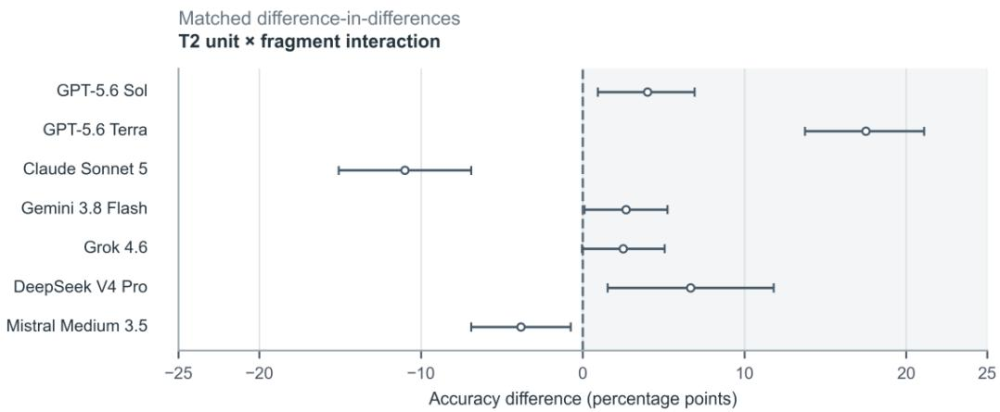  
Figure S1. Unit × coarse-fragment interaction in T2. Differences-in-differences are (U1F1 − U0F1) − (U1F0 − U0F0), averaged across 30 base scenarios. Symbols show estimated interactions and pointwise 95% repeated-call intervals (percentage points); the dashed line marks zero. A positive interaction means the U1 − U0 accuracy contrast is more positive under F1 than F0, not necessarily that accuracy is higher. The theoretical range is −200 to +200 percentage points; the clipping limitation is noted in M6.

## Supplementary References

Australian Bureau of Statistics (ABS). (2021). Australian Statistical Geography Standard (ASGS) Edition 3: States and Territories 2021, digital boundary files. https://www.abs.gov.au/statistics/standards/australian-statistical geography-standard-asgs/edition-3-july-2021-june-2026/access-and-downloads/digital-boundary-files

Breiman, L. (2001). Random forests. Machine Learning, 45(1), 5–32.

Efron, B., & Tibshirani, R. J. (1993). An introduction to the bootstrap. Chapman & Hall.

Farrell, M., Karunaratne, S., Pasut, C., Asanopoulos, C., Stower, L., Adkins, P., et al. (2025). Soil Organic Carbon Monitoring (SOC-M): Updated field and laboratory methodologies. CSIRO. https://doi.org/10.25919/3hyb-ar71

Hesterberg, T. C. (2015). What teachers should know about the bootstrap: Resampling in the undergraduate statistics curriculum. The American Statistician, 69(4), 371–386.

Holm, S. (1979). A simple sequentially rejective multiple test procedure. Scandinavian Journal of Statistics, 6(2), 65– 70.

Karunaratne, S., Farrell, M., Pasut, C., Asanopoulos, C., Zhao, T., Powell, A., Li, M., Reed, G., Stower, L., Hoyle, F., O’Keeffe, T., Armour, B., Schapel, A., Crawford, D., McCaskill, M., Brown, G., Moreton, R., Garrard, M., Polain, K., De Antoni Migliorati, M., & Reeves, S. (2026). Soil Organic Carbon Monitoring Project (Version 1) [Data set]. CSIRO Data Access Portal. https://doi.org/10.25919/z378-4286

Pasut, C., Asanopoulos, C., Zhao, X., et al. (2026). Key soil attributes and land-management dataset for Australian agroecosystems linking baseline and resampling surveys. Scientific Data. Advance online publication. https://doi.org/10.1038/s41597-026-07850-8

## Data and code availability

SOC-M v1 is publicly available (DOI: 10.25919/z378-4286). The 120 T2 scenarios and displayed-value references are provided as Supplementary Data with this document. Additional benchmark items, prompts, analysis code and collection records remain in the Project 2 archive; no public repository or code DOI has yet been established for these materials. FarmData coordinates, authentication credentials and raw response ledgers are not included. Any further release requires author approval and privacy review.