# Input-Conditioned Search for Efficient Test-Time Scaling of Recursive Reasoners

Haochen Shi1,2, Tianwen Fu3, Qianggang Ding1,2, Yinhan Lu1,2, Yizhan Li1,2, Huan Zhang1,2, Yajie Zhao3, Xingdi Yuan4, Hengyang Lu5,†, Bang Liu1,2,†

1Mila – Quebec AI Institute 2Université de Montréal 3University of Southern California 4Microsoft Research 5Ambarella Inc.

†Corresponding author

People often tackle dificult problems by thinking more deeply or exploring more possibilities. Similarly, recursive reasoners, which reason by repeatedly applying a learned update rule to latent states, can also scale inference through more updates (depth) or additional trajectories generated by perturbing latent states (width). When people hit a dead end in their thinking, they may step back and approach the problem from a fresh angle. However, neither depth scaling nor perturbation-based width scaling of recursive reasoners can reliably achieve this: both may converge to incorrect attractors. To address this, we propose to explore diverse reasoning traces by applying diferent update maps to the same latent state, without any additional training. We realize this idea through Input-Conditioned Search (ICS), which searches over input conditions to induce alternative update maps from the pretrained reasoner. Across six reasoning tasks, ICS achieves the highest mean accuracy, while requiring up to two orders of magnitude fewer model FLOPs than the evaluated scaling baselines. Controlled experiments confirm that ICS can redirect trajectories from the same state. Our theoretical analysis and rigorous numerical verification also confirm that ICS can locally eliminate incorrect attracting fixed points. Together, these findings establish ICS as an efective axis for eficient test-time scaling and motivate further research on shaping recursive reasoning during training and at test time.

{ Date: October 14, 2026   
# Correspondence: hylu@ambarella.com, bang.liu@umontreal.ca   
§ Code: github.com/icsearch/ICS   
€ Project page: icsearch.github.io   
Hugging Face: huggingface.co/hcshi/ICS

Université m de Montréal

## 1 Introduction

People often respond to dificult problems by thinking longer or exploring more possibilities, yet their reasoning can still reach a dead end. Recursive reasoners face a similar limitation. They produce answers by repeatedly applying a learned update rule to a latent state, and can scale test-time computation with fixed weights through longer trajectories (depth) or multiple perturbed trajectories (width) (Jolicoeur-Martineau, 2025; Sghaier et al., 2026; Baek et al., 2026). However, both strategies retain the reasoner’s original input-conditioned update map: depth iterates the same map for longer, while perturbation-based width explores additional trajectories under the same map. Our diagnostics identify failures that persist under both continued iteration and random perturbations, as trajectories converge to incorrect attractors. This raises a central question: how can a frozen recursive reasoner use additional test-time computation to overcome such failures and discover correct solutions eficiently?

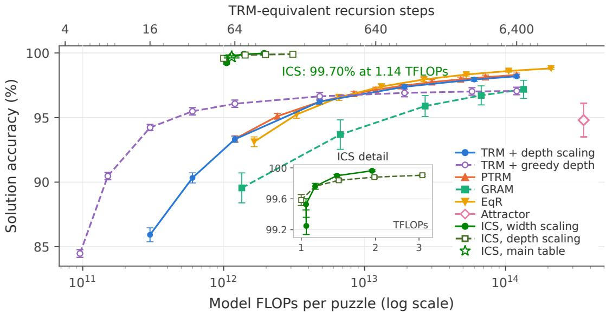  
Figure 1 Sudoku test-time scaling without a task certificate at selection. All curves are the average of three trained seeds. The Attractor point uses the 3,072-puzzle subset and is marked separately.

When their reasoning stalls, people may step back and approach the same problem from a fresh angle. We ask whether a recursive reasoner can do the same without retraining. To achieve this goal, we investigate shaping recursive dynamics as an additional dimension of test-time scaling: changing the update map that governs reasoning without retraining the model. Because each recursive update depends on both the learned parameters and the input, varying the input condition provides a way to induce alternative update maps while keeping the parameters fixed. We introduce Input-Conditioned Search (ICS), which searches over input conditions to explore these alternative maps and restarts reasoning from the same initial latent state under each condition.

We instantiate ICS through two operations. Hypothesis injection incorporates partial model predictions into the input as tentative assumptions. Validity-preserving restatements express the same task in equivalent representations and map predictions back to the original representation. Model predictions guide both which hypotheses to expand and which answer to select. Throughout the search, the original task remains the criterion for answer correctness.

Our analysis establishes that input conditioning can locally eliminate incorrect attracting fixed points. We verify this mechanism with computer-assisted proofs in separately trained 4 × 4 Sudoku reasoners under continuous variation of the input embeddings. Controlled interventions on hypotheses and restatements also show that changing the input condition can redirect trajectories from the same initialization. Recovery further depends on the starting state and the duration of conditioning, motivating input-conditioned search combined with fresh initialization.

Across six reasoning tasks, ICS achieves the highest mean accuracy both with and without a task correctness checker at answer selection, tying at 100% on Light-Up. Without a checker, ICS achieves higher mean accuracy than the evaluated scaling baselines on the remaining five tasks with approximately 10–195× fewer model FLOPs; on Sudoku-Extreme, it reduces errors by approximately 92% relative to the strongest baseline at comparable compute. Together, these results demonstrate eficient test-time scaling through input-conditioned search without additional training, and motivate broader methods for shaping recursive dynamics to improve access to correct solutions.

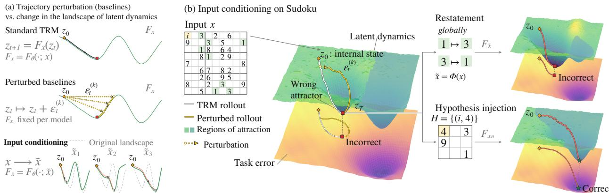  
Figure 2 ICS lifts eficient test-time scaling of recursive reasoners by shaping the update rules.

## 2 Preliminaries

Frozen recursive reasoners. A recursive reasoner repeatedly updates an internal latent state to refine its prediction. Formally, a model $M _ { \theta }$ receives an input $x \in \mathcal { V } ^ { L _ { x } }$ , a sequence of $L _ { x }$ tokens over the vocabulary $_ \textmd { ‰}$ with task-specific given positions $G ( x ) \subset \{ 1 , \ldots , L _ { x } \}$ . M� reasons towards the answer $\hat { y } \in \mathcal { V } ^ { L _ { y } }$ by iterating a learned update $F _ { \theta } ( z _ { t - 1 } ; x )$ of its latent state $z \in \mathcal { Z } = \mathbb { R } ^ { d }$ from an initial state ${ \mathfrak { z } } _ { 0 } .$ , and reads the answer and a halting signal from the state:

$$
z _ { t } = F _ { \theta } ( z _ { t - 1 } ; \boldsymbol { x } ) , \qquad \hat { y } _ { t } = g _ { \theta } ( z _ { t } ; \boldsymbol { x } ) , \qquad q _ { t } = Q _ { \theta } ( z _ { t } ) , \qquad t = 1 , 2 , \ldots\tag{1}
$$

where the decoder �� decodes the answer $\hat { y }$ from the latent ${ \mathcal { Z } } _ { t }$ and $Q _ { \theta }$ produces a halting score that can be used for stopping or candidate selection. The learned parameters � are frozen at test time; thus, for a given input �, they induce a fixed latent update map $F _ { x } : = F _ { \theta } ( \cdot ; , x )$ . One application of $F _ { x }$ is a recursion step, and the resulting ${ \boldsymbol \tau } = ( z _ { 0 } , z _ { 1 } , \dots )$ is a reasoning trajectory from the initialization $\scriptstyle z _ { 0 }$ . The Tiny Recursive Model (TRM) (Jolicoeur-Martineau, 2025), our primary backbone, uses a small shared network to recursively update an internal reasoning state and an answer representation. In our notation, the complete state is $z = ( z _ { H } , z _ { L } ) \colon z _ { H }$ represents the current answer, $\mathcal { Z } _ { L }$ supports its iterative refinement, and the decoder reads $\mathfrak { z } _ { H }$ . A recursion step can contain multiple applications of the shared network. In this work, we study reasoning puzzles, where the input token length is equal to the output length $L : = L _ { y } = L _ { x }$

Test-time scaling of recursive reasoners. Each latent state ${ \mathscr Z } _ { t }$ can be decoded by $g _ { \theta }$ into a candidate answer $\hat { y } _ { t }$ . Additional recursion steps therefore provide further opportunities to discover a correct answer, but need not improve coverage of correct solutions (Appendix C). Two common scaling axes are depth, which increases the number � of updates per trajectory, and width, which increases the number � of trajectories. Width scaling can be implemented by perturbing a latent state $\mathscr { z } _ { t }$ with a perturbation $\varepsilon _ { t } ^ { ( k ) }$ and continuing recursion from the resulting states. Previous work uses perturbations sampled from fixed noise distributions or learned distributions (Sghaier et al., 2026; Baek et al., 2026). For a fixed input �, consider � trajectories with � updates each. Their latent states form the collection $\mathcal { P } ( x ) = \big ( z _ { t } ^ { ( \bar { k } ) } \big ) _ { 1 \leq k \leq K , 1 \leq t \leq D } .$

Answer selection and evaluation. Discovering a correct candidate and selecting the answer to return are distinct requirements of test-time scaling. Let $V ( x , y ) ~ \in ~ \{ 0 , 1 \}$ indicate whether � satisfies the original task defined by �. Let C(�) denote the candidate answers made available by the inference procedure, expressed in the original task representation. Their solution coverage is Coverage $( x ) = \mathbf { 1 } [ \exists y \in C ( x ) : V ( x , y ) = 1 ]$ . We distinguish two answer-selection regimes: $\begin{array} { r } { \hat { y } _ { \mathrm { c e r t } } = c _ { \mathrm { c e r t } } \big ( C ( x ) ; x , V \big ) , \hat { y } _ { \mathrm { m o d e l } } = c _ { \mathrm { m o d e l } } \big ( \mathcal { P } ( x ) ; x \big ) } \end{array}$ . For a fixed candidate pool, certificate-based selection returns a valid answer whenever one is present. Model-based selection instead uses model-derived information, such as halting scores, learned scores, or prediction agreement, without access to � during selection. With a task certificate � available, we evaluate reasoning eficiency: the ability to discover a verified solution as a function of inference cost. Without the certificate at selection, we evaluate the complete procedure by its final-answer accuracy and inference cost, using � only to assess correctness. Each regime is evaluated with its corresponding search and stopping rules.

## 3 Input-Conditioned Search

Input-Conditioned Search (ICS) allocates test-time computation to exploring alternative input conditions for the original task � (Figure 2). Each conditioned input �˜ induces an update map $F _ { \tilde { x } } : = F _ { \theta } ( \cdot ; \tilde { x } )$ under the same frozen model. ICS restarts reasoning from $\scriptstyle { \mathcal { Z } } 0$ under these conditions to generate candidate answers. We instantiate this search through two operations: hypothesis injection, which incorporates partial model predictions into the input as tentative assignments, and validity-preserving restatements, which express the same task in equivalent representations. Predictions are mapped back to the original task representation when necessary, and answer correctness is always defined by the original input �.

## 3.1 Input-conditioned Reasoning

For a conditioned input �˜, we run the frozen reasoner from a fresh initialization:

$$
z _ { 0 } ^ { ( \tilde { x } ) } = z _ { 0 } , \qquad z _ { t } ^ { \tilde { x } } = F _ { \tilde { x } } \Big ( z _ { t - 1 } ^ { ( \tilde { x } ) } \Big ) , \quad t = 1 , \dots , T _ { \tilde { x } } ,\tag{2}
$$

where $T _ { \tilde { x } }$ is the allocated recursion depth. The resulting state provides a decoded candidate and a halting score. The final state provides a raw decoded prediction $\hat { y } _ { \tilde { x } } = g _ { \theta } ( z _ { T _ { \tilde { x } } } ^ { ( \tilde { x } ) } ; \tilde { x } )$ and a halting score $q _ { \tilde { x } } = Q _ { \theta } ( z _ { T _ { \tilde { x } } } ^ { ( \tilde { x } ) } )$ . We construct the conditioned inputs �˜ through two operations.

Hypothesis injection. A hypothesis specifies tentative assignments $H = \{ ( i , \nu _ { i } ) : i \in I _ { H } \}$ , where $I _ { H }$ is a set of task-specific mutable positions disjoint from $G ( x )$ and each $\nu _ { i }$ is an admissible state token at position �. We construct the conditioned input by

$$
( x _ { H } ) _ { i } = \left\{ { \nu } _ { j } , i \in I _ { H } , \right.\tag{3}
$$

This preserves the original givens while expressing the tentative assignments as additional input information. Specifically, the assignments specify digits in Sudoku-Extreme (Sodoku), path membership in Maze-Hard, light placement in Light-Up, and cell colors in Nurikabe, Tapa, and Heyawake. We then apply Equation 2 with $\tilde { x } = x _ { H }$ . The resulting predictions and scores guide hypothesis expansion and answer selection.

Validity-preserving restatements. A restatement expresses the same task in an equivalent representation through an invertible, task-specific transformation Φ. The transformation acts correspondingly on inputs and answers and preserves task validity:

$$
V ( \Phi ( x ) , \Phi ( y ) ) = V ( x , y )\tag{4}
$$

We apply Equation 2 with ${ \tilde { x } } = \Phi ( x )$ and map the decoded prediction back to the original representation with $\hat { y } = \Phi ^ { - 1 } \big ( \hat { y } _ { \Phi ( x ) } \big )$ . The frozen reasoner need not be equivariant to $\Phi _ { i }$ , so equivalent task representations can produce diferent candidate answers after inverse mapping.

## Search and answer selection

ICS starts with running the frozen reasoner $M _ { \theta }$ on the original input �. If none of the resulting candidates meets the configured acceptance rule $c _ { c e r t } ~ 0 \mathrm { r } ~ c _ { m o d e l } ,$ it proceeds to hypothesis-conditioned search. Each search node corresponds to a hypothesis � and retains the model predictions obtained from $x _ { H }$ . The root corresponds to $H = \varnothing$ . Expanding a node introduces an additional assignment:

$$
H ^ { \prime } = H \cup \{ ( i , \nu ) \} , \qquad i \notin G ( x ) \cup I _ { H } ,\tag{5}
$$

If hypothesis search ends without an accepted answer, ICS explores validity-preserving restatements of the original input �. This schedule allocates computation to additional input conditions when earlier stages have not accepted an answer.

Proposal and expansion. At each parent node �, we use the decoder’s token score to propose additional assignments. Specifically, we rank eligible positions by increasing prediction margin:

$$
m _ { i } ^ { ( H ) } = \ell _ { i , ( 1 ) } ^ { ( H ) } - \ell _ { i , ( 2 ) } ^ { ( H ) } ,\tag{6}
$$

where $\ell _ { i , ( 1 ) } ^ { ( H ) }$ and $\ell _ { i , ( 2 ) } ^ { ( H ) }$ are the largest and second-largest decoder logits at position � from the parent rollout. At each position, we propose alternative state tokens permitted by the task’s vocabulary, excluding the current predicted state. When multiple alternatives are available, we order them by the decoder’s token logits ranking. Each proposed assignment $( i , \nu )$ create a child $H ^ { \prime } = H \cup \{ ( i , \nu ) \}$ . We cap the number of proposals per parent and truncate the pooled proposals to the remaining total child budget. For each remaining child $H ^ { \prime }$ , we run the frozen reasoner on $x _ { H ^ { \prime } }$ for $T _ { h }$ recursion steps from ${ \mathfrak { z } } _ { 0 }$ , as in Equation 2.

Candidate ranking. For each child $H ^ { \prime }$ , let $\hat { y } _ { H ^ { \prime } }$ denote its raw decoded prediction and $q _ { H ^ { \prime } }$ its halting score. Let $\Pi _ { x } ( \hat { y } )$ restore the original givens in a prediction $\hat { y }$

$$
\left( \sum _ { ( i , \nu ) \in { H ^ { \prime } } } \mathbf { 1 } [ \hat { y } _ { H ^ { \prime } , i } \neq \nu ] , \quad \mathbf { 1 } [ \hat { y } _ { H ^ { \prime } } \neq \Pi _ { x } ( \hat { y } _ { H ^ { \prime } } ) ] , \quad - q _ { H ^ { \prime } } \right)\tag{7}
$$

So we first prioritize child nodes with fewer assignments that contradict their parent’s hypothesis � and the givens. Among ties, we prefer predictions with a higher halting score. These consistency checks use the original input $x ,$ the injected assignments in relevant hypotheses $H ,$ and the task’s output format, without requiring a task certificate. If no candidate meets the acceptance rule, we retain up to � highest-ranked children for expansion at the next search level, where � is the beam width.

Termination and answer selection. We apply the acceptance rule to candidates expressed in the original task representation and corrected by $\Pi _ { x }$ . When a task certificate � is available, we accept a candidate when $V ( x , \Pi _ { x } ( \hat { y } ) ) = 1$ . When the task certificate is unavailable, we use the model-derived scores or consistency between predictions to stop recursion and select an answer.

## 4 Performance and Inference Efficiency

Experimental setup. We evaluate ICS on six reasoning tasks: Sudoku-Extreme and Maze-Hard (Wang et al., 2025), and four tasks from PPBench Waugh (2026), including Light-UP, Nurikabe, Tapa, and

<table><tr><td>Protocol</td><td>Sudoku</td><td>Maze</td><td> $\operatorname { L i g h t - U p }$ </td><td>Nurikabe</td><td>Tapa</td><td>Heyawake</td></tr><tr><td colspan="7">Task certificate available at selection</td></tr><tr><td>Standard TRM</td><td> $8 6 . 0 \pm 0 . 6$ </td><td> $9 1 . 6 \pm 0 . 3$ </td><td> $9 9 . 7 \pm 0 . 5 $ </td><td> $8 3 . 8 \pm 2 . 8$ </td><td> $7 2 . 8 \pm 5 . 4$ </td><td> $8 6 . 4 \pm 3 . 3$ </td></tr><tr><td>+ depth scaling</td><td> $9 8 . 2 \pm 0 . 1 $ </td><td> $9 1 . 6 \pm 0 . 3$ </td><td> ${ \bf 1 0 0 . 0 \pm 0 . 0 }$ </td><td> $8 4 . 9 \pm 2 . 7$ </td><td> $7 5 . 4 \pm 5 . 5$ </td><td> $8 7 . 8 \pm 1 . 5$ </td></tr><tr><td>PTRM</td><td> $9 8 . 3 \pm 0 . 1 $ </td><td> $9 2 . 4 \pm 0 . 3 $ </td><td> ${ \bf 1 0 0 . 0 \pm 0 . 0 }$ </td><td> $8 6 . 1 \pm 2 . 3$ </td><td> $7 6 . 4 \pm 6 . 9$ </td><td> $8 8 . 7 \pm 1 . 5$ </td></tr><tr><td>GRAM</td><td> $9 7 . 5 \pm 0 . 4$ </td><td> $9 0 . 8 \pm 0 . 6 $ </td><td> $9 9 . 7 \pm 0 . 5 $ </td><td> $9 1 . 9 \pm 1 . 8$ </td><td> $5 2 . 3 \pm 5 . 5$ </td><td> $9 7 . 1 \pm 1 . 3$ </td></tr><tr><td>EqR</td><td> $9 8 . 8 \pm 0 . 1 $ </td><td> $9 5 . 0 \pm 1 . 9$ </td><td> $9 1 . 4 \pm 0 . 5$ </td><td> $7 7 . 1 \pm 0 . 5$ </td><td> $2 6 . 7 \pm 0 . 9$ </td><td> $3 1 . 6 \pm 2 . 7$ </td></tr><tr><td>Attractor</td><td> $9 4 . 8 \pm 1 . 3 ^ { \dagger }$ </td><td> $8 0 . 7 \pm 1 . 4$ </td><td> ${ \bf 1 0 0 . 0 \pm 0 . 0 }$ </td><td> $8 9 . 0 \pm 2 . 2 $ </td><td> $8 2 . 2 \pm 4 . 6 $ </td><td> $9 4 . 2 \pm 2 . 2 $ </td></tr><tr><td>ICS</td><td> ${ \pm } 9 9 . 9 4 \pm 0 . 0 2$ </td><td> ${ \bf 1 0 0 . 0 \pm 0 . 1 }$ </td><td> ${ \bf 1 0 0 . 0 \pm 0 . 0 }$ </td><td> ${ \pm } { \bf 5 . 9 } \pm { \bf 1 . 3 }$ </td><td> ${ \pm } { \bf 9 } 5 . 9 \pm { \bf 0 } . 9$ </td><td> ${ \bf 9 9 . 1 \pm 0 . 0 }$ </td></tr><tr><td>No task certificate at selection</td><td></td><td></td><td></td><td></td><td></td><td></td></tr><tr><td colspan="7">Standard TRM</td></tr><tr><td></td><td> $8 6 . 0 \pm 0 . 6$ </td><td> $9 1 . 6 \pm 0 . 3$ </td><td> $9 9 . 7 \pm 0 . 5 $ </td><td> $8 3 . 8 \pm 2 . 8$ </td><td> $7 2 . 8 \pm 5 . 4$ </td><td> $8 6 . 4 \pm 3 . 3$ </td></tr><tr><td>+ depth scaling</td><td> $9 8 . 1 \pm 0 . 1 $ </td><td> $8 5 . 1 \pm 0 . 9$ </td><td> $9 9 . 7 \pm 0 . 5 $ </td><td> $8 0 . 9 \pm 1 . 7$ </td><td> $6 7 . 7 \pm 4 . 1$ </td><td> $8 4 . 3 \pm 3 . 0$ </td></tr><tr><td>PTRM</td><td> $9 8 . 3 \pm 0 . 1 $ </td><td> $9 1 . 8 \pm 0 . 3 $ </td><td> ${ \bf 1 0 0 . 0 \pm 0 . 0 }$ </td><td> $8 4 . 9 \pm 3 . 1$ </td><td> $7 4 . 9 \pm 6 . 2$ </td><td> $8 8 . 7 \pm 1 . 5$ </td></tr><tr><td>GRAM, LPRM</td><td> $9 7 . 2 \pm 0 . 7 $ </td><td> $8 4 . 7 \pm 1 . 6$ </td><td> $9 9 . 1 \pm 0 . 9$ </td><td> $8 6 . 1 \pm 3 . 8$ </td><td> $4 3 . 1 \pm 5 . 3$ </td><td> $9 3 . 6 \pm 0 . 5$ </td></tr><tr><td></td><td> $9 6 . 6 \pm 0 . 6$ </td><td> $8 5 . 2 \pm 1 . 4$ </td><td> $9 9 . 4 \pm 1 . 0$ </td><td> $8 6 . 1 \pm 4 . 0$ </td><td> $4 3 . 1 \pm 1 . 5$ </td><td></td></tr><tr><td>GRAM, majority</td><td> $9 8 . 8 \pm 0 . 1 $ </td><td> $8 7 . 4 \pm 1 . 8$ </td><td> $8 0 . 2 \pm 0 . 5$ </td><td> $5 7 . 7 \pm 1 . 0$ </td><td></td><td> $9 3 . 6 \pm 0 . 5$ </td></tr><tr><td>EqR</td><td> $9 4 . 8 \pm 1 . 3 ^ { \dagger }$ </td><td></td><td> ${ \bf 1 0 0 . 0 \pm 0 . 0 }$ </td><td></td><td> $1 7 . 4 \pm 0 . 9$ </td><td> $1 8 . 8 \pm 1 . 3$ </td></tr><tr><td>Attractor</td><td></td><td> $5 3 . 6 \pm 1 . 6$ </td><td></td><td> $8 7 . 6 \pm 1 . 8$ </td><td> $7 8 . 1 \pm 5 . 7$ </td><td> $9 2 . 2 \pm 2 . 3 $ </td></tr><tr><td>ICS</td><td> ${ \pm } { \bf { 9 9 . 7 0 } } \pm { \bf { 0 . 0 8 } }$ </td><td> ${ \bf 9 9 . 1 \pm 0 . 2 }$ </td><td> ${ \bf 1 0 0 . 0 \pm 0 . 0 }$ </td><td> ${ \bf 8 8 . 4 \pm 5 . 9 }$ </td><td> ${ \mathbf 8 6 . 7 \pm 0 . 9 }$ </td><td> ${ \bf 9 4 . 5 \pm 1 . 0 }$ </td></tr></table>

Table 1 Answer accuracy (%) on six tasks. †: Attractor Models is evaluated on a fixed 3,072-instance Sudoku Extreme subset. Appendix A.5 compares all methods on the same subset.

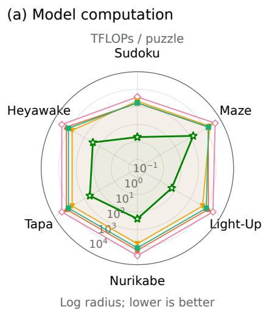

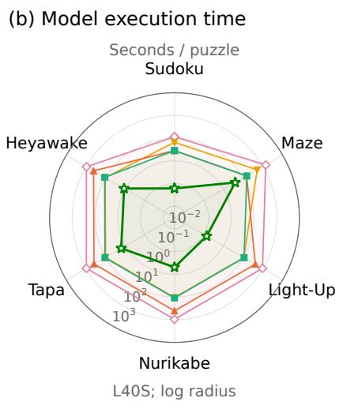

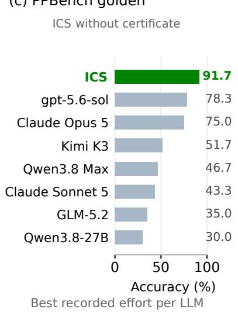  
ICS PTRM GRAM EqR Attractor

Figure 3 Six-task eficiency and PPBench golden-set accuracy. Both radar panels use logarithmic radii, farther inward indicates lower cost.Appendix A.8 gives complete LLMs results.

Heyawake. We use Maze-Hard for our main maze experiments because standard TRM already achieves near-perfect accuracy on Maze-Unique (Huang et al., 2026), leaving little headroom for comparing accuracy gains from test-time scaling (Appendix A.3). We train and evaluate all recursive models with the same training and test splits across all six tasks. Dataset construction, preprocessing, and training configurations are detailed in Appendix A.

<table><tr><td rowspan="2">Components</td><td colspan="2">Certificate selection</td><td colspan="2">Model selection</td></tr><tr><td>Accuracy (%)</td><td>TFLOPs</td><td>Accuracy (%)</td><td>TFLOPs</td></tr><tr><td>A: TRM + depth scaling</td><td>87.85</td><td>0.38</td><td>87.85</td><td>0.38</td></tr><tr><td> $\mathrm { A B } \colon + \ \mathrm { h y p o t h e s e s }$ </td><td>99.92</td><td>1.39</td><td>99.75</td><td>1.10</td></tr><tr><td> $\mathrm { A C } \colon + \mathrm { \ r e s t a t e m e n t s }$ </td><td>98.83</td><td>1.19</td><td>98.82</td><td>1.19</td></tr><tr><td> $\mathsf { A B C } \colon \mathrm { f u l l ~ I C S }$ </td><td>99.94</td><td>1.39</td><td>99.81</td><td>1.12</td></tr></table>

Table 2 Sudoku component ablation on the same eight test windows and trained model. Appendix C.4 provides more details for the complete ablation study.

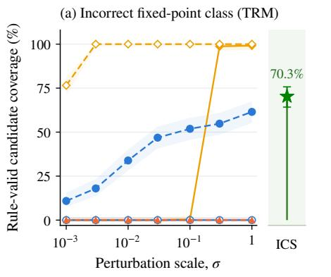

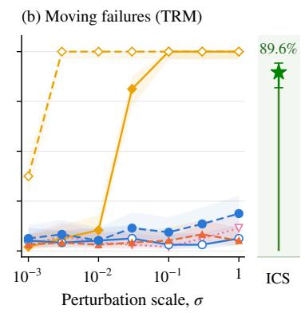

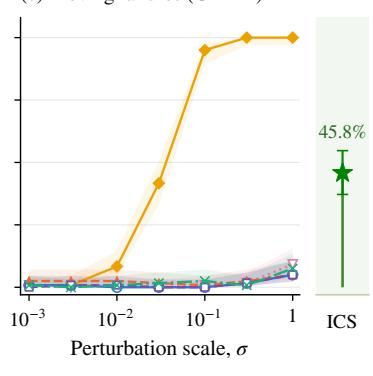  
Figure 4 State interventions and ICS recover diferent failures. Oracle direction requires label access and more computation(Appendix C).

Baselines. We compare ICS with standard TRM (Jolicoeur-Martineau, 2025), two TRM depth-scaling baselines, PTRM (Sghaier et al., 2026), GRAM (Baek et al., 2026), EqR (Huang et al., 2026), and Attractor Models (Fein-Ashley and Rashidinejad, 2026). ICS operates on frozen TRM backbones. TRM + depth scaling runs each instance for the full allocated depth budget. It returns the candidate with the highest halting score $q _ { t }$ along the entire trajectory under the model-based answer selection. TRM + greedy depth instead stops each instance at the first task-valid candidate under certificate-based selection, or at the first candidate with $q _ { t } > 0$ under model-based selection. For an evaluation set of � instances, greedy depth shares a total budget of 6400� recursion steps: computation continues on the remaining active instances until this budget is exhausted or all instances have stopped. This matches the average compute budget of 6400-step depth scaling while allowing diferent instances to receive diferent amounts of computation. For GRAM, we report its performance with both LPRM and majority-vote selection. Results for each recursive-reasoning method are reported as the mean and standard deviation across three training seeds. For each task, ICS, Standard TRM, TRM with two depth-scaling, and PTRM use the same three trained TRM checkpoints for a fair comparison.

Evaluation and inference cost. We measure solution accuracy by whether the returned answer $\hat { y } _ { t }$ satisfies the original task rules, using the same correctness criterion for all methods. We evaluate all methods under two answer selection protocols. Under certificate-based selection, a task certificate is available during inference, allowing us to measure recursive reasoning eficiency with the accuracy and computational cost of verified solution discovery. Under model-based selection, each method uses its own selection rule without the task certificate, evaluating the complete procedure’s ability to return a correct answer. The task certificate is still used for final scoring under both protocols. We report inference cost as model FLOPs and execution time, averaged over all evaluated instances, including those that stop early or return incorrect answers. Detailed inference budgets, compute accounting, and profiling procedures are provided in Appendix A.

LLM comparison. We additionally compare ICS without certificate-based selection against LLMs on the oficial PPBench golden set. All LLMs use a shared prompt template and a shared output limit of 128k tokens, including reasoning tokens and excluding input tokens. Attempts that fail to return a valid answer within this limit are counted as incorrect. The corresponding configuration details can be found in Appendix A.8.

ICS achieves the best mean performance across all six tasks. As shown in Table 1, under both certificate-based and model-based answer selection, ICS achieves the highest mean accuracy on all tasks and ties on Light-Up. With a task certificate available, ICS substantially improves verified solution discovery on all tasks. On Tapa, it reaches 95.9%, exceeding the second best method by 13.7 percentage points. The gains persist under model-based selection. On Maze-Hard, ICS achieves 99.1%, compared with 91.8% for the second best method. On Sudoku-Extreme, ICS achieves 99.7% without certificate-based selection, exceeding EqR’s 98.8%. Relative to PTRM’s 98.3% on the same trained TRM checkpoints, ICS reduces the remaining errors by approximately 82%.

Test-time scaling. Figure 1 compares test-time scaling on Sudoku-Extreme under model-based answer selection. At comparable compute, ICS substantially reduces the remaining errors: it achieves 99.70% accuracy at 1.14 TFLOPs per puzzle, reducing errors by approximately 92% relative to the second best method (TRM + greedy depth), evaluated at approximately 1.20 TFLOPs per puzzle. Increasing the baselines’ budgets does not close this gap. None of the evaluated scaling baselines matches ICS accuracy at its reported high-budget setting, despite using over 100× the test-time computation. Even providing these baselines with a task certificate at selection leaves their accuracy below model-selected ICS (Table 1). Furthermore, we scale ICS along both the width (more hypotheses) and depth (more recursion steps) axes, achieving accuracies of 99.96% and 99.91% with 1.94 and 3.10 TFLOPs of test-time compute, respectively. The two TRM depth-scaling curves also reveal a budget-dependent trade-of between computation allocation and answer selection. Greedy depth performs better at small budgets, consistent with early stopping concentrating computation on unresolved instances. At larger budgets, full-depth best-� selection overtakes greedy stopping: continued evaluation allows the model to reconsider its answer after an early positive halting score, whereas greedy stopping commits to that first acceptance.

The eficiency gains extend across all six tasks. Figure 3(a,b) compares model computation and execution time across tasks under model-based answer selection. Across the six tasks, ICS achieves the results in Table 1 with approximately 10–525× less test-time computation than the evaluated scaling baselines. ICS also achieves the lowest measured execution time per puzzle on all six tasks.

ICS outperforms the evaluated LLMs on the PPBench golden set. Figure 3c compares modelselected ICS with each LLM’s strongest evaluated configuration. Without a task certificate at selection, ICS achieves 91.7% mean accuracy across three training seeds, exceeding the strongest evaluated LLM result of 78.3% by 13.3 percentage points. Per-task results and evaluation configurations are provided in Appendix A.8.

Contributions of the input-conditioning operations. We ablate the two input-conditioning components on a random sampled subset of the Sudoku-Extreme test set (49,152 instances) using one trained TRM backbone (Table 2). Under model-based selection, removing hypothesis search reduces accuracy from 99.81% to 98.82%, whereas removing validity-preserving restatements yields 99.75%.

$$
\cdots \cdot \cdot \cdot \sigma - 0 . 1 \mathrm { ~ --- ~ } \sigma = 0 . 3 \mathrm { ~ --- ~ } \sigma = 1
$$

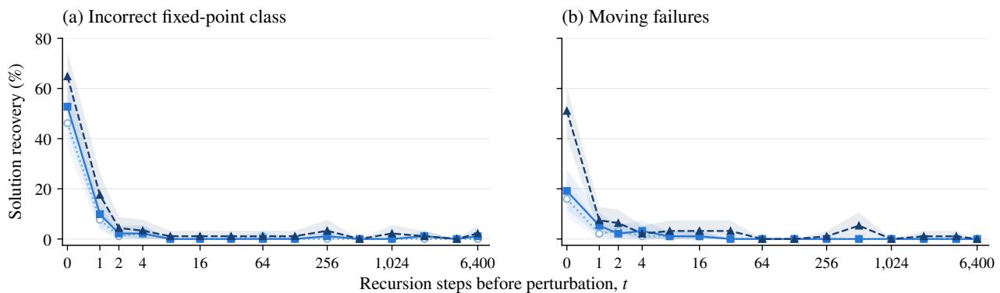  
Figure 5 Recovery depends on when the state is perturbed. Shading shows pointwise 95% instancebootstrap intervals. The time axis uses log(1 + �) spacing. � = 0 denotes fresh initialization.

Certificate-based selection shows the same pattern: the corresponding accuracies are 99.94%, 98.83%, and 99.92%, respectively. Thus, at the evaluated settings, hypothesis search provides the larger contribution, while restatements ofer an additional improvement. Full configurations and proposal ablations are reported in Appendix C.4.

## 5 Discussions

The preceding experiments establish ICS’s accuracy and computational advantages. We now examine two aspects of its design: the state from which reasoning begins and the input-conditioned update map under which it proceeds. We first study latent-state interventions under the fixed original-input map $F _ { x }$ . We then examine hypothesis injection and validity-preserving restatements as two ways to change the input condition while keeping model parameters fixed. Together, these experiments investigate how input conditioning and fresh initialization afect access to correct solutions.

## 5.1 Recovery depends on where exploration begins.

We first examine exploration under the original-input update map $F _ { x } .$ . Repeated updates can leave the latent state almost unchanged even when the decoded answer is incorrect. Conversely, a correct answer can be produced while the latent state continues to change (Appendix B). These observations distinguish answer correctness from latent convergence. We therefore examine whether interventions at diferent states along a reasoning trajectory can recover valid solutions while keeping the update map fixed.

Perturbation direction and initialization both matter. We compare latent-state perturbations with hypothesis-conditioned rollouts, corresponding to the hypothesis-injection operation of ICS, on both TRM and GRAM backbones. For the same failed instances, warm-start perturbations modify a saved failed state and continue recursion under $F _ { x } .$ . On TRM, we additionally evaluate cold-start perturbations applied to the fresh initialization ${ \mathfrak { z } } _ { 0 } .$ , followed by recursion under the same map. Figure 4 shows that cold-start random perturbations recover substantially more instances than warm-start random perturbations, which recover none across the evaluated scales. Oracle perturbations can also recover failures that resist random perturbations, indicating that recovery depends on direction as well as initialization, while both learned prior and posterior perturbations of GRAM yield substaintially lower recover rate. Both Oracle directions and the GRAM posterior use the ground-truth label and serve as diagnostic controls. ICS instead changes the input condition and recomputes from $\scriptstyle z _ { 0 }$ and achieves significantly higher candidate coverage than the tested label-free perturbations on both backbones, including cold-start random perturbations.

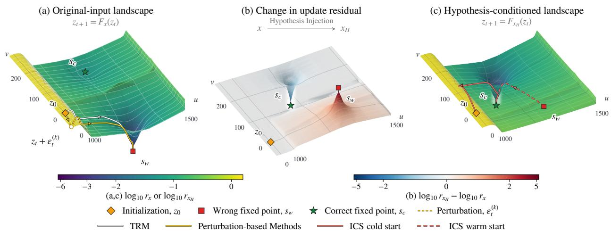  
Figure 6 The landscapes show the relative one-step update residuals. Smaller residuals indicate less change in the latent state after one recursion step.

Recovery becomes dificult early in failed trajectories. We next examine how perturbation efec tiveness changes along the original-input trajectory. On the selected Sudoku-Extreme failure cohorts, we apply Gaussian perturbations to $\mathcal { Z } _ { H }$ at diferent recursion steps, holding the relative perturbation scale fixed. We measure whether any of 16 trials produces a correct answer within 64 subsequent updates under $F _ { x } .$ Across all three perturbation scales, recovery drops sharply after only two recursion steps for both the incorrect fixed-point class and moving failures (Figure 5). For these instances, the tested perturbations become less efective early in the trajectory. This motivates exploring from fresh initialization, rather than restricting exploration to states reached after failure.

## 5.2 Input conditioning changes recursive dynamics.

The preceding interventions change the latent state while continuing recursion under $F _ { x }$ . We now examine the complementary choice explored by ICS: changing the input condition that determines the recursive update map.

Hypothesis injection changes the update landscape. Figure 6 compares the relative update-residual landscapes induced by � and $x _ { H }$ on a shared two-dimensional section for an incorrect near-fixed point. The surfaces interpolate model evaluations of $r _ { u } ( z ) = \| F _ { u } ( z ) - z \| _ { 2 } / \| z \| _ { 2 }$ for $u \in \{ x , x _ { H } \}$ , and the overlaid paths are projections of recorded latent trajectories. Under the landscape shaped by $F _ { x }$ , both the unperturbed TRM trajectory and the illustrated perturbed trajectory are captured by a wrong attractor and approach the same incorrect near-fixed point $s _ { w } . \mathrm { A t } s _ { w } ,$ hypothesis injection increases the relative one-step update residual from approximately $2 . 4 \times 1 0 ^ { - 7 }$ to 0.225, so the original state is no longer nearly stationary under $F _ { x _ { H } }$ . Both the warm-start trajectory from $s _ { w }$ and the cold-start trajectory from $\mathfrak { z } _ { 0 }$ reach the same correct near-fixed point $s _ { c } ,$ yielding a valid answer to the original task.

Input conditioning can eliminate incorrect attracting fixed points. Our theory and computerassisted proofs establish that input conditioning can locally eliminate an incorrect attracting fixed point in a frozen recursive reasoner. In this mechanism, continuous variation of the input embedding causes an incorrect attracting fixed point to collide with an unstable fixed point, and the pair disappears through a local fold (saddle-node) bifurcation (Kuznetsov, 2004). We derive suficient conditions for this mechanism and verify them with rigorous numerical certificates in separately trained 4×4 Sudoku reasoners (Appendix F.2 and D.3). Numerical continuation in the Maze-Hard and Sudoku-Extreme models provides complementary evidence of folds in incorrect fixed-point branches (Appendix D.2). These results establish that changing the input can remove an incorrect attracting state from the reasoner’s dynamics, providing a mechanism for overcoming persistent failures without retraining.

Fresh initialization can enable recovery. In the extended Sudoku study, restarting from $\scriptstyle z _ { 0 }$ recovers solutions under input conditions for which continuation from the saved failed state remains incorrect. The retained incorrect near-fixed states include cases with estimated local spectral radii below one. Recovery also depends on whether the hypothesis agrees with the reference solution and corrects an erroneous prediction (Appendix C.3). These findings motivate combining input conditioning with recomputation from a fresh latent state.

Validity-preserving restatements also change recursive dynamics. After aligning latent coordinates across equivalent task representations, we find that restatements alter recursive updates and can redirect trajectories from the same initialization (Appendix D.4)

Together, these findings show that input conditioning can redirect reasoning trajectories and locally eliminate incorrect attracting fixed points. They motivate shaping recursive dynamics as an additional dimension of test-time scaling. ICS realizes this principle by searching over input conditions that induce alternative update maps, using hypothesis injection and validity-preserving restatements. Combined with fresh initialization, this search enables eficient test-time scaling without additional model training, as demonstrated by our accuracy and inference-cost results.

## 6 Related Work

Recursive and looped reasoning. Reusing a learned transformation to refine a latent state has a long history, from Universal Transformers (Dehghani et al., 2019) and adaptive computation time (Graves, 2017; Banino et al., 2021) to recurrent networks that extrapolate to harder instances by iterating longer (Schwarzschild et al., 2021; Bansal et al., 2022) and looped or recurrent-depth transformers that trade parameters for depth (Giannou et al., 2023; Saunshi et al., 2025; Geiping et al., 2025), now pretrained at scale with learned depth allocation (Zhu et al., 2026). Iterative neural solvers have also been developed for constraint problems such as Sudoku, including recurrent relational networks (Palm et al., 2018), diferentiable satisfiability layers (Wang et al., 2019), energy-based iterative reasoning (Du et al., 2022, 2024) and the recursive reasoners HRM (Wang et al., 2025) and TRM (Jolicoeur-Martineau, 2025) . Both models re-inject the problem input at every recursion step, as does the recall architecture of Bansal et al. (2022), which keeps the problem instance from being forgotten over many iterations. ICS instead changes this input and each input condition induces a diferent update map under the same frozen model.

Test-time scaling and answer selection. For language models, test-time compute is typically spent on sampling many candidates and selecting among them (Wang et al., 2023; Cobbe et al., 2021; Lightman et al., 2024; Yao et al., 2023). Repeated sampling could increase coverage, but converting coverage into accuracy is much harder without an automatic verifier (Brown et al., 2024). For recursive reasoners, PTRM (Sghaier et al., 2026) diversifies candidates by injecting Gaussian noise into the latent state during recursion, and GRAM (Baek et al., 2026) by sampling from learned stochastic latent transitions. ICS instead changes the update map; this recovers more solutions than label-free latent perturbations on the same failed instances, and ICS uses less compute overall3.

Equilibrium and attractor views of reasoning. Equilibrium models compute their outputs as fixed points of a learned map (Bai et al., 2019). Anil et al. (2022) call a recurrent computation path independent if it converges to the same limiting behavior from any initial state, and find that equilibrium models with this property better exploit test-time computation. Two recent recursive reasoners build these ideas into training: Attractor Models (Fein-Ashley and Rashidinejad, 2026) solve for the fixed point of TRM’s recursive update instead of unrolling it; EqR (Huang et al., 2026) randomizes the initial state to encourage path independence and restarts from multiple random initial states under the same update map at test time. However, convergence alone does not ensure task correctness(Section 5). ICS explores a complementary direction by searching over input-conditioned update maps with a frozen model, without requiring path independence. It restarts every candidate from ${ \mathfrak { z } } _ { 0 } .$ , allocating test-time computation to trajectories generated under alternative update maps.

Search over partial assignments and equivalent views. Branching on tentative variable assignments is the backbone of classical constraint solving, from DPLL (Davis et al., 1962) to conflict-driven clause learning (Marques-Silva and Sakallah, 1999), and learned models have been used to choose the branching variable (Selsam and Bjørner, 2019). Evaluating a model on symmetry-transformed inputs is another source of candidate diversity, used by TRM on ARC-AGI (Jolicoeur-Martineau, 2025), aggregated across views as a product of experts (Franzen et al., 2025), and combined with parameter updates in test-time training (Akyürek et al., 2025). ICS combines both ideas while keeping parameters frozen: the model’s own decoder margins select where and how to branch, the reasoner itself, rather than a hand-designed propagator, completes the solution under each hypothesis without a task certificate, and validity-preserving restatements provide additional views, although our ablation identifies hypotheses as the larger source of improvement.

## 7 Conclusion

We introduced Input-Conditioned Search (ICS), which allocates test-time computation to exploring alternative update maps as an additional scaling axis without retraining the model. Across six reasoning tasks, ICS achieves the highest mean accuracy while using substantially less model computation and execution time than baselines. Controlled experiments show that ICS can efectively redirect recursive updates and trajectories. Our theoretical analysis and rigorous numerical verification establish that ICS can locally eliminate incorrect attracting fixed points. Together, these findings demonstrate eficient test-time scaling through ICS without additional training and motivate further research on shaping recursive reasoning dynamics during training and at test time.

## Acknowledgments

This work is supported by the Canada NSERC Discovery Grant (RGPIN-2021-03115) and the Amazon Research Award (ARA) program.

## References

Ekin Akyürek, Mehul Damani, Adam Zweiger, Linlu Qiu, Han Guo, Jyothish Pari, Yoon Kim, and Jacob Andreas. The surprising efectiveness of test-time training for few-shot learning. In Forty-second International Conference on Machine Learning, 2025. URL https://openreview.net/forum?id=asgBo3FNdg

Cem Anil, Ashwini Pokle, Kaiqu Liang, Johannes Treutlein, Yuhuai Wu, Shaojie Bai, J Zico Kolter, and Roger Baker Grosse. Path independent equilibrium models can better exploit test-time computation. In Alice H. Oh, Alekh Agarwal, Danielle Belgrave, and Kyunghyun Cho, editors, Advances in Neural Information Processing Systems, 2022. URL https://openreview.net/forum?id=kgT6D7Z4Xv9.

Junyeob Baek, Mingyu Jo, Minsu Kim, Mengye Ren, Yoshua Bengio, and Sungjin Ahn. Generative recursive reasoning, 2026. URL https://arxiv.org/abs/2605.19376.

Shaojie Bai, J. Zico Kolter, and Vladlen Koltun. Deep equilibrium models. In H. Wallach, H. Larochelle, A. Beygelzimer, F. d'Alché-Buc, E. Fox, and R. Garnett, editors, Advances in Neural Information Processing Systems, volume 32. Curran Associates, Inc., 2019. URL https://proceedings.neurips.cc/paper\_files/ paper/2019/file/01386bd6d8e091c2ab4c7c7de644d37b-Paper.pdf.

Andrea Banino, Jan Balaguer, and Charles Blundell. Pondernet: Learning to ponder. In 8th ICML Workshop on Automated Machine Learning (AutoML), 2021. URL https://openreview.net/forum?id=1EuxRTe0WN.

Arpit Bansal, Avi Schwarzschild, Eitan Borgnia, Zeyad Emam, Furong Huang, Micah Goldblum, and Tom Goldstein. End-to-end algorithm synthesis with recurrent networks: Extrapolation without overthinking. In Alice H. Oh, Alekh Agarwal, Danielle Belgrave, and Kyunghyun Cho, editors, Advances in Neural Information Processing Systems, 2022. URL https://openreview.net/forum?id=PPjSKy40XUB.

Giancarlo Benettin, Luigi Galgani, Antonio Giorgilli, and Jean-Marie Strelcyn. Lyapunov characteristic exponents for smooth dynamical systems and for hamiltonian systems; a method for computing all of them. part 1: Theory. Meccanica, 15(1):9–20, March 1980. ISSN 1572-9648. doi: 10.1007/bf02128236. URL http://dx.doi.org/10.1007/BF02128236.

Bradley Brown, Jordan Juravsky, Ryan Ehrlich, Ronald Clark, Quoc V. Le, Christopher Ré, and Azalia Mirhoseini. Large language monkeys: Scaling inference compute with repeated sampling, 2024. URL https://arxiv. org/abs/2407.21787.

Karl Cobbe, Vineet Kosaraju, Mohammad Bavarian, Mark Chen, Heewoo Jun, Lukasz Kaiser, Matthias Plappert, Jerry Tworek, Jacob Hilton, Reiichiro Nakano, Christopher Hesse, and John Schulman. Training verifiers to solve math word problems, 2021. URL https://arxiv.org/abs/2110.14168.

Martin Davis, George Logemann, and Donald Loveland. A machine program for theorem-proving. Communications of the ACM, 5(7):394–397, July 1962. ISSN 1557-7317. doi: 10.1145/368273.368557. URL http://dx.doi.org/10.1145/368273.368557.

Mostafa Dehghani, Stephan Gouws, Oriol Vinyals, Jakob Uszkoreit, and Lukasz Kaiser. Universal transformers In International Conference on Learning Representations, 2019. URL https://openreview.net/forum?id= HyzdRiR9Y7.

Yilun Du, Shuang Li, Joshua Tenenbaum, and Igor Mordatch. Learning iterative reasoning through energy minimization. In Kamalika Chaudhuri, Stefanie Jegelka, Le Song, Csaba Szepesvari, Gang Niu, and Sivan Sabato, editors, Proceedings of the 39th International Conference on Machine Learning, volume 162 of Proceedings of Machine Learning Research, pages 5570–5582. PMLR, 17–23 Jul 2022. URL https://proceedings.mlr.press/v162/du22d.html.

Yilun Du, Jiayuan Mao, and Joshua B. Tenenbaum. Learning iterative reasoning through energy difusion. In Forty-first International Conference on Machine Learning, 2024. URL https://openreview.net/forum?id= CduFAALvGe.

Jacob Fein-Ashley and Paria Rashidinejad. Solve the loop: Attractor models for language and reasoning. In ICML 2026 Workshop on Foundations of Deep Generative Models: Understanding Memorization, Generalization, and Reasoning, 2026. URL https://openreview.net/forum?id=AlZtpLVXKf.

Daniel Franzen, Jan Disselhof, and David Hartmann. Product of experts with LLMs: Boosting performance on ARC is a matter of perspective. In Forty-second International Conference on Machine Learning, 2025. URL https://openreview.net/forum?id=dsBjxI6l8W.

Jonas Geiping, Sean Michael McLeish, Neel Jain, John Kirchenbauer, Siddharth Singh, Brian R. Bartoldson, Bhavya Kailkhura, Abhinav Bhatele, and Tom Goldstein. Scaling up test-time compute with latent reasoning: A recurrent depth approach. In The Thirty-ninth Annual Conference on Neural Information Processing Systems, 2025. URL https://openreview.net/forum?id=S3GhJooWIC.

Angeliki Giannou, Shashank Rajput, Jy yong Sohn, Kangwook Lee, Jason D. Lee, and Dimitris Papailiopoulos. Looped transformers as programmable computers. In ICML, pages 11398–11442, 2023. URL https: //proceedings.mlr.press/v202/giannou23a.html.

Georg A. Gottwald and Ian Melbourne. On the implementation of the 0–1 test for chaos. SIAM Journal on Applied Dynamical Systems, 8(1):129–145, January 2009. ISSN 1536-0040. doi: 10.1137/080718851. URL http://dx.doi.org/10.1137/080718851.

Alex Graves. Adaptive computation time for recurrent neural networks, 2017. URL https://arxiv.org/abs/ 1603.08983.

Benhao Huang, Zhengyang Geng, and J Zico Kolter. Equilibrium reasoners: Learning attractors enables scalable reasoning. In Forty-third International Conference on Machine Learning, 2026. URL https://openreview. net/forum?id=lh95PnOlpM.

Alexia Jolicoeur-Martineau. Less is more: Recursive reasoning with tiny networks, 2025. URL https://arxiv. org/abs/2510.04871.

Yuri A. Kuznetsov. Elements of Applied Bifurcation Theory. Springer New York, 2004. ISBN 9781475739787. doi: 10.1007/978-1-4757-3978-7. URL http://dx.doi.org/10.1007/978-1-4757-3978-7.

Hunter Lightman, Vineet Kosaraju, Yuri Burda, Harrison Edwards, Bowen Baker, Teddy Lee, Jan Leike, John Schulman, Ilya Sutskever, and Karl Cobbe. Let’s verify step by step. In The Twelfth International Conference on Learning Representations, 2024. URL https://openreview.net/forum?id=v8L0pN6EOi.

J.P. Marques-Silva and K.A. Sakallah. Grasp: a search algorithm for propositional satisfiability. IEEE Transactions on Computers, 48(5):506–521, May 1999. ISSN 0018-9340. doi: 10.1109/12.769433. URL http://dx.doi. org/10.1109/12.769433.

Rasmus Palm, Ulrich Paquet, and Ole Winther. Recurrent relational networks. In S. Bengio, H. Wallach, H. Larochelle, K. Grauman, N. Cesa-Bianchi, and R. Garnett, editors, Advances in Neural Information Processing Systems, volume 31. Curran Associates, Inc., 2018. URL https://proceedings.neurips.cc/ paper\_files/paper/2018/file/b9f94c77652c9a76fc8a442748cd54bd-Paper.pdf.

Nikunj Saunshi, Nishanth Dikkala, Zhiyuan Li, Sanjiv Kumar, and Sashank J. Reddi. Reasoning with latent thoughts: On the power of looped transformers. In The Thirteenth International Conference on Learning Representations, 2025. URL https://openreview.net/forum?id=din0lGfZFd.

Avi Schwarzschild, Eitan Borgnia, Arjun Gupta, Furong Huang, Uzi Vishkin, Micah Goldblum, and Tom Goldstein. Can you learn an algorithm? generalizing from easy to hard problems with recurrent networks. In A. Beygelzimer, Y. Dauphin, P. Liang, and J. Wortman Vaughan, editors, Advances in Neural Information Processing Systems, 2021. URL https://openreview.net/forum?id=Tsp2PL7-GQ.

Daniel Selsam and Nikolaj Bjørner. Guiding high-performance sat solvers with unsat-core predictions, 2019. URL https://arxiv.org/abs/1903.04671.

Amin Sghaier, Ali Parviz, and Alexia Jolicoeur-Martineau. Probabilistic tiny recursive model, 2026. URL https://arxiv.org/abs/2605.19943.

Guan Wang, Jin Li, Yuhao Sun, Xing Chen, Changling Liu, Yue Wu, Meng Lu, Sen Song, and Yasin Abbasi Yadkori. Hierarchical reasoning model, 2025. URL https://arxiv.org/abs/2506.21734.

Po-Wei Wang, Priya Donti, Bryan Wilder, and Zico Kolter. SATNet: Bridging deep learning and logical reasoning using a diferentiable satisfiability solver. In Kamalika Chaudhuri and Ruslan Salakhutdinov, editors, Proceedings of the 36th International Conference on Machine Learning, volume 97 of Proceedings of Machine Learning Research, pages 6545–6554. PMLR, 09–15 Jun 2019. URL https://proceedings.mlr. press/v97/wang19e.html.

Xuezhi Wang, Jason Wei, Dale Schuurmans, Quoc V Le, Ed H. Chi, Sharan Narang, Aakanksha Chowdhery, and Denny Zhou. Self-consistency improves chain of thought reasoning in language models. In The Eleventh

International Conference on Learning Representations, 2023. URL https://openreview.net/forum?id= 1PL1NIMMrw.

Justin Waugh. Pencil puzzle bench: A benchmark for multi-step verifiable reasoning, 2026. URL https: //arxiv.org/abs/2603.02119.

Shunyu Yao, Dian Yu, Jefrey Zhao, Izhak Shafran, Thomas L. Grifiths, Yuan Cao, and Karthik R Narasimhan. Tree of thoughts: Deliberate problem solving with large language models. In Thirty-seventh Conference on Neural Information Processing Systems, 2023. URL https://openreview.net/forum?id=5Xc1ecxO1h.

Rui-Jie Zhu, Zixuan Wang, Kai Hua, Tianyu Zhang, Ziniu Li, Haoran Que, Boyi Wei, Zixin Wen, Fan Yin, He Xing, Lu Li, Jiajun Shi, Kaijing Ma, Shanda Li, Taylor Kergan, Andrew Smith, Xingwei Qu, Mude Hui, Bohong Wu, Qiyang Min, Hongzhi Huang, Xun Zhou, Wei Ye, Jiaheng Liu, Jian Yang, Yunfeng Shi, Chenghua Lin, Enduo Zhao, Tianle Cai, Ge Zhang, Wenhao Huang, Yoshua Bengio, and Jason Eshraghian. Scaling latent reasoning via looped language models, 2026. URL https://arxiv.org/abs/2510.25741.

## A Experimental Details

## A.1 Datasets and Splits

We evaluate six reasoning tasks: Sudoku-Extreme and Maze-Hard (Wang et al., 2025), and Light-Up, Nurikabe, Tapa, and Heyawake from PPBench (Waugh, 2026). All methods are trained and evaluated on the same training and test partitions of every task with 3 seeds.

Sudoku-Extreme and Maze-Hard. Each Sudoku-Extreme puzzle consists of $9 \times 9$ grids. A valid answer must preserve the given clues and satisfy the row, column, and subgrid constraints. We use the oficial split of the Sudoku-Extreme dataset, with 1,000 training instances and a test pool of 422,786 instances. Each Maze-Hard puzzle contains $3 0 \times 3 0$ grids and requires finding a shortest path between the designated endpoints. We also use the oficial split of the dataset, with training and test sets each contain 1,000 instances.

PPBench test-set construction. For each of the four PPBench tasks, we reserve the 15 instances belonging to the oficial golden\_300 selection. With only 15 instances per task, a single prediction changes per-seed accuracy by 6.67 percentage points, making comparisons sensitive to individual instances. To obtain a more informative comparison, we additionally sample 100 instances per task from the non-golden pool using the fixed random seed 20260808. For Tapa, we sample 50 additional instances because fewer instances are available. The golden and additionally sampled instances together form the held-out test set for each task.

PPBench training data and input representation. After removing the held-out instances, we use all remaining instances with max $( H , W ) \leq 2 4$ for training, where � and � denote the puzzle dimensions. We represent each puzzle on a $2 6 \times 2 6$ canvas. The main six-task comparison uses this representation consistently within each PPBench task. Two Light-Up golden instances do not fit this canvas and are excluded from that evaluation. The resulting test sets contain 113 Light-Up, 115 Nurikabe, 65 Tapa, and 115 Heyawake instances. To make an additional evaluation on the whole Light-Up golden set, we further trained 3 TRM seeds on the data that fits in a $4 0 \times 4 0$ canvas. The results on the whole Light-Up golden set are consistent with the universal protocol (trained on $2 6 \times 2 6$ , with all three TRM seeds achieving 100% accuracy on the full Light-Up golden set. All scaling methods based on the same TRM seeds also achieve 100% accuracy on the full Light-Up golden set.

Complete golden-set evaluation. For the comparison with LLMs, we evaluate all 15 golden instances from each task, giving 60 instances in total. To accommodate the two larger Light-Up instances, this comparison uses separately trained $4 0 \times 4 0$ Light-Up models with three training seeds. The other three tasks retain their $2 6 \times 2 6$ configurations. The main six-task table continues to report the $2 6 \times 2 6$ Light-Up results to maintain consistency with other PPbench tasks.

## A.2 Models and Training

Training seeds and shared backbones. For each task, standard TRM, TRM + depth scaling, TRM + greedy depth, PTRM, and ICS use the same three trained TRM checkpoints. This allows us to compare their test-time procedures on a common trained reasoner. GRAM, EqR, and Attractor Models are trained separately using their respective architectures and training procedures, with the same task-specific data splits. We report solution accuracy as the mean and standard deviation across three training seeds. Model parameters remain frozen during inference. Following PTRM (Sghaier et al., 2026), we augment PPBench training inputs with partial puzzle states taken from trajectory prefixes.

## A.3 Maze-Unique and the choice of maze benchmark

We additionally evaluate Maze-Unique (Huang et al., 2026) to assess the remaining accuracy headroom for test-time scaling. We train three TRM models on its training split using the oficial TRM training configuration.

Before evaluating task validity, we restore the original givens in each prediction by copying the wall, start, and goal tokens from the input. This input-only projection removes errors in reproducing these given tokens without using a reference solution or a task certificate for answer selection.

The three standard TRM models achieve rule-valid accuracies of 100.0%, 100.0%, and 99.8%. ICS and PTRM each achieve 100.0% on all three trained backbones. These results leave little headroom for distinguishing accuracy improvements from additional test-time computation in this setting.

We therefore use Maze-Hard for the main maze experiments, where the remaining errors permit a more informative comparison of test-time scaling methods.

## A.4 Inference Protocols

Standard TRM. Standard TRM stops at the first recursion step with $q _ { t } > 0 .$ , or at its standard depth limit if the threshold is never reached, and returns the corresponding prediction $\hat { y } _ { t }$ . We evaluate this same output under both selection regimes, without additional trajectories or retries.

TRM + depth scaling. For each instance, we execute the full depth budget of � recursion steps, regardless of intermediate halting scores, and consider the decoded candidates produced throughout the trajectory. Under model-based selection, we return the candidate with the highest halting score:

$$
t ^ { \star } = \arg \operatorname* { m a x } _ { 1 \leq t \leq D } q _ { t } , \qquad \hat { y } = g _ { \theta } ( z _ { t ^ { \star } } ; x ) .\tag{8}
$$

Under certificate-based selection, we return a valid candidate whenever one occurs along the trajectory. Both regimes execute the full depth budget. Our main comparison uses $D = 6 { , } 4 0 0$ to match the budget of PTRM and GRAM.

TRM + greedy depth. Greedy depth stops each instance at the first task-valid candidate under certificate-based selection, or at the first candidate with $q _ { t } > 0$ under model-based selection. The corresponding prediction is returned immediately. For an evaluation set of � instances, we allocate a shared budget of $6 { , } 4 0 0 N$ recursion steps. Computation continues on instances that have not yet stopped until the shared budget is exhausted or all instances have stopped. Thus, individual instances may receive more than $6 { , } 4 0 0$ steps, while the total budget matches that of fixed-depth scaling over the same evaluation set. Under model-based selection, instances that have not triggered $q _ { t } > 0$ when the shared budget is exhausted return the prediction decoded at their final recursion step. In our experiments, several instances remain unsolved with more than 2.9 million recursion steps.

PTRM. PTRM (Sghaier et al., 2026) generates � trajectories from fresh initial states using the frozen TRM backbone. Each trajectory runs for � recursion steps with early halting disabled. Noisy trajectories receive Gaussian perturbations with standard deviation � to the low-level recurrent state $ { \boldsymbol { z } } _ { L }$ during recursion. We follow the hyperparameter settings reported in their paper. Each trajectory contributes its final decoded answer and corresponding halting score. Model-based selection returns the terminal candidate with the highest halting score. Certificate-based selection returns a valid answer whenever one exists among these terminal candidates. Both regimes evaluate the full pool, requiring $K D = 6 { , } 4 0 0$ recursion steps per instance.

GRAM. GRAM (Baek et al., 2026) generates $K = 1 0 0$ stochastic trajectories using its learned prior, each evaluated for $D = 6 4$ recursion steps with early halting disabled. Each trajectory contributes its terminal prediction and learned LPRM score. We evaluate two model-based selection rules on this candidate pool. LPRM selection returns the terminal candidate with the highest LPRM score. Majority selection returns the most frequent complete decoded answer, with ties resolved by first occurrence in sampling order. Certificate-based selection returns a valid answer whenever one exists in the same terminal candidate pool. All selection rules use the full configured pool.

<table><tr><td>Method</td><td>Certificate selection</td><td>Model selection</td></tr><tr><td>Standard TRM</td><td> $8 4 . 8 0 \pm 1 . 1 8 $ </td><td> $8 4 . 8 0 \pm 1 . 1 8 $ </td></tr><tr><td>TRM + depth scaling†</td><td> $9 7 . 4 8 \pm 0 . 6 3 $ </td><td> $9 7 . 4 9 \pm 0 . 7 5$ </td></tr><tr><td>PTRM</td><td> $9 7 . 4 7 \pm 0 . 9 6 $ </td><td> $9 7 . 4 7 \pm 0 . 9 6 $ </td></tr><tr><td>GRAM, LPRM</td><td> $9 4 . 9 9 \pm 0 . 3 0 $ </td><td> $9 4 . 6 9 \pm 0 . 5 2 $ </td></tr><tr><td>GRAM, majority</td><td> $9 4 . 9 9 \pm 0 . 3 0 $ </td><td> $9 4 . 0 9 \pm 0 . 5 6 $ </td></tr><tr><td>EqR</td><td> $9 7 . 4 8 \pm 0 . 1 6$ </td><td> $9 7 . 4 6 \pm 0 . 1 7$ </td></tr><tr><td>Attractor Models</td><td> $9 4 . 7 6 \pm 1 . 3 0 $ </td><td> $9 4 . 7 6 \pm 1 . 3 0 $ </td></tr><tr><td>HIS</td><td> $\mathbf { 9 9 . 9 5 \pm 0 . 0 7 }$ </td><td> ${ \pm } 9 9 . 6 5 \pm 0 . 2 7 $ </td></tr></table>

Table 3 Solution accuracy (%) on the same first 3 072 Sudoku-Extreme test instances. Values are means and sample standard deviations across three training seeds. Each method retains its corresponding inference budget; this is not an equal-compute comparison. Standard TRM evaluates the same native 16-step output in both columns. The two GRAM rows share the same certificate coverage. †: depth scaling uses a 6,400-step budget. Its two columns come from separate archived numerical executions with diferent batch configurations, rather than two selectors applied to an identical trajectory pool.

EqR and Attractor Models. We use the authors’ oficially released implementations of EqR (Huang et al., 2026) and Attractor Models (Fein-Ashley and Rashidinejad, 2026). For Attractor Models, we identified and corrected a history-window indexing error in the Anderson solver of the released implementation. This error caused non-finite training losses in our runs. All reported Attractor Models checkpoints were trained and evaluated using the corrected solver. We will release the correction together with our ICS implementation and trained checkpoints to facilitate reproduction of our results by the community.

## A.5 Matched-subset comparison on Sudoku-Extreme

Evaluating the high-budget search configuration of Attractor Models on the full Sudoku-Extreme test set is computationally expensive. We therefore evaluate this configuration on a fixed subset comprising the first 3,072 instances in test-loader order. To enable a direct comparison, we also report all other methods on exactly the same instances.

Table 3 reports accuracy under both certificate-based and model-based answer selection, summarized as the mean and sample standard deviation across three training seeds. Each method retains its corresponding inference budget.

ICS achieves the highest mean accuracy under both protocols on this shared subset: 99.95% with certificate-based selection and 99.65% with model-based selection, compared with the strongest baseline means of 97.48% and 97.49%, respectively. Thus, its accuracy advantage also holds when all methods are evaluated on the same test instances.

## A.6 ICS Configuration

Task-specific hypotheses. ICS constructs hypotheses over task-specific cell states while preserving the original clues and structural constraints. Table 4 summarizes the assignment tokens used for each task. Each extension assigns a cell not already assigned by the current hypothesis, using an admissible state token that difers from the current prediction.

<table><tr><td>Task</td><td>Hypothesis assignment</td></tr><tr><td>Sudoku-Extreme</td><td>A digit from 1 to 9</td></tr><tr><td>Maze-Hard</td><td>A traversable cell belongs to the path</td></tr><tr><td>Light-Up</td><td>A lamp is placed in an empty cell</td></tr><tr><td>Nurikabe</td><td>A cell is shaded or unshaded</td></tr><tr><td>Tapa</td><td>A cell is shaded or unshaded</td></tr><tr><td>Heyawake</td><td>A cell is shaded or unshaded</td></tr></table>

Table 4 Task-specific assignments used for ICS.

<table><tr><td>Task</td><td>Original-input depths Levels Beam Proposals Nodes Views</td><td></td><td></td><td></td><td></td><td></td><td>Selection</td></tr><tr><td>Certificate-based selection</td><td></td><td></td><td></td><td></td><td></td><td></td><td></td></tr><tr><td>Sudoku-Extreme</td><td>20</td><td>6</td><td>4</td><td>48</td><td>96</td><td>32</td><td>Certificate</td></tr><tr><td>Maze-Hard</td><td>20</td><td>6</td><td>4</td><td>48</td><td>96</td><td>8</td><td>Certificate</td></tr><tr><td>All four PPBench tasks</td><td>20</td><td>6</td><td>4</td><td>48</td><td>96</td><td>8</td><td>Certificate</td></tr><tr><td>Model-based selection</td><td></td><td></td><td></td><td></td><td></td><td></td><td></td></tr><tr><td>Sudoku-Extreme</td><td>20</td><td>8</td><td>3</td><td>6</td><td>24</td><td>32</td><td>q threshold</td></tr><tr><td>Maze-Hard</td><td>20</td><td>8</td><td>3</td><td>6</td><td>24</td><td>8</td><td>q threshold</td></tr><tr><td>Light-Up, Nurikabe</td><td>20</td><td>8</td><td>3</td><td>6</td><td>24</td><td>8</td><td>q threshold</td></tr><tr><td>Tapa, Heyawake</td><td>20</td><td>8</td><td>3</td><td>6</td><td>24</td><td>8</td><td>Confirmation</td></tr></table>

Table 5 ICS search configurations. Levels, beam width, proposals per parent, and evaluated hypothesis nodes specify upper limits. Views denotes the size of the final restatement set, including the identity representation.

For Maze-Hard, hypotheses mark path membership while preserving walls, the start, and the goal. For Heyawake, cell states are encoded together with clues and room boundaries; hypothesis injection changes only the shading component of the token and preserves the remaining information.

Validity-preserving restatements. For Sudoku-Extreme, we compose digit relabeling, permutations of bands and stacks, row permutations within bands, column permutations within stacks, and transposition. For Maze-Hard and the PPBench tasks, we use grid rotations and reflections. All task annotations are transformed consistently with the grid. For tasks represented on a padded canvas, we transform the puzzle region and embed the transformed puzzle back into the canvas. Decoded predictions are mapped back to the original coordinates, with inverse digit relabeling applied where necessary.

Search parameters. Table 5 lists the task-specific search settings. Every hypothesis-conditioned rollout starts from a fresh initialization � and runs for 16 recursion steps. Each rollout on a validitypreserving restatement also uses 16 steps.

The proposal limit bounds the number of cell–value assignments proposed per parent, while the node budget bounds the total number of hypothesis children across all search levels. We use the margin-based proposer and consider up to two admissible alternative values per position, ordered by the decoder’s token scores.

Certificate-based selection. A candidate is accepted when it satisfies the original task rules, after mapping it back to the original representation and restoring the original givens. Accepted instances leave the search.

$q$ threshold selection. For � threshold selection, we accept a candidate when its halting score exceeds zero. This condition is checked at the end of each configured rollout.

Confirmation-based selection. For confirmation-based selection, we maintain the candidate with the highest halting score encountered so far.

The selection method on each task is chosen by minimizing the error on the training set.

## A.7 Inference Cost Measurement

Average inference cost. We report inference cost per evaluated instance. The denominator includes all evaluated instances, including those that stop early or return incorrect answers. Computation spent on unsuccessful hypotheses and rejected candidates contributes to the total cost.

Model FLOPs. For each model and task, we record the number of executed forward calls at each batch shape. We measure the FLOPs of these calls using PyTorch’s FlopCounterMode on eager replays of inputs saved during execution, counting a multiply-add as two operations. For each shape, we average the measurements from up to two saved calls.

Let $n _ { s }$ denote the number of executed calls with shape �, and let $f _ { s }$ denote their profiled FLOPs per call. For � evaluated instances, the reported computation is

$$
\overline { { C } } _ { \mathrm { F L O P s } } = \frac { 1 } { N } \sum _ { s } n _ { s } f _ { s } .\tag{9}
$$

The count covers the model operations supported by the profiler, primarily matrix multiplications.

Execution time. We measure elapsed execution time on NVIDIA L40S GPUs. All methods are measured end-to-end on the same data. Per-instance execution time is calculated by dividing the total execution time by the number of instances.

Used datasets and configurations. For the computational comparison, we evaluate a fixed subset of 3,072 Sudoku-Extreme instances and the complete test pools of the other tasks: 1,000 Maze-Hard, 113 Light-Up, 115 Nurikabe, 65 Tapa, and 115 Heyawake instances.

## A.8 LLM Evaluation Protocol

Evaluation set. We evaluate LLMs on the oficial PPBench golden set, using the 15 instances selected for each of Light-Up, Nurikabe, Tapa, and Heyawake, for a total of 60 instances.

For this comparison, ICS uses the Light-Up models trained on a 40 × 40 canvas, which accommodates all 15 Light-Up golden instances. The other three tasks retain their 26 × 26 configurations. We report ICS accuracy averaged across three training seeds.

Prompt and inference budget. All LLMs receive the same prompt template, instantiated with the task rules, puzzle dimensions, and puzzle input. Each model makes a single attempt per instance under each evaluated configuration, with no retries. The output-token limit is 128k tokens, including reasoning tokens and excluding input tokens. Responses that do not produce a valid answer within this limit are counted as incorrect.

You are solving a {puzzle\_name} puzzle.

Rules:

{puzzle\_rules}

The puzzle has {H} rows and {W} columns.

Rows are numbered 1-{H} top to bottom,

<table><tr><td>Model / configuration</td><td>Light-Up</td><td>Nurikabe</td><td>Tapa</td><td>Heyawake</td><td>Overall (%)</td></tr><tr><td>gpt-5.6-sol, xhigh</td><td>13</td><td>9</td><td>13</td><td>12</td><td>78.3</td></tr><tr><td>gpt-5.6-sol, high</td><td>12</td><td>7</td><td>11</td><td>11</td><td>68.3</td></tr><tr><td>gpt-5.6-sol, medium</td><td>9</td><td>2</td><td>6</td><td>3</td><td>33.3</td></tr><tr><td>Claude Opus 5, high</td><td>11</td><td>11</td><td>14</td><td>9</td><td>75.0</td></tr><tr><td>Kimi K3, max</td><td>13</td><td>4</td><td>10</td><td>4</td><td>51.7</td></tr><tr><td>Qwen3.8 Max, max</td><td>13</td><td>5</td><td>8</td><td>2</td><td>46.7</td></tr><tr><td>Claude Sonnet 5, max</td><td>12</td><td>2</td><td>9</td><td>3</td><td>43.3</td></tr><tr><td>GLM-5.2, max</td><td>9</td><td>2</td><td>8</td><td>2</td><td>35.0</td></tr><tr><td>Qwen3.8-27B (FP8)</td><td>10</td><td>2</td><td>3</td><td>3</td><td>30.0</td></tr><tr><td>ICS, training seed 0</td><td>15</td><td>15</td><td>13</td><td>14</td><td>95.0</td></tr><tr><td>ICS, training seed 1</td><td>15</td><td>12</td><td>14</td><td>13</td><td>90.0</td></tr><tr><td>ICS, training seed 2</td><td>15</td><td>13</td><td>13</td><td>13</td><td>90.0</td></tr></table>

Table 6 Results on the PPBench golden set. Task columns give correctly solved counts out of 15 instances; overall accuracy uses all 60 instances. All rows use answer selection without the task certificate. ICS rows correspond to separate training seeds.

columns 1-{W} left to right.

Puzzle:

{puzzle\_to\_solve}

Think carefully, then output your final answer as exactly {H} lines of {W} characters each (no spaces) inside a \`\`\`-fenced code block. Clue cells are part of the grid and are written as . in the answer. The last fenced block in your reply will be graded.

Answer extraction and scoring. We extract the answer from the last fenced code block and evaluate it against the original puzzle rules. A response is correct only if the extracted answer has the required format and satisfies the task constraints. Valid alternative solutions are accepted. Missing, malformed, and incorrect answers are all counted as incorrect.

Accuracy is the percentage of the 60 instances solved correctly. ICS uses model-based answer selection without access to the task certificate during selection; the certificate is used to score the returned answer.

Reported model configurations. For an LLM evaluated at multiple reasoning-efort settings, the main comparison reports the setting with the highest aggregate accuracy on the golden set. Each setting is evaluated with one attempt per instance. Answers from diferent settings are not pooled to construct a per-instance best-of-settings result.

Per-task results. Table 6 reports the number of correctly solved instances for each task. The main figure retains the strongest evaluated efort setting for each LLM. For ICS with model-based selection, the three training seeds solve 57, 54, and 54 instances, respectively, giving an overall accuracy of 91.7 ± 2.9%.

## B Latent Trajectory Diagnostics

We examine latent trajectories to distinguish convergence of the recursive state from correctness of the decoded answer. The representative examples include both correct and incorrect near-stationary states, as well as correct answers produced on trajectories that continue moving.

Trajectory recording. We keep the model parameters and original input fixed, disable halting, and repeatedly apply $F _ { x }$ from the model’s standard initialization $\scriptstyle z _ { 0 }$ . For TRM, the recorded state includes both recurrent components, ${ \boldsymbol { z } } = \left( z _ { H } , z _ { L } \right)$ . These diagnostic rollouts use FP32 forward computation and recurrent states.

State-update residual. We measure the relative change between consecutive latent states as

$$
r _ { t } = \frac { \| z _ { t + 1 } - z _ { t } \| _ { 2 } } { \| z _ { t } \| _ { 2 } } .\tag{10}
$$

The norms are computed over the complete latent state. We also record the absolute update norm, state norm, decoded prediction, and halting score at each step. Small residuals indicate approximate stationarity; answer correctness is evaluated separately.

Two-dimensional visualization. We save a fixed 256-dimensional random projection of each latent trajectory. For visualization, we fit a two-dimensional principal component analysis (PCA) basis to the final 256 saved projections and apply that basis to the trajectory. Colored paths show this final window, and gray paths show the earlier approach where displayed. Black markers indicate the final recorded state.

Each example uses its own PCA basis and axis scales. The accompanying diagnostics show the step residuals, their distribution over the final 256 updates, and a return map of consecutive values of a fixed linear observable of the latent state.

Endpoint correctness. We evaluate each saved final prediction against the original task rules after restoring the original givens, and separately check whether its raw decode respects those givens. The correct/incorrect labels in the trajectory figures refer to these saved endpoints. For a moving trajectory, a correct endpoint does not imply that every preceding prediction was correct.

The examples are selected to illustrate distinct combinations of latent behavior and answer correctness. They show that an incorrect answer can persist near a stationary state, while a correct answer can occur during continued latent motion. Their two-dimensional geometry provides a visualization of the recorded trajectories; numerical classification uses the diagnostics described below.

Near-fixed points and periodic trajectories. We identify approximate stationarity and periodic returns using numerical residuals. For the trajectory examples shown here, we use a relative tolerance $\tau _ { \mathrm { f p } } = 2 . 5 \times 1 0 ^ { - 6 }$ , ten times the FP32 residual floor used in these diagnostics.

Let � denote the observation horizon. Starting from the final state ${ z } _ { T }$ , we search for the smallest return period $p \in \{ 1 , \ldots , 6 4 \}$ satisfying

$$
\frac { \| F _ { x } ^ { p } ( z _ { T } ) - z _ { T } \| _ { 2 } } { \| z _ { T } \| _ { 2 } } \leq \tau _ { \mathrm { f p } } ,\tag{11}
$$

where $F _ { x } ^ { p }$ denotes � successive applications of $F _ { x }$ . This endpoint return test uses the full latent state.

We additionally require a window of 16 consecutive �-step relative diferences below the same tolerance within the recorded trajectory. For $p \ : = \ : 1$ , these are the full-state update residuals $r _ { t } .$ For $p > 1$ , we compute the persistence test from the saved random projections $u _ { t } ~ = ~ R z _ { t }$ , using $\| u _ { t + p } - u _ { t } \| _ { 2 } / \| u _ { t } \| _ { 2 }$

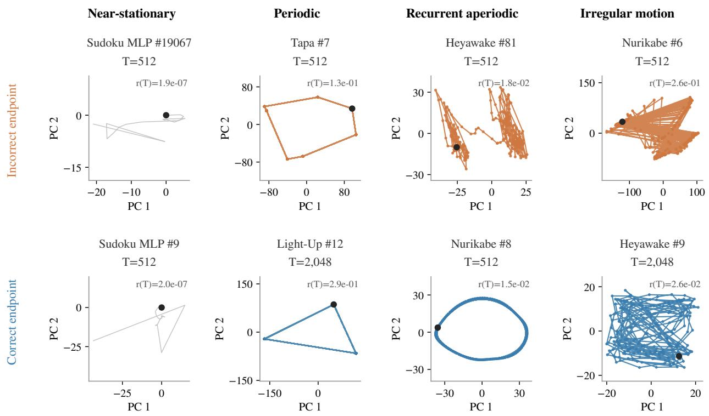  
Colored: final 256 states. Gray: approach to near-stationary states. Black: endpoint.

Figure 7 Diferent latent behaviors can accompany either correct or incorrect answers. Top: incorrect endpoints. Bottom: correct endpoints. Columns show near-stationary, periodic, regular moving, and irregular moving examples. Each panel uses an independent PCA basis fitted to the final 256 saved random projections. Colored paths show this window; gray paths show the earlier approach for the near-stationary examples. Black markers indicate endpoints, and �(�) reports the final recorded relative update residual. Axis scales difer across panels.

A trajectory satisfying both tests is assigned to the near-fixed-point class when $p = 1$ , or the approximately periodic class when $p > 1$ . These labels describe numerical behavior over the observed horizon.

Local stability diagnostics. For a detected return period �, we examine the linearized update $J _ { p } = D \big ( F _ { x } ^ { p } \big ) \big ( z _ { T } \big )$ using automatic-diferentiation Jacobian–vector products. We estimate its spectral radius using 40 power iterations from each of two random initial vectors. For each initialization, we take the geometric mean of the final 30 growth ratios, then retain the larger estimate.

We use $\hat { \rho } < 0 . 9 5$ as a conservative numerical criterion for local stability and record whether the iteration has converged. A trajectory that passes the return tests but does not meet this stability criterion remains in the corresponding near-fixed-point or periodic class without confirmed stability. For example, the Light-Up trajectory in Figure 9 has a detected period of three, but its spectral-radius estimate does not pass this stability criterion.

Diagnostics of continued motion. For trajectories without a confirmed fixed-point or short-period return, we examine temporal regularity and sensitivity to nearby initial states.

We compute the correlation version of the 0–1 test for chaos (Gottwald and Melbourne, 2009) from a fixed scalar observable $s _ { t } = a ^ { \top } z _ { t }$ , where � is a random unit vector. The reported statistic � is the median over 100 test frequencies sampled uniformly from $( \pi / 5 , 4 \pi / 5 )$ . We use up to the final 2,000 observations. Since this implementation uses correlation coeficients, finite-sample values of � can be negative.

We also compute a finite-time perturbation-growth estimate � using nearby trajectories with stepwise renormalization (Benettin et al., 1980). Starting from ${ \mathit { z } } _ { T }$ , we use four random perturbation directions with initial norm $1 0 ^ { - 3 } \lVert z _ { T } \rVert _ { 2 }$ and continue for up to 64 updates. We average the usable logarithmic growth rates across steps and directions, excluding readings from separation collapse or from the first crossing of the saturation threshold $0 . 1 \| z _ { T } \| _ { 2 }$ onward. If no usable readings remain, the estimate is treated as unavailable.

We assign the regular-motion class when $K \le 0 . 2$ and either $| \lambda | < 0 . 0 5$ or � is unavailable. We assign the irregular-motion class when $K \ge 0 . 8$ or an available � exceeds 0.05. Other cases remain unresolved. These operational classes summarize finite observations; the two diagnostics need not agree on every instance.

For irregular trajectories, we additionally distinguish small and large motion using the relative diameter

$$
d _ { \mathrm { t a i l } } = \frac { \operatorname* { m a x } _ { i , j \in \mathcal { W } } \| u _ { i } - u _ { j } \| _ { 2 } } { \| z _ { T } \| _ { 2 } } ,\tag{12}
$$

where $u _ { t } = R z _ { t }$ is the saved random projection and $\mathcal { W }$ contains the final 256 recorded states. The threshold is $d _ { \mathrm { t a i l } } = 0 . 1$ . The figure annotations $_ { \mathrm { A 1 - A 5 } }$ denote, respectively, near-fixed points, periodic returns, regular motion, small irregular motion, and large irregular motion.

Latent behavior and answer correctness. Figure 7 pairs correct and incorrect endpoints across these numerical classes. The two Sudoku MLP examples both approach near-fixed points, although only one returns a correct answer (Figure 8). Periodic trajectories likewise occur with diferent endpoint outcomes (Figure 9).

Correct answers also occur during continued latent motion. The Nurikabe example in Figure 10 returns a valid answer while its update residual remains well above the near-fixed-point tolerance. Figure 11 shows a correct Heyawake endpoint with irregular-motion diagnostics. For this example, � exceeds the irregularity threshold while the finite-time perturbation-growth estimate is negative; its classification is therefore supported by the former diagnostic.

Together, these examples show why latent stationarity and answer correctness must be evaluated separately. They illustrate possible combinations of the two, rather than their prevalence across tasks.

## B.1 Stability and robustness of incorrect states

Incorrect predictions can persist both under continued recursion and after substantial state perturbations. To characterize this persistence, we distinguish three complementary diagnostics: approximate stationarity, estimated local linear stability, and robustness to finite perturbations. These diagnostics complement the recovery comparisons in Figure 4.

Approximate stationarity and local stability. Among the 4,320 final failures of greedy depth scaling for the seed-0 Sudoku-Extreme TRM checkpoint, 239 instances belong to the incorrect near-fixedpoint class. Their classification uses the residual and persistence tests described above. To examine local stability, we estimate the spectral radius of the full-state Jacobian,

$$
\widehat { \rho } _ { x } ( w ) \approx \rho ( D F _ { x } ( w ) ) ,
$$

at each recorded near-fixed point �.

We use Jacobian–vector products in FP32, with the MATH attention backend where applicable. For each of two random initial vectors, we perform 40 power iterations and compute the geometric mean of the final 30 growth ratios. We report the larger of the two estimates. An estimate passes our convergence check when the relative range of the final 10 growth ratios is below 1% for both initial vectors.

Across all 239 instances, the lower quartile, median, and upper quartile of the estimated spectral radius are 0.893, 0.919, and 0.943, respectively; the maximum is 0.9945. The convergence check passes for 128 instances, whose estimates range from 0.7384 to 0.9877. Together with their small update residuals, these measurements provide numerical evidence of local attraction for a subset of incorrect states. The remaining 111 estimates are reported as unconverged, rather than interpreted as verified stability. Throughout, we retain the label near-fixed point: an estimated spectral radius below one is distinct from a certified bound at an exact fixed point.

Robustness to finite perturbations. For each of the 239 instances, we draw 16 independent full-state Gaussian perturbations at each scale

$$
\sigma \in \{ 0 . 0 0 1 , 0 . 0 0 3 , 0 . 0 1 , 0 . 0 3 , 0 . 1 , 0 . 3 , 1 \} .
$$

The perturbation is scaled relative to the recorded state:

$$
\widetilde { z } _ { 0 } = w + \varepsilon , \qquad \varepsilon \sim N \left( 0 , \frac { \sigma ^ { 2 } \| w \| _ { 2 } ^ { 2 } } { d } I _ { d } \right) .
$$

We then apply 64 recursion steps under the unchanged map $F _ { x }$ . At every tested scale, all resulting endpoints retain the original incorrect decoded answer. Moreover, no rule-valid prediction is observed during any of these 64-step continuations. Thus, the failure persists across the tested random directions even when the perturbation magnitude is comparable to the state norm.

Decoded-answer retention and latent return. Retaining the same answer does not require returning to the same latent state. We therefore measure decoded-answer retention separately from latent return. Let $S _ { w }$ contain the recorded state � and the final 16 states of its reference trajectory. An endpoint $\widetilde { z } _ { 6 4 }$ passes the latent-return test when

$$
\operatorname* { m i n } _ { s \in S _ { w } } \| \widetilde { z } _ { 6 4 } - s \| _ { 2 } \leq \operatorname* { m a x } \{ 3 f _ { \mathrm { n u m } } \| w \| _ { 2 } , \mathrm { d i a m } ( S _ { w } ) \} ,
$$

where $f _ { \mathrm { n u m } }$ is the calibrated relative numerical floor. Distances in this test are computed in the full latent space.

Table 7 shows that endpoint answer retention remains at 100%, whereas latent return within 64 updates decreases as the perturbation scale grows. This separates robust persistence of an incorrect answer from return to its recorded latent neighborhood. Failure to satisfy the finite-horizon return test alone does not establish escape: a trajectory may converge slowly, approach another state with the same decode, or remain in motion.

Moving failures. The same finite-perturbation protocol also reveals persistent failure among the $4 { , } 0 7 3$ irregular moving trajectories. Across the tested scales, approximately 99.8–100% of endpoints satisfy the reference-set return criterion. At $\sigma = 1$ , only 0.13% of endpoints yield a valid answer. For these trajectories, the return tolerance is determined by the diameter of the recorded reference tail. These measurements describe finite-horizon return to a sampled neighborhood; they do not identify a unique invariant attracting set.

<table><tr><td>σ</td><td>Answer retention (%)</td><td>Solution discovery (%)</td><td>Latent return (%)</td></tr><tr><td>0.001</td><td>100.0</td><td>0.0</td><td>75.0</td></tr><tr><td>0.003</td><td>100.0</td><td>0.0</td><td>64.3</td></tr><tr><td>0.010</td><td>100.0</td><td>0.0</td><td>43.8</td></tr><tr><td>0.030</td><td>100.0</td><td>0.0</td><td>25.5</td></tr><tr><td>0.100</td><td>100.0</td><td>0.0</td><td>16.8</td></tr><tr><td>0.300</td><td>100.0</td><td>0.0</td><td>11.8</td></tr><tr><td>1.000</td><td>100.0</td><td>0.0</td><td>6.8</td></tr></table>

Table 7 Perturbation robustness of 239 incorrect near-fixed points from one Sudoku-Extreme TRM checkpoint. Each scale includes 16 perturbations per instance (3,824 trials). Answer retention compares the raw endpoint decode with the original decode after 64 updates. Solution discovery records whether any rule-valid prediction appears during those updates, with the original givens restored. Latent return uses the full-state neighborhood criterion defined in the text. All entries are descriptive percentages over perturbation trials.

Together, these diagnostics show that incorrect answers can persist in approximately stationary states with supporting local-stability evidence, as well as along moving trajectories. They motivate evaluating interventions by their ability to recover valid answers, rather than treating stationarity or perturbation robustness as a proxy for correctness.

## C State Perturbations and Recovery

## C.1 Perturbation Direction and Initialization

Diagnostic cohorts. Figure 4 compares state perturbations and hypothesis injection on three Sudoku-Extreme cohorts, using one trained checkpoint per backbone. Within each panel, all displayed methods use the same instances. Cold-start comparisons are available for the two TRM cohorts.

Warm and cold initialization. Let $w$ denote the saved failed state of an instance. Warm-start interventions perturb $w ,$ , whereas cold-start interventions perturb the model’s standard initialization $\scriptstyle z _ { 0 }$ After applying an edit, we run 64 updates under the unchanged original input:

$$
z _ { \mathrm { e n d } } ^ { ( k ) } = F _ { x } ^ { 6 4 } \Big ( z _ { \mathrm { s t a r t } } + \varepsilon ^ { ( k ) } \Big ) , \qquad z _ { \mathrm { s t a r t } } \in \{ w , z _ { 0 } \} .\tag{13}
$$

All diagnostic rollouts use FP32 computation with halting disabled. For GRAM, subsequent updates follow its deterministic prior-mean path.

Random perturbations. We evaluate � ∈ {0.001, 0.003, 0.01, 0.03, 0.1, 0.3, 1}. For a full-state Gaussian perturbation,

$$
\varepsilon ^ { ( k ) } = \sigma \frac { \| z _ { \mathrm { s t a r t } } \| _ { 2 } } { \sqrt { d } } \xi ^ { ( k ) } , \qquad \xi ^ { ( k ) } \sim N ( 0 , I _ { d } ) .\tag{14}
$$

Its expected squared norm is $\sigma ^ { 2 } \lVert z _ { \mathrm { s t a r t } } \rVert _ { 2 } ^ { 2 }$ . The high-level-only control applies the corresponding construction to $\mathcal { Z } _ { H }$ and leaves $\mathcal { Z } _ { L }$ unchanged.

Each perturbation is scaled relative to its own starting state or component.

Solution-guided perturbations. The oracle control uses the reference answer to optimize an edit of the full latent state. We minimize next-update cross-entropy over nonpadding output positions using 30 Adam updates with learning rate 2. After each optimization step, the edit is projected onto the ball $\| \varepsilon \| _ { 2 } \leq \sigma \| z _ { \mathrm { s t a r t } } \| _ { 2 }$ . Each scale uses eight random initializations, with initial edit norm min $\{ 1 0 , \sigma \| z _ { \mathrm { s t a r t } } \| _ { 2 } \}$ . The resulting edits are evaluated using Equation 13.

The transferred-oracle control takes another instance’s optimized edit at the same scale, normalizes its direction, and rescales it to the receiving state’s norm budget. Donors are assigned cyclically within each recorded evaluation group. These transferred directions retain reference-answer information from their donors.

Learned perturbations on GRAM. We additionally evaluate directions drawn from GRAM’s learned prior and reference-conditioned posterior. The posterior direction includes its mean displacement relative to the prior mean. Each direction is normalized and rescaled to �∥�� ∥2, applied to ${ \mathfrak { z } } _ { H } .$ , and followed by 64 deterministic prior-mean updates. The posterior and solution-guided controls use the reference answer.

ICScomparison. For each instance, the ICS comparator evaluates up to eight model-proposed singlecell hypotheses. Each hypothesis changes the input and starts a fresh 64-step rollout from $\scriptstyle z _ { 0 }$ No reference answers are used to generate these hypotheses.

This comparison measures candidate coverage from one round of hypothesis proposals. It does not execute the complete multilevel ICS search or apply its final model-based answer selection.

Endpoint coverage and uncertainty. We decode each rollout at its 64-step endpoint, restore the original givens, and check validity against the original task. An instance is covered if at least one of the first eight attempts returns a rule-valid answer. The comparison therefore uses at most eight 64-step candidate rollouts per instance and condition. The oracle controls additionally incur the optimization cost described above. Coverage is measured at rollout endpoints, rather than by checking whether any intermediate state was correct. Shaded regions and error bars in Figure 4 show pointwise nominal 95% Wilson intervals, with instances as the statistical unit.

A1; residual=1.9e-07; ρ=0.933

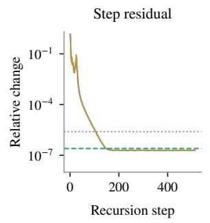

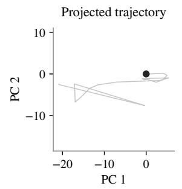

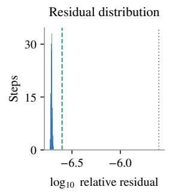

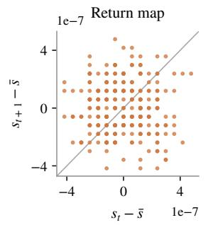

Sudoku MLP #9 | correct endpoint | $\mathrm { T } { = } 5 1 2$ A1; residual=2e-07; ρ=0.753  
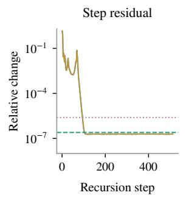

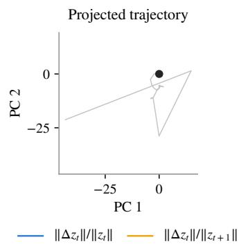

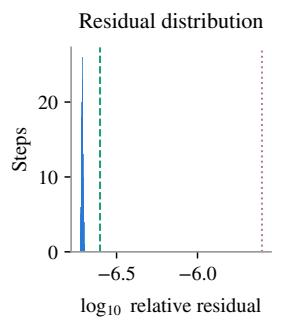

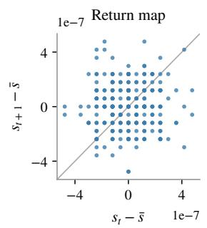  
Figure 8 Near-fixed points with diferent answer outcomes. Both Sudoku MLP trajectories approach numerical stationarity within 512 updates. The incorrect raw prediction satisfies the row, column, and box constraints but violates an original given; restoring that given produces an answer that fails the task rules. The other endpoint is correct. Columns show update residuals, the projected trajectory, the final-window residual distribution, and a centered scalar return map. The two residual curves normalize the update norm by ∥� ∥ and $\| z _ { t + 1 } \| _ { 2 }$ , respectively.

Tapa #7 | incorrect endpoint | $\mathrm { T } { = } 5 1 2$ A2; residual=0.13; period=7; ρ=0.856  
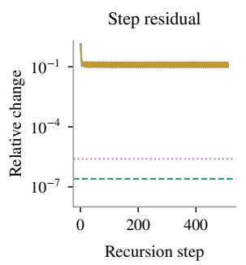

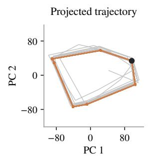

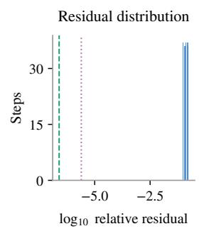

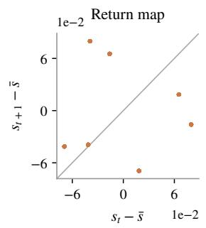

Light-Up #12 | correct endpoint | $\mathrm { T } { = } 2 { , } 0 4 8$ A2; residual=0.29; period=3; ρ=0.967  
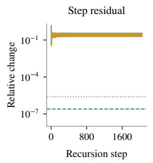

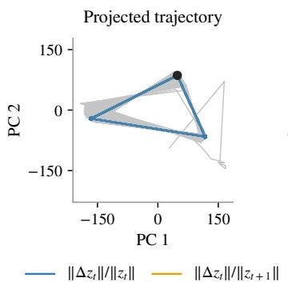

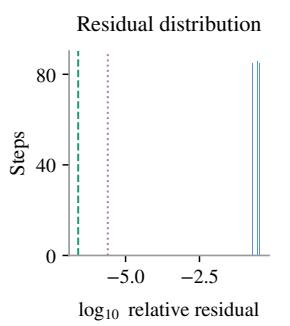

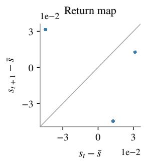

Figure 9 Periodic returns with diferent answer outcomes. The Tapa trajectory has an incorrect endpoint and a detected period of seven after 512 updates. The Light-Up trajectory has a correct endpoint and a detected period of three after 2,048 updates. Both continue moving between successive states. Period detection and local stability are evaluated separately: the Light-Up example does not pass the conservative spectral-radius criterion. Correctness is checked at the saved endpoint. Readouts follow Figure 8.

Heyawake #81 | incorrect endpoint | $\mathrm { T } { = } 5 1 2$ A3; residual=0.018; K=-0.479; λ=-0.026  
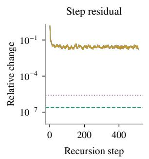

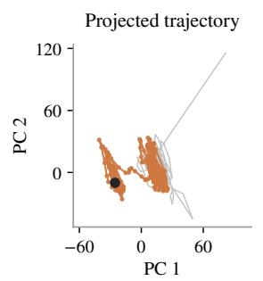

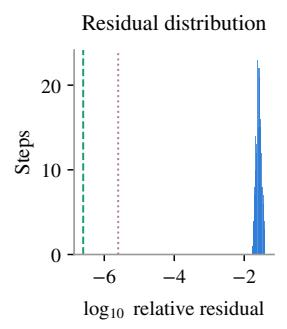

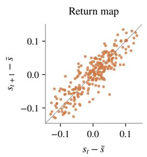

Nurikabe #8 | correct endpoint $\mathrm { T } { = } 5 1 2$ A3; residual=0.015; K=0.064; λ=-0.042  
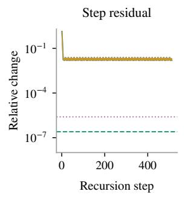

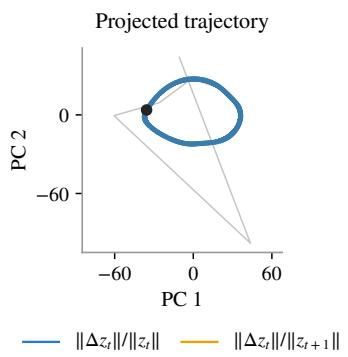

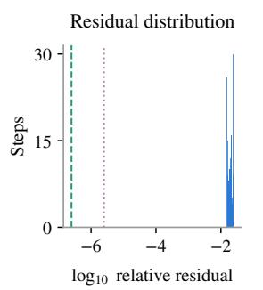

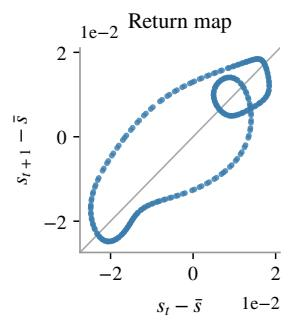  
Figure 10 Regular-motion examples with diferent answer outcomes. The Heyawake endpoint is incorrect and the Nurikabe endpoint is correct, both after 512 updates. Both satisfy the regular-motion diagnostic criteria, despite their diferent projected appearances. The Nurikabe trajectory exhibits a looping projection while maintaining nonzero update residuals. Its correct endpoint therefore does not require latent stationarity. Readouts follow Figure 8.

Nurikabe #6 | incorrect endpoint | $\mathrm { T } { = } 5 1 2$ A5; residual=0.26; K=0.930; λ=0.298  
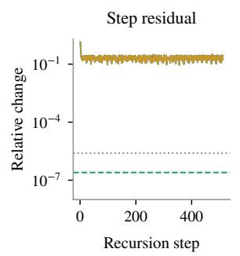

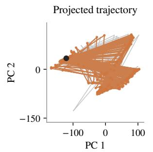

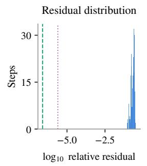

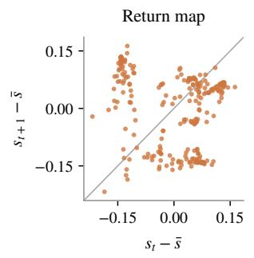

Heyawake #9 | correct endpoint | T=2,048 A4; residual=0.026; K=0.918; λ=-0.034  
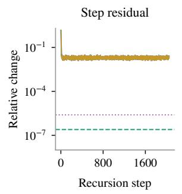

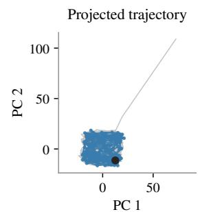

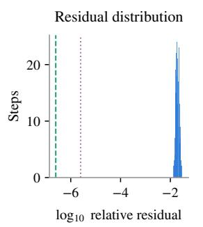

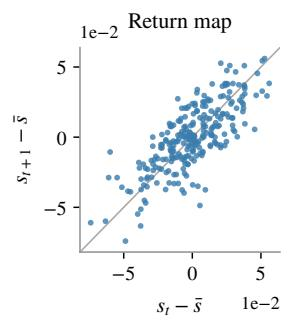  
Figure 11 Irregular-motion examples with diferent answer outcomes. The Nurikabe endpoint is incorrect after 512 updates; the Heyawake endpoint is correct after 2,048 updates. Their small/large-motion distinction uses the relative projected diameter in Equation 12. The Heyawake example satisfies the irregularity criterion through its 0–1 statistic despite a negative finite-time perturbation-growth estimate. Readouts follow Figure 8.

Other columns: all archived trials (32 random/learned, 8 oracle/transfer per instance and scale).

Recovery: first 8 edits / up to 8 hypotheses; bands and bars: pointwise Wilson 95% across instances.

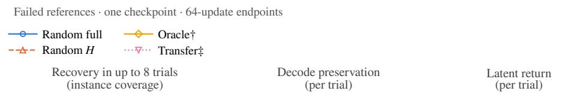  
A1 · fixed-point class | Failed reference | n=106

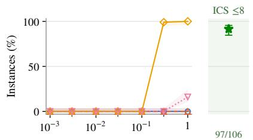

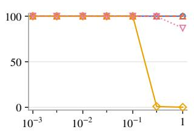  
A5 · large-scale moving class | Failed reference | n=96

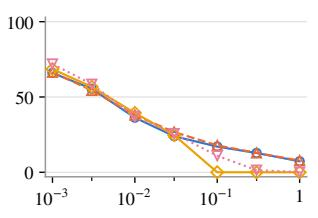

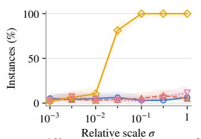

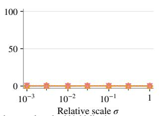

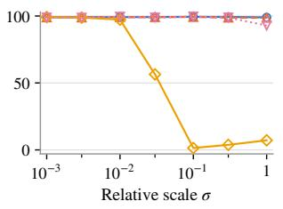  
Figure 12 Sudoku MLP: failed-reference diagnostics. Left: first-eight strict recovery coverage; HIS uses up to eight cold model hypotheses. Shading and bars are pointwise Wilson 95% intervals across instances. Middle/right: per-trial decode preservation and latent return.

Input controls: one hypothesis of each type per instance; agreement refers to the stored answer

Sudoku MLP
<table><tr><td colspan="3">Solved references · one checkpoint · 64-update endpoints</td></tr><tr><td colspan="3">— Random full Oracle†</td></tr><tr><td colspan="2">--- Random H … Transfer</td><td></td></tr><tr><td colspan="2">Strict validity</td><td>Decode preservation</td></tr><tr><td colspan="2">(per trial)</td><td>Latent return (per trial)</td></tr></table>

A6 · late-solution reference | Correct reference (late) | n=121

  
A1 · fixed-point class | Correct reference | n=31

A7 · unresolved class | Correct reference | n=1  

Input hypotheses: answer-assisted, cold initialization  
  
Original-input strict correctness after 64 cold-start updates; bars: pointwise Wilson 95% over instances.  
Figure 13 Sudoku MLP: solved-reference diagnostics. Top: per-trial state-edit outcomes under the original input. Bottom: separate answer-assisted input hypotheses agreeing or conflicting with the stored answer, evaluated from cold initialization; these are not HIS performance estimates. Bars are pointwise Wilson 95% intervals across instances; counts follow legend order.

## Maze attention

Relative scale σ Relative scale σ † Uses answer; ‡ uses donor answer. ICS uses model proposals and cold initialization.
<table><tr><td colspan="3">Failed references · one checkpoint · 64-update endpoints</td></tr><tr><td>Random full Oracle†</td><td colspan="3"></td></tr><tr><td>--- Random H …… Transfer</td><td colspan="3"></td></tr><tr><td>Recovery in up to 8 trials (instance coverage)</td><td>Decode preservation</td><td>(per trial)</td><td>Latent return (per trial)</td></tr></table>

A1 · fixed-point class | Failed reference | n=73  
  
A2 · periodic class | Failed reference | n=2

  
A4 · small-scale moving class | Failed reference | n=1

  
A7 · unresolved class | Failed reference | n=6

  
Recovery: first 8 edits / up to 8 hypotheses; bands and bars: pointwise Wilson 95% across instances.  
Other columns: all archived trials (32 random/learned, 8 oracle/transfer per instance and scale).

Figure 14 Maze attention: failed-reference diagnostics. Left: first-eight strict recovery coverage; HIS uses up to eight cold model hypotheses. Shading and bars are pointwise Wilson 95% intervals across instances. Middle/right: per-trial decode preservation and latent return.

Maze attention
<table><tr><td colspan="3">Solved references · one checkpoint · 64-update endpoints</td></tr><tr><td colspan="3">— Random full Oracle†</td></tr><tr><td colspan="3">--- Random H .… Transfer</td></tr><tr><td colspan="2"></td><td>Decode preservation</td></tr><tr><td colspan="2">Strict validity (per trial)</td><td>Latent return</td></tr></table>

A1 · fixed-point class | Correct reference | n=29

  
A3 · recurrent-aperiodic class | Correct reference | n=1

A7 · unresolved class | Correct reference | n=2  

Input hypotheses: answer-assisted, cold initialization  
  
Original-input strict correctness after 64 cold-start updates; bars: pointwise Wilson 95% over instances.  
Figure 15 Maze attention: solved-reference diagnostics. Top: per-trial state-edit outcomes under the original input. Bottom: separate answer-assisted input hypotheses agreeing or conflicting with the stored answer, evaluated from cold initialization; these are not HIS performance estimates. Bars are pointwise Wilson 95% intervals across instances; counts follow legend order.

Other columns: all archived trials (32 random/learned, 8 oracle/transfer per instance and scale).

Sudoku GRAM (mean path)
<table><tr><td colspan="3">Failed references · one checkpoint · 64-update endpoints</td></tr><tr><td>Random full ….. Transfer</td><td></td></tr><tr><td>--- Random H</td><td>-· GRAM prior</td></tr><tr><td>Oracle† -- - GRAM posterior† Recovery in up to 8 trials</td><td>Decode preservation Latent return</td></tr></table>

A1 · fixed-point class | Failed reference | n=4  
  
A2 · periodic class | Failed reference | n=20

A3 · recurrent-aperiodic class | Failed reference | n=6  

A5 · large-scale moving class | Failed reference | n=120  

Figure 16 Sudoku GRAM (mean path): failed-reference diagnostics. Left: first-eight strict recovery coverage; HIS uses up to eight cold model hypotheses. Shading and bars are pointwise Wilson 95% intervals across instances. Middle/right: per-trial decode preservation and latent return.

  
A7 · unresolved class | Failed reference | n=59

## Sudoku GRAM (mean path)

  
Figure 17 Sudoku GRAM (mean path): failed-reference diagnostics. Left: first-eight strict recovery coverage; HIS uses up to eight cold model hypotheses. Shading and bars are pointwise Wilson 95% intervals across instances. Middle/right: per-trial decode preservation and latent return.

<table><tr><td colspan="3">Solved references · one checkpoint · 64-update endpoints</td></tr><tr><td>— Random full ….. Transfer</td><td></td><td></td></tr><tr><td>--- Random H</td><td>—· GRAM prior</td><td></td></tr><tr><td colspan="2">Oracle† -- - GRAM posterior†</td><td></td></tr><tr><td colspan="2">Strict validity Decode preservation (per trial) (per trial)</td><td>Latent return (per trial)</td></tr></table>

## Sudoku GRAM (mean path)

A6 · late-solution reference | Correct reference (late) | n=3  

  
A1 · fixed-point class | Correct reference | n=116

  
A7 · unresolved class | Correct reference | n=1

Input hypotheses: answer-assisted, cold initialization  
  
State curves: original input, edited reference state; all archived trials. † Answer; ‡ donor answer.  
Input controls: one hypothesis of each type per instance; agreement refers to the stored answer.  
Original-input strict correctness after 64 cold-start updates; bars: pointwise Wilson 95% over instances.

Figure 18 Sudoku GRAM (mean path): solved-reference diagnostics. Top: per-trial state-edit outcomes under the original input. Bottom: separate answer-assisted input hypotheses agreeing or conflicting with the stored answer, evaluated from cold initialization; these are not HIS performance estimates. Bars are pointwise Wilson 95% intervals across instances; counts follow legend order.

Relative scale σ Relative scale σ † Uses answer; ‡ uses donor answer. ICS uses model proposals and cold initialization.  
Tapa
<table><tr><td colspan="3">Failed references · one checkpoint · 64-update endpoints</td></tr><tr><td>— Random full Oracle†</td><td colspan="3"></td></tr><tr><td>--- Random H …… Transfer‡</td><td colspan="3"></td></tr><tr><td>Recovery in up to 8 trials (instance coverage)</td><td></td><td>Decode preservation (per trial)</td><td>Latent return (per trial)</td></tr></table>

A1 · fixed-point class | Failed reference | n=5  
  
A2 · periodic class | Failed reference | n=1

  
Transfer: not available (singleton window)

A5 · large-scale moving class | Failed reference | n=4  

  
A7 · unresolved class | Failed reference | n=1

  
Recovery: first 8 edits / up to 8 hypotheses; bands and bars: pointwise Wilson 95% across instances.

  
Other columns: all archived trials (32 random/learned, 8 oracle/transfer per instance and scale).

Figure 19 Tapa: failed-reference diagnostics. Left: first-eight strict recovery coverage; HIS uses up to eight cold model hypotheses. Shading and bars are pointwise Wilson 95% intervals across instances. Middle/right: per-trial decode preservation and latent return.

State curves: original input, edited reference state; all archived trials. † Answer; ‡ donor answer.

Tapa  
  
A1 · fixed-point class | Correct reference | n=31

  
A7 · unresolved class | Correct reference | n=1

Input hypotheses: answer-assisted, cold initialization  
  
Input controls: one hypothesis of each type per instance; agreement refers to the stored answer  
Original-input strict correctness after 64 cold-start updates; bars: pointwise Wilson 95% over instances

Figure 20 Tapa: solved-reference diagnostics. Top: per-trial state-edit outcomes under the original input. Bottom: separate answer-assisted input hypotheses agreeing or conflicting with the stored answer, evaluated from cold initialization; these are not HIS performance estimates. Bars are pointwise Wilson 95% intervals across instances; counts follow legend order.

## Heyawake

Failed references · one checkpoint · 64-update endpoints   
Random full Oracle†   
Random H Transfer‡ Recovery in up to 8 trials Decode preservation Latent return (instance coverage) (per trial) (per trial)

A3 · recurrent-aperiodic class | Failed reference | n=1  

  
A5 · large-scale moving class | Failed reference | n=4

  
A7 · unresolved class | Failed reference | n=5

Transfer: 4/5 instances; one has no donor  

  
Recovery: first 8 edits / up to 8 hypotheses; bands and bars: pointwise Wilson 95% across instances.

  
Other columns: all archived trials (32 random/learned, 8 oracle/transfer per instance and scale).

Figure 21 Heyawake: failed-reference diagnostics. Left: first-eight strict recovery coverage; HIS uses up to eight cold model hypotheses. Shading and bars are pointwise Wilson 95% intervals across instances. Middle/right: per-trial decode preservation and latent return.

## Heyawake

<table><tr><td colspan="3">Solved references · one checkpoint · 64-update endpoints</td></tr><tr><td colspan="3">Random full Oracle†</td></tr><tr><td colspan="2">--- Random H … Transfer</td><td></td></tr><tr><td colspan="2">Strict validity</td><td>Decode preservation</td></tr><tr><td colspan="2">(per trial)</td><td>Latent return (per trial)</td></tr></table>

A1 · fixed-point class | Correct reference | n=12

A3 · recurrent-aperiodic class | Correct reference | n=3  

A7 · unresolved class | Correct reference | n=17  

Input hypotheses: answer-assisted, cold initialization  
  
Original-input strict correctness after 64 cold-start updates; bars: pointwise Wilson 95% over instances.

Figure 22 Heyawake: solved-reference diagnostics. Top: per-trial state-edit outcomes under the original input. Bottom: separate answer-assisted input hypotheses agreeing or conflicting with the stored answer, evaluated from cold initialization; these are not HIS performance estimates. Bars are pointwise Wilson 95% intervals across instances; counts follow legend order.

## Nurikabe

Relative scale σ Relative scale σ † Uses answer; ‡ uses donor answer. ICS uses model proposals and cold initialization.
<table><tr><td colspan="3">Failed references · one checkpoint · 64-update endpoints</td></tr><tr><td>— Random full Oracle†</td><td colspan="3"></td></tr><tr><td>-- - Random H …. Transfer</td><td colspan="3"></td></tr><tr><td>Recovery in up to 8 trials (instance coverage)</td><td></td><td>Decode preservation (per trial)</td><td>Latent return (per trial)</td></tr></table>

A1 · fixed-point class | Failed reference | n=6  
  
A2 · periodic class | Failed reference | n=1

  
A5 · large-scale moving class | Failed reference | n=3

  
A7 · unresolved class | Failed reference | n=4

Recovery: first 8 edits / up to 8 hypotheses; bands and bars: pointwise Wilson 95% across instances.  
  
Other columns: all archived trials (32 random/learned, 8 oracle/transfer per instance and scale).

Figure 23 Nurikabe: failed-reference diagnostics. Left: first-eight strict recovery coverage; HIS uses up to eight cold model hypotheses. Shading and bars are pointwise Wilson 95% intervals across instances. Middle/right: per-trial decode preservation and latent return.

## Nurikabe

  
A1 · fixed-point class | Correct reference | n=31

  
A3 · recurrent-aperiodic class | Correct reference | n=1

Input hypotheses: answer-assisted, cold initialization  
  
State curves: original input, edited reference state; all archived trials. † Answer; ‡ donor answer.  
Input controls: one hypothesis of each type per instance; agreement refers to the stored answer

Original-input strict correctness after 64 cold-start updates; bars: pointwise Wilson 95% over instances

Figure 24 Nurikabe: solved-reference diagnostics. Top: per-trial state-edit outcomes under the original input. Bottom: separate answer-assisted input hypotheses agreeing or conflicting with the stored answer, evaluated from cold initialization; these are not HIS performance estimates. Bars are pointwise Wilson 95% intervals across instances; counts follow legend order.

Light-Up  
  
A1 · fixed-point class | Correct reference | n=24

  
A7 · unresolved class | Correct reference | n=8

Input hypotheses: answer-assisted, cold initialization  
  
State curves: original input, edited reference state; all archived trials. † Answer; ‡ donor answer.  
Input controls: one hypothesis of each type per instance; agreement refers to the stored answer  
Original-input strict correctness after 64 cold-start updates; bars: pointwise Wilson 95% over instances

Figure 25 Light-Up: solved-reference diagnostics. Top: per-trial state-edit outcomes under the original input. Bottom: separate answer-assisted input hypotheses agreeing or conflicting with the stored answer, evaluated from cold initialization; these are not HIS performance estimates. Bars are pointwise Wilson 95% intervals across instances; counts follow legend order.

<table><tr><td>Model and task</td><td>Failed references</td><td>Correct references</td><td>Total</td></tr><tr><td>Sudoku TRM</td><td>202</td><td>153</td><td>355</td></tr><tr><td>Maze TRM</td><td>82</td><td>32</td><td>114</td></tr><tr><td>Sudoku GRAM</td><td>209</td><td>120</td><td>329</td></tr><tr><td>Tapa TRM</td><td>11</td><td>32</td><td>43</td></tr><tr><td>Heyawake TRM</td><td>10</td><td>32</td><td>42</td></tr><tr><td>Nurikabe TRM</td><td>14</td><td>32</td><td>46</td></tr><tr><td>Light-Up TRM</td><td>0</td><td>32</td><td>32</td></tr></table>

Table 8 Diagnostic cohorts in the extended perturbation study. Correct references include late-solution references. Counts describe the sampled model–instance pairs, not the frequency of each outcome in the full test sets.

## C.2 Comparisons Across Failure and Successful States

Coverage of the extended study. Figures 12–25 report all 40 recorded cohorts across six tasks and seven model–task combinations. Each combination uses one trained checkpoint. Table 8 summarizes the sample sizes; individual numerical classes remain separate in the figures.

This extended study includes a separate cohort of 106 incorrect fixed-point-class Sudoku TRM instances, rather than the 239-instance cohort used in Figure 4(a). The moving-failure cohorts of 96 Sudoku TRM and 120 Sudoku GRAM instances are shared with Figure $^ { 4 ( \mathrm { b } , \mathrm { c } ) }$

References are grouped by whether the saved prediction passes the original-task checker before intervention. The late-solution references, labeled A6, originate from previously failed instances whose classification rollouts have already reached accepted endpoints. They therefore enter this study as successful references. A7 denotes unresolved numerical behavior.

Three complementary readouts. All state perturbations in these extended figures start from the saved reference state $\mathfrak { Z } _ { \star }$ and are followed by 64 updates under the original input. We report three outcomes.

Strict correctness requires the endpoint answer to satisfy the original task after restoring givens, and additionally requires its raw decode to respect all original givens. This adds a given-consistency requirement to the rule-valid metric used in Figure 4.

Decode preservation requires the raw endpoint decode to equal the raw reference decode at every output coordinate, before restoring givens.

Latent return measures proximity to the saved reference state and its trailing trajectory. Let �★ contain � and the final 16 saved full-dimensional states. We count a return when

$$
\operatorname* { m i n } _ { s \in S _ { \star } } \| z _ { \mathrm { e n d } } - s \| _ { 2 } \leq \operatorname* { m a x } \left\{ 3 f \| z _ { \star } \| _ { 2 } , \dim ( S _ { \star } ) \right\} ,\tag{15}
$$

where $f$ is the numerical residual floor. Distances are computed in the full latent space. This readout measures return to the recorded reference neighborhood.

Aggregation within each figure. For failed references, the correctness column reports instance coverage: at least one strictly correct endpoint among the first eight perturbation attempts. The separate ICS markers use up to eight cold-start, model-proposed input hypotheses and the same strict endpoint criterion.

For successful references, the correctness column instead reports the fraction of individual interventions that retain strict correctness. Decode preservation and latent return are likewise reported per intervention for both reference groups. These rates use all recorded attempts: 32 per scale for random and learned directions, and eight for solution-guided and transferred directions.

Pointwise nominal Wilson 95% intervals accompany instance-level coverage and the separate input controls. Per-intervention rates are shown descriptively without treating repeated attempts on the same instance as independent samples.

Transferred directions require a donor instance. The Tapa periodic-failure cohort has no available transfer donor, and the Heyawake unresolved-failure transfer results cover four of its five instances. Each plotted rate uses its available denominator; unavailable controls are omitted.

Input controls on successful references. The successful-reference figures additionally show one answer-assisted agreeing hypothesis and one conflicting hypothesis per instance when available. Agreement is defined relative to the stored reference answer. Each modified input is evaluated from fresh initialization for 64 updates and scored against the original task.

These controls examine recomputation under added assumptions, rather than preservation of the saved successful latent state. A returned answer need not obey the additional hypothesis to satisfy the original task.

Correctness, decode preservation, and latent return can separate. The successful Sudoku TRM references provide a clear example. At � = 1, full-state random perturbations retain both strict correctness and the original decode in all trials of the near-fixed-point cohort, while only 3.2% return to the saved latent neighborhood (Figure 13). Preserving an answer therefore does not require returning to the same recorded latent state.

Correctness can also persist without exact decode preservation. For the regular-moving Nurikabe reference, all full-state random trials at � = 1 remain strictly correct, while only 3.1% reproduce the complete raw reference decode (Figure 24). These readouts capture diferent aspects of the response to an intervention.

Across failed references, recovery varies with the numerical class and intervention direction. The complete figures retain the small periodic, regular-moving, irregular-moving, and unresolved cohorts alongside the larger fixed-point groups. They support the comparisons within these sampled cohorts; the smaller groups provide descriptive examples rather than estimates of task-wide behavior.

## C.3 Hypothesis Content, Initialization, and Persistence of Near-Fixed Points

We examine whether a hypothesis enables recovery by changing the input condition, whether recovery requires a fresh initialization, and whether incorrect near-fixed points persist under the conditioned update map. These controlled interventions use one frozen Sudoku Extreme TRM-MLP checkpoint. They study individual hypotheses rather than the complete ICS search procedure.

Paired interventions and scoring. We use 4,320 previously classified failed instances: 239 in the incorrect near-fixed-point class, 4,073 with moving failures, two with periodic failures, and six in other or unresolved classes. For each instance, we generate 16 single-cell hypotheses from the decoder scores at its saved failed state $\mathfrak { z } _ { \star }$ . Mutable positions are ordered by increasing top-two logit margin, and we consider two alternative tokens per position, excluding its current prediction. Original givens are never modified. These are the same ordered hypotheses used for these instances in the extended perturbation study.

For each hypothesis $h = ( i , \upsilon )$ , we keep the modified input $x _ { h }$ fixed and run the same map $F _ { x _ { h } }$ for 512 recursion steps from either $\mathfrak { z } _ { \star }$ (warm start) or $\scriptstyle { \mathfrak { z } } _ { 0 }$ (cold start). Neither run stops early. Recovery means that the prediction at step 512 is valid for the original task after restoring its givens. We do not force the injected value into the returned answer. Since these Sudoku instances have unique solutions, the recorded reference-match score after restoring givens agrees with rule validity. Unless stated otherwise, percentages pool instance–hypothesis pairs, rather than count whether any hypothesis succeeds for an instance.

Near-fixed point Moving  

Figure 26 Recovery depends on initialization and hypothesis content. All panels use the frozen Sudoku Extreme TRM-MLP checkpoint (training seed 0). (a,b) Warm and cold starts use the same instance–hypothesis pairs under $F _ { x _ { h } }$ . Compatible hypotheses agree with the reference solution at the edited cell; this label is assigned after proposal generation. (c) Cold-start, label-informed controls inject correct or wrong values at unproposed erroneous cells or already-correct mutable cells. All rates measure validity of the final answer after 512 updates and restoration of original givens, pooled over instance–hypothesis pairs; they do not measure whether any of several hypotheses succeeds per instance. Injected values are not forced into the returned answer, so incompatible hypotheses can still yield valid outputs. Error bars show 95% confidence intervals from 1,000 bootstrap resamples of instances. Sample counts are given in Tables 9 and 10.
<table><tr><td>Failure cohort</td><td>Hypothesis</td><td>Pairs</td><td>Warm (%)</td><td>Cold (%)</td></tr><tr><td rowspan="2">Near-fixed point (239)</td><td>Compatible</td><td>602</td><td>0.00</td><td>73.92</td></tr><tr><td>Incompatible</td><td>3,222</td><td>0.00</td><td>10.09</td></tr><tr><td rowspan="2">Moving (4,073)</td><td>Compatible</td><td>17,381</td><td>50.43</td><td>61.26</td></tr><tr><td>Incompatible</td><td>47,787</td><td>1.43</td><td>0.09</td></tr><tr><td rowspan="2">Periodic (2)</td><td>Compatible</td><td>8</td><td>100.00</td><td>100.00</td></tr><tr><td>Incompatible</td><td>24</td><td>12.50</td><td>0.00</td></tr><tr><td rowspan="2">Other/unresolved (6)</td><td>Compatible</td><td>9</td><td>0.00</td><td>44.44</td></tr><tr><td>Incompatible</td><td>87</td><td>36.78</td><td>2.30</td></tr></table>

Table 9 Final-answer recovery under paired warm and cold starts. Each pair uses the same instance and injected hypothesis for both initializations, with 512 updates under the conditioned map. Parentheses in the first column give instance counts; the denominator of each percentage is the number of instance–hypothesis pairs. The periodic and other/unresolved groups are reported descriptively because they contain very few instances.

We call a hypothesis compatible when its proposed value agrees with the reference solution at the edited position, and incompatible otherwise. This label is assigned after proposal generation and is used only for analysis. In particular, compatibility does not imply that the model will find a solution under $F _ { x _ { h } }$

A useful hypothesis need not remove an incorrect near-fixed point. Figure 26(a,b) and Table 9 compare recovery under the two initializations. For the near-fixed-point cohort, warm starts recover no solutions, whereas cold starts recover 445 of 602 compatible pairs (73.9%). Across all 3,824 hypotheses in this cohort, 3,760 warm endpoints (98.3%) remain near-fixed and decode to the same incorrect answer as $z _ { \star } ; 3 , 6 7 4$ also remain within $0 . 0 5 \| z _ { \star } \| _ { 2 }$ of that state. Here, an endpoint is classified as near-fixed when every relative step residual in the final 16 updates is at most $2 . 5 \times 1 0 ^ { - 6 }$

<table><tr><td>Injected assignment</td><td>Near-fixed-point failures</td><td>Moving failures</td></tr><tr><td>Model proposal, compatible</td><td>73.9% (445/602)</td><td>61.3% (10,648/17,381)</td></tr><tr><td>Model proposal, incompatible</td><td>10.1% (325/3,222)</td><td>0.09% (45/47,787)</td></tr><tr><td>Correct value at unproposed error cell</td><td>74.9% (715/955)</td><td>73.3% (11,950/16,292)</td></tr><tr><td>Correct value at already-correct cell</td><td>49.1% (469/956)</td><td>26.2% (4,262/16,292)</td></tr><tr><td>Wrong value at unproposed error cell</td><td>14.6% (139/955)</td><td>6.6% (1,082/16,292)</td></tr><tr><td>Wrong value at already-correct cell</td><td>14.2% (136/956)</td><td>2.9% (480/16,292)</td></tr></table>

Table 10 Cold-start recovery after 512 updates, stratified by hypothesis content. Counts are successful/attempted instance–assignment pairs. An already-correct cell is an editable cell correctly predicted at the saved state, not an original given. Compatible model proposals occur on 225 of 239 near-fixed-point instances and 4,060 of 4,073 moving instances. One near-fixed-point instance has only three eligible unproposed error cells, yielding 955 rather than 956 error-cell controls.

Thus, input conditioning can permit recovery from a fresh initialization while leaving an incorrect near-fixed state accessible from the failed initialization. For moving failures, compatible hypotheses recover 50.4% of warm pairs and 61.3% of cold pairs. The benefit of restarting therefore depends on the starting state and hypothesis; it is not a uniform advantage for every intervention.

The content and location of an injected assignment matter. We separate agreement with the reference solution from the location of the edit using four cold-start controls. We inject a correct or incorrect value either at an already-correct mutable cell or at an erroneous cell not selected by the model’s proposer. Each control samples up to four eligible cells per instance without replacement. Incorrect control values exclude both the reference value and the saved prediction. These labelinformed controls are diagnostic interventions, not inference procedures available to ICS. Control families are paired by instance, but need not select the same cells.

Correcting an erroneous cell is more efective than repeating an already-correct value (Figure 26(c); Table 10). Averaging paired diferences between per-instance recovery fractions gives gains of 25.8 percentage points for near-fixed-point failures (95% interval: 22.3–29.8) and 47.2 points for moving failures (46.3–48.1). Intervals use 1,000 bootstrap resamples of instances, preserving all interventions within each instance.

The controls show that recovery depends on what information is injected, not merely on changing an input token. They do not establish that the model’s location ordering is optimal: correctly filling unproposed error cells also produces strong recovery. Incompatible hypotheses sometimes recover valid answers because the model is free to revise or disregard an injected value when decoding the original task.

Spectral diagnostics under the conditioned map. We additionally estimate the spectral radius of the Jacobian at original and conditioned near-fixed states. Computation uses the full recurrent state $( z _ { H } , z _ { L } )$ in fp32. For each state and input map, we run 40 Jacobian–vector-product power iterations from each of two Gaussian initial vectors. Each run takes the geometric mean of its last 30 norm growth ratios; $\hat { \rho }$ is the larger of the two estimates.

<table><tr><td>State</td><td>Map</td><td>n Median β [Q1, Q3]</td><td> $\hat { \rho } < 1$ </td><td>Batch check</td></tr><tr><td>Original incorrect state</td><td> $F _ { x }$ </td><td>239 0.9185 [0.8926, 0.9429]</td><td>239</td><td>128</td></tr><tr><td>Retained incorrect, compatible</td><td> $F _ { x _ { h } }$ </td><td>585 0.9085 [0.8846, 0.9366]</td><td>585</td><td>84</td></tr><tr><td>Retained incorrect, incompatible</td><td> $F _ { x _ { h } }$ </td><td>3,089 0.9076 [0.8829, 0.9339]</td><td>3,087</td><td>449</td></tr><tr><td>Recovered correct, matched pairs</td><td> $F _ { x _ { h } }$ </td><td>424 0.9113 [0.8849, 0.9320]</td><td>424</td><td>47</td></tr><tr><td>After restoring x, same pairs</td><td> $F _ { x }$ </td><td>424 0.9175 [0.8986, 0.9380]</td><td>424</td><td>9</td></tr><tr><td>Retained correct, solved controls</td><td> $F _ { x _ { h } }$ </td><td>6,534 0.9147 [0.8882, 0.9371]</td><td>6,524</td><td>604</td></tr></table>

Table 11 Spectral-radius estimates at near-fixed states. The first row has one state per instance; subsequent rows count instance–hypothesis pairs. Retained endpoints preserve the original decoded answer and lie within $0 . 0 5 \| z _ { \star } \| _ { 2 }$ of the starting state. The two matched rows use exactly the same 424 compatible interventions on 203 initially failed instances, before and after restoring �. The last row uses the separate 431-instance solved cohort described below. The final two columns count estimates below one and endpoints belonging to batches that pass the ratio-stability check, respectively; the latter is not an individual-state convergence rate. Quartiles describe the distribution of estimates, not uncertainty in an individual spectral radius.

The implementation checks whether the relative range of the final ten ratios is below $1 0 ^ { - 2 }$ for both initial vectors, but records this convergence flag jointly across a batch of states. Not all batches satisfy the check. We report all finite-iteration estimates rather than treating the flag as an individual-state convergence certificate.

All 585 retained incorrect endpoints under compatible hypotheses have $\hat { \rho } < 1$ , with median 0.9085 (Table 11). More directly, 422 compatible instance–hypothesis pairs yield a retained incorrect nearfixed endpoint from the warm start and a correct near-fixed endpoint from the cold start, with both spectral radius estimates below one under the same $F _ { x _ { h } }$ . This provides numerical evidence consistent with persistent local attraction under the conditioned map, in addition to small update residuals and unchanged incorrect decoding. It does not prove stability: the endpoints are approximate and the finite-iteration estimates are not certified bounds. Estimates above one also occur for two retained incorrect endpoints under incompatible hypotheses and ten retained correct endpoints in the solved controls (maxima 1.0051 and 1.0365, respectively).

Preserving a solution differs from reaching it. For each cold endpoint, we restore the original input � and run another 512 updates. Among the 10,977 cold endpoints that are correct and near-fixed in the two largest failure cohorts, 10,761 (98.0%) remain correct and near-fixed and move by at most $0 . 0 5 \| z _ { \star } \| _ { 2 }$ . The matched spectral rows in Table 11 further compare 424 compatible near-fixed-point interventions satisfying this return criterion. These tests establish endpoint correspondence at the measured tolerance, not continuous tracking of a fixed-point branch between the two maps.

As a complementary control, we retain 431 instances whose original-input 512-step rollout reaches a correct near-fixed state, from 450 tested instances. We propose 16 alternative-value hypotheses per instance. All 6,896 hypotheses are incompatible with the reference solution, because the starting predictions are correct. Warm continuation keeps all final answers valid; 6,835 endpoints (99.1%) remain near-fixed with the same decoded solution, including 6,534 within the retention tolerance. Cold starts under these identical hypotheses recover only 1,040 of 6,896 pairs (15.1%). Thus, a conditioned map can preserve an existing solution even when that solution is dificult to reach from initialization.

Together, these interventions support searching over hypothesis content and recomputing candidates from a fresh state. They show that recovery can improve without eliminating every incorrect nearfixed point, and that a solution’s persistence alone does not ensure its accessibility from a particular initialization.

## C.4 Sudoku component and proposal ablations

We compare a fixed-depth TRM baseline with seven search configurations using the same seed Sudoku model; the search runs use inference seed 7. The first eight disjoint windows in test-loader order contain 6,144 instances each, totaling 49,152.

Components and selection. A is TRM with depth scaling to � = 20: it executes all 20 recursion steps on the original input and returns the highest-� prediction along the trajectory. The same output is evaluated in both columns, giving 87.85% accuracy at 20 steps (0.375 TFLOPs) per instance; A does not use a task certificate to choose its answer. B adds hypothesis search with 16 steps per child; C adds up to 32 symmetry restatements of the original input, each with 16 steps. Thus AB, AC, and ABC retain the original search settings, while A is a fixed-depth reference. Their diferences from A include adaptive original-input computation as well as the added search stages.

For the search configurations, certificate selection checks each candidate against the original Sudoku rules. Model selection uses the engine’s � terminal without a task checker: the original-input and hypothesis stages can accept a positive halting logit; hypothesis candidates are ordered by assumption contradictions, original-input consistency, and descending �. The restatement stage first accepts a positive-� candidate, then uses agreement of at least two complete outputs, and finally falls back to the highest-� restatement if needed. This protocol is not a fixed-pool best-� rule. All reported accuracies are the ofline rule-validity rates of delivered answers after restoring original givens; reference-solution accuracy agrees in these records. Without restatements, an unaccepted AB run returns the last search level’s top-ranked candidate. These outputs also enter accuracy.

Search budgets and proposal controls. Both certificated-based selection and model-based selection use two alternative values per proposed location, subject to the proposal cap. The small budget arms cap proposals at six per parent and total children at 16; the respective levels and beam widths are unchanged. The implementation caps the number of proposals, not the number of distinct locations. Random-location controls retain model-ranked alternative values. The joint random control also samples alternative values without replacement from the digit vocabulary, excluding the current predicted value; it does not filter proposals by Sudoku constraint satisfaction.

For the search configurations, each window stores accuracy to four decimal places. With its known denominator, the number of correct outputs is uniquely recoverable; we pool those counts. A reports the 20-step baseline accuracy.

Interpretation. Relative to full ICS, omitting hypotheses (AC) lowers accuracy by 1.11 percentage points with a certificate and 0.99 points under model selection. Omitting restatements (AB) lowers accuracy by 0.02 and 0.06 points, respectively. These comparisons use the shared adaptive originalinput schedule of the search configurations. Random locations only result in a small gap from the full ICS. Randomizing values instead lowers it by 1.00 point, whereas certificate selection remains above 99.85%. Under the small budget, the joint random control loses 1.96 points under model selection and 0.29 points with a certificate. The results support useful information in the model’s value proposals. Because the terminal rule afects which later candidates are evaluated, the two selection columns, which also difer in search budgets, do not isolate scoring error on a common candidate pool.

<table><tr><td rowspan="2">Configuration</td><td colspan="3">Certificate selection</td><td colspan="3">Model selection</td></tr><tr><td>Acc. (%)</td><td>Steps</td><td>TFLOPs</td><td>Acc. (%)</td><td>Steps</td><td>TFLOPs</td></tr><tr><td>A: TRM + depth scaling (D = 20)</td><td>87.85</td><td>20.0</td><td>0.38</td><td>87.85</td><td>20.0</td><td>0.38</td></tr><tr><td>AB: + hypotheses</td><td>99.92</td><td>74.0</td><td>1.39</td><td>99.75</td><td>58.8</td><td>1.10</td></tr><tr><td>AC: + restatements</td><td>98.83</td><td>63.7</td><td>1.19</td><td>98.82</td><td>63.6</td><td>1.19</td></tr><tr><td>ABC: full HIS</td><td>99.94</td><td>74.4</td><td>1.39</td><td>99.81</td><td>59.8</td><td>1.12</td></tr><tr><td>ABC: random locations and values</td><td>99.85</td><td>75.5</td><td>1.42</td><td>98.81</td><td>58.8</td><td>1.10</td></tr><tr><td>ABC: random locations</td><td>99.90</td><td>73.8</td><td>1.38</td><td>99.78</td><td>59.4</td><td>1.11</td></tr><tr><td>ABC: small budget</td><td>99.63</td><td>56.8</td><td>1.06</td><td>99.42</td><td>54.8</td><td>1.03</td></tr><tr><td>ABC: small budget, random locations and values</td><td>99.34</td><td>64.3</td><td>1.20</td><td>97.45</td><td>50.4</td><td>0.95</td></tr></table>

Table 12 HIS ablation on Sudoku-extreme (with 49,152 instances). A uses the same best- output in both columns; its exact cost is 0.375 TFLOPs. Search configurations retain adaptive original-input attempts. Both accuracy columns evaluate delivered answers with the original task rules; only certificate-selected search consults those rules during selection. Steps and TFLOPs are mean executed model computation per instance, charging every launched evaluation. One step costs $1 . 8 7 5 \times 1 0 ^ { 1 0 }$ FLOPs. Search accuracies pool reconstructed counts; search costs use rounded window means. No multi-seed uncertainty is implied.

## D Input-Conditioning Experiments

The preceding experiments examine state interventions under the original-input update map $F _ { x }$ . We now examine interventions that change the input condition and therefore the update map. With model parameters held fixed, a hypothesis � replaces $F _ { x }$ with $F _ { \tilde { x } } = F _ { x _ { H } }$ or a restatement Φ replaces $F _ { x }$ with ${ \cal F } _ { \tilde { x } } = { \cal F } _ { \Phi ( x ) }$

Input conditioning can locally eliminate incorrect attracting fixed points. Numerical continuation in the benchmark models provides evidence of the underlying folds, and computer-assisted certificates in separately trained small reasoners establish this mechanism (Appendices D.2, D.3, and F.2). The experiments also examine how input conditions and initialization afect access to correct solutions.

We first describe the construction of the update-residual surfaces and recorded trajectories in Figure 6, then present the continuation and certification results. We subsequently examine aligned restatement dynamics, compare fresh initialization with continuation from a saved failed state, and vary the duration of hypothesis conditioning. Throughout these experiments, answer correctness is evaluated against the original task �.

## D.1 Construction of the update-residual visualization

Figure 6 visualizes a Maze-Hard instance using the seed-0 TRM checkpoint. The surfaces are constructed from model evaluations, and the overlaid paths are projections of recorded full-state trajectories.

Reference states and input intervention. We run the original-input model for 512 recursion steps from $\scriptstyle z _ { 0 }$ to obtain an incorrect near-fixed point $s _ { w }$ . For this diagnostic example, the hypothesis � introduces one additional "path" token at a mutable position.

Under the resulting map $F _ { x _ { H } } ,$ we run two trajectories for 1,024 updates: a cold-start trajectory from $\scriptstyle { \mathcal { Z } } 0$ and a warm-start trajectory from $s _ { w }$ . We use the cold-start endpoint as the correct near-fixed point $s _ { c } .$

A shared two-dimensional section. We construct an afine plane through ${ z _ { 0 } } , s _ { w } ,$ , and $s _ { c }$ in the full recurrent state space. Its orthonormal basis is

$$
\begin{array} { l } { \displaystyle { e _ { 1 } = \frac { s _ { w } - z _ { 0 } } { \| s _ { w } - z _ { 0 } \| _ { 2 } } , } } \\ { \displaystyle { a = ( s _ { c } - z _ { 0 } ) - \langle s _ { c } - z _ { 0 } , e _ { 1 } \rangle e _ { 1 } , \qquad e _ { 2 } = \frac { a } { \| a \| _ { 2 } } . } } \end{array}\tag{16}
$$

A point on the section corresponds to the full latent state

$$
z ( u , \nu ) = z _ { 0 } + u e _ { 1 } + \nu e _ { 2 } .\tag{17}
$$

Both input conditions are evaluated at the same section coordinates, so diferences between their surfaces arise from changing the input condition.

Measured residuals and interpolation. For each sampled state, we evaluate the relative one-step update residual

$$
r _ { x } ( z ) = \frac { \| F _ { x } ( z ) - z \| _ { 2 } } { \| z \| _ { 2 } } , \qquad r _ { x _ { H } } ( z ) = \frac { \| F _ { x _ { H } } ( z ) - z \| _ { 2 } } { \| z \| _ { 2 } } .\tag{18}
$$

Panels (a) and (c) display the corresponding base-10 log residuals. Panel (b) displays

$$
\Delta ( u , \nu ) = \log _ { 1 0 } r _ { x _ { H } } ( z ( u , \nu ) ) - \log _ { 1 0 } r _ { x } ( z ( u , \nu ) ) .\tag{19}
$$

Positive values therefore indicate that conditioning increases the relative update magnitude at the same state.

We begin with $\mathtt { a 4 5 } \times 4 5$ grid and add nested $9 \times 9$ grids around the coordinates of $s _ { w }$ and $s _ { c } ,$ with halfwidths $3 2 / 4 ^ { j }$ for $j = 0 , \ldots , 7$ . After deduplication, the section contains 3,195 sampled coordinates. Both maps are evaluated in FP32. We construct a shared triangulation in the original section coordinates and use piecewise-linear interpolation of the measured log residuals. The interpolant is defined before applying any display coordinate transformation.

Recorded trajectories. Each full-state trajectory is projected onto the section using coordinates

$$
\big ( \langle z _ { t } - z _ { 0 } , e _ { 1 } \rangle , \langle z _ { t } - z _ { 0 } , e _ { 2 } \rangle \big ) .
$$

For visualization, its projected path is placed on the corresponding interpolated residual surface. These displayed heights describe the residual at the reconstructed section coordinate; the original trajectory can also have components outside the plane.

The illustrative perturbation in panel (a) is applied at ${ \mathfrak { z } } _ { 0 } .$ , corresponding to $t = 0$ in the general annotation $z _ { t } + \hat { \varepsilon } _ { t } ^ { ( k ) }$ . It is an in-plane displacement of radius 800 at angle 225◦, selected from trajectories that return to $s _ { w }$ . This example illustrates a returning perturbed trajectory; the quantitative comparisons of perturbation methods use the separate protocol described with Figure 4.

The perturbed initialization projects outside the sampled rectangle. For rendering, out-of-domain projected coordinates are clamped to its boundary before surface interpolation. Consequently, the displayed perturbed starting point and its connector are schematic. The underlying trajectory is unchanged, and no residuals are extrapolated outside the sampled section.

Display coordinates. The residual minima occupy small regions relative to the full trajectory extent. To make both visible, all panels use the same nonlinear horizontal coordinate transformation, which magnifies neighborhoods of $s _ { w }$ and $s _ { c }$ and compresses distant context. A monotone display-height transformation compresses extreme log-residual values while retaining shallow relief. The residual panels share the same height and color scales, and axis and colorbar labels report the original values.

The same horizontal transformation is applied to the surfaces, trajectories, and markers. Local transparency adjustments reveal surface regions otherwise obscured by foreground plateaus. These rendering choices leave the measured residuals and recorded trajectories unchanged, but displayed widths, distances, and slopes are not latent-space metric measurements. The surfaces represent update residuals, rather than an energy function whose gradient generates the dynamics.

Endpoint checks. Direct evaluation at the recorded state $s _ { w }$ gives $r _ { x } ( s _ { w } ) \approx 2 . 4 1 \times 1 0 ^ { - 7 }$ and $r _ { x _ { H } } ( s _ { w } ) \approx$ 0.22465. Thus, the same state that is nearly stationary under the original input has a substantial update under the hypothesis-conditioned map. Both conditioned trajectories return valid answers, and their terminal states difer by only $2 . 4 0 \times 1 0 ^ { - 7 }$ in relative norm. These endpoint measurements use the saved full states, rather than values read from the interpolated surfaces.

## D.2 Input conditioning induces folds in incorrect fixed-point branches

Numerical continuation in the trained Maze-Hard and Sudoku-Extreme models identifies local folds in incorrect fixed-point branches as the input condition changes. At a fold, two fixed-point branches meet and terminate locally on one side of a critical parameter value. This provides a mechanism through which changing the input can remove an incorrect attracting fixed point. We first present the numerical evidence, then establish this mechanism with computer-assisted certificates in trained small reasoners (Appendix D.3).

We use � to interpolate between the original input embedding $\left( \lambda = 0 \right)$ and the hypothesis-conditioned embedding $( \lambda = 1 )$ ). The curves below track fixed points across these conditions; each plotted state approximately satisfies the fixed-point equation for its own condition.

A local fold in Maze-Hard. For the Maze-Hard landscape example (instance 461, hypothesis at cell 576), refinement locates a fold at $\lambda _ { c } \approx 0 . 7 9 6 4 9 8 8 9 1$ . The relative fixed-point residual is $2 . 0 3 \times 1 0 ^ { - 1 5 }$ and the unit-eigenvector equation residual is $7 . 0 1 \times 1 0 ^ { - 1 4 }$ . The leading multiplier approaches +1, while the next-largest computed multiplier modulus is approximately 0.609. Automatic diferentiation gives nonzero fold coeficients $a \approx - 2 9 4 . 6 2$ and $b \approx - 0 . 1 2 6 4 5$ , using the normalization in Appendix F.2. A finer continuation step gives the same fold location to approximately eight decimal places. Together, these measurements provide numerical evidence of a local saddle-node involving the incorrect attracting branch.

Condition-dependent branch structure in Sudoku. For Sudoku instance 60398 with a hypothesis at cell $^ { 4 0 , }$ , continuation follows the original attracting branch to a fold near $\lambda = 0 . 6 9 6 8 9 6$ . It then reverses direction in $\lambda ,$ follows an unstable segment to a second fold near 0.684264, and increases � again along another attracting branch to reach � = 1 (Figure 27). This is the order of fixed-point continuation, not a sequence of reasoning steps or a monotone increase of the input parameter. The tracked states retain the original incorrect decode.

A diferent hypothesis on this instance, and the controls on Maze instance 69 and Sudoku instance 357158, reach the fully conditioned map without detected folds. Together, these cases show that the structure of incorrect fixed-point branches depends on the input condition: a branch can terminate locally at a fold, while another incorrect attracting branch can persist under the final condition.

(c) Sudoku: at full input  
  
Figure 27 Numerical continuation in the trained Maze-Hard and Sudoku-Extreme models. (a) The Maze example exhibits a fold near $\lambda = 0 . 7 9 6 5 0$ . (b) A Sudoku example has two folds, revealing an intervening unstable branch. (c) Its full continuation and a persistent Sudoku control reach the fully conditioned input. Points are connected in continuation order; vertical coordinates report $1 0 0 \| z - s _ { w } \| _ { 2 } / \| s _ { w } \| _ { 2 }$ . Panel (b) magnifies the fold region. Stability styles use numerical multiplier estimates, not interval certificates.

Continuous input intervention. Let �(�) and $e ( x _ { H } )$ be the frozen model’s input embeddings. We define

$$
e _ { \lambda } = ( 1 - \lambda ) e ( x ) + \lambda e ( x _ { H } ) , \qquad G ( z , \lambda ) = F _ { \lambda } ( z ) - z ,\tag{20}
$$

where $F _ { \lambda }$ evaluates the recursive update with embedding $e _ { \lambda }$ . Thus $F _ { 0 } = F _ { x }$ and $F _ { 1 } = F _ { x _ { H } }$ . Intermediate embeddings need not encode literal puzzles; this interpolation is a diagnostic path between the two conditions, not an additional ICS inference operation. The complete recurrent state and all model parameters are held in the same coordinates throughout.

Following stable and unstable branches. Starting from an incorrect near-fixed point, we solve $G ( z , \lambda ) = 0$ using FP64 Newton–Krylov correction and pseudo-arclength continuation. An additional arclength equation allows the continuation parameter � to reverse direction at a fold, so the method can follow unstable fixed points that ordinary forward iteration would leave. Jacobian–vector products support the matrix-free linear solves and Arnoldi estimates of leading multipliers. We refine candidate folds by solving the augmented fixed-point, unit-multiplier, and eigenvector-normalization equations described in Appendix F.2. These calculations concern the full recurrent state; projections are used only for display.

## D.3 Certified elimination of incorrect attracting fixed points

Input conditioning can locally eliminate incorrect attracting fixed points in trained recursive reasoners. We establish this result with 51 complete computer-assisted certificates across selected model–instance– hypothesis cases in separately trained 4 × 4 Sudoku models (Table 13). Each certificate verifies the suficient conditions of Appendix F.2: an incorrect attracting branch meets an unstable companion and both cease to exist locally as the input interpolation crosses the critical value. The verified coeficient signs place the attracting branch on the lower-� side.

The complete certificates cover 42 solution-consistent and nine inconsistent hypotheses. They establish local elimination as an attainable outcome of input conditioning in learned networks. We report the certified instances and their subsequent reasoning outcomes first, followed by the model, selection, and verification protocols.

<table><tr><td colspan="2"></td><td colspan="4">Solution-consistent hypotheses</td><td colspan="2">Inconsistent hypotheses</td></tr><tr><td>Width</td><td>Seed</td><td>Tested</td><td>Folds</td><td>Roots</td><td>Complete</td><td>Tested</td><td>Complete</td></tr><tr><td>8</td><td>0</td><td>71</td><td>21</td><td>19</td><td>19</td><td>9</td><td>0</td></tr><tr><td>8</td><td>1</td><td>56</td><td>1</td><td>1</td><td>1</td><td>24</td><td>3</td></tr><tr><td>8</td><td>2</td><td>61</td><td>13</td><td>12</td><td>12</td><td>19</td><td>4</td></tr><tr><td>16</td><td>0</td><td>23</td><td>6</td><td>6</td><td>3</td><td>17</td><td>0</td></tr><tr><td>16</td><td>1</td><td>45</td><td>7</td><td>7</td><td>7</td><td>35</td><td>2</td></tr><tr><td>16</td><td>2</td><td>8</td><td>0</td><td>0</td><td>0</td><td>8</td><td>0</td></tr><tr><td>Total</td><td></td><td>264</td><td>48</td><td>45</td><td>42</td><td>112</td><td>9</td></tr></table>

Table 13 Fold detection and certification in six trained small models. Counts concern selected checkpoint– instance–hypothesis pairs, not independent puzzles. All nine detected folds under inconsistent hypotheses have complete certificates. Failure to complete a certificate does not establish absence of a fold.

  
Figure 28 Certified local folds and subsequent warm-start outcomes in trained small models. (a) Fold locations and certified bounds on the noncritical spectral radius for all 51 complete certificates; markers distinguish solution-consistent and inconsistent hypotheses, and colors indicate the 512-update endpoint category after crossing the fold. Each bound concerns the noncritical spectrum; the critical multiplier itself equals one. (b) Endpoint categories at $\lambda = \operatorname* { m i n } \{ 1 , \lambda _ { c } + 0 . 0 2 \}$ : 42 consistent and nine inconsistent hypotheses. Bar widths show percentages and labels give case counts. “Same wrong answer” denotes output agreement with the initial failure, not return to the same latent state.

Recovery after a certified fold. Among the 42 certified cases with solution-consistent hypotheses, 31 produce the correct solution in the post-fold warm-start diagnostic (Figure 28). We initialize each rollout at the original incorrect state and run 512 updates at $\lambda = \operatorname* { m i n } \{ 1 , \lambda _ { c } + 0 . 0 2 \}$ . Ten of the remaining cases end at another incorrect decode and one at the same incorrect decode; the latter latent state has nevertheless moved and remains nonstationary.

Among the nine inconsistent cases, one ends at the solution, seven at another incorrect decode, and one at the same incorrect decode. $\mathrm { A t } \lambda = 1$ , their counts are one, six, and two, respectively. These are endpoint outcomes, not the frequency of ever visiting a correct prediction. The results separate the certified change to the local fixed-point structure from the empirically measured answer reached by subsequent recursion.

Models and diagnostic data. We use $4 \times 4$ Sudoku with � = 16 positions and hidden widths $h \in \{ 8 , 1 6 \}$ , each trained with three seeds. Both recurrent components are retained, giving full state dimensions $n = 2 L h \in \{ 2 5 6 , 5 1 2 \}$ . The shared MLP block uses position-mixing and channelwise SwiGLU transformations with RMS normalization; each recursion step updates $\mathfrak { z } _ { L }$ and then $\mathfrak { z } _ { H }$ Training uses cross-entropy supervision at eight recursion steps, detached recurrent carries, and AdamW with batch size 256, learning rate $1 0 ^ { - 3 }$ , weight decay 1, and 4,000 optimizer updates.

Of the 288 completed Sudoku grids, 200 supply training puzzles and 88 supply the evaluation pools. Puzzles are generated by deleting cells and retaining only uniquely solvable inputs. Checkpoints are selected by 32-step accuracy on the standard pool with 6–10 givens, evaluated every 250 optimizer updates. This pool therefore serves model selection and is not an unbiased test set. The mechanism study uses a separate pool of 3,520 harder puzzles with 4–5 givens, generated from the same 88 grids.

Case and hypothesis selection. For each checkpoint, we scan this pool in its fixed order, run 512 updates from initialization, and stop after collecting ten incorrect near-fixed points or exhausting the pool. Near-stationarity requires relative residuals below $1 0 ^ { - 1 0 }$ throughout the last 16 updates. An incorrect output difers from the unique reference completion; merely satisfying row, column, and box constraints without respecting the original givens is insuficient. The six scans yield 47 retained checkpoint–instance pairs.

Each retained state receives eight single-cell hypotheses. The first inserts the reference value at an incorrectly predicted empty cell; remaining proposals are ranked by decoder logit margin. We distinguish hypotheses that agree with the unique solution (solution-consistent, or compatible) from those that disagree (inconsistent, or incompatible). This reference-informed construction is a diagnostic control, separate from the label-free ICS performance evaluation.

Certificate construction and replay. For each pair, we perform dense full-state pseudo-arclength continuation, refine detected folds, and attempt interval certification at multiple box radii. We sepa rately count detected folds, verified roots of the augmented fold equations, and complete certificates. A complete certificate additionally establishes nondegenerate fold coeficients, a simple unit multiplier with the complementary spectrum inside the unit circle, and a strictly wrong prediction at an original non-given position throughout the enclosing box. Appendix F.2 states the local implication and verification conditions. The certificate is for the real-valued map defined by the stored weights, with numerical enclosures accounting for evaluation error.

We replay all 54 saved candidate certificates without repeating candidate search. All 54 pass augmented-root, nondegeneracy, and wrong-decoding verification; 51 also pass transverse-stability verification. The remaining three are unverified at this last stage, not classified as unstable. The replay uses outward-rounded interval arithmetic, independently checks the decoder-margin lower bounds with exact rational arithmetic, and checks uniqueness of the original puzzles.

A representative certificate. For a representative width-16, seed-0 case (instance 305, hypothesis at cell 0), $\lambda _ { c } ~ \approx ~ 0 . 4 8 2 1 7 6 .$ . The verified root bound satisfies $Y + Z R \ < \ 1 . 0 4 9 \times 1 0 ^ { - 9 } \ < \ R$ , with $R \approx 1 . 7 3 7 \times 1 0 ^ { - 9 }$ . Outward-widened coeficient enclosures are $a \ \in \ [ - 0 . 2 7 2 8 8 , - 0 . 2 7 2 1 5 ]$ and $b \in [ - 0 . 1 0 2 2 2 , - 0 . 1 0 2 0 2 ]$ , while the noncritical spectral radius is below 0.85388. Four original

non-given positions have certified wrong tokens, with all their decoder margins exceeding 7.21535.   
This example verifies both transverse stability and wrong decoding around the critical point.

Scope and interpretation. The theorem and certificates establish that changing the input embedding can locally eliminate an incorrect attracting fixed point. The large-model continuation results are numerical evidence; the rigorous certificates concern the separately trained small models. Certification covers a neighborhood of each critical point along the specified interpolation, rather than absence of every incorrect attractor or absence at the final condition $\lambda = 1$ . The connection from the original failed state to the critical branch is tracked numerically, not certified along its entire length.

The study selects failed states and hypotheses for mechanism analysis, so the case counts do not estimate the prevalence of this mechanism on the main test sets. Post-fold rollouts evaluate recovery separately from local elimination. Their successful and unsuccessful outcomes, together with the persistent branches above, motivate searching over input conditions and evaluating the candidates that those conditions produce.

## D.4 Restatement-induced dynamics in aligned coordinates

Validity-preserving restatements express the same task in diferent representations. We test whether their efect extends beyond a change of coordinates: after aligning latent states, do they change the recursive update, and does the resulting recovery depend on initialization and continued conditioning?

Aligning the update maps. We restrict this study to spatial restatements. For a cell permutation Φ, let $P _ { \Phi }$ apply the corresponding permutation to the sequence positions of both recurrent components $( z _ { H } , z _ { L } )$ , while leaving hidden-feature coordinates and the 16 puzzle-embedding prefix positions unchanged. We express the restated-input update in the original coordinates as

$$
\widetilde { F } _ { \Phi } ( z ) = P _ { \Phi } ^ { - 1 } F _ { \Phi ( x ) } ( P _ { \Phi } z ) .\tag{21}
$$

The tested TRM models initialize each recurrent component by broadcasting a shared vector over positions, so $P _ { \Phi } z _ { 0 } = z _ { 0 } .$ ; the implementation checks this identity for every batch. Their shared token decoder permits predictions to be mapped back by $\Phi ^ { - 1 }$ . Thus, the original and restated cold-start trajectories begin at the same aligned state. Equivariance of the recursive update would additionally require $\widetilde { F } _ { \Phi } = F _ { x }$ , which we do not assume.

Models, instances, and restatements. We use a frozen TRM checkpoint for Sudoku-Extreme and a frozen checkpoint for Maze-Hard. The archived Sudoku failure cohort contains 4,320 instances: 239 in the incorrect near-fixed-point class, 4,073 moving failures, two periodic failures, and six other or unresolved cases. The Maze cohort contains 42 incorrect near-fixed-point instances. For each instance, we use its saved full latent endpoint $\boldsymbol { z } _ { \mathrm { f a i l } }$ from the trajectory diagnostics in Appendix B.

For Sudoku, we sample eight nonidentity spatial symmetries per instance by composing band and stack permutations, row permutations within bands, column permutations within stacks, and optional transposition. Sampling uses the fixed per-instance seed $7 \cdot 1 , 0 0 0 , 0 0 3 + \mathrm { i d } ( x )$ ; duplicate sampled symmetries are not removed. Digit relabeling is excluded from this study because Equation 21 defines a transport of spatial positions. For Maze, we use all seven nonidentity rotations and reflections of the grid. These yield 34,560 Sudoku and 294 Maze instance–restatement pairs. They are diagnostic cohorts from one checkpoint per task, rather than full-test, multi-seed evaluations of ICS.

Paired rollouts and scoring. For each pair $( x , \Phi )$ , we run $\widetilde { F } _ { \Phi }$ for 512 recursion steps from either $\scriptstyle { \mathcal { Z } } 0$ (cold) or $\boldsymbol { z } _ { \mathrm { f a i l } }$ (warm). Original-input controls run $F _ { x }$ for 512 steps from the same two starting states. All rollouts use eager FP32 inference with frozen parameters, no injected latent noise, and no early stopping or model-based candidate selection.

<table><tr><td rowspan="3">Condition Instances</td><td colspan="3">Sudoku-Extreme</td><td rowspan="3">Maze-Hard Near-fixed 42</td></tr><tr><td>All failures</td><td>Near-fixed</td><td>Moving</td></tr><tr><td>4,320</td><td>239</td><td>4,073</td></tr><tr><td>Original map, cold</td><td>1.13</td><td>5.86</td><td>0.83</td><td>0.00</td></tr><tr><td>Original map, warm</td><td>0.05</td><td>0.00</td><td>0.00</td><td>0.00</td></tr><tr><td>Restated map, cold</td><td>7.60</td><td>35.41</td><td>5.92</td><td>72.45</td></tr><tr><td>Restated map, warm</td><td>1.85</td><td>0.00</td><td>1.88</td><td>43.88</td></tr><tr><td>One restated step, then original†</td><td>5.56</td><td>34.57</td><td>3.83</td><td>60.54</td></tr><tr><td>Any-of-K coverage, restated cold</td><td>19.58</td><td>53.97</td><td>17.53</td><td>92.86</td></tr><tr><td>Any-of-K coverage, restated warm</td><td>7.82</td><td>0.00</td><td>8.20</td><td>85.71</td></tr></table>

Table 14 Recovery and coverage (%) on the archived failure cohorts. The upper rows report recovery within 512 recorded updates; restated conditions average over instance–restatement pairs, and original-map controls average over instances. The final two rows count instances recovered by at least one of $K = 8$ Sudoku or $K = 7$ Maze restatements. †: this control uses one preparatory restated update followed by 512 original-map updates, for 513 total steps.

At every step, predictions are mapped to the original representation and passed through the taskspecific output projection. Sudoku scoring restores the original givens and checks agreement with the unique reference solution. Maze scoring restores the original structural tokens and applies the shortest-path validity criterion to the projected output. These operations afect the scored prediction, not the latent recurrence. Recovery records whether any scored prediction is correct within the observation window. We report both recovery averaged over instance–restatement pairs and instancelevel coverage by any of the � restatements. The original-input controls have one rollout per instance and start. Confidence intervals use 1,000 bootstrap resamples of instances, retaining all associated restatements and paired conditions.

Restatements change the aligned update. At a shared state �, define

$$
\begin{array} { l l } { \Delta _ { x } ( z ) = F _ { x } ( z ) - z , \qquad } & { \Delta _ { \Phi } ( z ) = \widetilde { F } _ { \Phi } ( z ) - z , } \\ { d _ { \Phi } ( z ) = \displaystyle \frac { \| \Delta _ { \Phi } ( z ) - \Delta _ { x } ( z ) \| _ { 2 } } { \operatorname* { m a x } \{ \| \Delta _ { x } ( z ) \| _ { 2 } , 1 0 ^ { - 1 2 } \} } . } \end{array}\tag{22}
$$

Norms include both recurrent components and their prefix positions. Across the failed-instance pairs, the median $d _ { \Phi } ( z _ { 0 } )$ is 0.259 for Sudoku and 0.482 for Maze; the corresponding median cosine similarities between updates are 0.966 and 0.884. The updates therefore difer even after undoing the spatial coordinate transformation.

At original near-fixed points, $\| \Delta _ { x } ( z ) \| _ { 2 }$ is very small, so we instead compare the relative step residual $\| F ( z ) - z \| _ { 2 } / \| z \| _ { 2 }$ under the two maps. For the 239 Sudoku near-fixed-point instances, its median increases from $6 . 0 2 \times 1 0 ^ { - 7 }$ under $F _ { x }$ to 0.0494 under $\widetilde { F } _ { \Phi }$ . For the 42 Maze instances, it increases from $9 . 2 2 \times 1 0 ^ { - 7 }$ to 0.672. Thus, these recorded states cease to be nearly stationary under the restated maps. This observation does not by itself establish recovery or removal of an entire incorrect attractor.

Changing the map does not remove the dependence on initialization. Figure 29 and Table 14 show that cold restatements recover 35.41% of Sudoku near-fixed-point pairs, whereas warm restatements recover none. On Maze, both initializations recover solutions, but cold recovery is higher: 72.45% versus 43.88%. The paired cold-minus-warm diference is 35.41 percentage points for Sudoku nearfixed-point pairs (95% interval: 30.49–40.17) and 28.57 points for Maze (21.08–36.05). Allowing any tested restatement to succeed yields cold-start instance coverage of 53.97% and 92.86%, respectively. In particular, the increased residual at a Sudoku failed state does not imply access to a correct solution from that state.

  
Figure 29 Recovery under spatial restatements depends on initialization and the duration of conditioning. Recovery is the fraction of instance–restatement pairs with a correct prediction by the recorded rollout step; original-map controls average over instances. Bands show pointwise 95% instance-bootstrap intervals. Each restated cold/warm rollout uses the same task and transformation, difering only in its initial state. The one-step control first applies $\widetilde { F } _ { \Phi }$ once, then records � updates under $F _ { x } \mathbf { : }$ its total cost is � + 1 steps, and the preparatory state is not included in its recovery window. Panel �-axis ranges difer.

One changed update versus continued restatement. To distinguish the first changed update from continued use of the restated map, we initialize a control at $z _ { 1 } = \widetilde { F } _ { \Phi } ( z _ { 0 } )$ and then apply $F _ { x }$ for 512 additional steps. As implemented, this control therefore has 513 total steps; only its 512 original map predictions enter the recorded recovery window. It is a mechanism control, not an exactly matched-compute comparison.

For Sudoku near-fixed-point pairs, this control recovers 34.57%, close to the 35.41% obtained with continued restatement. The paired diference is 0.84 percentage points (95% interval: −0.42–2.25). Continued restatement has a larger advantage on Sudoku moving failures, 2.10 points (1.83–2.38), and on Maze, 11.90 points (5.10–19.06). Thus, a single restated update can provide much of the recovery observed in the Sudoku near-fixed-point cohort, whereas retaining the restated map provides additional benefit on Maze. The benefit of restatement need not require continuous use of the alternative map in every setting.

<table><tr><td>Condition</td><td>Sudoku-Extreme</td><td>Maze-Hard</td></tr><tr><td>Original map, cold</td><td>0.45%(2/444)</td><td>0.00% (0/38)</td></tr><tr><td>Restated map, cold</td><td>0.53% (19/3,552)</td><td>4.89% (13/266)</td></tr><tr><td>Restated map, warm</td><td>0.00% (0/3,552)</td><td>0.38% (1/266)</td></tr></table>

Table 15 Invalid final predictions after 512 updates on the separately screened solved-control cohorts. Counts are invalid/total rollouts. Restated rows contain eight transformations per Sudoku instance and seven per Maze instance.

Controls starting from solved instances. We also evaluate 444 Sudoku and 38 Maze instances that produce valid endpoints in a separate 512-step original-input screening rollout. We compare restated cold starts with restated warm starts from these saved valid endpoints, using the same transformation families and a further 512 steps. Table 15 reports endpoint invalidity, rather than whether an intermediate solution was encountered. Original-input cold reruns are included because screening and evaluation are separate executions. The results show that successful task representations are not interchangeable for the learned solver: cold restatements can return invalid outputs on previously solved instances, while continuation from a valid state usually preserves validity.

These experiments establish that spatial restatements can change the aligned recursive update and redirect reasoning from the same initial state without changing model parameters or task validity. Together with the initialization and one-step controls, they support restatements as an input-conditioning operation within ICS while showing that their efectiveness depends on both the starting state and how long the condition is retained.

## D.5 Initialization and hypothesis retention

We examine whether a hypothesis that enables recovery from fresh initialization also enables recovery from a saved incorrect state, and how recovery depends on the duration of conditioning.

Models, instances, and hypotheses. We study three TRM configurations: Sudoku MLP, Maze attention, and Sudoku attention, using one checkpoint per configuration. For each model, we use a fixed cohort of 20 incorrect instances: 16 with a successful hypothesis in an earlier cold-start screening experiment and four without such a success. Each instance receives eight model-proposed single-cell hypotheses derived from its saved state’s decoder logits. The same hypotheses are used in every initialization and retention condition.

These selected cohorts support paired mechanism comparisons rather than estimates of test-set accuracy.

Rollout and correctness conventions. All rollouts use frozen parameters, FP32 state updates, and disabled halting. Correctness is always evaluated against the original task �.

Cold-start trajectories apply $F _ { x _ { H } }$ from the standard initialization:

$$
z _ { t } ^ { \mathrm { c o l d } , H } = F _ { x _ { H } } ^ { t } ( z _ { 0 } ) .\tag{23}
$$

We run each trajectory for 512 updates and record endpoint correctness at intermediate horizons. Warm-start trajectories begin from the same saved incorrect state �. They retain the hypothesis for � updates and then restore the original input:

$$
z _ { T } ^ { H , m } = F _ { x } ^ { T - m } \left( F _ { x _ { H } } ^ { m } ( w ) \right) , \qquad T = 5 1 2 , \quad m \in \{ 0 , 1 , 2 , 1 6 , 6 4 , 5 1 2 \} .\tag{24}
$$

(a) Recovery depends on retention  
  
Solid: correct after 64 cold steps; dashed: all 128 hypotheses. Bands: 95% bootstrap over 16 instances per model.

(b) Outcomes with m = T  

Figure 30 Input retention has model-dependent efects. (a) Strict correctness after 512 updates from a saved incorrect state. Solid curves: hypotheses successful after 64 cold-start updates; dashed curves: all 128 hypotheses from the 16-instance screening cohort. Bands show nondegenerate 95% instance-bootstrap intervals. (b) Endpoint decode categories among cold-successful hypotheses when conditioning is retained throughout (� = �).
<table><tr><td>Model</td><td>Hypothesis pool  $m = 1$ </td><td> $m = 2$ </td><td> $m = 1 6$ </td><td> $m = 6 4$ </td><td> $m = 5 1 2$ </td></tr><tr><td>Sudoku MLP</td><td>All Cold-successful</td><td>0/128 0/128 0/37 0/37</td><td>0/128 0/37</td><td>0/128 0/37</td><td>0/128 0/37</td></tr><tr><td>Maze attention</td><td>All Cold-successful</td><td>9/128 23/128 7/25 18/25</td><td>27/128 20/25</td><td>27/128 20/25</td><td>20/128 20/25</td></tr><tr><td>Sudoku attention</td><td>All Cold-successful</td><td>0/128 1/128 0/26 1/26</td><td>4/128 4/26</td><td>7/128 7/26</td><td>15/128 14/26</td></tr></table>

Table 16 Strictly correct warm-start endpoints after 512 updates. The hypothesis is retained for the first � updates. Each model’s full pool contains eight hypotheses for each of 16 screened instances. Cold-successful subsets are selected by correctness after 64 updates from fresh initialization. Denominators count instance– hypothesis pairs, not distinct instances.

The latent state is carried continuously across the input switch. At � = 0, the entire rollout uses the original input; at � = 512, the hypothesis remains active throughout. The original-input control is evaluated once per instance and shared across its hypotheses.

Conditional and full-pool comparisons. Within each model’s 16-instance screening cohort, there are 128 instance–hypothesis pairs. Of these, 37 for Sudoku MLP, 25 for Maze attention, and 26 for Sudoku attention are strictly correct after 64 cold-start updates. These pairs define the cold-successful subset.

Figure 30 and Table 16 report warm-start outcomes for both this conditional subset and the full 128-pair pool. Thus, the conditional comparison holds the instance and hypothesis fixed while testing recovery from a diferent initialization. All warm-start results are scored at the same total horizon of 512 updates.

Initialization changes recoverability. For Sudoku MLP, all 37 cold-successful hypotheses also remain correct at the cold-start 512-step endpoint. Yet none recovers from the saved incorrect state at any tested retention duration. All 128 warm-start pairs retain the original incorrect endpoint decode. Thus, a hypothesis can support a correct solution from fresh initialization while failing to recover from an existing incorrect state under the same conditioned map.

The effect of retention varies across models. Maze attention often recovers after brief conditioning, whereas Sudoku attention benefits from longer conditioning within the tested schedules. Longer retention is not uniformly beneficial: in the full Maze pool, restoring the original input after 16 or 64 updates yields 27 correct endpoints, compared with 20 when the hypothesis remains active throughout.

Because the total horizon is fixed, increasing � also reduces the time available after restoring �. These curves therefore compare complete intervention schedules, rather than identifying a universal minimum conditioning duration.

Additional controls and uncertainty. Without changing the input, all 60 incorrect instances retain their original incorrect endpoint decode. Among the four additional instances per model, neither Sudoku configuration yields a warm-start success at any tested duration. Maze yields one success among 32 hypotheses at $m = 1 6$ and $m = 6 4 ,$ and none at the other durations.

For uncertainty estimates in the retention curves, we resample instances with replacement using 2,000 bootstrap replicates and recompute the pooled hypothesis success rate. This preserves dependence among hypotheses from the same instance.

Longer continuations. We selectively extend a retention trial to 2,048 updates if its maximum relative update over the last 16 steps exceeds $1 0 f _ { \mathrm { n u m } } ,$ , or if its endpoint classification remains unresolved, where $f _ { \mathrm { n u m } } = 2 . 5 \times 1 0 ^ { - 7 }$ . Continuation uses the map active at step 512.

There are 820 incorrect-instance trials per model: one original-input control and 40 hypothesisduration combinations for each of 20 instances. The extension criterion is triggered by zero trials for Sudoku MLP, 28 for Maze attention, and 144 for Sudoku attention. These follow-up diagnostics are kept separate from the common 512-step outcomes reported above.

## D.6 Matched-norm perturbations and solution round trips

We use two additional controls to examine the efect of input conditioning. The first compares a single conditioned update with random state displacements of the same magnitude. The second tests whether correct solutions can be recovered after switching between the original and hypothesis-conditioned inputs. Both controls use the strict correctness criterion.

Matching the first conditioned displacement. For each incorrect instance, we select the hypothesis with the largest halting score among those strictly correct after 64 cold-start updates. If none is correct, we select the hypothesis with the largest score. This selection uses cold-rollout outcomes to define the diagnostic comparison.

For the selected hypothesis �, let

$$
d _ { H } = \lVert F _ { x _ { H } } ( w ) - w \rVert _ { 2 }\tag{25}
$$

be the magnitude of its first update from the saved incorrect state �. We draw eight independent Gaussian vectors and normalize them to obtain isotropic unit directions:

$$
u _ { k } = \frac { \xi _ { k } } { \vert \vert \xi _ { k } \vert \vert _ { 2 } } , \qquad \xi _ { k } \sim N ( 0 , I _ { d } ) , \qquad k = 1 , \ldots , 8 .\tag{26}
$$

<table><tr><td>Model</td><td>Strictly correct</td><td>Same decode</td><td>Latent return</td></tr><tr><td>Sudoku MLP</td><td>16/16</td><td>16/16</td><td>16/16</td></tr><tr><td>Maze attention</td><td>15/15</td><td>15/15</td><td>15/15</td></tr><tr><td>Sudoku attention</td><td>7/7</td><td>7/7</td><td>5/7</td></tr></table>

Table 17 Solution round trips. The selected pairs have strictly correct, numerically near-fixed endpoints under both input conditions before the final phase. Results describe $\widetilde { s _ { H } }$ after reapplying the hypothesis for 512 updates. Same-decode and latent-return measurements use $s _ { H }$ as their reference. Each instance contributes one trial.

The matched random interventions and the one-step input intervention are then compared through

$$
\begin{array} { r l } { z _ { T } ^ { \mathrm { r a n d o m } , k } = F _ { x } ^ { T - 1 } ( w + d _ { H } u _ { k } ) , } & { { } } \\ { z _ { T } ^ { \mathrm { i n p u t } } = F _ { x } ^ { T - 1 } \big ( F _ { x _ { H } } ( w ) \big ) , \quad } & { { } T = 5 1 2 . } \end{array}\tag{27}
$$

Thus, both conditions use 511 original-input updates after the intervention. The matched quantity is the Euclidean displacement of the complete recurrent state.

Across the 16 screened instances per model, none of the 128 random-direction continuations produces a strictly correct prediction, for any of the three models. The selected one-step input intervention succeeds on 6 of 16 Maze instances, and on none of the Sudoku instances. The additional four-instance cohorts also yield no random-intervention successes, with 32 trials per model. On the sampled Maze instances, matching displacement magnitude alone therefore does not reproduce the recovery induced by a conditioned update.

Solution round trips. We next examine correspondence between solution states under the two input conditions. Using one recorded hypothesis per screened instance, we construct the endpoints

$$
\begin{array} { c } { { s _ { H } = F _ { x _ { H } } ^ { 2 0 4 8 } ( z _ { 0 } ) , } } \\ { { s _ { x } = F _ { x } ^ { 2 0 4 8 } ( s _ { H } ) , } } \\ { { \widetilde { s } _ { H } = F _ { x _ { H } } ^ { 5 1 2 } ( s _ { x } ) . } } \end{array}\tag{28}
$$

The first two endpoints are saved from the preceding long-rollout experiment. The final phase reapplies the same hypothesis while carrying the state continuously from $s _ { x }$

For the solution-preservation comparison, we select pairs for which both $s _ { H }$ and $s _ { x }$ are strictly correct and satisfy the numerical near-fixed-point classification under their respective maps. This yields 16 Sudoku MLP, 15 Maze attention, and seven Sudoku attention instances.

We separately measure whether $\widetilde { s _ { H } }$ is strictly correct, whether it has the same raw decode as $s _ { H . }$ , and whether it returns to the recorded latent neighborhood of $s _ { H }$ . Let $S _ { H }$ contain $s _ { H }$ and the final 16 states of its reference trajectory. The latent-return criterion is

$$
\operatorname* { m i n } _ { s \in S _ { H } } \| \widetilde { s } _ { H } - s \| _ { 2 } \leq \operatorname* { m a x } \{ 1 0 f _ { \mathrm { n u m } } \| s _ { H } \| _ { 2 } , \mathrm { d i a m } ( S _ { H } ) \} , \qquad f _ { \mathrm { n u m } } = 2 . 5 \times 1 0 ^ { - 7 } .\tag{29}
$$

Distances are computed in the full latent space.

All selected round trips recover a strictly correct endpoint with the same decoded answer as $s _ { H }$ (Table 17). Latent return also holds for every selected Sudoku MLP and Maze instance, but for only five of the seven Sudoku attention instances. Correct-answer preservation and return to a recorded latent neighborhood are therefore distinct outcomes.

<table><tr><td>Model</td><td>Original input  $r _ { x } ( \boldsymbol { w } )$ </td><td>Hypothesis input  $r _ { x _ { H } } ( \omega )$ </td></tr><tr><td>Sudoku MLP</td><td> $1 . 9 2 \times 1 0 ^ { - 7 }$ </td><td> $2 . 8 0 \times 1 0 ^ { - 2 }$ </td></tr><tr><td>Maze attention</td><td> $2 . 3 7 \times 1 0 ^ { - 7 }$ </td><td> $6 . 6 7 \times 1 0 ^ { - 2 }$ </td></tr><tr><td>Sudoku attention</td><td> $4 . 7 5 \times 1 0 ^ { - 7 }$ </td><td> $1 . 6 5 \times 1 0 ^ { - 1 }$ </td></tr></table>

Table 18 Median relative one-step displacement from saved incorrect states. Each model contributes 20 instances. The original-input column uses one measurement per instance; the hypothesis-input column pools eight hypotheses per instance, giving 160 state–hypothesis pairs without filtering by cold-start success or halting score. Both quantities are dimensionless and normalized by the same starting state’s norm.

The remaining saved pairs are reported separately. The one remaining Maze pair produces a correct endpoint and returns to its reference neighborhood. Among nine remaining Sudoku attention pairs, one produces a correct endpoint and seven return to their reference neighborhoods. Because these reference pairs do not all represent correct solutions, their return rates do not measure solution preservation.

Together with the initialization comparison, these results distinguish preserving an available solution from recovering one from an incorrect state. In particular, Sudoku MLP can recover the recorded solution after an input-condition round trip even when the same family of hypotheses fails to recover from saved incorrect states.

## D.7 One-step response to hypothesis injection

We measure how input conditioning changes the next update from a saved incorrect state. Using the same models, instances, and hypotheses as Section D.5, we compare one update under $F _ { x }$ with one under $F _ { x _ { H } ; }$ , holding the initial latent state and model parameters fixed.

We use the relative update residuals defined in Section D.1:

$$
r _ { x } ( w ) = \frac { \| F _ { x } ( w ) - w \| _ { 2 } } { \| w \| _ { 2 } } , \qquad r _ { x _ { H } } ( w ) = \frac { \| F _ { x _ { H } } ( w ) - w \| _ { 2 } } { \| w \| _ { 2 } } .\tag{30}
$$

The norm includes both recurrent components of the complete latent state.

Under the original input, median relative updates are of order $1 0 ^ { - 7 }$ . Under hypothesis conditioning, they increase to 2.80%, 6.67%, and 16.50% for Sudoku MLP, Maze attention, and Sudoku attention, respectively (Table 18). Thus, changing the input produces percent-level movement from states that are nearly stationary under the original map.

This response does not necessarily yield a correct answer. For example, Sudoku MLP retains its original incorrect endpoint decode throughout the tested retention schedules despite the initial displacement. Persistent incorrect predictions therefore need not imply an absence of latent movement. The initialization and retention experiments examine whether that movement ultimately enables recovery.

## E Training Supervision and Inference Behavior

Our finite-horizon diagnostics reveal a marked contrast between the studied Sudoku-Extreme and Maze-Hard models: incorrect predictions on Sudoku frequently continue to change under further recursion, whereas those on Maze are predominantly persistent. Nurikabe, Tapa, and Heyawake exhibit mixtures of these behaviors.

One potential contributor is the relationship between solution multiplicity and training supervision. The original Sudoku-Extreme training and test puzzles have unique solutions. Maze-Hard, by contrast, admits multiple shortest paths, while each training instance is supervised using a single reference path selected by the dataset’s path-generation procedure.

  
Figure 31 Training supervision changes decoded behavior. Each point summarizes one trained model’s reference-mismatch cohort after 16 recursion steps. The horizontal axis measures subsequent decoded changes; the vertical axis measures return to the original decoded prediction after perturbation. Dashed arrows compare separately trained conditions, whereas solid arrows connect a self-imitation initialization to its third fine-tuning round. The Sudoku inset magnifies the same observations. Standard Sudoku models are probed on 3,072 test instances and retrained models on 422,786; Maze models use the same 1,000-instance test split. Maze reference mismatches can include valid alternative solutions.

These observations motivate two related questions: does solution multiplicity afect inference behavior, and does the way supervision selects among valid solutions matter? We investigate these questions through complementary training interventions. On Maze-Hard, we keep the training inputs fixed and change how shortest-path targets are selected or combined. On Sudoku-Extreme, we introduce multiple solutions by removing givens and then vary the target-selection convention. We measure both decoded behavior and task accuracy (Figures 31 and 32).

## E.1 Maze-Hard: changing supervision on fixed inputs

We first investigate whether the choice of training targets afects inference behavior independently of solution multiplicity. We retain the same 1,000 Maze-Hard training inputs, so each input’s set of valid shortest paths remains unchanged, and vary how these paths enter supervision. All models are evaluated on the unchanged 1,000-instance test split.

Replacing the reference-path convention. The original dataset provides one reference shortest path per input. In Sample � = 1, we replace this target with one uniformly sampled shortest path, fixed throughout training. Thus, each input still has a single training target, but the targets no longer follow the original path-selection convention. In Sample � = 8, we present eight sampled paths per input as separate training examples, increasing the training set to 8,000 input–target pairs.

(a) Maze-Hard  

$$
s _ { \mathsf { r a w } } = 1 0 ^ { - 3 }
$$

(b) Sudoku-Extreme  

$$
s _ { \mathsf { r a w } } = 0 . 3
$$

Figure 32 Task performance under training interventions. (a) Additional inference on the 469 initially rule-invalid instances of the Maze Sample � = 1 model. Continuation measures correctness at the budget endpoint; restart measures coverage across trial endpoints. Noise scales are standard deviations in raw state units. (b) Sudoku rule-valid accuracy under changes to training inputs and target conventions. Original-test bars show three-seed means and standard deviations; clue-removed results use seed 0.

Figure 31(a) shows that these changes substantially alter decoded behavior. For the standard models, only 0.63–5.56% of their reference-mismatch cohorts meet the decode-change criterion, and 95.06– 100% return to their original decoded prediction after perturbation. With Sample � = 1, these fractions become 53.3% and 51.6%, respectively; Sample � = 8 gives 41.4% and 71.6%.

These measurements use each model’s own reference-mismatch cohort, which can include valid alternative paths. They demonstrate a change in decoded behavior without changing the underlying puzzles or their solution sets. However, the target replacements also reduce task accuracy: Sample � = 1 and Sample � = 8 achieve 53.1% and 23.0% rule-valid accuracy, respectively.

Supervising sets of valid solutions. To examine alternatives to presenting diferent valid paths as separate targets, we train models with min-over-8 and min-over-64 objectives. Each input is associated with a sampled target set, and training minimizes cross-entropy over its members. The associated reference-matching supervision also accepts membership in that set. We additionally evaluate per-cell shortest-path inclusion probabilities as soft targets.

Min-over-8 improves rule-valid accuracy to 64.2%, while retaining substantial decoded changes (45.1%) and lower decoded-output return (61.7%) than the standard models. Increasing the target set to 64 paths yields 57.5% accuracy, and marginal targets yield 7.8%. Thus, providing broader supervision over valid solutions does not produce a monotonic accuracy improvement.

Learning from the model’s own solutions. Starting from the min-over-8 checkpoint, we perform three rounds of collecting rule-valid model predictions and fine-tuning on the resulting target sets. Each round collects eight predictions per training input: one deterministic 16-step rollout and seven noisy rollouts. Valid predictions populate the new target set; inputs without a valid prediction retain their original sampled targets.

After three rounds, the decode-change fraction decreases from 45.1% to 23.6%, while decodedoutput return increases from 61.7% to 71.6%. Accuracy nevertheless changes from 64.2% to 62.8%. Self-imitation therefore moves these behavioral diagnostics toward the standard models without recovering their solution accuracy.

Additional inference after an incorrect prediction. We next examine whether additional computation can recover instances that remain incorrect after 16 deterministic recursion steps. For each trained model, we identify these instances using the task rules and compare two inference procedures.

Continuation extends the original trajectory to 256 total recursion steps and evaluates its final prediction. Noisy restart uses the same total budget for the initial 16-step rollout followed by 15 fresh, 16-step trials. During each restart trial, independent Gaussian noise is added to $\mathcal { Z } _ { L }$ before every update, with per-coordinate standard deviation $s _ { \mathrm { r a w } } \in \{ 1 0 ^ { - 3 } , 0 . 3 \}$ . This scale is expressed in raw state units, rather than the relative perturbation scale used in the state-intervention experiments.

Continuation reports correctness at its final step, whereas restart reports whether any trial endpoint is rule-valid. The latter measures candidate coverage and does not require a model-based selector to identify the correct candidate.

For Sample � = 1, continuation ends with a valid prediction on $5 3 / 4 6 9 \ : = \ : 1 1 . 3 \%$ of the initial failures. Noisy restart provides at least one valid candidate for 115/469 = 24.5% at $s _ { \mathrm { r a w } } = 1 0 ^ { - 3 }$ and $1 4 5 / 4 6 9 = 3 0 . 9 \%$ at $s _ { \mathrm { r a w } } = 0 . 3$ (Figure 32(a)).

These experiments show that the retrained models can produce valid alternatives to their initial incorrect predictions through noisy rollouts. Together with the behavioral diagnostics, they motivate evaluating training supervision through both its initial solution accuracy and the opportunities it leaves for additional inference.

## E.2 Sudoku-Extreme: introducing solution ambiguity

The Maze experiments change supervision while preserving each input’s solution set. We next take the complementary approach: introduce multiple solutions into Sudoku training inputs and examine whether this produces the predominantly persistent incorrect predictions observed on Maze.

Introducing ambiguity while retaining the targets. Starting from the original Sudoku-Extreme training data, we randomly remove givens until each input admits at least two solutions, while retaining its original target. An exact solution-counting procedure, capped at two, verifies this property for all 1,001,000 augmented training examples.

We evaluate the resulting models on both the unchanged unique-solution test set of 422,786 instances and a separate 3,072-instance clue-removed test set. All reported accuracies use task validity, so valid alternative completions are accepted even when they difer from the reference answer.

Training on ambiguous inputs reduces original-test accuracy to $6 0 . 3 8 \pm 1 . 7 2 \%$ , compared with $8 6 . 0 \pm 0 . 6 \%$ for the standard models. On the clue-removed test set, the seed-zero ambiguity-trained model achieves 49.80%, compared with 99.25% for the standard model. Thus, the reduction is also present when evaluation inputs admit multiple solutions.

Despite this change in supervision, incorrect predictions on the original test set continue to change: the decode-change fraction remains approximately 99.0–99.3% across three training seeds (Figure 31(b)). Introducing solution ambiguity alone therefore does not reproduce the persistent-output behavior observed on Maze in these experiments.

Selecting targets by a consistent convention. We next replace the targets on the same ambiguous training inputs using two deterministic conventions. Raw min-lex selects the lexicographically smallest valid completion in row-major order. Canonical-frame min-lex compares solutions after relabeling digits by their order of first appearance, with a deterministic raw-digit tie-break for digits absent from the givens.

Raw min-lex supervision raises seed-zero accuracy on the clue-removed test set from 49.80% to 70.38%, but reduces original-test accuracy to $3 5 . 1 3 \pm 1 . 0 5 \%$ . The canonical-frame variant achieves $2 2 . 7 1 \pm 0 . 3 8 \%$ on the original test set and 36.88% on the clue-removed test set (Figure 32(b)). Moreover, the raw min-lex models’ incorrect predictions on the original test set retain high decodechange fractions of approximately 97.2–99.3%.

These results show that imposing a deterministic target convention does not, by itself, reproduce Maze-like persistent failures or restore solution accuracy. The particular convention and its interaction with learning remain relevant.

Self-imitation. We also fine-tune the seed-zero ambiguity-trained model using its own rule-valid predictions. Each of three rounds uses the first 100,000 ambiguous training examples, replacing an original target with a valid model prediction when one is found and retaining the original target otherwise. Each round performs 8,000 fine-tuning updates.

After three rounds, original-test accuracy is 56.88%, compared with 62.24% for the initialization. The decode-change fraction decreases from 99.12% to 97.63%, while decoded-output return increases from 1.77% to 3.46%. Unlike the larger behavioral shift observed for Maze, this model remains dominated by changing incorrect predictions in the diagnostic window.

What explains the contrast? The two directions of intervention distinguish solution multiplicity from the choice of training targets. On Maze-Hard, changing the targets substantially changes decoded behavior while preserving the training inputs and their valid solution sets. Even Sample � = 1, which retains one fixed target per input, produces a diferent behavioral profile from the original supervision. The observed behavior therefore depends on more than the number of valid solutions.

Conversely, introducing multiple solutions into Sudoku does not reproduce the predominantly persistent incorrect predictions observed on Maze. Providing deterministic min-lex targets also leaves incorrect predictions largely changing within the diagnostic window. These results identify training supervision as a contributing factor, but do not support a simple correspondence between solution multiplicity, a deterministic target convention, and persistent failures.

The interventions also separate behavioral changes from improvements in reasoning performance. For example, Maze self-imitation increases decoded-output return while slightly reducing solution accuracy. Training objectives should therefore be evaluated by both the quality of the resulting predictions and the efectiveness of additional inference, rather than output persistence alone.

Whereas ICS searches input conditions to change the update map of a frozen reasoner, these experiments motivate a complementary direction: learning update rules whose dynamics support accurate and eficient test-time search.

## F Conditional Analysis of Input-Conditioned Reasoning

This section establishes suficient conditions under which input conditioning locally eliminates an incorrect attracting fixed point. The fold analysis in Appendix F.2 gives the proof, and the computerassisted certificates in Appendix D.3 verify these conditions in trained small reasoners. Alongside

this result, we characterize the response of a saved state to an input change and give conditions for reaching a correct solution from a chosen initialization.

For a fixed model, let

$$
F = F _ { \theta } ( \cdot ; x ) , \qquad G _ { H } = F _ { \theta } ( \cdot ; \tilde { x } )
$$

denote the original and hypothesis-conditioned update maps. We begin with the one-step residual response, then prove the local fold criterion and describe its verification. The final two subsections address persistence of a correct fixed point and its accessibility from diferent initializations.

## F.1 One-step response at an incorrect near-fixed point

Let � be a saved state with an incorrect decoded answer. Using the Euclidean norm of the complete latent state, define

$$
\eta _ { F } ( w ) = \lVert \boldsymbol { F } ( w ) - w \rVert _ { 2 } ,\tag{31}
$$

$$
\Delta _ { H } ( w ) = \lVert G _ { H } ( w ) - F ( w ) \rVert _ { 2 } ,\tag{32}
$$

$$
\delta _ { H } ( w ) = \lVert G _ { H } ( w ) - w \rVert _ { 2 } .\tag{33}
$$

Here, $\eta _ { F } ( w )$ measures the original update residual, $\Delta _ { H } ( w )$ measures how much the hypothesis changes the update at the same state, and $\delta _ { H } ( w )$ measures the resulting residual under the conditioned map. A residual bound. The identity

$$
G _ { H } ( w ) - w = \left( G _ { H } ( w ) - F ( w ) \right) + \left( F ( w ) - w \right)
$$

and the triangle inequality give

$$
\left| \delta _ { H } ( w ) - \Delta _ { H } ( w ) \right| \leq \eta _ { F } ( w ) .\tag{34}
$$

Equivalently,

$$
\operatorname* { m a x } \{ 0 , \Delta _ { H } ( w ) - \eta _ { F } ( w ) \} \le \delta _ { H } ( w ) \le \Delta _ { H } ( w ) + \eta _ { F } ( w ) .\tag{35}
$$

If $w$ is an exact fixed point of $F ,$ then $\eta _ { F } ( \boldsymbol { \omega } ) = 0$ and $\delta _ { H } ( w ) = \Delta _ { H } ( w )$ . Any nonzero change in the update therefore makes � cease to be a fixed point of $G _ { H }$

For an approximate fixed point, let � be an absolute residual tolerance. If

$$
\eta _ { F } ( w ) \leq \tau , \qquad \Delta _ { H } ( w ) > \eta _ { F } ( w ) + \tau ,\tag{36}
$$

then $\delta _ { H } ( w ) > \tau :$ the same state no longer satisfies the approximate-stationarity criterion under the conditioned map. For relative residuals, the same bounds hold after dividing all three quantities by the common denominator $\| \boldsymbol { w } \| _ { 2 } > 0$

Implication for hypothesis injection. When the original residual is small relative to the input-induced update change, Equation 34 implies that $\delta _ { H } ( w )$ closely tracks $\Delta _ { H } ( w )$ . This explains how hypothesis injection can initiate motion from a previously near-stationary state without directly perturbing that state.

The bound concerns departure from stationarity at $w ,$ rather than escape from an entire region of incorrect predictions. The conditioned trajectory may still converge to another state that decodes to an incorrect answer. Determining whether a correct solution persists under $G _ { H }$ , and whether a particular initialization reaches it, requires additional conditions.

## F.2 Local annihilation of an incorrect attracting fixed point

Input conditioning can locally eliminate incorrect attracting fixed points. We establish this mechanism through a saddle-node result and 51 computer-assisted certificates in separately trained $4 \times 4$ Sudoku reasoners (Appendix D.3). The proposition below gives suficient conditions for this local annihilation, and the certificates verify those conditions. Figure 28 relates the certified events to the observed reasoning outcomes.

Let $e _ { 0 } = e ( x )$ and $e _ { 1 } = e ( x _ { H } )$ be fixed input embeddings, and define

$$
e _ { \lambda } = ( 1 - \lambda ) e _ { 0 } + \lambda e _ { 1 } , \qquad F _ { \lambda } ( z ) = F _ { \theta } ( z ; e _ { \lambda } ) , \qquad \lambda \in [ 0 , 1 ] .\tag{37}
$$

This family varies the input embedding while keeping the model parameters fixed. The analysis concerns the smooth real-valued map defined by the stored, frozen parameters and embedding endpoints. Write $\widehat { y } _ { \lambda } ( z )$ for the decoded answer after the original-task projection $\Pi _ { x } ;$ correctness is always assessed by $V ( x , \widehat { y } _ { \lambda } ( z ) )$ .

The local mechanism is a collision between an attracting fixed point and an unstable fixed point. Under the conditions below, the pair disappears on one side of the collision. If both states decode incorrectly near the collision, this eliminates an incorrect fixed-point attractor.

Proposition: a local wrong-answer fold. Suppose $F _ { \lambda }$ is $C ^ { 3 }$ jointly in $( z , \lambda )$ near $\left( z _ { c } , \lambda _ { c } \right)$ , with $\lambda _ { c } \in$ (0, 1), and:

1. $F _ { \lambda _ { c } } ( z _ { c } ) = z _ { c }$ . The Jacobian $J _ { c } = D _ { z } F _ { \lambda _ { c } } \left( z _ { c } \right)$ has an algebraically simple eigenvalue $+ 1 ;$ all other eigenvalues have modulus strictly below one.

2. For real right and left eigenvectors $\nu , u ,$ normalized by $u ^ { \top } \upsilon = 1$ , the coeficients

$$
\begin{array} { r } { a = { u } ^ { \top } \partial _ { \lambda } F _ { \lambda _ { c } } ( z _ { c } ) , \qquad b = \frac 1 2 { u } ^ { \top } D _ { z } ^ { 2 } F _ { \lambda _ { c } } ( z _ { c } ) [ { \nu } , { \nu } ] } \end{array}\tag{38}
$$

satisfy $a \neq 0$ and $b \neq 0$

3. In a neighborhood of $( z _ { c } , \lambda _ { c } )$ , decoding remains incorrect for the original task: $V ( x , \widehat { y } _ { \lambda } ( z ) ) = 0$ Then there are suficiently small state and parameter neighborhoods in which $F _ { \lambda }$ has exactly two fixed points when $- a ( \lambda - \lambda _ { c } ) / b > 0$ , and none when this expression is negative. $\mathrm { A t } \lambda = \lambda _ { c } ,$ the two branches meet at ${ \mathfrak { z } } _ { c }$ . One branch is locally asymptotically stable; the other has one unstable direction. Both decode incorrectly. In particular, if $a b > 0$ , increasing � through $\lambda _ { c }$ locally annihilates an incorrect attracting fixed point and its unstable companion.

Proof. Apply Lyapunov–Schmidt reduction to $F _ { \lambda } \left( z \right) - z = 0$ at the critical point, writing $\begin{array} { r } { z = z _ { c } + \xi \nu + w , } \end{array}$ with $u ^ { \top } w = 0$ . The restriction of $J _ { c } - I$ to the complementary subspace is invertible. The implicit function theorem therefore determines $w = w ( \xi , \delta )$ , where $\delta = \lambda - \lambda _ { c }$ , and $\partial _ { \xi } w ( 0 , 0 ) = 0$ . Projecting the remaining equation onto � gives

$$
0 = a \delta + b \xi ^ { 2 } + { \cal O } \Big ( \delta ^ { 2 } + | \delta \xi | + | \xi | ^ { 3 } \Big ) .\tag{39}
$$

The nonzero coeficients give the stated local pair/no-pair alternative of the saddle-node theorem (Kuznetsov, 2004). Along the two branches, the critical eigenvalue is $1 + 2 b \xi + O ( | \delta | + \xi ^ { 2 } )$ It lies below one on one branch and above one on the other; suficiently close to the fold it remains above −1. The remaining eigenvalues stay inside the unit circle by continuity. This establishes the stability distinction. The decoding assumption makes both branches incorrect. □

Computer-assisted verification. We certify an exact critical point and its eigenvector by enclosing a zero of the augmented system

$$
\begin{array} { r } { \mathcal { H } ( z , \nu , \lambda ) = \left( \begin{array} { c } { F _ { \lambda } ( z ) - z } \\ { ( D _ { z } F _ { \lambda } ( z ) - I ) \nu } \\ { c ^ { \top } \nu - 1 } \end{array} \right) , } \end{array}\tag{40}
$$

where � is a fixed normalization vector. For an approximate root ${ \widehat { \omega } } ,$ let $X = \widehat { \omega } + [ - R , R ] ^ { 2 d + 1 }$ and choose a numerical inverse preconditioner �. Outward-rounded interval evaluations bound

$$
Y \geq \| A \mathcal { H } ( \widehat { \omega } ) \| _ { \infty } , \qquad Z \geq \operatorname* { s u p } _ { \omega \in X } \| I - A D \mathcal { H } ( \omega ) \| _ { \infty } .\tag{41}
$$

The inequalities $Z < 1$ and $Y + Z R < R$ make $\omega \mapsto \omega - A \mathcal { H } ( \omega )$ a contraction mapping � into itself. They certify a unique augmented root in �. Verified linear solves enclose its left eigenvector; interval evaluation then checks the nonzero left–right pairing and excludes zero from both coeficients in Equation 38.

These checks also establish simplicity of the critical eigenvalue. The verified bound on $I - A D \mathcal { H }$ implies that �H is invertible. If ker $\left( J - I \right)$ had dimension greater than one, a nonzero change to � in that kernel could preserve $c ^ { \top } \upsilon ,$ , producing a kernel vector of �H. Thus the eigenspace is one-dimensional. Moreover, a generalized eigenvector � with $( J - I ) w \ = \ \nu$ would imply $u ^ { \top } \nu ~ = ~ u ^ { \top } ( J - I ) w ~ = ~ 0$ contradicting the certified pairing. The eigenvalue +1 is therefore algebraically simple.

Transverse stability is certified by a Lyapunov bound on the noncritical directions. Define at the exact enclosed root

$$
B = J - \frac { \nu u ^ { \top } } { u ^ { \top } \nu } .\tag{42}
$$

The rank-one term is the spectral projector onto the critical direction. Thus � replaces the eigenvalue +1 by zero and retains the other eigenvalues of �. Interval operations enclose � using the enclosed $J , u , \nu _ { : }$ , including uncertainty in their pairing. A numerical Lyapunov solve proposes a symmetric matrix $P ;$ separate interval checks verify

$$
\boldsymbol { P } \succ 0 , \qquad r ^ { 2 } \boldsymbol { P } - \boldsymbol { B } ^ { \top } \boldsymbol { P } \boldsymbol { B } \succ 0 , \qquad 0 < r < 1 .\tag{43}
$$

The interval verification of these inequalities certifies that every noncritical eigenvalue has modulus below �.

As an alternative, interval bounds on a similarity-transformed Jacobian can give Gershgorin disks that isolate the unit multiplier and place every remaining disk strictly inside the unit circle. Four of the 51 complete certificates use this criterion; the other $4 7$ use Equation 43.

Strict margins for an incorrect decoder output certify that the local fixed-point branches remain wrong for the original task. For the linear decoder used in these experiments, token � at position � is constant over a state box if every competing token � satisfies

$$
\operatorname* { i n f } _ { z \in X _ { z } } ( w _ { a } - w _ { b } ) ^ { \top } z _ { H , i } > 0 .\tag{44}
$$

Strict margins at all positions make the complete decode locally constant. On a unique-solution task, a single certified admissible token $a \neq y _ { i } ^ { \star }$ at an original non-given position already proves incorrectness, provided $\Pi _ { x }$ preserves that token. The witness therefore remains wrong after the original givens are restored.

What the result establishes. The proposition and its verified instances establish that varying the input condition can locally annihilate an incorrect attracting fixed point. The certificate concerns the smooth real-valued map along the specified embedding interpolation; floating-point rollouts approximate this map, and intermediate embeddings need not represent valid discrete inputs. It certifies disappearance in a neighborhood of one critical point, rather than absence of other incorrect attractors or absence throughout the path to $\lambda = 1$ . Ordinary numerical continuation supplies evidence connecting the critical branch to the observed failure at $\lambda = 0 ;$ it is not a validated connection certificate. Thus the local result does not certify that the discrete ICS input replacement eliminates the original failure branch at its endpoint. Subsequent recovery and the inference cost of discovering useful conditions remain empirical outcomes, reported separately from the local proof.

## F.3 Local persistence of a correct solution

We next ask when a correct solution can persist after changing the input condition. Let � be a state that produces a valid answer under the original input. Under the conditioned input, define the returned prediction at state � as

$$
\widehat { y } _ { H } ( z ) = \Pi _ { x } ( g _ { \theta } ( z ; \tilde { x } ) ) ,\tag{45}
$$

where $\Pi _ { x }$ is the original-task output projection used by ICS. Correctness is always evaluated using $V ( x , \widehat { y } _ { H } ( z ) )$ .

Because the decoder may depend on the input, correctness at � under � does not automatically imply correctness under $x _ { H }$ . The condition below explicitly concerns decoding under the conditioned input and evaluation against the original task.

A sufficient local condition. For $r > 0$ , let

$$
B ( s , r ) = \{ z : \| z - s \| _ { 2 } \leq r \}
$$

be a closed ball around �. Suppose that:

1. Every state in the ball produces a valid answer to the original task:

$$
V ( x , { \widehat { y } } _ { H } ( z ) ) = 1 \qquad { \mathrm { f o r ~ a l l ~ } } z \in B ( s , r ) .
$$

2. The conditioned update is contractive on the ball: there exists $0 \leq \kappa < 1$ such that

$$
\begin{array} { r } { \| G _ { H } ( u ) - G _ { H } ( \nu ) \| _ { 2 } \leq \kappa \| u - \nu \| _ { 2 } \qquad \mathrm { ~ f o r ~ a l l ~ } u , \nu \in B ( s , r ) . } \end{array}
$$

3. Its displacement at the center satisfies

$$
\begin{array} { r } { \delta _ { H } ( s ) : = \| G _ { H } ( s ) - s \| _ { 2 } \leq ( 1 - \kappa ) r . } \end{array}\tag{46}
$$

Then $G _ { H }$ has a unique fixed point $s _ { H }$ within $B ( s , r )$ , and every trajectory initialized in this ball converges to $s _ { H } .$ . Every iterate, including the limiting fixed point, produces a valid answer to the original task. Moreover,

$$
\| s _ { H } - s \| _ { 2 } \leq \frac { \delta _ { H } ( s ) } { 1 - \kappa } .\tag{47}
$$

Proof. For any $z \in B ( s , r )$

$$
\| G _ { H } ( \boldsymbol { z } ) - \boldsymbol { s } \| _ { 2 } \leq \| G _ { H } ( \boldsymbol { z } ) - G _ { H } ( \boldsymbol { s } ) \| _ { 2 } + \| G _ { H } ( \boldsymbol { s } ) - \boldsymbol { s } \| _ { 2 }\tag{48}
$$

$$
\leq \kappa r + \delta _ { H } ( s ) \leq r .\tag{49}
$$

Thus, $G _ { H }$ maps the closed ball into itself. The contraction mapping theorem gives a unique fixed point in the ball and convergence from every initialization within it. At this fixed point,

$$
\begin{array} { r } { \| s _ { H } - s \| _ { 2 } \leq \kappa \| s _ { H } - s \| _ { 2 } + \delta _ { H } ( s ) , } \end{array}
$$

which gives Equation 47. Correctness follows from the first assumption.

Interpreting the conditions. The factor � bounds how strongly one update contracts distances within the ball. The displacement $\delta _ { H } ( s )$ measures how far the conditioned update moves its center. Equation 46 requires this displacement to be small enough for the ball to remain invariant.

A locally correct decoding region can arise when the conditioned logits vary continuously with the latent state and have a unique highest-scoring token at every output position at �. If the resulting prediction is valid, suficiently small changes in the state preserve that prediction. This establishes the existence of a local decoding neighborhood, but does not by itself determine its radius or verify contraction.

If � is an exact fixed point of the original map, then $\delta _ { H } ( s ) = \Delta _ { H } ( s )$ . For an approximate fixed point, the preceding residual bound instead gives

$$
\begin{array} { r } { \delta _ { H } ( s ) \le \eta _ { F } ( s ) + \Delta _ { H } ( s ) . } \end{array}
$$

Consequently, a suficient condition for Equation 46 is

$$
\eta _ { F } ( s ) + \Delta _ { H } ( s ) \leq ( 1 - \kappa ) r .\tag{50}
$$

The result allows the correct fixed point to move: $s _ { H }$ need not coincide with �. It guarantees persistence and convergence within the specified neighborhood, but does not establish that either a fresh initialization or a previously incorrect state reaches that neighborhood.

## F.4 Persistence does not imply accessibility

The preceding result guarantees convergence and correctness for trajectories initialized inside a specified neighborhood. It does not determine whether the fresh initialization $\scriptstyle z _ { 0 }$ or a previously incorrect state � reaches that neighborhood.

Entry into a correct neighborhood. Let $B ( s , r )$ satisfy the conditions of Appendix F.3, with conditioned fixed point $s _ { H }$ . For an initialization $u ,$ define its first entry time as

$$
t _ { \mathrm { e n t } } ( u ) = \operatorname* { i n f } \left\{ t \in \mathbb { N } _ { 0 } : G _ { H } ^ { t } ( u ) \in B ( s , r ) \right\} ,\tag{51}
$$

where inf $\varnothing = \infty$

If $t _ { \mathrm { e n t } } ( u )$ is finite, invariance of the ball ensures that all subsequent states remain inside it. Consequently, for every integer $T \geq t _ { \mathrm { e n t } } ( u )$ ,

$$
V \big ( x , \widehat { y } _ { H } ( G _ { H } ^ { T } ( u ) ) \big ) = 1 .\tag{52}
$$

Moreover, for every integer $n \geq 1$

$$
\begin{array} { r } { \left. G _ { H } ^ { t _ { \mathrm { e n t } } ( u ) + n } ( u ) - s _ { H } \right. _ { 2 } \leq \kappa ^ { n } \left. G _ { H } ^ { t _ { \mathrm { e n t } } ( u ) } ( u ) - s _ { H } \right. _ { 2 } . } \end{array}\tag{53}
$$

Local contraction therefore controls convergence after entry; it supplies no bound on the entry time itself. For a finite inference budget $T , t _ { \mathrm { e n t } } ( u ) \leq T$ is a suficient condition for a correct endpoint. It is not necessary: a trajectory may produce a valid answer elsewhere, without entering this particular ball.

Cold success can coexist with warm failure. Suppose the fresh initialization reaches the correct neighborhood, so that $t _ { \mathrm { e n t } } ( z _ { 0 } ) < \infty$ . Now suppose the previously incorrect state lies in a region � satisfying

$$
w \in U , \qquad G _ { H } ( U ) \subseteq U , \qquad V ( x , { \widehat { y } } _ { H } ( z ) ) = 0 \quad { \mathrm { f o r ~ a l l ~ } } z \in U .\tag{54}
$$

Then the cold-start trajectory produces valid answers from its entry time onward, whereas the warm start trajectory remains incorrect at every step. The latter follows directly by induction: $G _ { H } ^ { t } ( w ) \in U$ for all $t \geq 0$

Thus, the same conditioned map can support a correct solution accessible from $\scriptstyle { \mathfrak { z } } _ { 0 }$ while retaining an incorrect outcome accessible from �. In particular, successful cold reasoning does not require every incorrect fixed point or invariant incorrect region to disappear.

Implication for hypothesis search. The existence of a correct solution under a hypothesis and its accessibility from the chosen initialization are separate requirements. ICS evaluates each hypothesis from ${ z _ { 0 } } .$ , so its relevant accessibility question concerns trajectories starting from that initialization. Warm-start interventions probe a diferent question: whether the conditioned map can recover directly from a previously failed state.

These conditions explain how the two outcomes can difer; they do not establish that cold initialization is universally preferable. The entry and invariance properties depend on the particular model, input, hypothesis, and initialization.

Scope and empirical interpretation. The fold certificates in Appendix D.3 verify suficient conditions for local elimination of particular incorrect attracting fixed points. The residual bound additionally relates the measured input-induced response to departure from stationarity at the saved state.

The correct-solution persistence and accessibility results require separate assumptions about decoding neighborhoods, contraction, and trajectory entry. Center residuals, estimated Jacobian spectral radii, and sampled perturbation responses provide complementary diagnostics, but neither these measurements nor the fold certificates verify all of those assumptions throughout a neighborhood. Correct predictions can also occur on moving trajectories, so convergence to a fixed point is not necessary for successful reasoning.

The analysis identifies mechanisms through which input conditioning and initialization afect reasoning. Which hypotheses ICS discovers, and the computation required to find and select a correct answer, are evaluated empirically.