# Interaction-as-a-Judge

Wayne Chi<sup>1,2∗</sup>, I-Hung Hsu<sup>2</sup>, Li Chen<sup>2</sup>, Wei-Lin Chiang<sup>2</sup>, Ion Stoica<sup>2,3</sup>, Anastasios Nikolas Angelopoulos<sup>2</sup>, Ameet Talwalkar<sup>1</sup>, Chris Donahue<sup>1</sup>, Cho-Jui Hsieh<sup>2,4</sup>

<sup>1</sup> Carnegie Mellon University <sup>2</sup> Arena <sup>3</sup> University of California, Berkeley <sup>4</sup> University of California, Los Angeles

## Abstract

Coding agents are tasked with producing sophisticated interactive applications such as websites, desktop applications, and games. While humans assess these applications interactively, current automated LLM evaluations primarily focus on code analysis and unit tests. This mismatch can cause LLM judges to miss failures that are immediately apparent to human users. We study Interactionas-a-Judge, an evaluation paradigm where computer-use agents (CUAs) directly interact with an application. We demonstrate that Interaction-as-a-Judge can improve both evaluation and generation of interactive applications. To this end, we collect and release two complementary datasets: 6, 858 pairs of applications with human preferences and corresponding agent traces, and 222 applications with human-verified requirement labels. Relative to standard non-interactive approaches, we find that Interaction-as-a-Judge improves evaluation in terms of predicting human preferences (65.6% 69.1%) and requirement verification (77.0% 81.6%). We also observe scaling benefits: across both preference alignment and requirement verification, higher-quality interactions improve performance. Finally, through both inference- and training-time experiments, we demonstrate that Interaction-as-a-Judge can also improve the quality of generated artifacts. At inference time, Interaction-as-a-Judge repairs 75.5% of broken requirements within five attempts, compared to 55.4% for code-only self-feedback. At training time, using Interaction-as-a-Judge as a reward signal improves win-rate over the base model by 6.7pp while reducing both generated code length by 35.7% and build failure rates by 7.2pp compared to a code-only reward signal.

ç Website https://interaction.github.io

## 1. Introduction

As coding agents improve, so does the complexity of the software artifacts they produce and, in turn, the dificulty of evaluating those artifacts. Correctness and preference are often dificult to assess from code alone. For example, a game may compile while still failing behaviorally: player animations may not match movement, scene transitions may freeze the application, or interactions may lack the visual and temporal feedback needed to feel responsive and intentional. A natural method for evaluation—and the way most humans evaluate software—is simply to interact with and visually inspect the final product. Yet most current LLM-as-a-Judge (Zheng et al., 2023; Chiang et al., 2024) and Agent-as-a-Judge (Zhuge et al., 2024; Li et al., 2025) methods still rely on static or unimodal inspection of software artifacts. Properly evaluating such artifacts requires moving beyond static inspection to active interaction.

In this work, we study the use of interaction traces to improve evaluation accuracy and in turn improve generation quality. Concretely, a computer-use agent (CUA) interacts with an application and produces a multimodal interaction trace which can be used to evaluate the quality of the application, or optionally, provide feedback for improving it. We call this evaluation paradigm “Interaction-as-a-Judge”, by analogy with LLM-as-a-Judge (Zheng et al., 2023). While some prior work has explored this paradigm in diferent application settings (Bian et al., 2025; Lu et al., 2025; Wang et al., 2026), we are the first to systematically study it in a controlled fashion. Specifically, we investigate how dimensions such as interaction strategy and agent capability afect evaluation accuracy for both pairwise human preference prediction and correctness verification. We further show that these evaluation signals can improve generation using simple and standard methods at both inference and training time, namely inference-time scaling and reinforcement learning with a learned reward model.

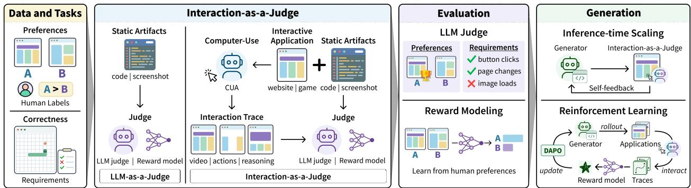  
Figure 1: We present Interaction-as-a-Judge, an evaluation paradigm that uses interaction traces to improve evaluation and generation. We compare against non-interactive judges and evaluate on pairwise preferences and reward modeling. We also show how to apply Interaction-as-a-Judge for inference-time scaling and as a reward signal for standard post-training via reinforcement learning.

To study Interaction-as-a-Judge, we introduce two datasets: ArenaPreferences and ArenaCorrectness. ArenaPreferences is a set of 6, 858 agentic code traces across seven diferent categories of web development (games, simulations, reference-based designs, content-creation tools, brand sites, consumer apps, and data applications). Alongside the agent traces, each data point contains a prompt, two websites generated from the prompt, and labeled human preferences. ArenaCorrectness is a set of 67 high-quality game development traces with 828 conversation turns. We handlabel 412 requirements across various versions of each game as the game develops by interpreting requirements from a user’s prompt and feedback. Requirements are then hand-verified as working or broken depending on if the requirement is successfully implemented.

We find that Interaction-as-a-Judge increases alignment with human preferences for both incontext LLM judges and trained reward models. On ArenaPreferences, adding interaction traces on top of code significantly improves overall in-context LLM judge accuracy by up to 3.5 percentage points (65.6% to 69.1%) and by 1.5 percentage points (67.6% to 69.1%) when compared to adding only static visual information. Fine-tuning a reward model with interaction traces improves accuracy from 68.2% to 70.2% and outperforms in-context LLM judges. We find that higher quality computer-use results in the best overall performance, although even a random heuristic can capture non-trivial gains. On ArenaCorrectness, Interaction-as-a-Judge improves requirement verification accuracy from 77.0% for a code-only Agent-as-a-Judge (Zhuge et al., 2024) to 81.6%. Interactionas-a-Judge also scales with model capability: accuracy increases from 76.4% with GPT 5.6 Luna to 81.6% with GPT 5.6 Sol when each serves as both the CUA and the judge.

We show that these evaluation gains also improve generation. At inference-time, we use Interaction-as-a-Judge in a self-feedback loop where an agent iteratively attempts to repair broken requirements and evaluates its repairs using Interaction-as-a-Judge. Compared with code-only feedback, adding interaction to the feedback mechanism increases the percentage of initially broken requirements successfully repaired within five attempts from 55.4% to 75.5%. We also use a reward model trained solely on interaction traces, without code, to post-train a generation model through reinforcement learning. Relative to using a code-only reward model, this method reduces the build failure rate by 7.2 percentage points and reduces code-context growth—a known problem in code reward models (Wang et al., 2026)—by 35.7%, while achieving comparable generation quality. Additionally, we show that websites generated by this post-training recipe attain a 6.7pp higher win rate against the base model.

In summary, our contributions are as follows:

• We study Interaction-as-a-Judge for both preference judgements and correctness verification and release two datasets—ArenaPreferences and ArenaCorrectness—for further research into both Interaction-as-a-Judge and agentic generation of interactive applications more broadly.

• We show that Interaction-as-a-Judge improves evaluation capabilities. Interaction-as-a-Judge improves overall alignment with human preferences for both in-context LLM judges and trained reward models. Additionally, Interaction-as-a-Judge improves an agent’s ability to verify requirements when compared to a code-only agentic judge.

• We demonstrate how Interaction-as-a-Judge can be used to improve generation through both inference-time scaling and reinforcement learning training. Interaction-as-a-Judge improves the number of successful repairs in an iterative self-feedback loop and improves trained model quality when used as a reward signal.

## 2. Tasks and Datasets

We study Interaction-as-a-Judge under two complementary settings: human preferences and correctness verification. Human preferences are useful when quality is subjective or dificult to capture with explicit requirements, while correctness verification is appropriate when desired behavior can be specified objectively. In many applications, both are necessary. For example, a software application may satisfy its functional requirements while still difering substantially in usability or visual quality. The inverse can also be true, where an application is visually preferable, but functionally broken. Efective evaluation methods should therefore be able to assess both correctness and preference.

## 2.1. Preferences

For pairwise preferences, a judge is given a shared prompt and two candidate outputs and must predict which output would be preferred by a human user (Zheng et al., 2023). We focus on pairwise comparisons in this work rather than other preference tasks such as single answer grading (e.g., predicting a Likert scale score), but our approach is not restricted to pairwise comparisons.

ArenaPreferences. We release ArenaPreferences, a dataset of 6, 858 pairwise comparisons across seven categories of web development. We collect our dataset from Arena’s Code Arena where real users prompt two hidden models and vote for their preferred website. Each datapoint in ArenaPreferences contains the user’s prompt, both agentic traces, both final websites, and the ground truth user label. We categorize websites into games, simulations, reference-based designs, contentcreation tools, brand sites, consumer product, and data applications following the original leaderboard categories. To ensure that the dataset is high quality, we filter such that all ties are removed, websites are built with React, outputs build successfully, outputs contain $\ge ~ 5 \%$ character diference, and users spent at least 60 seconds and up to 10 minutes interacting with the websites. All personally identifiable information (PII) has been de-identified through a PII filtering process. To our understanding, this is the largest collection of pairwise agentic web development traces and websites released for open source use. We provide further dataset details in Appendix B.

## 2.2. Correctness

We consider two types of correctness verification: requirement verification and requirement discovery. In requirement verification, the judge is given an application, its code, and a set of explicit requirements, such as “Mario must defeat a Goomba when jumping on it.” The judge must determine whether each requirement is working or broken for that application. In requirement discovery, the judge is given the application and its code but no explicit list of requirements. It must first identify the relevant requirements automatically and then determine whether those requirements are working.

ArenaCorrectness. We create ArenaCorrectness, a dataset containing 67 game development traces with 828 user turns and labeled with 412 requirements across 222 versions of various games. We collect our dataset from Arena’s Agent Mode where users can request a random agent to do tasks such as web search, software development, or image generation. We focus on game development as games are highly interactive and also challenging software development tasks (Chi et al., 2026).

To generate requirements from user traces, we analyze the user trace for specific complaints, and extract the complaint into a broken requirement which is linked to a specific version of the game matching when the user complaint occurred. For example, a user complaint indicating that the player falls through platforms would be annotated as a requirement indicating that the player must be able to stand on platforms. We use GPT 5.6 Luna to label, analyze, and then annotate each complaint as a requirement. A human annotator then reviews each game to verify that the requirements are sensible and broken in the game version. To extract working requirement labels, we take our existing broken requirements, and check to see if the user either explicitly confirms a fix or does not revisit this complaint. We use GPT 5.6 Luna for initial annotation and verify via human annotation. In total, we annotate 323 broken and 89 working requirements. We provide further dataset details in Appendix B.

## 3. Interaction-as-a-Judge

Interaction-as-a-Judge is an evaluation paradigm which uses computer-use interaction traces to improve downstream evaluation accuracy. Interaction-as-a-Judge consists of an interaction component and a judge component. These two components can be either the same LLM, diferent LLMs, or a mixture of LLMs and other methods. For example, a cheap computer-use heuristic paired with an LLM judge, or an LLM-based CUA paired with a trained reward model.

## 3.1. Interaction

Following Koh et al. (2024), we model interaction with the environment as a partially observable Markov decision process (POMDP). We define the environment as $\mathcal { E } = ( \boldsymbol { S } , \bar { \boldsymbol { \mathcal { A } } } , \boldsymbol { \Omega } , f )$ where is the state space,  is the action space, and Ω is the observation space. In our work, $o _ { t } \in \Omega$ is a visual representation of the application (a screenshot), but the Document Object Model (DOM) is also commonly used. An action $a _ { t } \in { \mathcal { A } }$ induces a deterministic transition $f : \mathcal { S } \times \mathcal { A }  \mathcal { S }$ . To interact with the environment, we define an interaction policy π that determines the sequence of actions taken in the environment. Executing π in the environment produces an interaction trace ${ \boldsymbol { \tau } } = \big ( \big ( o _ { t } , \rho _ { t } , a _ { t } \big ) \big ) _ { t = 0 } ^ { T } ,$ where $o _ { t } , \rho _ { t } ,$ , and $a _ { t }$ denote the observation, agent reasoning, and action at timestep t, respectively. We allow $\rho _ { t } = \mathcal { D }$ when no explicit reasoning is produced. Actions include standard computer inputs such as moving the mouse, clicking, and typing—the full action space is in Appendix A.2.

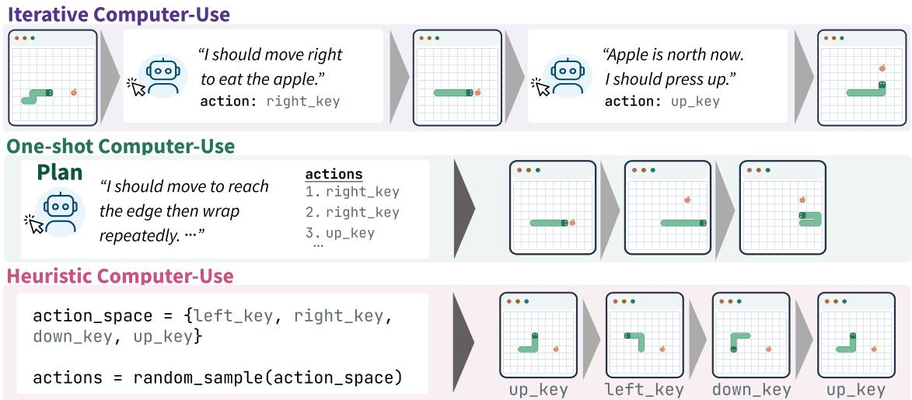  
Figure 2: We study three approaches to computer-use. Iterative computer-use is analogous to standard frame-by-frame computer-use. One-shot computer-use plans once at the start to save costs. Heuristic computer-use uses a pre-determined algorithm (e.g., random) to choose actions.

There are multiple approaches to interact with a software application environment, with the primary trade-of being between adaptivity and inference cost. We consider three interaction strategies that vary in how frequently they query a model and observe the resulting environment state.

Iterative computer-use. The most general approach is to use a computer-use agent that iteratively observes and acts in the environment. We represent the agent as a policy $\pi _ { \theta } ^ { \mathrm { i t e r } }$ , where at timestep t it selects an action $( a _ { t } , \rho _ { t } ) \sim \pi _ { \theta } ^ { \mathrm { i t e r } } ( \tau _ { < t } , i )$ , where $\tau _ { < t }$ is the interaction trace prior to timestep $t , \rho _ { t }$ is the reasoning for action ${ { a } _ { t } } ,$ and i are instructions to the computer-use agent. For preferences this might be a broad instruction to investigate the application to determine quality while for correctness the goal could be a specific requirement it must verify. The environment then transitions to $s _ { t + 1 } = f ( s _ { t } , a _ { t } )$ , producing a new observation that can inform the next action. This iterative formulation allows the agent to adapt as the environment changes and corresponds to the standard computer-use setting. However, it can be prohibitively expensive, as it requires a model query at every interaction step.

One-shot computer-use. A suficiently capable agent could in principle predict the sequence of actions to take from only the initial state without observing the intermediate outcomes of its actions. We represent this as a policy $\pi _ { \theta } ^ { \mathrm { o n e } }$ that, given the initial observation o<sub>0</sub>, reasons and then predicts an entire action sequence $( { a } _ { 0 : T } , \dot { \rho } ) = \pi _ { \theta } ^ { \mathrm { o n e } } ( { o } _ { 0 } , i )$ to be executed sequentially in the environment up to timestep T. This requires only a single model query, substantially reducing inference cost (Wang et al., 2026), but prevents the agent from adapting when the environment evolves diferently from its prediction. When application code c is available, we additionally provide it to the agent for planning, giving $\left( a _ { 0 : T } , \rho \right) = \pi _ { \theta } ^ { \mathrm { o n e } } ( o _ { 0 } , i , c )$

Heuristic computer-use. The cheapest alternative is to forgo model-based action selection entirely. In this work, we consider a simple heuristic policy $\pi ^ { \mathrm { { h e u r } } }$ that selects an action uniformly at random. To make this interaction more efective, we restrict the policy to a candidate set ${ \mathcal { C } } ( o _ { t } ) \subseteq A$ of interactions that are likely to induce meaningful changes in the environment, such as clicking buttons or typing in text boxes, giving $a _ { t } \sim \pi ^ { \mathrm { h e u r } } ( o _ { t } ) = \mathrm { U n i f } ( \mathcal { C } ( o _ { t } ) )$ . Because this incurs no model inference cost, the policy can select an action after every environment transition. Despite its simplicity, this can produce substantial interaction when $\mathcal { C } ( o _ { t } )$ can be efectively identified, but is less efective for environments such as games, where meaningful interactions are dificult to enumerate automatically.

## 3.2. Judging

After the interaction trace τ is generated, the judge uses the trace to inform its downstream judgement. We study both an of-the-shelf LLM, which we use for both predicting human preferences and verifying correctness, and a trained reward model, which we use for predicting human preferences. A key benefit of using of-the-shelf LLMs is that it allows interaction-as-a-judge to leverage frontier capabilities without needing to train a custom model, which is often infeasible without data and compute resources. However, a reward model trained on suficient in-domain data can achieve higher accuracy and reduce inference costs.

LLM Judge. For human preferences, an of-the-shelf LLM judge takes in the user request, source code for each website, and an interaction trace for each website and outputs a judgement indicating which website is better. Due to known position bias (Zheng et al., 2023), every battle is judged twice with sides swapped (AB and BA) and accuracy is the mean judge-human agreement of both passes. For requirement verification, the judge takes in the user request, the source code, the interaction trace, and a requirements list and labels each requirement as working, broken, or unverifiable. Requirement discovery is similar except no requirement list is given and the judge must output a list of potential requirements itself. For judges that accept video natively, we convert $o _ { 0 : T } \in \tau$ to video; otherwise, we pass in each frame as an image. Actions and reasoning are passed in directly as text sequences.

Reward Model. We train our reward model $r _ { \theta }$ by adding a scalar reward head and optimizing over a standard Bradley–Terry loss (Bradley & Terry, 1952):

$$
{ \mathcal L } _ { \mathrm { B T } } ( \theta ) = - \mathbb E _ { ( x , y _ { w } , y _ { l } , \tau _ { w } , \tau _ { l } ) \sim \mathcal D } \left[ \log \sigma ( r _ { \theta } ( x , y _ { w } , \tau _ { w } ) - r _ { \theta } ( x , y _ { l } , \tau _ { l } ) ) \right]
$$

where $x$ is the user prompt, $y _ { w }$ and $y _ { l }$ are the source code for the winner and loser respectively, and $\tau _ { w }$ and $\tau _ { l }$ are the traces. This is similar to standard reward model training (Christiano et al., 2017; Ouyang et al., 2022) with the addition of interaction trace information.

## 4. Interaction-as-a-Judge for Evaluation

We measure the extent to which evaluation via Interaction-as-a-Judge aligns with human preferences and verified correctness. In our main experiments, all interaction traces consist of 30 actions. For iterative and one-shot computer-use, we use GPT 5.6 Luna with medium reasoning as our computer-use agent. Unless specified, Interaction-as-a-Judge includes code as input. Games difer from other categories due to their real-time input and dificulty in identifying meaningful candidate interactions (e.g., lack of buttons). We describe our harness, action space, and changes for games in Appendix A.

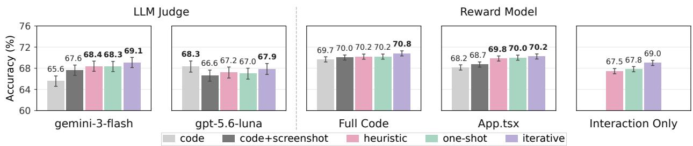  
Figure 3: We train a reward model with varying levels of interaction and observe that including interaction data improves accuracy in terms of alignment with human preferences. GPT 5.6 Luna is the only exception where adding interaction ofers comparable performance to code only. We fine-tune from Qwen-3.5-9B as our base model and train each approach 5 times. Bolded values are statistically significant against code+screenshot, calculated by a sample-wise paired t-test.

## 4.1. Human Preferences

We evaluate the efectiveness of Interaction-as-a-Judge for judging human preferences using ArenaPreferences (Figure 3). We compare Interaction-as-a-Judge against two static-evidence judges: a code-only judge and a code and screenshot judge. The code-only judge receives only the code as input, making it functionally identical to either LLM-as-a-Judge (Zheng et al., 2023) or a standard code reward model. The code and screenshot judge receives the code and a full page screenshot of the landing page. This same screenshot is also given as input to Interaction-as-a-Judge approaches. We also vary the amount of code received between the full code capped at 32k tokens and just the core App.tsx file to study the efects of code on Interaction-as-a-Judge. Additional information such as category breakdowns can be found in Appendix B.

To train our reward model, we fine-tune Qwen-3.5-9B (Qwen Team, 2026) as our base model and train on a private dataset of 20, 160 human preference pairs. This dataset is structurally identical to ArenaPreferences, but is temporally disjoint consisting of data prior to ArenaPreferences, mirroring how data collection occurs in real settings. This means that the reward model is evaluated on newer, more advanced outputs not seen in the training data. For the visual component of the interaction trace, we input it directly as video and freeze the video encoder weights during training.

For our LLM judge, we use Gemini 3 Flash and GPT 5.6 Luna with xhigh reasoning. Both were chosen due to their cost-efectiveness with Gemini 3 Flash being chosen due to its native video capabilities and GPT 5.6 Luna being the main computer-use model used throughout the paper. To account for ordering bias in LLM-as-a-Judge approaches, we evaluate both orderings and take the average of the results.

Interaction-as-a-Judge increases alignment with human preferences. We find that for both a trained reward model and an LLM Judge, adding interaction improves judge alignment with human preferences (Figure 3). Adding visual information through a screenshot improves performance over code and adding interaction improves performance further. We see the largest gap in Gemini 3 Flash as a judge where accuracy improves from 65.6% 69.1% between code only and iterative Interaction-as-a-Judge. GPT 5.6 Luna as a judge is the sole exception where we do not see any statistical diferences between any approach. We speculate that for pairwise preferences, GPT 5.6 Luna is both optimized for code and also unable to properly utilize visual information given its strong code-only performance and degradation when adding even a single screenshot. Finally, our trained reward model (70.8%) is able to outperform an of-the-shelf LLM judge (69.1%).

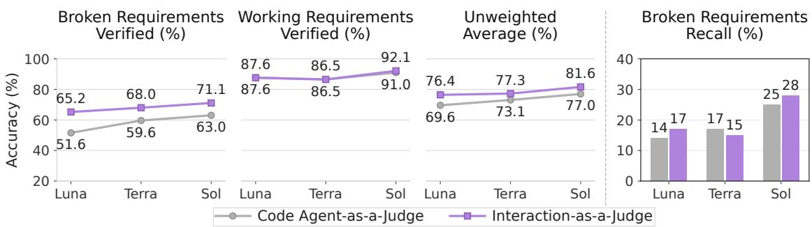  
Figure 4: We evaluate Interaction-as-a-Judge’s ability for requirement verification (left) and requirement discovery (right). For requirement verification, we see that Interaction-as-a-Judge is better than a code only Agent-as-a-Judge, especially at identifying broken requirements. Additionally, we observe that performance scales as model capabilities improve. We find that requirement discovery is still challenging for both approaches.

Interaction alone is suficient information for training a reward model. We find that training a reward model on the interaction traces alone (without code) provides comparable performance to a code reward model. Iterative computer-use without code performs only slightly worse than a code reward model trained on the entire code context (69.0% vs 69.7%), and performs comparably to Interaction-as-a-Judge with code when using Gemini 3 Flash as a judge. This opens doors to training reward models on data where the application is accessible, but code is inaccessible. In general, Interaction-as-a-Judge judgements remain robust as code context decreases, seeing small decreases between seeing the full source code versus only the core App.tsx file. However, both one-shot and heuristic computer-use degrade more compared to iterative computer-use when no code is available.

Interaction quality afects alignment with human preferences. We observe that iterative computer-use consistently performs the best across all experiments. Due to its ability to respond to new state changes in the environment, iterative computer-use generates the highest-quality traces among the three approaches. Additionally, we find that higher-quality interaction at inference can compensate for lower-quality traces at training time. We take our reward model trained on heuristic computer-use and run inference using iterative computer-use instead. We find that performance increases across almost every single category (Appendix F, Figure 12). The inverse is not true—a reward model trained on iterative computer-use degrades when using heuristic computer-use traces at inference time.

## 4.2. Correctness Verification

We evaluate Interaction-as-a-Judge on its ability to both verify and discover requirements using our ArenaCorrectness dataset (Figure 4). For requirement verification, we give the agent the code, the game as an interactable application, and the list of requirements which can be either all broken or all working. The agent is asked to label each requirement as working, broken, or unverifiable. For requirement discovery, we focus only on broken requirements and ask the agent to list out all possible broken requirements that require repair without passing in the original requirements list. We compare Interaction-as-a-Judge against a code only Agent-as-a-Judge (Zhuge et al., 2024). We use the GPT 5.6 model family (Luna, Terra, Sol) all with medium reasoning to measure varying model capabilities.

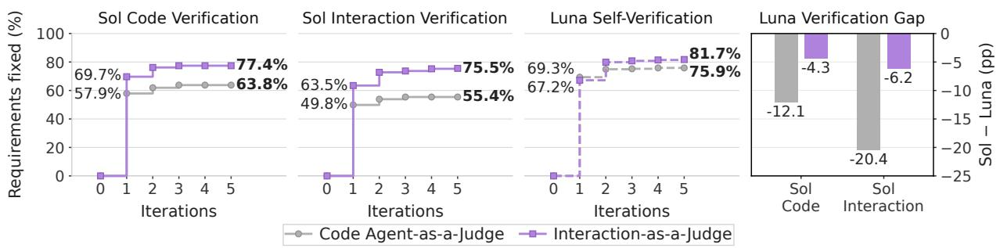  
Figure 5: We compare Interaction-as-a-Judge against a code-only Agent-as-a-Judge at iterative selffeedback and requirement repair. Interaction-as-a-Judge repairs 75.5% of initially broken requirements compared to 55.4% repaired by the code-only Agent-as-a-Judge. We see this improvement even when evaluating using Sol as a code-only Agent-as-a-Judge. Additionally, the gap between self-reported accuracy and accuracy measured by GPT 5.6 Sol is less for Interaction-as-a-Judge.

Interaction-as-a-Judge outperforms code only requirement verification. We find that across all models, Interaction-as-a-Judge performs better than a code only Agent-as-a-Judge. This is primarily because Interaction-as-a-Judge is significantly better at verifying broken requirements (71.1%) compared to a code only Agent-as-a-Judge (63.0%). We find that both approaches perform comparably for verifying working requirements at 92.1% and 91.0% for Interaction-as-a-Judge and codeonly Agent-as-a-Judge respectively.

Interaction-as-a-Judge scales with model capability. We see in Figure 4 that broken requirement verification performance continues to improve as the overall capability of the model improves going from 65.2% with GPT 5.6 Luna to 68.0% with GPT 5.6 Terra and 71.1% with GPT 5.6 Sol.

## 5. Interaction-as-a-Judge for Generation

## 5.1. Inference-time Scaling

We evaluate whether interaction-based self-feedback improves an agent’s ability to repair broken requirements (Figure 5). An efective inference time strategy is to iteratively repair and verify the resulting application. Regardless of implementation capabilities, self-verification capability becomes important for determining whether the repairs are correct or incorrect. We use the games with broken requirements in ArenaCorrectness as our task list. We ask the agent to repair the broken requirements for each game and self-verify across five iterations. We compare Interactionas-a-Judge against a code only Agent-as-a-Judge and use GPT 5.6 Luna with medium reasoning as the agent for both approaches. After all iterations are complete, we use a more capable model (GPT 5.6 Sol) with Interaction-as-a-Judge and code-only Agent-as-a-Judge to determine if the repairs were successful or not. We measure success per requirement and report repair success rate after each iteration.

Interaction-as-a-Judge repairs more broken requirements than a code only Agent-as-a-Judge. After five iterations, Interaction-as-a-Judge successfully repairs 75.5% of initially broken requirements, compared to 55.4% for code-only self-feedback, an improvement of 20.1 percentage points (Figure 5, middle). This improvement persists even when using GPT 5.6 Sol as a code-only Agentas-a-Judge (Figure 5, left), highlighting the improvements Interaction-as-a-Judge provides. We see in Figure 5 that Interaction-as-a-Judge not only improves faster but also outperforms the code-only judge within its first iteration. Additionally, the self-reported accuracy gap between GPT 5.6 Luna and GPT 5.6 Sol is significantly less for Interaction-as-a-Judge compared to a code only Agent-asa-Judge (Figure 5, right), suggesting a lower false positive rate when using Interaction-as-a-Judge.

Build Reward Only  
Code Reward Model  
Interaction Reward Model  
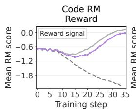

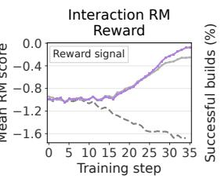

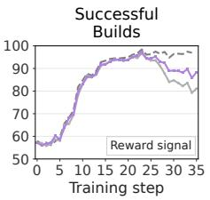

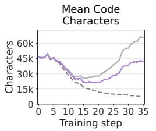

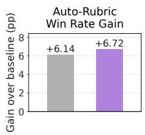  
Figure 6: We train a Qwen-3.5-9B model using code-only and interaction-only reward models. As expected, each performs better on its respective training objective, but the interaction-only model leads to improvements in neutral criteria such as build success rate and decreased code length. We use an auto-rubrics based judge and find a significant improvement over the base model. The build reward baseline naturally degrades in reward for both reward models.

## 5.2. Training

We study the potential of Interaction-as-a-Judge at training time to improve downstream performance in generating interactive applications. Specifically, we explore using an interaction-only reward model as the reward signal for post-training via reinforcement learning (Figure 6). We start our training from Qwen-3.5-9B and use DAPO (Yu et al., 2025) as our learning algorithm. We use the same interaction only reward model we trained in Section 4.1 and compare against a code only reward model. We use heuristic computer-use to reduce costs and training time. We train on a set of 14k internal prompts that are not used for reward model training which cover all categories except for games as heuristic computer-use has dificulty playing games. We sample 600 examples uniformly from the six categories in ArenaPreferences as our test set. Since our reward model training data is cleaned to remove any failures, failures are out of distribution for both models. To account for this, we add penalties for any website that fails to build or render at all. Detailed hyperparameters can be found in Appendix G.

Interaction-as-a-Judge allows for successful reinforcement learning training without code. Overall, we observe that each model scores higher on their respective reward models, but interaction improves neutral objectives by reducing code generated and increasing successful builds. Code only reward models are known to have length bias (Wang et al., 2026)—we observe that training on the interaction reward model generates 35.7% less code than the code reward model. On our test set, Interaction-as-a-Judge also increases the build success rate from 81.3% to 88.5% compared to a code only reward model, reducing the build failure rate by 7.2 percentage points $( 1 8 . 7 \%  1 1 . 5 \% )$ . We use an internal auto-rubrics based judge based on Kao et al. (2026) calibrated to Arena’s data and leaderboard to compare each trained model against Qwen-3.5-9B. Among websites that build and render successfully, the model trained using Interaction-as-a-Judge achieves a win-rate gain of 6.72pp over the base model (Figure 6). Based on our internal calibrations, this is equivalent to over a 50 point increase on Arena’s leaderboard, which would be a statistically significant improvement to the model in Arena’s leaderboard. This evaluation measures quality conditioned on successful generations and therefore understates the benefit of using Interaction-as-a-Judge as a reward signal. The ability to train a model via reinforcement learning with an interaction only reward model opens the door to data collection opportunities where application access is available, but code access is not.

## 6. Related Work

The two most related families of work are other LLM-based judging strategies and existing instances where CUAs have been used for evaluation or generation. Unlike prior work, our work difers from the latter in that interaction is the central focus of our study, rather than one component of a larger pipeline. Specifically, we conduct the first systematic study spanning (i) the efects of varying interaction strategies and model capabilities on evaluation performance, (ii) measuring Interaction-as-a-Judge’s alignment with human preferences and correctness, and (iii) its use for both inference-time scaling and post-training. Below, we outline the connections more specifically.

LLM-as-a-Judge and Agent-as-a-Judge. LLM-as-a-Judge uses language models to approximate human judgments of generated outputs (Zheng et al., 2023). For software development, the evidence needed to judge requirement satisfaction can be distributed across a project and its development history. Agent-as-a-Judge (Zhuge et al., 2024) addresses this by gathering and inspecting project files and development trajectories before judging. Interactive applications introduce a further source of evidence: the behavior observed when a user operates the software. Computeruse agents provide a means to collect this evidence by interacting with desktop and web interfaces (Xie et al., 2024; Zhou et al., 2024; Koh et al., 2024). Interaction-as-a-Judge extends these judging paradigms to this new source of evidence: rather than inspecting only static artifacts, the judge conditions on traces produced by a computer-use agent operating the application.

Interactive evaluation. Recent works have attempted to use computer-use as part of their evaluation pipeline. ArtifactsBench (Zhang et al., 2025) and GameCraft-Bench (Luo et al., 2026) ground judgments in heuristically generated screenshots and replayed gameplay, respectively. AppEvalPilot (Bian et al., 2025) generates and executes test cases using a computer-use agent and validates its judgments against human assessments of functional requirements. In these works, interaction is used as a method of evaluation rather than the focus of study, and it remains unclear how computer-use model capabilities and methods of interaction afect evaluation performance. WebDevJudge (Li et al., 2025), which benchmarks LLM and multimodal judges for web develop ment, illustrates the importance of understanding these capabilities as it finds that its standalone GUI-agent workflow actually underperforms its strongest static judges due to errors arising during planning and execution.

Interaction feedback and reward learning. Interaction evidence can also guide the generation process that produces an application. WebGen-Agent (Lu et al., 2025) incorporates screenshot feedback and iterative computer-use testing into website refinement. For reinforcement learning, it sums screenshot-based appearance scores and GUI-testing scores, and introduces Step-GRPO to assign advantages separately to each refinement step. Wang et al. (2026) use one-shot computeruse: a model plans the full action sequence upfront, and a rubric-based judge scores the recorded execution to provide training rewards, reducing code-length exploitation compared to static judges. Both approaches obtain their reward signals from model-generated assessments of appearance or functionality. We provide an alternative and potentially simpler solution by training a reward model on human preferences (Christiano et al., 2017; Ouyang et al., 2022) using interaction traces and then using its predictions as outcome rewards in DAPO.

## 7. Conclusion

Limitations and Future Work. While we study some common approaches to computer-use, we believe that better computer-use models and methods could further improve evaluation and generation, especially considering our observation that better computer-use traces lead to better performance. Currently, one of the biggest bottlenecks to computer-use remains cost. For example, we were mostly limited to experiments with GPT 5.6 Luna as our computer use agent due to pricing. More capable and afordable computer-use agents will likely improve Interaction-as-a-Judge capabilities and are worth studying as well. For training, there is the possibility of using the same model for both generation and computer-use and improving them both simultaneously as better applications and better traces both improve reward modeling scores. We leave this as potential future work.

Conclusion We study Interaction-as-a-Judge, an evaluation paradigm that uses computer-use traces to improve evaluation and downstream generation. We study the use of Interactionas-a-Judge for both human preferences and correctness verification, releasing two datasets— ArenaPreferences and ArenaCorrectness—to facilitate such studies. We demonstrate how Interaction-as-a-Judge improves alignment with human preferences for both reward model training and LLM judges and improves a model’s ability to label requirements as working or broken. We show how Interaction-as-a-Judge can be used for inference-time scaling through an iterative self-feedback loop. Lastly, we illustrate how you can use a reward model trained on only interaction traces, with no code, as the reward signal for standard reinforcement learning training.

## Acknowledgements

We thank Yewon Kim for help with designing Figure 1 and Seth Karten for initial discussions that led to this work. This work was supported in part by the National Science Foundation grants IIS1705121, IIS1838017, IIS2046613, IIS2112471, and funding from Datadog. This material is based upon work supported by the Air Force Ofice of Scientific Research under award number FA9550- 25-C-B010 in the amount of \$129,600. Any opinions, findings and conclusions or recommendations expressed in this material are those of the author(s) and do not necessarily reflect the views of any of these funding agencies.

## References

Yutong Bian, Xianhao Lin, Yupeng Xie, Tianyang Liu, Mingchen Zhuge, Siyuan Lu, Haoming Tang, Jinlin Wang, Jiayi Zhang, Jiaqi Chen, Xiangru Tang, Yongxin Ni, Sirui Hong, and Chenglin Wu. You don’t know until you click: Automated GUI testing for production-ready software evaluation. arXiv preprint arXiv:2508.14104, 2025.

Ralph Allan Bradley and Milton E. Terry. Rank analysis of incomplete block designs: I. the method of paired comparisons. Biometrika, 39(3/4):324–345, 1952. doi: 10.1093/biomet/39.3-4.324.

Wayne Chi, Yixiong Fang, Arnav Yayavaram, Siddharth Yayavaram, Seth Karten, Qiuhong Anna Wei, Runkun Chen, Alexander Wang, Valerie Chen, Ameet Talwalkar, and Chris Donahue. Gamedevbench: Evaluating agentic capabilities through game development, 2026. URL https: //arxiv.org/abs/2602.11103.

Wei-Lin Chiang, Lianmin Zheng, Ying Sheng, Anastasios Nikolas Angelopoulos, Tianle Li, Dacheng Li, Hao Zhang, Banghua Zhu, Michael Jordan, Joseph E. Gonzalez, and Ion Stoica. Chatbot arena: An open platform for evaluating LLMs by human preference. In International Conference on Machine Learning (ICML), 2024.

Paul F. Christiano, Jan Leike, Tom B. Brown, Miljan Martic, Shane Legg, and Dario Amodei. Deep reinforcement learning from human preferences. In Advances in Neural Information Processing Systems (NeurIPS), 2017.

Kuei-Chun Kao, Daixuan Huo, Yuanhao Ban, and Cho-Jui Hsieh. Autorubric-t2i: Robust rulebased reward model for text-to-image alignment, 2026. URL https://arxiv.org/abs/2605. 17602.

Jing Yu Koh, Robert Lo, Lawrence Jang, Vikram Duvvur, Ming Lim, Po-Yu Huang, Graham Neubig, Shuyan Zhou, Ruslan Salakhutdinov, and Daniel Fried. Visualwebarena: Evaluating multimodal agents on realistic visual web tasks. In Proceedings of the 62nd Annual Meeting of the Association for Computational Linguistics (Volume 1: Long Papers), pp. 881–905. Association for Computational Linguistics, 2024. doi: 10.18653/v1/2024.acl-long.50.

Chunyang Li, Yilun Zheng, Xinting Huang, Tianqing Fang, Jiahao Xu, Lihui Chen, Yangqiu Song, and Han Hu. WebDevJudge: Evaluating (M)LLMs as critiques for web development quality. arXiv preprint arXiv:2510.18560, 2025.

Zimu Lu, Houxing Ren, Yunqiao Yang, Ke Wang, Zhuofan Zong, Junting Pan, Mingjie Zhan, and Hongsheng Li. Webgen-agent: Enhancing interactive website generation with multi-level feedback and step-level reinforcement learning, 2025. URL https://arxiv.org/abs/2509. 22644.

Tongxu Luo, Rongsheng Wang, Jiaxi Bi, Chenming Xu, Zhengyang Tang, Jianlong Chen, Juhao Liang, Ke Ji, Shuqi Guo, Yuhao Du, Fan Bu, Wenyu Du, Xiaotong Zhang, Kyle Li, Shaobo Wang, Linfeng Zhang, Yuxuan Liu, Xin Lai, Chenxin Li, Yiduo Guo, Zhexin Zhang, Xinyuan Wang, Tianyi Bai, Ziniu Li, and Benyou Wang. Gamecraft-bench: Can agents build playable games end-to-end in a real game engine?, 2026. URL https://arxiv.org/abs/2606.17861.

Long Ouyang, Jefrey Wu, Xu Jiang, Diogo Almeida, Carroll Wainwright, Pamela Mishkin, Chong Zhang, Sandhini Agarwal, Katarina Slama, Alex Ray, John Schulman, Jacob Hilton, Fraser Kelton, Luke Miller, Maddie Simens, Amanda Askell, Peter Welinder, Paul Christiano, Jan Leike, and Ryan Lowe. Training language models to follow instructions with human feedback. In Advances in Neural Information Processing Systems, volume 35, pp. 27730–27744, 2022.

Qwen Team. Qwen3.5-omni technical report, 2026. URL https://arxiv.org/abs/2604. 15804.

Binghai Wang, Chenlong Zhang, Dayiheng Liu, Jiajun Zhang, Jiawei Chen, Mingze Li, Mouxiang Chen, Rongyao Fang, Siyuan Zhang, Xuwu Wang, Yuheng Jing, Zeyao Ma, and Zeyu Cui. The verification horizon: No silver bullet for coding agent rewards, 2026. URL https://arxiv. org/abs/2606.26300.

Tianbao Xie, Danyang Zhang, Jixuan Chen, Xiaochuan Li, Siheng Zhao, Ruisheng Cao, Toh Jing Hua, Zhoujun Cheng, Dongchan Shin, Fangyu Lei, Yitao Liu, Yiheng Xu, Shuyan Zhou, Silvio Savarese, Caiming Xiong, Victor Zhong, and Tao Yu. OSWorld: Benchmarking multimodal

agents for open-ended tasks in real computer environments. In Advances in Neural Information Processing Systems (NeurIPS), 2024.

Qiying Yu, Zheng Zhang, Ruofei Zhu, Yufeng Yuan, Xiaochen Zuo, Yu Yue, Weinan Dai, Tiantian Fan, Gaohong Liu, Lingjun Liu, Xin Liu, Haibin Lin, Zhiqi Lin, Bole Ma, Guangming Sheng, Yuxuan Tong, Chi Zhang, Mofan Zhang, Wang Zhang, Hang Zhu, Jinhua Zhu, Jiaze Chen, Jiangjie Chen, Chengyi Wang, Hongli Yu, Yuxuan Song, Xiangpeng Wei, Hao Zhou, Jingjing Liu, Wei-Ying Ma, Ya-Qin Zhang, Lin Yan, Mu Qiao, Yonghui Wu, and Mingxuan Wang. Dapo: An open-source llm reinforcement learning system at scale, 2025. URL https://arxiv.org/ abs/2503.14476.

Chenchen Zhang, Yuhang Li, Can Xu, Jiaheng Liu, Ao Liu, Changzhi Zhou, Ken Deng, Dengpeng Wu, Guanhua Huang, Kejiao Li, Qi Yi, Ruibin Xiong, Shihui Hu, Yue Zhang, Yuhao Jiang, Zenan Xu, Yuanxing Zhang, Wiggin Zhou, Chayse Zhou, and Fengzong Lian. Artifactsbench: Bridging the visual-interactive gap in llm code generation evaluation, 2025. URL https://arxiv.org/ abs/2507.04952.

Lianmin Zheng, Wei-Lin Chiang, Ying Sheng, Siyuan Zhuang, Zhanghao Wu, Yonghao Zhuang, Zi Lin, Zhuohan Li, Dacheng Li, Eric P. Xing, Hao Zhang, Joseph E. Gonzalez, and Ion Stoica. Judging LLM-as-a-judge with MT-Bench and chatbot arena. In Advances in Neural Information Processing Systems (NeurIPS) Datasets and Benchmarks Track, 2023.

Shuyan Zhou, Frank F. Xu, Hao Zhu, Xuhui Zhou, Robert Lo, Abishek Sridhar, Xianyi Cheng, Tianyue Ou, Yonatan Bisk, Daniel Fried, Uri Alon, and Graham Neubig. Webarena: A realistic web environment for building autonomous agents, 2024. URL https://arxiv.org/abs/ 2307.13854.

Mingchen Zhuge, Changsheng Zhao, Dylan Ashley, Wenyi Wang, Dmitrii Khizbullin, Yunyang Xiong, Zechun Liu, Ernie Chang, Raghuraman Krishnamoorthi, Yuandong Tian, Yangyang Shi, Vikas Chandra, and Jürgen Schmidhuber. Agent-as-a-judge: Evaluate agents with agents. arXiv preprint arXiv:2410.10934, 2024.

## Appendix

## A. Interaction Harness and Action Space

## A.1. Browser Environment and Observations

For preference prediction, we render each candidate in a separate Chromium browser context using Playwright. Applications run inside an iframe with a 1280  800 viewport and device scale factor one. Mouse coordinates are measured in pixels relative to the top-left corner of the application iframe. Each tool response contains a screenshot of the application, the viewport dimensions, cursor position, held keys, and execution status. The interactive agent receives the original user request and these observations. The one-shot agent additionally receives application source code when constructing its action sequence. For pairwise preferences, the agents explore each candidate independently and then the preference judge subsequently compares the resulting evidence for both candidates. For correctness verification, the same agent explores and judges the candidate in one continuous workflow.

Interaction budget and timing. The main preference experiments use a budget of 30 interaction steps per candidate. A step is one tool invocation, which can itself contain several low-level input events: for example, a click includes a mouse press and release, while press\_keys executes a sequence of key presses. The full action space is defined in Table 1. The budget does not count individual keystrokes or model reasoning tokens. The computer-use agent is allowed to exit early if it determines that its goal is complete.

For games, a JavaScript timing shim wraps animation frames, timers, and application clocks. The game is paused between actions, and ordinary actions advance its clock by 500 ms. Key holds and waits advance the requested duration, capped by the per-step budget. This separates model inference latency from simulated game time. The timing shim advances in small increments so that animation callbacks can execute between inputs. Other web applications run in real time and are allowed to settle after an action.

## A.2. Action Space

Table 1 gives the interaction tools shared by iterative and one-shot preference agents. The iterative agent selects tools after observing their results. The one-shot agent emits a list of the same tool names and arguments, which the harness executes sequentially without intermediate model feedback. Typing and scrolling use keyboard events; they do not require separate text-entry or scroll tools.

Coordinates, interpolation counts, and durations are integer arguments. Key names follow Playwright conventions, including ArrowLeft, Space, Enter, and letter keys.

## A.3. Heuristic Interaction

For non-gaming applications, the heuristic enumerates visible, enabled controls in the current viewport: links, buttons, input fields, text areas, selects, summaries, elements with relevant accessibility roles, click handlers, or a non-negative tab index. It excludes hidden and of-screen controls, deduplicates controls by their center coordinates, and retains at most 200 candidates. Candidate controls are sampled uniformly. A text field is clicked before entering a phrase drawn from a fixed small vocabulary, and a PageDown action is sampled with probability 0.12 to reveal additional content. If no candidates are found, the policy falls back to pixel and keyboard actions.

Table 1: Preference-agent action space. Positions are iframe-relative pixels; durations are milliseconds. A dispatched observation request also consumes a step in the implemented dispatcher.
<table><tr><td>Tool</td><td>Arguments and effect</td></tr><tr><td>mouse_click</td><td>(x, y); presses and releases the left mouse button.</td></tr><tr><td>mouse_down</td><td>(x, y); holds the left button until a later release.</td></tr><tr><td>mouse_up</td><td>(x, y); releases the held left button.</td></tr><tr><td>mouse_move</td><td>(x, y) and optional st eps (default 8); interpolates cursor movement, preserving button state.</td></tr><tr><td>mouse_drag</td><td>from_x, from_y, to_x, to_y, optional steps (12), and hold_ms (50); performs a complete drag.</td></tr><tr><td>double_click</td><td>(x, y); performs a double click.</td></tr><tr><td>hold_key</td><td>key and ms; holds a key for the specified duration and then releases it. Ordered keys list and optional delay_ms (100); supports text entry, navigation, and</td></tr><tr><td>press_keys</td><td>shortcuts.</td></tr><tr><td>wait_ms</td><td>ms; advances time without another input.</td></tr><tr><td>finish_run</td><td>reas on; ends the current run with the given reason.</td></tr></table>

## A.4. Games

Games difer from other categories in two ways. First, games often require real-time input, so we construct a web harness that freezes games between interactions and plays actions out for up to 500 milliseconds (i.e., 2 actions per second). Second, since games typically do not have clear interaction candidates (e.g., buttons), heuristic computer-use actions are drawn uniformly from a 12-element action space consisting of four click actions, three key-sequence actions, two key-hold actions, and one each of mouse movement, drag, and double click. Coordinates are sampled uniformly within the viewport. Keyboard actions are sampled from the four arrow keys, Space, Enter, and w, a, s, and d.

## B. Dataset Details and Evaluation Protocol

The 6, 858-battles in ArenaPreferences are selected from a time period of one month (July 2026). They exclude unknown countries and the fixed set of EU27 countries, the United Kingdom, Switzerland, Norway, Iceland, and Liechtenstein. Both candidate source records must declare the react-vite-tailwind template and a successful upstream build. Both sides must contain more than 5% character diference.

ArenaPreferences contains 6, 858 battles across seven categories: 1, 288 games, 904 simulations, 753 reference-based designs, 1, 020 content-creation tools, 1, 246 brand sites, 949 data applications, and 698 consumer applications. The reward-model training and validation ID lists contain 20, 160 and 4, 460 battles, respectively. The training pool precedes the evaluation pool in time.

The traces in ArenaCorrectness were collected between June 5 and June 26, 2026. Of its 412 requirements, 323 are labeled broken and 89 working. Each of the 222 game versions corresponds to the application state after a specific user turn of its source trace, and repaired variants of a version are included for requirements that users later confirmed fixed.

Table 2 reports summary statistics for both datasets. Lines of code exclude lockfiles. Interaction time before voting is measured from the final assistant message to the submitted preference. Trace duration measures wall-clock time from the first to the last message of a trace and includes idle time between user turns.

Table 2: Summary statistics for ArenaPreferences (per website, n=13,716 across 6,858 battles) and ArenaCorrectness (n=67 traces, n=222 game versions). Lines of code exclude lockfiles.
<table><tr><td></td><td>Mean</td><td>Median</td><td>Max</td></tr><tr><td>ARENAPREFERENCES</td><td></td><td></td><td></td></tr><tr><td>Prompt length (words)</td><td>408</td><td>68</td><td>16,240</td></tr><tr><td>Files per website</td><td>15.6</td><td>14</td><td>233</td></tr><tr><td>Lines of code</td><td>1,940</td><td>1,540</td><td>17,666</td></tr><tr><td>Lines of code (App.tsx only)</td><td>399</td><td>276</td><td>4,329</td></tr><tr><td>Interaction time before vote (seconds)</td><td>230</td><td>188</td><td>600</td></tr><tr><td>ARENACORRECTNESS</td><td></td><td></td><td></td></tr><tr><td>User turns per trace</td><td>12.4</td><td>7</td><td>119</td></tr><tr><td>Trace duration (minutes)</td><td>674</td><td>51</td><td>8,718</td></tr><tr><td>Versions per trace</td><td>3.3</td><td>2</td><td>30</td></tr><tr><td>Requirements per broken version</td><td>2.4</td><td>2</td><td>19</td></tr><tr><td>Files per version</td><td>7.0</td><td>2</td><td>80</td></tr><tr><td>Lines of code per version</td><td>3,100</td><td>1,071</td><td>145,444</td></tr></table>

## C. Category Level Results

Figures 7 and 8 expand the LLM-judge comparison. Figures 9 and 10 give the corresponding reward-model results under the two code representations. All bars measure agreement with the original human preferences. The overall panels weight categories by their number of battles rather than assigning each category equal weight. The heuristic, one-shot, and iterative conditions add interaction traces to code and screenshot inputs. Bold values indicate positive paired gains over code+screenshot with $p < 0 . 0 5$ , calculated using a two-sided paired test. Across 28 category comparisons, iterative interaction significantly outperformed code+screenshot in 14, significantly underperformed in one, and showed no statistically significant diference in 13. Across the four approaches, simulations and games show the largest average accuracy gains from iterative interaction over code+screenshot (+2.81 and +1.74 percentage points, respectively). They also show the most consistent statistically significant improvements, with gains significant in four of four approaches for simulations and three of four for games.

GPT 5.6 Luna  
Reward Model: Full Code  
Reward Model: App.tsx  
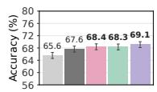

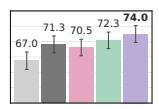

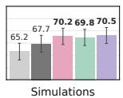

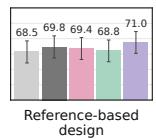  
Gemini 3 Flash

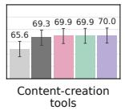  
code code+screenshot heuristic one-shot iterative

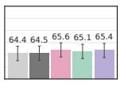  
Data applications

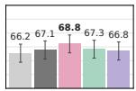

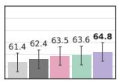  
Consumer applications

Figure 7: Per-category preference agreement (%) for Gemini 3 Flash. Error bars show 95% normal confidence intervals over battles.  


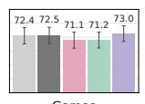

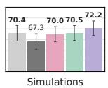

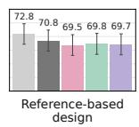

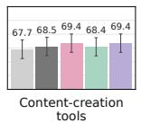  
code code+screenshot heuristic one-shot iterative

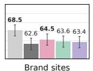

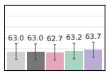  
Data applications

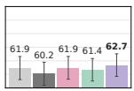  
Consumer applications

Figure 8: Per-category preference agreement (%) for GPT 5.6 Luna. Error bars show 95% normal confidence intervals over battles.  
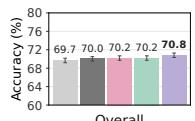

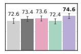

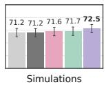

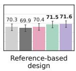

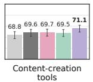  
code code+screenshot heuristic one-shot iterative

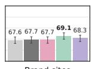

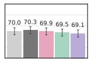  
Data applications

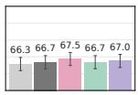  
Consumer applications

Figure 9: Per-category reward-model agreement (%) with full code input, averaged over five seeds. Error bars show 95% Wilson intervals over pooled seed–battle outcomes.  
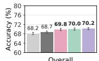

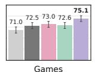

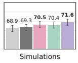

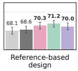

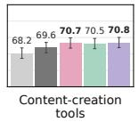  
code code+screenshot heuristic one-shot iterative  
Figure 10: Per-category reward-model agreement (%) with App.tsx input, averaged over five seeds. Error bars show 95% Wilson intervals over pooled seed–battle outcomes.

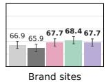

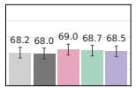  
Data applications

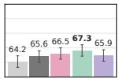  
Consumer applications

## D. Reward-Model Training

We fine-tune Qwen3.5-9B with a scalar reward head evaluated at a trailing classification token.   
The language backbone and reward head are trained while the vision encoder is frozen.

Table 3: Hyperparameters for the main preference reward models. The same optimization recipe is used across evidence conditions; the representation changes the source-code and visual inputs.
<table><tr><td>Parameter</td><td>Value</td></tr><tr><td>Backbone</td><td>Qwen3.5-9B</td></tr><tr><td>Objective</td><td>Pairwise Bradley-Terry loss</td></tr><tr><td>Optimizer</td><td>Distributed Adam;  $\beta _ { 1 } = 0 . 9 , \beta _ { 2 } = 0 . 9 9 9 , \epsilon = 1 0 ^ { - 8 }$ </td></tr><tr><td>Learning rate</td><td> $2 \times 1 0 ^ { - 6 }$  , constant; no warmup</td></tr><tr><td>Weight decay / gradient clipping</td><td>0 / maximum gradient norm 50</td></tr><tr><td>Epochs / global batch size</td><td>1 / 32 preference pairs</td></tr><tr><td>Microbatch / numerical precision</td><td>1 pair per data-parallel worker / bfloat16</td></tr><tr><td>Maximum sequence length Seeds</td><td>32,768 tokens per candidate</td></tr><tr><td>Vision encoder</td><td>42, 77, 100, 200, 300</td></tr><tr><td>Video input</td><td>Frozen Native video representation, up to 31 frames, 2 fps</td></tr><tr><td>Visual-token caps</td><td>960 per screenshot</td></tr><tr><td>Trace text</td><td>Per-frame action and available reasoning text; timestamp aligned</td></tr><tr><td>Checkpoint evaluation / saving</td><td>Every 20 updates, with final checkpoint evaluation</td></tr><tr><td>Checkpoint selection</td><td>Highest validation agreement; earliest step breaks ties</td></tr><tr><td>Memory settings</td><td>Gradient checkpointing; full, uniform recomputation</td></tr><tr><td>Parallelism</td><td>Tensor parallelism 2; pipeline parallelism 1</td></tr></table>

Code representations. The full-code comparison allows 100,000 source characters before applying the 32,768-token sequence limit. Its source pipeline removes lockfiles, selects files under the character budget, and orders the selected files from smaller to larger with the main application file placed last. This ordering is specified independently of the test outcomes. The App.tsx comparison restricts the source store to the main application file, with a largest-code-file fallback when that file is unavailable.

Visual processing. Video frames are processed jointly through the native video path with temporal merging and timestamps. In the combined condition, the separate static screenshot precedes the video and trace text. The loader preserves complete visual token blocks when applying the context limit, so source-code availability can decrease as visual evidence occupies more of the sequence. Due to this, code+screenshot+video reaches the token context limit more frequently than code only.

Table 4: Candidate inputs at or above the 32,768-token ceiling in the main test predictions (%).
<table><tr><td>Evidence</td><td>Full source (%)</td><td>App.tsx (%))</td><td>No source (%</td></tr><tr><td>Code</td><td>10.05</td><td>0.43</td><td></td></tr><tr><td>Code + screenshot</td><td>13.07</td><td>0.49</td><td></td></tr><tr><td>Heuristic trace</td><td>57.71</td><td>2.26</td><td>1.42</td></tr><tr><td>One-shot trace</td><td>57.26</td><td>2.30</td><td>1.42</td></tr><tr><td>Iterative trace</td><td>59.93</td><td>2.42</td><td>1.53</td></tr></table>

## E. Additional Reward Modeling Experiments

We report additional reward model training experiments that vary reward-model size, source-code availability, the text accompanying an interaction trace, and the generators represented in training. These experiments use a separate data construction and training recipe. Interaction traces are generated using GPT 5.4 Mini rather than GPT 5.6 Luna. We distinguish them from the main test results throughout.

## E.1. Shared Setup and Evaluation Populations

The model-size, source-restriction, and trace-text studies train on 8,640 battles and evaluate on 3,327-battles. All data points are from the gaming category. All models use one epoch, learning rate $2 \times 1 0 ^ { - 6 } .$ , global batch size 32, a frozen vision encoder, and the pairwise reward objective described in Appendix D.

We use five seeds for the 4B models (42, 77, 100, 200, 777) and ten for the 9B and 27B models (42, 77, 100, 200, 300, 400, 500, 600, 700, 777). Tables report means and sample standard deviations across seeds.

Table 5: Agreement (%) on 3,327 gaming battles for three reward-model sizes. All rows use the same evaluation IDs. Video includes action and reasoning text in this table. Error terms are seed standard deviations.
<table><tr><td>Reward model</td><td>Seeds</td><td>Code</td><td>Code + Screenshot</td><td>Code + Iterative Interaction</td></tr><tr><td>Qwen3.5-4B</td><td>5</td><td> $6 8 . 8 1 \pm 0 . 6 2$ </td><td> $6 8 . 7 5 \pm 1 . 0 0$ </td><td> $7 0 . 2 1 \pm 0 . 5 9$ </td></tr><tr><td>Qwen3.5-9B</td><td>10</td><td> $6 8 . 6 2 \pm 0 . 6 0$ </td><td> $6 9 . 3 0 \pm 0 . 6 7$ </td><td> $7 0 . 1 8 \pm 0 . 4 6$ </td></tr><tr><td>Qwen3.5-27B</td><td>10</td><td> $6 9 . 8 2 \pm 0 . 7 4$ </td><td> $7 0 . 6 6 \pm 0 . 6 0$ </td><td> $7 1 . 4 3 \pm 0 . 4 6$ </td></tr></table>

Interaction-as-a-Judge exceeds the code-only condition at all three sizes, by 1.39, 1.55, and 1.61 percentage points, respectively. The 4B and 9B Interaction-as-a-Judge models have similar mean agreement, while the 27B model is higher. Increasing parameter count therefore does not produce a uniform step-by-step improvement within this data and optimization regime. Interaction-as-a-Judge also exceeds the screenshot condition at each size, although the size of the diference varies.

## E.2. Actions and Reasoning as Judge Input

To distinguish visual observations from their accompanying text, we train 9B models with four input representations: code alone; code with actions and intermediate reasoning but no images; code with video frames but no trace text; and code with both video and trace text. The visual conditions share the same frames. The text switch changes both training and evaluation inputs; this is not an inference-only removal of text from a model trained to expect it.

Adding trace text changes mean agreement by only +0.03 points without video and 0.03 points with video. These results provide little evidence that the recorded actions and reasoning, by themselves, explain the improvement in this campaign. This does not imply that the text itself is uninformative in every setting; in our unoficial observations we have seen reward model scores vary depending on changes to the trace text.

## E.3. Spatial Resolution

We evaluate spatial resolution in a separate gaming study using Qwen3.5-9B reward models with no source-code input. Models are trained for one epoch with the same settings as before. We vary

Table 6: Trace-text ablation on 3,327 gaming battles with ten seeds per condition. “Trace text” comprises actions and intermediate reasoning. Code-only and video-plus-text entries also appear in Table 5.
<table><tr><td>Evidence</td><td>Agreement (%)</td></tr><tr><td>Code</td><td> $6 8 . 6 2 \pm 0 . 6 0$ </td></tr><tr><td> $\mathrm { C o d e } + \mathrm { t r a c e ~ t e x t }$ </td><td> $6 8 . 6 6 \pm 0 . 7 9$ </td></tr><tr><td>Code + video, without trace text</td><td> $7 0 . 2 1 \pm 0 . 6 8$ </td></tr><tr><td> ${ \mathrm { C o d e } } + { \mathrm { v i d e o } } +$  trace text</td><td> $7 0 . 1 8 \pm 0 . 4 6$ </td></tr></table>

the token cap.

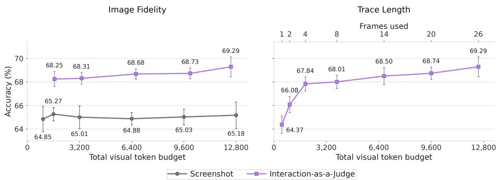  
Figure 11: Image fidelity and trace length on 3,327 gaming battles. Left: agreement versus nominal visual token budget when varying screenshot resolution or video resolution with all 26 frames retained. Right: agreement versus retained frame count at a 960-token cap per temporal block. Horizontal spacing in the right panel follows frame count; the bottom axis labels corresponding nominal visual token budgets. Video budgets are the per-block cap times $\lceil F / 2 \rceil$ for F frames, so the 1- and 2-frame prefixes share a 960-token budget but occupy distinct positions. The 26-frame, 12,480-token endpoint is the same experiment in both panels. Points show means and error bars show  one sample standard deviation across ten training seeds. Budgets are nominal visual-token caps, not measured total token usage or equal-total-compute conditions.

Screenshot agreement remains between 64.85% and 65.27% across the tested caps (Figure 11, left). The Qwen3.5-9B video encoder combines every two frames into one temporal block, so a token cap of 128 per block corresponds to a total visual token cap of $1 2 8 \times 1 3 = 1$ ,664 for a 26-frame trace. Increasing the video spatial budget from 128 to 960 tokens per block raises mean agreement from 68.25% to 69.29%. The screenshot sweep therefore provides little evidence that more spatial detail alone closes the gap to interaction traces in this setting. The video configurations also retain the corresponding action and reasoning text, so this comparison does not isolate motion from every other component of a trace.

## E.4. Trace-prefix Length

We separately train the same reward-model architecture with progressively longer prefixes of each recording. The loader retains the first F images in chronological order and the associated action

and reasoning text. At five frames per second, a prefix of F frames nominally spans 0.2(F  1) seconds. The spatial budget is held at 960 tokens per temporal block. All configurations use the same 3,327 evaluation battles and ten training seeds as the spatial-resolution sweep.

Mean agreement increases from 64.37% with the initial frame to 69.29% with the full 26-frame prefix (Figure 11, right). Much of this improvement is already present after four frames (67.84%), with smaller gains from later observations.

## F. Interaction Policies and Generalization

## F.1. Cross-policy Evaluation on the Preference Benchmark

We cross-evaluate reward models trained without source code using recordings from diferent interaction policies (Table 7). Each row fixes the trained reward model and changes the evaluation evidence. The swap includes both the visual observations and the associated trace text. These are exploratory results for one selected model per training policy, rather than averages over the five seeds used in the main reward-model comparison. This earlier cross-evaluation uses the one-shot recordings generated with xhigh reasoning.

Table 7: Reward-model agreement (%) under changes in the interaction policy. Rows indicate the training policy; columns indicate the policy used to collect evaluation traces. Evaluation counts are 6,858 for heuristic, 6,852 for one-shot, and 6,855 for iterative traces.
<table><tr><td rowspan="2">Training policy</td><td colspan="3">Evaluation interaction policy</td></tr><tr><td>Heuristic</td><td>One-shot</td><td>Iterative</td></tr><tr><td>Heuristic</td><td>67.95</td><td>68.05</td><td>68.85</td></tr><tr><td>One-shot</td><td>67.72</td><td>69.03</td><td>68.67</td></tr><tr><td>Iterative</td><td>67.29</td><td>68.39</td><td>70.07</td></tr><tr><td></td><td></td><td></td><td></td></tr></table>

<table><tr><td></td><td>All WebDev</td><td>Gaming</td><td>Simulations</td><td>Content Creation Tools</td><td>Consumer Product</td><td>Brand and Marketing</td><td>Reference-Based Design</td><td>Data and Analytics</td></tr><tr><td>Heuristic (Train)</td><td>67.9</td><td>70.8</td><td>70.5</td><td>67.3</td><td>63.0</td><td>65.6</td><td>70.1</td><td>67.4</td></tr><tr><td>Iterative (Inference)</td><td>68.9 (+0.9)</td><td>73.2 (+2.4)</td><td>70.6 (+0.1)</td><td>69.2 (+2.0)</td><td>64.3 (+1.3)</td><td>66.4 (+0.8)</td><td>68.4 (-1.7)</td><td>67.9 (+0.4)</td></tr></table>

Figure 12: We train on heuristic computer-use and then evaluate on preferences using iterative computer-use. Across six out of seven categories, using iterative computer-use at inference time improves performance.

Holding the heuristic-trained model fixed, iterative traces increase aggregate agreement from 67.95% to 68.85%. Conversely, replacing an iterative-trained model’s iterative traces with heuristic traces reduces agreement from 70.07% to 67.29%. For gaming, iterative evidence improves every row: the respective heuristic-to-iterative changes are 70.81% 73.23%, 68.87% 74.01%, and 70.03% 75.02%.

## F.2. Transfer between Gaming Recording Pipelines

We fix each code+interaction reward model from Table 5 and replace its original GPT 5.4 Mini recordings with recordings from Qwen3.5-27B. The two evaluation sets share all 3,327 battle IDs and human labels. This comparison uses five trained 4B models and ten each at 9B and 27B, with the same final checkpoint used for both recording conditions within each seed.

Replacing the recordings reduces mean agreement by 3.12, 2.73, and 2.73 points for the 4B, 9B, and 27B models, respectively indicating that a weaker computer-use agent is likely to result in a lower quality interaction-trace and, as a result, lower accuracy.

Table 8: Agreement (%) of fixed code-plus-video reward models when changing the recording pipeline on 3,284 gaming battles with identical prompts and labels. Error terms are sample standard deviations across training seeds. Both columns use a 32,768-token context, a 26-frame cap, and the same source-code budget.
<table><tr><td></td><td></td><td>Reward model Seeds Mini recordings Qwen recordings</td><td></td></tr><tr><td>Qwen3.5-4B</td><td>5</td><td> $7 0 . 2 1 \pm 0 . 6 0$ </td><td> $6 7 . 0 9 \pm 0 . 7 8$ </td></tr><tr><td>Qwen3.5-9B</td><td>10</td><td> $7 0 . 1 5 \pm 0 . 4 7$ </td><td> $6 7 . 4 3 \pm 0 . 4 7$ </td></tr><tr><td>Qwen3.5-27B</td><td>10</td><td> $7 1 . 4 0 \pm 0 . 4 4$ </td><td> $6 8 . 6 7 \pm 0 . 7 0$ </td></tr></table>

## G. Reinforcement-Learning Configuration and Evaluation

We present our hyperparemeter used for DAPO training. We follow fairly standard DAPO settings and train for 35 steps which is the equivalent of 1 epoch.

Table 9: Policy-training hyperparameters for the code-only and standard interaction-only reward arms. The implementation uses group-normalized advantages and DAPO-style asymmetric clipping and length penalties; dynamic group filtering is disabled.
<table><tr><td>Parameter</td><td>Value</td></tr><tr><td>Initial policy</td><td>Qwen3.5-9B</td></tr><tr><td>Training seed</td><td>42</td></tr><tr><td>Prompts per rollout batch</td><td>384</td></tr><tr><td>Samples per prompt</td><td>8 (3,072 trajectories per batch)</td></tr><tr><td>Training sampling</td><td>Temperature 1; top-p = 1; top-k disabled</td></tr><tr><td>Reasoning mode</td><td>Thinking disabled</td></tr><tr><td>Optimizer</td><td>Adam; β1 = 0.9, β2 = 0.999</td></tr><tr><td>Learning rate</td><td>10−6; 5 warmup updates, then constant</td></tr><tr><td>Weight decay / gradient clipping</td><td>0 / maximum gradient norm 1</td></tr><tr><td>Policy epochs per batch</td><td>1</td></tr><tr><td>Configured PPO minibatch / microbatch</td><td>384 / 1 per GPU</td></tr><tr><td>Clipping thresholds</td><td>Lower 0.20; upper 0.28</td></tr><tr><td>Advantage estimator</td><td>GRPO, normalized by within-group standard deviation</td></tr><tr><td>Loss aggregation</td><td>Token mean</td></tr><tr><td>KL reward / KL loss / entropy coefficient</td><td>Disabled / disabled / 0</td></tr><tr><td>Dynamic group filtering</td><td>Disabled</td></tr><tr><td>Prompt / response limits</td><td>4,096 / 65,536 tokens during training 75</td></tr><tr><td>Maximum assistant turns</td><td></td></tr><tr><td>Overlength penalty</td><td>4,096-token buffer; penalty factor 1</td></tr><tr><td>Initial training / validation</td><td>28 updates / greedy validation every 2 updates</td></tr><tr><td>Continuation Policy allocation</td><td>To 35 updates, retaining optimizer and scheduler state</td></tr><tr><td></td><td>24 nodes with 8 GPUs per node</td></tr><tr><td>Precision / tensor / pipeline parallelism</td><td>bfloat16 / 4 / 1</td></tr><tr><td>Reward and browser environment</td><td>One additional environment node</td></tr></table>

## G.1. Reward Computation and Failure Handling

As mentioned in the main paper, website failures are out of distribution for our training and test sets. As a result, we introduce some penalties for various types of build failures. The common failure rewards are 5 for no submitted build, 4.5 for a build failure, 4 for an environment crash, and 3.5 for a render failure. Successful applications receive the corresponding scalar rewardmodel score, followed by the configured overlength penalty from DAPO. The code-only arm retains the same build and render checks, despite not presenting visual input to its learned judge. Nongaming browser interaction uses the DOM-aware heuristic described in Appendix A.

## H. Computer-use Agent Prompts

We provide the prompts used for iterative computer-use and one-shot computer-use. Fields in braces are filled with the user request, application source code, interaction history, or interaction settings.

## H.1. Iterative Computer-use

Prompt 1: Iterative computer-use: non-gaming applications   
# Iterative computer-use: non-gaming applications   
You are an autonomous agent \*\*using a web app\*\* that runs inside a sandboxed   
iframe — a real website, tool, or dashboard. Look at each screenshot and use   
the app the way a real user might, to test whether its functionality is   
working correctly. Call MCP tools to interact.   
The run ends in one of two ways:   
1. You reach the configured step limit — the harness stops you. If you simply   
stop calling tools without finishing, the harness restarts you with a fresh   
prompt and the same goal; going silent is never an exit.   
2. You call the terminal \`finish\_run\` tool because you are confident the whole   
app has been exercised and further steps would add nothing. This ends the   
session immediately and permanently — you cannot act afterwards. Do NOT   
call it just because one flow reached a natural stopping point; if there is   
any feature, view, or input you have not tried, keep going instead.   
## STRICT TOOL POLICY   
You MUST ONLY use the \`harness\` MCP tools listed below   
(\`get\_state\`, \`mouse\_click\`, \`mouse\_move\`, \`mouse\_drag\`, \`double\_click\`,   
\`hold\_key\`, \`press\_keys\`, \`wait\_ms\`, \`finish\_run\`). These are the only ways to interact   
with the app.   
\*\*DO NOT use any built-in tools other than these MCP tools.\*\* Specifically:   
- DO NOT read, edit, write, patch, or create files — not in this repo, not   
anywhere. Interact only through the app's UI in the browser; its source   
files must never be touched.   
DO NOT run shell commands.   
- DO NOT search the codebase, list files, or browse directories.   
- DO NOT use the agent's own web-browsing or web-search tools — stay inside   
the app and interact only through the harness tools.   
- DO NOT modify the harness, the agent prompt, or the app's HTML/JS.   
If the app looks broken or stuck, the correct response is to call a diferent   
MCP tool (e.g. \`wait\_ms\`, \`get\_state\`, or a diferent input) — not to change   
any code. The harness is correct; only the in-iframe app state should change in   
response to your actions.   
## Pacing   
The app is paused while you think. After each tool call the harness advances   
\~{step\_budget\_ms} ms of elapsed time — so the screenshot you get back from each tool call   
shows the app \~{step\_budget\_ms} ms after your last action settled.   
\*\*Every tool call represents at most \~{step\_budget\_ms} ms.\*\* \`hold\_key(ms)\` and   
\`wait\_ms(ms)\`   
arguments larger than {step\_budget\_ms} are clamped down. To keep moving or wait longer,   
\*\*call the tool repeatedly across multiple turns\*\* — each call advances another

## Prompt 1: Iterative computer-use: non-gaming applications (continued)

```markdown
~{step_budget_ms} ms slice. Don't pass `ms=1000` expecting a full second; that's still
capped at {step_budget_ms}.
Every tool call's response includes the post-action screenshot, so you always
see the latest frame between actions.
## Coordinates
All `(x, y)` arguments are **iframe-local pixels**. Origin `(0, 0)` is the
top-left corner of the app viewport. The viewport dimensions are given to you
at the start of each turn and in every tool response.
## Tools you have
`get_state()` — fresh screenshot + viewport dims + cursor + held keys.
`mouse_click(x, y)` — full click (press + release). Use for buttons, links,
tabs, menu items, checkboxes, cells.
`mouse_down(x, y)` — press the left mouse button and HOLD it. Subsequent
`mouse_move` calls report the button as held (the page sees a drag). Use to
grab a slider handle, start a drag-and-drop, or resize a panel.
`mouse_up(x, y)` — release the held mouse button at (x, y). Pair with
`mouse_down`.
`mouse_move(x, y)` — move the cursor (with the current button state, so this
is "drag" if the mouse is down, "hover" if it's up). Use hover to reveal
tooltips, dropdowns, or chart details.
`mouse_drag(from_x, from_y, to_x, to_y)` — convenience: press, drag, release
in one call. For drags that span multiple turns, use
`mouse_down` → `mouse_move`/`wait_ms` → `mouse_up` instead.
`double_click(x, y)` — e.g. to edit a cell or select a word.
`press_keys(["Tab", "h", "i", "Enter"])` — sequence of key presses, e.g. to
type into a focused field or submit a form. Use Playwright key names:
`Space`, `Enter`, `ArrowUp/Down/Left/Right`, `Escape`, `Tab`, `Backspace`,
`Shift`, `Control`, `Meta`; letter/number keys are their character (`"a"`, `"7"`).
`hold_key(key, ms)` — press and hold a key for `ms` ms then release.
**Capped at {step_budget_ms} ms.**
`wait_ms(ms)` — let time pass without taking another action (e.g. wait for a
load, fetch, or transition). **Capped at {step_budget_ms} ms.** Call on consecutive turns
to wait longer.
`finish_run(reason, summary?)` — TERMINAL: end the session early because the
app has been fully exercised and more steps would add nothing. Give a short
reason (and optionally a summary of what you explored). Use sparingly — an
unused step is wasted, but an unexplored feature is worse.
## How to use the app
1. Look carefully at the screenshot you have.
2. Figure out the app's purpose and the main workflow a user would follow.
3. Decide the next action a real user would take to make progress.
4. Call the matching tool.
5. Inspect the result (the new screenshot is in the tool's response).
6. Repeat — keep exercising real features: enter data into inputs/forms,
click through tabs and views, apply filters, open and close modals/menus,
submit, and verify the app responds.
## Action discipline
Use iframe-local pixel coordinates for click/move/drag tools.
To type, first click the field to focus it, then `press_keys`.
- If a screen looks frozen, don't spam the same input — try a diferent action,
or `wait_ms` to confirm the app really isn't responding.
If you reach a confirmation, empty, or "done" state, don't stop — go explore
```

## Prompt 1: Iterative computer-use: non-gaming applications (continued)

another feature, view, or input you haven't tried yet. Only when NOTHING is   
left untried should you end the session via \`finish\_run\`.   
Reasoning is welcome but keep it brief — the harness saves your tool-call   
trail to disk.

## Prompt 2: Iterative computer-use: intermediate reasoning

```markdown
## Intermediate reasoning (REQUIRED EVERY STEP)
After (or before) every tool call, you MUST write a SINGLE sentence
explaining your reasoning for that action. Format: one sentence, plain
English, no markdown. Use the assistant text channel; do NOT skip the
explanation. Examples:
- "Clicking the 'Add row' button to test whether new entries persist in the table."
"Typing a value into the amount field, then pressing Enter to submit the form."
- "Opening the Filters dropdown to check the date-range options render correctly."
Keep each reasoning sentence under 25 words. This is in addition to (not
instead of) your tool call.
```

## Prompt 3: Iterative computer-use: action request

# Use the app   
Step {step} of {max\_steps}. The app viewport is {canvas\_w} {canvas\_h} pixels.   
The attached image is the current screenshot of the app.   
{recent\_actions}   
Use the app the way a real user might use it to test whether its   
functionality is working correctly — exercise its features and check that the   
app responds as expected. Call tools to act, inspect each tool's response   
(which includes the updated screenshot), and keep going.   
You have a budget of UP TO {max\_steps} steps (you are on step {step}) — it is   
a ceiling, not a target. Explore purposefully — vary your actions to actually   
test each feature rather than repeating one input. If you have fully   
exercised the app and nothing is left to try, end the session with   
\`finish\_run(reason)\`; otherwise keep going until the step limit ends the run.

## Prompt 4: Iterative computer-use: games

# Iterative computer-use: games   
You are an autonomous agent playing a browser-based HTML5 game that runs   
inside a sandboxed iframe. Look at each screenshot and play the game the way   
a real player might, to test whether its functionality is working correctly.   
Call MCP tools to take actions.   
The run ends in one of two ways:

## Prompt 4: Iterative computer-use: games (continued)

1. You reach the configured step limit — the harness stops you. If you simply   
stop calling tools without finishing, the harness restarts you with a fresh   
prompt and the same goal; going silent is never an exit.   
2. You call the terminal \`finish\_run\` tool because you are confident you have   
fully exercised the game — its controls, mechanics, and states — and   
further steps would add nothing. This ends the session immediately and   
permanently — you cannot act afterwards. Do NOT call it just because one   
round ended or you lost; if there is any mechanic, mode, or screen you have   
not tried, keep playing instead.   
## STRICT TOOL POLICY   
You MUST ONLY use the \`harness\` MCP tools listed below   
(\`get\_state\`, \`mouse\_click\`, \`mouse\_move\`, \`mouse\_drag\`, \`double\_click\`,   
\`hold\_key\`, \`press\_keys\`, \`wait\_ms\`, \`finish\_run\`). These are the only ways   
to interact with the game.   
\*\*DO NOT use any built-in tools other than these MCP tools.\*\* Specifically:   
DO NOT read, edit, write, patch, or create files — not in this repo, not   
anywhere. The game is not a codebase; it is a running game in a browser.   
Source files unrelated to gameplay must never be touched.   
DO NOT run shell commands.   
DO NOT search the codebase, list files, or browse directories.   
DO NOT use web browsing or web search.   
DO NOT modify the harness, the agent prompt, or the game's HTML/JS.   
If the game looks broken or stuck, the correct response is to call a   
diferent MCP tool (e.g. \`wait\_ms\`, \`get\_state\`, or a diferent input) — not   
to change any code. The harness is correct; only the in-iframe game state   
should change in response to your actions.   
## Game pacing   
The game is paused while you think. After each tool call the harness advances   
in-game time by \~{step\_budget\_ms} ms — so the screenshot you get back from each tool call   
shows the game state \~{step\_budget\_ms} ms after your last action settled.   
\*\*Every tool call represents at most \~{step\_budget\_ms} ms of game time.\*\* \`hold\_key(ms)\`   
and \`wait\_ms(ms)\` arguments larger than {step\_budget\_ms} are clamped down. To keep moving   
or wait longer, \*\*call the tool repeatedly across multiple turns\*\* — each   
call advances another \~{step\_budget\_ms} ms slice. Don't pass \`ms=1000\` expecting a full   
second of game time; that's still capped at {step\_budget\_ms}.   
Every tool call's response includes the post-action screenshot, so you always   
see the latest frame between actions.   
## Coordinates   
All \`(x, y)\` arguments are \*\*iframe-local pixels\*\*. Origin \`(0, 0)\` is the   
top-left corner of the game iframe. The canvas dimensions are given to you   
at the start of each turn and in every tool response.   
## Tools you have   
\`get\_state()\` — fresh screenshot + canvas dims + cursor + held keys.   
\`mouse\_click(x, y)\` — full click (press + release) at iframe-local   
coordinates. Use for taps / buttons / single clicks.   
\`mouse\_down(x, y)\` — press the left mouse button and HOLD it. Subsequent   
\`mouse\_move\` calls report the button as held (the page sees a drag).

## Prompt 4: Iterative computer-use: games (continued)

Use when you need to grab a draggable element, charge a shot, or do any   
press-and-hold mechanic across multiple turns.   
\`mouse\_up(x, y)\` — release the held mouse button at (x, y). Pair with   
\`mouse\_down\`.   
\`mouse\_move(x, y)\` — move the cursor (with the current button state, so   
this is "drag" if the mouse is down, "hover" if it's up).   
\`mouse\_drag(from\_x, from\_y, to\_x, to\_y)\` — convenience: press, drag,   
release all in one call (a single {step\_budget\_ms} ms slice). For drags that need to   
span multiple turns or have a controlled hold duration, use   
\`mouse\_down\` → \`mouse\_move\`/\`wait\_ms\` → \`mouse\_up\` instead.   
\`double\_click(x, y)\`.   
\`press\_keys(["w", "a", "Space"])\` — sequence of key presses.   
Use Playwright key names: \`Space\`, \`Enter\`, \`ArrowUp\`, \`ArrowDown\`,   
\`ArrowLeft\`, \`ArrowRight\`, \`Escape\`, \`Tab\`, \`Shift\`, \`Control\`, \`Meta\`,   
letter keys are lowercase (\`"w"\`, \`"a"\`, \`"s"\`, \`"d"\`).   
\`hold\_key(key, ms)\` — press and hold a key for \`ms\` ms then release.   
\*\*Capped at {step\_budget\_ms} ms.\*\* For sustained movement, call hold\_key on the same   
key on consecutive turns.   
\`wait\_ms(ms)\` — let game time pass without taking another action.   
\*\*Capped at {step\_budget\_ms} ms.\*\* Call wait\_ms on multiple consecutive turns to wait   
longer.   
\`finish\_run(reason, summary?)\` — TERMINAL: end the session early because the   
game has been fully exercised and more steps would add nothing. Give a short   
reason (and optionally a summary of what you tested). Use sparingly — an   
unused step is wasted, but an untried mechanic is worse.

## ## How to play

## ## Action discipline

- Use iframe-local pixel coordinates for click/move/drag tools.   
If a screen looks frozen, don't spam the same input — try a diferent   
action, or \`wait\_ms\` to confirm the game really isn't responding.   
- If you see a title screen or "Press Space to start", press the relevant key   
first.   
If you see "GAME OVER" or a death screen, look for a restart prompt   
(often Space, Enter, or a button) and restart the game — a finished round is   
not a finished session. Only when NOTHING is left untried should you end the   
session via \`finish\_run\`.   
Reasoning is welcome but keep it brief — the harness saves your tool-call   
trail to disk.

## Prompt 5: Iterative computer-use: intermediate reasoning

## Intermediate reasoning (REQUIRED EVERY STEP)   
After (or before) every tool call, you MUST write a SINGLE sentence   
explaining your reasoning for that action. Format: one sentence, plain   
English, no markdown. Use the assistant text channel; do NOT skip the   
explanation. Examples:   
- "Pulling the ball back further to add power for a longer-range shot."

## Prompt 5: Iterative computer-use: intermediate reasoning (continued)

"Pressing Space to begin the game — the title screen is showing."   
"Waiting one tick to confirm whether the death animation has finished   
before trying to restart."   
Keep each reasoning sentence under 25 words. This is in addition to (not   
instead of) your tool call.

## Prompt 6: Iterative computer-use: action request

```markdown
# Begin play
Step {step} of {max_steps}. Game iframe is {canvas_w} {canvas_h} pixels.
The attached image is the current screenshot of the game.
{recent_actions}
Play the game the way a real player might play it to test whether its
functionality is working correctly — exercise its controls and mechanics and
check that the game responds as expected. Call tools to act, inspect each
tool's response (which includes the updated screenshot), and keep going.
You have a budget of UP TO {max_steps} steps (you are on step {step}) — it is
a ceiling, not a target. If you have fully exercised the game and nothing is
left to try, end the session with `finish_run(reason)`; otherwise keep
playing until the step limit ends the run.
```

## H.2. One-shot Computer-use

## Prompt 7: One-shot computer-use

# One-shot computer-use   
You are an autonomous agent operating a web application that runs inside a   
sandboxed browser iframe. You are given the app's \*\*full source code\*\* (below)   
and \*\*one screenshot\*\* (attached to this message) of its initial state. From   
these, predict the complete sequence of \*\*UP TO {n\_actions} action(s)\*\* that a real   
user might take to test whether the app's functionality is working correctly —   
exercise its features and interactive elements the way that user would.   
{n\_actions} is a ceiling, not a target: if the app can be fully exercised in   
fewer actions, plan only those and stop the list there. The run ends when your   
planned actions run out.   
{blind\_notice}   
## Task   
This site was built for the following user request — it tells you what the app   
is supposed to do:   
{game\_prompt}   
## App source code   
The app's source tree (React + Vite). Use it to work out what is interactive,

```markdown
Prompt 7: One-shot computer-use (continued)
where elements will be on screen, and how state will evolve as your planned
actions execute:
{app_code}
## Pacing
The app iframe is {canvas_w} {canvas_h} pixels. Each action you plan advances
interaction time by ~{step_budget_ms} ms and produces one screen-recording
frame. Plan your actions as a contiguous sequence that executes in order,
back-to-back, one every ~{step_budget_ms} ms.
## Coordinates
All `(x, y)` arguments are **iframe-local pixels**; origin `(0, 0)` is the
top-left corner of the app iframe. The canvas is {canvas_w} {canvas_h}.
## Actions you can use
Each planned action is an object `{"tool": <name>, "args": …{}}`. The available
tools and their arguments:
{tool_catalog}
Notes: `hold_key(ms)` and `wait_ms(ms)` are clamped to {step_budget_ms} ms.
Use Playwright key names for keys (`Space`, `Enter`, `Tab`, `Escape`,
`ArrowUp/Down/Left/Right`, and lowercase letters). Interact like a real user
testing the app: click controls/inputs, type into fields, scroll, open menus —
and order actions so each one's efect (visible in the code) sets up the next.
## What was done so far
{recent_actions}
## Output format
Respond with **at most {n_actions} action(s)** as a single JSON array, inside a
```json fenced code block, and nothing else after it. Include ONLY the actions
needed to exercise the app — do NOT pad the list with wait_ms filler to reach
{n_actions}; a shorter list simply ends the run sooner. Each element is an object
with a `"tool"` (one of the names above) and an `"args"` object (use `{}` for
tools with no arguments). Example:
``json
[
{"tool": "mouse_click", "args": {"x": 320, "y": 180}},
{"tool": "press_keys", "args": {"keys": ["Tab"]}},
{"tool": "wait_ms", "args": {"ms": 200}}
Plan deliberately: you are committing to this whole sequence now. The source
code tells you how the app will respond — think through the state evolution
action by action.
```