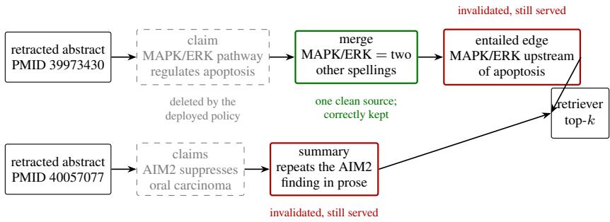
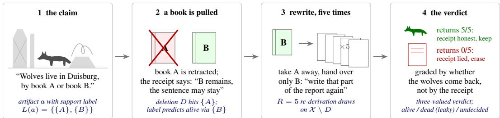

# Keep Your Receipts: Trustworthy Cleanup of Agent-Built Knowledge Graphs

Vishisht Choudhary Technical University of Munich

Preprint; the camera-ready for the NeurIPS 2026 workshop “Who Verifies the Agents?” may differ.

## Abstract

Agents build knowledge graphs as memory, and building them has become easy. Maintaining them has not. When a source is retracted, overruled, or erased, everything built on top of it, entity merges, entailed edges, community summaries, has to be re-examined, and the maintainer must choose between deleting too much and deleting too little. Deployed pipelines delete only the directly extracted facts. On our corpus that reduces contaminated queries from 32.2% to 28.0% under a real retraction and leaves predicate revocation unchanged at 36.8%. Rebuilding is no repair for a constructor that samples: two builds of the same 300-document corpus differ in 29,475 artifacts, five times the 6,248 that removing the 61 retracted documents changes. PolyGraph instead asks the constructor for receipts: for every artifact, alternative bundles of source evidence, each claimed sufficient on its own, emitted in the call that creates the artifact. Cleanup is then set arithmetic over the receipts, milliseconds on a 24,381-artifact graph, with no model calls. Because receipts are the model’s own self-report, a re-derivation audit checks them by deleting the cited evidence and testing whether the constructor still produces the artifact. The audit finds that a receipt is trustworthy when it is shaped like the claim it backs. Merge receipts, each backing one narrow claim, agree with re-derivation 68% and 85% of the time. Summary receipts, elicited per sentence but stored as one flat list for the whole text, are wrong about two thirds of the time under the two graded deletions and 41% of the time pooled over ten further random retractions, almost always by keeping dead content. Eliciting one receipt per sentence instead gives receipts that are 100% and 88% faithful and lets cleanup keep 33 of 35 touched summaries by removing only their dead sentences. The layer ordering and the direction of the errors hold under a second oracle model, a claim-blind prompt, a second domain and a second constructor. Distrusting the summary layer cuts contaminated queries to 0.4% and 0.8% while retaining 99.8 to 100% of the recall a perfect maintainer would return.

## 1 Introduction

Knowledge graphs are becoming the ground truth for agentic memory systems, and constructing them has become easy. Maintaining them has not. This paper is about one part of maintenance: removing an invalidated source from an agent-built graph without also removing knowledge that still stands, and without rebuilding the graph to find out which is which.

The difficulty has a simple shape. Two corpora X and Y support an inferred fact Z. When X is retracted, deleting X’s own statements is easy, but Z must be re-examined: perhaps Y alone justifies it, perhaps not. Once further deductions are built on Z, each fed by further sources, the cost of deciding what still stands grows with every layer. Figure 1 shows two real instances from our corpus. The maintainer has two ways to fail. Deleting everything downstream of the retraction destroys artifacts that a second, untouched derivation still supports. Deleting only the directly extracted facts, which is what deployed pipelines do, leaves most of the contamination in place.

  
Figure 1: Two real chains from the corpus. Deployed deletion removes only the extracted claims (dashed). The entity merge keeps one evidence source from a paper that still stands, so it is correctly retained (green); five of five re-derivations agree. The entailed edge and the summary rest only on retracted evidence, mention no retracted paper, and keep reaching the retriever (red). Support labels delete the edge with one disjointness test. The summary’s label wrongly claims it still stands, the failure Section 6 measures; the layered policy of Section 6.4 removes it.

Existing database systems each solve half of the problem. Versioned stores can rewind to any past state but track no dependencies between items, so a retraction can be undone but never propagated. The classical propagation algorithms [Gupta et al., 1993, de Kleer, 1986, Green et al., 2007] would cascade it exactly, but they consume a justification record that only a deterministic engine can write; a language model does not produce one, and re-running the model cannot recover it (Section 5). The pipelines that actually build agent graphs [Edge et al., 2024, Guo et al., 2024] store provenance and use it for nothing beyond deleting the directly extracted facts. On our corpus that cleanup reduces contaminated queries from 32.2% to 28.0% under a real retraction, about one eighth of the problem, and under predicate revocation it changes nothing, 36.8% before and after, because the damage sits in derived edges and summaries rather than in the facts.

PolyGraph closes the gap with two steps. First, the constructor must emit a receipt for every artifact in the same call that creates it. A receipt is a support label [de Kleer, 1986]: a set of alternative evidence bundles over source assertions, each claimed sufficient on its own. Cleanup then needs no model calls, because the information that removal requires was stored before it was needed; processing a withdrawal is set arithmetic over the receipts, 1 to 21 ms on our whole 24,381-artifact graph. Second, because the receipts are the model’s own self-report, a re-derivation audit grades them: it deletes the cited evidence and asks whether the constructor, shown only what survives, still produces the artifact. It is important to keep your receipts, and just as important to check who wrote them.

The audit’s verdict is that trust depends on the shape of the receipt. At the merge layer, where each receipt backs one narrow identity claim, the receipts are trustworthy. At the summary layer, where one flat receipt has to vouch for several sentences, they are wrong about two thirds of the time, almost always by keeping content that no longer re-derives. A controlled re-elicitation traces most of that failure to the shape of the receipt rather than to the model: asked for one receipt per sentence, the same constructor writes receipts that are 100% and 88% faithful, and cleanup can keep the sentences that still stand instead of deleting whole summaries. The general lesson is that a receipt is trustworthy when it is shaped like the claim it backs, so an agent’s outputs should decompose into narrow, falsifiable sub-claims, each with its own receipt.

The paper contributes:

• the receipt-and-audit protocol, with a distinction between the liveness the audit measures and the source-groundedness a compliance setting would need (Section 4);

• the measurement that replay cannot stand in for it on a sampling constructor: resampling noise is five times the signal a deletion leaves (Section 5);

• the layer-dependent faithfulness result, its receipt-shape explanation, and the sentence-level receipts that repair it (Sections 6.1 to 6.2);

• evidence that the result is not an artifact of the sample, the oracle, the corpus, or the constructor: ten further pooled deletions, a second oracle model and a claim-blind prompt, a second domain (Supreme Court opinions) and a second constructor (Section 6.3);

• the retrieval-level consequence: acting on the verdict cuts contaminated search results from 32 to 37% of queries to 0.4% and 0.8% while keeping 99.8 to 100% of the recall a perfect maintainer would return, and what the receipts cost to write and store (Section 6.4).

## 2 Related work

Faithfulness of model self-reports. Chain-of-thought explanations can misrepresent the causes of a model’s answer [Turpin et al., 2023], and perturbation studies find reasoning traces whose removal leaves the answer unchanged [Lanham et al., 2023]. Our self-report differs in one useful way: it is not free text but a set of support sets with defined deletion semantics. Each label makes a falsifiable prediction about a counterfactual corpus, and re-derivation runs that counterfactual.

Verification by a second model. LLM-as-judge protocols [Zheng et al., 2023] and RAG evaluation suites [Es et al., 2024] score outputs with another model call. For our problem this reintroduces the circularity. A judge asked whether some evidence supports an artifact answers a different question from the one maintenance needs, namely whether the deployed constructor would still have produced the artifact from the surviving evidence. Re-derivation puts that question to the constructor itself; Section 6.3 measures what a second model and a judge-style prompt change.

Justification-consuming maintenance. Truth-maintenance systems [Doyle, 1979, de Kleer, 1986], delete-and-rederive [Gupta et al., 1993], and provenance semirings [Green et al., 2007] settled how to propagate retractions given correct justifications; even then, minimal deletion is NP-hard [Buneman et al., 2002]. Versioned stores such as TerminusDB [van Otterdijk et al., 2020] rewind exactly but track no dependencies between items. All of this machinery assumes that recorded antecedents are causal and that re-running the producer replays them. We quantify how badly the replay assumption fails for a language-model producer, and how unevenly the antecedent assumption holds.

Unlearning. Machine unlearning removes training data’s influence from weights [Bourtoule et al., 2021, Meng et al., 2022], with extensions to RAG corpora [Wang et al., 2025]. Our facts live in an inspectable artifact the model built, not in weights, and the retraining-style remedy is the replay that Section 5 rules out.

## 3 Setting

We separate what a document says from what the graph holds. An assertion $x = \langle d , s , p , o \rangle$ is one source document d stating one typed triple; assertions are what a withdrawal removes. An artifact is anything the graph holds and a retriever can return: an extracted claim, an entity merge, a schema-entailed edge, or a community summary. Each kind is produced by one pipeline stage built on the one before it (claims from documents, merges over claims, edges entailed from claims and merges, summaries over communities of merged entities), and we call each kind a layer. The constructor must emit, in the same call that creates artifact a, a support label

$$
L ( a ) = \{ S _ { 1 } , \ldots , S _ { m } \} , \qquad S _ { i } \subseteq \mathcal { X } ,
$$

where each support set $S _ { i }$ is a set of assertions claimed to suffice, on its own, to produce a. Under a deletion D the label predicts that a survives exactly when some $S _ { i }$ is disjoint from D. Labels are capped at eight support sets, keeping the smallest. Truncation can only make an artifact look deader than it is, so it never adds leakage.

Deletions. We grade labels under two operations. RETRACT-SOURCE removes every assertion of a withdrawn document. REVOKE-RELATION removes every assertion that uses a predicate judged unsound, so it cuts along the schema instead of along documents.

Graphs. The main instance is a pipeline over 300 PubMed oncology abstracts selected by shared MeSH descriptors [National Library of Medicine, 2026], 61 of them genuinely retracted; its RETRACT-SOURCE uses those real retractions. The constructor is Anthropic’s Claude Sonnet, called in August

  
Figure 2: The audit as a classroom exercise, and its protocol translation (italics). A report claims wolves live in Duisburg on the strength of two books, each sufficient alone. When book A is retracted, the audit does not argue with that receipt: it removes book A and has the passage rewritten five times from book B only. Whether the wolves come back decides whether the sentence stays; the receipt does not.

2026 through the Claude Code CLI’s sonnet alias behind a content-addressed cache keyed by model and prompt hash; the re-derivation oracle later queries the same backend and alias, so labels are graded against the producer that wrote them. Every later run in this paper pins claude-sonnet-5 or claude-opus-5-5. The prompt templates for every model-facing step are released verbatim with the code.1 The pipeline produced 2,785 assertions over 2,784 distinct claims, 165 entity merges, and 59 community summaries; closed under the published axioms of the OBO Relations Ontology [OBO Foundry, 2026], these yield 21,373 entailed edges, for 24,381 artifacts in total. Two further instances test transfer (Section 6.3). The second domain is 150 U.S. Supreme Court opinions from the Caselaw Access Project (volumes 380 to 387 of the U.S. Reports), built by the same pipeline and prompts under a legal schema: 1,571 assertions, 136 merges, 60 summaries and 6,137 entailed edges. That corpus has no real retractions, so its RETRACT-SOURCE draws documents at random (seed 0) to the same 10% size, and its queries are 300 party and citation strings. The second constructor rebuilds the biomedical graph from the same abstracts, prompts and schema with claude-opus-5-5.

## 4 PolyGraph: the verification protocol

The idea of the audit fits in a classroom. A student writes in a report that wolves live in Duisburg and, asked for sources, answers: book A and book B, and either one alone proves it. That answer is a support label. When book A is later found to be fabricated and pulled from the library, the label claims the sentence may stay, since book B remains. The teacher does not argue with the label. She removes book A, hands the student only book B, and has the passage written again on five different days, because the student never writes the same report twice. If the wolves return each time, the label was honest and the sentence stays; if they never return, the student needed book A all along, and the sentence is erased (Figure 2). PolyGraph is this move performed at graph scale: do not argue with the receipt, remove the cited evidence and make the constructor work again.

Two rules shape the audit: never grade a label against itself, and match the re-derivation procedure to the step being re-derived, stochastic for stochastic, symbolic for deterministic.

Ground truth by re-derivation. An artifact is alive under a deletion D when a constructor seeing only X \ D would still produce it. That is a question about the constructor, so we ask the constructor. An artifact is touched by D when its label mentions a deleted assertion; only touched artifacts can change status under the label. Because the constructor samples, we draw R = 5 independent re-derivations per touched artifact and issue a verdict at threshold τ = 0.2: alive if at least 1 − τ of the draws reproduce the artifact, dead if at most τ do, undecided otherwise. Undecided artifacts are excluded from scoring and counted. A wide undecided band would itself say something about the agent, so we report it rather than splitting it between the sides.

Two notions of alive. The definition above is constructor-relative liveness: whether this constructor, seeing only the surviving evidence, would still produce the artifact. It is the right notion for maintenance, because it describes the graph the pipeline would have built had the deleted source never existed. It is not source-groundedness, whether the surviving sources actually support the artifact.

<table><tr><td>layer</td><td>resampling floor</td><td>effect of the deletion</td><td>ratio</td></tr><tr><td>all artifacts</td><td>29,475</td><td>6,248</td><td>0.21</td></tr><tr><td>claims</td><td>3,294</td><td>506</td><td>0.15</td></tr><tr><td>merges</td><td>236</td><td>54</td><td>0.23</td></tr><tr><td>entailed edges</td><td>25,826</td><td>5,647</td><td>0.22</td></tr><tr><td>summaries</td><td>119</td><td>41</td><td>0.34</td></tr></table>

Table 1: Symmetric difference in artifacts. Thefloor is $| G _ { 1 } \triangle G _ { 2 } |$ for two independent builds of the same unchanged corpus; the effect is $| G _ { 1 } \triangle G _ { 3 } |$ , where $G _ { 3 }$ omits the 61 retracted documents.

The two part ways when the model can supply missing evidence from parametric memory: such an artifact is live for the constructor but ungrounded in the sources. Compliance settings such as right-to-erasure need groundedness. We measure liveness; Section 6.3 reports what a second model and a claim-blind prompt change, and Section 8 describes the human audit that would measure groundedness directly. The re-derivation prompt presents the artifact as the model’s earlier conclusion and asks whether it would still reach it from the surviving evidence; it does not rerun the construction step from scratch.

Symbolic re-derivation where possible. Entailed edges follow from asserted claims and published axioms by a decision procedure. We re-derive them symbolically, and we exclude the layer from every faithfulness figure, since its labels agree with re-derivation by construction. Faithfulness is only meaningful where the label is a model’s self-report, which here means the merge and summary layers.

Two error directions. A leaky label says alive where re-derivation says dead. An over-deleting label says dead where re-derivation says alive. The costs differ, invalidated content served versus evidence lost, so we never sum the two into one accuracy figure.

Population adjudication. Every model-authored artifact the deletion touched was adjudicated, not sampled. We call one deletion operation crossed with one layer a cell; Table 2 has four. Cells are small, 7 to 29 artifacts, because a 10% deletion touches few merges and summaries in a 300-document graph; Section 6.3 grows them by adding deletions.

Grounded stakes. Verdicts are also scored where errors land. We build retrieval workloads from the corpus’s own indexing metadata (one MeSH descriptor per query, 300 queries), retrieve the top k artifacts with BM25, and measure tainted@k: the fraction of queries whose top k contains an artifact the oracle adjudicated dead. This converts label faithfulness into the quantity an operator sees.

## 5 Verification by replay does not work

Before grading self-reports, consider the alternative that seems to need none: rebuild the graph without the withdrawn source and diff. The result of this section is a property of the stochastic pipeline we evaluate, not of rebuilding in general. We built the same corpus twice under independent draws, and separately built it without the 61 retracted documents, comparing graphs on artifact content rather than generation-order identifiers. Table 1 gives the result.

Rerunning the constructor on unchanged input changes 29,475 artifacts. Removing the retracted documents changes 6,248. Whatever a deletion did to this graph, a replay-based verifier would have to read it out of noise five times its size, and at the summary layer there is no signal to read: the two unchanged runs share no summary at all (Jaccard distance 1.000). Under a deterministic pipeline the floor is zero and replay is an exact account of a deletion; a constructor that samples at a lower temperature, or caches its own decisions, would sit somewhere between. Here it accounts for nothing.

Two design decisions follow: the oracle re-derives individual artifacts against a fixed surviving corpus instead of diffing rebuilt graphs, and the justification record is demanded in the call that makes the decision, because no later process, replay included, can recover what a particular sample of the model was relying on.

<table><tr><td>operation</td><td>layer</td><td>n</td><td>agreement</td><td>leaky</td><td>over-deleted</td><td>undecided</td></tr><tr><td>RETRACT-SOURCE</td><td>merges</td><td>21</td><td>68.4%</td><td>21.1%</td><td>10.5%</td><td>2</td></tr><tr><td>RETRACT-SOURCE</td><td>summaries</td><td>7</td><td>33.3%</td><td>66.7%</td><td>0.0%</td><td>1</td></tr><tr><td>REVOKE-RELATION</td><td>merges</td><td>29</td><td>84.6%</td><td>11.5%</td><td>3.8%</td><td>3</td></tr><tr><td>REVOKE-RELATION</td><td>summaries</td><td>25</td><td>36.4%</td><td>63.6%</td><td>0.0%</td><td>3</td></tr></table>

Table 2: Self-reported labels graded against re-derivation $( R = 5 , \tau = 0 . 2 )$ . Every model-authored artifact touched by the deletion was adjudicated, so rows are populations; n counts touched artifacts and undecided ones are listed separately. Leaky: label says alive, re-derivation says dead. Entailed edges are re-derived symbolically, agree by construction, and are excluded. Summary rows use the pipeline’s original summary prompt, which asks for support per sentence but stores one flat label for the whole summary; Table 3 varies that format.

<table><tr><td>operation</td><td>receipt format</td><td>n</td><td>agreement</td><td>leaky</td><td>over-deleted</td><td>undecided</td></tr><tr><td>RETRACT-SOURCE</td><td>flat</td><td>7</td><td>33.3%</td><td>66.7%</td><td>0.0%</td><td>1</td></tr><tr><td>RETRACT-SOURCE</td><td>whole summary</td><td>7</td><td>100.0%</td><td>0.0%</td><td>0.0%</td><td>0</td></tr><tr><td>REVOKE-RELATION</td><td>flat</td><td>25</td><td>36.4%</td><td>63.6%</td><td>0.0%</td><td>3</td></tr><tr><td>REVOKE-RELATION</td><td>whole summary</td><td>26</td><td>90.5%</td><td>0.0%</td><td>9.5%</td><td>5</td></tr><tr><td>RETRACT-SOURCE</td><td>sentence-level</td><td>62</td><td>100.0%</td><td>0.0%</td><td>0.0%</td><td>1</td></tr><tr><td>REVOKE-RELATION</td><td>sentence-level</td><td>124</td><td>87.6%</td><td>4.1%</td><td>8.3%</td><td>3</td></tr></table>

Table 3: Summary receipts under three elicitation formats, on the same 59 communities, deletions, re-derivation prompt, R and τ . Flat is the original prompt of Table 2: support asked per sentence, one flat list of alternatives stored for the whole summary. Whole summary asks only for sets that each support the entire summary; under it 10 of 59 summaries list more than one support set, against 46 of 59. Sentence-level elicits one list of alternatives per sentence, and the last two rows audit each touched sentence as its own artifact, so n counts sentences.

## 6 What verification finds

Table 2 is the central measurement: every model-authored artifact that the two deletions touched, graded against re-derivation. The rest of this section reads it (Section 6.1), explains the summary layer’s failure and repairs it (Section 6.2), tests whether the finding survives more deletions, other oracles, another domain and another constructor (Section 6.3), and acts on it (Section 6.4).

## 6.1 Trust depends on the layer

Merge labels agree with re-derivation 68.4% and 84.6% of the time; summary labels, 33.3% and 36.4%. The same agent, in the same pipeline, on the same corpus, can be trusted about its entity merges and cannot be trusted about its summaries as they were elicited. In Figure 1, the MAPK/ERK merge kept one evidence group from a paper that still stands; its label said alive, and five of five re-derivations agreed. The AIM2 summary also claimed an untouched support set, but zero of five re-derivations reproduced it: with the retracted abstract gone, the model no longer writes that summary, whatever its label says.

The errors have a direction. Over-deletion is at or near zero in every cell; the failure is almost entirely leakage. A wrong label nearly always errs toward keeping the artifact, the bad direction for a maintainer because it fails silently: the graph keeps serving content it can no longer justify. A single accuracy number would hide this.

## 6.2 The shape of the receipt

The summary layer fails for a structural reason, and the reason can be measured. A merge is one narrow claim, and its receipt has the same shape: each set must establish one identity. A summary is several claims, one per sentence, but its receipt is a flat list of alternatives over the whole text. The original prompt asked for the facts each sentence rests on, while the label semantics read every returned set as sufficient for the entire summary. A set that supports one sentence therefore keeps the whole summary alive when every other sentence has lost its evidence.

Whole-summary receipts. To isolate the format, we re-elicited the same communities with a prompt that asks only for sets that each support the whole summary, and audited them under the same deletions and oracle (Table 3, first block). Leakage falls from 66.7% and 63.6% to zero. It falls because the model stops claiming redundancy: only one touched whole-summary receipt claimed survival, and re-derivation left it undecided. These receipts are honest but uninformative, since they delete every touched summary, which is what the layered policy of Section 6.4 does anyway. The whole-summary texts are fresh generations for the same communities; one community is absent from both runs, and in the rerun it was refused by the provider’s content filter.

Sentence-level receipts. A receipt is trustworthy when it is shaped like the claim it backs, so an agent’s outputs should decompose into narrow, falsifiable sub-claims, each with its own receipt. For summaries that means one list of alternatives per sentence, and the second block of Table 3 elicits exactly that: the constructor writes the summary as a list of sentences, each with its own alternatives, and the summary’s label is their conjunction. Audited sentence by sentence, these receipts agree with re-derivation 100% and 87.6% of the time, the merge layer’s range, and their errors are no longer one-sided (4.1% leaky against 8.3% over-deleted under REVOKE-RELATION). They also let cleanup keep what still stands. Dropping only the sentences the audit calls dead retains 5 of 7 and 28 of 28 touched summaries (48 and 353 live sentences kept, 61 and 103 removed), where the whole-summary policy removes all 35.

The shape of the artifact changed with the shape of the receipt. Asked for sentences with receipts, the model wrote 857 sentences of 7 words for the 59 communities, against 181 sentences of 16 words before, and 548 of them rest on a single assertion. The receipts are honest because the claims became narrow; whether such summaries are still the artifact a reader wants is a question about summaries, not about receipts.

## 6.3 Does the verdict hold up?

Four things could make Table 2 an accident: the small cells, the oracle, the corpus, or the constructor.   
We varied each; the full tables are in the released repository.

More deletions. The summary cells hold 7 and 25 touched artifacts, full populations rather than samples, and under REVOKE-RELATION the merge and summary agreement intervals already do not overlap (95% Wilson intervals, [66.5, 93.9] against [19.7, 57.0]). Populations grow with deletions, not with the corpus, so we audited ten further random 10% retractions of the biomedical graph with the same protocol and pooled every (deletion, artifact) adjudication. On 238 decided merges and 109 decided summaries the gap stands on its own: merges 18.1% leaky [13.7, 23.5], summaries 41.3% leaky [32.5, 50.7], with summary over-deletion at zero in every deletion. The real retraction’s 66.7% sits at the top of the per-deletion range (21% to 70%, median 41%); the retracted papers are more topically concentrated than a random draw, which is a candidate explanation we have not tested.

Another oracle, another prompt. Two objections to the audit are that the constructor grades itself and that it is shown its own conclusion. We regraded the same 82 touched artifacts with claude-opus-5-5 as oracle and with claim-blind prompts that pose a merge as an open identity question and a summary as a statement to check. Changing the model changes little: Opus agrees with the Sonnet oracle on 92% and 91% of decided artifacts, reproduces the layer ordering, and where the two differ it is Opus that calls the artifact dead (5 of 6 disagreements), so a second model makes the receipts look slightly worse, not better. Changing the prompt moves the merge layer in the direction we did not predict. We had expected that showing the conclusion could only bias draws toward reproducing it; without it, both models call more merges alive, and merge over-deletion rises from 10.5% to 26.3% and from 3.8% to 22.2% for Sonnet. Asked whether two mentions denote one entity from a few lines of evidence, the model answers from how the names look and from what it already knows, which is the parametric-memory blind spot of Section 4, not a cure for it. The summary layer is indifferent to all of it: every oracle puts flat summary receipts between 57% and 68% leaky.

Another domain, another constructor. On the Supreme Court graph, with the policy fixed in advance from the biomedical result, merge receipts agree with re-derivation 80.0% and 76.2% of the time, summary receipts 43.8% and 12.5%, every summary error a leak, and distrusting the summary layer brings contamination from 15.7% and 4.7% to 0.0% at 99.9% and 100% recall. Rebuilding the biomedical graph with Opus as constructor, graded by Opus, the findings carry over in kind and not in degree: under REVOKE-RELATION merges agree 75.0% and summaries 50.0%, every summary error a leak, but Opus’s flat summary receipts leak 8.3% and 50.0% where Sonnet’s leaked 66.7% and 63.6%. How badly a flat receipt misdescribes a summary depends on the constructor; the direction of its errors and the ordering of the layers did not change in any setting we graded. The layered policy reaches 0.0% and 0.9% contamination on the Opus graph at 99.7% to 100% recall, and Sonnet grading Opus’s receipts lands within a few points of Opus grading itself.

<table><tr><td rowspan="2">policy</td><td colspan="2">RETRACT-SOURCE</td><td colspan="2">REVOKE-RELATION</td></tr><tr><td>tainted@10</td><td>recall@10</td><td>tainted@10</td><td>recall@10</td></tr><tr><td>no verification, no cascade (deployed)</td><td>28.0%</td><td>89.3%</td><td>36.8%</td><td>86.8%</td></tr><tr><td>trust all labels</td><td>0.8%</td><td>99.9%</td><td>2.1%</td><td>99.8%</td></tr><tr><td>distrust the failing layer</td><td>0.4%</td><td>99.9%</td><td>0.8%</td><td>99.8%</td></tr></table>

Table 4: Retrieval-level consequence of the verification verdict. BM25, k=10, 300 MeSH-descriptor queries; truth is the re-derivation oracle. “Deployed” deletes only claims whose every asserting source is withdrawn, which is what current pipelines do. “Distrust the failing layer” applies the Table 2 verdict: summary labels are ignored and touched summaries are removed outright.

## 6.4 Acting on the verdict

The verdict names one layer, so it tells an operator what to do: trust merge and entailed-edge labels, ignore flat summary labels, delete any touched summary. Table 4 shows the effect on retrieval. Trusting all labels already reduces contamination from the deployed baseline’s 28.0% and 36.8% of queries to 0.8% and 2.1%. Applying the verdict halves the remainder, to 0.4% and 0.8%, at identical recall and no additional model calls. In Figure 1’s terms, the labels alone delete the apoptosis edge and keep the MAPK/ERK merge, and the layered policy is what finally removes the AIM2 summary.

Removing every touched summary costs little here: of the 28 touched summaries the audit decided, 27 no longer re-derive, so the policy gives up one live summary. A label-free policy that deletes every artifact whose flat provenance touches the deletion reaches 0.0% contamination on this workload, but deletes more of the graph and loses up to 1.6 points of recall. Self-reported alternative support is what preserves that evidence. It does not by itself provide safety; safety comes from the audit that decides where the self-reports can be trusted, and sentence-level receipts (Section 6.2) are how the summary layer earns that trust back.

What the receipts cost. Serialized, all labels together occupy 1.35 MB of the 5.45 MB graph, and a flat provenance list of the kind deployed systems already store would occupy 0.82 MB, so the marginal cost of alternative bundles is about 10% of the graph’s bytes, between 12 (facts) and 94 (summaries) bytes per artifact. Emitting them costs construction-time tokens, which we estimate from the cached model outputs. Receipts are 38% of the output tokens of a merge call (mean 25 of 62) and 52% of a summary call (86 of 167), about 18k output tokens for this build’s 522 merge and 60 summary calls, plus about 100 instruction tokens of input per call. Against roughly 79k output tokens for all model-authored layers of the build, receipts are about a quarter of construction output and are spent once; cleanup spends none. At the first-party list price of claude-sonnet-5 at the time of writing (\$2 per million input tokens, \$10 per million output), the receipts for this build cost about \$0.30; the pipeline itself ran through a CLI subscription and was not billed per token. Token counts use the cl100k tokenizer as a proxy, since the pipeline did not log provider usage, and latency was not measured separately.

## 7 An incident from the harness

Midway through the study, the constructor’s CLI printed a provider session-limit message to standard output. Being non-empty, the message was cached as a valid model answer and served for 1,123 prompts. Two builds silently produced graphs that extracted nothing, with well-formed summary statistics, and one of them was about to become the independent-rerun arm of Section 5, where an empty graph reads as total divergence and would have inflated the replay floor. A guard that refuses to write a graph which extracted zero artifacts from a non-empty corpus caught it. A second banner slipped past it: while preparing this version we found 13 content-filter refusals cached as answers among 4,403 calls. Each parses as an empty result, so a refused block contributes nothing rather than something wrong, but the guard list had been written for quota messages and did not match them.

The incident marks the boundary of what reasoning-level verification can see. The re-derivation oracle grades the agent’s decisions; it would have graded decisions based on a quota banner the same way. Verifying agentic systems needs both kinds of check: audits of the agent’s self-reports, and structural invariants on what the harness emits.

## 8 Limitations

Liveness, not groundedness. Re-derivation asks the constructor that built the graph, so an artifact the model can regenerate from parametric memory grades alive even if no surviving source supports it. For right-to-erasure that is the failure that matters most, and this audit cannot see it. A second oracle model and a claim-blind prompt (Section 6.3) do not move the audit toward the sources; the one check that would, human adjudication of the touched populations, is affordable at these sizes and has not been run. The blind sheet and scorer are released with the library.

Two domains, two constructors, one vendor. The layer ordering, the error direction and the layered policy’s effect held in every setting we graded; the size of the summary layer’s leakage did not, ranging from 8% to 88% across constructor, corpus and operation, so the layered policy’s margin over trusting all labels is setting-specific. Both constructors are Claude models with one set of prompts, corpora are 150 to 300 documents, a Stack Exchange graph built the same way touches too few model-authored artifacts (17) to grade, and we have no measurement of how receipts behave as the corpus grows. Recalibration is part of the protocol: the audit runs once per constructor, prompt and layer to decide which receipts to trust, and cleanup is then free for every later deletion.

Retrieval is keyword-based. Tainted@k measures exposure of dead artifacts to a BM25 retriever over single queries. A consumer that reasons over paths meets every artifact on the path, so one dead edge can contaminate an answer that never retrieves the edge directly.

Only deletion is studied. A new assertion changes no existing support set, so under disjointness no existing artifact can become less alive, and a receipt written before an addition remains valid after it. What additions do not settle is when a still-alive summary has become incomplete and should be regenerated; that is a design question for the constructor, and we have not studied it.

Granularity and exclusions. Entailed-edge labels agree with symbolic re-derivation by construction and are excluded, so the faithfulness result speaks to the model-authored minority of artifacts by count. Five draws at τ = 0.2 give a coarse verdict; artifacts near the threshold land in the undecided band (2 to 3 per cell) and are excluded.

## 9 Conclusion

Only the agent that built a graph knows why it built what it built. We have argued for treating its account accordingly: demand it at the moment of the decision, in a form that makes falsifiable predictions, and audit it against the counterfactuals it asserts. Merge receipts can be trusted. Flat summary receipts were wrong about two thirds of the time, almost always toward asserting that the work still stands, and a controlled re-elicitation traced that to a receipt shaped differently from the claim it backed; one receipt per sentence was as faithful as the merge layer’s. Distrusting the one layer that failed cut contamination in half for free, and the verdict held under a second oracle, a claim-blind prompt, ten further deletions, a second domain and a second constructor. Replay is no substitute for a constructor that samples the way ours does, since its resampling noise is five times the signal a deletion leaves. The lesson that generalises concerns the shape of the receipt: a receipt is trustworthy when it is shaped like the claim it backs, so an agent’s outputs should decompose into narrow, falsifiable sub-claims, each with its own receipt. And at least one failure in our own study was invisible to any audit of reasoning, because it happened in the cache, not in the model. Whoever verifies the agents should also verify the plumbing.

## References

Lucas Bourtoule, Varun Chandrasekaran, Christopher A. Choquette-Choo, Hengrui Jia, Adelin Travers, Baiwu Zhang, David Lie, and Nicolas Papernot. Machine unlearning. In 2021 IEEE Symposium on Security and Privacy (SP), pages 141–159, 2021. doi: 10.1109/SP40001.2021. 00019.

Peter Buneman, Sanjeev Khanna, and Wang-Chiew Tan. On propagation of deletions and annotations through views. In Proc. 21st ACM SIGMOD-SIGACT-SIGART Symposium on Principles of Database Systems (PODS), pages 150–158, 2002. doi: 10.1145/543613.543633.

Johan de Kleer. An assumption-based TMS. Artificial Intelligence, 28(2):127–162, 1986. doi: 10.1016/0004-3702(86)90080-9.

Jon Doyle. A truth maintenance system. Artificial Intelligence, 12(3):231–272, 1979. doi: 10.1016/ 0004-3702(79)90008-0.

Darren Edge, Ha Trinh, Newman Cheng, Joshua Bradley, Alex Chao, Apurva Mody, Steven Truitt, Dasha Metropolitansky, Robert Osazuwa Ness, and Jonathan Larson. From local to global: A graph RAG approach to query-focused summarization, 2024.

Shahul Es, Jithin James, Luis Espinosa Anke, and Steven Schockaert. RAGAs: Automated evaluation of retrieval augmented generation. In Proceedings ofEACL 2024: System Demonstrations, 2024. doi: 10.18653/v1/2024.eacl-demo.16.

Todd J. Green, Grigoris Karvounarakis, and Val Tannen. Provenance semirings. In Proc. 26th ACM SIGMOD-SIGACT-SIGART Symposium on Principles ofDatabase Systems (PODS), pages 31–40, 2007. doi: 10.1145/1265530.1265535.

Zirui Guo, Lianghao Xia, Yanhua Yu, Tu Ao, and Chao Huang. LightRAG: Simple and fast retrievalaugmented generation. arXiv preprint arXiv:2410.05779, 2024. URL https://arxiv.org/ abs/2410.05779. v3, April 2025.

Ashish Gupta, Inderpal Singh Mumick, and V. S. Subrahmanian. Maintaining views incrementally. In Proc. 1993 ACM SIGMOD International Conference on Management of Data, pages 157–166, 1993. doi: 10.1145/170035.170066. Introduces both the counting algorithm and DRed (Delete and Re-derive).

Tamera Lanham, Anna Chen, Ansh Radhakrishnan, et al. Measuring faithfulness in chain-of-thought reasoning, 2023.

Kevin Meng, David Bau, Alex Andonian, and Yonatan Belinkov. Locating and editing factual associations in GPT. In Advances in Neural Information Processing Systems (NeurIPS), 2022. URL https://arxiv.org/abs/2202.05262.

National Library of Medicine. Medical subject headings (mesh). NLM controlled vocabulary thesaurus; descriptors assigned to MEDLINE/PubMed records by NLM subject indexers, 2026. URL https://www.nlm.nih.gov/mesh/.

OBO Foundry. Relations ontology (ro), 2026. URL https://purl.obolibrary.org/obo/ro. owl. CC BY 4.0. Retrieved 2026-08-17.

Miles Turpin, Julian Michael, Ethan Perez, and Samuel R. Bowman. Language models don’t always say what they think: Unfaithful explanations in chain-of-thought prompting. In Advances in Neural Information Processing Systems, volume 36, 2023.

Matthijs van Otterdijk, Gavin Mendel-Gleason, and Kevin Feeney. Succinct data structures and delta encoding for modern databases. TerminusDB white paper, 2020. URL https://terminusdb. org/blog/2023-01-05-succinct-data-structures-for-modern-databases/. Republished 2023-01-05. No DOI or arXiv identifier; no peer-reviewed TerminusDB publication exists (DBLP and arXiv return zero hits).

Shang Wang, Tianqing Zhu, Dayong Ye, and Wanlei Zhou. When machine unlearning meets retrieval-augmented generation (RAG): Keep secret or forget knowledge? IEEE Transactions on Dependable and Secure Computing, 2025. URL https://arxiv.org/abs/2410.15267. arXiv:2410.15267.

Lianmin Zheng, Wei-Lin Chiang, Ying Sheng, Siyuan Zhuang, Zhanghao Wu, Yonghao Zhuang, Zi Lin, Zhuohan Li, Dacheng Li, Eric P. Xing, Hao Zhang, Joseph E. Gonzalez, and Ion Stoica. Judging LLM-as-a-judge with MT-Bench and Chatbot Arena. In Advances in Neural Information Processing Systems 36 (NeurIPS), Datasets and Benchmarks Track, 2023.