# LEARNING PERTURBATION-SPECIFIC REPRESENTA-TIONS THROUGH CONDITIONAL ENERGY PRIOR FORCELLULAR RESPONSE PREDICTION

Yuchen Yan, Yatao Bian∗

Department of Computer Science, National University of Singapore yuchen.yan@u.nus.edu, ybian@nus.edu.sg

## ABSTRACT

AI-based cellular perturbation prediction is essential to accelerate drug discovery and therapeutic identification. However, perturbation-specific signals are generally obscured by cellular complexity, making it difficult for existing methods to correctly capture perturbation effects. To address this problem, we propose PerturbEnergy, which introduces a conditional energy-based prior over perturbation representations. It assigns lower energy (higher probability) to representations compatible with the given perturbation and higher energy to others, thereby explicitly tilting the latent space toward perturbation-preferred regions. Besides, PerturbEnergy can be integrated into autoencoder architectures as we find its Evidence Lower Bound (ELBO) is equivalent to the ELBO of the complete autoencoder. We further prove that optimizing PerturbEnergy increases the lower bound on the conditional mutual information between representation and perturbation. Extensive experiments on four benchmark datasets demonstrate the effectiveness of our PerturbEnergy: it improves perturbation recognition especially in latent space with improvement of up to 83.2%; It also achieves state-of-the-art performance for predicting top-50/100/200 differentially expressed gene(DEG) response and remaining competitive on highly variable gene(HVG) prediction. The code is provided: https://github.com/BlueWhaleLab/PerturbEnergy

## 1 INTRODUCTION

Cellular perturbation prediction aims to forecast cell responses to drug and genetic interventions, supporting therapeutic target identification, drug discovery, and personalized medicine. While modern high-throughput CRISPR technologies Jinek et al. (2012); Gilbert et al. (2014); Dixit et al. (2016); Replogle et al. (2020) have dramatically increased the scale of single-cell transcriptomic profiling, experimentally screening the vast space of perturbations across diverse cellular contexts remains costly and labor-intensive. To address this challenge, AI-based virtual cells (AIVCs) Bunne et al. (2024); Resasco et al. (2012) have emerged as an efficient approach for predicting cellular responses using deep learning models.

Existing methods generally follow a representation learning paradigm Jiang et al. (2026); Russkikh et al. (2020) where the perturbation effect is captured within the latent representation space. Some approaches use foundation models Cui et al. (2024); Hao et al. (2024); Wang et al. (2024) or specialized encoders Lotfollahi et al. (2019); Russkikh et al. (2020); Jiang et al. (2026); Roohani et al. (2024) to encode cells into latent representations and subsequently predict perturbation responses through generative decoding. Other studies develop more powerful architectures to directly model perturbation-induced transitions between control and perturbed cell representations. For example, STATE Adduri et al. (2026) employs a transition Transformer to model perturbation-induced shifts between cell representations; CellFlow Klein et al. (2025) uses optimal transport to learn mappings between control and perturbed cell distributions; Squidiff He et al. (2026) and PerturbDiff Yuan et al. (2026) characterize such representation transitions through diffusion processes.

PerturbDif STATE scGen CPA PerturbedVAE

(a) Latent Representation  
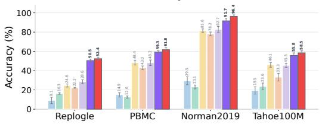

(b) Expression Delta  
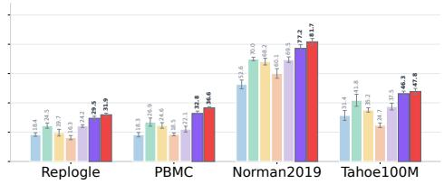  
PerturbEnergy-Lang (Ours) PerturbEnergy-Mis (Ours)

Figure 1: Perturbation classification accuracy. Existing methods show limited perturbation recognition rate both in representation and in expression.

Although these methods have demonstrated effectiveness across multiple datasets, they overlook an important issue that may substantially limit their performance. Accurate perturbation prediction depends on two key factors: (i) whether the perturbation effect is well described within the representation space, and (ii) whether the model is powerful enough to capture such perturbation effects. Existing methods mainly focus on the second factor where they develop sophisticated models and assume that such models can effectively extract perturbation effects from the latent space. However, they pay considerably less attention to the more fundamental question: how much perturbationspecific information is actually encoded in the learned representations for the model to exploit? Addressing this issue is non-trivial due to the inherent complexity of cellular systems. Gene expression is influenced by a wide range of context-dependent factors, including cell type, donor background, and culture conditions. Moreover, biological heterogeneity Altschuler & Wu (2010) further complicates the problem: even cells under identical experimental conditions may differ in their physiological states or microenvironments, resulting in substantially different expression profiles. Collectively, all these variations can overwhelm perturbation-induced signals in the representation space, making it difficult for models to distinguish true perturbation effects from spurious and nongeneralizable correlations. Although several approaches, such as stVAE Russkikh et al. (2020) and PerturbedVAE Jiang et al. (2026), claim to learn perturbation-specific representations, they remain largely heuristic: These methods typically rely on contrastive or adversarial objectives to implicitly regularize representation learning, providing only soft constraints without a theoretical guarantee that perturbation-specific signals can be well preserved. We conduct an empirical analysis examining such concern, as shown in Table 3 and Figure 1. We find that existing methods, including those specifically designed to learn perturbation representations, exhibit limited perturbation distinctiveness both in the latent space and in their predicted expression profiles. These observations motivate the central question of this work: how can we directly enrich cellular representations with perturbation-specific information to improve cellular response prediction?

In this paper, we propose a novel method named PerturbEnergy, which leverages an energy-based model to address this issue. The philosophy behind our method is that an energy function provides an effective mechanism for reshaping the distribution landscape Pang & Wu (2021); Zhou et al. (2022). Specifically, to enhance perturbation-specific information in the representation space, we explicitly formulate the latent prior in a normalized energy-based form. The energy model measures the compatibility between latent representations and perturbations, assigning lower energy (higher probability mass) to compatible pairs while assigning higher energy to others. Unlike existing methods that rely on implicit constraints, this design addresses the problem more directly by tilting the latent prior toward perturbation-preferred regions, thereby encouraging the learned representations to contain richer perturbation-specific information. Moreover, the proposed energy model can be easily integrated into autoencoder architectures. We show that the Evidence Lower Bound (ELBO) associated with the energy model can be optimized separately from the remaining architecture while remaining equivalent to the ELBO of the complete autoencoder. Our energy formulation also offers an additional computational advantage: the gradient of the normalized energy function can be derived analytically, while the samples required for optimization can be efficiently obtained through negative sampling or Langevin dynamics. Together, these properties allow the proposed energy model to be optimized independently of specific model architecture. Finally, we theoretically analyze the effectiveness of PerturbEnergy and prove that it can increase a lower bound on the mutual information between perturbations and latent representations. To validate our method, we conduct comprehensive experiments on several benchmark datasets. The results show that PerturbEnergy substantially enhances perturbation-specific information, particularly in the latent representation space, with improvements of up to 83.2%. It also consistently achieves state-of-the-art performance on top-50/100/200 differentially expressed gene (DEG) prediction and competitive performance on highly variable gene (HVG) prediction.

## 2 RELATED WORK

We summarize existing methods for cellular perturbation prediction from a representation learning perspective. Linear models Ahlmann-Eltze et al. (2024) perform regression in the expression space or on representations from foundation models such as scGPT Cui et al. (2024) to predict responses. VAE-based methods model perturbation effects in latent space. For example, scGen Lotfollahi et al. (2019) and Biolord Piran et al. (2024) represent perturbation effects as additive latent factors; SAMS-VAE Bereket & Karaletsos (2023) models perturbations using sparse latent representations. Other approaches design more advanced architectures to capture perturbation effects in the representation space. GEARS Roohani et al. (2024) learns genetic perturbation representations using Graph Neural Networks (GNNs); STATE Adduri et al. (2026) uses a Transformer to model perturbation-induced latent shifts; and diffusion or flow-based methods He et al. (2026); Yuan et al. (2026); Klein et al. (2025); Bunne et al. (2023) learn transitions between control and perturbed representations through diffusion or flow matching process. All these methods focus on learning perturbation effects from the representation space, but ignore whether the latent space contains sufficient perturbation-specific information. Although some studies claim to learn perturbation-awared representations, they remain intuitive: PerturbedVAE Jiang et al. (2026) employs a Contrastive object to disentangle perturbation representations from other factors; stVAE Russkikh et al. (2020) and CPA Lotfollahi et al. (2023) use adversarial training to promote such disentanglement. These auxiliary objectives provide only implicit constraints without a theoretical guarantee that perturbationspecific information is well preserved in the latent space.

## 3 METHOD

## 3.1 PRELIMINARY

Before introducing our method, we first formalize the basic modeling framework and then explain why perturbation-specific information is important. Cellular perturbation prediction aims to predict gene expression induced by genetic or drug perturbations and we study it from a probabilistic perspective, assuming that each response is jointly determined by the cellular context and the applied perturbation. Formally, Let $x \in \mathbb { R } ^ { G }$ denotes the gene-expression profile of a perturbed cell, $a \in { \mathcal { A } }$ denotes its perturbation, and $c \in { \mathcal { C } }$ denotes its cellular context.1 Given observations $\mathcal { D } = \{ ( x _ { i } , c _ { i } , a _ { i } ) \} _ { i = 1 } ^ { N }$ , the goal is to learn a distribution $p ( x | c , a )$ that predicts the cellular expression profile. To learn perturbation-specific effect, we decompose the latent representation into two components $\boldsymbol { z } = \left( z _ { b } , z _ { a } \right)$ , where $z _ { b }$ captures the basal cellular state that is invariant to perturbation and $z _ { a }$ captures perturbation-specific variation. The resulting joint distribution factorizes as:

$$
\begin{array} { r } { p ( x , z _ { b } , z _ { a } | c , a ) = p ( x | z _ { b } , z _ { a } ) p ( z _ { b } , z _ { a } | c , a ) , } \end{array}\tag{1}
$$

where $p ( x | z _ { b } , z _ { a } )$ is the perturbation expression distribution conditioned on latent representations and can be parameterized by a generative decoder $p _ { \theta } ( x | z _ { b } , z _ { a } )$ with parameter $\theta ; p ( z _ { b } , z _ { a } | c , a )$ is the latent prior distribution, we adopt the variational inference like prior work Jiang et al. (2026) to approximate it as:

$$
\begin{array} { r } { q _ { \phi } ( z _ { b } , z _ { a } | x _ { c t r } , c , a ) = q _ { \phi } ( z _ { b } | x _ { c t r } , c ) q _ { \phi } ( z _ { a } | x _ { c t r } , a , c ) , } \end{array}\tag{2}
$$

where $x _ { c t r }$ is the controlled (unperturbed) cell expression under the same context $c .$ To model such a joint distribution, existing approaches Jiang et al. (2026); Yuan et al. (2026); Adduri et al. (2026) either use VAE to learn perturbation-aware representations via implicit constraints or employ powerful decoders $p _ { \theta } ( x | z _ { b } , z _ { a } )$ to learn perturbation effects from the latent space. However, these methods do not directly address the concern: does the latent space contain sufficient perturbation-specific information for the model to exploit? Actually, the amount of perturbation-specific information retained in the latent space directly affects how easily the model can learn perturbation effects. More informative representations make generalizable perturbation patterns easier to identify and can therefore improve cellular response prediction. Our preliminary analysis supports this. By comparing CPA and PerturbedVAE in terms of perturbation classification accuracy and root mean square error (RMSE) on differentially expressed genes (DEGs), as shown in Table 3 and Table 2, we observe that richer perturbation-specific information is associated with better perturbation prediction performance (CPA vs PerturbedVAE; Acc: 22.2% vs. 28.6%; Top50 RMSE: 0.3462 vs. 0.2130). However, we also find existing methods still capture limited perturbation-specific information within their latent space (less than 50% Acc on Replogle, PBMC and Tahoe100M, as shown in Figure 1). These observations motivate the central question of this work: how can we explicitly enrich latent representations with perturbation-specific information to improve cellular response prediction?

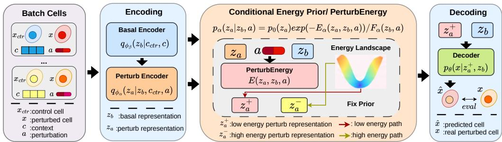  
Figure 2: Our PerturbEnergy framework. It reshapes the latent prior to perturbation preferred regions by assigning low energy to perturbation-compatible representations. Thus we can sample the representation with more perturbation-specific information for the decoder.

## 3.2 CONDITIONAL ENERGY-BASED PERTURBATION PRIOR AND ENERGY-ELBO

To address the above concern, we propose PerturbEnergy, which introduces a conditional energybased prior over the perturbation latent space. The framework is shown in Figure 2. Our design is motivated by the observation that an energy function can serve as a flexible mechanism for revising a target distribution Pang & Wu (2021); Zhou et al. (2022). Specifically, we factorize the joint latent prior in Eq. equation 1 as:

$$
\begin{array} { r } { p ( z _ { b } , z _ { a } | c , a ) = p _ { \beta } ( z _ { b } | c ) p _ { \alpha } ( z _ { a } | z _ { b } , a ) , } \end{array}\tag{3}
$$

where $p _ { \beta } ( z _ { b } | c )$ denotes the marginal prior over the basal representation, and $p _ { \alpha } ( z _ { a } | z _ { b } , a )$ denotes the conditional prior over the perturbation representation. To enrich the latent space with perturbationspecific information, we formulate $p _ { \alpha } ( z _ { a } | z _ { b } , a )$ as a conditional energy-based distribution:

$$
p _ { \alpha } ( z _ { a } | z _ { b } , a ) = p _ { 0 } ( z _ { a } ) \exp \left[ - E _ { \alpha } ( z _ { a } , z _ { b } , a ) \right] / F _ { \alpha } ( z _ { b } , a ) ,\tag{4}
$$

where $p _ { 0 } ( z _ { a } )$ denotes the prior without perturbation constraints (i.e, the prior used in existing works for perturbation space). $E _ { \alpha } ( z _ { a } , z _ { b } , a )$ is the energy-based model that revises the prior according to the perturbation: for a given basal state $z _ { b }$ and perturbation $^ { a , }$ it assigns lower energy (higher probability mass) to the perturbation representation $z _ { a }$ that are more compatible with this condition and assigns higher energy to others. Unlike existing approaches Yuan et al. (2026); Russkikh et al. (2020) that encourage perturbation-specific information through implicit constraints, our method directly modifies the latent prior of the perturbation space, explicitly tilting it toward the perturbationpreferred region. Here, $E _ { \alpha } ( z _ { a } , z _ { b } , a )$ can be implemented as a scalar-valued neural network parameterized by α. $F _ { \alpha } ( z _ { b } , a )$ is the corresponding partition function ensuring the normalization of the distribution, which is defined as:

$$
F _ { \alpha } ( z _ { b } , a ) = \int p _ { 0 } ( z _ { a } ) \exp \left( - E _ { \alpha } ( z _ { a } , z _ { b } , a ) \right) \mathrm { d } z _ { a } .\tag{5}
$$

Based on this formulation, we then consider how to optimize such a model. Our target is to fit the real perturbed cell expression distribution, formally to maximize the $l o g p _ { \Theta } ( x | c , a )$ . However, given $\begin{array} { r } { l o g \bar { p } _ { \Theta } ( x | c , a ) = l o g \bar { \int } p _ { \theta } ( x | z _ { b } , z _ { a } ) p ( z _ { b } , z _ { a } | c , a ) \bar { d z _ { b } } d z _ { a } , } \end{array}$ it has two challenges: (i) the integral over latent space is intractable, and (ii) the joint latent prior $p ( z _ { b } , z _ { a } | c , a )$ is difficult to model. Therefore we adopt the variational inference in Eq. equation 2 to estimate the energy-formed prior as:

$$
\begin{array} { r } { q _ { \phi } ( z _ { b } , z _ { a } \vert x _ { c t r } , c , a ) = q _ { \phi _ { \beta } } ( z _ { b } \vert x _ { c t r } , c ) q _ { \phi _ { \alpha } } ( z _ { a } \vert z _ { b } , x _ { c t r } , a ) , } \end{array}\tag{6}
$$

where $q _ { \phi _ { \beta } } \left( z _ { b } | \boldsymbol { x } _ { c t r } , c \right)$ is the basal state encoder estimating the marginal prior $p _ { \beta } ( z _ { b } | c )$ and $q _ { \phi _ { \alpha } } ( z _ { a } | z _ { b } , x _ { c t r } , a )$ is the perturbation encoder estimating the conditional energy prior $p _ { \alpha } ( z _ { a } | z _ { b } , a )$ This variational formulation leads to the Evidence Lower Bound (ELBO) of $l o g p _ { \Theta } ( x | c , a )$ as:

$$
\mathcal { L } _ { \mathrm { E L B O } } = \mathbb { E } _ { q _ { \phi } ( z _ { b } , z _ { a } | x _ { c t r } , c , a ) } \left[ l o g \frac { p _ { \Theta } ( x , z _ { b } , z _ { a } | c , a ) } { q _ { \phi } ( z _ { b } , z _ { a } | x _ { c t r } , c , a ) } \right]\tag{7}
$$

The optimization of the ELBO includes the complete model parameters $\{ \Theta , \phi \} = \{ \theta , \alpha , \phi _ { \beta } , \phi _ { \alpha } \}$ where θ is the parameter of generative decoder, ϕβ is the parameter of basal state encoder, $\phi _ { \beta }$ is the parameter of perturbation encoder, and α is our energy-based model parameter. We focus on the optimization corresponding to energy-based model, then we will prove that this optimization is equivalent to the optimization of entire ELBO. The Kullback-Leibler (KL) divergence between $q _ { \phi _ { \alpha } } ( z _ { a } | z _ { b } , x _ { c t r } , a )$ and $p _ { \alpha } ( z _ { a } | z _ { b } , a )$ is derived as:

$$
\begin{array} { r } { D _ { \mathrm { K L } } \left( q _ { \phi _ { \alpha } } | | p _ { \alpha } \right) = \mathbb { E } _ { q _ { \phi _ { \alpha } } } \left[ l o g q _ { \phi _ { \alpha } } ( z _ { a } | z _ { b } , x _ { c t r } , a ) - l o g p _ { 0 } ( z _ { a } ) + E _ { \alpha } ( z _ { a } , z _ { b } , a ) + \log F _ { \alpha } ( z _ { b } , a ) \right] } \\ { = D _ { \mathrm { K L } } \left( q _ { \phi _ { \alpha } } ( z _ { a } | z _ { b } , x _ { c t r } , a ) | | p _ { 0 } ( z _ { a } ) \right) + \mathbb { E } _ { q _ { \phi _ { \alpha } } } \left[ E _ { \alpha } ( z _ { a } , z _ { b } , a ) \right] + \log F _ { \alpha } ( z _ { b } , a ) . } \end{array}\tag{8}
$$

Eq. equation 8 provides an intuitive understanding of PerturbEnergy: the KL divergence is not only bounded by regularization to the conventional prior (i.e., $D _ { \mathrm { K L } } \bar { ( } q _ { \phi _ { \alpha } } ( z _ { a } | z _ { b } , x _ { c t r } , \bar { a } ) | | p _ { 0 } ( z _ { a } ) ) )$ it also considers the compatibility between the inferred perturbation representation and the condition $( z _ { b } , a )$ Since log $F _ { \alpha } ( z _ { b } , a )$ is independent of $z _ { a } ,$ optimizing Eq. equation 8 encourages $q _ { \phi _ { \alpha } } ( z _ { a } | z _ { b } , x _ { c t r } , a )$ to prefer $z _ { a }$ with more perturbation-specific information. In this paper, we term the negative $\mathbf { K L } - D _ { \mathrm { K L } } \left( q _ { \phi _ { \alpha } } \vert \vert p _ { \alpha } \right)$ in Eq. equation 8 as Energy-ELBO and its relationship with the full objective $\mathcal { L } _ { \mathrm { E L B O } }$ is formalized in Theorem 1. The detailed proof is provided in Appendix A.1.1. Theorem 1. $E n e r g y – E L B O \mathrm { ~ } - D _ { \mathrm { K L } } \left( q _ { \phi _ { \alpha } } | | p _ { \alpha } \right)$ is a part of the $l o g p _ { \Theta } ( x | c , a )$ ELBO, specifically we have:

$$
\mathcal { L } _ { \mathrm { E L B O } } = \mathbb { E } _ { q _ { \phi } } \left[ l o g p _ { \theta } ( x | z _ { b } , z _ { a } ) \right] - D _ { \mathrm { K L } } ( q _ { \phi _ { \beta } } | | p _ { \beta } ) + \mathbb { E } _ { q _ { \phi _ { \beta } } } \left[ - D _ { \mathrm { K L } } \left( q _ { \phi _ { \alpha } } | | p _ { \alpha } \right) \right] .\tag{9}
$$

Therefore, given specific $( z _ { b } , a )$ the optimization of Energy-ELBO is exactly equivalent to optimizing $\mathcal { L } _ { \mathrm { E L B O } }$ at the complete model.

## 3.3 OPTIMIZATION FOR PERTURBENERGY

Although we have derived an explicit form of the Energy-ELBO, optimizing PerturbEnergy still face a problem that the partition function $F _ { \alpha } ( z _ { b } , a )$ in Eq. equation 5 requires integration over the entire perturbation latent space and is generally intractable. Fortunately, its gradient admits a tractable form, which is described in Lemma 1. The proof is provided in Appendix A.1.2.

Lemma 1. Given the partition function is defined as Eq. equation 5, the gradient with respect to the energy parameters α is:

$$
\nabla _ { \alpha } \log F _ { \alpha } ( z _ { b } , a ) = - \mathbb { E } _ { p _ { \alpha } ( z _ { a } \mid z _ { b } , a ) } \left[ \nabla _ { \alpha } E _ { \alpha } ( z _ { a } , z _ { b } , a ) \right] .\tag{10}
$$

Therefore, the gradient of $\mathcal { L } _ { \mathrm { E L B O } }$ with respect to the energy parameters α is as follows, the derivation is given in Appendix A.1.3.

$$
\nabla _ { \alpha } \mathcal { L } _ { \mathrm { E L B O } } = \mathbb { E } _ { q _ { \phi _ { \beta } } } \left\{ - \mathbb { E } _ { q _ { \phi _ { \alpha } } } \left[ \nabla _ { \alpha } E _ { \alpha } ( z _ { a } , z _ { b } , a ) \right] + \mathbb { E } _ { p _ { \alpha } } \left[ \nabla _ { \alpha } E _ { \alpha } ( z _ { a } , z _ { b } , a ) \right] \right\} .\tag{11}
$$

Since the perturbation representation is sampled based on the fixed condition $( z _ { b } , a )$ , and our objective is to maximize the EBLO, we consider the corresponding negative gradient:

$$
\nabla _ { \alpha } \mathcal { I } _ { \mathrm { E } } ( \alpha ) = \underbrace { \mathbb { E } _ { q _ { \phi _ { \alpha } } } \left[ \nabla _ { \alpha } E _ { \alpha } ( z _ { a } , z _ { b } , a ) \right] } _ { \mathrm { p o s i t i v e ~ p h a s e } } - \underbrace { \mathbb { E } _ { p _ { \alpha } } \left[ \nabla _ { \alpha } E _ { \alpha } ( z _ { a } , z _ { b } , a ) \right] } _ { \mathrm { n e g a t i v e ~ p h a s e } } .\tag{12}
$$

This gradient is exactly the same as maximizing the Energy-ELBO in Eq. equation 8, which again shows the equivalence of optimizing the Energy-ELBO and the complete ELBO. The positive phase for this gradient is easy to calculate since positive samples can be obtained from the real cell data via $z _ { a } ^ { + } \sim q _ { \phi _ { \alpha } } ( z _ { a } | z _ { b } , x _ { c t r } , a )$ . In contrast, the negative phase requires sampling $z _ { a }$ from $p _ { \alpha } ( z _ { a } | z _ { b } , a )$ which is intractable as it involves the partition function. We provide two practical solutions. The first is based on physical function of PerturbEnergy, which assigns lower energy to compatible representations and higher energy to incompatible ones. Accordingly, we can sample the mismatched perturbation representations for the negative phase, formally via $z _ { a } ^ { - } \sim q _ { \phi _ { \alpha } } ( z _ { a } | z _ { b } , x _ { c t r } , a ^ { - } )$ where $a ^ { - }$ denotes a perturbation different from the true a. The second solution exploits an additional property of our energy-based prior: its gradient with respect to $z _ { a }$ can be calculated directly. This enables us to use Langevin dynamics to approximately sample from $p _ { \alpha } ( z _ { a } | z _ { b } , a )$ for the negative phase, which is described as follows and the algorithm can be found in Appendix A.2.1.

Langevin Sampling: Since the partition function $F _ { \alpha } ( z _ { b } , a )$ is independent of $z _ { a } .$ , the gradient of log $p _ { \alpha } ( z _ { a } | z _ { b } , a )$ with respect to $z _ { a }$ can be written as:

$$
\nabla _ { z _ { a } } \log { p _ { \alpha } ( z _ { a } | z _ { b } , a ) } = \nabla _ { z _ { a } } \log { p _ { 0 } ( z _ { a } ) } - \nabla _ { z _ { a } } E _ { \alpha } ( z _ { a } , z _ { b } , a ) ,\tag{13}
$$

We adopt the Euler-Maruyama discretized Langevin, which updates the sample as: $z _ { a } ^ { ( k + 1 ) } = z _ { a } ^ { ( k ) } +$ $\begin{array} { r } { \frac { \eta } { 2 } \nabla _ { z _ { a } } \log { p _ { \alpha } ( z _ { a } ^ { ( k ) } | z _ { b } , a ) } + \sqrt { \eta } \epsilon ^ { ( k ) } } \end{array}$ , where $z _ { a } ^ { ( k ) }$ denotes the sample at the k-th step, $\eta > 0$ is the Langevin step size, and $\epsilon ^ { ( k ) } \sim \mathcal { N } ( 0 , I )$ is the random noise term corresponding to Brownian motion. Assuming a Gaussian prior $p _ { 0 } \mathopen { } \mathclose \bgroup \left( z _ { a } \aftergroup \egroup \right)$ and combining it with Eq. equation 13, we obtain:

$$
z _ { a } ^ { ( k + 1 ) } = z _ { a } ^ { ( k ) } - \frac { \eta } { 2 } \left[ \nabla _ { z _ { a } } E _ { \alpha } ( z _ { a } ^ { ( k ) } , z _ { b } , a ) + z _ { a } ^ { ( k ) } \right] + \sqrt { \eta } \epsilon ^ { ( k ) } .\tag{14}
$$

After $K$ steps, we use $z _ { a } ^ { ( K ) }$ as the negative sample. Intuitively, the positive phase lowers the energy of latent representations inferred from real perturbation and cell observations, whereas the negative phase raises the energy of representations favored by the current model but not supported by the data. In other word, the negative phase corrects representations to which the model has incorrectly assigned low energy. Using either of the two solutions, we can obtain negative samples for optimization. Together with the positive samples, the gradient for optimizing PerturbEnergy can then be calculated via Eq. equation 12.

Optimization: We implement the optimization of the entire model, including the varitional encoder $q _ { \phi _ { \alpha } } , q _ { \phi _ { \beta } }$ , generator $p _ { \theta }$ , and the PerturbEnergy $E _ { \alpha }$ . The target is to maximize the ELBO in Eq. equation $^ { 9 , }$ , which can be derived as:

$$
\mathcal { L } _ { \mathrm { E L B O } } = \mathbb { E } _ { q _ { \phi } } \left[ l o g p _ { \theta } \right] - D _ { \mathrm { K L } } ( q _ { \phi _ { \beta } } \vert \vert p _ { \beta } ) - \mathbb { E } _ { q _ { \phi _ { \beta } } } \left[ D _ { K L } ( q _ { \phi _ { \alpha } } \vert \vert p _ { 0 } ) \right] - \mathbb { E } _ { q _ { \phi _ { \beta } } } \left[ \mathbb { E } _ { q _ { \phi _ { \alpha } } } E _ { \alpha } + l o g F _ { \alpha } \right] .\tag{15}
$$

We use Maximum Mean Discrepancy (MMD) as the surrogate to reconstruction term $\mathbb { E } _ { q _ { \phi } } \left[ l o g p _ { \theta } \right]$ For the two KL-divergence terms, we assume the Gaussian prior for p0 and $p _ { \beta }$ . The gradient of $E _ { \alpha }$ with respect to $\phi _ { \alpha }$ and $\phi _ { \beta }$ is easy to calculate since the gradient $\dot { \nabla } _ { z _ { a } / z _ { b } } \dot { E _ { \alpha } }$ is direct and such gradient can be backpropagated to $\phi _ { \alpha } / \phi _ { \beta }$ via Jacobian $\frac { \partial z _ { a } } { \partial \phi _ { \alpha } } / \frac { \partial z _ { b } } { \partial \phi _ { \beta } }$ . The last one is the gradient of $l o g F _ { \alpha }$ with respect to $\phi _ { \beta }$ . According to Lemma 1, its gradient with respect to $z _ { b }$ takes a similar form: $- \mathbb { E } _ { p _ { \alpha } } \left[ \nabla _ { z _ { b } } E _ { \alpha } \right]$ , which can be further backpropagated to $\phi _ { \beta }$ via Jacobian $\frac { \partial z _ { b } } { \partial \phi _ { \beta } }$ . Together with $\nabla _ { \alpha } \mathcal { I } _ { \mathrm { E } } ( \alpha )$ in Eq. equation 12, the whole model can be optimized as: Given batch data $( x _ { c t r } , x )$ under the same context c with perturbation $^ { a , }$ first calculate the basal representations $z _ { b }$ via $q _ { \phi _ { \beta } } .$ then generate N positive batch samples $\{ z _ { a , j } ^ { + } \} _ { j = 1 } ^ { N }$ via $q _ { \phi _ { \alpha } }$ and N negative batch samples $\{ z _ { a , j } ^ { - } \} _ { j = 1 } ^ { N }$ via Langevin or Mismatching. Thus α is updated by $\nabla _ { \alpha } \mathcal { I } _ { \mathrm { E } } ( \alpha )$ whereas $\{ \theta , \phi _ { \beta } , \phi _ { \alpha } \}$ are updated by $\{ \nabla _ { \theta } \mathcal { L } _ { \mathrm { E L B O } } , \nabla _ { \phi _ { \beta } } \mathcal { L } _ { \mathrm { E L B O } } , \nabla _ { \phi _ { \alpha } } \mathcal { L } _ { \mathrm { E L B O } } \}$ . The Algorithm is provided in Appendix A.2.2

Inference: We adopt the importance sampling in the inference stage. For unperturbed cell $( x _ { c t r } , c )$ and perturbation a: (i) calculate the basal state $z _ { b }$ via $q _ { \phi _ { \beta } } ;$ (ii) sample multiple perturbation representations $\{ z _ { a , i } \} _ { i = 0 } ^ { M }$ via $q _ { \phi _ { \alpha } } ; ( \mathrm { i i i } )$ select the $z _ { a }$ with the lowest energy $E _ { \alpha } \mathrm { ; }$ ; (vi) generate cellular response x via p based on the $z _ { b }$ and $z _ { a }$ . The algorithm is provided in Appendix A.2.3.

## 3.4 DISCUSSION

We analyze the effectiveness of PerturbEnergy in enhancing perturbation-specific information. Our theoretical finding is formalized as Theorem 2, whose proof is provided in Appendix A.1.4.

Theorem 2. Optimizing PerturbEnergy leading to the increase ofthe variational mutual information lower bound between the perturbation and the latent representation. Specifically, the relation is:

$$
I ( A ; Z _ { a } | Z _ { b } , C ) \geq H ( A | Z _ { b } , C ) + \mathbb { E } \left[ \log r _ { \alpha } ( A | Z _ { a } , Z _ { b } , C ) \right] ,\tag{16}
$$

$$
r _ { \alpha } ( a | z _ { a } , z _ { b } , c ) = \frac { \pi ( a | z _ { b } , c ) \exp ( - E _ { \alpha } ( z _ { a } , z _ { b } , a ) ) } { \sum _ { a ^ { \prime } \in \mathcal { A } } \pi ( a ^ { \prime } | z _ { b } , c ) \exp ( - E _ { \alpha } ( z _ { a } , z _ { b } , a ^ { \prime } ) ) }\tag{17}
$$

where $\pi ( a | \boldsymbol { z } _ { b } , \boldsymbol { c } )$ is the true conditional prior of perturbation, $I ( . ; . | Z _ { b } , C )$ denotes the conditional mutual information and $H ( . | Z _ { b } , C )$ is the conditional entropy.

## 4 EXPERIMENTS

## 4.1 EXPERIMENTAL SETTINGS

Baselines: We compare with following baselines: (i) Linear methods: we use Linear model on cell expression and scGPT Cui et al. (2024) representations; (ii) VAE-based methods: we use scGen Lotfollahi et al. (2019), CPA Lotfollahi et al. (2023), stVAE Russkikh et al. (2020), and Perturbed-VAE Jiang et al. (2026); iii) Other architecture: we use PerturbDiff Yuan et al. (2026), Squidiff He et al. (2026), CellFlow Klein et al. (2025) and STATE Adduri et al. (2026). The detailed settings of all these baselines are provided in Appendix A.3.2.

Datasets: We use four widely used benchmark datasets: Replogle Replogle et al. (2022), PBMC Yuan et al. (2026), Norman2019 Norman et al. (2019), and Tahoe100M Zhang et al. (2025). For a fair comparison, we follow the standardized experimental settings used in STATE Adduri et al. (2026) and VC benchmark Mao et al. (2026). For all datasets, we use top 2,000 highly variable genes (HVGs). The basic statistics of these datasets are summarized in Table 1, and detailed descriptions are provided in Appendix A.3.1.

Table 1: Data statistics. Number of cells(#Cells), perturbations(#Pert.), context(#CT.) and batches(#Batches).
<table><tr><td>Dataset</td><td>#Cells</td><td>#Pert.</td><td>#CT.</td><td>#Batches</td></tr><tr><td>Replogle</td><td>643.3K</td><td>2,023</td><td>4</td><td>56</td></tr><tr><td>PBMC</td><td>9.7M</td><td>90</td><td>18</td><td>12</td></tr><tr><td>Norman2019</td><td>111.4K</td><td>236</td><td>1</td><td>8</td></tr><tr><td>Tahoe100M</td><td>101.2M</td><td>1,137</td><td>50</td><td>14</td></tr></table>

Metrics: We evaluate all the methods from two perspectives: (i) how well a model reproduces the highly variable gene (HVG) expression (HVG group); (ii) how well a model predict the differential expression gene (DEG) expression influenced by the perturbation. (DEG group). For the HVG group, we adopt Cell-Eval Adduri et al. (2026) including: (a) correlation measures: Pearson correlation (PCC), Pearson delta correlation (PDCorr), Coefficient of Determination $( \mathbb { R } ^ { 2 } )$ , log-fold-change Spearman (LFCSpear), log-fold-change cosine (LogFC cos), direction agreement (DirAgr) and Perturbation discrimination $\mathrm { ( P D S  – } \ell _ { 1 } / \ell _ { 2 } / \mathrm { c o s ) } ;$ (b) DE measures: precison (DEPrec), recall (DERec), Jaccard index (DEOverlap), AUROC and AUPRC between the prediction and real top-50 DEGs; (c) distance measures: Root Mean Square Error (RMSE), Mean Square Error (MSE), Mean Absolute Error (MAE), Energy Distance (EDist) and Sinkhorn Divergence (Sinkhorn); For the DEG group, we calculate RMSE, MAE, PCC and $\mathrm { \dot { R } ^ { 2 } }$ over the top-50/100/200 DEGs respectively. The full definitions of all these metrics are given in Appendix A.3.3.

Implementation: PerturbEnergy is model-agnostic and and we implement it with a standard VAE backbone. Both encoders use two-layer MLPs with a latent dimension of 512, while context c and perturbation a are represented by learnable embedding tables. $E _ { \alpha } ( z _ { a } , z _ { b } , a )$ is implemented as a simple neural network: we concatenate $z _ { a }$ and $z _ { b }$ and feed it to a two-layer MLP and then output the cosine similarity score with the embedding of a. A two-layer MLP decoder predicts the expression of 2,000 HVGs from the concatenated latent representations. We train with Adam Kingma & Ba (2014) at a learning rate of $1 0 ^ { - 3 }$ , using batch sizes and maximum training steps of (256, 20,000) for Norman2019, (512, 40,000) for Replogle, (512, 60,000) for PBMC and (512, 160,000) Tahoe100M. By default, PerturbEnergy-Langevin(Lang) uses K = 20 and $\eta \ : = \ : 1 0 ^ { - 4 }$ , while PerturbEnergy-Mismatch(Mis) randomly samples embeddings from other perturbations as negatives. During inference, we set the candidate number M = 8 by default. We apply the same checkpoint selection strategy to all methods, as detailed in Appendix A.3.2.

## 4.2 EXPERIMENTAL RESULTS AND DISCUSSIONS

HVG Group. Figure 3 summarizes the performance of all methods on the HVG group, with detailed results provided in Appendix A.3.8. For correlation- and distance-based metrics, including PDCorr, LFCSpear, $\mathtt { R } ^ { 2 }$ , and EDist, PerturbEnergy generally achieves competitive performance across all four datasets, demonstrating its ability to capture overall expression patterns and distributional similarities. Moreover, our method consistently outperforms the baselines on differential expression (DE) metrics, including DEPrec, AUROC, AUPRC, and DEOverlap. This improvement highlights the ef fectiveness of explicitly modeling perturbation-specific information, which is particularly important for identifying differentially expressed genes (DEGs) associated with perturbations.

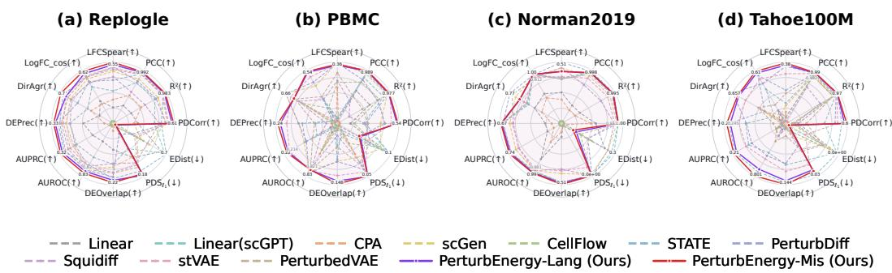  
Figure 3: Performance on parts of the HVG group metrics. ↑ / ↓ means the higher/lower is better.

DEG Group. Unlike the HVG group which evaluates general gene expression patterns, the DEG group metrics focus on predicting perturbation-specific responses. We conduct experiments for the DEG group metrics and report the RMSE results in Table 2, with the remaining metrics and corresponding analysis provided in the Appendix A.3.7. We have the following key observations: (i) Although linear methods can capture general expression patterns in the HVG group, they struggle to predict perturbation-induced changes, suggesting that simple regression models may focus on house keeping gene patterns rather than perturbation effects. (ii) CellFlow, Squidiff, and PerturbDiff model perturbation effects through diffusion or flow-matching processes, but their performance varies across datasets. For example, PerturbDiff achieves state-of-the-art performance on Norman2019 but struggles on Replogle. This variation suggests that relying primarily on model expressiveness may not consistently capture perturbation effects when they are obscured by other sources of cellular variation. Notably, STATE achieves competitive performance, potentially benefiting from batch-level self-attention that mitigates cellular heterogeneity and its large model capacity. (iii) Among representation learning-based methods, PerturbedVAE achieves better performance than other baselines, highlighting the potential benefits of explicitly modeling perturbation-specific information. (iv) Despite using a simple MLP backbone, PerturbEnergy achieves the best performance on Replogle, PBMC, and Tahoe100M and the second-best performance on Norman2019. These results demonstrate the effectiveness of our design in facilitate capturing perturbation-specific effects.

Perturbation Study. To evaluate how effectively different methods capture perturbation-specific information, we conduct an analysis using two types of inputs: (i) latent representations and (ii) expression differences between predicted perturbed cells and observed control cells. For each setting, we train a two-layer MLP classifier to predict perturbation labels. The results are reported in Table 3 and Figure 1. For latent representations, scGPT captures limited perturbation effect as it’s likely to be subtilized; STATE and PerturbDiff achieve limited classification accuracy, as their representations primarily capture basal cellular states; VAE-based methods perform better by incorporating perturbation information into the latent space. Besides, richer perturbation-specific information generally leads to better perturbation prediction performance. For example, PerturbedVAE achieves higher accuracy than CPA and outperforms CPA in Top-50/100/200 RMSE. (See Table 2). However, their accuracy remains below 50% on Replogle, PBMC, and Tahoe100M, suggesting that existing representation learning strategies may not sufficiently preserve perturbation-specific information. For expression differences, STATE achieves competitive performance, whereas PerturbDiff struggles compared with other baselines. This variation suggests that relying primarily on model may not consistently capture perturbation effects. VAE-based methods also exhibit degraded performance, potentially because cellular complexity obscures perturbation-induced changes in the expression. In contrast, PerturbEnergy achieves the best performance in both settings, with particularly substantial improvements in latent representation classification (83.2% on Replogle and 28.2% on PBMC). These results demonstrate the effectiveness of our method in enriching latent representations with perturbation-specific information.

Ablation and Other Study. We conduct ablation, hyperparameter and efficiency studies on Replogle, as shown in Figure 4. Removing the energy function consistently degrades performance, where the model reduces to a standard VAE without explicitly modeling perturbation-specific information. We then examine the effects of Langevin steps K and step size η using RMSE on the top-50 DEGs. Larger K and smaller η generally improve performance, whereas insufficient Langevin steps lead to degraded results. We also find that Mismatch generally has the same training efficiency as

Table 2: RMSE (↓) over the true top-K DEGs. Values are the mean over held-out perturbation groups ± the s.e.m. across those groups. Best in bold, second best underlined.
<table><tr><td rowspan="2">Method</td><td colspan="3">Replogle</td><td colspan="3">Tahoe100M</td></tr><tr><td>Top-50</td><td>Top-100</td><td> $\mathrm { T o p } { - } 2 0 0$ </td><td>Top-50</td><td> $\mathrm { T o p } { \cdot } 1 0 0$ </td><td>Top-200</td></tr><tr><td>Linear</td><td> $0 . 2 7 3 8 \pm 0 . 0 0 8 6$ </td><td> $0 . 2 3 9 0 { \scriptstyle \pm 0 . 0 0 7 2 }$ </td><td> $0 . 2 0 4 5 \pm 0 . 0 0 5 8$ </td><td> $0 . 4 5 3 6 \pm 0 . 0 0 7 2$ </td><td> $0 . 3 8 6 6 \pm 0 . 0 0 5 3$ </td><td> $0 . 3 0 3 2 \pm 0 . 0 0 4 0$ </td></tr><tr><td>Linear (scGPT)</td><td> $0 . 2 4 4 9 \pm 0 . 0 0 8 1$ </td><td> $0 . 2 0 8 1 \pm 0 . 0 0 6 6$ </td><td> $0 . 1 7 3 8 \pm 0 . 0 0 5 2$ </td><td> $0 . 3 7 4 8 \pm 0 . 0 0 6 0$ </td><td> $0 . 3 2 5 7 \pm 0 . 0 0 4 4$ </td><td> $0 . 2 5 8 8 \pm 0 . 0 0 3 4$ </td></tr><tr><td>CellFlow</td><td> $0 . 2 1 7 4 \pm 0 . 0 0 6 7$ </td><td> $0 . 1 8 5 0 \pm 0 . 0 0 5 5$ </td><td> $0 . 1 5 3 6 \pm 0 . 0 0 4 3$ </td><td> $0 . 3 8 6 0 \pm 0 . 0 0 6 2$ </td><td> $0 . 3 3 1 8 \pm 0 . 0 0 4 4$ </td><td> $0 . 2 6 1 7 \pm 0 . 0 0 3 4$ </td></tr><tr><td>Squidiff</td><td> $0 . 2 1 7 3 \pm 0 . 0 0 5 5$ </td><td> $0 . 1 9 0 7 \pm 0 . 0 0 4 4$ </td><td> $0 . 1 6 5 8 \pm 0 . 0 0 3 5$ </td><td> $0 . 4 1 9 2 { \scriptstyle \pm 0 . 0 0 7 1 }$ </td><td> $0 . 3 8 8 9 \pm 0 . 0 0 5 1$ </td><td> $0 . 3 2 3 1 \pm 0 . 0 0 3 9$ </td></tr><tr><td>PerturbDiff</td><td> $0 . 2 6 1 2 \pm 0 . 0 0 9 6$ </td><td> $0 . 2 1 9 8 \pm 0 . 0 0 7 9$ </td><td> $0 . 1 8 0 8 \pm 0 . 0 0 6 3$ </td><td> $0 . 3 5 5 8 \pm 0 . 0 0 7 0$ </td><td> $0 . 3 0 7 9 \pm 0 . 0 0 5 1$ </td><td> $0 . 2 4 6 2 \pm 0 . 0 0 4 0$ </td></tr><tr><td>STATE</td><td> $0 . 2 0 2 4 \pm 0 . 0 0 6 4$ </td><td> $0 . 1 7 2 7 \pm 0 . 0 0 5 2$ </td><td> $0 . 1 4 4 7 \pm 0 . 0 0 4 1$ </td><td> $0 . 3 3 5 6 \pm 0 . 0 0 4 1$ </td><td> $0 . 2 9 3 5 \pm 0 . 0 0 3 0$ </td><td> $0 . 2 3 4 2 \pm 0 . 0 0 2 3$ </td></tr><tr><td>scGen</td><td> $0 . 2 3 3 6 \pm 0 . 0 0 7 8$ </td><td> $0 . 1 9 9 2 \pm 0 . 0 0 6 5$ </td><td> $0 . 1 6 6 1 \pm 0 . 0 0 5 1$ </td><td> $0 . 4 4 6 2 \pm 0 . 0 0 8 1$ </td><td> $0 . 3 8 1 8 \pm 0 . 0 0 5 9$ </td><td> $0 . 3 0 1 8 \pm 0 . 0 0 4 6$ </td></tr><tr><td>CPA</td><td> $0 . 3 4 6 2 \pm 0 . 0 1 3 2$ </td><td> $0 . 2 9 0 5 \pm 0 . 0 1 1 0$ </td><td> $0 . 2 3 6 3 \pm 0 . 0 0 8 8$ </td><td> $0 . 7 0 7 0 { \scriptstyle \pm 0 . 0 1 0 3 }$ </td><td> $0 . 6 4 5 7 \pm 0 . 0 0 7 5$ </td><td>0.5304 ±0.0056</td></tr><tr><td>stVAE</td><td> $0 . 2 1 4 7 \pm 0 . 0 0 7 1$ </td><td> $0 . 1 7 9 5 \pm 0 . 0 0 5 7$ </td><td> $0 . 1 4 8 4 \pm 0 . 0 0 4 4$ </td><td> $0 . 3 2 9 3 \pm 0 . 0 0 5 7$ </td><td> $0 . 2 8 8 3 \pm 0 . 0 0 4 1$ </td><td>0.2315 ±0.0031</td></tr><tr><td>PerturbedVAE</td><td> $0 . 2 1 3 0 { \scriptstyle \pm 0 . 0 0 7 1 }$ </td><td> $0 . 1 8 1 7 \pm 0 . 0 0 5 8$ </td><td> $0 . 1 5 1 4 \pm 0 . 0 0 4 7$ </td><td> $0 . 3 9 8 4 \pm 0 . 0 0 7 5$ </td><td> $0 . 3 4 7 6 \pm 0 . 0 0 5 5$ </td><td> $0 . 2 7 9 1 \pm 0 . 0 0 4 2$ </td></tr><tr><td>PerturbEnergy-Lang</td><td> $\underline { { 0 . 1 8 7 0 } } \pm 0 . 0 0 6 1$ </td><td> $0 . 1 5 9 1 { \scriptstyle \pm 0 . 0 0 4 9 }$ </td><td> $0 . 1 3 3 5 { \scriptstyle \pm 0 . 0 0 3 9 }$ </td><td> $\mathbf { 0 . 3 1 1 4 } \pm 0 . 0 0 5 1$ </td><td> $\mathbf { 0 . 2 7 1 9 \bot 0 . 0 0 3 7 }$ </td><td> $\mathbf { 0 . 2 1 7 9 \pm 0 . 0 0 2 9 }$ </td></tr><tr><td>PerturbEnergy-Mis</td><td>0.1780 ±0.0057</td><td> $\mathbf { 0 . 1 5 2 2 } \pm 0 . 0 0 4 6$ </td><td>0.1285±0.0036</td><td> $0 . 3 1 2 3 \pm 0 . 0 0 5 1$ </td><td> $0 . 2 7 2 3 \pm 0 . 0 0 3 7$ </td><td>0.2179±0.0029</td></tr></table>

<table><tr><td rowspan="2">Method</td><td colspan="3">PBMC</td><td colspan="3">Norman2019</td></tr><tr><td>Top-50</td><td>Top-100</td><td>Top-200</td><td>Top-50</td><td>Top-100</td><td>Top-200</td></tr><tr><td>Linear</td><td> $0 . 1 0 6 5 \pm 0 . 0 0 4 6$ </td><td> $0 . 0 9 0 1 \pm 0 . 0 0 3 7$ </td><td>0.0740 ±0.0029</td><td> $0 . 4 1 0 5 \pm 0 . 0 2 6 4$ </td><td> $0 . 3 1 3 6 \pm 0 . 0 2 0 8$ </td><td> $0 . 2 3 1 3 \pm 0 . 0 1 5 5$ </td></tr><tr><td>Linear (scGPT)</td><td> $0 . 0 9 7 9 \pm 0 . 0 0 4 5$ </td><td> $0 . 0 8 1 6 \pm 0 . 0 0 3 6$ </td><td>0.0656±0.0029</td><td> $0 . 2 8 1 0 \pm 0 . 0 0 9 0$ </td><td> $0 . 2 4 2 2 \pm 0 . 0 0 7 3$ </td><td> $0 . 1 8 3 7 \pm 0 . 0 0 5 5$ </td></tr><tr><td>CellFlow</td><td> $0 . 0 8 2 1 \pm 0 . 0 0 2 4$ </td><td> $0 . 0 6 7 8 \pm 0 . 0 0 1 9$ </td><td> $0 . 0 5 4 1 \pm 0 . 0 0 1 5$ </td><td> $0 . 1 6 0 3 \pm 0 . 0 1 4 5$ </td><td> $0 . 1 2 9 2 \pm 0 . 0 1 1 8$ </td><td> $0 . 1 0 0 7 \pm 0 . 0 0 8 9$ </td></tr><tr><td>Squidiff</td><td> $0 . 1 2 7 1 \pm 0 . 0 0 5 1$ </td><td> $0 . 1 1 0 6 \pm 0 . 0 0 4 2$ </td><td> $0 . 0 9 3 1 \pm 0 . 0 0 3 3$ </td><td> $0 . 2 0 4 1 \pm 0 . 0 1 0 6$ </td><td> $0 . 1 7 4 3 \pm 0 . 0 0 8 4$ </td><td> $0 . 1 4 4 7 \pm 0 . 0 0 6 8$ </td></tr><tr><td>PerturbDiff</td><td> $0 . 0 8 2 9 \pm 0 . 0 0 3 1$ </td><td> $0 . 0 7 1 8 \pm 0 . 0 0 2 5$ </td><td> $0 . 0 6 0 2 \pm 0 . 0 0 2 0$ </td><td> ${ \bf 0 . 1 2 4 8 \pm 0 . 0 0 8 8 }$ </td><td> $\mathbf { 0 . 1 0 3 5 \pm 0 . 0 0 6 7 }$ </td><td> $\mathbf { 0 . 0 8 3 6 \pm 0 . 0 0 5 1 }$ </td></tr><tr><td>STATE</td><td> $0 . 0 9 3 5 \pm 0 . 0 0 3 3$ </td><td> $0 . 0 7 7 4 \pm 0 . 0 0 2 7$ </td><td> $0 . 0 6 1 9 \pm 0 . 0 0 2 2$ </td><td> $0 . 1 4 3 1 \pm 0 . 0 1 1 7$ </td><td> $0 . 1 1 6 8 \pm 0 . 0 0 9 1$ </td><td> $0 . 0 9 2 2 \pm 0 . 0 0 6 5$ </td></tr><tr><td>scGen</td><td> $0 . 0 9 6 0 \pm 0 . 0 0 4 9$ </td><td> $0 . 0 7 8 7 \pm 0 . 0 0 4 0$ </td><td> $0 . 0 6 2 5 \pm 0 . 0 0 3 1$ </td><td> $0 . 1 7 2 9 \pm 0 . 0 1 0 2$ </td><td> $0 . 1 4 0 4 \pm 0 . 0 0 8 2$ </td><td> $0 . 1 1 0 8 \pm 0 . 0 0 6 5$ </td></tr><tr><td>CPA</td><td> $0 . 1 5 8 1 \pm 0 . 0 0 6 9$ </td><td> $0 . 1 3 1 7 \pm 0 . 0 0 5 4$ </td><td> $0 . 1 0 6 2 \pm 0 . 0 0 4 1$ </td><td> $0 . 4 4 1 9 \pm 0 . 0 2 8 2$ </td><td> $0 . 3 3 7 0 \pm 0 . 0 2 1 9$ </td><td> $0 . 2 4 7 7 \pm 0 . 0 1 6 2$ </td></tr><tr><td>stVAE</td><td> $0 . 0 7 2 9 \pm 0 . 0 0 2 2$ </td><td> $0 . 0 6 1 3 \pm 0 . 0 0 1 8$ </td><td> $0 . 0 5 0 0 { \scriptstyle \pm 0 . 0 0 1 4 }$ </td><td> $0 . 2 1 1 0 \pm 0 . 0 1 4 6$ </td><td> $0 . 1 6 5 6 \pm 0 . 0 1 1 4$ </td><td> $0 . 1 2 6 0 \pm 0 . 0 0 8 4$ </td></tr><tr><td>PerturbedVAE</td><td> $0 . 1 0 7 1 \pm 0 . 0 0 3 2$ </td><td> $0 . 0 9 2 5 \pm 0 . 0 0 2 5$ </td><td> $0 . 0 7 7 7 { \scriptstyle \pm 0 . 0 0 2 0 }$ </td><td> $0 . 1 4 0 0 \pm 0 . 0 1 2 3$ </td><td> $0 . 1 1 8 6 \pm 0 . 0 1 0 0$ </td><td> $0 . 0 9 5 3 \pm 0 . 0 0 7 5$ </td></tr><tr><td>PerturbEnergy-Lang</td><td> $\mathbf { 0 . 0 6 3 7 \pm 0 . 0 0 2 0 }$ </td><td> $\mathbf { 0 . 0 5 4 2 } \pm 0 . 0 0 1 6$ </td><td> $\mathbf { 0 . 0 4 4 8 \pm } 0 . 0 0 1 3$ </td><td> $0 . 1 4 3 4 \pm 0 . 0 1 1 3$ </td><td> $0 . 1 1 7 6 \pm 0 . 0 0 8 6$ </td><td></td></tr><tr><td>PerturbEnergy-Mis</td><td> $0 . 0 6 5 4 \pm 0 . 0 0 2 0$ </td><td> $0 . 0 5 5 7 { \scriptstyle \pm 0 . 0 0 1 6 }$ </td><td> $\underline { { 0 . 0 4 6 2 } } \pm 0 . 0 0 1 3$ </td><td> $0 . 1 3 7 6 { \pm } 0 . 0 1 1 0$ </td><td> $\underline { { 0 . 1 1 3 5 } } \pm 0 . 0 0 8 3$ </td><td> $\begin{array} { c } { 0 . 0 9 2 7 \pm 0 . 0 0 6 2 } \\ { 0 . 0 8 9 8 \pm 0 . 0 0 6 1 } \end{array}$ </td></tr></table>

Table 3: Perturbation classification accuracy. Best in bold, second best underlined.
<table><tr><td rowspan="3">Method</td><td colspan="4">Latent Representation</td><td colspan="4">Expression Delta</td></tr><tr><td>Replogle</td><td>PBMC</td><td>Norman2019</td><td> $\mathrm { T a h o e l 0 0 M }$ </td><td>Replogle</td><td>PBMC</td><td>Norman2019</td><td>Tahoe100M</td></tr><tr><td>scGPT</td><td>18.5±1.1</td><td> $3 3 . 1 \pm 1 . 0$ </td><td> $7 4 . 4 \pm 2 . 9$ </td><td> $3 8 . 2 \pm 1 . 9$ </td><td>21.5±2.5</td><td> $2 4 . 8 { \pm } 1 . 4 $ </td><td> $7 3 . 1 \pm 2 . 7$ </td><td>39.9±2.3</td></tr><tr><td>PerturbDiff</td><td> $9 . 1 \pm 3 . 3$ </td><td> $1 4 . 9 { \pm } 2 . 3 $ </td><td> $2 9 . 5 { \pm } 4 . 1 $ </td><td> $1 9 . 5 { \pm } 3 . 8 $ </td><td> $1 8 . 4 \pm 1 . 2$ </td><td> $1 8 . 3 { \pm } 1 . 5 $ </td><td> $5 2 . 6 \pm 3 . 0 $ </td><td>31.4±3.4</td></tr><tr><td>STATE</td><td> $1 6 . 3 { \pm } 0 . 9 \ $ </td><td> $1 2 . 6 { \pm } 1 . 1 $ </td><td> $2 3 . 1 \pm 2 . 0$ </td><td> $2 3 . 6 \pm 3 . 6$ </td><td> $2 4 . 5 { \pm } 1 . 8 $ </td><td> $2 6 . 9 { \pm } 2 . 8 $ </td><td> $7 0 . 0 { \pm } 1 . 2 $ </td><td>41.8±4.1</td></tr><tr><td>scGen</td><td> $2 4 . 6 { \pm } 1 . 6 $ </td><td> $4 8 . 4 \pm 2 . 5$ </td><td> $8 1 . 6 \pm 1 . 7$ </td><td> $4 6 . 1 \pm 2 . 5$ </td><td> $1 9 . 7 \pm 2 . 3$ </td><td> $2 4 . 6 { \pm } 1 . 9 $ </td><td> $6 8 . 2 \pm 2 . 3$ </td><td>35.2±1.5</td></tr><tr><td>CPA</td><td> $2 2 . 2 { \pm } 0 . 4 $ </td><td> $4 3 . 0 { \pm } 1 . 9 $ </td><td> $7 8 . 2 \pm 1 . 9$ </td><td> $3 3 . 3 { \pm } 4 . 0 $ </td><td> $1 6 . 3 { \pm } 1 . 4 $ </td><td> $1 8 . 5 { \pm } 1 . 0 \ $ </td><td> $6 0 . 1 \pm 3 . 3$ </td><td>24.7±1.6</td></tr><tr><td>PerturbedVAE</td><td> $2 8 . 6 \pm 2 . 0$ </td><td> $4 8 . 2 \pm 2 . 9$ </td><td> $8 2 . 7 \pm 3 . 2 $ </td><td> $4 5 . 5 { \pm 2 . 1 }$ </td><td> $2 4 . 2 \pm 0 . 9$ </td><td> $2 2 . 1 \pm 2 . 0$ </td><td> $6 9 . 5 \pm 1 . 9$ </td><td>37.5±2.3</td></tr><tr><td>PerturbEnergy-Lang</td><td> ${ \underline { { 5 0 . 5 \pm 1 . 5 } } }$ </td><td> ${ \underline { { 5 9 . 3 \pm 1 . 5 } } }$ </td><td> $\underline { { 9 1 . 7 \pm 2 . 8 } }$ </td><td>55.8±2.7</td><td> ${ 2 9 . 5 \pm 1 . 4 }$ </td><td></td><td>77.2±2.5</td><td>46.3±1.7</td></tr><tr><td>PerturbEnergy-Mis</td><td> $\overline { { 5 2 . 4 \pm 1 . 2 } }$ </td><td> $\overline { { { \bf 6 1 . 8 \pm 2 . 0 } } }$ </td><td> $\overline { { 9 6 . 4 \pm 1 . 5 } }$ </td><td>58.5±2.2</td><td>31.9±1.1</td><td> $\frac { 3 2 . 8 \pm 1 . 6 } { 3 6 . 6 \pm 0 . 8 }$ </td><td>81.7±2.3</td><td>47.8±2.1</td></tr></table>

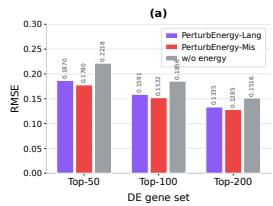

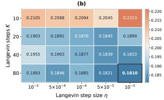

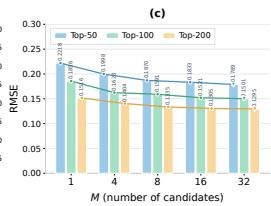

(d)  
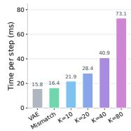  
Figure 4: Ablation and other study on Replogle. (a) is the ablation; (b) is the hyperparameter study about Langevin steps/size; (c) is the influence of candidate number M. (d) is the training efficiency.

VAE (16.4 vs 15.6 ms/step) while Langevin with larger K significantly decreases the training speed. As a balance, we set $K = 2 0$ and $\eta = 1 0 ^ { - 4 }$ by default, which generally make the sample region with a flat gradient. Finally, we examine the effect of the candidate number M during inference. Performance deteriorates with too few candidates $( M \leq 4 )$ , while increasing M to 16 or 32 yields only marginal improvements. We therefore set $M = 8$ as a balance.

Other Discussion. Due to space limitations, we provide an analysis of the training scale/model dimension in the Appendix A.3.5. We also demonstrate the compatibility of PerturbEnergy with different VAE backbones in Appendix A.3.4. The visualizations are provided in Appendix A.3.6.

## 5 CONCLUSION

In this paper, we introduce PerturbEnergy, a framework designed to enhance perturbation-specific information for cellular perturbation prediction. PerturbEnergy uses an energy function to reshape the latent prior, directing it toward perturbation preferred regions. We theoretically demonstrate that PerturbEnergy increases the mutual information between the representations and perturbations. Extensive experiments on four datasets validate its effectiveness.

## 6 AI USE STATEMENT

In this work, we used generative AI tools only for polishing the paper writing, including fixing grammar mistakes, making expressions more easy to understand. We have not used generative AI tools for developing our research idea and experiments. The applicable and not applicable details are as follows:

Applicable AI usage for this work: (i) Grammar, spelling mistake finding and fixing; (ii) Expression and writing polishing, AI is used to paraphrase some of my sentences to make it clear and easy to understand, while exactly keeping the main content of the original sentences. (iii) Give suggestions on the paper formatting, including the position of our experimental Tables, Figures.

Not Applicable AI usage for this work: We do not use AI for our research idea developing, including: (i) AI is not used for reviewing related works; (ii) AI is not used for developing methodology and theory of this work; (iii) AI is not used for collecting experimental data; (iv) AI is not used for implementing our method codes;

## 7 ETHICS STATEMENT

Our work is focused on AI-based prediction of biological cellular perturbation response, aiming to enhance the accuracy of cell prediction for common perturbations. This work is the application of the universal AI methodology in the context of cellular prediction, aiming to solve the practical problems in this scenario. The content of this research work does not involve any ethical issues, there is no risk data release, no harmful content, and no conflicts of interest. However, it should be noted that this method is used to improve the computational prediction accuracy of cell perturbations. Therefore, this work needs to be properly applied and should not be used to assist in harmful biomedical research.

## 8 REPRODUCIBILITY STATEMENT

We declare that all the work presented in this paper is reproducible. Firstly, in terms of methodology, we have provided rigorous theoretical proofs for each theorem/lemma. Secondly, in terms of the software code, we have made the relevant code of our work public via anonymous link. Furthermore, we adopt the publicly available datasets, data processing methods, and evaluation metrics. This means that the experimental and theoretical results of this work can all be reproduced.

## REFERENCES

Abhinav K Adduri, Dhruv Gautam, Beatrice Bevilacqua, Mohsen Naghipourfar, Alishba Imran, Rohan Shah, Noam Teyssier, Rishi Verma, Christopher Carpenter, Basak Eraslan, et al. Predicting cellular responses to perturbation across diverse contexts with state. Cell, 2026.

Constantin Ahlmann-Eltze, Wolfgang Huber, and Simon Anders. Deep learning-based predictions of gene perturbation effects do not yet outperform simple linear baselines. BioRxiv, pp. 2024–09, 2024.

Steven J Altschuler and Lani F Wu. Cellular heterogeneity: do differences make a difference? Cell, 141(4):559–563, 2010.

Michael Bereket and Theofanis Karaletsos. Modelling cellular perturbations with the sparse additive mechanism shift variational autoencoder. Advances in Neural Information Processing Systems, 36:1–12, 2023.

Charlotte Bunne, Stefan G Stark, Gabriele Gut, Jacobo Sarabia Del Castillo, Mitch Levesque, Kjong-Van Lehmann, Lucas Pelkmans, Andreas Krause, and Gunnar Ratsch. Learning single-¨ cell perturbation responses using neural optimal transport. Nature methods, 20(11):1759–1768, 2023.

Charlotte Bunne, Yusuf Roohani, Yanay Rosen, Ankit Gupta, Xikun Zhang, Marcel Roed, Theo Alexandrov, Mohammed AlQuraishi, Patricia Brennan, Daniel B Burkhardt, et al. How to build the virtual cell with artificial intelligence: Priorities and opportunities. Cell, 187(25):7045–7063, 2024.

Haotian Cui, Chloe Wang, Hassaan Maan, Kuan Pang, Fengning Luo, Nan Duan, and Bo Wang. scgpt: toward building a foundation model for single-cell multi-omics using generative ai. Nature methods, 21(8):1470–1480, 2024.

Atray Dixit, Oren Parnas, Biyu Li, Jenny Chen, Charles P Fulco, Livnat Jerby-Arnon, Nemanja D Marjanovic, Danielle Dionne, Tyler Burks, Raktima Raychowdhury, et al. Perturb-seq: dissecting molecular circuits with scalable single-cell rna profiling of pooled genetic screens. cell, 167(7): 1853–1866, 2016.

Luke A Gilbert, Matthew H Larson, Leonardo Morsut, Zairan Liu, Gloria A Brar, Sandra E Torres, Noam Stern-Ginossar, Onn Brandman, Evan H Whitehead, Jennifer A Doudna, et al. Crisprmediated modular rna-guided regulation of transcription in eukaryotes. Cell, 154(2):442–451, 2013.

Luke A Gilbert, Max A Horlbeck, Britt Adamson, Jacqueline E Villalta, Yuwen Chen, Evan H Whitehead, Carla Guimaraes, Barbara Panning, Hidde L Ploegh, Michael C Bassik, et al. Genome-scale crispr-mediated control of gene repression and activation. Cell, 159(3):647–661, 2014.

Minsheng Hao, Jing Gong, Xin Zeng, Chiming Liu, Yucheng Guo, Xingyi Cheng, Taifeng Wang, Jianzhu Ma, Xuegong Zhang, and Le Song. Large-scale foundation model on single-cell transcriptomics. Nature methods, 21(8):1481–1491, 2024.

Siyu He, Yuefei Zhu, Daniel Naveed Tavakol, Haotian Ye, Yeh-Hsing Lao, Zixian Zhu, Cong Xu, Shradha Chauhan, Guy Garty, Raju Tomer, et al. Squidiff: predicting cellular development and responses to perturbations using a diffusion model. Nature methods, 23(1):65–77, 2026.

Wenkang Jiang, Yuhang Liu, Yichao Cai, Erdun Gao, Jiayi Dong, Ehsan Abbasnejad, Lina Yao, and Javen Qinfeng Shi. What makes a representation good for single-cell perturbation prediction? arXiv preprint arXiv:2605.19343, 2026.

Martin Jinek, Krzysztof Chylinski, Ines Fonfara, Michael Hauer, Jennifer A Doudna, and Emmanuelle Charpentier. A programmable dual-rna–guided dna endonuclease in adaptive bacterial immunity. science, 337(6096):816–821, 2012.

Diederik P Kingma and Jimmy Ba. Adam: A method for stochastic optimization. arXiv preprint arXiv:1412.6980, 2014.

Dominik Klein, Jonas Simon Fleck, Daniil Bobrovskiy, Lea Zimmermann, Soren Becker, Alessan-¨ dro Palma, Leander Dony, Alejandro Tejada-Lapuerta, Guillaume Huguet, Hsiu-Chuan Lin, et al. Cellflow enables generative single-cell phenotype modeling with flow matching. bioRxiv, pp. 2025–04, 2025.

Mohammad Lotfollahi, F Alexander Wolf, and Fabian J Theis. scgen predicts single-cell perturbation responses. Nature methods, 16(8):715–721, 2019.

Mohammad Lotfollahi, Anna Klimovskaia Susmelj, Carlo De Donno, Leon Hetzel, Yuge Ji, Ignacio L Ibarra, Sanjay R Srivatsan, Mohsen Naghipourfar, Riza M Daza, Beth Martin, et al. Predicting cellular responses to complex perturbations in high-throughput screens. Molecular systems biology, 19(6):MSB202211517, 2023.

Xinjie Mao, Songming Zhang, Qianhong Wen, Xiangyu Wen, Kedu Jin, Hao Wu, Shuizhou Chen, Yuqiang Li, Lei Bai, Qi Liu, et al. Benchmarking virtual cell models for in-the-wild perturbation response. arXiv preprint arXiv:2604.27646, 2026.

Ajay Nadig, Joseph M Replogle, Angela N Pogson, Mukundh Murthy, Steven A McCarroll, Jonathan S Weissman, Elise B Robinson, and Luke J O’Connor. Transcriptome-wide analysis of differential expression in perturbation atlases. Nature Genetics, 57(5):1228–1237, 2025.

Thomas M Norman, Max A Horlbeck, Joseph M Replogle, Alex Y Ge, Albert Xu, Marco Jost, Luke A Gilbert, and Jonathan S Weissman. Exploring genetic interaction manifolds constructed from rich single-cell phenotypes. Science, 365(6455):786–793, 2019.

Bo Pang and Ying Nian Wu. Latent space energy-based model of symbol-vector coupling for text generation and classification. In International Conference on Machine Learning, pp. 8359–8370. PMLR, 2021.

Zoe Piran, Niv Cohen, Yedid Hoshen, and Mor Nitzan. Disentanglement of single-cell data with biolord. Nature Biotechnology, 42(11):1678–1683, 2024.

CZI Cell Science Program, Shibla Abdulla, Brian Aevermann, Pedro Assis, Seve Badajoz, Sidney M Bell, Emanuele Bezzi, Batuhan Cakir, Jim Chaffer, Signe Chambers, et al. Cz cellxgene discover: a single-cell data platform for scalable exploration, analysis and modeling of aggregated data. Nucleic acids research, 53(D1):D886–D900, 2025.

Joseph M Replogle, Thomas M Norman, Albert Xu, Jeffrey A Hussmann, Jin Chen, J Zachery Cogan, Elliott J Meer, Jessica M Terry, Daniel P Riordan, Niranjan Srinivas, et al. Combinatorial single-cell crispr screens by direct guide rna capture and targeted sequencing. Nature biotechnology, 38(8):954–961, 2020.

Joseph M Replogle, Reuben A Saunders, Angela N Pogson, Jeffrey A Hussmann, Alexander Lenail, Alina Guna, Lauren Mascibroda, Eric J Wagner, Karen Adelman, Gila Lithwick-Yanai, et al. Mapping information-rich genotype-phenotype landscapes with genome-scale perturb-seq. Cell, 185(14):2559–2575, 2022.

Diana C Resasco, Fei Gao, Frank Morgan, Igor L Novak, James C Schaff, and Boris M Slepchenko. Virtual cell: computational tools for modeling in cell biology. Wiley Interdisciplinary Reviews: Systems Biology and Medicine, 4(2):129–140, 2012.

Yusuf Roohani, Kexin Huang, and Jure Leskovec. Predicting transcriptional outcomes of novel multigene perturbations with gears. Nature biotechnology, 42(6):927–935, 2024.

Nikolai Russkikh, Denis Antonets, Dmitry Shtokalo, Alexander Makarov, Yuri Vyatkin, Alexey Zakharov, and Evgeny Terentyev. Style transfer with variational autoencoders is a promising approach to rna-seq data harmonization and analysis. Bioinformatics, 36(20):5076–5085, 2020.

Gefei Wang, Tianyu Liu, Jia Zhao, Youshu Cheng, and Hongyu Zhao. Modeling and predicting single-cell multi-gene perturbation responses with sclambda. bioRxiv, 2024.

F Alexander Wolf, Philipp Angerer, and Fabian J Theis. Scanpy: large-scale single-cell gene expression data analysis. Genome biology, 19(1):15, 2018.

Xinyu Yuan, Xixian Liu, Ya Shi Zhang, Zuobai Zhang, Hongyu Guo, and Jian Tang. Perturbdiff: Functional diffusion for single-cell perturbation modeling. arXiv preprint arXiv:2602.19685, 2026.

Jesse Zhang, Airol A Ubas, Richard De Borja, Valentine Svensson, Nicole Thomas, Neha Thakar, Ian Lai, Aidan Winters, Umair Khan, Matthew G Jones, et al. Tahoe-100m: A giga-scale singlecell perturbation atlas for context-dependent gene function and cellular modeling. BioRxiv, pp. 2025–02, 2025.

Xiao Zhou, Yong Lin, Renjie Pi, Weizhong Zhang, Renzhe Xu, Peng Cui, and Tong Zhang. Model agnostic sample reweighting for out-of-distribution learning. In International conference on machine learning, pp. 27203–27221. PMLR, 2022.

## A APPENDIX

A.1 Theoretical supports . 14   
A.1.1 Proof of Theorem 1: Equivalence of the Energy-ELBO 14   
A.1.2 Proof of Lemma 1: Gradient of the partition function 15   
A.1.3 Derivation of the gradient to energy parameters 15   
A.1.4 Proof of Theorem 2: Conditional Mutual-Information Lower Bound 16   
A.2 Algorithm Description 16   
A.2.1 Langevin Sampling Algorithm 16   
A.2.2 Optimization Algorithm 16   
A.2.3 Inference Algorithm 17   
A.3 Experimental Appendix 17   
A.3.1 Dataset Descriptions and Settings 17   
A.3.2 Baseline Settings 19   
A.3.3 Metrics 21   
A.3.4 Other VAE Backbone Integration 23   
A.3.5 Influence of Training Scale and Model Dimension 24   
A.3.6 Visualization 25   
A.3.7 Other Metrics on DEG Group 25   
A.3.8 Results on HVG Group 25

## A.1 THEORETICAL SUPPORTS

## A.1.1 PROOF OF THEOREM 1: EQUIVALENCE OF THE ENERGY-ELBO

Here we give a formal proof to the Theorem 1 as follows:

Proof. We begin from with the ELBO of $l o g p _ { \Theta } ( x | c , a )$ which can be derived as:

$$
\begin{array} { r l } & { \mathcal { L } _ { \mathrm { E L B O } } = \mathbb { E } _ { q _ { \phi } ( z _ { b } , z _ { a } | x _ { c t r } , c , a ) } \Big [ \log p _ { \theta } \big ( x | z _ { b } , z _ { a } \big ) + \log p \big ( z _ { b } , z _ { a } | c , a \big ) - l o g q _ { \phi } \big ( z _ { b } , z _ { a } \big | x _ { c t r } , c , a \big ) \Big ] } \\ & { \qquad = \mathbb { E } _ { q _ { \phi } } \left[ \log p _ { \theta } \big ( x \big | z _ { b } , z _ { a } \big ) \right] - D _ { K L } \big ( q _ { \phi } \big ( z _ { b } , z _ { a } \big | x _ { c t r } , c , a \big ) \big | | p ( z _ { b } , z _ { a } | c , a ) \big ) . } \end{array}\tag{18}
$$

According to our joint prior assumption in Eq. equation 3 and the variational inference formation in Eq. equation $^ { 6 , }$ we have:

$$
\begin{array} { r } { p ( z _ { b } , z _ { a } | c , a ) = p _ { \beta } ( z _ { b } | c ) p _ { \alpha } ( z _ { a } | z _ { b } , a ) , } \end{array}\tag{19}
$$

and:

$$
q _ { \phi } ( z _ { b } , z _ { a } | x _ { c t r } , c , a ) = q _ { \phi _ { \beta } } ( z _ { b } | x _ { c t r } , c ) q _ { \phi _ { \alpha } } ( z _ { a } | z _ { b } , x _ { c t r } , a ) .\tag{20}
$$

Besides, according to the chain rule of Kullback-Leibler (KL) divergence, where:

$$
D _ { K L } ( P ( X , Y ) | | Q ( X , Y ) ) = D _ { K L } ( P ( X ) | | Q ( X ) ) + D _ { K L } ( P ( Y | X ) | | Q ( Y | X ) ) .\tag{21}
$$

The $\mathcal { L } _ { \mathrm { E L B O } }$ then becomes:

$$
\begin{array} { r l } & { \mathcal { L } _ { \mathrm { E L B O } } = \mathbb { E } _ { q _ { \phi } } \left[ \log p _ { \theta } ( x | z _ { b } , z _ { a } ) \right] } \\ & { \phantom { \mathcal { L } } + \mathbb { E } _ { q _ { \phi _ { \beta } } } \left[ \log p _ { \beta } ( z _ { b } | c ) - \log q _ { \phi _ { \beta } } ( z _ { b } | x _ { c t r } , c ) \right] } \\ & { \phantom { \mathcal { L } } + \mathbb { E } _ { q _ { \phi _ { \beta } } } \left\{ \mathbb { E } _ { q _ { \phi _ { \alpha } } } \left[ \log p _ { \alpha } ( z _ { a } | z _ { b } , a ) - \log q _ { \phi _ { \alpha } } ( z _ { a } | z _ { b } , x _ { c t r } , a ) \right] \right\} . } \end{array}\tag{22}
$$

The second term $\mathbb { E } _ { q _ { \phi _ { \beta } } } \left[ \log p _ { \beta } ( z _ { b } | c ) - \log q _ { \phi _ { \beta } } ( z _ { b } | x _ { c t r } , c ) \right]$ is:

$$
- D _ { \mathrm { K L } } \left( q _ { \phi _ { \beta } } | | p _ { \beta } \right) .\tag{23}
$$

For the $\mathbb { E } _ { q _ { \phi _ { \alpha } } } \left[ \log p _ { \alpha } ( z _ { a } | z _ { b } , a ) - \log q _ { \phi _ { \alpha } } ( z _ { a } | z _ { b } , x _ { c t r } , a ) \right]$ in the third term, it actually is:

$$
- D _ { \mathrm { K L } } \left( q _ { \phi _ { \alpha } } | | p _ { \alpha } \right) .\tag{24}
$$

Thus, the complete ELBO is:

$$
\mathcal { L } _ { \mathrm { E L B O } } = \mathbb { E } _ { q _ { \phi } } \left[ l o g p _ { \theta } ( x | z _ { b } , z _ { a } ) \right] - D _ { \mathrm { K L } } ( q _ { \phi _ { \beta } } | | p _ { \beta } ) + \mathbb { E } _ { q _ { \phi _ { \beta } } } \left[ - D _ { \mathrm { K L } } \left( q _ { \phi _ { \alpha } } | | p _ { \alpha } \right) \right] .\tag{25}
$$

Until now, we have the proved the formation in Theorem 1.

In addition, given the definition of our conditional EBM prior in Eq. 4, the complete ELBO can be further derived as:

$$
\begin{array} { r l } & { \mathcal { L } _ { \mathrm { E L B O } } = \mathbb { E } _ { q _ { \phi } } \left[ l o g p _ { \theta } ( x | z _ { b } , z _ { a } ) \right] - D _ { \mathrm { K L } } ( q _ { \phi _ { \beta } } | | p _ { \beta } ) } \\ & { \qquad - \mathbb { E } _ { q _ { \phi _ { \beta } } } \left\{ \mathbb { E } _ { q _ { \phi _ { \alpha } } } \left[ \log q _ { \phi _ { \alpha } } ( z _ { a } | z _ { b } , x _ { c t r } , a ) - \log p _ { 0 } ( z _ { a } ) + E _ { \alpha } ( z _ { a } , z _ { b } , a ) + \log F _ { \alpha } ( z _ { b } , a ) \right] \right\} . } \end{array}\tag{26}
$$

Since log $F _ { \alpha } ( z _ { b } , a )$ is independent of $z _ { a }$ for fixed $( z _ { b } , a )$ , thus:

$$
\begin{array} { r l } & { \mathcal { L } _ { \mathrm { E L B O } } = \mathbb { E } _ { q _ { \phi } } \left[ l o g p _ { \theta } ( x | z _ { b } , z _ { a } ) \right] - D _ { \mathrm { K L } } ( q _ { \phi _ { \beta } } | | p _ { \beta } ) } \\ & { \qquad - \mathbb { E } _ { q _ { \phi _ { \beta } } } \left\{ D _ { \mathrm { K L } } \left( q _ { \phi _ { \alpha } } ( z _ { a } | z _ { b } , x _ { c t r } , a ) | | p _ { 0 } ( z _ { a } ) \right) + \mathbb { E } _ { q _ { \phi _ { \alpha } } } \left[ E _ { \alpha } ( z _ { a } , z _ { b } , a ) \right] + \log F _ { \alpha } ( z _ { b } , a ) \right\} , } \end{array}\tag{27}
$$

which gives the exact form as Energy-ELBO described in Eq. equation 8. Therefore, we fully prove Theorem 1. □

## A.1.2 PROOF OF LEMMA 1: GRADIENT OF THE PARTITION FUNCTION

Here we give a proof to Lemma 1 as follows:

Proof.

$$
\nabla _ { \alpha } \log F _ { \alpha } ( z _ { b } , a ) = \frac { 1 } { F _ { \alpha } ( z _ { b } , a ) } \nabla _ { \alpha } F _ { \alpha } ( z _ { b } , a )\tag{28}
$$

According to the definition in Eq. equation 5, the partition function is:

$$
F _ { \alpha } ( z _ { b } , a ) = \int p _ { 0 } ( z _ { a } ) \exp \left( - E _ { \alpha } ( z _ { a } , z _ { b } , a ) \right) \mathrm { d } z _ { a } .\tag{29}
$$

Thus, we have:

$$
\begin{array} { l } { \displaystyle \nabla _ { \alpha } \log F _ { \alpha } ( z _ { b } , a ) = \frac { 1 } { F _ { \alpha } ( z _ { b } , a ) } \nabla _ { \alpha } \int p _ { 0 } ( z _ { a } ) \exp \left( - E _ { \alpha } ( z _ { a } , z _ { b } , a ) \right) \mathrm { d } z _ { a } } \\ { \displaystyle = \frac { 1 } { F _ { \alpha } ( z _ { b } , a ) } \int p _ { 0 } ( z _ { a } ) \nabla _ { \alpha } \exp \left( - E _ { \alpha } ( z _ { a } , z _ { b } , a ) \right) \mathrm { d } z _ { a } } \\ { \displaystyle = \frac { 1 } { F _ { \alpha } ( z _ { b } , a ) } \int p _ { 0 } ( z _ { a } ) \exp \left( - E _ { \alpha } ( z _ { a } , z _ { b } , a ) \right) [ - \nabla _ { \alpha } E _ { \alpha } ( z _ { a } , z _ { b } , a ) ] \mathrm { d } z _ { a } } \\ { \displaystyle = \int \frac { p _ { 0 } ( z _ { a } ) \exp \left( - E _ { \alpha } ( z _ { a } , z _ { b } , a ) \right) } { F _ { \alpha } ( z _ { b } , a ) } [ - \nabla _ { \alpha } E _ { \alpha } ( z _ { a } , z _ { b } , a ) ] \mathrm { d } z _ { a } . } \end{array}\tag{30}
$$

According to the our conditional energy form described in Eq. equation 4, which is:

$$
p _ { \alpha } ( z _ { a } | z _ { b } , a ) = \frac { p _ { 0 } ( z _ { a } ) \exp \left[ - E _ { \alpha } ( z _ { a } , z _ { b } , a ) \right] } { F _ { \alpha } ( z _ { b } , a ) } .\tag{31}
$$

Therefore, we have:

$$
\begin{array} { c } { { \nabla _ { \alpha } \log { F _ { \alpha } ( z _ { b } , a ) } = \displaystyle \int p _ { \alpha } ( z _ { a } | z _ { b } , a ) [ - \nabla _ { \alpha } E _ { \alpha } ( z _ { a } , z _ { b } , a ) ] \mathrm { d } z _ { a } } } \\ { { = - \mathbb { E } _ { p _ { \alpha } ( z _ { a } | z _ { b } , a ) } \left[ \nabla _ { \alpha } E _ { \alpha } ( z _ { a } , z _ { b } , a ) \right] . } } \end{array}\tag{32}
$$

Therefore, we finish the proof of Lemma 1.

## A.1.3 DERIVATION OF THE GRADIENT TO ENERGY PARAMETERS

Here we derive the gradient of the entire ELBO corresponding to energy parameters.

Proof. According to the formation of log $p _ { \Theta } ( x | c , a )$ ELBO described in Eq. equation $^ { 9 , }$ we have:

$$
\begin{array} { r l } & { \nabla _ { \alpha } \mathcal { L } _ { \mathrm { E L B O } } = \nabla _ { \alpha } \mathbb { E } _ { q _ { \phi } } \left[ l o g p _ { \theta } ( x | z _ { b } , z _ { a } ) \right] - \nabla _ { \alpha } D _ { \mathrm { K L } } \big ( q _ { \phi _ { \beta } } | | p _ { \beta } \big ) + \nabla _ { \alpha } \mathbb { E } _ { q _ { \phi _ { \beta } } } \left[ - D _ { \mathrm { K L } } \left( q _ { \phi _ { \alpha } } | | p _ { \alpha } \right) \right] } \\ & { \qquad = \mathbb { E } _ { q _ { \phi _ { \beta } } } \left[ - \nabla _ { \alpha } D _ { \mathrm { K L } } \left( q _ { \phi _ { \alpha } } | | p _ { \alpha } \right) \right] . } \end{array}\tag{33}
$$

According to the Energy-ELBO definition in Eq. equation 8, we then have:

$$
\begin{array} { r l } & { \nabla _ { \alpha } \mathcal { L } _ { \mathrm { E L B O } } = \mathbb { E } _ { q _ { \phi _ { \theta } } } \left[ - \nabla _ { \alpha } D _ { \mathrm { K L } } \left( q _ { \phi _ { \alpha } } | | p _ { \alpha } \right) \right] } \\ & { \qquad = \mathbb { E } _ { q _ { \phi _ { \theta } } } \left\{ - \nabla _ { \alpha } D _ { \mathrm { K L } } \left( q _ { \phi _ { \alpha } } \left( z _ { a } | z _ { b } , x _ { c t r } , a \right) | | p _ { 0 } ( z _ { a } ) \right) - \mathbb { E } _ { q _ { \phi _ { \alpha } } } \left[ \nabla _ { \alpha } E _ { \alpha } ( z _ { a } , z _ { b } , a ) \right] - \nabla _ { \alpha } \log F _ { \alpha } ( z _ { b } , a ) \right\} . } \end{array}\tag{34}
$$

Since $D _ { \mathrm { K L } } \left( q _ { \phi _ { \alpha } } ( z _ { a } | z _ { b } , x _ { c t r } , a ) | | p _ { 0 } ( z _ { a } ) \right)$ is unrelated to $\alpha ,$ together with Lemma 1, where:

$$
\nabla _ { \alpha } \log F _ { \alpha } ( z _ { b } , a ) = - \mathbb { E } _ { p _ { \alpha } ( z _ { a } \mid z _ { b } , a ) } \left[ \nabla _ { \alpha } E _ { \alpha } ( z _ { a } , z _ { b } , a ) \right] ,\tag{35}
$$

we have:

$$
\nabla _ { \alpha } \mathcal { L } _ { \mathrm { E L B O } } = \mathbb { E } _ { q _ { \phi _ { \delta } } } \left\{ - \mathbb { E } _ { q _ { \phi _ { \alpha } } } \left[ \nabla _ { \alpha } E _ { \alpha } ( z _ { a } , z _ { b } , a ) \right] + \mathbb { E } _ { p _ { \alpha } } \left[ \nabla _ { \alpha } E _ { \alpha } ( z _ { a } , z _ { b } , a ) \right] \right\} .\tag{36}
$$

Therefore, we finish the derivation of the gradient corresponding to energy parameters α.

## A.1.4 PROOF OF THEOREM 2: CONDITIONAL MUTUAL-INFORMATION LOWER BOUND Here we give a proof to Theorem 2 as follows:

Proof. According to our definition of conditional energy-based prior in Eq. equation 4, we have:

$$
p _ { \alpha } ( z _ { a } | z _ { b } , a ) \propto p _ { 0 } ( z _ { a } ) \exp \left[ - E _ { \alpha } ( z _ { a } , z _ { b } , a ) \right] .\tag{37}
$$

We denote the real perturbation prior as: $\pi ( a | z _ { b } , c )$ , according to Bayes rule, we obtain:

$$
p _ { \alpha } ( a | z _ { a } , z _ { b } ) \propto \pi ( a | z _ { b } , c ) p _ { \alpha } ( z _ { a } | z _ { b } , a ) .\tag{38}
$$

Combining Eq. equation 37 and Eq. equation 38, and eliminating $p _ { 0 } ( z _ { a } )$ , we obtain:

$$
r _ { \alpha } ( a | z _ { a } , z _ { b } , c ) = \frac { \pi ( a | z _ { b } , c ) \exp ( - E _ { \alpha } ( z _ { a } , z _ { b } , a ) ) } { \sum _ { a ^ { \prime } \in \mathcal { A } } \pi ( a ^ { \prime } | z _ { b } , c ) \exp ( - E _ { \alpha } ( z _ { a } , z _ { b } , a ^ { \prime } ) ) } .\tag{39}
$$

From the perspective of mutual information, we consider conditional mutual information $I ( A ; Z _ { a } | Z _ { b } , \bar { C } )$ , having:

$$
I ( A ; Z _ { a } | Z _ { b } , C ) = H ( A | Z _ { b } , C ) - H ( A | Z _ { a } , Z _ { b } , C ) ,\tag{40}
$$

where $H ( . | Z _ { b } , C )$ and $H ( . | Z _ { a } , Z _ { b } , C )$ denote the conditional entropy. According to the definition of entropy, we have:

$$
- H ( A | Z _ { a } , Z _ { b } , C ) = \mathbb { E } \left[ l o g p ( a | z _ { a } , z _ { b } , c ) \right] ,\tag{41}
$$

where $p ( a | z _ { a } , z _ { b } , c )$ is the real perturbation posterior distribution. Therefore we have:

$$
\begin{array} { r } { I ( A ; Z _ { a } | Z _ { b } , C ) = H ( A | Z _ { b } , C ) + \mathbb { E } \left[ l o g p ( a | z _ { a } , z _ { b } , c ) \right] . } \end{array}\tag{42}
$$

We use $r _ { \alpha } ( a | z _ { a } , z _ { b } , c )$ to approximate $p ( a | z _ { a } , z _ { b } , c )$ , and because the property of KL-divergence that $D _ { K L } ( p | | q ) \geq 0$ , we have:

$$
D _ { K L } ( p ( a | z _ { a } , z _ { b } , c ) | | r _ { \alpha } ( a | z _ { a } , z _ { b } , c ) ) \geq 0 ,\tag{43}
$$

Therefore, we obtain:

$$
I ( A ; Z _ { a } | Z _ { b } , C ) \geq H ( A | Z _ { b } , C ) + \mathbb { E } \left[ \log r _ { \alpha } ( A | Z _ { a } , Z _ { b } , C ) \right] ,\tag{44}
$$

where the equality holds when $r _ { \alpha } ( a | z _ { a } , z _ { b } , c )$ correctly approximates the real distribution $p ( a | z _ { a } , z _ { b } , c )$

Thus, we have proved the formation of Theorem 2.

Next, we will talk about the relationship between the energy optimization and the conditional mutual information.

According to our optimization realized in Subsection 3.3, the energy function $E _ { \alpha } ( z _ { a } , z _ { b } , a )$ assigns lower energy (higher probability mass) to the compatible perturbation representations and higher energy to incompatible ones (i.e., For the definition of $r _ { \alpha } ( a | z _ { a } , z _ { b } , c )$ in Eq. equation $3 9 , E _ { \alpha } ( z _ { a } , z _ { b } , a )$ becomes lower while $E _ { \alpha } ( z _ { a } , z _ { b } , a ^ { \prime } )$ becomes higher). Therefore, the optimization of energy function leads to the increase of $\mathbb { E } \left[ \log r _ { \alpha } ( A | Z _ { a } , Z _ { b } ^ { - } , C ) \right]$ ], which means Optimizing PerturbEnergy leading to the increase of the conditional mutual information lower bound between the pertur bation and the latent representation.

Until now, We have fully proved Theorem 2.

## A.2 ALGORITHM DESCRIPTION

## A.2.1 LANGEVIN SAMPLING ALGORITHM

We provide the Langevin sampling in Algorithm 1.

## A.2.2 OPTIMIZATION ALGORITHM

We provide the optimization process in Algorithm 2

Algorithm 1 Langevin Sampling   
Require: Cellular expression $x _ { c t r } ,$ basal cellular representation $z _ { b } .$ , perturbation $^ { a , }$ energy function   
$E _ { \alpha } ( z _ { a } , z _ { b } , a )$ , initial model $q _ { \phi _ { \alpha } } ( z _ { a } | z _ { b } , x _ { c t r } , a )$ , Langevin steps $\bar { K }$ , step size $\eta$   
Ensure: Negative sample $z _ { a } ^ { - }$   
1: Initialize $z _ { a } ^ { ( 0 ) } \sim q _ { \phi _ { \alpha } } ( z _ { a } | z _ { b } , x _ { c t r } , a )$   
2: for $k = 0 , 1 , \ldots , \bar { K } - 1$ do   
3: Sample Gaussian noise ${ \bar { \boldsymbol { \epsilon } } } ^ { ( k ) } \sim \mathcal { N } ( 0 , I )$   
4: Update $z _ { a } ^ { ( k ) }$ via Langevin dynamics:   
$z _ { a } ^ { ( k + 1 ) } = z _ { a } ^ { ( k ) } - \eta \nabla _ { z _ { a } } E _ { \alpha } \left( z _ { a } ^ { ( k ) } , z _ { b } , a \right) + \sqrt { 2 \eta } \epsilon ^ { ( k ) }$   
5: end for   
6: Set $\stackrel { \scriptscriptstyle \mathrm { \ : \ : \sum } } { z _ { a } ^ { - } } = z _ { a } ^ { ( K ) }$   
7: return $z _ { a } ^ { - }$

Algorithm 2 Optimization Algorithm   
Require: Batch cell data $( x _ { c t r } , x )$ under the same context c with perturbation $^ { a , }$ model parameters   
$\{ \theta , \alpha , \phi _ { \beta } , \phi _ { \alpha } \}$ , sample size $N .$ , α learning rate $\zeta$ , and $\{ \theta , \phi _ { \beta } , \bar { \phi } _ { \alpha } \}$ learning rate $\xi$   
Ensure: Updated model parameters $\{ \theta , \alpha , \bar { \phi _ { \beta } } , \phi _ { \alpha } \}$   
1: Sample batch basal representations $z _ { b }$ from $\dot { q _ { \phi _ { \beta } } } ( z _ { b } | x _ { c t r } , c )$   
2: Generate N positive batch samples $\{ z _ { a , i } ^ { + } \} _ { i = 1 } ^ { N }$ via $q _ { \phi _ { \alpha } } ( z _ { a } | z _ { b } , x , a )$   
3: Generate $N$ negative batch samples $\{ z _ { a , i } ^ { - } \} _ { i = 1 } ^ { N }$ via Langevin sampling in Algorithm 1 or via   
$q _ { \phi _ { \alpha } } ( z _ { a } | z _ { b } , x _ { c t r } , a ^ { - } )$ with random other $a ^ { - }$   
4: Calculating $\nabla _ { \alpha } \mathcal { J } _ { \mathrm { E } } ( \alpha )$ via Eq. equation 12   
5: Calculating $\{ \nabla _ { \theta } { \mathcal { L } }$ ELBO, $\nabla _ { \phi _ { \beta } } \hat { \mathcal { L } } _ { \mathrm { E L B O } } , \nabla _ { \phi _ { \alpha } } \mathcal { L } _ { \mathrm { E L B O } } \}$ via Eq. equation 15   
6: Update α via: $\alpha  \alpha - \zeta \nabla _ { \alpha } { \mathcal { T } } _ { \mathrm { E } } ( \alpha )$   
7: Update $\{ \theta , \phi _ { \beta } , \phi _ { \alpha } \}$ via: $\dot { \theta } / \phi _ { \beta } / \dot { \phi _ { \alpha } } \stackrel { . } {  } \theta / \phi _ { \beta } / \phi _ { \alpha } + \xi \nabla _ { \theta / \phi _ { \beta } / \phi _ { c } }$ LELBO

Algorithm 3 Inference Algorithm   
Require: Unperturbed cell $( x _ { c t r } , c )$ , perturbation $^ { a , }$ model parameters $\{ \theta , \alpha , \phi _ { \beta } , \phi _ { \alpha } \}$ , number of   
samples $\dot { M }$   
Ensure: Predicted cellular response x   
1: Sample basal representation $z _ { b }$ from $q _ { \phi _ { \beta } } ( z _ { b } | \boldsymbol { x } _ { c t r } , c )$   
2: Sample M perturbation representations $\{ z _ { a , i } \} _ { i = 1 } ^ { M }$ from $q _ { \phi _ { \alpha } } ( z _ { a } | z _ { b } , a )$   
3: Compute energy scores $\{ E _ { \alpha } ( z _ { a , i } , z _ { b } , a ) \} _ { i = 1 } ^ { M }$   
4: Select $\begin{array} { r } { z _ { a } ^ { * } = \arg \operatorname* { m i n } _ { z _ { a , i } } E _ { \alpha } ( z _ { a , i } , z _ { b } , a ) } \end{array}$   
5: Generate predicted cellular response x from $p _ { \theta } ( x | z _ { b } , z _ { a } ^ { * } )$   
6: return $x$

We evaluate on four widely used single-cell perturbation benchmarks that together span signaling, chemical and genetic interventions: Replogle Replogle et al. (2022), PBMC Yuan et al. (2026), Norman2019 Norman et al. (2019) and Tahoe100M Zhang et al. (2025). Following PerturbDiff Yuan et al. (2026), STATE Adduri et al. (2026) and VC Benchmark Mao et al. (2026), we adopt the same data sources, preprocessing pipeline and held-out splits. Summary statistics are given in Table. 4.

Table 4: (a) Perturbation datasets. Statistics include counts of perturbed cell across train/valid/test splits and counts of control cells, total gene vocabulary size and HVGs, and dataset diversity in terms of perturbations, cell types, and experimental batches.
<table><tr><td rowspan="2">Dataset</td><td rowspan="2">Perturbation Type</td><td colspan="3">#Perturbed Cells</td><td rowspan="2">#Control Cells</td><td rowspan="2">#Genes</td><td rowspan="2">#HVGs</td><td rowspan="2">#Perturbations</td><td rowspan="2">#Cell Types</td><td rowspan="2">#Batches</td></tr><tr><td>Train</td><td>Valid</td><td>Test</td></tr><tr><td>Replogle</td><td>gene</td><td>572,545</td><td>4,825</td><td>26,878</td><td>39,165</td><td>6,642</td><td>2,000</td><td>2,023</td><td>4</td><td>56</td></tr><tr><td>PBMC</td><td>cytokine</td><td>6,657,336</td><td>150,484</td><td>2,260,453</td><td>629,701</td><td>62,710</td><td>2,000</td><td>90</td><td>18</td><td>12</td></tr><tr><td>Norman</td><td>gene</td><td>85,568</td><td>1,754</td><td>12,268</td><td>11,855</td><td>33,694</td><td>2,000</td><td>236</td><td>1</td><td>8</td></tr><tr><td>Tahoe100M</td><td>drug</td><td>89,495,239</td><td>553,076</td><td>8,790,272</td><td>2,330,156</td><td>40,352</td><td>2,000</td><td>1,137</td><td>50</td><td>14</td></tr></table>

Replogle (genetic perturbation). The Replogle dataset Replogle et al. (2022) is a landmark resource for studying single-cell genetic perturbation effects. It integrates multiple pooled CRISPR interference (CRISPRi) Gilbert et al. (2013); Nadig et al. (2025) experiments across four human cell lines: K562, RPE1, Jurkat and HepG2. It systematically repressing thousands of essential genes while measuring transcriptome-wide responses. Because the targeted genes are essential, a single knockdown often induces broad transcriptional changes that affect hundreds of downstream genes.

PBMC (cytokine signaling). The PBMC dataset Yuan et al. (2026) is a large-scale signaling perturbation atlas of peripheral blood mononuclear cells. It profiles approximately 10 million human cells collected from 12 healthy donors, covering 18 immune cell types and 90 distinct cytokine treatments alongside a PBS control condition. After quality control, about 9.7 million cells are retained, with a mean sequencing depth of roughly 31,000 reads per cell. Many cytokines elicit strong transcriptional responses, typically upregulating more than 50 genes, which makes this dataset a representative testbed for studying perturbation-induced shifts at the population level.

Tahoe100M (drug perturbation). Tahoe100M (Zhang et al., 2025) is the largest single-cell perturbation atlas released to date. It comprises over 100 million single-cell expression profiles measured across 50 human cancer cell lines exposed to more than 1,100 combinations of small-molecule drug and dosage. The atlas adopts a multiplexed cell-village design during sequencing, which substantially reduces batch effects and yields high data quality. Its scale and the breadth of its cellular contexts make it a demanding benchmark for context-dependent drug response prediction.

Norman2019 (combinatorial genetic perturbation). The Norman2019 dataset Norman et al. (2019) is a Perturb-seq screen of combinatorial CRISPR activation (CRISPRa) in K562 cells. Its value lies not in the diversity of cellular contexts but in the structure of its perturbation space: it comprises 105 single-gene activations and 131 two-gene combinations, and both constituent genes of every combination are also activated individually elsewhere in the screen. This makes it the standard benchmark for combinatorial generalization, meaning predicting the transcriptional outcome of a gene pair from the effects of its individual members. Such predictions are far from trivial, because gene pairs frequently interact non-additively: two genes whose individual effects are mild may act synergistically, and a naive additive model that simply sums their single-gene effects fails to recover the resulting phenotype. We use the filtered version of the dataset as VC Benchmark Mao et al. (2026), which contains 111,445 cells.

Preprocessing. We apply the same preprocessing pipeline as PerturbDiff Yuan et al. (2026), STATE Adduri et al. (2026) and VC Benchmark Mao et al. (2026). For PBMC and Tahoe100M, raw counts are first normalized per cell to a fixed library size(104), followed by a log1p transformation to rescale the gene expression values into range [0, 1). For Replogle, we directly adopt the processed data released by STATE Adduri et al. (2026), which first filters cells and perturbations by on-target knockdown efficacy to improve the signal-to-noise ratio of perturbation effects, and then applies the same library-size normalization and log transformation. After normalization, we follow standard practice Wolf et al. (2018) and select the top 2,000 highly variable genes (HVGs) for each dataset from its original transcriptome vocabulary using scanpy.pp.highly variable genes. Excluding low-variance genes improves the signal-to-noise ratio without sacrificing biological fidelity, and all models are trained and evaluated in this 2,000-dimensional HVG space. Norman2019 is distributed as raw counts and no curated gene panel is available for it, so we apply the same normalization pipeline and then select the top 2,000 HVGs from its 33,694-gene vocabulary.

Train/validation/test splits. For Replogle, PBMC and Tahoe100M, we follow the hold-out protocol of PerturbDiff Yuan et al. (2026) and STATE Adduri et al. (2026), which measures generalization to unseen cellular contexts. For each dataset, a subset of contexts is held out for testing, and 30% of the perturbations measured in those held-out contexts are moved back into the training set. This partial-coverage design ensures that every perturbation is observed somewhere during training, so that the test set isolates adaptation to a new cellular context rather than extrapolation to an unknown perturbation label. Concretely:

• PBMC. Four of the twelve donors are reserved for testing. 30% of the perturbations from these held-out donors are moved into training, leaving the remaining 70% for testing. Note that the model conditions on cell type (18 categories), while the hold-out is taken over donors; at test time the control cells are therefore drawn from the held-out donors themselves.

• Tahoe100M. PCA is first performed on the pseudobulk expression profiles of the 50 cell lines to identify distinct phenotypic clusters, from which five cell lines are selected as the held-out test set, again with 30% of their perturbations returned to training.

• Replogle. One cell line (HepG2) is held out for testing, and the model is trained on the remaining three cell lines together with 30% of the perturbations randomly sampled from HepG2.

Norman2019 contains a single cell line, so holding out a cellular context is degenerate. We therefore split over the perturbations themselves, following the VC benchmark Mao et al. (2026): 30% of the two-gene combinations (39 of 131) are held out as the test set, while all 105 single-gene perturbations remain in training. This is the “0 of 2 unseen” generalization setting. Each held-out combination is never observed during training, yet both of its constituent genes have been perturbed individually, which isolates the ability to compose known single-gene effects into an unseen combination, rather than confounding it with extrapolation to genes for which no perturbation data exist at all. It is also what keeps the held-out combinations representable by our model: we embed a perturbation as the sum of the embeddings of its target genes, so an unseen pair is encoded from the two single-gene rows that training has already fitted. A per-label lookup table, by contrast, would have no entry for such a pair and could not make a prediction at all.

Control cells remain in the training pool under all three protocols: they are the unperturbed reference population that the model is given at inference time, and they are therefore counted separately from the train/validation/test splits. Finally, we hold out 2% of the training cells uniformly at random as a validation set. This set is used only for checkpoint selection; all reported results come from the held-out contexts in the test split.

## A.3.2 BASELINE SETTINGS

## Baseline models

Linear methods. The linear baseline Ahlmann-Eltze et al. (2024) predicts a perturbed cell as the control cell plus the mean expression shift of that perturbation measured on the training split, ${ \hat { x } } =$ $x _ { c t r l } + \Delta _ { a } ,$ with the shift $\Delta _ { a }$ taken against the controls of the contexts in which the perturbation was observed. Despite its simplicity, this predictor is a strong baseline on average-expression metrics and serves as the linear reference point of the comparison. scGPT (Cui et al., 2024) replaces the raw expression profile with a pretrained cell representation: we use the released ${ \tt S C G P T }$ human checkpoint (12 layers, $d _ { \mathrm { m o d e l } } { = } \mathrm { 5 1 2 } .$ , 8 heads, 51.9M parameters, pretrained on 33M cells), keep it frozen in evaluation mode, and train only a lightweight head on top, $\hat { x } = x _ { \mathrm { c t r l } } + \mathrm { M L P } ( [ u - z ] )$ where z is the ${ \mathrm { < c l s > } }$ embedding of the control cell and u the perturbation embedding. Cells are tokenised exactly as during scGPT’s pretraining: gene symbols mapped through its 60,697-entry vocabulary, nonzero genes only, per-cell quantile binning into 51 bins, and a prepended ${ \mathrm { < c l s > } }$ token. The head’s output layer is zero-initialised, so training starts from “predict no change”. This row answers a narrower question than the others: whether a representation pretrained on external data already encodes how a cell responds to a perturbation.

VAE-based methods. All the VAE-based methods are implemented via their official codes. sc-Gen Lotfollahi et al. (2019) trains an unconditional VAE on all cells. After training, the perturbation vector $\Delta _ { a } = \mathrm { m e a n } \{ z _ { a } \} - \mathrm { m e a n } \{ z _ { c t r } \}$ is measured on the training split, where $z _ { a }$ is the representation of perturbed cells and $z _ { c t r }$ is the representations of controlled cells. And prediction is $\bar { \boldsymbol { x } } = \mathrm { D e c } ( \mathrm { E n c } ( \boldsymbol { x } _ { \mathrm { c t r l } } ) + \Delta _ { a } )$ . CPA (Lotfollahi et al., 2023) decomposes a cell into a basal state plus additive perturbation and covariate embeddings, $z = \mathrm { E n c } ( x ) + u _ { a } + u _ { c }$ , and enforces the decomposition with adversarial discriminators trained to disentangle the perturbation and the covariates of the basal latent. Prediction swaps the perturbation embedding to the corresponding one. stVAE (Russkikh et al., 2020) is a style-transfer VAE: expression is decoupled into a perturbationindependent content latent and a perturbation-specific style vector, and prediction decodes the sum of the control cell’s content and the target perturbation’s style. PerturbedVAE (Jiang et al., 2026) splits the latent into a perturbation-invariant part $z _ { i }$ and a perturbation-responsive part $z _ { v } .$ , and makes the split persist with a contrastive term that anchors $z _ { i }$ to the corresponding control cell. The prediction mechanism is a learned conditional prior $p ( z _ { v } \mid z _ { i } , u )$ , which supplies the response at inference time. As their official implementation suggests, CPA, stVAE, and PerturbedVAE are trained on observed cells and scGen is trained unconditionally. For a fair comparison, we adopt their official VAE architecture but unify the latent embedding size the same as ours: 512.

Diffusion-based methods. PerturbDiff (Yuan et al., 2026) follows its official implementation, it runs a denoising diffusion process over the cell population rather than over individual cells. The denoiser is an MM-DiT stack (4 blocks, 8 heads, latent dimension is setted as 512) with joint attention over the control and perturbed token streams, a single shared timestep noises the whole population so that the diffused object remains a distribution, and the denoising objective is the MMD between the denoised and the real population. Inference uses 50 DDIM steps as it general leads to excellent performance. Squidiff (He et al., 2026) runs a conditional DDIM in a VAE semantic latent (dimension of z is adjusted to 512 as other models) with an MLP denoiser and sinusoidal timestep embeddings, and decodes the sampled latent. Its autoencoder is warmed-up trained alone for the first 4,000 steps, after which the encoder is frozen so that the latent diffusion trains against a fixed target.

Flow-based methods. CellFlow Klein et al. (2025) learns a conditional velocity field that transports the control population to the perturbed one. Training pairs the two minibatches by exact minibatch optimal transport under a squared-Euclidean cost, interpolates $x _ { t } = ( 1 - t ) x _ { 0 } + t x _ { 1 }$ with $t \sim \mathcal { U } ( 0 , 1 )$ and regresses $v _ { \theta } ( x _ { t } , t , \mathrm { c o n d } )$ onto $x _ { 1 } - x _ { 0 }$ , where the conditioning combines the perturbation and context embeddings with the pooled control population. Inference integrates the field from t=0 to t=1 with a Heun solver in 50 steps.

Transformer-based method. STATE Adduri et al. (2026) is a bidirectional transformer over sets of cells, where the perturbation embedding is added to every token and the model predicts the transition from each control cell. We reproduce the State Embedding (SE), State Transition (ST), and adapt the embedding size to 512, where SE uses ESM2 embedding and project into 512 dimension. For Replogle, PBMC and Tahoe100M, we use the the same training dataset for SE: CellxGene Program et al. (2025) with the same reconstruction target. The learning rate is set as $1 \times 1 0 ^ { - 5 }$ , weight decay is set as 0.01, batch size is set as 128 and epoch number is 12. As for Norman2019, SE is pretrained on its training set with the same training settings but 5 epochs.

## Training settings

All the baselines follow the same data preprocess and split(train/validation/test) settings as described in Appendix A.3.1. We use the same condition sampler and random seed for all the methods: A batch is n blocks of set size cells, where each block pairs control cells of a context with real perturbed cells of one (context, perturbation) condition. Every model therefore sees the same 512 cells per step (256 on Norman2019). As for the maximum training step budget, we set 20,000 steps on Norman2019, 40,000 on Replogle, 60,000 on PBMC and 160,000 on Tahoe100M for all the methods. All models are optimised with Adam (weight decay: $1 0 ^ { - 6 } )$ under their own best learning rate. The loss function and corresponding settings of each baseline follows its official suggestion. A cosine learning-rate decay is used for PerturbDiff, Squidiff, CellFlow and STATE, and a constant rate otherwise. For the two diffusion baselines and CellFlow we additionally keep an exponential moving average (EMA) of the weights (decay 0.999) and validate, checkpoint and evaluate that average, since EMA is part of how diffusion and flow-matching models are trained in practice and their reported sample quality is not what the raw iterate gives. Model-specific settings are listed in Table. 5.

## Validation and checkpoint selection

Table 5: Model-specific training settings. All other settings including batch shape, step budget, optimiser family, gradient clipping, checkpoint selection and evaluation are shared across models and identical to those used for PerturbEnergy.
<table><tr><td>Model</td><td>Family</td><td>LR</td><td>EMA</td><td>Model-specific settings</td></tr><tr><td>Linear scGPT</td><td>linear</td><td></td><td></td><td>closed form; no gradient training</td></tr><tr><td></td><td>foundation</td><td> $1 \times 1 0 ^ { - 3 }$ </td><td></td><td>encoder frozen; head  $5 1 2 + 5 1 2  1 0 2 4  G$ </td></tr><tr><td>scGen</td><td>VAE</td><td> $1 \times 1 0 ^ { - 3 }$ </td><td></td><td>z = 512, hidden 800×2, no conditioning</td></tr><tr><td>CPA</td><td>VAE</td><td> $1 \times 1 0 ^ { - 3 }$ </td><td></td><td>z = 512, adv. weight 50, 3 adversary steps</td></tr><tr><td>stVAE</td><td>VAE</td><td> $1 \times 1 0 ^ { - 3 }$ </td><td></td><td>z = 512, latent loss 1.0, VAE loss 0.1</td></tr><tr><td>PerturbedVAE</td><td>VAE</td><td> $1 \times 1 0 ^ { - 3 }$ </td><td></td><td> $z _ { i } = z _ { v } = 5 1 2$  , contrastive weight 1.0</td></tr><tr><td>PerturbDiff</td><td>diffusion</td><td> $3 \times 1 0 ^ { - 4 }$ </td><td>0.999</td><td>z = 512, 4 MM-DiT blocks, 8 heads,  $T = 1 0 0 0$ </td></tr><tr><td>Squidiff</td><td>diffusion</td><td> $1 \times 1 0 ^ { - 3 }$ </td><td>0.999</td><td>z = 512, T = 1000, 4k-step AE warm-up</td></tr><tr><td>CellFlow</td><td>flow matching</td><td> $1 \times 1 0 ^ { - 3 }$ </td><td>0.999</td><td>Solver 50 steps, depth 4, OT coupling</td></tr><tr><td>STATE</td><td>transformer</td><td> $3 \times 1 0 ^ { - 4 }$ </td><td></td><td> $z = 5 1 2$  , depth 4, 8 heads, set size 128</td></tr></table>

Validation is identical for every baseline model and PerturbEnergy. Every 2,500 steps we validate on the validation batches where the score is the Mean Squared Error (MSE) of the predicted perturbation mean against the real one. The checkpoint with the lowest validation score is the one evaluated on the test split; for models with EMA, the averaged weights are the ones both validated and saved.

## A.3.3 METRICS

## Metric Definitions

Preliminary Notation for Metrics Description. A condition $\lambda = \left( c , a \right)$ pairs a cellular context c with a perturbation a; the test split contains M such conditions, and each metric below is computed per condition and then averaged over the M of them. For condition λ, we note $X ^ { \lambda } \in \mathbb { R } ^ { N \times G }$ for the real perturbed cells, $\widetilde { X } ^ { \lambda } \in \mathbb { R } ^ { n \times G }$ for the control cells of the same context $c ,$ and $\hat { X } ^ { \lambda } \in \mathbb { R } ^ { n \times G }$ for the model’s perturbation prediction, over G = 2,000 highly variable genes indexed by $g \in \{ 1 , \ldots , G \}$ A subscript i on a matrix denotes its i-th row, i.e. a single cell in $\mathbf { \overline { { \mathbb { R } } } } ^ { G }$ . Inference maps control cells to perturbed ones, so the prediction contains the same number of cells as the control population, n. Pseudobulk profiles are the column means, which are vectors in $\mathbb { R } ^ { G }$

$$
\begin{array} { r } { \mu = \frac 1 N \sum _ { i } X _ { i } ^ { \lambda } , \qquad \widetilde { \mu } = \frac 1 n \sum _ { i } \widetilde X _ { i } ^ { \lambda } , \qquad \hat { \mu } = \frac 1 n \sum _ { i } \hat { X } _ { i } ^ { \lambda } , } \end{array}\tag{45}
$$

the ground true perturbation effect is:

$$
\Delta = \mu - \widetilde { \mu } ,\tag{46}
$$

the model predicted perturbation effect is:

$$
\hat { \Delta } = \hat { \mu } - \widetilde { \mu } .\tag{47}
$$

Since the data is log1p-normalised, ∆ and $\hat { \Delta }$ are log fold changes.

Differentially expressed gene (DEG). The DEG set is derived from the real data so all methods are scored on the same genes. Each gene is tested with a two-sided Wilcoxon rank-sum (Mann–Whitney U) test between $X ^ { \lambda }$ and $\widetilde { X } ^ { \lambda }$ ; genes are ordered by ascending p-value with $| \Delta _ { g } |$ , and $\boldsymbol { S _ { k } }$ denotes the top-k genes.

## HVG Group Metrics

Correlation-based metrics. These metrics ask how closely the predicted expression tracks the ground truth (correlation), which has two forms: measured on the expression level $( \hat { \mu }$ against $\mu )$ corresponding to the overall transcriptional state, and measured on the perturbation effect (∆ˆ against ∆). The metrics we use are defined as follows:

PCC: Pearson correlation between the predicted and real pseudobulk profiles; measures agreement in overall expression level. Let corr(·, ·) denote the Pearson correlation:

$$
\mathrm { P C C } = \mathrm { c o r r } ( { \hat { \mu } } , \mu ) = { \frac { \sum _ { g } ( { \hat { \mu } } _ { g } - { \bar { \hat { \mu } } } ) ( \mu _ { g } - { \bar { \mu } } ) } { \sqrt { \sum _ { g } ( { \hat { \mu } } _ { g } - { \bar { \hat { \mu } } } ) ^ { 2 } } \sqrt { \sum _ { g } ( \mu _ { g } - { \bar { \mu } } ) ^ { 2 } } } }\tag{48}
$$

PDCorr: the same Pearson correlation taken on the perturbation effect rather than the level, so an accurate baseline expression cannot inflate it. Here $\bar { \Delta }$ and $\bar { \Delta }$ are the scalar means of the two effect vectors.

$$
\mathrm { P D C o r r } = \mathrm { c o r r } \Big ( \hat { \Delta } , \Delta \Big ) = \frac { \sum _ { g } ( \hat { \Delta } _ { g } - \bar { \hat { \Delta } } ) ( \Delta _ { g } - \bar { \Delta } ) } { \sqrt { \sum _ { g } ( \hat { \Delta } _ { g } - \bar { \hat { \Delta } } ) ^ { 2 } } \sqrt { \sum _ { g } ( \Delta _ { g } - \bar { \Delta } ) ^ { 2 } } }\tag{49}
$$

$\mathbf { R } ^ { 2 } \colon$ : fraction of variance in the real profile explained by the prediction, relative to the empirical mean baseline.

$$
R ^ { 2 } = 1 - \frac { \sum _ { g } ( \mu _ { g } - \hat { \mu } _ { g } ) ^ { 2 } } { \sum _ { g } ( \mu _ { g } - \bar { \mu } ) ^ { 2 } }\tag{50}
$$

LFCSpear: Spearman rank correlation $\rho _ { s }$ of the log fold changes, that is the Pearson correlation computed on the ranks of the entries instead of their values, where ran ${ \mathfrak { c } } ( v ) \in \mathbb { R } ^ { G }$ assigns each gene its position when v is sorted. Unlike PDCorr it depends only on the ordering of genes by effect, not on the magnitudes.

$$
\mathrm { L F C S p e a r } = \rho _ { s } \left( { \hat { \Delta } } , \Delta \right) = \mathrm { c o r r } \left( \mathrm { r a n k } ( { \hat { \Delta } } ) , \mathrm { r a n k } ( \Delta ) \right)\tag{51}
$$

LogFC cos: cosine similarity of the two effect vectors, i.e. whether the response points in the right direction irrespective of its scale.

$$
\mathrm { L o g F C . c o s } = \frac { \langle \hat { \Delta } , \Delta \rangle } { \| \hat { \Delta } \| _ { 2 } \| \Delta \| _ { 2 } } = \frac { \sum _ { g } \hat { \Delta } _ { g } \Delta _ { g } } { \sqrt { \sum _ { g } \hat { \Delta } _ { g } ^ { 2 } } \sqrt { \sum _ { g } \Delta _ { g } ^ { 2 } } }\tag{52}
$$

DirAgr: fraction of genes whose direction of change is predicted correctly. The average is taken over $\bar { \mathcal { G } } ^ { + } = \{ g : \Delta _ { g } \bar { \neq } 0 \}$ : with log-normalised counts many genes have a true effect of exactly zero in a small population, and those can only be ”agreed” with by predicting exactly zero, which would pull every model towards the do-nothing baseline. Let sig $\mathsf { \Lambda } _ { 1 } ( \cdot ) ~ \in ~ \{ - 1 , 0 , + 1 \}$ denotes the sign of a scalar and $\nVdash [ \cdot ]$ denotes the indicator function equal to one when its argument holds and zero otherwise.

$$
\mathrm { D i r A g r } = \frac { 1 } { | \mathcal { G } ^ { + } | } \sum _ { g \in \mathcal { G } ^ { + } } \mathcal { k } \Big [ \mathrm { s i g n } ( \hat { \Delta } _ { g } ) = \mathrm { s i g n } ( \Delta _ { g } ) \Big ]\tag{53}
$$

$\mathbf { P D S } { \cdot } { \boldsymbol { \ell } } _ { 1 } / { \boldsymbol { \ell } } _ { 2 } / { \cos } ;$ perturbation discrimination score. A prediction should resemble its own ground truth more than any other condition’s. Let $\hat { \Delta } _ { \lambda }$ be the predicted effect for condition λ and $\Delta _ { p }$ the real effect of condition $p .$ The rank $r _ { \lambda } \in \{ 0 , \ldots , M - 1 \}$ counts how many of the other $M - 1$ ground truths lie closer to $\hat { \Delta } _ { \lambda }$ than its own does, and dividing by $M - 1$ normalises it to [0, 1]:

$$
\mathrm { P D S } = \frac { 1 } { M } \sum _ { \lambda = 1 } ^ { M } \frac { r _ { \lambda } } { M - 1 } , \qquad r _ { \lambda } = \sum _ { p \neq \lambda } \mathcal { k } \Big [ d ( \hat { \Delta } _ { \lambda } , \Delta _ { p } ) < d ( \hat { \Delta } _ { \lambda } , \Delta _ { \lambda } ) \Big ] ,\tag{54}
$$

with distance the $\ell _ { 1 } , \ell _ { 2 }$ or cosine distance. Lower is better: 0 means every prediction is nearest its own ground truth and 0.5 is chance. (Works reporting 1 − PDS invert the direction.)

DEG distinction metrics. These metrics ask a different question from the correlation measures: whether the model can identify the correct DEGs. Let $S _ { k }$ be the true top-k DE genes and $\hat { S } _ { k }$ the k genes with the largest predicted $| \hat { \Delta } _ { g } | ;$ ; we use $k = 5 0$ . These metrics include: DEPrec, DERec, DEOverlap, AUROC and AUPRC.

DEPrec, DERec, DEOverlap: precision, recall and Jaccard index of the retrieved DEG set, where | · | is set cardinality and $\cap , \cup$ are intersection and union. Because the two sets are built with the same size $( | \hat { S } _ { k } | = | S _ { k } | = k )$ , precision and recall coincide here.

$$
\mathrm { D E P r e c } = \frac { \left| \mathcal { S } _ { k } \cap \hat { S } _ { k } \right| } { \left| \hat { S } _ { k } \right| } , \quad \mathrm { D E R e c } = \frac { \left| \mathcal { S } _ { k } \cap \hat { S } _ { k } \right| } { \left| \mathcal { S } _ { k } \right| } , \quad \mathrm { D E O v e r l a p } = \frac { \left| \mathcal { S } _ { k } \cap \hat { S } _ { k } \right| } { \left| \mathcal { S } _ { k } \cup \hat { S } _ { k } \right| }\tag{55}
$$

AUROC, AUPRC: Genes in $\boldsymbol { S _ { k } }$ are labelled positive, all remaining $G - k$ genes negative, and every gene is scored by $| \hat { \Delta } _ { g } | ;$ we report the area under the ROC curve and the average precision.

Distance-based metrics. These metrics evaluate the distance between the prediction and real expression. We use Root Mean Square Error (RMSE), Mean Square Error (MSE), Mean Absolute Error (MAE), Energy Distance (EDist) and Sinkhorn Divergence (Sinkhorn).

RMSE, MSE, MAE: error between the predicted and real pseudobulk.

$$
\mathrm { M S E } = \frac { 1 } { G } \sum _ { g } ( \hat { \mu } _ { g } - \mu _ { g } ) ^ { 2 } , \quad \mathrm { R M S E } = \sqrt { \mathrm { M S E } } , \quad \mathrm { M A E } = \frac { 1 } { G } \sum _ { g } | \hat { \mu } _ { g } - \mu _ { g } |\tag{56}
$$

EDist: energy distance between the two populations, zero if and only if the distributions coincide.

$$
\mathrm { E D i s t } = \frac { 2 } { n N } \sum _ { i , j } { \| \hat { x } _ { i } - x _ { j } \| _ { 2 } } - \frac { 1 } { n ^ { 2 } } \sum _ { i , j } { \| \hat { x } _ { i } - \hat { x } _ { j } \| _ { 2 } } - \frac { 1 } { N ^ { 2 } } \sum _ { i , j } { \| x _ { i } - x _ { j } \| _ { 2 } }\tag{57}
$$

Sinkhorn: entropic optimal-transport divergence, debiased so that $\mathrm { S } ( X , X ) = 0 $

$$
\begin{array} { r } { \mathrm S _ { \varepsilon } ( \hat { X } , X ) = \mathrm { O T } _ { \varepsilon } ( \hat { X } , X ) - \frac 1 2 \mathrm { O T } _ { \varepsilon } ( \hat { X } , \hat { X } ) - \frac 1 2 \mathrm { O T } _ { \varepsilon } ( X , X ) , } \end{array}\tag{58}
$$

$$
\mathrm { O T } _ { \varepsilon } ( A , B ) = \operatorname* { m i n } _ { P \in \Pi ( a , b ) } \langle P , C \rangle + \varepsilon \mathrm { K L } ( P \| a b ^ { \top } ) , \qquad C _ { i j } = \| A _ { i } - B _ { j } \| _ { 2 } ^ { 2 } / s ,\tag{59}
$$

with uniform marginals, $\varepsilon = 0 . 0 5 ,$ , and s the mean squared pairwise distance within the control population, which makes the value comparable across datasets. Both distances are evaluated on a fixed random subsample of the populations (512 cells for EDist, 256 for Sinkhorn) to bound their quadratic cost.

## DEG Group Metrics

This metric group evaluates how well a model predict the biologically meaningful gene expression specifically influenced by the perturbation. Different from the HVG group describing the general expression pattern, the DEG group is directly related to the perturbation. Since perturbation leaves most of the transcriptome nearly untouched, so genome-wide averages are dominated by genes that carry no signal and a model can score well while missing the response entirely. The DEG group therefore restricts the error and correlation measures to the true top-k DE genes, $k \in \{ 5 0$ , 100, 200}. With $S _ { k }$ fixed in advance from the real data, this group no longer asks whether the responding genes were found. We calculate the RMSE, MAE, PCC and $\mathtt { R } ^ { 2 }$ on the DEGs.

$$
\mathrm { M S E } ^ { ( k ) } = \frac { 1 } { k } \sum _ { g \in { \cal S } _ { k } } ( \hat { \mu } _ { g } - \mu _ { g } ) ^ { 2 } , \quad \mathrm { R M S E } ^ { ( k ) } = \sqrt { \mathrm { M S E } ^ { ( k ) } } , \quad \quad \mathrm { M A E } ^ { ( k ) } = \frac { 1 } { k } \sum _ { g \in { \cal S } _ { k } } | \hat { \mu } _ { g } - \mu _ { g } | ,\tag{60}
$$

$$
\mathrm { P C C } ^ { ( k ) } = \mathrm { c o r r } ( \hat { \mu } _ { S _ { k } } , \mu _ { S _ { k } } ) , \qquad R ^ { 2 ( k ) } = 1 - \frac { \sum _ { g \in S _ { k } } ( \mu _ { g } - \hat { \mu } _ { g } ) ^ { 2 } } { \sum _ { g \in S _ { k } } ( \mu _ { g } - \bar { \mu } _ { S _ { k } } ) ^ { 2 } } .\tag{61}
$$

## A.3.4 OTHER VAE BACKBONE INTEGRATION

Since our PerturbEnergy is backbone-agnostic, we integrate it with two additional VAE backbones, scGen and PerturbedVAE, with the results reported in Table 6. Since scGen does not explicitly learn a separate perturbation representation, we adapt the energy function from $E _ { \alpha } ( z _ { a } , z _ { b } , a )$ to $E _ { \alpha } ( z , a )$ , which computes the cosine similarity between the latent representation and the perturbation embedding. For PerturbedVAE, we directly apply $E _ { \alpha } ( z _ { a } , z _ { b } , a )$ to its basal and perturbation representations. Both integrations preserve the original architectures and training objectives, with only the energy-based optimization term in Eq. equation 12 added. The results show that integrating PerturbEnergy consistently improves prediction performance, particularly for scGen. Specifically, PerturbEnergy reduces the top-50 DEG RMSE of scGen by 18.6% on Replogle (from 0.2336 to 0.1902) and 24.1% on Tahoe100M (from 0.4462 to 0.3387). These substantial improvements suggest that explicitly incorporating perturbation-specific information is particularly beneficial for models without a dedicated perturbation representation. PerturbEnergy also improves Perturbed-VAE, although the gains are relatively smaller, potentially because PerturbedVAE already captures some perturbation-specific information. Collectively, these results demonstrate the flexibility of PerturbEnergy across different VAE backbones and its effectiveness in improving cellular response prediction.

Table 6: Backbone transfer: RMSE (↓) over the true top-K DEGs when the PerturbEnergy objective is applied to two other backbones. Values are the mean over held-out perturbation groups ± the s.e.m. across those groups. Within each backbone block, the best entry per column is in bold.
<table><tr><td rowspan="2">Method</td><td colspan="3">Replogle</td><td colspan="3">Tahoe100M</td></tr><tr><td>Top-50</td><td>Top-100</td><td>Top-200</td><td>Top-50</td><td>Top-100</td><td>Top-200</td></tr><tr><td>scGen</td><td>0.2336 ±0.0078</td><td>0.1992 ±0.0065</td><td>0.1661 ±0.0051</td><td>0.4462 ±0.0081</td><td>0.3818 ±0.0059</td><td>0.3018 ±0.0046</td></tr><tr><td>+ PerturbEnergy (Lang)</td><td>0.1931 ±0.0064</td><td>0.1631 ±0.0052</td><td>0.1356 ±0.0041</td><td>0.3457 ±0.0061</td><td>0.3023 ±0.0044</td><td>0.2421 ±0.0034</td></tr><tr><td>+ PerturbEnergy (Mis)</td><td>0.1902 ±0.0063</td><td>0.1607 ±0.0051</td><td>0.1341 ±0.0040</td><td>0.3387 ±0.0059</td><td>0.2966 ±0.0043</td><td>0.2379 ±0.0033</td></tr><tr><td>PerturbedVAE</td><td>0.2130 ±0.0071</td><td>0.1817 ±0.0058</td><td>0.1514 ±0.0047</td><td>0.3984 ±0.0075</td><td>0.3476 ±0.0055</td><td>0.2791 ±0.0042</td></tr><tr><td>+ PerturbEnergy (Lang)</td><td>0.1966 ±0.0058</td><td>0.1692 ±0.0048</td><td>0.1424 ±0.0038</td><td>0.3892 ±0.0073</td><td>0.3324±0.0053</td><td>0.2653 ±0.0040</td></tr><tr><td>+ PerturbEnergy (Mis)</td><td>0.1969 ±0.0059</td><td>0.1694 ±0.0049</td><td> $\mathbf { 0 . 1 4 2 2 \bot } 0 . 0 0 3 9$ </td><td>0.3759 ±0.0068</td><td>0.3327 ±0.0050</td><td>0.2692 ±0.0039</td></tr><tr><td rowspan="2">Method</td><td colspan="3">PBMC</td><td colspan="3">Norman2019</td></tr><tr><td>Top-50</td><td>Top-100</td><td>Top-200</td><td>Top-50</td><td>Top-100</td><td>Top-200</td></tr><tr><td>scGen</td><td>0.0960 ±0.0049</td><td>0.0787 ±0.0040</td><td>0.0625 ±0.0031</td><td>0.1729 ±0.0102</td><td>0.1404 ±0.0082</td><td>0.1108 ±0.0065</td></tr><tr><td>+ PerturbEnergy (Lang)</td><td>0.0706 ±0.0021</td><td>0.0600 ±0.0017</td><td>0.0495 ±0.0014</td><td>0.1560 ±0.0127</td><td>0.1265 ±0.0099</td><td>0.0990 ±0.0073</td></tr><tr><td>+ PerturbEnergy (Mis)</td><td>0.0703 ±0.0022</td><td>0.0597 ±0.0018</td><td>0.0493 ±0.0015</td><td>0.1645 ±0.0137</td><td>0.1329 ±0.0107</td><td>0.1030 ±0.0079</td></tr><tr><td>PerturbedVAE</td><td>0.1071 ±0.0032</td><td>0.0925 ±0.0025</td><td>0.0777 ±0.0020</td><td>0.1400 ±0.0123</td><td>0.1186 ±0.0100</td><td>0.0953 ±0.0075</td></tr><tr><td>+ PerturbEnergy (Lang)</td><td>0.0987 ±0.0031</td><td>0.0849 ±0.0024</td><td>0.0710 ±0.0019</td><td>0.1312 ±0.0115</td><td>0.1109 ±0.0093</td><td>0.0919 ±0.0071</td></tr><tr><td>+ PerturbEnergy (Mis)</td><td>0.1007 ±0.0028</td><td>0.0880 ±0.0022</td><td>0.0740 ±0.0017</td><td>0.1379 ±0.0108</td><td>0.1072 ±0.0087</td><td>0.0897 ±0.0066</td></tr></table>

## A.3.5 INFLUENCE OF TRAINING SCALE AND MODEL DIMENSION

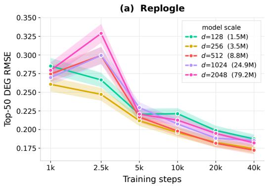

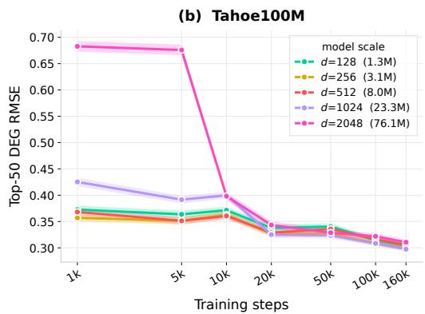  
Figure 5: Influence of training steps and model dimension on Replogle and Tahoe100M.

We investigate the effects of training scale and latent dimension on Replogle and Tahoe100M, using RMSE on the top-50 DEGs as the evaluation metric. The results are shown in Figure 5. We observe that insufficient training steps consistently degrade performance across all latent dimensions and datasets, suggesting that learning generalizable perturbation effects requires adequate training. Moreover, increasing the latent dimension does not necessarily improve performance, with the best results generally achieved when d ranges from 256 to 1024. For example, d = 512 generally achieves the best performance on Replogle. One possible explanation is that larger latent dimensions increase model capacity but do not necessarily improve the ability to capture perturbation-specific effects. These findings also suggest that relying on model expressiveness to capture perturbation effect is unstable.

## A.3.6 VISUALIZATION

We visualize the latent representations learned by PerturbEnergy and two VAE-based methods, sc-Gen and PerturbedVAE, alongside the original gene expression profiles. We use the test set of Tahoe100M to visualize and the UMAP visualization results are shown in Figure 6. We observe that perturbation-specific information is largely obscured in the original expression space. Although scGen captures some perturbation effects, its representations remain largely indistinguishable across perturbations. PerturbedVAE improves the separation of perturbation-specific representations, but some perturbations, such as Betamethasone dipropionate and Triamcinolone, remain mixed. In contrast, PerturbEnergy exhibits clearer separation between perturbations, demonstrating its ability to preserve perturbation-specific information in the latent space.

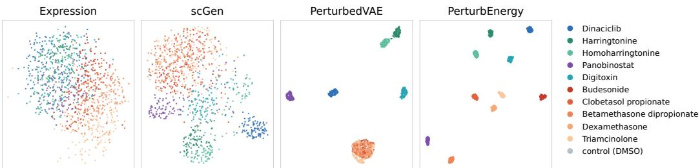  
Figure 6: Visualization of representation in Tahoe100M.

## A.3.7 OTHER METRICS ON DEG GROUP

We report the MAE, PCC and $\mathtt { R } ^ { 2 }$ on Top-50/100/200 differential expression genes (DEGs) in Table 7, Table 8 and Table 9 respectively. Firstly, about our method, we have the consistent observation with the RMSE where PerturbEnergy achieves the top-2 performance on every dataset except Norman2019 even under simple MLP implementations. Specifically, in terms of MAE, the margins over the strongest baseline are largest. For example, PerturbEnergy-Mis reduces MAE from 0.1675 (Squidiff) to 0.1434 on Replogle (16.8% improvement); from 0.2648 (stVAE) to 0.2495 on Tahoe100M; on PBMC, PerturbEnergy-Lang reduces it from 0.0511 (stVAE) to 0.0453 (11.4% improvement). As for PCC and $R ^ { 2 }$ , we have the same ordering observations. Secondly, for the remaining baselines, we find that: (i) Linear methods still struggle on the DEG-related prediction, for example, in MAE it achives 0.2114 compared to the best 0.1434. This again shows the regression is difficult to capture the perturbation effects; (ii) For STATE, PerturbDiff, CellFlow and Squidiff, their performance also vary a lot. In terms of MAE, PerturbDiff achieves best on Norman2019 but struggles on Replogle; Squidiff achieves competitive performance on Replogle but struggles on Tahoe100M; Cellflow perform well on PBMC and Norman2019 but get declined performance on Tahoe100M. These observations show that relying on model expressiveness to capture perturbation effect is unstable. (iii) For the representation learning baselines, especially these learn the perturbation-aware representations, we find they generally can achieve competitive performance. For example in top-50 MAE, PerturbedVAE gets 0.1812 on Replogle and 0.0703 on PBMC, which is the best among other baselines. This prove the effectiveness of modeling perturbation information.

## A.3.8 RESULTS ON HVG GROUP

## Results on Replogle Dataset

The HVG group results on Replogle is shown in Table 10, Table 11 and Table 12. Table 10 summarizes the correlation based measures, we find that our PerturbEnergy generally achive the best performance, which shows its effectiveness of capturing the whole transcriptomic pattern of cellular response. Table 11 is the results of differential expression gene (DEG) measures. DEG recognition is directly related to perturbation. We find that our PerturbEnergy consistently outperform other baselines with a clear margin, which validates the effectiveness of modeling the perturbationspecific information. Table 12 summarize the distance-based measures. Our PerturbEnergy is also competitive with other baselines.

Table 7: MAE (↓) over the true top-K DEGs. Values are the mean over held-out perturbation groups ± the s.e.m. across those groups. Best in bold, second best underlined.
<table><tr><td rowspan="2">Method</td><td colspan="3">Replogle</td><td colspan="3">Tahoe100M</td></tr><tr><td>Top-50</td><td>Top-100</td><td>Top-200</td><td>Top-50</td><td>Top-100</td><td>Top-200</td></tr><tr><td>Linear</td><td>0.2282 ±0.0076</td><td>0.1963 ±0.0062</td><td>0.1634 ±0.0049</td><td>0.3788 ±0.0069</td><td>0.3169 ±0.0046</td><td>0.2246 ±0.0034</td></tr><tr><td>Linear (scGPT)</td><td>0.2114 ±0.0076</td><td>0.1757 ±0.0060</td><td>0.1418 ±0.0046</td><td>0.3092 ±0.0057</td><td>0.2624 ±0.0039</td><td>0.1884 ±0.0029</td></tr><tr><td>CellFlow</td><td>0.1925 ±0.0063</td><td>0.1615 ±0.0051</td><td>0.1306 ±0.0039</td><td>0.3280 ±0.0059</td><td>0.2767 ±0.0039</td><td>0.1975 ±0.0029</td></tr><tr><td>Squidiff</td><td>0.1675 ±0.0047</td><td>0.1433 ±0.0037</td><td>0.1205 ±0.0029</td><td>0.3077 ±0.0061</td><td>0.2785 ±0.0042</td><td>0.2116 ±0.0030</td></tr><tr><td>PerturbDiff</td><td>0.2304 ±0.0092</td><td>0.1904 ±0.0075</td><td>0.1519 ±0.0059</td><td>0.2878 ±0.0062</td><td>0.2415 ±0.0042</td><td>0.1748 ±0.0031</td></tr><tr><td>STATE</td><td>0.1704 ±0.0058</td><td>0.1424 ±0.0046</td><td>0.1162 ±0.0035</td><td>0.2787 ±0.0037</td><td>0.2394 ±0.0025</td><td>0.1734 ±0.0019</td></tr><tr><td>scGen</td><td>0.1985 ±0.0071</td><td>0.1665 ±0.0058</td><td>0.1347 ±0.0044</td><td>0.3654 ±0.0076</td><td>0.3040 ±0.0051</td><td>0.2165 ±0.0038</td></tr><tr><td>CPA</td><td>0.3164 ±0.0126</td><td>0.2615 ±0.0105</td><td>0.2067 ±0.0081</td><td>0.4564 ±0.0072</td><td>0.4047 ±0.0047</td><td>0.2977 ±0.0037</td></tr><tr><td>stVAE</td><td>0.1797 ±0.0065</td><td>0.1455 ±0.0049</td><td>0.1159 ±0.0036</td><td>0.2648 ±0.0051</td><td>0.2263 ±0.0033</td><td>0.1646 ±0.0025</td></tr><tr><td>PerturbedVAE</td><td>0.1812 ±0.0066</td><td>0.1509 ±0.0054</td><td>0.1216 ±0.0042</td><td>0.3160 ±0.0068</td><td>0.2666 ±0.0047</td><td>0.1918 ±0.0034</td></tr><tr><td>PerturbEnergy-Lang</td><td>0.1541 ±0.0055</td><td>0.1281 ±0.0044</td><td>0.1044 ±0.0033</td><td>0.2503 ±0.0045</td><td>0.2131 ±0.0030</td><td>0.1550 ±0.0022</td></tr><tr><td>PerturbEnergy-Mis</td><td>0.1434 ±0.0051</td><td>0.1196 ±0.0040</td><td>0.0979 ±0.0030</td><td>0.2495 ±0.0045</td><td>0.2115 ±0.0030</td><td>0.1531 ±0.0022</td></tr></table>

<table><tr><td rowspan="2">Method</td><td colspan="3">PBMC</td><td colspan="3">Norman2019</td></tr><tr><td>Top-50</td><td>Top-100</td><td>Top-200</td><td>Top-50</td><td>Top-100</td><td>Top-200</td></tr><tr><td>Linear</td><td>0.0836 ±0.0042</td><td>0.0672 ±0.0033</td><td>0.0515 ±0.0025</td><td>0.3285 ±0.0244</td><td>0.2335 ±0.0189</td><td>0.1506 ±0.0127</td></tr><tr><td>Linear (scGPT)</td><td>0.0780 ±0.0041</td><td>0.0619 ±0.0032</td><td>0.0466 ±0.0024</td><td>0.2325 ±0.0072</td><td>0.1461 ±0.0057</td><td>0.1086 ±0.0039</td></tr><tr><td>CellFlow</td><td>0.0654 ±0.0021</td><td>0.0511 ±0.0015</td><td>0.0376 ±0.0011</td><td>0.1264 ±0.0127</td><td>0.0977 ±0.0102</td><td>0.0699 ±0.0071</td></tr><tr><td>Squidiff</td><td>0.0855 ±0.0044</td><td>0.0692 ±0.0034</td><td>0.0532 ±0.0026</td><td>0.1513 ±0.0076</td><td>0.1257 ±0.0062</td><td>0.0966 ±0.0048</td></tr><tr><td>PerturbDiff</td><td>0.0568 ±0.0025</td><td>0.0455 ±0.0018</td><td>0.0349 ±0.0014</td><td>0.0950 ±0.0068</td><td>0.0754 ±0.0051</td><td>0.0563 ±0.0036</td></tr><tr><td>STATE</td><td>0.0738 ±0.0028</td><td>0.0580 ±0.0022</td><td>0.0431 ±0.0017</td><td>0.1138 ±0.0100</td><td>0.0885 ±0.0074</td><td>0.0644 ±0.0048</td></tr><tr><td>scGen</td><td>0.0712 ±0.0045</td><td>0.0546 ±0.0036</td><td>0.0396 ±0.0027</td><td>0.1312 ±0.0080</td><td>0.1019 ±0.0063</td><td>0.0738 ±0.0046</td></tr><tr><td>CPA</td><td>0.1009 ±0.0057</td><td>0.0769 ±0.0043</td><td>0.0559 ±0.0031</td><td>0.3629 ±0.0250</td><td>0.2580 ±0.0191</td><td>0.1654 ±0.0128</td></tr><tr><td>stVAE</td><td>0.0511 ±0.0018</td><td>0.0403 ±0.0014</td><td>0.0306 ±0.0010</td><td>0.1664 ±0.0134</td><td>0.1228 ±0.0101</td><td>0.0842 ±0.0066</td></tr><tr><td>PerturbedVAE</td><td>0.0703 ±0.0026</td><td>0.0559 ±0.0019</td><td>0.0429 ±0.0014</td><td>0.1126 ±0.0108</td><td>0.0923 ±0.0085</td><td>0.0690 ±0.0058</td></tr><tr><td>PerturbEnergy-Lang</td><td>0.0453 ±0.0016</td><td>0.0362 ±0.0012</td><td>0.0282 ±0.0009</td><td>0.1129 ±0.0095</td><td>0.0876 ±0.0068</td><td>0.0634 ±0.0045</td></tr><tr><td>PerturbEnergy-Mis</td><td>0.0467 ±0.0016</td><td>0.0376 ±0.0012</td><td>0.0292 ±0.0009</td><td>0.1075 ±0.0091</td><td>0.0842 ±0.0065</td><td>0.0614 ±0.0044</td></tr></table>

## Results on PBMC Dataset

The HVG group results on PBMC is shown in Table 13, Table 14 and Table 15. From the correlation and distance related measures in Table 13 and Table 15 respectively, we have the same observations with Replogle, where PerturbEnergy outperforms or remains competitive to other baselines, showing its ability to capture the general expression patterns. From the DE-recoginition results in Table 14, we also find that PerturbEnergy outperform others especially VAE baselines (0.2473 vs 0.2208). This benefit comes from modeling perturbation-specific information.

## Results on Norman2019 Dataset

The HVG group results on Norman2019 is shown in Table 16, Table 17 and Table 18. On this dataset we find a relative different pattern from Replogle and PBMC where diffusion-based methods like PerturbDiff and CellFlow ahieve the best performance on correlation or distance based measures (Table 16 and Table 18). Norman2019 generally contains duel-genetic perturbations and this diffusion process is good at capturing the complex pattern co-influenced by duel-genetic perturbations. Moreover, increasing perturbation information remains effective as we find that in DE related measures PerturbEnergy remains the best compared to other baselines (Table 17).

## Results on Tahoe100M Dataset

The HVG group results on Tahoe100M is shown in Table 19, Table 20 and Table 21. The results show general the same pattern as in Replogle and PBMC.

Table 8: PCC (↑) over the true top-K DEGs. Values are the mean over held-out perturbation groups ± the s.e.m. across those groups. Best in bold, second best underlined.
<table><tr><td rowspan="2">Method</td><td colspan="3">Replogle</td><td colspan="3">Tahoe100M</td></tr><tr><td>Top-50</td><td> $\mathrm { T o p } { \cdot } 1 0 0$ </td><td> $\mathrm { T o p } { - } 2 0 0$ </td><td> $\mathrm { T o p } { - } 5 0 $ </td><td> $\mathrm { T o p } { \cdot } 1 0 0$ </td><td>Top-200</td></tr><tr><td>Linear</td><td> $0 . 9 6 1 1 { \scriptstyle \pm 0 . 0 0 2 4 }$ </td><td> $0 . 9 6 7 6 \pm 0 . 0 0 1 8$ </td><td> $0 . 9 7 1 2 { \scriptstyle \pm 0 . 0 0 1 5 }$ </td><td> $0 . 9 2 0 2 { \scriptstyle \pm 0 . 0 0 3 1 }$ </td><td> $0 . 9 3 2 3 { \scriptstyle \pm 0 . 0 0 2 2 }$ </td><td>0.9456 ±0.0015</td></tr><tr><td>Linear (scGPT)</td><td> $0 . 9 6 9 2 { \scriptstyle \pm 0 . 0 0 2 0 }$ </td><td> $0 . 9 7 5 3 { \scriptstyle \pm 0 . 0 0 1 5 }$ </td><td> $0 . 9 7 8 9 { \scriptstyle \pm 0 . 0 0 1 2 }$ </td><td> $0 . 9 4 0 6 \pm 0 . 0 0 2 6$ </td><td> $0 . 9 4 8 0 { \scriptstyle \pm 0 . 0 0 1 9 }$ </td><td>0.9573 ±0.0013</td></tr><tr><td>CellFlow</td><td> $0 . 9 7 5 9 \pm 0 . 0 0 1 7$ </td><td> $0 . 9 8 0 9 { \scriptstyle \pm 0 . 0 0 1 2 }$ </td><td> $0 . 9 8 4 0 \pm 0 . 0 0 0 9$ </td><td> $0 . 9 3 7 2 { \scriptstyle \pm 0 . 0 0 3 0 }$ </td><td> $0 . 9 4 6 0 { \scriptstyle \pm 0 . 0 0 2 1 }$ </td><td> $0 . 9 5 6 3 { \scriptstyle \pm 0 . 0 0 1 5 }$ </td></tr><tr><td>Squidiff</td><td> $0 . 9 7 6 0 { \scriptstyle \pm 0 . 0 0 1 3 }$ </td><td> $0 . 9 7 9 5 { \scriptstyle \pm 0 . 0 0 0 9 }$ </td><td> $0 . 9 8 1 3 { \scriptstyle \pm 0 . 0 0 0 8 }$ </td><td> $0 . 9 1 1 6 \pm 0 . 0 0 3 4$ </td><td> $0 . 9 1 4 5 \pm 0 . 0 0 2 5$ </td><td>0.9250 ±0.0019</td></tr><tr><td>PerturbDiff</td><td> $0 . 9 6 4 4 \pm 0 . 0 0 2 5$ </td><td> $0 . 9 7 2 0 { \scriptstyle \pm 0 . 0 0 1 9 }$ </td><td> $0 . 9 7 6 8 \pm 0 . 0 0 1 5$ </td><td> $0 . 9 4 4 3 \pm 0 . 0 0 3 6$ </td><td> $0 . 9 5 2 1 \pm 0 . 0 0 2 6$ </td><td> $0 . 9 6 1 0 { \scriptstyle \pm 0 . 0 0 1 9 }$ </td></tr><tr><td>STATE</td><td> $0 . 9 7 8 0 { \scriptstyle \pm 0 . 0 0 1 5 }$ </td><td> $0 . 9 8 2 4 \pm 0 . 0 0 1 1$ </td><td> $0 . 9 8 5 3 { \scriptstyle \pm 0 . 0 0 0 9 }$ </td><td> $0 . 9 5 1 6 \pm 0 . 0 0 1 7$ </td><td> $0 . 9 5 6 9 { \scriptstyle \pm 0 . 0 0 1 3 }$ </td><td>0.9642 ±0.0009</td></tr><tr><td>scGen</td><td> $0 . 9 7 1 3 { \scriptstyle \pm 0 . 0 0 1 9 }$ </td><td> $0 . 9 7 7 2 { \scriptstyle \pm 0 . 0 0 1 4 }$ </td><td> $0 . 9 8 0 8 \pm 0 . 0 0 1 1$ </td><td> $0 . 9 2 1 9 \pm 0 . 0 0 3 5$ </td><td>0.9333 ±0.0025</td><td>0.9455 ±0.0018</td></tr><tr><td>CPA</td><td> $0 . 9 4 0 5 \pm 0 . 0 0 4 0$ </td><td> $0 . 9 5 3 4 \pm 0 . 0 0 3 0$ </td><td> $0 . 9 6 1 6 \pm 0 . 0 0 2 5$ </td><td> $0 . 7 5 3 6 { \scriptstyle \pm 0 . 0 0 6 6 }$ </td><td> $0 . 7 6 1 5 { \scriptstyle \pm 0 . 0 0 4 8 }$ </td><td>0.7917 ±0.0037</td></tr><tr><td>stVAE</td><td> $0 . 9 7 5 1 { \scriptstyle \pm 0 . 0 0 1 8 }$ </td><td> $0 . 9 8 0 9 { \scriptstyle \pm 0 . 0 0 1 3 }$ </td><td> $0 . 9 8 4 3 \pm 0 . 0 0 1 0$ </td><td> $0 . 9 5 0 7 \pm 0 . 0 0 2 5$ </td><td> $0 . 9 5 6 6 \pm 0 . 0 0 1 8$ </td><td> $0 . 9 6 4 0 { \scriptstyle \pm 0 . 0 0 1 3 }$ </td></tr><tr><td>PerturbedVAE</td><td> $0 . 9 7 6 6 \pm 0 . 0 0 1 7$ </td><td> $0 . 9 8 1 5 { \scriptstyle \pm 0 . 0 0 1 2 }$ </td><td> $0 . 9 8 4 3 \pm 0 . 0 0 1 0$ </td><td> $0 . 9 3 3 4 \pm 0 . 0 0 3 2$ </td><td> $0 . 9 4 0 9 { \scriptstyle \pm 0 . 0 0 2 4 }$ </td><td> $0 . 9 5 0 6 \pm 0 . 0 0 1 7$ </td></tr><tr><td>PerturbEnergy-Lang</td><td> $0 . 9 8 0 5 { \scriptstyle \pm 0 . 0 0 1 6 }$ </td><td> $0 . 9 8 4 7 \pm 0 . 0 0 1 1$ </td><td> $0 . 9 8 7 2 { \scriptstyle \pm 0 . 0 0 0 8 }$ </td><td> $0 . 9 5 6 6 { \scriptstyle \pm 0 . 0 0 1 9 }$ </td><td> $0 . 9 6 1 8 { \scriptstyle \pm 0 . 0 0 1 4 }$ </td><td> $0 . 9 6 8 3 { \scriptstyle \pm 0 . 0 0 1 0 }$ </td></tr><tr><td>PerturbEnergy-Mis</td><td> $\mathbf { 0 . 9 8 2 4 } \pm 0 . 0 0 1 3$ </td><td>0.9860 ±0.0009</td><td> $\mathbf { 0 . 9 8 8 1 } \pm 0 . 0 0 0 7$ </td><td> $\mathbf { 0 . 9 5 6 7 \mathop { \pm 0 . 0 0 1 8 } }$ </td><td>0.9619 ±0.0013</td><td> $\mathbf { 0 . 9 6 8 4 \mathop { \pm 0 . 0 0 1 0 } }$ </td></tr><tr><td rowspan="3">Method</td><td></td><td>PBMC</td><td></td><td></td><td>Norman2019</td><td></td></tr><tr><td>Top-50</td><td> $\mathrm { T o p } { \cdot } 1 0 0$ </td><td> $\mathrm { T o p } { - } 2 0 0$ </td><td></td><td></td><td></td></tr><tr><td></td><td></td><td></td><td>Top-50</td><td>Top-100</td><td>Top-200</td></tr><tr><td>Linear Linear (scGPT)</td><td> $0 . 9 3 9 4 \pm 0 . 0 0 3 9$ </td><td> $0 . 9 4 9 0 { \scriptstyle \pm 0 . 0 0 2 9 }$ </td><td> $0 . 9 5 6 2 \pm 0 . 0 0 2 1$ </td><td> $0 . 9 4 2 7 \pm 0 . 0 0 7 5$ </td><td>0.9586 ±0.0052</td><td>0.9692 ±0.0046</td></tr><tr><td></td><td> $0 . 9 5 3 4 \pm 0 . 0 0 3 2$ </td><td> $0 . 9 6 1 9 \pm 0 . 0 0 2 4$ </td><td> $0 . 9 6 8 4 \pm 0 . 0 0 1 8$ </td><td> $0 . 9 5 4 8 \pm 0 . 0 0 0 7$ </td><td>0.9655 ±0.0006</td><td>0.9711 ±0.0005</td></tr><tr><td>CellFlow</td><td> $0 . 9 6 8 5 \pm 0 . 0 0 1 8$ </td><td> $0 . 9 7 4 2 { \scriptstyle \pm 0 . 0 0 1 1 }$ </td><td> $0 . 9 7 8 7 { \scriptstyle \pm 0 . 0 0 0 8 }$ </td><td> $0 . 9 9 0 6 { \scriptstyle \pm 0 . 0 0 2 0 }$ </td><td>0.9927 ±0.0014</td><td>0.9938 ±0.0014</td></tr><tr><td>Squidiff</td><td> $0 . 9 2 8 9 \pm 0 . 0 0 4 4$ </td><td> $0 . 9 4 0 3 \pm 0 . 0 0 3 1$ </td><td> $0 . 9 4 7 9 { \scriptstyle \pm 0 . 0 0 2 3 }$ </td><td> $0 . 9 8 5 0 { \scriptstyle \pm 0 . 0 0 1 5 }$ </td><td>0.9869 ±0.0012</td><td>0.9885 ±0.0010</td></tr><tr><td>PerturbDiff</td><td> $0 . 9 6 6 8 \pm 0 . 0 0 2 3$ </td><td> $0 . 9 7 1 5 { \scriptstyle \pm 0 . 0 0 1 6 }$ </td><td> $0 . 9 7 5 2 { \scriptstyle \pm 0 . 0 0 1 1 }$ </td><td> $\mathbf { 0 . 9 9 4 9 \mathop { \pm 0 . 0 0 0 7 } }$ </td><td>0.9957 ±0.0006</td><td>0.9964 ±0.0005</td></tr><tr><td>STATE</td><td> $0 . 9 5 9 4 \pm 0 . 0 0 2 3$ </td><td>0.9673 ±0.0015</td><td> $0 . 9 7 3 0 { \scriptstyle \pm 0 . 0 0 1 1 }$ </td><td> $0 . 9 9 3 0 { \scriptstyle \pm 0 . 0 0 1 1 }$ </td><td>0.9942 ±0.0008</td><td>0.9953 ±0.0007</td></tr><tr><td></td><td></td><td></td><td></td><td></td><td></td><td></td></tr><tr><td>scGen CPA</td><td> $0 . 9 5 5 2 { \scriptstyle \pm 0 . 0 0 3 6 }$ </td><td>0.9648 ±0.0027</td><td> $0 . 9 7 2 0 { \scriptstyle \pm 0 . 0 0 2 0 }$ </td><td> $0 . 9 9 0 3 \pm 0 . 0 0 1 1$ </td><td>0.9919 ±0.0009</td><td>0.9934 ±0.0008</td></tr><tr><td></td><td> $0 . 8 8 9 6 \pm 0 . 0 0 5 7$ </td><td>0.9067 ±0.0043</td><td> $0 . 9 2 0 6 { \scriptstyle \pm 0 . 0 0 3 3 }$ </td><td>0.9363 ±0.0076</td><td>0.9536 ±0.0052</td><td>0.9654 ±0.0046</td></tr><tr><td>stVAE</td><td> $0 . 9 7 6 3 \pm 0 . 0 0 1 2$ </td><td>0.9802 ±0.0007</td><td> $0 . 9 8 2 9 { \scriptstyle \pm 0 . 0 0 0 5 }$ </td><td> $0 . 9 8 6 1 \pm 0 . 0 0 1 8$ </td><td>0.9890 ±0.0014</td><td>0.9913 ±0.0011</td></tr><tr><td>PerturbedVAE</td><td> $0 . 9 4 0 3 \pm 0 . 0 0 3 1$ </td><td>0.9485 ±0.0022</td><td> $0 . 9 5 4 7 \pm 0 . 0 0 1 7$ </td><td> $0 . 9 9 2 8 \pm 0 . 0 0 1 3$ </td><td>0.9939 ±0.0010</td><td>0.9947 ±0.0010</td></tr><tr><td>PerturbEnergy-Lang</td><td> $\mathbf { 0 . 9 8 1 6 \pm 0 . 0 0 0 9 }$ </td><td>0.9843 ±0.0006</td><td> $\mathbf { 0 . 9 8 6 3 \bot 0 . 0 0 0 5 }$ </td><td>0.9931 ±0.0010</td><td>0.9942 ±0.0008</td><td>0.9954 ±0.0006</td></tr><tr><td>PerturbEnergy-Mis</td><td>0.9792 ±0.0010</td><td>0.9823 ±0.0007</td><td> $0 . 9 8 4 4 { \scriptstyle \pm 0 . 0 0 0 5 }$ </td><td>0.9935 ±0.0009</td><td>0.9945 ±0.0007</td><td>0.9956 ±0.0006</td></tr></table>

Table 9: $R ^ { 2 } \left( \uparrow \right)$ over the true top-K DEGs. Values are the mean over held-out perturbation groups ± the s.e.m. across those groups. Best in bold, second best underlined.
<table><tr><td rowspan="2">Method</td><td colspan="3">Replogle</td><td colspan="3">Tahoe100M</td></tr><tr><td>Top-50</td><td>Top-100</td><td>Top-200</td><td>Top-50</td><td>Top-100</td><td>Top-200</td></tr><tr><td>Linear</td><td>0.9142 ±0.0050</td><td>0.9297 ±0.0037</td><td> $0 . 9 3 8 3 \pm 0 . 0 0 3 1$ </td><td>0.7456 ±0.0108</td><td>0.8009 ±0.0078</td><td>0.8497 ±0.0051</td></tr><tr><td>Linear (scGPT)</td><td>0.9295 ±0.0044</td><td>0.9456 ±0.0031</td><td> $0 . 9 5 4 6 \pm 0 . 0 0 2 5$ </td><td>0.8303 ±0.0069</td><td>0.8621 ±0.0051</td><td>0.8930 ±0.0034</td></tr><tr><td>CellFlow</td><td> $0 . 9 4 4 4 { \scriptstyle \pm 0 . 0 0 3 5 }$ </td><td> $0 . 9 5 6 9 \pm 0 . 0 0 2 5$ </td><td> $0 . 9 6 4 6 \pm 0 . 0 0 2 0$ </td><td> $0 . 8 1 8 5 \pm 0 . 0 0 7 4$ </td><td>0.8556 ±0.0053</td><td>0.8896 ±0.0035</td></tr><tr><td>Squidiff</td><td> $0 . 9 4 6 6 \pm 0 . 0 0 2 8$ </td><td> $0 . 9 5 6 0 { \scriptstyle \pm 0 . 0 0 1 9 }$ </td><td> $0 . 9 6 0 8 \pm 0 . 0 0 1 6$ </td><td> $0 . 7 8 6 2 { \scriptstyle \pm 0 . 0 0 9 0 }$ </td><td>0.8028 ±0.0072</td><td>0.8323 ±0.0049</td></tr><tr><td>PerturbDiff</td><td> $0 . 9 1 7 7 { \scriptstyle \pm 0 . 0 0 5 4 }$ </td><td> $0 . 9 3 7 4 \pm 0 . 0 0 3 9$ </td><td> $0 . 9 4 8 8 \pm 0 . 0 0 3 2$ </td><td> $0 . 8 4 8 2 { \scriptstyle \pm 0 . 0 0 7 1 }$ </td><td>0.8767 ±0.0052</td><td>0.9032 ±0.0036</td></tr><tr><td>STATE</td><td> $0 . 9 4 9 2 { \scriptstyle \pm 0 . 0 0 3 5 }$ </td><td> $0 . 9 6 0 7 \pm 0 . 0 0 2 4$ </td><td> $0 . 9 6 7 7 { \scriptstyle \pm 0 . 0 0 1 9 }$ </td><td>0.8642 ±0.0045</td><td>0.8888 ±0.0031</td><td>0.9126 ±0.0021</td></tr><tr><td>scGen</td><td> $0 . 9 3 5 6 \pm 0 . 0 0 4 0$ </td><td> $0 . 9 4 9 5 { \scriptstyle \pm 0 . 0 0 3 0 }$ </td><td> $0 . 9 5 8 3 { \scriptstyle \pm 0 . 0 0 2 3 }$ </td><td> $0 . 7 5 2 0 { \scriptstyle \pm 0 . 0 1 1 9 }$ </td><td>0.8041 ±0.0088</td><td>0.8503 ±0.0058</td></tr><tr><td>CPA</td><td> $0 . 8 5 4 4 \pm 0 . 0 0 9 2$ </td><td> $0 . 8 8 9 5 { \scriptstyle \pm 0 . 0 0 6 8 }$ </td><td> $0 . 9 1 0 7 \pm 0 . 0 0 5 6$ </td><td> $0 . 4 4 7 0 { \scriptstyle \pm 0 . 0 1 1 5 }$ </td><td>0.4937 ±0.0080</td><td>0.5710 ±0.0062</td></tr><tr><td>stVAE</td><td> $0 . 9 4 3 6 \pm 0 . 0 0 4 0$ </td><td> $0 . 9 5 8 4 \pm 0 . 0 0 2 6$ </td><td> $0 . 9 6 6 4 \pm 0 . 0 0 2 0$ </td><td> $0 . 8 6 9 0 { \scriptstyle \pm 0 . 0 0 5 5 }$ </td><td>0.8918 ±0.0040</td><td>0.9143 ±0.0027</td></tr><tr><td>PerturbedVAE</td><td> $0 . 9 4 4 9 \pm 0 . 0 0 3 9$ </td><td> $0 . 9 5 7 2 { \scriptstyle \pm 0 . 0 0 2 7 }$ </td><td> $0 . 9 6 4 4 \pm 0 . 0 0 2 3$ </td><td>0.8025 ±0.0092</td><td>0.8378 ±0.0068</td><td>0.8718 ±0.0047</td></tr><tr><td>PerturbEnergy-Lang PerturbEnergy-Mis</td><td> $\underline { { 0 . 9 5 6 4 } } \pm 0 . 0 0 3 3$ </td><td>0.9667 ±0.0022</td><td> $\underline { { 0 . 9 7 2 5 } } \pm 0 . 0 0 1 7$ </td><td> $\mathbf { 0 . 8 8 2 6 \pm 0 . 0 0 4 6 }$ </td><td>0.9035 ±0.0034</td><td>0.9237 ±0.0023</td></tr><tr><td></td><td>0.9606 ±0.0028</td><td>0.9697 ±0.0019</td><td> $\mathbf { 0 . 9 7 4 7 \pm 0 . 0 0 1 5 }$ </td><td>0.8819 ±0.0046</td><td>0.9033 ±0.0033</td><td>0.9237±0.0023</td></tr><tr><td rowspan="3">Method</td><td></td><td>PBMC</td><td></td><td></td><td>Norman2019</td><td></td></tr><tr><td>Top-50</td><td>Top-100</td><td>Top-200</td><td>Top-50</td><td></td><td></td></tr><tr><td></td><td></td><td></td><td></td><td>Top-100</td><td>Top-200</td></tr><tr><td>Linear Linear (scGPT)</td><td>0.8485 ±0.0085</td><td> $0 . 8 8 0 4 \pm 0 . 0 0 5 9$ </td><td> $0 . 9 0 0 9 { \scriptstyle \pm 0 . 0 0 4 3 }$ </td><td>0.8375 ±0.0289</td><td>0.8975 ±0.0166</td><td>0.9321 ±0.0113</td></tr><tr><td></td><td> $0 . 8 7 5 7 { \scriptstyle \pm 0 . 0 0 7 4 }$ </td><td> $0 . 9 0 6 7 \pm 0 . 0 0 5 0$ </td><td> $0 . 9 2 6 5 { \scriptstyle \pm 0 . 0 0 3 6 }$ </td><td>0.8852 ±0.0029</td><td>0.9288 ±0.0019</td><td>0.9711 ±0.0014</td></tr><tr><td>CellFlow</td><td> $0 . 9 0 2 9 \pm 0 . 0 0 5 6$ </td><td> $0 . 9 2 9 6 \pm 0 . 0 0 3 2$ </td><td> $0 . 9 4 6 2 \pm 0 . 0 0 2 1$ </td><td> $0 . 9 7 0 6 { \scriptstyle \pm 0 . 0 0 9 0 }$ </td><td>0.9802 ±0.0053</td><td>0.9855 ±0.0038</td></tr><tr><td>Squidiff</td><td> $0 . 8 0 6 1 \pm 0 . 0 0 9 7$ </td><td> $0 . 8 3 9 9 { \scriptstyle \pm 0 . 0 0 6 6 }$ </td><td> $0 . 8 6 3 1 { \scriptstyle \pm 0 . 0 0 4 8 }$ </td><td> $0 . 9 6 4 7 \pm 0 . 0 0 3 7$ </td><td>0.9714±0.0027</td><td>0.9760 ±0.0022</td></tr><tr><td>PerturbDiff</td><td> $0 . 8 9 7 2 { \scriptstyle \pm 0 . 0 0 8 6 }$ </td><td> $0 . 9 1 8 3 \pm 0 . 0 0 6 1$ </td><td> $0 . 9 3 4 4 \pm 0 . 0 0 3 5$ </td><td> $\mathbf { 0 . 9 8 6 3 \pm 0 . 0 0 1 9 }$ </td><td>0.9895 ±0.0014</td><td>0.9918 ±0.0010</td></tr><tr><td>STATE</td><td> $0 . 8 8 3 3 { \scriptstyle \pm 0 . 0 0 6 1 }$ </td><td> $0 . 9 1 4 5 \pm 0 . 0 0 3 8$ </td><td> $0 . 9 3 3 9 { \scriptstyle \pm 0 . 0 0 2 6 }$ </td><td>0.9803 ±0.0038</td><td>0.9855 ±0.0025</td><td>0.9892 ±0.0017</td></tr><tr><td>scGen</td><td> $0 . 8 8 7 4 \pm 0 . 0 0 7 4$ </td><td> $0 . 9 1 6 3 \pm 0 . 0 0 5 4$ </td><td> $0 . 9 3 5 9 { \scriptstyle \pm 0 . 0 0 3 9 }$ </td><td> $0 . 9 7 3 5 { \scriptstyle \pm 0 . 0 0 3 8 }$ </td><td>0.9805 ±0.0026</td><td>0.9852 ±0.0020</td></tr><tr><td>CPA</td><td> $0 . 7 3 3 5 { \scriptstyle \pm 0 . 0 1 2 2 }$ </td><td>0.7857 ±0.0089</td><td> $0 . 8 2 2 4 \pm 0 . 0 0 6 7$ </td><td> $0 . 8 1 7 4 { \scriptstyle \pm 0 . 0 2 9 6 }$ </td><td>0.8845 ±0.0169</td><td>0.9235 ±0.0115</td></tr><tr><td>stVAE</td><td> $0 . 9 3 0 2 { \scriptstyle \pm 0 . 0 0 3 5 }$ </td><td> $0 . 9 4 7 0 { \scriptstyle \pm 0 . 0 0 2 1 }$ </td><td> $0 . 9 5 7 6 \pm 0 . 0 0 1 4$ </td><td> $0 . 9 5 9 2 { \scriptstyle \pm 0 . 0 0 6 6 }$ </td><td>0.9716 ±0.0045</td><td>0.9800 ±0.0029</td></tr><tr><td>PerturbedVAE</td><td> $0 . 8 5 0 3 { \scriptstyle \pm 0 . 0 0 7 2 }$ </td><td>0.8791 ±0.0047</td><td> $0 . 8 9 5 7 { \scriptstyle \pm 0 . 0 0 3 5 }$ </td><td> $0 . 9 7 8 5 { \scriptstyle \pm 0 . 0 0 5 6 }$ </td><td>0.9840 ±0.0035</td><td>0.9877 ±0.0026</td></tr><tr><td>PerturbEnergy-Lang</td><td></td><td></td><td></td><td></td><td></td><td></td></tr><tr><td>PerturbEnergy-Mis</td><td> $\mathbf { 0 . 9 4 3 4 } \pm 0 . 0 0 3 6$   $0 . 9 3 9 6 { \scriptstyle \pm 0 . 0 0 3 5 }$ </td><td>0.9570 ±0.0020 0.9536 ±0.0022</td><td> $\mathbf { 0 . 9 6 4 7 \pm 0 . 0 0 1 5 }$   $0 . 9 6 1 5 { \scriptstyle \pm 0 . 0 0 1 5 }$ </td><td>0.9803 ±0.0033 0.9818 ±0.0030</td><td>0.9854±0.0023 0.9864 ±0.0021</td><td>0.9893 ±0.0015 0.9899 ±0.0014</td></tr></table>

Table 10: HVG-group correlation-based measures on Replogle, over all 2,000 highly variable genes. Values are the mean over held-out perturbation groups ± the s.e.m. across those groups; the perturbation-discrimination scores are computed once over the whole test set and carry no such spread. Best in bold, second best underlined.
<table><tr><td>Method</td><td>PCC↑</td><td> $R ^ { 2 } \uparrow$ </td><td>PDCorr ↑</td><td>LFCSpear ↑</td><td> $\mathrm { L o g F C - c o s \uparrow }$ </td></tr><tr><td>Linear</td><td> $0 . 9 7 7 2 { \scriptstyle \pm 0 . 0 0 1 1 }$ </td><td> $0 . 9 5 2 9 \pm 0 . 0 0 2 2$ </td><td> $0 . 3 3 2 3 { \scriptstyle \pm 0 . 0 1 2 9 }$ </td><td> $0 . 2 5 1 9 \pm 0 . 0 1 1 7$ </td><td> $0 . 3 3 6 8 \pm 0 . 0 1 3 1$ </td></tr><tr><td>Linear (scGPT)</td><td> $0 . 9 8 6 8 \substack { \pm 0 . 0 0 0 6 }$ </td><td> $0 . 9 7 3 2 { \scriptstyle \pm 0 . 0 0 1 3 }$ </td><td> $0 . 4 5 8 4 \pm 0 . 0 1 7 5$ </td><td> $0 . 3 6 0 7 \pm 0 . 0 1 4 5$ </td><td> $0 . 4 6 8 8 \pm 0 . 0 1 7 4$ </td></tr><tr><td>CellFlow</td><td> $0 . 9 7 0 6 { \scriptstyle \pm 0 . 0 0 1 2 }$ </td><td> $0 . 9 3 9 3 { \scriptstyle \pm 0 . 0 0 2 4 }$ </td><td> $0 . 5 5 5 9 { \scriptstyle \pm 0 . 0 1 8 7 }$ </td><td> $0 . 4 6 2 3 \pm 0 . 0 1 7 0$ </td><td> $0 . 5 6 4 8 \pm 0 . 0 1 8 5$ </td></tr><tr><td>Squidiff</td><td> $0 . 9 8 2 9 { \scriptstyle \pm 0 . 0 0 0 5 }$ </td><td> $0 . 9 6 4 9 \pm 0 . 0 0 0 9$ </td><td> $0 . 4 9 4 5 \pm 0 . 0 1 7 0$ </td><td> $0 . 4 5 3 6 \pm 0 . 0 1 4 1$ </td><td> $0 . 5 0 6 5 \pm 0 . 0 1 6 9$ </td></tr><tr><td>PerturbDiff</td><td> $0 . 9 8 7 5 { \scriptstyle \pm 0 . 0 0 0 8 }$ </td><td> $0 . 9 7 4 3 \pm 0 . 0 0 1 5$ </td><td> $0 . 5 4 7 0 { \scriptstyle \pm 0 . 0 1 7 4 }$ </td><td> $0 . 5 1 8 6 \pm 0 . 0 1 3 7$ </td><td> $0 . 5 5 5 7 { \scriptstyle \pm 0 . 0 1 7 3 }$ </td></tr><tr><td>STATE</td><td> $0 . 9 9 0 5 { \scriptstyle \pm 0 . 0 0 0 5 }$ </td><td> $0 . 9 8 0 5 { \scriptstyle \pm 0 . 0 0 1 0 }$ </td><td> $0 . 5 0 9 1 { \scriptstyle \pm 0 . 0 2 0 6 }$ </td><td> $0 . 4 3 2 3 \pm 0 . 0 1 8 3$ </td><td> $0 . 5 1 7 7 { \scriptstyle \pm 0 . 0 2 0 5 }$ </td></tr><tr><td>scGen</td><td> $0 . 9 8 8 3 { \scriptstyle \pm 0 . 0 0 0 6 }$ </td><td> $0 . 9 7 6 0 { \scriptstyle \pm 0 . 0 0 1 2 }$ </td><td> $0 . 5 3 8 1 { \scriptstyle \pm 0 . 0 1 3 8 }$ </td><td> $0 . 4 9 0 0 { \scriptstyle \pm 0 . 0 1 1 8 }$ </td><td> $0 . 5 4 1 1 { \scriptstyle \pm 0 . 0 1 3 9 }$ </td></tr><tr><td>CPA</td><td> $0 . 9 8 1 5 { \scriptstyle \pm 0 . 0 0 1 2 }$ </td><td> $0 . 9 6 1 4 \pm 0 . 0 0 2 5$ </td><td> $0 . 3 0 3 9 { \scriptstyle \pm 0 . 0 0 6 2 }$ </td><td> $0 . 3 0 4 0 \pm 0 . 0 0 4 7$ </td><td> $0 . 3 1 0 1 { \scriptstyle \pm 0 . 0 0 6 3 }$ </td></tr><tr><td>stVAE</td><td> $0 . 9 9 0 3 { \scriptstyle \pm 0 . 0 0 0 5 }$ </td><td> $0 . 9 8 0 2 { \scriptstyle \pm 0 . 0 0 1 0 }$ </td><td> $0 . 5 6 4 8 \pm 0 . 0 1 5 8$ </td><td> $0 . 5 1 4 2 \pm 0 . 0 1 3 2$ </td><td> $0 . 5 7 1 5 { \scriptstyle \pm 0 . 0 1 5 8 }$ </td></tr><tr><td>PerturbedVAE</td><td> $0 . 9 9 0 2 { \scriptstyle \pm 0 . 0 0 0 5 }$ </td><td> $0 . 9 7 9 5 { \scriptstyle \pm 0 . 0 0 1 1 }$ </td><td> $0 . 5 5 7 8 \pm 0 . 0 1 5 1$ </td><td> $0 . 5 0 1 9 \pm 0 . 0 1 2 8$ </td><td> $0 . 5 6 0 0 { \scriptstyle \pm 0 . 0 1 5 2 }$ </td></tr><tr><td></td><td></td><td></td><td></td><td></td><td></td></tr><tr><td>PerturbEnergy-Lang PerturbEnergy-Mis</td><td> $\mathbf { 0 . 9 9 1 5 \bot 0 . 0 0 0 4 }$   $0 . 9 9 1 3 { \scriptstyle \pm 0 . 0 0 0 4 }$ </td><td> $\mathbf { 0 . 9 8 2 5 \bot 0 . 0 0 0 9 }$   $0 . 9 8 2 1 { \scriptstyle \pm 0 . 0 0 0 8 }$ </td><td> $\underline { { 0 . 6 0 0 0 } } \pm 0 . 0 1 5 4$   $\mathbf { 0 . 6 0 3 8 \pm } 0 . 0 1 6 5$ </td><td> $\underline { { 0 . 5 4 7 0 } } \pm 0 . 0 1 3 1$   $\mathbf { 0 . 5 4 9 2 \pm 0 . 0 1 3 8 }$ </td><td> $\underline { { 0 . 6 0 7 0 } } \pm 0 . 0 1 5 4$   $\mathbf { 0 . 6 1 0 6 \mathop { : 0 . 0 1 6 4 } }$ </td></tr></table>

<table><tr><td>Method</td><td>DirAgr ↑</td><td>PDS-cos↓</td><td> $\mathrm { P D S }  – \ell _ { 1 } \downarrow$ </td><td> $\mathrm { P D S }  – \ell _ { 2 } \downarrow$ </td></tr><tr><td>Linear</td><td> $0 . 5 7 8 0 { \scriptstyle \pm 0 . 0 0 4 3 }$ </td><td>0.2465</td><td>0.2992</td><td>0.2790</td></tr><tr><td>Linear (scGPT)</td><td> $0 . 6 1 4 6 \pm 0 . 0 0 4 6$ </td><td>0.3852</td><td>0.3542</td><td>0.3512</td></tr><tr><td>CellFlow</td><td> $0 . 5 4 3 0 { \scriptstyle \pm 0 . 0 0 2 4 }$ </td><td>0.5042</td><td>0.4987</td><td>0.5012</td></tr><tr><td>Squidiff</td><td> $0 . 6 6 4 5 \pm 0 . 0 0 4 8$ </td><td>0.3889</td><td>0.2657</td><td>0.2493</td></tr><tr><td>PerturbDiff</td><td> $0 . 6 9 0 3 { \scriptstyle \pm 0 . 0 0 4 7 }$ </td><td>0.4208</td><td>0.4477</td><td>0.4437</td></tr><tr><td>STATE</td><td> $0 . 6 4 5 6 \pm 0 . 0 0 6 4$ </td><td>0.3266</td><td>0.2150</td><td>0.2156</td></tr><tr><td>scGen</td><td> $0 . 6 6 7 3 { \scriptstyle \pm 0 . 0 0 4 2 }$ </td><td>0.2336</td><td>0.3026</td><td>0.2868</td></tr><tr><td>CPA</td><td> $0 . 6 0 3 8 { \scriptstyle \pm 0 . 0 0 1 5 }$ </td><td>0.3573</td><td>0.4960</td><td>0.4967</td></tr><tr><td>stVAE</td><td> $0 . 6 8 1 7 \pm 0 . 0 0 4 7$ </td><td>0.3461</td><td>0.2521</td><td>0.2550</td></tr><tr><td>PerturbedVAE</td><td> $0 . 6 7 5 6 { \scriptstyle \pm 0 . 0 0 4 6 }$ </td><td>0.1744</td><td>0.2383</td><td>0.2326</td></tr><tr><td>PerturbEnergy-Lang</td><td> $0 . 6 9 3 8 { \scriptstyle \pm 0 . 0 0 4 7 }$ </td><td>0.2633</td><td>0.1939</td><td>0.1902</td></tr><tr><td>PerturbEnergy-Mis</td><td> $\mathbf { 0 . 6 9 7 3 \bot } 0 . 0 0 4 9$ </td><td>0.3329</td><td>0.1971</td><td>0.1932</td></tr></table>

Table 11: HVG-group DEG-related scores on Replogle, over all 2,000 highly variable genes. Values are the mean over held-out perturbation groups ± the s.e.m. across those groups. Best in bold, second best underlined.
<table><tr><td>Method</td><td>DEPrec ↑</td><td>DERec↑</td><td> $\mathrm { \Delta D E O v e r l a p \uparrow }$ </td><td>AUROC↑</td><td>AUPRC↑</td></tr><tr><td>Linear</td><td> $0 . 2 0 4 7 \pm 0 . 0 0 7 5$ </td><td> $0 . 2 0 4 7 \pm 0 . 0 0 7 5$ </td><td> $0 . 1 1 9 8 \pm 0 . 0 0 4 9$ </td><td> $0 . 7 2 0 0 { \scriptstyle \pm 0 . 0 0 7 6 }$ </td><td> $0 . 1 6 6 2 \pm 0 . 0 0 7 3$ </td></tr><tr><td>Linear (scGPT)</td><td> $0 . 2 5 9 0 { \scriptstyle \pm 0 . 0 1 0 6 }$ </td><td> $0 . 2 5 9 0 { \scriptstyle \pm 0 . 0 1 0 6 }$ </td><td> $0 . 1 6 1 5 { \scriptstyle \pm 0 . 0 0 7 3 }$ </td><td> $0 . 7 6 9 8 \pm 0 . 0 0 9 2$ </td><td> $0 . 2 4 0 9 { \scriptstyle \pm 0 . 0 1 1 5 }$ </td></tr><tr><td>CellFlow</td><td> $0 . 0 9 6 7 \pm 0 . 0 0 3 3$ </td><td> $0 . 0 9 6 7 \pm 0 . 0 0 3 3$ </td><td> $0 . 0 5 1 8 \pm 0 . 0 0 1 9$ </td><td> $0 . 6 7 0 8 \pm 0 . 0 0 5 4$ </td><td> $0 . 0 8 0 6 { \scriptstyle \pm 0 . 0 0 2 3 }$ </td></tr><tr><td>Squidiff</td><td> $0 . 2 5 6 6 \pm 0 . 0 1 0 4$ </td><td> $0 . 2 5 6 6 \pm 0 . 0 1 0 4$ </td><td> $0 . 1 5 9 2 { \scriptstyle \pm 0 . 0 0 7 1 }$ </td><td> $0 . 7 9 8 1 \pm 0 . 0 0 8 9$ </td><td> $0 . 2 4 7 5 { \scriptstyle \pm 0 . 0 1 1 4 }$ </td></tr><tr><td>PerturbDiff</td><td> $0 . 2 9 8 2 { \scriptstyle \pm 0 . 0 1 3 2 }$ </td><td> $0 . 2 9 8 2 { \scriptstyle \pm 0 . 0 1 3 2 }$ </td><td> $0 . 1 9 7 3 { \scriptstyle \pm 0 . 0 1 0 0 }$ </td><td> $0 . 8 0 9 6 { \scriptstyle \pm 0 . 0 0 8 5 }$ </td><td> $0 . 2 9 3 8 \pm 0 . 0 1 4 7$ </td></tr><tr><td>STATE</td><td> $0 . 3 0 4 9 \pm 0 . 0 1 3 4$ </td><td> $0 . 3 0 4 9 \pm 0 . 0 1 3 4$ </td><td> $0 . 2 0 2 4 \pm 0 . 0 1 0 1$ </td><td> $0 . 7 9 4 6 \pm 0 . 0 1 0 1$ </td><td> $0 . 2 9 9 7 { \scriptstyle \pm 0 . 0 1 4 9 }$ </td></tr><tr><td>scGen</td><td>0.2739 ±0.0098</td><td> $0 . 2 7 3 9 { \scriptstyle \pm 0 . 0 0 9 8 }$ </td><td> $0 . 1 6 9 6 \pm 0 . 0 0 6 8$ </td><td> $0 . 8 0 6 7 \pm 0 . 0 0 7 9$ </td><td> $0 . 2 5 3 7 { \scriptstyle \pm 0 . 0 1 0 3 }$ </td></tr><tr><td>CPA</td><td> $0 . 1 2 1 5 { \scriptstyle \pm 0 . 0 0 4 1 }$ </td><td> $0 . 1 2 1 5 { \scriptstyle \pm 0 . 0 0 4 1 }$ </td><td> $0 . 0 6 6 1 \pm 0 . 0 0 2 4$ </td><td> $0 . 6 7 0 7 { \scriptstyle \pm 0 . 0 0 4 5 }$ </td><td> $0 . 0 8 5 9 { \scriptstyle \pm 0 . 0 0 2 8 }$ </td></tr><tr><td>stVAE</td><td> $0 . 2 8 3 7 \pm 0 . 0 1 2 6$ </td><td> $0 . 2 8 3 7 \pm 0 . 0 1 2 6$ </td><td> $0 . 1 8 4 8 \pm 0 . 0 0 9 3$ </td><td> $0 . 7 9 8 7 \pm 0 . 0 0 8 9$ </td><td> $0 . 2 7 1 3 \pm 0 . 0 1 3 8$ </td></tr><tr><td>PerturbedVAE</td><td> $0 . 2 9 1 5 { \scriptstyle \pm 0 . 0 1 1 4 }$ </td><td> $0 . 2 9 1 5 { \scriptstyle \pm 0 . 0 1 1 4 }$ </td><td> $0 . 1 8 6 3 \pm 0 . 0 0 8 2$ </td><td> $0 . 8 0 7 5 { \scriptstyle \pm 0 . 0 0 8 4 }$ </td><td> $0 . 2 8 0 5 { \scriptstyle \pm 0 . 0 1 2 8 }$ </td></tr><tr><td></td><td></td><td></td><td> $\mathbf { 0 . 2 1 4 0 \bot } 0 . 0 0 9 8$ </td><td></td><td></td></tr><tr><td>PerturbEnergy-Lang</td><td> $\mathbf { 0 . 3 2 2 6 \pm 0 . 0 1 2 9 }$ </td><td> $\mathbf { 0 . 3 2 2 6 \pm 0 . 0 1 2 9 }$ </td><td></td><td> $\mathbf { 0 . 8 2 3 3 \bot 0 . 0 0 8 6 }$ </td><td> $\mathbf { 0 . 3 1 7 3 \pm 0 . 0 1 4 7 }$ </td></tr><tr><td>PerturbEnergy-Mis</td><td> $\underline { { 0 . 3 2 1 9 } } \pm 0 . 0 1 3 1$ </td><td> $\underline { { 0 . 3 2 1 9 } } \pm 0 . 0 1 3 1$ </td><td> $\underline { { 0 . 2 1 3 9 } } \pm 0 . 0 1 0 0$ </td><td> $0 . 8 2 0 2 { \scriptstyle \pm 0 . 0 0 8 9 }$ </td><td> $0 . 3 1 6 4 \pm 0 . 0 1 4 9$ </td></tr></table>

Table 12: HVG-group distribution-level distances on Replogle, over all 2,000 highly variable genes. Values are the mean over held-out perturbation groups ± the s.e.m. across those groups. Best in bold, second best underlined.
<table><tr><td>Method</td><td>RMSE↓</td><td>MSE↓</td><td>MAE↓</td><td>EDist↓</td><td>Sinkhorn ↓</td></tr><tr><td>Linear</td><td> $0 . 1 1 2 2 { \scriptstyle \pm 0 . 0 0 2 5 }$ </td><td> $0 . 0 1 4 4 \pm 0 . 0 0 0 7$ </td><td> $0 . 0 7 6 4 \pm 0 . 0 0 1 6$ </td><td> $1 . 4 6 5 5 \pm 0 . 0 5 9 2$ </td><td> $1 . 0 2 6 9 \pm 0 . 0 0 4 7$ </td></tr><tr><td>Linear (scGPT)</td><td> $0 . 0 8 6 0 { \scriptstyle \pm 0 . 0 0 1 7 }$ </td><td> $0 . 0 0 8 2 { \scriptstyle \pm 0 . 0 0 0 4 }$ </td><td> $0 . 0 5 8 5 { \scriptstyle \pm 0 . 0 0 1 0 }$ </td><td> $\underline { { 0 . 9 9 3 4 } } \pm 0 . 0 3 5 2$ </td><td> $0 . 9 9 1 8 \pm 0 . 0 0 3 5$ </td></tr><tr><td>CellFlow</td><td> $0 . 1 3 0 3 \pm 0 . 0 0 2 4$ </td><td> $0 . 0 1 8 6 \pm 0 . 0 0 0 7$ </td><td> $0 . 0 8 6 6 { \scriptstyle \pm 0 . 0 0 1 5 }$ </td><td> $4 . 4 3 4 5 \pm 0 . 0 8 1 2$ </td><td> $0 . 6 0 7 3 { \scriptstyle \pm 0 . 0 0 5 2 }$ </td></tr><tr><td>Squidiff</td><td>0.1021 ±0.0012</td><td> $0 . 0 1 0 8 \pm 0 . 0 0 0 3$ </td><td> $0 . 0 6 5 6 \pm 0 . 0 0 0 7$ </td><td> $3 . 7 7 9 1 \pm 0 . 0 3 7 9$ </td><td> $0 . 5 6 6 4 \pm 0 . 0 0 3 5$ </td></tr><tr><td>PerturbDiff</td><td>0.0817 ±0.0020</td><td> $0 . 0 0 7 9 { \scriptstyle \pm 0 . 0 0 0 5 }$ </td><td> $0 . 0 5 2 7 { \scriptstyle \pm 0 . 0 0 1 2 }$ </td><td> $6 . 3 4 5 3 \pm 0 . 0 5 3 4$ </td><td> $0 . 5 6 3 7 \pm 0 . 0 0 4 1$ </td></tr><tr><td>STATE</td><td>0.0725 ±0.0016</td><td> $0 . 0 0 6 0 { \scriptstyle \pm 0 . 0 0 0 3 }$ </td><td> $0 . 0 4 9 1 { \scriptstyle \pm 0 . 0 0 0 9 }$ </td><td> $\mathbf { 0 . 7 0 0 7 \pm } 0 . 0 2 7 4$ </td><td> $0 . 9 9 0 3 \pm 0 . 0 0 3 8$ </td></tr><tr><td>scGen</td><td> $0 . 0 7 9 5 { \scriptstyle \pm 0 . 0 0 1 9 }$ </td><td> $0 . 0 0 7 3 { \scriptstyle \pm 0 . 0 0 0 4 }$ </td><td> $0 . 0 5 2 5 { \scriptstyle \pm 0 . 0 0 1 1 }$ </td><td></td><td></td></tr><tr><td>CPA</td><td>0.0953 ±0.0030</td><td> $0 . 0 1 1 8 { \scriptstyle \pm 0 . 0 0 0 8 }$ </td><td> $0 . 0 6 1 2 { \scriptstyle \pm 0 . 0 0 1 8 }$ </td><td> $3 . 4 4 7 5 \pm 0 . 0 5 4 8$   $4 . 8 9 7 3 \pm 0 . 0 8 6 0$ </td><td> $0 . 5 4 3 2 { \scriptstyle \pm 0 . 0 0 3 6 }$ </td></tr><tr><td>stVAE</td><td> $0 . 0 7 3 8 { \scriptstyle \pm 0 . 0 0 1 5 }$ </td><td> $0 . 0 0 6 1 \pm 0 . 0 0 0 3$ </td><td> $0 . 0 4 9 0 { \scriptstyle \pm 0 . 0 0 0 8 }$ </td><td> $5 . 8 8 3 1 \pm 0 . 0 5 6 9$ </td><td> $0 . 5 5 7 5 { \scriptstyle \pm 0 . 0 0 5 2 }$ </td></tr><tr><td>PerturbedVAE</td><td> $0 . 0 7 4 5 \pm 0 . 0 0 1 6$ </td><td> $0 . 0 0 6 3 \pm 0 . 0 0 0 3$ </td><td> $0 . 0 5 0 1 { \scriptstyle \pm 0 . 0 0 0 9 }$ </td><td> $5 . 5 1 3 5 \pm 0 . 0 4 4 4$ </td><td> $\mathbf { 0 . 5 3 7 6 { \scriptstyle \pm 0 . 0 0 3 8 } }$   $0 . 5 5 4 5 \pm 0 . 0 0 3 8$ </td></tr><tr><td></td><td></td><td></td><td></td><td></td><td></td></tr><tr><td>PerturbEnergy-Lang</td><td> $\mathbf { 0 . 0 6 9 1 } \pm 0 . 0 0 1 4$ </td><td> $\mathbf { 0 . 0 0 5 4 } \pm 0 . 0 0 0 3$ </td><td> $\mathbf { 0 . 0 4 6 5 \bot } 0 . 0 0 0 9$ </td><td> $8 . 6 5 0 6 \pm 0 . 0 4 2 7$ </td><td> $0 . 5 5 7 7 { \scriptstyle \pm 0 . 0 0 3 7 }$ </td></tr><tr><td>PerturbEnergy-Mis</td><td> $\underline { { 0 . 0 7 0 4 } } \pm 0 . 0 0 1 4$ </td><td> $0 . 0 0 5 5 { \scriptstyle \pm 0 . 0 0 0 2 }$ </td><td> $\underline { { 0 . 0 4 7 3 } } \pm 0 . 0 0 0 8$ </td><td> $9 . 0 3 4 7 \pm 0 . 0 4 4 2$ </td><td> $0 . 5 5 8 7 \pm 0 . 0 0 3 6$ </td></tr></table>

Table 13: HVG-group correlation-based measures on PBMC, over all 2,000 highly variable genes. Values are the mean over held-out perturbation groups ± the s.e.m. across those groups; the perturbation-discrimination scores are computed once over the whole test set and carry no such spread. Best in bold, second best underlined.
<table><tr><td>Method</td><td>PCC↑</td><td> $R ^ { 2 } \uparrow$ </td><td>PDCorr↑</td><td>LFCSpear ↑</td><td> $\mathrm { L o g F C - c o s \uparrow }$ </td></tr><tr><td>Linear</td><td> $0 . 9 7 0 5 \pm 0 . 0 0 0 9$ </td><td> $0 . 9 3 7 2 { \scriptstyle \pm 0 . 0 0 2 0 }$ </td><td> $0 . 2 0 1 5 { \scriptstyle \pm 0 . 0 1 2 3 }$ </td><td> $0 . 0 7 0 8 \pm 0 . 0 0 6 0$ </td><td> $0 . 1 9 6 0 { \scriptstyle \pm 0 . 0 1 2 3 }$ </td></tr><tr><td>Linear (scGPT)</td><td> $0 . 9 8 2 6 \pm 0 . 0 0 0 7$ </td><td> $0 . 9 6 3 6 \pm 0 . 0 0 1 4$ </td><td> $0 . 2 9 2 2 { \scriptstyle \pm 0 . 0 1 1 9 }$ </td><td> $0 . 0 8 8 1 \pm 0 . 0 0 4 9$ </td><td> $0 . 2 9 3 4 \pm 0 . 0 1 1 9$ </td></tr><tr><td>CellFlow</td><td> $0 . 9 7 8 4 \pm 0 . 0 0 1 3$ </td><td> $0 . 9 5 5 5 { \scriptstyle \pm 0 . 0 0 2 5 }$ </td><td> $0 . 2 3 0 1 { \scriptstyle \pm 0 . 0 0 6 7 }$ </td><td> $0 . 2 6 1 0 { \scriptstyle \pm 0 . 0 0 5 1 }$ </td><td> $0 . 2 2 9 4 \pm 0 . 0 0 6 9$ </td></tr><tr><td>Squidiff</td><td> $0 . 9 6 0 5 \pm 0 . 0 0 0 9$ </td><td> $0 . 8 9 7 8 { \scriptstyle \pm 0 . 0 0 1 6 }$ </td><td> $0 . 3 0 6 1 \pm 0 . 0 1 0 2$ </td><td> $0 . 2 6 9 3 \pm 0 . 0 0 4 4$ </td><td> $0 . 3 0 0 3 { \scriptstyle \pm 0 . 0 1 0 3 }$ </td></tr><tr><td>PerturbDiff</td><td> $0 . 9 8 0 5 \pm 0 . 0 0 0 7$ </td><td> $0 . 9 5 2 1 \pm 0 . 0 0 2 1$ </td><td> $0 . 4 4 3 5 \pm 0 . 0 1 2 5$ </td><td> $0 . 3 5 6 6 \pm 0 . 0 0 5 7$ </td><td> $0 . 4 4 2 9 \pm 0 . 0 1 2 6$ </td></tr><tr><td>STATE</td><td> $0 . 9 8 6 8 \substack { \pm 0 . 0 0 0 6 }$ </td><td> $0 . 9 7 2 4 { \scriptstyle \pm 0 . 0 0 1 2 }$ </td><td> $0 . 3 0 7 4 \pm 0 . 0 1 4 0$ </td><td> $0 . 0 8 0 8 \pm 0 . 0 0 6 1$ </td><td> $0 . 3 0 7 8 { \scriptstyle \pm 0 . 0 1 4 0 }$ </td></tr><tr><td>scGen</td><td> $0 . 9 8 5 7 \pm 0 . 0 0 0 7$ </td><td> $0 . 9 7 0 6 { \scriptstyle \pm 0 . 0 0 1 3 }$ </td><td> $0 . 4 1 2 6 \pm 0 . 0 1 1 8$ </td><td> $0 . 3 5 9 4 { \scriptstyle \pm 0 . 0 0 4 7 }$ </td><td> $0 . 4 1 2 1 \pm 0 . 0 1 1 8$ </td></tr><tr><td>CPA</td><td> $0 . 9 4 2 5 { \scriptstyle \pm 0 . 0 0 1 6 }$ </td><td> $0 . 8 7 9 4 { \scriptstyle \pm 0 . 0 0 3 3 }$ </td><td> $0 . 1 2 7 5 { \scriptstyle \pm 0 . 0 0 7 5 }$ </td><td> $0 . 2 3 5 1 \pm 0 . 0 0 2 9$ </td><td> $0 . 1 2 0 7 { \scriptstyle \pm 0 . 0 0 7 8 }$ </td></tr><tr><td>stVAE</td><td> $\underline { { 0 . 9 8 8 7 } } \pm 0 . 0 0 0 3$ </td><td> $\underline { { 0 . 9 7 6 0 } } \pm 0 . 0 0 0 6$ </td><td> $0 . 4 8 8 6 \pm 0 . 0 1 1 9$ </td><td> $0 . 3 5 3 1 { \scriptstyle \pm 0 . 0 0 5 0 }$ </td><td> $0 . 4 8 5 9 \pm 0 . 0 1 1 9$ </td></tr><tr><td>PerturbedVAE</td><td>0.9654 ±0.0009</td><td> $0 . 9 2 3 2 { \scriptstyle \pm 0 . 0 0 1 5 }$ </td><td> $0 . 3 2 4 4 \pm 0 . 0 1 5 1$ </td><td> $0 . 3 0 6 9 \pm 0 . 0 0 5 6$ </td><td> $0 . 3 2 4 1 \pm 0 . 0 1 5 1$ </td></tr><tr><td></td><td></td><td></td><td></td><td></td><td></td></tr><tr><td>PerturbEnergy-Lang PerturbEnergy-Mis</td><td>0.9903 ±0.0003  $0 . 9 8 8 4 \pm 0 . 0 0 0 3$ </td><td> $\mathbf { 0 . 9 7 8 1 } \pm 0 . 0 0 0 6$   $0 . 9 7 4 6 \pm 0 . 0 0 0 7$ </td><td> $\mathbf { 0 . 5 5 7 7 { \scriptstyle \pm 0 . 0 1 0 3 } }$   $\underline { { 0 . 5 3 4 5 } } \pm 0 . 0 1 0 8$ </td><td> $\mathbf { 0 . 3 6 8 9 \mathop { \pm 0 . 0 0 4 5 } }$   $0 . 3 4 9 9 { \scriptstyle \pm 0 . 0 0 4 8 }$ </td><td> $\mathbf { 0 . 5 5 6 2 \mathop { \pm 0 . 0 1 0 3 } }$   $\underline { { 0 . 5 3 1 1 } } \pm 0 . 0 1 0 9$ </td></tr></table>

<table><tr><td>Method</td><td>DirAgr ↑</td><td>PDS-cos↓</td><td> $\mathrm { P D S }  – \ell _ { 1 } \downarrow$ </td><td> $\mathrm { P D S }  – \ell _ { 2 } \downarrow$ </td></tr><tr><td>Linear</td><td> $0 . 5 1 8 1 { \scriptstyle \pm 0 . 0 0 2 1 }$ </td><td>0.2185</td><td>0.3569</td><td>0.3141</td></tr><tr><td>Linear (scGPT)</td><td> $0 . 5 2 6 5 { \scriptstyle \pm 0 . 0 0 1 6 }$ </td><td>0.1139</td><td>0.3067</td><td>0.2689</td></tr><tr><td rowspan="4">CellFlow Squidiff PerturbDiff</td><td> $0 . 6 1 0 0 { \scriptstyle \pm 0 . 0 0 2 1 }$ </td><td>0.1190</td><td>0.2487</td><td>0.3699</td></tr><tr><td> $0 . 6 1 9 1 { \scriptstyle \pm 0 . 0 0 1 6 }$ </td><td>0.1116</td><td>0.1344</td><td>0.1836</td></tr><tr><td> $0 . 6 5 5 2 { \scriptstyle \pm 0 . 0 0 2 0 }$ </td><td>0.0920</td><td>0.0929</td><td>0.1461</td></tr><tr><td> $0 . 5 2 4 7 \pm 0 . 0 0 1 8$ </td><td>0.1591</td><td>0.3306</td><td>0.2800</td></tr><tr><td rowspan="4">scGen CPA stVAE PerturbedVAE</td><td> $\mathbf { 0 . 6 5 5 6 { \scriptstyle \pm 0 . 0 0 1 9 } }$ </td><td>0.0689</td><td>0.1641</td><td>0.2173</td></tr><tr><td> $0 . 5 9 5 9 { \scriptstyle \pm 0 . 0 0 1 2 }$ </td><td>0.2560</td><td>0.1856</td><td>0.3423</td></tr><tr><td> $0 . 6 4 1 8 { \scriptstyle \pm 0 . 0 0 1 7 }$ </td><td>0.0432</td><td>0.0777</td><td>0.1181</td></tr><tr><td> $0 . 6 2 9 3 { \scriptstyle \pm 0 . 0 0 2 1 }$ </td><td>0.1709</td><td>0.1135</td><td>0.1980</td></tr><tr><td>PerturbEnergy-Lang PerturbEnergy-Mis</td><td> $0 . 6 3 7 6 { \scriptstyle \pm 0 . 0 0 1 6 }$   $0 . 6 3 2 5 { \scriptstyle \pm 0 . 0 0 1 6 }$ </td><td>0.0289 0.0317</td><td>0.0463</td><td>0.0681</td></tr></table>

Table 14: HVG-group DEG-related scores on PBMC, over all 2,000 highly variable genes. Values are the mean over held-out perturbation groups ± the s.e.m. across those groups. Best in bold, second best underlined.
<table><tr><td>Method</td><td>DEPrec ↑</td><td>DERec↑</td><td> $\mathrm { \Delta D E O v e r l a p \uparrow }$ </td><td>AUROC↑</td><td>AUPRC↑</td></tr><tr><td>Linear</td><td> $0 . 1 4 0 4 { \scriptstyle \pm 0 . 0 0 5 5 }$ </td><td> $0 . 1 4 0 4 { \scriptstyle \pm 0 . 0 0 5 5 }$ </td><td> $0 . 0 7 8 6 \pm 0 . 0 0 3 5$ </td><td> $0 . 7 3 0 3 { \scriptstyle \pm 0 . 0 0 4 5 }$ </td><td> $0 . 1 1 6 9 \pm 0 . 0 0 5 9$ </td></tr><tr><td>Linear (scGPT)</td><td> $0 . 1 6 9 3 \pm 0 . 0 0 6 7$ </td><td> $0 . 1 6 9 3 \pm 0 . 0 0 6 7$ </td><td> $0 . 0 9 7 5 { \scriptstyle \pm 0 . 0 0 4 6 }$ </td><td> $0 . 7 1 4 7 \pm 0 . 0 0 5 2$ </td><td> $0 . 1 4 6 9 { \scriptstyle \pm 0 . 0 0 7 0 }$ </td></tr><tr><td>CellFlow</td><td>0.1349 ±0.0035</td><td> $0 . 1 3 4 9 \pm 0 . 0 0 3 5$ </td><td> $0 . 0 7 3 5 { \scriptstyle \pm 0 . 0 0 2 1 }$ </td><td> $0 . 7 6 8 9 { \scriptstyle \pm 0 . 0 0 3 0 }$ </td><td> $0 . 1 0 6 2 \pm 0 . 0 0 2 4$ </td></tr><tr><td>Squidiff</td><td>0.1501 ±0.0063</td><td> $0 . 1 5 0 1 { \scriptstyle \pm 0 . 0 0 6 3 }$ </td><td> $0 . 0 8 5 3 \pm 0 . 0 0 4 1$ </td><td> $0 . 8 0 7 3 { \scriptstyle \pm 0 . 0 0 3 6 }$ </td><td> $0 . 1 3 6 3 \pm 0 . 0 0 5 8$ </td></tr><tr><td>PerturbDiff</td><td>0.1995 ±0.0076</td><td> $0 . 1 9 9 5 { \scriptstyle \pm 0 . 0 0 7 6 }$ </td><td> $0 . 1 1 7 6 \pm 0 . 0 0 5 4$ </td><td> $\mathbf { 0 . 8 2 1 5 \bot 0 . 0 0 3 9 }$ </td><td> $0 . 1 7 0 1 { \scriptstyle \pm 0 . 0 0 8 0 }$ </td></tr><tr><td>STATE</td><td>0.1929 ±0.0083</td><td> $0 . 1 9 2 9 { \scriptstyle \pm 0 . 0 0 8 3 }$ </td><td> $0 . 1 1 4 9 \pm 0 . 0 0 6 0$ </td><td> $0 . 7 2 0 0 { \scriptstyle \pm 0 . 0 0 6 0 }$ </td><td> $0 . 1 7 2 4 \pm 0 . 0 0 8 9$ </td></tr><tr><td>scGen</td><td> $0 . 1 9 9 3 { \scriptstyle \pm 0 . 0 0 7 4 }$ </td><td> $0 . 1 9 9 3 { \scriptstyle \pm 0 . 0 0 7 4 }$ </td><td> $0 . 1 1 7 0 { \scriptstyle \pm 0 . 0 0 5 2 }$ </td><td> $0 . 8 1 8 9 \pm 0 . 0 0 3 5$ </td><td> $0 . 1 7 5 0 { \scriptstyle \pm 0 . 0 0 7 7 }$ </td></tr><tr><td>CPA</td><td> $0 . 1 3 9 2 { \scriptstyle \pm 0 . 0 0 4 6 }$ </td><td> $0 . 1 3 9 2 { \scriptstyle \pm 0 . 0 0 4 6 }$ </td><td> $0 . 0 7 6 9 \pm 0 . 0 0 2 8$ </td><td> $0 . 7 7 8 7 \pm 0 . 0 0 3 9$ </td><td> $0 . 1 1 2 4 \pm 0 . 0 0 3 6$ </td></tr><tr><td>stVAE</td><td> $0 . 2 2 0 8 \pm 0 . 0 0 9 2$ </td><td> $0 . 2 2 0 8 \pm 0 . 0 0 9 2$ </td><td> $0 . 1 3 4 7 \pm 0 . 0 0 6 9$ </td><td> $0 . 8 1 7 3 { \scriptstyle \pm 0 . 0 0 4 4 }$ </td><td> $0 . 2 0 7 7 { \scriptstyle \pm 0 . 0 1 0 5 }$ </td></tr><tr><td>PerturbedVAE</td><td> $0 . 1 7 0 9 { \scriptstyle \pm 0 . 0 0 7 3 }$ </td><td> $0 . 1 7 0 9 { \scriptstyle \pm 0 . 0 0 7 3 }$ </td><td> $0 . 0 9 9 4 \pm 0 . 0 0 5 0$ </td><td> $0 . 8 1 5 5 { \scriptstyle \pm 0 . 0 0 3 7 }$ </td><td> $0 . 1 5 6 2 { \scriptstyle \pm 0 . 0 0 7 6 }$ </td></tr><tr><td></td><td></td><td></td><td></td><td></td><td></td></tr><tr><td>PerturbEnergy-Lang</td><td> $\mathbf { 0 . 2 4 7 3 \bot 0 . 0 0 9 0 }$ </td><td> $\mathbf { 0 . 2 4 7 3 \bot 0 . 0 0 9 0 }$ </td><td> $\mathbf { 0 . 1 5 1 5 \bot } 0 . 0 0 6 8$ </td><td> $\underline { { 0 . 8 2 0 5 } } \pm 0 . 0 0 4 4$ </td><td> $\mathbf { 0 . 2 2 1 6 \bot } 0 . 0 1 0 5$ </td></tr><tr><td>PerturbEnergy-Mis</td><td> $0 . 2 3 6 6 { \scriptstyle \pm 0 . 0 0 9 3 }$ </td><td> $0 . 2 3 6 6 { \scriptstyle \pm 0 . 0 0 9 3 }$ </td><td> $0 . 1 4 5 1 { \scriptstyle \pm 0 . 0 0 7 0 }$ </td><td> $0 . 8 1 4 8 \pm 0 . 0 0 4 4$ </td><td> $0 . 2 1 4 2 { \scriptstyle \pm 0 . 0 1 0 7 }$ </td></tr></table>

Table 15: HVG-group distribution-level distances on PBMC, over all 2,000 highly variable genes. Values are the mean over held-out perturbation groups ± the s.e.m. across those groups. Best in bold, second best underlined.
<table><tr><td>Method</td><td>RMSE↓</td><td>MSE↓</td><td>MAE↓</td><td>EDist↓</td><td>Sinkhorn ↓</td></tr><tr><td>Linear</td><td> $0 . 0 3 7 6 { \scriptstyle \pm 0 . 0 0 0 9 }$ </td><td> $0 . 0 0 1 6 { \scriptstyle \pm 0 . 0 0 0 1 }$ </td><td> $0 . 0 1 9 5 { \scriptstyle \pm 0 . 0 0 0 4 }$ </td><td> $0 . 2 7 2 5 \pm 0 . 0 1 3 7$ </td><td> $0 . 4 9 2 7 \pm 0 . 0 1 1 3$ </td></tr><tr><td>Linear (scGPT)</td><td> $0 . 0 2 9 9 { \scriptstyle \pm 0 . 0 0 1 0 }$ </td><td> $0 . 0 0 1 2 { \scriptstyle \pm 0 . 0 0 0 1 }$ </td><td> $0 . 0 1 6 7 \pm 0 . 0 0 0 4$ </td><td> $\underline { { 0 . 2 0 3 5 } } \pm 0 . 0 1 3 7$ </td><td> $0 . 4 9 0 2 { \scriptstyle \pm 0 . 0 1 1 1 }$ </td></tr><tr><td>CellFlow</td><td> $0 . 0 3 3 8 { \scriptstyle \pm 0 . 0 0 1 4 }$ </td><td> $0 . 0 0 1 7 { \scriptstyle \pm 0 . 0 0 0 2 }$ </td><td> $0 . 0 1 5 9 { \scriptstyle \pm 0 . 0 0 0 6 }$ </td><td> $1 . 0 6 5 6 \pm 0 . 0 3 4 0$ </td><td> $0 . 2 7 6 6 \pm 0 . 0 0 7 2$ </td></tr><tr><td>Squidiff</td><td> $0 . 0 5 2 9 { \scriptstyle \pm 0 . 0 0 1 3 }$ </td><td> $0 . 0 0 3 3 { \scriptstyle \pm 0 . 0 0 0 2 }$ </td><td> $0 . 0 2 1 7 { \scriptstyle \pm 0 . 0 0 0 6 }$ </td><td> $1 . 6 5 2 2 \pm 0 . 0 3 3 9$ </td><td> $0 . 2 9 3 7 \pm 0 . 0 0 7 7$ </td></tr><tr><td>PerturbDiff</td><td> $0 . 0 3 4 0 { \scriptstyle \pm 0 . 0 0 0 8 }$ </td><td> $0 . 0 0 1 4 \pm 0 . 0 0 0 1$ </td><td> $0 . 0 1 4 6 \pm 0 . 0 0 0 4$ </td><td> $2 . 4 8 0 0 \pm 0 . 0 2 8 7$ </td><td> $0 . 2 9 0 5 \pm 0 . 0 0 7 1$ </td></tr><tr><td>STATE</td><td> $0 . 0 2 6 4 \pm 0 . 0 0 0 9$ </td><td> $0 . 0 0 0 9 { \scriptstyle \pm 0 . 0 0 0 1 }$ </td><td> $0 . 0 1 3 8 \pm 0 . 0 0 0 5$ </td><td> $\mathbf { 0 . 1 6 5 8 \pm } 0 . 0 1 1 2$ </td><td> $0 . 4 8 7 9 \pm 0 . 0 1 1 2$ </td></tr><tr><td>scGen</td><td> $0 . 0 2 7 5 { \scriptstyle \pm 0 . 0 0 1 0 }$ </td><td> $0 . 0 0 1 1 { \scriptstyle \pm 0 . 0 0 0 1 }$ </td><td> $\mathbf { 0 . 0 1 2 3 \bot } 0 . 0 0 0 5$ </td><td> $0 . 8 3 8 1 \pm 0 . 0 2 3 8$ </td><td> $0 . 2 7 9 3 { \scriptstyle \pm 0 . 0 0 7 2 }$ </td></tr><tr><td>CPA</td><td>0.0545 ±0.0012</td><td> $0 . 0 0 3 4 \pm 0 . 0 0 0 2$ </td><td> $0 . 0 2 0 2 { \scriptstyle \pm 0 . 0 0 0 6 }$ </td><td> $4 . 0 1 8 7 \pm 0 . 0 4 3 5$ </td><td> $0 . 2 9 1 3 { \scriptstyle \pm 0 . 0 0 7 4 }$ </td></tr><tr><td>stVAE</td><td>0.0251 ±0.0006</td><td> $0 . 0 0 0 7 { \scriptstyle \pm 0 . 0 0 0 0 }$ </td><td> $0 . 0 1 2 5 { \scriptstyle \pm 0 . 0 0 0 3 }$ </td><td> $1 . 8 7 0 5 \pm 0 . 0 2 8 2$ </td><td> $\mathbf { 0 . 2 6 3 0 } { \scriptstyle \pm 0 . 0 0 6 3 }$ </td></tr><tr><td>PerturbedVAE</td><td>0.0443 ±0.0008</td><td> $0 . 0 0 2 2 { \scriptstyle \pm 0 . 0 0 0 1 }$ </td><td> $0 . 0 1 8 3 \pm 0 . 0 0 0 4$ </td><td> $2 . 0 3 0 5 { \scriptstyle \pm 0 . 0 3 6 9 }$ </td><td> $0 . 2 8 8 6 { \scriptstyle \pm 0 . 0 0 7 5 }$ </td></tr><tr><td>PerturbEnergy-Lang</td><td></td><td></td><td></td><td></td><td></td></tr><tr><td>PerturbEnergy-Mis</td><td> $\mathbf { 0 . 0 2 3 9 } \pm 0 . 0 0 0 6$   $0 . 0 2 5 0 { \scriptstyle \pm 0 . 0 0 0 5 }$ </td><td> $\underline { { 0 . 0 0 0 7 } } \pm 0 . 0 0 0 0$   $\mathbf { 0 . 0 0 0 7 \mathop { \pm 0 . 0 0 0 0 } }$ </td><td> $0 . 0 1 2 7 { \scriptstyle \pm 0 . 0 0 0 3 }$   $0 . 0 1 3 2 { \scriptstyle \pm 0 . 0 0 0 3 }$ </td><td> $2 . 6 5 9 7 \pm 0 . 0 3 2 7$   $2 . 5 1 0 2 { \scriptstyle \pm 0 . 0 3 0 4 }$ </td><td> $\underline { { 0 . 2 6 9 8 } } \pm 0 . 0 0 6 7$   $0 . 2 7 0 1 { \scriptstyle \pm 0 . 0 0 6 6 }$ </td></tr></table>

Table 16: HVG-group correlation-based measures on Norman2019, over all 2,000 highly variable genes. Values are the mean over held-out perturbation groups ± the s.e.m. across those groups; the perturbation-discrimination scores are computed once over the whole test set and carry no such spread. Best in bold, second best underlined.
<table><tr><td>Method</td><td>PCC↑</td><td> $R ^ { 2 } \uparrow$ </td><td>PDCorr ↑</td><td>LFCSpear ↑</td><td> $\mathrm { L o g F C - c o s \uparrow }$ </td></tr><tr><td>Linear</td><td> $0 . 9 8 3 7 \pm 0 . 0 0 2 2$ </td><td> $0 . 9 6 7 4 \pm 0 . 0 0 4 3$ </td><td> $0 . 4 6 6 8 \pm 0 . 0 4 2 6$ </td><td> $0 . 2 6 1 3 \pm 0 . 0 2 3 1$ </td><td> $0 . 4 7 1 0 \pm 0 . 0 4 2 2$ </td></tr><tr><td>Linear (scGPT)</td><td> $0 . 9 9 7 1 { \scriptstyle \pm 0 . 0 0 0 3 }$ </td><td> $0 . 9 9 4 1 { \scriptstyle \pm 0 . 0 0 0 7 }$ </td><td> $0 . 9 0 5 1 \pm 0 . 0 1 6 0$ </td><td> $0 . 3 8 1 1 { \scriptstyle \pm 0 . 0 1 4 5 }$ </td><td> $0 . 9 0 5 5 { \scriptstyle \pm 0 . 0 1 6 0 }$ </td></tr><tr><td>CellFlow</td><td> $0 . 9 7 7 2 { \scriptstyle \pm 0 . 0 0 2 7 }$ </td><td> $0 . 9 5 4 5 \pm 0 . 0 0 5 3$ </td><td> $\mathbf { 0 . 9 1 3 7 \pm 0 . 0 2 7 0 }$ </td><td> $0 . 3 8 8 3 { \scriptstyle \pm 0 . 0 1 4 1 }$ </td><td> $\mathbf { 0 . 9 1 4 1 } \pm 0 . 0 1 4 6$ </td></tr><tr><td>Squidiff</td><td> $0 . 9 9 2 1 \pm 0 . 0 0 0 6$ </td><td> $0 . 9 8 3 9 { \scriptstyle \pm 0 . 0 0 1 2 }$ </td><td> $0 . 8 2 9 6 \pm 0 . 0 2 2 0$ </td><td> $0 . 4 6 5 6 { \scriptstyle \pm 0 . 0 1 5 0 }$ </td><td> $0 . 8 3 0 7 { \scriptstyle \pm 0 . 0 2 1 9 }$ </td></tr><tr><td>PerturbDiff</td><td> $\mathbf { 0 . 9 9 7 5 } \pm 0 . 0 0 0 3$ </td><td> $\mathbf { 0 . 9 9 4 4 } \pm 0 . 0 0 0 6$ </td><td> $0 . 8 9 8 5 { \scriptstyle \pm 0 . 0 2 0 5 }$ </td><td> $\mathbf { 0 . 5 0 9 2 } \pm 0 . 0 1 3 2$ </td><td> $0 . 8 9 8 4 \pm 0 . 0 2 0 5$ </td></tr><tr><td>STATE</td><td> $0 . 9 9 6 9 \pm 0 . 0 0 0 4$ </td><td> $0 . 9 9 3 6 \pm 0 . 0 0 0 8$ </td><td> $0 . 9 0 7 8 \pm 0 . 0 1 5 3$ </td><td> $0 . 3 7 0 0 { \scriptstyle \pm 0 . 0 1 6 4 }$ </td><td> $0 . 9 0 7 8 { \scriptstyle \pm 0 . 0 1 5 3 }$ </td></tr><tr><td>scGen</td><td> $0 . 9 9 5 7 { \scriptstyle \pm 0 . 0 0 0 4 }$ </td><td> $0 . 9 9 1 1 { \scriptstyle \pm 0 . 0 0 1 0 }$ </td><td> $0 . 8 8 0 0 { \scriptstyle \pm 0 . 0 1 5 5 }$ </td><td> $0 . 4 6 2 2 \pm 0 . 0 1 1 7$ </td><td> $0 . 8 8 0 2 { \scriptstyle \pm 0 . 0 1 5 4 }$ </td></tr><tr><td>CPA</td><td> $0 . 9 8 1 8 \pm 0 . 0 0 2 3$ </td><td> $0 . 9 6 3 6 \pm 0 . 0 0 4 5$ </td><td> $0 . 3 7 2 7 { \scriptstyle \pm 0 . 0 2 1 6 }$ </td><td> $0 . 2 0 3 6 \pm 0 . 0 1 2 2$ </td><td> $0 . 3 7 6 9 \pm 0 . 0 2 1 6$ </td></tr><tr><td>stVAE</td><td> $0 . 9 9 4 8 \pm 0 . 0 0 0 7$ </td><td> $0 . 9 8 9 4 { \scriptstyle \pm 0 . 0 0 1 3 }$ </td><td> $0 . 8 3 8 1 \pm 0 . 0 2 5 3$ </td><td> $0 . 3 9 1 3 { \scriptstyle \pm 0 . 0 1 2 2 }$ </td><td> $0 . 8 3 8 1 \pm 0 . 0 2 5 4$ </td></tr><tr><td>PerturbedVAE</td><td> $0 . 9 9 6 4 \pm 0 . 0 0 0 6$ </td><td> $0 . 9 9 2 6 \pm 0 . 0 0 1 2$ </td><td> $0 . 8 9 8 0 { \scriptstyle \pm 0 . 0 1 3 4 }$ </td><td> $0 . 3 7 3 6 \pm 0 . 0 0 9 8$ </td><td> $0 . 8 9 8 4 \pm 0 . 0 1 3 4$ </td></tr><tr><td>PerturbEnergy-Lang</td><td> $0 . 9 9 7 0 { \scriptstyle \pm 0 . 0 0 0 4 }$ </td><td> $0 . 9 9 3 6 \pm 0 . 0 0 0 7$ </td><td> $0 . 9 0 6 3 \pm 0 . 0 1 5 0$ </td><td></td><td></td></tr><tr><td>PerturbEnergy-Mis</td><td> $0 . 9 9 7 1 { \scriptstyle \pm 0 . 0 0 0 3 }$ </td><td> $0 . 9 9 3 9 { \scriptstyle \pm 0 . 0 0 0 7 }$ </td><td> $\underline { { 0 . 9 1 1 2 } } \pm 0 . 0 1 4 1$ </td><td> $0 . 4 2 8 0 \pm 0 . 0 1 2 3$   $0 . 4 3 5 0 { \scriptstyle \pm 0 . 0 1 2 2 }$ </td><td> $0 . 9 0 6 6 { \scriptstyle \pm 0 . 0 1 5 0 }$   $\underline { { 0 . 9 1 1 6 } } \pm 0 . 0 1 4 1$ </td></tr></table>

<table><tr><td>Method</td><td>DirAgr ↑</td><td>PDS-cos↓</td><td> $\mathrm { P D S }  – \ell _ { 1 } \downarrow$ </td><td> $\mathrm { P D S }  – \ell _ { 2 } \downarrow$ </td></tr><tr><td>Linear Linear (scGPT)</td><td> $0 . 6 3 9 5 { \scriptstyle \pm 0 . 0 1 2 0 }$   $0 . 6 7 5 9 { \scriptstyle \pm 0 . 0 0 7 5 }$ </td><td>0.5000 0.0027</td><td>0.5000 0.0054</td><td>0.5000 0.0034</td></tr><tr><td>CellFlow Squidiff</td><td> $0 . 6 8 3 2 { \scriptstyle \pm 0 . 0 0 7 2 }$   $\underline { { 0 . 7 5 0 9 } } \pm 0 . 0 0 7 8$ </td><td>0.0040 0.0061</td><td>0.0297 0.0074</td><td>0.0216 0.0054</td></tr><tr><td>PerturbDiff STATE</td><td> $\mathbf { 0 . 7 6 3 0 { \scriptstyle \pm 0 . 0 0 6 4 } }$   $0 . 6 6 9 3 { \scriptstyle \pm 0 . 0 0 9 0 }$ </td><td>0.0202 0.0047</td><td>0.0047 0.0142</td><td>0.0027 0.0101</td></tr><tr><td>scGen</td><td> $0 . 7 3 4 2 { \scriptstyle \pm 0 . 0 0 6 1 }$ </td><td>0.0088</td><td>0.0202</td><td>0.0094</td></tr><tr><td>CPA</td><td> $0 . 6 0 4 3 \pm 0 . 0 0 6 1$ </td><td>0.4784</td><td>0.4946</td><td>0.4926</td></tr><tr><td>stVAE</td><td></td><td></td><td></td><td></td></tr><tr><td></td><td> $0 . 6 9 2 5 { \scriptstyle \pm 0 . 0 0 5 9 }$ </td><td>0.0263</td><td>0.0897</td><td>0.0830</td></tr><tr><td>PerturbedVAE</td><td> $0 . 6 8 0 0 { \scriptstyle \pm 0 . 0 0 5 0 }$ </td><td>0.0040</td><td>0.0155</td><td></td></tr><tr><td></td><td></td><td></td><td></td><td>0.0115</td></tr><tr><td>PerturbEnergy-Lang</td><td> $0 . 7 1 1 5 { \scriptstyle \pm 0 . 0 0 6 1 }$ </td><td>0.0040</td><td>0.0108</td><td>0.0094</td></tr><tr><td></td><td></td><td></td><td></td><td></td></tr><tr><td>PerturbEnergy-Mis</td><td> $0 . 7 1 4 0 { \scriptstyle \pm 0 . 0 0 5 9 }$ </td><td>0.0027</td><td>0.0088</td><td>0.0081</td></tr></table>

Table 17: HVG-group DEG-related scores on Norman2019, over all 2,000 highly variable genes. Values are the mean over held-out perturbation groups ± the s.e.m. across those groups. Best in bold, second best underlined.
<table><tr><td>Method</td><td>DEPrec ↑</td><td>DERec↑</td><td> $\mathrm { \Delta D E O v e r l a p \uparrow }$ </td><td>AUROC↑</td><td>AUPRC↑</td></tr><tr><td>Linear</td><td> $0 . 3 2 5 1 { \scriptstyle \pm 0 . 0 1 1 9 }$ </td><td> $0 . 3 2 5 1 \pm 0 . 0 1 1 9$ </td><td> $0 . 1 9 6 4 \pm 0 . 0 0 8 6$ </td><td> $0 . 9 4 2 3 \pm 0 . 0 0 3 2$ </td><td> $0 . 3 3 5 8 \pm 0 . 0 1 6 1$ </td></tr><tr><td>Linear (scGPT)</td><td> $0 . 6 5 2 8 \pm 0 . 0 2 0 3$ </td><td> $0 . 6 5 2 8 \pm 0 . 0 2 0 3$ </td><td> $0 . 4 9 6 0 \pm 0 . 0 2 0 1$ </td><td> $0 . 9 7 7 7 { \scriptstyle \pm 0 . 0 0 5 3 }$ </td><td> $\underline { { 0 . 7 2 8 4 } } \pm 0 . 0 2 5 1$ </td></tr><tr><td>CellFlow</td><td> $0 . 2 1 9 0 { \scriptstyle \pm 0 . 0 0 9 7 }$ </td><td> $0 . 2 1 9 0 { \scriptstyle \pm 0 . 0 0 9 7 }$ </td><td> $0 . 1 2 4 2 \pm 0 . 0 0 6 2$ </td><td> $0 . 8 5 0 2 { \scriptstyle \pm 0 . 0 0 7 1 }$ </td><td> $0 . 2 1 1 8 \pm 0 . 0 0 8 9$ </td></tr><tr><td>Squidiff</td><td> $0 . 5 6 8 2 { \scriptstyle \pm 0 . 0 2 1 3 }$ </td><td> $0 . 5 6 8 2 { \scriptstyle \pm 0 . 0 2 1 3 }$ </td><td> $0 . 4 0 7 9 \pm 0 . 0 1 9 7$ </td><td> $0 . 9 7 3 5 { \scriptstyle \pm 0 . 0 0 3 5 }$ </td><td> $0 . 6 3 3 5 { \scriptstyle \pm 0 . 0 2 5 2 }$ </td></tr><tr><td>PerturbDiff</td><td> $0 . 6 4 6 7 \pm 0 . 0 2 1 7$ </td><td> $0 . 6 4 6 7 \pm 0 . 0 2 1 7$ </td><td> $0 . 4 9 0 9 { \scriptstyle \pm 0 . 0 2 1 6 }$ </td><td> $\mathbf { 0 . 9 8 0 9 } \pm 0 . 0 0 3 7$ </td><td> $0 . 7 0 9 1 { \scriptstyle \pm 0 . 0 2 6 8 }$ </td></tr><tr><td>STATE</td><td>0.6523 ±0.0210</td><td> $0 . 6 5 2 3 { \scriptstyle \pm 0 . 0 2 1 0 }$ </td><td> $0 . 4 9 6 3 \pm 0 . 0 2 0 9$ </td><td> $0 . 9 7 5 7 { \scriptstyle \pm 0 . 0 0 6 4 }$ </td><td> $0 . 7 2 2 7 { \scriptstyle \pm 0 . 0 2 6 0 }$ </td></tr><tr><td>scGen</td><td>0.5969 ±0.0213</td><td> $0 . 5 9 6 9 { \scriptstyle \pm 0 . 0 2 1 3 }$ </td><td> $0 . 4 3 6 9 \pm 0 . 0 2 0 0$ </td><td> $0 . 9 7 3 2 { \scriptstyle \pm 0 . 0 0 4 6 }$ </td><td> $0 . 6 6 1 8 { \scriptstyle \pm 0 . 0 2 6 6 }$ </td></tr><tr><td>CPA</td><td> $0 . 2 7 5 9 { \scriptstyle \pm 0 . 0 1 3 5 }$ </td><td> $0 . 2 7 5 9 { \scriptstyle \pm 0 . 0 1 3 5 }$ </td><td> $0 . 1 6 2 8 \pm 0 . 0 0 9 4$ </td><td> $0 . 8 9 5 8 \pm 0 . 0 0 5 5$ </td><td> $0 . 2 6 9 9 { \scriptstyle \pm 0 . 0 1 3 1 }$ </td></tr><tr><td>stVAE</td><td> $0 . 5 7 7 4 \pm 0 . 0 2 2 8$ </td><td> $0 . 5 7 7 4 { \scriptstyle \pm 0 . 0 2 2 8 }$ </td><td> $0 . 4 1 8 4 \pm 0 . 0 2 0 7$ </td><td> $0 . 9 6 9 1 { \scriptstyle \pm 0 . 0 0 5 1 }$ </td><td> $0 . 6 2 9 6 { \scriptstyle \pm 0 . 0 2 7 7 }$ </td></tr><tr><td>PerturbedVAE</td><td> $0 . 6 5 1 3 { \scriptstyle \pm 0 . 0 2 0 3 }$ </td><td> $0 . 6 5 1 3 { \scriptstyle \pm 0 . 0 2 0 3 }$ </td><td> $0 . 4 9 4 2 \pm 0 . 0 1 9 9$ </td><td> $0 . 9 7 4 7 \pm 0 . 0 0 5 8$ </td><td> $0 . 7 1 1 8 \pm 0 . 0 2 5 4$ </td></tr><tr><td>PerturbEnergy-Lang</td><td> $\underline { { 0 . 6 5 5 4 } } \pm 0 . 0 2 0 2$ </td><td> $\underline { { 0 . 6 5 5 4 } } \pm 0 . 0 2 0 2$ </td><td> $\underline { { 0 . 4 9 8 8 } } \pm 0 . 0 2 0 1$ </td><td> $0 . 9 7 7 6 { \scriptstyle \pm 0 . 0 0 5 3 }$ </td><td> $0 . 7 2 1 5 { \scriptstyle \pm 0 . 0 2 4 5 }$ </td></tr><tr><td>PerturbEnergy-Mis</td><td> $\mathbf { 0 . 6 6 3 6 { \scriptstyle \pm 0 . 0 2 0 3 } }$ </td><td> $\mathbf { 0 . 6 6 3 6 { \scriptstyle \pm 0 . 0 2 0 3 } }$ </td><td> $\mathbf { 0 . 5 0 8 3 } \pm 0 . 0 2 0 5$ </td><td> $\underline { { 0 . 9 8 0 4 } } \pm 0 . 0 0 4 3$ </td><td> $\mathbf { 0 . 7 3 0 9 } \pm 0 . 0 2 3 4$ </td></tr></table>

Table 18: HVG-group distribution-level distances on Norman2019, over all 2,000 highly variable genes. Values are the mean over held-out perturbation groups ± the s.e.m. across those groups. Best in bold, second best underlined.
<table><tr><td>Method</td><td>RMSE↓</td><td>MSE↓</td><td>MAE↓</td><td>EDist↓</td><td>Sinkhorn ↓</td></tr><tr><td>Linear</td><td> $0 . 0 7 6 2 { \scriptstyle \pm 0 . 0 0 4 8 }$ </td><td> $0 . 0 0 6 7 \pm 0 . 0 0 0 9$ </td><td> $0 . 0 2 0 3 \pm 0 . 0 0 1 4$ </td><td> $1 . 2 4 2 7 \pm 0 . 1 4 0 0$ </td><td> $1 . 3 3 0 7 \pm 0 . 0 5 2 9$ </td></tr><tr><td>Linear (scGPT)</td><td>0.0325 ±0.0019</td><td> $\underline { { 0 . 0 0 1 2 } } \pm 0 . 0 0 0 1$ </td><td> $0 . 0 1 3 2 { \scriptstyle \pm 0 . 0 0 0 6 }$ </td><td> $0 . 5 9 7 2 { \scriptstyle \pm 0 . 0 6 2 2 }$ </td><td> $1 . 1 6 0 5 \pm 0 . 0 3 6 4$ </td></tr><tr><td>CellFlow</td><td>0.0352 ±0.0029</td><td> $0 . 0 0 1 6 { \scriptstyle \pm 0 . 0 0 0 3 }$ </td><td> $0 . 0 1 1 3 { \scriptstyle \pm 0 . 0 0 1 0 }$ </td><td> $\mathbf { 0 . 2 9 7 6 { \scriptstyle \pm 0 . 0 4 5 2 } }$ </td><td> $1 . 2 6 1 3 \pm 0 . 0 4 6 4$ </td></tr><tr><td>Squidiff</td><td> $0 . 0 5 5 1 { \scriptstyle \pm 0 . 0 0 2 2 }$ </td><td> $0 . 0 0 3 2 { \scriptstyle \pm 0 . 0 0 0 2 }$ </td><td> $0 . 0 1 7 4 \pm 0 . 0 0 0 7$ </td><td> $0 . 9 5 3 0 { \scriptstyle \pm 0 . 0 5 1 5 }$ </td><td> $1 . 0 3 2 8 \pm 0 . 0 3 3 9$ </td></tr><tr><td>PerturbDiff</td><td> $\mathbf { 0 . 0 3 1 8 \bot } 0 . 0 0 1 7$ </td><td> $\mathbf { 0 . 0 0 1 1 } \pm 0 . 0 0 0 1$ </td><td> $\mathbf { 0 . 0 1 0 5 \bot } 0 . 0 0 0 6$ </td><td> $2 . 8 0 8 6 \pm 0 . 1 0 5 9$ </td><td> $\mathbf { 0 . 8 1 9 8 \bot } 0 . 0 2 9 3$ </td></tr><tr><td>STATE</td><td>0.0337 ±0.0021</td><td> $0 . 0 0 1 3 { \scriptstyle \pm 0 . 0 0 0 2 }$ </td><td> $0 . 0 1 2 7 \pm 0 . 0 0 0 7$ </td><td> $\underline { { 0 . 3 9 1 9 } } \pm 0 . 0 4 9 0$ </td><td> $1 . 2 0 1 4 \pm 0 . 0 3 6 4$ </td></tr><tr><td>scGen</td><td> $0 . 0 4 0 0 { \scriptstyle \pm 0 . 0 0 2 2 }$ </td><td> $0 . 0 0 1 8 \pm 0 . 0 0 0 2$ </td><td> $0 . 0 1 2 9 { \scriptstyle \pm 0 . 0 0 0 8 }$ </td><td></td><td> $0 . 9 4 8 0 { \scriptstyle \pm 0 . 0 3 4 8 }$ </td></tr><tr><td>CPA</td><td> $0 . 0 8 0 3 \pm 0 . 0 0 5 1$ </td><td> $0 . 0 0 7 4 \pm 0 . 0 0 1 0$ </td><td> $0 . 0 2 2 9 { \scriptstyle \pm 0 . 0 0 1 5 }$ </td><td> $0 . 9 3 5 3 \pm 0 . 0 8 1 4$   $5 . 0 8 5 6 \pm 0 . 2 1 1 8$ </td><td> $0 . 9 9 4 3 \pm 0 . 0 5 4 9$ </td></tr><tr><td>stVAE</td><td> $0 . 0 4 3 4 \pm 0 . 0 0 2 6$ </td><td> $0 . 0 0 2 1 { \scriptstyle \pm 0 . 0 0 0 3 }$ </td><td> $0 . 0 1 4 2 { \scriptstyle \pm 0 . 0 0 0 8 }$ </td><td> $2 . 8 4 4 8 \pm 0 . 1 5 6 1$ </td><td></td></tr><tr><td>PerturbedVAE</td><td> $0 . 0 3 5 6 \pm 0 . 0 0 2 5$ </td><td> $0 . 0 0 1 5 { \scriptstyle \pm 0 . 0 0 0 3 }$ </td><td> $0 . 0 1 4 8 \pm 0 . 0 0 0 9$ </td><td> $3 . 5 3 5 8 \pm 0 . 1 0 8 1$ </td><td> $0 . 8 2 8 2 { \scriptstyle \pm 0 . 0 4 1 5 }$   $0 . 8 4 8 1 \pm 0 . 0 3 9 4$ </td></tr><tr><td></td><td></td><td></td><td></td><td></td><td></td></tr><tr><td>PerturbEnergy-Lang</td><td> $0 . 0 3 3 9 { \scriptstyle \pm 0 . 0 0 1 9 }$ </td><td> $0 . 0 0 1 3 { \scriptstyle \pm 0 . 0 0 0 2 }$ </td><td> $0 . 0 1 2 6 \pm 0 . 0 0 0 6$ </td><td> $3 . 6 0 0 7 \pm 0 . 1 2 3 8$ </td><td> $0 . 8 6 4 9 \pm 0 . 0 3 7 6$ </td></tr><tr><td>PerturbEnergy-Mis</td><td> $0 . 0 3 3 0 { \scriptstyle \pm 0 . 0 0 1 9 }$ </td><td> $0 . 0 0 1 2 { \scriptstyle \pm 0 . 0 0 0 1 }$ </td><td> $0 . 0 1 2 3 \pm 0 . 0 0 0 6$ </td><td> $4 . 1 9 3 0 \pm 0 . 1 1 9 9$ </td><td> $0 . 8 7 2 4 \pm 0 . 0 3 8 4$ </td></tr></table>

Table 19: HVG-group correlation-based measures on Tahoe100M, over all 2,000 highly variable genes. Values are the mean over held-out perturbation groups ± the s.e.m. across those groups; the perturbation-discrimination scores are computed once over the whole test set and carry no such spread. Best in bold, second best underlined.
<table><tr><td>Method</td><td>PCC↑</td><td> $R ^ { 2 } \uparrow$ </td><td>PDCorr ↑</td><td>LFCSpear ↑</td><td> $\mathrm { L o g F C - c o s \uparrow }$ </td></tr><tr><td>Linear</td><td> $0 . 9 7 6 1 \pm 0 . 0 0 0 6$ </td><td> $0 . 9 4 5 1 { \scriptstyle \pm 0 . 0 0 1 8 }$ </td><td> $0 . 3 2 2 3 \pm 0 . 0 0 5 7$ </td><td> $0 . 1 9 9 9 { \scriptstyle \pm 0 . 0 0 4 0 }$ </td><td> $0 . 3 3 4 4 \pm 0 . 0 0 6 5$ </td></tr><tr><td>Linear (scGPT)</td><td> $0 . 9 7 8 3 { \scriptstyle \pm 0 . 0 0 0 5 }$ </td><td> $0 . 9 5 3 2 { \scriptstyle \pm 0 . 0 0 1 2 }$ </td><td> $0 . 4 7 0 8 \pm 0 . 0 0 7 6$ </td><td> $0 . 2 4 5 9 \pm 0 . 0 0 3 8$ </td><td> $0 . 4 8 0 3 \pm 0 . 0 0 7 6$ </td></tr><tr><td>CellFlow</td><td> $0 . 9 8 0 4 { \scriptstyle \pm 0 . 0 0 0 5 }$ </td><td> $0 . 9 5 8 3 { \scriptstyle \pm 0 . 0 0 1 2 }$ </td><td> $0 . 5 5 6 0 { \scriptstyle \pm 0 . 0 0 5 5 }$ </td><td> $0 . 2 8 0 3 \pm 0 . 0 0 3 3$ </td><td> $0 . 5 6 3 0 { \scriptstyle \pm 0 . 0 0 5 6 }$ </td></tr><tr><td>Squidiff</td><td> $0 . 9 3 4 3 \pm 0 . 0 0 0 9$ </td><td> $0 . 8 5 6 1 \pm 0 . 0 0 2 3$ </td><td> $0 . 3 0 4 7 \pm 0 . 0 0 5 0$ </td><td> $0 . 1 8 7 8 \pm 0 . 0 0 2 7$ </td><td> $0 . 3 0 6 7 \pm 0 . 0 0 4 9$ </td></tr><tr><td>PerturbDiff</td><td> $0 . 9 7 9 8 \pm 0 . 0 0 0 7$ </td><td> $0 . 9 5 2 9 { \scriptstyle \pm 0 . 0 0 1 3 }$ </td><td> $0 . 5 3 0 7 { \scriptstyle \pm 0 . 0 0 6 7 }$ </td><td> $0 . 3 6 6 4 \pm 0 . 0 0 3 3$ </td><td> $0 . 5 1 9 2 { \scriptstyle \pm 0 . 0 0 7 4 }$ </td></tr><tr><td>STATE</td><td> $0 . 9 8 1 5 { \scriptstyle \pm 0 . 0 0 0 4 }$ </td><td> $\mathbf { 0 . 9 6 1 3 \bot } 0 . 0 0 0 8$ </td><td> $0 . 5 6 9 4 \pm 0 . 0 0 6 3$ </td><td> $0 . 2 8 8 4 \pm 0 . 0 0 3 7$ </td><td> $0 . 5 7 5 5 { \scriptstyle \pm 0 . 0 0 6 5 }$ </td></tr><tr><td>scGen</td><td> $0 . 9 7 2 6 \pm 0 . 0 0 0 7$ </td><td> $0 . 9 3 8 0 { \scriptstyle \pm 0 . 0 0 2 1 }$ </td><td> $0 . 2 9 8 6 \pm 0 . 0 0 4 2$ </td><td> $0 . 2 3 7 5 { \scriptstyle \pm 0 . 0 0 3 0 }$ </td><td> $0 . 3 0 2 2 { \scriptstyle \pm 0 . 0 0 4 3 }$ </td></tr><tr><td>CPA</td><td> $0 . 8 1 9 0 { \scriptstyle \pm 0 . 0 0 1 7 }$ </td><td> $0 . 6 5 8 7 \pm 0 . 0 0 2 8$ </td><td> $0 . 2 6 5 4 \pm 0 . 0 0 9 6$ </td><td> $0 . 2 1 7 5 { \scriptstyle \pm 0 . 0 0 4 2 }$ </td><td> $0 . 2 5 8 8 { \scriptstyle \pm 0 . 0 1 0 3 }$ </td></tr><tr><td>stVAE</td><td> $0 . 9 7 9 4 { \scriptstyle \pm 0 . 0 0 0 5 }$ </td><td> $0 . 9 5 6 4 \pm 0 . 0 0 1 0$ </td><td> $0 . 5 4 5 6 \pm 0 . 0 0 5 6$ </td><td> $0 . 3 4 2 0 { \scriptstyle \pm 0 . 0 0 2 8 }$ </td><td> $0 . 5 5 0 6 { \scriptstyle \pm 0 . 0 0 5 9 }$ </td></tr><tr><td>PerturbedVAE</td><td> $0 . 9 7 0 7 { \scriptstyle \pm 0 . 0 0 0 6 }$ </td><td> $0 . 9 3 4 1 \pm 0 . 0 0 1 7$ </td><td> $0 . 3 6 8 6 \pm 0 . 0 0 4 2$ </td><td> $0 . 2 7 7 7 { \scriptstyle \pm 0 . 0 0 2 3 }$ </td><td> $0 . 3 7 2 0 { \scriptstyle \pm 0 . 0 0 4 4 }$ </td></tr><tr><td>PerturbEnergy-Lang</td><td></td><td></td><td> $\underline { { 0 . 5 9 4 4 } } \pm 0 . 0 0 5 6$ </td><td></td><td></td></tr><tr><td>PerturbEnergy-Mis</td><td> $0 . 9 8 1 8 { \scriptstyle \pm 0 . 0 0 0 4 }$   $\mathbf { 0 . 9 8 2 0 } \pm 0 . 0 0 0 4$ </td><td> $0 . 9 6 0 5 { \scriptstyle \pm 0 . 0 0 1 0 }$   $0 . 9 6 1 0 { \scriptstyle \pm 0 . 0 0 1 0 }$ </td><td> $\mathbf { 0 . 5 9 7 4 } \pm 0 . 0 0 5 5$ </td><td> $0 . 3 6 8 0 { \scriptstyle \pm 0 . 0 0 3 0 }$   $\mathbf { 0 . 3 7 7 4 } \pm 0 . 0 0 2 9$ </td><td> $\underline { { 0 . 6 0 0 3 } } \pm 0 . 0 0 5 8$   $\mathbf { 0 . 6 0 3 1 } \pm 0 . 0 0 5 7$ </td></tr></table>

<table><tr><td>Method</td><td>DirAgr ↑</td><td>PDS-cos↓</td><td> $\mathrm { P D S }  – \ell _ { 1 } \downarrow$ </td><td> $\mathrm { P D S }  – \ell _ { 2 } \downarrow$ </td></tr><tr><td>Linear Linear (scGPT)</td><td> $0 . 5 7 8 3 { \scriptstyle \pm 0 . 0 0 2 0 }$ </td><td>0.0730 0.0851</td><td>0.2357 0.1053</td><td>0.2619</td></tr><tr><td>CellFlow Squidiff</td><td> $0 . 5 8 7 9 { \scriptstyle \pm 0 . 0 0 1 7 }$   $0 . 5 9 5 2 { \scriptstyle \pm 0 . 0 0 1 5 }$ </td><td>0.0404</td><td>0.1137</td><td>0.1340 0.1306</td></tr><tr><td>PerturbDiff</td><td> $0 . 5 7 1 9 { \scriptstyle \pm 0 . 0 0 1 4 }$   $\mathbf { 0 . 6 5 6 8 \bot } 0 . 0 0 1 5$ </td><td>0.1401 0.1439</td><td>0.1434 0.1699</td><td>0.1548 0.1771</td></tr><tr><td>STATE</td><td> $0 . 6 0 3 6 { \scriptstyle \pm 0 . 0 0 1 6 }$ </td><td>0.0380</td><td>0.0378</td><td>0.0389</td></tr><tr><td>scGen</td><td> $0 . 6 0 2 1 { \scriptstyle \pm 0 . 0 0 1 3 }$ </td><td>0.1002</td><td>0.2124</td><td>0.2616</td></tr><tr><td>CPA</td><td></td><td></td><td></td><td></td></tr><tr><td></td><td> $0 . 6 1 0 6 { \scriptstyle \pm 0 . 0 0 1 6 }$ </td><td>0.2641</td><td>0.2268</td><td>0.2642</td></tr><tr><td>stVAE</td><td> $0 . 6 3 5 4 \pm 0 . 0 0 1 1$ </td><td>0.0591</td><td>0.0831</td><td>0.0816</td></tr><tr><td>PerturbedVAE</td><td> $0 . 6 1 4 1 \pm 0 . 0 0 1 0$ </td><td>0.0887</td><td>0.1507</td><td>0.1798</td></tr><tr><td>PerturbEnergy-Lang</td><td> $0 . 6 4 5 7 { \scriptstyle \pm 0 . 0 0 1 3 }$ </td><td>0.0454</td><td>0.0536</td><td>0.0587</td></tr><tr><td></td><td></td><td></td><td></td><td></td></tr><tr><td>PerturbEnergy-Mis</td><td> $\underline { { 0 . 6 4 8 5 } } \pm 0 . 0 0 1 3$ </td><td>0.0469</td><td>0.0540</td><td>0.0608</td></tr></table>

Table 20: HVG-group DEG-related scores on Tahoe100M, over all 2,000 highly variable genes. Values are the mean over held-out perturbation groups ± the s.e.m. across those groups. Best in bold, second best underlined.
<table><tr><td>Method</td><td> $\mathrm { D E P r e c } \uparrow$ </td><td> $_ \mathrm { D E R e c } \uparrow$ </td><td>DEOverlap ↑</td><td>AUROC↑</td><td>AUPRC↑</td></tr><tr><td>Linear</td><td> $0 . 1 3 1 8 \pm 0 . 0 0 3 8$ </td><td> $0 . 1 3 1 8 \pm 0 . 0 0 3 8$ </td><td> $0 . 0 7 2 0 { \scriptstyle \pm 0 . 0 0 2 3 }$ </td><td> $0 . 7 4 2 6 \pm 0 . 0 0 3 4$ </td><td> $0 . 1 0 1 5 { \scriptstyle \pm 0 . 0 0 3 0 }$ </td></tr><tr><td>Linear  $( \mathrm { s c G P T } )$ </td><td> $0 . 2 0 7 0 { \scriptstyle \pm 0 . 0 0 5 9 }$ </td><td> $0 . 2 0 7 0 { \scriptstyle \pm 0 . 0 0 5 9 }$ </td><td> $0 . 1 1 9 2 { \scriptstyle \pm 0 . 0 0 3 9 }$ </td><td> $0 . 7 7 1 3 { \scriptstyle \pm 0 . 0 0 4 0 }$ </td><td> $0 . 1 7 3 0 { \scriptstyle \pm 0 . 0 0 5 7 }$ </td></tr><tr><td>CellFlow</td><td> $0 . 2 3 3 9 { \scriptstyle \pm 0 . 0 0 5 6 }$ </td><td> $0 . 2 3 3 9 { \scriptstyle \pm 0 . 0 0 5 6 }$ </td><td> $0 . 1 3 6 1 \pm 0 . 0 0 3 8$ </td><td> $0 . 7 9 5 0 { \scriptstyle \pm 0 . 0 0 3 6 }$ </td><td> $0 . 1 9 7 2 { \scriptstyle \pm 0 . 0 0 5 9 }$ </td></tr><tr><td>Squidiff</td><td> $0 . 1 3 4 1 \pm 0 . 0 0 3 5$ </td><td> $0 . 1 3 4 1 \pm 0 . 0 0 3 5$ </td><td> $0 . 0 7 3 1 { \scriptstyle \pm 0 . 0 0 2 1 }$ </td><td> $0 . 7 5 0 2 { \scriptstyle \pm 0 . 0 0 2 9 }$ </td><td> $0 . 0 9 5 4 \pm 0 . 0 0 2 6$ </td></tr><tr><td>PerturbDiff</td><td> $0 . 2 0 5 4 \pm 0 . 0 0 5 4$ </td><td> $0 . 2 0 5 4 \pm 0 . 0 0 5 4$ </td><td> $0 . 1 1 7 6 { \scriptstyle \pm 0 . 0 0 3 5 }$ </td><td> $0 . 7 7 5 1 \pm 0 . 0 0 3 9$ </td><td> $0 . 1 6 5 9 { \scriptstyle \pm 0 . 0 0 5 1 }$ </td></tr><tr><td>STATE</td><td> $0 . 2 4 0 7 \pm 0 . 0 0 6 1$ </td><td> $0 . 2 4 0 7 \pm 0 . 0 0 6 1$ </td><td> $0 . 1 4 1 1 { \scriptstyle \pm 0 . 0 0 4 2 }$ </td><td> $0 . 7 9 5 1 { \scriptstyle \pm 0 . 0 0 3 9 }$ </td><td> $0 . 2 0 4 2 { \scriptstyle \pm 0 . 0 0 6 5 }$ </td></tr><tr><td>scGen</td><td> $0 . 1 3 1 1 { \scriptstyle \pm 0 . 0 0 2 8 }$ </td><td> $0 . 1 3 1 1 { \scriptstyle \pm 0 . 0 0 2 8 }$ </td><td> $0 . 0 7 0 9 { \scriptstyle \pm 0 . 0 0 1 6 }$ </td><td></td><td></td></tr><tr><td>CPA</td><td> $0 . 1 3 5 3 \pm 0 . 0 0 4 4$ </td><td> $0 . 1 3 5 3 { \scriptstyle \pm 0 . 0 0 4 4 }$ </td><td> $0 . 0 7 4 4 \pm 0 . 0 0 2 6$ </td><td> $0 . 7 3 7 4 \pm 0 . 0 0 3 2$ </td><td> $0 . 0 9 2 2 { \scriptstyle \pm 0 . 0 0 1 9 }$ </td></tr><tr><td>stVAE</td><td></td><td></td><td></td><td> $0 . 7 5 0 0 { \scriptstyle \pm 0 . 0 0 3 9 }$ </td><td> $0 . 1 0 9 4 \pm 0 . 0 0 3 0$ </td></tr><tr><td>PerturbedVAE</td><td> $0 . 2 2 0 9 { \scriptstyle \pm 0 . 0 0 5 3 }$   $0 . 1 5 1 3 { \scriptstyle \pm 0 . 0 0 3 9 }$ </td><td> $0 . 2 2 0 9 { \scriptstyle \pm 0 . 0 0 5 3 }$ </td><td> $0 . 1 2 7 4 \pm 0 . 0 0 3 6$   $0 . 0 8 3 3 { \scriptstyle \pm 0 . 0 0 2 4 }$ </td><td> $0 . 7 7 9 0 { \scriptstyle \pm 0 . 0 0 4 0 }$ </td><td> $0 . 1 7 8 6 \pm 0 . 0 0 5 7$ </td></tr><tr><td></td><td></td><td> $0 . 1 5 1 3 { \scriptstyle \pm 0 . 0 0 3 9 }$ </td><td></td><td> $0 . 7 5 7 1 { \scriptstyle \pm 0 . 0 0 3 6 }$ </td><td> $0 . 1 0 8 7 \pm 0 . 0 0 2 9$ </td></tr><tr><td>PerturbEnergy-Lang</td><td> $\underline { { 0 . 2 4 0 8 } } \pm 0 . 0 0 5 7$ </td><td> $\underline { { 0 . 2 4 0 8 } } \pm 0 . 0 0 5 7$ </td><td> $0 . 1 4 0 6 { \scriptstyle \pm 0 . 0 0 3 9 }$ </td><td> $\underline { { 0 . 7 9 5 2 } } \pm 0 . 0 0 4 0$ </td><td> $0 . 2 0 5 0 { \scriptstyle \pm 0 . 0 0 6 0 }$ </td></tr><tr><td>PerturbEnergy-Mis</td><td> $\mathbf { 0 . 2 4 5 2 \mathop { \pm 0 . 0 0 5 8 } }$ </td><td> $\mathbf { 0 . 2 4 5 2 \pm 0 . 0 0 5 8 }$ </td><td> $\mathbf { 0 . 1 4 3 7 \mathop { \pm 0 . 0 0 4 0 } }$ </td><td> $\mathbf { 0 . 8 0 0 4 } \pm 0 . 0 0 3 9$ </td><td> $\mathbf { 0 . 2 0 7 2 \bot } 0 . 0 0 6 1$ </td></tr></table>

Table 21: HVG-group distribution-level distances on Tahoe100M, over all 2,000 highly variable genes. Values are the mean over held-out perturbation groups ± the s.e.m. across those groups. Best in bold, second best underlined.
<table><tr><td>Method</td><td>RMSE↓</td><td>MSE↓</td><td>MAE↓</td><td> $\mathrm { E D i s t } \downarrow$ </td><td>Sinkhorn ↓</td></tr><tr><td>Linear</td><td> $0 . 1 2 4 3 { \scriptstyle \pm 0 . 0 0 1 2 }$ </td><td> $0 . 0 1 5 9 { \scriptstyle \pm 0 . 0 0 0 4 }$ </td><td> $0 . 0 6 3 2 { \scriptstyle \pm 0 . 0 0 0 5 }$ </td><td> $0 . 9 6 4 6 \pm 0 . 0 1 4 7$ </td><td> $0 . 7 2 6 5 \pm 0 . 0 0 0 8$ </td></tr><tr><td>Linear (scGPT)</td><td> $0 . 1 1 6 6 { \scriptstyle \pm 0 . 0 0 1 0 }$ </td><td> $0 . 0 1 3 9 { \scriptstyle \pm 0 . 0 0 0 3 }$ </td><td> $0 . 0 6 2 9 { \scriptstyle \pm 0 . 0 0 0 4 }$ </td><td> $0 . 9 0 2 1 \pm 0 . 0 1 1 5$ </td><td> $0 . 7 2 0 6 \pm 0 . 0 0 0 8$ </td></tr><tr><td>CellFlow</td><td> $0 . 1 0 9 3 { \scriptstyle \pm 0 . 0 0 1 0 }$ </td><td> $0 . 0 1 2 2 { \scriptstyle \pm 0 . 0 0 0 3 }$ </td><td> $\mathbf { 0 . 0 5 6 0 { \scriptstyle \pm 0 . 0 0 0 4 } }$ </td><td> $\underline { { 0 . 8 1 9 5 } } \pm 0 . 0 1 0 3$ </td><td> $0 . 7 3 1 9 { \scriptstyle \pm 0 . 0 0 1 3 }$ </td></tr><tr><td>Squidiff</td><td> $0 . 2 0 5 8 { \scriptstyle \pm 0 . 0 0 1 0 }$ </td><td> $0 . 0 4 2 7 { \scriptstyle \pm 0 . 0 0 0 4 }$ </td><td> $0 . 1 1 0 1 { \scriptstyle \pm 0 . 0 0 0 5 }$ </td><td> $6 . 7 7 2 3 \pm 0 . 0 5 7 9$ </td><td> $0 . 4 2 5 7 { \scriptstyle \pm 0 . 0 0 1 1 }$ </td></tr><tr><td>PerturbDiff</td><td> $0 . 1 1 6 6 { \scriptstyle \pm 0 . 0 0 1 2 }$ </td><td> $0 . 0 1 4 0 { \scriptstyle \pm 0 . 0 0 0 3 }$ </td><td> $0 . 0 5 8 1 { \scriptstyle \pm 0 . 0 0 0 5 }$ </td><td> $2 1 . 6 0 8 5 \pm 0 . 0 5 9 1$ </td><td> $0 . 3 9 5 1 \pm 0 . 0 0 0 8$ </td></tr><tr><td>STATE</td><td> $0 . 1 0 6 2 { \scriptstyle \pm 0 . 0 0 0 7 }$ </td><td> $\mathbf { 0 . 0 1 1 4 } \pm 0 . 0 0 0 2$ </td><td> $0 . 0 5 6 0 { \scriptstyle \pm 0 . 0 0 0 4 }$ </td><td> $\mathbf { 0 . 7 9 2 0 } { \scriptstyle \pm 0 . 0 0 7 3 }$ </td><td> $0 . 7 2 3 9 { \scriptstyle \pm 0 . 0 0 0 8 }$ </td></tr><tr><td>scGen</td><td> $0 . 1 3 2 4 { \scriptstyle \pm 0 . 0 0 1 3 }$ </td><td> $0 . 0 1 8 1 \pm 0 . 0 0 0 4$ </td><td>0.0677 ±0.0005</td><td> $3 . 7 3 1 3 \pm 0 . 0 2 8 0$ </td><td></td></tr><tr><td>CPA</td><td> $0 . 3 2 1 1 { \scriptstyle \pm 0 . 0 0 2 1 }$ </td><td> $0 . 1 0 4 4 { \scriptstyle \pm 0 . 0 0 1 3 }$ </td><td>0.1305 ±0.0007</td><td> $2 0 . 7 9 5 5 \pm 0 . 0 7 0 3$ </td><td> $0 . 4 3 4 3 \pm 0 . 0 0 1 0$   $0 . 4 4 5 1 \pm 0 . 0 0 1 0$ </td></tr><tr><td>stVAE</td><td> $0 . 1 1 2 6 { \scriptstyle \pm 0 . 0 0 0 9 }$ </td><td> $0 . 0 1 2 9 { \scriptstyle \pm 0 . 0 0 0 2 }$ </td><td> $0 . 0 6 1 3 { \scriptstyle \pm 0 . 0 0 0 4 }$ </td><td> $1 4 . 2 5 2 4 \pm 0 . 0 4 0 6$ </td><td> $0 . 3 8 9 9 { \scriptstyle \pm 0 . 0 0 0 7 }$ </td></tr><tr><td>PerturbedVAE</td><td> $0 . 1 3 7 2 { \scriptstyle \pm 0 . 0 0 1 1 }$ </td><td> $0 . 0 1 9 2 { \scriptstyle \pm 0 . 0 0 0 3 }$ </td><td>0.0704 ±0.0004</td><td> $7 . 2 2 3 7 \pm 0 . 0 2 5 1$ </td><td> $\mathbf { 0 . 3 8 8 7 \mathop { \pm 0 . 0 0 0 7 } }$ </td></tr><tr><td></td><td></td><td></td><td></td><td></td><td></td></tr><tr><td>PerturbEnergy-Lang</td><td> $0 . 1 0 6 7 \pm 0 . 0 0 0 9$ </td><td> $0 . 0 1 1 6 { \scriptstyle \pm 0 . 0 0 0 2 }$ </td><td> $0 . 0 5 8 7 \pm 0 . 0 0 0 4$ </td><td> $2 1 . 1 2 7 9 \pm 0 . 0 2 3 6$ </td><td> $0 . 3 9 4 3 \pm 0 . 0 0 0 7$ </td></tr><tr><td>PerturbEnergy-Mis</td><td> $\mathbf { 0 . 1 0 6 0 { \scriptstyle \pm 0 . 0 0 0 9 } }$ </td><td> $0 . 0 1 1 5 { \scriptstyle \pm 0 . 0 0 0 2 }$ </td><td> $0 . 0 5 7 9 { \scriptstyle \pm 0 . 0 0 0 4 }$ </td><td> $2 1 . 2 0 5 0 { \scriptstyle \pm 0 . 0 2 4 1 }$ </td><td> $0 . 3 9 4 2 \pm 0 . 0 0 0 7$ </td></tr></table>