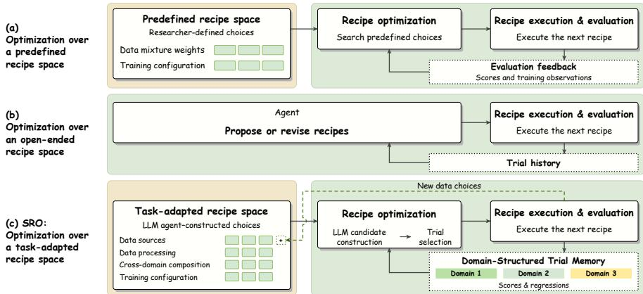
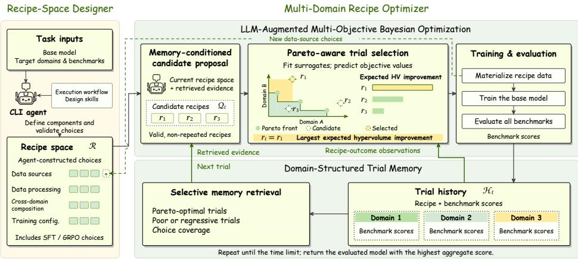
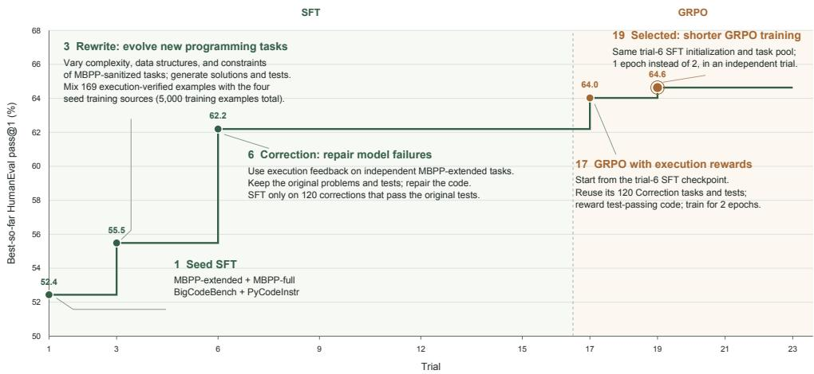
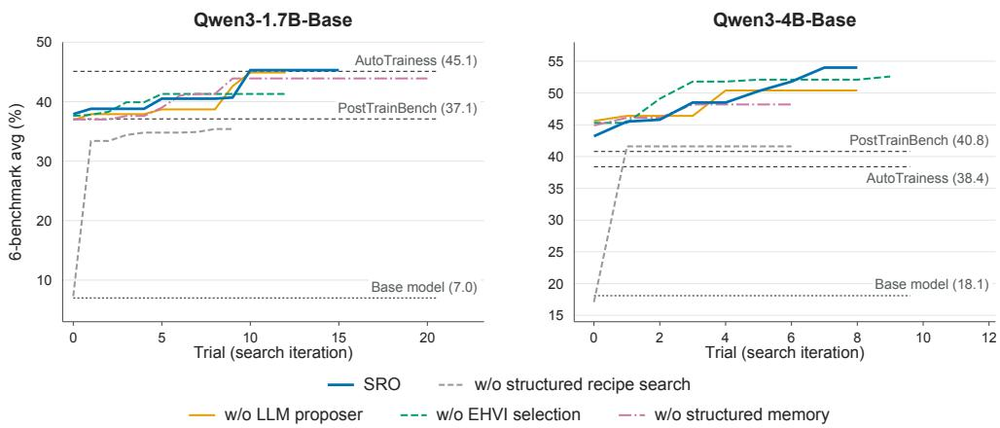
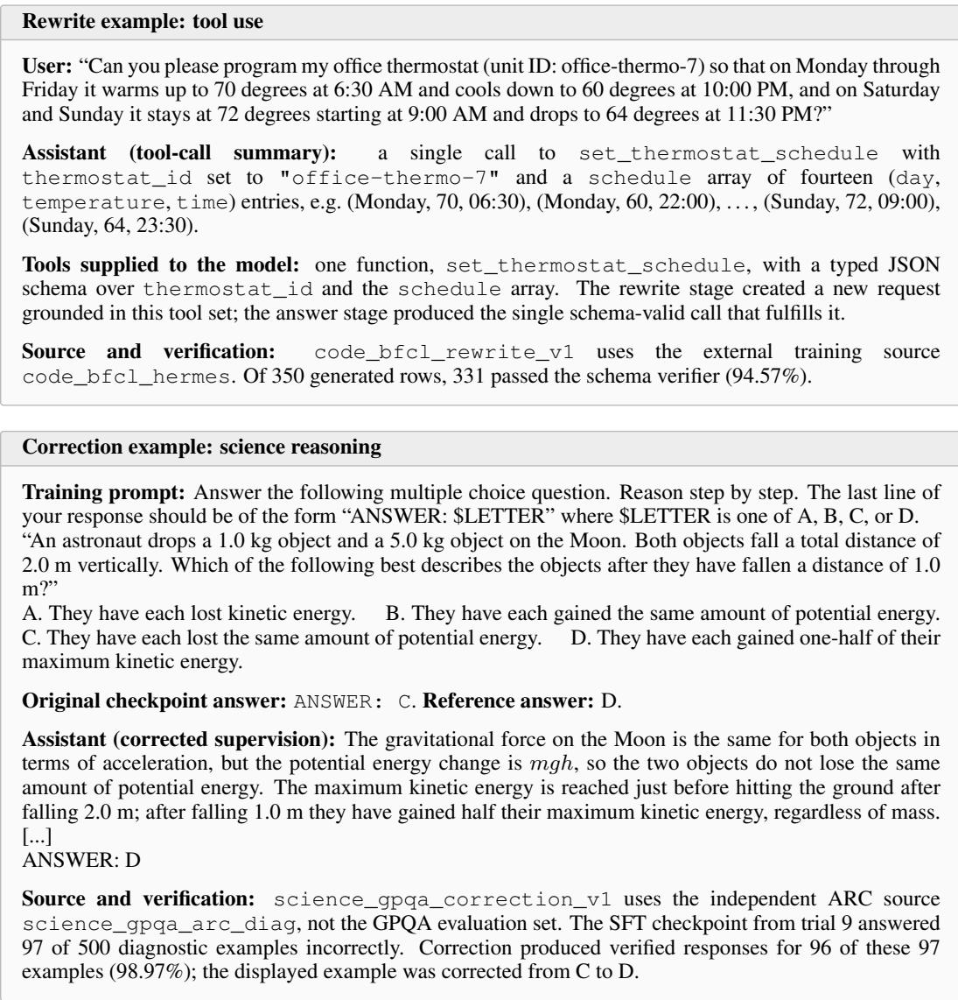
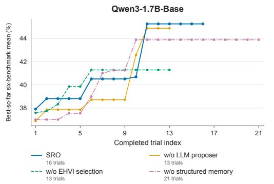
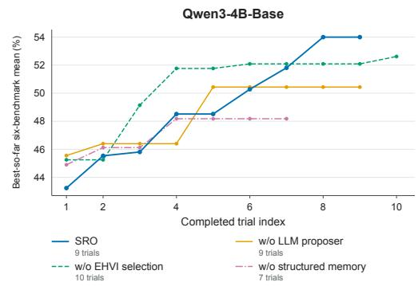

# LLM AGENTS FOR AUTOMATED POST-TRAINING VIA STRUCTURED RECIPE OPTIMIZATION

Ruohong Liu<sup>∗</sup>   
University of Oxford   
ruohong.liu@eng.ox.ac.uk

Lekang Jiang University of Cambridge lj408@cam.ac.uk

Bohan Tang<sup>∗</sup>   
LIGHTSPEED   
bohantang@global.tencent.com   
Jack Umenberger<sup>†</sup>   
University of Oxford   
jack.umenberger@eng.ox.ac.uk

Yiwen Guo<sup>†</sup> Independent Researcher guoyiwen89@gmail.com

## ABSTRACT

Automated post-training transforms pre-trained large language models (LLMs) into models capable of handling diverse domains by automatically constructing and optimizing a recipe of coupled decisions over data sources, data processing, cross-domain composition, and training configuration under a limited experimental budget. Existing automation either searches predefined recipe spaces that enable systematic optimization but remain fixed rather than adapting their available choices to the target tasks, or uses open-ended agents that discover task-specific choices but leave them implicit in trial-level edits, limiting their systematic reuse and recombination across trials. To fill this gap, we introduce optimization over a task-adapted recipe space, a novel paradigm that can adapt the recipe space itself to the target tasks while representing its choices explicitly for systematic reuse, recombination, and joint optimization. We instantiate this paradigm with Structured Recipe Optimization (SRO), comprising an LLM-based Recipe-Space Designer that constructs the task-adapted recipe space and a Multi-Domain Recipe Optimizer that uses structured trial evidence to guide LLM candidate construction and multi-objective Bayesian trial selection. Extensive experiments show that SRO achieves the highest average score in all evaluated target-model and agent-LLM combinations. In joint post-training across three capability domains and six benchmarks, SRO reaches 41.1 versus 15.4 for the strongest baseline on Qwen3- 1.7B with GPT-5.4, and 53.8 versus 40.8 on Qwen3-4B with DeepSeek-V4-Flash. Our code is available at https://github.com/RuohLiuq/SRO.

## 1 INTRODUCTION

Post-training transforms pre-trained large language models (LLMs) into instruction-following models capable of handling user requests across diverse domains, such as mathematical reasoning, cod ing, and knowledge-intensive question answering (Ouyang et al., 2022; Tie et al., 2025). This process involves a sequence of coupled decisions over data processing, cross-domain composition, and training configuration, whose interactions can largely affect the resulting model (Tie et al., 2025; Kumar et al., 2026). Coordinating these decisions to form a post-training recipe requires substantial expert engineering (Grattafiori et al., 2024; Guo et al., 2025), while evaluating each candidate recipe requires actual training and multi-domain evaluation, making experimentation expensive. These considerations motivate automated post-training methods that automatically optimize for effective recipes under a limited experimental budget.

  
Figure 1: Three paradigms for automated post-training.

Existing methods automate the overall post-training pipeline with two broad paradigms. First, optimization over a predefined recipe space specifies a recipe space in advance and systematically searches over the resulting alternatives for any given task. For example, AutoPipe applies Bayesian optimization to post-training pipeline configurations (Chwa et al., 2026).

While a predefined recipe space enables systematic comparison and optimization, it may exclude useful task-specific choices, such as data sources and processing methods, and thereby limit achievable post-training performance. Second, optimization over open-ended recipe space instead delegates more of the design process to LLM agents, allowing them to discover data, construct training interventions, and revise recipes using evaluation feedback for each specific task (Rank et al., 2026; Yu et al., 2026; Chen et al., 2026). This enables greater task-specific adaptation, but newly discovered interventions are typically introduced within trial-level edits without being consolidated into explicit, reusable choices. Consequently, evidence from previous trials cannot be systematically reused to compare and recombine individual recipe decisions, making subsequent search less sample-efficient and reducing the likelihood of identifying high-performing recipe combinations under a limited training budget. Thereon, existing paradigms trade off task adaptability against optimization effectiveness. Predefined recipe spaces support effective optimization but can omit choices needed for the target task, while open-ended agents can use such choices but do not organize them into a space that can be efficiently optimized across trials. Both leave substantial post-training performance unrealized.

To fill this gap, we explore a novel paradigm termed optimization over a task-adapted recipe space: constructing searchable choices for the target tasks and jointly optimizing their combinations. This paradigm introduces two key requirements. First, the recipe space must be task-adapted and structured: it should incorporate task-relevant alternatives for data sources, data processing, crossdomain composition, and training configuration, while representing them as explicit, reusable, and composable choices whose combinations remain executable and comparable across trials. Second, optimization over this space must be joint and sample-efficient. Since recipe components interact and each end-to-end evaluation is costly, search should reason over their combinations and use accumulated experimental evidence to prioritize promising recipes under a limited training budget.

To realize this paradigm, we propose Structured Recipe Optimization (SRO) with two key components. A Recipe-Space Designer decomposes post-training into components for data sources, data processing, cross-domain composition, and training configuration, and asks the LLM agent to populate each component with choices based on the given task. We provide skills to guide this construction together with a fixed workflow for data preparation, training, evaluation, and validity checks, allowing newly designed choices to be incorporated without sacrificing executability or comparability. A Multi-Domain Recipe Optimizer records executed recipes and their benchmark scores, organizing the results by domain. Selective retrieval provides relevant trial records and exploration statistics to guide LLM construction of multiple candidate recipes by recombining choices across components. Multi-objective Bayesian optimization fits domain-wise surrogate models to

the trial history and uses Pareto-aware acquisition to select one candidate for the next training trial.   
Figure 1 contrasts our proposed SRO with previous automated post-training paradigms.

Our main contributions are:

• We introduce optimization over a task-adapted recipe space as a novel paradigm for automated post-training, representing task-specific designs as explicit, reusable, and composable choices to support joint search over data and training decisions.

• We propose SRO to instantiate this paradigm. The Recipe-Space Designer constructs the search space, while the Multi-Domain Recipe Optimizer organizes trial history to support LLM candidate construction and multi-objective Bayesian trial selection.

• Extensive experiments show that SRO achieves the highest average score in all evaluated basemodel and agent-LLM combinations. For joint post-training across three capability domains and six benchmarks, SRO reaches 41.1 versus 15.4 for the strongest baseline on Qwen3-1.7B with GPT-5.4, and 53.8 versus 40.8 on Qwen3-4B with DeepSeek-V4-Flash.

## 2 RELATED WORKS

Post-Training. Post-training adapts a pre-trained language model to follow instructions and acquire desired capabilities across diverse downstream domains (Tie et al., 2025; Kumar et al., 2026). Modern post-training can be organized into three coupled stages: data preparation, supervised fine-tuning (SFT), and reinforcement learning (RL) (Tie et al., 2025; Ouyang et al., 2022; Guo et al., 2025). Data preparation constructs the supervision used by subsequent training stages by collecting, synthesizing, filtering, and mixing instruction–response pairs, reasoning trajectories, preference annotations, and task-specific feedback (Longpre et al., 2023; Wang et al., 2023; Cui et al., 2024). SFT trains the pre-trained model on curated samples to acquire instruction-following behavior and specific task capabilities (Wei et al., 2022; Sanh et al., 2022; Longpre et al., 2023). RL further optimizes the SFT model toward desired behaviors and capabilities through reward signals (Zhang et al., 2025). For example, RL with human feedback (RLHF) improves alignment with human preferences, while RL with verifiable rewards (RLVR) strengthens reasoning ability by rewarding correct solutions and intermediate steps (Ouyang et al., 2022; Guo et al., 2025). LLM post-training involves designing a recipe over coupled decisions in data processing and training configurations, which demand substantial human expert engineering (Grattafiori et al., 2024; Guo et al., 2025; Tie et al., 2025; Kumar et al., 2026). Since each candidate recipe requires costly training and evaluation, automated methods are proposed to construct effective recipes automatically under limited experimental budgets.

Automated Post-Training. Existing work on automated post-training spans from component-level to pipeline-level automation. Component-level methods automate decisions within a fixed training procedure, such as data generation, selection, and mixture optimization for data preparation (Wang et al., 2023; Xia et al., 2024; Zhang, 2026), sampling and resource allocation during SFT (Shin et al., 2026; Gualdoni et al., 2026), and domain balancing during RL (Li et al., 2025; Yang et al., 2026; Ramesh et al., 2026). More recent work moves toward pipeline-level automation, which is the focus of our work and broadly follows two paradigms. Optimization over a predefined recipe space systematically searches over pipeline choices specified in advance. For instance, AutoPipe applies Bayesian optimization to a predefined configuration space with base-model choice and SFT/RL hyperparameters (Chwa et al., 2026). Optimization over an open-ended recipe space instead delegates broader pipeline design to LLM agents. For instance, PostTrainBench gives agents full autonomy to discover training data and design and execute post-training strategies for target benchmarks (Rank et al., 2026). However, existing approaches trade off task adaptability against optimization effectiveness: predefined recipe spaces enable systematic search but may omit task-specific choices, whereas open-ended agents can discover such choices but struggle to organize and optimize them across trials. We improve automated post-training performance by addressing this gap.

  
Figure 2: Overview of SRO. The Recipe-Space Designer constructs a task-adapted recipe space, which the Multi-Domain Recipe Optimizer searches by Domain-Structured Trial Memory and LLM-Augmented Multi-Objective Bayesian Optimization.

## 3 METHODOLOGY

## 3.1 TASK DEFINITION

We study automated post-training over target domains $\mathcal { D } = \{ d _ { 1 } , \ldots , d _ { K } \}$ , each evaluated by one or more benchmarks. The agent is given a pretrained base model $M _ { 0 }$ , the target domains and benchmarks, a compute environment, and a time limit. No training data are provided; the agent must identify or construct suitable training data and specify the training configuration. Let U denote the set of executable post-training recipes permitted by these task constraints. Executing a recipe $r \in \mathcal { U }$ produces a model $M ( r ) = \bar { \mathrm { T r a i n } } ( \bar { M } _ { 0 } ; \bar { r } )$ . Let s(M) denote the vector of benchmark scores obtained by model M, grouped by domain, and let $s _ { k } ( M )$ denote the mean score across the benchmarks in domain $d _ { k }$ . The optimization objective is

$$
\operatorname* { m a x } _ { r \in \mathcal { U } } \bar { s } \big ( M ( r ) \big ) , \qquad \bar { s } ( M ) = \frac { 1 } { K } \sum _ { k = 1 } ^ { K } s _ { k } ( M ) .\tag{1}
$$

At the end of the time limit, we select the checkpoint with the highest aggregate score during recipe optimization for final external evaluation. We solve this optimization through two coupled tasks. First, Recipe-Space Design turns post-training decisions such as data sources, data processing methods, cross-domain composition, and training hyperparameters into searchable components $\bar { \mathcal { C } } \overset {  } { = } \{ c _ { 1 } , \ldots , c _ { J } \}$ . Each component $c _ { j }$ admits a set of choices $\mathcal { V } _ { j } = \{ v _ { j , 1 } , \dotsc , v _ { j , n _ { j } } \}$ . A recipe $\boldsymbol { r } = ( v _ { 1 } , \ldots , v _ { J } )$ selects one choice $v _ { j } \in \mathcal V _ { j }$ for every component, and all valid, executable combinations form the search space ${ \mathcal { R } } \subseteq { \mathcal { U } } .$ Second, Multi-Domain Recipe Optimization searches this space under the time limit. At iteration $t ,$ the next recipe is determined from the current search space $\mathcal { R } _ { t - 1 }$ and experimental history $\mathcal { H } _ { t - 1 } \colon r _ { t } = \mathrm { O p t i m i z e r } \bigl ( \mathcal { R } _ { t - 1 } , \mathcal { H } _ { t - 1 } \bigr )$ where Optimizer abstracts the feedback-driven search procedure. The selected recipe is executed and evaluated on all target benchmarks, and the resulting scores and diagnostic evidence are added to the history.

Predefined methods instantiate this process as $r _ { t } = \mathrm { O p t i m i z e r } ( \mathcal { R } _ { \mathrm { f i x e d } } , \mathcal { H } _ { t - 1 } )$ , using experimental feedback to guide search within a predefined space $\mathcal { R } _ { \mathrm { f i x e d } } \subseteq \mathcal { U } .$ . Open-ended agentic methods instead operate over the permitted recipe space, abstracted as $r _ { t } = \mathrm { O p t i m i z e r } ( \mathcal { U } , \mathcal { H } _ { t - 1 } )$ . They use experimental results, and potentially structured memory to propose and revise recipes, without necessarily consolidating the resulting choices into an explicit, reusable search space. We combine an agent-constructed recipe space with domain-structured experimental evidence, enabling subsequent decisions to draw on reusable choices and their observed effects across domains.

## 3.2 STRUCTURED RECIPE OPTIMIZATION (SRO)

Structured Recipe Optimization (SRO) tackles the two coupled tasks in Section 3.1 with a Recipe-Space Designer and a Multi-Domain Recipe Optimizer. The Designer first constructs the initial task-adapted recipe space $\mathcal { R } _ { 0 }$ . The Optimizer then iteratively uses trial history to propose and select a recipe, executes and evaluates it, and updates the trial history and recipe space for the next iteration. Figure 2 summarizes this workflow.

## 3.2.1 RECIPE-SPACE DESIGNER

The Recipe-Space Designer constructs the initial recipe space $\mathcal { R } _ { 0 }$ in three stages. It first defines the searchable recipe components, then provides an executable workflow and design skills for constructing valid choices, and finally instantiates and validates these choices to form $\mathcal { R } _ { 0 }$

Searchable components. We factorize each recipe along four decision dimensions: data sources, data processing, cross-domain composition, and training configuration. The corresponding components form $\mathcal { C } = \left( \bigcup _ { k = 1 } ^ { K } \mathcal { C } _ { k } ^ { \mathrm { { d a t a } } } \right) \cup \mathcal { C } ^ { \operatorname* { m i x } } \cup \mathcal { C } ^ { \operatorname { t r a i n } }$ , where $\mathcal { C } _ { k } ^ { \mathrm { d a t a } }$ contains the data-source and dataprocessing components for domain $d _ { k } , \mathcal { C } ^ { \mathrm { m i x } }$ contains the cross-domain composition, and C<sup>train</sup> contains the shared training configuration. This factorization defines the recipe-space schema, and the LLM agent subsequently instantiates task-adapted admissible choices for each component.

Execution workflow and design skills. Reimplementing data loading, formatting, training, and evaluation across trials wastes compute and introduces implementation variance. We therefore provide a fixed executable workflow that performs these operations, validates recipes, enforces compute constraints, and excludes evaluation data from training. To guide choice construction, we also provide reusable skills covering dataset discovery, generation-prompt design, cross-domain composition, and training configuration. The workflow handles execution and validation, the skills provide design guidance, and the agent can thus focus on instantiating concrete recipe choices.

Choice construction and expansion. Using the component schema and design skills above, the LLM agent instantiates discrete choices for each searchable component. For data sources, the agent identifies datasets relevant to each target domain, inspects examples, and specifies the field mappings required by the executable workflow. Each validated dataset becomes a data-source choice. For data processing, we provide two data-generation templates for expanding capability coverage and addressing model deficiencies. For each instantiated template, the agent specifies a source dataset and generation prompt; generation runs only when selected by a recipe, strictly excludes evaluation data. Validated generated datasets are subsequently registered as new data-source choices. For cross-domain composition, the agent specifies mixture ratios and assembly modes under a fixed training-sample budget. For training configuration, the agent constructs configuration choices for post-training algorithms such as SFT and GRPO. The validated choices populate the componentwise sets $\{ \bar { \mathcal { V } } _ { j } \} _ { j = 1 } ^ { \bar { J } }$ , whose valid combinations define the initial recipe space $\mathcal { R } _ { 0 }$

## 3.2.2 MULTI-DOMAIN RECIPE OPTIMIZER

The Multi-Domain Recipe Optimizer searches the current recipe space using feedback from previous trials. At iteration t, Domain-Structured Trial Memory retrieves a compact summary $S _ { t - 1 }$ from the trial history $\mathcal { H } _ { t - 1 }$ and current recipe space $\mathcal { R } _ { t - 1 }$ . An LLM proposer uses this summary to construct candidate recipes $\mathcal { Q } _ { t }$ , and multi-objective Bayesian optimization selects the next recipe $r _ { t }$ using the complete trial history. The selected recipe is then executed and evaluated, updating the trial history and, when new data-source choices are produced, the recipe space for the next iteration.

Domain-Structured Trial Memory. This memory retains each completed trial as a structured record $\xi _ { i } = ( r _ { i } , \mathbf { s } ( M _ { i } ) )$ , containing the executed recipe and its scores on all target domains. The scores are organized by domain to preserve differences in cross-domain performance, and the history before iteration t is denoted by $\mathcal { H } _ { t - 1 }$ . The history supports optimization in two paths. The Bayesian optimizer uses the history to fit its surrogate models, while the LLM proposer receives a compact summary obtained by selective retrieval: $S _ { t - 1 } = \mathrm { R e t r i e v e } ( \mathcal { H } _ { t - 1 } , \mathcal { R } _ { t - 1 } )$ . The summary includes Pareto-optimal or otherwise strong trials, lower-performing trials, aggregate statistics over explored choices, and coverage statistics identifying under-explored choices. Retaining recipe configurations alongside domain-wise results allows the proposer to compare historical recipes and their effects across domains rather than relying only on aggregate scores.

LLM-Augmented Multi-Objective Bayesian Optimization. Recipe optimization separates candidate construction from trial selection. Since proposing recipes with an LLM agent is inexpensive relative to data preparation, model training, and evaluation, we use the agent to construct multiple candidates and Bayesian optimization to select which candidate to execute. At iteration t, the LLM receives the current recipe space $\mathcal { R } _ { t - 1 }$ and retrieved summary $\boldsymbol { S } _ { t - 1 }$ , producing $\mathcal { Q } _ { t } = G _ { \mathrm { L L M } } ( \mathcal { R } _ { t - 1 } , S _ { t - 1 } )$ . It fills structured recipe fields with admissible choices rather than implementing a new training pipeline. The proposer compares recipe configurations and their domainwise results across retrieved trials, together with choice-coverage statistics. These comparisons guide the reuse of promising configurations, the recombination of existing choices, and the explo ration of under-explored options within the current recipe space.

The Bayesian optimizer uses the complete history $\mathcal { H } _ { t - 1 }$ to predict each candidate’s domain-wise outcomes and uncertainty. The mean benchmark score within each domain defines an objective, modeled by a separate surrogate using executed recipes and their observed outcomes. A Paretoaware acquisition function combines the predictive distributions to identify candidates expected to improve the current cross-domain trade-offs. We use expected hypervolume improvement (EHVI) and select $r _ { t } = \arg \operatorname* { m a x } _ { r \in \mathcal { Q } _ { t } } \alpha _ { t } ( r )$ , where $\alpha _ { t } ( r )$ is the acquisition score. Intuitively, EHVI measures the expected increase in dominated hypervolume relative to a reference point, accounting for predictive uncertainty. A warm-up strategy is used when too few completed trials are available to fit the surrogates. Appendix B.4 describes surrogate fitting and acquisition computation.

Trial execution and update. The executable workflow executes the selected recipe $r _ { t }$ , performing data preparation, training, and evaluation to obtain $M _ { t }$ and its benchmark scores. Data generation uses the sources and prompts from the Recipe-Space Designer. Correction uses the latest trained model to identify failed examples in its separate source dataset and generate corrective training data. While these failed examples are used to prompt data generation, the examples themselves are not retained in trial memory. After evaluation, the completed trial is added to the history $\mathcal { H } _ { t } ~ =$ $\mathcal { H } _ { t - 1 } \cup \{ \xi _ { t } \}$ . Validated generated datasets are registered as new data-source choices, producing the updated recipe space $\mathcal { R } _ { t } .$ . The updated states are the inputs to the next optimization iteration.

## 4 EXPERIMENTS

We evaluate SRO through three questions concerning overall performance, explicit recipe-space optimization, and the mechanisms used to search the constructed space.

## Research Questions

1. RQ1: How does SRO compare with existing automated post-training methods?

2. RQ2: How does our Recipe-Space Designer support recipe optimization?

3. RQ3: How does our Multi-Domain Recipe Optimizer support recipe optimization?

## 4.1 EXPERIMENTAL SETUP

Tasks and evaluation. We evaluate SRO in single-domain and multi-domain settings using the benchmarks and evaluation protocols provided by PostTrainBench (Rank et al., 2026). Each singledomain run targets one of GSM8K, GPQA Main, or HumanEval. Each multi-domain run jointly targets six benchmarks across three domains: mathematical reasoning (AIME 2025 and GSM8K), coding and tool use (BFCL v3 exec simple and HumanEval), and science and health (GPQA Main and HealthBench-Easy). The multi-domain aggregate score is the mean of the three domain scores, each computed by averaging its two benchmarks. All scores are reported as percentages.

Models and agent LLMs. We post-train Qwen3-1.7B-Base and Qwen3-4B-Base using DeepSeek-V4-Flash and GPT-5.4 as agent LLMs through the OpenCode CLI. Within each basemodel and agent-LLM configuration, all methods use the same agent LLM and CLI scaffold. We additionally report the official instruction-tuned models as reference points rather than competing methods because their post-training budgets are not matched.

Baselines. We compare against PostTrainBench (Rank et al., 2026) and AutoTrainess (Yu et al., 2026), two end-to-end agent-based methods that automate data acquisition, training, and evaluation. These methods align with our focus on the agent’s ability to automate the complete posttraining pipeline without requiring any predefined training data. PostTrainBench allows the agent to autonomously design and revise its training approach, while AutoTrainess provides a structured workflow. Both baselines run through OpenCode with the same base model, task specification, evaluation interface, agent LLM, and compute budget as SRO. We additionally evaluate optimization over a predefined recipe space on GSM8K, whose official training split provides a task-specific training source. Appendix D.1 describes this supplementary baseline and its results.

We also evaluate four variants with DeepSeek-V4-Flash: w/o structured recipe search replaces explicit recipe-space construction and its associated executable workflow with direct open-ended agentic recipe design; w/o LLM proposer uniformly samples candidate recipes from the same recipe space without using LLM proposals; w/o EHVI selection omits surrogate fitting and EHVI, selecting LLM-proposed candidates by self-reported confidence; and w/o structured memory replaces selective retrieval with the full history of recipes and raw benchmark scores, without domain-structured summaries or choice-coverage statistics. In the last variant, the history used for surrogate fitting is unchanged.

Training and compute budget. All runs start from the provided base model. The trainingconfiguration space includes LoRA-based SFT and, for single-domain runs, an optional GRPO phase. Each run uses one GPU with a wall-clock budget of 10 hours for single-domain experiments and 20 hours for multi-domain experiments. All methods follow the evaluation protocols and data-contamination constraints provided by PostTrainBench. We select the checkpoint with the highest aggregate score during recipe optimization and report its full-set evaluation outside the time budget (Appendix B.1).

## 4.2 RQ1: OVERALL EFFECTIVENESS

SRO achieves the highest average score in both settings. Tables 1 and 2 show that SRO achieves the highest average score in every evaluated base-model and agent-LLM configuration in both settings. In single-domain post-training, SRO improves individual benchmark scores by up to 41.7 points over the strongest baseline in the same configuration (GSM8K, Qwen3-4B with GPT-5.4: 87.4% vs. 45.7%). In multi-domain post-training, SRO improves the joint six-benchmark average by up to 25.7 points (Qwen3-1.7B with GPT-5.4: 41.1% vs. 15.4%).

SRO shows lower average sensitivity to the agent LLM. SRO matches or exceeds the strongest baseline in 11 of the 12 single-domain model–agent–benchmark combinations. The exception is GSM8K on Qwen3-1.7B with DeepSeek-V4-Flash, where AutoTrainess reaches 79.1 versus 68.2. In multi-domain experiments on Qwen3-4B with DeepSeek-V4-Flash, SRO improves all three domain averages over the strongest baseline by aggregate score: 45.5 versus 32.1 in mathematical reasoning, 87.0 versus 66.9 in coding and tool use, and 28.9 versus 23.4 in science and health. SRO also exhibits lower average sensitivity to the agent LLM in multi-domain experiments. Averaged across the two base models, switching agents changes its aggregate score by 5.3 points, compared with 25.6 for PostTrainBench and 14.9 for AutoTrainess.

## 4.3 RQ2: RECIPE-SPACE DESIGNER EFFECTIVENESS

A task-adapted and structured recipe space supports effective post-training. The w/o structured recipe search variant retains structured trial memory but does not construct a task-adapted recipe space before search. Instead, the agent directly designs and executes recipes during experi mentation. Under the same compute budget, its average score falls from 45.3 to 34.5 on Qwen3-1.7B and from 53.8 to 40.3 on Qwen3-4B (Table 3). These results support constructing a task-adapted, structured recipe space and using the associated workflow to search its combinations.

Table 1: Single-domain post-training with two base models and two agent LLMs. Each run targets one benchmark; Avg. denotes the mean score across the three separate runs.
<table><tr><td rowspan="2">Model</td><td rowspan="2">Agent LLM</td><td rowspan="2">Harness</td><td colspan="3">Benchmark Scores (↑)</td><td rowspan="2">Avg. (↑)</td></tr><tr><td>GSM8K</td><td>GPQA Main</td><td>HumanEval</td></tr><tr><td rowspan="7">Qwen3-1.7B-Base</td><td>一</td><td>None</td><td>12.7</td><td>14.1</td><td>7.9</td><td>11.6</td></tr><tr><td></td><td>PostTrainBench</td><td>49.0</td><td>27.5</td><td>54.9</td><td>43.8</td></tr><tr><td>DeepSeek-V4-Flash</td><td>AutoTrainess</td><td>79.1</td><td>28.1</td><td>53.7</td><td>53.6</td></tr><tr><td></td><td>SRO (Ours)</td><td>68.2</td><td>34.2</td><td>64.6</td><td>55.6</td></tr><tr><td>GPT-5.4</td><td>PostTrainBench</td><td>48.4</td><td>28.6</td><td>39.0</td><td>38.7</td></tr><tr><td></td><td>AutoTrainess</td><td>61.4</td><td>14.3</td><td>16.5</td><td>30.7</td></tr><tr><td></td><td>SRO (Ours)</td><td>69.5</td><td>32.4</td><td>53.7</td><td>51.9</td></tr><tr><td>Qwen3-1.7B-Instruct</td><td></td><td>Reference</td><td>88.5</td><td>35.5</td><td>68.9</td><td>64.3</td></tr><tr><td rowspan="7">Qwen3-4B-Base</td><td>一</td><td>None</td><td>41.8</td><td>13.4</td><td>36.6</td><td>30.6</td></tr><tr><td>DeepSeek-V4-Flash</td><td>PostTrainBench</td><td>77.3</td><td>33.9</td><td>67.7</td><td>59.6</td></tr><tr><td></td><td>AutoTrainess</td><td>71.2</td><td>24.3</td><td>75.6</td><td>57.0</td></tr><tr><td></td><td>SRO (Ours)</td><td>87.6</td><td>35.5</td><td>77.4</td><td>66.8</td></tr><tr><td>GPT-5.4</td><td>PostTrainBench</td><td>45.7</td><td>24.1</td><td>73.2</td><td>47.7</td></tr><tr><td></td><td>AutoTrainess</td><td>42.8</td><td>19.0</td><td>39.6</td><td>33.8</td></tr><tr><td></td><td>SRO (Ours)</td><td>87.4</td><td>35.0</td><td>77.4</td><td>66.6</td></tr><tr><td>Qwen3-4B-Instruct</td><td>一</td><td>Reference</td><td>93.8</td><td>44.6</td><td>77.4</td><td>71.9</td></tr></table>

Table 2: Multi-domain post-training across six benchmarks in three domains. Each run jointly targets all six benchmarks. Avg. is the mean across domains.
<table><tr><td rowspan="2"></td><td rowspan="2" colspan="2"></td><td colspan="6">Benchmark Scores (↑)</td><td rowspan="2"></td></tr><tr><td colspan="2">Mathematical Reasoning</td><td colspan="2">Coding &amp; Tool Use</td><td colspan="2">Science &amp; Health</td></tr><tr><td>Model</td><td>Agent LLM</td><td>Harness</td><td>AIME 2025</td><td>GSM8K</td><td>BFCL</td><td>HumanEval</td><td>GPQA Main</td><td>HealthBench</td><td>Avg. (↑)</td></tr><tr><td rowspan="9">Qwen3-1.7B-Base</td><td rowspan="2"></td><td>None</td><td>0.0</td><td>12.7</td><td>0.0</td><td>7.9</td><td>14.1</td><td>7.5</td><td>7.0</td></tr><tr><td>PostTrainBench</td><td>0.0</td><td>58.8</td><td>92.0</td><td>35.4</td><td>27.9</td><td>8.6</td><td>37.1</td></tr><tr><td rowspan="2">DeepSeek-V4-Flash</td><td>AutoTrainess</td><td>0.0</td><td>73.8</td><td>92.0</td><td>58.5</td><td>30.8</td><td>15.6</td><td>45.1</td></tr><tr><td>SRO (Ours)</td><td>6.7</td><td>76.7</td><td>91.0</td><td>58.5</td><td>16.1</td><td>22.7</td><td>45.3</td></tr><tr><td rowspan="2">GPT-5.4</td><td>PostTrainBench</td><td>0.0</td><td>40.0</td><td>0.0</td><td>0.0</td><td>7.4</td><td>7.2</td><td>9.1</td></tr><tr><td>AutoTrainess</td><td>0.0</td><td>13.2</td><td>0.0</td><td>42.7</td><td>23.9</td><td>12.4</td><td>15.4</td></tr><tr><td rowspan="2">Qwen3-1.7B-Instruct</td><td>SRO (Ours)</td><td>3.3</td><td>57.1</td><td>93.0</td><td>45.7</td><td>32.6</td><td>15.2</td><td>41.1</td></tr><tr><td>Reference</td><td>26.7</td><td>88.5</td><td>94.0</td><td>68.9</td><td>35.5</td><td>44.9</td><td>59.7</td></tr><tr><td rowspan="9"></td><td rowspan="2"></td><td>None</td><td>3.3</td><td>41.8</td><td>0.0</td><td>36.6</td><td>13.4</td><td>13.4</td><td>18.1</td></tr><tr><td>PostTrainBench</td><td>0.0</td><td>64.1</td><td>88.0</td><td>45.7</td><td>32.1</td><td>14.7</td><td>40.8</td></tr><tr><td rowspan="2">DeepSeek-V4-Flash</td><td>AutoTrainess</td><td>0.0</td><td>55.6</td><td>88.0</td><td>43.9</td><td>26.8</td><td>15.8</td><td>38.4</td></tr><tr><td>SRO (Ours)</td><td>3.3</td><td>87.6</td><td>94.0</td><td>79.9</td><td>30.8</td><td>26.9</td><td>53.8</td></tr><tr><td rowspan="2">GPT-5.4</td><td>PostTrainBench</td><td>0.0</td><td>43.4</td><td>0.0</td><td>36.6</td><td>15.0</td><td>10.4</td><td>17.6</td></tr><tr><td>AutoTrainess</td><td>0.0 0.0</td><td>49.7</td><td>90.0</td><td>48.2</td><td>28.8 29.0</td><td>13.4 22.6</td><td>38.4 47.5</td></tr><tr><td rowspan="2"></td><td>SRO (Ours)</td><td></td><td>85.7</td><td>88.0</td><td>59.8</td><td></td><td></td><td></td></tr><tr><td>Reference</td><td>53.3</td><td>93.8</td><td>95.0</td><td>77.4</td><td>44.6</td><td>52.7</td><td>69.5</td></tr></table>

Expanding the recipe space with reusable choices improves subsequent recipes. Figure 3 shows the search on HumanEval with Qwen3-1.7B and DeepSeek-V4-Flash. The agent initially identifies MBPP and MBPP+ as data-source choices and specifies sources and generation prompts for Rewrite and Correction. These choices, together with training-configuration choices, form the initial recipe space. During search, selected data-processing methods generate training data, and validated datasets become additional data-source choices for subsequent recipes. The initial SFT recipe achieves 52.4, while subsequent recipes using Rewrite and Correction data reach 55.5 and 62.2, respectively. Correction uses model errors on a separate source dataset, not HumanEval evaluation examples. GRPO initialized from the best SFT model then reaches 64.0; adjusting training configurations yields 64.6. This shows how search incorporates newly generated data as reusable choices and combines them with training choices to improve subsequent recipes.

## 4.4 RQ3: MULTI-DOMAIN RECIPE OPTIMIZER EFFECTIVENESS

We next examine candidate proposal, trial selection, and structured memory within the designed recipe space, using the remaining ablations in Table 3 and Figure 4.

LLM candidate construction and EHVI trial selection both improve performance. Replacing the LLM proposer with uniform candidate sampling reduces the final score by 1.3 points on Qwen3- 1.7B and 3.6 points on Qwen3-4B. The resulting scores of 44.0 and 50.2 show that the constructed space and retained EHVI selection still support effective search, while LLM proposals provide further gains. Replacing EHVI with LLM-reported confidence reduces the scores by 4.2 and 1.9 points, respectively. On Qwen3-4B, confidence-based selection improves several individual benchmarks but lowers HealthBench-Easy from 26.9 to 14.2, yielding a lower aggregate score. These results support using surrogate-based selection rather than the proposer’s confidence to compare candidates with different cross-domain effects.

Table 3: Comparison with ablations of the recipe space design and search mechanisms. All runs use DeepSeek-V4-Flash and the same compute budget on each base model.
<table><tr><td rowspan="3" colspan="2"></td><td colspan="6">Benchmark Scores (↑)</td><td rowspan="3"></td></tr><tr><td colspan="2">Mathematical Reasoning</td><td colspan="2">Coding &amp; Tool Use</td><td colspan="2">Science &amp; Health</td></tr><tr><td>AIME 2025</td><td>GSM8K</td><td>BFCL</td><td>HumanEval</td><td>GPQA Main</td><td>HealthBench</td></tr><tr><td rowspan="5">Qwen3-1.7B</td><td>Full SRO</td><td>6.7</td><td>76.7</td><td>91.0</td><td>58.5</td><td>16.1</td><td>22.7</td><td>Avg. (↑) 45.3</td></tr><tr><td>w/o structured recipe search</td><td>0.0</td><td>57.3</td><td>85.0</td><td>34.1</td><td>23.2</td><td>7.6</td><td>34.5</td></tr><tr><td>w/o LLM proposer</td><td>6.7</td><td>74.3</td><td>94.0</td><td>55.5</td><td>20.3</td><td>13.4</td><td>44.0</td></tr><tr><td>w/o EHVI selection</td><td>0.0</td><td>56.0</td><td>94.0</td><td>51.2</td><td>29.7</td><td>15.4</td><td>41.1</td></tr><tr><td>w/o structured memory</td><td>3.3</td><td>75.7</td><td>91.0</td><td>59.8</td><td>16.5</td><td>13.8</td><td>43.4</td></tr><tr><td rowspan="5">Qwen3-4B</td><td>Full SRO</td><td>3.3</td><td>87.6</td><td>94.0</td><td>79.9</td><td>30.8</td><td>26.9</td><td>53.8</td></tr><tr><td>w/o structured recipe search</td><td>6.7</td><td>63.1</td><td>90.0</td><td>45.1</td><td>30.4</td><td>6.7</td><td>40.3</td></tr><tr><td>w/o LLM proposer</td><td>3.3</td><td>86.6</td><td>95.0</td><td>72.6</td><td>22.3</td><td>21.6</td><td>50.2</td></tr><tr><td>w/o EHVI selection</td><td>10.0</td><td>88.4</td><td>93.0</td><td>69.5</td><td>36.4</td><td>14.2</td><td>51.9</td></tr><tr><td>w/o structured memory</td><td>0.0</td><td>81.3</td><td>93.0</td><td>65.9</td><td>33.9</td><td>15.3</td><td>48.2</td></tr></table>

  
Figure 3: Search trajectory on HumanEval for Qwen3-1.7B-Base with DeepSeek-V4-Flash. Each point denotes an evaluated recipe, and the solid step curve tracks the best HumanEval pass@1 ob served so far. The vertical dashed line separates the SFT and GRPO phases. Numbered annotations mark the seed SFT recipe, the introduction of Rewrite-generated data, the addition of Correction data, the first GRPO improvement, and the final selected checkpoint.

Selective retrieval and structured summaries improve candidate construction. Giving the proposer the full history of recipes and raw benchmark scores, without selective retrieval, domainstructured summaries, or choice-coverage statistics, reduces the final score by 1.9 points on Qwen3- 1.7B and 5.6 points on Qwen3-4B. Both SRO and this variant retain the executed recipes and their benchmark scores, and the history used for surrogate fitting is unchanged. The comparison therefore supports organizing and selectively retrieving historical results for the proposer, rather than supplying the complete raw history.

## 5 CONCLUSION

We introduce optimization over a task-adapted recipe space, a novel paradigm for automated post-training that adapt the recipe space to the target tasks while representing its choices explicitly for systematic reuse, recombination, and joint optimization. Thereon, we propose Structured Recipe Optimization (SRO), which constructs a task-adapted recipe space and uses accumulated multi-domain trial evidence to guide sample-efficient recipe optimization. Experiments show that SRO consistently outperforms existing automated post-training methods, offering an approach that combines task adaptability with systematic optimization under limited experimental budgets.

  
Figure 4: Optimization trajectories of SRO and its variants under the same compute budget. Each curve tracks the best multi-domain average obtained over completed trials.

## REFERENCES

Wanyi Chen, Xiao Yang, Xu Yang, Tianming Sha, Qizheng Li, Zhuo Wang, Bowen Xian, Fang Kong, Weiqing Liu, and Jiang Bian. Agent<sup>2</sup> rl-bench: Can llm agents engineer agentic rl posttraining?, 2026. URL https://arxiv.org/abs/2604.10547.

Channe Chwa, Xinle Wu, and Yao Lu. Automatic configuration of LLM post-training pipelines. arXiv preprint arXiv:2603.18773, 2026. URL https://arxiv.org/abs/2603.18773.

Ganqu Cui, Lifan Yuan, Ning Ding, Guanming Yao, Bingxiang He, Qiang Yue, Yuan Ni, Guotong Xie, Ruobing Xie, Yankai Lin, Zhiyuan Liu, and Maosong Sun. ULTRAFEEDBACK: Boosting language models with scaled AI feedback. In Forty-first International Conference on Machine Learning, 2024. URL https://openreview.net/forum?id=BOorDpKHiJ.

Michael TM Emmerich, Kyriakos C Giannakoglou, and Boris Naujoks. Single-and multiobjective evolutionary optimization assisted by gaussian random field metamodels. IEEE Transactions on Evolutionary Computation, 10(4):421–439, 2006.

Aaron Grattafiori, Abhimanyu Dubey, Abhinav Jauhri, Abhinav Pandey, Abhishek Kadian, Ahmad Al-Dahle, Aiesha Letman, Akhil Mathur, Alan Schelten, Alex Vaughan, et al. The llama 3 herd of models. arXiv preprint arXiv:2407.21783, 2024. URL https://arxiv.org/abs/2407. 21783.

Eleonora Gualdoni, Sonia Laguna, Louis Bethune, Joao Monteiro, Pierre Ablin, and Marco Cuturi. DynaMiCS: Fine-tuning LLMs with performance constraints using dynamic mixtures. arXiv preprint arXiv:2605.10770, 2026. URL https://arxiv.org/abs/2605.10770.

Daya Guo, Dejian Yang, Haowei Zhang, Junxiao Song, Peiyi Wang, Qihao Zhu, Runxin Xu, Ruoyu Zhang, Shirong Ma, Xiao Bi, et al. Deepseek-r1: Incentivizing reasoning capability in llms via reinforcement learning. arXiv preprint arXiv:2501.12948, 2025.

Frank Hutter, Holger H Hoos, and Kevin Leyton-Brown. Sequential model-based optimization for general algorithm configuration. In International conference on learning and intelligent optimization, pp. 507–523. Springer, 2011.

Donald R Jones, Matthias Schonlau, and William J Welch. Efficient global optimization of expensive black-box functions. Journal ofGlobal optimization, 13(4):455–492, 1998.

Komal Kumar, Tajamul Ashraf, Omkar Thawakar, Rao Muhammad Anwer, Hisham Cholakkal, Mubarak Shah, Ming-Hsuan Yang, Phillip HS Torr, Fahad Shahbaz Khan, and Salman Khan. Llm post-training: A deep dive into reasoning large language models. IEEE Transactions on Pattern Analysis and Machine Intelligence, 2026. URL https://ieeexplore.ieee.org/ abstract/document/11640952.

Derek Li, Jiaming Zhou, Leo Maxime Brunswic, Abbas Ghaddar, Qianyi Sun, Liheng Ma, Yu Luo, Dong Li, Mark Coates, Jianye Hao, et al. Omni-thinker: Scaling multi-task rl in llms with hybrid reward and task scheduling. arXiv preprint arXiv:2507.14783, 2025. URL https://arxiv. org/abs/2507.14783.

Shayne Longpre, Le Hou, Tu Vu, Albert Webson, Hyung Won Chung, Yi Tay, Denny Zhou, Quoc V Le, Barret Zoph, Jason Wei, and Adam Roberts. The flan collection: Designing data and methods for effective instruction tuning. In Andreas Krause, Emma Brunskill, Kyunghyun Cho, Barbara Engelhardt, Sivan Sabato, and Jonathan Scarlett (eds.), Proceedings of the 40th International Conference on Machine Learning, volume 202 of Proceedings of Machine Learning Research, pp. 22631–22648. PMLR, 23–29 Jul 2023. URL https://proceedings.mlr.press/ v202/longpre23a.html.

Long Ouyang, Jeffrey Wu, Xu Jiang, Diogo Almeida, Carroll Wainwright, Pamela Mishkin, Chong Zhang, Sandhini Agarwal, Katarina Slama, Alex Ray, et al. Training language models to follow instructions with human feedback. Advances in neural information processing systems, 35: 27730–27744, 2022.

Shyam Sundhar Ramesh, Xiaotong Ji, Matthieu Zimmer, Sangwoong Yoon, Zhiyong Wang, Haitham Bou Ammar, Aurelien Lucchi, and Ilija Bogunovic. Multi-task GRPO: Reliable LLM reasoning across tasks. In Forty-third International Conference on Machine Learning, 2026. URL https://openreview.net/forum?id=zA3KhRZ9A5.

Ben Rank, Hardik Bhatnagar, Ameya Prabhu, Shira Eisenberg, Karina Nguyen, Matthias Bethge, and Maksym Andriushchenko. Posttrainbench: Can llm agents automate llm post-training? arXiv preprint arXiv:2603.08640, 2026.

Victor Sanh, Albert Webson, Colin Raffel, Stephen H. Bach, Lintang Sutawika, Zaid Alyafeai, Antoine Chaffin, Arnaud Stiegler, Teven Le Scao, Arun Raja, Manan Dey, M Saiful Bari, Canwen Xu, Urmish Thakker, Shanya Sirohi Sharma, Eliza Szczechla, Taewoon Kim, Gunjan Chhablani, Nihal Nayak, Debajyoti Datta, Jonathan Chang, Mike Tian-Jian Jiang, Han Wang, Matteo Manica, Sheng Shen, Zheng Xin Yong, Harshit Pandey, Rachel Bawden, Thomas Wang, Trishala Neeraj, Jos Rozen, Abheesht Sharma, Andrea Santilli, Thibault Fevry, Jason Alan Fries, Ryan Teehan, Stella Biderman, Leo Gao, Thomas Bers, Thomas Wolf, and Alexander M. Rush. Multitask prompted training enables zero-shot task generalization. In International Conference on Learning Representations, 2022. URL https://arxiv.org/abs/2110.08207.

Haebin Shin, Lei Ji, Xiao Liu, Zhiwei Yu, Hyunwoo Yoo, Qi Chen, and Yeyun Gong. DynamixSFT: Dynamic mixture optimization of instruction tuning collections. In Findings of the Association for Computational Linguistics: ACL 2026, pp. 39590–39603, July 2026. doi: 10.18653/v1/ 2026.findings-acl.1972. URL https://aclanthology.org/2026.findings-acl. 1972/.

Guiyao Tie, Zeli Zhao, Dingjie Song, Fuyang Wei, Rong Zhou, Yurou Dai, Wen Yin, Zhejian Yang, Jiangyue Yan, Yao Su, et al. A survey on post-training of large language models. arXiv preprint arXiv:2503.06072, 2025. URL https://arxiv.org/abs/2503.06072.

Yizhong Wang, Yeganeh Kordi, Swaroop Mishra, Alisa Liu, Noah A. Smith, Daniel Khashabi, and Hannaneh Hajishirzi. Self-instruct: Aligning language models with self-generated instructions. In Proceedings of the 61st Annual Meeting of the Association for Computational Linguistics (Volume 1: Long Papers), pp. 13484–13508, July 2023. doi: 10.18653/v1/2023.acl-long.754. URL https://aclanthology.org/2023.acl-long.754/.

Jason Wei, Maarten Bosma, Vincent Y. Zhao, Kelvin Guu, Adams Wei Yu, Brian Lester, Nan Du, Andrew M. Dai, and Quoc V. Le. Finetuned language models are zero-shot learners. In International Conference on Learning Representations, 2022. URL https://arxiv.org/abs/ 2109.01652.

Mengzhou Xia, Sadhika Malladi, Suchin Gururangan, Sanjeev Arora, and Danqi Chen. Less: Selecting influential data for targeted instruction tuning. arXiv preprint arXiv:2402.04333, 2024.

Yongjin Yang, Jiarui Liu, Yinghui He, Lechen Zhang, Bernhard Scholkopf, and Zhijing Jin. Trans-¨ ferability for general reasoning: An automated curriculum for multi-domain RLVR. arXiv preprint arXiv:2606.25178, 2026. URL https://arxiv.org/abs/2606.25178.

Zhaojian Yu, Penghao Yin, Shuzheng Gao, Shilin He, Kai Cai, and Xiao-Ping Zhang. Autotrainess: Teaching language models to improve language models autonomously. arXiv preprint arXiv:2606.31551, 2026.

He Zhang. DomainPilot: Domain-level loss-guided two-stage data mixture optimization for efficient language model fine-tuning. arXiv preprint arXiv:2607.22769, 2026. URL https://arxiv. org/abs/2607.22769.

Kaiyan Zhang, Yuxin Zuo, Bingxiang He, Youbang Sun, Runze Liu, Che Jiang, Yuchen Fan, Kai Tian, Guoli Jia, Pengfei Li, et al. A survey of reinforcement learning for large reasoning models. arXiv preprint arXiv:2509.08827, 2025. URL https://arxiv.org/abs/2509.08827.

## A LIMITATIONS

Dynamic recipe-space evolution. SRO constructs a task-adapted recipe space before optimization and can expand it during search when newly generated datasets become reusable choices within existing components. However, the set of searchable components and their organization remain fixed within each run: optimization does not introduce new component types or modify the component hierarchy. Building on SRO’s structured recipe representation, future work could extend this flexibility from choice-level expansion to schema-level evolution, allowing new components or hierarchical structures to be introduced as experimental evidence accumulates.

Continual post-training across tasks and models. SRO uses accumulated trial evidence to guide recipe optimization for a fixed set of target tasks and a given base model. While this enables reuse across trials within a run, we do not study a continual setting in which new post-training tasks or base models are encountered sequentially and experience from earlier runs is carried forward. Future work could extend SRO to reuse recipe choices, trial evidence, or optimization priors across successive post-training problems, reducing repeated exploration and enabling increasingly efficient automated post-training over time.

## B EXPERIMENTAL SETUP DETAILS

## B.1 BENCHMARKS, EVALUATION PROTOCOL, AND SCORING

We consider single-domain and multi-domain post-training. Single-domain runs target GSM8K, GPQA Main, or HumanEval separately. Multi-domain runs jointly target six benchmarks spanning mathematical reasoning, coding and tool use, and science and health. Table 4 summarizes the evaluation sets, output formats, and scoring rules. Within each setting, all compared methods use the same evaluation scripts, prompts, and chat templates provided by PostTrainBench (Rank et al., 2026). The agent may not modify these evaluation components. HealthBench-Easy uses GPT-5.4-mini as the judge, with the same judge configuration across all compared methods.

Table 4: Evaluation benchmarks, output formats, and scoring rules for the single-domain and multidomain experiments.
<table><tr><td>Benchmark</td><td>Domain</td><td>Test size</td><td>Output contract</td><td>Scoring</td></tr><tr><td>AIME 2025</td><td>math</td><td>30</td><td>ANSWER: &lt;integer&gt;</td><td>exact match</td></tr><tr><td>GSM8K</td><td>math</td><td>1,319</td><td>ANSWER: &lt;number&gt;</td><td>exact match</td></tr><tr><td>BFCL v3</td><td>coding &amp; tool use</td><td>500</td><td>structured tool_calls</td><td>schema execution</td></tr><tr><td>HumanEval</td><td>coding &amp; tool use</td><td>164</td><td>complete Python function</td><td>unit tests</td></tr><tr><td>GPQA Main</td><td>science &amp; health</td><td>448</td><td>ANSWER: &lt;A--D&gt;</td><td>exact match</td></tr><tr><td>HealthBench-Easy</td><td>science &amp; health</td><td>245</td><td>free-form responses</td><td>LLM-judge rubrics</td></tr></table>

During SRO recipe optimization, each trial is evaluated on 50% of the examples from each target benchmark, except HealthBench-Easy, for which 50 samples are used. These scores guide recipe optimization and checkpoint selection. For PostTrainBench and AutoTrainess, the agents choose their search-time evaluation sample sizes through the provided evaluation interface.

At the end of each run, the checkpoint with the highest observed score during SRO recipe optimization is selected and evaluated on the complete target benchmark sets outside the time budget. For PostTrainBench and AutoTrainess, the agent select from the models derived from iterative optimization which it decides as final model based on evaluation on the target benchmark. For single-domain runs, we report the target benchmark score; for multi-domain runs, we report the mean across do mains, each computed by averaging its benchmark scores.

## B.2 COMPUTE BUDGET AND INFRASTRUCTURE

Each multi-domain run (SRO and both baselines) receives a 20-hour wall-clock budget that covers discovery, data generation, training, and search-time evaluation. Each single-domain run (Table 1) receives a 10-hour budget. Final independent evaluation is conducted outside this budget. All methods receive the same budget, task description, evaluation interface, and hardware. Each run has exclusive access to one GPU with 16,896 CUDA cores, 132 streaming multiprocessors, and 141 GB of memory.

Every method—SRO, the PostTrainBench baseline, and the AutoTrainess baseline—drives the same CLI agent scaffold (OpenCode) with one of two agent LLMs, DeepSeek-V4-Flash or GPT-5.4, served through a fixed gateway. In SRO the same agent LLM serves as (i) the discovery agent that constructs the recipe space, (ii) the in-loop recipe proposer, and (iii) the framework’s auxiliary data-generation calls (Rewrite / Correction workers).

A SRO run consists of (i) a recipe space design phase in which the CLI agent explores sources and methods and submits the executable handoff, and (ii) a recipe optimization phase in which it executes at most iterative rounds of proposal, acquisition, training, and evaluation, until reaching wall-clock budget.

## B.3 TRAINING CONFIGURATION

SRO runs start from the provided base model, which is never replaced or merged with external model weights.

Warmup ratio is fixed at 0.05. Qwen3-1.7B-Base uses per-device batch size 8 with gradient accumulation 4; Qwen3-4B-Base uses batch size 2 with accumulation 16 (effective batch size 32 in both cases). The SFT loss is applied to the assistant target only.

In single-domain runs, after three consecutive completed SFT trials with neither realized Paretohypervolume growth nor any improvement in domain-wise historical-best scores, the search enters a GRPO phase initialized from the best SFT checkpoint and continues LoRA training. Training prompts come from discovered sources with reference answers or executable tests. Rewards use the verification rules of the target benchmark to check answer correctness or unit-test success; evaluation examples never enter the training prompt pool. None of the reported multi-domain runs entered this phase within the time budget; all results in Table 2 therefore come from SFT trials.

For GRPO, the proposer searches five components: learning rate $\in \{ 5 \times 1 0 ^ { - 7 } , 1 0 ^ { - 6 } , 2 \times 1 0 ^ { - 6 } \}$ , KL coefficient $\beta \in \{ 0 , 0 . 0 2 , 0 . 0 4 \}$ , group size $G \in \{ 8 , 1 6 \}$ , training budget (short or long), and prompt selector (all or unstable). The short and long budgets correspond to one and two passes over the prompt pool, respectively. The unstable selector retains only prompts for which the current model’s sampled answers disagree; all uses the complete pool. The remaining settings are fixed. Rollout temperature is 0.8 and top-p is 0.95. Maximum completion length is 512 tokens, and maximum prompt length is half the model’s sequence-length limit. Per-device batch size is half the SFT value, with gradient accumulation adjusted so that the effective batch size is divisible by G. Training uses bf16 precision.

## B.4 BAYESIAN OPTIMIZER IMPLEMENTATION

For Bayesian optimization, benchmark scores are normalized using the base and instruction-tuned reference scores in Table 5, then averaged within each domain to define the optimization objectives.

Table 5: Base and instruction-tuned reference scores used to normalize the BO objectives. Scores are reported on a percentage scale.
<table><tr><td>Model</td><td>AIME</td><td>GSM8K</td><td>BFCL</td><td>HumanEval</td><td>GPQA</td><td>HealthBench</td><td>Mean</td></tr><tr><td>Qwen3-1.7B-Base</td><td>0.0</td><td>12.7</td><td>0.0</td><td>7.9</td><td>14.1</td><td>7.5</td><td>7.0</td></tr><tr><td>Qwen3-1.7B-Instruct</td><td>26.7</td><td>88.5</td><td>94.0</td><td>68.9</td><td>35.5</td><td>44.9</td><td>59.7</td></tr><tr><td>Qwen3-4B-Base</td><td>3.3</td><td>41.8</td><td>0.0</td><td>36.6</td><td>13.4</td><td>13.4</td><td>18.1</td></tr><tr><td>Qwen3-4B-Instruct</td><td>53.3</td><td>93.8</td><td>95.0</td><td>77.4</td><td>44.6</td><td>52.7</td><td>69.5</td></tr></table>

Whenever Bayesian selection is used, its hyperparameters are fixed as listed in Table 6. Each recipe r is encoded as a feature vector $\phi ( r )$ consisting of the per-domain budget shares, a one-hot encoding of the assembly mode, one binary indicator per registered data source (including sources generated during the search), one binary indicator per data-generation method, and the training choices for the active phase. The SFT and GRPO choices are specified in Appendix B.3; the feature dimension depends on the recipe space and training phase.

For each parent domain, an independent random forest regresses $\phi ( r )$ onto the corresponding normalized domain objective. Each forest consists of 24 regression trees of maximum depth 4, each trained on a bootstrap replica of the trial history over a random 70% subset of the features. We use random forests to model the predominantly categorical recipe features (Hutter et al., 2011). The trees’ mean yields the prediction, and their disagreement provides an empirical uncertainty estimate.

For each candidate recipe r, we generate $S ~ = ~ 6 4$ outcome vectors by independently sampling one tree’s prediction from each domain’s forest. We estimate expected hypervolume improvement (EHVI) (Emmerich et al., 2006) as

$$
\alpha _ { t } ( r ) = \frac { 1 } { S } \sum _ { m = 1 } ^ { S } \left[ \mathrm { H V } \Big ( \mathscr { P } _ { t - 1 } \cup \{ \mathbf { y } ^ { ( m ) } ( r ) \} \Big ) - \mathrm { H V } ( \mathscr { P } _ { t - 1 } ) \right] ,\tag{2}
$$

where $\mathcal { P } _ { t - 1 }$ is the Pareto front of observed normalized domain scores and $\mathbf { y } ^ { ( m ) } ( r )$ is the m-th sampled outcome vector. Here, HV measures dominated hypervolume relative to the normalized base-model reference point. Each round executes the candidate with the highest acquisition score. In single-domain runs, the objective is scalar and the acquisition estimates improvement over the best observed score (Jones et al., 1998).

Until five feasible evaluated trials are available, we use a warm-up heuristic instead of fitting the forests. It is based on the proposing LLM’s self-declared priors, c<sub>efect</sub> + 0.4 conf + 0.2 novelty − 0.3 risk; this rule is active only during the earliest rounds. Cross-domain draws treat the per-domain predictions as independent, so cross-domain error correlations are not modeled. Selection is sequential, with one candidate executed per round.

Table 6: Bayesian optimizer hyperparameters, held fixed wherever the corresponding components are retained.
<table><tr><td>Hyperparameter</td><td>Value</td></tr><tr><td>Trees per domain</td><td>24</td></tr><tr><td>Maximum tree depth</td><td>4</td></tr><tr><td>Feature subsampling fraction</td><td>0.7</td></tr><tr><td>Monte-Carlo draws S</td><td>64</td></tr><tr><td>Warm-start threshold (feasible trials)</td><td>5</td></tr><tr><td>Warm-start weights (conf / novelty / risk) Reference point</td><td>0.4 / 0.2 / 0.3</td></tr><tr><td>Candidates executed per round</td><td>base model 1</td></tr></table>

## C INSTRUCTIONS AND PROMPTS

This section presents the task instructions, skills, and prompt templates for the reported experiments. The discovery-stage instruction is condensed for presentation, with machine-specific operational rules omitted. Placeholders indicate run-specific content inserted at call time.

## C.1 DISCOVERY-STAGE TASK INSTRUCTION

The following condensed task instruction specifies the objective, available support, deliverables, and rules for recipe-space design.

Construct a task-adapted post-training recipe space for the provided   
base model and target benchmarks.   
## Objective   
Through data research and design, provide relevant, complementary,   
and composable choices for subsequent search, including training   
data sources, data processing methods, source combinations, and   
cross-domain composition.   
Submit a recipe space validated by the workflow and a valid initial   
recipe selected from that space. The initial recipe demonstrates   
executability; it does not specify the best eventual recipe.   
This stage ends when the handoff is accepted.

## Autonomy & Exploration   
- You may access the internet to research and compare multiple   
candidate datasets. Do not stop at the first loadable dataset.   
First study the benchmark documentation, implementation, and   
non-evaluation examples to understand the target capability,   
input and output requirements, scoring rules, and difficulty.   
Compare actual examples from candidate sources, considering   
task relevance, supervision quality, difficulty, and complementary   
coverage. Retain several meaningfully different training-source   
choices.   
Perform the necessary data filtering and field mapping, and   
validate the adapted data through the workflow.   
You may design Rewrite and/or Correction methods as needed.   
Specify a suitable source and generation prompts for each method.   
Use a separate source that excludes evaluation   
examples.   
Within the given data budget, design source combinations and   
cross-domain composition choices that support multiple   
executable recipes.   
You may iteratively revise sources, methods, and the recipe space   
based on workflow validation feedback.   
## Information on the Setup   
We provide benchmark descriptions, an evaluation interface, a   
training-data budget, and a workflow for data adaptation, method   
validation, and recipe-space handoff. Training-configuration choices   
are supplied by the workflow; your design work focuses on data   
sources, data processing, and data composition.   
Use the skills in this order: benchmark, data, augmentation,   
search\_space, and handoff. They guide task analysis, source selection,   
data-processing method design, recipe-space construction, and   
handoff validation, respectively.   
Create task.json, sources.json, search\_space.json, runtime.json,   
and initial\_recipe.json in the provided formats. Initialize and   
validate the run, then resolve issues identified by the workflow   
until the handoff status is "accepted".   
## Rules   
1. There will be no user interaction. Operate autonomously.   
2. Complete the task within the assigned time budget.   
3. Do not use target benchmark evaluation questions or answers   
for training or training-data construction.   
4. Do not modify the evaluation scripts or templates.

## C.2 DISCOVERY SKILLS

The initialization context K contains five skills that guide benchmark analysis, data-source selection, data-processing method design, recipe-space construction, and handoff validation. The excerpts below retain their substantive instructions while omitting operational commands, file-format specifications, and benchmark-specific output-format details.

=== SKILL: benchmark ===   
Begin by studying every assigned benchmark. Use its implementation, scorer,   
documentation, task format, and representative non-evaluation examples to   
understand what successful training data should teach.   
Create a concise working description of:   
- the capability and knowledge being measured;   
- the scorer-facing input and expected output;   
- how correctness is determined;   
- the approximate difficulty and content distribution;   
- the kinds of examples likely to transfer to the benchmark.   
Use this description when comparing data sources and designing data   
processing methods.   
Similarity includes capability, task form, and difficulty rather than storage   
schema alone.   
Target evaluation questions, answers, and transformations of them are   
reserved for evaluation. Keep them out of training, data-generation inputs,   
and generation prompts.

=== SKILL: data ===   
Research several candidate datasets for every benchmark. Begin with   
established sources commonly used for the same or closely related capability,

then consider other sources when they add useful coverage. Compare actual examples from the exact configuration and split; dataset names and schemas alone are not evidence of suitability.

Select several genuinely useful base-training alternatives for each domain. Quality and meaningful diversity matter more than filling the search space with near-duplicates.

Prepare sources for three roles:

- Base training may use a broader range of relevant examples and should preserve the source's natural instruction format.   
- Rewrite input should contain reliable existing supervision that the benchmark adapter can verify. Correction sources should be separate from training data and close enough to the benchmark to reveal relevant model failures.

Use deterministic preprocessing to select relevant examples and faithfully convert existing fields into the required training format. A generally useful dataset may be filtered when it contains examples outside the benchmark capability - for example, filtering legal questions from a scientific knowledge source. If the relevant subset cannot be selected reliably, choose another dataset. Inspect the normalized output after conversion. Verifier-backed roles need genuine source supervision such as an explicit answer, label, or executable tests; never manufacture missing supervision during adaptation.

Record dataset identity, revision, split, license, field mapping, and intended role. Evaluation data and its derivatives are excluded from every role.

=== SKILL: augmentation ===   
Study the benchmark capability, task format, scorer, difficulty, and representative non-evaluation examples.   
Infer which variations could create useful training coverage and which properties must remain valid.

Consider both depth and breadth when designing data generation, rather than applying fixed transformations. Two methods are available:

- Rewrite evolves suitable source tasks into new tasks within the benchmark's capability neighborhood.   
- Correction turns model failures on an independent, non-evaluation data source and the corresponding verifier feedback into corrected training examples.

Design Rewrite and/or Correction methods as needed. For each method, select a suitable source and author generation prompts during recipe-space design. The workflow invokes the method if it is selected during subsequent search; small-scale validation during design checks whether it produces suitable examples. The methods should offer substantive coverage rather than surface paraphrases.

Every Rewrite uses two stages. The first prompt creates a new task input by transforming the source task while preserving its relevance to the target capability. The second prompt independently creates the required supervision for the new input without seeing or copying the original answer. Correction uses the latest trained model's errors on its independent source: its prompt produces corrected supervision from the original task, wrong attempt, and verifier feedback.

Validate each method through the workflow. Use example-level feedback to improve the prompts, then validate the revised method again. Include only accepted methods in the search space.

Design and validate each benchmark method independently. Use a validation failure to repair the corresponding method and requirement. Serialization, parser, token-limit, or stochastic generation failures are not evidence that the task should be made easier. Do not propagate a workaround from one benchmark to another.

Passing the adapter is necessary but not sufficient. Before registering a method, inspect accepted examples for semantic correctness, benchmark-aligned difficulty, reasoning depth, and diversity across the batch. Rewrite should remain conditioned on the source task rather than collapse into repeated free-form templates.

For each domain, include:   
- several accurate and complementary base-source choices;   
optionally, an accepted Rewrite method backed by a suitable source;   
optionally, an accepted Correction method backed by an independent,   
non-evaluation source;   
- positive mixture-ratio choices.   
Include cross-domain mixture modes that can represent different reasonable   
allocations while keeping every objective covered. The resulting combinations   
should provide multiple structurally different recipes rather than cosmetic   
variations of one recipe.   
The initial recipe is a valid executable example drawn from the choices;   
it demonstrates that the space is runnable but does not define the eventual   
best configuration.

=== SKILL: handoff ===   
Submit the data sources, data processing methods, recipe space, and a valid   
initial recipe using the assigned base model and workflow-provided runtime   
settings. Validate each included Rewrite or Correction method as described   
in the augmentation skill.   
The workflow checks source loading and format conversion, data-processing   
validation results, and whether the initial recipe uses valid choices and   
can be executed. Use the feedback to revise the corresponding sources,   
methods, or choices and validate again.   
The discovery task is complete when the workflow accepts the handoff.

## C.3 RECIPE-PROPOSER PROMPT

At every round of the optimization loop, the recipe proposer receives the current recipe space and selectively retrieved trial evidence, as described in Section 3.2.2. The evidence includes strong and lower-performing trials, domain-wise results, and choice-coverage statistics. The proposer constructs multiple candidate recipes; trial selection is handled separately. The template below omits field-level implementation details. In the structured-memory ablation, the retrieved evidence is replaced by the complete flat history of recipes and raw benchmark scores.

You are proposing candidate SFT recipes for multi-domain post-training.   
Each recipe must be self-contained and use only current searchable choices.   
## Searchable decision space   
<Decision components and rules for using data generation>   
## Current searchable choices   
<Per-domain data sources, including previously generated datasets;   
available data processing methods; cross-domain mixture ratios and   
composition modes; SFT hyperparameters>   
## Long-term search summary   
<Reference-model scores, per-domain best results, statistics over explored   
choices, choice coverage, normalized Pareto front, and recently proposed   
but unevaluated candidates>   
The best result in an individual domain does not necessarily identify the   
best recipe across domains. Use these results and the Pareto front to propose   
promising cross-domain combinations. Candidates listed as proposed-but-not-evaluated   
have no measured outcome and must not be treated as failures. Use the   
choice-coverage statistics to distinguish choices that have not been evaluated   
from those associated with weak observed results.   
## Candidate-set requirements   
Treat all returned recipes as one candidate set and make them meaningfully   
diverse from one another. The set must include exploitation of observed   
evidence, recombination of promising choices, and exploration of   
under-explored choices. Do not return minor variants that repeatedly   
reuse the same per-domain data processing method.   
## Historical trial feedback   
<Selected historical trials, including Pareto-optimal or otherwise strong   
trials and lower-performing trials; each with its recipe, benchmark scores,   
domain-wise results, and aggregate score>   
## Hard rules   
- Select one available mixture ratio and one cross-domain composition mode.   
Specify data choices for every domain assigned a positive ratio.   
Select data sources and data processing methods only from the current   
choices for the corresponding domain.

```markdown
- When selecting data generation, explicitly choose whether to use the
generated data alone or combine them with existing sources. The workflow
uses exactly the selected sources and generated data; it does not
automatically add base sources.
- Infer source-mode preferences separately for each domain from historical
empirical evidence; do not assume base-only, base+generated, or
generated-only is universally superior.
- When evidence is incomplete or confounded, include controlled source-mode
ablations that change one domain at a time.
## Required JSON schema
<Schema specifying each recipe's cross-domain composition, per-domain
data sources and optional data generation, SFT hyperparameters, and
expected effect, confidence, and risk>
## Example response format
<Two example recipes: one using interleaved base sources and one using
generated data>
Return up to <N> candidate recipes in the required JSON format.
Do not include prose or markdown fences.
```

## C.4 BASELINE TASK PROMPT

We use the original implementations of PostTrainBench and AutoTrainess (Rank et al., 2026; Yu et al., 2026), adapting only the task objective and evaluation interface for joint post-training across six benchmarks. Each baseline retains its original optimization procedure. The condensed objective below follows the wording of the PostTrainBench task prompt; {model} denotes the assigned base model.

```markdown
## Objective
You should perform automated research and development to post-train
{model} to achieve the highest average score across the following
six benchmarks:
1. Mathematical reasoning: AIME 2025 and GSM8K.
2. Coding and tool use: BFCL v3 and HumanEval.
3. Science and health: GPQA Main and HealthBench-Easy.
You can evaluate the model via the evaluate.py script, which reports
individual benchmark scores and their mean within each domain.
The overall score is the mean of the three domain scores, equivalent
to the mean of all six benchmark scores.
Store the trained model with the highest overall score in final_model.
```

## D ADDITIONAL EXPERIMENTAL RESULTS

We present the recipe spaces and generated data, the optimization trajectories, and the remaining performance limitations of SRO.

## D.1 OPTIMIZATION OVER A PREDEFINED RECIPE SPACE

We instantiate a predefined-space baseline using SRO’s execution framework to optimize training configurations with a fixed training dataset. The training pool consists of the first 5,000 examples from the openai/gsm8k main/train split. Source discovery, data mixture optimization, and data generation are disabled. The SFT search space contains eight LoRA configurations: learning rate $\mathsf { \bar { \in } \{ 1 0 ^ { - 4 } , 2 \times 1 0 ^ { - 4 } \} }$ , training epochs $\in \{ 2 , 3 \}$ , and LoRA rank ∈ {16, 64}. Both model sizes use an effective batch size of 32, BF16 precision, cosine learning-rate decay, a warmup ratio of 0.05, and gradient checkpointing.

Candidates are sampled without replacement from the remaining configurations using a fixed random seed, without an LLM proposer. After cold-start initialization, a random-forest surrogate and expected-improvement acquisition select the next trial using GSM8K accuracy as the objective. After five consecutive SFT trials without improvement in the best observed score, the procedure enters a GRPO phase initialized from the best SFT checkpoint. Both runs evaluate six of the eight SFT configurations before this transition. The final model is evaluated on all 1,319 GSM8K test examples.

Table 7: GSM8K accuracy (%) under optimization over a predefined recipe space with a fixed training dataset. Single-domain SRO results with DeepSeek-V4-Flash from Table 1 are reproduced for reference.
<table><tr><td>Base model</td><td>Before training</td><td>Best SFT</td><td>GRPO</td><td>Final</td><td>SRO (Ours)</td></tr><tr><td>Qwen3-1.7B-Base</td><td>10.3</td><td>55.0</td><td>55.7</td><td>55.7</td><td>68.2</td></tr><tr><td>Qwen3-4B-Base</td><td>43.0</td><td>74.8</td><td>74.5</td><td>74.8</td><td>87.6</td></tr></table>

Table 7 summarizes the results. Both models obtain their best SFT result with a learning rate of $2 \times 1 0 ^ { - 4 }$ , three training epochs, and LoRA rank 64. GRPO further improves Qwen3-1.7B to 55.7, whereas Qwen3-4B retains its best SFT model at 74.8. This comparison measures performance when task-specific training data are supplied in advance and search is restricted to training configu ration.

## D.2 AGENT-CONSTRUCTED RECIPE SPACES

Each base-model and agent-LLM configuration independently constructs its data-source choices, data processing methods, and recipe space.

The constructed spaces contain complementary data sources and processing choices. Table 8 presents the data-source choices from the DeepSeek-V4-Flash discovery run for Qwen3-1.7B. For each benchmark, the agent selected base training sources, a Rewrite input source, and a separate Correction source; it also designed one Rewrite and one Correction method (Table 9).

Table 8: Discovery-selected sources for DeepSeek-V4-Flash with Qwen3-1.7B. Correction uses separate source data that exclude evaluation examples.
<table><tr><td>Benchmark</td><td>Base training sources</td><td>Rewrite source</td><td>Correction source</td></tr><tr><td>AIME 2025</td><td>AIME 1983–2024; Hendrycks AIME 1983–2024 MATH</td><td></td><td>aime_diag</td></tr><tr><td>GSM8K</td><td>GSM8K train; MetaMathQA GSM8K train (GSM subset)</td><td></td><td>gsm8k_diag</td></tr><tr><td rowspan="2">HumanEval BFCL</td><td>MBPP; MBPP+ (EvalPlus)</td><td>MBPP</td><td>mbpp_diag</td></tr><tr><td>Hermes function-calling; Glaive v2</td><td>Hermes</td><td>bfcl_hermes_diag</td></tr><tr><td>GPQA Main HealthBench MedAlpaca</td><td>MMLU (science subset); ARC MMLU (science subset) MedAlpaca WikiDoc</td><td>flashcards; MedAlpaca flashcards</td><td>arc_diag medical-o1-reasoning</td></tr></table>

The selected sources vary across models and agent LLMs. For Qwen3-4B, DeepSeek-V4-Flash independently constructed a different recipe space. Its sources include AIME gneubig, OpenR1, and MATH for AIME; GSM8K, MetaMath, and OpenMathInstruct for GSM8K; MBPP full and sanitized variants for HumanEval; Hermes and Glaive for BFCL; MMLU STEM and professional sub sets and MMLU-Pro for GPQA; and MedQA, MedMCQA, and MMLU medical subsets for Health Bench. Both DeepSeek configurations include Rewrite and Correction choices for each benchmark.

For Qwen3-1.7B, GPT-5.4 performed independent source research under the same skills and constraints and selected partially different sources: for mathematics, NuminaMath (general subset) and a competition-training pool replace the AIME/MATH archive; for GSM8K, Orca-Math word problems are added; for GPQA, SciQ and PubMedQA replace MMLU/ARC; for HealthBench, Chat-Doctor replaces MedAlpaca, with MedMCQA and medical-o1 serving as Correction sources. This run includes one Rewrite and one Correction method per benchmark.

Examples illustrate the resulting training data. We present lightly formatted excerpts from three accepted generated rows in the DeepSeek-V4-Flash–Qwen3-1.7B SRO run: two Rewrite examples (GSM8K and BFCL) and one Correction example (GPQA). Formatting is condensed for readability, while the task content, generated supervision, and verification outcomes are preserved. The BFCL tool call is summarized, and the GPQA rationale is excerpted.

Table 9: Agent-designed data-processing methods in the DeepSeek-V4-Flash run for Qwen3-1.7B. Rewrite uses separate task-generation and answer-generation prompts; Correction generates supervision from model errors on independent source data.
<table><tr><td>Benchmark</td><td>Method</td><td>Description</td></tr><tr><td rowspan="2">AIME</td><td>Rewrite</td><td>Evolve AIME-adjacent competition problems into new integer-answer (0-999) problems with independent full reasoning.</td></tr><tr><td>Correction</td><td>Turn wrong AIME-style answers on independent source data into corrected full- reasoning integer-answer solutions.</td></tr><tr><td rowspan="2">GSM8K</td><td>Rewrite</td><td>Evolve GSM8K-style word problems into new multi-step arithmetic problems with independent solutions.</td></tr><tr><td>Correction</td><td>Turn wrong GSM8K-style answers on independent source data into corrected full- reasoning numeric solutions.</td></tr><tr><td rowspan="2">HumanEval</td><td>Rewrite</td><td>Evolve MBPP-style tasks into new function-writing specs with independent solu- tions and executable tests.</td></tr><tr><td>Correction</td><td>Repair failing MBPP-style solutions on independent source data into correct, test- passing implementations.</td></tr><tr><td rowspan="2">BFCL</td><td>Rewrite</td><td>Rewrite function-calling conversations into new grounded requests with a single schema-valid tool call.</td></tr><tr><td>Correction</td><td>Correct wrong BFCL-style tool calls into schema-valid single calls that fulfill the request.</td></tr><tr><td rowspan="2">GPQA</td><td>Rewrite</td><td>Evolve MMLU-style science questions into new four-choice questions with inde- pendent reasoned answers.</td></tr><tr><td>Correction</td><td>Repair wrong science multiple-choice answers on independent source data into rea- soned, correctly-labeled solutions.</td></tr><tr><td rowspan="2">HealthBench</td><td>Rewrite</td><td>Evolve medical Q&amp;A conversations into new clinical scenarios with complete, safe, uncertainty-aware answers.</td></tr><tr><td>Correction</td><td>Repair wrong or unsafe health answers on independent source data into complete, safe, uncertainty-aware, actionable responses.</td></tr></table>

The two Rewrite rows are recorded as teacher\_labeled\_and\_verified: their new inputs and supervision were generated separately and accepted by the corresponding benchmark adapters. The GPQA Correction row is recorded as verifier\_corrected: it was generated from an actual checkpoint failure on an independent diagnostic source and checked against that source’s reference answer. All three examples originate from training or independent diagnostic sources, not benchmark evaluation data.

## Rewrite example: arithmetic reasoning

Training prompt: Solve the following math problem step by step. The last line of your response should be of the form “ANSWER: \$ANSWER” (without quotes) where \$ANSWER is the answer to the problem. “Maya is organizing a school fundraiser. She buys 5 boxes of cookies, each containing 12 packs. Each pack has 8 cookies. She sells 3/4 of the total cookies at a bake sale. Later, she donates half of the remaining cookies to a local shelter. How many cookies does Maya have left after donating?”

Assistant (independently generated supervision): First, calculate the total number of packs: 5 boxes × 12 packs per box = 60 packs. Then calculate total cookies: 60 packs × 8 cookies per pack = 480 cookies. She sells 3/4 of the total cookies: 3/4 × 480 = 360 cookies sold. Remaining after sale: 480 − 360 = 120 cookies. She donates half of the remaining: 1/2 × 120 = 60 cookies donated. Cookies left after donating: 120 − 60 = 60.   
ANSWER: 60

Source and verification: math\_gsm8k\_rewrite\_v1 uses the training source math\_gsm8k\_train. Of 500 generated rows, 481 passed validation (96.2%).



## D.3 RECIPE OPTIMIZATION TRAJECTORIES

The ablation trajectories complement the final-score comparisons. Figure 5 plots the best-sofar search-time six-benchmark mean against completed trials for SRO and three optimizer ablations, all using DeepSeek-V4-Flash. For each target model, the full system and these ablations use the same validated initial recipe space and compute budget. The two target models have independently constructed spaces. The w/o structured recipe search variant is not included in this trial-indexed comparison because it does not use the same recipe-execution workflow.

The trajectories show when gains are obtained and whether subsequent trials improve the incumbent. On both target models, full SRO achieves a higher final search-time score than the three ablations, providing additional evidence for the contributions of LLM candidate construction, EHVI selection, and structured memory. Trial-indexed curves describe progress per completed experiment; the number of experiments completed within the time budget also depends on data generation, training, and evaluation costs.

Search progress varies across runs. Table 10 summarizes the completed trial counts, selected trials, and corresponding search-time and final evaluation scores for the four multi-domain runs. In several runs, the best recipe is found before search terminates, and subsequent trials do not further improve the best search-time aggregate score.



  
Figure 5: Best-so-far search-time six-benchmark mean versus completed trial index for SRO and three optimizer ablations. Left: Qwen3-1.7B-Base. Right: Qwen3-4B-Base. All runs use DeepSeek-V4-Flash and the same compute budget. Trial counts differ because recipe execution costs vary.

Table 10: Search summary of the four SRO multi-domain runs. The selected trial maximizes the search-time six-benchmark mean. Final scores are obtained by evaluating the selected checkpoint on the complete benchmark sets after the time budget. Evaluation settings are detailed in Appendix B.1. All scores are reported on a 0–100 scale.
<table><tr><td>Agent LLM</td><td>Base model</td><td>Trials</td><td>Selected trial</td><td>Search-time</td><td>Final</td></tr><tr><td>DeepSeek-V4-Flash</td><td>Qwen3-1.7B</td><td>16</td><td>11</td><td>45.3</td><td>45.3</td></tr><tr><td>DeepSeek-V4-Flash</td><td>Qwen3-4B</td><td>9</td><td>8</td><td>54.0</td><td>53.8</td></tr><tr><td>GPT-5.4</td><td>Qwen3-1.7B</td><td>17</td><td>7</td><td>40.9</td><td>41.1</td></tr><tr><td>GPT-5.4</td><td>Qwen3-4B</td><td>8</td><td>8</td><td>48.3</td><td>47.5</td></tr></table>

Higher aggregate scores can coexist with lower individual benchmark scores. During the DeepSeek-V4-Flash run on Qwen3-1.7B, some recipes achieve strong GSM8K scores while substantially degrading GPQA performance; the selected recipe also scores below the run’s GPQA peak. On Qwen3-4B, an increase in the aggregate score similarly coincides with a decrease in AIME performance. These observations illustrate the cross-domain trade-offs in joint post-training: recipe quality must be assessed across the target domains rather than from any individual benchmark alone. Because recipes can differ in several data and training choices, these observations do not isolate the effect of any single component.

## D.4 LIMITATIONS AND FAILURE CASES

Competition mathematics remains difficult. Across the four multi-domain runs, the final selected models achieve AIME scores of 0.0–6.7, substantially below the instruction-tuned reference scores of 26.7 for Qwen3-1.7B and 53.3 for Qwen3-4B. With only 30 evaluation problems, each additional correct answer changes the score by about 3.3 points. These results show that a high aggregate score does not imply strong performance on every capability.

Recipe validity does not guarantee capability preservation. During the DeepSeek-V4-Flash run on Qwen3-1.7B, some candidate recipes produce severe regressions in BFCL performance. Such failures show that recipes assembled from admissible choices can still perform poorly on an individual benchmark. Recipe validation checks executability but does not guarantee preservation of every capability. The observed scores alone do not determine whether these regressions arise from data composition, training settings, or output-format failures.

## E CONTAMINATION SAFEGUARDS AND RUN HYGIENE

Because automated post-training systems have been shown to engage in reward hacking when given the opportunity (Rank et al., 2026), all reported runs enforce the following safeguards. These apply identically to SRO and both baselines.

Task-level rules. Every run receives the contamination rules reproduced in Appendix C.4: benchmark questions, answers, solutions, tool-call targets, rubrics, and transformations of them are reserved for evaluation and must not appear in training sources, Rewrite inputs, diagnostic sources, generated-data prompts, or examples.

Structural guards in SRO. Beyond the task-level rules, the SRO workflow enforces contamination safety structurally, since the search space is machine-checked rather than free-form code: (i) every declared source passes a benchmark adapter that canonicalizes rows and validates required supervision (explicit numeric targets for math, four choices plus an A–D gold label for GPQA, executable tests plus reference solutions for HumanEval, schema-valid tool calls for BFCL, complete multi-turn structure for HealthBench), and rejected sources cannot appear in recipe choices; (ii) HealthBench rows containing official rubrics, ideal\_completions\_data, or canary fields are rejected outright; (iii) Rewrite supervision is generated by an answer stage that never sees the source target, and Correction supervision is verified against the diagnostic source’s own oracle rather than against any benchmark artifact; (iv) diagnostic sources are held out from training-data roles and used only to surface model failures for Correction; (v) the handoff records a content digest of every source and method contract, so the exact training data of every reported run is reproducible and auditable after the fact.

Model substitution. Only the assigned base model may be fine-tuned; checkpoints must derive from the base model. SRO satisfies this by construction (the workflow trains only from the assigned base checkpoint), and the baselines receive the same rule in their task prompt. Final evaluation loads each submitted final\_model through the same benchmark entrypoints used during the run, with evaluation scripts and templates immutable from the agent’s perspective.