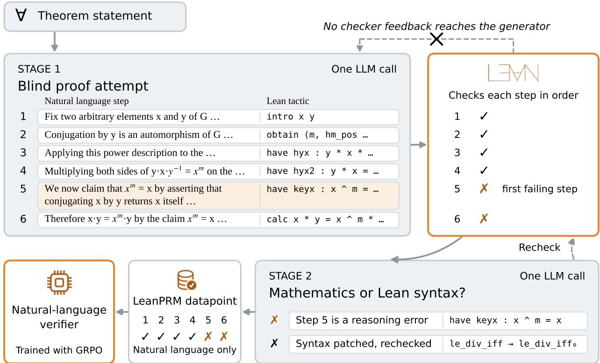
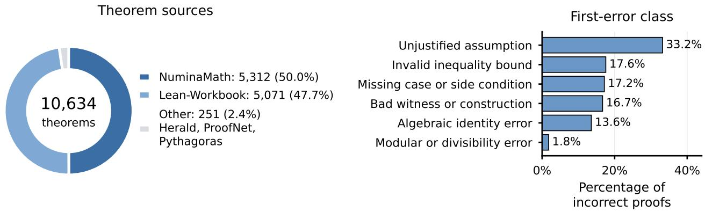
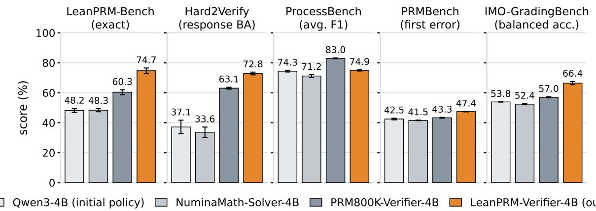
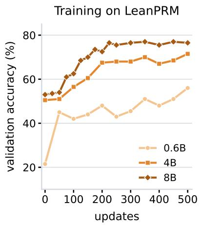
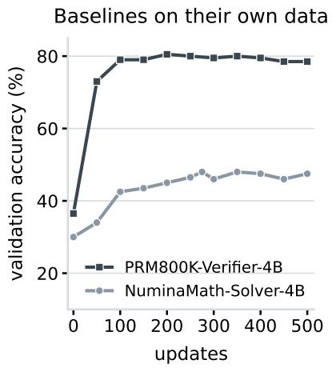
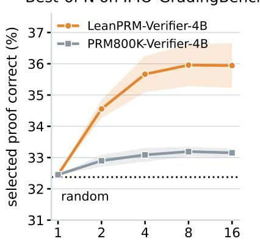
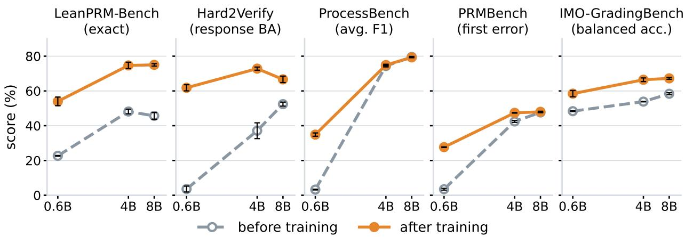

# LeanPRM: Lean-Grounded Process Supervision for Natural Language Proof Verification

Rodney Lafuente-Mercado <sup>✯</sup> <sup>1</sup> Salman Rahman <sup>✯</sup> <sup>2,3</sup> Jingyan Shen <sup>3</sup>

James Shiffer <sup>2</sup> Saadia Gabriel <sup>2</sup> Pavel Izmailov <sup>3</sup>

<sup>1</sup>University of Texas at Austin <sup>2</sup>University of California, Los Angeles <sup>3</sup>New York University

<sup>✯</sup> Equal contribution

## Abstract

AI systems now write long and difficult mathematical proofs, and checking their step-by-step validity is becoming a bottleneck. A learned verifier could check proofs cheaply, but training one requires a correctness label on every step, and such labels are hard to obtain for open-ended proofs. Existing methods take them from human annotators, which is costly, or derive them from final answers, which proofs do not have, and formalizing each proof in Lean requires expert effort. We introduce LeanPRM, a framework that uses the Lean proof assistant to create step-level labels for natural-language proofs. A model writes a natural-language proof together with a paired formal proof, without feedback from Lean. Lean then labels every step, and a second model discards failures caused only by the formal syntax, so that the negative labels mark errors in the mathematics. LeanPRM contains 10,634 proofs with 152K labeled steps and no human annotation. A Qwen3-4B verifier trained on LeanPRM raises exact step-label accuracy on a held-out set of 200 proofs (LeanPRM-Bench) from 48.2 to 74.7, as opposed to 60.3 when the same base model is trained on PRM800K. It also selects better proofs in best-of-N selection on IMO-level problems, and outperforms the PRM800K-trained verifier on three of four external verification benchmarks. Training on LeanPRM improves verifiers at every size from 0.6B to 8B parameters on LeanPRM-Bench, Hard2Verify and IMO-GradingBench. Given the labels need no human annotation, LeanPRM can grow with the supply of formal statements, offering a path to step-level feedback on AI-generated proofs that are hard for humans to check. Project page: https://rlafuente.com/lean-prm Proiectpage: https://rlafuente.com/lean-prm

## 1 Introduction

As AI systems become more capable, they are increasingly able to produce long and difficult mathematical proofs, including solutions to long-standing open problems [OpenAI, 2026] and complete machine-checked proofs of major theorems such as Fermat’s Last Theorem [Anthropic, 2026]. At the same time, it is becoming harder to verify the correctness of these proofs. Existing verifiers, including outcome and process reward models, were built for problems with a short checkable final answer [Lightman et al., 2023, Rahman et al., 2025, Wang et al., 2023], whereas a proof has no final answer to check; its correctness lies in whether every step follows from the ones before it. Formal verification in a proof assistant such as Lean offers an alternative, but translating an informal proof into a formal language is itself difficult and requires expert-level effort. As a result, evaluating the proofs that AI systems produce is hard, especially for non-experts, and reliable supervision for training future systems is scarce.

  
Figure 1: Overview of LeanPRM, with one example from the corpus running through it. Top row: Stage 1 writes a proof attempt from the theorem statement alone, each natural-language step paired with its formal step, and Lean checks the steps in order. Bottom row: Stage 2 decides whether the first failure lies in the mathematics or only in the formal syntax (syntax failures are patched and rechecked once), and the verifier is trained on the natural-language steps and their labels only. Here step 5 asserts without justification that conjugation by y fixes x, so steps 1 to 4 are labeled correct and steps 5 and 6 incorrect.

A verifier trained on natural-language proofs could check them cheaply, but training it requires a correctness label on every step, and such labels are scarce for open-ended proofs. Human annotation is expensive even for short solutions, as PRM800K needed about 800,000 step labels [Lightman et al., 2023], and proofs are harder to judge. Automatic labels that score a step by whether its continuations reach the correct final answer [Wang et al., 2023] do not apply when there is no final answer. We introduce LeanPRM, a framework that uses the Lean proof assistant [de Moura and Ullrich, 2021], an exact mechanical checker, to create these labels. Each natural-language step is paired with a formal step, Lean checks the formal step, and the result becomes the label of the natural-language step. Lean is used once, to build the training data, and the trained verifier reads only natural language.

We explain how we build the data in Figure 1 and give the full procedure in Section 2. For each theorem statement we ask a model to prove it in a single pass, writing each step in natural language together with its corresponding Lean step. The model never sees the output of running the Lean step it generated. If it could, it would repair its mistakes or give up, and we would lose the genuine errors we wish to label. As a result, the errors in LeanPRM are the model’s own, and we don’t have to prompt it in order to induce them. Following this we run Lean on the formal proof. Steps before the first failing Lean step are labeled correct, and the failing step and every later step are labeled incorrect. A step can also fail for purely formal reasons while the mathematics is sound, so we use a second model call to read the Lean error message, repair syntax errors once and classify the failure. We keep only proofs whose first failure is a mathematical error. In total we obtain 10,634 labeled proofs with 152,005 step labels and no human annotation, which we release together with LeanPRM-Bench, a held-out benchmark of 200 proofs.

In our experiments, we use LeanPRM to train verifier models for natural language. The results show improved performance relative to the same training process applied to the human labels of PRM800K. With the same model, training recipe and number of updates, LeanPRM-Verifier-4B beats the PRM800K-trained verifier on four of five benchmarks, by 14.4 points of exact step-label accuracy on LeanPRM-Bench and by 9.7 and 9.4 points on Hard2Verify and IMO-GradingBench. It also picks correct proofs more often than random selection in best-of-N on IMO-level problems, where the PRM800K verifier stays close to chance. Training on LeanPRM improves verifiers at every size we tried, from 0.6B to 8B parameters, on LeanPRM-Bench, Hard2Verify and IMO-GradingBench. We provide detailed results in Section 3.

We make three contributions.

• LeanPRM, to our knowledge the first framework that uses Lean to produce step-level correctness labels for natural-language proofs at scale, and its corpus of 10,634 labeled proofs (Section 2).

• LeanPRM-Bench, a held-out benchmark of 200 natural-language proofs with step labels, which we release for evaluating proof verifiers (Section 2.2).

• A controlled evaluation showing that, with the same recipe and training budget, verifiers trained on Lean-grounded labels outperform verifiers trained on human labels on four of five benchmarks, select better proofs at test time on IMO-level problems, and improve at every model size from 0.6B to 8B on three of the five benchmarks (Section 3).

## 2 LeanPRM: Lean-Grounded Process Supervision

We introduce LeanPRM, a framework for generating natural-language proofs with correctness labels on every step, grounded in Lean. Lean is a proof assistant that checks formal proofs and tactics are commands used to construct them [de Moura and Ullrich, 2021]. The framework has two stages (Figure 1): (i) a model writes a natural-language proof together with a formal proof in Lean, pairing each natural-language step with the corresponding Lean tactic, and (ii) Lean compiles the formal proof and a second model reviews the result. If compilation failed, the second model decides whether the failure is a mathematical error or only a syntax error, which it attempts to repair once. If compilation succeeded, it checks that the natural-language steps state the same mathematics as the formal proof. Up to the first failure, each natural-language step is labeled by the outcome of its tactic. Every step subsequent to the first failure is labeled incorrect.

Stage 1: Proof generation. We start from about 17,800 distinct theorem statements from public formal corpora, mostly from NuminaMath-LEAN [Wang et al., 2025] and Lean-Workbook [Lin et al., 2025a, Ying et al., 2024] (Figure 2, with all sources listed in Appendix B). The seed statements span algebra, inequalities, number theory, and existence problems, with some calculus and combinatorics. NuminaMath statements are selected from the “hard” tier assigned by Gemini Flash-Lite, and Lean-Workbook is sampled by statement category without difficulty labels. For each statement, one model call writes a proof attempt as numbered steps, each a sentence of ordinary mathematical prose paired with the formal step that carries it out (prompt in Appendix I). The model sees only the statement and generates a proof in one shot, without receiving feedback from the checker. The model is always asked to prove the theorem and is never instructed to make a mistake, so every error in LeanPRM is one the model made while genuinely trying to produce a proof. Because many statements were selected for difficulty (Appendix B), many of these genuine attempts fail. We used Claude Sonnet 5 for most theorems and Claude Opus 4.8 for an earlier subset.

  
Figure 2: Composition of LeanPRM. Left: sources of the 10,634 theorems. Right: error class of the first failing step in each of the 4,264 incorrect proofs. Bars show percentages of incorrect proofs. Every incorrect proof fails first at a mathematical error, most often an unjustified assumption.

Stage 2: Verification and error classification. The frozen formal proof is compiled with Lean 4 and Mathlib (both v4.25.0-rc2), and no compiler output is shown to the generator. Because each sentence was written with its own formal step, a compilation error points to exactly one step. A formal step can fail to compile even when the mathematics is right, so a second and final model call reads the statement, the steps and the compiler output and returns a verdict on the step. The verdict may be correct (the proof compiled and its natural language description is faithful to it), mathematical error (the call names the first failing step and assigns it an error class), or syntax error (the call gets a single attempt to patch the corresponding Lean step without changing the mathematics, and the patched proof is kept only if it then compiles). At this stage, the proof may also be discarded due to an ill-posed statement, malformed output, or prose and formal proof that disagree. A proof that compiles is labeled correct at every step. Otherwise, the first failing step and every step after it are labeled incorrect, since nothing that builds on an unestablished step is established either. On steps that are true but inadequately justified, this approach can differ from ProcessBench [Zheng et al., 2025], which counts a missing justification as an error only when it affects the validity of the solution (Appendix G).

## 2.1 LeanPRM Corpus

Stage 2 produces a labeled proof for 13,940 of these statements, and 13,007 remain after the lexical filters and the removal of duplicate and empty proofs. After the quality control described below, LeanPRM contains 10,634 natural-language proofs, 6,370 correct and 4,264 incorrect, with 152,005 labeled steps, obtained with no human annotation. Of these, 98% come from NuminaMath-LEAN and Lean-Workbook. Table 4 in Appendix B breaks the corpus down by source and split.

Error taxonomy. Stage 2 assigns each reasoning error one of ten classes. Six describe mathematical faults: unjustified assumptions, invalid inequality bounds, wrong witnesses or constructions, missing cases or side conditions, faulty algebraic identities, and errors in modular or divisibility reasoning. The other four describe failures of the formalization rather than of the mathematics.

Examples of these errors include a lemma applied where its formal hypotheses do not hold, a rewrite in the wrong direction, automation asked to close a goal it cannot, and a residual class for anything else. Appendix A gives the definitions the classifier works from.

Quality control. We checked the automatic Stage 2 labels, rather than manual annotations, with two blind audits using Claude Opus 5 as the judge. The judge never saw our labels (prompts in Appendix I). In the first audit, the judge read 100 stratified proofs from the unfiltered pool and named the first incorrect step, if any. It returned a usable answer for 99 of them. It disputed 1 of the 52 proofs we label correct. Of the 47 we label incorrect, it found an error in 27 and none in 20. The second audit shows where that disagreement comes from (Table 1). Among 30 flagged steps per class, steps in the formalization-side classes, 35.8% of the incorrect attempts in the pool, were judged sound in 77% to 93% of cases, while steps in the mathematical classes were judged sound less than half the time. We therefore remove every attempt whose first failure is formalization-side, so every negative in LeanPRM carries a mathematical error class. We additionally use lexical filters to make sure the natural language proofs do not reference Lean and remove incorrect proofs whose failing step states its own error (Appendix B).

Table 1: Blind audit of flagged steps, 30 per class (all formalization-side classes and the two largest mathematical ones). Judged sound: correct and justified. Share of errors: fraction of incorrect proofs in the unfiltered pool. Formalization-side steps are mostly sound. Mathematical steps are mostly not sound.
<table><tr><td>First-error class</td><td>Judged sound</td><td>Share of errors</td></tr><tr><td>Formalization-side</td><td></td><td></td></tr><tr><td>Wrong rewrite direction</td><td>28/30</td><td>2.7%</td></tr><tr><td>Theorem misapplication</td><td>26/30</td><td>9.2%</td></tr><tr><td>Other</td><td>26/30</td><td>9.5%</td></tr><tr><td>Automation misuse</td><td>23/30</td><td>13.4%</td></tr><tr><td>Mathematical</td><td></td><td></td></tr><tr><td>Unjustified assumption</td><td>13/30</td><td>21.3%</td></tr><tr><td>Invalid inequality bound</td><td>13/30</td><td>11.3%</td></tr></table>

## 2.2 LeanPRM-Bench

LeanPRM-Bench is a held-out set of 200 theorems, 100 with a correct proof and 100 with an incorrect one. No benchmark theorem appears in the training data. A proof is labeled correct if its Lean code compiles and a reviewing model confirms that the natural-language steps match the formal proof. Every incorrect proof first fails at a mathematical error (Appendix B). The benchmark is hard for current models: prompted with the same instructions, four commercial models reach 71.7 to 80.3 mean exact step-label accuracy over three independent runs. In their original reference runs, all four mislabel the same 26 proofs. We report exact step-label accuracy, the fraction of proofs labeled correctly at every step, and verdict accuracy, the fraction with the correct whole-proof verdict. We release LeanPRM-Bench with its step labels, error classes and formal proofs.

## 3 Experiments

Training. The verifier reads a theorem and its numbered steps, writes its reasoning, and then gives each step a label, correct or incorrect, and the proof an overall verdict (prompt in Appendix I). We train Qwen3 models [Yang et al., 2025] with 0.6B, 4B and 8B parameters, in thinking mode, with group relative policy optimization [GRPO, Shao et al., 2024]. For each proof we sample eight responses at temperature 1, normalize their rewards within the group, and use the normalized reward as the advantage of every token in the response. The importance ratio is clipped to [0.8, 1.26], and a KL penalty with coefficient 10<sup>−3</sup> keeps the policy close to the initial model. Each update uses 64 proofs and a learning rate of 10<sup>−6</sup>. Every trained model in the main comparison gets 500 updates with this configuration. The PRM800K baseline changes the training data. The NuminaMath solver also replaces the verification reward with a final-answer reward. Those 500 updates cover 32, 000 proofs: 3.12 passes over the 10,264 LeanPRM training proofs and 0.45 over the 70,502 PRM800K training proofs. Appendix J lists every hyperparameter.

Reward. Let $R _ { \mathrm { c } }$ be the fraction of truly correct steps that the verifier labels correct and $R _ { \mathrm { i } }$ the fraction of truly incorrect steps that it labels incorrect, each set to 1 when there are no such steps. With predicted verdict vˆ and true verdict $v ,$ the reward is

$$
r = 0 . 7 \cdot R _ { \mathrm { s t e p } } + 0 . 3 \cdot { \bf 1 } [ \hat { v } = v ] ,
$$

$$
R _ { \mathrm { s t e p } } = \left\{ \begin{array} { l l } { R _ { \mathrm { c } } \ R _ { \mathrm { i } } } & { \mathrm { i f ~ t h e ~ p r o o f ~ c o n t a i n s ~ a n ~ e r r o r , } } \\ { \mathbf { 1 } [ \mathrm { e v e r y ~ s t e p ~ l a b e l e d ~ c o r r e c t } ] } & { \mathrm { o t h e r w i s e } . } \end{array} \right.\tag{1}
$$

On a proof containing both correct and incorrect steps, the product rules out both constant-label shortcuts. Labeling every step correct gives $R _ { \mathrm { i } } = 0$ , and labeling every step incorrect gives $R _ { \mathrm { c } } = 0$ . If the first step is incorrect, all steps are incorrect under our labeling convention and the empty-class recall is 1. For the proof in Figure 1, whose steps 5 and 6 are incorrect, a verifier that flags only step 6 gets $R _ { \mathrm { c } } = 1$ and $R _ { \mathrm { i } } = 1 / 2 ,$ , so $R _ { \mathrm { s t e p } } = 0 . 5$ and, with the verdict necessarily incorrect, $r = 0 . 6 5$ The reward is 0 when the output is malformed, has no reasoning section, or gives a verdict that contradicts its own step labels.

Evaluation. We evaluate on LeanPRM-Bench and on four external benchmarks, each on its full evaluation set, apart from the 13 context-length exclusions on IMO-GradingBench described in Appendix E, and with one metric per benchmark. We use Hard2Verify [Pandit et al., 2025] (responselevel balanced accuracy), ProcessBench [Zheng et al., 2025] (F1, the harmonic mean of accuracy on errors and correct solutions, averaged over its four subsets, 3,400 test cases), PRMBench [Song et al., 2025] (first-error accuracy over 6,216 rows, not its default PRMScore) and IMO-GradingBench [Luong et al., 2025] (balanced accuracy on the grade binarized to fully correct or not, instead of its four-way accuracy, since our verifiers give a binary verdict and only about 30% of its proofs are graded correct). We use first-error accuracy on PRMBench because PRMScore scores each step against labels that mark only the erroneous steps as incorrect, so it would penalize every model for following our instruction to label all steps after the first error incorrect. All models get the same prompt layout and label parser, with hosted-response formatting normalization described in Appendix E. A response that fails to parse counts as wrong. We report means over three runs, using decoding seeds 42, 43, and 44 at temperature 1 for open-weight models and independent hosted runs for commercial models (Appendix E).

Baselines. We compare with the untrained Qwen3-4B and with two models trained by the same recipe on other data: one on PRM800K [Lightman et al., 2023], converted to our step-label format (PRM800K-Verifier-4B), and one with reinforcement learning on solving 19,200 NuminaMath problems with a final-answer reward (NuminaMath-Solver-4B), which tests whether verification ability comes from mathematical reinforcement learning alone. For reference we also prompt four commercial models with the same instructions: Claude Sonnet 5, Opus 5 and Fable 5.1 through the Anthropic API with extended thinking, and GPT-5.6 Sol through the Codex command-line interface with every tool disabled (Appendix E). Both trained baselines change little on their own validation data over the second half of their 500 updates (Figure 4, middle), so the 500 step budget is a reasonable setting.

## 3.1 Results

Process verification benchmarks. Table 2 and Figure 3 give the main comparison. At the same budget, LeanPRM-Verifier-4B beats PRM800K-Verifier-4B on four of the five benchmarks: by 14.4 points on LeanPRM-Bench, 9.7 on Hard2Verify, 4.1 on PRMBench and 9.4 on IMO-GradingBench. PRM800K-Verifier-4B keeps a 8.1-point lead on ProcessBench, whose short solutions come from the same distribution as its training data and whose labels, unlike ours, count a missing justification as an error only when it affects the validity of the solution (Appendix G). Reinforcement learning on solving does not produce a verifier: NuminaMath-Solver-4B raises final-answer accuracy on its own validation problems from 30.0% to 47.5%, yet stays within a point of the untrained model on LeanPRM-Bench and falls below it on every external benchmark. We additionally report results for a longer LeanPRM training run denoted as LeanPRM-Verifier-4B<sup>†</sup>: 532 updates on proofs from an earlier joint-generation procedure, 750 on the unfiltered pool and 300 on LeanPRM (Appendix D). Its data differ as well as its length, so we report it only for reference. We report results for the commercial models as a reference too. They lead on Hard2Verify, ProcessBench and IMO-GradingBench, and Appendix C discusses the 26 LeanPRM-Bench proofs that all four mislabel in their original reference runs. Standard deviations across seeds are at most 3.2 points for the trained verifiers across decoding seeds.

Table 2: Verification accuracy. Open-weight models use temperature 1. Commercial-model settings are given in Appendix E. LeanPRM-Bench is scored by exact step-label accuracy (Section 2.2), and the other columns use the metrics of Section 3. The top block compares 4B models trained for 500 updates with the same recipe, with the untrained model for reference, and bold marks the best value in that block. The bottom block holds reference rows: <sup>†</sup>a separate 4B run of 1,582 updates, only the last 300 of them on LeanPRM (Appendix D), and commercial models prompted rather than trained for the task. At equal training, LeanPRM-Verifier-4B is best on four of the five benchmarks. Entries report mean ± population standard deviation over three evaluation runs (Appendix E).
<table><tr><td></td><td>LeanPRM-Bench Hard2Verify exact</td><td>response BA</td><td>ProcessBench PRMBench IMO-GB  $\mathsf { a v g . F 1 }$ </td><td>first err.</td><td>BA</td></tr><tr><td>Qwen3-4B (initial policy)</td><td> $4 8 . 2 \pm 1 . 3$ </td><td> $3 7 . 1 \pm 4 . 5$ </td><td> $7 4 . 3 \pm 0 . 5$ </td><td> $4 2 . 5 \pm 0 . 5$ </td><td> $5 3 . 8 \pm 0 . 1$ </td></tr><tr><td>PRM800K-Verifier-4B</td><td> $6 0 . 3 \pm 1 . 6$ </td><td> $6 3 . 1 \pm 0 . 6 $ </td><td> ${ \bf 8 3 . 0 \pm 0 . 3 }$ </td><td> $4 3 . 3 \pm 0 . 3$ </td><td> $5 7 . 0 \pm 0 . 4$ </td></tr><tr><td>NuminaMath-Solver-4B</td><td> $4 8 . 3 \pm 1 . 0$ </td><td> $3 3 . 6 \pm 3 . 4$ </td><td> $7 1 . 2 \pm 0 . 9$ </td><td> $4 1 . 5 \pm 0 . 2 $ </td><td> $5 2 . 4 \pm 0 . 4$ </td></tr><tr><td>LeanPRM-Verifier-4B (ours)</td><td> $7 4 . 7 \pm 1 . 8$ </td><td>72.8 ±0.9</td><td> $7 4 . 9 \pm 0 . 4$ </td><td> $4 7 . 4 \pm 0 . 2 $ </td><td> $6 6 . 4 \pm 1 . 1$ </td></tr><tr><td>LeanPRM-Verifier-4B†</td><td> $7 8 . 7 \pm 1 . 3$ </td><td> $7 9 . 0 \pm 0 . 7$ </td><td> $7 2 . 6 \pm 0 . 3$ </td><td> $4 8 . 3 \pm 0 . 2 $ </td><td> $7 1 . 8 \pm 1 . 0$ </td></tr><tr><td>Claude Sonnet 5</td><td> $7 1 . 7 \pm 0 . 2$ </td><td> $8 3 . 1 \pm 0 . 4$ </td><td> $8 4 . 9 \pm 0 . 4$ </td><td> $4 8 . 6 \pm 0 . 1$ </td><td> $8 0 . 7 \pm 0 . 4 $ </td></tr><tr><td>Claude Opus 5</td><td> $8 0 . 3 \pm 1 . 2 $ </td><td> $8 1 . 0 \pm 0 . 2 $ </td><td> $8 4 . 5 \pm 0 . 1 $ </td><td> $4 7 . 6 \pm 0 . 2$ </td><td> $8 1 . 8 \pm 0 . 3$ </td></tr><tr><td>Claude Fable 5.1</td><td> $7 8 . 3 \pm 0 . 6$ </td><td> $8 6 . 0 \pm 0 . 7$ </td><td> $8 4 . 7 \pm 0 . 0$ </td><td> $4 8 . 6 \pm 0 . 1$ </td><td> $8 5 . 4 \pm 0 . 8$ </td></tr><tr><td>GPT-5.6 Sol</td><td> $7 5 . 3 \pm 1 . 2$ </td><td> $8 5 . 5 \pm 1 . 4$ </td><td> $7 9 . 8 \pm 0 . 2$ </td><td> $4 7 . 1 \pm 0 . 3$ </td><td> $8 3 . 2 \pm 0 . 4$ </td></tr></table>

  
Figure 3: The top block of Table 2 per benchmark: 4B models trained for 500 updates with the same recipe, and the untrained model. Bars are means over three decoding seeds with one standard deviation as error bars. LeanPRM-Verifier-4B is best on four of the five benchmarks and PRM800K-Verifier-4B on ProcessBench.

Best-of-N on IMO-GradingBench  




  
proofs sampled per problem (N)  
Figure 4: Training curves and test-time selection. Left: exact step-label accuracy on the LeanPRM validation split during training, for the verifiers trained from Qwen3 base models of three sizes; the 4B point at update 300 was measured separately with the same greedy protocol. Middle: the two trained baselines on their own validation splits, PRM800K-Verifier-4B by exact accuracy and NuminaMath-Solver-4B by final-answer accuracy; both change little over the second half of training. Right: best-of-N selection on IMO-GradingBench, the share of selected proofs graded correct, averaged over the 30 problems and three decoding seeds (shaded band: one standard deviation); the dotted line is random selection. LeanPRM-Verifier-4B picks better proofs as N grows, while PRM800K-Verifier-4B stays near chance.

Test-time scaling. A verifier is useful at test time if it can pick a good proof out of several attempts. We measure this on IMO-GradingBench, which has about 33 human-graded proofs for each of its 30 problems. For each problem we draw N proofs, let the verifier pick one it accepts (at random among those it accepts, or among all of them if it accepts none), and record whether that proof is graded correct. Figure 4 (right) shows the result. At N = 16, LeanPRM-Verifier-4B picks a correct proof 35.9% of the time, against 32.4% for random selection, and its advantage grows with N up to N = 8. PRM800K-Verifier-4B, trained with the same recipe and budget, reaches 33.2%: it accepts about 79% of all proofs although only 30% are graded correct, so its picks differ little from chance.

Model scale. We compare verifiers trained from Qwen3 base models of 0.6B, 4B and 8B parameters in Figure 5, with the numbers in Appendix F. Training helps at every size on LeanPRM-Bench, Hard2Verify and IMO-GradingBench. After 500 updates the gain on LeanPRM-Bench over the untrained model is 31 points at 0.6B, 27 at 4B and 29 at 8B. The untrained 8B model starts 2.5 points below the untrained 4B model on LeanPRM-Bench (45.7 against 48.2), so its larger gain only brings it level with the 4B model. The 0.6B model nevertheless stays far behind. Before training it produces well-formed labels for fewer than one proof in five on Hard2Verify, ProcessBench and PRMBench, and after training it is 21 points below the 4B model on LeanPRM-Bench. The 4B and 8B models reach nearly the same LeanPRM-Bench accuracy, 74.7 and 75.0, and are within 0.8 points of each other on PRMBench and IMO-GradingBench; the 8B model is 4.4 points ahead on ProcessBench and the 4B model is ahead on Hard2Verify. Formatting failures contribute to that gap. The 8B model returns an unparsable answer for 9% of Hard2Verify proofs, against 2% for the 4B model, and on the answers that parse the two score 74.7 and 75.1. On ProcessBench and PRMBench, the 8B model starts highest (79.5 and 47.6) and ends within 0.4 points of its untrained scores . Figure 4 (left) shows validation accuracy during training for the three sizes.

  
Figure 5: Accuracy before and after training on LeanPRM, by model size. Each panel is one benchmark; open circles are the untrained Qwen3 models and filled circles the trained verifiers after 500 updates. Training improves every model on LeanPRM-Bench, Hard2Verify and IMO-GradingBench; the untrained 0.6B model scores near zero on three benchmarks because it rarely produces well-formed labels. Points and error bars show the mean and population standard deviation over three decoding seeds.

## 4 Related Work

LeanPRM draws on two lines of work. Process supervision trains verifiers on step-level labels, which mostly come from human annotators or from the outcomes of sampled continuations. Formal mathematics offers exact checking, which has mainly been used to train and evaluate provers that write Lean. We connect the two by using Lean only to label natural-language proofs, and the verifier we train never sees a formal proof.

Process supervision. Lightman et al. [2023] scaled up process supervision for mathematical reasoning with human step-level annotations. Subsequent work reduces this annotation cost by deriving process supervision from outcome signals: Math-Shepherd estimates step quality from the correctness of sampled continuations [Wang et al., 2023], OmegaPRM scales such annotation using tree search [Luo et al., 2024], and RL Tango trains a generative process verifier directly from outcomelevel rewards [Zha et al., 2025]. Outcome-trained verifiers were introduced for word problems by Cobbe et al. [2021], and Uesato et al. [2022] ran the first comprehensive comparison of process- and outcome-based feedback on a natural-language task; later work scales automated step labels through rollouts and value estimates [Lu et al., 2024, Setlur et al., 2024], casts verification as generation [Zhang et al., 2024], and distills practical lessons for training process reward models [Zhang et al., 2025a], and such verifiers are what makes test-time search effective [Ma et al., 2023, Snell et al., 2024], since models struggle to correct their own reasoning without external feedback [Huang et al., 2023].

Table 3: Sources of step-level labels in prior work and in LeanPRM. For each method we give the origin of its step labels and whether they avoid human annotation, cover open-ended naturallanguage proofs, give each failing step a mathematical error type, and train a verifier that reads the proof text. Only LeanPRM does all four.
<table><tr><td>Method</td><td>Step labels from</td><td>No human step labels</td><td>Open-ended proofs</td><td>Error classes</td><td>Trained verifier</td></tr><tr><td>PRM800K [Lightman et al., 2023]</td><td>Human annotators</td><td>×</td><td>X</td><td>x</td><td></td></tr><tr><td>Math-Shepherd [Wang et al., 2023]</td><td>Rollouts</td><td></td><td></td><td></td><td></td></tr><tr><td>OmegaPRM [Luo et aǐ., 2024]</td><td>Rollouts (tree search)</td><td></td><td></td><td></td><td></td></tr><tr><td>FoVer [Kamoi et al., 2025]</td><td>Z3, Isabeile</td><td></td><td></td><td></td><td></td></tr><tr><td>Safe [Liu et al., 2025]</td><td>Lean 4</td><td></td><td></td><td></td><td>x</td></tr><tr><td>TP-as-a-Judge [Leang et al., 2025]</td><td>Lean 4 (per solution)</td><td></td><td>×××××</td><td>×××××√</td><td>××</td></tr><tr><td>LeanTutor [Patel et a., 2026]</td><td>Lean 4</td><td></td><td>V</td><td></td><td></td></tr><tr><td>LeanPRM (ours)</td><td>Lean 4</td><td></td><td></td><td></td><td></td></tr></table>

These approaches obtain labels from the model-generated solution distribution, either through human judgment or through rollout statistics. We instead obtain them from an external decision procedure, which makes the correctness criterion explicit and independent of the model being supervised. In this direction, FoVer [Kamoi et al., 2025] is closely related. It trains process reward models on formal reasoning traces labeled with Z3 and Isabelle, then evaluates their transfer to natural-language reasoning. LeanPRM instead trains directly on natural-language competition proofs paired with Lean tactics and distinguishes mathematical errors from formalization failures. Safe [Liu et al., 2025] checks each step of a natural-language solution in Lean 4 to score solutions at inference, and Theorem Prover as a Judge [Leang et al., 2025] uses Lean verdicts on whole solutions to select fine-tuning data.

Formal mathematics. Lean 4 [de Moura and Ullrich, 2021] and Mathlib [The mathlib Community, 2020] have been widely used to construct data and train formal theorem provers [Lin et al., 2025a, Yang et al., 2023] and autoformalizers [Gao et al., 2024]. Provers such as DeepSeek-Prover [Ren et al., 2025, Xin et al., 2024], Kimina-Prover [Wang et al., 2025], Goedel-Prover-V2 [Lin et al., 2025b] and Seed-Prover [Chen et al., 2025] learn from proof-assistant feedback, Lean-STaR interleaves informal thoughts with tactics [Lin et al., 2024], and miniF2F and PutnamBench track their progress [Tsoukalas et al., 2024, Zheng et al., 2021]. Autoformalization [Wu et al., 2022] and formalized problem sets such as Lean Workbook [Ying et al., 2024] supply the statements, informal proofs can be mapped to formal proof sketches [Jiang et al., 2022], and Yang et al. [2024] survey the field.

Recent work also uses formal verification to evaluate natural-language reasoning [Zhou and Zhang, 2025], to check key steps during inference [Ospanov et al., 2025], or to provide training signals for natural-language reasoning [Cao et al., 2026] and formal proof generation [Kim and Yun, 2026]. DeepTheorem uses automatically verifiable theorem outcomes [Zhang et al., 2025b], while DeepSeekMath-V2 trains natural-language provers with a learned proof verifier [Shao et al., 2025]. LeanTutor [Patel et al., 2026] checks student proofs step by step in Lean to give feedback. Our work instead uses such step labels, at scale, as training data for a verifier that reads only natural language, providing supervision that is more scalable than expert annotation and more mechanically grounded than model judgments. Our use of the checker differs in that the object being supervised is natural-language reasoning: the formal proof is never the model’s output and never appears in its input.

Verifier training and evaluation. Our verifiers are trained with group-relative policy optimization [Shao et al., 2024], a variant of PPO [Schulman et al., 2017] that DeepSeek-R1 scaled to reasoning [DeepSeek-AI et al., 2025], implemented in VERL [Sheng et al., 2024]. The prover-verifier framing follows Anil et al. [2021], as applied to language models by Kirchner et al. [2024], and critic models that surface errors in model outputs [McAleese et al., 2024] are the closest analog outside mathematics.

Evaluation of step-level verifiers has been addressed by ProcessBench [Zheng et al., 2025], which measures identification of the first erroneous step in short solutions to grade-school, competition and Olympiad-level problems, including GSM8K and MATH [Cobbe et al., 2021, Hendrycks et al., 2021], PRMBench [Song et al., 2025], which probes specific failure modes of process reward models, and Hard2Verify [Pandit et al., 2025], which targets proofs whose correctness is difficult to establish. Appendix G discusses how a benchmark’s annotation convention can interact with the convention used in training.

## 5 Conclusion

We introduced LeanPRM, a framework that uses Lean to label every step of natural-language proofs, trained verifiers on its corpus of 10,634 proofs, and released a held-out benchmark, LeanPRM-Bench. With the same recipe and training budget, these verifiers outperform verifiers trained on the human labels of PRM800K on four of five benchmarks, and they pick better proofs at test time. A formal tool can therefore be used to train verifiers for informal reasoning, without autoformalization. Lean is needed only once, offline, to build the training data, and the verifier it produces checks natural language directly.

Limitations. LeanPRM separates failures of the formal encoding from errors in the mathematics, and the audit in Section 2.1 shows that the classes it removes consist mostly of sound steps. The separation itself relies on a model’s classification, checked with a single judge model on a sample, so some borderline steps may still carry the wrong label. We compared Lean labels with the human labels of PRM800K but did not train on the same proofs labeled by an LLM judge, so we cannot yet say how much of the gain comes from the labels and how much from training on proof-style data. LeanPRM-Bench comes from the same pipeline and the same Claude generators as the training data, so the four external benchmarks carry most of the evidence that the verifiers generalize. Because negative examples come from Claude’s own mistakes, they may cover a narrower range of errors than a proof verifier should detect.

Future work. We believe the same methodology for generating verifier training data could carry over to other open-ended tasks that have no final answer but contain parts an exact checker can verify, such as test suites for code or simulators for science. Within mathematics, generating new theorem statements would let the corpus grow beyond existing formal collections in size and difficulty. Verifiers trained on LeanPRM could also serve as reward models, for training provers and for giving step-level feedback on proofs too hard for people to check, which becomes more important as models approach and exceed human expertise.

## 6 Acknowledgments

We thank Tengyu Ma, Yuhong Geng, Siyan Zhao, and Liwei Jiang for helpful discussions, feedback, and suggestions throughout the development of this project. This work was funded in part by the DARPA expMath program (Agreement No. HR0011262E029). Pavel Izmailov and Salman Rahman were supported by a grant from the Alignment Project, funded by the UK AI Security Institute (grant

APS2-100141). Saadia Gabriel was supported by a Google ML & Systems Junior Faculty Award. Any opinions, findings, conclusions, or recommendations expressed in this material are those of the authors and do not necessarily reflect the views of DARPA, or the authors’ affiliated institutions.

## References

Cem Anil, Guodong Zhang, Yuhuai Wu, and Roger Grosse. Learning to give checkable answers with prover-verifier games. arXiv preprint arXiv:2108.12099, 2021.

Anthropic. Formalizing Fermat’s Last Theorem, September 2026. URL https://www.anthropic.com/ research/formalizing-fermats-last-theorem. Blog post.

Zhangir Azerbayev, Bartosz Piotrowski, Hailey Schoelkopf, Edward W. Ayers, Dragomir Radev, and Jeremy Avigad. ProofNet: Autoformalizing and formally proving undergraduate-level mathematics. arXiv preprint arXiv:2302.12433, 2023. URL https://arxiv.org/abs/2302.12433.

Chuxue Cao, Jinluan Yang, Haoran Li, Kunhao Pan, Zijian Zhao, Zhengyu Chen, Yuchen Tian, Lijun Wu, Conghui He, Sirui Han, and Yike Guo. Pushing the boundaries of natural reasoning: Interleaved bonus from formal-logic verification. arXiv preprint arXiv:2601.22642, 2026. URL https://arxiv.org/abs/2601.22642.

Luoxin Chen, Jinming Gu, Liankai Huang, Wenhao Huang, Zhicheng Jiang, Allan Jie, Xiaoran Jin, Xing Jin, Chenggang Li, Kaijing Ma, Cheng Ren, Jiawei Shen, et al. Seed-Prover: Deep and broad reasoning for automated theorem proving. arXiv preprint arXiv:2507.23726, 2025.

Karl Cobbe, Vineet Kosaraju, Mohammad Bavarian, Mark Chen, Heewoo Jun, Lukasz Kaiser, Matthias Plappert, Jerry Tworek, Jacob Hilton, Reiichiro Nakano, Christopher Hesse, and John Schulman. Training verifiers to solve math word problems. arXiv preprint arXiv:2110.14168, 2021.

Leonardo de Moura and Sebastian Ullrich. The Lean 4 theorem prover and programming language. In Automated Deduction – CADE 28, pages 625–635. Springer, 2021. doi: 10.1007/978-3-030-79876-5\_ 37.

DeepSeek-AI, Daya Guo, Dejian Yang, Haowei Zhang, Junxiao Song, Peiyi Wang, Qihao Zhu, Runxin Xu, Ruoyu Zhang, Shirong Ma, Xiao Bi, Xiaokang Zhang, et al. DeepSeek-R1: Incentivizing reasoning capability in LLMs via reinforcement learning. arXiv preprint arXiv:2501.12948, 2025.

Guoxiong Gao, Yutong Wang, Jiedong Jiang, Qi Gao, Zihan Qin, Tianyi Xu, and Bin Dong. Herald: A natural language annotated Lean 4 dataset. arXiv preprint arXiv:2410.10878, 2024. URL https: //arxiv.org/abs/2410.10878.

Dan Hendrycks, Collin Burns, Saurav Kadavath, Akul Arora, Steven Basart, Eric Tang, Dawn Song, and Jacob Steinhardt. Measuring mathematical problem solving with the MATH dataset. arXiv preprint arXiv:2103.03874, 2021.

Jie Huang, Xinyun Chen, Swaroop Mishra, Huaixiu Steven Zheng, Adams Wei Yu, Xinying Song, and Denny Zhou. Large language models cannot self-correct reasoning yet. arXiv preprint arXiv:2310.01798, 2023.

Albert Q. Jiang, Sean Welleck, Jin Peng Zhou, Wenda Li, Jiacheng Liu, Mateja Jamnik, Timothée Lacroix, Yuhuai Wu, and Guillaume Lample. Draft, sketch, and prove: Guiding formal theorem provers with informal proofs. arXiv preprint arXiv:2210.12283, 2022.

Ryo Kamoi, Yusen Zhang, Nan Zhang, Sarkar Snigdha Sarathi Das, Ranran Haoran Zhang, Wenpeng Yin, and Rui Zhang. Efficient PRM training data synthesis via formal verification. arXiv preprint arXiv:2505.15960, 2025.

Minsu Kim and Se-Young Yun. Process-verified reinforcement learning for theorem proving via Lean. arXiv preprint arXiv:2606.20068, 2026.

Jan Hendrik Kirchner, Yining Chen, Harri Edwards, Jan Leike, Nat McAleese, and Yuri Burda. Prover-verifier games improve legibility of LLM outputs. arXiv preprint arXiv:2407.13692, 2024.

Joshua Ong Jun Leang, Giwon Hong, Wenda Li, and Shay B. Cohen. Theorem prover as a judge for synthetic data generation. In Proceedings of the 63rd Annual Meeting of the Association for Computational Linguistics, pages 29941–29977, 2025.

Joshua Ong Jun Leang, Zheng Zhao, Mihaela Catalina Stoian, Qiyuan Xu, Haonan Li, Wenda Li, Shay B. Cohen, and Eleonora Giunchiglia. Pythagoras-Prover: Advancing efficient formal proving via augmented Lean formalisation. arXiv preprint arXiv:2606.12594, 2026.

Hunter Lightman, Vineet Kosaraju, Yura Burda, Harri Edwards, Bowen Baker, Teddy Lee, Jan Leike, John Schulman, Ilya Sutskever, and Karl Cobbe. Let’s verify step by step. arXiv preprint arXiv:2305.20050, 2023. URL https://arxiv.org/abs/2305.20050.

Haohan Lin, Zhiqing Sun, Sean Welleck, and Yiming Yang. Lean-STaR: Learning to interleave thinking and proving. arXiv preprint arXiv:2407.10040, 2024.

Yong Lin, Shange Tang, Bohan Lyu, Jiayun Wu, Hongzhou Lin, Kaiyu Yang, Jia Li, Mengzhou Xia, Danqi Chen, Sanjeev Arora, and Chi Jin. Goedel-Prover: A frontier model for open-source automated theorem proving. arXiv preprint arXiv:2502.07640, 2025a.

Yong Lin, Shange Tang, Bohan Lyu, Ziran Yang, Jui-Hui Chung, Haoyu Zhao, Lai Jiang, Yihan Geng, Jiawei Ge, Jingruo Sun, Jiayun Wu, Jiri Gesi, et al. Goedel-Prover-V2: Scaling formal theorem proving with scaffolded data synthesis and self-correction. arXiv preprint arXiv:2508.03613, 2025b.

Chengwu Liu, Ye Yuan, Yichun Yin, Yan Xu, Xin Xu, Zaoyu Chen, Yasheng Wang, Lifeng Shang, Qun Liu, and Ming Zhang. Safe: Enhancing mathematical reasoning in large language models via retrospective step-aware formal verification. In Proceedings of the 63rd Annual Meeting of the Association for Computational Linguistics, 2025.

Jianqiao Lu, Zhiyang Dou, Hongru Wang, Zeyu Cao, Jianbo Dai, Yingjia Wan, and Zhijiang Guo. AutoPSV: Automated process-supervised verifier. arXiv preprint arXiv:2405.16802, 2024.

Liangchen Luo, Yinxiao Liu, Rosanne Liu, Samrat Phatale, Meiqi Guo, Harsh Lara, Yunxuan Li, Lei Shu, Yun Zhu, Lei Meng, et al. Improve mathematical reasoning in language models by automated process supervision. arXiv preprint arXiv:2406.06592, 2024.

Thang Luong, Dawsen Hwang, Hoang H. Nguyen, Golnaz Ghiasi, Yuri Chervonyi, Insuk Seo, Junsu Kim, Garrett Bingham, Jonathan Lee, Swaroop Mishra, Alex Zhai, Huiyi Hu, Henryk Michalewski, Jimin Kim, Jeonghyun Ahn, Junhwi Bae, Xingyou Song, Trieu Hoang Trinh, Quoc V. Le, and Junehyuk Jung. Towards robust mathematical reasoning. In Christos Christodoulopoulos, Tanmoy Chakraborty, Carolyn Rose, and Violet Peng, editors, Proceedings ofthe 2025 Conference on Empirical Methods in Natural Language Processing, pages 35418–35442, Suzhou, China, November 2025. Association for Computational Linguistics. doi: 10.18653/v1/2025.emnlp-main.1794. URL https://aclanthology.org/2025.emnlp-main.1794/.

Qianli Ma, Haotian Zhou, Tingkai Liu, Jianbo Yuan, Pengfei Liu, Yang You, and Hongxia Yang. Let’s reward step by step: Step-level reward model as the navigators for reasoning. arXiv preprint arXiv:2310.10080, 2023.

Math Inc. FormalQualBench. https://github.com/math-inc/FormalQualBench, 2026.

Nat McAleese, Rai Michael Pokorny, Juan Felipe Ceron Uribe, Evgenia Nitishinskaya, Maja Trebacz, and Jan Leike. LLM critics help catch LLM bugs. arXiv preprint arXiv:2407.00215, 2024.

OpenAI. Ten advances in mathematics and theoretical computer science. https://cdn.openai.com/ pdf/ten-proofs-oai.pdf, 2026. Technical report.

Azim Ospanov, Zijin Feng, Jiacheng Sun, Haoli Bai, Xin Shen, and Farzan Farnia. HERMES: Towards efficient and verifiable mathematical reasoning in LLMs. arXiv preprint arXiv:2511.18760, 2025.

Shrey Pandit, Austin Xu, Xuan-Phi Nguyen, Yifei Ming, Caiming Xiong, and Shafiq Joty. Hard2Verify: A step-level verification benchmark for open-ended frontier math. arXiv preprint arXiv:2510.13744, 2025. URL https://arxiv.org/abs/2510.13744.

Manooshree Patel, Rayna Bhattacharyya, Thomas Lu, Arnav Mehta, Niels Voss, Narges Norouzi, and Gireeja Ranade. LeanTutor: Towards a verified AI mathematical proof tutor. In Proceedings of the AAAI Conference on Artificial Intelligence, volume 40, pages 40670–40678, 2026.

Salman Rahman, Sruthi Gorantla, Arpit Gupta, Swastik Roy, Nanyun Peng, and Yang Liu. ScalePRM: Training process reward models by scaling verification compute without ground truth. arXiv preprint arXiv:2512.03244, 2025.

Z. Z. Ren, Zhihong Shao, Junxiao Song, Huajian Xin, Haocheng Wang, Wanjia Zhao, Liyue Zhang, Zhe Fu, Qihao Zhu, Dejian Yang, Z. F. Wu, Zhibin Gou, et al. DeepSeek-Prover-V2: Advancing formal mathematical reasoning via reinforcement learning for subgoal decomposition. arXiv preprint arXiv:2504.21801, 2025.

John Schulman, Filip Wolski, Prafulla Dhariwal, Alec Radford, and Oleg Klimov. Proximal policy optimization algorithms. arXiv preprint arXiv:1707.06347, 2017.

Amrith Setlur, Chirag Nagpal, Adam Fisch, Xinyang Geng, Jacob Eisenstein, Rishabh Agarwal, Alekh Agarwal, Jonathan Berant, and Aviral Kumar. Rewarding progress: Scaling automated process verifiers for LLM reasoning. arXiv preprint arXiv:2410.08146, 2024.

Zhihong Shao, Peiyi Wang, Qihao Zhu, Runxin Xu, Junxiao Song, Xiao Bi, Haowei Zhang, Mingchuan Zhang, Y. K. Li, Y. Wu, and Daya Guo. DeepSeekMath: Pushing the limits of mathematical reasoning in open language models. arXiv preprint arXiv:2402.03300, 2024. URL https://arxiv.org/abs/2402.03300.

Zhihong Shao, Yuxiang Luo, Chengda Lu, ZZ Ren, Jiewen Hu, Tian Ye, Zhibin Gou, Shirong Ma, and Xiaokang Zhang. DeepSeekMath-V2: Towards self-verifiable mathematical reasoning. arXiv preprint arXiv:2511.22570, 2025.

Guangming Sheng, Chi Zhang, Zilingfeng Ye, Xibin Wu, Wang Zhang, Ru Zhang, Yanghua Peng, Haibin Lin, and Chuan Wu. HybridFlow: A flexible and efficient RLHF framework. arXiv preprint arXiv:2409.19256, 2024.

Charlie Snell, Jaehoon Lee, Kelvin Xu, and Aviral Kumar. Scaling LLM test-time compute optimally can be more effective than scaling model parameters. arXiv preprint arXiv:2408.03314, 2024.

Mingyang Song, Zhaochen Su, Xiaoye Qu, Jiawei Zhou, and Yu Cheng. PRMBench: A fine-grained and challenging benchmark for process-level reward models. arXiv preprint arXiv:2501.03124, 2025. URL https://arxiv.org/abs/2501.03124.

The mathlib Community. The Lean mathematical library. In Proceedings ofthe 9th ACM SIGPLAN International Conference on Certified Programs and Proofs, pages 367–381, 2020. doi: 10.1145/3372885. 3373824.

George Tsoukalas, Jasper Lee, John Jennings, Jimmy Xin, Michelle Ding, Michael Jennings, Amitayush Thakur, and Swarat Chaudhuri. PutnamBench: Evaluating neural theorem-provers on the Putnam mathematical competition. arXiv preprint arXiv:2407.11214, 2024.

Jonathan Uesato, Nate Kushman, Ramana Kumar, Francis Song, Noah Siegel, Lisa Wang, Antonia Creswell, Geoffrey Irving, and Irina Higgins. Solving math word problems with process- and outcome-based feedback. arXiv preprint arXiv:2211.14275, 2022.

Haiming Wang, Mert Unsal, Xiaohan Lin, Mantas Baksys, Junqi Liu, Marco Dos Santos, Flood Sung, Marina Vinyes, Zhenzhe Ying, Zekai Zhu, Jianqiao Lu, Hugues de Saxcé, et al. Kimina-Prover preview: Towards large formal reasoning models with reinforcement learning. arXiv preprint arXiv:2504.11354, 2025.

Peiyi Wang, Lei Li, Zhihong Shao, R. X. Xu, Damai Dai, Yifei Li, Deli Chen, Y. Wu, and Zhifang Sui. Math-Shepherd: Verify and reinforce LLMs step-by-step without human annotations. arXiv preprint arXiv:2312.08935, 2023. URL https://arxiv.org/abs/2312.08935.

Yuhuai Wu, Albert Q. Jiang, Wenda Li, Markus N. Rabe, Charles Staats, Mateja Jamnik, and Christian Szegedy. Autoformalization with large language models. arXiv preprint arXiv:2205.12615, 2022.

Huajian Xin, Z. Z. Ren, Junxiao Song, Zhihong Shao, Wanjia Zhao, Haocheng Wang, Bo Liu, Liyue Zhang, Xuan Lu, Qiushi Du, Wenjun Gao, Qihao Zhu, et al. DeepSeek-Prover-V1.5: Harnessing proof assistant feedback for reinforcement learning and Monte-Carlo tree search. arXiv preprint arXiv:2408.08152, 2024.

An Yang, Anfeng Li, Baosong Yang, Beichen Zhang, Binyuan Hui, Bo Zheng, Bowen Yu, Chang Gao, Chengen Huang, Chenxu Lv, et al. Qwen3 technical report. arXiv preprint arXiv:2505.09388, 2025. URL https://arxiv.org/abs/2505.09388.

Kaiyu Yang, Aidan M. Swope, Alex Gu, Rahul Chalamala, Peiyang Song, Shixing Yu, Saad Godil, Ryan Prenger, and Anima Anandkumar. LeanDojo: Theorem proving with retrieval-augmented language models. In Advances in Neural Information Processing Systems, 2023. URL https://arxiv. org/abs/2306.15626.

Kaiyu Yang, Gabriel Poesia, Jingxuan He, Wenda Li, Kristin Lauter, Swarat Chaudhuri, and Dawn Song. Formal mathematical reasoning: A new frontier in AI. arXiv preprint arXiv:2412.16075, 2024.

Huaiyuan Ying, Zijian Wu, Yihan Geng, Zheng Yuan, Dahua Lin, and Kai Chen. Lean Workbook: A large-scale Lean problem set formalized from natural language math problems. arXiv preprint arXiv:2406.03847, 2024.

Kaiwen Zha, Zhengqi Gao, Maohao Shen, Zhang-Wei Hong, Duane S. Boning, and Dina Katabi. RL Tango: Reinforcing generator and verifier together for language reasoning. arXiv preprint arXiv:2505.15034, 2025. URL https://arxiv.org/abs/2505.15034.

Lunjun Zhang, Arian Hosseini, Hritik Bansal, Mehran Kazemi, Aviral Kumar, and Rishabh Agarwal. Generative verifiers: Reward modeling as next-token prediction. arXiv preprint arXiv:2408.15240, 2024.

Zhenru Zhang, Chujie Zheng, Yangzhen Wu, Beichen Zhang, Runji Lin, Bowen Yu, Dayiheng Liu, Jingren Zhou, and Junyang Lin. The lessons of developing process reward models in mathematical reasoning. arXiv preprint arXiv:2501.07301, 2025a.

Ziyin Zhang, Jiahao Xu, Zhiwei He, Tian Liang, Qiuzhi Liu, Yansi Li, Linfeng Song, Zhenwen Liang, Zhuosheng Zhang, Rui Wang, et al. DeepTheorem: Advancing LLM reasoning for theorem proving through natural language and reinforcement learning. arXiv preprint arXiv:2505.23754, 2025b.

Chujie Zheng, Zhenru Zhang, Beichen Zhang, Runji Lin, Keming Lu, Bowen Yu, Dayiheng Liu, Jingren Zhou, and Junyang Lin. ProcessBench: Identifying process errors in mathematical reasoning. In Proceedings of the 63rd Annual Meeting of the Associationfor Computational Linguistics, 2025. URL https://arxiv.org/abs/2412.06559.

Kunhao Zheng, Jesse Michael Han, and Stanislas Polu. miniF2F: A cross-system benchmark for formal Olympiad-level mathematics. arXiv preprint arXiv:2109.00110, 2021.

Kuo Zhou and Lu Zhang. Step-wise formal verification for LLM-based mathematical problem solving. arXiv preprint arXiv:2505.20869, 2025.

## Appendix

Appendix A defines the ten error classes of Section 2.1, and Appendix B gives the data sources, the lexical filters and the splits behind Section 2.1. Appendix C examines the LeanPRM-Bench proofs that the commercial models mislabel (Section 3.1). Appendices D and E give the training and evaluation details of Section 3, and Appendix G discusses the ProcessBench result. Appendix F gives the model-scale numbers behind Figure 5. Appendix H shows further corpus examples, Appendix I lists every prompt, and Appendix J gives the hyperparameters.

## A Error classes

Stage 2 assigns each reasoning error one of ten classes, defined in its instructions as follows. The mathematical classes are: algebraic identity error, a false or invalid algebraic manipulation; invalid inequality bound, a bound with the wrong direction or without justification; bad witness or construction, a wrong witness for an existential claim or an invalid construction; modular or divisibility error, incorrect modular arithmetic or divisibility reasoning; missing case or side condition, a required case or side condition that is omitted; and unjustified assumption, a claim asserted without support from the preceding steps. The formalization-side classes are: theorem misapplication, a lemma applied where its hypotheses do not hold as stated; wrong rewrite direction, an invalid or reversed rewrite or substitution; automation misuse, a claim that automation discharges a goal it cannot; and other, a failure not captured by the classes above. Attempts whose failure was recorded without a class are reported as unclassified.

## B Data sources, filtering and splits

Theorem statements come from a difficulty-filtered subset of NuminaMath-LEAN [Wang et al., 2025], Lean-Workbook [Lin et al., 2025a, Ying et al., 2024], Pythagoras [Leang et al., 2026], Herald [Gao et al., 2024], ProofNet [Azerbayev et al., 2023] and FormalQualBench [Math Inc., 2026]. Table 4 gives the composition of LeanPRM by source and by split.

Table 4: Size of LeanPRM by source (top) and by split (bottom); each theorem contributes one proof. NuminaMath supplies most of the incorrect proofs and Lean-Workbook most of the correct ones.
<table><tr><td colspan="2">Correct</td><td>Incorrect</td><td>Total</td></tr><tr><td>NuminaMath</td><td>1,334</td><td>3,978</td><td>5,312</td></tr><tr><td>Lean-Workbook</td><td>4,787</td><td>284</td><td>5,071</td></tr><tr><td>Pythagoras</td><td>230</td><td>1</td><td>231</td></tr><tr><td>Herald</td><td>13</td><td>1</td><td>14</td></tr><tr><td>ProofNet</td><td>6</td><td>0</td><td>6</td></tr><tr><td>Training</td><td>6,170</td><td>4,094</td><td>10,264</td></tr><tr><td>Validation</td><td>100</td><td>70</td><td>170</td></tr><tr><td>LeanPRM-Bench</td><td>100</td><td>100</td><td>200</td></tr><tr><td>LeanPRM</td><td>6,370</td><td>4,264</td><td>10,634</td></tr></table>

Theorem identity is defined modulo the declaration name, and every split is drawn by theorem group so that alpha-renamed restatements cannot cross a boundary. The training split holds 10,264 theorems, $^ { 6 , 1 7 0 }$ with a correct proof and 4,094 with an incorrect one; within each source the smaller verdict cell is oversampled to parity, giving a training view of 17,670 rows. The validation split holds 170 theorems (100 correct, 70 incorrect) and LeanPRM-Bench 200, 100 of each verdict. LeanPRM-Bench was fixed before the class-based filter of Section 2.1, and 30 of its incorrect proofs turned out to have a formalization-side first error. We replaced them with 30 incorrect proofs from the validation split whose first error is mathematical, which is why the validation split holds 170 theorems, and re-evaluated every system on the replaced items. The validation curves in Figure 4 were recorded during training on the original 200-theorem validation split, which still contained those 30 proofs. No model was trained on them, and none of the models compared at 500 updates was selected on validation. LeanPRM-Verifier- $\cdot 4 \mathrm { B } ^ { \dagger }$ is the exception. Its second stage was stopped at the best checkpoint on an earlier validation split that held 17 of these 30 proofs.

Lexical filters. Two lexical checks guard the prose. During generation, an attempt is regenerated if any natural-language step uses one of the following terms as a whole word, matched caseinsensitively: lean, tactic, compiler, syntax, solver, automation, automated, verifier, engine, linarith, nlinarith, field\_simp, norm\_num, aesop, omega. No proof in LeanPRM contains any of them. When the splits are built, an incorrect proof is removed if its first failing step announces its own error with phrases such as unjustified, invalid, false or does not follow, since such text would give the label away. This second check removed 55.2% of the incorrect proofs from the earlier joint procedure and 2.3% of those from the blind procedure. The Lean lines written in Stage 1 are not filtered for sorry, admit or native\_decide, which appear in 605 proofs of LeanPRM. Lean accepts sorry/admit as placeholders. native<sup>\_</sup>decide is not one. A lexical audit found one positive training proof with explicit sorry, retained in the experiments, and no explicit placeholders in positive validation or benchmark proofs. Transitive dependencies were not checked. Only the repairs made in Stage 2 are barred from using any of the three.

## C Proofs the frontier models misjudge

In the original reference run of each commercial system, 26 of the 200 proofs in LeanPRM-Bench are mislabeled by all four systems. LeanPRM-Verifier-4B<sup>†</sup> labels 8 of them exactly, six incorrect proofs and two correct ones, and over three decoding seeds it labels 29.5% of the 26 exactly, against 7.7% for the untrained model and 11.5% for PRM800K-Verifier-4B. The reverse case, all four commercial systems right and the trained model wrong, covers 12 of the 128 proofs on which all four are right. Figures 6 and 7 show two of the eight and Figure 8 one of the twelve; the remaining cases follow the checker’s conventions, such as treating an argument that stops before its conclusion as incorrect at its last step.

Theorem We must show that among any 1985 distinct natural numbers all of whose prime factors are less than 26, there exist four distinct ones whose product is a perfect fourth power. theorem number\_theory\_317136 (M : Finset ℕ) (hM : M.card = 1985) $( \mathsf { h M 1 } : \mathsf { \forall ~ \mathsf { m } ~ \in ~ M ~ } , \mathsf { \forall ~ \mathsf { p } ~ \in ~ \mathsf { N a t } . , \mathsf { p r i m e F a c t o r s } ~ \mathsf { m } , ~ \mathsf { p } ~ < ~ 2 6 } ) \mathsf { \quad : }$ $\begin{array} { r l } &  \texttt { \exists w x y z : \mathbb { N } , w \in M _ { \texttt { A } } x \in M _ { \texttt { A } } y \in M _ { \texttt { A } } z \in M _ { \texttt { N } } \texttt { \forall e \times n \neq y \wedge w \neq z \wedge w \neq z \wedge w \neq z \wedge w } } \\ & { \times \texttt { \neq y \wedge x \neq z \wedge y \neq z \wedge \exists n : \mathbb { N } , w \ast x \ast y \ast z = n \wedge 4 } : = \mathrm { b y } } \end{array}$
<table><tr><td>Natural-language step</td><td>Lean 4</td><td>Label</td></tr><tr><td>We reason classically, allowing us to freely use decidability of equality and membership throughout the argument.</td><td>classical</td><td>√</td></tr><tr><td>…</td><td>：</td><td>：</td></tr><tr><td>Since each of the nine coordinates of a parity vector takes one of 2 values, there are exactly  $2 ^ { 9 } = 5 1 2$  possible parity vectors.</td><td>have hcard512 : Fintype.card (Fin 9 → ZMod 2) = 512 := by simp [Fintype.card_fun]</td><td>√</td></tr><tr><td>We prove by strong induction on the size n of a smooth subset T of the naturals that T can be split into pairs of distinct elements with equal parity vector, together with a leftover, so that the number of pairs found is at least (n - 512)/2: if T has at most 512 elements we take no pairs at all; otherwise, since T has more elements than there are parity vectors, two distinct elements x, y of T share the same parity vector, we set these aside as one pair (whose product is the square of an auxiliary root), remove them from T, and apply the induction hypothesis to the smaller smooth set of size n - 2 to obtain the remaining pairs, combining the counts to get</td><td>have key : ∀ n : N, ∀ T : Finset N, T.card = n → (∀ m ∈ T, ∀ p ∈ Nat.primeFactors m, p &lt; 26)→ ∃ S : Finset N, ∃ f g : N → N, (∀ s ∈ S, f s ∈ T ∧ g s ∈ T∧f s ≠g s ∧f s * …</td><td>x</td></tr><tr><td>the stated bound. Applying this pairing fact to M itself, which has 1985 elements, we obtain a set S1 of square roots together with functions picking out, for each  $\mathsf { s } \in { \mathsf { S } } _ { 1 } ,$  two distinct  $\mathrm { f } _ { 1 } , \mathrm { g } _ { 1 }$  elements  $\mathbf { f } _ { 1 } ( \mathsf { s } ) , \mathbf { g } _ { 1 } ( \mathsf { s } )$  of M whose product is s2, and the total</td><td>obtain (S₁, f₁, g₁, hS₁prop, hS₁card) := key 1985 M hM hM1</td><td>x</td></tr></table>

Figure 6: A proof the trained verifier labels exactly and no commercial system does. Step 5 asserts, by an unelaborated strong induction, that any smooth set of n numbers yields at least $( \bar { n } - 5 1 2 ) / 2$ disjoint pairs with equal parity vectors; the argument as written does not justify the count, the checker fails at this step, and the class is unjustified assumption. Sonnet 5, Fable 5.1 and PRM800K-Verifier-4B accept every step, Opus 5 and GPT-5.6 Sol first object at step 6, and LeanPRM-Verifier-4B<sup>†</sup> flags step 5.

<table><tr><td>Theorem We must show that under the given hypotheses on the quadratics f_i, there exist two distinct real numbers at which the sum of all the f_i vanishes. theorem algebra 308105 {n : N} (hn : n ≥ 2) (a b : Fin n → R)  $( \mathsf { h } : \bar { \mathsf { J } } ^ { - } \mathsf { c } , \mathsf { \Delta } \mathsf { V } ^ { - } \mathsf { i } , \mathsf { \texttt { a i } ^ { - } 2 } - \mathsf { \texttt { 4 } ^ { * } b } \mathsf { \texttt { i } } = \mathsf { c } ) \mathsf { \texttt { ( f : \mathsf { F i n }  n \to \mathbb { R } \to \mathbb { R } ) } }$   $( \mathsf { h f ~ : ~ } \forall \mathrm { ~ \ j ~ } \times , \mathrm { ~ \ j ~ } \mathrm { ~ \ j ~ } \times = \textsf { x } \mathrm { ~ \Large ~ \hat { ~ } { ~ 2 ~ } ~ } + \textsf { a ~ i ~ } ^ { * } \mathrm { ~ \times ~ } + \textsf { b } \mathrm { ~ \mathsf { i } ~ } )$   $( \mathtt  h r o o t s \_ : \vee ~ i ~ j ~ , ~ i ~ \mathtt { j } ~ , ~ i ~ \mathtt { j } ~ \mathtt { j } ~ \mathtt { j } ~ \mathtt { j } ~ \mathtt { j } ~ \mathtt { x } ~ y , ~ \mathtt { x } ~ \mathtt { s } ~ \mathtt { y } ~ \mathtt { s } ~ \mathtt { y } ~ \mathtt { a } ~ \mathtt { \ x } ~ + ~ \mathtt { f } ~ \mathtt { j } ~ \mathtt { x } ~ = ~ \mathtt { \Theta } ~ \mathtt { a } ~ \mathtt { ~ n } ~ \textsf { f } ~ \mathtt { i } ~ \mathtt { y } ~ + ~ \mathtt { f } ~ \mathtt { j } ~ \mathtt { y } ~ \mathtt { y } ~ \mathtt { a } ~ \mathtt { z } ~ \mathtt { z } \mathtt { j } ~ \mathtt { z } \mathtt { z } \mathtt { d } ~ \mathtt { z } \mathtt { x } ~ \mathtt { d } ~ \mathtt { z } ~ \mathtt { z } \mathtt { d } ~ \mathtt { z } ~ \mathtt { z } \mathtt { d } ~ \mathtt { z } \mathtt { d } ~ \mathtt { z } ~ \mathtt { x } ~ \mathtt { d } ~ \mathtt { z } ~ \mathtt { z } \mathtt { d } ~ \mathtt { z } \mathtt { d } ~ \mathtt { z } \mathtt { x } ~ \mathtt { d } ~ \mathtt { z } ~ \mathtt { z } \mathtt { d } ~ \mathtt { z } \mathtt { d } ~ \mathtt { z } \mathtt { x } ~ \mathtt { d } ~ \mathtt { z } ~ \mathtt { z } \mathtt { d } ~ \mathtt { z } \mathtt { x } ~ \mathtt { d } ~ \mathtt { z } ~ \mathtt { z } \mathtt { d } ~ \mathtt { z } \mathtt { x } ~ \mathtt { d } ~ \mathtt { z } ~ \mathtt { z } \mathtt { d } ~ \mathtt { z } \mathtt { x } ~ \mathtt { d } ~ \mathtt { z } \mathtt { z } \mathtt { d } ~ \mathtt { z } \mathtt { x } ~ \mathtt { z } \mathtt { d } ~ \mathtt { z } \mathtt { z } \mathtt { x } ~ \mathtt { d } ~ \mathtt { z } \mathtt { z } \mathtt { x } ~ \mathtt { z } \mathtt { d } ~ \mathtt { z } \mathtt { z } \mathtt { x } ~ \mathtt { z } \mathtt { z } \mathtt { x } ~ \mathtt { z } \mathtt { z } \mathtt { z } \mathtt { x } ~ \mathtt { z } \mathtt { z } \mathtt { z } \mathtt { x } ~ \mathtt { z } \mathtt { z } \mathtt { z } \mathtt { x } ~ \mathtt { z }$  0)  $\exists \ \times \ \mathrm  ~ y ~ , ~ \chi ~ \ne ~ y ~ \land ~ \ \sum ~ i ~ : ~ \ F i n ~ \ n ~ , ~ \ f ~ \ i ~ \times ~ = ~ \Theta ~ \Theta ~ \land ~ \ \sum ~ i ~ : ~ \mathsf { \ F i n ~ n } , ~ \ f ~ i ~ \ y ~ = ~ \Theta ~ : = ~ b \ \forall ~ \mathsf { H } \ \to ~ \mathbb { H } \ \mathcal { H } \ \ \mathrm { ~ c ~ \ u ~ } \ \ \mathrm { ~ . ~ }$ </td></tr><tr><td>Natural-language step Lean 4 Labe By hypothesis, all the discriminant-related quantities  $\mathsf { a } \_ i ^ { 2 } - 4 \mathsf { b } \_ \mathrm { i }$  obtain (c, hc〉 := h √</td></tr><tr><td>share à common value; call it  ${ \mathrm { c } } , { \mathrm { s o } } { \mathrm { a } } _ { - } i ^ { 2 } - 4 { \mathrm { b } } _ { - } { \mathrm { i } } = { \mathrm { c } }$  for every i. … … ·</td></tr><tr><td>The right-hand sum simplifies: the sum of  $( \mathrm { a \mathrm { \_ p } { + } a \mathrm { \_ q } ) a \mathrm { \_ i } }$  have  $\mathsf { k e y s u m } ^ { \prime } : \Sigma \ \dot { \textbf { i } } : \mathsf { F i n } \ \mathsf { n } , ( \ ( \mathsf { a }$  √ telescopes to  $\left( \mathsf { a \_ p { \mathrm { ^ + a \_ { - } } } q } \right)$  times the sum of all  $\mathsf { a } \_ { \mathrm { i } , \mathsf { \ell } }$  and the sum  $\texttt { p + a q ) * \bar { a } i - a p * a q ) }$  of the constant a_p a_q over n indices is n times a_p a_q,  $= ( \texttt { a p + a q } ) \texttt { * } ( \texttt { l i , a i } )$  giving the identity  $\Sigma ( ( \mathrm { a \mathrm { \_ p ^ { + } a \mathrm { \_ q ) a \mathrm { \_ i \cdot \mathrm { a \_ p \ a \mathrm { \_ q ) = ( a \mathrm { \_ p ^ { + } a \mathrm { \_ q ) ( \sum } } } } } } } }$   $( { \mathfrak { n } } \colon { \bar { \mathbb { R } } } ) \ * \ ( { \bar { \mathsf { a } } } \ { \mathsf { p } } \ { \mathsf { * } } \ { \bar { \mathsf { a } } } \ { \mathsf { q } } ) \ : = \ { \mathsf { b } } \mathsf { y }$  rw [Finset.sum_sub_distrib,  $\mathsf { a \_ i } ) - \mathsf { n } ( \mathsf { a \_ p a \_ q } ) .$ </td></tr><tr><td>Finset.card_univ, Fintype.card_fin, </td></tr><tr><td>Substituting this simplification into the summed inequality, rw [keysum&#x27;] at keysum √ we obtain  $\begin{array} { r } { \sum \mathrm { ~ a ~ \_ ~ } i ^ { 2 } \le ( \mathrm { a \_ p ^ { + } a \_ q } ) ( \sum \mathrm { ~ a \_ i } ) \cdot \mathrm { n ( a \_ p ~ a \_ q ) } . } \end{array}$  Let S denote the sum of all the a_i.  $\begin{array} { r } { \mathsf { s e t } \textsf { S } : \mathbb { R } : = \sum _ { \mathbf { \lambda } } \dot { \mathbf { \lambda } } : \mathsf { F i n } \textsf { n } , \textsf { a } \dot { \mathbf { \lambda } } } \\ { \mathsf { w i t h } \mathsf { h S d e f } } \end{array}$  X</td></tr></table>

Figure 7: An incomplete proof. The argument establishes the summed inequality and defines S at step 19, then stops without producing the two distinct zeros. Under the convention of Section 2 the final step of an argument that stops short is incorrect; every other system accepts all nineteen steps, and LeanPRM-Verifier-4B<sup>†</sup> flags the last.

Theorem We must show that for positive reals $\mathsf { a } , \mathsf { b } , \mathsf { c } ,$ the expression $a ^ { 3 } \ b + b ^ { 3 } \ c + c ^ { 3 } \ a + 4 ( { \tt a } b ^ { 3 } + { \tt b } c ^ { 3 } + { \tt c } a ^ { 3 } )$ is at least $4 ( a ^ { 2 b } { \wedge } 2 + b ^ { 2 c } { \wedge } 2 + c ^ { 2 a } { \wedge } 2 )$ plus abc(a+b+c). theorem lean\_workbook\_hf\_36056 (a b c : ℝ) (ha : 0 < a) (hb : 0 < b) (hc : 0 < ${ \texttt { c } } : { \texttt { a } } \sim { \texttt { b } } * { \texttt { b } } + { \texttt { b } } \sim { \texttt { 3 } } * { \texttt { c } } + { \texttt { c } } \sim { \texttt { 3 } } * { \texttt { a + 4 } } * ( { \texttt { a * b } } \textup { \texttt { 3 + b * c } } 3 + { \texttt { c * } } \times { \texttt { 4 } } )$ $a \wedge ~ 3 ) \geq 4 + ( a \wedge ~ 2 ~ * ~ b ~ \wedge ~ 2 ~ + ~ b ~ \wedge ~ 2 ~ * ~ c ~ \wedge ~ 2 ~ + ~ c ~ \wedge ~ 2 ~ * ~ a ~ \wedge ~ 2 ~ ) ~ + ~ a ~ * ~ b ~ * ~ c ~ * ~$ $( { \textsf { a } } + { \textsf { b } } + { \textsf { c } } ) : = { \mathsf { b } } { \mathsf { y } }$
<table><tr><td>Natural-language step</td><td>Lean 4</td><td>Label</td></tr><tr><td>First we note that the sum a+b+c is positive, since a, b, c are each positive.</td><td>have hx  $\texttt { : a + b + c > \theta } : = \texttt { b y }$  positivity</td><td>√</td></tr><tr><td>Likewise, the product abc is positive, being a product of three positive numbers.</td><td>have habc  $\texttt { \^ a } ^ { * } \texttt { b } ^ { * } \texttt { c } > \texttt { \^ } ! = \texttt { b y }$  positivity</td><td>√</td></tr><tr><td>：</td><td>：</td><td>…</td></tr><tr><td>Similarly, c times the square of  $( \boldsymbol { \mathrm { r } } \boldsymbol { \mathrm { y } } - \boldsymbol { \mathrm { q } } \boldsymbol { \mathrm { z } } )$  is nonnegative, where  $\Gamma { \bf y } - { \bf q } { \bf z }$  is  $\mathsf { b } ( \mathsf { b } - 2 \mathsf { c } ) - \mathsf { a } ( \mathsf { c } - 2 \mathsf { a } ) .$ </td><td>have  $\mathsf { h s q 2 ~ : ~ p ^ { \mathrm { ~ * ~ } } ~ ( } \mathsf { r ^ { * } y ~ - ~ } \mathsf { q } ^ { \mathrm { * } } z \mathsf { ) \cdot } \mathsf { 2 } \mathsf { \ge }$   $\Theta : = \mathsf { b y }$  positivity</td><td>√</td></tr><tr><td>Also, a times the square of  $\left( \mathrm { p } \mathrm { \bf ~ x } - \mathrm { r } \mathrm { \bf ~ z } \right)$  is nonnegative, where p X -r z is  $\mathbf { c } ( \mathbf { a - } 2 \mathbf { b } ) - \mathbf { b } ( \mathbf { c - } 2 \mathbf { a } ) .$ </td><td>have  ${ \mathsf { h s q 3 } } ~ : ~ { \mathsf { q } } ~ ^ { * } ~ ( { \mathsf { p } } ^ { * } \times ~ - ~ { \mathsf { r } } ^ { * } { \mathsf { z } } ) \cdot 2 ~ \geq$  0 := by positivity</td><td>√</td></tr><tr><td>There is an algebraic identity (a form of Lagrange&#x27;s identity underlying the Cauchy-Schwarz inequality):  $( \mathtt { p } ^ { + } \mathtt { q } ^ { + } \mathtt { r } ) ( \mathtt { q } \mathtt { r } x ^ { 2 } + \mathtt { r } \mathtt { p } _ { \mathtt { \mathtt { e } } }$   $y ^ { 2 } + \mathsf { p q } z ^ { 2 } )$   $\mathrm { p q r } ( \mathbf { x } + \mathbf { y } + \mathbf { z } ) ^ { 2 }$  minus equals exactly the sum  $\mathsf { b } ( \mathrm { r x } { - } \mathrm { p y } ) ^ { 2 }$   $+ \ : \mathrm { p ( r y - q z ) ^ { 2 } + q ( p x - r z ) ^ { 2 } }$  , as can be checked by expanding both sides.</td><td>have hidentity : (p+q+r) *  $( \mathsf { q } ^ { * } \mathsf { r } ^ { * } \mathsf { x } \wedge \mathsf { \bar { 2 } } + \mathsf { r } ^ { * } \mathsf { p } ^ { * } \mathsf { y } \wedge 2 +$   $\mathsf { p } ^ { \ast } \mathsf { q } ^ { \ast } \mathsf { z } ^ { \mathrm { ~ \tiny ~ \wedge ~ } 2 \mathrm { ) } }$   $\mathsf { p } ^ { * } \mathsf { q } ^ { * } \mathsf { r } ^ { * } ( \mathsf { x } + \mathsf { y } + \mathsf { z } ) \mathsf { \Omega } ^ { } 2 \ = \ \mathsf { b } \ ^ { * } \ ( \mathsf { r } ^ { * } \mathsf { x }$   $- p ^ { * } y ) \cdot 2 + p \ast ( r ^ { * } y$   $a ^ { \ast } z ) ^ { - } 2 + q ^ { \ast } ( p ^ { \ast } x - r ^ { \ast } z ) ^ { - } 2$  := by simp only [p, q, r, x, y, zl; ring</td><td>x</td></tr><tr><td>Since the right-hand side of that identity is a sum of three nonnegative terms (as shown above), the left-hand side  $( \mathtt { p } ^ { + } \mathtt { q } ^ { + } \mathtt { r } ) ( \mathtt { q } \mathtt { r } x ^ { 2 } \mathtt { + } \mathtt { r } \mathtt { p } y ^ { 2 } \mathtt { + } \mathtt { p } \mathtt { q } z ^ { 2 } ) \cdot \mathtt { p } \mathtt { q } \mathtt { r } ( \mathtt { x } ^ { + } \mathtt { y } ^ { + } \mathtt { z } ) ^ { 2 }$  is also nonnegative.</td><td>have  $\mathsf { h C S } ~ : ~ ( \mathsf { p } + \mathsf { q } + \mathsf { r } ) ~ \ast ~ ( \mathsf { q } ^ { \ast } \mathsf { r } ^ { \ast } \mathsf { x } ~ \wedge ~ 2$   $+ \ r ^ { * } { \mathsf { p } } ^ { * } { \mathsf { y } } \ { \hat { \textbf { \ i } } } { \hat { \mathsf { 2 } } } \ + \ { \mathsf { p } } ^ { * } { \mathsf { q } } ^ { * } { \hat { \mathsf { z } } } \ { \hat { \textbf { \ i } } } 2 { \mathsf { ) } } .$   $\mathsf { p } ^ { * } \mathsf { q } ^ { * } \mathsf { r } ^ { * } ( \mathsf { x } + \mathsf { y } + \mathsf { z } ) \widehat { \mathsf { \Omega } } 2 \ \ge \ \Theta \ \mathsf { \Omega } : = \ \mathsf { b } \mathsf { y }$  rw [hidentity] have := add_nonneg (add_nonneg hsq1 hsq2) hsq3 linarith [this]</td><td>x</td></tr></table>

Figure 8: The reverse case. Step 8 claims a Lagrange-type identity with the wrong coefficient on the first square, so the checker’s ring normalization fails and the class is algebraic identity error. All four commercial systems and PRM800K-Verifier-4B flag step 8; LeanPRM-Verifier-4B<sup>†</sup> accepts the proof.

## D Training details

Given the theorem and its numbered natural-language steps, the verifier writes a reasoning section, one label per step, and a verdict, and the verdict must be incorrect whenever any step is labeled incorrect. Let $\operatorname { R e c } _ { C }$ and ${ \mathrm { R e c } } _ { I }$ denote label recall on the steps that are truly correct and truly incorrect. The step reward is Rec<sub>C</sub> Rec<sub>I</sub> when the proof contains an error and otherwise the indicator that every step is predicted correct; the task reward is $0 . 7 R _ { \mathrm { s t e p } } + 0 . 3 R _ { \mathrm { v e r d i c t } }$ with $R _ { \mathrm { v e r d i c t } }$ the verdict accuracy, and malformed output, a missing reasoning section, or an inconsistent verdict scores zero. On an incorrect proof with both label classes, the product penalizes both the all-correct and the all-incorrect prediction.

All models are optimized with group-relative policy optimization, eight responses per prompt sampled at temperature 1, batch size 64, learning rate $1 0 ^ { - 6 }$ , KL coefficient $1 0 ^ { - 3 }$ , and a 6,656-token response limit, on four H100 80GB GPUs, with validation and checkpoints every 50 updates. LeanPRM-Verifier-4B<sup>†</sup> is a single run continued across three stages of data: 532 updates on an earlier pool of 3,449 training proofs produced by a joint generation procedure, 750 updates on the unfiltered pool of Section 2.1 (its best validation checkpoint of 808), and 300 updates on LeanPRM, 1,582 updates in total. Every LeanPRM verifier in Table 5, and PRM800K-Verifier-4B and NuminaMath-Solver-4B, trains from its base checkpoint for 500 updates. The 8B model uses the same configuration with parameter and optimizer offloading and rollouts tensor-parallel across two GPUs.

## E Evaluation details

The held-out split is scored by exact step-label accuracy, the fraction of proofs whose every label is predicted correctly, and by verdict accuracy. Hard2Verify is scored by response-level balanced accuracy over its 200 problems, ProcessBench by the mean F1 over its four subsets on all 3,400 test cases, and PRMBench by first-error accuracy on all 6,216 rows. On IMO-GradingBench the four-way human grade is binarized as fully correct against everything else, candidates are split into steps at paragraph boundaries with an even merge above thirty steps, and 13 of the 1,000 candidates exceed the context budget and are dropped, leaving 987. Every model receives the same prompt layout and label parser. Hosted responses are normalized for Markdown formatting before failed parses count as incorrect. We report mean and population standard deviation over three runs, using seeds 42, 43, and 44 at temperature 1 and fixed checkpoints for open-weight models and independent hosted runs without controlled seeds for commercial models. The Claude models are run through the Anthropic API with extended thinking at high effort and a 16,000-token budget, retrying truncations or refusals once at 32,000 tokens. Fable’s system prompt omits the thinking-end tag. GPT-5.6 Sol is run through the Codex command-line interface on a ChatGPT subscription, one non-interactive call per item at high reasoning effort with the shell, web search and every other tool disabled. Codex prepends its own agent instructions to the paper’s prompt and does not return the reasoning, so this row is prompted through Codex rather than through the bare API; all 33,009 evaluations across its three runs completed without tool use.

## F Model scale results

Table 5 gives the numbers behind Figure 5.

Table 5: Model scale at a fixed budget: LeanPRM verifiers trained from Qwen3 base models of three sizes for 500 updates each with the same recipe, with the untrained models for comparison; mean ± population standard deviation over three decoding seeds. The 4B and 8B models are close on LeanPRM-Bench, PRMBench and IMO-GradingBench, and the 0.6B model is far behind.
<table><tr><td></td><td>LeanPRM-Bench Hard2Verify ProcessBench PRMBench IMO-GB exact</td><td>response BA</td><td>avg. F1</td><td>first err.</td><td>BA</td></tr><tr><td>Qwen3-0.6B base</td><td>22.7 ±0.2</td><td> $3 . 6 \pm 1 . 7$ </td><td>3.2 ±0.2</td><td>3.5 ±0.5</td><td>48.4 ±0.2</td></tr><tr><td>Qwen3-4B (initial policy)</td><td> $4 8 . 2 \pm 1 . 3$ </td><td> $3 7 . 1 \pm 4 . 5$ </td><td> $7 4 . 3 \pm 0 . 5$ </td><td>42.5 ±0.5</td><td>53.8 ±0.1</td></tr><tr><td>Qwen3-8B base</td><td> $4 5 . 7 \pm 1 . 9$ </td><td> $5 2 . 4 \pm 1 . 2 $ </td><td> $7 9 . 5 \pm 0 . 3$ </td><td> $4 7 . 6 \pm 0 . 2$ </td><td> $5 8 . 4 \pm 0 . 6 $ </td></tr><tr><td>LeanPRM-Verifier-0.6B</td><td> $5 4 . 0 \pm 2 . 5$ </td><td> $6 1 . 8 \pm 1 . 8$ </td><td> $3 4 . 9 \pm 1 . 0$ </td><td>27.7 ±0.2</td><td> $5 8 . 4 \pm 1 . 8 $ </td></tr><tr><td>LeanPRM-Verifier-4B</td><td> $7 4 . 7 \pm 1 . 8$ </td><td> $7 2 . 8 \pm 0 . 9$ </td><td> $7 4 . 9 \pm 0 . 4$ </td><td> $4 7 . 4 \pm 0 . 2 $ </td><td> $6 6 . 4 \pm 1 . 1$ </td></tr><tr><td> $\mathrm { L e a n P R M \mathrm { - V e r i f i e r \mathrm { - } \mathrm { 8 B } } }$ </td><td> $7 5 . 0 \pm 0 . 7$ </td><td> $6 6 . 7 \pm 1 . 8$ </td><td> $7 9 . 3 \pm 0 . 2 $ </td><td> $4 8 . 0 \pm 0 . 3$ </td><td> $6 7 . 2 \pm 0 . 5$ </td></tr></table>

## G Labeling conventions and ProcessBench

We think most of the ProcessBench gap comes from labeling convention, but we have not tested this directly. Our labels mark the first step that is not justified, while ProcessBench counts a missing justification as an error only when it affects the validity of the solution, so on a true but unjustified step our verifier should flag earlier than the reference. Across three checkpoints of the run behind LeanPRM-Verifier-4B<sup>†</sup>, after 532, 1,282 and 1,332 updates, flags placed strictly before the reference step rise from 158 to 236 to 379. Only the last two checkpoints share training data, so the trend fits the explanation without isolating it; an audit of the early flags would settle it.

## H Further LeanPRM examples

Three further training examples in the format of Figure 1, chosen to show the three kinds of attempt the pipeline produces.

Theorem We must show that for every real number t, twice t is at most one plus t squared.   
theorem lean\_workbook\_hf\_52853 (t : ℝ) : 2 \* t ≤ 1 + t ^ 2 := by   
Natural-language step Lean 4 Label   
The square of any real number is nonnegative, so in have h1 $: ( \ t ~ \cdot ~ 1 ) \ \wedge \ 2 \ \geq \ 0  \ : =$ ✓   
particular $\left( \operatorname { t } - 1 \right) ^ { 2 } \geq 0 .$ sq\_nonneg (t - 1)   
Expanding the square, we have the algebraic identity $\left( { \mathrm { t } } - 1 \right) ^ { 2 } = t ^ { 2 }$ have ${ \mathsf { h } } 2 ~ : ~ ( \mathsf { t } ~ \cdot ~ 1 ) ~ \wedge ~ 2 ~ = ~ \mathsf { t } ~ \wedge ~ 2$ - ✓   
- 2t + 1. 2 \* t + 1 := by ring   
Substituting this identity into the nonnegativity fact gives $t ^ { 2 } - 2 \mathrm { t }$ rw [h2] at h1 ✓   
$+ \ 1 \ge 0 .$   
Since $t ^ { 2 } - 2 \mathrm { t } + 1 \geq 0 ,$ rearranging terms yields 2t ≤ $t ^ { 2 } + 1$ , which linarith [h1] ✓   
is exactly the desired inequality $2 \mathrm { t } \leq 1 + t ^ { 2 } .$  
Figure 9: A correct attempt: for real $t , 2 t \leq 1 + t ^ { 2 }$ . Every step elaborates, so every step is labeled correct. The argument is the standard completion of the square, written as four claims each realized by one tactic. Attempts of this kind account for 6,370 of the 10,634 theorems in LeanPRM.

<table><tr><td colspan="3">Theorem We must show that for every exponent k at least 2, and for every bound N, there exists a natural number n exceeding N such that n divides the sum of the k-th powers of all of its divisors. theorem number_theory_7562 {k : N} (hk : 2 ≤ k) : ∀ N : N, ∃¯n : N,¯n &gt; N¯ n I Σd ∈ n.divisors, d ^ k := by</td></tr><tr><td colspan="3">Natural-language step Lean 4 Labe</td></tr><tr><td colspan="3">Fix an arbitrary bound N; we must produce some n greater intro N</td></tr><tr><td colspan="3">than N with the required divisibility property. As a first attempt, consider the candidate n = 1, whose only use 1</td></tr><tr><td colspan="3">divisor is 1 itself. We split the remaining goal into the two required parts: constructor</td></tr><tr><td colspan="3">showing n = 1 exceeds N, and showing the divisibility statement for n = 1. We check whether 1 is greater than N; since N is arbitrary this : exact absurd rfl (by decide)</td></tr><tr><td colspan="3">claim need not hold in general, so we attempt to derive the needed inequality by direct evaluation, which stands as the weak point of this attempted construction.</td></tr><tr><td colspan="3">For n = 1, the divisor set is exactly {1}, so the sum of k-th · simp [Nat.divisors_one] powers of divisors is 1 raised to the k, which equals 1, and 1 trivially divides 1.</td></tr><tr><td colspan="3">Theorem We must show that if d divides n, then  $2 ^ { d } - 1$  divides  $2 ^ { n } - 1 .$  theorem lean workbook hf 22691</td></tr><tr><td colspan="3"> $\{ \texttt { d n } : \texttt { N } \texttt { ( h : d | n ) } : 2 \texttt { r d - 1 } | \texttt { 2 } \texttt { n - 1 } \}$   $: = { \mathsf { b y } }$ </td></tr><tr><td>Natural-language step Since d divides n, we may write  $\mathbf { n } = \mathbf { d } { \cdot } \mathbf { k }$  for some natural</td><td colspan="2">Lean 4 Label obtain  $\langle \mathbf { k } , \mathsf { h } \mathbf { k } \rangle : = \mathsf { h }$  √</td></tr><tr><td colspan="3">number k, and we fix such a k with the equation hk  ${ \mathrm { : ~ n = d { \cdot } k . } }$  subst hk</td></tr><tr><td colspan="3">We substitute n by d·k throughout, so the goal becomes to show  $2 ^ { d } - 1$  divides  $2 ^ { d \cdot k } - 1 .$ </td></tr><tr><td colspan="3">We use the general fact that for natural numbers and any have  $\mathrm { x } , \mathrm { y }$   $\mathsf { h } \mathsf { 1 } : ( 2 : \mathbb { N } ) \ \hat { \setminus } \textbf { d } \ \hat { \textbf { \ i } } \ 1 \ ( 2 \ \hat { \textbf { \ i } }$  divides  $\boldsymbol { x } ^ { m } - \boldsymbol { y } ^ { m }$  Applyiņg thiş with  $\mathbf { x } = 2 ^ { d } , \mathbf { y } =$   ${ \mathsf { d } } ) \ \wedge \ { \mathsf { k } } \ - \ 1 \ \wedge \ { \mathsf { k } } \ : =$  exponent m,  $\mathbf { X } - \mathbf { y }$ </td></tr><tr><td colspan="3">1, and m = k gives that divides  $( 2 ^ { d } ) ^ { \breve { k } } \textrm { - } 1 ^ { k } .$  nat_sub_dvd_pow_sub_pow (2  $( 2 ^ { d } ) - 1$   $\textstyle { \hat { \textsf { d } } } { \overline { { 1 } } } { \overline { { \textsf { k } } } }$  Since  $1 ^ { k } = 1 _ { : }$  and since  $( 2 ^ { d } ) ^ { k } = 2 ^ { d \cdot k }$  by the law of exponents for rw [one_pow, ← pow_mul] at h1</td></tr><tr><td colspan="3">repeated powers, we rewrite h1 to state that  $2 ^ { d } - 1$  divides  $2 ^ { d \cdot k }$  1.</td></tr><tr><td colspan="3">This is exactly the divisibility statement  $2 ^ { d } - 1$  divides  $2 ^ { d \cdot k } - 1$  exact h1 that we needed to prove, so the proof is complete.</td></tr></table>

Figure 10: A reasoning error whose text shows the slip. The statement asks, for $k \geq 2$ and every bound N, for some $n > N$ dividing the sum of the k-th powers of its divisors. The attempt proposes $n = 1 .$ , which cannot exceed an arbitrary N, and step 4 concedes as much while trying to discharge the bound anyway. Elaboration fails at that step; Stage 2 assigns the class invalid inequality bound, and steps 4 and 5 are labeled incorrect.

Figure 11: An attempt from the labeled pool that is not part of LeanPRM. The statement is that $d \mid n$ implies $2 ^ { d } - 1 \mid 2 ^ { n } { \dot { - } } 1$ . Step 3 invokes the true fact that $x - y$ divides $x ^ { m } - y ^ { m } ,$ ; the mathematics is sound, but the Lean line names the library lemma in a form the pinned Mathlib does not accept, so elaboration fails there and Stage 2 assigns theorem misapplication. The audit judged steps of this class sound in 26 of 30 cases, which is why the formalization-side classes are excluded from the corpus.

## I Prompts

The prompts below are reproduced from our code. Stage 1 receives the system prompt and a user prompt that contains the theorem statement, the requirements listed, a worked example, and the JSON schema of the expected output.

System prompt   
You are an expert Lean 4 and mathematics proof writer.   
Generate Lean proofs for dataset construction. Each proof must be a sequence   
of small tactic steps, and every step must have a matching mathematical natural   
language explanation that does not mention Lean syntax, tactic names, formal   
verification, or code.   
The Lean code and the natural-language proof must be faithful to each other:   
the Lean proof should implement the same mathematical argument described in the   
natural language, not skip over several natural-language claims with one opaque   
automation call.   
Do not ban arithmetic discharge tactics outright, but do not use \`linarith\`,   
\`nlinarith\`, or \`omega\` as opaque one-shot proofs of the main argument. If one   
of these tactics is used, the preceding steps must expose the concrete   
mathematical facts, identities, cases, or inequalities it relies on. Never use   
\`sorry\`, \`admit\`, or any placeholder proof term.   
Two hard requirements for the natural language:   
1. Each NL description must be 1:1 with its corresponding Lean step --   
describing exactly what that step does mathematically, not a higher-level   
summary and not a vague gloss.   
2. Concatenating all NL descriptions in order must read as a complete,   
standalone mathematical proof that a student could have written and a   
mathematician could follow without ever seeing the Lean code. It must not   
read like comments about code or a list of tactic explanations.   
User prompt   
Generate one independent proof attempt for this Lean theorem:   
\`\`\`lean   
{lean<sup>\_</sup>statement}   
Requirements:   
- Use Lean 4 with Mathlib.   
- Keep the theorem name and statement exactly as given.   
- Do not use \`linarith\`, \`nlinarith\`, or \`omega\` as opaque one-shot proofs.   
They are allowed only as final arithmetic discharge after the preceding steps   
have made the algebraic situation, case split, divisibility fact, modular   
computation, or inequality combination explicit enough that the NL remains   
1:1 and mathematically informative.   
- Do not use \`sorry\`, \`admit\`, \`by\_contra!\` as a placeholder, or any unfinished   
proof placeholder.   
Do not use one opaque tactic to hide the main argument. If a proof needs   
algebra, inequalities, case splits, contradiction, divisibility facts, or   
modular arithmetic, introduce those facts as explicit intermediate \`have\`,   
\`calc\`, \`rw\`, or case-analysis steps before any final arithmetic discharge.   
- The proof must be step-by-step: step 0 is the theorem line ending in \`:= by\`,   
and each later step is one Lean tactic or one tightly scoped Lean proof line.   
- Keep the proof concise. Aim for at most 40 steps and do not split routine

rewriting or arithmetic into dozens of tiny steps.   
- Each step must include a natural-language mathematical explanation matching   
that exact Lean step 1:1 (see rules and example below).   
- Natural language must explain the mathematics only. Do not mention Lean,   
tactics, automation, syntax, or the compiler.   
- The natural language must not describe a stronger or more detailed argument   
than the Lean line actually proves. If the NL says "we write k = 4q + 1",   
the Lean line must actually establish that statement in the corresponding   
case; if the NL cites an algebraic identity, the Lean line must establish that   
identity or use it directly.   
- It is acceptable if the proof attempt is mathematically wrong, but avoid   
syntax errors and malformed Lean where possible.   
- Return only JSON. No Markdown fences.   
[the natural-language rules, a worked example, and the JSON schema follow]  
Stage 2 receives the following instructions together with the ten error classes of Appendix A, the Lean statement, the compiler output, the frozen steps, and a JSON schema for its verdict.

Classify this immutable Stage-1 Lean/NL proof attempt after Lean verification and, only when   
appropriate, return minimal surface-form Lean syntax patches.   
Stage 1 is the true blind attempt. Its natural-language descriptions and   
mathematical plan are frozen. You MUST NOT rewrite, improve, complete, or correct   
them. Compiler feedback is available only for classification and private syntax   
repair; it must never leak into the natural-language trajectory.   
This is the second and final LLM call for this datapoint. Decide one verdict:   
- "correct": Lean verification already SUCCEEDED and the natural-language proof is   
faithful to the Lean proof.   
"reasoning<sup>\_</sup>error": Lean verification FAILED because the mathematical proof   
attempt is false, unjustified, or incomplete at the first failing step. This   
includes a missing branch, missing direction, unclosed goal, or an argument   
that stops before proving the theorem. These are valuable natural solver   
failures and MUST be retained as reasoning errors, not discarded. If the   
attempt simply stops with an unclosed goal, use its final provided step as   
\`first\_error\_step\`, not step 0.   
"repair": Lean verification FAILED for a purely MECHANICAL/code reason while the   
underlying mathematics is VALID, such as punctuation, parentheses, namespace,   
a renamed identifier with exactly the same proposition, or an explicit type or   
coercion annotation expressing the same term. Return only the changed Lean lines.   
"discard": the statement is ill-posed, the output is malformed, or the NL and   
Lean silently describe different mathematics. Do NOT discard merely because   
the proof is incomplete or would need substantial new mathematics to finish.   
REPAIR RULES (only when verdict is "repair"):   
- Fix ONLY surface-form Lean syntax or elaboration. Do NOT change the mathematics.   
- Do NOT alter step 0 in any way.   
- Do NOT weaken the theorem, and do NOT use \`sorry\`, \`admit\`, \`native\_decide\`, or any   
placeholder/cheat tactic.   
- Do NOT add, remove, merge, split, or reorder steps.   
- Do NOT change a proposition, expression, witness, assumption, case split,   
intermediate claim, tactic kind, tactic strategy, or tactic arguments that carry   
mathematical content.   
- Do NOT swap tactics or add hints, facts, automation, or "small nudges."   
- If it cannot compile without adding or changing substantive mathematics, use   
"reasoning<sup>\_</sup>error" when the attempt is incomplete or mathematically invalid.

For any verdict other than "repair", return no syntax patches.   
[the list of ten error classes, the Lean statement, the compiler output, the steps, and the JSON   
schema follow]

The verifier is trained and evaluated with the prompt below; every benchmark is rendered into the same layout, and the parser reads the label lines after the thinking section.

System prompt   
You are a mathematical proof verifier. Reason carefully about every numbered natural-language step.   
Once a step is incorrect, every later step is incorrect because it depends on an invalid proof state.   
Use your thinking section for the analysis. After </think>, return only the requested labels with no   
explanation.   
User prompt   
Problem:   
<problem statement>   
Solution:   
<step1>...</step1>   
<step2>...</step2>   
Label all 11 steps. Then give the overall proof verdict.   
Use exactly this format:   
Step 1: correct or incorrect   
Step 2: correct or incorrect   
Overall: correct or incorrect

The proof-level audit of Section 2.1 uses the first prompt below and the per-class audit the second;   
in both the judge never sees our labels.

You are auditing a dataset of natural-language mathematical proofs with step-level correctness labels.   
You will see a problem statement and a proof split into numbered steps. Do NOT assume the proof is   
correct or incorrect.   
Tasks:   
1. Read every step. Decide the index of the FIRST step that is mathematically incorrect or unjustified   
(a false claim, an invalid inference, a missing case, or a step that does not follow from what   
precedes it). If every step is valid and the proof is complete, answer 0.   
2. If you found an error, rate how natural it is on a 1-5 scale (5 = the kind of mistake a strong   
student would plausibly make; 1 = obviously artificial, e.g. a random symbol change, a contradiction   
of the previous line, or a nonsensical claim).   
3. Say whether the text leaks formalization artefacts (mentions of Lean, Mathlib, tactics,   
\`theorem\`/\`lemma\` declarations, sorry, type annotations) that a natural proof would not contain: yes   
or no.   
4. One sentence explaining the first error, or "none".   
Answer with exactly this JSON object and nothing else:   
{"first<sup>\_</sup>incorrect<sup>\_</sup>step": <int>, "naturalness": <int or null>, "leak": "yes"|"no", "explanation": "<one   
sentence>"}

```jsonl
You are auditing step-level labels on natural-language mathematical proofs. A proof checker flagged
ONE step as the first incorrect step. Judge that step on its mathematical merits only.
You will see the problem, the steps before the flagged step (assume they are correct), and the flagged
step.
Answer:
1. valid: is the flagged step's claim mathematically true AND adequately justified by what precedes it
(a strong grader would accept it)? "yes" or "no".
2. If "no", naturalness of the mistake on a 1-5 scale (5 = a plausible student mistake, 1 = artificial
or nonsensical); null if "yes".
3. One sentence: what is wrong, or why it is fine.
Answer with exactly this JSON object and nothing else:
{"valid": "yes"|"no", "naturalness": <int or null>, "explanation": "<one sentence>"}
```

## J Hyperparameters

Table 6 lists the training configuration. Every trained model in the paper, the baselines included, uses it; only the training data and, for the scaling runs, the base model differ, and the 8B runs also use offloading and tensor parallelism to fit in memory.

Table 6: Training configuration shared by every trained model.  
Base models Qwen3-0.6B, Qwen3-4B, Qwen3-8B, thinking mode enabled   
Optimizer GRPO as implemented in VERL, learning rate 10<sup>−6</sup>   
Batch 64 prompts per update, 8 responses per prompt   
Clipping ratio clipped at 0.20 below and 0.26 above, dual-clip constant 10   
Regularization KL coefficient 10<sup>−3</sup>, low-variance estimator, no entropy bonus   
Loss aggregation sequence mean of token means   
Sequence lengths 8,192 prompt tokens, 6,656 response tokens   
Rollouts vLLM at temperature 1; validation greedy, one response per prompt   
Schedule checkpoints and validation every 50 updates   
Hardware four H100 80GB GPUs   
8B model with parameter and optimizer offloading   
and rollouts tensor-parallel over two GPUs