# Learning How to Remember: Memory Modality Selection for GUI Agents

Taeyun Roh1 Suhyeong Park1 Gijin Kim1

Wonjune Jang2 Jaewoo Kang1,3

1Korea University 2Myongji University 3AIGEN Sciences {nrbsld,kangj}@korea.ac.kr

## Abstract

Recent advances in vision-language models (VLMs) have substantially improved the capabilities of GUI agents, while memory augmentation has emerged as a promising approach for reusing knowledge from past interactions. However, existing memory augmented GUI agents typically adopt a fixed representation strategy, providing retrieved experience as a static modality. It remains unclear whether a single memory modality is consistently optimal, or how modality preference changes across interaction steps. In this work, we conduct a systematic study of memory modality in VLM based GUI agents. Across GUI benchmarks, we find that the preferred memory representation is strongly step dependent. Motivated by the finding, we introduce SwitchMem, a routing framework that dynamically selects between textual and visual memory representations at each step. Across three GUI benchmarks, SwitchMem outperforms memory augmented baselines that rely on static memory representations. Our findings validate our claim that memory modality is a step dependent decision rather than a fixed design choice. Code and project resources are available here.

## 1 Introduction

Recent advances in vision-language models (VLMs) have substantially improved their ability to perceive, reason over, and act upon visual environments (Xie et al., 2024; Gemini Robotics Team et al., 2025; Jung et al., 2026). Such progress has enabled graphical user interface (GUI) agents, where VLMs directly interpret screenshots, reason about user instructions, and execute actions across desktop and mobile environments (Xu et al., 2024; Zhang et al., 2025; Rawles et al., 2025; Qin et al., 2025). Despite these advances, GUI interaction remains challenging: tasks often require longhorizon decision making, and errors made at one step can propagate to subsequent decisions.

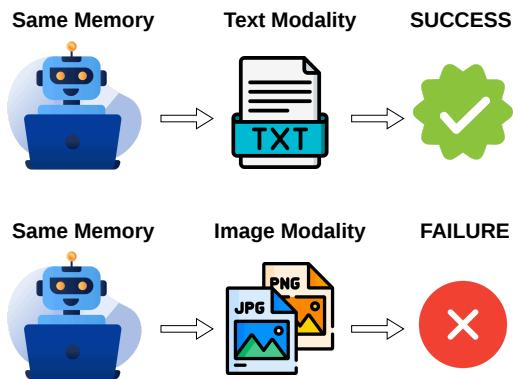  
Figure 1: The same retrieved memory can lead to different outcome for a GUI agent depending on modality.

To learn from prior interactions and reduce repeated errors, recent GUI agents augment the actor with memories constructed from past trajectories, demonstrations, interaction knowledge, and visual observations (Li et al., 2026b; Qin et al., 2026; Choi et al., 2026; Liu et al., 2026; Zeng et al., 2026). However, existing systems generally adopt predefined memory representations, presenting retrieved experience solely as text, visual observations, or a fixed combination of both modalities. Once chosen, this representation strategy typically remains unchanged across interaction steps.

However, existing GUI memory systems rarely question whether a single representation modality is suitable for every interaction step. Prior work on VLMs suggests that textual and visual representations provide fundamentally different forms of information and that their relative utility depends on the reasoning context. (Pezeshkpour et al., 2025; Yang et al., 2026; Long et al., 2026; Roh et al., 2026b). Text can provide a compact semantic abstraction of visual content, but converting images into language may discard fine-grained information required for downstream reasoning (Yang et al., 2026). Conversely, visual representations preserve fine-grained spatial and appearance information that textual surrogates may fail to retain (Yang et al., 2026; Jenkins, 2026). However, when the information needed for reasoning can be captured in structured text, textual abstraction can improve performance on complex visual reasoning tasks (Liu et al., 2023; Park et al., 2025; Xu et al., 2026). Although these findings highlight the context-dependent role of modality in VLM reasoning, it remains unclear whether the preferred memory modality varies across interaction steps in memory enhanced GUI agents.

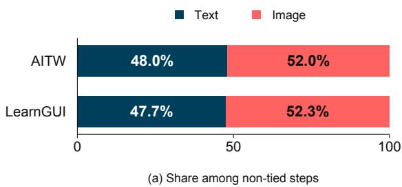  
Figure 2: Relative frequency of Text and Image wins among interaction steps. Neither modality consistently dominates across benchmarks.

In this work, we conduct a systematic study of memory modality in VLM based GUI agents. We show that preferred memory modality changes each step, and that the preference is revealed through models internal hidden states. Based on the observations, we introduce SwitchMem, a lightweight router that selects between textual and visual memories at each step. Our contributions are threefold:

• We show that the preferred memory modality varies across interaction steps and that fixed modalities lead to suboptimal performance across evaluation settings.

• We show that memory modality preference is reflected at the representation level within the agent. Our Directional Chain-of-Embedding (D-CoE) analysis reveals a reproducible Text/Image preference signal that generalizes to unseen GUI trajectories.

• Building on this representation-level signal, we propose SwitchMem, a routing framework that adaptively selects between Text and Image memory at each interaction step. Consequently, it consistently outperforms all static memory baselines across evaluation tasks.

## 2 Related Work

Mobile GUI Agents. Mobile GUI agents execute user instructions through repeated observation and interaction with mobile applications. At each step, the agent interprets the current screenshot in the context of the task instruction and interaction history, then predicts an action such as tapping, swiping, or entering text (Wang et al., 2024, 2025; Qin et al., 2025). The resulting interface state becomes the observation for the next decision, and this process continues until the task is completed. Recent VLM based approaches integrate visual perception, action grounding, and sequential reasoning to support this interaction loop (Xu et al., 2024; Qin et al., 2025). Despite these advances, reliable mobile interaction remains challenging because each action changes the interface state, and errors in perception or action selection can propagate through subsequent decisions.

Memory Systems for GUI Agents. Memory augmentation enables agents to extract and reuse actionable knowledge from prior interactions, supporting informed decisions and reducing the risk of repeated failures (Chhikara et al., 2025; Yeo et al., 2026; Xu et al., 2025b; Roh et al., 2026a). In GUI environments, existing approaches preserve episodic histories and retrieve relevant experiences as in-context examples (Agashe et al., 2025; Xu et al., 2025a; Zhang et al., 2025; Liu et al., 2026). Others transform interaction trajectories into reusable textual traces, structured procedures, or executable knowledge that guides action generation (Li et al., 2026b; Qin et al., 2026; Xiao et al., 2026). Visual memory methods instead retain screenshots or action-relevant regions to ground decisions in prior interface states (Rawles et al., 2025; Choi et al., 2026; Zeng et al., 2026). While these methods differ in how memories are constructed and retrieved, they use a fixed modality after retrieval. SwitchMem instead treats memory modality as a step level decision, selecting between Text and Image based on the current interaction state.

## 3 Understanding Memory Modality Preference

## 3.1 Study Setup

We compare textual and visual representations of the same retrieved demonstration at each interaction step. By holding the retrieved demonstration fixed, we examine how modality preference varies across steps. We use Qwen3.5-9B as the actor in all primary comparisons. At step i, let

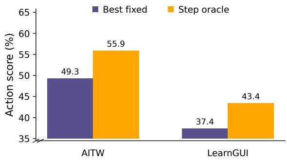  
Figure 3: Performance gap between fixed modality and step-wise oracle modality memory selection.

$$
x _ { i } = ( g _ { i } , o _ { i } )\tag{1}
$$

denote the current GUI state, where $g _ { i }$ is the task instruction and $o _ { i }$ is the current screenshot. Each memory candidate is retrieved from a bank of valid demonstration steps containing a past GUI state and its successful demonstrated action. To isolate the effect of memory representation from retrieval quality, we use a shared text-based retriever for both modalities. For each state $x _ { i }$ , the retriever selects a single demonstration $j _ { i } ,$ , which is then instantiated in either textual or visual form:

$$
m _ { i } ^ { \mathrm { T } } = \left( g _ { j _ { i } } , t _ { j _ { i } } , a _ { j _ { i } } \right) , \qquad m _ { i } ^ { \mathrm { I } } = \left( g _ { j _ { i } } , v _ { j _ { i } } , a _ { j _ { i } } \right) .\tag{2}
$$

where g is the task instruction associated with $g _ { j _ { i } }$ the retrieved demonstration, $t _ { j _ { i } }$ is the textual description of its GUI state, $v _ { j _ { i } }$ is the corresponding screenshot, and $a _ { j _ { i } }$ is the demonstrated action. The textual state representation is constructed from structured UI information provided by each benchmark.

At each interaction step $i ,$ we compare the expected action utility obtained under Text and Image memory. For modality $z \in \{ \mathrm { T } , \mathrm { I } \}$ , we estimate its utility using K sampled actions from the frozen actor:

$$
\hat { u } _ { i } ^ { z } = \frac { 1 } { K } \sum _ { k = 1 } ^ { K } S _ { b } \big ( a _ { i , k } ^ { z } , a _ { i } ^ { * } \big ) ,\tag{3}
$$

where $S _ { b }$ is the benchmark specific action scorer and $a _ { i } ^ { * }$ is the ground-truth action. We define the step-wise memory modality preference as

$$
\begin{array} { r } { \hat { \Delta } _ { i } = \hat { u } _ { i } ^ { \mathrm { I } } - \hat { u } _ { i } ^ { \mathrm { T } } . } \end{array}\tag{4}
$$

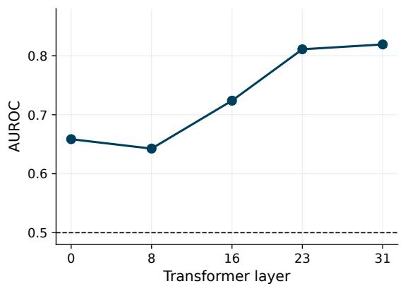  
Figure 4: layer-wise modality-preference probing with D-CoE on AITW. Using examples with at least fiveof-seven agreement in sampled preference, AUROC increases in deeper layers, indicating a stronger modalitypreference signal in later hidden representations.

## 3.2 Step-wise Memory Modality Preference

We examine how memory modality preference varies across interaction steps using the estimated utility gap $\hat { \Delta } _ { i }$ defined in Equation 4.

Neither modality consistently dominates. As shown in Figure 2, both Text and Image memory are preferred for substantial subsets of interaction steps across AITW and LearnGUI. Image memory yields a slightly higher average performance on both AITW and LearnGUI, but the weaker modality on aggregate still provides higher utility on numerous individual execution steps. The preferred modality therefore depends on the current interaction state.

Fixed modalities leave consistent performance on the table. The step-wise variation in modality preference implies that a single fixed representation cannot be optimal throughout an entire interaction. To quantify this effect, we define a step-wise oracle. At each evaluation step, we run the frozen actor separately with Text and Image memory under the same fixed evaluation seed. We score both predicted actions using the benchmark specific metric, and the oracle takes the higher of the two scores. As shown in Figure 3, the step-wise oracle consistently outperforms the strongest fixed-modality strategy across benchmarks, revealing a persistent gap caused by static memory representation. This gap provides direct motivation for adaptive, steplevel modality selection.

(a) Offline training

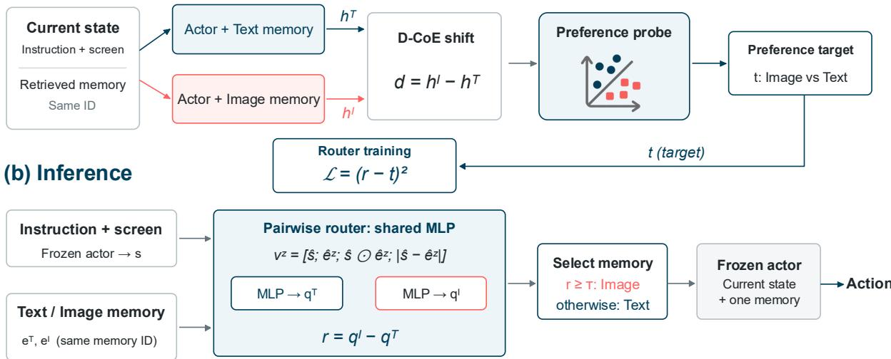  
Figure 5: Overview of SwitchMem. During offline training, the difference between the actor’s hidden states obtained with Image and Text memory is used to construct a continuous modality preference target. A pairwise router scores both memory candidates and is trained to match their score difference to this target. At inference, the router selects one memory modality for the frozen actor to generate the next action.

## 3.3 Modality Preference in Hidden States

Building on the finding that memory modality preference varies across interaction steps, we probe the actor’s hidden representations to determine whether the optimal modality can be predicted at each step.

Directional Chain-of-Embedding. Chain-of-Embedding (CoE) analyzes how different input conditions diverge throughout a VLM by comparing their intermediate hidden representations (Long et al., 2026). We adapt this perspective to contrast the retrieved Text and Image memory conditions. Let $h _ { i , \ell } ^ { z }$ denote the hidden state of the frozen actor at layer ℓ under memory condition $z \in \{ \mathrm { T } , \mathrm { I } \}$ . The actor input contains the current task instruction, the current GUI screenshot, and the retrieved memory represented in modality z. Retrieval is performed once based on a text embedding, and the same retrieved demonstration ID is used under both Text and Image memories. We extract $h _ { i , \ell } ^ { z }$ from the final input token of the fully constructed prompt, immediately before action generation. We retain the signed shift

$$
d _ { i , \ell } = h _ { i , \ell } ^ { \mathrm { I } } - h _ { i , \ell } ^ { \mathrm { T } } ,\tag{5}
$$

and refer to the layer-wise sequence $\mathcal { C } _ { i } = \{ d _ { i , \ell } \} _ { \ell = 1 } ^ { L }$ as the Directional Chain-of-Embedding $( D / - C o E )$

Modality preference reflected in hidden representations. We probe whether $d _ { i , \ell }$ contains information about which memory modality yields higher action utility. For each transformer layer, we reduce the shift representation with PCA and train a linear probe to predict the preferred modality. To reduce noise from stochastic action sampling, we retain only examples for which the same modality is preferred in at least five of seven sampled generations. As shown in Figure 4, the modality preference is predictable from the representation shift on AITW. This suggests that modality preference becomes reflected in the actor’s hidden representations.

## 4 SwitchMem

SwitchMem is trained in two stages. First, a preference estimator processes Text and Image memory through separate actor forward passes and maps the resulting representation shift to a preference target. Second, a pairwise router is trained to predict the preference target from the current state and the retrieved memory candidates. The router applies a shared MLP scorer to each state–memory pair and uses the difference between the Text and Image scores as its routing score.

## 4.1 Preference Target Construction

In this phase, the actor’s modality dependent representation shift is transformed into a continuous preference target used to train the pairwise router.

<table><tr><td>Method</td><td>Augmentation</td><td>AITW (%)</td><td>LearnGUI (%)</td><td>MobileMiniWoB (%)</td></tr><tr><td>General-purpose</td><td></td><td></td><td></td><td></td></tr><tr><td>GPT-5.4-mini</td><td></td><td>34.000</td><td>24.912</td><td>51.087</td></tr><tr><td>Qwen3.5-9B</td><td></td><td>41.920</td><td>23.485</td><td>58.696</td></tr><tr><td>GUI specialized</td><td></td><td></td><td></td><td></td></tr><tr><td>Aguvis-7B</td><td></td><td>33.240</td><td>24.736</td><td>29.348</td></tr><tr><td>UI-TARS-2B-SFT</td><td></td><td>23.260</td><td>9.365</td><td>8.696</td></tr><tr><td>UI-TARS-7B-SFT</td><td></td><td>29.980</td><td>25.705</td><td>23.913</td></tr><tr><td>UI-TARS-1.5-7B</td><td></td><td>36.000</td><td>6.019</td><td>38.043</td></tr><tr><td>Qwen3.5-9B Memory augmented</td><td></td><td></td><td></td><td></td></tr><tr><td>RAG-GUI</td><td>Generated guidelines</td><td>18.300</td><td>24.186</td><td>9.783</td></tr><tr><td>M3A</td><td>Accessibility / SoM</td><td>17.200</td><td>20.899</td><td>41.304</td></tr><tr><td>AppAgent</td><td>Operation document</td><td>14.780</td><td>31.104</td><td>25.000</td></tr><tr><td>Text</td><td>Text memory</td><td>48.760</td><td>35.638</td><td>53.261</td></tr><tr><td>Image</td><td>Image memory</td><td>49.300</td><td>37.441</td><td>57.609</td></tr><tr><td>Both</td><td>Text and Image</td><td>47.080</td><td>26.919</td><td>60.870</td></tr><tr><td>EchoTrail</td><td>Retrieved text step</td><td>45.900</td><td>27.286</td><td>55.435</td></tr><tr><td>AGMem</td><td>Action region crop</td><td>45.380</td><td>28.366</td><td>52.174</td></tr><tr><td>SwitchMem</td><td>Adaptive memory</td><td>51.420</td><td>38.131</td><td>63.043</td></tr></table>

Table 1: Performance comparison on AITW, LearnGUI, and MobileMiniWoB++. AITW and LearnGUI use the official benchmark-provided step level action scores, whereas MobileMiniWoB++ reports task success rate. The memory-augmented group compares different augmentation strategies using the same frozen Qwen3.5-9B actor and evaluation protocol.

We use the final-layer D-CoE representation defined in Equation 5: We select the final transformer block based on the layer wise probing analysis in Section 3.3. To construct the preference targets, we compare the sampled action utilities obtained with Text and Image memory. We retain the non-tied training states

$$
\mathcal { D } _ { \mathrm { p r e f } } = \{ i \mid \hat { u } _ { i } ^ { I } \neq \hat { u } _ { i } ^ { T } \}
$$

and fit a preference estimator to predict whether $\hat { u } _ { i } ^ { I } - \hat { u } _ { i } ^ { T } > 0$ . To reduce sample-specific noise in the 4096-dimensional representation and obtain stable preference targets, we standardize $d _ { i }$ and reduce it to 64 dimensions using PCA. We then fit a logistic probe whose decision value defines the soft preference target:

$$
t _ { i } = w ^ { \top } \operatorname { P C A } \left( \operatorname { S t d } ( d _ { i } ) \right) + b\tag{6}
$$

A positive target $t _ { i }$ favors Image memory, whereas a negative target favors Text memory.

## 4.2 Preference-Supervised Router Training

To enable modality selection, we train a pairwise router using the continuous preference targets derived in Section 4.1 as supervision. Formally, given interaction step i, let $s _ { i }$ denote the final-token hidden state obtained from the actor prompt containing the current instruction and screenshot. For each modality $z \in \{ T , I \}$ , let $e _ { i } ^ { z }$ denote the embedding of the corresponding retrieved memory candidate.

We project $s _ { i }$ and $e _ { i } ^ { z }$ to a shared dimension and apply $\ell _ { 2 }$ normalization, yielding $\hat { s } _ { i }$ and $\hat { e } _ { i } ^ { z }$ , respectively. For each modality, we construct the candidate feature

$$
v _ { i } ^ { z } = [ \hat { s } _ { i } ; \hat { e } _ { i } ^ { z } ; \hat { s } _ { i } \odot \hat { e } _ { i } ^ { z } ; | \hat { s } _ { i } - \hat { e } _ { i } ^ { z } | ] ,\tag{7}
$$

where ⊙ denotes element-wise multiplication.

A shared MLP scorer $f _ { \theta } ,$ parameterized by $\theta ,$ maps each candidate feature to a scalar score:

$$
q _ { i } ^ { z } = f _ { \theta } ( v _ { i } ^ { z } ) .\tag{8}
$$

The router then computes the relative modalitypreference score as

$$
r _ { i } = q _ { i } ^ { I } - q _ { i } ^ { T } .\tag{9}
$$

Because the same scorer is applied to both modalities, $q _ { i } ^ { T }$ and $q _ { i } ^ { I }$ are directly comparable, and their difference $r _ { i }$ represents the relative preference for Image over Text memory.

We train the router to regress the soft preference target $t _ { i }$ using

$$
\mathcal { L } _ { \mathrm { r o u t e } } = \frac { 1 } { | \mathcal { D } _ { \mathrm { p r e f } } | } \sum _ { i \in \mathcal { D } _ { \mathrm { p r e f } } } \left( r _ { i } - t _ { i } \right) ^ { 2 } .\tag{10}
$$

At inference, $r _ { i }$ is compared with a predefined threshold $\tau .$ . Image memory is selected when

<table><tr><td>Benchmark</td><td>Both</td><td>Image</td><td>Switches</td><td>Run</td></tr><tr><td>AITW</td><td>83.8</td><td>36.5</td><td>1.72</td><td>2.42</td></tr><tr><td>LearnGUI</td><td>90.8</td><td>81.3</td><td>1.79</td><td>4.95</td></tr><tr><td>MobileMiniWoB</td><td>57.8</td><td>76.3</td><td>1.56</td><td>4.50</td></tr></table>

Table 2: Within-trajectory routing behavior of Switch-Mem. Both and Image denote the percentages of dualmodality trajectories and Image-routed steps, respectively. Switches and Run measure the average modality transition count and contiguous run length per trajectory.

$r _ { i } \geq \tau ;$ otherwise, Text memory is selected. Only the selected memory is then provided to the frozen actor for action generation.

## 5 Experiments

Benchmarks. We evaluate SwitchMem on three GUI benchmarks: MobileMiniWob++ (Rawles et al., 2025), AITW (Rawles et al., 2023), and LearnGUI (Liu et al., 2026). Together, these benchmarks cover diverse mobile GUI interaction settings and allow us to examine whether adaptive memory modality selection generalizes across environments. Because MobileMiniWoB++ does not provide official training or validation splits, we transfer the router trained on LearnGUI while keeping its weights fixed. Further details on the transfer and threshold-calibration protocol are provided in Section B.1.

Models and Retrieval. All primary experiments use Qwen3.5-9B (Qwen Team, 2026) as the frozen actor and Qwen3-VL-Embedding-2B (Li et al., 2026a) for top-1 retrieval and memory embedding. Text and Image memories are instantiated from the same retrieved demonstration, isolating the effect of memory representation.

Baselines. We compare SwitchMem with general-purpose VLMs (GPT-5.4-mini and Qwen3.5-9B), GUI specialized agents, such as Aguvis (Xu et al., 2024) and UI-TARS variants (Qin et al., 2025), and memory-augmented methods. The memory-augmented group uses the same frozen Qwen3.5-9B actor and includes RAG-GUI (Xu et al., 2025a), M3A (Rawles et al., 2025), AppAgent (Zhang et al., 2025), EchoTrail (Li et al., 2026b), AGMem (Choi et al., 2026), and fixed Text, Image, and Both baselines.

## 5.1 Results

Main results. Table 1 shows that augmenting the GUI agent with retrieved experience can improve action prediction, but its effectiveness depends on how the experience is represented. Image memory tends to perform well on AITW and LearnGUI, whereas providing both modalities is more effective on MobileMiniWoB. Notably, advanced memory formulation strategies do not consistently outperform raw context injection, suggesting that altering context representation without step-wise selectivity yields limited benefits.

SwitchMem achieves the strongest performance across all three benchmarks. Rather than fixing one representation or always providing both, it selects a single memory modality at each interaction step. This allows the actor to exploit the complementary strengths of textual and visual memory across steps while avoiding the performance degradation that can arise from jointly providing both modalities.

Modality preference changes within trajectories. Table 2 offers a quantitative analysis of Switch-Mem’s routing behavior across steps within a trajectory. Across all benchmarks, SwitchMem frequently utilizes both modalities within a single trajectory exhibiting moderate transition frequencies. Crucially, selected modalities are retained for consecutive steps. This demonstrates that SwitchMem does not lock into a static task level modality, but exhibits state adaptive modality.

## 6 Analysis

## 6.1 Modality Utility Patterns and Adaptive Routing Alignment

To uncover the mechanisms governing dynamic modality selection, we analyze interaction context from two complementary perspectives. First, we identify when Image modality is preferred over Text discussed in Section 3.2. Second, we evaluate whether SwitchMem’s learned router aligns with these utility patterns to drive overall performance gains. Figure 6 illustrates how SwitchMem’s routing decisions align with these utility shifts across each dimension.

## 6.1.1 When Is Each Memory Modality Useful?

Visually dense states favor Image memory. To quantify structural complexity, we measure element density using bounding box annotations provided in each benchmark. Specifically, we define element density as the number of unique UI elements divided by their fractional screen coverage, computed as the union area of the bounding boxes relative to the total screen area. Empirical analysis shows that element density remains positively associated with the Image-over-Text utility gap. Image memory yields an advantage when decisions rely on fine-grained layouts containing dense UI elements that textual abstractions fail to convey.

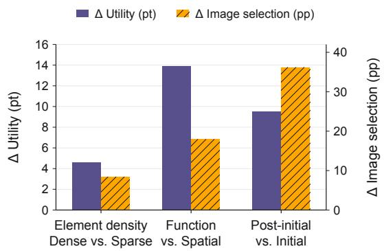  
Figure 6: Changes in Image over Text utility (left axis) and SwitchMem’s Image-selection rate (right axis).

Image memory is more useful for functionoriented actions. Following standard GUI action taxonomies (Shi et al., 2025; Lu et al., 2025), we group interaction steps into Spatial and Function actions. Spatial actions comprise coordinate-based operations such as tapping, swiping, scrolling, and dragging, whereas Function actions govern interface functionality, task status, or system navigation. When shifting from Spatial to Function actions, the utility advantage of Image memory grows across benchmarks, showing that functional interface components rely on visual grounding. This suggests that visual memory is particularly valuable for decisions requiring an understanding of interface state and functionality, beyond simply locating interaction targets.

Image memory becomes more useful after the interface evolves. Compared to initial states, postinitial states exhibit a wider Image-over-Text utility gap. This finding indicates that as a trajectory progresses beyond initial states, evolving UI contexts generate complex visual nuances that text-based representations fail to preserve.

## 6.1.2 Understanding SwitchMem’s Memory Modality Selection

While Section 6.1.1 identified when visual context is useful, we now examine whether SwitchMem’s learned router dynamically aligns with these utility patterns. Furthermore, we evaluate how Switch-Mem’s adaptive routing translates into overall performance gains across benchmarks.

SwitchMem follows modality-utility patterns. SwitchMem’s routing selections consistently align with the utility shifts identified across all three dimensions (Figure 6). The router selects Image memory more frequently on visually dense screens, at steps whose reference actions are categorized as Function rather than Spatial, and in post-initial states. This alignment demonstrates that Switch-Mem’s router dynamically responds to systematic changes in modality utility across interaction steps. This behavior helps explain the performance improvements in Table 1. By favoring Image in conditions where visual context is more useful while retaining Text in complementary states, Switch-Mem outperforms static memory strategies across all three benchmarks.

## 6.2 Comparison with Alternative Routing Strategies

To demonstrate the advantages of SwitchMem’s routing design, we analyze its performance against alternative routing baselines.

Learned routing baselines. We compare Switch-Mem with three learned alternatives. Utility and Binary utilize the same router architecture as Switch-Mem, constructed upon the actor’s current-state hidden representation and retrieved-memory embeddings. However, both are trained directly from sampled action utilities, without D-CoE-based target construction. Utility regresses the utility gap using MSE, whereas Binary predicts only its sign using binary cross-entropy. Basic routing also learns binary preferences, but uses embeddings of the current instruction, screenshot, and retrieved memories rather than the actor’s hidden states. As shown in Figure 7a, conventional routing baselines offer minimal gains over a static Image Memory policy, whereas SwitchMem delivers consistent performance improvements. These results validate the necessity of actor-derived preference targets for guiding memory selection.

Ratio-matched random routing. To determine whether SwitchMem’s gains arise from stepspecific memory selection rather than the overall Text and Image usage ratio, we sweep its threshold and compare it with a random policy that independently selects Image memory with probability p, matched to SwitchMem’s Image-selection rate.

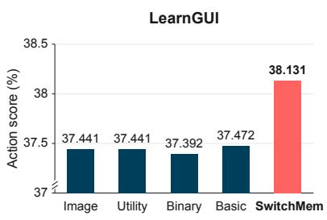  
(a) Routing baseline ablation

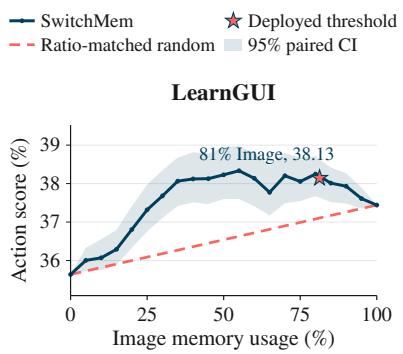  
(b) Modality budget frontier

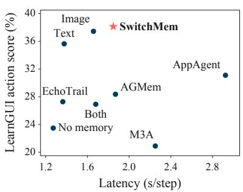  
(c) Latency–performance trade-off  
Figure 7: Empirical analysis on LearnGUI. (a) Comparison with simpler routing baselines. Utility and Binary use direct preference supervision, while Basic routing excludes actor hidden states. (b) SwitchMem versus ratio-matched random routing, where the dashed line denotes the analytic expected score and the star marks the deployed threshold. (c) Efficiency Analysis of SwitchMem. RAG-GUI is omitted in figure due to its high latency of 11.118 s/step.

Using the step level action scores under fixed Text and Image memory, we compute the random policy’s expected performance as

$$
S _ { \mathrm { r a n d } } ( p ) = ( 1 - p ) S _ { \mathrm { T e x t } } + p S _ { \mathrm { I m a g e } } ,\tag{11}
$$

where $S _ { \mathrm { T e x t } }$ and $S _ { \mathrm { I m a g e } }$ denote the mean action scores under the two fixed memory policies. Figure 7b shows that SwitchMem outperforms ratio matched random routing at every evaluated intermediate Image selection rate. This indicates that its gains arise from assigning memory modalities to appropriate interaction steps, rather than merely using a particular Text and Image ratio.

## 6.3 Efficiency Analysis

Figure 7c compares the latency–performance trade off on LearnGUI, with all methods measured on the same RTX PRO 6000 GPU. SwitchMem achieves the highest action score while adding only modest latency. SwitchMem avoids processing both memory-conditioned prompts and incurs no additional autoregressive decision stage. In contrast, procedural baselines such as M3A, AppAgent, and RAG-GUI introduce additional annotation, document construction, or guideline-generation stages, resulting in higher latency despite lower performance.

## 6.4 Generalization to a GUI specialized Actor

To evaluate whether SwitchMem generalizes beyond its base actor, we apply its preference construction and routing protocol to the GUI specialized UI-TARS-7B-SFT model. As shown in Table 3, SwitchMem consistently outperforms static memory baselines across all three benchmarks. These results confirm that SwitchMem’s routing formulation effectively transfers across distinct actor architectures and domain-specialized backbones.

<table><tr><td>Method</td><td>AITW</td><td>LearnGUI</td><td>MobileMiniWoB++</td></tr><tr><td>No memory</td><td>29.980</td><td>25.705</td><td>23.913</td></tr><tr><td>Text</td><td>32.640</td><td>38.230</td><td>32.609</td></tr><tr><td>Image</td><td>30.440</td><td>40.997</td><td>33.696</td></tr><tr><td>SwitchMem</td><td>33.680</td><td>41.055</td><td>36.957</td></tr></table>

Table 3: Generalization to the GUI specialized UI-TARS-7B-SFT actor. SwitchMem achieves the best performance across all three benchmarks, improving over the strongest fixed memory condition.

## 7 Conclusion

We study memory modality as a step-dependent decision for VLM-based GUI agents. Across benchmarks, neither Text nor Image memory consistently dominates, and their utility varies across interaction steps. We show that memory modality preference is reflected at internal state through D-CoE analysis. Based on the representation-level signal, we introduce SwitchMem which uses modality conditioned representation shifts to train a router that selects the suitable memory modality at each step. Switch-Mem improves over fixed modality and memoryaugmentation baselines while providing only one memory modality to the actor. Together, these results confirm that optimal memory selection is stepdependent, and that our SwitchMem approach can predict memory modality achieving performance gains over static alternatives.

## Limitations

Our evaluation focuses on mobile GUI benchmarks centered on Android interfaces and controlled interaction settings. Generalization to iOS interfaces and newer Android versions, which may introduce different visual layouts and interaction conventions, remains unverified.

Our online evaluation uses emulated environments rather than physical devices. Although these environments support controlled and reproducible experiments, they do not fully capture device rendering differences, system interruptions, network variability, or hardware constraints. Evaluation on physical devices is an important direction for future work.

SwitchMem requires access to the actor’s hidden states for both preference target construction and routing at inference. It therefore cannot be directly applied to models accessed through APIs that do not expose these representations. Extending modality routing to such models remains an open direction.

## References

Saaket Agashe, Jiuzhou Han, Shuyu Gan, Jiachen Yang, Ang Li, and Xin Wang. 2025. Agent s: An open agentic framework that uses computers like a human. In International Conference on Learning Representations, volume 2025, pages 22924–22946.

Prateek Chhikara, Dev Khant, Saket Aryan, Taranjeet Singh, and Deshraj Yadav. 2025. Mem0: Building production-ready ai agents with scalable long-term memory. arXiv preprint arXiv:2504.19413.

Seoyoung Choi, Minseok Ko, Hyunseok Lee, Kunwoong Kim, Woomin Song, Chanseok Jeon, and Jinwoo Shin. 2026. Naive visual memory is not enough: A failure-mode study of gui agents. arXiv preprint arXiv:2606.14106.

Gemini Robotics Team, Saminda Abeyruwan, Joshua Ainslie, Jean-Baptiste Alayrac, Montserrat Gonzalez Arenas, Travis Armstrong, Ashwin Balakrishna, Robert Baruch, Maria Bauza, Michiel Blokzijl, et al. 2025. Gemini robotics: Bringing ai into the physical world. arXiv preprint arXiv:2503.20020.

Ben Jenkins. 2026. Thinking in pictures: A diagnostic study of visual vs. textual chain-of-thought reasoning in vision-language models. In Proceedings of the 4th Workshop on Advances in Language and Vision Research (ALVR), pages 1–12, San Diego, California, USA. Association for Computational Linguistics.

Junha Jung, Minbyul Jeong, Suhyeon Lim, Sungwook Jung, Jaehoon Yun, Taeyun Roh, Mujeen Sung, and

Jaewoo Kang. 2026. Breaking failure cascades: Stepaware reinforcement learning for medical multimodal reasoning. arXiv preprint arXiv:2606.31825.

Mingxin Li, Yanzhao Zhang, Dingkun Long, Keqin Chen, Sibo Song, Shuai Bai, Zhibo Yang, Pengjun Xie, An Yang, Dayiheng Liu, Jingren Zhou, and Junyang Lin. 2026a. Qwen3-vl-embedding and qwen3-vl-reranker: A unified framework for state-ofthe-art multimodal retrieval and ranking. Preprint, arXiv:2601.04720.

Runze Li, Yuwen Zhai, Bo Xu, Liwu Xu, Nian Shi, Wei Zhang, Ran Lin, and Liang Wang. 2026b. Echotrailgui: Building actionable memory for gui agents via critic-guided self-exploration. In Proceedings of the IEEE/CVF Conference on Computer Vision and Pattern Recognition (CVPR) Findings, pages 9347– 9356.

Fangyu Liu, Julian Eisenschlos, Francesco Piccinno, Syrine Krichene, Chenxi Pang, Kenton Lee, Mandar Joshi, Wenhu Chen, Nigel Collier, and Yasemin Altun. 2023. DePlot: One-shot visual language reasoning by plot-to-table translation. In Findings of the Association for Computational Linguistics: ACL 2023, pages 10381–10399, Toronto, Canada. Association for Computational Linguistics.

Guangyi Liu, Pengxiang Zhao, Liang Liu, Zhiming Chen, Yuxiang Chai, Yaozhen Liang, WenHao Wang, Siheng Chen, Zhengxi Lu, Shuai Ren, Hao Wang, Shibo He, Yong Liu, and Wenchao Meng. 2026. LearnAct: Few-shot mobile GUI agent with a unified demonstration benchmark. In Findings of the Association for Computational Linguistics: ACL 2026, pages 29820–29843, San Diego, California, United States. Association for Computational Linguistics.

Lin Long, Changdae Oh, Seongheon Park, and Sharon Li. 2026. Understanding language prior of lvlms by contrasting chain-of-embedding. In International Conference on Learning Representations, volume 2026, pages 94723–94754.

Quanfeng Lu, Wenqi Shao, Zitao Liu, Lingxiao Du, Fanqing Meng, Boxuan Li, Botong Chen, Siyuan Huang, Kaipeng Zhang, and Ping Luo. 2025. Guiodyssey: A comprehensive dataset for cross-app gui navigation on mobile devices. In Proceedings of the IEEE/CVF International Conference on Computer Vision (ICCV), pages 22404–22414.

Simon Park, Abhishek Panigrahi, Yun Cheng, Dingli Yu, Anirudh Goyal, and Sanjeev Arora. 2025. Generalizing from simple to hard visual reasoning: can we mitigate modality imbalance in vlms? arXiv preprint arXiv:2501.02669.

Pouya Pezeshkpour, Moin Aminnaseri, and Estevam Hruschka. 2025. Mixed signals: Decoding vlms’ reasoning and underlying bias in vision-language conflict. In EMNLP (Findings), pages 24833–24848.

Yujia Qin, Yining Ye, Junjie Fang, Haoming Wang, Shihao Liang, Shizuo Tian, Junda Zhang, Jiahao Li,

Yunxin Li, Shijue Huang, et al. 2025. Ui-tars: Pioneering automated gui interaction with native agents. arXiv preprint arXiv:2501.12326.

Zerui Qin, Sheng Yue, Xingyuan Hua, Yongjian Fu, and Ju Ren. 2026. Executable agentic memory for GUI agent. In Proceedings ofthe 43rd International Conference on Machine Learning, volume 306 of Proceedings ofMachine Learning Research, pages 101815–101840. PMLR.

Qwen Team. 2026. Qwen3.5: Towards native multimodal agents.

Chris Rawles, Sarah Clinckemaillie, Yifan Chang, Jonathan Waltz, Gabrielle Lau, Marybeth Fair, Alice Li, William Bishop, Wei Li, Folawiyo Campbell-Ajala, et al. 2025. Androidworld: A dynamic benchmarking environment for autonomous agents. In International Conference on Learning Representations, volume 2025, pages 406–441.

Christopher Rawles, Alice Li, Daniel Rodriguez, Oriana Riva, and Timothy Lillicrap. 2023. Androidinthewild: A large-scale dataset for android device control. Advances in Neural Information Processing Systems, 36:59708–59728.

Taeyun Roh, WonJune Jang, Junha Jung, and Jaewoo Kang. 2026a. CLAG: Adaptive memory organization via agent-driven clustering for small language model agents. In Findings ofthe Associationfor Computational Linguistics: ACL 2026, pages 16707–16726, San Diego, California, United States. Association for Computational Linguistics.

Taeyun Roh, Suhyeong Park, Dongyoung Lee, Wonjune Jang, Junha Jung, Eunyeong Jo, and Jaewoo Kang. 2026b. Buzzy: Contrastive scoring to mitigate text-induced bias in multimodal multiple-choice qa. Preprint, arXiv:2603.28026.

Yucheng Shi, Wenhao Yu, Zaitang Li, Yonglin Wang, Hongming Zhang, Ninghao Liu, Haitao Mi, and Dong Yu. 2025. Mobilegui-rl: Advancing mobile gui agent through reinforcement learning in online environment. arXiv preprint arXiv:2507.05720.

Junyang Wang, Haiyang Xu, Jiabo Ye, Ming Yan, Weizhou Shen, Ji Zhang, Fei Huang, and Jitao Sang. 2024. Mobile-agent: Autonomous multi-modal mobile device agent with visual perception. arXiv preprint arXiv:2401.16158.

Zhenhailong Wang, Haiyang Xu, Junyang Wang, Xi Zhang, Ming Yan, Ji Zhang, Fei Huang, and Heng Ji. 2025. Mobile-agent-e: Self-evolving mobile assistant for complex tasks. arXiv preprint arXiv:2501.11733.

Han Xiao, Guozhi Wang, Hao Wang, Shilong Liu, Yuxiang Chai, Yue Pan, Yufeng Zhou, Xiaoxin Chen, Yafei Wen, and Hongsheng Li. 2026. Ui-mem: Selfevolving experience memory for online reinforcement learning in mobile gui agents. arXiv preprint arXiv:2602.05832.

Tianbao Xie, Danyang Zhang, Jixuan Chen, Xiaochuan Li, Siheng Zhao, Ruisheng Cao, Toh J Hua, Zhoujun Cheng, Dongchan Shin, Fangyu Lei, et al. 2024. Osworld: Benchmarking multimodal agents for openended tasks in real computer environments. Advances in Neural Information Processing Systems, 37:52040–52094.

Ran Xu, Kaixin Ma, Wenhao Yu, Hongming Zhang, Joyce C. Ho, Carl Yang, and Dong Yu. 2025a. Retrieval-augmented GUI agents with generative guidelines. In Proceedings ofthe 2025 Conference on Empirical Methods in Natural Language Processing, pages 17866–17875, Suzhou, China. Association for Computational Linguistics.

Wujiang Xu, Zujie Liang, Kai Mei, Hang Gao, Juntao Tan, and Yongfeng Zhang. 2025b. A-mem: Agentic memory for llm agents. In Advances in Neural Information Processing Systems, volume 38, Main Conference, pages 17577–17604. Curran Associates, Inc.

Yige Xu, Yongjie Wang, Zizhuo Wu, Kaisong Song, Jun Lin, and Zhiqi Shen. 2026. Do vision-language models truly perform vision reasoning? a rigorous study of the modality gap. arXiv preprint arXiv:2604.16256.

Yiheng Xu, Zekun Wang, Junli Wang, Dunjie Lu, Tianbao Xie, Amrita Saha, Doyen Sahoo, Tao Yu, and Caiming Xiong. 2024. Aguvis: Unified pure vision agents for autonomous gui interaction. arXiv preprint arXiv:2412.04454.

Shijia Yang, Yunong Liu, Bohan Zhai, Ximeng Sun, Zicheng Liu, Emad Barsoum, Manling Li, and Chenfeng Xu. 2026. Captionqa: Is your caption as useful as the image itself? In Proceedings ofthe IEEE/CVF Conference on Computer Vision and Pattern Recognition, pages 23741–23750.

Woongyeong Yeo, Kangsan Kim, Jaehong Yoon, and Sung Ju Hwang. 2026. Worldmm: Dynamic multimodal memory agent for long video reasoning. In Proceedings of the IEEE/CVF Conference on Computer Vision and Pattern Recognition, pages 25599– 25609.

Ziyun Zeng, Hang Hua, Bocheng Zou, Mu Cai, Rogerio Feris, and Jiebo Luo. 2026. Mementogui: Learning agentic multimodal memory control for long-horizon gui agents. arXiv preprint arXiv:2605.18652.

Chi Zhang, Zhao Yang, Jiaxuan Liu, Yanda Li, Yucheng Han, Xin Chen, Zebiao Huang, Bin Fu, and Gang Yu. 2025. Appagent: Multimodal agents as smartphone users. In Proceedings of the 2025 CHI conference on human factors in computing systems, pages 1–20.

## A Dataset and Baseline Details

## A.1 Dataset Details

We evaluate SwitchMem on three mobile GUI benchmarks that cover complementary interaction settings: Android in the Wild (AITW), LearnGUI, and MobileMiniWoB++.

Android in the Wild (AITW). AITW (Rawles et al., 2023) contains human-demonstrated Android interaction trajectories spanning diverse applications and user goals. Its heterogeneous interface states and multi-step trajectories make it suitable for studying whether the preferred memory representation changes across interaction steps. We evaluate next-action prediction using the benchmarkspecific action scorer.

LearnGUI. LearnGUI (Liu et al., 2026) evaluates mobile GUI agents in demonstration augmented interaction settings, requiring agents to execute complex navigation tasks by conditioning on retrieved historical execution traces. Because agent performance hinges on effectively leveraging retrieved multimodal experience for dynamic step-wise decisions, it serves as an ideal testbed for evaluating adaptive memory routing. Memory is retrieved only from demonstration trajectories distinct from the query trajectory. Following the benchmark’s standardized protocol, we report action level execution accuracy across its diverse mobile interaction tasks.

MobileMiniWoB++. MobileMini-

WoB++ (Rawles et al., 2025) provides programmatically verifiable mobile GUI tasks in an online, closed-loop execution environment. While AITW and LearnGUI evaluate agents against heterogeneous real-world traces, MobileMiniWoB++ offers deterministic state transitions and immediate environment feedback for step-wise actions. This setup serves as a controlled testbed, allowing us to isolate and evaluate SwitchMem’s dynamic memory routing without confounding noise from real-world OS rendering anomalies or ambiguous task rewards. Following standard protocol, we report task completion success rate.

Together, the three benchmarks cover humandemonstrated trajectories, demonstration-based knowledge transfer, and controlled executable interaction. For all benchmarks, Text and Image memory conditions use the same actor, current observation, retrieved demonstration, and decoding configuration; only the representation of the retrieved memory differs.

## A.2 Baseline Details

General-purpose and GUI specialized baselines are evaluated from their released models or APIs. For a fair comparison, we standardize the backbone actor across all memory-augmented methods. Specifically, all methods use the same frozen Qwen3.5- 9B actor, retrieval bank, and decoding protocol, differing only in how the retrieved experience is represented and provided to the actor.

Fixed memory conditions. TEXT serializes the retrieved instruction, state description, and demonstrated action. IMAGE replaces the state description with its screenshot while retaining the same instruction and action information. BOTH supplies both representations of the same retrieved step.

RAG-GUI. RAG-GUI (Xu et al., 2025a) augments the agent with external procedural knowledge retrieved from a corpus of GUI tutorials. Rather than appending raw retrieved documents, it filters and converts relevant content into concise, task- and progress-conditioned textual guidelines for the actor during action prediction.

M3A. M3A (Rawles et al., 2025) enriches the current observation with structured interface information, including visible UI elements and recent interaction history. This structured context enables the actor to jointly reason about screen states and prior execution steps during action selection.

AppAgent. APPAGENT (Zhang et al., 2025) constructs an offline operation document by exploring target applications to detail interface elements, executable actions, and state transitions. At inference time, it retrieves documentation associated with the current screen’s UI elements and uses it to guide action generation.

EchoTrail. ECHOTRAIL (Li et al., 2026b) builds reusable memory from collected GUI trajectories using self-exploration and critic-based filtering. Successful experiences are reformulated into compact textual traces highlighting interface states and transitions, enabling the retrieval and reuse of relevant interaction patterns for new tasks.

AGMem. AGMEM (Choi et al., 2026) preserves action-relevant visual evidence from demonstrations by comparing consecutive frames to crop changed interaction regions. It provides these cropped regions as visual memory, falling back to full demonstration frames when distinct regions cannot be reliably identified.

To ensure fair comparison, all baselines are implemented as training-free, component-level memory methods under the same retrieval bank, frozen actor, and decoding protocol as SWITCHMEM. Consequently, performance differences directly reflect how each method formulates and delivers retrieved experience to the agent.

## B SwitchMem Details

## B.1 SwitchMem Training and Evaluation Details

For AITW and LearnGUI, we retrieve one memory step using the text-based retriever and represent the same retrieved ID as either Text or Image. At each training state, we sample seven actor actions per modality using temperature 0.7 and seeds 42–48, and score them with the benchmark specific action metric. Exact utility ties are excluded from preference target construction. The routing threshold is selected by maximizing utility on the resulting training predictions and is frozen before test evaluation. The router is parameterized by a two-layer MLP (1024 → 256 → 1) with GELU activation and a 0.1 dropout rate, trained using AdamW with a learning rate of 0.001.

AITW. We divide 20,000 steps from the official training split at the trajectory level into 10,019 preference-query steps and 9,981 memory steps, corresponding to 3,100 and 3,087 trajectories, respectively. The two subsets have no trajectory overlap. Each training query retrieves a demonstration from the memory subset within the same AITW task category. For test evaluation, we use 5,000 steps from 759 held-out trajectories and allow retrieval from the complete 20,000-step training bank.

LearnGUI. We use the 101 successful Online demonstration trajectories, comprising 1,500 interaction steps, as the source of both preference queries and candidate memories. Success is used to ensure that the memory bank contains validated experiences. We then construct preference supervision by comparing the actor’s action quality under the Text and Image representations of the same retrieved step. At evaluation, we follow LearnGUI’s offline one-shot setting and use the support demonstrations available as memory in that setting. The router and threshold remain fixed after Online training, and no Offline-Test action, utility, or outcome is used for fitting or calibration.

MobileMiniWoB++. MobileMiniWoB++ does not provide step level action utilities or an official training/validation split. We therefore transfer the LearnGUI router without updating its weights. The memory bank is constructed once using suite seed 1001 and contains 129 interaction steps from 50 successful trajectories. It is fixed before calibration and evaluation. For threshold calibration, we use only the initial states of the 92 task templates instantiated with suite seed 43. Without observing actions, rewards, or task success, we choose the cutoff whose Image-selection rate best matches the training-side routing rate on LearnGUI. The cutoff is then frozen and evaluated through full online rollouts on the same 92 templates instantiated with suite seed 42, yielding 63.043% task success (58/92).

Suite seeds 1001, 43, and 42 share task templates but instantiate different task values, on-screen text, and target coordinates. Consequently, the memory bank, calibration set, and evaluation set contain no identical task instances. No observation from seed 42 is used to construct the memory bank, train the router, or select its threshold.

Text memory is constructed without an additional captioning model. For AITW, we serialize the dataset-provided UI text annotations together with the current Android activity. For LearnGUI, we use the provided element annotations, including page captions, element descriptions, and functionality labels. For MobileMiniWoB++, we deterministically serialize the Android accessibility hierarchy obtained through UIAutomator. Each textual GUI observation is paired with its task instruction and demonstrated action to form a Text memory entry.

## B.2 Modality-preference Probing Details

For AITW and LearnGUI and each layer $\ell \in$ $\{ 0 , 8 , 1 6 , 2 3 , 3 1 \}$ , we compute the signed D-CoE shift $h _ { i , \ell } ^ { \mathrm { I } } - h _ { i , \ell } ^ { \mathrm { T } }$ from the final prompt token immediately before action generation. Features are standardized, reduced to 64 PCA dimensions, and classified with a logistic probe. The label is retained only when at least five of the seven sampled generations agree on the preferred modality.

The modality-preference signal becomes most pronounced in the later transformer layers. It reaches its highest AUROC at layer 31 on AITW and at layer 23 on LearnGUI. Rather than selecting the best layer separately for each benchmark, SwitchMem consistently uses layer 31, the final transformer block. Its hidden state represents the actor’s fully integrated multimodal representation immediately before action generation. This choice provides a single benchmark-independent extraction rule and avoids tuning the representation layer to each evaluation dataset, despite the higher layer-23 probe score on LearnGUI.

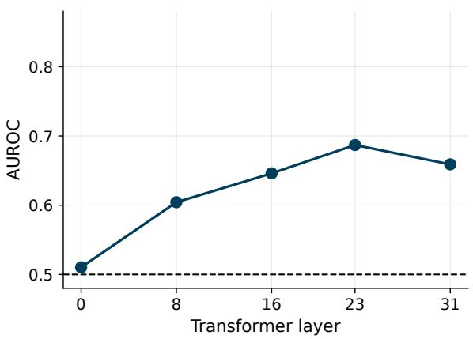  
Figure 8: layer-wise modality-preference probing on Learn-GUI. AUROC is computed by trajectory-grouped prediction on the 5-of-7 stable-preference subset. The dashed line denotes chance.

We do not report an analogous 5-of-7 probe for MobileMiniWoB++ because the benchmark does not provide the intermediate step level utilities required to construct Text and Image preference targets. We therefore evaluate MobileMiniWoB++ under a transfer setting using the router trained on LearnGUI, which precludes constructing the corresponding utility-based probing subset.

## B.3 Additional Routing Strategy Comparisons

We repeat the routing comparisons on AITW using the same experimental protocol. Figure 9 shows that Utility, Binary, and Basic routing improve over the fixed Image policy, but remain below Switch-Mem. Binary is particularly competitive on AITW, whereas the advantage of SwitchMem is more pronounced on LearnGUI. Across both benchmarks, SwitchMem achieves the highest point estimates, supporting D-CoE-based target construction as a more consistently effective alternative to direct supervision.

Figure 10 further shows that SwitchMem outperforms ratio-matched random routing at every evaluated non-trivial modality budget. The same pattern on AITW and LearnGUI supports step-specific modality assignment, rather than the global Text– Image ratio, as a source of the adaptive-routing benefit.

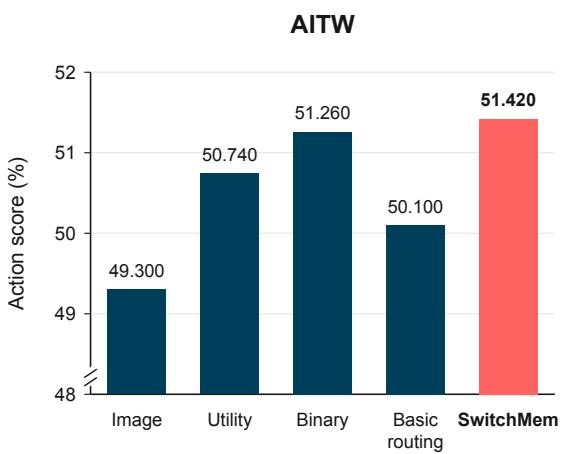

Figure 9: Comparison with simpler routing baselines on AITW. Binary is closely competitive with SwitchMem. The y-axis is truncated.  
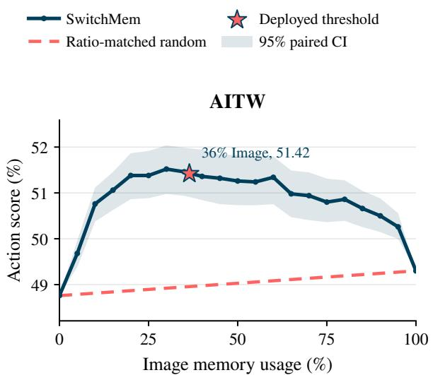  
Figure 10: SwitchMem versus random routing on AITW. Random routing controls for aggregate Image usage but does not condition its selections on the interaction state.

## B.4 Efficiency Details

Table 4 reports mean wall-clock latency on the same RTX PRO 6000 GPU. Requests are executed sequentially with greedy decoding, thinking disabled, and the same 128-token output cap. The SWITCHMEM number includes its currentstate hidden-state probe, the small pairwise router, and one selected-memory action call. Although SWITCHMEM introduces an additional routing stage, its runtime overhead remains modest. Compared with the Image baseline, SWITCHMEM adds only 0.128 s, 0.190 s, and 0.304 s per step on AITW, LearnGUI, and MobileMiniWoB++, respectively, while achieving consistently better action performance. In contrast, more elaborate memoryaugmented baselines such as M3A, AppAgent, and RAG-GUI introduce additional inference-time processing and incur substantially higher latency, while still underperforming SWITCHMEM. For example, RAG-GUI requires 8.815 s and 11.118 s per step on AITW and LearnGUI, compared with 1.407 s and 1.848 s for SWITCHMEM. Overall, these results show that adaptive memory routing provides consistent performance gains with only a small additional inference cost.

<table><tr><td>Method</td><td>AITW</td><td>LearnGUI</td><td>MobileMini</td></tr><tr><td>No memory</td><td>1.297</td><td>1.272</td><td>0.906</td></tr><tr><td>Text</td><td>1.154</td><td>1.377</td><td>0.889</td></tr><tr><td>Image</td><td>1.279</td><td>1.658</td><td>1.558</td></tr><tr><td>Both</td><td>1.309</td><td>1.680</td><td>1.441</td></tr><tr><td>EchoTrail</td><td>1.205</td><td>1.364</td><td>1.189</td></tr><tr><td>AGMem</td><td>1.372</td><td>1.869</td><td>1.388</td></tr><tr><td>M3A</td><td>2.156</td><td>2.251</td><td>3.952</td></tr><tr><td>AppAgent</td><td>3.298</td><td>2.924</td><td>2.682</td></tr><tr><td>RAG-GUI</td><td>8.815</td><td>11.118</td><td>2.862</td></tr><tr><td>SwitchMem</td><td>1.407</td><td>1.848</td><td>1.862</td></tr></table>

Table 4: Mean inference latency in seconds per interaction step. Method-specific inference stages are included, while retrieval and input preprocessing are excluded.

## B.5 Text and Image Memory Examples

Figure 11 illustrates the text and image memory representations used by SwitchMem. Both variants are constructed from the same step retrieved from a successfully completed trajectory. They contain the same past task, successful action, and natural-language action description. The only difference is the representation of the past observation: text memory provides a textual description of the GUI state, whereas image memory provides the corresponding screenshot. This paired construction isolates the effect of the observation modality while preserving the demonstrated task and action.

## B.6 Statistical significance.

We assess whether the improvement over the strongest fixed memory baseline is statistically reliable using paired tests. For AITW and Learn-GUI, we resample complete task trajectories rather than individual steps, thereby preserving withintrajectory dependence, and construct 95% confidence intervals using 20,000 paired clusterbootstrap replicates. We additionally perform a two-sided cluster-level sign-flip randomization test. For MobileMiniWoB++, where each task produces a binary success outcome, we use a paired task bootstrap and an exact McNemar test.

The improvements are statistically significant on AITW $( p < . 0 0 1 )$ and LearnGUI $( p = . 0 1 6 )$ , and remain significant after Holm correction across the three benchmarks. On MobileMiniWoB++, Switch-Mem exhibits a positive gain, but the difference is not statistically significant $( p = . 6 8 8 )$ , reflecting the limited sample size of 92 evaluation tasks. Moreover, the router is transferred directly from LearnGUI without any MobileMiniWoB++ preference supervision or target-domain training. Therefore, this result should be interpreted as evidence of cross-benchmark transfer rather than in-domainoptimized performance.

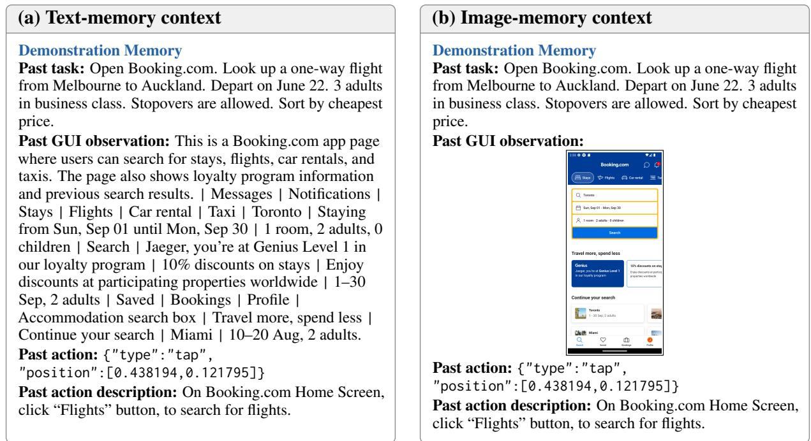  
Figure 11: Paired actor prompts used by SwitchMem. Both variants contain the same retrieved step from a successfully completed trajectory and expose its demonstrated action. Text memory renders the past GUI state as a textual observation, whereas Image memory replaces only that observation with the corresponding full screenshot. The image is cropped only for visualization; the actor receives the full screenshot. The current task, current screenshot, action schema, actor, and decoding configuration are held fixed. For readability, the common system prompt and current screenshot are collapsed in the figure.

<table><tr><td>Dataset</td><td>Best fixed</td><td>SwitchMem</td><td>∆</td><td>95% CI</td></tr><tr><td>AITW</td><td>49.300</td><td>51.420</td><td>+2.120</td><td>[1.270, 2.945]</td></tr><tr><td>LearnGUI</td><td>37.441</td><td>38.131</td><td>+0.690</td><td>[0.149, 1.263]</td></tr><tr><td>MobileMiniWoB++</td><td>60.870</td><td>63.043</td><td>+2.174</td><td>[-3.261, 7.609]</td></tr></table>

Table 5: Paired performance differences between SwitchMem and the strongest fixed memory baseline. Confidence intervals are reported in percentage points.

## B.7 Case Studies of When Each Memory Modality Is Useful

We illustrate state-dependent memory selection using two states from different AITW tasks. The first is a Sparse initial state requiring a Spatial action, whereas the second is a Dense post-initial state requiring a Function action. These examples contrast the three contextual factors examined in our modality utility analysis.

Within each example, Text and Image memory represent the same retrieved demonstration, and the current instruction and screenshot are identical across memory conditions. Only the representation of the past GUI observation differs.

Sparse initial state: Text memory is more useful. At step 0 of “Go to the official website of bestbuy,” the current screen shows a Costco sign-in page (Figure 12). Its annotated element density is 177.25, below AITW’s lower-quartile cutoff of 310.00, placing it in the Sparse group. The gold action is a tap on the browser address bar, classified as Spatial. This state is therefore Sparse, Spatial, and Initial.

The retrieved demonstration has the instruction “open google chrome and search for bestbuy.com” and also depicts a Costco sign-in page (Figure 12). Its textual observation includes the browser URL and labels such as “Sign In,” “Email Address,” and “Password,” together with the demonstrated tap action. The Image condition instead provides the screenshot of that past page, while retaining the same task and action information. Under Text memory, the actor correctly taps the current address bar. Under Image memory, it outputs a typing action for bestbuy.com without first selecting the address bar. The action scores are 1 and 0, respectively, and SwitchMem selects Text.

Dense post-initial state: Image memory is more useful. At step 2 of “Search for dell alienware on walmart.com,” the current screen displays the requested search results, including a query field, filter controls, product information, and pricing (Figure 13). Its annotated element density is 713.27, above AITW’s upper-quartile cutoff of 567.73, placing it in the Dense group. The gold action is task\_complete, categorized as Function because it signals task completion rather than a spatial interaction. This state is therefore Dense, Function, and Post-initial.

The retrieved demonstration concerns “Search dell alienware on amazon” (Figure 13). Its textual observation lists the query, search suggestions, and text-selection controls, while its screenshot depicts the query-entry state with the search text selected. Under Text memory, the actor unnecessarily presses Enter. Under Image memory, it correctly outputs task\_complete. The action scores are 0 and 1, respectively, and SwitchMem selects Image.

Together, these examples illustrate contextual variation in memory usefulness across interaction states. SwitchMem follows the higher-scoring modality in both cases, although these illustrative examples do not isolate the causal contribution of each contextual factor.

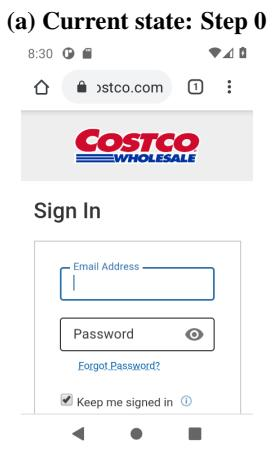

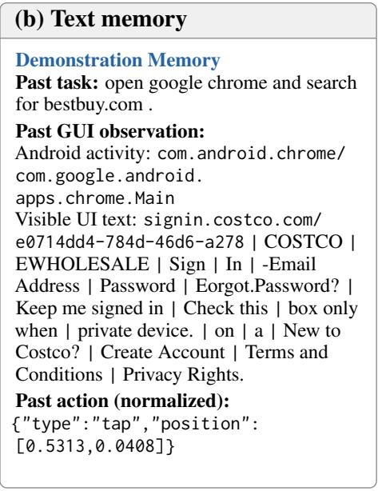

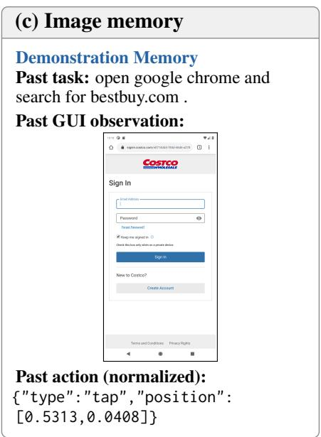  
Figure 12: Text-favoring AITW case. (a) A Sparse initial state requiring a Spatial action. (b,c) Text and Image representations of the same retrieved demonstration, which also shows a Costco sign-in page. Text memory yields a correct tap on the current browser address bar, whereas Image memory yields a typing action before selecting the bar. SwitchMem selects Text. T/I denotes Text/Image action-matching scores; memory coordinates are normalized and rounded.

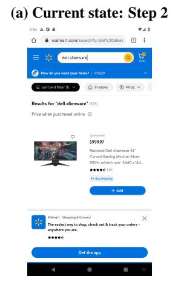

Current task: Search for dell alienware on walmart.com.

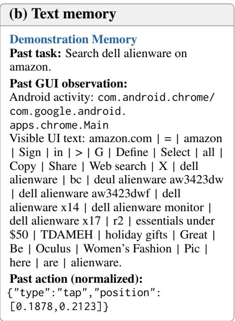

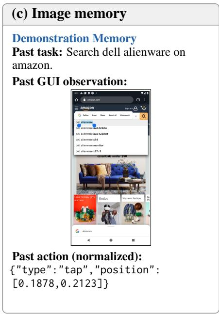  
Figure 13: Image-favoring AITW case. (a) A Dense post-initial state requiring a Function action: the requested Walmart search results are already displayed. (b,c) Text and Image representations of the same retrieved Amazon demonstration at a query-entry state. Image memory yields correct task completion, whereas Text memory yields an unnecessary Enter action. SwitchMem selects Image. T/I denotes Text/Image action-matching scores; memory coordinates are normalized and rounded.