# Let the Mind Conceive, Let the Hand Achieve: Following Multimodal Instructions for Long-Horizon Robotic Manipulation

Youpeng Wen1, Gang Wang1, Tianyu Huang1, Weiwei Zhang1, Zhijian Huang2, Wei Chen1, Xieyuanli Chen3, Yunhui Liu1

1 The Chinese University of Hong Kong 2 Xiaomi Corporation 3 National University of Defense Technology

## Abstract

A robot following a multi-step instruction needs to act on the right objects in the right order, even as the scene changes. It must also maintain awareness of task progress and determine when to advance. To address these challenges, we introduce Orchestra, an agent harness that separates task planning and execution management from action generation. Orchestra decomposes a complete multimodal instruction into ordered subtasks, tracks completed steps, and updates the locations of relevant objects and destinations during execution. It maintains a shared context containing the active subtask, spatial grounding, and recent observations. An action policy uses this context to generate actions, while a separately trained progress evaluator estimates when to advance to the next subtask. To evaluate whether robots trained on atomic instructions and short trajectories can execute longer subtask sequences, we introduce a benchmark named RMBench-Compose. Orchestra achieves a mean success rate of 68.22% across nine RM-Bench tasks, outperforming Mem-0 by 26.22 percentage points. On RMBench-Compose, it achieves an Average Success Length (ASL) of 7.35 subtasks, 2.46 times that of HarnessVLA. Across four real-world multi-step tasks, it improves mean ASL by 25.0% over Orchestra using the base π policy. These results show that Orchestra helps robots carry out longer sequences of subtasks while preserving the requested subtask order and acting on the specified objects.

Our code and project page are available at https://youpengwen.github.io/Orchestra.

## 1 Introduction

Generalist robot policies and vision-language-action (VLA) models have expanded language-conditioned manipulation [Brohan et al., 2023, Octo Model Team et al., 2024, Kim et al., 2024, Physical Intelligence et al., 2025]. While these advances improve local action capabilities, executing long-horizon tasks remains challenging because task progress must stay aligned with changing object states and goals. This raises a system-level question: how can an action policy execute a complete user instruction across a long sequence of interactions? Addressing this question requires coordination beyond local action generation, including maintaining the requested operation order, grounding objects and destinations, and managing subtask transitions.

The first challenge is maintaining task continuity by tracking completed and pending operations while retaining relevant observations. Memory-based approaches combine short-horizon visual history with task level information [Torne et al., 2026], and RMBench studies memory-dependent manipulation through its benchmark and Mem-0 policy [Chen et al., 2026]. However, these memory mechanisms alone do not ensure that perceptual history and task records remain aligned with the active subtask throughout execution of a complete instruction.

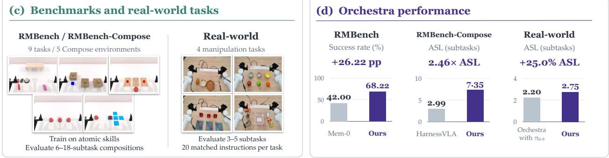

(a) Long-horizon instruction following  
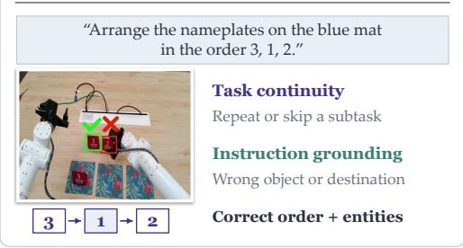

(b) Orchestra overview  
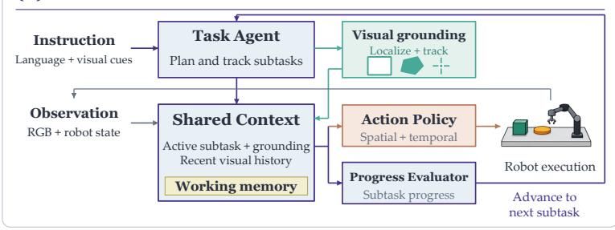

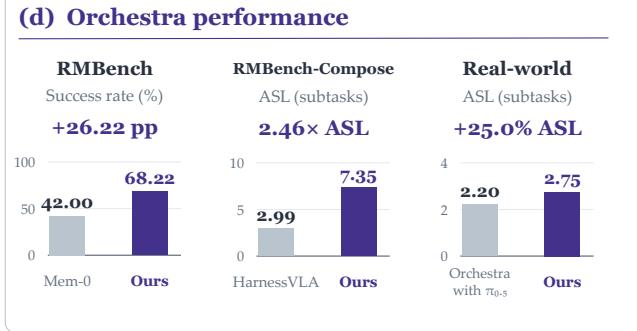  
Figure 1: Overview of Orchestra. (a) Long-horizon instruction following requires task continuity and correct grounding. (b) Orchestra coordinates action generation and subtask transitions through a shared execution context. (c) Evaluation spans RMBench, RMBench-Compose, and real-world tasks. (d) Orchestra improves success rate and Average Success Length over the indicated baselines.

The second challenge is preserving instruction grounding: a mechanically successful action can still target the wrong object or destination [Hou and Zhao, 2026]. Multimodal prompts and spatial representations support task specification and grounding [Jiang et al., 2022, Huang et al., 2023], but task-relevant grounding must be refreshed as objects move and goals change. Grounding and continuity are therefore coupled: each operation must target the intended entity at the correct point in the sequence.

Robotic systems have increasingly drawn on language-model agent architectures to organize task execution. These architectures coordinate reasoning, action, and feedback [Yao et al., 2023], while their robotic applications incorporate afordances, execution feedback, and programmatic control [Ahn et al., 2022, Huang et al., 2022, Liang et al., 2022]. More recently, Harness VLA uses a memory-guided agent to compose a frozen VLA with analytic manipulation primitives [Zhang et al., 2026]. Building on this perspective, we focus on a shared execution context that aligns the active subtask, spatial grounding, observation history, and progress-driven transitions (Figure 1).

Guided by the principle “Let the mind conceive, let the hand achieve”, we introduce Orchestra, an agent harness for task-level interpretation and execution management. Orchestra separates these functions from local action generation through a shared execution context. Given a complete multimodal instruction, it constructs ordered subtasks and maintains this context for the active subtask. Perception tools update task relevant spatial grounding, while working memory preserves task records and recent observations. Moreover, we instantiate the action policy with an adapted $\pi _ { 0 . 5 }$ model [Physical Intelligence et al., 2025], conditioned on the active subtask, spatial prompts, recent RGB observations, and current proprioception. We also train an independent progress evaluator that uses aligned context to estimate subtask progress and guide transitions. At each subtask transition, the harness preserves task records while resetting local observation bufers and spatial grounding.

We evaluate Orchestra on both simulated benchmarks and real-world manipulation tasks. The simulated benchmarks include RMBench [Chen et al., 2026] and RMBench-Compose, which we introduce by adapting five RMBench environments to support variable-length, state-feasible compositions of atomic skills. On RMBench-Compose, the action policy is fine-tuned only on atomic instructions and short trajectories, while evaluation requires executing longer subtask sequences from complete instructions as object states change. Together, these evaluations assess memory-dependent manipulation, composition beyond the training hori zon, and sustained execution on real hardware.

Our contributions are threefold:

• We introduce Orchestra, an agent harness that maintains a shared execution context to coordinate task interpretation, spatial grounding, working memory, and subtask transitions throughout complete instructions.

• We adapt a VLA policy to combine subtask instructions, spatial prompts, and recent visual history, and train an independent progress evaluator to separate action generation from subtask-completion assessment.

• We introduce RMBench-Compose to evaluate long-horizon task execution and evaluate Orchestra on RMBench, RMBench-Compose, and real-world manipulation tasks. Orchestra improves mean RM-Bench success rate by 26.22 percentage points over Mem-0 and achieves 2.46 the Average Success Length of HarnessVLA on RMBench-Compose. On real-world tasks, it improves mean Average Success Length by 25.0% over Orchestra with the base $\pi _ { 0 . 5 }$ policy.

## 2 Related Work

Imitation-based robot policies. Recent robot learning has increasingly focused on building generalist manipulation policies from large-scale and heterogeneous demonstrations [Kim et al., 2024, Black et al., 2025, Physical Intelligence et al., 2025]. Early vision-language-action (VLA) models transfer semantic representations from pre-trained vision-language models to robot control; they typically discretize continuous actions and predict them as tokens [Brohan et al., 2023, Kim et al., 2024]. More recent approaches instead condition dedicated action experts on vision-language representations, enabling more expressive continuous control. For example, π uses a flow-matching action expert to generate temporally chunked actions [Black et al., 2025], while $\pi _ { 0 . 5 }$ combines heterogeneous co-training with semantic subtask prediction for open-world generalization [Physical Intelligence et al., 2025]. These models mainly improve manipulation capability through policy scaling, broader training data, and stronger action representations. In this work, we take a complementary approach: We retain the pretrained VLA policy as the action policy and externalize the planning, memory, and command-mapping functions to the agent-level system.

Long-horizon manipulation. Long-horizon manipulation requires tracking task progress and relevant history beyond the current observation. Recent approaches address this through hierarchical task decomposition and temporal memory. Hierarchical methods separate coarse task semantics from low-level control; for example, MimicPlay uses high-level guidance derived from human play [Wang et al., 2023], while π0.5 predicts semantic subtasks that condition subsequent action generation [Physical Intelligence et al., 2025]. More recent work incorporates historical context into VLA policies. HAMLET aggregates compact moment tokens through a lightweight memory module, allowing pretrained VLAs to eficiently use past observations [Koo et al., 2026]. MEM further introduces memory at multiple temporal scales, combining short-term perceptual context with long-term semantic task information [Torne et al., 2026]. RMBench conducted a systematic study of this configuration and proposed Mem-0 to enable memory-based operations using explicit memory components [Chen et al., 2026]. These methods primarily incorporate temporal context into the policy or its inference architecture. In contrast, our framework combines policy-level visual memory with explicit task records and subtask-transition control maintained by the agent harness.

Robot agents. Recent robot-agent systems use foundation models to coordinate reusable robot skills, separating high-level reasoning from low-level execution. Early approaches such as Code as Policies generate executable programs over perception and control APIs, providing a modular interface between languagemodel reasoning and robot control [Liang et al., 2022]. Later systems extend this idea to large-scale embodied orchestration. AutoRT combines VLM-based scene understanding with LLM-based task generation to coordinate robot behaviors in real-world environments [Ahn et al., 2024]. More recent work integrates VLAs directly into the agent hierarchy. VLAs-as-Tools treats specialized VLA policies as executable tools selected by a high-level VLM agent. It also uses execution feedback and event-triggered replanning to support long-horizon tasks [Lei et al., 2026]. Harness VLA takes a diferent approach. It uses a frozen VLA as a contact-rich manipulation primitive and coordinates it with analytic primitives through a memory-guided agent [Zhang et al., 2026]. These methods shift robot agents from predefined symbolic skills toward learned VLA policies. Our framework follows this direction, emphasizing external task coordination, multi-timescale memory, and multimodal instruction anchoring around a pretrained VLA.

## 3 Method

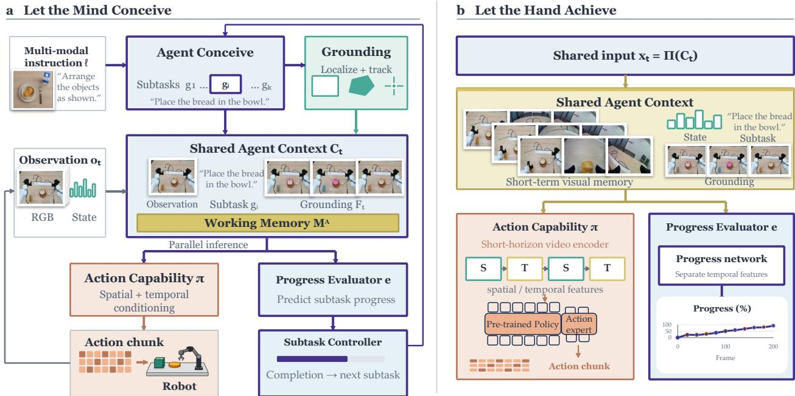  
Figure 2: Orchestra framework. (a) Let the Mind Conceive. The agent decomposes multimodal instructions into subtasks, grounds relevant entities, and maintains task records and recent RGB observations. (b) Let the Hand Achieve. An action policy and an independent progress evaluator use the active subtask, observations, and spatial grounding to generate action chunks and predict progress. A terminal-category prediction triggers the next subtask.

## 3.1 Problem Formulation and Overview

We consider long-horizon manipulation specified by a multimodal instruction ℓ. At time t, the robot observes $o _ { t } = ( \mathbf { I } _ { t } , s _ { t } )$ , comprising multi-camera images and proprioception. Orchestra converts ℓ into an ordered plan $\mathcal { G } = ( g _ { 1 } , \ldots , g _ { N } )$ and grounds the active subtask $g _ { i _ { t } }$ in the current scene. An action policy πθ and a separately

trained progress evaluator $e _ { \phi }$ operate on a shared context:

$$
\begin{array} { c } { C _ { t } = \left( o _ { t } , g _ { i _ { t } } , M _ { t } ^ { A } , F _ { t } \right) , } \\ { A _ { t } = \pi _ { \theta } ( C _ { t } ) , \qquad q _ { t } = e _ { \phi } ( C _ { t } ) , } \end{array}\tag{1}
$$

where $F _ { t }$ is the spatial grounding, $A _ { t }$ an action chunk, and $q _ { t }$ a distribution over $B$ within-subtask progress categories. The shared context provides a common execution interface, with model-specific adapters selecting the inputs consumed by the action policy and progress evaluator.

Agent working memory is

$$
M _ { t } ^ { A } = ( \mathcal { D } _ { t } , \mathcal { H } _ { t } , i _ { t } ) ,\tag{2}
$$

containing completed-subtask records, a bounded history of timestamped multi-camera observations, and the active index. The controller tracks completed subtasks in $\mathcal { D } _ { t }$ , while the policy and progress evaluator use recent observations from $\mathcal { H } _ { t }$ . At each subtask transition, the controller retains the task record and reinitializes the visual history and spatial grounding for the next subtask.

## 3.2 Task Orchestration and Visual Grounding

Task interpretation. Orchestra supports three input forms: (i) language paired with a reference image, e.g., “Arrange the objects in the corresponding positions shown in the reference image”; (ii) language-only instructions, $\mathrm { e . g . }$ , “Arrange the numbered nameplates on the blue mat in the order 3, 2, 1”; and (iii) referring instructions paired with user-provided points or bounding boxes, e.g., “Put this on that,” where annotations identify the referenced source object and target destination. We use DeepSeek-V4.1-Flash [DeepSeek-AI, 2026] as the default task-orchestration agent and evaluate Qwen3.7-Plus [Qwen Team, 2026] as a replacement (Section 5.3). The module converts each input into ordered subtasks with executable instructions and entity bindings. Reference images and user annotations are resolved at this stage; the action policy receives the active subtask and its scene grounding.

Subtask-conditioned grounding. MolmoPoint-8B [Clark et al., 2026] locates task-relevant entities in the current head-camera image, providing point prompts for SAM3 [Carion et al., 2026] instance segmentation. Grounding is initialized at subtask boundaries; SAM3 updates the selected regions at subsequent action replanning calls. The resulting masks provide bounding boxes, sampled points, or segmentation contours for downstream conditioning.

## 3.3 Spatially and Temporally Conditioned Action Policy

We augment $\pi _ { 0 . 5 }$ [Physical Intelligence et al., 2025] with spatial conditioning and short-term visual memory. Its PaliGemma [Beyer et al., 2024] backbone and action expert generate actions from the active subtask, spatial prompts, proprioception, and recent RGB observations. We use factorized spatial and temporal attention to incorporate visual history.

Spatial conditioning. During training, each demonstration is paired with spatial annotations for entities relevant to the active subtask. Bounding boxes and points are serialized as entity names with quantized coordinates, e.g., <bbox, "brown loaf", $[ \mathbf { x } 1 , \mathbf { y } 1 , \mathbf { x } 2 , \mathbf { y } 2 ] > { \mathrm { ~ o r ~ } }$ <point, "brown loaf", [x,y]>, and appended to the language prefix alongside the subtask instruction. For mask-based conditioning, segmentation contours are overlaid on the corresponding objects in the head-camera image.

Temporal visual encoding. For each camera c, we sample a window from $\mathcal { H } _ { t }$ :

$$
\mathcal { W } _ { t } ^ { c } = \left( I _ { t - ( K - 1 ) \Delta } ^ { c } , \cdot \cdot \cdot , I _ { t - \Delta } ^ { c } , I _ { t } ^ { c } \right) ,\tag{3}
$$

where K is the window length and $\Delta$ the sampling stride; unavailable history is masked. Spatial attention operates within frames, and temporal attention mixes features at corresponding patch positions across

frames. Only current-frame features are retained for the language-model prefix after temporal fusion. History therefore adds temporal computation without increasing the number of visual tokens passed to the language model.

Action learning. The policy predicts action chunks of length $H _ { p }$ using the flow-matching objective of the base policy [Lipman et al., 2023], conditioned on the subtask instruction, spatial prompts, and recent visual observations.

## 3.4 Progress Estimation and Closed-Loop Execution

Progress prediction. An independent evaluator with a Gemma-300M [Schechter Vera et al., 2025] backbone receives the active subtask, spatial conditions, proprioception, and recent visual history. A learnable progress token aggregates these inputs into $h _ { t }$ , yielding

$$
q _ { t } = \mathrm { s o f t m a x } \big ( W _ { \mathrm { p r o g } } \mathrm { L N } ( h _ { t } ) + b _ { \mathrm { p r o g } } \big ) .\tag{4}
$$

The predicted category is $\hat { b } _ { t } = \arg \operatorname* { m a x } _ { j \in \{ 0 , \ldots , B - 1 \} } q _ { t , j }$

Progress supervision. Demonstrations are segmented into language-labeled subtasks. For frame u in segment $[ a _ { i } , e _ { i } )$ , temporal progress and its discrete label are

$$
\begin{array} { c } { \rho _ { i } ( u ) = 1 - \displaystyle \frac { \operatorname* { m a x } ( e _ { i } - 1 - u , 0 ) } { \operatorname* { m a x } ( e _ { i } - a _ { i } , 1 ) } , } \\ { b _ { i } ( u ) = \mathrm { c l i p } \big ( \mathrm { r o u n d } \big ( ( B - 1 ) \rho _ { i } ( u ) \big ) , 0 , B - 1 \big ) . } \end{array}\tag{5}
$$

We train the evaluator with cross-entropy:

$$
\mathcal { L } _ { \mathrm { p r o g } } = - \mathbb { E } _ { ( u , i ) } \log q _ { u , b _ { i } ( u ) } .\tag{6}
$$

These labels describe temporal progress, and their terminal-category interpretation is detailed in Appendix B.5.

Closed-loop execution. At each action-chunk replanning call, the agent updates grounding and invokes the policy and evaluator in parallel. The agent switches subtasks when the most probable progress category is terminal:

$$
\begin{array} { r } { c _ { t } = \mathbf { 1 } [ \hat { b } _ { t } = B - 1 ] . } \end{array}\tag{7}
$$

Otherwise, it executes the action chunk and continues the current subtask. A transition records completion, discards the old subtask’s action chunk, advances the plan, and resets local histories and grounding. The final transition terminates the plan; task success is measured separately. Intermediate observations update visual histories without invoking grounding or progress evaluation.

## 4 RMBench-Compose Benchmark

We introduce RMBench-Compose by adapting five RMBench [Chen et al., 2026] environments for longhorizon instruction following. Whereas the original tasks use predefined instruction templates and execution sequences, RMBench-Compose supports varying the length and order of feasible operations within each environment. The benchmark evaluates whether systems can follow complete language instructions over sequences longer than those seen during atomic-skill training. Successful execution requires maintaining the requested operation order and selecting the intended objects and destinations throughout the sequence.

The five environments are Press Button, Pick Up Object, Cover and Uncover Block, Swap Block, and Place Block on Mat. Each environment defines atomic subtasks with associated language instructions, relevant entities, feasibility conditions, and success predicates. RMBench-Compose also provides segmentation masks, bounding boxes, and points for objects and spatial targets relevant to the active subtask. Feasibility depends on the current scene state; for example, an uncovering operation requires the target block to be covered.

Let $\mathcal { U } _ { e }$ be the atomic subtask library for environment e, and $\mathcal { F } _ { e } ( x ) \subseteq \mathcal { U } _ { e }$ its feasible subset at state x. A composed task is

$$
\begin{array} { r } { \mathcal { G } = ( g _ { 1 } , \ldots , g _ { L } ) , \qquad g _ { j } \in \mathcal { F } _ { e } ( x _ { j - 1 } ) , } \end{array}\tag{8}
$$

where $x _ { j - 1 }$ is the scene state after successful execution of the preceding subtasks. Sequence length and subtask order are configurable, subject to the environment’s available skills and state-dependent feasibility conditions.

Evaluation protocol. Training demonstrations contain atomic instructions and short trajectories. At evaluation time, each episode begins with a complete language instruction ℓ specifying the ordered subtask sequence. Each subtask starts from the scene state left by the preceding subtask and has an environmentspecific action budget. Episodes end when the sequence is completed or a subtask exhausts its action budget.

We report Atomic Success Rate (Atomic SR) on isolated atomic tasks and two metrics for composed-task execution. Average Success Length (ASL) measures the mean number of consecutive subtasks completed in the requested order. Subtask Success Rate (SSR) measures the fraction of attempted subtasks completed successfully, excluding subtasks not reached after an earlier failure.

## 5 Experiments

We evaluate sustained instruction following on RMBench [Chen et al., 2026], RMBench-Compose, and a physical robot, with ablations examining the components of Orchestra.

## 5.1 Experimental Setup

Benchmarks and task inputs. We evaluate nine RMBench tasks and five RMBench-Compose environments under the atomic-training, composed-evaluation protocol in Section 4. Evaluation lengths are n = 10, 12, 6, 14, 18 for Pick Up Object, Cover and Uncover Block, Press Button, Swap Block, and Place Block on Mat, respectively. We conduct 100 evaluation rollouts for each task. Training uses atomic instructions and short demonstrations, whereas evaluation begins with the complete ordered instruction and preserves scene states across subtask boundaries.

Compared configurations. Table 1 combines nine oficially reported RMBench [Chen et al., 2026] baselines with our evaluations of HarnessVLA and Orchestra. RMBench-Compose compares $\pi _ { 0 . 5 }$ [Physical Intelligence et al., 2025], HarnessVLA [Zhang et al., 2026], Orchestra with $\pi _ { 0 . 5 } .$ , the complete Orchestra system, and its Qwen3.7-Plus-agent variant. Orchestra with π0.5 uses the base action policy instead of the spatially and temporally conditioned policy in Section 3.3. The Qwen-agent variant replaces only the taskorchestration agent. Appendix D details the sources of baseline results and model configurations.

Implementation details. In simulation, spatial inputs use environment-provided ground-truth segmentation masks. For real-world training data, we use an automatic annotation pipeline combining Qwen3.7- Plus [Qwen Team, 2026] for subtask decomposition, MolmoPoint-8B [Clark et al., 2026] for object pointing, and SAM3 [Carion et al., 2026] for segmentation. During real-world deployment, pointing and segmentation initialize spatial grounding at subtask boundaries; masks are subsequently tracked at action-chunk replanning calls (Section 3). The temporally conditioned action policy uses a visual history window of $K = 6$ frames with a sampling stride of $\Delta = 3$ . The progress evaluator uses $B = 1 1$ discrete within-subtask progress categories.

Table 1: Success rates on RMBench. The best result in each column is shown in bold.
<table><tr><td>Method</td><td>Observe and Pick Up</td><td>Rearrange Blocks</td><td>Put Back Block</td><td>Swap Blocks</td><td>Swap T</td><td>Battery Try</td><td>Blocks Ranking Try</td><td>Cover Blocks</td><td>Press Button</td><td>Total average</td></tr><tr><td>Base policies</td><td></td><td></td><td></td><td></td><td></td><td></td><td></td><td></td><td></td><td></td></tr><tr><td>DP</td><td>1%</td><td>0%</td><td>0%</td><td>11%</td><td>20%</td><td>10%</td><td>10%</td><td>0%</td><td>0%</td><td>5.78%</td></tr><tr><td>ACT</td><td>1%</td><td>29%</td><td>0%</td><td>2%</td><td>2%</td><td>19%</td><td>0%</td><td>0%</td><td>0%</td><td>5.89%</td></tr><tr><td>π0.5</td><td>9%</td><td>13%</td><td>11%</td><td>24%</td><td>15%</td><td>16%</td><td>6%</td><td>0%</td><td>0%</td><td>10.44%</td></tr><tr><td>X-VLA</td><td>9%</td><td>13%</td><td>18%</td><td>16%</td><td>3%</td><td>26%</td><td>1%</td><td>2%</td><td>0%</td><td>9.78%</td></tr><tr><td>QwenOFT</td><td>0%</td><td>0%</td><td>0%</td><td>0%</td><td>0%</td><td>14%</td><td>37%</td><td>0%</td><td>0%</td><td>5.67%</td></tr><tr><td>Dual-system models</td><td></td><td></td><td></td><td></td><td></td><td></td><td></td><td></td><td></td><td></td></tr><tr><td>MemER</td><td>7%</td><td>17%</td><td>0%</td><td>14%</td><td>7%</td><td>27%</td><td>0%</td><td>6%</td><td>0%</td><td>8.67%</td></tr><tr><td>Mem-0</td><td>4%</td><td>89%</td><td>90%</td><td>67%</td><td>14%</td><td>28%</td><td>18%</td><td>68%</td><td>0%</td><td>42.00%</td></tr><tr><td>End-to-end memory models</td><td></td><td></td><td></td><td></td><td></td><td></td><td></td><td></td><td></td><td></td></tr><tr><td>MemoryVLA (OpenVLA)</td><td>0%</td><td>22%</td><td>50%</td><td>17%</td><td>9%</td><td>25%</td><td>12%</td><td>40%</td><td>0%</td><td>19.44%</td></tr><tr><td>MemoryVLA (QwenOFT)</td><td>2%</td><td>53%</td><td>81%</td><td>76%</td><td>9%</td><td>33%</td><td>53%</td><td>69%</td><td>0%</td><td>41.78%</td></tr><tr><td>Agent-based systems</td><td></td><td></td><td></td><td></td><td></td><td></td><td></td><td></td><td></td><td></td></tr><tr><td>HarnessVLA</td><td>10%</td><td>32%</td><td>62%</td><td>18%</td><td>5%</td><td>24%</td><td>20%</td><td>26%</td><td>44%</td><td>26.78%</td></tr><tr><td>Orchestra</td><td>81%</td><td>95%</td><td>81%</td><td>86%</td><td>10%</td><td>30%</td><td>65%</td><td>69%</td><td>97%</td><td>68.22%</td></tr></table>

## 5.2 Evaluation on RMBench

Orchestra achieved the highest mean success rate among the evaluated methods, reaching 68.22% versus Mem-0’s 42.00%, a 26.22-percentage-point gain (Table 1). On Observe and Pick Up and Press Button, it achieved 81% and 97%, compared with HarnessVLA’s 10% and 44%, respectively. However, Put Back Block remained below Mem-0 (81% versus 90%), and Swap T success was only 10%. Thus, strong average performance coexisted with task-specific weaknesses; aggregate scores do not separate manipulation failures from task-management errors.

## 5.3 Compositional Execution on RMBench-Compose

Atomic competence and sustained execution. The base $\pi _ { 0 . 5 }$ policy achieved 85.0% Atomic SR but only 47.36% SSR and 0.932 ASL during composed execution (Fig. 3). Orchestra with the same policy retained 85.0% Atomic SR while increasing SSR to 70.78% and ASL to 2.884 (3.09 ). This comparison supports organizing local actions around explicit subtasks and transitions.

Complete-system performance. Complete Orchestra achieved 95.2% Atomic SR, 86.69% SSR, and 7.350 ASL, or 2.46 HarnessVLA’s 2.986 ASL. Its ASL was also 2.55 that of Orchestra with π0.5, supporting the complete configuration combining the harness with the spatially and temporally conditioned policy. Orchestra with $\pi _ { 0 . 5 }$ alone remained below HarnessVLA in mean ASL, so adding the harness alone does not explain the complete system’s advantage. Orchestra exceeded HarnessVLA in ASL across all five environments, with the largest absolute gain on Place Block on Mat (4.35 to 13.06, n = 18). On Press Button, Orchestra completed an average of 5.79 of the 6 requested subtasks. Pick Up Object remained difficult, reaching only 2.11 ASL (n = 10) despite 81% Atomic SR. These results expose a remaining gap between isolated competence and sustained execution, while diferences in task dificulty prevent attributing cross-environment variation solely to sequence length.

Alternative orchestration agent. Replacing the agent with Qwen yielded 85.74% SSR and 7.188 ASL, close to the default configuration’s 86.69% and 7.350; Atomic SR remained 95.2%. Qwen performed slightly better on Cover and Uncover Block (5.90 versus 5.82 ASL), while the default agent was higher in the other four environments. Strong performance was retained under this substitution, without establishing robustness to arbitrary agent choices. Fig. 10 provides per-environment Atomic SR and SSR.

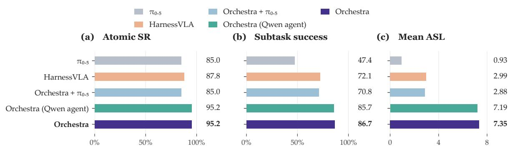  
(d) Task-level ASL (dashed lines: task lengths)

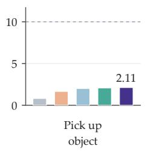

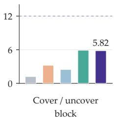

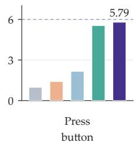

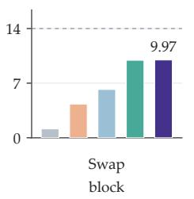

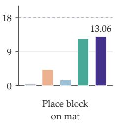  
Figure 3: Atomic and compositional performance on RMBench-Compose. (a–c) Unweighted fiveenvironment averages of Atomic SR, SSR, and ASL. (d) Per-environment ASL; dashed segments indicate task lengths. Orchestra with $\pi _ { 0 . 5 }$ changes the action policy; the Qwen variant changes the orchestration agent. Spatially conditioned configurations use environment-provided grounding.

## 5.4 Ablation Studies

(a) Component ablations

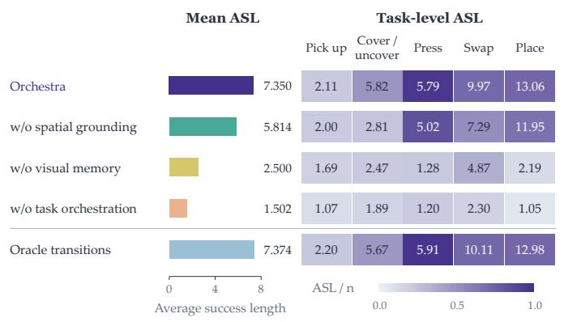

(b) Simulation examples  
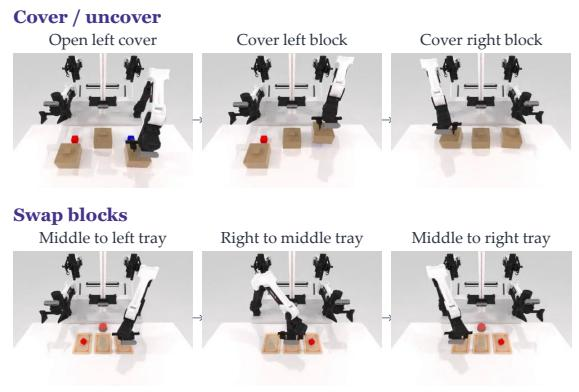  
Figure 4: Component ablations and simulation examples on RMBench-Compose. (a) Mean and perenvironment ASL for component removals and state-based oracle transitions. Heatmap cells report raw ASL; colors encode ASL/n. (b) Selected subtask frames illustrating Cover and Uncover Block and Swap Block.

Component contributions. Removing task orchestration, short-horizon visual memory, or spatial grounding reduced mean ASL from 7.350 to 1.502, 2.500, and 5.814, respectively (Fig. 4a). These correspond to decreases of 79.6%, 66.0%, and 20.9%. Task orchestration made the largest contribution: directly conditioning the policy on the complete instruction reduced mean ASL by nearly 80%, demonstrating the importance of structured subtask execution. Short-horizon visual memory was also critical, especially on Place Block

(a) Real-world performance

on Mat (13.06 to 2.19 ASL) and Press Button (5.79 to 1.28). Spatial grounding provided substantial gains on visually demanding tasks, with Cover and Uncover Block increasing from 2.81 to 5.82 ASL when grounding was enabled. Together, these ablations show that task orchestration, temporal memory, and spatial grounding each contribute to sustained compositional execution.

Learned versus state-based transitions. Replacing the progress evaluator with the simulator’s statebased completion indicator yielded 7.374 mean ASL, compared with 7.350 for Orchestra’s learned evaluator. The mean gap was only 0.024 subtasks, and absolute per-environment diferences were at most 0.15. This small aggregate gap suggests similar rollout performance, without establishing equivalent completion detection.

## 5.5 Real-World Evaluation

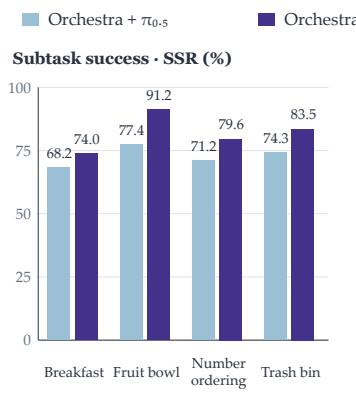

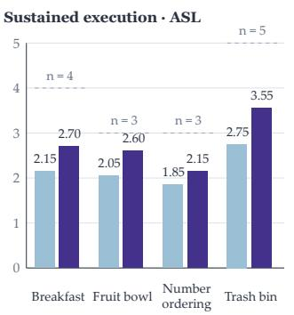  
(b) Grounded subtask examples

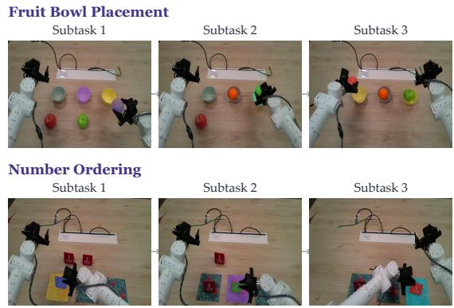  
Figure 5: Real-world performance and grounded subtask examples. (a) SSR and ASL on four tasks over 20 episodes per task and configuration. Dashed lines mark task lengths (n = 4, 3, 3, 5). (b) Selected subtask examples for Fruit Bowl Placement and Number Ordering, with corresponding object masks overlaid on RGB frames.

We evaluated Breakfast Preparation, Fruit Bowl Placement, Number Ordering, and Trash Bin Placement, with instruction lengths of 4, 3, 3, and 5 subtasks, respectively. We ran 20 evaluation rollouts per task for each configuration, totaling 80 rollouts per configuration. Both configurations used the same set of randomly selected task instructions. Execution used predicted and tracked grounding; Appendix D.4 describes the robot platform.

Complete Orchestra improved SSR and ASL on all four tasks (Fig. 5a). Mean SSR increased from 72.77% to 82.09%, and mean ASL increased from 2.20 to 2.75 (25.0%). Fruit Bowl Placement showed the largest SSR gain, increasing from 77.36% to 91.22%. Trash Bin Placement showed the largest ASL gain (2.75 to 3.55), with improvements observed across all evaluated instruction lengths. With the same Orchestra harness used in both configurations, these consistent gains highlight the practical contribution of the spatially and temporally conditioned policy under predicted real-world grounding. Additional qualitative real-world results and failure analyses are provided in Appendices E.3 and E.4, respectively.

## 6 Conclusion

We introduced Orchestra, an agent harness that coordinates task orchestration, spatial grounding, working memory, and progress-driven subtask transitions through a shared execution context. We also introduced

RMBench-Compose to evaluate long-horizon composition after atomic-skill training. Orchestra achieved 68.22% mean success on RMBench and 7.35 Average Success Length (ASL) on RMBench-Compose, 2.46 that of HarnessVLA. Across four real-world tasks, it improved mean ASL by 25.0% over Orchestra with the base $\pi _ { 0 . 5 }$ policy. These results support shared-context coordination as a complement to local action capabilities. Performance remains task-dependent, and simulation relies on reference grounding, motivating evaluation on longer real-world sequences with predicted grounding.

## References

Michael Ahn, Anthony Brohan, Noah Brown, Yevgen Chebotar, Omar Cortes, Byron David, Chelsea Finn, Chuyuan Fu, Keerthana Gopalakrishnan, Karol Hausman, Alex Herzog, Daniel Ho, Jasmine Hsu, Julian Ibarz, Brian Ichter, Alex Irpan, Eric Jang, Rosario Jauregui Ruano, Kyle Jefrey, Sally Jesmonth, Nikhil Joshi, Ryan Julian, Dmitry Kalashnikov, Yuheng Kuang, Kuang-Huei Lee, Sergey Levine, Yao Lu, Linda Luu, Carolina Parada, Peter Pastor, Jornell Quiambao, Kanishka Rao, Jarek Rettinghouse, Diego Reyes, Pierre Sermanet, Nicolas Sievers, Clayton Tan, Alexander Toshev, Vincent Vanhoucke, Fei Xia, Ted Xiao, Peng Xu, Sichun Xu, Mengyuan Yan, and Andy Zeng. Do as I can and not as I say: Grounding language in robotic afordances. arXiv preprint arXiv:2204.01691, 2022. URL https://arxiv.org/abs/2204. 01691.

Michael Ahn, Debidatta Dwibedi, Chelsea Finn, Montse Gonzalez Arenas, Keerthana Gopalakrishnan, Karol Hausman, Brian Ichter, Alex Irpan, Nikhil Joshi, Ryan Julian, Sean Kirmani, Isabel Leal, Edward Lee, Sergey Levine, Yao Lu, Sharath Maddineni, Kanishka Rao, Dorsa Sadigh, Pannag Sanketi, Pierre Sermanet, Quan Vuong, Stefan Welker, Fei Xia, Ted Xiao, Peng Xu, Steve Xu, and Zhuo Xu. AutoRT: Embodied foundation models for large scale orchestration of robotic agents. arXiv preprint arXiv:2401.12963, 2024. URL https://arxiv.org/abs/2401.12963.

Lucas Beyer, Andreas Steiner, André Susano Pinto, Alexander Kolesnikov, Xiao Wang, Daniel Salz, Maxim Neumann, Ibrahim Alabdulmohsin, Michael Tschannen, Emanuele Bugliarello, Thomas Unterthiner, Daniel Keysers, Skanda Koppula, Fangyu Liu, Adam Grycner, Alexey Gritsenko, Neil Houlsby, Manoj Kumar, Keran Rong, Julian Eisenschlos, Rishabh Kabra, Matthias Bauer, Matko Bošnjak, Xi Chen, Matthias Minderer, Paul Voigtlaender, Ioana Bica, Ivana Balazevic, Joan Puigcerver, Pinelopi Papalampidi, Olivier Henaf, Xi Xiong, Radu Soricut, Jeremiah Harmsen, and Xiaohua Zhai. Paligemma: A versatile 3b vlm for transfer, 2024. URL https://arxiv.org/abs/2407.07726.

Kevin Black, Noah Brown, Danny Driess, Adnan Esmail, Michael Robert Equi, Chelsea Finn, Niccolo Fusai, Lachy Groom, Karol Hausman, Brian Ichter, Szymon Jakubczak, Tim Jones, Liyiming Ke, Sergey Levine, Adrian Li-Bell, Mohith Mothukuri, Suraj Nair, Karl Pertsch, Lucy Xiaoyang Shi, Laura Smith, James Tanner, Quan Vuong, Anna Walling, Haohuan Wang, and Ury Zhilinsky. π0: A vision-language-action flow model for general robot control. arXiv preprint arXiv:2410.24164, 2025. URL https://arxiv. org/abs/2410.24164.

Anthony Brohan, Noah Brown, Justice Carbajal, Yevgen Chebotar, Xi Chen, Krzysztof Choromanski, Tianli Ding, Danny Driess, Avinava Dubey, Chelsea Finn, Pete Florence, Chuyuan Fu, Montse Gonzalez Arenas, Keerthana Gopalakrishnan, Kehang Han, Karol Hausman, Alexander Herzog, Jasmine Hsu, Brian Ichter, Alex Irpan, Nikhil Joshi, Ryan Julian, Dmitry Kalashnikov, Yuheng Kuang, Isabel Leal, Lisa Lee, Tsang-Wei Edward Lee, Sergey Levine, Yao Lu, Henryk Michalewski, Igor Mordatch, Karl Pertsch, Kanishka Rao, Krista Reymann, Michael Ryoo, Grecia Salazar, Pannag Sanketi, Pierre Sermanet, Jaspiar Singh, Anikait Singh, Radu Soricut, Huong Tran, Vincent Vanhoucke, Quan Vuong, Ayzaan Wahid, Stefan Welker, Paul Wohlhart, Jialin Wu, Fei Xia, Ted Xiao, Peng Xu, Sichun Xu, Tianhe Yu, and Brianna

Zitkovich. RT-2: Vision-language-action models transfer web knowledge to robotic control. arXivpreprint arXiv:2307.15818, 2023. URL https://arxiv.org/abs/2307.15818.

Nicolas Carion, Laura Gustafson, Yuan-Ting Hu, Shoubhik Debnath, Ronghang Hu, Didac Suris, Chaitanya Ryali, Kalyan Vasudev Alwala, Haitham Khedr, Andrew Huang, Jie Lei, Tengyu Ma, Baishan Guo, Arpit Kalla, Markus Marks, Joseph Greer, Meng Wang, Peize Sun, Roman Radle, Triantafyllos Afouras, Efrosyni Mavroudi, Katherine Xu, Tsung-Han Wu, Yu Zhou, Liliane Momeni, Rishi Hazra, Shuangrui Ding, Sagar Vaze, Francois Porcher, Feng Li, Siyuan Li, Aishwarya Kamath, Ho Kei Cheng, Piotr Dollar, Nikhila Ravi, Kate Saenko, Pengchuan Zhang, and Christoph Feichtenhofer. SAM 3: Segment anything with concepts. International Conference on Learning Representations, 2026. URL https://arxiv.org/abs/2511.16719.

Tianxing Chen, Yuran Wang, Mingleyang Li, Yan Qin, Hao Shi, Zixuan Li, Yifan Hu, Yingsheng Zhang, Kaixuan Wang, Yue Chen, Hongcheng Wang, Junjie Wang, Tianhang Yang, Renjing Xu, Ruihai Wu, Yao Mu, Yaodong Yang, Hao Dong, and Ping Luo. RMBench: Memory-dependent robotic manipulation benchmark with insights into policy design. arXiv preprint arXiv:2603.01229, 2026. URL https:// arxiv.org/abs/2603.01229.

Cheng Chi, Zhenjia Xu, Siyuan Feng, Eric Cousineau, Yilun Du, Benjamin Burchfiel, Russ Tedrake, and Shuran Song. Difusion policy: Visuomotor policy learning via action difusion. arXiv preprint arXiv:2303.04137, 2023. URL https://arxiv.org/abs/2303.04137.

Christopher Clark, Yue Yang, Jae Sung Park, Zixian Ma, Jieyu Zhang, Rohun Tripathi, Mohammadreza Salehi, Sangho Lee, Taira Anderson, Winson Han, and Ranjay Krishna. MolmoPoint: Better pointing for VLMs with grounding tokens. arXiv preprint arXiv:2603.28069, 2026. URL https://arxiv.org/ abs/2603.28069.

DeepSeek-AI. DeepSeek-V4.1-Flash: Pushing the limits of KV cache compression. arXiv preprint arXiv:2609.19969, 2026. URL https://arxiv.org/abs/2609.19969.

Yuchen Hou and Lin Zhao. LangGap: Diagnosing and closing the language gap in vision-language-action models. arXiv preprint arXiv:2603.00592, 2026. URL https://arxiv.org/abs/2603.00592.

Wenlong Huang, Fei Xia, Ted Xiao, Harris Chan, Jacky Liang, Pete Florence, Andy Zeng, Jonathan Tompson, Igor Mordatch, Yevgen Chebotar, Pierre Sermanet, Noah Brown, Tomas Jackson, Linda Luu, Sergey Levine, Karol Hausman, and Brian Ichter. Inner monologue: Embodied reasoning through planning with language models. arXiv preprint arXiv:2207.05608, 2022. URL https://arxiv.org/abs/2207. 05608.

Wenlong Huang, Chen Wang, Ruohan Zhang, Yunzhu Li, Jiajun Wu, and Li Fei-Fei. VoxPoser: Composable 3D value maps for robotic manipulation with language models. arXiv preprint arXiv:2307.05973, 2023. URL https://arxiv.org/abs/2307.05973.

Yunfan Jiang, Agrim Gupta, Zichen Zhang, Guanzhi Wang, Yongqiang Dou, Yanjun Chen, Li Fei-Fei, Anima Anandkumar, Yuke Zhu, and Linxi Fan. VIMA: General robot manipulation with multimodal prompts. arXiv preprint arXiv:2210.03094, 2022. URL https://arxiv.org/abs/2210.03094.

Moo Jin Kim, Karl Pertsch, Siddharth Karamcheti, Ted Xiao, Ashwin Balakrishna, Suraj Nair, Rafael Rafailov, Ethan Foster, Grace Lam, Pannag Sanketi, Quan Vuong, Thomas Kollar, Benjamin Burchfiel, Russ Tedrake, Dorsa Sadigh, Sergey Levine, Percy Liang, and Chelsea Finn. OpenVLA: An open-source vision-language-action model. arXiv preprint arXiv:2406.09246, 2024. URL https://arxiv.org/ abs/2406.09246.

Myungkyu Koo, Daewon Choi, Taeyoung Kim, Kyungmin Lee, Changyeon Kim, Younggyo Seo, and Jinwoo Shin. HAMLET: Switch your vision-language-action model into a history-aware policy. arXiv preprint arXiv:2510.00695, 2026. URL https://arxiv.org/abs/2510.00695.

Zixing Lei, Changxing Liu, Yichen Xiong, Minhao Xiong, Yuanzhuo Ding, Zhipeng Zhang, Weixin Li, and Siheng Chen. Towards long-horizon embodied agents with tool-aligned vision-language-action models. arXiv preprint arXiv:2605.13119, 2026. URL https://arxiv.org/abs/2605.13119.

Jacky Liang, Wenlong Huang, Fei Xia, Peng Xu, Karol Hausman, Brian Ichter, Pete Florence, and Andy Zeng. Code as policies: Language model programs for embodied control. arXiv preprint arXiv:2209.07753, 2022. URL https://arxiv.org/abs/2209.07753.

Yaron Lipman, Ricky T. Q. Chen, Heli Ben-Hamu, Maximilian Nickel, and Matt Le. Flow matching for generative modeling. International Conference on Learning Representations, 2023. URL https:// arxiv.org/abs/2210.02747.

Octo Model Team, Dibya Ghosh, Homer Walke, Karl Pertsch, Kevin Black, Oier Mees, Sudeep Dasari, Joey Hejna, Tobias Kreiman, Charles Xu, Jianlan Luo, You Liang Tan, Lawrence Yunliang Chen, Pannag Sanketi, Quan Vuong, Ted Xiao, Dorsa Sadigh, Chelsea Finn, and Sergey Levine. Octo: An open-source generalist robot policy. arXiv preprint arXiv:2405.12213, 2024. URL https://arxiv.org/abs/2405. 12213.

Physical Intelligence, Kevin Black, Noah Brown, James Darpinian, Karan Dhabalia, Danny Driess, Adnan Esmail, Michael Equi, Chelsea Finn, Niccolo Fusai, Manuel Y. Galliker, Dibya Ghosh, Lachy Groom, Karol Hausman, Brian Ichter, Szymon Jakubczak, Tim Jones, Liyiming Ke, Devin LeBlanc, Sergey Levine, Adrian Li-Bell, Mohith Mothukuri, Suraj Nair, Karl Pertsch, Allen Z. Ren, Lucy Xiaoyang Shi, Laura Smith, Jost Tobias Springenberg, Kyle Stachowicz, James Tanner, Quan Vuong, Homer Walke, Anna Walling, Haohuan Wang, Lili Yu, and Ury Zhilinsky. π : A vision-language-action model with open-world generalization. arXiv preprint arXiv:2504.16054, 2025. URL https://arxiv.org/abs/ 2504.16054.

Qwen Team. Qwen3.7-Plus model documentation. Alibaba Cloud Model Studio Documentation, 2026. URL https://help.aliyun.com/zh/model-studio/qwen3-7-plus. Accessed: 2026-09-24.

Henrique Schechter Vera, Sahil Dua, and EmbeddingGemma Team. Embeddinggemma: Powerful and lightweight text representations. 2025. URL https://arxiv.org/abs/2509.20354.

Hao Shi, Bin Xie, Yingfei Liu, Lin Sun, Fengrong Liu, Tiancai Wang, Erjin Zhou, Haoqiang Fan, Xiangyu Zhang, and Gao Huang. MemoryVLA: Perceptual-cognitive memory in vision-language-action models for robotic manipulation. arXiv preprint arXiv:2508.19236, 2025. URL https://arxiv.org/abs/ 2508.19236.

Ajay Sridhar, Jennifer Pan, Satvik Sharma, and Chelsea Finn. MemER: Scaling up memory for robot control via experience retrieval. arXiv preprint arXiv:2510.20328, 2025. URL https://arxiv.org/abs/ 2510.20328.

StarVLA Community. StarVLA: A lego-like codebase for vision-language-action model developing. arXiv preprint arXiv:2604.05014, 2026. URL https://arxiv.org/abs/2604.05014.

Marcel Torne, Karl Pertsch, Homer Walke, Kyle Vedder, Suraj Nair, Brian Ichter, Allen Z. Ren, Haohuan Wang, Jiaming Tang, Kyle Stachowicz, Karan Dhabalia, Michael Equi, Quan Vuong, Jost Tobias Springenberg, Sergey Levine, Chelsea Finn, and Danny Driess. MEM: Multi-scale embodied memory for

vision language action models. arXiv preprint arXiv:2603.03596, 2026. URL https://arxiv.org/ abs/2603.03596.

Chen Wang, Linxi Fan, Jiankai Sun, Ruohan Zhang, Li Fei-Fei, Danfei Xu, Yuke Zhu, and Anima Anandkumar. MimicPlay: Long-horizon imitation learning by watching human play. arXiv preprint arXiv:2302.12422, 2023. URL https://arxiv.org/abs/2302.12422.

Shunyu Yao, Jefrey Zhao, Dian Yu, Nan Du, Izhak Shafran, Karthik Narasimhan, and Yuan Cao. ReAct: Synergizing reasoning and acting in language models. In International Conference on Learning Representations, 2023. URL https://arxiv.org/abs/2210.03629.

Yixian Zhang, Huanming Zhang, Feng Gao, Xiao Li, Zhihao Liu, Chunyang Zhu, Jiaxing Qiu, Yuchen Yan, Jiyuan Liu, Wenhao Tang, Zhengru Fang, Yi Nie, Changxu Wei, Yu Wang, Wenbo Ding, and Chao Yu. Harness VLA: Steering frozen VLAs into reliable manipulation primitives via memory-guided agents. arXiv preprint arXiv:2607.08448, 2026. URL https://arxiv.org/abs/2607.08448.

Tony Z. Zhao, Vikash Kumar, Sergey Levine, and Chelsea Finn. Learning fine-grained bimanual manipulation with low-cost hardware. arXiv preprint arXiv:2304.13705, 2023. URL https://arxiv.org/abs/ 2304.13705.

Jinliang Zheng, Jianxiong Li, Zhihao Wang, Dongxiu Liu, Xirui Kang, Yuchun Feng, Yinan Zheng, Jiayin Zou, Yilun Chen, Jia Zeng, Ya-Qin Zhang, Jiangmiao Pang, Jingjing Liu, Tai Wang, and Xianyuan Zhan. X-VLA: Soft-prompted transformer as scalable cross-embodiment vision-language-action model. arXiv preprint arXiv:2510.10274, 2025. URL https://arxiv.org/abs/2510.10274.

## Appendix Overview

The appendix is organized as follows:

• Appendix A: Agent Framework and Execution Details. Describes task decomposition, the agent prompt and output schema, shared context, memory management, and progress-driven execution.

• Appendix B: Policy and Evaluator Implementation. Details the action policy, spatial conditioning, short-horizon visual memory, and progress evaluator, including progress-target generation and subtask transitions.

• Appendix C: Data Collection and Training. Summarizes real-world and simulation demonstration collection, annotation procedures, and training configurations.

• Appendix D: Evaluation Protocols. Specifies composed instructions, execution budgets, evaluation metrics, baseline sources, and the physical robot platform.

• Appendix E: Additional Results and Analysis. Presents per-environment compositional results, ablation implementation details, qualitative execution examples, and failure analysis.

## A Agent Framework and Execution Details

## A.1 Task interpretation and registered capabilities

Orchestra receives the complete user instruction and the current scene, together with the registered actionpolicy capabilities. The instruction may be language-only or include a reference image, points, or bounding boxes. The agent converts these inputs into an ordered sequence of executable subtasks and identifies the entities relevant to each subtask. The complete instruction is available at the beginning of an episode.

Unless otherwise specified, the task-orchestration agent is DeepSeek-V4.1-Flash. The Qwen3.7-Plus variant replaces this orchestration agent, as evaluated in Section 5.3. The framework exposes action generation and progress detection as separate capabilities. The experiments instantiate them with the policy and evaluator described below; the shared-context interface permits other input configurations without changing the overall orchestration structure.

## A.2 Agent prompt and output schema

Figure 6 presents the prompt template used by the task-orchestration agent to decompose a complete user instruction into an ordered sequence of manipulation subtasks. The agent receives the current scene image, the user instruction with any supplied visual references, and the registered action-policy capabilities. The prompt directs the agent to preserve explicit operation order, account for task dependencies and expected scene changes, and identify relevant entities using consistent, visually distinguishable descriptions. It also requires coverage of all requested operations, including explicitly specified repetitions, without introducing unsupported objects, destinations, or capabilities.

The output is a JSON array in execution order. Each entry contains a subtask field specifying a manipulation instruction and an activate object field listing the relevant entity descriptions. This interface supplies the subtask sequence and textual entity descriptions to downstream components, which perform spatial localization, action generation, and completion detection.

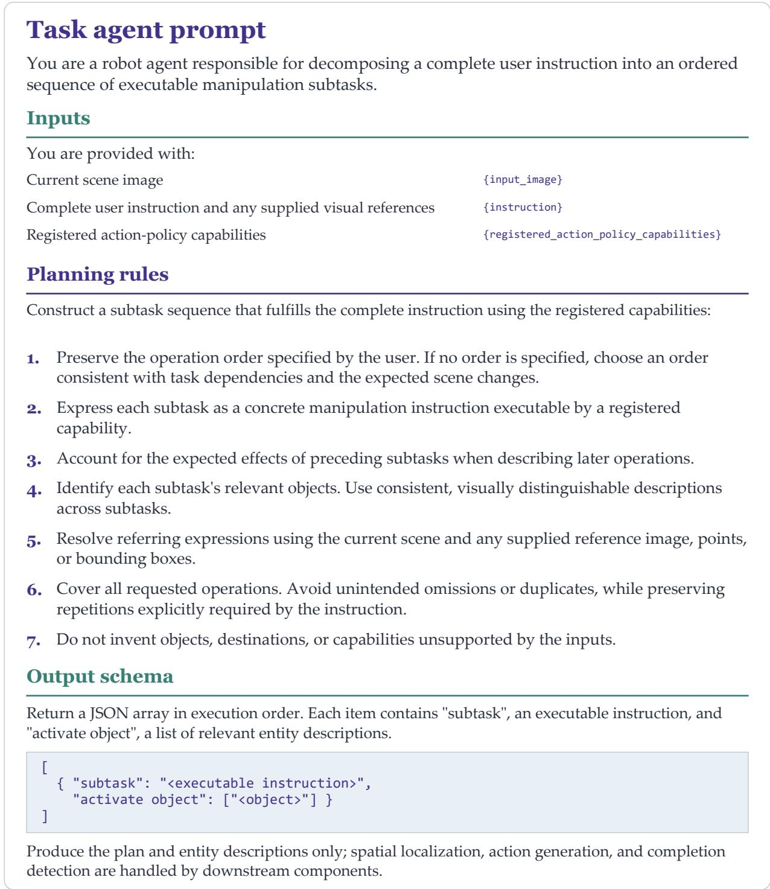  
Figure 6: Task-orchestration agent prompt and output schema. The template specifies the scene, instruction, and capability inputs; seven rules for subtask decomposition and entity identification; and the required JSON output format. Each output entry pairs an executable manipulation instruction with descriptions of its relevant entities. Spatial localization, action generation, and completion detection are delegated to downstream components.

## A.3 Shared context and spatial grounding

Role of the shared execution context. Orchestra uses the shared execution context as a common interface for executing long-horizon tasks specified by multimodal instructions. The harness maintains execution information separately from the architectures of the action policy and progress evaluator. This organization allows the downstream models to consume the information required by their respective interfaces while the harness manages task interpretation and subtask execution.

The shared context contains the active instruction, current observations, recent visual history, task records, and grounded entities. At a subtask boundary, MolmoPoint-8B localizes the relevant entities in the headcamera image and SAM3 initializes their masks. At subsequent action-chunk replanning calls, the segmentation session tracks those entities. A subtask transition resets the grounding session for the next instruction.

Both the action policy and the progress evaluator use observations from the shared context. They maintain independent model weights and temporal bufers. Spatial representation choices are detailed in Appendix B.

Context interfaces and information flow. The shared context is a logical record rather than a single tensor supplied unchanged to both models. In Algorithm 1, $\Pi _ { \pi }$ and $\Pi _ { e }$ denote the policy-specific and evaluatorspecific input construction functions. Each selects the active subtask, current proprioception, recent camera observations, and spatial conditions from $C _ { t }$

The model-specific inputs can be written as

$$
x _ { t } ^ { \pi } = \Pi _ { \pi } ( C _ { t } ) , \qquad x _ { t } ^ { e } = \Pi _ { e } ( C _ { t } ) .
$$

These adapters select and format context fields for each consumer, separating context maintenance from model-specific input construction.

Substituting policies and evaluators. Compatible policies and evaluators can be substituted through their respective adapters while preserving the overall orchestration structure. A replacement policy must provide actions compatible with the robot interface, and a replacement evaluator must provide an output that can be mapped to the controller’s subtask-transition rule. Such substitution may require model-specific preprocessing, training, or output conversion. Our experiments evaluate the particular policy and evaluator instantiated in this work.

## A.4 What the agent remembers

<table><tr><td>Memory content</td><td>Role</td><td>Boundary</td></tr><tr><td>Completed-subtask namesand Explicit execution records start/end frames</td><td></td><td>Retained across subtasks; cleared for a new episode</td></tr><tr><td>Current plan and active index</td><td>goals</td><td>Identify the current and remaining Advance at terminal-bin prediction</td></tr><tr><td>tory</td><td>Timestamped multi-view RGB his- Supply recent local visual observa- Bounded; the next subtask&#x27;s local tions</td><td>window is reinitialized</td></tr><tr><td>Grounded entity data</td><td>image regions</td><td>Associate the active goal with current Recomputed for the next subtask</td></tr><tr><td>Policy/evaluator observation buffers</td><td>input</td><td>Construct model-specific temporal Separate buffers reset by the agent</td></tr></table>

The agent explicitly stores the name and the start and end frames of each completed subtask. These records are retained across subtask transitions and cleared for a new episode. Together, they provide an explicit episode-level execution trace of completed goals and their temporal boundaries.

The recent observation history supplies temporal visual inputs to the policy and evaluator. The current proprioceptive state is passed with the current observation. Grounding sessions and model-side bufers follow the active subtask’s lifecycle.

## A.5 Progress-driven runtime algorithm

As shown in Algorithm 1, Orchestra executes the subtasks in order and uses predicted progress to determine when to advance to the next subtask. At each replanning call, the policy predicts an action chunk while the evaluator estimates progress from the same observation context. If the predicted category is terminal, the controller discards the chunk and advances the plan. Otherwise, it executes up to $H _ { e }$ actions before replanning.

Intermediate observations update the RGB histories without triggering grounding or model inference. Episode and observation indices ensure that each image is appended only once. Proprioception is supplied as the current state and is not stored in the visual history. At each subtask transition, the controller resets the local histories and grounding, while retaining completed-subtask records for bookkeeping.

The evaluator assesses the observed subtask stage before the newly predicted action chunk is executed. A terminal prediction therefore triggers a subtask transition based on the current observations. After the fina subtask, the controller terminates the plan.

Algorithm 1 Progress-driven execution in Orchestra   
Require: Instruction ℓ, observation stream, policy $\pi _ { \theta } ,$ evaluator $e _ { \phi }$   
Ensure: Termination status and completed-subtask records   
1: Decompose ℓ into an ordered plan $\mathcal { G } = ( g _ { 1 } , \dotsc , g _ { N } )$   
2: $\mathcal { D }  \emptyset ; i  1$   
3: Clear visual history, model bufers, and grounding   
4: Record the start frame of $g _ { i }$   
5: while the execution budget remains do   
6: Obtain current RGB images and proprioceptive state   
7: Update visual history and model bufers   
8: Initialize or update grounding $F$ for $g _ { i }$   
9: Construct the shared context C for $g _ { i }$   
10: Run in parallel: $A  \pi _ { \theta } ( \Pi _ { \pi } ( C ) ) , q  e _ { \phi } ( \Pi _ { e } ( C ) )$   
11: if arg ma $\mathbf { X } _ { b \in \{ 0 , \dots , 1 0 \} } q _ { b } = 1 0$ then   
12: Append $( g _ { i }$ , start frame, current frame) to   
13: Discard A and any pending actions for $g _ { i }$   
14: if $i = N$ then   
15: return (PLAN\_TERMINATED, )   
16: end if   
17: $i \gets i + 1$   
18: Clear visual history, model bufers, and grounding   
19: Record the current frame as the start frame of $g _ { i }$   
20: Seed the new visual history with the current images   
21: continue with a new inference call for $g _ { i }$   
22: else   
23: Execute up to $H _ { e }$ actions from A within the remaining budget   
24: Update visual history and model bufers as observations arrive   
25: end if   
26: end while   
27: return (BUDGET\_EXHAUSTED, )

## B Policy and Evaluator Implementation

## B.1 Action-policy architecture

The action policy is initialized from the $\pi _ { 0 . 5 }$ base checkpoint and combines the Gemma-2B language backbone within PaliGemma with a Gemma-300M action expert. It predicts action chunks from the active subtask, spatial conditions, recent visual observations, and current proprioception. Temporal attention reuses spatial-attention parameters, and the temporal positional encodings are fixed bufers. Thus, the memory pathway adds no new learned memory parameters. Training and execution settings are listed in Appendix C.

## B.2 Entity selection and spatial prompts

During training, per-frame active-entity annotations select the objects relevant to the current language subtask. End-efector entities are excluded. When spatial conditioning is retained, the transform samples one of three representations with weights 0.34, 0.33, and 0.33:

<table><tr><td>Representation</td><td>Image processing</td><td>Text processing</td></tr><tr><td>Contour</td><td>Overlay object contours on the cur- Append entity bounding boxes rent head-camera image</td><td></td></tr><tr><td>Bounding box</td><td>Leave RGB unchanged</td><td>Append named bounding-box coordi- nates</td></tr><tr><td>Point</td><td>Leave RGB unchanged</td><td>Append named point coordinates</td></tr></table>

Coordinates are quantized to 256 bins. The contour configuration uses green boundaries with blending coeficient 0.4. The policy drops all spatial conditions with probability 0.2 to encourage robustness to missing or inaccurate grounding information. Policy training also uses image dropout with probability 0.1 to encourage greater reliance on grounding information rather than solely on image observations. In the image-drop branch, wrist views are retained with probability 0.9. These augmentations vary the availability of visual and spatial inputs during training.

At inference, the evaluation configuration selects contour-plus-bounding-box conditioning deterministically and disables these training dropouts. Grounding is predicted online in real-world execution and provided by the environment in spatially conditioned simulation experiments.

Current-frame and historical-image preprocessing. For both the action policy and the progress evaluator, contour conditioning replaces the current head-camera image in the temporal window with its contouroverlaid version. Historical frames remain original RGB images. Thus, both models receive the current spatial cue together with unmodified visual history; current contours are not copied onto past frames. The contour representation also supplies the corresponding entity bounding boxes in the language prefix, as specified above.

## B.3 Temporal window and encoder

Figure 7 details our instantiation of the space–time factorization used in the policy’s visual encoder.

Each camera contributes six observations separated by three observation indices, including the current image. We report the window configuration in observation indices.

Frames are embedded spatially before temporal mixing. Temporal attention is inserted after layers 4, 8, 12, 16, and 20 of the visual encoder, using one-based layer numbering. For each patch position, causal attention operates across frame indices, masks unavailable history, and reuses the corresponding layer’s attention parameters. Fixed sinusoidal temporal encodings express frame age. Following layer 20, past-frame tokens are discarded, leaving the current-frame patches for subsequent visual layers.

At the documented resolution and patch size, the language model receives 256 visual tokens per camera, as in the single-frame baseline. History increases the visual encoder’s work, while leaving this visual prefix count unchanged. Stride changes the sampled temporal span without changing the number of frames processed.

## a Short-horizon visual encoder

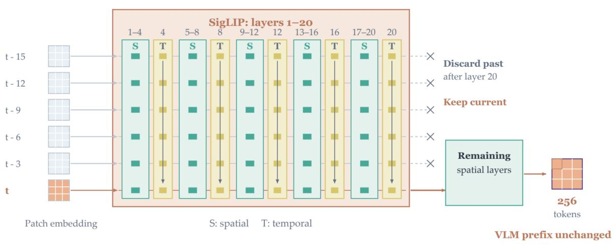

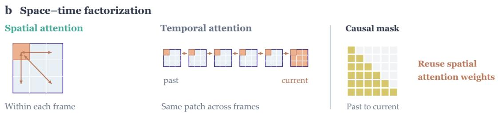  
Figure 7: Short-horizon visual memory inside SigLIP. (a) Each camera supplies a six-frame window with stride three, spanning observation indices t 15 through t. Patch embedding and spatial positional encoding are applied independently to each frame. Four spatial layers (S) alternate with a causal temporal-attention operation (T), giving temporal mixing after layers 4, 8, 12, 16, and 20. After layer 20, historical tokens are discarded and only current-frame features pass through the remaining spatial layers. The VLM receives 256 visual tokens per camera, matching the single-frame baseline. (b) Spatial attention is bidirectional within a frame; temporal attention operates across frames at the same patch index, with causal and valid-history masks. The temporal pathway reuses the corresponding spatial-attention weights and adds fixed sinusoidal age encodings, with zero encoding for the current frame. This adaptation introduces no new learned memory parameters. Patch grids are schematic.

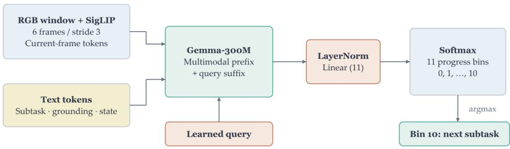  
Figure 8: Architecture of the progress evaluator. A learned query aggregates the multimodal visual and language prefix, and a normalized linear head predicts one of 11 progress categories.

## B.4 Progress-evaluator configuration

The progress evaluator uses a Gemma-300M language backbone with a visual encoder. A learned query of width 1024 aggregates information from the multimodal prefix. Layer normalization and a linear projection produce the 11 progress logits. The evaluator uses the same six-frame, stride-three observation window as the policy and has independent weights.

The deployed subtask transition uses only Eq. equation 7, while Eq. equation 6 specifies the progress classification objective.

## B.5 Automatically generated progress targets and transitions

Progress targets are generated automatically from the step index within each demonstration subtask; no manual progress-category labels are required. For a subtask segment of $T _ { i } = e _ { i } - a _ { i } \geq 1$ frames, Eq. equation 5 reduces to

$$
\rho _ { i } ( u ) = 1 - \frac { \operatorname* { m a x } ( e _ { i } - 1 - u , 0 ) } { T _ { i } } .\tag{9}
$$

The first frame has $\rho _ { i } = 1 / T _ { i }$ , and the last has $\rho _ { i } = 1$ . An 11-way label is obtained by rounding $1 0 \rho _ { i }$ and clipping it to [0, 10]. Thus the final bin includes a terminal interval near the end of the demonstration, rather than exclusively its final frame. In particular, values above 0.95 round to bin 10, with exact-half behavior determined by the rounding implementation. For example, in a 100-frame segment, $\rho = 0 . 9 6$ already belongs to the final bin. During deployment, the controller uses the argmax class directly. A prediction of bin 10 triggers the transition.

For visualization, an optional expected progress value can be computed as

$$
\bar { \rho } _ { t } = \sum _ { j = 0 } ^ { 1 0 } \frac { j } { 1 0 } q _ { t , j } .\tag{10}
$$

Relationship between terminal labels and subtask completion. We examined demonstration subtask endings across all tasks and found that completed-state frames occupy approximately the final $1 / 1 1 \mathrm { t o } 1 / 9$ of the demonstration segments, corresponding to approximately 9.1%–11.1% of their duration. These frames depict an already completed subtask. This completed-state interval begins before the terminal-category boundary induced by rounding $1 0 \rho _ { i } ( u )$ , which lies at approximately $\rho _ { i } ( u ) = 0 . 9 5$ . This observation supports the use of the terminal category as a completion target in our demonstration data.

## C Data Collection and Training

## C.1 Real-world training data

We collected demonstrations for Breakfast Preparation, Fruit Bowl Placement, Number Ordering, and Trash Bin Placement at 20 Hz. Demonstrations from all four tasks were combined for joint training. Collection was performed at the subtask level; Table 2 reports the amounts using a complete-task accounting unit, where one unit corresponds to one completion of the task.

For Number Ordering, collection covered all six permutations of the three numbers, with 24 demonstra tions per order under the same accounting convention. The real-world annotation pipeline uses Qwen3.7-Plus for subtask decomposition, MolmoPoint for object pointing, and SAM3 for segmentation. Progress categories are generated automatically from the step position within each demonstration subtask, as described in Appendix B.5.

Table 2: Real-world data collection and evaluation. Collection amounts use complete-task accounting units assembled from subtask-level collection. Evaluation counts are per configuration.
<table><tr><td>Task</td><td>Collection units</td><td>Eval. episodes</td><td>Eval. length</td></tr><tr><td>Breakfast Preparation</td><td>120</td><td>20</td><td>4</td></tr><tr><td>Fruit Bowl Placement</td><td>120</td><td>20</td><td>3</td></tr><tr><td>Number Ordering</td><td>144</td><td>20</td><td>3</td></tr><tr><td>Trash Bin Placement</td><td>120</td><td>20</td><td>5</td></tr></table>

## C.2 RMBench-Compose training data

For each environment, let m denote the number of task steps required to complete one operation for every object in the environment. We use this quantity to set the collection scale: we collected 50m atomic demonstrations and set the composed evaluation length to 2m. Training uses atomic instructions and subtask demonstrations, whereas evaluation supplies a complete instruction. Table 3 reports the environment-specific amounts and evaluation budgets.

## C.3 Training configuration

Unless otherwise specified, the action policy and progress evaluator use the same training hyperparameters, including 50,000 training steps and a global batch size of 20 across 2 Nvidia A6000 Pro GPUs. They have independent weights and distinct training objectives: flow matching for action prediction and cross-entropy for progress classification. Architecture-specific settings and action horizons apply only to the corresponding model.

<table><tr><td>Setting</td><td>Configuration</td></tr><tr><td>Policy initialization</td><td>π0.5 base checkpoint</td></tr><tr><td>Policy language backbone</td><td>Gemma-2B within PaliGemma</td></tr><tr><td>Policy action expert</td><td>Gemma-300M</td></tr><tr><td>Maximum text sequence length</td><td>300</td></tr><tr><td>Policy prediction / execution horizons</td><td>50 / 30 steps</td></tr><tr><td>Precision</td><td>bfloat16</td></tr><tr><td>Global batch size (across both GPUs)</td><td>20</td></tr><tr><td>Training steps</td><td>50,000</td></tr><tr><td>Optimizer</td><td>AdamW, betas 0.9 and 0.95, epsilon 10−8</td></tr><tr><td>Peak / final learning rate</td><td> $2 . 5 \times 1 0 ^ { - 5 } / 2 . 5 \times 1 0 ^ { - 6 }$ </td></tr><tr><td>Warmup / schedule decay steps</td><td>1,000 / 30,000</td></tr><tr><td>Weight decay / gradient clipping</td><td>10−10 / global norm 1.0</td></tr></table>

## D Evaluation Protocols

## D.1 Composed instructions and execution budgets

For each RMBench-Compose environment and evaluated configuration, we ran 100 episodes. Each episode began with a randomly selected complete instruction of the environment’s specified maximum evaluation length. Orchestra received the entire instruction and decomposed it into subtasks before sequential execution. Scene states persisted across subtask boundaries. These experiments use one specified evaluation length per environment.

In complete Orchestra, the evaluator’s terminal-category prediction triggers subtask advancement. Environmentstate completion replaces this learned signal only in the oracle-transition ablation in Section 5.4. Environment

Table 3: RMBench-Compose collection and evaluation settings. m is the minimum task length used for collection scaling; n = 2m defines a deliberately long evaluation sequence designed to stress-test the policy’s limits in sustained execution. Budgets are maximum executed action steps per subtask, not inference-call counts. Each environment is evaluated for 100 episodes per configuration.
<table><tr><td>Environment</td><td>m Demos (50m)</td><td>n</td><td>Budget</td></tr><tr><td>Pick Up Object</td><td>5 250</td><td>10</td><td>250</td></tr><tr><td>Cover and Uncover Block 6</td><td>300</td><td>12</td><td>300</td></tr><tr><td>Press Button 3</td><td>150</td><td>6</td><td>150</td></tr><tr><td>Swap Block 7</td><td>350</td><td>14</td><td>300</td></tr><tr><td>Place Block on Mat 9</td><td>450</td><td>18</td><td>250</td></tr></table>

success predicates are used for external scoring and should not be interpreted as an additional switching condition in the complete system. Spatially conditioned simulation configurations receive environment-provided grounding. Real-world execution instead uses predicted and tracked grounding.

## D.2 Metrics and real-world evaluation

Atomic Success Rate (Atomic SR) measures isolated atomic-task execution. Subtask Success Rate (SSR) is the fraction of attempted subtasks completed successfully, excluding subtasks not reached after an earlier failure. Average Success Length (ASL) measures the mean number of consecutive subtasks completed in the requested order and is bounded by the instruction length. Cross-environment averages are unweighted arithmetic means. Any subtask failure terminates the corresponding evaluation rollout.

For each real-world task, we randomly selected 20 instructions and evaluated both policy configurations on the same instruction set, with one evaluation per selected instruction and configuration. This gives 80 evaluations per configuration across the four tasks. Data collection and robot execution both operate at 20 Hz. Any subtask failure terminates the corresponding evaluation rollout.

## D.3 Baseline comparability

For the RMBench simulation comparison in Table 1, we use the oficially reported RMBench results for nine baselines. These comprise DP [Chi et al., 2023], ACT [Zhao et al., 2023], $\pi _ { 0 . 5 }$ [Physical Intelligence et al., 2025], X-VLA [Zheng et al., 2025], QwenOFT [StarVLA Community, 2026], MemER [Sridhar et al., 2025], Mem-0 [Chen et al., 2026], MemoryVLA (OpenVLA) [Shi et al., 2025], and MemoryVLA (QwenOFT) [Shi et al., 2025]. For HarnessVLA (Codex) [Zhang et al., 2026], we reproduce the baseline on RMBench using the HarnessVLA source code. HarnessVLA uses Codex as its default agent. The table therefore combines oficial benchmark results with our evaluations of HarnessVLA (Codex) and Orchestra.

For Orchestra on RMBench, the task-orchestration agent receives the complete episode instruction, the associated task description, and the initial scene image. It generates an ordered sequence of subtask instructions together with descriptions of the relevant entities. For example, for the generated subtask “open the left cover,” the agent identifies “the left cover” as the relevant entity. We then resolve this description to an object instance in the simulator and retrieve its ground-truth segmentation mask to construct the spatial conditions for the downstream action policy and progress evaluator. Thus, the subtask sequence and entity descriptions are generated by Orchestra, whereas the corresponding spatial masks are supplied by the environment.

## D.4 Physical robot platform

Our real-world experiments use the custom dual-arm robot platform shown in Fig. 9. The robot is equipped with two 7-DoF arms and parallel grippers. A headmounted Intel RealSense L515 camera provides a global view of the workspace, while a 180-degree fisheye camera mounted on each wrist provides close-range observations during manipulation. Together, these three viewpoints capture both scene-level context and local arm–object interactions. All RGB images are resized to 224 224 before being passed to the models.

The proprioceptive state has 16 dimensions, comprising seven joint values and one gripper value per arm. Joint actions are represented as ofsets from the current state, whereas gripper actions are specified as absolute values. The model pads the action representation to 32 dimensions and converts its predictions back to the robot control interface for execution. Both policy configurations use the same observation and action interfaces.

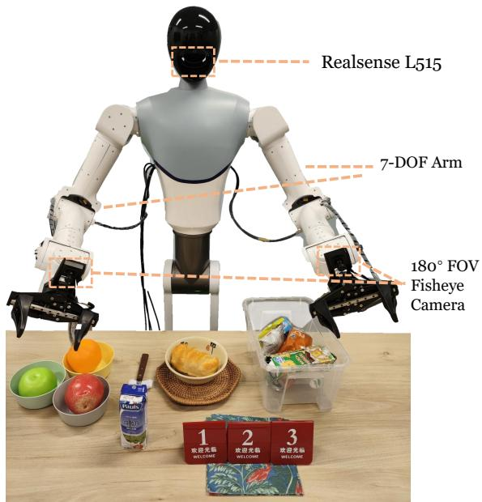  
Figure 9: Custom dual-arm robot platform used in the real-world experiments.

## E Additional Results and Analysis

## E.1 Per-environment compositional results

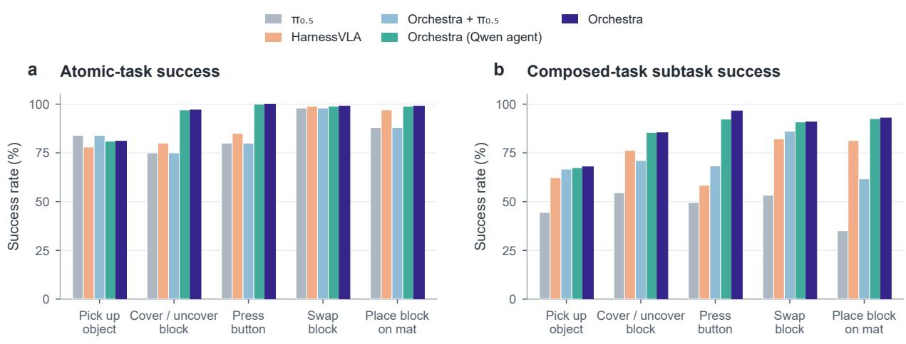  
Figure 10: Per-environment success rates on RMBench-Compose. (a) Atomic SR measures isolated atomic-task execution. (b) SSR measures success among attempted subtasks in composed episodes; unreached subtasks are excluded. Results are shown for all five evaluated configurations and all five environments. Task-level ASL is reported in Fig. 3.

Figure 10 compares isolated Atomic SR and composed-task SSR across all five evaluated configurations and environments, complementing the task-level ASL results in Fig. 3. For example, the base π0.5 policy achieved 98.0% Atomic SR on Swap Block, while its composed-task SSR was 53.27% and its ASL was 1.14. Orchestra with the same base policy retained 98.0% Atomic SR but achieved 86.09% SSR and 6.19 ASL.

These metrics describe diferent evaluation contexts; an isolated-task success rate should not be interpreted as a per-step success probability along a composed rollout.

## E.2 Ablation implementation details

For the no-orchestration ablation in Section 5.4, we retrain the policy on long-horizon instructions and corresponding demonstrations while retaining short-horizon visual memory and spatial grounding. This design removes subtask decomposition while keeping the training and evaluation distributions aligned. The visual-memory ablation disables short-horizon visual memory, and the spatial-grounding ablation omits task-relevant spatial conditions. The oracle-transition configuration replaces the learned completion detector with an environment-state indicator while retaining the rest of the system.

## E.3 Qualitative visualizations

We provide qualitative visualizations of Orchestra on RMBench-Compose and the real-world tasks, complementing the quantitative results in Sections 5.3 and 5.5.

## E.3.1 RMBench-Compose

Figure 11 presents selected execution sequences from the five RMBench-Compose environments. The examples illustrate how successive manipulation subtasks change the scene, with later actions operating on the object configurations produced by earlier actions. Frames are arranged chronologically from left to right and show selected portions of the composed rollouts.

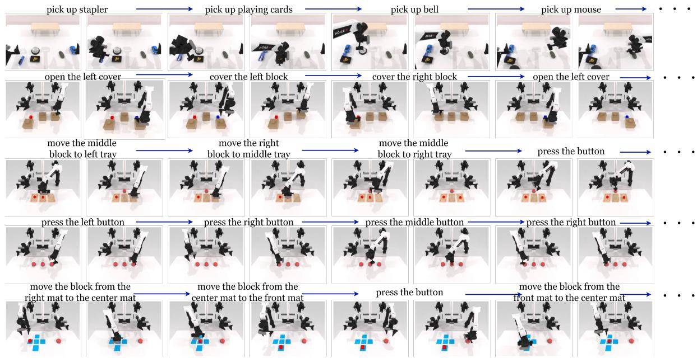  
Figure 11: Qualitative execution examples on RMBench-Compose. From top to bottom: Pick Up Object, Cover and Uncover Block, Swap Block, Press Button, and Place Block on Mat. Each row shows selected observations from a composed manipulation sequence, with blue arrows indicating temporal progression. The examples visualize object manipulation and scene changes across successive subtasks; they do not depict every step of the full evaluation instructions.

(a) Breakfast Preparation  
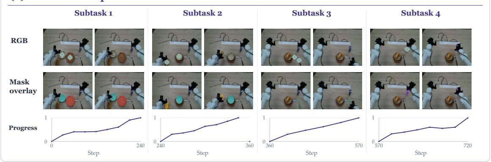

(b) Fruit Bowl Placement  
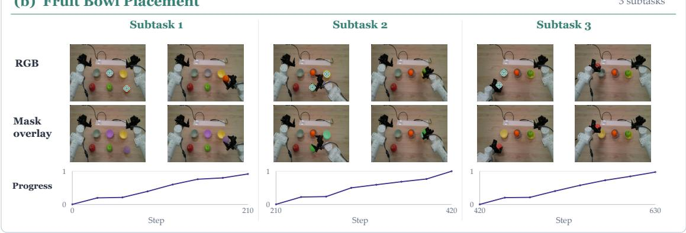

(c) Number Ordering  
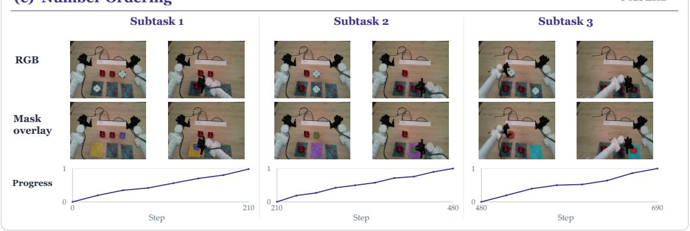

(d) Trash Bin Placement  
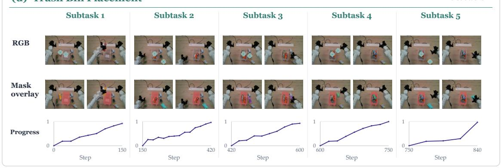  
Figure 12: Qualitative real-world execution with spatial grounding and progress visualization. (a) Breakfast Preparation (four subtasks). (b) Fruit Bowl Placement (three subtasks). (c) Number Ordering (three subtasks). (d) Trash Bin Placement (five subtasks). Each subtask contains selected RGB observations with pointing markers, corresponding mask overlays, and a progress trace on a normalized scale from 0 to27 1. Subtasks are arranged from left to right, and the horizontal axes of the progress plots indicate execution steps.

## E.3.2 Real-world execution

Figure 12 shows real-world execution examples for Breakfast Preparation, Fruit Bowl Placement, Number Ordering, and Trash Bin Placement. For each subtask, the visualization combines selected RGB observations, spatial mask overlays, and a within-subtask progress trace. These views illustrate the relationship between the active manipulation goal, its grounded entities, and execution progress. Object pointing and segmentation are initialized at subtask boundaries, and the initialized masks are tracked at subsequent action-chunk replanning calls. The plotted progress values provide a visualization of within-subtask evolution; the deployed transition rule uses the terminal-bin argmax decision.

## E.4 Failure case analysis

We analyze 65 real-world failure samples from the complete Orchestra system to identify limitations at different stages of execution. These samples include both subtask-level failures and failures of the overall task. In some trials, changes in the environment necessitated a restart; these interrupted trials were excluded from the counted evaluation rollouts but retained in the failure-case analysis. Fig. 13 presents errors in task decomposition, object localization, segmentation, progress estimation, and action execution, together with their shares of the recorded failures.

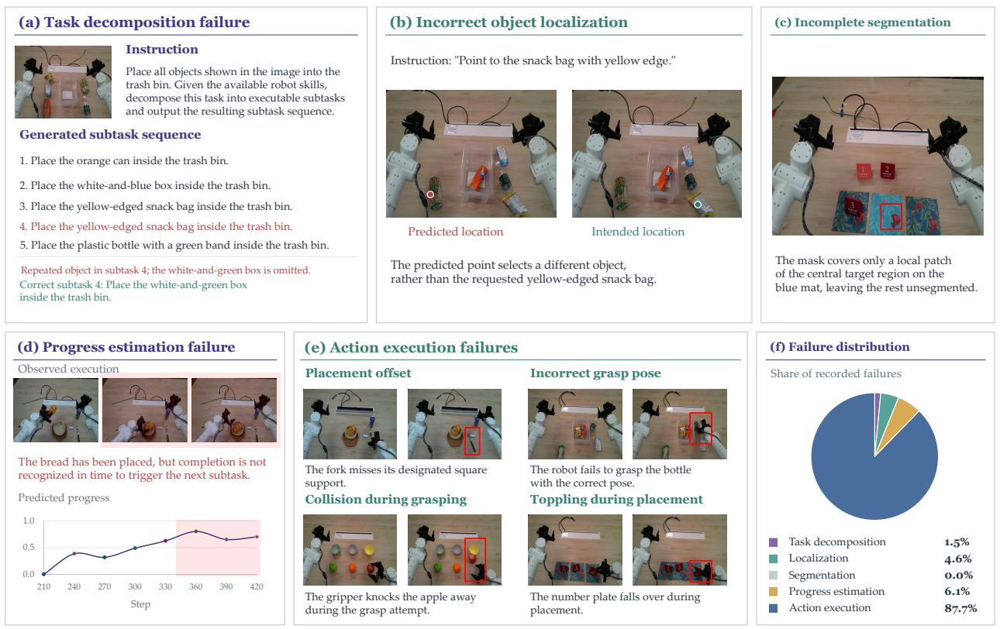

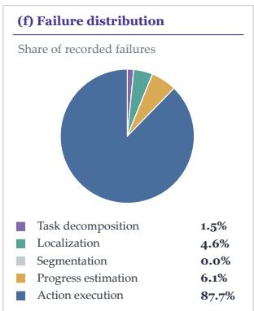  
Figure 13: Failure analysis of Orchestra in real-world manipulation. (a) Task decomposition repeats the yellow-edged snack bag and omits the white-and-green box. (b) Object localization selects a diferent object from the requested snack bag. (c) Segmentation captures only part of the central target region on the blue mat. (d) The evaluator fails to recognize completion promptly after bread placement, delaying the subtask transition. (e) Action execution fails through inaccurate placement, an incorrect grasp pose, unintended contact, or unstable placement. (f) Distribution of 65 recorded failures of the complete Orchestra system across the five categories.

Task decomposition. The orchestration agent can produce individually executable subtasks that collectively fail to cover the instruction. In Fig. 13(a), the instruction requires placing all objects in the trash bin, but the generated sequence includes the yellow-edged snack bag twice and omits the white-and-green box. Executing this sequence successfully would therefore still leave the overall task incomplete. This case highlights the need to check object coverage and duplicate entity assignments when constructing a plan.

Object localization and segmentation. Spatial grounding can fail through either incorrect entity selection or incomplete region extraction. In Fig. 13(b), the localization module points to another object instead of the requested yellow-edged snack bag, providing spatial context inconsistent with the active instruction. In Fig. 13(c), the segmentation output covers only a local patch of the central target region on the blue mat. These examples show that obtaining a valid point or a nonempty mask does not guarantee semantically correct and spatially complete grounding.

Progress estimation. Physical completion and the evaluator’s completion decision can diverge. In Fig. 13(d), the robot has placed the bread, but the evaluator does not recognize completion in time to trigger the next subtask. The controller advances only when the predicted progress category is the terminal bin. This fail ure illustrates how delayed completion detection can prevent a locally successful action from advancing the overall task.

Action execution. Fig. 13(e) illustrates limitations in grasping and placement. The robot places the fork away from its designated square support, approaches the bottle with an incorrect grasp pose, knocks the apple away during a grasp attempt, and topples the number plate during placement. These failures indicate that task orchestration and spatial conditioning do not eliminate the need for precise motion generation and stable contact handling.

Failure distribution and implications. As shown in Fig. 13(f), action execution accounts for 87.7% of the 65 recorded failures, followed by progress estimation (6.1%), localization (4.6%), and task decomposition (1.5%). Segmentation accounts for 0.0% in this tally, despite the incomplete-mask example in panel (c); observing a segmentation defect does not by itself establish that it caused a task failure. Within this evalua tion, the distribution identifies action execution as the dominant remaining limitation, while the qualitative examples also motivate better plan validation, grounding checks, and completion detection.