# Lost in Implicit Routing: How LLM Agents Fail to Load Relevant Skills at Scale

Jinlin Liu¹ Wei Chen2\* Xiaojin Zhang2\* 1The University of Hong Kong 2Huazhong University of Science and Technology

## Abstract

Reusable skills let LLM agents load taskspecific instructions on demand, but they make execution depend on implicit routing over skill metadata. We test whether this design scales by holding SkillsBench tasks and their golden skills fixed while adding irrelevant skills. We find skill routing collapse: agents increasingly load fewer or no skills, even though the relevant skills remain available. With 1,000 irrelevant skills, loaded-skill recall falls from 73.6% to 27.4% and the zero-load rate rises from 9.3% to 51.6%, whereas explicit selection from the same library retains 73.9% recall. Loading other skills, including plausible alternatives to golden skills, is too rare to explain this decline. Masking only the descriptions of irrelevant skills largely restores skill loading, yet with the metadata intact, explicitly asking agents to plan skill use still yields lower recall than preselection. These findings point to semantic interference from descriptions and instruction interference when skill choice competes with task execution. We also evaluate explicit preselection as a practical mitigation, including its coverage and latency trade-offs. Our analysis informs skill protocols and evaluation for agents with growing skill libraries.1

## 1 Introduction

Large language model (LLM) agents now operate tools and files to complete multi-step workflows in software engineering, data analysis, document processing, and personal assistance (Yao et al., 2023; Liu et al., 2024b; Wang et al., 2024). Such agents need reusable procedures: a plotting routine, code-audit workflow, spreadsheet operation, or domain-specific calculation should not be rediscovered in every new task.

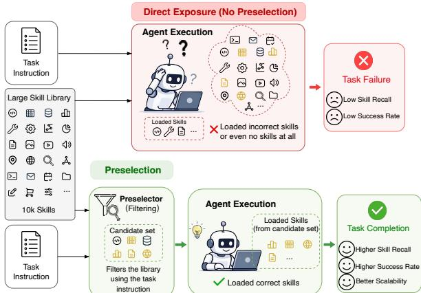  
Figure 1: Lost in implicit routing. The relevant skills remain installed, but as irrelevant skills grow, agents increasingly fail to load them during implicit execution. Explicit routing recovers much of the missing skill recall.

Agent skills package such procedures and their supporting resources into reusable modules (Anthropic, 2025; Zhang et al., 2025), and public skill libraries are growing quickly: one analysis reports 2,179 listed skills on January 16, 2026 and 40,285 on February 5 (Ling et al., 2026). Skill selection is therefore becoming a scaling problem.

We use skills to mean Anthropic's Agent Skills, whose progressive-disclosure design works as follows: the model first sees only skill names and descriptions, and opens a full skill file only if it judges the skill relevant (Anthropic, 2026). Routing is thus not a separate stage: the agent decides whether and which skills to load while planning actions, inspecting files, and solving the task. We call this execution-time selection implicit routing. It keeps long skill files out of context, but assumes that an agent can pick out the few relevant skills from many descriptions while simultaneously solving the task.

We test this assumption on SkillsBench (Li et al., 2026), which provides fixed task instructions, workspaces, verifiers, and relevant skills;

for each task, we keep these fixed and vary only the number of added irrelevant skills. The result is skill routing collapse: the right skills are installed, but agents increasingly load fewer skills or none at all. As irrelevant skills grow from 0 to 1,000, loaded-skill recall under implicit routing drops from 73.6% to 27.4% and the zero-load rate rises from 9.3% to 51.6%. Agents occasionally load non-golden alternatives, but too rarely to explain the collapse. Yet the same models retain 73.9% selected-skill recall when asked only to choose skills from the full library. Relevant skills thus remain recognizable; they are lost when routing becomes a subtask of execution.

End-to-end Pass@3 falls less sharply, from 51.6% to 38.6%, because strong agents can sometimes solve around missing skills; task success alone can therefore make a failing skill system look healthy. We make three contributions:

• We identify and measure skill routing collapse: growing libraries make agents load fewer or no skills, rather than substitute other skills for golden ones.

• We compare LLM, retrieval, and hybrid preselection on libraries of up to 10,000 added skills, and derive scale-dependent recommendations together with their token, coverage, and latency costs.

• We show that irrelevant descriptions suppress skill loading and that selecting skills while solving the task makes selection less reliable, revealing semantic and instruction interference beyond context growth alone.

## 2 A Controlled Test for Skill Routing

## 2.1 Task setup

We represent each task as ${ \boldsymbol { \tau } } ~ = ~ ( I , { \boldsymbol { F } } , { \boldsymbol { V } } , { \boldsymbol { G } } )$ : instruction I, workspace $F ,$ executable verifier V, and the set G of relevant (golden) SkillsBench skills. A run succeeds only if V passes after the agent finishes; no LLM judge is used. With s added irrelevant skills, the installed library is $S _ { s } ~ = ~ G \cup D _ { s } ,$ where $D _ { s }$ is sampled independently of the task. Varying only s tests whether an agent can still find and load the needed skills as the metadata list grows (Figure 2).

## 2.2 Routing strategies

Under implicit routing, the executor sees the metadata of all skills in $S _ { s }$ and decides during execution whether to open any skill. Explicit routing adds a preselection step: a preselector receives the task and the metadata and exposes only a compact subset to the executor, which still follows progressive disclosure and must open a skill before using it. We compare three preselectors. LLM preselection chooses directly from the full metadata list; RAG preselection retrieves skills by embedding similarity; and hybrid preselection retrieves candidates and lets an LLM make the final choice (pseudocode in Appendix K). We also include a no-skill baseline.

Diagnosis versus mitigation. We use explicit routing in two ways. In routing-only diagnosis, the selector sees the task and the full library, including the same distractors as the executor, but only selects skills; selected-skill recall thus tests whether the needed skills are recognizable without task execution. In preselection-plus-execution, the executor then sees only the selected subset; loaded-skill recall and task success measure the practical benefit. The diagnosis changes only the objective, whereas the mitigation also narrows the executor's library.

## 2.3 Metrics

Pass@3 is task success, computed with the standard unbiased estimator over repeated runs. Loaded-skill recall is $| G \cap L | / | G |$ , where L is the set of skills opened during execution; the zeroload rate is the percentage of runs with $| L | \mathbf { \tau } =$ 0, and average skills loaded is the mean of $| L |$ For explicit routing, selected-skill recall is |G ∩ $P | / | G |$ , where P is the preselected set. Appendix F reports precision, and Appendix I analyzes the loading of non-golden skills.

## 3 Main Findings

## 3.1 Experimental setup

SkillsBench tasks. SkillsBench (Li et al., 2026) provides task instructions, workspace files, executable verifiers, and task-specific golden skills. We exclude five tasks with infrastructure or environment problems and use the remaining 82 (Appendices A and B). Runs are costly: under implicit routing, one run averages 15.3 minutes and 485k input tokens without irrelevant skills, rising to 17.0 minutes and 1.95M input tokens with 1,000.

Skill libraries. We downloaded more than 20,000 skills from a skill market in leaderboard order and sample irrelevant skills from this pool with a fixed seed (42), so the distractors are identical across models and strategies. We evaluate s ∈ {0, 10, 100, 1000, 10000}, always installing the golden skills. Every preselector exposes at most five skills: LLM-based selectors choose up to five, and RAG returns the top five by embedding similarity.

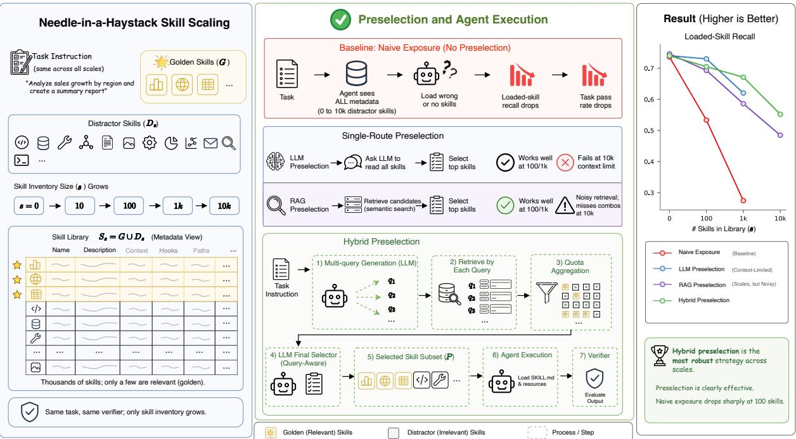  
Figure 2: Overview of the controlled skill-scaling setup and routing strategies. Starting from an existing Skills-Bench task, we keep the instruction, files, verifier, and relevant skills fixed while varying only the number of added irrelevant skills

Models and scale. Given this cost, the main experiments use three open-weight executors: GLM-5 (Zeng et al., 2026), Kimi K2.5 (Bai et al., 2026), and MiniMax M2.5 (MiniMax AI, 2026); RAG and hybrid preselection use Qwen textembedding-v4 embeddings. Each model runs every task and condition three times, and we average over the task-model-run grid, for more than 15,000 trajectories and 10 billion tokens in total. A budget-limited validation on Claude Opus 4.6, Gemini 3.1 Pro, and GPT-5.4 yields consistent conclusions (Appendix E).

## 3.2 Lost in Implicit Routing

## 3.2.1 Implicit loading degrades before task success

Figure 3 shows implicit routing for the three openweight models. Implicit routing collapses as irrelevant skills grow. With only 100 irrelevant skills, loaded-skill recall already falls by 24.6, 15.6, and 20.7 points for GLM-5, Kimi K2.5, and MiniMax M2.5 (Table 2), while zero-load rates rise: agents increasingly stop using skills at all rather than merely choosing wrong ones. Task success lags behind. At the same scale, GLM-5 keeps Pass@3 almost unchanged (57.3% to 56.1%) and Kimi K2.5 stays near its baseline (52.4% to 50.6%). Strong executors can solve around missing skills, so final success alone hides a failing skill protocol. Three proprietary models on a 37-task subset show the same pressure: Claude Opus 4.6, for example, keeps Pass @3 at 62.2% with 1,000 irrelevant skills (vs. 64.9%), yet its loaded-skill recall falls from 81.3% to 30.9% (Appendix E). The collapse is also not confined to multi-skill tasks: at 1,000 irrelevant skills, loadedskill recall falls from 91.9% to 38.0% on singleskill tasks and from 58.8% to 14.8% on tasks with four or more golden skills (Appendix G). Appendix D.1 lists all plotted values.

## 3.2.2 Library growth suppresses skill use

Table 1 shows that from zero to 1,000 distractors, the average number of loaded skills falls from 1.72 to 0.66 and the zero-load rate rises from 9.2% to 50.8%. Could agents instead be replacing golden skills with other skills? Non-golden loading is rare (2.32% of evaluations), and only 0.95% of evaluations load a non-golden skill whose embedding cosine similarity to a missed golden skill exceeds

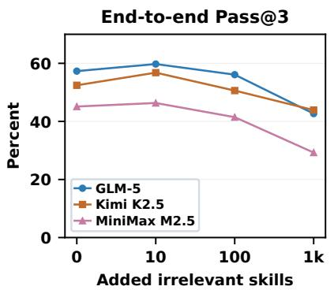

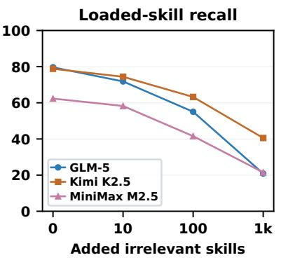

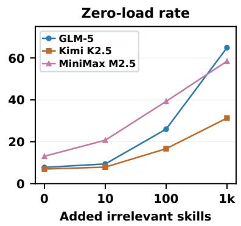  
Figure 3: Implicit-routing scaling by execution model. (a) End-to-end Pass @3. (b) Loaded-skill recall. (c) Zeroload rate. Only the number of added irrelevant skills changes.

<table><tr><td>S</td><td>Avg. skills loaded</td><td>ZeroLoad</td><td>1 Load Rec.</td></tr><tr><td>0</td><td>1.72</td><td>9.2</td><td>73.5</td></tr><tr><td>10</td><td>1.54</td><td>13.0</td><td>67.8</td></tr><tr><td>100</td><td>1.20</td><td>27.9</td><td>52.9</td></tr><tr><td>1000</td><td>0.66</td><td>50.8</td><td>27.6</td></tr></table>

Table 1: Skill-loading behavior as the number of irrelevant skills grows. ZeroLoad and loaded-skill recall are percentages. This analysis covers 86 tasks, a slightly broader set than the main study (Appendix I).

0.8. Such loads concentrate at s = 1000 (7.19% and 3.79%, respectively), and the above-threshold cases are near-duplicates such as pdf-reader for pdf or excel for xlsx. When agents do load skills, the loads are mostly correct: under implicit routing at 1,000 irrelevant skills, loaded-skill precision is still 88.6%, 87.2%, and 76.4% for the three models (Appendix F). By construction, no distractor duplicates a golden skill. Routing collapse therefore primarily reflects under-loading, not substitution (details in Appendix I).

## 3.2.3 The same skills are recognizable when selected explicitly

Are the relevant skills intrinsically hard to recognize? Table 2 compares implicit loaded-skill recall with routing-only selected-skill recall for the same models and scales. The same LLMs still identify the needed skills when selection is explicit. At 1,000 irrelevant skills, GLM-5 loads 20.9% of golden skills but selects 82.5%, and Kimi K2.5 loads 40.5% but selects 80.7%; MiniMax M2.5 shows a smaller but still large gap (21.5% vs. 58.4%). The full metadata list thus often suffices for recognition when selection is the sole objective; the failure arises when selection is folded into reading files, planning commands, and completing the task.

<table><tr><td>Model</td><td>Measure</td><td>0</td><td>10 100</td><td>1k</td></tr><tr><td>GLM-5 GLM-5</td><td>Implicit loaded Explicit selected</td><td>79.6 71.8 98.4 93.1</td><td>55.0 91.7</td><td>20.9 82.5</td></tr><tr><td>Kimi K2.5</td><td>Implicit loaded</td><td>78.8</td><td>74.4 63.2</td><td>40.5</td></tr><tr><td>Kimi K2.5</td><td>Explicit selected</td><td>98.5 93.3</td><td>90.7</td><td>80.7</td></tr><tr><td>MiniMax M2.5 MiniMax M2.5</td><td>Implicit loaded Explicit selected</td><td>62.3 98.3</td><td>58.2 41.6 88.0 83.6</td><td>21.5 58.4</td></tr></table>

Table 2: Implicit loaded-skill recall (%) versus explicit LLM selected-skill recall (%) by model and number of added irrelevant skills.

## 3.3 Analyzing Explicit Routing

Since the bottleneck lies in routing during execution, we next ask how much preselection helps when the executor sees only the selected subset. We do not propose a new routing algorithm; we compare simple preselectors to show when this design helps and what it costs.

## 3.3.1 Explicit routing across library sizes

Figure 4 compares implicit routing with the three preselectors. Narrowing the visible skill set reduces the scale effect: Pass @3, loaded-skill recall, and zero-load rate all become less sensitive to library size. The best strategy depends on scale. LLM preselection is strongest around 100 added skills, whereas hybrid preselection is strongest at 1,000 and remains usable at 10,000, where fulllist LLM preselection is omitted as infeasible. At 100 added skills, LLM preselection raises aggregate loaded-skill recall from 53.3% to 73.0% and Pass @3 from 49.4% to 54.9%; at 10,000, hybrid preselection reaches 55.2% recall and 50.4% Pass@3, versus 48.5% and 41.5% for RAG (Appendix D.2). Table 3 shows the same pattern for each executor: at 1,000 added skills, for instance, LLM preselection raises Pass@3 from 42.7% to 58.5% for GLM-5 and from 29.3% to 42.7% for MiniMax M2.5.

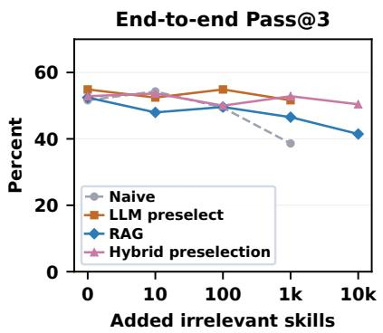

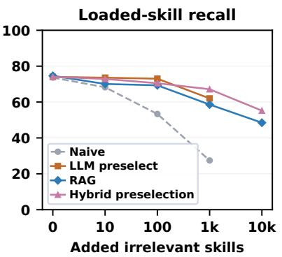

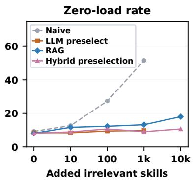  
Figure 4: Skill scaling curves by routing strategy. (a) End-to-end Pass@3. (b) Loaded-skill recall. (c) Zero-load rate.

<table><tr><td>Model</td><td>w/o 0</td><td>10</td><td>100</td><td>1k</td><td>10k</td></tr><tr><td>Naive GLM-5 Kimi K2.5 MiniMax M2.5</td><td>26.8 34.1 26.8</td><td>57.3 59.8 52.4 56.8 45.1 46.3</td><td>56.1 50.6 41.5</td><td>42.7 43.9 29.3</td><td></td></tr><tr><td>LLM preselect GLM-5 Kimi K2.5</td><td>26.8 34.1</td><td>65.9 57.3 54.9 56.1</td><td>57.3 58.5</td><td>58.5 53.7</td><td></td></tr><tr><td>MiniMax M2.5 RAG</td><td>26.8 43.9</td><td>43.9</td><td>48.8</td><td>42.7</td><td></td></tr><tr><td>GLM-5 Kimi K2.5 MiniMax M2.5</td><td>26.8 57.3 34.1 50.0 26.8 50.0</td><td>48.8 50.0 45.1</td><td>53.7 52.4 42.7</td><td>54.3 48.8</td><td>47.6 41.5</td></tr><tr><td>Hybrid preselection</td><td></td><td></td><td></td><td>36.6</td><td>35.4</td></tr><tr><td>GLM-5</td><td></td><td></td><td></td><td></td><td></td></tr><tr><td>Kimi K2.5</td><td>26.8 59.8 48.8</td><td>61.0</td><td>54.9</td><td>57.3</td><td>56.1</td></tr><tr><td>MiniMax M2.5</td><td>34.1 26.8 50.0</td><td>56.1 43.9</td><td>52.4 42.7</td><td>52.4 48.8</td><td>56.1 39.0</td></tr></table>

Table 3: Per-model Pass @3 (%) by routing strategy and number of added irrelevant skills. The w/o column disables skills entirely; “"marks omitted infeasible settings.

<table><tr><td>Method</td><td>0</td><td>10 100</td><td>1k 10k</td></tr><tr><td>LLM</td><td>98.4 91.5</td><td>88.7</td><td>73.9</td></tr><tr><td>RAG</td><td>98.6 95.9</td><td>90.0</td><td>74.1 62.0</td></tr><tr><td>Hybrid</td><td>98.2</td><td>91.4 87.9</td><td>81.9 72.2</td></tr></table>

Table 4: Preselected-skill recall (%) by method and number of added irrelevant skills.

Table 4 reports selected-skill recall, which concerns the preselector's choice rather than whether the executor later opens the skills, and should be read with selected precision (Table 25). RAG has the highest recall at 10 and 100 added skills, partly because it always returns five skills, but its precision is much lower (47.6% and 43.9%, vs. 99.8% and 84.5% for hybrid preselection). At large scale, hybrid preselection is preferable: it has the highest recall at 1,000 and improves over RAG at 10,000 (62.0 to 72.2) while also raising precision from 30.1% to 52.6%.

<table><tr><td>S</td><td>Strat.</td><td>A-In A-Out P-In P-Out</td><td></td><td></td><td>Total</td></tr><tr><td>0</td><td>Naive</td><td>485k</td><td>13k 0k</td><td>0k</td><td>498k</td></tr><tr><td>0</td><td>LLM</td><td>481k</td><td>13k 0k</td><td>0k</td><td>494k</td></tr><tr><td>0</td><td>RAG</td><td>494k</td><td>13k 0k</td><td>0k</td><td>507k</td></tr><tr><td>0</td><td>Hybrid</td><td>499k</td><td>13k 0k</td><td>0k</td><td>513k</td></tr><tr><td>10</td><td>Naive</td><td>481k</td><td>13k</td><td>0k 0k</td><td>494k</td></tr><tr><td>10</td><td>LLM</td><td>495k</td><td>13k</td><td>1k 0k</td><td>509k</td></tr><tr><td>10</td><td>RAG</td><td>481k</td><td>13k 0k</td><td>0k</td><td>494k</td></tr><tr><td>10</td><td>Hybrid</td><td>502k</td><td>14k 1k</td><td>1k</td><td>519k</td></tr><tr><td>100</td><td>Naive</td><td>619k</td><td>13k</td><td>0k</td><td>0k 632k</td></tr><tr><td>100</td><td>LLM</td><td>490k</td><td>13k 4k</td><td>1k</td><td>508k</td></tr><tr><td>100</td><td>RAG</td><td>493k</td><td>13k 0k</td><td>0k</td><td>506k</td></tr><tr><td>100</td><td>Hybrid</td><td>476k</td><td>13k 6k</td><td>1k</td><td>497k</td></tr><tr><td>1000</td><td>Naive</td><td>1952k</td><td>13k</td><td>0k</td><td>0k 1966k</td></tr><tr><td>1000</td><td>LLM</td><td>497k</td><td>13k 36k</td><td>1k</td><td>547k</td></tr><tr><td>1000</td><td>RAG</td><td>490k</td><td>13k 0k</td><td>0k</td><td>503k</td></tr><tr><td>1000</td><td>Hybrid</td><td>533k</td><td>14k</td><td>6k</td><td>2k 554k</td></tr><tr><td>10000 RAG</td><td></td><td>456k</td><td>13k 0k</td><td>0k</td><td>469k</td></tr><tr><td>10000 Hybrid</td><td></td><td>525k</td><td>14k</td><td>6k</td><td>2k 547k</td></tr></table>

Table 5: Token decomposition by skill-pool size and strategy. A/P denote execution-agent/preselection tokens; In/Out denote input/output tokens.

## 3.3.2 Token cost of routing

Table 5 separates LLM input and output tokens for execution and preselection; embedding cost is excluded because it is negligible (below \$1 in total). Preselection adds a routing call but can sharply shrink the execution context in large libraries. At 1,000 irrelevant skills, implicit routing consumes 1952k agent-input tokens, whereas LLM preselection spends 36k input tokens on routing and reduces agent input to 497k, for 547k in total. RAG is cheapest at 10,000 skills (469k) because it makes no LLM call, but it also performs worst at that scale (Figure 4). Hybrid preselection costs modestly more (547k, including 8k for preselection) and generalizes better.

## 3.3.3 Why hybrid preselection helps at 10k

A single RAG query built from the task instruction can over-focus on one part of a multi-step task and miss other required capabilities. Hybrid preselection instead has an LLM write several task-focused queries, retrieves candidates for each, and lets an LLM select from the pooled candidates. Table 6 compares this pool with single-query RAG@100 before final selection: at 10,000 irrelevant skills, it raises candidate recall from 88.2 to 91.8 and allgold coverage from 78.0 to 86.2, so needed skills are less often missing from the pool. To merge the per-query lists, we take a fixed quota of top unseen skills from each query, which gives higher all-gold coverage at 10,000 than max-score or mean-score merging (86.2 vs. 80.5 and 78.2; Appendix H).

<table><tr><td>S</td><td>SQ Rec.</td><td>Hybrid Rec.</td><td>∆ Rec.</td></tr><tr><td>0</td><td>99.4</td><td>99.4</td><td>+0.0</td></tr><tr><td>10</td><td>99.4</td><td>99.4</td><td>+0.0</td></tr><tr><td>100</td><td>99.4</td><td>99.4</td><td>+0.0</td></tr><tr><td>1000</td><td>93.6</td><td>96.3</td><td>+2.7</td></tr><tr><td>10000</td><td>88.2</td><td>91.8</td><td>+3.6</td></tr><tr><td>S</td><td>SQ All</td><td>Hybrid All</td><td>∆ All</td></tr><tr><td>0</td><td>98.8</td><td>98.9</td><td>+0.1</td></tr><tr><td>10</td><td>98.8</td><td>98.9</td><td>+0.1</td></tr><tr><td>100</td><td>98.8</td><td>98.9</td><td>+0.1</td></tr><tr><td>1000</td><td>87.8</td><td>92.0</td><td>+4.1</td></tr><tr><td>10000</td><td>78.0</td><td>86.2</td><td>+8.2</td></tr></table>

Table 6: Single-query RAG@ 100 versus the hybrid candidate pool. Values are percentages. Top: individual recall; bottom: all-gold coverage.

Coverage and latency trade-offs. Fixed preselection can omit skills that become necessary later. As distractors grow from 10 to 1,000, the average number of golden skills exposed to the executor falls from 2.21 to 1.78 for LLM preselection, from 2.38 to 1.85 for RAG, and from 2.21 to 1.97 for hybrid preselection, compared with 2.52 when all golden skills are visible (Appendix J). Coverage alone does not determine success: at 1,000, RAG exposes more golden skills than LLM preselection but reaches lower Pass@3 (46.5% vs. 51.6%), suggesting that which skills survive selection also matters. Preselection also adds latency before execution even when it saves tokens: from 10 to 1,000 distractors, the median routing time rises from 8 to 19 seconds for LLM preselection and from 33 to 41 seconds for hybrid preselection, which makes two LLM calls (Table 31). RAG needs no LLM call; because we embedded all skills and task instructions in a batch before the experiments, its preselection reduces to a similarity lookup, so we do not report a separate latency for it. Preselection is thus a useful mitigation rather than a complete solution, and its benefit must be weighed against coverage loss and response time.

<table><tr><td>Setting</td><td>Load Rec.</td><td>Zero</td><td>All-gold</td></tr><tr><td>No extra skills</td><td>73.5</td><td>5.6</td><td>52.2</td></tr><tr><td colspan="4">Implicit routing, 1,000 irrelevant skills</td></tr><tr><td>Original</td><td>18.6</td><td>62.2</td><td>6.7</td></tr><tr><td>Masked</td><td>63.9</td><td>23.6</td><td>49.4</td></tr><tr><td>Plan-first prompt</td><td>44.6</td><td>15.7</td><td>25.8</td></tr><tr><td colspan="4">Explicit preselection, 1,000 irrelevant skills</td></tr><tr><td>LLM</td><td>50.4</td><td>10.0</td><td>30.0</td></tr><tr><td>RAG</td><td>56.4</td><td>21.6</td><td>29.5</td></tr><tr><td>Hybrid</td><td>61.1</td><td>11.1</td><td>38.9</td></tr></table>

Table 7: Routing results (%) on the 10-task subset. All rows except the first use 1,000 irrelevant skills. Load Rec. is loaded-skill recall; Zero is the zero-load rate; All-gold is the share of runs that load or select every golden skill.

## 4 Why Agents Are Lost in Implicit Routing

## 4.1 Experimental setup

We use a 10-task subset at 1,000 irrelevant skills (Appendix C) and the three open-weight models, and test two interventions, each run three times per model. Masked keeps every distractor slot but replaces its name, description, and location with <mask> placeholders of approximately the original length. Plan-first prompt keeps the metadata intact but instructs the agent to consider skills before execution. Table 7 adds the no-extraskills reference and preselection-plus-execution on the same subset. Field-level variants mask only names, descriptions, locations, or names plus locations; each runs once per task and model and is compared with a single run of the original condition, with full masking as the three-run reference. In every variant, golden-skill metadata stays readable (prompts in Appendix L.5).

## 4.2 Results and discussion

Skill metadata creates semantic interference. In Table 7, masking keeps the context long, yet largely restores no-extra-skills loading (63.9% vs. 73.5% recall), cuts the zero-load rate from 62.2% to 23.6%, and is competitive with the strongest preselection row (61.1%). Because the slots and approximate length are preserved, the gain is not an artifact of a shorter context. Long metadata alone therefore does not cause routing collapse; the failure appears when distractors carry meaningful descriptions that look like plausible alternative actions.

Descriptions dominate the field-level effect. Masking only descriptions raises loaded-skill recall to 63.3%, close to full masking (63.9%; Table 8). Masking names or locations alone helps less (43.7% and 47.5%), and masking both together reaches only 51.7%. The latter removes the explicit targets for load\_skill and direct file reads, although agents could still find the files by exploring. That the remaining descriptions still suppress golden-skill loading shows that their effect extends beyond competition among explicit loading targets.

<table><tr><td>Setting</td><td>Avg. loaded ZeroLoad Load Rec.</td><td></td><td></td></tr><tr><td>Original metadata</td><td>0.50</td><td>60.0</td><td>18.3</td></tr><tr><td>Mask names</td><td>0.93</td><td>40.0</td><td>43.7</td></tr><tr><td>Mask descriptions</td><td>1.17</td><td>23.3</td><td>63.3</td></tr><tr><td>Mask locations</td><td>0.90</td><td>36.7</td><td>47.5</td></tr><tr><td>Mask names + locations</td><td>1.10</td><td>36.7</td><td>51.7</td></tr><tr><td>Mask all distractor (reference)</td><td>1.26</td><td>23.6</td><td>63.9</td></tr></table>

Table 8: Field-level masking of distractor metadata on the 10-task subset. Avg. loaded is the mean number of skills loaded; ZeroLoad and Load Rec. are percentages. The first five rows use one run per task and model; full masking is the three-run reference.

<table><tr><td>Setting</td><td>Recall</td><td>All-gold</td></tr><tr><td>Plan-first prompt</td><td>39.9</td><td>20.5</td></tr><tr><td>LLM preselection</td><td>70.6</td><td>54.4</td></tr></table>

Table 9: Golden-skill selection quality (%) in the Planfirst response versus isolated LLM preselection on the same 10-task subset. Recall is computed against the task's golden skills.

Implicit routing suffers from instruction interference. The Plan-first prompt improves over the original condition but remains weaker than explicit preselection. To isolate the initial routing decision, Table 9 compares the skills planned in the agent's first response with isolated LLM preselection; this planned recall is lower than final loaded recall because agents sometimes load skills absent from the initial plan. Both settings see nearly the same context, the task instruction plus the full metadata, and differ mainly in the system prompt: LLM preselection asks only for skill selection, whereas Plan-first asks the agent to solve the task and to choose skills first. Despite this explicit reminder, Plan-first recalls far fewer golden skills (39.9% vs. 70.6%) and covers all golden skills in far fewer runs (20.5% vs. 54.4%). Routing and beginning the task thus compete within the same response.

Descriptions have two functional roles. These results suggest a link between the two forms of interference. During execution, descriptions act as conditional sub-instructions (load this skill when its situation arises), creating a multi-instructionfollowing problem alongside the task. In routingonly selection, they are instead semantic-matching inputs rather than instructions to monitor. This role shift helps explain why agents select skills more reliably when selection is their sole objective, even with the full library visible.

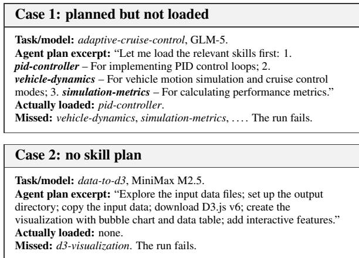  
Figure 5: Two trace cases under the plan-first prompt. Actually loaded counts both load\_skill calls and direct reads of skill files.

## 4.3 Case study

Traces further support instruction interference. Figure 5 shows two plan-first failures. In Case 1, GLM-5 explicitly plans to load pid-controller, vehicle-dynamics, and simulation-metrics, but opens only the first. In Case 2, MiniMax M2.5 writes a step-by-step plan for a D3 visualization that mentions no skill, and never loads d3- visualization. Both runs fail.

A prompt nudge thus does not reliably separate routing from execution; reducing the visible skill set addresses both forms of interference more directly.

## 5 Practical Recommendations

Because irrelevant descriptions interfere with both routing and task execution, narrowing the visible skill set before execution is more reliable than strengthening prompt instructions, and the right method depends on scale. For small curated libraries, implicit routing remains usable, but systems should track which skills are selected and loaded rather than rely on task success alone. Around the hundred-skill scale, explicit preselection should become the default; direct LLM preselection is simple and strong while the full metadata list fits in context. For thousands of skills, full-list LLM preselection becomes expensive or infeasible, and hybrid preselection (retrieval for a compact candidate set, then an LLM selector) is the strongest option in our experiments, improving relevant-skill coverage while keeping the execution context small. Since fixed preselection can omit skills needed later and adds latency, deployments should also monitor coverage and response time. Prompt reminders to consider skills are a lightweight safeguard that should complement, not replace, preselection. For evaluation, benchmarks of skill-using agents should report loadedskill recall and zero-load rate alongside task success, since Pass@3 alone can hide routing failure.

## 6 Related Work

LLM agents and tool choice. ReAct couples reasoning with actions (Yao et al., 2023), Toolformer learns tool calls (Schick et al., 2023), and MRKL combines language models with external knowledge and reasoning modules (Karpas et al., 2022). As action spaces grow, Gorilla and Tool-LLM study API selection and invocation over massive API sets (Patil et al., 2024; Qin et al., 2024), MetaTool evaluates whether models know when and which tools to use (Huang et al., 2024), and RAG-MCP retrieves tools to counter prompt bloat (Gan and Sun, 2025). Overlapping tool names and descriptions also cause selection ambiguity, motivating tool merging or filtering (Liu et al., 2025a).

Skills versus tools. Skills are more general than callable tools: they may package scripts or command-line workflows, but may also contain only background knowledge, constraints, procedures, or examples (Zhang et al., 2025). They also enter context differently. Tools are typically exposed through callable interfaces and argument schemas (Aizawa, 2025), whereas skills use progressive disclosure: the agent first sees compact metadata, and full instructions, script arguments, or implementation details become visible only after loading (Anthropic, 2025, 2026). The loading decision must therefore be made from metadata alone.

Reusable experience and skills. Voyager writes and retrieves executable code skills in Minecraft (Wang et al., 2023), Reflexion stores verbal feedback (Shinn et al., 2023), and ExpeL extracts natural-language lessons from prior experience (Zhao et al., 2024). More recently, ReUseIt synthesizes reusable web workflows (Liu et al., 2025b), SkillWeaver discovers and refines webagent skills (Zheng et al., 2025), and SkillRL distills trajectories into hierarchical skill banks for reinforcement learning (Xia et al., 2026). These works focus on acquiring skills; we assume an existing library and ask whether agents can still route to the right skills as it grows.

Long-context use and retrieval. Retrievalaugmented generation retrieves evidence before generation (Lewis et al., 2020), dense passage retrieval enables scalable semantic search (Karpukhin et al., 2020), and Fusion-in-Decoder studies how generators consume retrieved passages (Izacard and Grave, 2021); HyDE and Self-RAG improve retrieval with hypothetical documents or adaptive retrieval decisions (Gao et al., 2023; Asai et al., 2024). Long-context and needlein-a-haystack studies show that models do not always use relevant information placed in context (Liu et al., 2024a; Bai et al., 2024; Kamradt, 2023), and Du et al. (2025) find that context length alone can hurt performance even with perfect retrieval and masked irrelevant tokens. Skill routing behaves differently: replacing irrelevant metadata with placeholders largely restores goldenskill loading, so the collapse stems mainly from semantic and instruction interference rather than length alone (Section 4).

## 7 Conclusion

We documented skill routing collapse: as libraries grow, agents increasingly load fewer or no skills even though the relevant skills remain available, and loading other skills instead is too rare to explain this decline. Masking only irrelevant descriptions largely restores skill loading, whereas explicitly planning skill use with the metadata intact remains less effective than preselection. These findings point to semantic interference from descriptions and instruction interference when skill choice competes with task completion. Preselection can stabilize skill use but introduces coverage and latency trade-offs. Growing skill libraries therefore call for explicit routing and for evaluating skill use, not task success alone. A natural next step is routing that revisits the selected subset during execution, recovering skills that fixed preselection omits without exposing the full library.

## Limitations

For budget reasons, the proprietary-model validation covers only a 37-task subset and not every routing setting of the main study, so we treat it as a consistency check (Appendix E).

Field-level masking uses a small subset and fewer repetitions than full masking, so numerical proximity between conditions does not establish equivalence. Name-plus-location masking hides identifiers in the prompt but does not delete skill files. Embedding similarity screens plausible alternatives, not functional interchangeability. The two roles we attribute to descriptions are an interpretation of behavioral evidence, not a measurement of internal model processing. Routing latency depends on API serving conditions and does not establish end-to-end speedup; because RAG used embeddings computed in advance, our setup does not capture the cost of embedding new tasks online. Fixed preselection can omit skills needed later (Appendix J).

## References

Ken Aizawa. 2025. Writing effective tools for AI agents—using AI agents. https://www.anthropic. com/engineering/writing - tools - for-agents. Accessed 2026-05-24.

Anthropic. 2025. Agent skills. https://platform. claude.com/docs/en/agents-and-tools/agent-skills/ overview. Claude Platform Docs; accessed 2026- 05-24.

Anthropic. 2026. Extend claude with skills. https:// code.claude.com/docs/en/skills. Accessed 2026-05- 06.

Akari Asai, Zeqiu Wu, Yizhong Wang, Avirup Sil, and Hannaneh Hajishirzi. 2024. Self-RAG: Learning to retrieve, generate, and critique through selfreflection. In Proceedings of the International Conference on Learning Representations.

Tongtong Bai, Yifan Bai, Yiping Bao, S. H. Cai, Yuan Cao, Y. Charles, H. S. Che, Cheng Chen, Guanduo Chen, Huarong Chen, Jia Chen, Jiahao Chen, Jianlong Chen, Jun Chen, Kefan Chen, Liang Chen, Ruijue Chen, Xinhao Chen, Yanru Chen, Yanxu Chen, Yicun Chen, Yimin Chen, Yingjiang Chen, Yuankun Chen, Yujie Chen, Yutian Chen, Zhirong Chen, Ziwei Chen, Dazhi Cheng, Minghan Chu, Jialei Cui, Jiaqi Deng, Muxi Diao, Hao Ding, Mengfan Dong, Mengnan Dong, Yuxin Dong, Yuhao Dong, Angang Du, Chenzhuang Du, Dikang Du, Lingxiao Du, Yulun Du, Yu Fan, Shengjun Fang, Qiulin Feng, Yichen Feng, Garimugai Fu, Kelin Fu, Hongcheng Gao, Tong Gao, Yuyao Ge, Shangyi

Geng, Chengyang Gong, Xiaochen Gong, Zhuoma Gongque, Qizheng Gu, Xinran Gu, Yicheng Gu, Longyu Guan, Yuanying Guo, Xiaoru Hao, Weiran He, Wenyang He, Yunjia He, Chao Hong, Hao Hu Jiaxi Hu, Yangyang Hu, Zhenxing Hu, Ke Huang Ruiyuan Huang, Weixiao Huang, Zhiqi Huang, Tao Jiang, Zhejun Jiang, Xinyi Jin, Yu Jing, Guokun Lai, Aidi Li, C. Li, Cheng Li, Fang Li, Guanghe Li, Guanyu Li, Haitao Li, Haoyang Li, Jia Li, Jingwei Li, Junxiong Li, Lincan Li, Mo Li, Weihong Li, Wentao Li, Xinhang Li, Xinhao Li, Yang Li, Yanhao Li, Yiwei Li, Yuxiao Li, Zhaowei Li, Zheming Li, Weilong Liao, Jiawei Lin, Xiaohan Lin, Zhishan Lin, Zichao Lin, Cheng Liu, Chenyu Liu, Hongzhang Liu, Liang Liu, Shaowei Liu, Shudong Liu, Shuran Liu, Tianwei Liu, Tianyu Liu, Weizhou Liu, Xiangyan Liu, Yangyang Liu, Yanming Liu, Yibo Liu, Yuanxin Liu, Yue Liu, Zhengying Liu, Zhongnuo Liu, Enzhe Lu, Haoyu Lu, Zhiyuan Lu, Junyu Luo, Tongxu Luo, Yashuo Luo, Long Ma Yingwei Ma, Shaoguang Mao, Yuan Mei, Xin Men Fanqing Meng, Zhiyong Meng, Yibo Miao, Minqing Ni, Kun Ouyang, Siyuan Pan, Bo Pang, Yuchao Qian, Ruoyu Qin, Zeyu Qin, Jiezhong Qiu, Bowen Qu, Zeyu Shang, Youbo Shao, Tianxiao Shen, Zhennan Shen, Juanfeng Shi, Lidong Shi, Shengyuan Shi, Feifan Song, Pengwei Song, Tianhui Song, Xiaoxi Song, Hongjin Su, Jianlin Su, Zhaochen Su, Lin Sui, Jinsong Sun, Junyao Sun, Tongyu Sun, Flood Sung, Yunpeng Tai, Chuning Tang, Heyi Tang, Xiaojuan Tang, Zhengyang Tang, Jiawen Tao, Shiyuan Teng, Chaoran Tian, Pengfei Tian, Ao Wang, Bowen Wang, Chensi Wang, Chuang Wang, Congcong Wang, Dingkun Wang, Dinglu Wang, Dongliang Wang, Feng Wang, Hailong Wang, Haiming Wang, Hengzhi Wang, Huaqing Wang, Hui Wang, Jiahao Wang, Jinhong Wang, Jiuzheng Wang, Kaixin Wang, Linian Wang, Qibin Wang, Shengjie Wang, Shuyi Wang, Si Wang, Wei Wang, Xiaochen Wang Xinyuan Wang, Yao Wang, Yejie Wang, Yipu Wang, Yiqin Wang, Yucheng Wang, Yuzhi Wang, Zhaoji Wang, Zhaowei Wang, Zhengtao Wang, Zhexu Wang, Zihan Wang, Zizhe Wang, Chu Wei, Ming Wei, Chuan Wen, Zichen Wen, Chengjie Wu, Haoning Wu, Junyan Wu, Rucong Wu, Wenhao Wu, Yuefeng Wu, Yuhao Wu, Yuxin Wu, Zijian Wu, Chenjun Xiao, Jin Xie, Xiaotong Xie, Yuchong Xie, Yifei Xin, Bowei Xing, Boyu Xu, Jianfan Xu, Jing Xu, Jinjing Xu, L. H. Xu, Lin Xu, Suting Xu, Weixin Xu, Xinbo Xu, Xinran Xu, Yangchuan Xu, Yichang Xu, Yuemeng Xu, Zelai Xu, Ziyao Xu, Junjie Yan, Yuzi Yan, Guangyao Yang, Hao Yang, Junwei Yang, Kai Yang, Ningyuan Yang, Ruihan Yang, Xiaofei Yang, Xinlong Yang, Ying Yang, Yi Yang, Yi Yang, Zhen Yang, Zhilin Yang, Zonghan Yang, Haotian Yao, Dan Ye, Wenjie Ye, Zhuorui Ye, Bohong Yin, Chengzhen Yu, Longhui Yu, Tao Yu, Tianxiang Yu, Enming Yuan, Mengjie Yuan, Xiaokun Yuan, Yang Yue, Weihao Zeng, Dunyuan Zha, Haobing Zhan, Dehao Zhang, Hao Zhang, Jin Zhang, Puq Zhang, Qiao Zhang, Rui Zhang, Xiaobin Zhang, Y. Zhang, Yadong Zhang, Yangkun Zhang, Yichi Zhang, Yizhi Zhang, Yongting Zhang, Yu Zhang Yushun Zhang, Yutao Zhang, Yutong Zhang, Zheng

Zhang, Chenguang Zhao, Feifan Zhao, Jinxiang Zhao, Shuai Zhao, Xiangyu Zhao, Yikai Zhao, Zijia Zhao, Huabin Zheng, Ruihan Zheng, Shaojie Zheng, Tengyang Zheng, Junfeng Zhong, Longguang Zhong, Weiming Zhong, M. Zhou, Runjie Zhou, Xinyu Zhou, Zaida Zhou, Jinguo Zhu, Liya Zhu, Xinhao Zhu, Yuxuan Zhu, Zhen Zhu, Jingze Zhuang, Weiyu Zhuang, Ying Zou, and Xinxing Zu. 2026. Kimi K2.5: Visual agentic intelligence. Preprint, arXiv:2602.02276.

Yushi Bai, Xin Lv, Jiajie Zhang, Hongchang Lyu, Jiankai Tang, Zhidian Huang, Zhengxiao Du, Xiao Liu, Aohan Zeng, Lei Hou, Yuxiao Dong, Jie Tang, and Juanzi Li. 2024. LongBench: A bilingual, multitask benchmark for long context understanding. In Proceedings of the 62nd Annual Meeting of the Association for Computational Linguistics.

Yufeng Du, Minyang Tian, Srikanth Ronanki, Subendhu Rongali, Sravan Babu Bodapati, Aram Galstyan, Azton Wells, Roy Schwartz, Eliu A Huerta, and Hao Peng. 2025. Context length alone hurts LLM performance despite perfect retrieval. In Findings of the Association for Computational Linguistics: EMNLP 2025, pages 23281–23298, Suzhou, China. Association for Computational Linguistics.

Tiantian Gan and Qiyao Sun. 2025. RAG-MCP: Mitigating prompt bloat in LLM tool selection via retrieval-augmented generation. Preprint, arXiv:2505.03275.

Luyu Gao, Xueguang Ma, Jimmy Lin, and Jamie Callan. 2023. Precise zero-shot dense retrieval without relevance labels. In Proceedings of the 61st Annual Meeting of the Association for Computational Linguistics.

Yue Huang, Jiawen Shi, Yuan Li, Chenrui Fan, Siyuan Wu, Qihui Zhang, Yixin Liu, Pan Zhou, Yao Wan, Neil Zhenqiang Gong, and Lichao Sun. 2024. Meta-Tool benchmark for large language models: Deciding whether to use tools and which to use. In Proceedings of the International Conference on Learning Representations.

Gautier Izacard and Edouard Grave. 2021. Leveraging passage retrieval with generative models for open domain question answering. In Proceedings of the 16th Conference of the European Chapter of the Association for Computational Linguistics.

Greg Kamradt. 2023. Needle in a haystack: Pressure testing LLMs. https://github.com/gkamradt/ LLMTest\_NeedleInAHaystack.

Ehud Karpas, Omri Abend, Yonatan Belinkov, Barak Lenz, Opher Lieber, Nir Ratner, Yoav Shoham, Hofit Bata, Yoav Levine, Kevin Leyton-Brown, Dor Muhlgay, Noam Rozen, Erez Schwartz, Gal Shachaf, Shai Shalev-Shwartz, Amnon Shashua, and Moshe Tenenholtz. 2022. MRKL systems: A modular, neuro-symbolic architecture that combines large

language models, external knowledge sources and discrete reasoning. Preprint, arXiv:2205.00445.

Vladimir Karpukhin, Barlas Oguz, Sewon Min, Patrick Lewis, Ledell Wu, Sergey Edunov, Danqi Chen, and Wen-tau Yih. 2020. Dense passage retrieval for open-domain question answering. In Proceedings of the 2020 Conference on Empirical Methods in Natural Language Processing.

Patrick Lewis, Ethan Perez, Aleksandra Piktus, Fabio Petroni, Vladimir Karpukhin, Naman Goyal, Heinrich Kuttler, Mike Lewis, Wen-tau Yih, Tim Rocktäschel, Sebastian Riedel, and Douwe Kiela. 2020. Retrieval-augmented generation for knowledgeintensive NLP tasks. In Advances in Neural Information Processing Systems.

Xiangyi Li, Wenbo Chen, Yimin Liu, Shenghan Zheng, Xiaokun Chen, Yifeng He, Yubo Li, Bingran You, Haotian Shen, Jiankai Sun, Shuyi Wang, Binxu Li, Qunhong Zeng, Di Wang, Xuandong Zhao, Yuanli Wang, Roey Ben Chaim, Zonglin Di, Yipeng Gao, Junwei He, Yizhuo He, Liqiang Jing, Luyang Kong, Xin Lan, Jiachen Li, Songlin Li, Yijiang Li, Yueqian Lin, Xinyi Liu, Xuanqing Liu, Haoran Lyu, Ze Ma, Bowei Wang, Runhui Wang, Tianyu Wang, Wengao Ye, Yue Zhang, Hanwen Xing, Yiqi Xue, Steven Dillmann, and Han chung Lee. 2026. SkillsBench: Benchmarking how well agent skills work across diverse tasks. Preprint, arXiv:2602.12670.

George Ling, Shanshan Zhong, and Richard Huang. 2026. Agent skills: A data-driven analysis of claude skills for extending large language model functionality. Preprint, arXiv:2602.08004.

Marianne Menglin Liu, Daniel Garcia, Fjona Parllaku, Vikas Upadhyay, Syed Fahad Allam Shah, and Dan Roth. 2025a. ToolScope: Enhancing LLM agent tool use through tool merging and context-aware filtering. Preprint, arXiv:2510.20036. ACL Main Conference 2026.

Nelson F. Liu, Kevin Lin, John Hewitt, Ashwin Paranjape, Michele Bevilacqua, Fabio Petroni, and Percy Liang. 2024a. Lost in the middle: How language models use long contexts. Transactions of the Association for Computational Linguistics.

Xiao Liu, Hao Yu, Hanchen Zhang, Yifan Xu, Xuanyu Lei, Hanyu Lai, Yu Gu, Hangliang Ding, Kaiwen Men, Kejuan Yang, Shudan Zhang, Xiang Deng, Aohan Zeng, Zhengxiao Du, Chenhui Zhang, Sheng Shen, Tianjun Zhang, Yu Su, Huan Sun, Minlie Huang, Yuxiao Dong, and Jie Tang. 2024b. Agent-Bench: Evaluating LLMs as agents. In Proceedings of the International Conference on Learning Representations.

Yimeng Liu, Misha Sra, Jeevana Priya Inala, and Chenglong Wang. 2025b. ReUseIt: Synthesizing reusable AI agent workflows for web automation. Preprint, arXiv:2510.14308.

MiniMax AI. 2026. MiniMax M2.5: Built for realworld productivity. https://www.minimax.io/news/ minimax-m25. Official release page.

Shishir G. Patil, Tianjun Zhang, Xin Wang, and Joseph E. Gonzalez. 2024. Gorilla: Large language model connected with massive APIs. In Advances in Neural Information Processing Systems.

Yujia Qin, Shihao Liang, Yining Ye, Kunlun Zhu, Lan Yan, Yaxi Lu, Yankai Lin, Xin Cong, Xiangru Tang, Bill Qian, Sihan Zhao, Lauren Hong, Runchu Tian, Ruobing Xie, Jie Zhou, Mark Gerstein, Dahai Li, Zhiyuan Liu, and Maosong Sun. 2024. ToolLLM: Facilitating large language models to master 16000+ real-world APIs. In Proceedings of the International Conference on Learning Representations.

Timo Schick, Jane Dwivedi-Yu, Roberto Dessi, Roberta Raileanu, Maria Lomeli, Eric Hambro, Luke Zettlemoyer, Nicola Cancedda, and Thomas Scialom. 2023. Toolformer: Language models can teach themselves to use tools. In Advances in Neural Information Processing Systems.

Noah Shinn, Federico Cassano, Edward Berman, Ashwin Gopinath, Karthik Narasimhan, and Shunyu Yao. 2023. Reflexion: Language agents with verbal reinforcement learning. In Advances in Neural Information Processing Systems.

Guanzhi Wang, Yuqi Xie, Yunfan Jiang, Ajay Mandlekar, Chaowei Xiao, Yuke Zhu, Linxi Fan, and Anima Anandkumar. 2023. Voyager: An openended embodied agent with large language models. Preprint, arXiv:2305.16291.

Lei Wang, Chen Ma, Xueyang Feng, Zeyu Zhang, Hao Yang, Jingsen Zhang, Zhiyuan Chen, Jiakai Tang, Xu Chen, Yankai Lin, Wayne Xin Zhao, Zhewei Wei, and Ji-Rong Wen. 2024. A survey on large language model based autonomous agents. Frontiers of Computer Science, 18(6):186345.

Peng Xia, Jianwen Chen, Hanyang Wang, Jiaqi Liu, Kaide Zeng, Yu Wang, Siwei Han, Yiyang Zhou, Xujiang Zhao, Haifeng Chen, Zeyu Zheng, Cihang Xie, and Huaxiu Yao. 2026. SkillRL: Evolving agents via recursive skill-augmented reinforcement learning. Preprint, arXiv:2602.08234.

Shunyu Yao, Jeffrey Zhao, Dian Yu, Nan Du, Izhak Shafran, Karthik Narasimhan, and Yuan Cao. 2023. ReAct: Synergizing reasoning and acting in language models. In Proceedings of the International Conference on Learning Representations.

Aohan Zeng, Xin Lv, Zhenyu Hou, Zhengxiao Du, Qinkai Zheng, Bin Chen, Da Yin, Chendi Ge, Chenghua Huang, Chengxing Xie, Chenzheng Zhu, Congfeng Yin, Cunxiang Wang, Gengzheng Pan, Hao Zeng, Haoke Zhang, Haoran Wang, Huilong Chen, Jiajie Zhang, Jian Jiao, Jiaqi Guo, Jingsen Wang, Jingzhao Du, Jinzhu Wu, Kedong Wang, Lei Li, Lin Fan, Lucen Zhong, Mingdao Liu, Mingming

Zhao, Pengfan Du, Qian Dong, Rui Lu, Shuang-Li, Shulin Cao, Song Liu, Ting Jiang, Xiaodong Chen, Xiaohan Zhang, Xuancheng Huang, Xuezhen Dong, Yabo Xu, Yao Wei, Yifan An, Yilin Niu, Yitong Zhu, Yuanhao Wen, Yukuo Cen, Yushi Bai, Zhongpei Qiao, Zihan Wang, Zikang Wang, Zilin Zhu, Ziqiang Liu, Zixuan Li, Bojie Wang, Bosi Wen, Can Huang, Changpeng Cai, Chao Yu, Chen Li, Chengwei Hu, Chenhui Zhang, Dan Zhang, Daoyan Lin, Dayong Yang, Di Wang, Ding Ai, Erle Zhu, Fangzhou Yi, Feiyu Chen, Guohong Wen, Hailong Sun, Haisha Zhao, Haiyi Hu, Hanchen Zhang, Hanrui Liu, Hanyu Zhang, Hao Peng, Hao Tai, Haobo Zhang, He Liu, Hongwei Wang, Hongxi Yan, Hongyu Ge, Huan Liu, Huanpeng Chu, Jia'ni Zhao, Jiachen Wang, Jiajing Zhao, Jiamin Ren, Jiapeng Wang, Jiaxin Zhang, Jiayi Gui, Jiayue Zhao, Jijie Li, Jing An, Jing Li, Jingwei Yuan, Jinhua Du, Jinxin Liu, Junkai Zhi, Junwen Duan, Kaiyue Zhou, Kangjian Wei, Ke Wang, Keyun Luo, Laiqiang Zhang, Leigang Sha, Liang Xu, Lindong Wu, Lintao Ding, Lu Chen, Minghao Li, Nianyi Lin, Pan Ta, Qiang Zou, Rongjun Song, Ruiqi Yang, Shangqing Tu, Shangtong Yang, Shaoxiang Wu, Shengyan Zhang, Shijie Li, Shuang Li, Shuyi Fan, Wei Qin, Wei Tian, Weining Zhang, Wenbo Yu, Wenjie Liang, Xiang Kuang, Xiangmeng Cheng, Xiangyang Li, Xiaoquan Yan, Xiaowei Hu, Xiaoying Ling, Xing Fan, Xingye Xia, Xinyuan Zhang, Xinze Zhang, Xirui Pan, Xu Zou, Xunkai Zhang, Yadi Liu, Yandong Wu, Yanfu Li, Yidong Wang, Yifan Zhu, Yijun Tan, Yilin Zhou, Yiming Pan, Ying Zhang, Yinpei Su, Yipeng Geng, Yong Yan, Yonglin Tan, Yuean Bi, Yuhan Shen, Yuhao Yang, Yujiang Li, Yunan Liu, Yunqing Wang, Yuntao Li, Yurong Wu, Yutao Zhang, Yuxi Duan, Yuxuan Zhang, Zezhen Liu, Zhengtao Jiang, Zhenhe Yan, Zheyu Zhang, Zhixiang Wei, Zhuo Chen, Zhuoer Feng, Zijun Yao, Ziwei Chai, Ziyuan Wang, Zuzhou Zhang, Bin Xu, Minlie Huang, Hongning Wang, Juanzi Li, Yuxiao Dong, and Jie Tang. 2026. GLM-5: From vibe coding to agentic engineering. Preprint, arXiv:2602.15763.

Barry Zhang, Keith Lazuka, and Mahesh Murag. 2025. Equipping agents for the real world with agent skills. https://www.anthropic.com/engineering/equippingagents-for-the-real-world-with-agent-skills. Engineering at Anthropic; accessed 2026-05-24.

Andrew Zhao, Daniel Huang, Quentin Xu, Matthieu Lin, Yong-Jin Liu, and Gao Huang. 2024. ExpeL: LLM agents are experiential learners. In Proceedings of the AAAI Conference on Artificial Intelligence.

Boyuan Zheng, Michael Y. Fatemi, Xiaolong Jin, Zora Zhiruo Wang, Apurva Gandhi, Yueqi Song, Yu Gu, Jayanth Srinivasa, Gaowen Liu, Graham Neubig, and Yu Su. 2025. SkillWeaver: Web agents can self-improve by discovering and honing skills. Preprint, arXiv:2504.07079.

## A SkillsBench Dataset Details

SkillsBench is a benchmark for evaluating how agent skills affect LLM-agent task solving (Li et al., 2026). The original paper describes a community-driven construction process in which 105 contributors submitted 322 candidate tasks, followed by automated checks and human review. It states that the benchmark contains 86 tasks, excludes two GPU-dependent tasks from evaluation, and evaluates 84 tasks across 11 domains. Each task is a self-contained module with a humanwritten instruction, a containerized environment, a reference solution, deterministic verifier scripts, and one or more curated golden skills.

We use the official SkillsBench GitHub repository, which contains 87 tasks; our counts follow the repository. We exclude the five tasks in Appendix B for infrastructure or environment reliability reasons, leaving 82 adopted tasks in the main controlled study. Table 10 reports how many golden skills these adopted tasks contain. Most tasks require only a small number of skills, but the benchmark still includes multi-skill workflows that test whether routing can recover several complementary procedures.

<table><tr><td>|G|</td><td>Tasks</td></tr><tr><td>1</td><td>26</td></tr><tr><td>2</td><td>20</td></tr><tr><td>3</td><td>16</td></tr><tr><td>4</td><td>11</td></tr><tr><td>5</td><td>6</td></tr><tr><td>6</td><td>2</td></tr><tr><td>7</td><td>1</td></tr></table>

Table 10: Distribution of golden-skill counts among the 82 adopted SkillsBench tasks. [G| is the number of golden skills for a task.

Table 11 gives the average resource footprint of one valid implicit-routing run as the number of added irrelevant skills increases. The table averages over the adopted tasks and the three openweight execution models. Even before adding irrelevant skills, a single run averages more than fifteen minutes and roughly half a million input tokens, which is why the full study is expensive and why the 1,000-skill diagnostic interventions use a smaller task subset.

## A.1 License compliance

The SkillsBench repository includes an Apache License 2.0 license file. We do not modify or redistribute the benchmark; we use it as an evaluation benchmark and report the resulting experimental measurements. We preserve attribution through citation to the original paper. Our use is therefore consistent with the permissions and notice requirements of Apache License 2.0.

<table><tr><td>S</td><td>Runs</td><td>Time</td><td>Input toks</td><td>Output toks</td></tr><tr><td>0</td><td>730</td><td>15.3m</td><td>485k</td><td>13k</td></tr><tr><td>10</td><td>731</td><td>16.7m</td><td>481k</td><td>13k</td></tr><tr><td>100</td><td>728</td><td>15.4m</td><td>619k</td><td>13k</td></tr><tr><td>1000</td><td>727</td><td>17.0m</td><td>1.95M</td><td>13k</td></tr></table>

Table 11: Average valid-run resource footprint under implicit routing by number of added irrelevant skills. Time is wall-clock execution time per run; token columns are LLM input and output tokens per run.

## A.2 Server configuration

The main experiments were executed on Linux servers with an AMD EPYC 7K62 processor (16 physical cores, 32 hardware threads) and 62.3 GiB of memory. The field-level masking experiments ran in containerized Linux environments on an Apple Silicon machine with 16 GB of memory; they measure skill-loading behavior and are not used for latency comparisons. LLM inference was provided through Tencent TokenPlan.

## B Main Study Task Exclusions

The main controlled study excludes the five tasks listed in Table 12 because we encountered infrastructure or environment problems that prevented reliable execution.

# Task   
1 fix-visual-stability   
2 mhc-layer-impl   
3 multilingual-video-dubbing   
4 python-scala-translation   
5 speaker-diarization-subtitles  
Table 12: Tasks excluded from the main controlled study for infrastructure or environment reasons.

## C Experimental Subset Tasks

For budget reasons, the controlled interventions in Section 4 use the 10-task subset listed in Table 13. The same task list is used for the original, masked, plan-first, and explicit-preselection comparisons in that section.

## D Full Data for Scaling Curves

The main text uses Figure 3 and Figure 4 to emphasize the shape of the scaling effects. This appendix gives the exact values behind those curves so that the visual trends can be checked without reading points from the plots. The full model-bystrategy Pass@3 matrix is already reported in Table 3; the additional tables here focus on the plotted slices and on the skill-loading measurements that are not otherwise visible in full.

<table><tr><td>#</td><td>Task</td></tr><tr><td>1</td><td>adaptive-cruise-control</td></tr><tr><td>2</td><td>data-to-d3</td></tr><tr><td>3</td><td>earthquake-phase-association</td></tr><tr><td>4</td><td>econ-detrending-correlation</td></tr><tr><td>5</td><td>enterprise-information-search</td></tr><tr><td>6</td><td>manufacturing-equipment-maintenance</td></tr><tr><td>7</td><td>react-performance-debugging</td></tr><tr><td>8</td><td>reserves-at-risk-calc</td></tr><tr><td>9</td><td>simpo-code-reproduction</td></tr><tr><td>10</td><td>weighted-gdp-calc</td></tr></table>

Table 13: Tasks used in the 10-task experimental subset.

## D.1 Implicit-routing scaling by execution model

Section 3.2 argues that implicit routing breaks down before final task success fully reflects the failure. Tables 14–16 provide the three panels of Figure 3 in tabular form. Table 14 reports endto-end Pass@3 for the implicit-routing condition, Table 15 reports the fraction of golden skills actually loaded during execution, and Table 16 reports the share of runs that load no skill at all.

The comparison across these tables shows the masking effect discussed in the main text. Pass@3 declines for all three execution models by the 1,000-skill setting, but the routing metrics deteriorate earlier and more sharply. For example, GLM-5 keeps Pass@3 near its small-library value at 100 irrelevant skills, while its loaded-skill recall has already dropped substantially and its zero-load rate has increased. This is the empirical reason we treat loaded-skill recall and zero-load rate as first-class metrics rather than relying only on verifier success.

<table><tr><td>Model</td><td>0</td><td>10</td><td>100</td><td>1k</td></tr><tr><td>GLM-5</td><td>57.3</td><td>59.8</td><td>56.1</td><td>42.7</td></tr><tr><td>Kimi K2.5</td><td>52.4</td><td>56.8</td><td>50.6</td><td>43.9</td></tr><tr><td>MiniMax M2.5</td><td>45.1</td><td>46.3</td><td>41.5</td><td>29.3</td></tr></table>

Table 14: Values for Figure 3(a): implicit-routing Pass @3 (%) by execution model and number of added irrelevant skills.

<table><tr><td>Model</td><td>0</td><td>10</td><td>100</td><td>1k</td></tr><tr><td>GLM-5</td><td>79.6</td><td>71.8</td><td>55.0</td><td>20.9</td></tr><tr><td>Kimi K2.5</td><td>78.8</td><td>74.4</td><td>63.2</td><td>40.5</td></tr><tr><td>MiniMax M2.5</td><td>62.3</td><td>58.2</td><td>41.6</td><td>21.5</td></tr></table>

Table 15: Values for Figure 3(b): implicit-routing loaded-skill recall (%) by execution model.

<table><tr><td>Model</td><td>0</td><td>10 100</td><td>1k</td></tr><tr><td>GLM-5</td><td>7.8</td><td>9.4 26.0</td><td>64.9</td></tr><tr><td>Kimi K2.5</td><td>7.0</td><td>7.9 16.7</td><td>31.3</td></tr><tr><td>MiniMax M2.5</td><td>13.1</td><td>20.7 39.3</td><td>58.4</td></tr></table>

Table 16: Values for Figure 3(c): implicit-routing zeroload rate (%) by execution model. Lower is better.

## D.2 Skill scaling by routing strategy

Section 3.3 compares implicit routing with three explicit-routing strategies. Tables 17-19 give the values behind Figure 4: aggregate Pass@3, loaded-skill recall, and zero-load rate for each routing strategy and library size. These tables are complementary to Table 3: the main-text table breaks task success down by execution model, whereas this appendix keeps the strategy-level view and adds the two skill-use metrics.

<table><tr><td>Strategy</td><td>0</td><td>10</td><td>100</td><td>1k</td><td>10k</td></tr><tr><td>Naive</td><td>51.6</td><td>54.3</td><td>49.4</td><td>38.6</td><td></td></tr><tr><td>LLM preselect</td><td>54.9</td><td>52.4</td><td>54.9</td><td>51.6</td><td>一</td></tr><tr><td>RAG</td><td>52.4</td><td>48.0</td><td>49.6</td><td>46.5</td><td>41.5</td></tr><tr><td>Hybrid preselection</td><td>52.8</td><td>53.7</td><td>50.0</td><td>52.8</td><td>50.4</td></tr></table>

Table 17: Values for Figure 4(a): aggregate Pass@3 (%) by routing strategy and number of added irrelevant skills. “—" indicates omitted infeasible settings.

<table><tr><td>Strategy</td><td>0</td><td>10</td><td>100</td><td>1k</td><td>10k</td></tr><tr><td>Naive</td><td>73.6</td><td>68.2</td><td>53.3</td><td>27.4</td><td>一</td></tr><tr><td>LLM preselect</td><td>74.0</td><td>73.6</td><td>73.0</td><td>62.0</td><td>一</td></tr><tr><td>RAG</td><td>74.6</td><td>70.1</td><td>69.3</td><td>58.6</td><td>48.5</td></tr><tr><td>Hybrid preselection</td><td>74.0</td><td>72.9</td><td>70.5</td><td>67.1</td><td>55.2</td></tr></table>

Table 18: Values for Figure 4(b): loaded-skill recall (%) by routing strategy.

<table><tr><td>Strategy</td><td>0</td><td>10</td><td>100</td><td>1k</td><td>10k</td></tr><tr><td>Naive</td><td>9.3</td><td>12.7</td><td>27.3</td><td>51.6</td><td>1</td></tr><tr><td>LLM preselect</td><td>8.5</td><td>8.4</td><td>9.5</td><td>9.8</td><td>一</td></tr><tr><td>RAG</td><td>8.1</td><td>11.7</td><td>12.3</td><td>13.2</td><td>18.0</td></tr><tr><td>Hybrid preselection</td><td>8.1</td><td>8.9</td><td>10.7</td><td>9.1</td><td>10.7</td></tr></table>

Table 19: Values for Figure 4(c): zero-load rate (%) by routing strategy. Lower is better.

## E Budget-Limited Proprietary Model Validation

The main experiments use open-weight models to keep evaluation cost manageable. This appendix asks whether the same implicit-routing pressure is visible for stronger proprietary frontier models. Because these runs are substantially more expensive, we evaluate a smaller 37-task subset and treat the result as a qualitative consistency check rather than a second full benchmark.

Table 20 lists the exact proprietary-validation subset.

<table><tr><td>Task</td><td>Task</td></tr><tr><td>3d-scan-calc adaptive-cruise-control azure-bgp-oscillation-route-leak citation-check dynamic-object-aware-egomotion earthquake-phase-association earthquake-plate-calculation econ-detrending-correlation energy-ac-optimal-power-flow energy-market-pricing enterprise-information-search exceltable-in-ppt exoplanet-detection-period</td><td>flink-query flood-risk-analysis gh-repo-analytics glm-lake-mendota gravitational-wave-detection grid-dispatch-operator hvac-control invoice-fraud-detection jax-computing-basics jpg-ocr-stat lab-unit-harmonization lake-warming-attribution</td></tr></table>

Table 20: Tasks used in the proprietary-model validation subset.

Table 21 reports Pass@3 on that shared subset for three proprietary models and, for comparison, the three open-weight models evaluated on the same tasks. Table 22 then reports loaded-skill recall for the proprietary models.

The proprietary models show the same qualitative pressure from larger skill libraries. Their task success is generally more stable than the openweight models on this subset: Claude Opus 4.6 remains near 60 Pass@3 even at 1,000 irrelevant skills.

However, Table 22 makes the routing degradation clearer. Claude Opus 4.6 drops from 81.3 loaded-skill recall with no irrelevant skills to 30.9 at 1,000; Gemini 3.1 Pro drops from 77.4 to 43.0; and GPT-5.4 drops from 76.2 to 49.3. The decline is sometimes slower than in the open-weight main study, especially for Gemini and GPT, but the direction is the same. Relevant skills remain installed, yet implicit execution-time routing becomes less reliable as the library grows. This supports the conclusion of the main experiment: stronger final task performance does not imply that implicit routing remains healthy.

<table><tr><td>Model</td><td>0</td><td>10 100</td><td></td><td>1k</td></tr><tr><td>Claude Opus 4.6† Gemini 3.1 Pro†</td><td>64.9 59.5</td><td>62.2 51.4</td><td>59.5 48.6</td><td>62.2 51.4</td></tr><tr><td>GPT-5.4†</td><td>54.1</td><td>56.8</td><td>43.2</td><td>43.2</td></tr><tr><td>GLM-5</td><td>54.1</td><td>62.2</td><td>54.1</td><td>35.1</td></tr><tr><td>Kimi K2.5</td><td>48.6</td><td>58.3</td><td>50.0</td><td>45.9</td></tr><tr><td>MiniMax M2.5</td><td>35.1</td><td>45.9</td><td>37.8</td><td>21.6</td></tr></table>

Table 21: Pass@3 (%) on the 37-task proprietarymodel validation subset. Numeric columns give the number of added irrelevant skills on top of each task's golden skills. Models marked with † are proprietary; the remaining rows are the three open-weight execution models evaluated on the same task subset under implicit routing.

<table><tr><td>Model</td><td>0</td><td>10</td><td>100</td><td>1k</td></tr><tr><td>Claude Opus 4.6†</td><td>81.3</td><td>77.7</td><td>43.3</td><td>30.9</td></tr><tr><td>Gemini 3.1 Pro†</td><td>77.4</td><td>70.4</td><td>57.9</td><td>43.0</td></tr><tr><td>GPT-5.4†</td><td>76.2</td><td>62.9</td><td>51.8</td><td>49.3</td></tr></table>

Table 22: Loaded-skill recall (%) on the 37-task proprietary-model validation subset. The statistic counts golden skills whose full instructions are accessed during execution.

## F Precision Metrics

This appendix reports precision metrics for runtime skill loading and preselection. Tables 23 and 24 report loaded-skill precision for open-weight and proprietary models, respectively; Table 25 reports preselected-skill precision. As the number of skills grows, agents often load fewer skills or no skills at all, so loaded precision usually declines less sharply than recall. Loaded precision is computed over runs with at least one loaded skill; selected precision is computed over nonempty preselected sets.

## G Skill Demand Breakdown

The main results aggregate over tasks with different numbers of golden skills. This section checks whether the scaling story is driven only by tasks with many required skills or whether it also appears for simpler tasks. Table 26 groups tasks by the number of golden skills in the task environment: single-skill tasks, tasks with two or three golden skills, and tasks with four or more golden skills. Within each library size s, the table reports both Pass @3 and loaded-skill recall for Naive exposure, LLM preselection, RAG, and hybrid preselection.

The table supports the same interpretation as the main text while adding a task-demand perspective.

<table><tr><td>Model</td><td>0</td><td>10 100</td><td>1k</td><td>10k</td></tr><tr><td>Naive GLM-5</td><td>99.6</td><td>99.5</td><td>97.1 88.6</td><td>一 一</td></tr><tr><td>Kimi K2.5 MiniMax M2.5</td><td>99.6 99.7</td><td>99.0 99.1</td><td>97.7 95.2</td><td>87.2 76.4 一</td></tr><tr><td>LLM preselect GLM-5</td><td>99.6</td><td>99.6</td><td>97.7 90.8</td><td>一</td></tr><tr><td>Kimi K2.5 MiniMax M2.5</td><td>99.5 99.7</td><td>99.4 99.5</td><td>96.6 97.2</td><td>84.9 一 78.6 一</td></tr><tr><td>RAG</td><td></td><td></td><td></td><td></td></tr><tr><td>GLM-5 Kimi K2.5</td><td>99.7 99.7</td><td>99.2 99.2</td><td>99.2 91.9 99.5 91.0</td><td>83.6 80.7</td></tr><tr><td>MiniMax M2.5</td><td>99.7</td><td>98.7</td><td>98.8 90.2</td><td>75.3</td></tr><tr><td>Hybrid preselection</td><td></td><td></td><td></td><td></td></tr><tr><td>GLM-5</td><td>99.4</td><td>99.3</td><td>97.7</td><td></td></tr><tr><td>Kimi K2.5</td><td></td><td></td><td>90.7 92.0</td><td>82.6 76.8</td></tr><tr><td>MiniMax M2.5</td><td>99.6 99.3</td><td>99.6 99.6</td><td>98.3 97.2 86.1</td><td>70.3</td></tr></table>

Table 23: Runtime loaded-skill precision (%) for openweight models by routing strategy and number of added irrelevant skills.

<table><tr><td>Model</td><td>0</td><td>10</td><td>100</td><td>1k</td></tr><tr><td>Claude Opus 4.6†</td><td>100.0</td><td>100.0</td><td>100.0</td><td>95.2</td></tr><tr><td>Gemini 3.1 Pro†</td><td>100.0</td><td>100.0</td><td>100.0</td><td>100.0</td></tr><tr><td>GPT-5.4†</td><td>100.0</td><td>97.3</td><td>90.5</td><td>82.7</td></tr></table>

Table 24: Runtime loaded-skill precision (%) for proprietary models under implicit routing on the validation subset.

<table><tr><td>Method</td><td>0 10</td><td>100</td><td>1k</td><td>10k</td></tr><tr><td>LLM preselect</td><td>100.0 99.7</td><td>80.0</td><td>63.0</td><td>一</td></tr><tr><td>RAG</td><td>100.0</td><td>47.6 43.9</td><td>37.1</td><td>30.1</td></tr><tr><td>Hybrid preselection</td><td>100.0</td><td>99.8 84.5</td><td>72.0</td><td>52.6</td></tr></table>

Table 25: Preselected-skill precision (%) by method and number of added irrelevant skills.

At 1,000 irrelevant skills, Naive exposure drops for both single-skill and multi-skill groups, showing that routing collapse is not limited to the hardest tasks. Loaded-skill recall shows the mechanism more directly: with 1,000 irrelevant skills, Naive exposure loads far fewer golden skills than the explicit-routing strategies across all three demand bins. Multi-skill tasks nevertheless make the mechanism more consequential: partial retrieval can find one useful skill but still miss another workflow needed for a passing solution. This is why the paper emphasizes all-gold coverage, loaded-skill recall, and trace analysis in addition to Pass @3.

## H Hybrid Candidate Aggregation Details

Using multiple queries raises a design question: how should the retrieved lists be merged into one candidate pool? Table 27 compares three intuitive aggregators. Max keeps the best similarity score that any query gives a skill. Mean averages scores across queries. Quot a takes a fixed number of top unseen skills from each query, encouraging coverage of different sub-procedures. Quota is the default in this paper, and Algorithm 2 in Appendix K gives the corresponding procedure. Quota gives the strongest all-gold coverage at 10,000 irrelevant skills, which is important for multi-skill tasks where missing one required workflow can break execution.

## I Non-Golden Skill Loading

Experimental scope. We examine skill loading for GLM-5, Kimi K2.5, and MiniMax M2.5 at s ∈ {0, 10, 100, 1000} across all three runs. This analysis covers 86 tasks, whereas the main tasksuccess study uses the adopted 82-task subset. Table 1 therefore summarizes a slightly broader task set than the main-study curves.

A skill counts as loaded if the agent calls load\_skill on it or reads its SKILL.md file; references to skills outside the exposed library do not count. Each task's golden set is restricted to golden skills present in the library.

Similarity matching. For each evaluation, let N = L \ G be the loaded non-golden skills and M = G \ L the missed golden skills. We compare every pair in N × M, using the RAG embedding model on the full skill name and description, formatted as name: description. An evaluation counts as loading a potential alternative when any pair has cosine similarity strictly greater than 0.8. We neither match across tasks nor compare against golden skills already loaded. The threshold screens semantic overlap; it does not certify functional equivalence.

Alternative loading is uncommon. Non-golden loads occur in 2.32% of evaluations across scales, and potential alternatives above the threshold occur in 0.95%. They concentrate at s = 1000 (Table 28) and include clear semantic neighbors such as pdf-reader and pdf, or excel and xlsx. Table 29 lists all above-threshold task-modelskill-pair groups, combining repeated runs. Although non-golden loading increases at the largest scale, it remains far less common than the decline in skill use. Thus, routing collapse primarily reflects under-loading, not substitution of other

<table><tr><td>S</td><td>|G|</td><td>Tasks</td><td colspan="2">Naive</td><td colspan="2">LLM</td><td colspan="2">RAG</td><td colspan="2">Hybrid</td></tr><tr><td></td><td></td><td></td><td>P3</td><td>Load</td><td>P3</td><td>Load</td><td>P3</td><td>Load</td><td>P3</td><td>Load</td></tr><tr><td>0</td><td>1</td><td>26</td><td>53.8</td><td>91.9</td><td>52.6</td><td>93.6</td><td>52.6</td><td>95.7</td><td>56.4</td><td>95.7</td></tr><tr><td></td><td> $^ { 2 - 3 }$ </td><td>36</td><td>52.8</td><td>68.7</td><td>55.6</td><td>68.1</td><td>55.6</td><td>68.7</td><td>50.0</td><td>67.2</td></tr><tr><td></td><td> $\geq 4$ </td><td>20</td><td>46.7</td><td>58.8</td><td>56.7</td><td>59.3</td><td>46.7</td><td>57.8</td><td>53.3</td><td>58.0</td></tr><tr><td>10</td><td>1</td><td>26</td><td>51.9</td><td>91.8</td><td>53.8</td><td>94.9</td><td>48.7</td><td>89.3</td><td>57.7</td><td>94.9</td></tr><tr><td></td><td> $^ { 2 - 3 }$ </td><td>36</td><td>58.3</td><td>60.9</td><td>52.8</td><td>67.6</td><td>49.1</td><td>63.3</td><td>53.7</td><td>66.6</td></tr><tr><td></td><td> $\geq 4$ </td><td>20</td><td>50.0</td><td>51.2</td><td>50.0</td><td>56.6</td><td>45.0</td><td>57.3</td><td>48.3</td><td>55.6</td></tr><tr><td>100</td><td>1</td><td>26</td><td>51.9</td><td>73.2</td><td>55.1</td><td>94.4</td><td>50.0</td><td>88.9</td><td>55.1</td><td>92.3</td></tr><tr><td></td><td> $^ { 2 - 3 }$ </td><td>36</td><td>49.1</td><td>47.5</td><td>57.4</td><td>65.7</td><td>51.9</td><td>61.7</td><td>45.4</td><td>63.1</td></tr><tr><td></td><td> $\geq 4$ </td><td>20</td><td>46.7</td><td>38.4</td><td>50.0</td><td>58.3</td><td>45.0</td><td>57.5</td><td>51.7</td><td>55.6</td></tr><tr><td>1000</td><td>1</td><td>26</td><td>38.5</td><td>38.0</td><td>52.6</td><td>79.5</td><td>42.3</td><td>72.0</td><td>55.1</td><td>89.3</td></tr><tr><td></td><td> $^ { 2 - 3 }$ </td><td>36</td><td>37.0</td><td>26.8</td><td>51.9</td><td>54.8</td><td>47.2</td><td>52.8</td><td>50.9</td><td>59.0</td></tr><tr><td></td><td> $\geq 4$ </td><td>20</td><td>41.7</td><td>14.8</td><td>50.0</td><td>52.4</td><td>50.9</td><td>51.5</td><td>53.3</td><td>53.0</td></tr><tr><td>10000</td><td>1</td><td>26</td><td></td><td></td><td></td><td></td><td>38.5</td><td>64.1</td><td>47.4</td><td>70.1</td></tr><tr><td></td><td> $^ { 2 - 3 }$ </td><td>36</td><td></td><td></td><td></td><td></td><td>43.5</td><td>42.4</td><td>54.6</td><td>48.3</td></tr><tr><td></td><td> $\geq 4$ </td><td>20</td><td></td><td></td><td></td><td></td><td>41.7</td><td>39.1</td><td>46.7</td><td>48.4</td></tr></table>

Table 26: Pass@3 and loaded-skill recall (%) by skill-pool size and number of golden skills. The row group s gives the number of added irrelevant skills; [G| bins tasks by their number of golden skills. Load is loaded-skill recall.

<table><tr><td>S</td><td>Agg.</td><td>Rec</td><td>All</td><td>Any</td></tr><tr><td>1000</td><td>Max</td><td>97.9</td><td>95.4</td><td>100.0</td></tr><tr><td>1000</td><td>Mean</td><td>93.9</td><td>89.7</td><td>97.7</td></tr><tr><td>1000</td><td>Quota</td><td>96.3</td><td>92.0</td><td>98.9</td></tr><tr><td>10000</td><td>Max</td><td>88.7</td><td>80.5</td><td>95.4</td></tr><tr><td>10000</td><td>Mean</td><td>88.7</td><td>78.2</td><td>95.4</td></tr><tr><td>10000</td><td>Quota</td><td>91.8</td><td>86.2</td><td>97.7</td></tr></table>

Table 27: Hybrid candidate quality (%) at budget 100.

<table><tr><td>S</td><td>Non-golden load rate &gt; 0.8 alternative rate</td></tr><tr><td>0</td><td>0.00 0.00</td></tr><tr><td>10</td><td>0.26 0.00</td></tr><tr><td>100 1.83</td><td>0.00</td></tr><tr><td>1000</td><td>7.19</td></tr></table>

Table 28: Non-golden skill loading (%). Non-golden load rate measures whether any non-golden skill is loaded; alternative rate additionally requires similarity above 0.8 to a missed golden skill in the same evaluation.

skills for golden skills.

Exact duplicates. Distractors are sampled so that none shares its identifier with a golden skill of the task; exact duplicates of golden skills therefore never appear as distractors. Differently named near-duplicates can remain and are covered by the similarity analysis above.

## J Preselection Trade-offs and Latency

Fixed coverage. Preselection reduces the executor's visible library but can remove a skill that becomes relevant later. Table 30 reports the average number of golden skills exposed to the executor, computed from the intersection of the selected set with task golden skills and averaged over task– model identities. Task success uses the main-study Pass@3 values. Each preselection method retains fewer golden skills as distractors grow. Reduced coverage limits task success because omitted skills are unavailable during execution, although success also depends on which skills are missed and the quality of the remaining set. For example, RAG can retain more golden skills than LLM preselection yet yield lower task success; aggregate coverage alone does not determine whether the most consequential skills survive selection.

Routing-stage latency. We measure routingstage latency on the adopted main-study tasks with the three open-weight models across all three runs. Routing-stage latency is the time from the start of preselection until the selected metadata is passed to the executor. For hybrid preselection, it covers query generation, query embedding and retrieval, and final LLM selection, but not the one-time construction of the skill embedding index. Environment setup, task execution, and verification are excluded.

The median delay increases from 8 to 19 seconds for LLM preselection and from 33 to 41 seconds for Hybrid as distractors grow from 10 to 1,000. Hybrid preselection makes two LLM calls (query generation and final selection), whereas LLM preselection makes one. Because the two methods were run at different times, these numbers reflect the API serving conditions of each period and are not a controlled latency comparison.

We do not report routing latency for RAG. It makes no generative selector call, and we embedded all skill metadata and task instructions in a single batch before running the experiments, so RAG preselection at run time reduces to a similarity lookup over precomputed vectors. Embedding calls are typically fast relative to LLM generation, but in a deployment that embeds each new task online, this step would add a small cost that our setup does not capture. Likewise, token savings need not translate into shorter end-to-end wall time, which also depends on task behavior, API latency, and environment operations. Practical deployments should weigh coverage and task success against the added routing delay, especially for interactive tasks.

<table><tr><td>Task</td><td>Model</td><td>Runs</td><td>Loaded non-golden → missed golden</td><td>Cosine</td></tr><tr><td>court-form-filling</td><td>Kimi K2.5</td><td>2</td><td>pdf-generator → pdf</td><td>0.922</td></tr><tr><td>financial-modeling-qa</td><td>Kimi K2.5</td><td>1,2,3</td><td>pdf-reader → pdf</td><td>0.903</td></tr><tr><td>financial-modeling-qa</td><td>MiniMax M2.5</td><td>1,2</td><td>pdf-reader → pdf</td><td>0.903</td></tr><tr><td>invoice-fraud-detection</td><td>MiniMax M2.5</td><td>1,3</td><td>pdf-reader → pdf</td><td>0.903</td></tr><tr><td>latex-formula-extraction</td><td>GLM-5</td><td>3</td><td>pdf-reader → pdf</td><td>0.903</td></tr><tr><td>latex-formula-extraction</td><td>MiniMax M2.5</td><td>1</td><td>pdf-reader → marker</td><td>0.826</td></tr><tr><td>latex-formula-extraction</td><td>MiniMax M2.5</td><td>1</td><td>pdf-reader → pdf</td><td>0.903</td></tr><tr><td>pdf-excel-diff</td><td>GLM-5</td><td>1</td><td>pdf-reader → pdf</td><td>0.903</td></tr><tr><td>pdf-excel-diff</td><td>Kimi K2.5</td><td>2</td><td>pdf-reader → pdf</td><td>0.903</td></tr><tr><td>pdf-excel-diff</td><td>MiniMax M2.5</td><td>2</td><td>pdf-reader → pdf</td><td>0.903</td></tr><tr><td>pg-essay-to-audiobook</td><td>GLM-5</td><td>2,3</td><td>tts → gtts</td><td>0.811</td></tr><tr><td>protein-expression-analysis</td><td>Kimi K2.5</td><td>1</td><td>excel → xlsx</td><td>0.906</td></tr><tr><td>reserves-at-risk-calc</td><td>Kimi K2.5</td><td>1</td><td>excel → xlsx</td><td>0.906</td></tr><tr><td>sales-pivot-analysis</td><td>Kimi K2.5</td><td>2</td><td>excel → xlsx</td><td>0.887</td></tr><tr><td>sales-pivot-analysis</td><td>Kimi K2.5</td><td>3</td><td>pdf-reader → pdf</td><td>0.888</td></tr><tr><td>sales-pivot-analysis</td><td>MiniMax M2.5</td><td>3</td><td>excel → xlsx</td><td>0.887</td></tr><tr><td>shock-analysis-demand</td><td>Kimi K2.5</td><td>1</td><td>excel → xlsx</td><td>0.906</td></tr><tr><td>shock-analysis-demand</td><td>MiniMax M2.5</td><td>2,3</td><td>excel → xlsx</td><td>0.906</td></tr><tr><td>shock-analysis-supply</td><td>Kimi K2.5</td><td>2</td><td>excel → xlsx</td><td>0.906</td></tr><tr><td>shock-analysis-supply</td><td>MiniMax M2.5</td><td>2</td><td>excel → xlsx</td><td>0.906</td></tr><tr><td>video-tutorial-indexer</td><td>GLM-5</td><td>1</td><td>transcribee → speech-to-text</td><td>0.843</td></tr><tr><td>weighted-gdp-calc</td><td>Kimi K2.5</td><td>1,2,3</td><td>excel → xlsx</td><td>0.906</td></tr></table>

Table 29: All above-threshold skill-pair groups for the three open-weight models, all at $s = 1 0 0 0$ . Runs lists which of the three repeated runs contain the pair. Similarities use full name-and-description embeddings; the same skill name can have task-specific descriptions.

<table><tr><td>Setting</td><td>Avg. golden exposed</td><td>Pass@3 (%)</td></tr><tr><td>All golden, no preselection</td><td>2.52</td><td>51.6</td></tr><tr><td>Naive-10</td><td>2.52</td><td>54.3</td></tr><tr><td>RAG-10</td><td>2.38</td><td>48.0</td></tr><tr><td>LLM-10</td><td>2.21</td><td>52.4</td></tr><tr><td>Hybrid-10</td><td>2.21</td><td>53.7</td></tr><tr><td>RAG-100</td><td>2.21</td><td>49.6</td></tr><tr><td>LLM-100</td><td>2.11</td><td>54.9</td></tr><tr><td>Hybrid-100</td><td>2.10</td><td>50.0</td></tr><tr><td>RAG-1000</td><td>1.85</td><td>46.5</td></tr><tr><td>LLM-1000</td><td>1.78</td><td>51.6</td></tr><tr><td>Hybrid-1000</td><td>1.97</td><td>52.8</td></tr></table>

Table 30: Fixed preselection trades reduced interference for missed golden-skill coverage. Method suffixes denote the number of added irrelevant skills.

<table><tr><td>Method</td><td>S</td><td>Mean (s)</td><td>Median (s)</td><td>P90 (s)</td></tr><tr><td>LLM</td><td>10</td><td>11.7</td><td>8.0</td><td>26</td></tr><tr><td>LLM</td><td>100</td><td>18.0</td><td>9.5</td><td>45</td></tr><tr><td>LLM</td><td>1000</td><td>35.4</td><td>19.0</td><td>73</td></tr><tr><td>Hybrid</td><td>10</td><td>38.9</td><td>33.0</td><td>75</td></tr><tr><td>Hybrid</td><td>100</td><td>43.7</td><td>37.0</td><td>89</td></tr><tr><td>Hybrid</td><td>1000</td><td>48.3</td><td>41.0</td><td>93</td></tr></table>

Table 31: Observed routing-stage latency before task execution. P90 is the 90th percentile. The two methods were measured in separate experiment periods, so differences also reflect serving conditions.

## K Execution and Routing Algorithms

The main text summarizes the execution protocol; this appendix spells out the steps. Algorithm 1 receives a task, a skill set, a preselector, and an execution model. Line 1 applies the preselector to decide which skills are exposed. Line 2 formats the exposed skill metadata, and Line 3 builds the initial model context. Lines 4–7 repeat model tool calls and append tool outputs to the context. Lines 8–9 run the verifier and return its result.

Algorithm 2 gives the hybrid preselection procedure. Line 1 generates multiple search queries from the task instruction. Line 2 embeds the skill metadata, and Line 3 initializes an empty candidate set. Lines 4–8 retrieve top unseen candidates for each generated query and merge them into one candidate pool. Lines 9–10 ask the final selector to choose from that candidate pool and return the selected skills.

Algorithm 1 Skill-conditioned agent execution   
Require: task $\tau = ( I , F , V , G )$ , skills $S _ { s }$ , preselector π, ex  
ecution model $M _ { e }$   
Ensure: verifier result r   
1: $P  \pi ( I , S _ { s } )$   
2: M ← FormatMetadata $( P )$   
3: x ← BuildContext $( I , \dot { M } )$   
4: while HasToolCall $\dot { ( \boldsymbol { y } _ { \mathrm { ~ \scriptsize ~ \cdot ~ } } } - \dot { M } _ { e } ( \boldsymbol { x } ) )$ do   
5: o ← Execute $( y , F )$   
6: $x \gets \mathbf A$ ppend $( x , y , o )$   
7: end while   
8: $r  V ( F )$   
9: return r

Algorithm 2 Hybrid preselection   
Require: instruction I, skills $S _ { s } ,$ models $M _ { p } , M _ { e m b } ,$   
queries n, candidate budget B, final budget k   
Ensure: selected skills $P$   
1: $Q  M _ { p } .$ GenerateQueries $( I , n )$   
2: $\dot { E } \gets \{ ( \dot { u } , M _ { e m b } ( m ( u ) ) ) : u \in S _ { s } \}$   
3: $C \gets \emptyset$   
4: for $q \in Q$ do   
5: $\bar { v _ { q } }  \bar { M } _ { e m b } ( q )$   
6: $R _ { q } \gets$ RankBySim $( v _ { q } , E )$   
7: C ← C ∪ TopUnseen( $\ ` R _ { q } , \lceil B / n \rceil )$   
8: end for   
9: $P  M _ { p }$ .SelectSkills(I, C, k)   
10: return $\dot { P }$

Algorithm 3 lists the three baseline preselection snippets. The Naive snippet returns the whole installed skill set. The LLM preselection snippet first formats the full metadata list, then asks a selector model to name skills, and finally matches the returned names back to installed skills. The RAG snippet embeds the instruction and skill metadata, ranks skills by embedding similarity, and returns the top-k skills.

Algorithm 3 Baseline preselectors   
Require: instruction I, skills $S _ { s }$ , budget k, selector model   
$M _ { p } ,$ embedding model $M _ { e m b }$   
Ensure: exposed skill set P   
1: Naive $( \dot { I } , S _ { s } ) \colon$   
2: return $S _ { s }$   
3: LLMPreselect $( I , S _ { s } , k , M _ { p } ) ;$   
4: M ← FormatMetadata(Ss)   
5: N ← Mp.SelectSkills(I, M, k)   
6: return MatchSkills( $( N , S _ { s } )$   
7: RAGPreselect $( I , S _ { s } , \dot { k } , M _ { e m b } ) { : }$   
8: $v _ { I }  M _ { e m b } ( I )$   
9: $E \gets \{ ( u , \dot { M _ { e m b } } ( m ( u ) ) ) : u \in S _ { s } \}$   
10: R ← RankBySim(v1, E)   
11: return TopK(R, k)

## L Prompt Templates

This appendix gives the prompt templates. The execution agent receives skill metadata and must explicitly load a skill before using its longer instructions; preselection prompts instead return only skill names so that selected skills can be matched against the golden set.

## L.1 Execution-agent initial prompt skeleton

Execution-agent initial prompt skeleton   
You are an AI assistant tasked with solving command-line tasks in a   
Linux environment. You will be given a task description and the   
output from previously executed commands. Your goal is to solve   
the task by providing batches of shell commands.   
Format your response as JSON with the following structure:   
"analysis": "Analyze the current state based on the terminal output   
provided. What do you see? What has been accomplished? What   
still needs to be done?",   
"plan": "Describe your plan for the next steps. What commands will   
you run and why? Be specific about what you expect each   
command to accomplish.",   
"commands": [   
{"keystrokes": "ls -la\n", "duration": 0.1},   
{"keystrokes": "cd project\n", "duration": 0.1}   
$] ,$   
"task\_complete": true   
}   
Required fields:   
– "analysis": Your analysis of the current situation   
– "plan": Your plan for the next steps   
– "commands": Array of command objects to execute   
Optional fields:   
– "task\_complete": Boolean indicating if the task is complete (defaults to   
false if not present)   
Command object structure:   
– "keystrokes": String containing the exact keystrokes to send to the   
terminal (required)   
– "duration": Number of seconds to wait for the command to complete (   
defaults to 1.0 if not present)   
IMPORTANT: The text inside "keystrokes" will be used completely   
verbatim. Most bash commands should end with a newline (\n) to   
execute.   
SKILL SYSTEM:   
If skills are available (shown in "available\_skills"), you MUST check if   
any skill matches the task BEFORE executing commands.   
Skill context:   
{skills\_block}   
To load a skill, use: cat <location> (where location is from the skill's <   
location> tag above)   
LOADED SKILLS:   
{active skills}   
To load a skill, respond with ONLY this JSON (no other fields):   
{"load skill": "skill-name"}   
After a skill is loaded, proceed with the normal response format above.   
Skills contain best-practice workflows – use them instead of writing   
custom solutions.   
Task Description:   
{instruction}   
Current terminal state:   
{terminal\_state}

The execution prompt separates invocation from routing. It can only load skills that appear in the exposed metadata block, so the preselection stage directly determines the action space visible to the agent.

## L.2 LLM preselection prompt

LLM preselection prompt   
You are a skill-routing assistant   
Given a task description and available skills,   
select the skills most likely to be useful.   
Return your answer as a JSON array of skill names. Return at most {   
max\_skills}   
skills. If no skill is relevant, return an empty array: []   
IMPORTANT: Return ONLY the JSON array.   
No explanation. No markdown code fences.   
## Available Skills   
{skills\_list}   
## Task Description   
{task\_instruction}   
## Your Selection (JSON array of skill names)

This prompt uses a strict JSON-only output format, so selected skills can be matched unambiguously and explanations are never mistaken for skill names.

## L.3 Hybrid preselection query-generation prompt

Hybrid preselection query-generation prompt   
You are a retrieval query planner for a skill-selection system.   
Given a task description, write {num\_queries}   
short search queries covering distinct   
capabilities likely needed for the task.   
Guidelines:   
– Each query should be concise, concrete, and skill-oriented.   
– Prefer capability/library/workflow phrases.   
– Do not restate the whole task.   
– Return ONLY a JSON array of strings.   
– No explanation. No markdown.   
## Task Description   
{task\_instruction}   
## Search Queries (JSON array)

The query-generation step is useful for multiskill tasks because the original task instruction may emphasize the final artifact rather than every intermediate capability.

## L.4 Hybrid preselection LLM final selection prompt

```tcl
RAG-to-LLM final selection prompt
You are a skill-routing assistant.
Given a task description and available skills,
select the skills most likely to be useful.
Return your answer as a JSON array of skill names. Return at most {
max_skills}
skills. If no skill is relevant, return an empty array: []
IMPORTANT: Return ONLY the JSON array.
No explanation. No markdown code fences.
## Available Skills
{skills_list}
## Task Description
{task_instruction}
```

```markdown
## Your Selection (JSON array of skill names)
```

This final-selection prompt is the same as the LLM preselection prompt.

## L.5 Intervention prompts

The field-level variants use the same prompt and replace only the designated distractor fields: name, description, location, or name plus location. Unmasked fields and all golden-skill metadata remain readable. The number of placeholders is proportional to the original field's character length, approximating rather than exactly matching its token length. The field-level comparison is a targeted diagnostic rather than a test of statistical equivalence.

The masked intervention uses the same execution prompt as above, but the skill block keeps golden-skill metadata readable and replaces every irrelevant skill's name, description, and location with <mask> placeholders of approximately the original length. A representative masked prompt is:

Masked execution prompt   
You are an AI assistant tasked with solving command-line tasks in a   
Linux environment. You will be given a task description and the   
output from previously executed commands. Your goal is to solve   
the task by providing batches of shell commands.   
Format your response as JSON with the following structure:   
{ ... normal JSON response schema ... }   
SKILL SYSTEM:   
If skills are available (shown in "available\_skills"), you MUST check if   
any skill matches the task BEFORE executing commands.   
Skill context:   
available\_skills:   
[   
{   
"name": "pid-controller",   
"description": "Implement PID control loops for control systems.",   
"location": "/root/.terminus/skills/pid-controller/SKILL.md"   
},   
{   
"name": "<mask> <mask>",   
"description": "<mask> <mask> <mask> <mask> <mask> <mask>",   
"location": "<mask> <mask> <mask> <mask> <mask>"   
},   
{   
"name": "<mask>",   
"description": "<mask> <mask> <mask> <mask> <mask> <mask> <   
mask>",   
"location": "<mask> <mask> <mask> <mask>"   
},   
…   
1   
To load a skill, use: cat <location> (where location is from the skill's <   
location> tag above)   
LOADED SKILLS:   
{active\_skills}   
To load a skill, respond with ONLY this JSON (no other fields):   
{"load\_skill": "skill-name"}   
After a skill is loaded, proceed with the normal response format above.

Skills contain best-practice workflows – use them instead of writing   
custom solutions.   
Task Description:   
{instruction}   
Current terminal state:   
{terminal\_state}

The plan-first intervention keeps the original skill metadata and inserts one additional instruction immediately before the task description:

Plan-first execution prompt   
You are an AI assistant tasked with solving command-line tasks in a   
Linux environment. You will be given a task description and the   
output from previously executed commands. Your goal is to solve   
the task by providing batches of shell commands.   
Format your response as JSON with the following structure:   
{ ... normal JSON response schema ... }   
SKILL SYSTEM:   
If skills are available (shown in "available\_skills"), you MUST check if   
any skill matches the task BEFORE executing commands.   
Skill context:   
{skills\_block}   
To load a skill, use: cat <location> (where location is from the skill's <   
location> tag above)   
LOADED SKILLS:   
{active\_skills}   
To load a skill, respond with ONLY this JSON (no other fields):   
{"load\_skill": "skill-name"}   
After a skill is loaded, proceed with the normal response format above.   
Skills contain best-practice workflows – use them instead of writing   
custom solutions.   
IMPORTANT: Before executing any commands, you MUST first ex  
plicitly think about which of the available skills (if any) are relevant   
to this task. State your reasoning about skill relevance, then load the   
skills you need. Only after that should you begin solving the task.   
Task Description:   
{instruction}   
Current terminal state:   
{terminal\_state}

## M Use of AI Assistants

AI assistants were used during the preparation of this paper for writing support and for assistance with parts of the experimental code and analysis scripts. The authors reviewed and edited the resulting text and code.

## N Per-task Scaling Heatmaps

The main text reports aggregate Pass@3. This appendix adds a task-level view of that metric. Figures 6–9 show per-task Pass@3 as the number of added irrelevant skills increases. Each row is one SkillsBench task, each column is a library-size setting, and the color encodes Pass@3 from red (all runs fail) to blue (all runs pass).

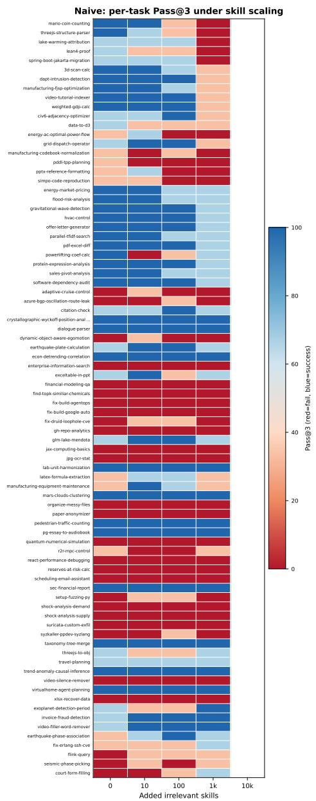  
Figure 6: Per-task Pass @3 for Naive exposure as the number of added irrelevant skills grows. Red means all trials fail and blue means all trials pass. Rows are tasks, sorted by the naive drop from no irrelevant skills to 1,000 irrelevant skills.

The heatmaps are sorted by the Naive drop from no irrelevant skills to 1,000 irrelevant skills, so collapses under implicit routing appear near the top. This ordering makes the aggregate result more concrete: some tasks remain stable, but many tasks show abrupt failures once the library reaches hundreds or thousands of irrelevant skills. The explicit-routing heatmaps then show whether those same rows become more stable when the execution agent sees a smaller selected skill set.

Figure 6 shows the most direct form of routing collapse: rows that are blue or light blue at small scale often turn light red or red as irrelevant skills are added. Figure 7 shows the complementary result from the main text: when the full metadata list still fits, explicit LLM preselection keeps many of those rows more stable. Figures 8 and 9 focus on the scalable retrieval-based setting. RAG remains feasible at 10,000 skills but produces more mixed task-level outcomes; hybrid preselection reduces some of this variance by constructing a more diverse candidate pool before final selection.

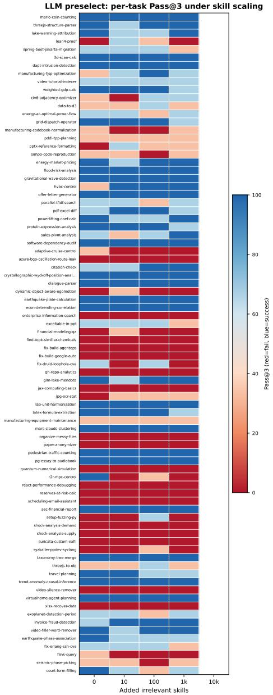  
Figure 7: Per-task Pass@3 for LLM preselection. Compared with Naive exposure, many rows remain blue or light blue as the skill library grows, showing that explicit routing stabilizes task success when the full metadata list still fits in context.

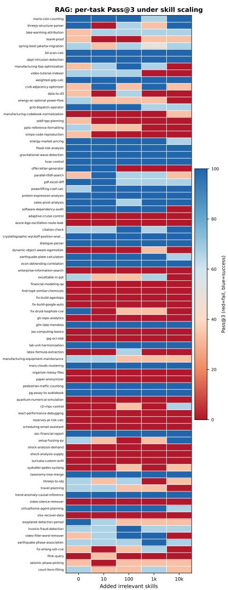  
Figure 8: Per-task Pass@3 for embedding RAG. RAG is feasible at the 10k scale, but the mixed colors show that semantic retrieval alone misses some task-specific skill combinations.

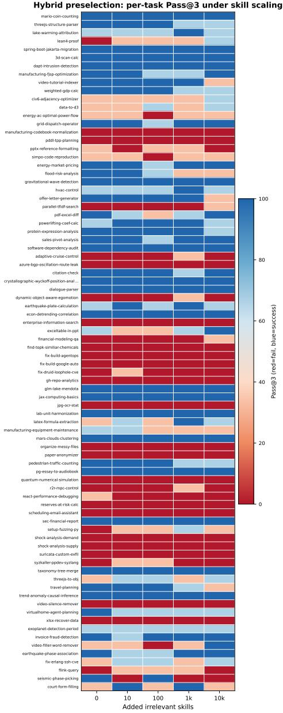  
Figure 9: Per-task Pass @3 for hybrid preselection. The method keeps a compact candidate set while recovering more large-scale tasks than single-query RAG, especially when several capabilities must be retrieved together.