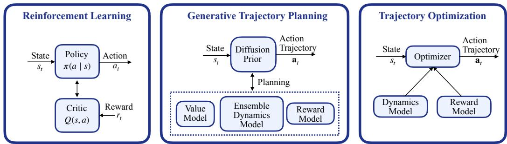
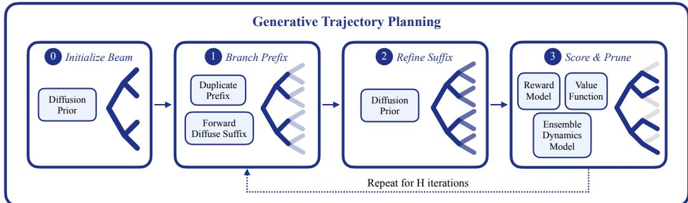
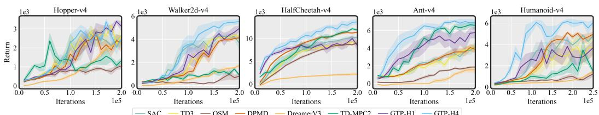
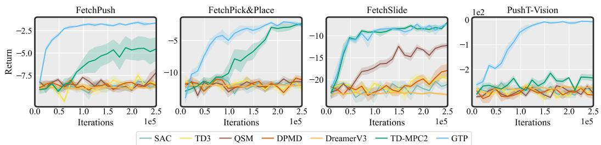
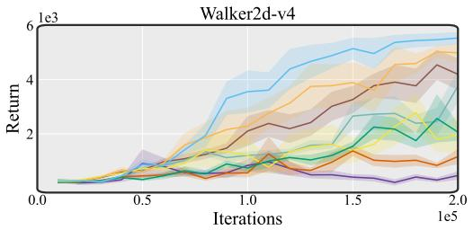
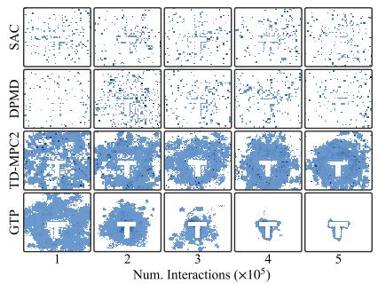
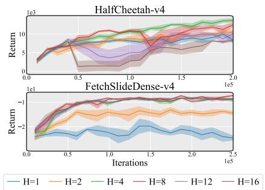
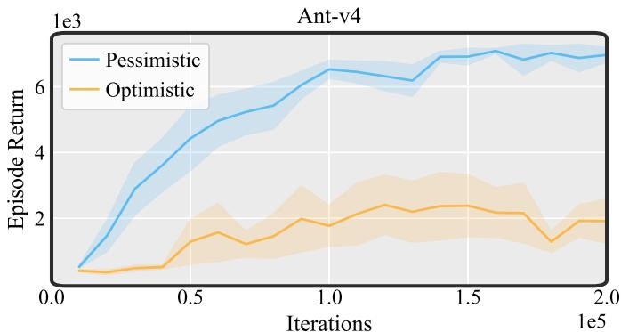
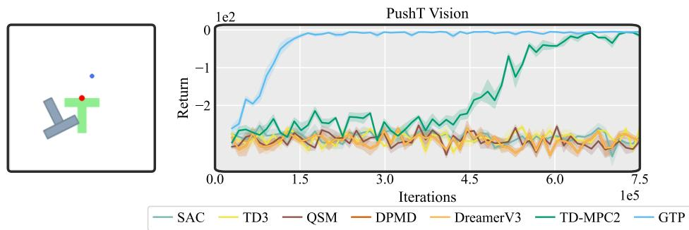
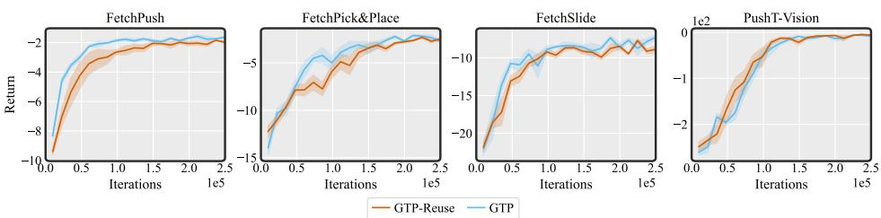

# Model-Based Online Decision Making via Generative Trajectory Planning

Haldun Balim1 Yilun Du1† Na Li1†

1Harvard University

{hbalim@fas, ydu@seas, nali@seas}.harvard.edu

Œ Website ‡ Code

## Abstract

Online decision-making faces a tension between efficient inference and longhorizon reasoning. Value-based methods rely on short-horizon bootstrapping that limits the propagation of long-term information, while trajectory optimization methods plan explicitly but must solve a high-dimensional optimization problem at every decision step. We propose Generative Trajectory Planning (GTP), a modelbased framework that addresses this tension by learning a generative model as a proposal distribution over action sequences. Instead of optimizing sequences from scratch, GTP samples candidate sequences from a diffusion prior and refines them using learned dynamics, reward, and value models, enabling efficient trajectorylevel reasoning. Across continuous control and long-horizon manipulation tasks, GTP matches or exceeds state-of-the-art model-free, diffusion-policy, and modelbased baselines, and remains stable in regimes where strong baselines degrade. Our results suggest that generative models are best understood not as policies, but as structured proposal distributions for planning, offering a new perspective on how to integrate generative modeling with model-based decision-making.

## 1 Introduction

Reinforcement learning (RL) has emerged as the dominant framework for online decision-making [33, 35], with strong empirical success across domains such as robotics and continuous control [14, 19– 21]. At its core, RL compresses future outcomes into a scalar value function and optimizes singlestep policies against this objective [34]. While effective when reward signals are informative, this formulation exhibits structural limitations in long-horizon settings: reliance on short-horizon bootstrapping slows the propagation of long-term information and accumulates estimation errors [24, 32], while exploration driven by stochasticity at the level of individual actions [14, 21] limits the discovery of coherent behaviors. Model-based RL aims to mitigate these issues by incorporating learned predictive models into policy and value learning [9, 15, 17, 31]. In practice, however, these models are typically used indirectly, to shape value targets or generate synthetic data, rather than to enable explicit reasoning over a long-horizon. As a result, decision making remains driven by local updates, and the core limitations of short-horizon bootstrapping and action-level exploration persist.

In contrast, trajectory optimization (TO) explicitly optimizes action sequences, allowing long-horizon planning without relying on bootstrapped value functions [30, 40]. However, optimizing highdimensional, non-convex objectives at every step is computationally expensive and susceptible to local minima. Moreover, in online settings, planning relies on learned dynamics [8, 11], where prediction errors accumulate over long horizons and can be exploited by the optimizer [17, 36]. As a result, TO occupies the opposite end of the design spectrum from RL, as it enables explicit trajectory-level reasoning but is computationally intensive and degrades under model error.

  
Figure 1: Generative Trajectory Planning. GTP combines the data-driven nature of RL with the long-horizon reasoning of trajectory optimization. A learned diffusion prior proposes candidate action sequences, which are evaluated and iteratively refined through learned models. By using a generative prior, GTP avoids computational cost of optimization while preserving long-horizon reasoning.

A promising direction from generative modeling reframes planning as conditional trajectory generation [1, 3, 6, 18]: models learn distributions over high-return trajectories and sample candidates directly, achieving strong offline performance with large datasets [1, 18]. In online settings, however, progress is limited as prior work largely treats generative models as policy replacements trained with standard RL objectives [23, 26, 38, 41], inheriting their shortcomings. As a result, the long-horizon and expressive benefits of generative planning remain underutilized online.

Taken together, these observations suggest that online decision making lacks a framework that combines efficient inference with explicit trajectory-level reasoning. We address this gap by casting decision making as generative inference, where a learned generative model defines a proposal distribution over plausible action sequences. At each timestep, candidates are sampled from this distribution rather than optimized from scratch. These candidates are then refined using learned value and dynamics models, amortizing long-horizon reasoning into the generative model. To enable effective exploration, we characterize trajectory-level uncertainty using ensemble dynamics and act optimistically upon these estimates. The resulting framework GTP offers, a unified approach to integrate generative modeling with model-based decision making.

In summary, our contributions are (1) we propose Generative Trajectory Planning (GTP), a modelbased online decision-making framework that uses a generative model as a proposal distribution over action sequences, enabling trajectory-level reasoning without per-step optimization; (2) we develop an iterative planning procedure that interleaves beam search with diffusion-based refinement, progressively improving sampled action sequences under the learned prior and dynamics; (3) we show that GTP outperforms classical RL, diffusion-policy, and model-based RL baselines on locomotion benchmarks, improves sample efficiency on long-horizon manipulation, and scales to visual manipulation through latent representations, where standard RL methods fail to make progress.

## 2 Preliminaries

## 2.1 Online Decision Making

Problem formulation. We consider an infinite-horizon Markov Decision Process [27] (MDP) defined by the tuple $( \mathcal { S } , \mathcal { A } , \mathcal { P } , r , \gamma , \mu _ { 0 } )$ , where $S \subseteq \mathbb { R } ^ { n }$ and ${ \mathcal { A } } \subseteq \mathbb { R } ^ { m }$ are continuous state and action spaces, $\mathcal { \bar { P } } : \mathcal { S } \times \mathcal { \bar { A } }  \Delta ( \mathcal { S } )$ is the transition function, $r : S \times \mathcal { A } $ R is the reward function, $\gamma \in [ 0 , 1 )$ is a discount factor, and $\mu _ { 0 }$ is the initial state distribution. At each timestep t, the agent observes state $s _ { t } ,$ , takes an action $a _ { t }$ , receives reward $r _ { t } = r ( s _ { t } , a _ { t } )$ , and transitions to $s _ { t + 1 } \sim \mathcal { P } ( \cdot | s _ { t } , a _ { t } )$ . The goal is to learn a decision rule that maximizes the expected discounted return, $\textstyle { \vec { \mathfrak { L } } } [ \sum _ { t = 0 } ^ { \infty } \gamma ^ { t } r _ { t } ]$ , from data collected through online interaction without knowing the transition model $\mathcal { P }$ and reward model r.

Model predictive control. Given access to the dynamics $\mathcal { P }$ and reward $r ,$ MPC casts decision-making as an optimization problem solved at each timestep from the current state $s _ { t } \colon$

$$
\mathbf { a } _ { t } ^ { \star } = \arg \operatorname* { m a x } _ { \mathbf { a } _ { t } } \mathbb { E } \left[ \sum _ { h = 0 } ^ { H - 1 } \gamma ^ { h } r ( s _ { t + h } , a _ { t + h } ) + \gamma ^ { H } V ( s _ { t + H } ) \right] ,\tag{1}
$$

where $\mathbf { a } _ { t } \triangleq \left( a _ { t } , \dots , a _ { t + H - 1 } \right)$ is an action sequence of horizon $H ,$ the expectation is taken under ${ \mathcal P } ,$ , and $V$ is an optional terminal value bootstrapping returns beyond the horizon. The first action $a _ { t } ^ { \star }$ is executed and the procedure repeats. A common class of approaches for solving (1) uses sampling-based methods [30, 40] that iteratively refine a parametric proposal toward the objective.

  
Figure 2: Generative Trajectory Planning (GTP). Planning proceeds via iterative beam search. Starting from an initial beam, GTP repeatedly (1) branches candidate trajectory prefixes by duplicating, (2) refines action suffixes through partial forward diffusion and denoising under the diffusion prior, and $( 3 )$ prunes candidates using rollouts through learned dynamics, reward, and value models. The top-scoring trajectories are retained and expanded at the next depth, progressively constructing long-horizon plans toward high-return regions.

In the online setting, $\mathcal { P }$ and r are unknown and must be replaced with learned dynamics $f _ { \phi }$ and reward $r _ { \xi } ;$ we similarly replace the terminal value by a learned $V _ { \psi }$ . Substituting these elements into (1) yields the planning objective the agent actually optimizes at each step. Because all three models are trained on the agent’s own collected transitions, effective planning must balance exploiting current predictions against exploring regions where $f _ { \phi }$ is uncertain; we drive this trade-off through sequence-level uncertainty over the learned dynamics in the planning objective.

Even with accurate models, the planner’s proposal remains a bottleneck: simple parametric families (e.g., Gaussians) cannot capture the multimodal, temporally correlated structure of high-return action sequences. We replace this with a learned generative model that concentrates on high-return trajectories and is reused across steps, amortizing planning. At decision time, candidates are sampled from this prior and refined using $f _ { \phi } , r _ { \xi }$ , and $\breve { V _ { \psi } } .$ . We instantiate the prior with a diffusion model, enabling flexible modeling of high-dimensional, multimodal action distributions [6, 18].

## 2.2 Diffusion Models for Action Trajectory Generation

We use diffusion models to represent expressive distributions over action sequences conditioned on the current state. Diffusion models consist of a forward noising process $q$ that gradually corrupts action sequences with Gaussian noise and a learned reverse process $p _ { \theta }$ that iteratively denoises them to generate new trajectories. Given an action sequence $\mathbf { a } _ { t } ^ { 0 } .$ , the forward noising kernel at diffusion step k is $q _ { k | 0 } ( \mathbf { a } _ { t } ^ { k } | \mathbf { a } _ { t } ^ { 0 } ) = \mathcal { N } ( \sqrt { \bar { \alpha } _ { k } } \mathbf { a } _ { t } ^ { 0 } , ( 1 - \bar { \alpha } _ { k } ) I )$ , where $\begin{array} { r } { \bar { \alpha } _ { k } = \prod _ { j = 1 } ^ { k } ( 1 - \beta _ { j } ) } \end{array}$ is determined by a fixed schedule. Starting from Gaussian noise, the reverse process uses a learned noise predictor $\epsilon _ { \theta } ( \mathbf { a } _ { t } ^ { k } , k , s _ { t } )$ to generate an action sequences. The model is trained using a weighted objective [23]:

$$
\mathcal { L } ( \theta ) = \mathbb { E } _ { \mathbf { a } _ { t } ^ { 0 } , k , \epsilon } \left[ w ( \mathbf { a } _ { t } ^ { 0 } , s _ { t } ) \left\| \epsilon - \epsilon _ { \theta } ( \mathbf { a } _ { t } ^ { k } , k , s _ { t } ) \right\| ^ { 2 } \right] .\tag{2}
$$

The weights w determine the target trajectory distribution. Uniform weights recover standard diffusion training, and non-uniform weights shift the target toward high-quality trajectories. Unlike prior work that derives weights from value functions [10, 23], we use trajectory-level scores (Sec. 3.3).

## 3 Generative Trajectory Planning

Our framework casts decision making as planning over learned models. Given the current state $s _ { t } .$ , candidate action sequences are sampled from a generative prior and evaluated using learned models to select high-return trajectories. Our method consists of four learned components. First, a generative action-sequence prior $p _ { \theta } ( \mathbf { a } _ { t } \mid s _ { t } )$ defines a state-conditioned distribution over H-step action sequences and proposes candidates for planning. Second, a dynamics model $f _ { \phi } : S \times \mathcal { A }  S$ predicts the next state, $\hat { s } _ { h + 1 } = f _ { \phi } ( s _ { h } , a _ { h } )$ , and is rolled out autoregressively to simulate candidate trajectories. We use an ensemble $\{ f _ { \phi _ { i } } \} _ { i = 1 } ^ { N }$ whose disagreement provides trajectory-level uncertainty for exploration. Third, a reward model $\bar { r _ { \xi } } : { \cal S } \times { \cal A } $ R predicts rewards $\boldsymbol { { \hat { r } } } _ { h } = \boldsymbol { r } _ { \xi } ( s _ { h } , a _ { h } )$ along simulated trajectories. Finally, a value function $V _ { \psi } : { \mathcal { S } } $ R estimates the infinite-horizon discounted return and provides the terminal bootstrap $V _ { \psi } \big ( \dot { s } _ { t + H } \big )$ . Together, the dynamics, reward, and value models evaluate and refine trajectories proposed by the generative prior through objective $J _ { H }$

Section 3.1 describes the planning procedure assuming these components are given, using beam search that progressively commits prefix actions while refining the remaining suffix via repeated noising and denoising under the prior. Section 3.2 considers the online setting, where these components are learned from collected data, and addresses key challenges including slow value propagation under bootstrapping, mode collapse in the generative prior, and unreliable long-horizon planning under inaccurate dynamics. We also describe our exploration strategy based on disagreement across a dynamics ensemble. Finally, Section 3.3 presents the training objectives for each component.

Algorithm 1 Generative Trajectory Planning with Beam Search   
Require: current state $s _ { t } ,$ planning horizon $H ,$ beam size $B ,$ branching factor $D ,$ refinement steps   
$K _ { \mathrm { r e f } } .$ , diffusion prior $p _ { \theta } ,$ forward noising kernel $q _ { K _ { \mathrm { r e f } } | 0 } ,$ , objective functions $J _ { 1 } , \dots J _ { H }$   
(0) Initialize beam:   
1: Sample $B \times D$ candidate action sequences $\mathcal { C } \sim p _ { \theta } ( \cdot \mid s _ { t } )$   
2: $B _ { 0 } \doteq \mathsf { t o p } { - } B$ action sequences from $\mathbf { \bar { \rho } } _ { \mathcal { C } }$ under $J _ { 1 } ( s _ { t } , \cdot )$   
3: for $h = 1$ to $H - 1$ do   
(1) Branch beam into candidate pool:   
4: Form $\mathcal { C }$ by replicating each a $\in \boldsymbol { B } _ { h - 1 }$ into $D$ copies, giving $| \mathcal { C } | = B D$   
(2) Refinefuture action sequences:   
5: Forward diffuse the candidate action sequences for $K _ { \mathrm { r e f } }$ steps: $\mathcal { C } ^ { K _ { \mathrm { r e f } } } \sim q _ { K _ { \mathrm { r e f } } | 0 } ( \cdot \mid \mathcal { C } )$   
6: Restore past actions $( t < h )$ with inpainting: $\mathcal { C } _ { [ 0 : h ) } ^ { K _ { \mathrm { r e f } } }  \mathcal { C } _ { [ 0 : h ) } ^ { K _ { \mathrm { r e f } } }$   
7: for $k = K _ { \mathrm { r e f } }$ to 1 do   
8: Reverse diffusion step: $\mathcal { C } ^ { k - 1 } \gets p _ { \theta } ( \cdot \ : | \ : \mathcal { C } ^ { k } , s _ { t } , k )$   
9: Restore past actions $( t < h )$ with inpainting: $\mathcal { C } _ { [ 0 : h ) } ^ { k - 1 }  \mathcal { C } _ { [ 0 : h ) }$   
10: end for   
(3) Score and prune:   
11: $B _ { h } \gets \mathrm { t o p } { - } B$ candidates from $\mathcal { C } ^ { 0 }$ under $J _ { h + 1 } ( s _ { t } , \cdot )$   
12: end for   
13: return arg $\mathrm { m a x } _ { \mathbf { a } \in B _ { H - 1 } } J _ { H } ( s _ { t } , \mathbf { a } )$

## 3.1 Planning with Generative Prior

Generating long-horizon trajectories is inherently challenging due to the curse of dimensionality: as the horizon grows, the space of action sequences expands exponentially, while high-reward sequences become vanishingly rare. Our generative prior restricts the search space to a lower-dimensional manifold of plausible trajectories; within this manifold, we apply an iterative search procedure that progressively refines candidates toward high-return regions using the learned models (see Fig. 2 for an overview). To make this concrete, we first define how the candidate sequences are scored.

Planning objective. Given the current state $s _ { t }$ and a candidate action prefix $\mathbf { a } _ { t } = ( a _ { t } , \ldots , a _ { t + h - 1 } )$ of length $h \leq H$ , we score it by rolling the prefix forward through each dynamics model in the ensemble, accumulating discounted rewards along the way, and bootstrapping with the value function at the end of the prefix. For a single ensemble member i, this yields the h-step return

$$
J _ { h } ^ { ( i ) } ( s _ { t } , \mathbf { a } _ { t } ) = \sum _ { h ^ { \prime } = 0 } ^ { h - 1 } \gamma ^ { h ^ { \prime } } r _ { \xi } \Big ( \hat { s } _ { t + h ^ { \prime } } ^ { ( i ) } , a _ { t + h ^ { \prime } } \Big ) + \gamma ^ { h } V _ { \psi } \Big ( \hat { s } _ { t + h } ^ { ( i ) } \Big ) ,\tag{3}
$$

where $\hat { s } _ { t + h ^ { \prime } + 1 } ^ { ( i ) } = f _ { \phi _ { i } } ( \hat { s } _ { t + h ^ { \prime } } ^ { ( i ) } , a _ { t + h ^ { \prime } } )$ is the rollout under the actions. We aggregate the per-dynamics estimates into a scalar via an aggregation rule agg $( \mathrm { e . g . }$ ., median, max; detailed in Sec. 3.2):

$$
J _ { h } ^ { \mathrm { a g g } } ( s _ { t } , \mathbf { a } _ { t } ) = \arg _ { i \in [ N ] } J _ { h } ^ { ( i ) } ( s _ { t } , \mathbf { a } _ { t } ) .\tag{4}
$$

Beam-search procedure. We optimize the planning objective using beam search $( \mathrm { A l g . \ 1 } )$ . We initialize candidate trajectories from the diffusion prior $p _ { \theta } ( \cdot \mid s _ { t } )$ and retain the top B under $J _ { \mathrm { 1 } } . \mathrm { A t }$ each iteration, we commit one additional action, branch each candidate into D variants, and refine their uncommitted suffixes through partial noising and denoising. The noise level $K _ { \mathrm { r e f } }$ controls the degree of refinement while preserving temporal coherence with the committed prefix. We then retain the top B candidates under $J _ { h + 1 }$ . To balance local refinement and global exploration, we run multiple beams in parallel, allowing the planner to explore diverse modes of the generative prior.

Algorithm 2 Online Training for Generative Trajectory Planning   
Require: diffusion prior $p _ { \theta } .$ , dynamics ensemble $\{ f _ { \phi _ { i } } \} _ { i = 1 } ^ { N }$ , reward model $r _ { \xi } .$ , value $V _ { \psi }$ with target   
$V _ { \bar { \psi } } ,$ , temperature λ, target update rate τ   
1: Initialize all parameters and replay buffer $\mathcal { D }  \emptyset$   
2: for each environment step $t = \bar { 1 } , \bar { 2 } , \ldots$ do   
(1) Optimistic planning to act:   
3: Observe state $s _ { t }$   
4: Execute $a _ { t } ^ { \star }$ from $\mathbf { a } _ { t } ^ { \star } \gets \mathbf { A l g . } 1 ( s _ { t } ; J _ { 1 : H } ^ { \operatorname* { m a x } } )$ , store observed transition $( r _ { t } , s _ { t + 1 } , d _ { t } )$ to D   
(2) Update dynamics and reward:   
5: Sample minibatch $( s , a , r , s _ { t + 1 } ) \sim \mathcal { D }$ and update $\{ f _ { \phi _ { i } } \} , r _ { \xi }$ via supervised learning (App. B.1)   
(3) Conservative planning to construct learning targets:   
6: For each s in minibatch, plan top-B trajectories $\{ \mathbf { a } ^ { b } \} _ { b = 1 } ^ { B }  \mathrm { A l g . ~ } 1 ( s ; \ J _ { 1 : H } ^ { \mathrm { m e d i a n } } )$   
7: Augment elite set $\{ \mathbf { a } ^ { b } \} _ { b = 1 } ^ { B }$ with Langevin samples (App. C)   
(4) Update value and prior:   
8: Update $V _ { \psi } , p _ { \theta }$ as in Section 3.3, λ as in App. B.1; and target $V _ { \bar { \psi } }$ by Polyak averaging.   
9: end for

## 3.2 Online Model Learning

Section 3.1 described planning with fixed components. We now consider the online setting, where they are learned from data collected by the planner. We outline resulting challenges and the design choices that address them; the full loop is summarized in Algorithm 2.

Mode collapse during prior training. Training our action prior in a sample-and-imitate loop is prone to collapse: as pθ sharpens, the elite set drawn from its own samples differs little from what it already produces, so retraining reinforces the existing distribution rather than improving it. To inject novel high-scoring candidates, we perform a few steps of Langevin ascent on $J _ { H }$ initialized from the planner’s elites, perturbing them along the planning objective (cf. Appendix C).

Exploration under learned dynamics. Unlike uncoordinated exploration through action noise, GTP leverages its dynamics ensemble to guide exploration over entire trajectories. Each ensemble member $f _ { \phi _ { i } }$ independently evaluates candidate sequences, with disagreement among predicted returns $\{ J _ { h } ^ { ( i ) } \} _ { i = 1 } ^ { N }$ capturing trajectory-level uncertainty. When acting, we use max aggregation in Eq. 4, favoring trajectories predicted to achieve high returns under at least one ensemble member. This induces optimism under uncertainty and encourages structured, temporally coherent exploration.

Slow value propagation in long horizons. Standard temporal-difference learning propagates rewards slowly over long horizons. Instead, we leverage multi-step return estimates from beam search, weighting different horizons by inverse ensemble variance to balance short-horizon bias against long-horizon uncertainty. We use median aggregation across ensemble members for robust value targets, in contrast to the optimistic max aggregation used for exploration. This allows GTP to learn from reliable trajectory-level estimates while encouraging exploration through optimistic planning (Sec. 3.3).

Computational efficiency. Although GTP incurs additional computational overhead from planning, this cost can be substantially reduced during both training and inference (cf. Appendix I). During training, reusing planner-generated elite trajectories across multiple gradient updates reduces update costs without sacrificing performance (cf. Appendix J). At inference, the learned generative prior can generate actions without explicit planning, while executing multiple actions between replanning steps further reduces computational overhead (cf. Appendix K). These strategies enable more efficient training and deployment with minimal performance degradation.

## 3.3 Training Objectives

All learned components are trained jointly from a shared replay buffer D. The dynamics ensemble $\{ f _ { \phi _ { i } } \} _ { i = 1 } ^ { N }$ and reward model $r _ { \xi }$ are trained by supervised regression, with each ensemble member receiving an independent bootstrap resample of the minibatch to encourage diversity. A termination head trained jointly with the reward modulates accumulated returns and the terminal value bootstrap during planning, so rollouts correctly account for early termination. Explicit losses appear in Appendix B.1; the value and generative-prior losses, central to our framework, are described next.

Value learning. Following Section 3.2, we replace one-step TD targets with trajectory-level estimates derived from the planner. For each state s in the batch, we run Algorithm 1 to obtain the top-scoring trajectory $\mathbf { a } ^ { \star }$ and define a family of h-step targets:

$$
\bar { J } _ { h } ^ { \mathrm { m e d } } ( s ) = \mathrm { m e d } _ { i \in [ N ] } J _ { h } ^ { ( i ) } ( s , \mathbf { a } ^ { \star } ) , \qquad h = 1 , \dots , H ,
$$

where the median across ensemble members mitigates overestimation from individual optimistic rollouts. Short horizons are biased by bootstrapping while long horizons accumulate model error; we balance this tradeoff via inverse-variance weights based on cross-ensemble disagreement:

$$
\omega _ { h } ( s ) = \mathrm { s o f t m a x } _ { h } \big ( 1 / \sigma _ { h } ^ { 2 } ( s ) \big ) , \qquad \sigma _ { h } ^ { 2 } ( s ) = \mathrm { V a r } _ { i \in [ N ] } J _ { h } ^ { ( i ) } ( s , { \mathbf a } ^ { \star } ) ,
$$

following [5] with an added softmax to sharpen the contribution of reliable horizons. The value function is then trained to regress onto the weighted target:

$$
\mathcal { L } _ { \mathrm { v a l } } ( \psi ) = \mathbb { E } _ { s \sim \mathcal { D } } \left[ \mathrm { H u b e r } \left( V _ { \psi } ( s ) , \sum _ { h = 1 } ^ { H } \omega _ { h } ( s ) \bar { J } _ { h } ^ { \mathrm { m e d } } ( s ) \right) \right] .\tag{5}
$$

We employ the standard target-network and double-value mechanisms used in modern TD learning.

Generative prior learning. The diffusion prior is trained to match a target distribution over action sequences induced by trajectory-level evaluations. For each s in the batch, we run beam search to obtain B high-scoring trajectories, augment them with Langevin samples as described in Section 3.2, and take the top-M from the augmented pool as the elite set. Their planner scores $\{ J _ { H } ^ { m } \} _ { m = 1 } ^ { M }$ are converted into normalized weights $w ^ { m }$ , and the prior is trained with:

$$
\mathcal { L } _ { \mathrm { p r i o r } } ( \theta ) = \mathbb { E } _ { s \sim \mathcal { D } , k , \epsilon } \left[ \sum _ { m = 1 } ^ { M } w ^ { m } \left. \epsilon - \epsilon _ { \theta } ( \mathbf { a } ^ { m , k } , s , k ) \right. ^ { 2 } \right] , w ^ { m } ( s , \mathbf { a } ^ { m } ) = \mathrm { s o f t m a x } _ { m } ( J _ { H } ^ { m } / \lambda )\tag{6}
$$

where $\mathbf { a } ^ { m , k }$ is the m-th elite trajectory corrupted to diffusion step k. The exponential reweighting is analogous to MPPI [40], the main difference being that we amortize this update across states by distilling it into a single generative model. We additionally adapt λ online to maintain a target effective sample size [22] over the elite weights, avoiding the fragility of a fixed temperature as returns concentrate during training (see Appendix B.1).

## 3.4 Theoretical Analysis

We analyze the convergence of $\mathrm { G T P ^ { \circ } s }$ generative prior under idealized conditions. Let $p _ { n } ( \mathbf { a } \mid s )$ denote the prior after n updates. For a fixed state s and planning objective $J _ { H } ( s , \mathbf { a } )$ , we assume the learned models remain fixed. In the limit of sufficient trajectory sampling and accurate diffusion model fitting, the prior update corresponds to a KL-regularized policy improvement step over action sequences satisfying:

$$
p _ { n + 1 } ( \mathbf { a } \mid s ) \propto p _ { n } ( \mathbf { a } \mid s ) \exp \left( \frac { J _ { H } ( s , \mathbf { a } ) } { \lambda } \right) .\tag{7}
$$

We show that these updates improve the prior and converge toward optimal trajectories.

Theorem 3.1 (Convergence of the Generative Prior). Suppose $J _ { H } ( s , \mathbf { a } )$ is bounded and the prior follows the idealized update with a fixed temperature $\lambda > 0 .$ . Then, each update satisfies:

$$
\begin{array} { r } { { \mathbb E } _ { p _ { n + 1 } } [ J _ { H } ] \ge { \mathbb E } _ { p _ { n } } [ J _ { H } ] + \lambda D _ { \mathrm { K L } } ( p _ { n + 1 } \| p _ { n } ) . } \end{array}\tag{8}
$$

Furthermore, if the initial prior assigns positive probability to the set of δ-optimal action sequences for every δ $\begin{array} { r } { \mathrm { ~  ~ \gamma ~ } > 0 , } \end{array}$ , then $\mathbb { E } _ { p _ { n } } [ J _ { H } ] \to \operatorname* { s u p } _ { \mathbf { a } } J _ { H } ( s , \mathbf { a } )$ , with the prior assigning asymptotically all probability mass to δ-optimal sequences for every $\delta > 0$

This result establishes that iterative prior updates monotonically improve the expected planning objective and asymptotically concentrate the generative prior around optimal trajectories. In practice, GTP employs beam search to generate improved trajectory proposals, adaptive temperature selection to control the prior update, and Langevin augmentation to mitigate mode collapse. We discuss how these components relate to the theoretical assumptions and provide formal proofs in Appendix L.

  
Figure 3: GTP consistently outperforms baselines. Evaluation return curves on OpenAI Gym MuJoCo environments. Solid lines show the mean and shaded regions the standard error over 5 random seeds.

Table 1: Results on locomotion benchmark. Performance on OpenAI Gym MuJoCo environments. We report mean returns and standard errors over 5 random seeds, each trained for 1M environment interactions.
<table><tr><td></td><td>Algorithm</td><td>Hopper-v4</td><td>Walker2d-v4</td><td>HalfCheetah-v4</td><td>Ant-v4</td><td>Humanoid-v4</td></tr><tr><td>Classic</td><td>SAC</td><td> $3 3 5 1 \pm 3 9$ </td><td> $4 4 5 3 \pm 1 5 8$ </td><td> $1 0 5 1 5 \pm 2 8 6$ </td><td> $4 2 2 9 \pm 3 6 6$ </td><td> $5 1 1 8 \pm 1 5 3$ </td></tr><tr><td>Model-Free RL</td><td>TD3</td><td> $3 3 1 4 \pm 4 7$ </td><td> $4 4 0 8 \pm 1 4 1$ </td><td> $9 3 0 1 \pm 5 4 6$ </td><td> $4 2 7 8 \pm 2 9 3$ </td><td> $3 8 5 2 \pm 9 6 7$ </td></tr><tr><td>Diffusion</td><td>QSM</td><td> $1 1 4 6 \pm 1 3 3$ </td><td> $8 3 9 \pm 2 1 2$ </td><td> $9 0 8 4 \pm 1 7 9$ </td><td> $1 8 6 8 \pm 9 7$ </td><td> $1 2 9 4 \pm 2 0 7$ </td></tr><tr><td>Policy RL</td><td>DPMD</td><td> $3 1 4 7 \pm 1 4 2$ </td><td>4133 ± 109</td><td> $1 1 5 9 1 \pm 1 2 3$ </td><td>4092 ± 354</td><td>5269 ± 44</td></tr><tr><td>Trajectory</td><td>CEM-MPC</td><td> $1 4 1 \pm 3 7$ </td><td>71 ± 31</td><td>651 ± 60</td><td>379 ± 53</td><td>318 ± 17</td></tr><tr><td>Optimization</td><td>CEM-MPC-V</td><td> $2 4 3 7 \pm 3 4 5$ </td><td>288 ± 54</td><td>7293 ± 211</td><td>5103 ± 811</td><td>4396 ± 569</td></tr><tr><td>Model-Based</td><td>DreamerV3</td><td> $3 0 3 1 \pm 6 5$ </td><td>2961 ± 140</td><td>2251 ± 323</td><td>2279 ± 365</td><td>879 ± 109</td></tr><tr><td>RL</td><td>TD-MPC2</td><td> $2 6 3 1 \pm 3 4 9$ </td><td> $1 6 2 2 \pm 1 4 8$ </td><td> $1 2 2 1 6 \pm 2 6 7$ </td><td> $7 3 3 9 \pm 1 1 9$ </td><td> $4 1 6 0 \pm 7 9 5$ </td></tr><tr><td>Ours</td><td>GTP-H1</td><td> $3 3 9 8 \pm 7 1$ </td><td> $5 0 0 7 \pm 2 1 2$ </td><td> $1 0 3 7 2 \pm 4 3 9$ </td><td>6207 ± 418</td><td> $4 5 9 6 \pm 7 8 5$ </td></tr><tr><td></td><td>GTP-H4</td><td> ${ \bf 3 5 2 5 \pm 4 9 }$ </td><td> ${ \bf 5 5 4 6 } \pm { \bf 2 0 1 }$ </td><td> ${ \bf 1 3 9 4 4 } \pm { \bf 4 9 8 }$ </td><td> ${ 7 3 6 9 \pm 7 3 }$ </td><td> ${ \bf 6 6 6 0 } \pm { \bf 1 3 2 }$ </td></tr></table>

## 4 Experiments

In this section, we present experiments designed to answer three questions. (Q1) Does combining a diffusion action prior with sample-based planning yield competitive performance on standard continuous-control benchmarks? (Q2) Does the proposed approach scale to long-horizon manipula tion and high-dimensional image observations? (Q3) Which design choices drive GTP’s performance, and how does its exploration behavior differ from existing methods?

We address (Q1) on MuJoCo locomotion (Section 4.1); (Q2) on three state-based manipulation tasks (Fetch) and a vision-based Push-T task (Section 4.2), where the latter demonstrates scalability to high-dimensional inputs; and (Q3) through component ablations, a study of the planning horizon, and an analysis of exploration behavior (Section 4.3). Additionally, we discuss a failure case and its remedy in Appendix D, provide a sensitivity analysis of beam search parameters in Appendix E, and analyze computational costs, efficien training, and efficient inference in Appendices I, J, and K, respectively. All methods are implemented in JAX, with hyperparameters detailed in Appendix B.1.

Baselines. We compare GTP against baselines spanning four families. Model-free RL: SAC [14] and TD3 [13], two strong off-policy actor-critic methods. Diffusion policy RL: QSM [26] and DPMD [23], which train diffusion policies with RL objectives but act without planning at inference. Trajectory optimization: CEM-MPC and its value-augmented variant CEM-MPC-V, which adds a learned terminal value to the planning objective. Rather than training separate models, both variants reuse GTP’s learned dynamics and (for CEM-MPC-V) value function, and replace the diffusion prior with Gaussian CEM sampling, in similar spirit to [8]. This isolates the contribution of the diffusion prior while holding the rest of the planning stack fixed. Model-based RL: DreamerV3 [15] and TD-MPC2 [16], the current state of the art in model-based RL. All baselines are run under the same evaluation protocol; we detail each implementation, its source, and any modifications in Appendix G.

## 4.1 Locomotion Tasks

Setup. All methods are trained for 1M environment interactions using 5 parallel environments (4 for Humanoid). We report mean ± standard error over 5 runs. GTP is evaluated at horizons H = 1 and H = 4 to illustrate the benefit of longer planning.

Results. Table 1 and Fig. 3 report performance and training curves. GTP-H4 outperforms all baselines across the five MuJoCo environments. While GTP-H1 is competitive with diffusion-based RL methods like DPMD, increasing the horizon to H = 4 yields substantially stronger performance, confirming the value of trajectory-level planning. Trajectory optimization baselines trail by a wide margin even when reusing GTP’s dynamics and value, indicating that sampling-based planning with a Gaussian prior scales poorly here and highlighting the benefit of the diffusion prior. GTP also outperforms strong model-based baselines like TD-MPC2 and DreamerV3, suggesting trajectory-level reasoning has advantages over step-by-step unrolling. GTP-H4 additionally attains high returns faster than all baselines except on Hopper (Fig. 3), demonstrating strong sample efficiency. CEM and TD-MPC2 are sensitive to termination conditions, since Gaussian particle rollouts blur termination signals by mixing terminating with non-terminating trajectories; this is most evident on Walker2d, where GTP is unaffected. Together, these results answer (Q1) affirmatively: GTP matches or exceeds the strongest model-free, diffusion-policy, and model-based baselines on standard locomotion benchmarks.

  
Figure 4: GTP improves sample efficiency in long-horizon settings. Evaluation return curves on Fetch and PushT environments. Solid lines show the mean and shaded regions the standard error over 5 random seeds.

Table 2: Long-horizon manipulation results. Success rates (%) on long-horizon manipulation tasks. Mean and standard error over 5 random seeds, each trained for 1M environment interactions.
<table><tr><td></td><td>Algorithm</td><td>FetchPush</td><td>FetchPick&amp;Place</td><td>FetchSlide</td><td>PushT-Vision</td></tr><tr><td rowspan="2">Classic  $M o d e l – F r e e R L$ </td><td>SAC</td><td> $6 \pm 0$ </td><td> $3 \pm 0$ </td><td> $1 \pm 1$ </td><td> $0 \pm 0$ </td></tr><tr><td>TD3</td><td> $6 \pm 0$ </td><td> $3 \pm 0$ </td><td> $5 \pm 1$ </td><td> $0 \pm 0$ </td></tr><tr><td>Diffusion Policy RL</td><td>QSM</td><td> $1 2 \pm 3$ </td><td> $4 \pm 0$ </td><td> $1 4 \pm 2$ </td><td> $0 \pm 0$ </td></tr><tr><td rowspan="2">Trajectory</td><td>DPMD</td><td> $6 \pm 0$ </td><td> $3 \pm 0$ </td><td> $5 \pm 1$ </td><td> $0 \pm 0$ </td></tr><tr><td>CEM-MPC</td><td> $4 0 \pm 4$ </td><td> $3 3 \pm 5$ </td><td> $5 0 \pm 3$ </td><td> $1 6 \pm 2$ </td></tr><tr><td rowspan="2">Optimization Model-Based</td><td>CEM-MPC-V</td><td> $7 8 \pm 6$ </td><td> $6 8 \pm 5$ </td><td> $6 7 \pm 1$ </td><td> $3 3 \pm 4$ </td></tr><tr><td>DreamerV3</td><td> $7 \pm 1$ </td><td> $1 \pm 0$ </td><td> $0 \pm 0$ </td><td> $0 \pm 0$ </td></tr><tr><td>RL</td><td>TD-MPC2</td><td> $6 7 \pm 1 7$ </td><td> ${ \bf 9 9 \pm 0 }$ </td><td> $7 0 \pm 3$ </td><td> $0 \pm 0$ </td></tr><tr><td> $O u r s$ </td><td>GTP</td><td> ${ \bf 1 0 0 \pm 0 }$ </td><td> $9 8 \pm 1$ </td><td> ${ \bf 7 6 \pm 3 }$ </td><td> ${ \bf 9 9 \pm 1 }$ </td></tr></table>

## 4.2 Long-horizon Manipulation Tasks

Setup. All methods are trained for 1M environment interactions, collecting data from 4 parallel environments. We run 5 independent seeds per method and evaluate the final model on 100 independent trials per seed, using the same set of evaluation seeds across methods. We report mean success rate and standard error. GTP is run at planning horizon $H = 8$

Fetch. Table 2 and Fig. 4 summarize performance across the three Fetch tasks. Model-free and diffusion-policy baselines (SAC, TD3, QSM, DPMD) consistently fail with near-zero success rates, confirming that reactive policies are insufficient for long-horizon, contact-rich manipulation. TD-MPC2 is a strong planning-based baseline but unstable: on FetchPush it fails to converge in 2 of 5 seeds, whereas GTP converges reliably in all runs, indicating a clear robustness and sample-efficiency advantage. The same gap appears on FetchPickAndPlace (Fig. 4), where GTP reaches high reward substantially faster despite similar final success rates. CEM-MPC-V is competitive and improves substantially over vanilla CEM-MPC, confirming the importance of a learned terminal value for sampling-based planning, but still trails GTP and shows higher variance, suggesting that value-guided Gaussian proposals remain limited for exploring complex action sequences. Overall, GTP achieves higher final performance with faster convergence and lower variance than both TD-MPC2 and CEMbased planners, pointing to the generative trajectory prior as the key driver: structured generative proposals are more effective than simple parametric distributions for long-horizon manipulation.

PushT-Vision. PushT-Vision is a visual manipulation task built on Florence et al. [12] (details in Appendix H). As shown in Table 2 and Fig. 4, GTP achieves near-perfect success while all learning-based baselines completely fail in the default training regime, exposing the limitations of existing methods in long-horizon tasks with high-dimensional observations. Among planning approaches, CEM-MPC-V improves over vanilla CEM-MPC but remains far below GTP, again suggesting that value-guided Gaussian sampling is insufficient in high-dimensional, visually grounded settings. Scaling data alone does not close the gap: extending training by 2M additional environment interactions leaves all baselines unchanged except TD-MPC2, which eventually reaches near-optimal performance but requires substantially more data than GTP (Appendix F). The early-training success of GTP highlights the sample-efficiency advantage of the generative trajectory prior, which enables effective exploration over trajectories. Combined with the Fetch results, this answers (Q2): the diffusion-prior planner extends consistently from proprioceptive control to long-horizon manipulation and further to image-based decision making, where its advantages become even more pronounced.

<table><tr><td>Category</td><td>Variant</td><td>Return</td></tr><tr><td rowspan="2">Augment.</td><td>— No aug.</td><td> $1 6 5 2 \pm 4 7 0$ </td></tr><tr><td>Gauss. aug.</td><td> $4 5 9 9 \pm 5 2 9$ </td></tr><tr><td rowspan="2">Planning</td><td>TD-1</td><td> $4 5 5 6 \pm 2 8 2$ </td></tr><tr><td>No plan.</td><td> $3 1 7 7 \pm 7 8 2$ </td></tr><tr><td rowspan="3">Ensemble</td><td>No ensemble</td><td> $1 9 9 8 \pm 4 7 5$ </td></tr><tr><td>No cons. update</td><td> $3 5 6 7 \pm 4 8 9$ </td></tr><tr><td>No opt. rollout</td><td> $5 2 3 8 \pm 2 0 6$ </td></tr><tr><td>Full</td><td>GTP</td><td> $5 5 4 6 \pm 2 0 1$ </td></tr></table>

Figure 5: Ablations of key components. Best mean returns and standard errors over 5 random seeds.  
  
Figure 6: Exploration on PushT-Vision. End-effector visitation heatmaps over training in an object-centric frame.

  
Figure 7: Effect of planning horizon. Evaluation returns under varying horizon.

## 4.3 Analysis

Having shown that GTP outperforms strong baselines across our benchmarks, we now examine what drives these gains, ablating its main components, studying the effect of the planning horizon, and analyzing how long-horizon planning shapes exploration during training.

Candidate-set augmentation. Removing the Langevin augmentation (No Aug.) causes mode collapse: with no mechanism to inject novel candidates into the elite set, the prior concentrates on its current mode and the regression target degenerates into a fixed point. Replacing Langevin with the isotropic Gaussian perturbation used in prior online diffusion RL methods [23, 38] (Gauss. Aug.) recovers much of the lost performance but still trails GTP, consistent with our arguments in Appendix C that uninformed per-timestep noise scales poorly with horizon.

Planning and value learning. Replacing trajectory-level value targets with single-step TD bootstrapping (TD-1) yields lower final returns due to having slow long-horizon information propagation that motivated trajectory-level targets in the first place. Removing iterative beam search in favor of a best-of-BD filter over a single batch of samples (No Plan.) drops performance substantially, showing that filtering is not a substitute for our refinement procedure in Alg. 1.

Ensemble and aggregation. Collapsing the dynamics ensemble to a single model (No Ensemble) is catastrophic, removing the uncertainty signal the rest of the planner relies on. Switching the update aggregation away from the conservative scheme (No cons. update) destabilizes value learning: without down-weighting ensemble disagreement, optimistic predictions from individual members leak into the value targets and amplify model bias. Switching the rollout aggregation away from the optimistic scheme (No opt. rollout) is more subtle: final return is competitive with GTP, but the training curve in Fig. 5 sits below GTP throughout most of training, indicating that the conservative rollout sacrifices sample efficiency by suppressing exploration of high-uncertainty, potentially high-return sequences.

Planning horizon. We sweep H ∈ {1, 2, 4, 8, 12, 16} on HalfCheetah and FetchSlide, training a separate model at each horizon (Fig. 7). Increasing the horizon up to H = 4 yields clear gains on both tasks, confirming the benefit of trajectory-level planning. Beyond H = 4, behavior diverges:

on HalfCheetah, performance degrades as the horizon grows, which we attribute to the difficulty of accurately rolling out learned dynamics in a contact-rich locomotion task; on FetchSlide, performance plateaus rather than degrades, indicating that longer horizons are tolerable when dynamics are simpler. GTP trains stably even at H = 16 on manipulation tasks, suggesting that the limiting factor at long horizons is dynamics-model accuracy rather than training stability. We hypothesize that an additional benefit of longer horizons is improved exploration. By optimizing entire future trajectories, the planner can reason about delayed consequences of actions and guide data collection toward states that are informative for eventual task completion.

Exploration analysis. To visualize the exploration behavior induced by different learning algorithms, we analyze the distribution of visited states throughout training on PushT. At several checkpoints, we collect 2000 evaluation rollouts and record the agent end-effector positions. To isolate exploration relative to the object rather than its absolute location, we transform all states into an object-centric coordinate frame by translating the T-shaped block to the center of the workspace. Figure 6 then shows a heatmap of the resulting end-effector visitation distribution over the course of training.

The visitation patterns highlight the importance of temporally coherent exploration. SAC and DPMD rarely interact with the object, while TD-MPC2 explores broadly but indiscriminately despite using model-based planning. This suggests that planning over policy rollouts with Gaussian perturbations is insufficient to discover coordinated behaviors, as independently perturbed actions fail to capture temporal dependencies. In contrast, GTP jointly models action sequences, enabling structured exploration that initially discovers useful interactions and progressively concentrates around the object’s contour and key contact regions. This demonstrates how generative trajectory priors can guide exploration toward task-relevant behaviors rather than merely increasing state coverage.

These findings answer (Q3): each design choice contributes to GTP’s performance, with the exploration analysis highlighting its ability to discover directed, task-relevant behaviors rather than diffuse state-space coverage. More broadly, our experiments demonstrate that combining expressive generative trajectory priors with model-based planning yields strong sample efficiency and final performance across diverse locomotion and manipulation tasks. Together, these results support our central hypothesis that generative models can serve as effective proposal distributions for planning, enabling structured exploration and long-horizon reasoning while improving online decision making beyond reactive policies and conventional trajectory optimization.

## 5 Conclusion

We introduced GTP, a model-based framework for online decision making that uses a learned generative prior to propose trajectories for planning. By combining diffusion-based trajectory generation with model-based evaluation and iterative refinement, GTP enables explicit trajectorylevel reasoning without optimizing action sequences from scratch at every step. Crucially, planning provides a learning signal, as trajectories discovered through search are distilled into the generative prior, allowing the agent to improve its proposals through interaction. Across continuous control and manipulation benchmarks, GTP achieves strong sample efficiency and performance. Our ablations highlight the importance of iterative refinement, trajectory-level value learning, and structured exploration. Together, these findings highlight the importance of combining expressive generative priors with model-based planning to enable effective long-horizon reasoning and online learning.

Our results suggest several directions for future work. First, reducing reliance on terminal value functions could enable more flexible long-horizon planning, particularly in settings with sparse rewards or unreliable value estimates. Developing alternative approaches to evaluating long-term outcomes could allow GTP to plan over longer horizons without depending heavily on accurate value predictions. Second, extending GTP to more complex tasks with rich visual observations presents an interesting direction for future research. Finally, developing more efficient and effective planning algorithms could improve the quality and diversity of generated trajectories while reducing computational overhead, allowing greater use of inference-time computation to discover behaviors beyond those represented by the current generative prior.

## Acknowledgements

This work was supported in part by the NSF AI Institute under Grant Numbers 2112085, 2624398, NSF ECCS-2401390, and ONR Grant N000142512173. The authors also acknowledge support from the Kempner Institute, Pickle Robotics, Amazon AGI Labs, Meta Reality Labs, and Amazon Robotics. The authors thank Weirui Ye for insightful discussions.

## References

[1] A. Ajay, Y. Du, A. Gupta, J. B. Tenenbaum, T. S. Jaakkola, and P. Agrawal. Is conditional generative modeling all you need for decision making? In The Eleventh International Conference on Learning Representations, 2023. 2, 15

[2] P. Auer, N. Cesa-Bianchi, and P. Fischer. Finite-time analysis of the multiarmed bandit problem. Machine learning, 47(2):235–256, 2002. 18

[3] H. Balim, N. Li, and Y. Du. Model-based diffusion sampling for predictive control in offline decision making. arXiv preprint arXiv:2512.08280, 2025. 2

[4] A. Bemporad and M. Morari. Robust model predictive control: A survey. In Robustness in identification and control, pages 207–226. Springer, 2007. 18

[5] J. Buckman, D. Hafner, G. Tucker, E. Brevdo, and H. Lee. Sample-efficient reinforcement learning with stochastic ensemble value expansion. In S. Bengio, H. Wallach, H. Larochelle, K. Grauman, N. Cesa-Bianchi, and R. Garnett, editors, Advances in Neural Information Processing Systems, volume 31. Curran Associates, Inc., 2018. URL https://proceedings.neurips.cc/paper\_files/paper/2018/file/ f02208a057804ee16ac72ff4d3cec53b-Paper.pdf. 6

[6] C. Chi, Z. Xu, S. Feng, E. Cousineau, Y. Du, B. Burchfiel, R. Tedrake, and S. Song. Diffusion policy: Visuomotor policy learning via action diffusion. The International Journal of Robotics Research, page 02783649241273668, 2023. 2, 3, 15, 18

[7] Y. Chow, A. Tamar, S. Mannor, and M. Pavone. Risk-sensitive and robust decision-making: a cvar optimization approach. Advances in neural information processing systems, 28, 2015. 18

[8] K. Chua, R. Calandra, R. McAllister, and S. Levine. Deep reinforcement learning in a handful of trials using probabilistic dynamics models. In NeurIPS, 2018. 1, 7, 14, 15

[9] M. Deisenroth and C. E. Rasmussen. Pilco: A model-based and data-efficient approach to policy search. In Proceedings of the 28th International Conference on machine learning (ICML-11), pages 465–472, 2011. 1

[10] S. Ding, K. Hu, Z. Zhang, K. Ren, W. Zhang, J. Yu, J. Wang, and Y. Shi. Diffusion-based reinforcement learning via q-weighted variational policy optimization. Advances in Neural Information Processing Systems, 37:53945–53968, 2024. 3, 14, 17

[11] Y. Du, T. Lin, and I. Mordatch. Model based planning with energy based models, 2021. URL https://arxiv.org/abs/1909.06878. 1

[12] P. Florence, C. Lynch, A. Zeng, O. A. Ramirez, A. Wahid, L. Downs, A. Wong, J. Lee, I. Mordatch, and J. Tompson. Implicit behavioral cloning. In Conference on robot learning, pages 158–168. PMLR, 2022. 8, 18

[13] S. Fujimoto, H. Hoof, and D. Meger. Addressing function approximation error in actor-critic methods. In International conference on machine learning, pages 1587–1596. PMLR, 2018. 7, 14, 15, 19

[14] T. Haarnoja, A. Zhou, P. Abbeel, and S. Levine. Soft actor-critic: Off-policy maximum entropy deep reinforcement learning with a stochastic actor. In International conference on machine learning, pages 1861–1870. Pmlr, 2018. 1, 7, 14, 19

[15] D. Hafner, J. Pasukonis, J. Ba, and T. Lillicrap. Mastering diverse domains through world models. arXiv preprint arXiv:2301.04104, 2023. 1, 7, 14, 19

[16] N. Hansen, H. Su, and X. Wang. Td-mpc2: Scalable, robust world models for continuous control. arXiv preprint arXiv:2310.16828, 2023. 7, 14, 19

[17] M. Janner, J. Fu, M. Zhang, and S. Levine. When to trust your model: Model-based policy optimization. In Advances in Neural Information Processing Systems (NeurIPS), 2019. 1, 15

[18] M. Janner, Y. Du, J. Tenenbaum, and S. Levine. Planning with diffusion for flexible behavior synthesis. In K. Chaudhuri, S. Jegelka, L. Song, C. Szepesvari, G. Niu, and S. Sabato, editors, Proceedings ofthe 39th International Conference on Machine Learning, volume 162 of Proceedings ofMachine Learning Research, pages 9902–9915. PMLR, 17–23 Jul 2022. 2, 3, 15

[19] J. Kober, J. A. Bagnell, and J. Peters. Reinforcement learning in robotics: A survey. The International Journal ofRobotics Research (IJRR), 32(11):1238–1274, 2013. 1

[20] S. Levine et al. End-to-end training of deep visuomotor policies. Journal ofMachine Learning Research (JMLR), 17(1):1334–1373, 2016.

[21] T. P. Lillicrap et al. Continuous control with deep reinforcement learning. arXiv preprint arXiv:1509.02971, 2015. 1

[22] J. S. Liu and J. S. Liu. Monte Carlo strategies in scientific computing, volume 10. Springer, 2001. 6, 16

[23] H. Ma, T. Chen, K. Wang, N. Li, and B. Dai. Efficient online reinforcement learning for diffusion policy. arXiv preprint arXiv:2502.00361, 2025. 2, 3, 7, 9, 14, 17, 19, 22

[24] V. Mnih et al. Human-level control through deep reinforcement learning. Nature, 518(7540): 529–533, 2015. 1

[25] E. Perez, F. Strub, H. De Vries, V. Dumoulin, and A. Courville. Film: Visual reasoning with a general conditioning layer. In Proceedings of the AAAI conference on artificial intelligence, volume 32, 2018. 15

[26] M. Psenka, A. Escontrela, P. Abbeel, and Y. Ma. Learning a diffusion model policy from rewards via q-score matching. arXiv preprint arXiv:2312.11752, 2023. 2, 7, 14, 17, 19

[27] M. L. Puterman. Markov Decision Processes: Discrete Stochastic Dynamic Programming. Wiley Series in Probability and Statistics. Wiley, 1994. ISBN 978-0-47161977-2. doi: 10.1002/ 9780470316887. URL https://doi.org/10.1002/9780470316887. 2

[28] P. Ramachandran, B. Zoph, and Q. V. Le. Searching for activation functions, 2017. URL https://arxiv.org/abs/1710.05941. 15

[29] G. O. Roberts and R. L. Tweedie. Exponential convergence of langevin distributions and their discrete approximations. 1996. 17

[30] R. Y. Rubinstein and D. P. Kroese. The Cross-Entropy Method: A Unified Approach to Combinatorial Optimization. Springer, 2004. 1, 2

[31] J. Schrittwieser et al. Mastering atari, go, chess and shogi by planning with a learned model. Nature, 2020. 1

[32] J. Schulman, P. Moritz, S. Levine, M. Jordan, and P. Abbeel. High-dimensional continuous control using generalized advantage estimation. arXiv preprint arXiv:1506.02438, 2015. 1

[33] D. Silver et al. Mastering the game of go with deep neural networks and tree search. Nature, 529(7587):484–489, 2016. 1

[34] R. S. Sutton. Learning to predict by the methods of temporal differences. Machine Learning, 3 (1):9–44, 1988. 1

[35] R. S. Sutton and A. G. Barto. Reinforcement Learning: An Introduction. MIT press, 2018. 1

[36] E. Talvitie. Model regularization for stable sample rollouts. In UAI, 2014. 1

[37] M. Tomar, L. Shani, Y. Efroni, and M. Ghavamzadeh. Mirror descent policy optimization. arXiv preprint arXiv:2005.09814, 2020. 22

[38] Y. Wang, L. Wang, Y. Jiang, W. Zou, T. Liu, X. Song, W. Wang, L. Xiao, J. Wu, J. Duan, et al. Diffusion actor-critic with entropy regulator. Advances in Neural Information Processing Systems, 37:54183–54204, 2024. 2, 9, 14

[39] Y. Wang, H. Guo, S. Wang, L. Qian, and X. Lan. Bootstrapped model predictive control. In International conference on learning representations, volume 2025, pages 54241–54259, 2025. 21

[40] G. Williams, N. Wagener, B. Goldfain, P. Drews, J. M. Rehg, B. Boots, and E. A. Theodorou. Information theoretic mpc for model-based reinforcement learning. In 2017 IEEE international conference on robotics and automation (ICRA), pages 1714–1721. IEEE, 2017. 1, 2, 6

[41] L. Yang, Z. Huang, F. Lei, Y. Zhong, Y. Yang, C. Fang, S. Wen, B. Zhou, and Z. Lin. Policy representation via diffusion probability model for reinforcement learning. arXiv preprint arXiv:2305.13122, 2023. 2

## Appendix

In this appendix, we provide additional implementation details, experimental analyses, and theoretical results to complement the main text. In Appendix A, we review related work on reinforcement learning and diffusion-based decision making. In Appendix B, we describe network architectures, training procedures, and hyperparameter settings. In Appendix C, we detail our Langevin-based trajectory augmentation strategy. In Appendix D, we analyze ensemble aggregation strategies and their failure modes. In Appendix E, we study the sensitivity of GTP to beam search parameters. In Appendix F, we provide additional environment details and extended training results for PushT-Vision. In Appendix G, we describe the implementation of baseline methods. In Appendix H, we detail our approach to handling image observations. In Appendix I, we analyze computational costs during training and inference. In Appendix J, we introduce trajectory reuse during training to reduce computational overhead. In Appendix K, we investigate strategies for reducing inference-time computational costs through planning-free action generation and multi-step execution. Finally, in Appendix L, we present theoretical convergence guarantees for the generative prior, together with proofs and a discussion of the underlying assumptions.

## A Related Work

Reinforcement learning. Reinforcement learning has achieved strong empirical success in continuous control through both model-free and model-based approaches. Model-free methods such as SAC [14] and TD3 [13] learn reactive policies by optimizing value functions, but rely on shorthorizon bootstrapping, which can limit long-horizon reasoning. Model-based methods aim to address this limitation by learning predictive models of the environment and incorporating them into decision making. Early approaches such as PETS [8] combine learned dynamics with sampling-based planning, enabling explicit reasoning over action sequences but requiring optimization from scratch at each step. More recent methods integrate model learning with value estimation and policy optimization. DreamerV3 [15] learns a latent world model and trains policies and value functions entirely in imagination, using model rollouts to improve sample efficiency. TD-MPC2 [16] combines learned latent dynamics with short-horizon planning and value bootstrapping, achieving strong performance by tightly coupling model predictive control with reinforcement learning. Despite these advances, decision making in these methods remains largely policy-centric. Actions are selected step-by-step using learned value functions or short-horizon planning with bootstrapping, rather than reasoning over entire trajectories. Model-based rollouts interleave dynamics predictions with policy or value evaluations at each step, which limits the ability to capture coherent, trajectory-level structure. Exploration is likewise driven by local perturbations, typically Gaussian noise in action space, rather than structured variation over action sequences. Our approach addresses these limitations by shifting from step-wise decision making to trajectory-level reasoning through our learned generative prior.

Diffusion models for online decision-making. A growing body of work uses diffusion models as the policy class for online RL. Psenka et al. [26] dispense with an explicit policy network entirely and sample actions by running Langevin dynamics on the gradient of a learned critic, treating the Q-function as an unnormalized log-density over actions. While elegant, this approach inherits the variance and conditioning issues of critic gradients and offers no learned proposal to amortize sampling cost. Wang et al. [38] instead train a dedicated diffusion policy and update it by backpropagating through the full denoising chain; this enables expressive multimodal action distributions but is computationally expensive and, in their reported results, fails to translate the added capacity into reliable performance gains. More recent methods [10, 23] sidestep this bottleneck by training the diffusion policy with denoising score-matching objectives derived from the critic, decoupling policy learning from the sampling chain and yielding strong results on standard continuouscontrol benchmarks.

Despite their use of diffusion, these methods retain the structure of standard off-policy actor-critic algorithms: the policy is updated to follow the critic, and exploration is left to the environment-step noise injected using Gaussian perturbations. There is no explicit mechanism for proposing trajectories the current policy is unlikely to generate, no use of the model class to plan over multiple timesteps, and no objective-aware perturbation of the proposal distribution. As a consequence, the practical benefit of using a diffusion policy reduces to a more expressive single-step action distribution, leaving the broader generative capacity of diffusion largely unexploited. Our work targets exactly this gap by treating the diffusion model as a learned proposal over action sequences, refined online with planning through learned models.

Diffusion models for offline decision-making and imitation. A parallel line of work uses diffusion models to generate trajectories rather than single actions, exploiting the multi-step structure of control. Janner et al. [18] introduce Diffuser, which trains an unconditional diffusion model over state-action sequences offline and steers sampling at inference time with classifier-style guidance from a learned reward. Ajay et al. [1] refine this idea with classifier-free conditioning, showing that returns, goals, and constraints can be incorporated directly into the generative model and that the resulting planner is competitive with strong offline RL baselines. Chi et al. [6] demonstrate that diffusion policies trained over short action chunks dramatically outperform Gaussian and energy-based alternatives on real-world manipulation, and that the gains come precisely from the model’s ability to produce temporally coherent multi-step actions. Collectively, these results establish that diffusion is a strong fit for sequence-level decision making when supervision is plentiful, whether through offline datasets or expert demonstrations. Our setting differs in that supervision is generated online from the planner itself, but the same property, that diffusion models excel at producing coherent action sequences, is what motivates our use of a sequence-level prior over the single-action policies common in online decision-making.

## B Network Architectures And Hyperparameters

## B.1 Networks and Training

The diffusion prior is parameterized as a temporal U-Net with FiLM conditioning [25], jointly conditioned on the current observation and a sinusoidal embedding of the diffusion step, and trained under the standard ϵ-prediction parameterization with $K = 2 0$ denoising steps. The dynamics model is an ensemble of $\dot { N _ { \mathrm { = } } \mathrm { 5 } } \mathrm { M L P s }$ with independently initialized parameters that predicts the residual $s _ { t + 1 } - s _ { t }$ rather than the next state directly similar to [8, 17]. The reward model is a single MLP with two heads that jointly predicts the per-step reward and a termination logit. The critic follows a clipped double-V design with value heads and an exponential moving average target network updated via Polyak averaging at rate $\tau = 0 . 0 0 5$ every two gradient steps [13]. All MLPs and the diffusion prior network use Swish activation [28]. The observations are standardized by a running mean and variance maintained online over rollout data.

Dynamics loss. We train the ensemble of dynamics models $\{ f _ { \phi _ { i } } \} _ { i = \cdot } ^ { N }$ to predict next states from state-action pairs. To encourage diversity across the ensemble, at each training step we draw an independent bootstrap sample (with replacement) from the current minibatch for each ensemble member, and minimize the one-step prediction error:

$$
\begin{array} { r } { \mathcal { L } _ { \mathrm { d y n } } ( \phi _ { i } ) = \mathbb { E } _ { ( s _ { t } , a _ { t } , s _ { t + 1 } ) \sim \mathcal { B } _ { i } } \left[ \left\| s _ { t + 1 } - f _ { \phi _ { i } } ( s _ { t } , a _ { t } ) \right\| ^ { 2 } \right] , } \end{array}\tag{9}
$$

where $B _ { i }$ is a bootstrap resample of the current minibatch $B \subset D$

Reward loss. The reward model $r _ { \xi }$ is trained to approximate the environment reward from observed transitions $\left( { { s _ { t } } , { a _ { t } } , { r _ { t } } } \right)$ via mean-squared regression:

$$
\mathcal { L } _ { \mathrm { r e w } } ( \xi ) = \mathbb { E } _ { ( s _ { t } , a _ { t } , r _ { t } ) \sim \mathcal { D } } \left[ \left( r _ { t } - r _ { \xi } ( s _ { t } , a _ { t } ) \right) ^ { 2 } \right] .\tag{10}
$$

Termination loss. The termination head $d _ { \xi }$ shares its trunk with the reward model and outputs a logit for the probability that the trajectory terminates at step t. It is trained with binary cross-entropy against the observed termination signal:

$$
\begin{array} { r } { \mathcal { L } _ { \mathrm { t e r m } } ( \xi ) = \mathbb { E } _ { ( s _ { t } , a _ { t } , d _ { t } ) \sim \mathcal { D } } \left[ \mathrm { B C E } \big ( d _ { \xi } ( s _ { t } , a _ { t } ) , d _ { t } \big ) \right] , } \end{array}\tag{11}
$$

where $d _ { t } \in \{ 0 , 1 \}$ indicates whether the environment terminated at step t and BCE denotes binary cross-entropy applied to the predicted logit. The reward and termination heads are trained jointly under $\mathcal { L } _ { \mathrm { r e w } } + \mathcal { L } _ { \mathrm { t e r m } } .$ . Given predicted termination probabilities $\{ \hat { d } _ { t } \} _ { t = 0 } ^ { H - 1 }$ , we compute survival weights via the cumulative product $\textstyle \prod _ { k = 0 } ^ { t - 1 } ( 1 - { \hat { d } } _ { k } )$ , which modulate reward accumulation and bootstrap the terminal value, ensuring value estimates correctly account for early termination under model rollouts.

Temperature loss. The temperature λ in the prior loss (Eq. 6) controls how peaked the plannerderived weights $w ^ { m } \propto \exp ( \bar { J } _ { H } ^ { m } / \lambda )$ are over the elite trajectories. Setting λ by hand is particularly tricky in our setting because the appropriate value drifts throughout training: as the prior sharpens, beam-search returns cluster more tightly, so a λ that produced informative weights early in training quickly becomes too large and flattens the loss into a near-uniform mixture, while continually decreasing λ by hand requires careful scheduling per task. We therefore adapt λ online to target a fixed effective sample size [22] (ESS) over the elite weights. For a batch of states $\left\{ { { s } _ { t } } \right\}$ each with elite scores $\{ J _ { H } ^ { m } ( s _ { t } ) \} _ { m = 1 } ^ { M }$ , the ESS at temperature λ is

$$
\mathrm { E S S } ( \lambda ; s _ { t } ) = \frac { 1 } { M \sum _ { m = 1 } ^ { M } ( w ^ { m } ( s _ { t } ; \lambda ) ) ^ { 2 } } , \qquad w ^ { m } ( s _ { t } ; \lambda ) = \frac { \exp ( J _ { H } ^ { m } ( s _ { t } ) / \lambda ) } { \sum _ { m ^ { \prime } = 1 } ^ { M } \exp ( J _ { H } ^ { m ^ { \prime } } ( s _ { t } ) / \lambda ) } ,\tag{12}
$$

which lies in $( 1 / M , 1 ]$ and equals 1 when the weights are uniform. We optimize λ to match a target ESS $\rho \in ( 1 / \dot { M } , 1 ]$ by minimizing

$$
\begin{array} { r } { \mathcal { L } _ { \lambda } ( \lambda ) = \mathbb { E } _ { s _ { t } \sim \mathcal { D } } \left[ \left( \mathrm { E S S } ( \lambda ; s _ { t } ) - \rho \right) ^ { 2 } \right] . } \end{array}\tag{13}
$$

This adapts the sharpness of the prior’s training signal to the current spread of beam-search returns automatically, removing the need to schedule λ by hand as the prior sharpens during training.

Horizon curriculum. During training, we linearly increase the planning horizon from 1 up to its final value H (300,000 environment steps for MuJoCo and 350,000 environment steps for manipulation). This curriculum lets the dynamics, reward, and value models stabilize on short-horizon predictions before being asked to support long-horizon planning, where compounding model errors would otherwise dominate the objective and destabilize policy learning early in training.

Table 3: Hyperparameters for GTP across task suites.
<table><tr><td>Hyperparameter</td><td>MuJoCo</td><td>Manipulation</td></tr><tr><td>Diffusion Policy (UNet)</td><td></td><td></td></tr><tr><td>Planning horizon H</td><td>4</td><td>8</td></tr><tr><td>Base channel dim</td><td>64</td><td>32</td></tr><tr><td>Channel multipliers</td><td>[1, 2]</td><td>[1,2,4]</td></tr><tr><td>Conditioning embedding dim</td><td>64</td><td>32</td></tr><tr><td>Dynamics Ensemble</td><td></td><td></td></tr><tr><td>Hidden dims</td><td></td><td>[512, 512, 512, 512]</td></tr><tr><td>Ensemble size</td><td>5</td><td></td></tr><tr><td>Reward Model</td><td></td><td></td></tr><tr><td>Hidden dims</td><td></td><td>[256, 256, 256]</td></tr><tr><td>Value function</td><td></td><td></td></tr><tr><td>Hidden dims</td><td></td><td>[256, 256, 256]</td></tr><tr><td>Diffusion steps K</td><td></td><td>20</td></tr><tr><td>Beam-Search Sampling</td><td></td><td></td></tr><tr><td>Total samples</td><td></td><td></td></tr><tr><td>Beam width B</td><td></td><td>32 2</td></tr><tr><td>Beam branching factor D</td><td></td><td>4</td></tr><tr><td>Number of beams</td><td></td><td>4</td></tr><tr><td>Resampling denoising steps  $K _ { \mathrm { r e f } }$ </td><td></td><td>5</td></tr><tr><td>Policy Update</td><td></td><td></td></tr><tr><td>Number of elites</td><td></td><td></td></tr><tr><td>Target ESS</td><td></td><td>4 0.8</td></tr><tr><td>Optimization</td><td></td><td></td></tr><tr><td>Learning rate</td><td></td><td></td></tr><tr><td>Target network update τ</td><td></td><td> $3 \times 1 0 ^ { - 4 }$  0.005</td></tr><tr><td></td><td></td><td></td></tr><tr><td>Discount factor γ</td><td></td><td>0.99</td></tr></table>

## B.2 Planning and Sampling

At deployment, we sample candidate action sequences via beam search over the diffusion prior with a total sampling budget of 32 trajectories. The default configuration uses 4 parallel beams with width 2, and apply ${ \bar { K } } _ { \mathrm { r e f } } = 5$ denoising steps per beam expansion. Across the dynamics ensemble, we aggregate predicted returns using the median for updates and the maximum for rollout selection in the non-terminating locomotion environment HalfCheetah-v4 and in manipulation tasks. For terminating environments, we instead use a more pessimistic aggregation scheme (minimum for updates and median for rollout), as detailed in Appendix D. Furthermore, for HalfCheetah-v4, we adopt a narrower configuration with a single beam and $B = 2$ . Crucially, we find that performance is largely robust to beam search hyperparameters, as demonstrated in Appendix E.

## C Augmenting Planned Trajectories via Langevin Dynamics

Motivation. Training the diffusion prior $p _ { \theta }$ follows a sample-and-imitate loop: at each update step, we draw candidate action sequences from the current model, score them under the planning objective $J _ { H }$ , and regress $p _ { \theta }$ onto the elite set reweighted by their scores. This loop has a well-known failure mode. $\operatorname { A s } p _ { \theta }$ sharpens, its samples concentrate around a small region of trajectory space; the elite set drawn from these samples then differs little from what the model already produces, the regression target collapses onto the current mode, and learning stalls. Avoiding collapse requires a mechanism that periodically injects novel candidates into the elite set, i.e. trajectories the prior is unlikely to have generated on its own but that nonetheless score well under $J _ { H }$

A common remedy when training diffusion policies is to perturb sampled actions with isotropic Gaussian noise [10, 23, 26]. We find this unsatisfying for two reasons. First, it is unprincipled: the perturbation direction is uninformed by the objective, so most of the injected variance lands on low-value trajectories and are discarded, wasting sample budget. Second, our setting amplifies this weakness. We are learning a generator over action sequences rather than single actions, so independent Gaussian noise across timesteps produces temporally incoherent perturbations that bear little resemblance to plausible trajectories. Worse still, we explicitly want $p _ { \theta }$ to retain enough stochasticity to support beam search at deployment: a near-deterministic prior would defeat the purpose of using a sampling-based planner, so the perturbation mechanism should not encourage the prior to memorize a single mode.

We therefore augment the sampled trajectories with a few Langevin steps [29] obtained by ascending $J _ { H }$ . Because the perturbation follows the gradient of the objective itself, novel candidates are drawn toward regions of trajectory space that are simultaneously distinct from the current prior and high-scoring under the model which are the two properties we desire.

Procedure. After beam search returns action sequences $\{ \mathbf { a } ^ { b } \} _ { b = 1 } ^ { B }$ , we generate Langevin counterparts $\{ \tilde { \mathbf { a } } ^ { b } \} _ { b = } ^ { B } .$ by running $L _ { \mathrm { l a n } } = 4$ steps of

$$
\mathbf { a } \gets \mathbf { a } + \eta \nabla _ { \mathbf { a } } J _ { H } ( s , \mathbf { a } ) + \sqrt { 2 \eta } \epsilon , \qquad \epsilon \sim \mathcal { N } ( 0 , I ) ,\tag{14}
$$

with the gradient taken with respect to the full action sequence. The step size η and noise scale σ are coupled via $\eta = \sigma ^ { 2 } / 2$ , recovering the standard Langevin interpretation. To let the implicit target distribution sharpen as the planning horizon extends and the model becomes more reliable, we schedule η on a cosine curve, taking the standard deviation of noise from 0.2 down to 0.1 over the same window as the horizon curriculum. The combined set $\{ \mathbf { a } ^ { b } \} \cup \{ \tilde { \mathbf { a } } ^ { b } \}$ is then re-scored under $J _ { H }$ and the policy loss is computed over the elite set obtained from the augmented pool.

## D Aggregation Sensitivity and Failure Modes

In this section, we study the impact of ensemble aggregation in termination-sensitive environments and show that a more conservative, risk-sensitive scheme substantially improves performance. We observe that the choice of aggregation across dynamics models plays a critical role in environments with early termination, such as Ant-v4. In these settings, our default configuration (median aggregation during training updates and max aggregation during rollout evaluation) leads to degraded performance. This effect arises from the interaction between model bias and termination sensitivity: small prediction errors compound over the planning horizon and quickly produce unstable states that trigger termination. Under max aggregation, the planner favors trajectories that appear high-return under at least one ensemble member, even when they are not consistently supported across the ensemble, yielding brittle plans that fail under slight model mismatch.

To address this, we adopt a more pessimistic aggregation scheme, using minimum aggregation during updates and median aggregation during rollout evaluation. This reduces sensitivity to overestimated returns from individual models and biases planning toward trajectories that are consistently predicted to perform well across the ensemble, leading to significantly improved stability and return. Figure 8 reports performance on Ant-v4 under both schemes, following the experimental procedure of Section 4.1. The conservative aggregation yields a substantial improvement, recovering strong performance on this domain.

  
Figure 8: Effect of ensemble aggregation on Ant-v4. Pessimistic aggregation (min/median for update/rollout) substantially outperforms optimistic aggregation (median/max) on this termination-sensitive environment.

More broadly, aggregation defines an implicit risk preference over the ensemble-induced uncertainty: optimistic choices emphasize best-case predictions, while conservative choices approximate a worstcase objective. This connects naturally to robust MPC [4], which selects actions that perform reliably across an admissible set of models rather than optimally under a nominal one; our minimum aggregation strategy can be viewed as a sample-based surrogate for such a worst-case objective over the ensemble. It also relates to risk-sensitive and distributional control, where the planning objective is shaped by a functional of the return distribution rather than its expectation, and our use of the aggregation strategies corresponds to a simple quantile-based instance of this idea. We leave a more thorough investigation of these connections to future work, including richer risk-sensitive objectives [7], and UCB-style criteria [2] that trade off mean return against ensemble disagreement.

## E Beam Search Parameters

We sweep the two beam search hyperparameters (the number of beams and the per-beam width B) under a fixed sampling budget of 32 on HalfCheetah-v4 and report results in Table 4. Performance is largely insensitive to either choice within the swept range: seven of the eight configurations exceed the strongest baseline reported in Section 4, with the remaining configuration still within range. This suggests our method is robust to beam search hyperparameter selection, and the gains we report are not the product of careful tuning along this axis.

Table 4: HalfCheetah-v4 environment best mean returns and standard errors over 200k iterations with 5 random seeds for different beam widths B and number of beams.
<table><tr><td>beam width \ num. beams|</td><td>1</td><td>2</td><td>4</td><td>8</td></tr><tr><td></td><td> ${ \bf 1 3 9 4 4 } \pm { \bf 4 9 8 }$ </td><td> $1 3 8 3 0 \pm 5 1 7$ </td><td> $1 3 3 3 8 \pm 1 7 4$ </td><td> $1 2 8 9 2 \pm 7 7 8$ </td></tr><tr><td>24</td><td> $1 1 8 1 9 \pm 4 8 1$ </td><td> $1 3 5 8 7 \pm 5 7 2$ </td><td> $1 2 6 1 4 \pm 7 9 2$ </td><td> $1 2 2 6 8 \pm 3 2 6$ </td></tr></table>

## F PushT-Vision: Environment Details and Extended Training

Environment. PushT is a planar manipulation task commonly used in imitation learning [6, 12], in which a circular end-effector pushes a T-shaped block from a randomized initial pose into a fixed target pose. We adapt the publicly available implementation to the online setting; the resulting code is released alongside our codebase1. Observations are 96 × 96 RGB renderings (cf. Figure 9) of the workspace, actions are velocity commands, and the reward is a shaped dense signal combining squared pose error between the block and target, the agent–block distance, and small penalties for wall contacts. Episodes last at most 300 steps and are deemed successful when the intersection-over-union between the block and target exceeds 0.95.

Extended training. The 1M-step budget used in Section 4.2 is short relative to standard visuomotor learning protocols, which raises the question of whether the 0% success rates we report for the model-free and diffusion-policy baselines reflect a fundamental limitation or simply insufficient training. To address this, we re-run all baselines and GTP on PushT-Vision for 3M environment interactions under otherwise identical settings (5 seeds, 4 parallel environments, 100 evaluation trials per seed). Results are shown in Table 5 and Figure 9.

Table 5: PushT-Vision success rate (%) at 3M environment interactions. Mean and standard error over 5 seeds.
<table><tr><td>SAC TD3</td><td>QSM</td><td>DPMD</td><td>DreamerV3</td><td>TD-MPC2</td><td>GTP (ours)</td></tr><tr><td>Success Rate 0 ± 0</td><td>0 ± 0 0 ± 0</td><td>0 ± 0</td><td>0 ± 0</td><td>97 ± 1</td><td>99 ± 1</td></tr></table>

  
Figure 9: Left: Rendering of the PushT-Vision environment. Right: Evaluation returns on PushT-Vision over 3M environment interactions. Solid lines show the mean and shaded regions the standard error over 5 seeds.

Discussion. The results sharpen the picture from Section 4.2. Even with 3× more environment interactions, SAC, TD3, QSM, DPMD, and DreamerV3 remain at 0% success on PushT-Vision, indicating that their failure at 1M is structural rather than a matter of training budget: reactive policies updated against single-step value targets do not discover the coherent, multi-step push sequences this task requires, and additional samples alone do not change this. TD-MPC2 is the one baseline that eventually solves the task, reaching a statistical tie with GTP, but only after substantially more interactions (see Fig. 9). We attribute this gap to the role of the diffusion prior: GTP samples coherent action sequences from a learned trajectory distribution from the outset, whereas TD-MPC2 must first bootstrap a sufficiently accurate value function before its short-horizon planner can recover similar behaviors. Taken together, these extended runs support our claim that GTP scales to high-dimensional observations, and additionally show that on PushT-Vision the diffusion prior translates into a clear sample-efficiency advantage over the strongest baseline rather than a final-performance one.

## G Baseline Implementations

We describe the source and any modifications for each baseline. Across all methods, we use the original authors’ recommended hyperparameters unless noted otherwise, and run every method under the shared evaluation protocol described in Sec. 4.

SAC and TD3. We implement SAC [14] and TD3 [13] ourselves in JAX, following the original papers.

DPMD. We use the original authors’ codebase [23] and their published hyperparameters without modification.

QSM. We use the implementation from Ma et al. [23]2, which reproduces the original method [26], with the hyperparameters provided in that repository.

TD-MPC2. The original TD-MPC2 codebase [16] was difficult to adapt to our training and evaluation protocol, so we reimplemented the method in JAX. We follow the original architecture, training objectives, and hyperparameters.

DreamerV3. We use the original authors’ codebase [15] with default hyperparameters, modified only to interface with our evaluation harness.

CEM-MPC and CEM-MPC-V. Both variants use a custom CEM solver that we tune to be a faithful sampling-based planner. CEM-MPC plans without a terminal value and uses a planning horizon of H = 20, long enough to capture task-relevant returns under the learned dynamics. CEM-MPC-V adds a learned terminal value and uses the same horizon as GTP for a direct comparison with the diffusion-prior planner. Both variants share GTP’s learned dynamics model, and CEM-MPC-V additionally shares GTP’s value function; this isolates the effect of the action prior. We tune the number of samples, elite fraction, number of CEM iterations, and noise schedule per task family (locomotion vs. manipulation), and report the best result over the last three checkpoints of each run.

## H Handling Image Observations

GTP. To handle image observations, GTP encodes the input frame into a compact latent and operates on this latent in place of the proprioceptive state. The autoencoder is trained jointly with the dynamics and reward models, with a reconstruction loss added to the existing dynamics and reward losses; this lets representation learning be shaped by the predictive objectives rather than reconstruction alone.

TD-MPC2 and DreamerV3. We use their original architectures, as both of these methods are already designed to handle both state and image inputs.

Other baselines. We use the same encoder–decoder architecture as GTP, but train it with a standalone reconstruction loss on the replay buffer since these methods do not learn dynamics or reward models. The resulting latent is used in place of the state input.

Encoder–decoder architecture. The encoder is a 4-block convolutional network (channels 32, 32, 64, 64; strides 2, 2, 2, 1; GroupNorm and swish after each block) followed by a dense projection to a latent of size d with a final LayerNorm. The decoder projects the latent to a 12×12 feature map and applies bilinear upsampling followed by a conv block at each stage (channel schedule 64, 32, 32), with a final conv mapping to RGB.

## I Computational Cost

We report wall-clock timing for action selection and gradient updates to characterize the computational profile of GTP relative to representative baselines. Two costs are relevant in online decision making: the per-step inference cost incurred during environment interaction and the per-update cost incurred during training. GTP introduces additional computation through diffusion-based trajectory generation and beam search, which we quantify below. We subsequently investigate strategies for reducing these costs in Appendices J and K.

Setup. All measurements were taken on a single NVIDIA RTX 5090 GPU (32 GB), using our JAX implementation. Times are averaged over 1,000 steps after a warm-up phase to exclude compilation overhead. Each baseline was run under a matched batch size of 256 and identical hardware.

Action selection. At comparable planning horizons, GTP achieves action selection times similar to TD-MPC2: GTP (H = 8) requires 34.25 ms per action compared to 36.20 ms for TD-MPC2 at the same horizon. Despite the additional diffusion denoising and beam search operations, GTP maintains competitive inference costs by leveraging its generative prior to propose promising trajectories, requiring substantially fewer candidates than Gaussian sampling-based planners.

Training updates. The primary computational overhead of GTP arises from generating elite trajectories through beam search at every gradient update. In the original implementation, GTP (H = 8) requires 157.15 ms per update, compared to 3.99 ms for TD-MPC2 at the same horizon. This additional cost reflects the optimization of a multi-step diffusion prior using planner-generated targets rather than conventional single-step bootstrapping. While this increases training computation, GTP achieves strong sample efficiency across our benchmarks, making the trade-off particularly relevant when environment interactions are expensive.

Table 6: Computational cost of GTP and representative baselines. Per-step action selection and training update times (ms) under matched hardware and batch settings.
<table><tr><td>Method</td><td>Action selection (ms)</td><td>Update (ms)</td></tr><tr><td>SAC</td><td>0.06</td><td>0.78</td></tr><tr><td>DPMD</td><td>0.73</td><td>2.18</td></tr><tr><td>TD-MPC2 (H = 3)</td><td>17.19</td><td>2.44</td></tr><tr><td>TD-MPC2 (H = 8)</td><td>36.20</td><td>3.99</td></tr><tr><td>GTP (H = 1)</td><td>1.02</td><td>8.54</td></tr><tr><td>GTP (H = 4)</td><td>21.20</td><td>82.83</td></tr><tr><td>GTP (H = 8)</td><td>34.25</td><td>157.15</td></tr></table>

<table><tr><td>Algorithm</td><td>FetchPush</td><td>FetchPick&amp;Place</td><td>FetchSlide</td><td>PushT-Vision</td></tr><tr><td>GTP-Reuse</td><td>100 ± 0</td><td>100 ± 0</td><td>69 ± 1</td><td>98 ± 2</td></tr><tr><td>GTP</td><td>100 ± 0</td><td>98 ± 1</td><td>76 ± 3</td><td> ${ \bf 9 9 \pm 1 }$ </td></tr></table>

Figure 10: Trajectory reuse reduces training overhead while preserving performance. Reusing elite trajectories maintains comparable learning curves (top) and final success rates (bottom).

## J Efficient Training via Trajectory Reuse

A significant computational overhead in GTP arises from generating elite trajectories through beam search at every gradient update (cf. Alg. 2). However, generating fresh elites at every iteration is not necessary, as previously optimized trajectories can be reused across multiple updates.

To reduce this overhead, we introduce a trajectory reuse variant that caches planner-generated elite trajectories and reuses them for subsequent updates, following a similar approach to Wang et al. [39]. Specifically, we refresh the cached elites once every 10 gradient updates instead of regenerating them at every iteration. This reduces the frequency of elite trajectory generation by a factor of 10 while preserving the same training objective.

Learning performance. Figure 10 compares the learning curves and final success rates of the original online training procedure and its trajectory reuse variant. Trajectory reuse achieves comparable performance across all four manipulation tasks, suggesting that frequent regeneration of elite trajectories is not essential for effective learning.

Computational savings. Trajectory reuse reduces the amortized update time of GTP (H = 8) from 157.15 ms to 19.12 ms, corresponding to an 8.2× speedup. These results demonstrate that reusing planner-generated trajectories substantially reduces the computational cost of GTP without compromising its learning performance.

## K Efficient Inference

Although GTP uses iterative beam search during training, the learned generative prior can support efficient action selection at deployment. We investigate two approaches for reducing inference-time computation: removing explicit planning and executing multiple actions between replanning steps.

Planning-free inference. Since GTP trains its generative prior on planner-discovered trajectories, the learned prior can generate high-quality actions without explicit trajectory optimization. To evaluate this property, we vary the number of candidate trajectories at inference on FetchPick&Place, including a single-candidate variant without beam search.

As shown in Table 7, removing inference-time planning reduces action selection time from 34.25 ms to 8.61 ms, a 4.0× speedup, while maintaining comparable success rates. This demonstrates that planning during training can be amortized into the generative prior, enabling efficient deployment without repeated trajectory optimization.

Multi-step execution. In our default implementation, GTP follows receding-horizon MPC and replans after every environment step. However, the generated action sequences can also be executed for multiple steps before replanning, reducing the frequency of expensive planning operations.

We evaluate this strategy on FetchPick&Place using a model trained with planning horizon H = 8.   
As shown in Table 8, executing multiple actions before replanning preserves strong performance.

These results suggest that GTP’s generated trajectories remain effective even when executed partially open-loop. While less frequent replanning reduces computational overhead, replanning at every step remains preferable during online training, when inaccurate dynamics and rapidly changing policies can amplify prediction errors. At deployment, however, multi-step execution provides an additional way to reduce planning frequency with limited performance degradation.

Table 7: GTP maintains performance with reduced inference-time planning. Action selection time and success rate on FetchPick&Place for different sampling budgets.
<table><tr><td>Samples</td><td>Action selection (ms)</td><td>Success rate (%)</td></tr><tr><td>32</td><td>34.25</td><td>98</td></tr><tr><td>16</td><td>32.20</td><td>99</td></tr><tr><td>8</td><td>32.26</td><td>99</td></tr><tr><td>1 (no planning)</td><td>8.61</td><td>99</td></tr></table>

Table 8: GTP supports multi-step execution. Success rates (%) on FetchPick&Place when executing multiple actions between replanning steps.
<table><tr><td>Replanning interval</td><td>1</td><td>2</td><td>4</td><td>8</td></tr><tr><td>Success rate (%)</td><td>98</td><td>98</td><td>96</td><td>92</td></tr></table>

## L Convergence Analysis of the Generative Prior

In this section, we provide a theoretical characterization of the generative prior update introduced in Section 3.4. Building on the connection between reweighted diffusion training and policy improvement [23], we show that the idealized GTP update corresponds to a KL-regularized improvement step in trajectory space. We then prove Theorem 3.1, establishing monotonic improvement and asymptotic convergence, and discuss the implications for $\mathrm { G T P } ^ { \prime } \mathrm { s }$ practical components.

## L.1 Idealized Prior Update

Consider a fixed state s and let $\boldsymbol { \mathcal { A } } ^ { H }$ denote the space of action sequences. We suppress the dependence on s and write $J ( \mathbf { a } ) = J _ { H } ( s , \mathbf { a } )$ . We assume that J is bounded and fixed throughout the analysis, corresponding to holding the learned dynamics, reward, and value models fixed. Let $p _ { n }$ denote the generative prior after n updates. In GTP, candidate trajectories are evaluated under J and assigned weights proportional to $\overset { \cdot } { \exp } ( J ( \mathbf { a } ) / \lambda )$ , where $\lambda > 0$ is the temperature parameter. Consider the idealized setting where infinitely many trajectories are sampled from $p _ { n } .$ , and the diffusion model has sufficient capacity and is optimized exactly. Under these conditions, the weighted denoising objective recovers the exponentially tilted distribution

$$
p _ { n + 1 } ( \mathbf { a } ) = \frac { p _ { n } ( \mathbf { a } ) \exp ( J ( \mathbf { a } ) / \lambda ) } { \mathbb { E } _ { p _ { n } } [ \exp ( J ( \mathbf { a } ) / \lambda ) ] } .\tag{15}
$$

This follows from the reweighted score-matching interpretation of diffusion policy optimization [23], extended from individual actions to action sequences. The update admits the variational interpretation

$$
p _ { n + 1 } = \arg \operatorname* { m a x } _ { q \ll p _ { n } } \left\{ \mathbb { E } _ { q } [ J ] - \lambda D _ { \mathrm { K L } } ( q \| p _ { n } ) \right\} ,\tag{16}
$$

where $q \ll p _ { n }$ denotes absolute continuity. This is a KL-regularized improvement step, closely related to policy mirror descent [37], applied to trajectory distributions rather than single step policies.

## L.2 Convergence Analysis

We now prove Theorem 3.1. The result follows from the variational characterization of exponential tilting and its concentration properties. Throughout, J is bounded and $\lambda > 0$ is fixed. Let $J ^ { \star } =$ $\mathrm { s u p } _ { \mathbf { a } } J ( \mathbf { a } )$ and, for $\delta > 0$ , define the set of δ-optimal trajectories

$$
U _ { \delta } = \left\{ \mathbf { a } : J ( \mathbf { a } ) \geq J ^ { \star } - \delta \right\} .\tag{17}
$$

Proof of Theorem 3.1. Part (i): Monotonic improvement. By $\operatorname { E q . } \ ( 1 6 ) , p _ { n + 1 }$ maximizes $\mathbb { E } _ { q } [ J ] -$ $\lambda D _ { \mathrm { K L } } ( q \Vert p _ { n } )$ over $q \ll p _ { n }$ . Since $q = p _ { n }$ is feasible and $D _ { \mathrm { K L } } ( p _ { n } \Vert p _ { n } ) = 0$

$$
\begin{array} { r } { \mathbb E _ { p _ { n + 1 } } [ J ] - \lambda D _ { \mathrm { K L } } ( p _ { n + 1 } \Vert p _ { n } ) \geq \mathbb E _ { p _ { n } } [ J ] . } \end{array}\tag{18}
$$

Rearranging and using $D _ { \mathrm { K L } } \geq 0$

$$
\begin{array} { r } { \mathbb { E } _ { p _ { n + 1 } } [ J ] \geq \mathbb { E } _ { p _ { n } } [ J ] + \lambda D _ { \mathrm { K L } } ( p _ { n + 1 } \| p _ { n } ) \geq \mathbb { E } _ { p _ { n } } [ J ] . } \end{array}\tag{19}
$$

Part (ii): Convergence. Assume $p _ { 0 } ( U _ { \delta } ) > 0$ for every $\delta > 0$

Step 1 (closedform). We claim that for every $n \geq 0 ,$

$$
p _ { n } ( \mathbf { a } ) = \frac { p _ { 0 } ( \mathbf { a } ) \exp ( n J ( \mathbf { a } ) / \lambda ) } { \mathbb { E } _ { p _ { 0 } } [ \exp ( n J / \lambda ) ] } .\tag{20}
$$

The case $n = 0$ is immediate. If it holds for n, then by Eq. (15), $p _ { n + 1 } \propto p _ { n } e ^ { J / \lambda } \propto p _ { 0 } e ^ { ( n + 1 ) J / \lambda }$ , and the normalizer is finite and positive because J is bounded.

Step 2 (optimality gap). Fix $n \geq 1$ and $\delta > 0$ . Eq. (20) is the exponential tilt of $p _ { 0 }$ at temperature $\lambda / n ,$ , so the variational characterization (16), applied with $p _ { 0 }$ in place of $p _ { n }$ and $\lambda / n$ in place of λ, shows that $p _ { n }$ maximizes

$$
\mathcal { L } _ { n } ( q ) = \mathbb { E } _ { q } [ J ] - \frac { \lambda } { n } D _ { \mathrm { K L } } ( q \Vert p _ { 0 } )\tag{21}
$$

over $q \ll p _ { 0 }$ . Let $q _ { \delta } = p _ { 0 } ( \cdot \mid U _ { \delta } )$ , which is well defined since $p _ { 0 } ( U _ { \delta } ) > 0$ . Its density with respect to $p _ { 0 }$ is ${ \mathbf { 1 } } _ { U _ { \delta } } / p _ { 0 } ( U _ { \delta } )$ , and $\begin{array} { r } { \bar { J } \ge \bar { J } ^ { \star } - \delta } \end{array}$ on $U _ { \delta }$ , so

$$
\mathbb { E } _ { q _ { \delta } } [ J ] \geq J ^ { \star } - \delta , \qquad D _ { \mathrm { K L } } ( q _ { \delta } \| p _ { 0 } ) = \log \frac { 1 } { p _ { 0 } ( U _ { \delta } ) } .\tag{22}
$$

Combining $D _ { \mathrm { K L } } ( p _ { n } \Vert p _ { 0 } ) \geq 0$ with the optimality of $p _ { n }$ ,

$$
\mathbb { E } _ { p _ { n } } [ J ] \ge \mathcal { L } _ { n } ( p _ { n } ) \ge \mathcal { L } _ { n } ( q _ { \delta } ) \ge J ^ { \star } - \delta - \frac { \lambda } { n } \log \frac { 1 } { p _ { 0 } ( U _ { \delta } ) } ,\tag{23}
$$

that is,

$$
J ^ { \star } - \mathbb { E } _ { p _ { n } } [ J ] \leq \delta + \frac { \lambda } { n } \log \frac { 1 } { p _ { 0 } ( U _ { \delta } ) } .\tag{24}
$$

Letting $n \to \infty$ gives lim su $\begin{array} { r } { \operatorname { l p } _ { n  \infty } ( J ^ { \star } - \mathbb { E } _ { p _ { n } } [ J ] ) \leq \delta } \end{array}$ . Since $\delta > 0$ is arbitrary and $\mathbb { E } _ { p _ { n } } [ J ] \leq J ^ { \star }$ for all $n _ { \colon }$

$$
\operatorname* { l i m } _ { n \to \infty } \mathbb { E } _ { p _ { n } } [ J ] = J ^ { \star } .\tag{25}
$$

Step 3 (concentration). Fix $\delta > 0$ . On $U _ { \delta } ^ { c }$ we have $J < J ^ { \star } - \delta .$ , and on $U _ { \delta / 2 }$ we have $J \ge J ^ { \star } - \delta / 2$ Bounding the numerator of Eq. (20) from above on $U _ { \delta } ^ { c }$ , and the normalizer from below by restricting it to $U _ { \delta / 2 }$

$$
p _ { n } ( U _ { \delta } ^ { c } ) = \frac { \mathbb { E } _ { p _ { 0 } } \left[ e ^ { n J / \lambda } \mathbf { 1 } _ { U _ { \delta } ^ { c } } \right] } { \mathbb { E } _ { p _ { 0 } } \left[ e ^ { n J / \lambda } \right] } \le \frac { e ^ { n ( J ^ { \star } - \delta ) / \lambda } } { e ^ { n ( J ^ { \star } - \delta / 2 ) / \lambda } p _ { 0 } ( U _ { \delta / 2 } ) } = \frac { \exp ( - n \delta / ( 2 \lambda ) ) } { p _ { 0 } ( U _ { \delta / 2 } ) } .\tag{26}
$$

Since $p _ { 0 } ( U _ { \delta / 2 } ) > 0$ , the right-hand side converges to zero, so

$$
\operatorname * { l i m } _ { n  \infty } p _ { n } ( U _ { \delta } ) = 1 , \qquad \forall \delta > 0 .\tag{27}
$$

## L.3 Relation to GTP

The preceding analysis considers an idealized self-imitation process, whereas GTP incorporates several additional components.

Beam search. The convergence theorem assumes that trajectories are sampled directly from the current prior. In practice, GTP instead generates improved trajectory proposals through beam search. Let e denote the distribution of trajectories produced by the planner. Under exact distillation, the updated prior satisfies

$$
p ^ { + } ( { \mathbf { a } } ) \propto e ( { \mathbf { a } } ) \exp ( J ( { \mathbf { a } } ) / \lambda ) .\tag{28}
$$

By the same variational argument,

$$
\begin{array} { r } { \mathbb { E } _ { p ^ { + } } [ J ] \geq \mathbb { E } _ { e } [ J ] + \lambda D _ { \mathrm { K L } } ( p ^ { + } \| e ) . } \end{array}\tag{29}
$$

Thus, the distilled prior achieves an expected planning objective at least as high as that of the proposal distribution. If beam search produces proposals satisfying $\mathbb { E } _ { e } [ J ] \geq \mathbb { E } _ { p _ { n } } [ J ]$ , the resulting update is

also monotonic. This provides an interpretation of beam search as an improvement mechanism whose discoveries are distilled into the generative prior.

Temperature adaptation. GTP adapts the temperature to maintain a target effective sample size (ESS) over planner-generated trajectories. In the population limit, the normalized ESS is related to the divergence between the updated prior and its proposal distribution:

$$
\mathrm { E S S } ( \lambda ) = \frac { 1 } { 1 + \chi ^ { 2 } ( p ^ { + } \| e ) } .\tag{30}
$$

Consequently, targeting a fixed ESS corresponds to controlling the size of the prior update in terms of $\chi ^ { 2 }$ divergence. This prevents excessively concentrated importance weights while allowing the prior to progressively shift toward higher-return trajectories.

Langevin augmentation. A limitation of the idealized update is that it cannot introduce probability mass outside the support of the current prior:

$$
\operatorname { s u p p } ( p _ { n + 1 } ) \subseteq \operatorname { s u p p } ( p _ { n } ) .\tag{31}
$$

Consequently, if the prior loses support around optimal trajectories, subsequent updates cannot recover these regions, violating the positivity assumption required for convergence. GTP addresses this issue by augmenting planner-generated trajectories with Langevin perturbations (App. C). The stochastic component introduces additional support, while the objective gradient directs perturbations toward high-scoring regions. This helps mitigate mode collapse and maintains opportunities to discover improved solutions.

Scope and limitations. Our theoretical results characterize the idealized prior update under a fixed planning objective, infinitely many samples, and exact diffusion model fitting. They establish monotonic improvement and asymptotic convergence in this setting, but do not provide convergence guarantees for finite-budget beam search, imperfect function approximation, or jointly learned dynamics and value models. Nevertheless, the analysis provides a theoretical foundation for iterative trajectory improvement and prior distillation, while clarifying the roles of GTP’s key components in promoting effective learning.

## NeurIPS Paper Checklist

## 1. Claims

Question: Do the main claims made in the abstract and introduction accurately reflect the paper’s contributions and scope?

Answer: [Yes]

Justification:The abstract and introduction provide an accurate and consistent summary of the paper’s contributions, including the proposed method, its formulation, and the empirical improvements demonstrated in the experiments.

Guidelines:

• The answer [N/A] means that the abstract and introduction do not include the claims made in the paper.

• The abstract and/or introduction should clearly state the claims made, including the contributions made in the paper and important assumptions and limitations. A [No] or [N/A] answer to this question will not be perceived well by the reviewers.

• The claims made should match theoretical and experimental results, and reflect how much the results can be expected to generalize to other settings.

• It is fine to include aspirational goals as motivation as long as it is clear that these goals are not attained by the paper.

## 2. Limitations

Question: Does the paper discuss the limitations of the work performed by the authors?

Answer: [Yes]

Justification: The paper discusses key limitations and assumptions underlying the proposed approach and outlines directions for future work to address them.

Guidelines:

• The answer [N/A] means that the paper has no limitation while the answer [No] means that the paper has limitations, but those are not discussed in the paper.

• The authors are encouraged to create a separate “Limitations” section in their paper.

• The paper should point out any strong assumptions and how robust the results are to violations of these assumptions (e.g., independence assumptions, noiseless settings, model well-specification, asymptotic approximations only holding locally). The authors should reflect on how these assumptions might be violated in practice and what the implications would be.

• The authors should reflect on the scope of the claims made, e.g., if the approach was only tested on a few datasets or with a few runs. In general, empirical results often depend on implicit assumptions, which should be articulated.

• The authors should reflect on the factors that influence the performance of the approach. For example, a facial recognition algorithm may perform poorly when image resolution is low or images are taken in low lighting. Or a speech-to-text system might not be used reliably to provide closed captions for online lectures because it fails to handle technical jargon.

• The authors should discuss the computational efficiency of the proposed algorithms and how they scale with dataset size.

• If applicable, the authors should discuss possible limitations of their approach to address problems of privacy and fairness.

• While the authors might fear that complete honesty about limitations might be used by reviewers as grounds for rejection, a worse outcome might be that reviewers discover limitations that aren’t acknowledged in the paper. The authors should use their best judgment and recognize that individual actions in favor of transparency play an important role in developing norms that preserve the integrity of the community. Reviewers will be specifically instructed to not penalize honesty concerning limitations.

## 3. Theory assumptions and proofs

Question: For each theoretical result, does the paper provide the full set of assumptions and a complete (and correct) proof?

## Answer: [Yes]

Justification: The paper presents a theoretical convergence result in Section 3.4, with assumptions, a formal proof, and a discussion of its applicability and limitations provided in Appendix L.

## Guidelines:

• The answer [N/A] means that the paper does not include theoretical results.

• All the theorems, formulas, and proofs in the paper should be numbered and crossreferenced.

• All assumptions should be clearly stated or referenced in the statement of any theorems.

• The proofs can either appear in the main paper or the supplemental material, but if they appear in the supplemental material, the authors are encouraged to provide a short proof sketch to provide intuition.

• Inversely, any informal proof provided in the core of the paper should be complemented by formal proofs provided in appendix or supplemental material.

• Theorems and Lemmas that the proof relies upon should be properly referenced.

## 4. Experimental result reproducibility

Question: Does the paper fully disclose all the information needed to reproduce the main experimental results of the paper to the extent that it affects the main claims and/or conclusions of the paper (regardless of whether the code and data are provided or not)?

Answer: [Yes]

Justification: The paper provides sufficient detail on the experimental setup, including model architecture, training procedures, hyperparameters, and evaluation protocols, to enable reproduction of the main results and support the paper’s claims and conclusions.

Guidelines:

• The answer [N/A] means that the paper does not include experiments.

• If the paper includes experiments, a [No] answer to this question will not be perceived well by the reviewers: Making the paper reproducible is important, regardless of whether the code and data are provided or not.

• If the contribution is a dataset and/or model, the authors should describe the steps taken to make their results reproducible or verifiable.

• Depending on the contribution, reproducibility can be accomplished in various ways. For example, if the contribution is a novel architecture, describing the architecture fully might suffice, or if the contribution is a specific model and empirical evaluation, it may be necessary to either make it possible for others to replicate the model with the same dataset, or provide access to the model. In general. releasing code and data is often one good way to accomplish this, but reproducibility can also be provided via detailed instructions for how to replicate the results, access to a hosted model (e.g., in the case of a large language model), releasing of a model checkpoint, or other means that are appropriate to the research performed.

• While NeurIPS does not require releasing code, the conference does require all submissions to provide some reasonable avenue for reproducibility, which may depend on the nature of the contribution. For example

(a) If the contribution is primarily a new algorithm, the paper should make it clear how to reproduce that algorithm.

(b) If the contribution is primarily a new model architecture, the paper should describe the architecture clearly and fully.

(c) If the contribution is a new model (e.g., a large language model), then there should either be a way to access this model for reproducing the results or a way to reproduce the model (e.g., with an open-source dataset or instructions for how to construct the dataset).

(d) We recognize that reproducibility may be tricky in some cases, in which case authors are welcome to describe the particular way they provide for reproducibility. In the case of closed-source models, it may be that access to the model is limited in some way (e.g., to registered users), but it should be possible for other researchers to have some path to reproducing or verifying the results.

## 5. Open access to data and code

Question: Does the paper provide open access to the data and code, with sufficient instructions to faithfully reproduce the main experimental results, as described in supplemental material?

Answer: [Yes]

Justification: We provide access to the code, along with documentation and instructions to reproduce the main experimental results

Guidelines:

• The answer [N/A] means that paper does not include experiments requiring code.

• Please see the NeurIPS code and data submission guidelines (https://neurips.cc/ public/guides/CodeSubmissionPolicy) for more details.

• While we encourage the release of code and data, we understand that this might not be possible, so [No] is an acceptable answer. Papers cannot be rejected simply for not including code, unless this is central to the contribution (e.g., for a new open-source benchmark).

• The instructions should contain the exact command and environment needed to run to reproduce the results. See the NeurIPS code and data submission guidelines (https: //neurips.cc/public/guides/CodeSubmissionPolicy) for more details.

• The authors should provide instructions on data access and preparation, including how to access the raw data, preprocessed data, intermediate data, and generated data, etc.

• The authors should provide scripts to reproduce all experimental results for the new proposed method and baselines. If only a subset of experiments are reproducible, they should state which ones are omitted from the script and why.

• At submission time, to preserve anonymity, the authors should release anonymized versions (if applicable).

• Providing as much information as possible in supplemental material (appended to the paper) is recommended, but including URLs to data and code is permitted.

## 6. Experimental setting/details

Question: Does the paper specify all the training and test details (e.g., data splits, hyperparameters, how they were chosen, type of optimizer) necessary to understand the results?

Answer: [Yes]

Justification: The paper specifies all relevant training and evaluation details, hyperparameters and their selection, and other implementation specifics necessary to understand and interpret the results.

Guidelines:

• The answer [N/A] means that the paper does not include experiments.

• The experimental setting should be presented in the core of the paper to a level of detail that is necessary to appreciate the results and make sense of them.

• The full details can be provided either with the code, in appendix, or as supplemental material.

## 7. Experiment statistical significance

Question: Does the paper report error bars suitably and correctly defined or other appropriate information about the statistical significance of the experiments?

Answer: [Yes]

Justification: All results are averaged over 5 independent trials, and we report standard errors to quantify variability and support the statistical reliability of the findings.

Guidelines:

• The answer [N/A] means that the paper does not include experiments.

• The authors should answer [Yes] if the results are accompanied by error bars, confidence intervals, or statistical significance tests, at least for the experiments that support the main claims of the paper.

• The factors of variability that the error bars are capturing should be clearly stated (for example, train/test split, initialization, random drawing of some parameter, or overall run with given experimental conditions).

• The method for calculating the error bars should be explained (closed form formula, call to a library function, bootstrap, etc.)

• The assumptions made should be given (e.g., Normally distributed errors).

• It should be clear whether the error bar is the standard deviation or the standard error of the mean.

• It is OK to report 1-sigma error bars, but one should state it. The authors should preferably report a 2-sigma error bar than state that they have a 96% CI, if the hypothesis of Normality of errors is not verified.

• For asymmetric distributions, the authors should be careful not to show in tables or figures symmetric error bars that would yield results that are out of range (e.g., negative error rates).

• If error bars are reported in tables or plots, the authors should explain in the text how they were calculated and reference the corresponding figures or tables in the text.

## 8. Experiments compute resources

Question: For each experiment, does the paper provide sufficient information on the computer resources (type of compute workers, memory, time of execution) needed to reproduce the experiments?

Answer: [Yes]

Justification: We provide the details in Appendix I.

Guidelines:

• The answer [N/A] means that the paper does not include experiments.

• The paper should indicate the type of compute workers CPU or GPU, internal cluster, or cloud provider, including relevant memory and storage.

• The paper should provide the amount of compute required for each of the individual experimental runs as well as estimate the total compute.

• The paper should disclose whether the full research project required more compute than the experiments reported in the paper (e.g., preliminary or failed experiments that didn’t make it into the paper).

## 9. Code of ethics

Question: Does the research conducted in the paper conform, in every respect, with the NeurIPS Code of Ethics https://neurips.cc/public/EthicsGuidelines?

Answer: [Yes]

Justification: The research complies with the NeurIPS Code of Ethics.

Guidelines:

• The answer [N/A] means that the authors have not reviewed the NeurIPS Code of Ethics.

• If the authors answer [No], they should explain the special circumstances that require a deviation from the Code of Ethics.

• The authors should make sure to preserve anonymity (e.g., if there is a special consideration due to laws or regulations in their jurisdiction).

## 10. Broader impacts

Question: Does the paper discuss both potential positive societal impacts and negative societal impacts of the work performed?

Answer: [N/A]

Justification: The paper focuses on methodological contributions and does not present direct societal impacts.

Guidelines:

• The answer [N/A] means that there is no societal impact of the work performed.

• If the authors answer [N/A] or [No], they should explain why their work has no societal impact or why the paper does not address societal impact.

• Examples of negative societal impacts include potential malicious or unintended uses (e.g., disinformation, generating fake profiles, surveillance), fairness considerations (e.g., deployment of technologies that could make decisions that unfairly impact specific groups), privacy considerations, and security considerations.

• The conference expects that many papers will be foundational research and not tied to particular applications, let alone deployments. However, if there is a direct path to any negative applications, the authors should point it out. For example, it is legitimate to point out that an improvement in the quality of generative models could be used to generate Deepfakes for disinformation. On the other hand, it is not needed to point out that a generic algorithm for optimizing neural networks could enable people to train models that generate Deepfakes faster.

• The authors should consider possible harms that could arise when the technology is being used as intended and functioning correctly, harms that could arise when the technology is being used as intended but gives incorrect results, and harms following from (intentional or unintentional) misuse of the technology.

• If there are negative societal impacts, the authors could also discuss possible mitigation strategies (e.g., gated release of models, providing defenses in addition to attacks, mechanisms for monitoring misuse, mechanisms to monitor how a system learns from feedback over time, improving the efficiency and accessibility of ML).

## 11. Safeguards

Question: Does the paper describe safeguards that have been put in place for responsible release of data or models that have a high risk for misuse (e.g., pre-trained language models, image generators, or scraped datasets)?

Answer: [N/A]

Justification: The paper does not introduce or release artifacts that pose a high risk of misuse. Guidelines:

• The answer [N/A] means that the paper poses no such risks.

• Released models that have a high risk for misuse or dual-use should be released with necessary safeguards to allow for controlled use of the model, for example by requiring that users adhere to usage guidelines or restrictions to access the model or implementing safety filters.

• Datasets that have been scraped from the Internet could pose safety risks. The authors should describe how they avoided releasing unsafe images.

• We recognize that providing effective safeguards is challenging, and many papers do not require this, but we encourage authors to take this into account and make a best faith effort.

## 12. Licenses for existing assets

Question: Are the creators or original owners of assets (e.g., code, data, models), used in the paper, properly credited and are the license and terms of use explicitly mentioned and properly respected?

Answer: [Yes]

Justification: All external assets used in the paper are properly credited, and their licenses and terms of use are explicitly acknowledged and respected.

Guidelines:

• The answer [N/A] means that the paper does not use existing assets.

• The authors should cite the original paper that produced the code package or dataset.

• The authors should state which version of the asset is used and, if possible, include a URL.

• The name of the license (e.g., CC-BY 4.0) should be included for each asset.

• For scraped data from a particular source (e.g., website), the copyright and terms of service of that source should be provided.

• If assets are released, the license, copyright information, and terms of use in the package should be provided. For popular datasets, paperswithcode.com/datasets has curated licenses for some datasets. Their licensing guide can help determine the license of a dataset.

• For existing datasets that are re-packaged, both the original license and the license of the derived asset (if it has changed) should be provided.

• If this information is not available online, the authors are encouraged to reach out to the asset’s creators.

## 13. New assets

Question: Are new assets introduced in the paper well documented and is the documentation provided alongside the assets?

Answer: [Yes]

Justification: Newly introduced assets are documented and accompanied by instructions to facilitate their use and reproduction of the results.

Guidelines:

• The answer [N/A] means that the paper does not release new assets.

• Researchers should communicate the details of the dataset/code/model as part of their submissions via structured templates. This includes details about training, license, limitations, etc.

• The paper should discuss whether and how consent was obtained from people whose asset is used.

• At submission time, remember to anonymize your assets (if applicable). You can either create an anonymized URL or include an anonymized zip file.

## 14. Crowdsourcing and research with human subjects

Question: For crowdsourcing experiments and research with human subjects, does the paper include the full text of instructions given to participants and screenshots, if applicable, as well as details about compensation (if any)?

Answer: [N/A]

Justification: The paper does not involve crowdsourcing or human subjects.

Guidelines:

• The answer [N/A] means that the paper does not involve crowdsourcing nor research with human subjects.

• Including this information in the supplemental material is fine, but if the main contribution of the paper involves human subjects, then as much detail as possible should be included in the main paper.

• According to the NeurIPS Code of Ethics, workers involved in data collection, curation, or other labor should be paid at least the minimum wage in the country of the data collector.

## 15. Institutional review board (IRB) approvals or equivalent for research with human subjects

Question: Does the paper describe potential risks incurred by study participants, whether such risks were disclosed to the subjects, and whether Institutional Review Board (IRB) approvals (or an equivalent approval/review based on the requirements of your country or institution) were obtained?

Answer: [N/A]

Justification: The paper does not involve human subjects or study participants.

Guidelines:

• The answer [N/A] means that the paper does not involve crowdsourcing nor research with human subjects.

• Depending on the country in which research is conducted, IRB approval (or equivalent) may be required for any human subjects research. If you obtained IRB approval, you should clearly state this in the paper.

• We recognize that the procedures for this may vary significantly between institutions and locations, and we expect authors to adhere to the NeurIPS Code of Ethics and the guidelines for their institution.

• For initial submissions, do not include any information that would break anonymity (if applicable), such as the institution conducting the review.

## 16. Declaration of LLM usage

Question: Does the paper describe the usage of LLMs if it is an important, original, or non-standard component of the core methods in this research? Note that if the LLM is used only for writing, editing, or formatting purposes and does not impact the core methodology, scientific rigor, or originality of the research, declaration is not required.

Answer: [N/A]

Justification: The paper does not use LLMs as part of the core methodology.

Guidelines:

• The answer [N/A] means that the core method development in this research does not involve LLMs as any important, original, or non-standard components.

• Please refer to our LLM policy in the NeurIPS handbook for what should or should not be described.