# Neuro-Symbolic Graph Transformers for Hierarchical Intention Recognition from Multimodal Human Activity Sequences

Farnaz Soleimani<sup>1</sup>, Abdelghani Chibani<sup>1</sup>, Yacine Amirat<sup>1</sup>, Ghazaleh Khodabandelou 1\*

<sup>1\*</sup>LISSI Laboratory, University of Paris-Est Cr´eteil (UPEC), 122 Rue Paul Armangot, Vitry-sur-Seine, 94400, France.

\*Corresponding author(s). E-mail(s): ghazaleh.khodabandelou@u-pec.fr; Contributing authors: farnaz.soleimani@u-pec.fr; abdelghani.chibani@u-pec.fr; amirat@u-pec.fr;

## Abstract

Proactive human-robot collaboration requires autonomous systems to infer not only immediate actions but also the hierarchical intentions that govern human behaviour. Current deep learning approaches focus predominantly on flat action classification and do not capture the structural dependencies linking kinematic motion to high-level goals. A Neuro-Symbolic Graph Transformer (NSGT) is proposed, within which a Human Reasoning Graph (HR-G) is integrated into the multimodal self-attention mechanism through learnable topological biases. The architecture is augmented with a diferentiable First-Order Logic (FOL) loss that acts as a structural regulariser, promoting ontological consistency across four hierarchy levels. Evaluation is performed on the NTU-Hierarchy benchmark, a four-level ontological extension of NTU RGB+D 120 spanning 58 atomic actions, 39 composite activities, 28 low-level intentions, and 8 high-level intentions, under a subject-disjoint protocol with a compositional generalisation split. Because the hierarchy labels and the FOL constraints derive from the same ontology, hierarchy consistency is treated as an objective-aligned diagnostic rather than independent evidence of reasoning. A top-1 action accuracy of 87.32% is attained in the base configuration; adding the FOL loss raises the hierarchy consistency rate monotonically with the logic weight to 78.79% at λ = 0.5, while 87.37% action accuracy is retained, so structural coherence is improved at no cost to accuracy. The full model surpasses sequential, multilayer, and external relational-graph baselines at the intention levels and attains the highest hierarchy consistency and joint accuracy on the compositional split. Interpretable evidence

is provided by the learned HR-G weights, with low-level-intention co-membership edges most strongly exploited.

Keywords: Intention recognition, Neuro-symbolic learning, Graph transformer, Hierarchical reasoning, Human Reasoning Graph, First-order logic constraints, Hierarchy consistency

## 1 Introduction

Accessible robotics platforms, including cost-efective unmanned ground vehicles developed for education and research [1], have broadened the settings in which proactive human-robot collaboration is deployed, which motivates robust hierarchical intention recognition on multimodal input.

## 1.1 Motivation and Context

Human-centric autonomous systems, from surgical assistants and warehouse robots to social care agents, must do far more than recognize isolated physical gestures. To act proactively and safely, such systems must infer why a person is performing a sequence of actions: their underlying goals, plans, and intentions. Human Intention Recognition (HIR), particularly long-term, hierarchical intention recognition, remains a formidable challenge. Unlike low-level action recognition, which maps raw sensory inputs to immediate kinematic behaviors, intention recognition requires modeling complex, multi-granular spatiotemporal dependencies [2]. These dependencies span a hierarchical continuum: from atomic actions, to composite activities, to lowlevel intentions, and ultimately to high-level intentions. Interpreting these hierarchical structures from multimodal data streams (e.g., RGB, Infrared, Depth, and Skeletal sequences) is paramount for proactive and safe decision-making in autonomous systems, as evidenced by the growing deployment of intention-aware systems in collaborative manufacturing, healthcare assistance, and autonomous navigation [2, 3]. Recent advancements in deep representation learning, notably Graph Neural Networks (GNNs) and Vision Transformers (ViTs), have demonstrated remarkable eficacy in modeling non-Euclidean skeletal kinematics and high-dimensional multimodal streams [4]. However, relying on purely data-driven, black-box architectures presents significant theoretical and practical limitations. Standard spatiotemporal transformers operate on the premise of statistical correlation, optimizing a loss function over largescale distributions without an intrinsic comprehension of causal or structural realism. Consequently, these models are fundamentally prone to generating logically inconsistent predictions across the intention hierarchy. For instance, a purely connectionist model might classify a subject’s atomic action as drinking water $( a \in { \mathcal { A } } )$ while paradoxically predicting a high-level intention such as hostile social interaction $( I _ { h i g h } \in \mathcal { T } )$ a pairing that no path in the intention hierarchy licenses, simply due to dataset bias or transient sensor noise. This lack of robust logical constraints severely restricts their reliability in autonomous applications [5].

To transcend the fragility of purely statistical pattern recognition, structural priors must be enforced to ground the network’s predictions in logical reality. Neuro-symbolic artificial intelligence has recently emerged as a principled paradigm to bridge the gap between neural perception and symbolic reasoning.

By augmenting Graph Transformers with declarative First-Order Logic (FOL) constraints, the prerequisite, temporal, and hierarchical axioms that govern human behavior can be explicitly encoded. Let R denote a set of FOL rules parameterized by a continuous truth domain. By embedding these logical predicates into the latent representations of a Neuro-Symbolic Graph Transformer (NSGT), the optimization objective is extended to encompass both data fidelity and logical satisfiability:

$$
\mathcal { L } _ { \mathrm { t o t a l } } = \mathcal { L } _ { \mathrm { C E } } ( \mathcal { X } , \mathcal { Y } ) + \lambda \mathcal { L } _ { \mathrm { F O L } } ( \mathcal { R } )\tag{1}
$$

This integration promotes hierarchical consistency, penalizing inferred high-level intentions that are not licensed by their constituent low-level activities and actions, yielding a system that is both highly expressive and structurally sound. The concrete instantiation of $\mathcal { L } _ { \mathrm { C E } }$ and $\mathcal { L } _ { \mathrm { F O L } }$ is provided in Section 3.4.

## 1.2 Problem Statement and Contributions

Despite the critical imperative for hierarchical intention recognition in autonomous systems, the advancement of this field is severely constrained by two fundamental bottlenecks.

The Data Bottleneck: A profound scarcity of large-scale, multimodal datasets featuring deep, hierarchical intention annotations is observed. Existing multimodal benchmarks, such as NTU RGB+D [6], predominantly provide flat, atomic action labels. Conversely, datasets that include rich hierarchical task annotations, such as the Breakfast [7] or Charades [8] datasets, are largely unimodal, limited in scale, or restricted to narrow domains. Consequently, evaluating complex, multi-level intention reasoning over comprehensive multimodal streams remains dificult using standard publicly available datasets. Since no suitable benchmark existed for this task, one was constructed, a process that constitutes a core contribution of this work.

The Modeling Bottleneck: When tasked with predicting multiple levels of cognitive abstraction, standard deep neural networks often formulate the objective as a set of parallel classification tasks. Without an explicit structural mechanism, such models may produce ontologically inconsistent predictions across levels. This motivates evaluating whether graph priors and soft logical constraints improve cross-level coherence.

To resolve these limitations, this paper introduces a holistic neuro-symbolic framework that bridges the gap between deep multimodal perception and structured logical reasoning. The core contributions of this work are summarized as follows:

• NTU-Hierarchy Dataset: A novel, hierarchically labeled dataset is synthesized based on the multimodal NTU RGB+D corpus. By mapping atomic labels to a four-level ontological extension $( \mathrm { A c t i o n }  \mathrm { A c t i v i t y }  \mathrm { L L I }  \mathrm { H L I } )$ , which explicitly encodes the contextual and temporal relationships between cognitive levels, a largescale multimodal benchmark is established. This dataset is specifically designed for hierarchical intention reasoning. The benchmark is released with a subject-disjoint evaluation protocol and a dedicated compositional generalization split, so that transfer to unseen performers and to unseen intention-level associations is measured explicitly.

• Neuro-Symbolic Graph Transformer (NSGT): A structural Human Reasoning Graph (HR-G) is integrated into Transformer self-attention through learnable transition and ontological biases (β). The model learns the relative contribution of the three edge types. Under the reported experiments, the low-level-intention co-membership coeficient (β ) becomes the largest, while temporal-transition and same-activity coeficients remain smaller and positive.

• Diferentiable First-Order Logic (FOL) Loss: Declarative hierarchy rules are translated into soft penalties compatible with gradient-based optimization. The resulting regularizer, controlled by λ, penalizes inconsistent cross-level predictions. In the reported experiments it primarily improves the objective-aligned hierarchy-consistency diagnostic, while per-level classification metrics change only slightly.

The proposed framework aligns with the objectives of applied artificial intelligence by bridging perception and reasoning in complex multimodal environments, with potential applications in assistive robotics, smart environments, and human-centered AI systems.

## 2 Related Work

Complementary directions in human activity recognition include ensemble classifiers for smartphone-sensor action data [9] and federated learning for sensor-based recognition, which addresses privacy and distributed data [10]. Within robotics, neural control methods such as dynamic gain control for humanoid trajectory tracking [11] illustrate the perception-to-control pipeline that intention recognition is intended to inform.

The idea of relaxing symbolic constraints into diferentiable losses has precedents, including semantic loss functions for deep learning with symbolic knowledge [12] and Logic Tensor Networks [13, 14]. The contribution here is not the diferentiable-logic idea in isolation, but its integration with a learnable graph-structured attention bias over an ontological hierarchy, applied jointly to multi-level intention recognition. To the best of current knowledge, the combination of an ontology-derived attention bias whose edge-type weights are learned end-to-end with a hierarchical diferentiable-logic regulariser, within a single multimodal transformer, has not been previously reported.

## 2.1 Multimodal Action and Activity Recognition

The paradigm of human behavior analysis has fundamentally shifted from unimodal representation learning to the fusion of heterogeneous sensor streams. Early methodologies predominantly relied on isolated RGB sequences, rendering them highly susceptible to visual occlusions, illumination variations, and background clutter [15]. While large-scale RGB benchmarks such as Kinetics-700 provide powerful pre-training foundations, their unimodal nature limits their utility for robust real-world deployment [16]. To mitigate these vulnerabilities, contemporary architectures explicitly fuse multimodal data, incorporating RGB, skeletal kinematics, infrared (IR), and depth maps, to extract robust, environment-invariant spatiotemporal features [6, 17]. Notably, the integration of active sensors (IR and depth) with passive RGB streams has proven particularly efective: active modalities provide geometric and thermal cues that are invariant to ambient illumination, substantially stabilizing recognition performance under real-world lighting variability. Datasets such as MMAct [18] further demonstrate the value of heterogeneous sensor fusion, integrating RGB, keypoints, accelerometers, gyroscopes, and even Wi-Fi signals, enabling cross-modal transfer and robustness against occlusion and appearance variation.

Graph-based architectures have emerged as the dominant paradigm for skeletonbased analysis, with Spatial Temporal Graph Convolutional Networks (ST-GCN) establishing the foundational framework for modeling non-Euclidean joint dependencies [19, 20]. While the integration of these diverse streams has substantially elevated state-of-the-art accuracy, a critical limitation persists in the literature: the vast majority of these models are architecturally constrained to classifying short-term, atomic actions. They optimize exclusively for immediate kinematic feature mapping, failing to execute the long-term temporal abstraction fundamentally required to deduce overarching human goals.

## 2.2 Hierarchical Activity and Intention Understanding

Transitioning from basic kinematic action recognition to the comprehension of complex activities and latent intentions necessitates modeling temporal dynamics over significantly extended horizons. Temporal modeling approaches, including Temporal Convolutional Networks (TCNs) and sequential segmentation models, have demonstrated strong performance on activity-level recognition [21]. Previous attempts to bridge low-level sensory inputs with higher-level semantic goals have primarily relied on sequential networks or probabilistic graphical models [2]. However, these approaches typically discretize the reasoning process into disjointed stages or limit their scope to a shallow, two-tier hierarchy (e.g., mapping actions directly to activities). While some works provide coarse two-tier annotations, such as the Breakfast dataset [7], the joint modeling of a deep, four-level semantic continuum directly from continuous multimodal streams remains unaddressed. The broader intention recognition landscape includes specialized benchmarks for pedestrian behavior (JAAD [22], PIE [23]) and industrial assembly (MCV-Intention [24]). While these datasets introduce contextual and goal-directed annotations, they remain domain-specific, constrained to trafic scenarios or factory floors, and none provides the deep, four-level semantic hierarchy (Action → Activity → LLI → HLI) required for general-purpose cognitive reasoning over heterogeneous multimodal streams. Consequently, there remains a pronounced gap in the current literature: very few works attempt to jointly model a deep, multigranular semantic hierarchy. Specifically, the holistic inference of an ontology spanning Action → Activity → LLI → HLI directly from continuous, multimodal video streams remains largely unaddressed, primarily due to the severe computational bottlenecks and contextual ambiguity inherent in long-term video understanding.

## 2.3 Neuro-Symbolic AI in Sequence Modeling

To address the fragility and logical inconsistencies of purely connectionist deep learning architectures, Neuro-Symbolic AI has emerged as a rigorous paradigm. This approach seeks to amalgamate the scalable pattern recognition of neural networks with the structural cognitive soundness of declarative logic [25, 26]. Diferentiable logic frameworks, such as DeepProbLog [27] and Logic Tensor Networks [14], have demonstrated that declarative logical constraints can be embedded as diferentiable loss terms, enabling end-to-end gradient-based optimization while preserving symbolic soundness. This trend is further evidenced by recent benchmarks such as SHREC [28], which evaluates foundational models on social reasoning tasks including intention tracking, engagement monitoring, and norm compliance, revealing a persistent gap between machine and human performance in non-verbal reasoning channels.

While recent neuro-symbolic methods have demonstrated considerable eficacy, their successful application has been predominantly restricted to static Visual Question Answering (VQA) or computationally simple spatial reasoning tasks [29]. Their extension into the domain of complex, spatiotemporal heterogeneous sensor streams, encompassing RGB, depth, IR, and skeletal sequences simultaneously, remains critically underexplored. This exact gap is bridged in the present work by embedding Diferentiable First-Order Logic (FOL) directly within a Graph Transformer framework operating on multimodal sequential data. By functioning as a dynamic structural regularizer, the FOL loss penalizes hierarchically inconsistent predictions across continuous temporal sequences, so that predicted high-level intentions are encouraged to remain anchored to their constituent low-level actions.

## 3 Methodology

To address the challenges of multi-granular intention recognition, a Neuro-Symbolic Graph Transformer (NSGT) is proposed. The framework consists of a temporal encoder, a graph-structured attention mechanism guided by a Human Reasoning Graph (HR-G), and a diferentiable First-Order Logic (FOL) regulariser. Figure 1 provides an overview of the complete pipeline.

## 3.1 Problem Formulation

Let $\mathcal { X } \in \mathbb { R } ^ { T \times d _ { \mathrm { i n } } }$ denote an input sequence of multimodal video features over $T$ time steps, where $d _ { \mathrm { i n } }$ is the dimensionality of the fused sensor representation. Hierarchical intention recognition is formulated as a joint multi-task learning problem. Given $\mathcal { X }$ the objective is to simultaneously predict:

1. A sequence of atomic actions $\mathcal { A } = \{ a _ { 1 } , \ldots , a _ { T } \}$ , where $a _ { t } \in \mathbb { R } ^ { | \nu _ { A } | }$

2. A composite activity $\mathcal { C } \in \mathbb { R } ^ { | \nu _ { C } | }$

3. A Low-Level Intention (LLI) $\mathcal { L } \in \mathbb { R } ^ { | \mathcal { V } _ { L } | }$

4. A High-Level Intention (HLI) $\mathcal { H } \in \mathbb { R } ^ { | \mathcal { V } _ { H } | }$ <sup>|</sup>.

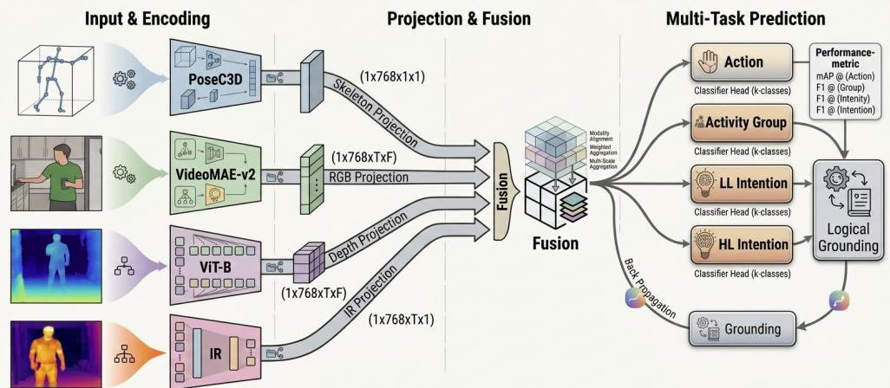  
Fig. 1: Overview of the NSGT framework. Four sensor streams (skeleton $\mathcal { X } _ { s } ,$ RGB $\mathcal { X } _ { r }$ infrared $\mathcal { X } _ { i r } ,$ depth $ { \mathcal { X } } _ { d } )$ are encoded by frozen pretrained encoders and concatenated into a single fused representation. The NSGT reasoning module augments standard self-attention with a learnable HR-G structural bias (Section 3.3). Four prediction heads produce joint estimates of atomic actions, composite activities, Low-Level Intentions (LLI), and High-Level Intentions (HLI). The total loss combines cross-entropy with a diferentiable FOL regulariser ${ \lambda _ { \mathrm { F O L } } } \times { \mathcal { L } } _ { \mathrm { F O L } }$ that penalises ontological inconsistency across prediction levels.

Here $| \mathcal { V } _ { A } | , | \mathcal { V } _ { C } | , | \mathcal { V } _ { L } |$ , and $| \nu _ { H } |$ denote the number of classes at each ontological level. The joint prediction is subject to ontological consistency constraints Φ derived from the HR-G (Section 4.3).

## 3.2 Hierarchical Transformer Backbone

A standard Transformer encoder [30] serves as the temporal backbone. The input sequence X is projected into a latent dimension $d _ { \mathrm { m o d e l } }$ via a linear layer followed by layer normalisation, and sinusoidal positional encodings are added. The sequence is then processed through L layers of Multi-Head Self-Attention (MHSA), producing per-step representations $\{ z _ { 1 } ^ { ( L ) } , \dots , z _ { T } ^ { ( L ) } \}$

Four prediction heads share the Transformer representation and are chained through continuous representations rather than through decisions. The action head operates on the per-step representations. The pooled episode representation feeds the activity head directly and also feeds an MLP that produces the LLI hidden representation, which in turn feeds the LLI head and, through a further MLP, the HLI head. The two intention levels are therefore chained through continuous projections while the activity logits branch directly of the pooled representation, and no discrete activity or LLI prediction is passed to a later classification head.

Per-step action logits are computed directly from the sequence representations:

$$
\hat { a } _ { t } = W _ { \mathrm { a c t } } z _ { t } ^ { ( L ) } \ \in \ \mathbb { R } ^ { | \nu _ { A } | }\tag{2}
$$

A masked temporal mean-pool produces a single episode-level embedding, ignoring padding positions:

$$
z _ { \mathrm { s e q } } = \frac { \sum _ { t = 1 } ^ { T } m _ { t } z _ { t } ^ { ( L ) } } { \sum _ { t = 1 } ^ { T } m _ { t } } , \quad m _ { t } = { \nVdash } [ \mathrm { c l i p ~ } t \mathrm { ~ i s ~ n o t ~ p a d d i n g } ]\tag{3}
$$

The activity logits and the LLI intermediate representation $z _ { \mathrm { l l i } }$ are then computed from $z _ { \mathrm { s e q } }$

$$
\hat { c } = W _ { c } z _ { \mathrm { s e q } } \ \in \ \mathbb { R } ^ { | \nu _ { c } | }\tag{4}
$$

$$
z _ { \mathrm { l l i } } = \mathrm { M L P } _ { \mathrm { a c t } \to \mathrm { l l i } } ( z _ { \mathrm { s e q } } )\tag{5}
$$

LLI logits are projected from $z _ { \mathrm { l l i } }$ , which is simultaneously forwarded to produce the HLI logits:

$$
\hat { l } = W _ { \mathrm { l l i } } z _ { \mathrm { l l i } } \ \in \ \mathbb { R } ^ { | \mathcal { V } _ { L } | }\tag{6}
$$

$$
\hat { h } = W _ { \mathrm { h l i } } \mathrm { M L P } _ { \mathrm { l l i \to h l i } } ( z _ { \mathrm { l l i } } ) \ \in \ \mathbb { R } ^ { | \nu _ { H } | }\tag{7}
$$

This backbone, referred to as the Hierarchical Transformer (HT), is used as a controlled baseline in the ablation study (Section 6.4) to isolate the contribution of graph-structured attention.

## 3.3 Neuro-Symbolic Graph Transformer (NSGT)

The integration of symbolic ontological knowledge directly into the neural attention mechanism is the core contribution of this work. In standard MHSA, every clip attends to every other clip uniformly, with no knowledge of the semantic relationships between the corresponding actions. In the proposed NSGT, the HR-G is encoded as a learnable additive bias on the attention logits, so that the graph structure actively steers information routing during inference.

While prior graph transformer architectures have applied structural biases to spatial joint connectivity graphs [4], the approach here applies them to semantic and ontological relationships between 58 action classes and their hierarchical goals, which is a distinct contribution.

## HR-G Attention Bias

An additive bias matrix $B \in \mathbb { R } ^ { T \times T }$ is computed once per batch from the predicted action identities of the input clips (Section 4.3), using pre-built lookup tables derived from the HR-G. The same bias is then passed to all L Transformer layers. The elements of B are defined as a weighted sum of three topological relations:

$$
B _ { i j } = \beta _ { \mathrm { t r a n s } } \mathscr { k } \Big [ \hat { a } _ { j } \in \mathcal { N } _ { \mathrm { t r a n s } } ( \hat { a } _ { i } ) \Big ] + \beta _ { \mathrm { a c t } } \mathscr { k } \Big [ A ( \hat { a } _ { i } ) \cap \mathcal { A } ( \hat { a } _ { j } ) \neq \emptyset \Big ] + \beta _ { \mathrm { l i i } } \mathscr { k } \Big [ \mathscr { L } \big ( \hat { a } _ { i } \big ) \cap \mathcal { L } \big ( \hat { a } _ { j } \big ) \neq \emptyset \Big ]\tag{8}
$$

where:

$\mathcal { N } _ { \mathrm { t r a n s } } ( \hat { a } _ { i } )$ is the set of valid successor actions of the predicted action $\hat { a } _ { i }$ in the semantic transition graph (Level 1 edges).

$\textstyle { \mathcal { A } } ( { \hat { a } } _ { i } )$ is the set of activities that the predicted action $\hat { a } _ { i }$ belongs to (Level 2 edges).

$\mathcal { L } ( \hat { a } _ { i } )$ is the set of LLIs reachable from $\hat { a } _ { i }$ via the ontology (Level 3 edges).

$\beta _ { \mathrm { t r a n s } } , \beta _ { \mathrm { a c t } } , \beta _ { \mathrm { l l i } } \in \mathbb { R }$ are scalar parameters learned end-to-end via backpropagation, initialised to small positive values.

Each bias scalar $\beta _ { \mathrm { t r a n s } } , \beta _ { \mathrm { a c t } }$ and $\beta _ { \mathrm { l l i } }$ is clamped to $[ - 3 , 3 ]$ before the weighted sum, which bounds every entry of B and prevents the graph structure from dominating the attention logits during early training. The matrix is then expanded across all attention heads and added to the scaled dot-product attention scores:

$$
\mathrm { A t t e n t i o n } ( Q , K , V ) = \mathrm { S o f t m a x } \left( { \frac { Q K ^ { \top } } { \sqrt { d _ { \mathrm { m o d e l } } } } } + B \right) V\tag{9}
$$

By treating $\beta _ { \mathrm { t r a n s } } , \beta _ { \mathrm { a c t } }$ , and $\beta _ { \mathrm { l l i } }$ as learnable parameters rather than fixed weights, the network adapts the contribution of the three predefined edge types; it does not learn or alter the graph topology. The converged values reported in Section 6.6 provide interpretable evidence of which edge types the model finds informative.

## 3.4 Diferentiable First-Order Logic Loss

When hierarchical prediction heads are trained independently, the model can produce ontologically contradictory outputs, for example predicting an activity that is incompatible with the predicted LLI. To address this, hierarchical dependencies are formalised as First-Order Logic (FOL) axioms and relaxed into diferentiable penalty functions [13], so that logical violations produce gradient signals during training.

Three types of rule are defined, covering 487 active constraints in total (39 $\mathrm { T y p e - A }$ 28 Type-B, 420 Type-C):

Type A, activity to LLI implication (39 rules):

$$
\operatorname { a c t i v i t y } ( X , A ) \to \bigvee _ { L \in \mathcal { V } ( A ) } \operatorname { l l i } ( X , L )\tag{10}
$$

where $\mathcal { V } ( A )$ is the set of valid LLIs for activity A.

Type B, LLI to HLI implication (28 rules):

$$
\operatorname { l l i } ( X , L ) \to \bigvee _ { H \in \mathcal { V } ( L ) } \operatorname { h l i } ( X , H )\tag{11}
$$

Type $\mathbf { C } ,$ mutex constraints (420 rules):

$$
\lnot \big ( \mathrm { a c t i v i t y } ( X , A _ { 1 } ) \land \mathrm { a c t i v i t y } ( X , A _ { 2 } ) \big ) \quad \mathrm { i f } \ \mathcal { H } ( A _ { 1 } ) \cap \mathcal { H } ( A _ { 2 } ) = \emptyset\tag{12}
$$

where $\mathcal { H } ( A )$ denotes the set of HLIs reachable from A. As an example, predicting both EatFood and Confront as concurrent activities in a single episode violates a $\mathrm { T y p e - C }$ rule, because no high-level intention is reachable from both activities, so they cannot logically co-occur.

The discrete rules are converted into continuous soft violations by operating on probability vectors $p _ { A } , \ p _ { L }$ , and $p _ { H }$ derived from the model outputs for activities,

LLIs, and HLIs respectively. At the activity and low-level intention levels, which admit more than one valid label within an episode, per-class sigmoid marginals are used; at the high-level intention level, which is single-label, a softmax distribution is used. This relaxation is necessary because hard IF/THEN thresholds produce zero gradients and are invisible to backpropagation. Soft probabilities instead produce continuous, non-zero gradient signals that allow the model to correct ontological contradictions iteratively during training.

For implication rules (Types A and B), the violation $v \Rightarrow$ measures how much the antecedent probability exceeds the maximum probability among its valid consequents:

$$
v _ { \Rightarrow } ( A , \mathcal { V } ) = \operatorname* { m a x } \biggl ( 0 , \ : p _ { A } - \operatorname* { m a x } _ { L \in \mathcal { V } } p _ { L } \biggr )\tag{13}
$$

For mutex constraints $( \mathrm { T y p e } \mathrm { C } )$ , the violation $v _ { \perp }$ is the product of the probabilities of the two mutually exclusive events:

$$
v _ { \perp } ( A _ { 1 } , A _ { 2 } ) = p _ { A _ { 1 } } \cdot p _ { A _ { 2 } }\tag{14}
$$

The three rule types are combined into the FOL loss:

$$
\begin{array} { r } { \mathcal { L } _ { \mathrm { F O L } } = \lambda _ { A } \overline { { v _ { \Rightarrow } ^ { ( A ) } } } + \lambda _ { B } \overline { { v _ { \Rightarrow } ^ { ( B ) } } } + \lambda _ { C } \overline { { v _ { \bot } } } } \end{array}\tag{15}
$$

The three rule families are weighted equally; the values of $\lambda _ { A } , \lambda _ { B }$ and $\lambda _ { C }$ and the role of $\lambda _ { \mathrm { F O L } }$ as the single tunable coeficient are stated in Section 5.

The total training objective combines the supervised terms of the four heads, crossentropy for the per-clip action head and the single-label high-level intention head and binary cross-entropy for the multi-label activity and low-level intention heads, restricted to the evaluation taxonomy, with the FOL regulariser:

$$
\mathcal { L } _ { \mathrm { t o t a l } } = \mathcal { L } _ { \mathrm { C E } } + \lambda _ { \mathrm { F O L } } \mathcal { L } _ { \mathrm { F O L } }\tag{16}
$$

where $\mathcal { L } _ { \mathrm { C E } }$ denotes the sum of the supervised classification losses for the four output heads, and $\lambda _ { \mathrm { F O L } }$ weights the contribution of the logic term relative to the classification objective. The empirical efect of $\lambda _ { \mathrm { F O L } }$ is analysed in Section 6.7.

```tcl
Algorithm 1 NSGT Hierarchical Inference and Training
Require: Fused multimodal features $\begin{array} { r l r } { f } & { { } = } & { [ f _ { s } ; f _ { r } ; f _ { i r } ; f _ { d } ] ; } \end{array}$ learnable biases
$\beta _ { \mathrm { t r a n s } } , \beta _ { \mathrm { a c t } } , \beta _ { \mathrm { l l i } } ;$ logic weight λ<sub>FOL</sub>.
Ensure: Predicted labels $\hat { a } , \hat { c } , \hat { l } , \hat { h } ;$ total loss ${ \mathcal { L } } _ { \mathrm { t o t a l } } .$
Step 1: Input projection
1: $z ^ { ( 0 ) } { \ ' } \gets \mathrm { L a y e r N o r m } ( \operatorname { L i n e a r } ( f ) ) + \operatorname { P o s E } 1$ ncoding
Step 2: HR-G bias (computed from first-pass predicted actions)
2: $B _ { i j } \gets \beta _ { \mathrm { t r a n s } } \mathbb { K } [ \hat { a } _ { j } \in \mathcal { N } _ { \mathrm { t r a n s } } ^ { \ - } ( \hat { a } _ { i } ) ] + \beta _ { \mathrm { a c t } } \mathbb { K } [ A ( \hat { a } _ { i } ) \cap \mathcal { A } ( \hat { a } _ { j } ) \neq \emptyset ] + \beta _ { \mathrm { l i h } } \mathbb { K } [ \mathcal { L } ( \hat { a } _ { i } ) \cap \mathcal { L } ( \hat { a } _ { j } ) \neq \emptyset ]$
∅]
Step 2a (first pass): $z _ { 1 } ^ { ( L ) } \gets$ Encoder $( z ^ { ( 0 ) } ; B \quad = \quad 0 ) ; \quad \hat { a } _ { i } ^ { ( 1 ) } \quad $
arg $\begin{array} { r } { \operatorname* { m a x } _ { a \in \mathcal { A } _ { \mathrm { r e t } } } \operatorname { L i n e a r } _ { \mathrm { a c t } } ( z _ { 1 } ^ { ( L ) } ) _ { i , a } } \end{array}$ , detached. Every aˆ in $B _ { i j }$ denotes $\hat { a } ^ { ( 1 ) }$ ; ground
truth labels are not used.
3: $B _ { i i } \gets 0$ ▷ diagonal zeroed after the weighted sum
Step 2b (second pass): B is added to the attention logits of every layer and
head in Step 3.
4: $\beta _ { \mathrm { t r a n s } } , \beta _ { \mathrm { a c t } } , \beta _ { \mathrm { l l i } } \gets \mathrm { c l a m p } ( \beta . , - 3 , 3 )$ before forming B
Step 3: Graph-structured reasoning
5: for $\ell = 1$ to L do
6: $\begin{array} { r l } & { z ^ { ( \ell ) } \gets \mathrm { S o f t m a x } \Big ( \frac { Q K ^ { \top } } { \sqrt { d _ { \mathrm { m o d e l } } } } + B \Big ) V + \mathrm { F F N } \big ( z ^ { ( \ell - 1 ) } \big ) } \end{array}$ ▷ same B for all layers
7: end for
Step 4: Multi-task hierarchical prediction
8: $\hat { a }  \mathrm { L i n e a r } _ { \mathrm { a c t } } ( z ^ { ( L ) } )$ ▷ per-step action logits
9: $z _ { \mathrm { s e q } } \gets \mathrm { M a s k e d M e a n P o o l } ( z ^ { ( L ) } )$
10: $\hat { c } \gets \mathrm { L i n e a r } _ { c } ( z _ { \mathrm { s e q } } )$ ▷ activity logits
11: $z _ { \mathrm { l l i } } \gets \mathrm { M L P } _ { \mathrm { a c t } \to \mathrm { l l i } } ( z _ { \mathrm { s e q } } )$
12: $\hat { l }  \mathrm { L i n e a r _ { \mathrm { l l i } } } ( z _ { \mathrm { l l i } } )$ ▷ LLI logits
13: $\hat { h } \left. \mathrm { L i n e a r } _ { \mathrm { h l i } } ( \mathrm { M L P } _ { \mathrm { l l i \right. h l i } } ( z _ { \mathrm { l l i } } ) )$ ▷ HLI logits
Step 5: Loss computation
14: $\hat { \mathcal { L } } _ { \mathrm { C E } } \dot {  } \mathrm { C E } ( \hat { a } ) + \mathrm { B C E } ( \hat { c } ) + \mathrm { B C E } ( \hat { l } ) + \mathrm { C E } ( \hat { h } )$ ▷ BCE for the multi-label activity
and LLI heads
15: $\mathcal { L } _ { \mathrm { F O L } } \gets \mathrm { S o f t L o g i c V i o l a t i o n } ( \hat { c } , \hat { l } , \hat { h } )$
16: $\mathcal { L } _ { \mathrm { t o t a l } }  \mathcal { L } _ { \mathrm { C E } } + \lambda _ { \mathrm { F O L } } \mathcal { L } _ { \mathrm { F O L } }$
17: return $\{ \hat { a } , \hat { c } , \hat { l } , \hat { h } \} , \mathcal { L } _ { \mathrm { t o t a l } }$
```

## Head dependencies and error propagation.

The heads share the Transformer representation and are chained through continuous representations rather than through decisions. The pooled episode representation feeds the activity head directly and also feeds an MLP that produces the LLI hidden representation; that representation feeds the LLI head and, through a further ${ \mathrm { M L P } } ,$ the HLI head (equations (3) to (7)). The projection into the LLI representation is named for the levels it spans but takes the pooled representation as its input rather than the activity logits, and no discrete activity or LLI decision is passed to a later head. The only place where a discrete prediction re-enters the computation is the HR-G bias, which is indexed by first-pass predicted action identities, a property verified in Section 4.3. An action error can therefore activate the wrong edges for that clip, although the bias remains additive to the content attention and bounded by clamping. The logic objective acts on the joint output configuration during training, penalising higher-level predictions that the lower levels cannot support. Two empirical consequences are visible in the results. First, the high-level intention is recovered far more often than the complete lower-level label set: on the standard test split the proposed model attains 78.41% high-level macro-F1 against a joint exact-match accuracy of 36.90%, so a large fraction of episodes reach the correct high-level intention from an imperfect activity or low-level-intention set. Second, adding the lower-level heads to intention-only supervision raises high-level macro-F1 from 67.89% to 77.84% (Table 9), so lower-level evidence improves rather than dominates the highest level.

## 4 The NTU-Hierarchy Dataset and Human Reasoning Graph

As surveyed in [31], existing intention recognition benchmarks span text-only datasets (ATIS, CLINC150), audio-visual datasets (MINE, MC-EIU), and domain-specific multimodal resources. None provides the combination of four-modality sensing and four-level hierarchical annotation required for general-purpose hierarchical intention reasoning. To address this gap, NTU RGB+D 120 [6] is used as the base corpus for constructing a novel hierarchical benchmark. By mapping its atomic action labels onto a structured four-level ontological hierarchy and constructing semantically coherent multi-clip episodes, a large-scale multimodal benchmark for hierarchical intention reasoning is produced.

The manuscript describes the benchmark to the extent required for the dataset structure and the model evaluation to be self-contained. The design criteria of the benchmark, the mechanism by which each is realised, and the synthesis procedure are documented in a separate benchmark paper [32] and are not restated here, so that the contribution of the present work, the NSGT and hierarchical intention recognition, remains in focus and the manuscript stays within length.

## 4.1 Hierarchy Construction and Ontology Design

A set of 58 action classes is selected from NTU RGB+D 120 [6], covering a broad range of daily-living and social behaviours. These base classes are organized into a four-level semantic taxonomy, summarized in Table 1.

Episode construction. Activity-level episodes are synthesized via a probabilistic transition graph (described in Section 4.3). Each episode comprises 4 to 17 action clips. The total number of activity-level episodes, which constitute the model’s training samples, is 11,436 across subject-disjoint train, validation, and test splits, with a further 3,415 episodes held out in a compositional test set, as reported in Table 2.

Subject consistency constraint. A strict subject consistency constraint is enforced during episode construction: all clips within a single episode are drawn exclusively from the same subject identity. This ensures that the inferred intention reflects a single performer within each assembled episode rather than an artifact of combining diferent identities. It does not make the assembled clips a naturally recorded continuous trajectory.

Table 1: The four-level semantic taxonomy constructed from NTU RGB+D 120.
<table><tr><td>Level</td><td>Count</td><td>Definition</td><td>Examples</td></tr><tr><td>Atomic Action</td><td>58</td><td>Base kinematic labels for isolated motions.</td><td>drink_water, brushing-teeth</td></tr><tr><td>Composite Activity</td><td>39</td><td>Coherent behavioural routines grouping related actions.</td><td>PersonalCare, DrinkLiquid</td></tr><tr><td>Low-Level Intention (LLI)</td><td>28</td><td>Intermediate short-term goals within an episode.</td><td>Eating, DocumentTasks</td></tr><tr><td>High-Level Intention (HLI)</td><td>8</td><td>Broad, long-term cogni- tive objectives.</td><td>MorningRoutine, OfficeWorkSession</td></tr></table>

Multimodal features. Each clip is represented across all four sensor modalities (skeleton, RGB, infrared, depth). Pre-extracted features are concatenated into a unified 5120-dimensional vector (2048 skeleton + 1024 RGB + 1024 IR + 1024 depth). Encoder architectures and extraction protocols are detailed in Section 5.2.

Synthesized labels. The hierarchical labels at the activity, LLI, and HLI levels and the FOL constraints are both derived from the designed ontology. Label assignment and loss computation occur at separate stages, but they are not conceptually independent sources of semantic knowledge, as discussed in Section 4.3.

## 4.2 Multi-Membership and Disjunctive Rule Design

A deliberate design feature of the hierarchy is the preservation of one-to-many ontological relationships. The LLI DrinkBreak, for example, is a valid member of four of the eight HLIs, because a short drink break serves multiple long-term goals depending on temporal context. Similarly, the activity WalkAway maps validly to both FriendlyDeparture and HostileAftermath, depending on the broader episode context. This is not a labeling ambiguity but a reflection of genuine behavioral flexibility: the same activity sequence can serve diferent high-level purposes depending on surrounding context (Figure 2).

This one-to-many structure directly motivates the disjunctive rule formulation in the FOL loss. A deterministic mapping of the form Activity $( X , A ) \Rightarrow \operatorname { L L I } ( X , L )$ would be incorrect for activities with multiple valid LLI pathways. Instead, the disjunctive form is adopted:

$$
{ \mathrm { A c t i v i t y } } ( X , A ) \ \Rightarrow \ \bigvee _ { L \in { \mathcal { V } } ( A ) } \mathrm { L L I } ( X , L )\tag{17}
$$

where $\mathcal { V } ( A )$ is the set of all valid LLIs for activity A, encoded in the binary mapping matrix $\mathbf { R } _ { \mathrm { a c t \to l l i } } \in \{ 0 , 1 \} ^ { 3 9 \times 2 8 }$ . The loss evaluates this rule by checking whether the maximum predicted probability across all valid consequents, max $L \in \mathcal { V } ( A ) \mathcal { P } L$ , is suficiently high, rewarding the model for predicting any valid LLI pathway rather than a single fixed target. This formulation is fully diferentiable and connects the ontology directly to the loss described in Section 3.4.

Table 2: Dataset statistics for the NTU-Hierarchy benchmark. Activity-level episodes are the training samples. Splits are subjectdisjoint by construction; the compositional test set holds out unseen intention-level combinations and, by design, shares performers with training.
<table><tr><td>Split</td><td>Episodes Avg. length</td><td>(clips)</td><td>Performers</td></tr><tr><td>Train</td><td>7,062</td><td>6.69</td><td>42</td></tr><tr><td>Validation</td><td>1,519</td><td>6.90</td><td>6</td></tr><tr><td>Test</td><td>2,855</td><td>7.04</td><td>12</td></tr><tr><td>Total (subject-disjoint)</td><td>11,436</td><td>6.80</td><td>60</td></tr><tr><td>Compositional test</td><td>3,415</td><td>7.36</td><td>42†</td></tr><tr><td>Property</td><td></td><td></td><td>Value</td></tr><tr><td>Hierarchy classes (Action / Activity / LLI / HLI)</td><td></td><td></td><td>58 / 39 / 28 / 8</td></tr><tr><td>Sensor modalities Episode length range (clips)</td><td></td><td></td><td>4 4-17</td></tr><tr><td>Split protocol</td><td></td><td></td><td></td></tr><tr><td>FOL training constraints (Type A / Type B / Type C)</td><td></td><td></td><td>subject-disjoint 39  / 28 / 420</td></tr></table>

<sup>†</sup>The compositional test set shares performers with training by design; its purpose is to test generalization to unseen intention-level combinations rather than to unseen performers, so its performers are not counted in the subject-disjoint total.

This one-to-many design makes a direct action-to-HLI lookup non-unique and motivates the deterministic lookup baseline evaluated in Section 6.2. The reported lookup implementation is substantially weaker than the learned model at the intention levels; its exact resolution and tie-breaking rules are documented there.

## 4.3 Human Reasoning Graph and FOL Rule Construction

The HR-G serves two distinct roles in the framework. Its transition graph component is used during dataset construction to produce temporally coherent episode sequences. Its FOL rule component is used during training as a constraint on the model’s predictions. These two roles are implemented at diferent stages, but both are derived from the same ontology.

Relation between labels and logic constraints. A circular supervision problem arises when the labels used for training are derived from the same rules that the model is being trained to satisfy. In such a setup, the model can achieve a high hierarchy consistency score simply by reproducing the labeling logic, rather than learning genuine hierarchical reasoning from the data.

In the proposed framework, episode labels are assigned before model training, and the diferentiable FOL term is applied only to model outputs. This operational separation prevents the loss implementation from directly reading target labels. It does not, however, make labels and constraints independent, because both encode relations from the same ontology. An increase in hierarchy consistency after adding the FOL term is therefore not interpreted as independent evidence of reasoning. Evidence beyond this objective-aligned diagnostic is sought in per-level predictive metrics, the no-FOL graph comparison, the lookup baseline, and the compositional split.

Scope of the hierarchy-consistency metric. The logic loss operates during training on continuous probability vectors, whereas the reported hierarchy-consistency rate is a discrete post-hoc check on predicted parent–child relations. The two are not identical computations, but they are aligned because they use the same ontology relations. The rate is therefore reported as a diagnostic of cross-level coherence, not as an independent validation of the FOL objective. Applying the same metric to models trained without the logic term remains useful for controlled comparison, but does not remove this conceptual dependence.

Evaluation-only semantic audit. Separately from the hierarchy consistency rate and from the 487 active constraints used by the FOL training loss, a set of 25 first-order semantic rules over the ontology serves as an evaluation instrument. Group X contains the three rules that are also enforced during episode synthesis. Group Y contains the remaining 22 rules, which are accessed neither during episode generation nor during training. Label construction and FOL training are operationally separated, but they are not conceptually independent, because both rely on the same ontology. What the separation supports is therefore narrower, and is stated as such: the training loss implementation never references the rule table, a property enforced by an automated check, and on the ground-truth labels of the test split the Group Y rules are violated at 9.3% macro-averaged over rules and 5.0% instance-weighted, against zero for Group X, which is empirical evidence that the Group Y rules were not enforced by construction. Per-rule violation rates of the evaluated models, for the 10 Group Y rules computable from episode-level predictions, are reported in the supplementary material, together with the 12 rules that require segment-level or order information, or that describe completeness or ordering not represented at episode level, and are therefore not computable in this setting. Across the compared conditions the trained models violate the Group Y rules at 10.8 to 11.1% macro-averaged and 4.8 to 4.9% instance-weighted on the test split, close to the ground-truth rates. The logic objective leaves the Group Y rules essentially unchanged, which is consistent with its scope being the 487 active constraints rather than a general semantic oracle.

Probabilistic transition graph. A directed, weighted transition graph is defined over the action classes of the ontology, encoding which actions naturally follow which in a temporally ordered sequence. The edge weights are asymmetric, reflecting realistic behavioral ordering: the transition probability from an approach action to a greeting is high, while the reverse ordering is near zero. The learned HR-G bias scalars (reported in Section 6.6) quantify the relative contribution of the three predefined edge types under the tested setting, with the largest coeficient assigned to low-level-intention co-membership.

The graph produces temporally ordered episodes whose labels and training-time constraints are both derived from the ontology. Their construction procedures are separate, but their semantic source is shared.

FOL rules as training-time constraints. A total of 487 active constraints are applied as training-time penalties: 39 disjunctive Type-A activity→LLI implications, 28 disjunctive Type-B LLI→HLI implications, and 420 Type-C mutual exclusion constraints. These rules penalize ontological inconsistencies in the model’s output predictions. Because labels and constraints share the ontology, their efects are interpreted through controlled ablations rather than as independent supervision sources.

Mutual exclusion constraints are applied conservatively: a mutex penalty is imposed only between activity pairs whose sets of valid LLIs are entirely disjoint. This conservative design prevents false conflicts between activities that share valid intention pathways at higher levels of the hierarchy, and is the reason the synthesized label sets satisfy every Type-C constraint by construction: each episode carries a single highlevel intention, so all of its activities share at least that intention and no mutually exclusive pair can co-occur.

Division of temporal and ontological reasoning. The transition graph enforces directed temporal ordering during episode construction through its asymmetric edge weights. The FOL rules, by contrast, operate on episode-level predictions: after mean-pooling produces a single probability vector over the episode, the logic constraints verify ontological consistency regardless of internal clip ordering.

Temporal ordering is captured by the Transformer’s positional encodings and the asymmetric HR-G transition bias $\beta _ { \mathrm { t r a n s } }$ . Ontological consistency is promoted by the FOL loss. These two mechanisms address complementary aspects of hierarchical reasoning: the model is penalised for ontological contradictions by the FOL loss, and learns temporal ordering through the attention mechanism.

Learned scalar parameters. The three learned scalars $\beta _ { \mathrm { t r a n s } } , ~ \beta _ { \mathrm { a c t } }$ , and $\beta _ { \mathrm { l l i } }$ modulate the HR-G attention bias in every Transformer layer, allowing the model to discover which graph edge types are most informative. Their converged values and the implications for model interpretability are analyzed in Section 6.6.

Label independence of the attention bias at inference. The bias B is constructed by a two-pass procedure that uses no label information at inference. In the first pass the reasoning network is run over the precomputed clip features without any attention bias, and the action head yields a prediction for every clip slot, restricted to the 58 retained action classes and detached from the computational graph. In the second pass these predicted action identities index the successor and co-membership tables to build $B ,$ which is then added to the attention logits of every layer and head; the diagonal of B is set to zero after the weighted sum and padded positions contribute nothing. The forward function of the model receives only the clip features and the padding mask, so ground-truth action, activity or intention labels cannot reach the bias construction. This property is verified by a corruption-invariance test in which every ground-truth field of an evaluation batch is replaced by random labels: the firstpass action logits, the second-pass action logits and the activity, low-level intention and high-level intention logits are identical, element for element, between the clean and the corrupted batches.

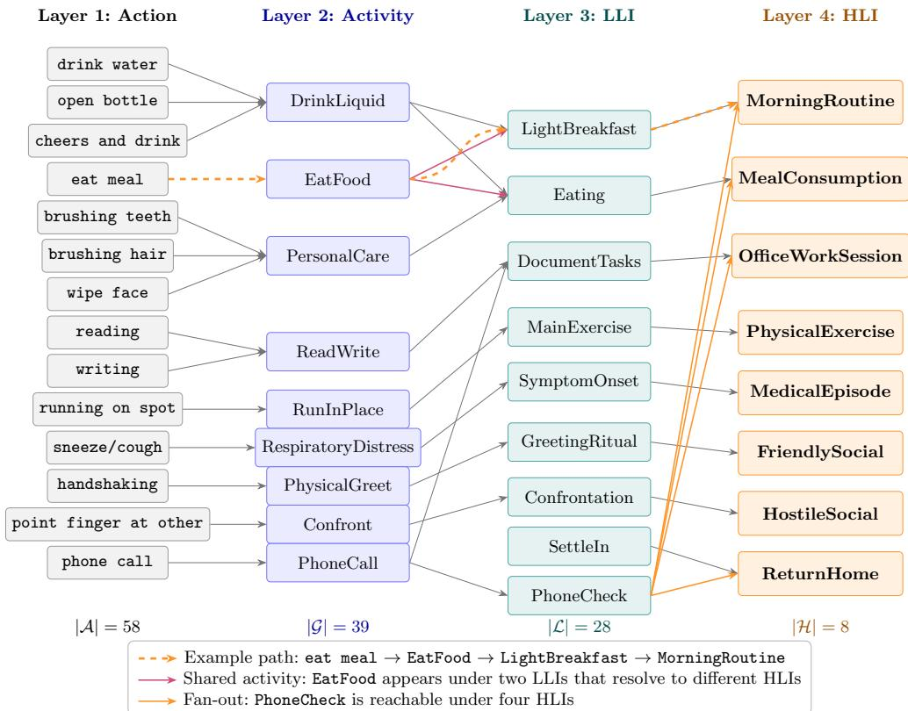  
Fig. 2: The four-level Human Reasoning Graph (HR-G) over the NTU-Hierarchy evaluation universe: 58 atomic actions, 39 composite activities, 28 Low-Level Intentions (LLI), and 8 High-Level Intentions (HLI). Layer 1 (grey): atomic actions. Layer 2 (blue): composite activities. Layer 3 (teal): LLIs. Layer 4 (orange): HLIs. A representative subgraph is shown; every drawn edge is taken from the ontological parent tree, and every drawn node belongs to the evaluation taxonomy of Table 1. The dashed orange path traces how eat meal is propagated through EatFood and LightBreakfast to MorningRoutine. Several mappings are deliberately non-injective: the activity EatFood is shared by two LLIs that resolve to diferent HLIs (MorningRoutine vs. MealConsumption), and the intention PhoneCheck is reachable under four distinct HLIs. The non-injective mappings motivate the lookup baseline evaluated in Section 6.2 and require an explicit rule for resolving multiple valid parents.

Visualization. A representative slice of the HR-G ontology is illustrated in Figure 2. The four levels comprise 58 action, 39 activity, 28 LLI, and 8 HLI classes; the figure shows a curated subset of nodes and edges to make the multi-parent structure legible, with directed edges representing valid ontological transitions. An ontology path such as handshaking can be traced through ACT PhysicalGreet → LLI GreetingRitual → HLI FriendlySocial. This makes the designed hierarchy inspectable, but the ontology diagram alone is not a model-specific audit trail. A concrete prediction trace is discussed separately in Section 7.3.

Table 3: Eficiency of the reasoning models on a single NVIDIA Tesla T4, measured at seed 42 from the trained checkpoints. Parameters are total counts. FLOPs are reported as multiply-add operations counted by fvcore for a padded episode of length 32; this count covers the linear and projection operations and excludes fused attention, the recurrent cell, and scatter-based graph aggregation, so the values for the attention, recurrent, and graph models are lower bounds. The proposed model is measured over its full two-pass inference. Latency is the median and 95th percentile over 200 timed iterations at batch size 1; throughput is measured at batch size 32; peak memory is the maximum allocated during a batch-size-32 forward. Latency and memory are specific to the T4.
<table><tr><td>Model</td><td>Params (M)</td><td>FLOPs (MMACs)</td><td>Lat. p50 (ms)</td><td>Lat. p95 (ms)</td><td>Thrpt (ep/s)</td><td>Mem (MB)</td></tr><tr><td>NSGT+FOL (two-pass)</td><td>3.60</td><td>178.4</td><td>14.5</td><td>35.4</td><td>4409</td><td>133.8</td></tr><tr><td>HT (no FOL)</td><td>3.60</td><td>110.3</td><td>3.0</td><td>3.7</td><td>10450</td><td>130.9</td></tr><tr><td>HT+FOL</td><td>3.60</td><td>110.3</td><td>2.9</td><td>3.4</td><td>9942</td><td>130.9</td></tr><tr><td>Seq-Transformer</td><td>3.07</td><td>93.3</td><td>1.6</td><td>1.8</td><td>14317</td><td>130.9</td></tr><tr><td>MLP</td><td>2.93</td><td>89.0</td><td>0.9</td><td>1.0</td><td>18383</td><td>124.7</td></tr><tr><td>LSTM</td><td>2.35</td><td>45.0</td><td>2.8</td><td>3.4</td><td>9620</td><td>167.9</td></tr><tr><td>R-GCN</td><td>4.20</td><td>23.2 ± 6.7</td><td>7.4</td><td>9.0</td><td>3395</td><td>73.3</td></tr></table>

## 5 Experimental Setup

Fairness of comparisons. All models are trained and evaluated under controlled conditions. Every model receives the same 5120-dimensional multimodal features from the same frozen encoders, is trained and tested on the same subject-disjoint splits, and follows the same training protocol, with no per-model hyperparameter tuning and model selection on the validation LLI macro-F1 for every condition. This controls data, features, splits, and training budget. Because no equal per-model hyperparameter search was performed, the baselines are presented as controlled implementations rather than fully optimized representatives of their model families.

Feasibility under constrained hardware. Because the perceptual encoders are precomputed and frozen, the reported resource measurements concern only the reasoning module, which has approximately 3.6 million trainable parameters. Table 3 reports inference latency, throughput, forward-pass allocated memory, and lower-bound operation counts on a Tesla T4. These measurements support feasibility on that setup but do not establish a minimum hardware requirement or peak end-to-end training memory. More constrained devices may require a smaller batch size or reduced precision.

## 5.1 Implementation Details

All models are implemented in PyTorch and trained on a single NVIDIA Tesla T4 GPU (16 GB VRAM). The NSGT reasoning modules are trained from scratch; all feature encoders remain frozen throughout training.

Architecture configuration. The NSGT and HT backbones share the same hyperparameters: model dimension $d _ { \mathrm { m o d e l } } = 2 5 6$ , number of attention heads $n _ { \mathrm { h e a d s } } =$ 8, number of Transformer layers $L = 4$ , feed-forward dimension $d _ { \mathrm { f f } } = 5 1 2$ , and dropout rate 0.1. The total number of trainable parameters in the full NSGT model is 3,598,261. Removing the three $\beta$ scalars yields the uniform-attention HT backbone with 3,598,258 parameters; the FOL objective adds no parameters, so all conditions of a given backbone are parameter-identical. The HR-G bias scalars are initialised to $\beta _ { \mathrm { t r a n s } } = 0 . 1$ 2 $\beta _ { \mathrm { a c t } } = 0 . 1$ , and $\beta _ { \mathrm { l l i } } = 0 . 0 5$

Optimiser. AdamW [33] is used with an initial learning rate lr $\cdot = 2 \times 1 0 ^ { - 4 }$ , weight decay $1 0 ^ { - 4 }$ , and cosine annealing to a minimum of $1 0 ^ { - 6 }$ over $T _ { \mathrm { m a x } } ~ = ~ 5 0$ epochs. Gradients are clipped to a maximum $\ell _ { 2 }$ norm of 1.0. These optimisation components are standard, robust defaults rather than dataset-specific choices: cosine annealing gives smooth convergence without a hand-designed step schedule, clipping stabilises the larger early gradients introduced by the logic term, and the identical schedule is applied to every model and baseline without per-model re-tuning.

Loss function. The total training loss combines a hierarchical cross-entropy term and the diferentiable FOL regularisation term:

$$
\mathcal { L } _ { \mathrm { t o t a l } } = \mathcal { L } _ { \mathrm { C E } } + \lambda _ { \mathrm { F O L } } \mathcal { L } _ { \mathrm { F O L } }\tag{18}
$$

where $\mathcal { L } _ { \mathrm { C E } }$ is the sum of cross-entropy losses across all four prediction heads, and $\mathcal { L } _ { \mathrm { F O I } }$ acts as a soft regulariser, penalising ontological contradictions without overriding the data-driven learning signal. Within $\mathcal { L } _ { \mathrm { F O L } }$ , the three rule families are weighted equally $( \lambda _ { A } = \lambda _ { B } = \lambda _ { C } = 1 )$ , so the logic weight $\lambda _ { \mathrm { F O I } }$ is the single tunable coeficient of the logic term. Two values of the logic weight are evaluated: $\lambda _ { \mathrm { F O L } } = 0 . 1$ , which yields a small consistency gain with negligible change in classification accuracy, and $\lambda _ { \mathrm { F O L } } = 0 . 5$ , which maximises logic consistency while action F1 remains essentially unchanged. The empirical efect of the logic weight is analyzed in Section 6.7.

Early stopping. Training is halted if validation LLI macro-F1 does not improve for 10 consecutive epochs. The checkpoint with the highest validation LLI macro-F1 is retained for test evaluation. LLI macro-F1 is selected as the stopping criterion because it represents the primary intention-recognition objective and occupies the middle of the four-level hierarchy, providing a signal that reflects both low-level recognition quality and high-level reasoning ability.

Batch size and sequence handling. A batch size of 32 is used throughout. Episodes vary in length; variable-length sequences are zero-padded to the maximum length within each batch. A boolean padding mask is passed to all attention layers so that padded positions are excluded from both attention computation and meanpooling.

Reproducibility and statistical protocol. The principal model comparison is trained independently with five random seeds (42 to 46), each seed fixing all stochastic components (NumPy, PyTorch, and Python random). The head and modality ablations use three seeds and are identified as secondary studies. Main tables report means and standard deviations across the corresponding runs. The data splits are fixed, subjectdisjoint, and identical across all conditions (Section 4.1), so that every model is trained and evaluated on exactly the same partition.

## 5.2 Feature Extraction

Rationale for frozen encoders. The perceptual encoders are used as fixed feature extractors to provide the same feature substrate to every reasoning model. This controls feature learning within the reported comparison. The modality ablation also shows that no evaluated single stream trivially solves the task (the strongest evaluated single stream reaches 79.60% action top-1, whereas skeleton reaches 55.41%). Fine-tuning could change both absolute performance and the interaction between perception and reasoning; it was not evaluated and is left as future work.

All multimodal features are extracted ofline using frozen pretrained encoders and stored as consolidated tensors, removing encoder computation from the training loop. This design ensures that reported training times and cross-model comparisons reflect only the reasoning module.

• Skeleton (2048-dim): PoseC3D [34] with a SlowOnly-R50 backbone, pretrained on NTU RGB+D 120 under the cross-subject protocol. Each clip is represented as a 3D heatmap volume, yielding a 2048-dimensional feature vector.

• RGB (1024-dim): VideoMAE-v2 [35] with a ViT-Large backbone, pretrained on Kinetics-700. Sixteen-frame windows at the native frame rate are encoded into 1024- dimensional clip features.

• Infrared (1024-dim): VideoMAE-v2 fine-tuned on infrared frames from NTU RGB+D 120, producing 1024-dimensional features. This modality captures thermal body shape under low-light conditions where RGB appearance degrades.

• Depth (1024-dim): DINOv2 [36] applied to depth-map frames, producing 1024- dimensional features. Depth provides 3D structural information complementary to the 2D appearance captured by RGB.

The four modality vectors are concatenated per clip to form a 5120-dimensional fused feature:

$$
\mathbf { f } = \left[ \mathbf { f } _ { s } ; \mathbf { f } _ { r } ; \mathbf { f } _ { i r } ; \mathbf { f } _ { d } \right] \in \mathbb { R } ^ { 5 1 2 0 }\tag{19}
$$

No explicit dimensionality reduction is applied before the linear projection layer.   
Table 4 summarises the encoder configurations.

## 5.3 Baselines

The NSGT is compared against four baselines, a multilayer perceptron, a bidirectional LSTM, a sequence Transformer, and an external relational graph convolutional network, together with one ablated variant of the proposed architecture, all trained with the same fused 5120-dimensional features, dataset splits, optimiser, and evaluation protocol. The four baselines do not incorporate the FOL loss; the ablated variant is evaluated both with and without it.

Table 4: Multimodal feature encoders. All encoders are frozen during training.
<table><tr><td>Modality</td><td>Encoder</td><td>Dim</td><td>Pretrain data</td></tr><tr><td>Skeleton</td><td>PoseC3D SlowOnly-R50</td><td>2048</td><td>NTU RGB+D 120</td></tr><tr><td>RGB</td><td>VideoMAE-v2 ViT-L</td><td>1024</td><td>Kinetics-700</td></tr><tr><td>Infrared</td><td>VideoMAE-v2 (IR FT)</td><td>1024</td><td>NTU RGB+D 120</td></tr><tr><td>Depth</td><td>DINOv2 ViT-B/14</td><td>1024</td><td>LVD-142M</td></tr></table>

• MLP (2.9 M parameters): A two-layer perceptron applied independently to each clip, followed by masked mean pooling. This baseline has no temporal reasoning capability and serves as the performance floor.

• LSTM (2.3 M parameters): A bidirectional two-layer LSTM with pack padded sequence for correct handling of variable-length sequences. This baseline captures long-range sequential dependencies without attention.

• Seq-Transformer (3.07 M parameters): A compact Transformer encoder applied to the fused clip sequence, producing predictions at all four levels through the same multi-task head design as the proposed model, with no graph-structured attention bias. This baseline isolates the value of plain self-attention over the clip sequence.

• R-GCN (4.20 M parameters): An external relational graph convolutional network [37]. Each episode is represented as a typed heterogeneous graph whose relational edges instantiate the parent relationships of the ontology (action to activity, activity to LLI, LLI to HLI), and typed message passing is performed over this graph. Trained and evaluated under the identical protocol and prediction schema, this baseline tests whether an of-the-shelf relational architecture can exploit the same structural knowledge.

• Hierarchical Transformer (HT) (3.60 M parameters): The proposed NSGT architecture with the HR-G attention bias removed, evaluated both with and without the FOL loss. This ablation isolates the contribution of graph-structured attention from the contribution of the FOL constraint.

All models produce predictions at all four hierarchy levels and are trained under the same classification objective as the NSGT conditions without FOL; the internal baselines share the identical multi-task head module. Performance diferences are therefore attributable to the temporal and relational reasoning mechanisms rather than to output structure.

The primary contribution of this work is not to advance state-of-the-art action recognition on NTU RGB+D 120, for which specialised skeleton-based graph convolutional methods achieve over 90% top-1 accuracy [38, 39], but to demonstrate that a neuro-symbolic graph transformer can jointly reason across four levels of behavioural abstraction while promoting ontological consistency. Action-level results are therefore interpreted in the context of hierarchical reasoning capability, not as a challenge to single-level recognition benchmarks.

## 5.4 Evaluation Metrics

The following metrics are computed on the held-out test set for all conditions.

Classification metrics. For each of the four hierarchy levels, two metrics are reported:

• Top-1 accuracy: fraction of correctly classified episodes (or clips, for the action level).

• Macro-F1: unweighted mean of per-class F1 scores. Macro-F1 is selected as the primary classification metric because it assigns equal weight to all classes regardless of frequency, which is appropriate given the variation in episode support across hierarchy levels (Table 2).

• Top-5 accuracy (action level only): whether the ground-truth action class appears among the top-5 predicted classes. This metric is standard in large-scale action recognition benchmarks.

• Joint accuracy: fraction of episodes for which the predicted high-level intention is correct and the predicted activity set and low-level-intention set both match the ground-truth sets exactly. This is the strictest measure of hierarchical correctness, since a single error at any of the three levels counts as a miss.

Hierarchy consistency rate (HC). HC is the primary metric for structural coherence. For each test episode, hierarchy consistency requires that every predicted activity have at least one of its parent low-level intentions among the predicted lowlevel intentions, and that every predicted low-level intention have the predicted highlevel intention among its parent high-level intentions:

$$
\mathrm { H C } = \frac { 1 } { N } \sum _ { n = 1 } ^ { N } \mathbb { k } \Big [ \hat { \ell } _ { n } \in \mathcal { V } ( \hat { g } _ { n } ) \mathrm { ~ } \wedge \hat { h } _ { n } \in \mathcal { V } ( \hat { \ell } _ { n } ) \Big ]\tag{20}
$$

where ${ \hat { g } } _ { n } , \ { \hat { \ell } } _ { n } , \ { \hat { h } } _ { n }$ are the predicted activity, LLI, and HLI for episode n, and $\mathcal { V } ( \cdot )$ denotes the set of valid successors in the HR-G. HC is undefined for conditions where not all three levels are predicted simultaneously, and is reported as $\mathrm { { N } / A }$ in those cases.

## 6 Results and Analysis

Reporting conventions. All four hierarchy levels are evaluated consistently under the same protocol, and the complete per-level metrics are reported together in Table 5. Macro-F1 is reported at every level, so that performance is comparable across levels and robust to class imbalance; top-1 and top-5 accuracy are additionally reported at the action level, where a large single-label vocabulary makes top-k accuracy informative. The hierarchy consistency rate and the joint accuracy summarise cross-level coherence. The abstract highlights top-1 action accuracy and the hierarchy consistency rate as headline figures for brevity, but these are the same quantities reported in full in the results, and no level is evaluated by a diferent or less complete procedure than the others.

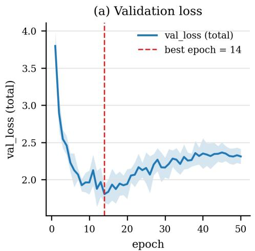

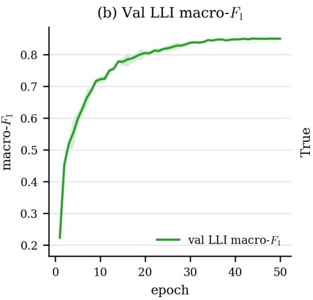  
Fig. 3: Training dynamics of $\mathrm { N S G T + F O I }$ $( \lambda ~ = ~ 0 . 5 )$ , averaged over five seeds. (a) Training and validation loss across epochs, with the best checkpoint marked at the epoch selected by validation LLI macro-F1. The training loss decreases steadily while the validation loss flattens and then rises gradually, a calibration efect on the softmax heads that does not degrade decision-level performance, as the validation macro-F1 in panel (b) remains stable across the same range. (b) Validation LLI macro-F1 across epochs, shown with a one-standard-deviation band over seeds. LLI macro-F1 is the checkpoint-selection metric.

Training dynamics of $\mathrm { N S G T + F O I }$ $( \lambda = 0 . 5 )$ are presented in Figure 3. The training loss decreases steadily throughout training. The validation loss flattens early and then rises gradually; this reflects growing confidence on the softmax heads rather than a loss of generalisation, since the validation LLI macro-F1 in Figure 3(b) remains stable over the same range and the reported checkpoint is selected on that metric rather than on validation loss.

## 6.1 Comparison with Baselines

Full numerical results are reported in Table 5. Figure 4 provides a visual comparison of all evaluated conditions across the four hierarchy levels and the hierarchy consistency rate. Two patterns are visible. First, the improvement attributable to the first-order logic objective is concentrated in hierarchy consistency rather than in per-level discrimination. For the hierarchical transformer, hierarchy consistency is raised from 74.42% to 77.02% by the logic objective, while per-level macro-F1 remains within 0.4 points at every level. The same behaviour is observed for the proposed model, where hierarchy consistency is raised from 76.40% to 78.79% and per-level macro-F1 varies by at most 0.4 points. This separation indicates that the logic objective operates as a constraint on the joint prediction structure rather than as an additional source of discriminative signal at any individual level. Second, at a matched logic setting the proposed model attains higher hierarchy consistency than the hierarchical transformer, 78.79% against

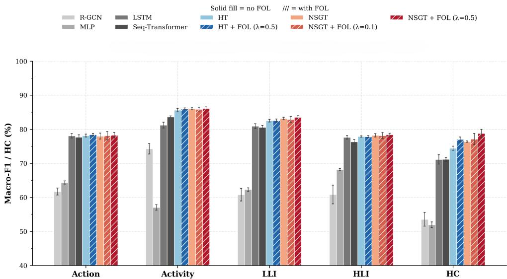  
Fig. 4: Per-level macro-F1 and hierarchy consistency on the held-out test split. Bars report the mean over five seeds and error bars denote one standard deviation. The first four groups report macro-F1 at the action, activity, low-level intention, and high-level intention levels, computed over all classes of the taxonomy (Table 1). The fifth group reports the hierarchy consistency rate, which measures the proportion of predictions satisfying the parent-child constraints of the ontology and is therefore not a macro-F1 score. Hatched bars denote conditions trained with the first-order logic objective. Improvements attributable to the logic objective are concentrated in hierarchy consistency rather than in per-level macro-F1. The vertical axis starts at 40% to resolve diferences among the stronger conditions.

77.02%, and the same ordering is observed without the logic objective, 76.40% against 74.42%, which indicates that the architectural and symbolic contributions are additive. The unstructured and graph baselines remain well below all transformer variants on hierarchy consistency, at 51.94% and 53.56% respectively, despite the graph baseline reaching 74.26% macro-F1 at the activity level, which shows that competitive performance at a single level does not imply coherent predictions across the hierarchy.

## Overall ranking.

At the action level the transformer models are closely matched, and NSGT+FOL (λ=0.5) is comparable to the strongest sequential baseline (LSTM) on action macro-F1 (78.30% vs. 78.07%). The advantage of the proposed model concentrates at the higher levels of the hierarchy and in structural coherence. Relative to LSTM, NSGT+FOL improves activity macro-F1 by 4.90 pp (86.14% vs. 81.24%), LLI macro-F1 by 2.60 pp (83.51% vs. 80.91%), and HLI macro-F1 by 0.78 pp (78.41% vs. 77.63%), while hierarchy consistency improves by 7.63 pp (78.79% vs. 71.16%). The same ordering holds against the hierarchical transformer without the graph bias, confirming that the graphstructured attention and the logic objective contribute gains in hierarchical consistency rather than in single-level action discrimination. The attention-based sequence transformer tracks LSTM closely, while the external relational-graph baseline trails at every level despite its explicit relational structure (61.70% action F1, 53.56% hierarchy consistency), which indicates that generic message passing over the ontology does not substitute for the proposed ontology-biased attention.

Table 5: Classification performance and hierarchy consistency on the NTU-Hierarchy test set. Act-T1: action top-1 accuracy (%). Act-F1: action macro-F1 (%). Atvty-F1: activity macro-F1 (%). HC: hierarchy consistency rate (%). Joint: joint exact-match accuracy (%). Mean ± standard deviation over five seeds. Best mean per column in bold.
<table><tr><td>Model</td><td>Act-T1</td><td>Act-T5</td><td>Act-F1</td><td>Atvty-F1</td><td>LLI-F1</td><td>HLI-F1</td><td>HC</td><td>Joint</td></tr><tr><td>MLP</td><td>75.48±0.89</td><td>96.62±0.23</td><td>64.35±0.49</td><td>57.05±0.82</td><td>62.28±0.49</td><td>68.16±0.31</td><td>51.94±0.86</td><td>17.02±0.24</td></tr><tr><td>LSTM</td><td>86.89±0.37</td><td>98.46±0.17</td><td>78.07±0.66</td><td>81.24±0.85</td><td>80.91±0.70</td><td>77.63±0.49</td><td>71.16±1.40</td><td>29.07±0.79</td></tr><tr><td>Seq-Transformer</td><td>86.53±0.35</td><td>98.92±0.04</td><td>77.70±0.67</td><td>83.64±0.27</td><td>80.59±0.53</td><td>76.32±0.71</td><td>71.18±0.57</td><td>31.92±0.45</td></tr><tr><td>R-GCN</td><td>77.32±0.64</td><td>96.97±0.29</td><td>61.70±1.03</td><td>74.26±1.54</td><td>60.79±1.84</td><td>60.85±2.73</td><td>53.56±2.02</td><td>17.70±1.28</td></tr><tr><td>HT (no FOL)</td><td>86.96±0.29</td><td>98.98±0.09</td><td>78.15±0.42</td><td>85.64±0.50</td><td>82.55±0.40</td><td>77.86±0.20</td><td>74.42±0.61</td><td>35.43±0.48</td></tr><tr><td>HT + FOL</td><td>87.02±0.26</td><td>98.98±0.12</td><td>78.41±0.37</td><td>85.99±0.28</td><td>82.52±0.50</td><td>77.84±0.29</td><td>77.02±0.73</td><td>35.82±0.78</td></tr><tr><td>NSGT (no FOL)</td><td>87.32±0.58</td><td>98.89±0.07</td><td>78.00±0.88</td><td>86.01±0.29</td><td>83.18±0.34</td><td>78.24±0.48</td><td>76.40±0.20</td><td>36.39±0.46</td></tr><tr><td>NSGT + FOL (λ=0.1)</td><td>87.21±0.71</td><td>98.99±0.10</td><td>78.12±1.24</td><td>85.89±0.58</td><td>82.88±0.87</td><td>78.14±0.87</td><td>77.15±1.64</td><td>35.98±2.27</td></tr><tr><td>NSGT + FOL (λ=0.5)</td><td>87.37±0.44</td><td>98.98±0.16</td><td>78.30±0.80</td><td>86.14±0.43</td><td>83.51±0.47</td><td>78.41±0.43</td><td>78.79±1.1936.90±0.74</td><td></td></tr></table>

## Interpretation of action-level results.

The action-level results of HT and NSGT are not directly comparable with specialised skeleton-based recognition methods such as ST-GCN [19] or CTR-GCN [40], which achieve over 90% top-1 accuracy on NTU RGB+D 120 using architectures specifically designed for joint-topology graphs. The models in this work are optimised for joint hierarchical prediction across four levels simultaneously. The action head therefore operates under a multi-task constraint, and some action-level accuracy is foregone in exchange for joint prediction across all four hierarchy levels. This is by design: the primary objective is intention recognition, not isolated action classification.

## Contextual positioning.

To provide broader context, NSGT is compared with selected recent multimodal and multi-task frameworks evaluated on NTU RGB+D 120 in Table 6. These methods operate on flat action labels rather than four-level hierarchical annotations, so the comparison is indicative rather than equivalent.

At the action level, NSGT attains 87.37% top-1 accuracy while additionally producing four levels of hierarchical prediction and a quantified hierarchy consistency rate. The remaining gap to specialised flat-label systems reflects the multi-task constraint discussed above, and the logic objective imposes no accuracy cost, with 87.32% top-1 without and 87.37% with the FOL loss. Structural coherence across a four-level hierarchy is a property that flat-label methods do not model.

Table 6: Indicative comparison with recent multimodal and multi-task frameworks on NTU RGB+D 120. Comparison models predict flat action labels; NSGT jointly predicts four hierarchy levels. Results are not directly comparable due to diferences in task formulation.
<table><tr><td>Method</td><td>Year Strategy</td><td></td></tr><tr><td>MMINet [41]</td><td>2022 Cross-modality interactive learning</td><td></td></tr><tr><td>MMNet [42]</td><td>2023 Model-level attention transfer</td><td>92.4</td></tr><tr><td>M2-CLIP [43]</td><td>2024 Semantic alignment and task adapters 2025</td><td>89.2</td></tr><tr><td>BHaRNet [44]</td><td>Body-hand joint recognition (MoE)</td><td>93.0</td></tr><tr><td>Spathis et al. [45]</td><td>Joint action and gesture (SPS)</td><td>88.5</td></tr><tr><td>NSGT (no FOL) 2025</td><td>Hierarchical graph transformer</td><td>87.32</td></tr><tr><td>NSGT + FOL (λ=0.5) 2025</td><td>Hierarchical + logic regularisation</td><td>87.37</td></tr></table>

## 6.2 Lookup-Table Baseline

To test whether the higher levels of the hierarchy can be recovered from action predictions alone, a deterministic lookup-table baseline is evaluated. This baseline takes the model’s predicted actions and maps them to the activity, low-level intention, and high-level intention levels through the ontology, applying no learned reasoning above the action level.

The lookup is fully specified as follows. The predicted action of every real clip slot in an episode is mapped to its parent activities in the ontology; the activity prediction of the episode is the union of these parents, restricted to the evaluation taxonomy, so that several valid parents are all retained rather than resolved by choice. The low-level intention prediction is the union of the parents of the predicted activities, restricted in the same way. The high-level intention prediction is the single class receiving the largest number of predicted low-level intentions among its children; ties are broken deterministically in favour of the lowest class index. Variable episode length is absorbed by the union over clip slots, so no per-episode length normalisation is required. The only inputs are the ontology tables and the model’s own action predictions; no trainingset statistics, test labels or test-derived class frequencies are used at any step.

At the activity level, the lookup baseline is competitive and slightly exceeds the model, by 1.44 pp on the standard test split. This is expected, because an activity is composed of one to three actions and is therefore close to a deterministic function of the predicted actions; where the mapping is nearly one-to-one, a lookup is an appropriate and strong baseline. At the intention levels, however, the picture reverses sharply. The full model exceeds the lookup baseline by 38.18 pp at the low-level intention level and by 50.53 pp at the high-level intention level on the standard test split, and the lookup collapses toward chance at the high-level intention level (27.88% macro-F1). The oneto-many design of the ontology means that a given set of actions may be consistent with several intentions, so the lookup requires an explicit resolution rule. The same pattern holds on the compositional test split, where the model exceeds the lookup baseline by 22.81 pp at the low-level intention level and 21.45 pp at the high-level intention level. These results show that the reported lookup implementation does not recover the intention-level performance of the learned model; they do not establish that every possible non-neural inference rule would fail.

Table 7: Full model versus the deterministic lookup-table baseline (macro-F1, mean ± std over 5 seeds, NSGT + FOL λ=0.5). The lookup maps predicted actions to the higher levels through the ontology. A positive gap indicates the model outperforms the lookup.
<table><tr><td>Split</td><td>Level</td><td>Model</td><td>Lookup</td><td>Gap</td></tr><tr><td rowspan="3">Test</td><td>Activity</td><td> $8 6 . 1 4 \pm 0 . 4 3$ </td><td> $8 7 . 5 8 \pm 0 . 4 5$ </td><td>-1.44</td></tr><tr><td>LLI</td><td> $8 3 . 5 1 \pm 0 . 4 7$ </td><td> $4 5 . 3 3 \pm 0 . 2 9$ </td><td> $+ 3 8 . 1 8$ </td></tr><tr><td>HLI</td><td> $7 8 . 4 1 \pm 0 . 4 3$ </td><td> $2 7 . 8 8 \pm 0 . 3 6$ </td><td>+50.53</td></tr><tr><td rowspan="3">Compositional</td><td>Activity</td><td> $6 7 . 1 1 \pm 0 . 5 4$ </td><td> $6 9 . 9 9 \pm 0 . 3 1 $ </td><td>-2.88</td></tr><tr><td>LLI</td><td> $5 9 . 2 1 \pm 0 . 6 2$ </td><td> $3 6 . 4 0 \pm 0 . 0 8$ </td><td>+22.81</td></tr><tr><td>HLI</td><td> $4 7 . 0 2 \pm 0 . 5 7$ </td><td> $2 5 . 5 7 \pm 0 . 1 3$ </td><td> $+ 2 1 . 4 5$ </td></tr></table>

Table 8: Performance on the compositional test split (macro-F1 unless noted, mean ± standard deviation over five seeds). Act: action. Atvty: activity. LLI/HLI: low- and high-level intention. HC: hierarchy consistency rate. Joint: joint accuracy across all four levels. Best result per column in bold.
<table><tr><td>Model</td><td>Act</td><td>Atvty</td><td>LLI</td><td>HLI</td><td>HC</td><td>Joint</td></tr><tr><td>MLP</td><td>58.89±0.38</td><td>42.19±0.63</td><td>42.66±0.81</td><td> $4 4 . 1 1 { \pm } 0 . 5 1 $ </td><td>38.60±1.50</td><td>3.63±0.40</td></tr><tr><td>LSTM</td><td>64.32±0.62</td><td> $6 2 . 8 2 { \pm } 1 . 1 0 $ </td><td>59.54±0.33</td><td> ${ \bf 4 9 . 2 6 { \scriptstyle \pm 0 . 7 2 } }$ </td><td> $6 4 . 1 1 { \pm } 1 . 6 8 $ </td><td>9.07±0.88</td></tr><tr><td>Seq-Transformer</td><td>63.63±0.26</td><td>65.09±0.58</td><td>56.67±1.14</td><td>46.42±0.71</td><td>63.20±1.39</td><td>11.07±0.77</td></tr><tr><td>R-ĠCN</td><td>52.78±1.46</td><td> $5 6 . 5 4 { \pm } 1 . 7 6 $ </td><td>40.00±1.64</td><td>36.09±2.20</td><td> $4 0 . 0 1 { \pm } 1 . 9 9 $ </td><td> $0 . 5 4 { \pm } 0 . 2 8 $ </td></tr><tr><td>HT</td><td>63.33±0.27</td><td>66.62±0.21</td><td>57.98±0.89</td><td>46.19±0.36</td><td>68.77±0.92</td><td>12.98±0.62</td></tr><tr><td> $\mathrm { H T } + \mathrm { F O L } \left( \lambda { = } 0 . 5 \right)$ </td><td>63.59±0.27</td><td>66.87±0.40</td><td>58.47±0.79</td><td>46.65±0.64</td><td>70.40±0.96</td><td>13.57±0.98</td></tr><tr><td>NSGT</td><td>63.40±0.62</td><td>66.99±0.69</td><td>59.16±0.87</td><td>47.03±0.77</td><td>68.84±0.90</td><td>12.54±0.71</td></tr><tr><td> $\mathrm { N S G T } + \mathrm { F O L } \ ( \lambda { = } 0 . 1 )$ </td><td>63.27±0.90</td><td>66.75±1.13</td><td>58.86±1.26</td><td>47.47±1.25</td><td>69.41±2.47</td><td>13.23±1.42</td></tr><tr><td> $\mathrm { N S G T } + \mathrm { F O L } \ ( \lambda { = } 0 . 5 )$ </td><td>63.49±0.44</td><td>67.11±0.54</td><td>59.21±0.62</td><td>47.02±0.57</td><td>72.15±1.06</td><td>13.63±0.53</td></tr></table>

## 6.3 Generalisation to Unseen Compositions

Beyond the standard subject-disjoint test split, performance is evaluated on the compositional test set, which withholds from training one high-level parent association of each multi-parent low-level intention. This split measures whether the learned reasoning transfers to novel arrangements of familiar actions rather than memorised co-occurrence patterns.

Overall performance is lower than on the standard test split, as expected when generalising to unseen compositions. The full model, $\mathrm { N S G T } + \mathrm { F O L } \mathrm { a t } \lambda = 0 . 5$ , attains the highest hierarchy consistency rate (72.15%) and the highest joint accuracy across all four levels (13.63%), exceeding the strongest competing configuration on both measures. The relational-graph baseline transfers poorly, with a joint accuracy near zero, which indicates that its representation does not recover coherent multi-level structure under distribution shift.

Table 9: Head ablation on the HT backbone, averaged over the three ablationcampaign seeds. Conditions (1)–(4): subset of heads active. Conditions (5)–(6): all four heads with and without FOL; these are the full HT conditions of Table 5 and agree with it within seed variation. HC: hierarchy consistency, undefined (N/A) for partial-head conditions. Dashes mark heads excluded from the loss in that condition; their untrained outputs are not reported.
<table><tr><td>Condition</td><td>Act-F1</td><td>Atvty-F1</td><td>LLI-F1</td><td>HLI-F1</td><td>HC</td></tr><tr><td>(1) Action only</td><td>78.16</td><td></td><td></td><td></td><td>N/A</td></tr><tr><td>(2) Activity only</td><td></td><td>79.27</td><td></td><td></td><td>N/A</td></tr><tr><td>(3) Intention only (LLI+HLI)</td><td></td><td></td><td>68.30</td><td>67.89</td><td>N/A</td></tr><tr><td>(4) Action + Activity</td><td>79.33</td><td>86.18</td><td></td><td></td><td>N/A</td></tr><tr><td>(5) Full HT (no FOL)</td><td>78.00</td><td>85.29</td><td>82.76</td><td>77.84</td><td>74.64</td></tr><tr><td>(6) Full  $\mathrm { H T + F O L }$ </td><td>78.21</td><td>85.86</td><td>82.70</td><td>77.80</td><td>77.26</td></tr></table>

The efect of the logic objective is more pronounced on this split than on the standard test set. On the standard test split, adding the logic objective raises the hierarchy consistency rate of the full model from 76.40% to 78.79%, a gain of 2.39 pp. On the compositional split, the same objective raises it from 68.84% to 72.15%, a gain of 3.31 pp. This larger gain is consistent with a stronger regularization efect under compositional shift. Because the metric is aligned with the ontology-derived loss, it should not be interpreted by itself as independent evidence of general reasoning.

## 6.4 Ablation Study: The Role of Joint Training

Table 9 reports the head ablation on the HT backbone, isolating the contribution of each output level.

## Joint training benefits the intention levels.

Comparisons are drawn only between heads that are actively supervised in each condition. Supervising the two intention levels alone (C3) attains 68.30% low-level and 67.89% high-level intention F1; adding the lower-level heads under the full objective (C5) raises these to 82.76% and 77.84%. The improvement at the most abstract level shows that lower-level supervision shapes a representation the intention heads exploit, rather than the levels being independent. That the intention levels are not recoverable from lower-level outputs is established separately, and without appeal to untrained heads, by the deterministic lookup baseline (Section 6.2): a given action or activity composition is consistent with several distinct intentions, so the lower levels underdetermine the intention.

## No action-level cost from joint training.

Action-only supervision (C1, 78.16%) and the full four-head model (C5, 78.00%) attain essentially the same action F1, within seed variation. Supervising the three additional levels therefore adds hierarchical capability at no measurable cost to action-level discrimination, which indicates that the shared encoder has suficient capacity for the joint objective.

## FOL efect on hierarchy consistency.

The FOL loss improves hierarchy consistency by approximately 2.6 points on the HT backbone, consistent with Table 11. Classification diferences between C5 and C6 remain within 0.6 pp across all levels, confirming that the FOL loss acts as a structural regulariser rather than a classification booster.

## 6.5 Error Structure under Partial Supervision

The contribution of the lower-level heads to the highest level is isolated by comparing two configurations in which the high-level intention head is actively supervised (Figure 5). When supervision is provided at the two intention levels alone, the mean diagonal recall for high-level intention is 69.2 percent, and the confusions that remain concentrate among semantically adjacent classes, such as the return-home class being confused with the morning-routine and ofice classes. Adding the lower-level heads under the full objective raises the mean diagonal recall to 78.7 percent, with the residual errors concentrating further on ontologically adjacent classes that share transitional sub-intentions, as analysed in Appendix A. The intention levels are therefore improved by the presence of the lower-level heads during joint training, which indicates that the levels carry non-redundant information coupled by the hierarchical objective. That the lower levels alone cannot recover high-level intention is established by the lookup-table baseline of Section 6.2, which quantifies the one-to-many structure directly, rather than from the behaviour of an unsupervised head.

The two directions of this result are complementary: the lower levels alone cannot recover high-level intention, as established by the lookup-table baseline, and the intention levels are in turn improved by the presence of the lower-level heads during joint training, so the levels carry non-redundant information that the hierarchical objective couples.

## 6.6 Impact of Graph-Structured Attention

## Where the graph bias contributes.

At a matched logic setting, the graph-structured attention leaves action-level discrimination essentially unchanged relative to HT+FOL (78.30% vs. 78.41% action F1) and instead contributes at the intention levels and in structural coherence: +0.99 pp LLI F1, +0.57 pp HLI F1, and +1.77 pp hierarchy consistency. The same pattern holds without the logic objective, where the graph bias raises hierarchy consistency by +1.98 pp over the uniform-attention backbone (76.40% vs. 74.42%) and LLI F1 by +0.63 pp. This distribution of gains is consistent with the learned bias weights: the dominant low-level-intention co-membership edge links clips that share an intention, a relation that constrains the joint prediction across levels rather than the identity of any single action. At the LLI and HLI levels, the label distribution is determined by episode-level ontological structure, which mean-pooling in the HT already captures reasonably well.

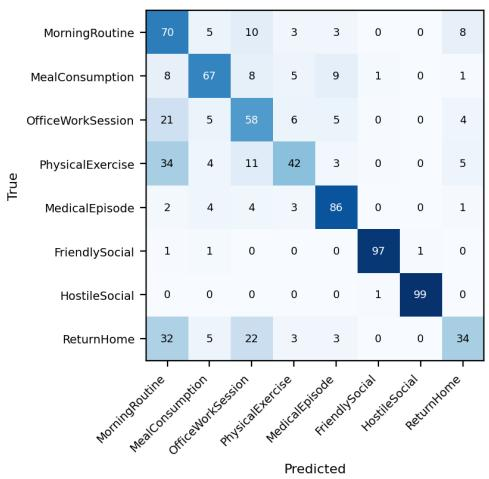  
(a) Intention only (recall: 69.2%)

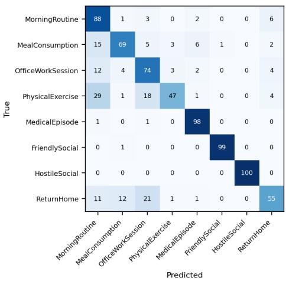  
(b) Full objective (recall: 78.7%)  
Fig. 5: High-level intention confusion matrices under two supervision configurations in which the high-level head is actively supervised, evaluated on the held-out test split at seed 42 and normalised by true-class row. Cells report the percentage of episodes of each true class predicted as each candidate class. The left panel is supervised at the two intention levels only, the right panel under the full hierarchical objective. Chance recall is 12.5 percent. Under intention-only supervision the mean diagonal recall is 69.2 percent, and under the full objective it reaches 78.7 percent, with residual confusions concentrated among ontologically adjacent classes. The improvement shows that the lower-level heads contribute non-redundant information to the highest level under joint training.

## Analysis of learned β parameters.

Table 10 reports the converged values of the three HR-G bias scalars across all NSGT conditions.

All conditions converge to the same qualitative pattern: $\beta _ { \mathrm { l l i } } \approx 0 . 6 0$ is dominant, while $\beta _ { \mathrm { t r a n s } }$ ≈ 0.09 and $\beta _ { \mathrm { a c t } }$ ≈ 0.07 remain small and positive. The low-level-intention co-membership edge is therefore the most strongly exploited, directing attention between clips that share a low-level intention, while temporal transition and sameactivity edges contribute a smaller positive bias. The ranking is stable across all five seeds, with cross-seed standard deviations below 0.03 for every scalar.

This pattern is interpretable within the predefined HR-G: under the tested configuration, low-level-intention co-membership receives the largest learned coeficient. This does not establish that the graph topology itself is optimal.

Table 10: Converged HR-G bias weights at the end of training, reported as the mean and standard deviation over five seeds. Larger values indicate stronger exploitation of the corresponding edge type. The low-level-intention co-membership edge is dominant across all three NSGT conditions. The random-graph control row uses the three-seed ablation protocol.
<table><tr><td>Condition</td><td> $\beta _ { \mathrm { t r a n s } }$ </td><td> $\beta _ { \mathrm { a c t } }$ </td><td> $\beta _ { \mathrm { l l i } }$ </td></tr><tr><td>NSGT (no FOL)</td><td> $0 . 0 9 3 \pm 0 . 0 2 2$ </td><td> $0 . 0 6 9 \pm 0 . 0 1 7$ </td><td> $0 . 6 0 1 \pm 0 . 0 1 1$ </td></tr><tr><td> $\mathrm { N S G T } + \mathrm { F O L } \left( \lambda { = } 0 . 5 \right)$ </td><td> $0 . 0 9 1 \pm 0 . 0 2 0$ </td><td> $0 . 0 6 7 \pm 0 . 0 1 8$ </td><td> $0 . 6 0 3 \pm 0 . 0 1 6$ </td></tr><tr><td> $\mathrm { N S G T } + \mathrm { F O L } \left( \lambda { = } 0 . 1 \right)$ </td><td> $0 . 0 9 2 \pm 0 . 0 1 5$ </td><td> $0 . 0 7 0 \pm 0 . 0 1 4$ </td><td> $0 . 5 9 7 \pm 0 . 0 2 8$ </td></tr><tr><td>NSGT, random graph (no FOL)</td><td> $0 . 0 2 0 \pm 0 . 1 0 1$ </td><td> $0 . 0 2 6 \pm 0 . 0 6 5$ </td><td> $0 . 1 3 2 \pm 0 . 0 5 5$ </td></tr></table>

Figure 6 shows the evolution of the three HR-G bias scalars over training, with and without the logic objective. The scalar ordering is established within the first few epochs and remains stable: $\beta _ { \mathrm { l l i } } .$ , initialised at the smallest value, overtakes $\beta _ { \mathrm { t r a n s } }$ and $\beta _ { \mathrm { a c t } }$ , while the latter two remain close to their initialisation. The two panels are also similar, suggesting that the tested logic weight has little efect on the relative coeficient ordering. These trajectories demonstrate parameter stability, not robustness to a diferent graph topology.

Validation LLI macro-F1 is used for model selection because LLI is the primary intention-level target and macro-F1 limits domination by frequent classes. The same criterion is applied to all compared models. This is a design choice rather than a theoretically unique criterion, and any single-level checkpoint criterion may favor that level.

Matched-density random-graph control. To separate the contribution of the graph’s content from that of its density, the three relation tables are replaced by random graphs with identical of-diagonal edge counts (215 directed successor edges; 44 and 251 undirected co-membership pairs), zero diagonal, and support restricted to the evaluation taxonomy, and the model is retrained under the three-seed ablation protocol without the logic loss. Two efects are observed. First, the learned bias scalars collapse by an order of magnitude and lose their cross-seed stability, with the low-level-intention co-membership weight falling from 0.601 ± 0.011 on the correct graph to 0.132 ± 0.055 on the random one (Table 10): the training signal suppresses a topology that carries no ontological information. Second, performance degrades gracefully rather than collapsing: hierarchy consistency reaches 75.93 ± 1.12 and joint accuracy 35.93 ± 0.49, between the no-graph transformer (74.42, 35.43) and the correct graph (76.40, 36.39), with the residual diferences from either neighbour within seed variation at three seeds. The graph is therefore a content-sensitive inductive bias rather than a tuned auxiliary: the correct topology is exploited with strong, stable weights, whereas an uninformative topology of equal density is downweighted towards zero and neither reproduces the correct graph’s contribution nor harms the model below the graph-free baseline.

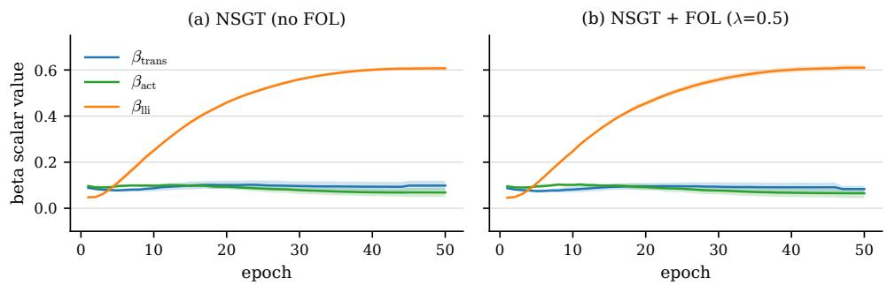  
Fig. 6: Evolution of the three HR-G bias scalars during training, averaged over five seeds, with shaded bands denoting one standard deviation. Panel (a): trained without the logic objective; panel (b): trained with the logic objective at $\lambda = 0 . 5$ . In both settings $\beta _ { \mathrm { l l i } }$ , initialised at the smallest value of the three, overtakes the other two scalars within the first epochs and continues to grow throughout training, reaching approximately 0.61 at the final epoch, while $\beta _ { \mathrm { t r a n s } }$ and $\beta _ { \mathrm { a c t } }$ remain near their initialisation. The two panels are nearly indistinguishable, indicating that the logic objective does not change which edge type the attention exploits.

## 6.7 FOL Loss Analysis

Definition and measurement of contradictions. A prediction is termed ontologically contradictory when the labels it assigns across the four levels cannot coexist under the ontology. The hierarchy consistency rate reported throughout is the fraction of test episodes whose predicted labels form a valid chain through the ontology: every predicted activity is required to have at least one of its parent low-level intentions among the predicted low-level intentions, and every predicted low-level intention is required to have the predicted high-level intention among its parent high-level intentions (equation (20)). Activity mutual-exclusion violations enter the training loss as a separate Type-C penalty but are not included in this aggregate evaluation rate. The reported metric therefore covers the two parent–child conditions only.

Behaviour under ambiguous or conflicting evidence. The value of a soft constraint is most apparent where perceptual evidence is ambiguous. Because each violation term is continuous in the predicted probabilities, the penalty it applies is graded: when the evidence is uncertain, the violation changes smoothly with the probabilities rather than imposing a hard threshold. A difuse prediction does not necessarily imply a small penalty for every rule. When strong perceptual evidence conflicts with an ontological expectation, the penalty grows with the degree of violation but does not override the classification signal, because it is weighted by λ against the supervised loss. The practical consequence is visible in the results: increasing the logic weight raises the hierarchy-consistency rate monotonically while leaving action accuracy nearly unchanged. This demonstrates empirical alignment under the tested settings; it does not identify which individual predictions were corrected because their perceptual evidence was weak.

Table 11: FOL loss ablation on the HT and NSGT backbones. ∆HC: hierarchy consistency improvement over the no-FOL baseline of the same backbone.
<table><tr><td>Backbone λ</td><td></td><td>Act-F1</td><td>Atvty-F1</td><td>LLI-F1</td><td>HLI-F1</td><td>HC</td><td>ΔHC</td></tr><tr><td>HT</td><td></td><td>78.15</td><td>85.64</td><td>82.55</td><td>77.86</td><td>74.42</td><td></td></tr><tr><td>HT</td><td>0.5</td><td>78.41</td><td>85.99</td><td>82.52</td><td>77.84</td><td>77.02</td><td>+2.60</td></tr><tr><td>NSGT</td><td></td><td>78.00</td><td>86.01</td><td>83.18</td><td>78.24</td><td>76.40</td><td></td></tr><tr><td>NSGT</td><td>0.1</td><td>78.12</td><td>85.89</td><td>82.88</td><td>78.14</td><td>77.15</td><td>+0.75</td></tr><tr><td>NSGT</td><td>0.5</td><td>78.30</td><td>86.14</td><td>83.51</td><td>78.41</td><td>78.79</td><td>+2.39</td></tr></table>

Table 11 reports the efect of the FOL weight $\lambda _ { \mathrm { F O L } }$ on both backbones.

The FOL loss produces a measurable and consistent improvement in hierarchy consistency at negligible cost to classification accuracy. At λ=0.1, action F1 changes by only 0.12 pp relative to the no-FOL baseline (78.12% vs. 78.00%) while hierarchy consistency improves by +0.75 pp. At λ=0.5, hierarchy consistency improves by +2.39 pp, while per-level classification metrics change by less than 0.4 pp at every level and are unchanged within seed variation.

This behaviour has practical implications for deployment. λ=0.1 already provides a meaningful consistency gain with essentially no change in discriminative performance. In deployment settings such as assistive robotics, where ontological coherence is a first-order requirement, λ=0.5 provides the largest reduction in logical contradictions among the configurations tested, at no cost to classification accuracy. This improvement in consistency at no cost to accuracy is a practical advantage of the proposed framework over purely data-driven approaches.

## 6.8 Modality Ablation

Table 12 reports the efect of restricting the input to a single sensor modality. NSGT+FOL (λ=0.5) is retrained from scratch for each configuration, with the input projection layer dimension adjusted accordingly.

## Skeleton as the primary kinematic signal.

Restricting the input to skeleton reduces action F1 by 38.55 pp (78.30% → 39.75%) and hierarchy consistency by 14.70 pp (78.79% → 64.09%). The PoseC3D embeddings encode body-joint kinematics, which remain discriminative for classes defined by limb configuration, but without appearance context the model cannot resolve episode types that depend on the objects and scene present. This is visible at the high-level intention level, where meal consumption and return-home fall to 33.5% and 25.2% recall respectively (Figure 7). These are the intention classes that are composed largely of transitional sub-intentions shared across several high-level intentions, so their separation rests on scene and object evidence rather than on the shared body-motion pattern; the ontological basis of this overlap is analysed in Appendix A.

Table 12: Modality ablation: NSGT+FOL (λ=0.5) trained on unimodal versus full four-modality input, averaged over three seeds. The input projection dimension adjusts to the active modalities (2048 for skeleton, 1024 for RGB, 5120 for all four). All other settings are identical.
<table><tr><td>Modality</td><td>Act-T1</td><td>Act-F1</td><td>Atvty-F1</td><td>LLI-F1</td><td>HLI-F1</td><td>HC</td></tr><tr><td>All modalities</td><td>87.37</td><td>78.30</td><td>86.14</td><td>83.51</td><td>78.41</td><td>78.79</td></tr><tr><td>Skeleton only</td><td>55.41</td><td>39.75</td><td>63.95</td><td>59.74</td><td>60.66</td><td>64.09</td></tr><tr><td>RGB only</td><td>79.60</td><td>70.43</td><td>79.36</td><td>77.28</td><td>74.49</td><td>71.90</td></tr><tr><td>Infrared only</td><td>68.36</td><td>60.08</td><td>74.26</td><td>71.61</td><td>70.26</td><td>70.82</td></tr><tr><td>Depth only</td><td>74.37</td><td>67.00</td><td>77.90</td><td>75.21</td><td>72.81</td><td>70.80</td></tr></table>

## RGB as a complementary appearance signal.

RGB-only reaches 70.43% action F1 and 79.36% activity F1, confirming the discriminative strength of the VideoMAE-v2 features. The 7.87 pp action-F1 gap to the full model indicates that RGB captures complementary scene and object information that skeleton does not encode; the two context-dependent classes that collapse under skeleton, meal consumption and return-home, recover to 70.7% and 53.6% under RGB.

Infrared and depth streams. The two remaining unimodal conditions complete the picture: depth-only reaches 74.37% action top-1 and infrared-only 68.36%, both between the skeleton and RGB extremes, and their hierarchy consistency (70.80% and 70.82%) remains well below the fused model’s 78.79%. No single stream dominates the fused representation: the strongest unimodal configuration (RGB) trails the full model by 7.77 pp in action top-1 and 3.92 pp in high-level intention macro-F1, and each unimodal condition loses between 6.9 and 14.7 pp of hierarchy consistency, which indicates that cross-level coherence draws on complementary evidence from several streams.

## Non-redundant fusion.

The full four-modality model outperforms every unimodal condition at every hierarchy level. No single stream dominates the fusion, and the two context-dependent classes recovered by RGB are further supported by the additional streams. Hierarchy consistency degrades most in the skeleton-only condition (64.09%), which indicates that appearance features support ontological coherence beyond kinematic discrimination.

Figure 7 provides qualitative evidence for the complementarity claim. Skeletononly errors are concentrated in the intention classes that depend on scene and object context, which RGB is able to resolve. Full modality fusion attains the highest recall on these classes while the residual errors, which are shared across conditions, correspond to semantically adjacent episode types.

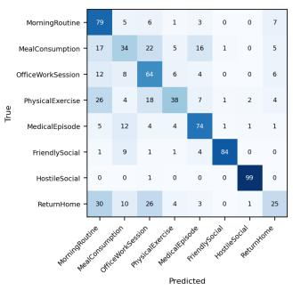  
(a) Skeleton only (HLI-F1: 60.7%)

  
(b) RGB only (HLI-F1: 74.5%)

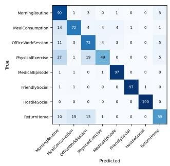  
(c) All modalities (HLI-F1: 78.4%)  
Fig. 7: Row-normalised high-level-intention confusion matrices (test set, values in %) for the three modality conditions. Under skeleton-only input, the context-dependent classes collapse: meal consumption is recognised at 33.5% and is confused with ofice work (22%), and return-home is recognised at 25.2% and confused with morning routine (30%) and ofice work (26%), since these episode types are distinguished by scene and objects rather than by body pose. RGB restores both classes (meal consumption 70.7%, return-home 53.6%, medical episode 94.2%), and full fusion improves them further (meal consumption 71.5%, return-home 59.0%). Residual errors shared by all three conditions, such as physical exercise confused with morning routine, persist regardless of modality because these classes share transitional sub-intentions and are therefore ontologically overlapping rather than modality-limited (Appendix A).

## 7 Discussion and Limitations

## 7.1 Consistency Gains at No Accuracy Cost

A central finding is that the logic objective improves the reported hierarchyconsistency diagnostic while per-level classification metrics remain nearly unchanged. On the NSGT backbone the consistency gain at $\lambda _ { \mathrm { F O L } } = 0 . 5$ is statistically significant across the five seeds (paired t-test, $p = 0 . 0 0 9 )$ , whereas the accompanying changes in per-level macro-F1 are within seed variation and none reaches significance. The same separation holds on the HT backbone. This shows that the regularizer changes cross-level coherence more strongly than per-level discrimination under the tested protocol.

The hierarchy-consistency rate is a discrete chain check, whereas the training term uses continuous probabilities and also includes Type-C constraints. Nevertheless, the metric and loss are ontology-aligned and are not independent. The gain is therefore interpreted as an objective-aligned diagnostic. Complementary evidence comes from per-level metrics, the graph-only comparison without FOL, the lookup baseline, and the compositional split.

On the compositional split, the consistency gain from the logic objective is +3.31 pp for NSGT and +1.63 pp for HT, compared with +2.39 pp and +2.60 pp respectively on the standard test split. This diference is consistent with an interaction between graph-biased attention and the logic term under compositional shift, but the aggregate ablation does not by itself identify the mechanism responsible for that interaction.

Among the tested values, $\lambda _ { \mathrm { F O L } } = 0 . 5$ gives the highest hierarchy consistency with no statistically significant reduction in per-level macro-F1. This recommendation is limited to the present benchmark and evaluation protocol.

## 7.2 Progressive Architectural Gains

The results in Table 5 reveal a progressive performance improvement that mirrors the increasing architectural complexity of the evaluated models.

MLP achieves 64.35% action F1 with no temporal reasoning. This establishes that temporal context is essential for the benchmark: features from isolated clips, without any sequential modeling, are insuficient for reliable action recognition.

LSTM and the HT backbone demonstrate the benefit of sequential and attentionbased temporal reasoning respectively, with action F1 rising to 78.07% and 78.15%. At the action level the sequential, attention, and graph models are closely matched, which indicates that action recognition on sequences of mean length 7.04 clips (7.36 on the compositional split) is largely saturated by temporal modelling alone. The sequence Transformer tracks the LSTM closely at every level, which indicates that at this episode scale attention and recurrence recover the same temporal information. The relational-graph baseline, by contrast, trails the multilayer perceptron at the action, low-level, and high-level intention levels despite its explicit ontological structure, and its hierarchy consistency is comparable to that of the perceptron; structural knowledge alone, without fine-grained temporal modelling, does not yield coherent predictions, a mechanism examined in Appendix A.

The graph structure and the logic objective instead deliver their gains at the higher levels of the hierarchy and in structural coherence. NSGT+FOL (λ=0.5) improves hierarchy consistency to 78.79%, a +7.63 point improvement over LSTM and +1.77 points over $\mathrm { H T + F O I }$ , together with the best activity, LLI, and HLI macro-F1 in the suite. This confirms that encoding ontological relationships directly into the attention mechanism provides structural information beyond what uniform attention over raw features can recover.

Finally, the FOL loss contributes a consistent and reproducible improvement in hierarchy consistency across both backbones: +2.60 points for HT and +2.39 points for NSGT. Classification diferences with and without FOL remain within 0.4 points at every level, confirming that the FOL loss acts as a structural regulariser rather than a classification booster.

This progression, from temporal modeling to global attention to graph-structured attention to logic regularisation, supports the paper’s central claim: each architectural component addresses a specific limitation of the previous one, and the full NSGT+FOL system is the product of principled, incremental design.

## 7.3 Interpretability and the Audit Trail

## A worked audit-trail example.

Figure 8 traces one held-out test episode, ep 0004228, of eight clips through the seed-42 checkpoint of NSGT with λ = 0.5, from input to verdict. The recorded clips are, in order, sitting down, browsing a phone, walking apart, walking towards, making a phone call, browsing a phone, typing on a keyboard and browsing a phone; both passes predict all eight actions correctly with probabilities above 0.99. The six activities recovered from them (Sit, PhoneBrowse, WalkAway, WalkApproach, PhoneCall, TypeKeyboard) are mostly ambiguous in the ontology: Sit alone has seven candidate parent intentions and each walking activity four, whereas TypeKeyboard has exactly one, DigitalTasks. The bias matrix B built from the first-pass actions (Figure 8b) has 31 nonzero entries, 30 of which carry the same-intention co-membership relation weighted by $\beta _ { \mathrm { l l i } } = 0 . 6 0$ , so attention is drawn towards clips that share a candidate intention; in the final layer every clip attends most strongly to the phone-call clip and the walk-towards clip (Figure 8c). Four low-level intentions pass the 0.5 threshold with clear margins (Figure 8d) (WalkingTransit 0.98, DigitalTasks 0.96, SeatedRest 0.86, PhoneCheck 0.85), and SettleIn is rejected at 0.45. Three of the four are transitional intentions that belong to four high-level intentions each, and the only high-level intention other than OfficeWorkSession compatible with all three is ReturnHome; DigitalTasks, whose sole parent is OfficeWorkSession, resolves the ambiguity, and the head assigns 0.99 to OfficeWorkSession and 0.01 to ReturnHome, with every other class below $1 0 ^ { - 3 }$ . The chain check passes at both parent conditions and the prediction is a joint exact match. A reviewer can therefore read from the trace which clips drove the decision, which goals were competing, and which single piece of evidence separated the two plausible ones.

## 7.4 Training Convergence

The training curves in Figure 3 show a consistent pattern. The training loss decreases smoothly throughout training, indicating stable optimisation without gradient instability. From the middle of training onward the validation loss rises gradually while the training loss continues to decrease; this is a calibration efect on the softmax heads rather than a collapse in accuracy, since the validation macro-F1 remains stable over the same range. Model selection uses the epoch of highest validation LLI macro-F1, which is insensitive to this calibration drift, so the reported checkpoint retains the highest decision-level performance.

## 7.5 The HLI Ceiling

The LSTM and all transformer variants reach 76–78% HLI macro-F1, against a chance level of 12.5% for eight classes. The narrow spread across architectures indicates that the residual errors at this level are not architectural, and their structure shows what they are instead.

<table><tr><td>Clip</td><td>Action</td><td>NTU ID</td><td>Pred</td><td>Prob</td><td></td></tr><tr><td>0</td><td>sit down</td><td>A008</td><td>A008</td><td>1.00</td><td>√</td></tr><tr><td>1</td><td>play with phone</td><td>A029</td><td>A029</td><td>1.00</td><td>√</td></tr><tr><td>2</td><td>walk apart</td><td>A060</td><td>A060</td><td>1.00</td><td>√</td></tr><tr><td>3</td><td>walk towards</td><td>A059</td><td>A059</td><td>1.00</td><td>√</td></tr><tr><td>4</td><td>make a phone call</td><td>A028</td><td>A028</td><td>1.00</td><td>√</td></tr><tr><td>5</td><td>play with phone</td><td>A029</td><td>A029</td><td>1.00</td><td>√</td></tr><tr><td>6</td><td>type on keyboard</td><td>A030</td><td>A030</td><td>1.00</td><td>√</td></tr><tr><td>7</td><td>play with phone</td><td>A029</td><td>A029</td><td>1.00</td><td>√</td></tr></table>

(a) Clips, ground truth and second-pass predictions; all eight correct with probability above 0.99.

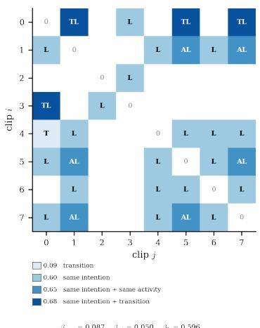  
(b) HR-G bias matrix built from the firstpass predicted actions.

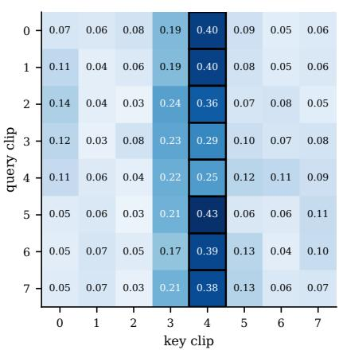  
(c) Final-layer attention, averaged over heads.

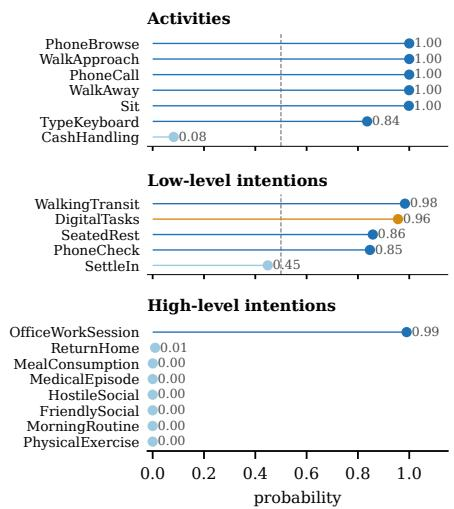  
(d) Predicted probabilities over the evaluation taxonomy.  
Fig. 8: Audit trail of held-out test episode ep 0004228 (seed-42 checkpoint, NSGT with $\lambda = 0 . 5 )$ . Thirty of the 31 nonzero entries of the bias matrix carry the sameintention relation, weighted by the largest of the three learned scalars $( \beta _ { \mathrm { t r a n s } } = 0 . 0 9$ $\beta _ { \mathrm { a c t } } = 0 . 0 5 , \beta _ { \mathrm { l l i } } = 0 . 6 0 )$ . The resulting parent-intention resolution is shown in Figure 9.

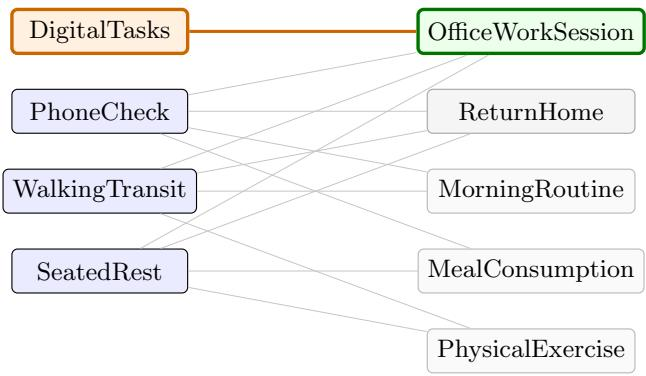  
Three transitional intentions leave {OficeWorkSession, ReturnHome} plausible; DigitalTasks has a single parent and decides.  
Fig. 9: Parent-intention resolution for the held-out episode of Figure 8. Candidate parent intentions of each predicted low-level intention. Three transitional intentions leave OfficeWorkSession and ReturnHome plausible; DigitalTasks, whose only parent is OfficeWorkSession, resolves the ambiguity. The chain check passes at both parent conditions and the prediction is a joint exact match.

## Semantic overlap as a deliberate benchmark property.

The ontology preserves one-to-many relationships by design: four transitional lowlevel intentions (walking transit, seated rest, phone check, and drink break) are each valid constituents of four diferent high-level intentions, so their presence in an episode cannot by itself determine the intention. This overlap partitions the eight classes into groups with diferent empirical behaviour. Classes composed of shared transitional intentions absorb much of the residual error, whereas several classes with more distinctive constituents are recognised more accurately. Cross-model confusion matrices and the skeleton/RGB modality comparison support this interpretation empirically. They do not constitute an ontology-independent validation, because identifying the shared constituents still relies on the designed ontology. Semantic overlap is therefore presented as a plausible explanation of the observed confusion pattern rather than as a proven source of the performance ceiling.

Two directions follow from this diagnosis. First, longer temporal context would supply the disambiguating evidence that a single activity-level episode lacks: a returnhome episode and a morning routine share transitional behaviour but are distinguished by what precedes them, so observing sequences of episodes rather than one episode of mean length 7.04 clips (7.36 on the compositional split) would test whether the HR-G transition structure gains discriminative value at longer horizons, beyond its currently modest contribution relative to the dominant low-level-intention edge. Second, explicit scene-context priors, such as time-of-day or static environmental and object anchors, would inject precisely the evidence on which the shared classes are separable, and could be introduced as an additional conditioning input without altering the reasoning architecture.

## 7.6 Synthesized Hierarchical Labels

The four-level hierarchical labels are synthesized from the NTU RGB+D 120 action classes using the proposed ontology, rather than collected from human annotators. This was a deliberate and necessary methodological choice: no multimodal hierarchical intention dataset with the breadth of NTU RGB+D 120 existed at the time of this work. The annotation pipeline, transition graph, and episode synthesis procedure were developed as a research contribution in their own right.

The inherent limitation is that the synthesized labels encode the ontological assumptions of the designers. The FOL constraints are also derived from that ontology, so they are not an independent source of semantic validation. The deterministic lookup baseline (Section 6.2) falls 38.18 pp and 50.53 pp short of the model at the two intention levels, showing that the reported lookup implementation does not recover the model’s performance. Outputs from heads excluded from the training loss are not treated as valid evidence, because those heads are not trained predictors.

A second limitation concerns ecological validity. The episodes are assembled from staged laboratory recordings of single performers, and their compositions are curated by the generator rather than observed in the wild. The benchmark therefore tests whether a model can recover hierarchical structure from realistic perceptual evidence under controlled compositional and performer shift, which is the property the reasoning components are designed to supply; it does not test naturalistic longhorizon behaviour, with its interruptions, concurrent goals, and uncontrolled scene context. Both the subject-consistency constraint and the transition-governed ordering are intended to keep the assembled episodes behaviourally coherent, but they are approximations of continuity rather than recordings of it.

Validation on datasets with independently human-annotated intention labels remains an important future step. Crowdsourced annotation or LLM-assisted labeling of NTU RGB+D 120 clips at the activity and intention levels would provide ground-truth labels independent of any specific ontology.

## 7.7 Graph Architecture and Temporal Scale

The current NSGT applies ontology-structured additive attention biases rather than propagating node features along HR-G edges through typed neighbourhood operations, so the graph operates as an attention modulation on top of a temporal backbone rather than as the primary representational substrate. The external relational-graph baseline shows why this arrangement matters: typed message passing over the same ontological edges, without a temporal sequence model beneath it, reaches a hierarchy consistency of 53.56% and collapses at the high-level intention level, because static aggregation over shared sub-actions cannot break the ties that the transitional classes create (Appendix A). Relational structure is therefore valuable only when it is coupled to fine-grained temporal modelling. A variant in which typed message passing between activity, LLI, and HLI nodes is layered on the temporal Transformer, rather than substituted for it, is the architectural direction that this result supports.

A related constraint is the temporal scale of the experiments. Episodes are constructed at the activity level, mean 7.04 clips (7.36 on the compositional split), with a structural minimum of four clips. At this scale, the transition edge receives a smaller weight because successor adjacency is sparse at the action level, whereas the lowlevel-intention co-membership edge, which links clips across the multiple activities that make up an episode, is the most informative relational signal, consistent with the dominant $\beta _ { \mathrm { l l i } }$ reported above. The HR-G transition structure shows its full benefit when applied to longer sequences spanning multiple activities and LLIs. Extending the framework to HLI-level episode sequences of 10–20 clips is therefore identified as the primary architectural direction for future investigation.

The FOL rules in the current framework encourage hierarchical ontological consistency (Activity → LLI → HLI co-occurrence) but do not directly constrain temporal ordering within episodes. Temporal ordering is delegated to the Transformer’s positional encodings and the asymmetric $\beta _ { \mathrm { t r a n s } }$ bias. The introduction of temporal logic constraints, for example rules of the form $B e f o r e ( A _ { i } , A _ { j } ) \Rightarrow A c t i v i t y ( X , B )$ , would make the temporal dimension of reasoning explicit and verifiable, and is proposed as a direction for a subsequent study.

## 7.8 Multimodal Fusion Strategy

The current framework employs early fusion: the four modality feature vectors are concatenated into a single 5120-dimensional representation before projection into the Transformer’s embedding space. While computationally eficient, this design merges all modality signals at the input layer, preventing the model from attending across modalities independently. A cross-modal attention architecture, in which separate token sequences are maintained for each modality and attention is computed both within and across modality streams, would allow the model to identify explicit correspondences between, for example, skeleton joint configurations and RGB appearance regions.

The current modality ablation (Section 6.8) shows that full fusion outperforms skeleton-only and RGB-only input. Infrared-only and depth-only results are needed to attribute the gain to each stream separately. The observed fusion gain suggests that a late-fusion or cross-modal architecture could recover additional performance currently lost in the early-fusion projection. In real-world deployment, skeleton extraction may additionally be unreliable under occlusion, at long range, or in crowded scenes. An uncertainty-aware fusion strategy that down-weights unreliable modalities at inference time would provide more robust behaviour in assistive contexts.

## 8 Conclusion and Future Work

A neuro-symbolic framework for hierarchical human intention recognition has been presented. The Neuro-Symbolic Graph Transformer (NSGT) jointly predicts atomic actions, composite activities, Low-Level Intentions, and High-Level Intentions from four sensor modalities, organised in a four-level ontology whose relational structure is encoded as a Human Reasoning Graph. Three contributions are evaluated through controlled experiments on a synthesized hierarchical benchmark derived from NTU RGB+D 120. The principal comparison uses five seeds, while the secondary head and modality ablations use three.

First, the ontology-structured graph attention, implemented as three learned HR-G bias scalars, improves hierarchy consistency by +1.98 points over the uniform-attention backbone without the logic objective and by +1.77 points with it, and yields the best intention-level macro-F1 in the evaluated suite, while action-level discrimination remains comparable across the transformer models. The reported deterministic lookup is exceeded by 38.18 and 50.53 points at the two intention levels, and an external relational-graph baseline that performs typed message passing over the same ontology falls well below the proposed model, so the efective coupling is ontology-biased attention over a temporal backbone rather than relational structure alone. The converged β values provide interpretable evidence of which edge types the model finds informative: the low-level-intention co-membership edge is the most strongly exploited (β<sub>lli</sub> ≈ 0.60) under the tested configuration. The proposed audit-trail structure will be illustrated with a real held-out episode so that the activated edges, attention values, outputs, and chain check can be inspected together.

Second, the diferentiable FOL loss provides a consistent and tunable improvement in hierarchy consistency across both the HT (+2.60 points) and NSGT (+2.39 points) backbones, significant across seeds, without requiring hard IF-THEN rules that would be invisible to backpropagation. Because per-level accuracy is unchanged within seed variation at every setting, λ<sub>FOL</sub> selects the strength of the consistency gain rather than a trade against accuracy. On the compositional split, where tested combinations are unseen in training, the full model attains the highest hierarchy consistency and joint accuracy of the suite, and the consistency gain from the logic objective grows under this shift for the proposed model while it shrinks for the uniform-attention backbone, which indicates that the graph bias and the logic objective interact rather than merely add.

Third, the synthesized four-level benchmark provides a subject-disjoint evaluation protocol, a compositional generalisation split, and 487 active constraints derived from its ontology. It constitutes a controlled resource for evaluating hierarchical intention recognition, while its designer-defined labels and lack of independently annotated real intentions remain important limitations.

The framework provides a controlled basis for studying predictive accuracy and ontology-aligned coherence in intention-aware systems; the present benchmark does not establish operational safety in real robotic deployment. Three directions are identified for future extension.

## Longer sequences and richer hierarchies.

The current framework processes activity-level episodes of mean 7.04 clips (7.36 on the compositional split). Extension to HLI-level sequences of 10–20 clips, spanning multiple activities, would test whether the HR-G transition structure gains discriminative value at longer horizons, beyond its currently modest contribution relative to the dominant low-level-intention edge, and would supply the cross-episode context on which the transitional high-level intentions are separable. Two further extensions follow from the analysis of the residual errors: explicit scene-context priors, such as time-of-day or static environmental anchors, as an additional conditioning input; and typed message passing between activity, LLI, and HLI nodes layered on the temporal

Transformer rather than substituted for it. Annotation at five or six semantic levels, including sub-intention and causal reason layers, would evaluate whether the FOL constraint mechanism generalises to deeper ontological structures.

## Anticipatory goal inference.

The HR-G framework is extended naturally to predict not only current intentions but also future goals and anticipated actions. Coupling the NSGT with a robotic planning framework for end-to-end anticipatory assistance, where hierarchical intention predictions directly inform action selection, is the primary target application. Evaluation of human trust through a user study in an assistive scenario is identified as an important validation step.

## Online and streaming inference.

The current framework processes fixed-length episodes ofline. Real assistive systems require intention inference online, updating predictions incrementally as new clips arrive. Adaptation of the NSGT to streaming inference with causal attention masks and incremental FOL constraint checking is a direct architectural extension of the current design.

## Statements and Declarations

Funding. This research was carried out within the LISSI Laboratory (Laboratoire Images, Signaux et Syst\`emes Intelligents), University of Paris-Est Cr´eteil (UPEC), Cr´eteil, France.

Competing interests. The authors declare that they have no competing interests, financial or non-financial, related to the work submitted for publication.

Ethics approval and consent to participate. This study does not involve human participants, animals, or personal data collection. All experiments are conducted on the publicly available NTU RGB+D 120 dataset [6], which was collected under institutional ethics approval by the original dataset authors. No additional ethics approval is required for this work.

Consent for publication. Not applicable.

Data availability. The base dataset used in this study, NTU RGB+D 120, is publicly available at https://rose1.ntu.edu.sg/dataset/actionRecognition/. The synthesized NTU-Hierarchy benchmark, including episode manifests, ontology mappings, and FOL rule matrices, will be made available upon acceptance of this manuscript.

Materials availability. Not applicable.

Code availability. The implementation code for the NSGT framework, including training scripts, model definitions, and evaluation notebooks, will be made available upon acceptance of this manuscript.

Author contributions. F. Soleimani: Conceptualization, Methodology, Software, Formal analysis, Investigation, Writing (original draft). G. Khodabandelou: Supervision, Conceptualization, Writing (review and editing). A. Chibani: Supervision, Writing (review and editing). Y. Amirat: Supervision, Writing (review and editing).

## Appendix A High-Level Intention Error Structure Across Model Families

The high-level intention confusion matrices of three representative models are compared to determine whether the residual errors at this level reflect architectural limitations or the intrinsic structure of the ontology. The three models are the external relational-graph baseline (R-GCN), the strongest sequential baseline (Seq-Transformer), and the proposed architecture without the logic objective (NSGT). The logic-free variant is used so that the comparison isolates the graph-structured architecture itself. The efect of the logic objective is a cross-level property, reported through the hierarchy consistency rate in the main text, and does not appear in a single-level confusion matrix.

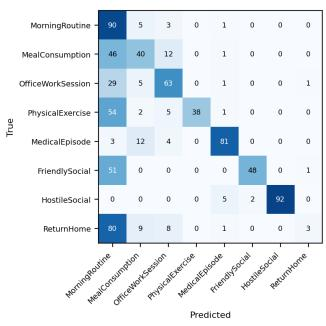  
(a) R-GCN

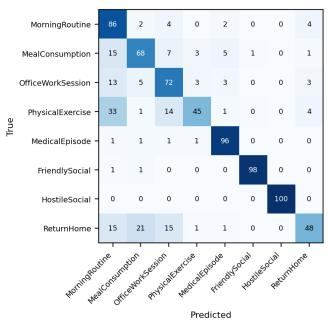  
(b) Seq-Transformer

  
(c) NSGT (no FOL)  
Fig. A1: Row-normalised high-level-intention confusion matrices (test set, values in %, seed 42) for three model families. Error magnitude decreases from the relationalgraph baseline to the sequential baseline to the graph-structured architecture, but the more informative diference is in the structure of the errors, which is analysed below.

## The confused classes share the same transitional intentions.

The errors are not distributed uniformly. They concentrate on four high-level intentions, morning routine, ofice work, physical exercise, and return-home, while three others, medical episode, friendly social, and hostile social, are recognised almost perfectly by the proposed model (96.5%, 99.7%, and 100.0% respectively). This partition follows directly from the ontology. The four confused classes each draw three or four of their constituent low-level intentions from a small set of transitional intentions, walking transit, seated rest, phone check, and drink break, and each of these four lowlevel intentions is a constituent of four distinct high-level intentions. Walking transit, for example, is a valid sub-intention of morning routine, ofice work, physical exercise, and return-home simultaneously. The three classes that are recognised cleanly contain none of these shared transitional intentions, and are instead composed of distinctive sub-intentions with a single natural parent. The errors therefore fall precisely on the high-level intentions that are ontologically many-to-one at the intention level, and avoid the classes that are structurally unambiguous.

## Kinematic symmetry compounds the ontological overlap.

The overlap is not only symbolic. The shared transitional intentions correspond to motor patterns that are close to identical in the skeleton stream: return-home and morning routine both consist of transitional behaviour such as walking, handling outerwear, and picking up or putting down objects, and both draw on the walking-transit and phone-check intentions. Separating such episodes therefore depends on static scene and object context rather than on body pose, which is precisely the dependence quantified by the modality ablation in Section 6.8, where these classes collapse under skeleton-only input and are restored by the appearance stream. The residual confusions among the four transitional classes are thus the joint consequence of a many-to-one ontology and an input whose kinematic component is symmetric across them.

## The baselines fail on this overlap in a characteristic way.

The relational-graph baseline performs static message passing over the ontological edges and does not model the temporal order of the atomic actions within an episode. When two episodes present overlapping atomic actions, as the transitional classes do, the baseline has no fine-grained temporal evidence with which to break the tie, and it collapses toward the majority attractor: 80% of return-home episodes are routed to morning routine, and over half of physical-exercise episodes are routed to morning routine as well, even though these pairs share only their transitional intentions and are otherwise distinct. The result is a difuse error pattern that spills across ontologically distant classes. The Seq-Transformer removes most of this difuse error, since it models the action sequence, but with no relational prior it still recognises physical exercise and return-home below 50%, concentrating its residual error on the same transitional classes.

## The residual limitation of the proposed model is a representational boundary, not an architectural one.

The graph-structured architecture resolves the intention-defined and socially defined boundaries cleanly, recognising hostile and friendly social episodes at or above 99.7%, which shows that where the distinction is carried by the intention structure the model recovers it in full. Its remaining errors lie entirely on the transitional classes identified above, whose separation depends on evidence that the input representation does not encode: static scene context such as the environment, the objects in view, and time-of-day anchors. The model receives pooled clip-level video and skeleton features and no explicit scene-context prior, so where two high-level intentions are legitimately reachable from the same physical sub-actions, and difer only in context, the representation is genuinely underdetermined. This is a property of the input and the ontology, not a failure of the architecture to represent hierarchy: the same model resolves every boundary that the ontology makes distinctive. It also points to a concrete direction for improvement, namely the injection of explicit scene-context priors, which is discussed in the main text as future work.

## References

[1] Corpuz, C., Cuaycong, G., Di˜no, R., Estacio, R., Se˜nar, G., Chua, A.: A novel cost-efective unmanned ground vehicle platform for robotics education. HighTech and Innovation Journal 6(1), 303–327 (2025)

[2] Kekana, M., Du, S., Steyn, N., Benali, A., Djerroud, H.: A review of human intention recognition frameworks in industrial collaborative robotics. Robotics 14(12), 174 (2025)

[3] Zhao, W., Gangaraju, K., Yuan, F.: Multimodal perception-driven decisionmaking for human-robot interaction: a survey. Frontiers in Robotics and AI 12, 1604472 (2025)

[4] Plizzari, C., Cannici, M., Matteucci, M.: Spatial temporal transformer network for skeleton-based action recognition. In: International Conference on Pattern Recognition, pp. 694–701 (2021). Springer

[5] Rudin, C.: Stop explaining black box machine learning models for high stakes decisions and use interpretable models instead. Nat Mach Intell 1: 206–215 (2019)

[6] Liu, J., Shahroudy, A., Perez, M., Wang, G., Duan, L.-Y., Kot, A.C.: Ntu rgb+ d 120: A large-scale benchmark for 3d human activity understanding. IEEE transactions on pattern analysis and machine intelligence 42(10), 2684–2701 (2019)

[7] Kuehne, H., Arslan, A., Serre, T.: The language of actions: Recovering the syntax and semantics of goal-directed human activities. In: Proceedings of the IEEE Conference on Computer Vision and Pattern Recognition, pp. 780–787 (2014)

[8] Sigurdsson, G.A., Varol, G., Wang, X., Farhadi, A., Laptev, I., Gupta, A.: Hollywood in homes: Crowdsourcing data collection for activity understanding. In: European Conference on Computer Vision, pp. 510–526 (2016). Springer

[9] Raja, S.S., Pang, Y., Shih, Y., Zheng, Y.: Hstcn-nusvc: a homogeneous stacked deep ensemble learner for classifying human actions using smartphones. Emerg. Sci. J 9, 468–484 (2025)

[10] Wu, T., Han, P., Yin, O., You, L., San, H.: A review on federated learning on sensor-based human activity recognition. HighTech Innov J 6(3), 1079–1103 (2025)

[11] Trujillo, D., Morales, L., Ch´avez, D., Trujillo, M., Pozo-Esp´ın, D.F.: Enhancing trajectory tracking in humanoid robots using neural network-based dynamic gain control. Emerging Science Journal (2025)

[12] Xu, J., Zhang, Z., Friedman, T., Liang, Y., Broeck, G.: A semantic loss function for deep learning with symbolic knowledge. In: International Conference on

[13] Serafini, L., Garcez, A.d.: Logic tensor networks: Deep learning and logical reasoning from data and knowledge. arXiv preprint arXiv:1606.04422 (2016)

[14] Badreddine, S., Garcez, A.d., Serafini, L., Spranger, M.: Logic tensor networks. Artificial Intelligence 303, 103649 (2022)

[15] Simonyan, K., Zisserman, A.: Two-stream convolutional networks for action recognition in videos. Advances in neural information processing systems 27 (2014)

[16] Smaira, L., Carreira, J., Noland, E., Clancy, E., Wu, A., Zisserman, A.: A short note on the kinetics-700-2020 human action dataset. arXiv preprint arXiv:2010.10864 (2020)

[17] Baltruˇsaitis, T., Ahuja, C., Morency, L.-P.: Multimodal machine learning: A survey and taxonomy. IEEE transactions on pattern analysis and machine intelligence 41(2), 423–443 (2018)

[18] Kong, Q., Wu, Z., Deng, Z., Klinkigt, M., Tong, B., Murakami, T.: Mmact: A large-scale dataset for cross modal human action understanding. In: Proceedings of the IEEE/CVF International Conference on Computer Vision, pp. 8658–8667 (2019)

[19] Yan, S., Xiong, Y., Lin, D.: Spatial temporal graph convolutional networks for skeleton-based action recognition. In: Proceedings of the AAAI Conference on Artificial Intelligence, vol. 32 (2018)

[20] Shi, L., Zhang, Y., Cheng, J., Lu, H.: Two-stream adaptive graph convolutional networks for skeleton-based action recognition. In: Proceedings of the IEEE/CVF Conference on Computer Vision and Pattern Recognition, pp. 12026–12035 (2019)

[21] Farha, Y.A., Gall, J.: Ms-tcn: Multi-stage temporal convolutional network for action segmentation. In: Proceedings of the IEEE/CVF Conference on Computer Vision and Pattern Recognition, pp. 3575–3584 (2019)

[22] Kotseruba, I., Rasouli, A., Tsotsos, J.K.: Joint attention in autonomous driving (jaad). arXiv preprint arXiv:1609.04741 (2016)

[23] Rasouli, A., Kotseruba, I., Kunic, T., Tsotsos, J.K.: Pie: A large-scale dataset and models for pedestrian intention estimation and trajectory prediction. In: Proceedings of the IEEE/CVF International Conference on Computer Vision, pp. 6262–6271 (2019)

[24] Ma, D., Zhang, C., Xu, Q., Zhou, G.: Mcv-intention: A multimodalities and crossview dataset for human assembly intention recognition. Scientific Data 12(1), 1784 (2025)

[25] Hitzler, P., Sarker, M.K.: Neuro-symbolic artificial intelligence: The state of the art (2022)

[26] Garcez, A.d., Lamb, L.C.: Neurosymbolic ai: The 3 rd wave. Artificial Intelligence Review 56(11), 12387–12406 (2023)

[27] Manhaeve, R., Dumancic, S., Kimmig, A., Demeester, T., De Raedt, L.: Deepproblog: Neural probabilistic logic programming. Advances in neural information processing systems 31 (2018)

[28] Lee, D.W., Kim, Y., Jeong, S., Guvenoz, D., Malachowsky, P., Morency, L.-P., Breazeal, C., Park, H.W.: Social Human Robot Embodied Conversation (SHREC) Dataset: Benchmarking Foundational Models’ Social Reasoning (2026). https: //openreview.net/forum?id=z7nS4MgMS7

[29] Yi, K., Gan, C., Li, Y., Kohli, P., Wu, J., Torralba, A., Tenenbaum, J.B.: Clevrer: Collision events for video representation and reasoning. arXiv preprint arXiv:1910.01442 (2019)

[30] Vaswani, A., Shazeer, N., Parmar, N., Uszkoreit, J., Jones, L., Gomez, A.N., Kaiser, L., Polosukhin, I.: Attention is all you need. Advances in neural information processing systems 30 (2017)

[31] Zhao, J., Wen, Y., Li, Q., Hu, M., Zhou, Y., Xue, J., Wu, J., Gao, Y., Wen, Z., Tao, J., et al.: Deep learning approaches for multimodal intent recognition: A survey. arXiv preprint arXiv:2507.22934 (2025)

[32] Soleimani, F., Chibani, A., Amirat, Y., Khodabandelou, G.: Compositional benchmark synthesis for hierarchical human action recognition. arXiv preprint arXiv:2608.10765 (2026)

[33] Loshchilov, I., Hutter, F.: Decoupled weight decay regularization. arXiv preprint arXiv:1711.05101 (2017)

[34] Duan, H., Zhao, Y., Chen, K., Lin, D., Dai, B.: Revisiting skeleton-based action recognition. In: Proceedings of the IEEE/CVF Conference on Computer Vision and Pattern Recognition, pp. 2969–2978 (2022)

[35] Wang, L., Huang, B., Zhao, Z., Tong, Z., He, Y., Wang, Y., Wang, Y., Qiao, Y.: Videomae v2: Scaling video masked autoencoders with dual masking. In: Proceedings of the IEEE/CVF Conference on Computer Vision and Pattern Recognition, pp. 14549–14560 (2023)

[36] Oquab, M., Darcet, T., Moutakanni, T., Vo, H., Szafraniec, M., Khalidov, V., Fernandez, P., Haziza, D., Massa, F., El-Nouby, A., et al.: Dinov2: Learning robust visual features without supervision. arXiv preprint arXiv:2304.07193 (2023)

[37] Schlichtkrull, M., Kipf, T.N., Bloem, P., Van Den Berg, R., Titov, I., Welling, M.: Modeling relational data with graph convolutional networks. In: European Semantic Web Conference, pp. 593–607 (2018). Springer

[38] Zhou, Y., Yan, X., Cheng, Z.-Q., Yan, Y., Dai, Q., Hua, X.-S.: Blockgcn: Redefine topology awareness for skeleton-based action recognition. In: Proceedings of the IEEE/CVF Conference on Computer Vision and Pattern Recognition, pp. 2049– 2058 (2024)

[39] Do, J., Kim, M.: Skateformer: skeletal-temporal transformer for human action recognition. In: European Conference on Computer Vision, pp. 401–420 (2024). Springer

[40] Chen, Y., Zhang, Z., Yuan, C., Li, B., Deng, Y., Hu, W.: Channel-wise topology refinement graph convolution for skeleton-based action recognition. In: Proceedings of the IEEE/CVF International Conference on Computer Vision, pp. 13359–13368 (2021)

[41] Cheng, Q., Liu, Z., Ren, Z., Cheng, J., Liu, J.: Spatial-temporal information aggregation and cross-modality interactive learning for rgb-d-based human action recognition. Ieee Access 10, 104190–104201 (2022)

[42] Bruce, X., Liu, Y., Zhang, X., Zhong, S.-h., Chan, K.C.: Mmnet: A modelbased multimodal network for human action recognition in rgb-d videos. IEEE Transactions on Pattern Analysis and Machine Intelligence 45(3), 3522–3538 (2022)

[43] Wang, M., Xing, J., Jiang, B., Chen, J., Mei, J., Zuo, X., Dai, G., Wang, J., Liu, Y.: A multimodal, multi-task adapting framework for video action recognition. In: Proceedings of the AAAI Conference on Artificial Intelligence, vol. 38, pp. 5517–5525 (2024)

[44] Cho, S., Kim, T.-K.: Body-hand modality expertized networks with crossattention for fine-grained skeleton action recognition. In: 2025 IEEE/RSJ International Conference on Intelligent Robots and Systems (IROS), pp. 11614–11621 (2025). IEEE

[45] Spathis, K., Kardaris, N., Maragos, P.: Multi-task learning for joint action and gesture recognition. In: Proceedings of the IEEE/CVF International Conference on Computer Vision, pp. 95–104 (2025)