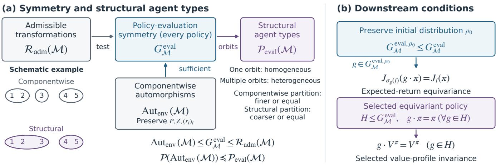
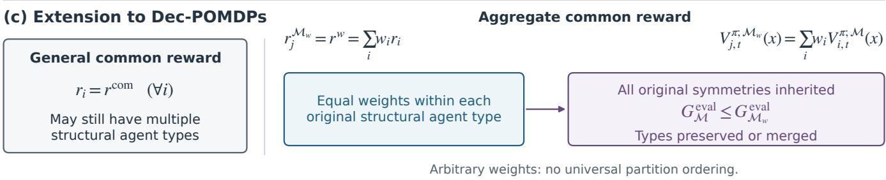

# On Symmetry for Characterizing Agent Heterogeneity in Multi-Agent Systems

Jianhong Wang†‡, Jonathan Lawry‡

†INFORMED-AI Hub, University of Bristol

‡School of Engineering Mathematics and Technology, University of Bristol

Bristol, United Kingdom

{jianhong.wang, J.Lawry}@bristol.ac.uk

## Abstract

Understanding agent heterogeneity can inform the design of shared and agent-specific policy representations, however existing criteria provide no unified structural test. We study finite-horizon POSGs and define a type-compatible transformation as a policy-evaluation symmetry when complete policy evaluation commutes with it for every decentralized behavioral policy. Policy-evaluation symmetries form a group for which agent orbits define structural agent types. This classification does not depend on the particular policy chosen or the distribution of initial states. We prove that every componentwise environment automorphism is a policy-evaluation symmetry, but that the converse does not hold. Applying the frame- work to cooperative Dec-POMDPs shows that agents can belong to diferent structural types even when they share a common re- ward. For prescribed weighted reward aggregation, we derive an exact value identity and suficient conditions for the resulting Dec- POMDP to inherit the policy-evaluation symmetries of the source POSG. Finall , we give suficient conditions under which re eated model factorizations induce policy-evaluation symmetry, and show that preserving an optimal Boltzmann policy set neither implies nor follows from this symmetry in general.

## Keywords

multi-agent systems, agent heterogeneity, symmetry, POSGs, Dec-POMDPs

## 1 Introduction

Multi-agent systems can describe interacting decision-makers in real-world problems, such as cooperative robot control [5] and volt age regulation in power distribution networks [33], where agents’ capabilities, information, objectives, and behavior may difer. As a result, characterizing these diferences is necessary, which can inform the design of policy to make decisions.

Symmetry identifies transformations that preserve relevant system properties, a principle used across physical and computational sciences. In power-grid swing equations, exchanging generator labels preserves the dynamics when the corresponding generator parameters and network couplings are unchanged [21]. In molecular modeling, energy is invariant to rigid rotations, translations, and atom reindexing, properties incorporated into SchNet [26]. These examples inspires a possibility to identify corresponding structural regularities in multi-agent systems by symmetries.

Multi-agent reinforcement learning (MARL), as a learning framework for multi-agent systems, already exploits symmetry. Distributed policy networks that encode global symmetries empir- ically improve data eficiency on symmetric cooperative tasks [31]. Other-play uses environment symmetries to reduce dependence on arbitrary conventions in zero-shot coordination [14], while ex-pected return symmetries extend the symmetry class used for this purpose [22]. However, their focus is task-specific (improving learning and coordination), leaving the connection to structural agent heterogeneity an open question.

Broader formal accounts describe component-preserving model automorphisms [17, 30]. Braun et al. [7] use counting and isomorphic symmetries for compact partitioned Dec-POMDPs, with agent-number tractability relying on the stronger isomorphic factorization. Complementary work classifies physical and behavioral heterogeneity in multi-robot learning [5], measures behavioral differences through system neural diversity [6], and distinguishes observation, transition, objective, and policy heterogeneity [15]. These perspectives identify particular model regularities or dimensions of diference, however, they are still with a gap to the chracteristics of multi-agent systems.

We therefore ask: can we use symmetries to determine structural agent heterogeneity? Specifically, when can agents be exchanged through compatible transformations without changing how every decentralized policy is evaluated?

To answer the above research questions, we ground our theo- retical framework in finite-horizon partially observable stochastic games (POSGs). A transformation is a policy-evaluation symmetry if evaluating any transformed policy gives the correspondingly transformed value profile, at every state–joint-history pair. These symmetries form a group whose agent orbits define structural agent types: one orbit means structural homogeneity, and multiple orbits mean structural heterogeneity. For the specified game and admissible transformations, this classification is independent ofthe selected policy and initial-state distribution.

Our contributions are as follows: (1) We establish the policy- evaluation symmetry group and its structural agent types, allowing compatible agent, state, action, and observation transformations. We distinguish policy-evaluation symmetry, which concerns every decentralized policy, from the equivariance of a selected policy. (2) We prove that preserving the transition, observation, and reward functions componentwise guarantees policy-evaluation symmetry, but the reverse is not necessary. A finite two-stage POSG yields a strictly finer componentwise agent partition to show the necessity of the policy-evaluation definition. (3) We show that Dec-POMDPs can remain structurally heterogeneous, although with a common reward. For a derived Dec-POMDP with a prescribed weighted common reward, we derive an exact weighted-value identity and suficient conditions for inheriting the source game’s symmetries. We further compare the framework with existing heterogeneity categories, counting and isomorphic symmetry, and expected re turn symmetry, making the assumptions and limitations of each comparison explicit.

## 2 Related Work

## 2.1 Taxonomies of Agent Heterogeneity

Bettini et al. [5] distinguish physical from behavioral heterogeneity in multi-robot and multi-agent systems. They further separate behavioral heterogeneity according to whether agents share an ob- jective, yielding five physical–behavioral subclasses. This taxonomy is a high-level classification rather than a measure of degree. Their later system neural diversity measure addresses the latter question for behavior by averaging pairwise behavioral distances [6]. Hu et al. [15] give a finer agent-level MARL taxonomy based on observation, response-transition, efect-transition, objective, and policy heterogeneity.

Table 1 compares these prior categories and the system neural diversity measure with the closest concepts in our framework. For physical, observation, transition, and objective heterogeneity, the associations are conditional on the relevant agent property being represented in the POSG. Behavioral and policy heterogeneity are instead compared through equivariance of a selected policy rel- ative to chosen policy-evaluation symmetries. Bettini et al.’s five subclasses combine physical and behavioral heterogeneity, with behavioral heterogeneity further distinguished by whether agents share an objective. The table therefore lists these underlying distinctions rather than repeating all five combinations.

These associations locate earlier categories within the symmetry framework, but they do not identify those categories with structural agent types. A componentwise environment automorphism that exchanges two agents guarantees that they have the same struc- tural agent type. However, failure of a componentwise preservation equation for a candidate transformation neither rules out that trans- formation as a policy-evaluation symmetry nor establishes that the agents have diferent structural agent types. Likewise, diferent behavior under one selected policy does not by itself establish dif- ferent structural agent types. Graded behavioral measures such as system neural diversity [6] are complementary to the structural agent-type partition. Appendix A explains the assumptions and direction of each association in Table 1.

## 2.2 Symmetry in Multi-Agent Systems

Symmetry in normal-form games is commonly expressed through permutations of players and strategies that preserve payof profiles. Cao and Yang [8] formalize player and strategy symmetry groups and distinguish ordinary, renaming, and name-irrelevant symmetric games. Koriche et al. [19] distinguish structural symmetry from minimax symmetry in finite-horizon stochastic games. Their semantic notion preserves an optimal minimax value, whereas ours evaluates every decentralized policy in a partially observable game. Tewolde et al. [29] study the complexity of detecting player and action symmetries in normal-form games, deriving graph-automorphism and graph-isomorphism completeness results, and analyze Nash equilibria that respect given symmetries. These traditions motivate treating agent interchangeability as an orbit question but do not directly address our all-policy setting with type-compatible state, observation, and history transformations.

Table 1: Relation of prior heterogeneity categories and measures to our symmetry-based concepts. Note that these associations are not claims of formal equivalence.
<table><tr><td></td><td>Prior category or measure Relation to our framework</td></tr><tr><td>Physical heterogeneity [5] Physical differences can be tested through a</td><td>componentwise environment automorphism when their consequences are encoded in the POSG</td></tr><tr><td>Observation heterogeneity [15]</td><td>Observation-preservation condition within a componentwise environment automorphism.</td></tr><tr><td>Response- and effect-transition heterogeneity [15]</td><td>Transition-preservation condition within a componentwise environment automorphism, provided that the required local transition</td></tr><tr><td>Objective</td><td>factorization is specified. Reward-preservation condition within a</td></tr><tr><td>heterogeneity [5, 15]</td><td>componentwise environment automorphism.</td></tr><tr><td>Behavioral or policy heterogeneity [5, 15]</td><td>Equivariance of a selected policy characterizes behavioral homogeneity among agents related by the chosen policy-evaluation symmetries, while failure</td></tr><tr><td></td><td>relative to a specified symmetry expresses policy-relative behavioral differentiation.</td></tr><tr><td>System neural diversity [6]</td><td>Graded comparison of selected policies that complements the exact classification into structural agent types.</td></tr></table>

For sequential models, Kang and Kim [17] study symmetries of POMDPs and POSGs through graph automorphisms that preserve the model components. In cooperative settings, Hu et al. [14] call component-preserving transformations equivalence mappings and use them to randomize conventions in other-play. Treutlein et al. [30] formulate Dec-POMDP isomorphisms and automorphisms using bijections of agents, states, actions, and observations that pre-serve transitions, observations, rewards, and the initial distribution. These definitions use diferent model conventions and admissi- ble transformations. After translating them into our setting, their requirements to preserve the transition, observation, and reward functions become instances of the componentwise environment automorphisms studied in Section 5. By Theorem 5.2, these conditions are suficient, but not necessary, for policy-evaluation symmetry. We instead define policy-evaluation symmetry directly by $\mathcal { E } _ { M } ( g \cdot \pi ) = g \cdot \mathcal { E } _ { M } ( \pi )$ for every decentralized policy �: transform- ing a policy before evaluation must give the same value profile as evaluating it first and then transforming its values.

Other work captures diferent consequences or representations of symmetry. At the policy-architecture level, van der Pol et al. [31] factor global cooperative-system symmetries into local transfor- mations and agent permutations to construct distributed equivariant policy networks. This exploits a supplied symmetry in policy learning, whereas our structural agent types are defined before se- lecting a policy or architecture. At the representation level, Braun et al. [7] use counting and isomorphic symmetry to obtain com-pact lifted Dec-POMDP representations. Muglich et al. [22] introduce expected return symmetries, which preserve self-play-optimal Boltzmann-exploratory policies at a fixed temperature for zero-shot coordination. Our structural agent types instead use the orbits of a solution-independent policy-evaluation symmetry group that holds for every decentralized policy.

3 Model and Type-Compatible Transformations We consider a finite-horizon partially observable stochastic game (POSG) [12], as follows:

$$
\boldsymbol { \mathcal { M } } = \big ( N , S , ( \mathcal { A } _ { i } ) _ { i } , ( O _ { i } ) _ { i } , P , Z , ( r _ { i } ) _ { i } , \rho _ { 0 } , T , \boldsymbol { \gamma } \big ) ,
$$

where $N = \{ 1 , \ldots , n \}$ is the finite nonempty agent set, and $s , \mathcal { A } _ { i } ,$ and $O _ { i }$ are finite and nonempty for every $i \in N .$ . Moreover, the finite horizon is $T <$ ∞ and the discount factor is $\gamma \in ( 0 , 1 ]$ . The transition function is $P ( s ^ { \prime } \mid s , a )$ , the joint observation function is $Z ( o ^ { \prime } \mid s ^ { \prime } , a )$ , and $r _ { i } ( s , a , s ^ { \prime } )$ is agent $i ^ { \circ } s$ reward function. At the initial time step $t = 0 ;$ , the state is drawn from the initial distribution $\rho _ { 0 } ,$ , so $s _ { 0 } \sim \rho _ { 0 } ,$ and every agent has the empty history $h _ { i } ^ { 0 } = \left( \right)$ . For $t \geq 1 ,$ the local history of agent � is defined as:

$$
\boldsymbol { h } _ { i } ^ { t } = ( \boldsymbol { a } _ { i } ^ { 0 } , \boldsymbol { o } _ { i } ^ { 1 } , \dots , \boldsymbol { a } _ { i } ^ { t - 1 } , \boldsymbol { o } _ { i } ^ { t } ) \in \mathcal { H } _ { i } ^ { t } = ( \mathcal { A } _ { i } \times O _ { i } ) ^ { t } .
$$

The policy domain contains all decentralized behavioral product policies, such that:

$$
\Pi _ { \mathrm { d e c } } = \prod _ { i \in N } \prod _ { t = 0 } ^ { T - 1 } \prod _ { h _ { i } ^ { t } \in \mathcal { H } _ { i } ^ { t } } \Delta ( \mathcal { A } _ { i } ) , \qquad \pi ^ { t } ( a \mid h ^ { t } ) = \prod _ { i } \pi _ { i } ^ { t } ( a _ { i } \mid h _ { i } ^ { t } ) .
$$

Agents may randomize independently at their local histories, but we exclude a common random signal, such as a shared seed or public correlation device [1, 3].1

Let $\begin{array} { r } { X _ { t } = S \times \prod _ { i } \mathcal { H } _ { i } ^ { t } } \end{array}$ . Complete policy evaluation assigns a value to every valid state–joint-history pair, including pairs unreachable under a selected policy. With $V _ { i . T } ^ { \pi } \equiv 0 \mathrm { . }$ , for $t < T$ it is defined by the following Bellman recursion:

$$
\begin{array} { l } { { V _ { i , t } ^ { \pi } ( s , h ^ { t } ) = \displaystyle \sum _ { a , s ^ { \prime } , o ^ { \prime } } \pi ^ { t } ( a \mid h ^ { t } ) P ( s ^ { \prime } \mid s , a ) Z ( o ^ { \prime } \mid s ^ { \prime } , a ) } } \\ { { . \left[ r _ { i } ( s , a , s ^ { \prime } ) + \gamma V _ { i , t + 1 } ^ { \pi } ( s ^ { \prime } , h ^ { t } , a , o ^ { \prime } ) \right] . } } \end{array}\tag{1}
$$

The final transition reward is therefore included at $t = T - 1$ . Write

$$
\mathcal { E } _ { \mathcal { M } } : \Pi _ { \mathrm { d e c } } \to \mathcal { V } , \qquad \mathcal { E } _ { \mathcal { M } } ( \pi ) = V ^ { \pi } ,
$$

for the operator returning all agents’ values at all time steps and pairs, where $_ \mathrm { c } { } _ { V }$ is the space of all function profiles $V = \left( V _ { i , t } \right)$ , where $V _ { i , t } : X _ { t } \to \mathbb { R }$ for $i \in N$ and 0 $\mid \leq t \leq T$ , with $V _ { i , T } \equiv 0 .$ . Each policy � determines a particular profile $V ^ { \pi } \in \mathcal { V }$ through Equation (1). The expected return under the initial distribution is as follows:

$$
J _ { i } ( \pi ) = \mathbb { E } _ { s _ { 0 } \sim \rho _ { 0 } } \big [ V _ { i , 0 } ^ { \pi } ( s _ { 0 } , ( ) ^ { N } ) \big ] ,\tag{2}
$$

where $( ) ^ { N }$ is the empty joint history.

Type-compatible transformations. A type-compatible transformation is a complete tuple

$$
g = \big ( \sigma _ { g } , \boldsymbol { \phi } _ { g } ^ { S } , ( \boldsymbol { \phi } _ { g , i } ^ { \mathcal { A } } ) _ { i } , ( \boldsymbol { \phi } _ { g , i } ^ { O } ) _ { i } \big ) ,
$$

where $\sigma _ { g }$ permutes agents, $\phi _ { g } ^ { S }$ bijects the state space, and $\boldsymbol { \phi } _ { g , i } ^ { \mathcal { R } }$ $\mathcal { A } _ { i }  \mathcal { A } _ { \sigma _ { g } ( i ) }$ and $\phi _ { q , i } ^ { O } : O _ { i } \to O _ { \sigma _ { g } ( i ) }$ are bijections. It acts on joint actions by $[ g \cdot a ] _ { \sigma _ { g } ( i ) } = \phi _ { g , i } ^ { \mathcal { A } } ( a _ { i } )$ , and analogously on joint observations. For $t \geq 1$ , the induced local-history map $\Phi _ { g , i } ^ { \mathcal { H } , t } : \mathcal { H } _ { i } ^ { t } $ $\mathcal { H } _ { \sigma _ { g } ( i ) } ^ { t }$ is expressed as follows:

$$
\begin{array} { r l } & { \Phi _ { g , i } ^ { \mathcal { H } , t } ( a _ { i } ^ { 0 } , o _ { i } ^ { 1 } , \dots , a _ { i } ^ { t - 1 } , o _ { i } ^ { t } ) } \\ & { \quad \quad = \big ( \phi _ { g , i } ^ { \mathcal { R } } ( a _ { i } ^ { 0 } ) , \phi _ { g , i } ^ { \mathcal { O } } ( o _ { i } ^ { 1 } ) , \dots , \phi _ { g , i } ^ { \mathcal { R } } ( a _ { i } ^ { t - 1 } ) , \phi _ { g , i } ^ { \mathcal { O } } ( o _ { i } ^ { t } ) \big ) , } \end{array}
$$

and $\Phi _ { g , i } ^ { \mathcal { H } , 0 } ( ( ) ) = \left( \right)$ . For a joint history $h ^ { t } = ( h _ { i } ^ { t } ) _ { i \in N }$ , define

$$
[ g \cdot h ^ { t } ] _ { \sigma _ { g } ( i ) } = \Phi _ { g , i } ^ { \mathcal { H } , t } ( h _ { i } ^ { t } ) .
$$

Thus agent �’s transformed local history occupies coordinate $\sigma _ { g } ( i )$ in the joint history. The induced state–joint-history map is

$$
\tau _ { g } ^ { t } : X _ { t }  X _ { t } , \qquad \tau _ { g } ^ { t } ( s , h ^ { t } ) = \big ( \phi _ { g } ^ { S } ( s ) , g \cdot h ^ { t } \big ) .
$$

Thus $\tau _ { g } ^ { t }$ transforms the state and joint history. It preserves the time index2 and does not perform a state transition to generate the next state. In particular, for the empty joint history $\zeta ) ^ { N } , \tau _ { g } ^ { 0 } ( s , \ l ( \ l ) ^ { N } ) =$ $( \phi _ { q } ^ { S } ( s ) , ( ) ^ { N } )$

We fix an application-specified subgroup $\mathscr { R } _ { \mathrm { a d m } } ( \mathcal { M } )$ of complete type-compatible transformations arising from representation structure fixed for the application. Examples include permutations of an entity-factored multi-agent representation [13], node relabelings of a graph-structured representation [18], or geometric state–action transformations such as rotations and reflections [32]. Membership in $\mathcal { R } _ { \mathrm { a d m } } ( \mathcal { M } )$ supplies a candidate transformation; an environment or policy-evaluation symmetry must also satisfy the corresponding preservation conditions.

The induced transformations of policies and values are specified pointwise by the following equations:

$$
\left( g \cdot \pi \right) _ { \sigma _ { g } ( i ) } ^ { t } \left( \phi _ { g , i } ^ { \mathcal { R } } ( a _ { i } ) \mid \Phi _ { g , i } ^ { \mathcal { H } , t } ( h _ { i } ^ { t } ) \right) = \pi _ { i } ^ { t } ( a _ { i } \mid h _ { i } ^ { t } ) ,\tag{3}
$$

$$
( g \cdot V ) _ { \sigma _ { g } ( i ) , t } ( \tau _ { g } ^ { t } x _ { t } ) = V _ { i , t } ( x _ { t } ) .\tag{4}
$$

These transformations define left group actions. At each fixed joint history, the transformed joint action distribution equals the product of the transformed local distributions. Because the induced policy transformation only relabels and reindexes the local policies, $g \cdot \pi$ remains a decentralized product policy in $\Pi _ { \mathrm { d e c } }$ . Appendix B proves these action properties together with the subgroup and orbit facts used in the following sections.

## 4 Policy-Evaluation Symmetry and Structural Agent Types

Definition 4.1 (Policy-evaluation symmetry). An admissible transformation $g \in \mathcal { R } _ { \mathrm { a d m } } ( M )$ is a policy-evaluation symmetry if

$$
\begin{array} { r } { \mathcal { E } _ { M } ( g \cdot \pi ) = g \cdot \mathcal { E } _ { M } ( \pi ) \qquad \mathrm { f o r ~ e v e r y ~ } \pi \in \Pi _ { \mathrm { d e c } } . } \end{array}
$$

Equivalently,

$$
V _ { \sigma _ { g } ( i ) , t } ^ { g \cdot \pi } ( \tau _ { g } ^ { t } x _ { t } ) = V _ { i , t } ^ { \pi } ( x _ { t } )
$$

for every policy, agent, time step, and $x _ { t } \in X _ { t }$ . The set of all such transformations is denoted $G _ { \mathcal { M } } ^ { \mathrm { e v a l } }$

For a normal-form game embedded as a one-stage POSG, this definition reduces to payof preservation under admissible player and action relabelings (see Proposition B.4).

The requirement that the identity hold for every policy $\pi \in \Pi _ { \mathrm { d e c } }$ is essential. The definition says that transforming any policy and then evaluating it gives the correspondingly transformed complete value profile. It does not require $V ^ { \pi }$ to be invariant under ${ \mathit { g } } ,$ because in general the comparison is between � and $g \cdot \pi$ . The group-action laws imply that $G _ { M } ^ { \mathrm { { \bar { e v a l } } } } \leq \mathcal { R } _ { \mathrm { a d m } } ( M )$

Definition 4.2 (Structural agent type). Agents $i , j \in N$ have the same structural agent type when

$$
i \sim _ { \mathrm { e v a l } } j \quad \Longleftrightarrow \quad { \mathrm { s o m e } } g \in G _ { \mathcal { M } } ^ { \mathrm { e v a l } } { \mathrm { ~ s a t i s f i e s ~ } } \sigma _ { g } ( i ) = j .
$$

The structural partition is the orbit partition

$$
\mathcal { P } _ { \mathrm { e v a l } } ( \boldsymbol { M } ) = \mathcal { P } ( G _ { \boldsymbol { M } } ^ { \mathrm { e v a l } } ) = \big \{ \{ \sigma _ { g } ( i ) : g \in G _ { \boldsymbol { M } } ^ { \mathrm { e v a l } } \} : i \in N \big \} .
$$

Writing $\mathcal { P } _ { \mathrm { e v a l } } ( \mathcal { M } ) = \{ T _ { 1 } , . . . , T _ { m } \}$ , each $T _ { k }$ is one structural agent type. The multi-agent system is structurally homogeneous if $m = 1$ and structurally heterogeneous if $m > 1$ . Heterogeneity therefore describes the complete partition, rather than one particular type.

Because $G _ { \mathcal { M } } ^ { \mathrm { e v a l } }$ acts on � through the agent maps $i \mapsto \sigma _ { g } ( i )$ $\sim _ { \mathrm { e v a l } }$ is the standard orbit equivalence relation [16, Chap. $1 4 . 1 ] . ^ { 3 }$ Mathematically, the case $m = 1$ means that the action of $G _ { \mathcal { M } } ^ { \mathrm { e v a l } }$ on � is transitive: for every pair of agents $i , j \in N ,$ some $g \in G _ { \mathcal { M } } ^ { \mathrm { e v a l } }$ satisfies $\sigma _ { q } ( i ) = j$

To obtain an equivariance relation for expected returns $J _ { i } ( \pi )$ under the initial distribution, we additionally require the state transformation to preserve $\rho _ { 0 }$ . We therefore define the subgroup, as follows:

$$
G _ { \mathcal M } ^ { \mathrm { e v a l } , \rho _ { 0 } } = \left\{ g \in G _ { \mathcal M } ^ { \mathrm { e v a l } } : \rho _ { 0 } \bigl ( \phi _ { g } ^ { S } ( s ) \bigr ) = \rho _ { 0 } ( s ) \mathrm { f o r e v e r y } s \in S \right\} ,
$$

where the state transformation must preserve the initial distribution. Therefore, every $g \in G _ { \mathcal { M } } ^ { \mathrm { e v a l } , \rho _ { 0 } }$ satisfies the following equation:

$$
J _ { \sigma _ { g } ( i ) } ( g \cdot \pi ) = J _ { i } ( \pi ) .
$$

Policy equivariance is downstream. For an arbitrary subgroup $H \leq { \dot { G } } _ { M } ^ { \mathrm { e v a l } }$ , we call a selected joint policy �-equivariant when $g \cdot \pi = \pi ,$ for every $g \in H$ . Pointwise, this is represented by the following equation:

$$
\pi _ { \sigma _ { g } ( i ) } ^ { t } \left( \phi _ { g , i } ^ { \mathcal { R } } ( a _ { i } ) \mid \Phi _ { g , i } ^ { \mathcal { H } , t } ( h _ { i } ^ { t } ) \right) = \pi _ { i } ^ { t } ( a _ { i } \mid h _ { i } ^ { t } ) .
$$

For every $g \in H ,$ policy-evaluation symmetry gives $g \cdot V ^ { \pi } = V ^ { g \cdot \pi }$ If the selected policy is �-equivariant, then $g \cdot \pi = \pi ,$ , so its value profile is also unchanged:

$$
g \cdot V ^ { \pi } = V ^ { g \cdot \pi } = V ^ { \pi } .
$$

The reverse implication need not hold. The equality $g \cdot V ^ { \pi } = V ^ { \pi }$ for one selected policy does not imply that $g \cdot \pi = \pi $ , nor does it establish the following identity for every policy:

$$
V ^ { g \cdot \eta } = g \cdot V ^ { \eta } \quad \mathrm { f o r e v e r y } \eta \in \Pi _ { \mathrm { d e c } } ,
$$

as required for � to be a policy-evaluation symmetry.

## 5 Componentwise Environment Automorphisms

Componentwise primitive-preserving transformations,4 such as transformations that separately preserve the transition, observation, and reward functions, appear as POSG automorphisms or symmetries [17], Dec-POMDP equivalence mappings [14], Dec-POMDP automorphisms [30], and environment symmetries [22]. We use the name componentwise environment automorphism for this notion in POSGs, emphasizing its contrast with policy-evaluation symmetry. Unlike the Dec-POMDP automorphisms of Treutlein et al. [30], preservation of the initial distribution is imposed separately in our framework, as we introduced in Section 4.

Definition 5.1 (Componentwise environment automorphism [17]). An admissible transformation � is a componentwise environment automorphism when, for every well-typed $s , s ^ { \prime } , a , o ^ { \prime }$ , and �,

$$
P ( \phi _ { g } ^ { S } ( s ^ { \prime } ) \mid \phi _ { g } ^ { S } ( s ) , g \cdot a ) = P ( s ^ { \prime } \mid s , a ) ,\tag{5}
$$

$$
Z ( g \cdot o ^ { \prime } \mid \phi _ { g } ^ { S } ( s ^ { \prime } ) , g \cdot a ) = Z ( o ^ { \prime } \mid s ^ { \prime } , a ) ,\tag{6}
$$

$$
r _ { \sigma _ { g } ( i ) } ( \phi _ { g } ^ { S } ( s ) , g \cdot a , \phi _ { g } ^ { S } ( s ^ { \prime } ) ) = r _ { i } ( s , a , s ^ { \prime } ) .\tag{7}
$$

Write $\mathrm { A u t _ { e n v } } ( M )$ for the set of componentwise environment auto- morphisms.

Theorem 5.2 (Componentwise environment automorphisms are sufficient). The componentwise environment automorphisms form a subgroup and

$$
\mathrm { A u t } _ { \mathrm { e n v } } ( { \cal M } ) \leq G _ { \cal M } ^ { \mathrm { e v a l } } , \qquad \mathcal { P } ( \mathrm { A u t } _ { \mathrm { e n v } } ( { \cal M } ) ) \preceq { \mathcal P } _ { \mathrm { e v a l } } ( { \cal M } ) ,
$$

where $\preceq$ means finer than or equal to.

Proof sketch. The identity transformation preserves all three environment components. If two transformations preserve them, applying the preservation equations successively shows that their composition also preserves them. Substituting inverse images into the same equations shows that each inverse preserves them. Hence $\mathrm { A u t _ { e n v } } ( M )$ is a subgroup.

It remains to prove the inclusion in $G _ { \mathcal { M } } ^ { \mathrm { e v a l } } . \mathrm { A t } ~ t = T _ { \ast }$ , both values in Definition 4.1 are zero. Assume their equality at time step $t + 1$ and expand the transformed Bellman recursion at time step �. Make the bijective substitutions

$$
b = g \cdot a , \qquad \bar { s } ^ { \prime } = \phi _ { g } ^ { S } ( s ^ { \prime } ) , \qquad \bar { o } ^ { \prime } = g \cdot o ^ { \prime } .
$$

The policy-transformation rule in Equation (3) matches the trans-formed joint-action probability with the source probability. Equations $( 5 ) - ( 7 )$ replace the transition, observation, and reward terms with their source counterparts. The history transformation identi-fies corresponding next state–joint-history pairs. The induction hy-pothesis then equates their values at time step � + 1 under the transformed and source policies. The transformed Bellman sum therefore reduces to Equation (1). Consequently, $V _ { \sigma _ { q } ( i ) , t } ^ { g \cdot \pi } ( \tau _ { g } ^ { t } x _ { t } ) = V _ { i , t } ^ { \pi } ( x _ { t } )$ for every $g \in \mathrm { A u t _ { e n v } } ( \mathcal { M } )$ , policy �, agent �, time step �, and $x _ { t } \in X _ { t }$ Thus, every componentwise environment automorphism is a policy- evaluation symmetry, proving $\mathrm { A u t } _ { \mathrm { e n v } } ( M ) \leq G _ { M } ^ { \mathrm { e v a l } }$ . The subgroup inclusion also gives the partition refinement, as follows:

$$
\mathcal { P } ( \operatorname { A u t } _ { \mathrm { e n v } } ( \mathcal { M } ) ) \preceq \mathcal { P } _ { \mathrm { e v a l } } ( \mathcal { M } ) ,
$$

because every orbit under $\mathrm { A u t _ { e n v } } ( M )$ is contained in an orbit under $G _ { M } ^ { \mathrm { e v a l } }$ . Appendix C gives the complete proof of Theorem 5.2.

The inclusion can yield a strict refinement, as follows:

Proposition 5.3 (Strictness of the componentwise sufficient condition). There exists a finite, full-support, two-agent, twostage POSG for which

$$
\mathrm { A u t } _ { \mathrm { e n v } } ( M ) \leq G _ { \mathcal { M } } ^ { \mathrm { e v a l } } \quad a n d \quad \mathcal { P } ( \mathrm { A u t } _ { \mathrm { e n v } } ( M ) ) \prec \mathcal { P } _ { \mathrm { e v a l } } ( \mathcal { M } ) .
$$

Here ≺ means strictly finer than.

Proofsketch. Appendix B.2 constructs a full-support two-stage POSG in which exchanging the agents changes the transition distri-bution associated with some joint actions. The exchange is therefore not a componentwise environment automorphism. Nevertheless, the afected transition distributions produce the same expected successor-state reward and marginalized next-observation distribu- tion. The Bellman recursion preserves complete policy evaluation under the exchange for every decentralized policy. The reward construction also rules out every alternative componentwise transformation that exchanges the agents. Hence, the componentwise partition separates the agents, whereas the policy-evaluation partition places them in one structural agent type.

## 6 Extension to Dec-POMDPs

We apply the policy-evaluation symmetry and orbit framework to two settings of Dec-POMDP [4]. The first is a Dec-POMDP with a general common reward. The second is a derived Dec-POMDP formed by aggregating the individual rewards of a POSG.

## 6.1 General Common Rewards

A finite-horizon POSG specializes to a Dec-POMDP when all agents share one reward function, $r _ { i } = r ^ { \mathrm { c o m } }$ for every $i \in N .$ The common terminal condition and Bellman recursion then imply that

$$
V _ { i , t } ^ { \pi } ( \boldsymbol { x } ) = V _ { j , t } ^ { \pi } ( \boldsymbol { x } ) \qquad \mathrm { f o r ~ e v e r y ~ } i , j , \pi , t , \mathrm { ~ a n d ~ } \boldsymbol { x } \in \boldsymbol { X } _ { t } .
$$

This equality compares the agents’ value coordinates under the same policy and at the same state–joint-history input. However, it does not show that their decision-making roles are interchangeable. By Definition 4.2, agents � and � have the same structural agent type only if some $g \in G _ { \mathcal { M } } ^ { \mathrm { e v a l } }$ maps � to �. Such a transformation must include compatible bijections between the agents’ action and ob- servation spaces and must preserve complete policy evaluation for every decentralized policy after exchanging the agents. A common reward alone guarantees neither these bijections nor symmetry of the transition and observation distributions. For example, in a one- stage binary-action model with the common reward $r ( a _ { 1 } , a _ { 2 } ) = a _ { 1 }$ both agents receive the same payof, but exchanging them changes which agent’s policy determines that payof. The detailed proof of the above statement is given in Proposition D.1 in Appendix D.

Hence, a Dec-POMDP may still have multiple structural agent types despite the common reward, and it is structurally homoge-neous exactly when $G _ { \mathcal { M } } ^ { \mathrm { e v a l } }$ acts transitively on the agent set �.

## 6.2 Aggregate Common Rewards

Let M be a POSG with agent-specific reward functions $( r _ { i } ) _ { i \in N }$ Fix nonnegative weights � ∈ $\vdots \bar { \mathbb { R } } _ { \geq 0 } ^ { \hat { N } } \setminus \{ 0 \}$ and define the aggregate common reward, as follows:

$$
r ^ { w } ( s , a , s ^ { \prime } ) = \sum _ { i \in N } w _ { i } r _ { i } ( s , a , s ^ { \prime } ) .
$$

Here $r ^ { w }$ is only a scalar function constructed from the rewards of M, so defining it does not replace the source reward functions in M. We construct another Dec-POMDP $M _ { w }$ by retaining the agents, state, action, and observation spaces, transition and obser-vation distributions, initial distribution, horizon, discount factor, and policy domain of $M ,$ while assigning $r ^ { w }$ to every agent:

$$
r _ { j } ^ { \mathcal { M } _ { w } } = r ^ { w } \qquad \mathrm { f o r ~ e v e r y ~ } j \in N .
$$

Thus, M and $\mathcal { M } _ { w }$ difer only in their reward specifications. We test both models using the same declared admissible transformations, so any diference between their symmetry groups comes from re-placing the individual rewards with the common reward $r ^ { w }$ , rather than from allowing diferent candidate transformations.

Theorem 6.1 (Weighted aggregation and inherited symmetry). For every agent �, policy �, time step �, and � $\in X _ { t }$

$$
V _ { j , t } ^ { \pi ; \mathcal { M } _ { w } } ( x ) = \sum _ { i \in N } w _ { i } V _ { i , t } ^ { \pi ; \mathcal { M } } ( x ) .
$$

Moreover,

$$
\left\{ g \in G _ { \mathcal { M } } ^ { \mathrm { e v a l } } : w _ { \sigma _ { g } ( i ) } = w _ { i } f o r a l l i \right\} \leq G _ { \mathcal { M } _ { w } } ^ { \mathrm { e v a l } } .
$$

At the componentwise level,

$$
\left\{ g \in \mathrm { A u t } _ { \mathrm { e n v } } ( M ) : w _ { \sigma _ { g } ( i ) } = w _ { i } f o r a l l i \right\} \leq \mathrm { A u t } _ { \mathrm { e n v } } ( M _ { w } ) .
$$

Proof sketch. $\mathbf { A } \mathbf { t } \ t = T$ , both sides of the value identity are zero. Suppose the identity holds at $t + 1$ . For $x = ( s , h ^ { t } )$ , write $x ^ { \prime }$ for the successor state–joint-history input determined by $s ^ { \prime } , a , o ^ { \prime }$ . Substituting the definition of $r ^ { w }$ and the induction hypothesis into the Bellman recursion of $M _ { w }$ gives

$$
\begin{array} { l } { { \displaystyle V _ { j , t } ^ { \pi ; M _ { w } } ( x ) = \sum _ { a , s ^ { \prime } , o ^ { \prime } } \pi ^ { t } ( a \mid h ^ { t } ) P ( s ^ { \prime } \mid s , a ) Z ( o ^ { \prime } \mid s ^ { \prime } , a ) } } \\ { { \displaystyle \qquad \cdot \sum _ { i \in N } w _ { i } \left[ r _ { i } ( s , a , s ^ { \prime } ) + \gamma V _ { i , t + 1 } ^ { \pi ; M } ( x ^ { \prime } ) \right] = \sum _ { i \in N } w _ { i } V _ { i , t } ^ { \pi ; M } ( x ) . } } \end{array}
$$

The last equality moves the finite weighted sum outside. Each remaining term is the Bellman recursion for agent � in M. Backward induction therefore proves that $\begin{array} { r } { V _ { j , t } ^ { \pi ; \mathcal { M } _ { w } } ( x ) = \sum _ { i \in N } w _ { i } V _ { i , t } ^ { \pi ; \mathcal { M } } ( x ) } \end{array}$

For the symmetry inclusion, let $g \in G _ { M } ^ { \mathrm { e v a l } }$ and suppose $w _ { \sigma _ { g } ( i ) } =$ $w _ { i }$ for every �. Apply the value identity above to policy $g \cdot \pi$ and input $\tau _ { g } ^ { t } x$ . Reindexing by $k = \sigma _ { g } ( i )$ and using weight preservation

  
Figure 1: Hierarchy ofkey concepts and results. ≤ denotes subgroup inclusion. ⪯ means finer than or equal to. The schematic inset illustrates orbit refinement: each componentwise orbit lies within one structural agent type. Initial-distribution preservation and selected-policy equivariance impose separate conditions for expected-return equivariance and invariance of a selected value profile. Panel (c) shows that a common reward need not imply structural homogeneity. For the derived common-reward model, equal weights within each original structural type guarantee symmetry inheritance, so types are preserved or merged.

and policy-evaluation symmetry in M then gives:

$$
\begin{array}{c} \begin{array} { l l l } { { \displaystyle V _ { \sigma _ { g } ( j ) , t } ^ { g \cdot \pi ; M _ { w } } ( \tau _ { g } ^ { t } x ) = \sum _ { i \in N } w _ { \sigma _ { g } ( i ) } V _ { \sigma _ { g } ( i ) , t } ^ { g \cdot \pi ; M } ( \tau _ { g } ^ { t } x ) } } \\ { { \displaystyle ~ } } \\ { { \displaystyle ~ } } \end{array} = \sum _ { i \in N } ^ { } w _ { i } V _ { i , t } ^ { \pi ; M } ( x ) = V _ { j , t } ^ { \pi ; M _ { w } } ( x ) .  \end{array}
$$

Because this holds for every policy, agent, time step, and evaluation input, we get $g \in G _ { M _ { w } } ^ { \mathrm { e v a l } }$

For the componentwise inclusion, let a weight-preserving $g \in$ $\mathrm { A u t _ { e n v } } ( M )$ be given. It preserves the transition and observation distributions copied to $\mathcal { M } _ { w }$ . Reindexing the aggregate reward and using reward preservation gives the equations, as follows:

$$
\begin{array} { r l } { r ^ { w } ( \phi _ { g } ^ { S } ( s ) , g \cdot a , \phi _ { g } ^ { S } ( s ^ { \prime } ) ) = \displaystyle \sum _ { i \in N } w _ { \sigma _ { g } ( i ) } r _ { \sigma _ { g } ( i ) } ( \phi _ { g } ^ { S } ( s ) , g \cdot a , \phi _ { g } ^ { S } ( s ^ { \prime } ) ) } & { } \\ { \displaystyle } & { = \displaystyle \sum _ { i \in N } w _ { i } r _ { i } ( s , a , s ^ { \prime } ) = r ^ { w } ( s , a , s ^ { \prime } ) , } \end{array}
$$

which proves $g \in \mathrm { A u t _ { e n v } } ( \mathcal { M } _ { w } )$ . Appendix D gives the complete proof of Theorem 6.1.

Equality of weights within structural agent types. Theorem 6.1 gives $w _ { \sigma _ { g } ( i ) } = w _ { i }$ for every $i \in N$ as a suficient condition for a policy-evaluation symmetry � of M to be inherited by $M _ { w } .$ . Re-quiring this condition for every $g \in G _ { \mathcal { M } } ^ { \mathrm { e v a l } }$ is equivalent to assigning equal weights to agents in the same structural agent type. It does not require equal weights across diferent types, so all agents must have equal weights only when M is structurally homogeneous.

If $w _ { i } = w _ { j }$ for agents � and � of the same structural type in $M ,$ every policy-evaluation symmetry of M is inherited by $M _ { w } ,$ so $G _ { \mathcal { M } } ^ { \mathrm { e v a l } } \overset { \mathrm { - } } { \leq } G _ { \mathcal { M } _ { w } } ^ { \mathrm { e v a l } }$ . Consequently, we get the following partition refinement: $\mathcal { P } ( G _ { M } ^ { \mathrm { e v a l } } ) \preceq \mathcal { P } ( G _ { M _ { w } } ^ { \mathrm { e v a l } } )$ . Because ⪯ means finer than or equal to, every structural agent type of M is contained in a structural agent type of $M _ { w }$ . Thus, the aggregate common reward cannot separate agents that share a type in M. Rather, it can only preserve that type or merge it with other types. Under this condition, $M _ { w }$ has no more structural agent types than M. Thus, if M is structurally homogeneous, then $M _ { w }$ remains structurally homogeneous.

Ifsome agents � and � belonging to the same structural agent type in M receive diferent weights, Theorem 6.1 no longer guarantees that a policy-evaluation symmetry of M mapping � to � remains for $M _ { w } .$ If no policy-evaluation symmetry of $M _ { w }$ maps � to �, then these agents belong to diferent structural agent types in $M _ { w } .$ Case 1 in the proof of Proposition D.3 in Appendix D provides a two-agent example of this splitting.

Conversely, reward aggregation can turn a type-compatible transformation � that is not a policy-evaluation symmetry of M into one of $M _ { w } .$ Its agent permutation $\sigma _ { g }$ may then map agents belonging to diferent structural agent types in M into the same structural agent type in $M _ { w }$ . The two-agent examples in Cases 2 and 3 of the proof of Proposition D.3 demonstrate this merging with equal and unequal weights, respectively.

Therefore, equality of weights within every structural agent type in M guarantees that $\mathcal { P } ( G _ { M } ^ { \mathrm { e v a l } } ) \preceq \mathcal { P } ( G _ { M _ { w } } ^ { \mathrm { e v a l } } )$ . Across unrestricted weight assignments, however, there is no universal refinement relation between these two partitions.

Consequences under the initial distribution. Because the two models share the same initial distribution, substituting the value identity from Theorem 6.1 into the definition of expected return under the initial distribution in Equation (2) gives the following identity without any symmetry assumption (see Proposition D.2):

$$
J _ { j } ^ { M _ { w } } ( \pi ) = \sum _ { i \in N } w _ { i } J _ { i } ^ { M } ( \pi ) .
$$

Let $g \in G _ { \mathcal { M } } ^ { \mathrm { e v a l } }$ preserve the weights. Theorem 6.1 ensures that $g \in$ $G _ { \mathcal { M } _ { w } } ^ { \mathrm { e v a l } }$ . If � also preserves the initial distribution, Proposition D.2 gives the following expected-return identity:

$$
J _ { \sigma _ { g } ( j ) } ^ { \mathcal { M } _ { w } } ( g \cdot \pi ) = J _ { j } ^ { \mathcal { M } _ { w } } ( \pi ) \qquad \mathrm { f o r ~ e v e r y ~ } j \in N .
$$

Figure 1 summarizes the hierarchy of key concepts and results introduced from Section 4 to Section 6.

7 Comparisons to Prior Symmetry Frameworks We compare two prior frameworks with policy-evaluation symmetry, the details of which are given in Appendix E.

Counting and Isomorphic Symmetry. In Braun et al. [7]’s partitioned Dec-POMDP framework, isomorphic symmetry uses identical factor templates for agents in each partition part. Under the grounding assumptions in Section E.1.1, exchanging agents within a part together with their action and observation assignments pre-serves the counts in that part and only reorders equal factor in- stances. The grounded transition, common-reward, and observation functions are therefore unchanged, which gives counting symmetry. When these exchanges are represented by the admissible typed embedding specified there, they are componentwise environment automorphisms and hence policy-evaluation symmetries. The lifted partition therefore refines the structural agent partition. However, the two-agent coordination example we showed in Appendix E.1.1 has counting and policy-evaluation symmetry but lacks the stated repeated additive reward factorization for the same partition with one part. Policy-evaluation symmetry alone does not guarantee this repeated additive factorization. Applying Braun et al. [7]’s compactrepresentation and agent-number tractability results requires their additional factorization and computational assumptions.

Expected Return Symmetry. An expected return symmetry (ERS) preserves the self-play-optimal Boltzmann policy set at a fixed positive temperature [22], whereas policy-evaluation symmetry preserves complete evaluation for every decentralized policy. On the shared finite-horizon Dec-POMDP subclass and common ad- missible transformations, Proposition E.3 establishes that neither ERS nor initial-distribution-preserving policy-evaluation symme- try implies the other in general. The two non-implications are established using diferent models. For a particular model, the two symmetry sets may coincide or one may contain the other. Section E.2.1 presents the two counterexamples as evidence for these non-implications and states the additional local action-value con- dition linking the notions. ERS fixes agent indices, so it does not relate distinct agents or replace the structural agent types defined by our agent orbits.

## 8 Discussions and Framework Boundaries

Why does the initial distribution matter? The initial distribution specifies how possible starting states are weighted when an episode begins. It is therefore part of standard POSG and Dec-POMDP formulations [4, 12]. A related separation appears in PlaNet’s latent state-space model, which distinguishes an initial latent state from the transition, observation, and reward models used to generate a rollout [11]. Structural causal models ofer a useful motivation: their structural equations describe transition functions, while a distri bution over exogenous variables of structural equations represent background factors that imply substantive characteristics afecting behavior [24]. Here, the initial distribution is corresponding to the exogenous distribution.

Our framework therefore separates policy evaluation condi- tioned on a state–joint-history input from the initial distribution. Policy-evaluation symmetry compares values at every corresponding state–joint-history pair and therefore does not necessarily re-quire preservation of $\rho _ { 0 } .$ . For any $g \in G _ { \mathcal { M } } ^ { \mathrm { e v a l } }$ , changing variables in the initial-state sum gives the following relation:

$$
J _ { \sigma _ { g } ( i ) } ( g \cdot \pi ) = \sum _ { s \in S } \rho _ { 0 } \bigl ( \phi _ { g } ^ { S } ( s ) \bigr ) V _ { i , 0 } ^ { \pi } ( s , ( ) ^ { N } ) .
$$

Thus, the return-equivariance identity under the initial distribution holds for the fixed $\rho _ { 0 }$ when $g \in G _ { \mathcal { M } } ^ { \mathrm { e v a l } , \rho _ { 0 } }$

Why go beyond componentwise environment automorphisms? Componentwise symmetries have concrete uses. Graph automor-phisms of POMDPs and POSGs support model reduction [17], Dec-POMDP equivalence mappings support other-play across conventions [14], and Dec-POMDP automorphisms formalize transformations relevant to zero-shot coordination [30]. These approaches pre-serve the transition, observation, and reward functions separately. The resulting componentwise environment automorphisms pro-vide directly checkable suficient conditions for policy-evaluation symmetry, but these conditions need not be necessary.

Proposition 5.3 gives the concrete separation. Its agent transformation changes some entries of the transition distribution, so it fails the componentwise test. The changed distributions nevertheless have the same expected successor-state reward and marginalized next-observation distribution, which are the quantities used by the Bellman evaluation in that construction. The policy-evaluation identity therefore holds for every decentralized policy. Two agents share a structural agent type if an admissible transformation con- nects them and preserves policy evaluation for every joint policy, even without preserving each model component. Conversely, com-ponentwise preservation remains an additional, potentially finer diagnostic of where agents difer in the environment representation.

Learning mechanisms concern behavioural policies, so it must be considered when talking about agent heterogeneity, which lets us introduce the policy equivariance. For example, exploration noise whose distribution does not respect the action transformation can violate the equivariance of an already equivariant policy. This will not change agent heterogeneity, because policy-evaluation symmetry requires the evaluation identity to hold for every decentralized policy. This makes the agent heterogeneity decided by the evalua- tion identity independent of the learning mechanism that is applied to obtain the target policies (that geniunely describes the agent heterogeneity). Thus, our policy-evaluation symmetry can capture intrinsic characteristics of an agent to categorize its agent type.

Why extendtheframework to Dec-POMDPs andaggregate common rewards? Dec-POMDPs are a long-standing model of cooperative sequential decision-making under partial observability, in which decentralized agents optimize a common reward [4]. A common reward removes diferences between the agents’ reward functions, but it does not guarantee interchangeable action or observation spaces, or symmetric roles in the transition and observation distri-butions. Section 6 therefore shows that shared objectives need not imply structural homogeneity. This extension helps connect the objective to physical and environmental perspectives, as deifned by prior work [5], by assessing their structural significance through one policy-evaluation symmetry criterion.

Social dilemmas [10] illustrate how individually rational behavior can lead to collectively inferior outcomes, even when coopera- tion could benefit every player. This motivates mechanisms that support cooperation, with social welfare [25] providing a criterion for evaluating the resulting collective benefits. Social welfare is defined as the sum of individual payofs, which well matches our definition of the aggregate common reward in Section 6. Theo-rem 6.1 and its examples show that replacing individual rewards by an aggregate common reward can preserve, remove, or create policy-evaluation symmetries. This provides a novel perspective from structural agent types, in contrast to previous work that identifies game structures [20], to understand the efect of maximizing social welfare to social dilemmas.

In cooperative MARL for solving Dec-POMDPs, the centralised training and decentralised execution (CTDE) paradigm [23] is pro-posed to collectively optimize a global value function that approci-mates the cumulative common rewards. There are a class of al- gorithms that proposed to represent the gloabl value function as aggregation of individual values, e.g., VDN uses additive decomposition [28]; SQDDPG and SHAQ use Shapley-based value decompositions [34, 35]; and QTRAN learns an additive transformation of the joint action-value function that preserves its optimal actions [27]. As those formulations and the learning paradigm are well aligned with each agent � optimizing $\begin{array} { r } { V _ { j , t } ^ { \pi ; \mathcal { M } _ { w } } ( x ) = \sum _ { i \in N } w _ { i } V _ { i , t } ^ { \pi ; \mathcal { M } } ( x ) } \end{array}$ , The- orem 6.1 motivates a testable hypothesis: do these algorithms implicitly learn structural agent types, which could be an inductive bias for improving cooperation?

Why is one connecting symmetry suficient? We use every ele ment of $G _ { \mathcal { M } } ^ { \mathrm { e v a l } }$ to form orbits: two agents � and � belong to the same structural agent type when some $g \in G _ { \mathcal { M } } ^ { \mathrm { e v a l } }$ satisfies $\sigma _ { g } ( i ) = j .$ For example, let $N = \{ 1 , 2 , 3 \}$ and consider the induced agent permu- tations $\sigma _ { g }$ that fulfil the cyclic permutation $1 \mapsto 2 \mapsto 3 \mapsto$ 1. Repeated applications of these permutations can map any agent to any other, so the subgroup it generates acts transitively on �.

This subgroup therefore induces the same single-part orbit partition $\{ N \}$ as $\operatorname { S y m } ( N )$ , although it contains only three of the six possible agent permutations, as contained in Sym(�). In contrast, a diferent and much stronger condition is that every agent permutation $\xi \in \mathsf { S y m } ( N )$ be induced by some $g \in G _ { M } ^ { \mathrm { e v a l } }$ satisfying $\sigma _ { g } = \xi .$ This full-permutation condition is the dynamic analogue of name-irrelevant symmetry in normal-form games [8]. It is stronger than structural homogeneity, as we defined in Section 4. As ex- plained after Definition 4.2, structural homogeneity requires only that, for every pair $i , j \in N$ , some $g \in G _ { \mathcal { M } } ^ { \mathrm { e v a l } }$ satisfies $\sigma _ { g } ( i ) = j$ . The induced agent-permutation group $\{ \sigma _ { g } : g \in G _ { \mathcal { M } } ^ { \mathrm { e v a l } } \}$ may therefore be a proper subgroup of Sym(�). By the definition of stuctural partition, the structural agent types of Sym(�) may overclaim the exact structural agent types that can be obtained from $G _ { \mathcal { M } } ^ { \mathrm { e v a l } }$

The above conclusion is important in applications. Suppose the same stochastic model governs sensor disturbances or physical obstacles for symmetric agents. These factors can be described by symmetries not included in $G _ { \mathcal { M } } ^ { \mathrm { e v a l } }$ l, and diferent realized outcomes by those extra symmetries do not by themselves intrinsically change the agent structural types. However, separating stable structures from temporary perturbations, or equivalently, determine a proper subgroup of Sym(�), would require deeper investigation.

Framework boundaries. The present framework assumes finite state, action, and observation spaces, a finite horizon, empty initial histories, exact expected-value evaluation, and the complete do- main of decentralized behavioral product policies without shared randomness. Its structural types are relative to the specified POSG, the chosen evaluation semantics, and the declared admissible trans- formation group. Because $\mathcal { R } _ { \mathrm { a d m } } ( \mathcal { M } )$ is declared by the modeller, candidate transformations must be justified independently of the desired heterogeneity conclusion. Restricting this group can refine the structural partition, while enlarging it can coarsen the partition.

We provide suficient conditions and finite examples to clarify the policy-evaluation symmetry and the resulting agent heterogeneity, but no general symmetry-discovery or verification algorithm is introduced. Also, exact orbits given by policy-evaluation symmetries do not measure degrees of heterogeneity.

Infinite-horizon models and nonlinear or learned reward aggre- gation require separate formulations. The weighted construction is a forward result for fixed linear weights. It does not recover indi- vidual rewards from a supplied common reward or cover nonlinear aggregation.

Policy-evaluation symmetry compares expected values. It can therefore treat two transformations as symmetric even when they induce diferent distributions over trajectories or returns, provided those diferences do not change the expected values. Distributional evaluation [2] or risk-sensitive evaluation [9] may further distin-guish such transformations. Finally, our results do not prove the existence of an optimal equivariant policy, or establish representation, evaluation and sample-complexity improvements.

All those above boundaries establishes clear routes for further research to improve our framework. Besides, with proper task for- malizations, our framework may also inform research on multi- agent world models [37] and large language models (LLMs) [36] by separating structural diferences between agents.

## Acknowledgments

Jianhong Wang and Jonathan Lawry are supported by the Engineering and Physical Sciences Research Council [Grant Ref: EP/Y028732/1].

## References

[1] Robert J Aumann. 1974. Subjectivity and correlation in randomized strategies. Journal ofmathematical Economics 1, 1 (1974), 67–96.

[2] Marc G. Bellemare, Will Dabney, and Rémi Munos. 2017. A Distributional Perspective on Reinforcement Learning. In Proceedings ofthe 34th International Conference on Machine Learning, ICML 2017, Sydney, NSW, Australia, 6-11 August 2017 (Proceedings of Machine Learning Research, Vol. 70), Doina Precup and Yee Whye Teh (Eds.). PMLR, 449–458.

[3] Daniel S. Bernstein, Christopher Amato, Eric A. Hansen, and Shlomo Zilberstein. 2009. Policy Iteration for Decentralized Control of Markov Decision Processes. J. Artif. Intell. Res. 34 (2009), 89–132.

[4] Daniel S. Bernstein, Robert Givan, Neil Immerman, and Shlomo Zilberstein. 2002. The Complexity of Decentralized Control of Markov Decision Processes. Math. Oper. Res. 27, 4 (2002), 819–840.

[5] Matteo Bettini, Ajay Shankar, and Amanda Prorok. 2023. Heterogeneous Multi Robot Reinforcement Learning. In Proceedings ofthe 2023 International Conference on Autonomous Agents and Multiagent Systems, AAMAS 2023, London, United Kingdom, 29 May 2023 - 2 June 2023, Noa Agmon, Bo An, Alessandro Ricci, and William Yeoh (Eds.). ACM, 1485–1494.

[6] Matteo Bettini, Ajay Shankar, and Amanda Prorok. 2025. System Neural Diversity: Measuring Behavioral Heterogeneity in Multi-Agent Learning. J. Mach. Learn. Res. 26 (2025), 163:1–163:27.

[7] Tan a Braun, Marcel Gehrke, Florian Lau, and Ralf Möller. 2022. Liftin in multi-agent systems under uncertainty. In Uncertainty in Artificial Intelligence, Proceedings ofthe Thirty-Eighth Conference on Uncertainty in Artificial Intelligence, UAI 2022, 1-5 August 2022, Eindhoven, The Netherlands (Proceedings ofMachine Learning Research, Vol. 180), James Cussens and Kun Zhang (Eds.). PMLR, 233– 243.

[8] Zhigang Cao and Xiaoguang Yang. 2018. Symmetric games revisited. Math. Soc. Sci. 95 (2018), 9–18.

[9] Yinlam Chow, Aviv Tamar, Shie Mannor, and Marco Pavone. 2015. Risk-Sensitive and Robust Decision-Making: a CVaR Optimization Approach. In Advances in Neural Information Processing Systems 28: Annual Conference on Neural Information Processing Systems 2015, December 7-12, 2015, Montreal, Quebec, Canada, Corinna Cortes, Neil D. Lawrence, Daniel D. Lee, Masashi Sugiyama, and Roman Garnett (Eds.). 1522–1530.

[10] Robyn M Dawes. 1980. Social dilemmas. Annual review of psychology (1980).

[11] Danijar Hafner, Timothy P. Lillicrap, Ian Fischer, Ruben Villegas, David Ha, Honglak Lee, and James Davidson. 2019. Learning Latent Dynamics for Plan ning from Pixels. In Proceedings ofthe 36th International Conference on Machine Learning, ICML 2019, 9-15 June 2019, Long Beach, California, USA (Proceedings of Machine Learning Research, Vol. 97), Kamalika Chaudhuri and Ruslan Salakhutdi nov (Eds.). PMLR, 2555–2565.

[12] Eric A. Hansen, Daniel S. Bernstein, and Shlomo Zilberstein. 2004. Dynamic Programming for Partially Observable Stochastic Games. In Proceedings ofthe Nineteenth National Conference on Artificial Intelligence, Sixteenth Conference on Innovative Applications ofArtificial Intelligence, July 25-29, 2004, San Jose, California, USA, Deborah L. McGuinness and George Ferguson (Eds.). AAAI Press / The MIT Press, 709–715.

[13] Jianye Hao, Xiaotian Hao, Hangyu Mao, Weixun Wang, Yaodong Yang, Dong Li, Yan Zheng, and Zhen Wang. 2023. Boosting Multiagent Reinforcement Learning via Permutation Invariant and Permutation Equivariant Networks. In The Eleventh International Conference on Learning Representations, ICLR 2023, Kigali, Rwanda, May 1-5, 2023. OpenReview.net.

[14] Hengyuan Hu, Adam Lerer, Alex Peysakhovich, and Jakob N. Foerster. 2020. "Other-Play" for Zero-Shot Coordination. In Proceedings of the 37th International Conference on Machine Learning, ICML 2020, 13-18 July 2020, Virtual Event (Proceedings ofMachine Learning Research, Vol. 119). PMLR, 4399–4410.

[15] Tianyi Hu, Zhiqiang Pu, Yuan Wang, Tenghai Qiu, Min Chen, and Xin Yu. 2026. Heterogeneity in Multi-Agent Reinforcement Learning. In Proceedings of the 25th International Conference on Autonomous Agents and Multiagent Systems, AAMAS 2026, Paphos, Cyprus, May 25-29, 2026, Viviana Mascardi, John Thangarajah, Chris Amato, and Louise A. Dennis (Eds.). ACM, 2754–2762.

[16] Thomas W Judson and Robert Arnold Beezer. 1994. Abstract algebra: theory and applications. Vol. 20. PWS Publishing Company Boston.

[17] Byung Kon Kang and Kee-Eung Kim. 2012. Exploiting symmetries for singleand multi-agent Partially Observable Stochastic Domains. Artif. Intell. 182-183 (2012), 32–57.

[18] Nicolas Keriven and Gabriel Peyré. 2019. Universal Invariant and Equivariant Graph Neural Networks. In Advances in Neural Information Processing Systems 32: Annual Conference on Neural Information Processing Systems 2019, NeurIPS

2019, December 8-14, 2019, Vancouver, BC, Canada, Hanna M. Wallach, Hugo Larochelle, Alina Be elzimer, Florence d’Alché-Buc, Emil B. Fox, and Roman Garnett (Eds.). 7090–7099.

[19] Frédéric Koriche, Sylvain Lagrue, Éric Piette, and Sébastien Tabary. 2017. Constraint-Based Symmetry Detection in General Game Playing. In Proceedings of the Twenty-Sixth International Joint Conference on Artificial Intelligence, IJ-CAI 2017, Melbourne, Australia, August 19-25, 2017, Carles Sierra (Ed.). ijcai.org, 280–287.

[20] Joel Z. Leibo, Vinícius Flores Zambaldi, Marc Lanctot, Janusz Marecki, and Thore Graepel. 2017. Multi-agent Reinforcement Learning in Sequential Social Dilemmas. In Proceedings of the 16th Conference on Autonomous Agents and MultiAgent Systems, AAMAS 2017, São Paulo, Brazil, May 8-12, 2017, Kate Larson, Michael Winikof, Sanmay Das, and Edmund H. Durfee (Eds.). ACM, 464–473.

[21] Ferenc Molnar, Takashi Nishikawa, and Adilson E Motter. 2021. Asymmetry underlies stability in power grids. Nature communications 12, 1 (2021), 1457.

[22] Darius Muglich, Johannes Forkel, Elise van der Pol, and Jakob Nicolaus Foerster. 2025. Expected Return Symmetries. In The Thirteenth International Conference on Learning Representations, ICLR 2025, Singapore, April 24-28, 2025. OpenReview.net.

[23] Frans A. Oliehoek, Matthijs T. J. Spaan, and Nikos Vlassis. 2011. Optimal and Approximate Q-value Functions for Decentralized POMDPs. CoRR abs/1111.0062 (2011).

[24] Judea Pearl. [n. d.]. Causal inference in statistics: An overview. Statistics Surveys 3, none ([n. d.]), 96 – 146.

[25] Tim Roughgarden and Éva Tardos. 2002. How bad is selfish routing? J. ACM 49, 2 (2002), 236–259.

[26] KristofSchütt, Pieter-Jan Kindermans, Huziel Enoc Sauceda Felix, Stefan Chmiela, Alexandre Tkatchenko, and Klaus-Robert Müller. 2017. SchNet: A continuous- filter convolutional neural network for modeling quantum interactions. In Advances in Neural Information Processing Systems 30: Annual Conference on Neural Information Processing Systems 2017, December 4-9, 2017, Long Beach, CA, USA, Is abelle Guyon, Ulrike von Luxburg, Samy Bengio, Hanna M. Wallach, Rob Fergus, S. V. N. Vishwanathan, and Roman Garnett (Eds.). 991–1001.

[27] K un hwan Son, Daewoo Kim, Wan Ju Kan , David Hostallero, and Yun Yi. 2019. QTRAN: Learnin to Factorize with Transformation for Coo erative Multi Agent Reinforcement Learning. In Proceedings ofthe 36th International Conference on Machine Learning, ICML 2019, 9-15 June 2019, Long Beach, California, USA (Proceedings of Machine Learning Research, Vol. 97), Kamalika Chaudhuri and Ruslan Salakhutdinov (Eds.). PMLR, 5887–5896.

[28] Peter Sunehag, Guy Lever, Audrunas Gruslys, Wojciech Marian Czarnecki, Viní- cius Flores Zambaldi, Max Jaderberg, Marc Lanctot, Nicolas Sonnerat, Joel Z. Leibo, Karl Tuyls, and Thore Graepel. 2018. Value-Decomposition Networks For Cooperative Multi-Agent Learning Based On Team Reward. In Proceedings ofthe 17th International Conference on Autonomous Agents and MultiAgent Systems, AAMAS 2018, Stockholm, Sweden, July 10-15, 2018 Elisabeth André Sven Koenig, Mehdi Dastani, and Gita Sukthankar (Eds.). International Foundation for Autonomous Agents and Multiagent Systems Richland, SC, USA / ACM, 2085–2087.

[29] Emanuel Tewolde, Brian Hu Zhang, Caspar Oesterheld, Tuomas Sandholm, and Vincent Conitzer. 2025. Computing Game Symmetries and Equilibria That Respect Them. In Thirty-Ninth AAAI Conference on Artificial Intelligence, Thirty-Seventh Conference on Innovative Applications ofArtificial Intelligence, Fifteenth Symposium on Educational Advances in Artificial Intelligence, AAAI2025, Philadelphia, PA, USA, February 25 - March 4, 2025, Toby Walsh, Julie Shah, and Zico Kolter (Eds.). AAAI Press, 14148–14157.

[30] Johannes Treutlein, Michael Dennis, Caspar Oesterheld, and Jakob N. Foerster. 2021. A New Formalism Method and O en Issues for Zero-Shot Coordination. In Proceedings ofthe 38th International Conference on Machine Learning, ICML 2021, 18-24 July 2021, Virtual Event (Proceedings ofMachine Learning Research, Vol. 139), Marina Meila and Tong Zhang (Eds.). PMLR, 10413–10423.

[31] Elise van der Pol, Herke van Hoof, Frans A. Oliehoek, and Max Welling. 2022. Multi-Agent MDP Homomorphic Networks. In The Tenth International Conference on Learning Representations, ICLR 2022, Virtual Event, April 25-29, 2022. OpenReview.net.

[32] Elise van der Pol, Daniel E. Worrall, Herke van Hoof, Frans A. Oliehoek, and Max Welling. 2020. MDP Homomorphic Networks: Group Symmetries in Re inforcement Learning. In Advances in Neural Information Processing Systems 33: Annual Conference on Neural Information Processing Systems 2020, NeurIPS 2020, December 6-12, 2020, virtual, Hugo Larochelle, Marc’Aurelio Ranzato, Raia Hadsell, Maria-Florina Balcan, and Hsuan-Tien Lin (Eds.).

[33] Jianhong Wang, Wangkun Xu, Yunjie Gu, Wenbin Song, and Tim C. Green. 2021. Multi-Agent Reinforcement Learning for Active Voltage Control on Power Distribution Networks. In Advances in Neural Information Processing Systems 34: Annual Conference on Neural Information Processing Systems 2021, NeurIPS 2021, December 6-14, 2021, virtual, Marc’Aurelio Ranzato, Alina Beygelzimer, Yann N. Dauphin, Percy Liang, and Jennifer Wortman Vaughan (Eds.). 3271–3284.

[34] Jianhong Wang, Yuan Zhang, Yunjie Gu, and Tae-Kyun Kim. 2022. SHAQ: Incorporating Shapley Value Theory into Multi-Agent Q-Learning. In Advances in Neural Information Processing Systems 35: Annual Conference on Neural Information Processing Systems 2022, NeurIPS 2022, New Orleans, LA, USA, November 28 - December 9, 2022, Sanmi Koyejo, S. Mohamed, A. Agarwal, Danielle Belgrave, K. Cho, and A. Oh (Eds.).

[35] Jianhong Wang, Yuan Zhang, Tae-Kyun Kim, and Yunjie Gu. 2020. Shapley Q-Value: A Local Reward Approach to Solve Global Reward Games. In The Thirty-Fourth AAAI Conference on Artificial Intelligence, AAAI 2020, The Thirty-Second Innovative Applications ofArtificial Intelligence Conference, IAAI 2020, The Tenth AAAI Symposium on Educational Advances in Artificial Intelligence, EAAI 2020, New York, NY, USA, February 7-12, 2020. AAAI Press 7285–7292.

[36] Qingyun Wu, Gagan Bansal, Jieyu Zhang, Yiran Wu, Beibin Li, Erkang Zhu, Li Jiang, Xiaoyun Zhang, Shaokun Zhang, Jiale Liu, et al. 2023. Autogen: Enabling next-gen llm applications via multi-agent conversation. arXiv preprint arXiv:2308.08155 (2023).

[37] Yang Zhang, Chenjia Bai, Bin Zhao, Junchi Yan, Xiu Li, and Xuelong Li. 2025. Decentralized Transformers with Centralized Aggregation are Sample-Eficient Multi-Agent World Models. Trans. Mach. Learn. Res. 2025 (2025).

## A Detailed Comparison of Heterogeneity Categories

Table 1 compares prior categories and measures of agent hetero-geneity to diferent levels of our framework. The two approaches ask diferent questions. Existing taxonomies primarily identify where agents difer, such as in their physical capabilities, observations, dynamics, objectives, or selected policies. Our framework instead asks whether an admissible transformation can exchange the agents while preserving complete policy evaluation. The corre-spondences are therefore conditional interpretations rather than equivalences between definitions.

The rows concerning physical properties, observations, transitions, and objectives share one logical direction. For agents $i , j \in N ,$ Theorem 5.2 gives

$$
\left[ \mathrm { s o m e } ~ g \in \mathrm { A u t } _ { \mathrm { e n v } } ( \mathcal { M } ) \mathrm { ~ s a t i s f i e s ~ } \sigma _ { g } ( i ) = j \right] \quad \implies \quad i \sim _ { \mathrm { e v a l ~ } } j .
$$

The converse is false in general by Proposition 5.3. Consequently, componentwise preservation supplies a suficient test for agents to share a structural agent type, but failure of a componentwise preser-vation equation for one candidate transformation does not establish that their structural types difer. Another admissible transforma- tion may exchange the same agents. By contrast, if no admissible transformation maps � to �, then no policy-evaluation symmetry can map them, and they necessarily have diferent structural agent types.

## A.1 Physical Heterogeneity

Bettini et al. [5] describe physical heterogeneity through diferences in hardware or physical constraints, such as sensors, actuators, and motion constraints. Our framework can classify such diferences only through their representation in the POSG. Diferent sensors may appear in the observation spaces or observation distribution, diferent actuators may appear in the action spaces or transition distribution, and motion constraints may appear in the state and transition distribution. If action or observation spaces have diferent cardinalities, the required typed bijection does not exist. Equal cardinality permits a bijection between diferently named spaces, but it does not by itself place the resulting complete transformation in the application-specified admissible group. Thus, the formal com- parison concerns the modeled consequences of a physical diference rather than hardware identity itself. A physical property that is not represented in the POSG lies outside the structural classification.

## A.2 Observation Heterogeneity

Hu et al. [15] define observation heterogeneity through diferences in agents’ observation spaces or local observation functions. Our closest test combines the typed observation maps $\boldsymbol { \phi } _ { g , i } ^ { O }$ with the joint observation-preservation condition in Equation (6). The comparison is made after the state, action, and observation labels have been transformed. Hence diferently named observations need not indicate diferent structural agent types. To compare directly with Hu et al.’s agent-local formulation, an application must also spec- ify compatible timing and conditioning conventions and explain how its local observation functions induce the joint observation distribution $Z .$ If Equation (6) fails, that particular componentwise environment automorphism is excluded, but a policy-evaluation symmetry may still relate the agents.

## A.3 Response- and Efect-Transition Heterogeneity

Hu et al. [15] distinguish two locations at which agents may difer in the transition dynamics. Their agent-level model decomposes the global state as

$$
\widehat { s } = ( s _ { 1 } , \ldots , s _ { | N | } , s _ { E } ) \in \left( \prod _ { k \in N } S _ { k } \right) \times S _ { E } ,
$$

where $s _ { k }$ is agent $k ' s$ local state and $s _ { E }$ contains the remaining environmental state. Write $\widehat { \boldsymbol { a } } = \left( a _ { 1 } , . . . , a _ { | N | } \right)$ for the joint action. Response-transition heterogeneity concerns the local transition law $\begin{array} { r } { T ^ { i } ( { \bf \cdot } \mid \widehat { s } , \widehat { a } ) } \end{array}$ : under corresponding global states and joint actions, it asks whether agents have diferent distributions over their own next local states. Efect-transition heterogeneity instead concerns $T ^ { - i }$ , the collection of transition laws for the state components other than agent �, viewed as functions of $( s _ { i } , a _ { i } )$ as well as the remaining state and action components. It asks whether diferent agents’ states or actions influence the rest of the system in diferent ways.

The core POSG in Section 3 does not assume this agent-level de- composition. It specifies an undivided state space $s$ and one global transition distribution $P ( s ^ { \prime } \mid s , a )$ , without canonically assigning coordinates of � to individual agents or attributing parts of the transition law to particular update mechanisms. Consequently, a diference in an agent’s own next-state distribution and a difer- ence in its influence on other next-state components both appear as diferences in the same global distribution. Equation (5) can test whether that entire distribution is preserved by a candidate type-compatible transformation. If the equation fails, however, the undivided representation does not reveal whether the failure arose from response dynamics, efect dynamics, or both. Thus, the two categories have the same closest counterpart in our core model only in this representational sense. They are not treated as equivalent concepts.

To distinguish them, an application may additionally declare a de-composition $\begin{array} { r } { S = ( \prod _ { k \in N } S _ { k } ) \times S _ { E } } \end{array}$ , together with a complete collec- tion of local transition factors and their dependency scopes. A can- didate transformation must then map each local state component and transition factor to the corresponding component and factor for the target agent. A response-preservation test compares the factors that generate $s _ { i } ^ { \prime }$ and $s _ { \sigma _ { g } ( i ) } ^ { \prime }$ . An efect-preservation test instead compares the factors for the remaining agents and environmental state insofar as those factors depend on $( s _ { i } , a _ { i } )$ and $( s _ { \sigma _ { g } ( i ) } , a _ { \sigma _ { g } ( i ) } )$ respectively. This additional structure is application-specific and, in general, cannot be recovered uniquely from $P$ alone. For example, two robots exhibit a response diference if the same drive command under corresponding conditions produces diferent distributions over their own next velocities. They exhibit an efect diference if corresponding pushing actions produce diferent distributions over the next position of a shared object. Without declared velocity and object-state components, both diferences appear only as changes in $P ( s ^ { \prime } \mid s , a )$

These factor-level tests identify where a diference in the dynam- ics occurs. They do not provide a second definition of structural agent type. Structural agent types remain the agent orbits of $G _ { \mathcal { M } } ^ { \mathrm { e v a l } }$ relative to the resulting admissible transformation group. Restricting that group to transformations that respect the declared factor- ization can refine the resulting orbit partition. Moreover, failure of a response- or efect-preservation test for one candidate transfor- mation excludes that candidate componentwise symmetry, but it does not by itself prove that two agents have diferent structural agent types: another admissible policy-evaluation symmetry may still exchange them.

## A.4 Objective Heterogeneity

Hu et al. [15] compare agents’ conditional reward distributions, while Bettini et al. [5] distinguish behavior under a shared objective from behavior under diferent objectives. The closest componentwise test under our deterministic transition-reward convention is the exact reward-preservation condition in Equation (7). It com-pares the reward functions after the agent, state, and action labels have been transformed, rather than requiring the functions to be identical under their source labels. Failure of this condition ex- cludes that particular componentwise environment automorphism but does not, by itself, establish diferent structural agent types.

Section 6 also shows that a common reward function does not im- ply structural homogeneity. In a Dec-POMDP, all agents have equal value coordinates under the same policy and state–joint-history input, but they need not be exchangeable in their action spaces, observation spaces, or roles in the transition and observation distributions. Conversely, forming an aggregate common reward can preserve, remove, or create policy-evaluation symmetries, depending on the individual rewards and aggregation weights. Objective heterogeneity and structural heterogeneity are therefore related but distinct properties.

## A.5 Behavioral and Policy Heterogeneity

The policy-output aspect of behavioral and policy heterogeneity concerns a selected policy rather than only the underlying game. Suppose $H \leq G _ { \mathcal { M } } ^ { \mathrm { e v a l } }$ . A selected policy � is �-equivariant exactly when, for every $g \in H$ , agent $i ,$ decision time step $t \ < \ T$ , local history $h _ { i } ^ { t } ,$ , and action $a _ { i }$

$$
\pi _ { \sigma _ { g } ( i ) } ^ { t } \left( \phi _ { g , i } ^ { \mathcal { R } } ( a _ { i } ) \mid \Phi _ { g , i } ^ { \mathcal { H } , t } ( h _ { i } ^ { t } ) \right) = \pi _ { i } ^ { t } ( a _ { i } \mid h _ { i } ^ { t } ) .
$$

After the prescribed history and action transformations, the two local rules therefore assign the same probabilities to correspond- ing actions. This is the symmetry-aware condition for behavioral homogeneity within each agent orbit of �. The policy tables may look diferent under their source labels and still satisfy it.

For example, consider two agents in mirrored roles. One agent may turn right after observing an obstacle on its left, while the corresponding rule for the other agent is to turn left after observing an obstacle on its right. The rules are equivariant if the game sym metry exchanges the agents and the left–right labels. If a selected policy fails the displayed equality for this transformation, it breaks that particular game symmetry and expresses a policy-relative behavioral diference. This does not change the structural agent types, which are defined from complete policy evaluation for every policy. Nor does failure for one transformation prove that the agents are unrelated at the policy level, because another policy-evaluation symmetry may both preserve the selected policy and exchange them.

The policy-heterogeneity definition of Hu et al. [15] covers more than diferences between policy outputs: it also includes diferences in action or observation spaces. In our framework, the existence of the necessary bijections is settled first by the type-compatibility and bijectivity requirements. Policy equivariance then compares the decision rules after those bijections have been applied. Bettini et al. [5] use the possibility of distinct policy outputs on the same input to characterize agents with diferent behavioral models. They do not, however, restrict their analysis to identical inputs. Their behavioral-typing analysis also studies how one shared policy can produce apparently heterogeneous behavior when agent identifiers or other diferences in observations provide diferent inputs. Our equivariance condition addresses another question: whether the selected local policies agree at histories and actions related by a policy-evaluation symmetry. Specifically, it compares the probability assigned to $a _ { i }$ at $h _ { i } ^ { t }$ with the probability assigned to $\bar { \phi _ { g , i } ^ { \mathcal { R } } }$ (�� ) at $\Phi _ { q , i } ^ { \mathcal { H } , t } ( h _ { i } ^ { t } )$ by agent $\sigma _ { g } ( i )$ . When the history and action transforma- tions are identities, this reduces to the same-input comparison.

## A.6 Exact Classes and Graded Diferences

The structural artition $\mathcal { P } _ { \mathrm { e v a l } } ( \mathcal { M } )$ is an exact classification: two agents share a structural agent type when some policy-evaluation symmetry exchanges them. The system neural diversity measure [6] and the heterogeneity distances of Hu et al. [15] instead measure degrees of diference between behavioral or model components. Such measures can compare agents within one structural agent type or in diferent types when their required domains are compa-rable, but they do not replace the orbit partition. Conversely, orbit membership does not assign a numerical degree of similarity.

The final row of Table 1 locates system neural diversity at the selected-policy level. Its pairwise distances compare agents’ action distributions on common observation inputs, assuming shared observation and action spaces [6]. This comparison does not test preservation of complete policy evaluation under agent permutations.

## A.7 Summary

In summary, the transition, observation, and reward preservation conditions diagnose separately represented parts of the model. Policy-evaluation symmetries define structural agent types for the specified POSG and admissible transformation group. Given these symmetries, policy equivariance determines whether a selected policy is invariant under them. Table 1 classifies the prior cate-gories according to the level of our framework that they describe. Structural agent types are instead defined by the agent orbits of the policy-evaluation symmetry group.

## B Proofs for the Core Framework

In the following proofs, we define the product spaces for the joint action, joint observation, and joint history at time step �, as follows:

$$
\mathcal { A } = \prod _ { i \in N } \mathcal { A } _ { i } , \qquad O = \prod _ { i \in N } O _ { i } , \qquad \mathcal { H } ^ { t } = \prod _ { i \in N } \mathcal { H } _ { i } ^ { t } .
$$

For transformations $g , k ,$ the product �� means first applying � and then $g .$ Thus, we have the following composition laws for the agent permutation and the state, action, and observation maps:

$$
\begin{array} { r l } { \sigma _ { g k } = \sigma _ { g } \circ \sigma _ { k } , \quad } & { \phi _ { g k } ^ { S } = \phi _ { g } ^ { S } \circ \phi _ { k } ^ { S } , } \\ { \phi _ { g k , i } ^ { \mathcal { A } } = \phi _ { g , \sigma _ { k } ( i ) } ^ { \mathcal { A } } \circ \phi _ { k , i } ^ { \mathcal { A } } , \quad } & { \phi _ { g k , i } ^ { O } = \phi _ { g , \sigma _ { k } ( i ) } ^ { O } \circ \phi _ { k , i } ^ { O } . } \end{array}
$$

We write $( h ^ { t } , a , o ^ { \prime } )$ for the joint history obtained by appending $( a _ { i } , o _ { i } ^ { \prime } )$ to each local history $h _ { i } ^ { t }$

## B.1 Induced actions

Proposition B.1 (Induced group actions). The transformations in Equations (3) and (4) define left group actions $o f \mathcal { R } _ { \mathrm { a d m } } ( \mathcal { M } )$ on $\Pi _ { \mathrm { d e c } }$ and V, respectively. Specifically:

(i) Policies. For every �, $k \in \mathcal { R } _ { \mathrm { a d m } } ( \mathcal { M } )$ and $\pi \in \Pi _ { \mathrm { d e c } }$ , the transformed policy belongs to $\Pi _ { \mathrm { d e c } } ,$ and

$$
e \cdot \pi = \pi , \qquad g \cdot ( k \cdot \pi ) = ( g k ) \cdot \pi .
$$

For every $t < T ,$ , joint history $h ^ { t } ,$ and joint action �,

$$
( g \cdot \pi ) ^ { t } ( g \cdot a \mid g \cdot h ^ { t } ) = \pi ^ { t } ( a \mid h ^ { t } ) = \prod _ { i \in N } \pi _ { i } ^ { t } ( a _ { i } \mid h _ { i } ^ { t } ) .
$$

Consequently, at every fixed joint history the transformed joint action distribution is still the product of one local distribution per agent. The deterministic transformation introduces no shared policyrandomization variable and no additional conditional correlation between agents’ actions.

(ii) Value profiles. For every $g , k \in \mathcal { R } _ { \mathrm { a d m } } ( M )$ and $V \in \mathcal { V }$ , the transformed profile belongs $t o \mathcal { N } ,$ , and

$$
e \cdot V = V , \qquad g \cdot ( k \cdot V ) = ( g k ) \cdot V .
$$

The value-profile action laws ensure that successive transfor- mations compose consistently. They are used in Proposition B.2 to establish that policy-evaluation symmetries form a subgroup.

Proof. By the coordinatewise definition of the local-history maps and the composition laws for the action and observation maps, we obtain the following equation:

$$
\boldsymbol { \Phi } _ { g k , i } ^ { \mathcal { H } , t } = \boldsymbol { \Phi } _ { g , \sigma _ { k } ( i ) } ^ { \mathcal { H } , t } \circ \boldsymbol { \Phi } _ { k , i } ^ { \mathcal { H } , t } ,
$$

where $\sigma _ { k } ( i )$ identifies the agent whose coordinate contains the local history after applying �. At the initial time step $t = 0$ , both sides fix the empty history.

The joint-history transformation collects these local-history maps in the permuted agent coordinates. Using $\sigma _ { g k } = \sigma _ { g } \circ \sigma _ { k }$ for every ${ \bf \nabla } \cdot { \bf \nabla } i \in N$ we have that:

$$
\begin{array} { r l } & { [ g \cdot ( \boldsymbol { k } \cdot \boldsymbol { h } ^ { t } ) ] _ { \sigma _ { g k } ( i ) } } \\ & { \quad = \Phi _ { g , \sigma _ { k } ( i ) } ^ { \mathcal { H } , t } \left( \Phi _ { k , i } ^ { \mathcal { H } , t } ( h _ { i } ^ { t } ) \right) } \\ & { \quad = \Phi _ { g k , i } ^ { \mathcal { H } , t } ( h _ { i } ^ { t } ) = [ ( g k ) \cdot h ^ { t } ] _ { \sigma _ { g k } ( i ) } . } \end{array}
$$

Since $\sigma _ { g k }$ is a permutation, this proves that:

$$
( g k ) \cdot h ^ { t } = g \cdot ( k \cdot h ^ { t } ) .
$$

Finally, combining this identity with $\phi _ { g k } ^ { S } = \phi _ { g } ^ { S } \circ \phi _ { k } ^ { S }$ and the defini- tion $\tau _ { g } ^ { t } ( s , h ^ { t } ) = ( \phi _ { g } ^ { S } ( s ) , g \cdot h ^ { t } )$ gives that:

$$
\tau _ { g k } ^ { t } = \tau _ { g } ^ { t } \circ \tau _ { k } ^ { t } .
$$

The identity acts trivially, and the inverse coordinate maps undo each transformation.

For policies, put $a ^ { \prime } = g \cdot a$ and $h ^ { \prime } = g \cdot h ^ { t }$ . Then, we have that:

$$
\begin{array} { l } { { ( g \cdot \pi ) ^ { t } ( a ^ { \prime } \mid h ^ { \prime } ) = \displaystyle \prod _ { j \in N } ( g \cdot \pi ) _ { j } ^ { t } ( a _ { j } ^ { \prime } \mid h _ { j } ^ { \prime } ) } } \\ { { \ \qquad = \displaystyle \prod _ { i \in N } ( g \cdot \pi ) _ { \sigma _ { g } ( i ) } ^ { t } ( a _ { \sigma _ { g } ( i ) } ^ { \prime } \mid h _ { \sigma _ { g } ( i ) } ^ { \prime } ) } } \\ { { \ \qquad = \displaystyle \prod _ { i \in N } \pi _ { i } ^ { t } ( a _ { i } \mid h _ { i } ^ { t } ) = \pi ^ { t } ( a \mid h ^ { t } ) . } } \end{array}
$$

Each transformed local rule depends only on the corresponding local history. It is normalized because its probabilities are obtained by bijectively reindexing the source agent’s actions. The pointwise policy definition and the coordinate composition laws give $g \cdot ( k$ $\pi ) = ( g k ) \cdot \pi$ and $e \cdot \pi = \pi$

For the action on $\boldsymbol { \mathcal { V } } ,$ recall that this is the space of real-valued function profiles with zero terminal entries. Policy evaluation produces a particular profile $V ^ { \pi }$ in this space. Fix an arbitrary $V \in \mathcal { V } .$ Since $\sigma _ { g }$ and $\tau _ { g } ^ { t }$ are bijective, Equation (4) assigns a unique real value to every transformed coordinate. The time index is unchanged, so terminal entries remain zero and $\boldsymbol { q } \cdot \boldsymbol { V } \in \mathcal { V } .$

For any $g , k \in \mathcal { R } _ { \mathrm { a d m } } ( \mathcal { M } ) , i \in N , 0 \leq t \leq T$ , and $\boldsymbol { x } _ { t } \in \boldsymbol { X } _ { t }$ , applying Equation (4) twice gives that:

$$
\begin{array} { r l } & { \left[ g \cdot ( k \cdot V ) \right] _ { \sigma _ { g } ( \sigma _ { k } ( i ) ) , t } \left( \tau _ { g } ^ { t } ( \tau _ { k } ^ { t } x _ { t } ) \right) } \\ & { \quad \quad = ( k \cdot V ) _ { \sigma _ { k } ( i ) , t } ( \tau _ { k } ^ { t } x _ { t } ) } \\ & { \quad \quad = V _ { i , t } ( x _ { t } ) . } \end{array}
$$

The first equality applies the definition to the profile $k \cdot V$ under �, at the coordinate $( \sigma _ { k } ( i ) , t , \tau _ { k } ^ { t } x _ { t } )$ . The second applies it to � under �. Applying the combined transformation �� once gives that:

$$
[ ( g k ) \cdot V ] _ { \sigma _ { g k } ( i ) , t } ( \tau _ { g k } ^ { t } x _ { t } ) = V _ { i , t } ( x _ { t } ) .
$$

Because $\sigma _ { g k } = \sigma _ { g } \circ \sigma _ { k }$ and $\tau _ { g k } ^ { t } = \tau _ { g } ^ { t } \circ \tau _ { k } ^ { t } ;$ , the two calculations evaluate $g \cdot ( k \cdot V )$ and $( g k ) \cdot V$ at the same coordinate. Bijectivity ensures that these coordinates cover every agent and input at each time step, proving $g \cdot ( k \cdot V ) = ( g k ) \cdot V$ . For the identity transformation, $\sigma _ { e }$ and $\tau _ { e } ^ { t }$ are identity maps, so Equation (4) gives $e \cdot V = V .$ . This proves the value-profile action laws and completes the proof. □

## B.2 Complete proof for the strictness example

Proof of Proposition 5.3. Let $N = \{ 1 , 2 \}$ , set $T = 2 ,$ choose any $\gamma \in ( 0 , 1 ]$ , and let ${ \cal { S } } = \{ L , M , H \}$ . Both agents have action and observation sets {0, 1}, and the initial state distribution is uniform. Take $\mathscr { R } _ { \mathrm { a d m } } ( \mathcal { M } )$ to be the full group of complete type-compatible transformations of these finite sets. Let � exchange the two agents while fixing the state, action, and observation labels. Thus,

$$
g \cdot ( a _ { 1 } , a _ { 2 } ) = ( a _ { 2 } , a _ { 1 } ) , \qquad g \cdot ( o _ { 1 } , o _ { 2 } ) = ( o _ { 2 } , o _ { 1 } ) .
$$

For a joint action $\boldsymbol { a } = \left( a _ { 1 } , a _ { 2 } \right)$ , abbreviated as $a _ { 1 } a _ { 2 }$ , make the transition distribution independent of the current state by setting

$$
P ( s ^ { \prime } \mid s , a ) = p _ { a } ( s ^ { \prime } ) \qquad { \mathrm { f o r ~ e v e r y ~ } } s \in S .
$$

In next-state order $\left( L , M , H \right)$ , define

$$
\begin{array} { c c c c c c } { { a } } & { { } } & { { \hat { p } _ { a } } } & { { } } & { { a } } & { { \hat { p } _ { a } } } \\ { { 0 0 } } & { { ( 1 / 2 , 1 / 3 , 1 / 6 ) } } & { { } } & { { 0 1 } } & { { ( 1 / 3 , 1 / 3 , 1 / 3 ) } } \\ { { 1 0 } } & { { ( 5 / 1 2 , 1 / 6 , 5 / 1 2 ) } } & { { } } & { { 1 1 } } & { { ( 1 / 6 , 1 / 3 , 1 / 2 ) . } } \end{array}
$$

Make the observation distribution depend on the successor state but not on the joint action:

$$
Z ( o ^ { \prime } \mid s ^ { \prime } , a ) = q _ { s ^ { \prime } } ( o ^ { \prime } ) .
$$

Abbreviating a joint observation $( o _ { 1 } ^ { \prime } , o _ { 2 } ^ { \prime } )$ as $o _ { 1 } ^ { \prime } o _ { 2 } ^ { \prime } ,$ , use the joint-observation order $( 0 0 , 0 1 , 1 0 , 1 1 )$ and set

$$
\begin{array} { c } { { q _ { L } = ( 3 / 8 , 1 / 4 , 1 / 4 , 1 / 8 ) , ~ q _ { M } = ( 1 / 4 , 1 / 4 , 1 / 4 , 1 / 4 ) , } } \\ { { { } } } \\ { { q _ { H } = ( 1 / 8 , 1 / 4 , 1 / 4 , 3 / 8 ) . } } \end{array}
$$

Finally, define

$$
c ( L ) = 0 , \qquad c ( M ) = 1 , \qquad c ( H ) = 2 ,
$$

and

$$
r _ { i } ( s , a , s ^ { \prime } ) = c ( s ) + c ( s ^ { \prime } ) + 2 a _ { i } + 1 \{ a _ { 1 } = a _ { 2 } \} .
$$

Every initial, transition, and observation probability is positive.

For each joint action $^ { a , }$ define the expected successor-state re- ward component and the marginalized next-observation distribu- tion by

$$
m _ { a } = \sum _ { s ^ { \prime } } \bar { p } _ { a } ( s ^ { \prime } ) c ( s ^ { \prime } ) , \qquad \bar { q } _ { a } ( o ^ { \prime } ) = \sum _ { s ^ { \prime } } \bar { p } _ { a } ( s ^ { \prime } ) q _ { s ^ { \prime } } ( o ^ { \prime } ) .
$$

For example,

$$
\begin{array} { l } { { m _ { 0 1 } = \frac { 1 } { 3 } c ( L ) + \frac { 1 } { 3 } c ( M ) + \frac { 1 } { 3 } c ( H ) = 1 , } } \\ { { \qquad \bar { q } _ { 0 1 } = \frac { 1 } { 3 } \bigl ( q _ { L } + q _ { M } + q _ { H } \bigr ) = \bigl ( 1 / 4 , 1 / 4 , 1 / 4 , 1 / 4 \bigr ) . } } \\ { { \qquad \quad } } \end{array}
$$

The same calculations for the other joint actions give

$$
m _ { 0 0 } = \frac { 2 } { 3 } , \qquad m _ { 0 1 } = m _ { 1 0 } = 1 , \qquad m _ { 1 1 } = \frac { 4 } { 3 } ,
$$

and

$$
\begin{array} { r l } & { \bar { q } _ { 0 0 } = ( 7 / 2 4 , 1 / 4 , 1 / 4 , 5 / 2 4 ) , } \\ & { \bar { q } _ { 0 1 } = \bar { q } _ { 1 0 } = ( 1 / 4 , 1 / 4 , 1 / 4 , 1 / 4 ) , } \\ & { \bar { q } _ { 1 1 } = ( 5 / 2 4 , 1 / 4 , 1 / 4 , 7 / 2 4 ) . } \end{array}
$$

Writing $u _ { i } ( a ) = 2 a _ { i } + 1 \{ a _ { 1 } = a _ { 2 } \}$ , the transformation �, whose agent permutation swaps the two agents, therefore satisfies

$$
\begin{array} { r } { m _ { g \cdot a } = m _ { a } , \qquad \bar { q } _ { g \cdot a } ( g \cdot o ^ { \prime } ) = \bar { q } _ { a } ( o ^ { \prime } ) , \qquad u _ { \sigma _ { g } ( i ) } ( g \cdot a ) = u _ { i } ( a ) . } \end{array}
$$

$\mathrm { A t } ~ t = 1$ , we separate the current-state contribution $c ( s )$ from the remaining expected reward by defining an expression, such that:

$$
W _ { i } ^ { \pi } ( h ^ { 1 } ) = \sum _ { a \in \mathcal { A } } \pi ^ { 1 } ( a \mid h ^ { 1 } ) [ u _ { i } ( a ) + m _ { a } ] .
$$

The Bellman recursion at $t = 1$ reduces to

$$
V _ { i , 1 } ^ { \pi } ( s , h ^ { 1 } ) = c ( s ) + W _ { i } ^ { \pi } ( h ^ { 1 } ) .
$$

The policy transformation and the three displayed identities give

$$
W _ { \sigma _ { g } ( i ) } ^ { g \cdot \pi } ( g \cdot h ^ { 1 } ) = W _ { i } ^ { \pi } ( h ^ { 1 } ) .
$$

Indeed, changing variables by $b = g \cdot a$ in the left-hand side matches the policy probability, $u _ { \sigma _ { q } ( i ) } ( b )$ , and $m _ { b }$ with their three source terms on the right-hand side. At the initial time step $t = 0 ,$ , expand- ing Equation (1) yields the following equation:

$$
\begin{array} { r l } & { V _ { i , 0 } ^ { \pi } ( s , h ^ { 0 } ) = \displaystyle \sum _ { a \in \mathcal { A } } \pi ^ { 0 } ( a \mid h ^ { 0 } ) \Big [ c ( s ) + u _ { i } ( a ) + ( 1 + \gamma ) m _ { a } } \\ & { \qquad \quad + \gamma \displaystyle \sum _ { o ^ { \prime } \in O } \bar { q } _ { a } ( o ^ { \prime } ) W _ { i } ^ { \pi } ( h ^ { 0 } , a , o ^ { \prime } ) \Big ] . } \end{array}
$$

The coeficient $1 + \gamma$ appears because $c ( s ^ { \prime } )$ contributes once to the immediate reward and once, with discount $\gamma ,$ to the value at $t = 1 ,$ . In the transformed expression, use the bijections $b = g \cdot a$ and $\bar { o } ^ { \prime } \ = \ g \cdot \ o ^ { \prime }$ . The policy transformation matches the action probability. The identities for �� and $m _ { a }$ preserve the terms $u _ { i } ( a )$ and $( 1 + \gamma ) m _ { a } ,$ , respectively. The identities for $\bar { q } _ { a }$ and $W _ { i } ^ { \pi }$ preserve the remaining term $\begin{array} { r } { \gamma \sum _ { o ^ { \prime } \in O } \bar { q } _ { a } ( o ^ { \prime } ) W _ { i } ^ { \pi } ( h ^ { 0 } , a , o ^ { \prime } ) } \end{array}$ . Consequently, every term of the transformed sum equals its corresponding source term, which proves the value identity at the initial time step. Together with the identity at $t = 1$ and the zero values at $t = 2 ,$ , this gives that:

$$
V _ { \sigma _ { g } ( i ) , t } ^ { g \cdot \pi } ( \tau _ { g } ^ { t } x _ { t } ) = V _ { i , t } ^ { \pi } ( x _ { t } )
$$

for every policy, agent, time step, and valid state–joint-history pair. Thus $g \in G _ { M } ^ { \mathrm { e v a l } }$ . Its state map is the identity, so it also preserves the initial distribution.

Nevertheless, for $a = ( 0 , 1 )$ and $s ^ { \prime } = M ,$

$$
P ( M \mid s , g \cdot a ) = \frac { 1 } { 6 } \neq \frac { 1 } { 3 } = P ( M \mid s , a ) ,
$$

so $g \not \in \operatorname { A u t } _ { \mathrm { e n v } } ( \mathcal { M } )$ . It remains to rule out a diferent componentwise environment automorphism that exchanges the agents.

Suppose, for a contradiction, that there exists a componentwise environment automorphism �ethat exchanges the two agents. Let � denote its state permutation, and allow arbitrary binary action and observation relabelings. Substitute $r _ { i } ( s , a , s ^ { \prime } ) = c ( s ) + c ( s ^ { \prime } ) + u _ { i } ( a )$ into the reward-preservation equation and move the source terms to the left. This gives the following equations:

$$
d ( s ) + d ( s ^ { \prime } ) + u _ { \sigma _ { \widetilde { q } } ( i ) } ( \widetilde { g } \cdot a ) - u _ { i } ( a ) = 0 , \qquad d ( s ) = c ( \psi ( s ) ) - c ( s ) .
$$

Holding $s ^ { \prime } , a , i$ fixed shows that $d ( s )$ is constant. Because $\psi$ only permutes the three states,

$$
\sum _ { s } d ( s ) = \sum _ { s } c ( \psi ( s ) ) - \sum _ { s } c ( s ) = 0 .
$$

A constant function with zero sum is zero. Hence, $d ( s ) = 0$ for every state, and injectivity of � gives $\psi = \mathrm { i d } _ { S }$ . Reward preservation reduces to an equation, such that:

$$
u _ { \sigma _ { \widetilde g } ( i ) } ( \widetilde g \cdot a ) = u _ { i } ( a ) .
$$

Write the two local action-label maps as $f _ { 1 }$ and $f _ { 2 \cdot } \mathrm { A }$ bijection of the binary action set is either the identity or the label flip. Under the agent swap, $[ { \widetilde { g } } \cdot a ] _ { 2 } = f _ { 1 } ( a _ { 1 } )$ and $[ \widetilde { g } \cdot a ] _ { 1 } = f _ { 2 } ( a _ { 2 } ) . \operatorname { I f } f _ { 1 }$ flips labels, choose source agent 1 and $a _ { 1 } = 0$ . Then,

$$
u _ { 2 } ( { \widetilde { g } } \cdot a ) = 2 f _ { 1 } ( 0 ) + 1 \{ f _ { 2 } ( a _ { 2 } ) = f _ { 1 } ( 0 ) \} \geq 2 ,
$$

whereas $u _ { 1 } ( a ) \ \leq \ 1 _ { }$ , a contradiction. Thus $f _ { 1 }$ is the identity. Re- peating the same argument for source agent 2 shows that $f _ { 2 }$ is also the identity. Observation relabeling cannot repair the transition mismatch because the transition equation does not contain an observation map. Therefore no componentwise environment automorphism exchanges the agents, while $g \in G _ { M } ^ { \mathrm { e v a l } }$ does. Together with Theorem 5.2, which gives $\mathrm { A u t } _ { \mathrm { e n v } } ( M ) \leq G _ { M } ^ { \mathrm { e v a l } }$ , this proves $\mathrm { A u t } _ { \mathrm { e n v } } ( M ) \leq G _ { M } ^ { \mathrm { e v a l } }$ . The two orbit partitions are consequently

$$
\mathcal { P } ( \operatorname { A u t } _ { \mathrm { e n v } } ( \mathcal { M } ) ) = \{ \{ 1 \} , \{ 2 \} \} , \qquad \mathcal { P } _ { \mathrm { e v a l } } ( \mathcal { M } ) = \{ \{ 1 , 2 \} \} .
$$

All transition, observation, and initial-state probabilities are positive, so the separation is not an artifact of histories that no policy can reach. □

## B.3 Subgroup, orbit, and normal-form facts

Proposition B.2 (Policy-evaluation symmetry subgroup and return eqivariance under the initial distribution). The set $G _ { \mathcal { M } } ^ { \mathrm { e v a l } }$ is a subgroup o $f \mathscr { R } _ { \mathrm { a d m } } ( \mathcal { M } )$ . Let

$$
G _ { \mathcal M } ^ { { \mathrm { e v a l } } , \rho _ { 0 } } = \left\{ g \in G _ { \mathcal M } ^ { { \mathrm { e v a l } } } : \rho _ { 0 } \bigl ( \phi _ { g } ^ { S } ( s ) \bigr ) = \rho _ { 0 } ( s ) f o r e \nu e r y s \in S \right\} .
$$

Then $G _ { \mathcal { M } } ^ { \mathrm { e v a l } , \rho _ { 0 } }$ is a subgroup, and every $g \in G _ { \mathcal { M } } ^ { \mathrm { e v a l } , \rho _ { 0 } }$ satisfies

$$
J _ { \sigma _ { g } ( i ) } ( g \cdot \pi ) = J _ { i } ( \pi ) \qquad ( i \in N , \pi \in \Pi _ { \mathrm { d e c } } ) .
$$

Proof. We verify the three subgroup properties directly. The identity transformation satisfies the evaluation identity. If $\mathbf { \Phi } _ { y , k } \in$ $G _ { \mathcal { M } } ^ { \mathrm { e v a l } }$ l, then

$$
\begin{array} { r } { \mathcal { E } _ { \mathcal { M } } ( ( g k ) \cdot \pi ) = \mathcal { E } _ { \mathcal { M } } ( g \cdot ( k \cdot \pi ) ) \phantom { x x x x x x x x x x x x x x x x x x x x } } \\ { = g \cdot \mathcal { E } _ { \mathcal { M } } ( k \cdot \pi ) = ( g k ) \cdot \mathcal { E } _ { \mathcal { M } } ( \pi ) . } \end{array}
$$

For inverses, fix $g \in G _ { M } ^ { \mathrm { e v a l } }$ and any $\pi \in \Pi _ { \mathrm { d e c } }$ . Since $g ^ { - 1 } \in \mathcal { R } _ { \mathrm { a d m } } ( M )$ Proposition B.1 ensures that $g ^ { - 1 } \cdot \pi \in \Pi _ { \mathrm { d e c } }$ . Applying the defining evaluation identity for $g$ to this policy and using $g \cdot \left( g ^ { - 1 } \cdot \pi \right) = \pi$ gives the following equation:

$$
\mathcal { E } _ { M } ( \pi ) = g \cdot \mathcal { E } _ { M } ( g ^ { - 1 } \cdot \pi ) .
$$

Apply $g ^ { - 1 }$ to both value profiles. The value-profile action law $g ^ { - 1 }$ $( g \cdot V ) = V$ then gives the following equation:

$$
\mathcal { E } _ { M } ( g ^ { - 1 } \cdot \pi ) = g ^ { - 1 } \cdot \mathcal { E } _ { M } ( \pi ) .
$$

Since � was arbitrary, this is the defining evaluation identity for $g ^ { - 1 } , \mathrm { s o } g ^ { - 1 } \in G _ { M } ^ { \mathrm { e v a l } }$

The additional �0-preservation condition is also closed under the group operations. The identity state map preserves $\rho _ { 0 } . \operatorname { I f } g$ and � preserve it, then we have that:

$$
\rho _ { 0 } \big ( \phi _ { g k } ^ { S } ( s ) \big ) = \rho _ { 0 } \big ( \phi _ { g } ^ { S } ( \phi _ { k } ^ { S } ( s ) ) \big ) = \rho _ { 0 } ( \phi _ { k } ^ { S } ( s ) ) = \rho _ { 0 } ( s ) .
$$

If � preserves $\rho _ { 0 } { \mathrm { : } }$ , substituting $u ~ = ~ ( \phi _ { g } ^ { S } ) ^ { - 1 } ( s )$ into $\rho _ { 0 } ( \phi _ { g } ^ { S } ( u ) ) =$ $\rho _ { 0 } ( u )$ shows that $g ^ { - 1 }$ also preserves it. Hence $G _ { \mathcal { M } } ^ { \mathrm { e v a l } , \rho _ { 0 } }$ is a subgroup. Finally, let $g \in G _ { M } ^ { \mathrm { e v a l } , \rho _ { 0 } }$ . Preservation of the initial distribution means $\rho _ { 0 } ( \phi _ { g } ^ { S } ( s ) ) = \rho _ { 0 } ( s )$ . To apply evaluation equivariance, we reindex the initial-state sum using $s ^ { \prime } = \phi _ { q } ^ { S } ( s )$ . Bijectivity ensures that every state is counted exactly once, and initial-distribution preservation ensures that its probability weight is unchanged. The empty initial joint history is fixed by the transformation, so we obtain the following identity:

$$
\begin{array} { l } { { \displaystyle J _ { \sigma _ { g } ( i ) } ( g \cdot \pi ) = \sum _ { s ^ { \prime } \in S } \rho _ { 0 } ( s ^ { \prime } ) V _ { \sigma _ { g } ( i ) , 0 } ^ { g \cdot \pi } ( s ^ { \prime } , ( ) ^ { N } ) } } \\ { { \displaystyle \qquad = \sum _ { s \in S } \rho _ { 0 } ( \phi _ { g } ^ { S } ( s ) ) V _ { \sigma _ { g } ( i ) , 0 } ^ { g \cdot \pi } ( \phi _ { g } ^ { S } ( s ) , ( ) ^ { N } ) } } \\ { { \displaystyle \qquad = \sum _ { s \in S } \rho _ { 0 } ( s ) V _ { i , 0 } ^ { \pi } ( s , ( ) ^ { N } ) = J _ { i } ( \pi ) . } } \end{array}
$$

Proposition B.3 (Orbit facts). For every subgroup

$$
H \leq \mathcal { R } _ { \mathrm { a d m } } ( M ) ,
$$

define $i \sim _ { H } j$ when some $g \in H$ satisfies $\sigma _ { q } ( i ) = j$ . Then $\sim _ { H }$ is an equivalence relation. $I f H \leq K$ , then $\mathcal { P } ( H ) \preceq \mathcal { P } ( K )$ .

Proof. We first show that $\sim _ { H }$ is an equivalence relation by verifying reflexivity, symmetry, and transitivity [16, Chap. 1.2].

For reflexivity, we must show that $i \ \sim _ { H }$ � for every agent �. Because � is a subgroup, it contains the identity transformation �. This transformation leaves every agent label unchanged, so $\sigma _ { e } ( i ) =$ �. Thus, $e \in H$ satisfies the defining condition for $i \sim _ { H } i$

For symmetry, suppose that $i \sim _ { H } j .$ By definition, some $g \in H$ satisfies $\sigma _ { q } ( i ) = j$ . Since � is a subgroup, the inverse transformation $g ^ { - 1 }$ also belongs to �. Its agent permutation reverses that of $g ,$ giving

$$
\sigma _ { g ^ { - 1 } } ( j ) = \sigma _ { g ^ { - 1 } } ( \sigma _ { g } ( i ) ) = \sigma _ { g ^ { - 1 } g } ( i ) = \sigma _ { e } ( i ) = i .
$$

Thus, $g ^ { - 1 } \in H$ maps agent � back to agent $i ,$ which establishes $j \sim _ { H }$ �. This proves symmetry of the relation.

For transitivity, if $\sigma _ { g } ( i ) = j$ and $\sigma _ { k } ( j ) = \ell$ for $g , k \in H$ , then $k g \in H$ and $\sigma _ { k g } ( i ) = \ell$ , giving $i \sim _ { H } \ell .$ The equivalence classes are precisely the �-orbits, which form the partition $\mathcal { P } ( H )$

$\operatorname { I f } H \leq K$ , then we have

$$
\{ \sigma _ { g } ( i ) : g \in H \} \subseteq \{ \sigma _ { g } ( i ) : g \in K \} ,
$$

for every agent �. Thus, every �-orbit is contained in a �-orbit. Since these orbits are the parts of the corresponding partitions, every part o $: { \mathcal { P } } ( H )$ is contained in a part o $\mathcal { P } ( K )$ . By the definition of partition refinement, $\mathcal P ( H ) \preceq \mathcal P ( K )$ □

To check the definition in a static setting, we show that policy- evaluation symmetry reduces to payof preservation for the follow- ing one-stage normal-form embedding.

Proposition B.4 (Normal-form special case). Embed a finite normal-form game $\Gamma = ( N , ( \mathcal { A } _ { i } ) _ { i } , ( u _ { i } ) _ { i } )$ as a horizon-one POSG with one state, singleton observations, deterministic dynamics, and reward $r _ { i } ( s _ { \star } , a , s _ { \star } ) = u _ { i } ( a )$ . For an admissible transformation �, evaluation equivariance for every mixed product policy is equivalent to

$$
u _ { \sigma _ { g } ( i ) } ( g \cdot a ) = u _ { i } ( a ) \qquad f o r e \nu e r y i a n d p u r e \ : p r o f i l e a .
$$

Every admissible transformation automatically preserves the unique initial state–joint-history distribution.

Proof. Let $U _ { i } ( \pi )$ denote agent �’s expected payof under the mixed product policy �. If the displayed payof identity holds, rein-dexing joint actions and using the product-policy transformation gives

$$
\begin{array} { r l } { { U _ { \sigma _ { g } } ( i ) \left( g \cdot \pi \right) } \displaystyle = \sum _ { a \in \mathcal { A } } { u _ { \sigma _ { g } ( i ) } \left( g \cdot a \right) \prod _ { j \in N } { \pi _ { j } \left( a _ { j } \right) } } \displaystyle } \\ { \displaystyle = \sum _ { a \in \mathcal { A } } { u _ { i } ( a ) \prod _ { j \in N } { \pi _ { j } \left( a _ { j } \right) } } = { U _ { i } } ( \pi ) . } \end{array}
$$

Conversely, the policy domain contains every deterministic product policy $\delta _ { a } ,$ and $g \cdot \delta _ { a } = \delta _ { q \cdot a \cdot }$ . Evaluation equivariance gives

$$
u _ { \sigma _ { g } ( i ) } ( g \cdot a ) = U _ { \sigma _ { g } ( i ) } ( \delta _ { g \cdot a } ) = U _ { i } ( \delta _ { a } ) = u _ { i } ( a ) .
$$

Finally, let $g \in \mathcal { R } _ { \mathrm { a d m } } ( M )$ be arbitrary. Since $S = \{ s _ { \star } \}$ , its bijective state map must satisfy $\phi _ { g } ^ { S } ( s _ { \star } ) ~ = ~ s _ { \star }$ . Every initial local history is empty, so there are no actions or observations to transform. Permuting the agents only rearranges identical empty histories, giving $g \cdot ( \ u ) ^ { N } = ( \ u ) ^ { N }$ . Consequently,

$$
\begin{array} { c } { { \tau _ { g } ^ { 0 } ( s _ { \star } , ( \cdot ) ^ { N } ) = ( \phi _ { g } ^ { S } ( s _ { \star } ) , g \cdot ( \cdot ) ^ { N } ) } } \\ { { { } } } \\ { { = ( s _ { \star } , ( \cdot ) ^ { N } ) . } } \end{array}
$$

The initial distribution assigns probability one to this single pair. Because the pair is fixed, its distribution is preserved by every admissible transformation. □

## C Proofs for Componentwise Environment Automorphisms

Proposition C.1 (Subgroup property of componentwise environment automorphisms). The set in Definition 5.1 satisfies

$$
\mathrm { A u t _ { e n v } } ( M ) \leq \mathcal { R } _ { \mathrm { a d m } } ( M ) .
$$

The componentwise environment automorphisms that preserve the initial distribution, such that:

$$
\left\{ g \in \mathrm { A u t } _ { \mathrm { e n v } } ( M ) : \rho _ { 0 } \bigl ( \phi _ { g } ^ { S } ( s ) \bigr ) = \rho _ { 0 } ( s ) f o r e \nu e r y s \in S \right\} ,
$$

also form a subgroup.

Proof. The identity preserves each component. Suppose � and � satisfy Equations $( 5 ) - ( 7 )$ . For transitions,

$$
\begin{array} { r l } & { P ( \phi _ { g k } ^ { S } ( s ^ { \prime } ) \mid \phi _ { g k } ^ { S } ( s ) , ( g k ) \cdot a ) } \\ & { = P ( \phi _ { g } ^ { S } ( \phi _ { k } ^ { S } ( s ^ { \prime } ) ) \mid \phi _ { g } ^ { S } ( \phi _ { k } ^ { S } ( s ) ) , g \cdot ( k \cdot a ) ) } \\ & { = P ( \phi _ { k } ^ { S } ( s ^ { \prime } ) \mid \phi _ { k } ^ { S } ( s ) , k \cdot a ) = P ( s ^ { \prime } \mid s , a ) . } \end{array}
$$

The first preservation equality removes the outer transformation ${ \mathit { g } } ,$ and the second removes �. The observation and reward calculations have the same two-step procedure. For observations,

$$
\begin{array} { r l } & { Z ( ( g k ) \cdot o ^ { \prime } \mid \phi _ { g k } ^ { S } ( s ^ { \prime } ) , ( g k ) \cdot a ) } \\ & { = Z ( g \cdot ( k \cdot o ^ { \prime } ) \mid \phi _ { g } ^ { S } ( \phi _ { k } ^ { S } ( s ^ { \prime } ) ) , g \cdot ( k \cdot a ) ) } \\ & { = Z ( k \cdot o ^ { \prime } \mid \phi _ { k } ^ { S } ( s ^ { \prime } ) , k \cdot a ) = Z ( o ^ { \prime } \mid s ^ { \prime } , a ) . } \end{array}
$$

For rewards, tracking the agent coordinate gives

$$
\begin{array} { r l } & { r _ { \sigma _ { g k } ( i ) } ( \phi _ { g k } ^ { S } ( s ) , ( g k ) \cdot a , \phi _ { g k } ^ { S } ( s ^ { \prime } ) ) } \\ & { = r _ { \sigma _ { g } ( \sigma _ { k } ( i ) ) } ( \phi _ { g } ^ { S } ( \phi _ { k } ^ { S } ( s ) ) , g \cdot ( k \cdot a ) , \phi _ { g } ^ { S } ( \phi _ { k } ^ { S } ( s ^ { \prime } ) ) ) } \\ & { = r _ { \sigma _ { k } ( i ) } ( \phi _ { k } ^ { S } ( s ) , k \cdot a , \phi _ { k } ^ { S } ( s ^ { \prime } ) ) = r _ { i } ( s , a , s ^ { \prime } ) . } \end{array}
$$

Thus the set is closed under composition.

For inverse closure, fix $g \in \mathrm { A u t _ { e n v } } ( \mathcal { M } )$ . Since $\mathscr { R } _ { \mathrm { a d m } } ( \mathcal { M } )$ is a group, $g ^ { - 1 }$ is an admissible transformation. We show that it also preserves the three model components by applying the identities already known for � to suitable inputs.

For transitions, Equation (5) holds for every pair of states $u , u ^ { \prime }$ and joint action �:

$$
P ( \phi _ { g } ^ { S } ( u ^ { \prime } ) \mid \phi _ { g } ^ { S } ( u ) , g \cdot b ) = P ( u ^ { \prime } \mid u , b ) .
$$

For arbitrary $\mathit { \Delta } _ { s , s ^ { \prime } , }$ , and $^ { a , }$ choose

$$
u = \phi _ { g ^ { - 1 } } ^ { S } ( s ) , \qquad u ^ { \prime } = \phi _ { g ^ { - 1 } } ^ { S } ( s ^ { \prime } ) , \qquad b = g ^ { - 1 } \cdot a .
$$

Applying � cancels these inverse transformations, so $\phi _ { g } ^ { S } ( u ) = s ,$ $\begin{array} { r } { \phi _ { q } ^ { S } ( u ^ { \prime } ) = s ^ { \prime } } \end{array}$ , and $g \cdot b = a$ . Substitution into the transition identity therefore gives

$$
\begin{array} { r } { P ( s ^ { \prime } \mid s , a ) = P ( \phi _ { g ^ { - 1 } } ^ { S } ( s ^ { \prime } ) \mid \phi _ { g ^ { - 1 } } ^ { S } ( s ) , g ^ { - 1 } \cdot a ) , } \end{array}
$$

which shows that the transition probabilities are preserved under $g ^ { - 1 }$

For observations, Equation (6) gives

$$
Z ( g \cdot v ^ { \prime } \mid \phi _ { g } ^ { S } ( u ^ { \prime } ) , g \cdot b ) = Z ( v ^ { \prime } \mid u ^ { \prime } , b ) .
$$

Use the same $u ^ { \prime }$ and $^ { b , }$ and set $\boldsymbol { v } ^ { \prime } = \boldsymbol { g } ^ { - 1 } \cdot \boldsymbol { o } ^ { \prime }$ for an arbitrary joint observation $\boldsymbol { o ^ { \prime } } .$ . Since $g \cdot v ^ { \prime } = o ^ { \prime }$ , substitution gives

$$
Z ( o ^ { \prime } \mid s ^ { \prime } , a ) = Z ( g ^ { - 1 } \cdot o ^ { \prime } \mid \phi _ { g ^ { - 1 } } ^ { S } ( s ^ { \prime } ) , g ^ { - 1 } \cdot a ) .
$$

For rewards, Equation (7) holds for every agent $j \colon$

$$
r _ { \sigma _ { g } ( j ) } ( \phi _ { g } ^ { S } ( u ) , g \cdot b , \phi _ { g } ^ { S } ( u ^ { \prime } ) ) = r _ { j } ( u , b , u ^ { \prime } ) .
$$

Use the same $u , u ^ { \prime }$ , and $b ,$ and choose $j = \sigma _ { q ^ { - 1 } } ( i )$ for an arbitrary agent �. The agent permutations also cancel, giving $\sigma _ { g } ( j ) = i .$ . Thus, substitution into the reward identity gives

$$
r _ { i } ( s , a , s ^ { \prime } ) = r _ { \sigma _ { g ^ { - 1 } } ( i ) } ( \phi _ { g ^ { - 1 } } ^ { S } ( s ) , g ^ { - 1 } \cdot a , \phi _ { g ^ { - 1 } } ^ { S } ( s ^ { \prime } ) ) .
$$

Because $s , s ^ { \prime } , a , o ^ { \prime } ,$ , and � were arbitrary, these three identities show that $g ^ { - 1 }$ preserves the transition probabilities, observation probabilities, and reward functions. Hence, $g ^ { - 1 } \in \operatorname { A u t } _ { \mathrm { e n v } } ( \mathcal { M } )$ . Together with the identity and composition properties proved above, this establishes that $\mathrm { A u t _ { e n v } } ( M )$ is a subgroup.

It remains to impose preservation of the initial distribution. The identity state map preserves �0. If � and � preserve $\rho _ { 0 } ,$ , then

$$
\rho _ { 0 } \big ( \phi _ { g k } ^ { S } ( s ) \big ) = \rho _ { 0 } \big ( \phi _ { g } ^ { S } ( \phi _ { k } ^ { S } ( s ) ) \big ) = \rho _ { 0 } \big ( \phi _ { k } ^ { S } ( s ) \big ) = \rho _ { 0 } ( s ) .
$$

For inverse closure, suppose � preserves $\rho _ { 0 }$ . This means that for every state $u \in S _ { \mathrm { ~ ~ } }$

$$
\rho _ { 0 } \big ( \phi _ { g } ^ { S } ( u ) \big ) = \rho _ { 0 } ( u ) .
$$

For an arbitrary state �, choose $u = \phi _ { g ^ { - 1 } } ^ { S } ( s ) = ( \phi _ { g } ^ { S } ) ^ { - 1 } ( s )$ . Substituting this state into the preservation identity for � gives

$$
\rho _ { 0 } \big ( \phi _ { g } ^ { S } ( \phi _ { g ^ { - 1 } } ^ { S } ( s ) ) \big ) = \rho _ { 0 } \big ( \phi _ { g ^ { - 1 } } ^ { S } ( s ) \big ) .
$$

Since $\phi _ { g } ^ { S } ( \phi _ { q ^ { - 1 } } ^ { S } ( s ) ) = s$ , the left-hand side simplifies to $\rho _ { 0 } ( s )$ , yield- ing

$$
\rho _ { 0 } ( s ) = \rho _ { 0 } { \big ( } \phi _ { g ^ { - 1 } } ^ { S } ( s ) { \big ) } .
$$

This holds for every �, so $g ^ { - 1 }$ also preserves $\rho _ { 0 } .$ . Together with the componentwise closure already proved, these calculations establish the second subgroup claim. □

Proof of Theorem 5.2. Proposition C.1 already establishes that $\mathrm { A u t _ { e n v } } ( M )$ is a subgroup of $\mathcal { R } _ { \mathrm { a d m } } ( \mathcal { M } )$ . We now show that every element of this subgroup is a policy-evaluation symmetry. Fix $g \in \operatorname { A u t } _ { \mathrm { e n v } } ( M )$ . We prove by backward induction that

$$
V _ { \sigma _ { g } ( i ) , t } ^ { g \cdot \pi } ( \tau _ { g } ^ { t } x _ { t } ) = V _ { i , t } ^ { \pi } ( x _ { t } )
$$

for every agent �, policy �, time step �, and $x _ { t } \in X _ { t } . \mathrm { A t } \ t = T$ , both corresponding values are zero. Assume the identity holds at time step $t + 1$ . For $t < T$ , expand the transformed value:

$$
\begin{array} { l } { { { \cal { V } } _ { \sigma _ { g } ( i ) , t } ^ { g \cdot \pi } ( \tau _ { g } ^ { t } ( s , h ^ { t } ) ) } } \\ { { { } } } \\ { { { \displaystyle = \sum _ { b , \bar { s } ^ { \prime } , \bar { \sigma } ^ { \prime } } ( g \cdot \pi ) ^ { t } ( b \mid g \cdot h ^ { t } ) P ( \bar { s } ^ { \prime } \mid \phi _ { g } ^ { S } ( s ) , b ) Z ( \bar { \sigma } ^ { \prime } \mid \bar { s } ^ { \prime } , b ) } } } \\ { { { } } } \\ { { { \displaystyle ~ \cdot \left[ r _ { \sigma _ { g } ( i ) } ( \phi _ { g } ^ { S } ( s ) , b , \bar { s } ^ { \prime } ) + \gamma V _ { \sigma _ { g } ( i ) , t + 1 } ^ { g \cdot \pi } ( \bar { s } ^ { \prime } , g \cdot h ^ { t } , b , \bar { o } ^ { \prime } ) \right] . } } } \end{array}
$$

Reindex the sum using

$$
b = g \cdot a , \qquad \bar { s } ^ { \prime } = \phi _ { g } ^ { S } ( s ^ { \prime } ) , \qquad \bar { o } ^ { \prime } = g \cdot o ^ { \prime } .
$$

Each transformation is bijective, so every triple $( b , \bar { s } ^ { \prime } , \bar { o } ^ { \prime } )$ corresponds to exactly one triple $( a , s ^ { \prime } , o ^ { \prime } )$

For the joint-action probability, the product-policy definition and the local policy-transformation rule in Equation (3) give

$$
\begin{array} { r l } & { ( g \cdot \pi ) ^ { t } ( g \cdot a \mid g \cdot h ^ { t } ) } \\ & { = \displaystyle \prod _ { j \in N } ( g \cdot \pi ) _ { \sigma _ { g } ( j ) } ^ { t } \left( \phi _ { g , j } ^ { \mathcal { R } } ( a _ { j } ) \mid \Phi _ { g , j } ^ { \mathcal { H } , t } ( h _ { j } ^ { t } ) \right) } \\ & { = \displaystyle \prod _ { j \in N } \pi _ { j } ^ { t } ( a _ { j } \mid h _ { j } ^ { t } ) = \pi ^ { t } ( a \mid h ^ { t } ) . } \end{array}
$$

The first equality indexes the product by $\sigma _ { g } ( j )$ , which visits each agent exactly once because $\sigma _ { g }$ is a permutation.

Since $g \in \operatorname { A u t } _ { \mathrm { e n v } } ( \mathcal { M } )$ , Definition 5.1 provides Equations (5)–(7). Applying these identities to the substituted transition, observation, and reward terms gives

$$
\begin{array} { r l } & { P ( \phi _ { g } ^ { S } ( s ^ { \prime } ) \mid \phi _ { g } ^ { S } ( s ) , g \cdot a ) = P ( s ^ { \prime } \mid s , a ) , } \\ & { \quad Z ( g \cdot o ^ { \prime } \mid \phi _ { g } ^ { S } ( s ^ { \prime } ) , g \cdot a ) = Z ( o ^ { \prime } \mid s ^ { \prime } , a ) , } \\ & { \quad r _ { \sigma _ { g } ( i ) } ( \phi _ { g } ^ { S } ( s ) , g \cdot a , \phi _ { g } ^ { S } ( s ^ { \prime } ) ) = r _ { i } ( s , a , s ^ { \prime } ) . } \end{array}
$$

To apply the induction hypothesis to the remaining value term, for each joint action � and next joint observation $o ^ { \prime }$ , write

$$
h ^ { t + 1 } : = ( h ^ { t } , a , o ^ { \prime } ) .
$$

This is the joint history of length � + 1 obtained by appending � and $o ^ { \prime }$ to $h ^ { t }$ . The history transformation applies the same action and observation maps to every entry and preserves their order. Thus, transforming this extended history gives

$$
g \cdot h ^ { t + 1 } = ( g \cdot h ^ { t } , g \cdot a , g \cdot o ^ { \prime } ) .
$$

Recall from Section 3 that

$$
\tau _ { g } ^ { t } ( s , h ^ { t } ) = ( \phi _ { g } ^ { S } ( s ) , g \cdot h ^ { t } ) ,
$$

so $\tau _ { g } ^ { t }$ transforms both the state and the joint history at time step �. Applying this definition at time step � + 1 and using the preceding history identity, the next state–joint-history pair in the substituted sum is therefore

$$
\begin{array} { r l } & { \big ( \phi _ { g } ^ { S } ( s ^ { \prime } ) , ( g \cdot h ^ { t } , g \cdot a , g \cdot o ^ { \prime } ) \big ) } \\ & { = \big ( \phi _ { g } ^ { S } ( s ^ { \prime } ) , g \cdot h ^ { t + 1 } \big ) } \\ & { = \tau _ { g } ^ { t + 1 } \big ( s ^ { \prime } , h ^ { t + 1 } \big ) . } \end{array}
$$

The induction hypothesis at time step $t + 1$ , applied to $( s ^ { \prime } , h ^ { t + 1 } )$ , now gives

$$
\begin{array} { r l } & { V _ { \sigma _ { g } ( i ) , t + 1 } ^ { g \cdot \pi } \big ( \phi _ { g } ^ { S } ( s ^ { \prime } ) , g \cdot h ^ { t + 1 } \big ) } \\ & { = V _ { \sigma _ { g } ( i ) , t + 1 } ^ { g \cdot \pi } \big ( \tau _ { g } ^ { t + 1 } ( s ^ { \prime } , h ^ { t + 1 } ) \big ) } \\ & { = V _ { i , t + 1 } ^ { \pi } \big ( s ^ { \prime } , h ^ { t + 1 } \big ) . } \end{array}
$$

Using the preceding identities in sequence, the Bellman expansion becomes

$$
\begin{array} { r l } & { \mathcal { D } _ { \phi , i , i } ^ { ( 2 ) } ( x _ { i } ^ { 0 } , y _ { i } ^ { 0 } ) } \\ & { = \displaystyle \sum _ { j = 0 } ^ { \infty } \{ ( \phi , x _ { i } ^ { 0 } ) ^ { \top } ( \phi , x _ { j } ^ { 0 } ) \} } \\ & { \quad - \mathcal { D } _ { \phi , i } \phi ^ { ( 2 ) } ( x _ { i } ^ { 0 } , y _ { i } ^ { 0 } ) \phi _ { 0 , i } ^ { ( 3 ) } \phi _ { 0 , i } ^ { ( 4 ) } } \\ & { \quad - \mathcal { D } _ { \phi , i } ( x _ { i } ^ { 0 } , y _ { i } ^ { 0 } ) \phi _ { 0 , i } ^ { ( 4 ) } } \\ & { \quad - [ \phi , \phi , x _ { i } ^ { 0 } ] \phi _ { 0 , i } ^ { ( 4 ) } \phi _ { 0 , i } ^ { ( 4 ) } } \\ & { \quad + [ \phi , x _ { i } ^ { 0 } ] \phi _ { 0 , i } ^ { ( 4 ) } \phi _ { 0 , i } ^ { ( 4 ) } \phi _ { 1 , i } ^ { ( 4 ) } } \\ & { \quad - \phi _ { 0 , i } ^ { ( 4 ) } \phi _ { 0 , i } ^ { ( 4 ) } \phi _ { 1 , i } ^ { ( 4 ) } \phi _ { 1 , i } ^ { ( 4 ) } } \\ & { \quad - [ \phi , x _ { i } ^ { 0 } ] \phi _ { 1 , i } ^ { ( 4 ) } \phi _ { 1 , i } ^ { ( 4 ) } \phi _ { 1 , i } ^ { ( 4 ) } } \\ & { \quad - [ \phi , \phi , x _ { i } ^ { 0 } ] \phi _ { 1 , i } ^ { ( 4 ) } \phi _ { 1 , i } ^ { ( 4 ) } \phi _ { 1 , i } ^ { ( 4 ) } } \\ & { \quad - [ \phi , ( \phi , x _ { i } ^ { 0 } , y _ { i } ^ { 0 } ) \phi , ( x _ { i } ^ { 0 } , y _ { i } ^ { 0 } ) ] } \\ &  \quad - [  \end{array}
$$

Step (1) uses the bijective substitutions and the identity for the next state–joint-history pair. Step (2) uses the joint-policy iden tity derived from Equation (3) and the componentwise identities in Equations $( 5 ) - ( 7 )$ to replace the action, transition, and observa- tion probabilities and the reward. Step (3) applies the induction hypothesis at time step � + 1 to the remaining transformed value. Step (4) is Equation (1), with $h ^ { t + 1 } = ( h ^ { t } , a , o ^ { \prime } )$ . This completes the induction. The equality holds for every agent, policy, time step, and valid state–joint-history pair, so Definition 4.1 gives $g \in G _ { M } ^ { \mathrm { e v a l } }$

Since � was arbitrary, $\mathrm { A u t } _ { \mathrm { e n v } } ( M ) \subseteq G _ { M } ^ { \mathrm { e v a l } }$ . The subgroup prop- erty from Proposition C.1 then gives $\mathrm { A u t } _ { \mathrm { e n v } } ( M ) \leq G _ { M } ^ { \mathrm { e v a l } }$ . Proposition B.3 yields the corresponding partition refinement:

$$
\mathcal { P } ( \operatorname { A u t } _ { \mathrm { e n v } } ( \mathcal { M } ) ) \preceq \mathcal { P } _ { \mathrm { e v a l } } ( \mathcal { M } ) ,
$$

as claimed.

□

## D Extension to Dec-POMDPs

Proposition D.1 (Existing common reward). $I f r _ { i } = r ^ { \mathrm { c o m } }$ for every agent, then, for every policy �, time step �, valid $x \in \mathcal { X } _ { t }$ , and agents �, �,

$$
V _ { i , t } ^ { \pi } ( x ) = V _ { j , t } ^ { \pi } ( x ) .
$$

The structural agent types nevertheless remain the orbits $o f G _ { M } ^ { \mathrm { e v a l } }$ ; in particular, equality ofthe value coordinates does not by itselfimply that this group acts transitively on the agents.

Proof. Fix an arbitrary policy $\pi \in \Pi _ { \mathrm { d e c } }$ and agents $i , j \in N$ . We prove equality of their values at every valid input by backward induction. $\operatorname { A t } t = T$

$$
V _ { i , T } ^ { \pi } ( x ) = 0 = V _ { j , T } ^ { \pi } ( x ) \qquad { \mathrm { f o r ~ e v e r y ~ } } x \in X _ { T } .
$$

Suppose that $V _ { i , t + 1 } ^ { \pi } ( x ^ { \prime } ) = V _ { j , t + 1 } ^ { \pi } ( x ^ { \prime } )$ for every $x ^ { \prime } \in \mathcal { X } _ { t + 1 }$ . Fix any $( s , h ^ { t } ) \in  { \mathcal { X } } _ { t }$ , and write $h ^ { t + 1 } = ( h ^ { t } , a , o ^ { \prime } )$ in each summand. Equation (1) and $r _ { i } = r _ { j } = r ^ { \mathrm { c o m } }$ give

$$
\begin{array} { l } { { { \cal V } _ { i , t } ^ { \pi } ( s , h ^ { t } ) = \displaystyle \sum _ { a , s ^ { \prime } , o ^ { \prime } } \pi ^ { t } ( a \mid h ^ { t } ) P ( s ^ { \prime } \mid s , a ) Z ( o ^ { \prime } \mid s ^ { \prime } , a ) } } \\ { { \ ~ } } \\ { { { \cal ~ \cdot } \left[ r ^ { \mathrm { c o m } } ( s , a , s ^ { \prime } ) + \gamma V _ { i , t + 1 } ^ { \pi } ( s ^ { \prime } , h ^ { t + 1 } ) \right] } } \\ { { { \ } } } \\ { { { \displaystyle = \sum _ { a , s ^ { \prime } , o ^ { \prime } } \pi ^ { t } ( a \mid h ^ { t } ) P ( s ^ { \prime } \mid s , a ) Z ( o ^ { \prime } \mid s ^ { \prime } , a ) } } } \\ { { { \ ~ \ \cdot \left[ r ^ { \mathrm { c o m } } ( s , a , s ^ { \prime } ) + \gamma V _ { j , t + 1 } ^ { \pi } ( s ^ { \prime } , h ^ { t + 1 } ) \right] } } } \\ { { { \ } } } \\ { { { \displaystyle = V _ { j , t } ^ { \pi } ( s , h ^ { t } ) . } } } \end{array}
$$

The middle equality uses the induction hypothesis at the next input $( s ^ { \prime } , h ^ { t + 1 } )$ , which lies in $\chi _ { t + 1 }$ . The first and last equalities use the Bellman recursion with the common reward. This proves the induction step. Since $\pi , i , j ,$ and the input were arbitrary, the value equality holds with all the stated quantifiers.

The orbit characterization of structural agent types follows di- rectly from Definition 4.2. To show that the value equality does not imply transitivity, consider the one-stage common-reward example from Section 6. Specify $N = \{ 1 , 2 \} , T = 1 , S = \{ s _ { \star } \}$ $\mathcal { A } _ { 1 } = \mathcal { A } _ { 2 } = \{ 0 , 1 \}$ , and $O _ { 1 } = O _ { 2 } = \left\{ o _ { \star } \right\}$ . The initial state is $s _ { \star }$ with probability one, and the transition and observation distributions assign probability one to the unique next state and joint observation. Both agents receive

$$
r _ { 1 } ( s _ { \star } , a , s _ { \star } ) = r _ { 2 } ( s _ { \star } , a , s _ { \star } ) = a _ { 1 } .
$$

Take $\mathcal { R } _ { \mathrm { a d m } } ( \mathcal { M } )$ to be the full group of type-compatible transforma- tions, so agent exchanges and arbitrary binary action relabelings are admissible.

Suppose, for a contradiction, that some $g \in G _ { M } ^ { \mathrm { e v a l } }$ exchanges the two agents. The first coordinate of $g \cdot a$ is then $\phi _ { q , 2 } ^ { \mathcal { R } } ( a _ { 2 } )$ . By Proposition $8 . 4 , g$ must preserve the payofs at every pure joint action. The common reward therefore requires

$$
\phi _ { g , 2 } ^ { \mathcal { A } } ( a _ { 2 } ) = a _ { 1 } \qquad \mathrm { f o r } \mathrm { e v e r y } a _ { 1 } , a _ { 2 } \in \{ 0 , 1 \} .
$$

Taking $( a _ { 1 } , a _ { 2 } ) = ( 0 , 0 )$ and (1, 0) would give both $\phi _ { g , 2 } ^ { \mathcal { R } } ( 0 ) = 0$ and $\phi _ { q , 2 } ^ { \mathcal { A } } ( 0 ) = 1$ , a contradiction. Hence no policy-evaluation symmetry exchanges the two agents, and

$$
{ \mathcal { P } } _ { \operatorname { e v a l } } ( M ) = { \big \{ } \{ 1 \} , \{ 2 \} { \big \} } .
$$

The value coordinates are equal by the first part of this proof, but the policy-evaluation symmetry group is not transitive. This proves the final claim. □

Proof of Theorem 6.1. Fix an arbitrary policy $\pi \in \Pi _ { \mathrm { d e c } }$ . We first prove the weighted-value identity for every derived agent � and every valid input by backward induction on the time step.

$\operatorname { A t } t = T$ , all values in both models are zero. Consequently, for every $j \in N$ and $x \in \mathcal { X } _ { T }$

$$
V _ { j , T } ^ { \pi ; M _ { w } } ( x ) = 0 = \sum _ { i \in N } w _ { i } 0 = \sum _ { i \in N } w _ { i } V _ { i , T } ^ { \pi ; M } ( x ) .
$$

This establishes the base case.

For the induction step, let $t < T$ and suppose that

$$
V _ { j , t + 1 } ^ { \pi ; M _ { w } } ( x ^ { \prime } ) = \sum _ { i \in N } w _ { i } V _ { i , t + 1 } ^ { \pi ; M } ( x ^ { \prime } )
$$

for every $j \in N$ and every $x ^ { \prime } \in \mathcal { X } _ { t + 1 }$ . We must establish the same identity at time step �. Fix any $j \in N$ and $x = ( s , h ^ { t } ) \in X _ { t }$ . For each action �, next state $s { ' } _ { \cdot }$ , and next observation $o ^ { \prime }$ in the Bellman sum, write

$$
h ^ { t + 1 } : = ( h ^ { t } , a , o ^ { \prime } ) , \qquad x ^ { \prime } : = ( s ^ { \prime } , h ^ { t + 1 } ) \in \chi _ { t + 1 } .
$$

Thus the induction hypothesis applies to every next input in that sum. The two models have the same policy domain, transition and observation distributions, and discount factor. Evaluating the fixed policy � therefore uses the same factors $\pi ^ { t } ( a \mid h ^ { t } ) , P ( s ^ { \prime } \mid s , a )$ and $Z ( o ^ { \prime } \mid s ^ { \prime } , a )$ in both models. The Bellman recursion gives the following sequence of equalities:

$$
\begin{array} { r l } { \mathbb { E } _ { \rho } ^ { \rho \lambda \lambda ( \lambda _ { 1 } , \lambda _ { 2 } ) } } & { = \int _ { 0 } ^ { \infty } \lambda ( x _ { 1 } ) ^ { \lambda _ { 1 } } \exp  \mathbf { 1 } _ { \rho } \mathbf { 1 } _ { \rho } \mathbf { 1 } _ { \rho }  } \\ { \leq } & { \int _ { 0 } ^ { \infty } \lambda ( x _ { 1 } ) ^ { \lambda _ { 1 } } \exp  \mathbf { 1 } _ { \rho } \mathbf { 1 } _ { \rho } \mathbf { 1 } _ { \rho }  } \\ & { \ : - \{ \mathbf { 1 } _ { \rho } ( x _ { 1 } ) ^ { \lambda _ { 2 } } + \rho _ { 0 } ^ { \lambda _ { 1 } \lambda _ { 2 } } \exp  \mathbf { 1 } _ { \rho } \mathbf { 1 } _ { \rho }  \} } \\ { \leq } & { \int _ { 0 } ^ { \infty } \sum _ { \rho \in \{ \rho \} }  \mathbf { 1 } _ { \rho } \mathbf { 1 } _ { \rho } \mathbf { 1 } _ { \rho } \mathbf { 1 } _ { \rho }  \exp  \mathbf { 1 } _ { \rho } \mathbf { 1 } _ { \rho }  } \\ & { \ : - \{ \mathbf { 1 } _ { \rho } ( x _ { 1 } ) ^ { \lambda _ { 1 } } \exp  \mathbf { 1 } _ { \rho } \mathbf { 1 } _ { \rho } \mathbf { 1 } _ { \rho }  + \rho _ { 0 } ^ { \lambda _ { 1 } \lambda _ { 2 } } \exp  \mathbf { 1 } _ { \rho } \mathbf { 1 } _ { \rho } \mathbf { 1 } _ { \rho }  } \\ { \leq } & { \int _ { 0 } ^ { \infty } \lambda ( x _ { 1 } ) ^ { \lambda _ { 1 } } \exp  \mathbf { 1 } _ { \rho } \mathbf { 1 } _ { \rho }  } \\ &  \ : - \sum _ { \rho \in \{ \rho \} }  \mathbf { 1 } _ { \rho } \mathbf { 1 } _ { \rho } \mathbf { 1 } _ { \rho }  \exp \ \end{array}
$$

Step (1) is Equation (1) in $M _ { w } ,$ where agent �’s reward is $r ^ { w }$ . Step (2) replaces $r ^ { w }$ by its defining weighted sum and applies the induction hypothesis to $V _ { j , t + 1 } ^ { \pi ; M _ { w } } ( x ^ { \prime } )$ . Step (3) combines the two sums over � by distributing each weight �� over the reward and next value. Step (4) interchanges the finite sums over agents and over $( a , s ^ { \prime } , o ^ { \prime } )$ In this step, the weights are fixed, and the policy, transition, and observation factors are the same for every reward index �. Finally, in step (5), the inner sum for each � is Equation (1) in M, so it equals $V _ { i , t } ^ { \pi ; M } ( s , h ^ { t } )$

Since � and $( s , h ^ { t } )$ were arbitrary, this establishes the identity at time step � for every derived agent and valid input. Starting from $t = T$ and repeating this induction step proves it at $t = T - 1 , . . . , 0$ The policy � was also arbitrary, so the identity holds for every decentralized policy as stated in the theorem.

We next show that the weight-preserving elements of $G _ { \mathcal { M } } ^ { \mathrm { e v a l } }$ form a subgroup of $G _ { \mathcal { M } } ^ { \mathrm { e v a l } }$ . Since $G _ { \mathcal { M } } ^ { \mathrm { e v a l } }$ is already a group, it sufices to verify three properties of the set of weight-preserving policy-evaluation symmetries: (i) the identity transformation belongs to this set; (ii)

composing any two transformations in this set gives another transformation in the set; and (iii) the inverse of every transformation in this set also belongs to the set. The identity preserves �. $\operatorname { I f } g$ and � preserve the weights, then

$$
w _ { \sigma _ { g k } ( i ) } = w _ { \sigma _ { g } ( \sigma _ { k } ( i ) ) } = w _ { \sigma _ { k } ( i ) } = w _ { i } .
$$

Finally, $w _ { \sigma _ { q } ( i ) } = w _ { i }$ implies the corresponding equality for $g ^ { - 1 }$ after substituting $i = \sigma _ { q } ^ { - 1 } ( k )$

Now let $g \in G _ { \mathcal { M } } ^ { \mathrm { e v a l } }$ preserve the weights. For every derived agent $j ,$

$$
\begin{array} { l l l } { { \displaystyle V _ { \sigma _ { g } ( j ) , t } ^ { g \cdot \pi ; M _ { w } } ( \tau _ { g } ^ { t } x ) = \sum _ { i } w _ { \sigma _ { g } ( i ) } V _ { \sigma _ { g } ( i ) , t } ^ { g \cdot \pi ; M } ( \tau _ { g } ^ { t } x ) } } \\ { { \displaystyle ~ } } \\ { { \displaystyle ~ } } \end{array} = \sum _ { i } w _ { i } V _ { i , t } ^ { \pi ; M } ( x ) = V _ { j , t } ^ { \pi ; M _ { w } } ( x ) .
$$

The first equality applies the weighted-value identity and reindexes the agent sum by $k = \sigma _ { g } ( i )$ . The second uses weight preservation and source policy-evaluation equivariance. Since this holds for every policy, agent, time step, and valid state–joint-history pair, $g \in G _ { M _ { w } } ^ { \mathrm { e v a l } } ;$ , proving the asserted subgroup inclusion.

At the componentwise level, let $g \in \mathrm { A u t _ { e n v } } ( \mathcal { M } )$ preserve the weights. By construction, reward aggregation changes only the reward functions: the transition distribution $P$ and observation dis- tribution $Z$ are unchanged in $\mathcal { M } _ { w }$ . Consequently, the preservation identities in Equations $( 5 )$ and $( 6 ) ,$ , which � already satisfies in $M ,$ also hold in $M _ { w } .$ It remains to check preservation of the aggregate reward $r ^ { w }$ . Reindexing the defining reward sum by $k = \sigma _ { g } ( i )$ gives

$$
\begin{array} { r l } { r ^ { w } ( \phi _ { g } ^ { S } ( s ) , g \cdot a , \phi _ { g } ^ { S } ( s ^ { \prime } ) ) = \displaystyle \sum _ { i } w _ { \sigma _ { g } ( i ) } r _ { \sigma _ { g } ( i ) } ( \phi _ { g } ^ { S } ( s ) , g \cdot a , \phi _ { g } ^ { S } ( s ^ { \prime } ) ) } & { } \\ { \displaystyle } & { = \displaystyle \sum _ { i } w _ { i } r _ { i } ( s , a , s ^ { \prime } ) = r ^ { w } ( s , a , s ^ { \prime } ) . } \end{array}
$$

Thus it is also a componentwise environment automorphism of $M _ { w } .$

The weight-preserving componentwise environment automor-phisms form a subgroup as well. The identity preserves the weights. Closure under composition follows from the displayed calcula- tion for $w _ { \sigma _ { g k } ( i ) }$ , and the same substitution proves inverse closure. Proposition C.1 establishes that $\mathrm { A u t _ { e n v } } ( M )$ is a group. The checks above show that the set of its weight-preserving elements contains the identity and is closed under composition and inverses. These properties establish that this set is a subgroup of $\mathrm { A u t _ { e n v } } ( M )$ . The preceding componentwise calculation shows that every element of this subgroup belongs to $\mathrm { A u t _ { e n v } } ( M _ { w } )$ . Therefore

$$
\left\{ g \in \mathrm { A u t } _ { \mathrm { e n v } } ( \boldsymbol { M } ) : w _ { \sigma _ { g } ( i ) } = w _ { i } \mathrm { f o r } \mathrm { e v e r y } i \right\} \le \mathrm { A u t } _ { \mathrm { e n v } } ( \boldsymbol { M } _ { w } ) .
$$

Proposition D.2 (Expected returns under weighted aggregation). Under the construction ofTheorem $6 . 1 ,$ the models M and $\mathcal { M } _ { w }$ share the initial distribution $\rho _ { 0 }$ . For every policy $\pi \in \Pi _ { \mathrm { d e c } }$ and every agent $j \in N$

$$
J _ { j } ^ { M _ { w } } ( \pi ) = \sum _ { i \in N } w _ { i } J _ { i } ^ { M } ( \pi ) .
$$

This identity does not require any symmetry assumption.

Moreover, let $g \in G _ { \mathcal { M } } ^ { \mathrm { e v a l } }$ satisfy

$$
\begin{array} { r l r } { w _ { \sigma _ { g } ( i ) } = w _ { i } ~ } & { { } f o r e \nu e r y i \in N , } & { } \\ { \rho _ { 0 } ( \phi _ { g } ^ { S } ( s ) ) = \rho _ { 0 } ( s ) } & { { } f o r e \nu e r y s \in S . } & { } \end{array}
$$

Then, for every policy $\pi \in \Pi _ { \mathrm { d e c } }$ and agent $j \in N _ { \cdot }$

$$
J _ { \sigma _ { g } ( j ) } ^ { M _ { w } } ( g \cdot \pi ) = J _ { j } ^ { M _ { w } } ( \pi ) .
$$

Proof. Fix any policy $\pi \in \Pi _ { \mathrm { d e c } }$ and agent $j \in N$ . The expected- return definition in Equation (2) and the weighted-value identity in Theorem 6.1 give

$$
\begin{array} { l } { { \displaystyle J _ { j } ^ { M _ { w } } ( \pi ) = \sum _ { s \in { \cal S } } \rho _ { 0 } ( s ) V _ { j , 0 } ^ { \pi ; M _ { w } } ( s , ( ) ^ { N } ) } } \\ { ~ = \displaystyle \sum _ { s \in { \cal S } } \rho _ { 0 } ( s ) \sum _ { i \in N } w _ { i } V _ { i , 0 } ^ { \pi ; M } ( s , ( ) ^ { N } ) }  \\ { { \displaystyle ~ = \sum _ { i \in N } w _ { i } \sum _ { s \in { \cal S } } \rho _ { 0 } ( s ) V _ { i , 0 } ^ { \pi ; M } ( s , ( ) ^ { N } ) } } \\ { { \displaystyle ~ = \sum _ { i \in N } w _ { i } J _ { i } ^ { M } ( \pi ) . } } \end{array}
$$

The second equality applies the theorem at the initial time step to each state and the empty joint history. The third interchanges the finite sums over states and agents. The first and last equalities use the expected-return definition with the same initial distribution $\rho _ { 0 }$

For the second claim, weight preservation and Theorem 6.1 imply that $g \in G _ { M _ { w } } ^ { \mathrm { e v a l } }$ . By assumption, � also preserves $\rho _ { 0 } { \mathrm { ; } }$ , which is the initial distribution of $M _ { w }$ as well as $M .$ . Thus Proposition B.2, applied to $M _ { w } ,$ , gives

$$
J _ { \sigma _ { g } ( j ) } ^ { { M _ { w } } } ( g \cdot \pi ) = J _ { j } ^ { { M _ { w } } } ( \pi )
$$

for every policy � and agent �, proving the second claim.

Proposition D.3 (Aggregation can split or merge structural agent types). Under the construction of Theorem $6 . 1 ,$ each of the following outcomes can occur for a one-stage, two-agent source model M and its derived common-reward model $M _ { w } \mathrm { . }$

(1) With unequal weights �1 $\neq w _ { 2 }$ , one structural agent type in M splits into two distinct structural agent types in $M _ { w } .$

(2) With equal weights $w _ { 1 } = w _ { 2 }$ , two distinct structural agent types in M merge into one structural agent type in $\mathcal { M } _ { w }$

(3) With unequal weights $w _ { 1 } \neq w _ { 2 }$ , two distinct structural agent types in M merge into one structural agent type in $\mathcal { M } _ { w }$

Consequently, neither direction ofrefinement between ${ \mathcal { P } } ( G _ { \mathcal { M } } ^ { \mathrm { e v a l } } )$ and $\mathcal { P } ( G _ { \mathcal { M } _ { w } } ^ { \mathrm { e v a l } } )$ holds for all source models M and weight vectors �.

Proof. We construct one example for each of the three claims. All three use one-stage, two-agent models with singleton state and observation spaces, binary action sets, deterministic self-transition, and an admissible group containing only the identity and a transformation � whose agent permutation swaps the two agents and whose local action-label maps are identities.

Case 1: Splitting a Structural Agent Type (Unequal Weights). Take

$$
r _ { 1 } ( a _ { 1 } , a _ { 2 } ) = a _ { 1 } , \qquad r _ { 2 } ( a _ { 1 } , a _ { 2 } ) = a _ { 2 } .
$$

$g$ is a componentwise environment automorphism of $M ,$ so its orbit partition is {{1, 2}}. With $w = ( 3 / 4 , 1 / 4 )$ , the aggregate common reward is

$$
\begin{array} { c } { { r ^ { w } ( a _ { 1 } , a _ { 2 } ) = \displaystyle \frac { 3 } { 4 } r _ { 1 } ( a _ { 1 } , a _ { 2 } ) + \displaystyle \frac { 1 } { 4 } r _ { 2 } ( a _ { 1 } , a _ { 2 } ) } } \\ { { = \displaystyle \frac { 3 } { 4 } a _ { 1 } + \displaystyle \frac { 1 } { 4 } a _ { 2 } . } } \end{array}
$$

Consequently,

$$
r ^ { w } ( 1 , 0 ) = \frac { 3 } { 4 } , \qquad r ^ { w } ( 0 , 1 ) = \frac { 1 } { 4 } .
$$

For the deterministic policy � selecting (1, 0), the transformed policy $g \cdot \pi$ selects (0, 1). Hence,

$$
V _ { 2 , 0 } ^ { g \cdot \pi ; { \cal M } _ { w } } = \frac { 1 } { 4 } \ne \frac { 3 } { 4 } = V _ { 1 , 0 } ^ { \pi ; { \cal M } _ { w } } .
$$

Policy-evaluation symmetry requires this identity for every policy, so this single counterexample is enough to exclude �. The only nonidentity admissible transformation � therefore fails the defin- ing evaluation identity in the derived model, whose partition is {{1}, {2}}. Aggregation has split a structural agent type of M. Case 2: Merging Structural Agent Types (Equal Weights).

$$
r _ { 1 } ( a _ { 1 } , a _ { 2 } ) = a _ { 1 } , r _ { 2 } ( a _ { 1 } , a _ { 2 } ) = a _ { 2 } + 1 .
$$

Transforming the deterministic policy that selects $( 0 , 0 )$ by � leaves it unchanged but gives $V _ { 1 , 0 } ^ { \pi ; { \cal M } } = 0$ and $V _ { 2 , 0 } ^ { g \cdot \pi ; M } \ = \ 1$ . Evaluation equivariance would require these values to be equal, so � is not a policy-evaluation symmetry of M. Because the admissible group contains only the identity and �, the partition of M is {{1}, {2}}. With $w = \left( 1 , 1 \right)$ , however, the aggregate common reward is

$$
\begin{array} { r l } & { r ^ { w } ( a _ { 1 } , a _ { 2 } ) = r _ { 1 } ( a _ { 1 } , a _ { 2 } ) + r _ { 2 } ( a _ { 1 } , a _ { 2 } ) } \\ & { ~ = a _ { 1 } + ( a _ { 2 } + 1 ) } \\ & { ~ = a _ { 1 } + a _ { 2 } + 1 , } \end{array}
$$

which is invariant under $g .$ The singleton dynamics and observa- tions are invariant as well, so � is a componentwise environment automorphism, hence a policy-evaluation symmetry, in $M _ { w } .$ Its partition is {{1, 2}}. Aggregation has merged the two source structural agent types.

Case 3: Merging Structural Agent Types (Unequal Weights). Take

$$
r _ { 1 } ( a _ { 1 } , a _ { 2 } ) = a _ { 1 } , r _ { 2 } ( a _ { 1 } , a _ { 2 } ) = \frac { 1 } { 2 } a _ { 2 } .
$$

For the deterministic policy � selecting (1, 0), the transformed policy $g \cdot \pi$ selects (0, 1), and

$$
V _ { 2 , 0 } ^ { g \cdot \pi ; { \cal M } } = \frac { 1 } { 2 } \neq 1 = V _ { 1 , 0 } ^ { \pi ; { \cal M } } .
$$

Thus $g \notin G _ { \mathcal { M } } ^ { \mathrm { e v a l } }$ , and the source partition is $\{ \{ 1 \} , \{ 2 \} \}$ . With $w =$ $( 1 / 3 , 2 / 3 )$ , the aggregate common reward is

$$
r ^ { w } ( a _ { 1 } , a _ { 2 } ) = \frac { 1 } { 3 } r _ { 1 } ( a _ { 1 } , a _ { 2 } ) + \frac { 2 } { 3 } r _ { 2 } ( a _ { 1 } , a _ { 2 } ) = \frac { 1 } { 3 } ( a _ { 1 } + a _ { 2 } ) ,
$$

which is invariant under $g .$ The singleton dynamics and obser- vations are also invariant, so � is a componentwise environment automorphism and hence a policy-evaluation symmetry of $M _ { w } .$ Its partition is {{1, 2}}. Therefore, aggregation can merge distinct source structural agent types even when their weights difer.

Cases 1–3 establish the three claimed outcomes. Case 1 and either Case 2 or Case 3 establish the two opposite failures of refinement, proving the final claim. □

## E Detailed Comparisons to Prior Symmetry Frameworks

Sections 4–6 define agent heterogeneity through the agent orbits of $G _ { \mathcal { M } } ^ { \mathrm { e v a l } }$ . The comparisons below do not introduce additional struc- tural agent types. They instead state how two prior symmetry frameworks relate to the preservation conditions used in this paper.

## E.1 Counting and Isomorphic Symmetry

Braun et al. [7] formulate counting symmetry and isomorphic symmetry for partitioned Dec-POMDPs. Counting symmetry makes the transition, common-reward, and observation functions invariant to within-partition permutations of action and observation assignments. Equivalently, those functions depend on the assignments only through their per-partition histograms. Isomorphic symmetry additionally requires these functions to factor into repeated identical templates and therefore implies counting symmetry after grounding, whereas the converse need not hold. Thus, the two notions constrain the Dec-POMDP model functions and, for isomor- phic symmetry, their factorization. By contrast, applying our more general POSG definition to the resulting grounded Dec-POMDP gives a condition on its complete policy-evaluation operator: it requires $\mathcal { E } _ { M } ( g \cdot \pi ) = g \cdot \mathcal { E } _ { M } ( \pi )$ for every decentralized policy.

Lifted-model implication. Within Braun et al.’s framework, the implication relates two properties of a lifted model:

## lifted isomorphic factorization ⇓ counting symmetry after grounding.

Here, grounding instantiates the lifted factor templates for the individual agents. Isomorphic factorization creates identical copies of the same factor structure for all agents in each part of the lifted partition. Permuting agents within a part therefore only reorders identical factors, so the grounded transition, common-reward, and observation functions can be represented using within-partition counts. This is counting symmetry. The arrow is one-way: counting symmetry can hold even when the grounded model does not arise from the same repeated isomorphic factorization.

Consequence for admissible transformations. To translate count-ing symmetry into our language, let $\boldsymbol { \mathcal { I } } = \left\{ I _ { 1 } , \ldots , I _ { K } \right\}$ be the lifted agent partition and set

$$
H _ { \bar { I } } = \prod _ { k = 1 } ^ { K } \mathrm { S y m } ( I _ { k } ) , \qquad \iota : H _ { \bar { I } } \hookrightarrow { \mathcal R } _ { \mathrm { a d m } } ( { \mathcal M } ) , \qquad { \widehat H } _ { \bar { I } } : = \iota ( H _ { \bar { I } } ) .
$$

The group $H _ { I }$ contains exactly the agent permutations � that permute agents only within each part $I _ { k }$ . The map � assigns every $\sigma \in H _ { I }$ a complete admissible transformation $\iota ( \sigma ) \in \mathcal { R } _ { \mathrm { a d m } } ( \mathcal { M } )$ whose agent permutation is $\sigma .$ We assume that � is an injective homomorphism. Thus distinct within-partition permutations produce distinct admissible transformations, and composition is preserved: $\iota ( \sigma _ { 1 } \sigma _ { 2 } ) \ : = \ : \iota ( \sigma _ { 1 } ) \iota ( \sigma _ { 2 } )$ . Consequently, $\widehat { H } _ { \widehat { I } } = \{ \iota ( \sigma ) : \sigma \in H _ { \widehat { I } } \}$ is a subgroup of $\mathcal { R } _ { \mathrm { a d m } } ( \mathcal { M } )$ that is isomorphic to $H _ { I }$ . This embedding alone supplies only admissible transformations. To make them com- ponentwise environment automorphisms, assume in addition that every �(�) has the identity state map and bijectively reindexes ev-ery grounded transition, observation, and additive common-reward factor into an equal instance of the same factor template, with no asymmetric extra factor. These assumptions give the componentwise preservation equations in Equations (5)–(7). Therefore,

$$
\widehat { H } _ { \bar { I } } \leq \mathrm { A u t } _ { \mathrm { e n v } } ( { \cal M } ) \leq G _ { \cal M } ^ { \mathrm { e v a l } } , \qquad \bar { I } = \mathcal { P } ( \widehat { H } _ { \bar { I } } ) \preceq \mathcal { P } _ { \mathrm { e v a l } } ( { \cal M } ) .
$$

The first inclusion follows from the stated componentwise preser- vation assumptions, and the second follows from Theorem 5.2. Because the agent component of $\iota ( \sigma ) \mathrm { i } s \sigma ,$ the orbits of $\widehat { H } _ { \varI }$ are exactly $I _ { 1 } , \ldots , I _ { K }$ . Hence, each lifted partition part is contained in one structural agent type because $\widehat { H } _ { \cal I } \leq G _ { \cal M } ^ { \mathrm { e v a l } }$ . The containment may be strict because $G _ { \mathcal { M } } ^ { \mathrm { e v a l } }$ may contain additional symmetries that connect agents from diferent lifted partition parts. Counting symmetry is thus a suficient condition for this particular subgroup of compo- nentwise environment automorphisms under the stated grounding assumptions. It is not a separate structural-type definition and does not claim to recover every componentwise environment automor-phism. Since each lifted transformation has the identity state map, it automatically preserves $\rho _ { 0 } { \mathrm { ; } }$ , without any additional restriction on the initial distribution. Because the initial joint history is $( ) ^ { N }$ , each initial state–joint-history pair $( s _ { 0 } , ( ) ^ { N } )$ in Equation (2) is preserved as well. These facts are needed when deriving identities for $J _ { i } ( \pi )$ not for the subgroup relation $\widehat { H } _ { \cal I } \leq G _ { \cal M } ^ { \mathrm { e v a l } }$

Counting symmetry does not imply the repeated additive factorization considered here for a partition with one part, even when both notions use the same lifted partition. Consider a one-stage, two-agent Dec-POMDP with state space ${ \cal S } = \{ s _ { \star } \}$ , binary action spaces $\mathcal { A } _ { 1 } = \mathcal { A } _ { 2 } = \{ 0 , 1 \}$ , singleton observation spaces, deterministic self-transition, and common coordination reward

$$
r ^ { \mathrm { c o m } } ( s _ { \star } , ( a _ { 1 } , a _ { 2 } ) , s _ { \star } ) = 1 \{ a _ { 1 } = a _ { 2 } \} .
$$

For the lifted partition with one part, $, \tau = \{ \{ 1 , 2 \} \}$ , both agents belong to the same partition part. The reward equals 1 for the action histograms (2, 0) and (0, 2), and 0 for (1, 1). It therefore has counting symmetry. The admissible transformation whose agent permutation swaps the agents is also a componentwise environment automor-phism and hence a policy-evaluation symmetry. However, because the model has only the fixed state $s _ { \star }$ , abbreviate $r ^ { \mathrm { c o m } } ( s _ { \star } , ( a _ { 1 } , a _ { 2 } ) , s _ { \star } )$ by $r ^ { \mathrm { c o m } } ( a _ { 1 } , a _ { 2 } )$ . For this same partition with one part, the repeated additive factorization considered here uses the same local factor template � for both agents: $r ^ { \mathrm { c o m } } ( a _ { 1 } , a _ { 2 } ) = c + u ( a _ { 1 } ) + u ( a _ { 2 } )$ . The shared function � is the repeated template associated with the only part {1, 2}. This form would require

$$
r ^ { \mathrm { c o m } } ( 0 , 0 ) + r ^ { \mathrm { c o m } } ( 1 , 1 ) = r ^ { \mathrm { c o m } } ( 0 , 1 ) + r ^ { \mathrm { c o m } } ( 1 , 0 ) ,
$$

because both sides would equal $2 c + 2 u ( 0 ) + 2 u ( 1 )$ . Although the coordination reward satisfies counting symmetry, the left-hand side is $1 + 1 = 2 ,$ , whereas the right-hand side is $0 + 0 = 0$ . Hence, no choices of � and � give this reward in the stated repeated additive form. Thus counting symmetry does not imply this repeated additive factorization for a partition with one part. More generally, policy-evaluation symmetry does not by itself provide the repeated lifted factor structure used to obtain the compact representation and tractability guarantees for lifted isomorphic models. Section E.1.1 gives the factor-reindexing proof and the proof that this example lacks the stated factorization for a partition with one part.

E.1.1 Proofs ofthe lifted-model comparison. The first proposition makes the grounding assumptions explicit; the second establishes the same-partition non-converse.

Proposition E.1 (Lifted symmetry as a sufficient condition). Let $\boldsymbol { J } = \left\{ I _ { 1 } , \ldots , I _ { K } \right\}$ be an agent partition and let

$$
H _ { \bar { Z } } = \prod _ { k = 1 } ^ { K } \operatorname { S y m } ( I _ { k } ) .
$$

Suppose a finite Dec-POMDP grounding admits an injective homomorphism

$$
\iota : H _ { \cal I } \longrightarrow { \mathcal { R } } _ { \mathrm { a d m } } ( M )
$$

whose image consists oftransformations with the corresponding agent permutation, identity state map, and corresponding action and observation coordinate maps. Suppose also that every transformation in the image bijectively reindexes all grounded transition, observation, and additive common-reward factor instances into instances ofthe same templates, with no asymmetric extra factors. Writing $\widehat { H } _ { \cal { I } } = \iota ( H _ { \cal { I } } )$ we then have

$$
\widehat { H } _ { \cal I } \leq \mathrm { A u t } _ { \mathrm { e n v } } ( { \cal M } ) \leq G _ { \cal M } ^ { \mathrm { e v a l } } , \qquad { \cal I } = { \mathcal { P } } ( \widehat { H } _ { \cal I } ) \preceq { \mathcal { P } } ( G _ { \cal M } ^ { \mathrm { e v a l } } ) .
$$

Because the state map is the identity and the initial history is empty, the same transformations preserve the initial distribution.

Proof. Fix a within-partition permutation $\sigma \in H _ { I }$ and its com- plete transformation �(�). By assumption, it merely reorders the finitely many grounded factors within each factor product defining a transition or observation probability and within the factor sum defining the common reward. Every factor is matched with an equal instance of the same template. Reordering a finite product or sum does not change its value. Thus �(�) preserves the grounded transition distribution, observation distribution, and reward component-wise. Because this argument holds for every $\sigma , \widehat { H } _ { J } \leq \mathrm { A u t _ { e n v } } ( \mathcal { M } )$ Theorem 5.2 then gives $\mathrm { A u t } _ { \mathrm { e n v } } ( M ) \leq G _ { M } ^ { \mathrm { e v a l } }$

We next show that the agent orbits of $ { \hat { H } } _ { J }$ are exactly the parts of I. Fix a part $I _ { k }$ and an agent $i \in I _ { k }$ . Every $g \in \widehat { H } _ { \mathcal { I } }$ has the form $g = \iota ( \sigma )$ for some $\sigma \in H _ { I }$ , with agent permutation $\sigma _ { q } = \sigma$ . Since � permutes agents only within each part, $\sigma _ { g } ( i ) \in I _ { k }$ . Therefore,

$$
\{ \sigma _ { g } ( i ) : g \in \widehat { H } _ { \bar { I } } \} \subseteq I _ { k } .
$$

Conversely, take any $j \in I _ { k } .$ . The permutation that exchanges � and � and fixes all other agents belongs to $H _ { I }$ , because it acts only within $I _ { k } ; \mathrm { i f } j = i ,$ , use the identity permutation. For this permutation $\sigma ,$ its image $\iota ( \sigma ) \in \widehat { H } _ { I }$ satisfies $\sigma _ { \iota ( \sigma ) } ( \iota ) = \sigma ( i ) = j .$ Thus every agent in $I _ { k }$ belongs to the orbit of�, proving the reverse containment. Hence,

$$
\{ \sigma _ { g } ( i ) : g \in \widehat { H } _ { \bar { I } } \} = I _ { k } .
$$

Since this holds for every � and every $i \in I _ { k }$ , the orbit partition is $\mathcal { P } ( \widehat { H } _ { \mathcal { I } } ) = \mathcal { I }$

To establish the refinement, use the inclusion $\widehat { H } _ { \cal I } \leq G _ { M } ^ { \mathrm { e v a l } }$ proved above. Every transformation used to connect two agents in $I _ { k }$ there- fore also belongs to $G _ { \mathcal { M } } ^ { \mathrm { e v a l } }$ . Consequently, each part $I _ { k }$ is contained in

one $G _ { \mathcal { M } } ^ { \mathrm { e v a l } }$ -orbit, which is one structural agent type. By the definition of partition refinement, as in Proposition B.3, this gives

$$
\mathcal { T } = \mathcal { P } ( \widehat { H } _ { \mathcal { T } } ) \preceq \mathcal { P } ( G _ { \mathcal { M } } ^ { \mathrm { e v a l } } ) .
$$

Finally, the identity state map fixes the initial state coordinate and every transformation fixes the empty initial history. Hence each transformation in the image preserves the initial distribution as claimed. □

Proposition E.2 (Same-partition non-converse). In the onestage, two-agent common-reward model with binary actions and

$$
R { \left( a _ { 1 } , a _ { 2 } \right) } = 1 { \left\{ a _ { 1 } = a _ { 2 } \right\} } ,
$$

the candidate partition with one part, $\{ \{ 1 , 2 \} \}$ , has counting symme-$t r y ,$ and the transformation whose agent permutation swaps the two agents is a componentwise environment automorphism and therefore a policy-evaluation symmetry. However, there are no constant � and repeated local contribution � such that

$$
\begin{array} { r } { R ( a _ { 1 } , a _ { 2 } ) = c + u ( a _ { 1 } ) + u ( a _ { 2 } ) . } \end{array}
$$

Proof. The reward is determined by the action histogram for the only partition part: it is 1 for (2, 0) and (0, 2), and 0 for $( 1 , 1 )$ Together with the singleton state and observation spaces and deter- ministic self-transition, this proves counting symmetry. The reward is therefore unchanged by exchanging the two action coordinates, while every other component is also unchanged. The corresponding transformation, whose agent permutation swaps the two agents, is a componentwise environment automorphism, and Theorem 5.2 shows that it is a policy-evaluation symmetry.

If the repeated additive form held, then

$$
\begin{array} { c } { { R ( 0 , 0 ) + R ( 1 , 1 ) = [ c + 2 u ( 0 ) ] + [ c + 2 u ( 1 ) ] } } \\ { { { } } } \\ { { { } = 2 [ c + u ( 0 ) + u ( 1 ) ] = R ( 0 , 1 ) + R ( 1 , 0 ) . } } \end{array}
$$

For the coordination reward, the left side is 2 and the right side is $0 ,$ a contradiction. This rules out the stated re eated additive reward factorization for a partition with one part. It does not rule out a partition into singleton parts, which separates the agents in the lifted representation. □

## E.2 Expected Return Symmetry

An expected return symmetry (ERS) is defined through self-play- optimal Boltzmann policies at a fixed temperature $\alpha > 0 [ 2 2 ]$ . We compare the two notions on their shared subclass of finite-horizon Dec-POMDPs: initial histories are empty, local action spaces are fixed, all agents have a common reward function, and the observa- tion distribution factorizes as $\begin{array} { r } { Z ( o ^ { \prime } \mid s ^ { \prime } , a ) = \prod _ { i } U _ { i } ( o _ { i } ^ { \prime } \mid s ^ { \prime } , a ) } \end{array}$ . Let Ψ denote the ambient transformation group used by ERS. We identify each of its elements with the type-compatible transformation

$$
g = \bigl ( \mathrm { i d } _ { N } , \phi _ { g } ^ { S } , ( \phi _ { g , i } ^ { \mathcal { A } } ) _ { i \in N } , ( \phi _ { g , i } ^ { O } ) _ { i \in N } \bigr ) ,
$$

where $\phi _ { q } ^ { S } : S  S , \phi _ { q , i } ^ { \mathcal { A } } : \mathcal { A } _ { i }  \mathcal { A } _ { i } ,$ , and $\phi _ { q , i } ^ { O } : O _ { i } \to O _ { i }$ are bijections. The group Ψ contains all tuples ofthis form. Thus, Ψ fixes the agent indices. Under this identification, Ψ and $\mathcal { R } _ { \mathrm { a d m } } ( \mathcal { M } )$ are groups of type-compatible transformations on the same model, so their intersection is well defined. They act on decentralized policies by the policy-transformation rule in Equation (3). Let $\Pi ^ { \alpha } ( M )$ be the policies satisfying the Boltzmann condition at every local history, stated explicitly in Section E.2.1, and let

$$
\Pi _ { * } ^ { \alpha } ( M ) = \underset { \pi \in \Pi ^ { \alpha } ( M ) } { \arg \operatorname* { m a x } } J ^ { M } ( \pi ) ,
$$

where $J ^ { \mathcal { M } } ( \pi )$ is the common return under the initial distribution. We compare the two notions only on $\Psi \cap \mathcal { R } _ { \mathrm { a d m } } ( M )$ , whose elements are admissible in both formalisms. Throughout this subsection, the restricted ERS group is expressed, as follows:

$$
\Phi _ { \mathrm { E R } } ^ { \alpha } ( M ) : = \bigl \{ g \in \Psi \cap \mathscr { R } _ { \mathrm { a d m } } ( M ) : \ \{ g \cdot \pi : \pi \in \Pi _ { * } ^ { \alpha } ( M ) \} = \Pi _ { * } ^ { \alpha } ( M ) \bigr \} .
$$

Here, $\{ g \cdot \pi : \pi \in \Pi _ { * } ^ { \alpha } ( M ) \}$ is the image of the entire self-play- optimal Boltzmann policy set under $g .$ The equality therefore re- quires � to map this set onto itself, although it may map one member to a diferent member. Because the state, action, and observation spaces are finite, the common transformation domain is a finite group. The set equality is consequently equivalent to the pointwise condition used by Muglich et al. [22], namely $g \cdot \pi \in \Pi _ { * } ^ { \alpha } ( M )$ for every � $\in \Pi _ { * } ^ { \alpha } ( M )$ . Thus, ERS concerns a selected optimal Boltzmann policy set and its local action-value conditions. By contrast, policy-evaluation symmetry preserves complete policy evaluation under a type-compatible transformation for every decentralized policy and may have a nonidentity agent permutation.

Proposition E.3 (Class-level two-way non-implication). For every $\alpha > 0 ,$ there are finite $D e c \mathbf { - } P O M D P s \left. M _ { a } , M _ { b } \right.$ and transformations $g _ { a } , g _ { b }$ admitted by both formalisms such that

$$
g _ { a } \in \Phi _ { \mathrm { E R } } ^ { \alpha } ( M _ { a } ) \setminus G _ { M _ { a } } ^ { \mathrm { e v a l } , \rho _ { 0 } } , \qquad g _ { b } \in G _ { M _ { b } } ^ { \mathrm { e v a l } , \rho _ { 0 } } \setminus \Phi _ { \mathrm { E R } } ^ { \alpha } ( M _ { b } ) .
$$

Hence neither condition implies the other across the common model class.

Proof sketch. The proposition gives two counterexamples over the common model class. It does not claim that both set diferences are nonempty for every fixed Dec-POMDP. In $M _ { a } ,$ , the uniform policy is the unique self-play-optimal Boltzmann policy. A within-agent action relabeling fixes this singleton set but changes the re- turn ofa deterministic policy outside $\Pi ^ { \alpha }$ . It is therefore an ERS trans- formation but not a policy-evaluation symmetry. In $M _ { b ; }$ , a within-agent observation relabeling satisfies the value-transformation iden- tity in Definition 4.1 for every decentralized policy after transforming the policy and local histories. However, it exchanges observations with diferent conditional local action-value gaps, so it maps the unique Boltzmann policy to a policy that violates Boltzmann consistency. Both transformations have the identity state map and therefore preserve the corresponding initial distribution. Section E.2.1 gives both constructions.

To state the exact additional condition, let $Q _ { i } ^ { \pi } ( h _ { i } ^ { t } , a _ { i } )$ be the conditional expected return-to-go when agent �’s current action is fixed to $a _ { i } ,$ while the other agents’ current actions and all later actions follow �. Consider $g \in G _ { \mathcal { M } } ^ { \mathrm { e v a l } , \rho _ { 0 } } \cap$ Ψ. Assume that $\Phi _ { g , i } ^ { \mathcal { H } , t } ( h _ { i } ^ { t } )$ lies in the paired local-history domain, $\boldsymbol { \phi } _ { q , i } ^ { \mathcal { R } }$ bijects the corresponding legal-action sets, and both local action-value vectors are defined. Proposition E.4 shows that $g \in \Phi _ { \mathrm { F R } } ^ { \alpha } ( M )$ if and only if, for every $\pi \in \Pi _ { * } ^ { \alpha } ( M )$ , agent �, time step $t ,$ and local history $h _ { i } ^ { t }$ , there is a constant $c _ { g , \pi , i , h _ { i } ^ { t } }$ , independent of $^ { a _ { i } , }$ such that:

$$
Q _ { i } ^ { g \cdot \pi } \left( \Phi _ { g , i } ^ { \mathcal { H } , t } ( h _ { i } ^ { t } ) , \phi _ { g , i } ^ { \mathcal { R } } ( a _ { i } ) \right) = Q _ { i } ^ { \pi } ( h _ { i } ^ { t } , a _ { i } ) + c _ { g , \pi , i , h _ { i } ^ { t } }
$$

for every legal $a _ { i } .$ . The constant is exactly the freedom that leaves a softmax distribution unchanged. If, more strongly, such a $_ 1 g$ is also a componentwise environment automorphism, the constant is zero at histories having positive probability under the paired policies. At an of-path history, meaning a history with zero probability under the relevant policy, the same conclusion requires one globally fixed belief and local-� convention that is equivariant under the transformations being compared.

Because ERS as defined by Muglich et al. [22] fixes agent indices, it does not relate distinct agents and therefore cannot replace the structural agent types defined in this paper. Those types remain the agent orbits of the policy-evaluation symmetry group $G _ { \mathcal { M } } ^ { \mathrm { e v a l } }$ , as in Definition 4.2.

E.2.1 Boltzmann condition and comparison proofs. For the proofs below, fix a temperature $\alpha ~ > ~ 0$ and use the common admissi- ble transformation domain defined above. We abbreviate $\Pi ^ { \alpha } ( M )$ $\Pi _ { * } ^ { \alpha } ( M )$ , and $J ^ { \mathcal { M } } ( \pi )$ by $\Pi ^ { \alpha } , \Pi _ { * } ^ { \alpha }$ , and $J ( \pi )$ , respectively. Recall that $\Pi ^ { \alpha }$ contains the policies satisfying the Boltzmann condition

$$
\pi _ { i } ^ { t } ( a _ { i } \mid h _ { i } ^ { t } ) = \frac { \exp ( Q _ { i } ^ { \pi } ( h _ { i } ^ { t } , a _ { i } ) / \alpha ) } { \sum _ { b _ { i } \in \mathcal { A } _ { i } } \exp ( Q _ { i } ^ { \pi } ( h _ { i } ^ { t } , b _ { i } ) / \alpha ) } .
$$

The local action value $Q _ { i } ^ { \pi } ( h _ { i } ^ { t } , a _ { i } )$ is the conditional expected return- to-go after local history $h _ { i } ^ { t }$ when agent �’s current action is fixed to $^ { a _ { i } , }$ while the other current actions and all later actions follow �. At a zero-probability history it uses the single declared of-path belief and local-� convention discussed below.

Proof of Proposition E.3. ERS without policy-evaluation symmetry. Choose $0 ~ < ~ \varepsilon ~ < ~ 2 \alpha .$ . Let $\textstyle { \mathcal { M } } _ { a }$ be a one-stage, two-agent Dec-POMDP with one state, singleton observations, binary actions, deterministic dynamics, and common reward $R ( a ) = \varepsilon { 1 \{ a _ { 1 } = a _ { 2 } \} }$ If agent � selects action 1 with probability $\mathbf { \nabla } \mathcal { P } \mathbf { \dot { \iota } } .$ , then against an agent selecting action 1 with probability $q ,$

$$
Q _ { i } ^ { \pi } ( \ l ( \ l ) , 1 ) = \varepsilon q , \qquad Q _ { i } ^ { \pi } ( \ l ( \ l ) , 0 ) = \varepsilon ( 1 - q ) .
$$

Boltzmann self-consistency is therefore

$$
p _ { 1 } = F ( p _ { 2 } ) , \qquad p _ { 2 } = F ( p _ { 1 } ) , \qquad F ( q ) = { \frac { 1 } { 1 + \exp [ - \varepsilon ( 2 q - 1 ) / \alpha ] } } .
$$

Since

$$
| F ^ { \prime } ( q ) | \leq \frac { \varepsilon } { 2 \alpha } < 1 ,
$$

the joint response map $( p _ { 1 } , p _ { 2 } ) \mapsto ( F ( p _ { 2 } ) , F ( p _ { 1 } ) )$ is a contraction in the sup norm. Moreover, $F ( 1 / 2 ) = 1 / 2$ , so $( 1 / 2 , 1 / 2 )$ is a fixed point. To see directly that it is the only one, let $\mathcal { P }$ be any other fixed point and let $L = \varepsilon / ( 2 \alpha ) < 1$ . The contraction bound gives

$$
\begin{array} { r } { \| \boldsymbol { p } - \left( 1 / 2 , 1 / 2 \right) \| _ { \infty } \leq L \| \boldsymbol { p } - \left( 1 / 2 , 1 / 2 \right) \| _ { \infty } , } \end{array}
$$

which forces the norm to be zero. Therefore

$$
\Pi ^ { \alpha } = \Pi _ { * } ^ { \alpha } = \{ \pi ^ { \mathrm { u } } \} ,
$$

where $\pi ^ { \mathrm { u } }$ is the uniform product policy.

Let $g _ { a }$ swap the two action labels of agent 1 and fix all other coordinates. Declare $\{ e , g _ { a } \}$ admissible. This within-agent action relabeling lies in Ψ and fixes $\pi ^ { \mathrm { u } }$ , hence

$$
g _ { a } \in \Phi _ { \mathrm { E R } } ^ { \alpha } ( M _ { a } ) .
$$

For the deterministic policy $\pi ^ { 0 0 }$ , however,

$$
J ^ { M _ { a } } ( \pi ^ { 0 0 } ) = \varepsilon , \qquad J ^ { M _ { a } } ( g _ { a } \cdot \pi ^ { 0 0 } ) = 0 .
$$

The transformation fixes the agent indices and the unique initial pair, so return equivariance would require these two returns to be equal. Their inequality therefore violates policy-evaluation symmetry, and

$$
g _ { a } \notin G _ { M _ { a } } ^ { \mathrm { e v a l } , \rho _ { 0 } } .
$$

Policy-evaluation symmetry without ERS. Let $\mathcal { M } _ { b }$ be a two-stage, two-agent Dec-POMDP. Use states $\{ u , z \}$ . Agent 1 has actions {0, 1} and observations {�, �, �}. Agent 2 has singleton action and observation sets {★} and {⊥}. Set $\gamma = 1$ , let the initial distribution be $\delta _ { u }$ and abbreviate joint action (�, ★) by �. For either action, take

$$
P ( u \mid u , a ) = P ( z \mid u , a ) = { \frac { 1 } { 2 } } , \qquad P ( z \mid z , a ) = 1 .
$$

Agent 2 always observes ⊥, while agent 1’s action-independent observation probabilities are

<table><tr><td></td><td>C</td><td>x</td><td>y</td></tr><tr><td>u</td><td>1/5</td><td>2/5</td><td>2/5</td></tr><tr><td>z</td><td>1/5</td><td>1/5</td><td>3/5</td></tr></table>

Give both agents the common successor-state reward

$$
{ \cal R } ( s ^ { \prime } , ( a , \star ) ) = 2 1 \{ a = 0 , s ^ { \prime } = u \} .
$$

Let $g _ { b }$ exchange agent 1’s observation labels � and � and fix ev- ery other coordinate. Declare $\{ e , g _ { b } \}$ admissible. This within-agent observation relabeling lies in Ψ.

For $a ^ { 0 } \in \{ 0 , 1 \} , o \in \{ c , x , y \}$ , and either common-reward coordi- nate �, write

$$
h ^ { 1 } ( a ^ { 0 } , o ) = \big ( ( a ^ { 0 } , o ) , ( \star , \bot ) \big ) , \qquad \mathcal { P } _ { a ^ { 0 } , o } = \pi _ { 1 } ^ { 1 } \big ( 0 \mid ( a ^ { 0 } , o ) \big ) .
$$

At � = 1,

$$
V _ { k , 1 } ^ { \pi } \big ( u , h ^ { 1 } ( a ^ { 0 } , o ) \big ) = p _ { a ^ { 0 } , o } , \qquad V _ { k , 1 } ^ { \pi } \big ( z , h ^ { 1 } ( a ^ { 0 } , o ) \big ) = 0 .
$$

Indeed, from �, choosing action 0 gives reward 2 when the next state is �, which occurs with probability 1/2, and choosing action 1 gives zero. From $z ,$ both actions give zero. The policy transformation exchanges $\phi _ { a ^ { 0 } , x }$ and $ { p _ { a ^ { 0 } , y } }$ . For example,

$$
V _ { k , 1 } ^ { g _ { b } \cdot \pi } \big ( u , g _ { b } \cdot h ^ { 1 } ( a ^ { 0 } , x ) \big ) = p _ { a ^ { 0 } , x } = V _ { k , 1 } ^ { \pi } \big ( u , h ^ { 1 } ( a ^ { 0 } , x ) \big ) .
$$

The same calculation applies to histories ending in $y ,$ while � is fixed and both values from � are zero. Hence the defining value- transformation identity holds at every state–joint-history pair at $t = 1$ . At the initial time step � = 0 $t = 0 _ { \mathrm { { ; } } }$ , putting $q = \pi _ { 1 } ^ { 0 } ( 0 \mid ( ) )$ gives

$$
V _ { k , 0 } ^ { \pi } ( u , ( ) ^ { N } ) = q + \frac { 1 } { 2 } \sum _ { a ^ { 0 } \in \{ 0 , 1 \} } \pi _ { 1 } ^ { 0 } ( a ^ { 0 } \mid ( ) ) \left[ \frac { 1 } { 5 } / { p } _ { a ^ { 0 } , c } + \frac { 2 } { 5 } / { p } _ { a ^ { 0 } , x } + \frac { 2 } { 5 } / { p } _ { a ^ { 0 } , y } \right] .
$$

Exchanging � and � leaves this expression unchanged. From state �, every present and future reward is zero. Together with the zero values at $t = 2 ,$ these calculations cover all time steps and valid state–joint-history pairs. The transformation $g _ { b }$ also fixes the state, so it preserves the initial distribution $\delta _ { u }$ . Therefore

$$
g _ { b } \in G _ { M _ { b } } ^ { \mathrm { e v a l } , \rho _ { 0 } } .
$$

The local action values used by the Boltzmann condition instead condition on agent 1’s observation. For example, after either initial action $a ^ { 0 }$

$$
\operatorname* { P r } ( u \mid a ^ { 0 } , x ) = { \frac { ( 1 / 2 ) ( 2 / 5 ) } { ( 1 / 2 ) ( 2 / 5 ) + ( 1 / 2 ) ( 1 / 5 ) } } = { \frac { 2 } { 3 } } .
$$

The same Bayes calculation gives

$$
\operatorname* { P r } ( u \mid a ^ { 0 } , y ) = { \frac { 2 } { 5 } } , \qquad \operatorname* { P r } ( u \mid a ^ { 0 } , c ) = { \frac { 1 } { 2 } } .
$$

These posterior probabilities are also the action-value gaps at $t = 1 { : }$ conditioned on a belief assigning probability $\boldsymbol { p }$ to �, action 0 has expected reward $2 p ( 1 / 2 ) = p { \mathrm { . } }$ , whereas action 1 has value zero. Thus the required Boltzmann probabilities of action 0 after � and $y$ are

$$
b _ { x } = \frac { e ^ { 2 / ( 3 \alpha ) } } { 1 + e ^ { 2 / ( 3 \alpha ) } } , \qquad b _ { y } = \frac { e ^ { 2 / ( 5 \alpha ) } } { 1 + e ^ { 2 / ( 5 \alpha ) } } .
$$

Every initial action and every resulting observation at $t = 1$ have positive probability under a Boltzmann policy, so the displayed probabilities uniquely fix every rule at $t = 1$ . The posterior calcu- lation, and hence each of these fixed rules, is independent of the initial action. Since the transition and observation distributions and the decision rules at $t = 1$ are independent of the initial action, the expected reward at $t = 1$ is the same after initial actions 0 and 1. Their immediate expected rewards difer by $2 ( 1 / 2 ) = 1 { _ { ; } }$ , which uniquely fixes the Boltzmann rule at the initial time step as well. Hence $\Pi ^ { \alpha } = \Pi _ { * } ^ { \alpha }$ is a singleton. Since the logistic function is strictly increasing, $b _ { x } \ > \ b _ { y }$ . At a history ending in �, the transformed policy uses $b _ { y } ,$ although Boltzmann self-consistency requires $b _ { x } .$ Therefore

$$
g _ { b } \notin \Phi _ { \mathrm { E R } } ^ { \alpha } ( M _ { b } ) ,
$$

which proves the reverse non-implication.

□

Proposition E.4 (Local action-value bridge). Let � be a transformation such that

$$
g \in G _ { \mathcal { M } } ^ { \mathrm { e v a l } , \rho _ { 0 } } \cap \Psi .
$$

Assume that � preserves the paired local-history domain, matches the legal-action sets bijectively, and that both local action-value vectors are defined. Then $g \in \Phi _ { \mathrm { E R } } ^ { \alpha } ( M )$ if and only if, for every � $\cdot \in \Pi _ { * } ^ { \alpha } , i , t , h _ { i } ^ { t }$ there is an action-independent constant $c _ { g , \pi , i , h _ { i } ^ { t } }$ such that

$$
Q _ { i } ^ { g \cdot \pi } \left( \Phi _ { g , i } ^ { \mathcal { H } , t } ( h _ { i } ^ { t } ) , \phi _ { g , i } ^ { \mathcal { R } } ( a _ { i } ) \right) = Q _ { i } ^ { \pi } ( h _ { i } ^ { t } , a _ { i } ) + c _ { g , \pi , i , h _ { i } ^ { t } }
$$

for every legal $a _ { i } . J f ,$ in addition, $g \in \mathrm { A u t _ { e n v } } ( \mathcal { M } )$ , then the identity holds with constant zero at positive-probability paired histories. The same conclusion at of-path histories requires a globally fixed belief and local- $\boldsymbol { \cdot } \boldsymbol { Q }$ convention that is equivariant under the relevant group.

Proof. Because � is an initial-distribution-preserving policy evaluation symmetry and $g \in \Psi$ fixes agent indices,

$$
J ( g \cdot \pi ) = J ( \pi )
$$

for every policy. Thus, for $\pi \in \Pi _ { * } ^ { \alpha } ;$ , the transformed policy is again optimal within $\Pi ^ { \alpha }$ exactly when it remains in $\Pi ^ { \alpha }$

The policy transformation preserves the action-probability vector after reindexing its action coordinates. Two finite Boltzmann vectors agree exactly when their action values difer by one action- independent constant. Write the corresponding action-value vectors as � and $q ^ { \prime } ,$ , indexed by corresponding legal actions. For a singleton action set the claim is immediate. Otherwise, equality of the probability ratios for any two actions �, � gives

$$
e ^ { ( q _ { a } ^ { \prime } - q _ { b } ^ { \prime } ) / \alpha } = e ^ { ( q _ { a } - q _ { b } ) / \alpha } ,
$$

and hence $q _ { a } ^ { \prime } - q _ { a } = q _ { b } ^ { \prime } - q _ { b }$ . Thus the diference is the same for every action. Conversely, if $q _ { a } ^ { \prime } = q _ { a }$ + � for every action �, then

$$
\begin{array} { c } { { \displaystyle \frac { e ^ { q _ { a } ^ { \prime } / \alpha } } { \sum _ { b } e ^ { q _ { b } ^ { \prime } / \alpha } } = \frac { e ^ { c / \alpha } e ^ { q _ { a } / \alpha } } { e ^ { c / \alpha } \sum _ { b } e ^ { q _ { b } / \alpha } } } } \\ { { = \displaystyle \frac { e ^ { q _ { a } / \alpha } } { \sum _ { b } e ^ { q _ { b } / \alpha } } . } } \end{array}
$$

The common factor therefore cancels, giving the same action prob- abilities.

To prove necessity, suppose that $g \in \Phi _ { \mathrm { E R } } ^ { \alpha } ( M )$ . For every $\pi \in \Pi _ { * } ^ { \alpha }$ its image $g \cdot \pi$ also belongs to $\Pi _ { * } ^ { \alpha }$ , so both policies satisfy the Boltz- mann condition. Their action probabilities agree after reindexing the action coordinates. Applying the probability-ratio argument at each paired local history gives the stated action-independent diference between their local action values.

To prove suficiency, assume the stated local action-value identity for every $\pi \in \Pi _ { * } ^ { \alpha }$ and every paired local history. Fix such a policy $\pi . \mathrm { A t }$ each paired history, the constant-shift calculation shows that its reindexed action probabilities are the Boltzmann probabilities determined by $Q _ { i } ^ { g \cdot \pi }$ . These are precisely the probabilities assigned by $g \cdot \pi ,$ so the transformed policy satisfies the Boltzmann condition at every local history. Thus $g \cdot \pi \in \Pi ^ { \alpha }$ . Since $J ( g \cdot \pi ) = J ( \pi )$ it attains the same maximum return within $\Pi ^ { \alpha }$ as $\pi ,$ and hence belongs to Π�. Since � was arbitrary, this proves

$$
\{ g \cdot \pi : \pi \in \Pi _ { * } ^ { \alpha } \} \subseteq \Pi _ { * } ^ { \alpha } .
$$

To prove the reverse inclusion, we must show that every policy in Π� is the image of another policy in that set. Because � belongs to the finite group Ψ, there is an integer $m \geq 1$ such that $g ^ { m } = e ,$ where � is the identity transformation. Take any $\pi \in \Pi _ { * } ^ { \alpha }$ and define

$$
\widetilde { \pi } = g ^ { m - 1 } \cdot \pi .
$$

The inclusion already proved means that each application of � keeps a policy in Π�. Applying it $m - 1$ times therefore gives $\widetilde \pi \in \Pi _ { * } ^ { \alpha } ;$ when $m = 1$ , this simply means $\widetilde { \pi } = \pi$ . Moreover, the policy action law gives

$$
g \cdot { \widetilde { \pi } } = g \cdot ( g ^ { m - 1 } \cdot \pi ) = g ^ { m } \cdot \pi = \pi .
$$

Thus every $\pi \in \Pi _ { * } ^ { \alpha }$ has a preimage in $\Pi _ { * } ^ { \alpha }$ , which establishes the reverse inclusion. Combining the two inclusions gives

$$
\{ g \cdot \pi : \pi \in \Pi _ { * } ^ { \alpha } \} = \Pi _ { * } ^ { \alpha } .
$$

This is exactly the set-preservation requirement in the definition of $\Phi _ { \mathrm { F R } } ^ { \alpha } ( M )$ , completing the equivalence proof.

For the zero-constant statement, pair each trajectory under � with its transformed counterpart under �·�. Componentwise preservation, the policy transformation, and preservation of the initial distribution give the paired trajectories the same probability and reward. Conditioning at a positive-probability paired history pre-serves this correspondence. It also persists when the current local action is fixed and all other current and later actions follow the respective policies. The two conditional expected returns-to-go are therefore equall, such that:

$$
Q _ { i } ^ { g \cdot \pi } \left( \Phi _ { g , i } ^ { \mathcal { H } , t } ( h _ { i } ^ { t } ) , \phi _ { g , i } ^ { \mathcal { R } } ( a _ { i } ) \right) = Q _ { i } ^ { \pi } ( h _ { i } ^ { t } , a _ { i } ) .
$$

Positive reachability makes the Bayesian conditional law unambiguous. At a zero-probability history, this reasoning applies only when the single of-path belief and local-� convention is itself equi-variant. A convention may assign well-defined beliefs and local action values at every zero-probability history without making these assignments consistent with the transformation � (see the below explanation for details). Therefore, well-definedness alone does not establish the local action-value equality at those histories. □

Clarification on Of-Path Histories. An of-path history can occur even when every action has positive probability. For example, consider a two-stage, two-agent Dec-POMDP with states {�, �}, a uniform initial distribution, and transitions that leave the state unchanged. Agent 1 has actions {0, 1} and observations {�, �}, but always observes � in either state; agent 2 has singleton action and observation sets. The common reward is 1 when the state and agent 1’s action are (�, 0) or (�, 1), and 0 otherwise. $\operatorname { A t } t = 1$ , the history $h _ { 1 } ^ { 1 } = ( 0 , y )$ has probability zero under every policy, because � is impossible. To evaluate an action after this history, agent 1 needs a conditional belief about the state. However, the usual conditional probability formula would require the undefined ratio, such that:

$$
\frac { { \operatorname* { P r } } _ { \pi } ( s _ { 1 } = L , a _ { 1 } ^ { 0 } = 0 , o _ { 1 } ^ { 1 } = y ) } { { \operatorname* { P r } } _ { \pi } ( a _ { 1 } ^ { 0 } = 0 , o _ { 1 } ^ { 1 } = y ) } = \frac { 0 } { 0 } .
$$

Thus, the model and policy do not determine which belief to use at this history. To define the local action values and impose the

Boltzmann condition at every local history, we must declare a con- vention that assigns a belief at such zero-probability histories. For example, at $t = 1$ , assigning probability one to � gives values 1 and 0 for actions 0 and 1, while assigning probability one to � reverses these values. These are alternative extensions to an impossible his- tory, and neither assignment is determined by Bayes’ rule. Let � exchange � with � and agent 1’s actions 0 with 1, while fixing all other coordinates, and take $\{ e , g \}$ as the admissible group. This transformation preserves the transition, observation, and commonreward functions and the initial distribution, and maps (0, �) to $( 1 , y )$ . Suppose a fixed convention assigns probability one to � at every zero-probability local history of agent 1, under every policy. Since $t \ = \ 1$ is the final decision time, the resulting local action values satisfy

$$
Q _ { 1 } ^ { \pi } ( ( 0 , y ) , 0 ) = 1 , \qquad Q _ { 1 } ^ { g \cdot \pi } ( ( 1 , y ) , 1 ) = 0 .
$$

Thus, this well-defined convention does not preserve the local action-value equality. An equivariant convention must instead as- sign probability one to � at the transformed history under $g \cdot \pi$ whenever it assigns probability one to � at the source history under $\pi .$ This issue concerns the conditional local action values used in the ERS comparison. The complete values $V _ { i , t } ^ { \pi } ( s , h ^ { t } )$ used to define our symmetry group are specified directly by Equation (1), including at unreachable state–joint-history pairs, and require no such belief convention.