# One-Sided Verification Under Limited Expert Review

Fan Nie<sup>∗</sup>

Haotian Ye<sup>∗</sup>

Shurui Liu Zihao Wang

Stefano Ermon James Zou

Stanford University

€ Website § GitHub

## Abstract

AI has become increasingly helpful in scientific discovery, yet human expert review remains essential for those problems without reliable automated evaluation, posing a fundamental challenge as candidate generation scales beyond available review capacity. This paper studies verification under limited human effort, where rare valid solutions need to be prioritized while invalid candidates should be filtered out to reduce human workload. We adopt the one-sided verification objective that maximizes the rejection rate of invalid solutions (TNR) under a constraint on the false-rejection rate of valid ones (FNR), making human review cost an explicit term to minimize. Drawing on the intuition that verifying a specific error can be easier than discovering one, we introduce OSVERIFY, an algorithmic framework that decouples error proposal from error validation. The error proposer searches for errors in solutions across different granularities by hierarchical decomposition, while the validator distinguishes substantial errors from minor or hallucinated ones. Experiments on competition- and research-level benchmarks show that OSVERIFY reduces the number of human reviews of invalid solutions by 46% on average compared to voting baselines under the same empirical low FNR constraint. Our post-training of the validator further improves the reduction to 57%. As high-impact real-world use cases, we apply OSVERIFY to identify errors in published research papers that are subsequently confirmed by the original authors and help resolve three Langlands open conjectures that are confirmed by experts, demonstrating its utility to facilitate human-AI research collaboration.

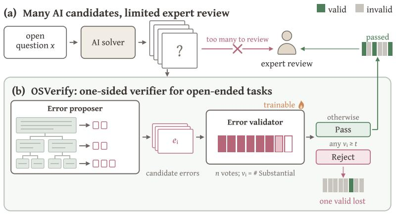

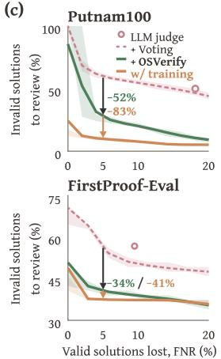  
Figure 1. One-sided verification for open-ended scientific discovery. (a) AI-generated candidates can outpace limited expert review capacity. (b) OSVERIFY decouples verification into hierarchical error proposal and repeated error validation, converting solution verification to error validation. (c) Under empirical 5% FNR constraint, OSVERIFY reduces the invalid candidates requiring review by 52% on Putnam100 and 34% on FirstProof-Eval, and the trained variant raises the reduction to 83% and 41%.

## 1 Introduction

Recent advances in AI have demonstrated growing potential to accelerate scientific discovery in mathematics, biology, materials science, quantum physics, and many more [18, 38, 51, 62]. Regardless of domain, existing approaches largely rely on automatic evaluations to guide the discovery process [48, 68, 69]. Clearly, such feedback can be unavailable or too expensive to obtain [62], making it difficult to assess candidate solutions and guide subsequent attempts. While recent LLM-as-a-Judge frameworks offer a flexible way to evaluate candidates in natural language and provide feedback in the absence of task-specific automated evaluators [71], their judgments cannot reliably establish the validity of scientific results [58], raising the question of how automated verification can effectively support scientific discovery.

This paper takes the view that, while AI can greatly expand the scale and breadth of future scientific exploration, human expert review remains essential to establishing the validity of its results. Yet candidate generation can outpace experts’ review capacity. Cohn [11] warns that producing AIgenerated solutions without their verification can irresponsibly shift substantial work onto the research community. These pressures motivate an increasingly important question: how should AI discovery systems engage human experts whose review capacity is limited?

Verification under limited human effort should satisfy two objectives. First, valid solutions are rare in challenging discovery problems, and mistakenly discarding one may lose an important discovery. Second, subject to the discovery goal, a verifier should minimize the human effort spent reviewing invalid candidates. This paper focuses on one-sided verification under the Neyman-Pearson principle [46, 60]: maximize TNR subject to a low FNR constraint. This objective requires a verifier to reject as many invalid candidates as possible while limiting the fraction of valid solutions rejected. Under a fixed FNR constraint, increasing TNR lowers the number of candidates requiring human review per valid solution found.

Drawing on the generate-and-verify intuition that checking a candidate can be easier than generating one [10], we hypothesize a similar difficulty gap within verification: discovering an error requires searching across a solution, whereas validating a proposed error focuses on whether that specific error invalidates the solution. Relatedly, LLMs often fail to locate reasoning errors that they can correct once the location is given [61]. Following this, this paper proposes OSVERIFY, an algorithmic framework that separates verification into error proposal and error validation. The error proposer searches broadly for potential errors by hierarchically decomposing the solution candidates into pieces and examining the pieces at different levels of granularity, aiming to identify errors in as many invalid solutions as possible. The error validator checks all proposed errors and examines whether each error is minor or substantial enough to invalidate the solution. We further post-train the error validator with GRPO on carefully constructed substantial and non-substantial proposed errors, improving its ability to distinguish different error types and generalize across problems with different difficulties. This separation decouples the verification into two adversarial components, allowing both to improve their capability by scaling up computation effectively.

To study verification without reliable automatic evaluation, we first conduct a controlled evaluation on competition-level and research-level mathematical benchmarks with known solutions, withholding the reference solutions and formal proof checkers such as Lean from the verifier. We intentionally use relatively weak LLMs as verifier backbones to approximate scenarios where problems exceed the models’ reliable problem-solving ability. Under the low FNR setting, OSVERIFY reduces the invalid candidates requiring human review by 46% on average relative to the baselines. Validator training raises this reduction to 57%, with the largest gains under the strictest constraint, and the gains carry over to research-level FirstProof-Eval, which is unseen during training. Moreover, we demonstrate that OSVERIFY can also be built upon existing verifiers and improve their one-sided performance.

Finally, as high-impact real-world use cases, we apply OSVERIFY to research-level mathematics in the Langlands program. When reviewing a paper published in the Annals ofMathematics [72] and a recent preprint [36], OSVERIFY identifies 45 and 88 expert-verified issues, respectively. The original authors have confirmed the reported errors and the proposed corrections. When we use OSVERIFY as the verifier for a recent agentic mathematics problem solver [26], it further helps resolve three open conjectures in relative Langlands duality [5, 36], whose proofs have subsequently been confirmed by human experts and are undergoing the publication process. These results suggest that OSVERIFY extends beyond controlled benchmarks and can facilitate human-AI research collaboration.

## 2 Verification under Limited Human Effort

Throughout the paper, we consider verification under the LLM-as-a-Judge setting, where an LLMbased verifier V evaluates whether a candidate solution correctly solves a problem through reasoning, tool use, or aggregated judgments [19, 42]. We use $( X , Y )$ to denote a random problem–solution pair and $( x , y )$ to denote a realization. A solution y is valid if it correctly solves $x ,$ equivalently $y \in S ( x )$ where $S ( x )$ is the set of all valid solutions for x. Otherwise, y is invalid. Given $( x , y ) \stackrel { \cdot } { \sim } ( X , Y )$ , a verifier V returns one of the decisions

$$
\mathcal { V } ( x , y ) \in \{ \mathrm { R E } \mathrm { J E C T } , \mathrm { P A S S } \} ,
$$

where REJECT indicates that V judges $y \not \in S ( x )$ , and PASS indicates that V judges $y \in S ( x )$ . Additionally, the verifier may return reasons and justifications for its decision.

Existing verification metrics do not fully reflect the requirements of human–AI collaboration in challenging, open-ended scientific discovery. Existing approaches commonly focus on accuracy, the proportion of candidates correctly passed or rejected [42, 58]; however, valid solutions are typically rare in these discovery settings, so rejecting all candidates can already yield high accuracy. Alternatively, AUROC measures how well a score ranks valid and invalid candidates across thresholds [7, 14], but does not directly characterize performance in the low-FNR regime needed to preserve rare valid solutions. In addition, many scientific problems lack reliable automated evaluation [1, 48], so human experts remain essential to establishing the validity of candidates that PASS the verifier [1, 59]. Neither metric directly quantifies the review effort.

One-sided verification. We call for a verification objective that preserves rare valid solutions by limiting false rejections and, subject to this requirement, filters out as many invalid candidates as possible to reduce human review effort. To this end, we adopt a Neyman–Pearson-style objective $^ { \left[ 4 6 , \right. }$ 60] for scientific discovery, and focus on one-sided verification: maximize the true negative rate (TNR) subject to a low false negative rate (FNR) constraint. Specifically, taking valid solutions as the positive class, REJECT candidates are predicted negative and filtered out, while PASS candidates are predicted positive and retained for human review. We require the verifier V to satisfy, for a prescribed tolerance $\tau \in [ 0 , 1 )$

$$
\mathrm { F N R } ( \mathcal { V } ) \triangleq P ( \mathcal { V } ( X , Y ) = \mathrm { R E J E C T } \mid Y \in S ( X ) ) \leq \tau .
$$

Probabilities are taken over the problem–solution distribution and any randomness in the verifier. The constraint ensures that at least ${ \sf a } 1 - \tau$ fraction of valid solutions are retained by V for human review. To quantify the filtering of invalid candidates and its effect on human review effort, define

$$
\mathrm { T N R } ( \mathcal { V } ) \triangleq P ( \mathcal { V } ( X , Y ) = \mathrm { R E J E C T } \mid Y \notin S ( X ) ) .
$$

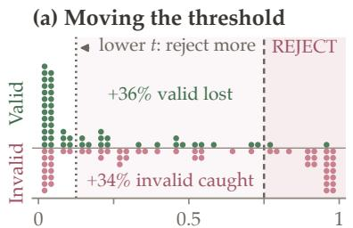  
Rejection frequency (64 judgments)

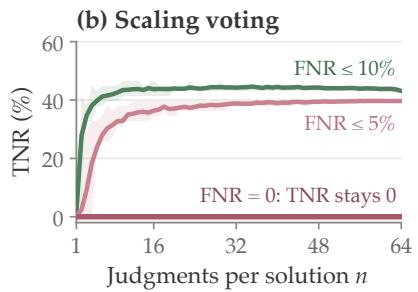

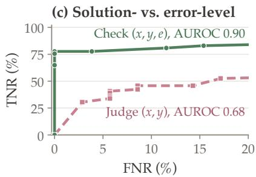  
Figure 2. (a) Frequencies of LLM REJECT on Putnam100 with 64 samples per (x, y); the dashed line marks empirical FNR below 5%. (b) The TNR increases and saturates as the number of judgments n increases, regardless of the FNR constraint. (c) LLM judgments on the error-level distribution $( x , y , e )$ achieve higher TNR at matched FNR than judgments on the solution-level distribution $( x , y )$ , particularly in the low-FNR regime. All experiments use gpt-oss-120b.

The average number of PASS candidates requiring human review per retained valid solution is

$$
\frac { P \big ( \mathcal { V } ( X , Y ) = \mathrm { P A S S } \big ) } { P \big ( \mathcal { V } ( X , Y ) = \mathrm { P A S S } , Y \in S ( X ) \big ) } = 1 + \frac { ( 1 - p ) ( 1 - \mathrm { T N R } ( \mathcal { V } ) ) } { p ( 1 - \mathrm { F N R } ( \mathcal { V } ) ) } \leq 1 + \frac { 1 - \mathrm { T N R } ( \mathcal { V } ) } { p ( 1 - \tau ) } ,\tag{1}
$$

where $p \triangleq P ( Y \in S ( X ) ) \in ( 0 , 1 )$ is the proportion of valid solutions. Under the FNR constraint $\tau ,$ higher TNR lowers the human review cost. We therefore adopt the following objective for verification under limited human effort:

$$
\operatorname* { m a x } _ { \mathcal { V } } \mathrm { T N R } ( \mathcal { V } ) \quad \mathrm { s . t . } \quad \mathrm { F N R } ( \mathcal { V } ) \leq \tau .\tag{2}
$$

LLM-as-a-Judge under one-sided verification. Contemporary LLM-based verifiers make judgments based on complex reasoning processes or agent behaviors such as tool calls and file checks. As such, it is non-trivial to obtain a numeric rejection score for the TNR–FNR trade-off. One way to construct the score is VOTING: sample multiple judgments independently and use the fraction of REJECT votes to estimate its rejection probability [42]. Other voting rules include pessimistic voting [25], which rejects if any judgment returns REJECT, and its optimistic counterpart, which rejects only if all judgments return REJECT.

Regardless of how the rejection score is obtained, thresholding essentially selects a trade-off point on the verifier’s TNR–FNR curve, rather than improving TNR under the FNR constraint. As shown in Figure 2a, a higher threshold preserves more valid solutions, but also passes invalid solutions whose scores fall below it. Allocating more computation to voting improves the estimate of each candidate’s rejection probability, but the attainable TNR under the evaluated FNR constraints saturates in our experiment (Figure 2b). The central question remains unaddressed: How can we achieve a higher TNR under the same low-FNR constraint?

## 3 OSVERIFY: Decoupling Error Proposal and Validation

We build on a general intuition: checking whether a candidate satisfies a set of requirements can be easier than finding a candidate that does. For instance, finding a solution for difficult scientific problems inevitably requires searching over possible approaches, whereas evaluating a candidate focuses on a concrete attempt and is conceptually easier for the same model. This difficulty gap motivates generating multiple candidate solutions and assessing them separately [10], where additional compute helps scale up the search and lead to better eventual performance. We hypothesize that an analogous gap exists within verification itself. Identifying an error requires searching across a solution for what might be wrong, but given a specific proposed error, the task narrows to checking whether that particular error holds and invalidates the solution.

Following this intuition, we introduce OSVERIFY, an algorithmic framework that separates verification into error proposal, a component that searches for potential errors with broad coverage, and error validation, a component that checks whether each proposed error is substantial. We illustrate the algorithm in Figure 1. Given $( x , y )$ , an error proposer generates a set of proposed errors $\mathcal { G } ( x , y )$ each $e \in \mathcal { G } ( x , y )$ identifying a claim or step in $y$ and explaining why it may invalidate the solution. Its objective is high coverage: on as many invalid solutions as possible, the proposed set should contain at least one substantial error, i.e., a real error that invalidates the solution. An error validator C then receives the full problem, solution, and one proposed error $( x , y , e )$ , and checks whether the proposed error is substantial. The two stages yield the solution-level rule

$$
\mathcal V ( x , y ) = \mathrm { R E J E C T } \quad \Longleftrightarrow \quad \exists e \in \mathcal G ( x , y ) : \mathcal C \mathrm { c o n f i r m s } \mathrm { t h a t } e \mathrm { i n v a l i d a t e s } y .\tag{3}
$$

The advantage of decoupling verification into error proposal and error validation is illustrated in Figure $2 \mathrm { c } .$ On FirstProof-Eval, using the same gpt-oss-120b, the TNR of the error-level distribution $( x , y , e )$ is higher at matched FNR than that of the solution-level distribution $( x , y )$ particularly in the low-FNR regime, with overall AUROC improving from 0.68 to 0.90. This suggests that assessing a specific proposed error is easier than determining the validity of an entire solution. These results motivate allocating additional compute to searching for potential errors, which provide concrete targets for focused validation. More details on settings and results can be found in Section 4.

## 3.1 Error Proposer

The objective of the error proposer is to maximize the coverage of substantial errors, $\mathrm { i . e . , }$ the probability that ${ \mathcal { G } } ( X , Y )$ contains at least one substantial error when $Y \not \in S ( X )$ . To this end, we search for errors at different levels of granularity within a solution, a method we call hierarchical decomposition. Inspecting the full solution exposes issues in the overall argument, while zooming in on individual parts focuses attention on specific claims and reasoning steps.

Starting from $u _ { 1 } = y$ at depth zero, we recursively decompose the solution into sub-pieces. At each node $u _ { k } ,$ the model selects a suitable boundary and splits the text into two contiguous parts,

$$
u _ { k } = u _ { 2 k } \parallel u _ { 2 k + 1 } ,
$$

where ∥ denotes concatenation in the original order. Recursion stops when the maximum depth D is reached or the model judges the current part sufficiently atomic that no further split is needed. Let $U$ contain all resulting nodes, including the root, intermediate nodes, and leaves.

For each $u \in U$ , the proposer receives the problem $x ,$ the complete solution $y ,$ and the part u on which to focus. It returns a possibly empty set of proposed errors $\mathcal { G } ( x , y , u )$ , each identifying a potential error in u and explaining how it could invalidate y. The final proposal set merges proposed errors across all nodes:

$$
{ \mathcal { G } } ( x , y ) = \bigcup _ { u \in U } { \mathcal { G } } ( x , y , u ) .
$$

Identical proposed errors against the same target are merged, while distinct ones remain separate for validation. Algorithm 1 in Appendix D.4 summarizes the procedure. Additionally and optionally, one may call the proposer repeatedly at selected nodes $u \in U$ to increase coverage. For instance, we find that running $\mathcal { G } ( x , y , u _ { 1 } )$ more than once at the root node can further improve its coverage.

## 3.2 Error Validator

By maximizing the error coverage, the error proposer could also produce more hallucinated errors and minor issues that do not invalidate a solution. The objective of the error validator $\mathcal { C }$ is to assess which proposed errors warrant rejection, helping preserve valid solutions while retaining substantial errors. Specifically, given a $( x , y , e )$ tuple, it first checks whether e holds, returning NOT-REAL if it does not hold, i.e., it is a hallucinated error. For a real error, it then judges whether the error invalidates $y ,$ returning SUBSTANTIAL if it does and MINOR otherwise. This distinction is to account for differences in error definitions across different tasks: minor errors could lead to severe accidents in production, but are totally acceptable in proof sketches. For each proposed error $e ,$ we define its substantial-error probability and the resulting solution-level rejection score as

$$
\begin{array} { r l } & { p _ { \mathcal { C } } ( x , y , e ) = P \bigl ( \mathcal { C } ( x , y , e ) = \mathrm { S U B S T A N T I A L } \bigr ) , } \\ & { \quad s _ { \mathcal { V } } ( x , y ) = \underset { e \in \mathcal { G } ( x , y ) } { \operatorname* { m a x } } p _ { \mathcal { C } } ( x , y , e ) . } \end{array}\tag{4}
$$

The maximum reflects that a single substantial error suffices to invalidate a solution, and we set the score to zero when no error is proposed. In practice, the score can be approximated by independently sampling $\mathcal { C } ( x , y , e )$ multiple times.

Given a threshold $t > 0$ , the verifier V rejects if $s _ { \mathcal { V } } ( x , y ) \geq t ,$ , and returns PASS otherwise. For a given FNR constraint $\tau ,$ we select the threshold to maximize TNR subject to the constraint

$$
\mathrm { F N R } ( \mathcal { V } _ { t } ) = P \big ( s \nu ( X , Y ) \geq t \mid Y \in S ( X ) \big ) \leq \tau .
$$

Notice that we do not consider the calibration problem here, but in practice, t can be pre-estimated by a small set of samples (see example in Section B.4), or by transferring from similar problem sets. More details can be found in Section 4.1.

Learning to validate via RL. The validator operates on the same $( x , y , e )$ interface regardless of how the solution or proposed error was generated; its capability should be generalizable across different errors, solution candidates, and even problems. Additionally, the objective of the error validator is clear and binary, making it possible to construct error-level supervision and further train the validator C to distinguish substantial errors from minor or hallucinated ones across diverse problems.

Specifically, we use reinforcement learning to post-train C on the environment constructed below. The training data is $( x , y , e )$ and the label is whether the error e is substantial or not. For valid problem-solution pairs $( x , y )$ , all proposed errors have a negative label. For an invalid solution $y ,$ since we only have the reference answer $y ^ { \star }$ and optionally the grading guideline, we provide them as the context to the proposer and the untrained validator. We sample this reference-assisted validator five times for each proposed error and label the error as positive only if at least three of the five samples judge it substantial. The remaining errors are discarded for the sake of training accuracy and informativeness. For each training instance, we roll out the validator eight times, and use the standard GRPO loss to LoRA [22] fine-tune the model. For more training details, please refer to Section 4.1.

## 4 Experiments

Our experiments aim to address the following questions: (1) How well OSVERIFY can effectively reject invalid solutions while preserving valid ones, and how much RL on the error validator can further raise TNR on unseen problems; (2) How verification scales up with more compute, and how OSVERIFY can be applied as a meta-algorithm on top of existing verifiers to improve their one-sided performance; (3) Whether OSVERIFY can support expert review in real-world research settings.

Table 1. Empirical TNR (%) under empirical FNR constraints of 0%, 5%, and 10%. Entries report means and standard deviations over $2 { , } 0 0 0$ resampling trials. Zero includes the always-pass fallback when no nontrivial operating point satisfies the constraint.
<table><tr><td></td><td colspan="3">Putnam100</td><td colspan="3">H2V</td><td colspan="4">FirstProof-Eval</td></tr><tr><td>Method</td><td>0%</td><td>5%</td><td>10%</td><td>0%</td><td>5%</td><td></td><td>10%</td><td>0%</td><td>5%</td><td>10%</td></tr><tr><td colspan="9"> $9 \mathrm { p t } - \mathsf { o s s } - 1 2 0 \mathrm { b }$ </td><td></td></tr><tr><td>LLM-AS-A-JUDGE</td><td> $0 _ { \pm 0 }$ </td><td> $0 _ { \pm 0 }$ </td><td> $0 _ { \pm 0 }$ </td><td> $0 _ { \pm 0 }$ </td><td> $5 4 . 4 _ { \pm 2 . 0 }$ </td><td> $5 4 . 4 _ { \pm 2 . 0 }$ </td><td> $0 _ { \pm 0 }$ </td><td> $0 _ { \pm 0 }$ </td><td></td><td> $4 3 . 3 _ { \pm 2 . 9 }$ </td></tr><tr><td>VOTING</td><td> $0 _ { \pm 0 }$ </td><td> $3 8 . 4 _ { \pm 3 . 9 }$ </td><td> $4 5 . 5 _ { \pm 2 . 8 }$ </td><td> $6 0 . 9 _ { \pm 4 . 2 }$ </td><td> $6 9 . 2 _ { \pm 3 . 6 }$ </td><td> $7 5 . 6 _ { \pm 3 . 7 }$ </td><td></td><td> $2 9 . 5 _ { \pm 1 0 . 2 }$ </td><td> $3 5 . 9 _ { \pm 2 . 5 }$ </td><td> $4 8 . 8 _ { \pm 2 . 2 }$ </td></tr><tr><td>OSVERIFY</td><td> $\bf { 0 } _ { \pm \sigma }$  </td><td> ${ \bf 7 0 . 4 _ { \pm 1 4 . 3 } }$ </td><td> $\mathbf { 7 7 . 9 _ { \pm 3 . 3 } }$ </td><td> $\mathbf { 8 3 . 2 _ { \pm 0 . 6 } }$ </td><td> $\mathbf { 8 4 . 7 _ { \pm 0 . 6 } }$ </td><td> $\mathbf { 8 4 . 7 _ { \pm 0 . 5 } }$ </td><td></td><td> ${ \bf 5 0 . 4 _ { \pm 1 5 . 1 } }$ </td><td> ${ \bf 5 8 . 0 _ { \pm 3 . 1 } }$ </td><td> ${ \bf 6 0 . 8 _ { \pm 1 . 3 } }$ </td></tr><tr><td>+ trained validator</td><td> $\mathbf { 8 5 . 8 _ { \pm 2 . 9 } }$ </td><td> $\mathbf { 8 9 . 6 _ { \pm 1 . 7 } }$  </td><td> $\mathbf { 9 2 . 3 _ { \pm 1 . 5 } }$ </td><td> ${ \bf 8 2 . 4 _ { \pm 1 . 1 } }$ </td><td> ${ \bf 8 3 . 2 _ { \pm 0 . 7 } }$ </td><td> ${ \bf 8 3 . 2 _ { \pm 0 . 7 } }$ </td><td></td><td> ${ \bf 5 7 . 8 _ { \pm 3 . 0 } }$ </td><td> ${ \bf 6 2 . 3 _ { \pm 0 . 8 } }$ </td><td> ${ \bf 6 2 . 7 _ { \pm 0 . 3 } }$ </td></tr><tr><td colspan="9"> $\mathtt { g p t - } 5 \mathtt { - m i n i }$ </td><td></td></tr><tr><td> $\operatorname { L L M - A S - A - J U D G E }$ </td><td> $0 _ { \pm 0 }$ </td><td> $0 _ { \pm 0 }$ </td><td> $6 3 . 1 _ { \pm 3 . 9 }$ </td><td> $6 6 . 3 _ { \pm 1 . 8 }$ </td><td> $6 6 . 3 _ { \pm 1 . 8 }$ </td><td> $6 6 . 3 _ { \pm 1 . 8 }$ </td><td> $0 _ { \pm 0 }$ </td><td></td><td> $0 _ { \pm 0 }$ </td><td> $4 2 . 7 _ { \pm 2 . 4 }$ </td></tr><tr><td>VOTING</td><td> $2 8 . 5 _ { \pm 1 7 . 3 }$ </td><td> $5 8 . 1 _ { \pm 4 . 4 }$ </td><td> $7 5 . 4 _ { \pm 3 . 7 }$ </td><td> $8 2 . 9 _ { \pm 1 . 2 }$ </td><td> $8 2 . 9 _ { \pm 1 . 2 }$ </td><td> $8 2 . 9 _ { \pm 1 . 2 }$ </td><td></td><td> $1 9 . 1 _ { \pm 1 6 . 4 }$ </td><td> $4 2 . 6 _ { \pm 1 . 8 }$ </td><td> $4 9 . 2 _ { \pm 2 . 3 }$ </td></tr><tr><td>OSVERIFY</td><td> $\mathbf { 7 2 . 1 _ { \pm 2 1 . 9 } }$ </td><td> $\mathbf { 8 2 . 9 _ { \pm 1 . 6 } }$  </td><td> ${ \bf 8 6 . 6 _ { \pm 1 . 3 } }$ </td><td> $\mathbf { 8 5 . 7 _ { \pm 0 . 3 } }$ </td><td> $\mathbf { 8 5 . 7 _ { \pm 0 . 3 } }$ </td><td></td><td> $\mathbf { 8 5 . 7 _ { \pm 0 . 3 } }$  </td><td> $\mathbf { 3 3 . 9 _ { \pm 2 5 . 5 } }$ </td><td> ${ \bf 6 0 . 0 _ { \pm 9 . 1 } }$  </td><td> ${ \bf 6 5 . 4 _ { \pm 1 . 4 } }$ </td></tr></table>

## 4.1 Experimental Setup

As mentioned in Section 1, we focus on mathematical benchmarks with known solutions. As the latest LLMs may have been too strong and could directly address these problems, we intentionally use weaker models as verifier backbones, namely gpt-oss-120b [3] and $\mathtt { g p t - } 5 \mathtt { - m i n i }$ [49], abbreviated as oss and 5mini. This simulates scenarios where problems exceed the models problem-solving ability. Importantly, these known solutions are inaccessible to verifiers, and we do not use any formal proof checker. This allows us to study verification without reliable automated evaluation signals while rigorously assessing verifier performance.

Datasets. We evaluate on three mathematical benchmarks, including competition-level Putnam100 [27] and Hard2Verify (H2V) [50], as well as research-level FirstProof-Eval constructed from First Proof [1] with human-labeled valid and invalid solutions. For Putnam100, we collect publicly available official solutions as valid examples and incorrect solutions generated by frontier models. For H2V, the dataset contains model-generated solutions (valid and invalid) with step-level annotations by PhD-level mathematics experts. Namely, both H2V and First Proof problems were released after the release of the two models considered. For validator post-training, training data is constructed from the training portion of our collected Putnam corpus, IMO-GradingBench [39], ProofBench [40] and Open Proof Corpus [12]. Details about the distribution of valid and invalid solutions and dataset construction can be found in Appendix C.

Methods. We compare OSVERIFY against direct LLM-AS-A-JUDGE [71], which evaluates the whole solution, as well as its VOTING variant, which estimates the REJECT probability by independently resampling the judge n times. We use $n = 1 6$ for the results in Table 1 and additionally report results for n ranging from 1 to 64 in Section B.3. We also compare with MULTIAGENT DEBATE [13] and pseudo-formalization with block verification (PFBV) [4], as specified below. For OSVERIFY, we set the maximum decomposition depth to two unless otherwise specified, with the root node at depth zero and one proposal call made at each node. For each proposed error, we similarly estimate the validation probability with 16 independent samples. We aggregate these judgments using the solution-level score defined in Equation (4). For validator post-training, we use online GRPO with LoRA adapters, and keep the proposer unchanged. Appendix D.5 describes the training procedure. Metrics. For LLM-AS-A-JUDGE, we first compute the mean FNR and the mean and standard deviation of the TNR across single-call samples. At each FNR constraint, we report the corresponding

(a)  
Maximum decomposition depth  
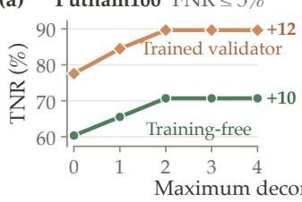

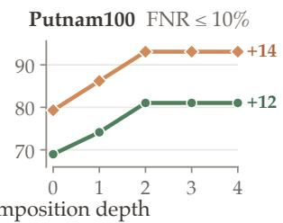

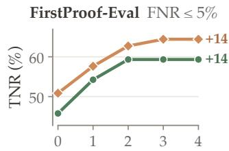

Maximum decomposition depth  
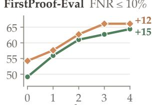

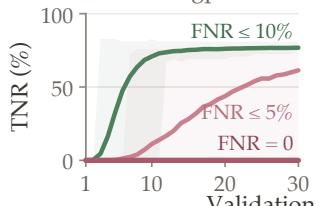

Validation votes per error n  
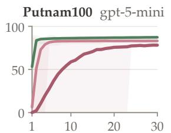

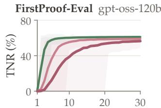

Validation votes per error n  
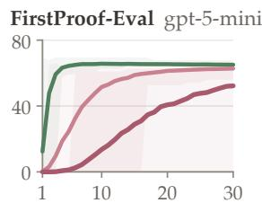  
Figure 3. (a) Deeper decomposition raises TNR for training-free and trained validators, with most of the gain reached by depth two. (b) More validation votes raise TNR on fixed proposal pools; the stricter the FNR constraint, the more votes it takes.

TNR mean and standard deviation if the mean FNR satisfies the constraint, and report zero otherwise. For VOTING and OSVERIFY, we sweep the rejection threshold over the evaluation set and, for each empirical FNR constraint, report the highest TNR attained by any threshold satisfying that constraint, following the empirical-frontier evaluation protocol of Carlini et al. [8]. The threshold used to meet each FNR constraint is determined solely from valid solutions.

## 4.2 OSVERIFY Reduces Review Effort under the Same FNR Constraint

Table 1 compares OSVERIFY against LLM-AS-A-JUDGE and VOTING under empirical FNR constraints of 0%, 5%, and 10%. Consistently, OSVERIFY achieves a higher TNR under different FNR constraints. With oss, OSVERIFY improves TNR over VOTING from 38.4% to 70.4% on Putnam100, from 69.2% to 84.7% on H2V, and from 35.9% to 58.0% on FirstProof-Eval under the 5% FNR constraint. This implies that the number of invalid candidates requiring human review is reduced by 52.0% on Putnam100, 50.4% on H2V, and 34.4% on FirstProof-Eval relative to VOTING. With 5mini, OSVERIFY improves TNR over VOTING from 58.1% to 82.9% on Putnam100 and from 42.6% to 60.0% on FirstProof-Eval under the 5% FNR constraint.

We train the oss-equipped error validator, with training dynamics presented in Figure 4a. Overall, the TNR can be further improved over its training-free counterpart, both on the in-distribution dataset (Putnam100) and on the out-of-distribution datasets (FirstProof-Eval). Particularly, at zero FNR, training increases TNR from 0% to 85.8% on Putnam100 and from 50.4% to 57.8% on FirstProof-Eval. Both benchmarks retain TNR gains under the 5% and 10% FNR constraints. On H2V, the training-free validator already reaches the coverage limit of the proposer while rejecting few valid solutions, leaving little room for further improvement through validator training.

## 4.3 Scaling Analysis and Meta-Algorithm Applications

Below, we investigate the scaling behavior and inference budgets of OSVERIFY, and demonstrate that OSVERIFY can serve as a meta-algorithm that transforms existing verifiers into one-sided verifiers.

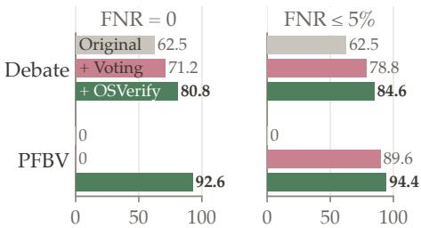

(a) Validator training  
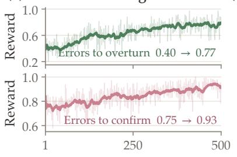  
Training step

(b) Inference cost FirstProof-Eval, FNR ≤ 5%  
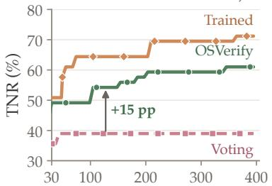  
H2V(c) Other base verifiers  
Tokens per solution (k)  
TNR (%)  
Figure 4. (a) Training rewards for proposed errors to overturn or confirm, with EMA decay 0.9. (b) Empirical TNR under different input-plus-output token budgets on FirstProof-Eval. (c) Applying OSVERIFY to existing verifiers MULTIAGENT DEBATE and PFBV on H2V.

Scaling behavior analysis. Since OSVERIFY can be decoupled into an error proposer and an error validator, we study how the performance of each changes as we scale up the computation cost. For the proposer, whose goal is to maximize error coverage, we increase the maximum decomposition depth and allow additional proposal calls on finer-grained parts of the solution. We use 16 validation votes per proposed error. As shown in Figure 3a, under different datasets and different FNR constraints, TNR initially increases and then saturates as the maximum depth increases. FirstProof-Eval solutions are substantially longer than Putnam100 solutions, leaving more room for decomposition. For many Putnam100 solutions, decomposition stops before reaching the depth limit. These results support searching for error hypotheses at multiple levels of granularity.

Besides, we scale up compute for the error validator by increasing the number of resamples per error from 1 to 30, with the proposer depth fixed at 2. As shown in Figure 3b, the benefit of additional validation depends on the FNR constraint: performance under the 10% constraint generally saturates with relatively few resamples, whereas tighter constraints benefit from more. On FirstProof-Eval, increasing the vote count from 10 to 30 raises TNR under zero empirical FNR from 38.7% to 56.5% with oss and from 13.6% to 52.3% with 5mini. Theoretically, increasing the resampling size only improves the estimation accuracy, and the performance will converge once the size is large enough.

Comparison under matched token budgets. In Figure 4b, we compare the performance of VOTING, OSVERIFY, and its trained counterpart under different token budgets with oss, with more results included in Appendix B.2. Under the 5% FNR constraint, OSVERIFY can achieve a higher TNR performance at all token budgets per solution. This budget includes the cost of decomposition, error proposing, and error validation. With training, the cost is amortized and the per-token TNR further increases, and the method reaches the same TNR of 58% with almost 4 times less compute.

OSVERIFY as a meta-algorithm. The proposal-validation decoupling allows OSVERIFY to act as a meta-algorithm and be applied to existing verifiers that validate solutions by raising errors, either through multi-agent debate or through checking proof blocks. Specifically, for any existing verifier, we can decompose the solution into sub-pieces (if the verifier has not done this), use the verifier to find errors in the sub-pieces, and use a validator to check each error. This allows different error-search procedures to be combined with the same validation and thresholding rule. We apply OSVERIFY to two recent verifier works, MULTIAGENT DEBATE and PFBV, using oss on H2V. Figure 4c shows that both extensions achieve higher TNR than VOTING under the evaluated FNR constraints. Under zero FNR, OSVERIFY improves TNR over VOTING from 71.2% to 80.8% for MULTIAGENT DEBATE and from 0% to 92.6% for PFBV, and from 78.8% to 84.6% and from 89.6% to 94.4% under 5% FNR. These results demonstrate the applicability of OSVERIFY beyond its pure LLM-based error proposer.

## 4.4 Mathematical Research Case Study

We apply OSVERIFY in two real-world research settings: reviewing research papers and contributing to the resolution of open conjectures. We focus on research problems of central importance in several most challenging areas of mathematical research, including Langlands program, where technically involved arguments and abstract theories require substantial specialist expertise.

As we aim to examine how OSVERIFY can support research beyond the benchmarks, we turn to frontier closed-source models as the verifier backbone in these studies.

Reviewing mathematical papers. We apply OSVERIFY to review 11 OpenAI preprints, each of which claims to solve a central problem in an area of mathematical research. OSVERIFY identifies nontrivial mathematical mistakes in each of the 11 papers autonomously, which were overlooked by OpenAI internal models and may require substantial effort for human experts to discover. These mistakes are confirmed to be real errors by human experts. The main conclusions of these papers remain valid after revisions, but correcting these issues is important to ensure the correctness of the statements and proofs and avoid confusion in the literature. OSVERIFY also discovered mistakes and suggested repairs for papers in submission to or already published in top-tier mathematical journals and induced the revisions of the authors (for example, [36] and [72]; see Appendix E for the issue counts in Table 9 and representative examples). These findings illustrate how OSVERIFY can detect subtle mistakes in mathematical research, including previously overlooked issues in published papers and mistakes in primarily AI-generated manuscripts.

Automated conjecture solving. We further pair OSVERIFY with the latest open-source mathematical problem-solving system [26], a Codex agent equipped with mathematical reasoning skills, and see whether OSVERIFY helps verify the candidate solutions. No formal proof checker is used throughout the process. We target relative Langlands duality, proposed by Ben-Zvi, Sakellaridis, and Fields medalist Venkatesh [5] and among the most far-reaching unifying frameworks in mathematics. The problem is inspired by electric–magnetic duality in gauge theory, whose connection to the Langlands program was developed by Fields medalist Edward Witten and collaborators [65]. It predicts relations between periods of automorphic forms and special values of L-functions, unifying many earlier results [5, Table 1.5.1]. Together, the system produced proofs of three previously open statements: (i) the flatness of the loop-rotated Plancherel algebra $\operatorname { P L } _ { X , \hbar }$ over k[ℏ] [5, Conjecture 8.5.2]; (ii) the commutativity of $\operatorname { P L } _ { X }$ asserted in Ben-Zvi et al. [5, Conjecture 8.1.8], with (i) and (ii) in the setting of Liu and Wang [36, Conjecture 4.36]; and (iii) the automorphic commutator relation of Liu and Wang [36, Conjecture 4.45], which they had established only under additional cohomological vanishing assumptions and for curves of genus other than one. OSVERIFY provides a verification signal during the solving process, and returns PASS to the eventual solutions, which are examined and confirmed by human experts subsequently. The proofs of (i) and (ii) are documented in [21]. The proof of (iii) is polished and rewritten in [35], and it is in submission to a top-tier mathematical research journal.

Additionally, OSVERIFY contributed to the paper [73], which proved the Manin constant conjecture. This conjecture is of fundamental importance in number theory and the study of the BSD conjecture, and has been open for over 50 years. OSVERIFY contributed in two ways: (i) it reported one mistake in an earlier version of that paper, and this mistake was overlooked by both human and 12 rounds of AI reviews using Claude Code Opus-5.5 and GPT-Astra-6 Pro (see [73, Appendix A.3]); (ii) after paired with the problem-solving system [26], it reproduced the result by rejecting ineffective strategies automatically, while GPT-6-Astra Pro needed multiple rounds of prompting by mathematics experts (see [73, Appendix A.1, A.5]).

## 5 Related Work

Structured verification and error validation. Formal provers offer machine-checked guarantees [2, 9], but formalizing research proofs remains costly. In natural language, prior work splits LLM verification into smaller checks: criteria in CheckEval and LLM-as-a-Verifier [29, 31], reasoning steps in Deductive Verification [34], Pessimistic Verification [25], and self-contained proof blocks in PFBV [4]. Judging such units in isolation can produce spurious failures when context is lost [23, 63], so OSVERIFY keeps the full problem and solution in context at every level of its decomposition. DeepSeekMath-V2 trains a verifier to identify issues in math proofs [55]. OSVERIFY combines error check with decomposition: it proposes errors at every level and rejects a solution only when independent validation confirms one of them.

One-sided objectives. LLM-based checkers already find errors in published papers that experts confirm, but with low precision [56], which motivates an explicit limit on false rejections. Our objective follows the Neyman–Pearson paradigm, which constrains one class-conditional error rate while optimizing the other [46, 53, 60]. FactTest [47] applies this principle to factuality with finite sample guarantees; Section B.4 uses its threshold selection on held-out valid solutions. Section A discusses additional related work about AI for discovery, LLM judges, and learning verifiers.

## 6 Conclusion

We study scientific verification under limited human review capacity, aiming to filter out invalid solutions while preserving valid candidates for expert review. We introduce OSVERIFY, which separates error proposal from error validation to improve TNR under low FNR constraints. Experiments on three mathematical benchmarks demonstrate its effectiveness, with further gains from validator training. Applications to mathematical paper review and open conjecture solving yield findings confirmed by human experts. These results highlight the potential of structured verification to support scientific discovery with limited human effort.

## Acknowledgments

We thank Ken Ziyu Liu and Yongchan Kwon for helpful discussions, advice, and support. We also thank members of the Zou group for insightful discussions.

## References

[1] Mohammed Abouzaid, Andrew J. Blumberg, Martin Hairer, Joe Kileel, Tamara G. Kolda, Paul D. Nelson, Daniel Spielman, Nikhil Srivastava, Rachel Ward, Shmuel Weinberger, and Lauren Williams. First proof. arXiv preprint arXiv:2602.05192, 2026. doi: 10.48550/arXiv.2602.05192. URL https://arxiv.org/abs/2602.05192.

[2] Tudor Achim, Alex Best, Alberto Bietti, Kevin Der, Mathïs Fédérico, Sergei Gukov, Daniel Halpern-Leistner, Kirsten Henningsgard, Yury Kudryashov, Alexander Meiburg, et al. Aristotle: IMO-level automated theorem proving. arXiv preprint arXiv:2510.01346, 2025. URL https: //arxiv.org/abs/2510.01346.

[3] Sandhini Agarwal, Lama Ahmad, Jason Ai, Sam Altman, Andy Applebaum, Edwin Arbus, Rahul K. Arora, Yu Bai, Bowen Baker, Haiming Bao, et al. gpt-oss-120b & gpt-oss-20b model card. arXiv preprint arXiv:2508.10925, 2025. doi: 10.48550/arXiv.2508.10925. URL https: //arxiv.org/abs/2508.10925.

[4] Slim Barkallah, Luke Bailey, Kaiyue Wen, Mohammed Abouzaid, and Tengyu Ma. Pseudoformalization for automatic proof verification. arXiv preprint arXiv:2605.20531, 2026. doi: 10.48550/arXiv.2605.20531. URL https://arxiv.org/abs/2605.20531.

[5] David Ben-Zvi, Yiannis Sakellaridis, and Akshay Venkatesh. Relative langlands duality, 2024. URL https://arxiv.org/abs/2409.04677.

[6] Daniil A. Boiko, Robert MacKnight, and Gabe Gomes. Emergent autonomous scientific research capabilities of large language models. CoRR, abs/2304.05332, 2023. doi: 10.48550/arXiv.2304. 05332. URL https://arxiv.org/abs/2304.05332.

[7] Dylan Bouchard and Mohit Singh Chauhan. Uncertainty quantification for language models: A suite of black-box, white-box, LLM judge, and ensemble scorers. Transactions on Machine Learning Research, 2025. URL https://arxiv.org/abs/2504.19254.

[8] Nicholas Carlini, Steve Chien, Milad Nasr, Shuang Song, Andreas Terzis, and Florian Tramèr. Membership inference attacks from first principles. In 2022 IEEE Symposium on Security and Privacy, pages 1897–1914. IEEE, 2022. doi: 10.1109/SP46214.2022.9833649. URL https: //doi.org/10.1109/SP46214.2022.9833649.

[9] Luoxin Chen, Jinming Gu, Liankai Huang, Wenhao Huang, Zhicheng Jiang, Allan Jie, Xiaoran Jin, Xing Jin, Chenggang Li, Kaijing Ma, et al. Seed-prover: Deep and broad reasoning for automated theorem proving. arXiv preprint arXiv:2507.23726, 2025. URL https://arxiv.org/abs/ 2507.23726.

[10] Karl Cobbe, Vineet Kosaraju, Mohammad Bavarian, Mark Chen, Heewoo Jun, Lukasz Kaiser, Matthias Plappert, Jerry Tworek, Jacob Hilton, Reiichiro Nakano, Christopher Hesse, and John Schulman. Training verifiers to solve math word problems. arXiv preprint arXiv:2110.14168, 2021. doi: 10.48550/arXiv.2110.14168. URL https://arxiv.org/abs/2110.14168.

[11] Henry Cohn. The technical debt of AI-generated mathematics. Guest post on Terence Tao’s blog, What’s New, September 2026. URL https://terrytao.wordpress.com/2026/09/15/the-tec hnical-debt-of-ai-generated-mathematics/. September 15, 2026. Accessed September 23, 2026.

[12] Jasper Dekoninck, Ivo Petrov, Kristian Minchev, Mislav Balunovi´c, Martin Vechev, Miroslav Marinov, Maria Drencheva, Lyuba Konova, Milen Shumanov, Kaloyan Tsvetkov, Nikolay Drenchev, Lazar Todorov, Kalina Nikolova, Nikolay Georgiev, Vanesa Kalinkova, and Margulan Ismoldayev. The open proof corpus: A large-scale study of LLM-generated mathematical proofs. arXiv preprint arXiv:2506.21621, 2025. URL https://arxiv.org/abs/2506.21621.

[13] Yilun Du, Shuang Li, Antonio Torralba, Joshua B. Tenenbaum, and Igor Mordatch. Improving factuality and reasoning in language models through multiagent debate. In Proceedings of the 41st International Conference on Machine Learning, volume 235 of Proceedings of Machine Learning Research, pages 11733–11763. PMLR, 2024. URL https://proceedings.mlr.press/v235/du24e.h tml.

[14] Tom Fawcett. An introduction to ROC analysis. Pattern Recognition Letters, 27(8):861–874, June 2006. ISSN 0167-8655. doi: 10.1016/j.patrec.2005.10.010. URL http://dx.doi.org/10.1016/j.pat rec.2005.10.010.

[15] Tony Feng, Trieu Trinh, Garrett Bingham, Jiwon Kang, Shengtong Zhang, Sang-hyun Kim, Kevin Barreto, Carl Schildkraut, Junehyuk Jung, Jaehyeon Seo, Carlo Pagano, Yuri Chervonyi, Dawsen Hwang, Kaiying Hou, Sergei Gukov, Cheng-Chiang Tsai, Hyunwoo Choi, Youngbeom Jin, Wei-Yuan Li, Hao-An Wu, Ruey-An Shiu, Yu-Sheng Shih, Quoc V. Le, and Thang Luong. Semi-autonomous mathematics discovery with Gemini: A case study on the Erd˝os problems. arXiv preprint arXiv:2601.22401, 2026. doi: 10.48550/arXiv.2601.22401. URL https://arxiv.org/ abs/2601.22401.

[16] Tony Feng, Trieu H. Trinh, Garrett Bingham, Dawsen Hwang, Yuri Chervonyi, Junehyuk Jung, Joonkyung Lee, Carlo Pagano, Sang-hyun Kim, Federico Pasqualotto, Sergei Gukov, Jonathan N. Lee, Junsu Kim, Kaiying Hou, Golnaz Ghiasi, Yi Tay, YaGuang Li, Chenkai Kuang, Yuan Liu, Hanzhao Lin, Evan Zheran Liu, Nigamaa Nayakanti, Xiaomeng Yang, Heng-Tze Cheng, Demis Hassabis, Koray Kavukcuoglu, Quoc V. Le, and Thang Luong. Towards autonomous mathematics research. arXiv preprint arXiv:2602.10177, 2026. doi: 10.48550/arXiv.2602.10177. URL https://arxiv.org/abs/2602.10177.

[17] Bofei Gao, Zefan Cai, Runxin Xu, Peiyi Wang, Ce Zheng, Runji Lin, Keming Lu, Dayiheng Liu, Chang Zhou, Wen Xiao, Tianyu Liu, and Baobao Chang. LLM critics help catch bugs in mathematics: Towards a better mathematical verifier with natural language feedback. In Wanxiang Che, Joyce Nabende, Ekaterina Shutova, and Mohammad Taher Pilehvar, editors, Findings ofthe Associationfor Computational Linguistics: ACL 2025, pages 14588–14604, Vienna, Austria, July 2025. Association for Computational Linguistics. ISBN 979-8-89176-256-5. doi: 10.18653/v1/2025.findings-acl.753. URL https://aclanthology.org/2025.findings-acl.753/.

[18] Juraj Gottweis, Wei-Hung Weng, Alexander Daryin, Tao Tu, Petar Sirkovic, Artiom Myaskovsky, Grzegorz Glowaty, Felix Weissenberger, Alessio Orlandi, Dan Popovici, et al. Accelerating scientific discovery with Co-Scientist. Nature, 655:487–496, 2026. doi: 10.1038/s41586-026-106 44-y. URL https://www.nature.com/articles/s41586-026-10644-y.

[19] Zhibin Gou, Zhihong Shao, Yeyun Gong, Yelong Shen, Yujiu Yang, Nan Duan, and Weizhu Chen. CRITIC: Large language models can self-correct with tool-interactive critiquing. In International Conference on Learning Representations, 2024. URL https://arxiv.org/abs/2305.11738.

[20] Jiawei Gu, Xuhui Jiang, Zhichao Shi, Hexiang Tan, Xuehao Zhai, Chengjin Xu, Wei Li, Yinghan Shen, Shengjie Ma, Honghao Liu, Saizhuo Wang, Kun Zhang, Zhouchi Lin, Bowen Zhang,

Lionel Ni, Wen Gao, Yuanzhuo Wang, and Jian Guo. A survey on LLM-as-a-judge. The Innovation, 7(6):101253, June 2026. ISSN 2666-6758. doi: 10.1016/j.xinn.2025.101253. URL http://dx.doi.org/10.1016/j.xinn.2025.101253.

[21] hexagon:2609.00128v1. On properties of plancherel algebras. Hexagon preprint hexagon:2609.00128v1, 2026. URL https://hexagonmath.org/2609.00128v1. Contributors: Shurui Liu.

[22] Edward J. Hu, Yelong Shen, Phillip Wallis, Zeyuan Allen-Zhu, Yuanzhi Li, Shean Wang, Lu Wang, and Weizhu Chen. LoRA: Low-rank adaptation of large language models. In International Conference on Learning Representations, 2022. URL https://arxiv.org/abs/2106.096 85.

[23] Qisheng Hu, Quanyu Long, and Wenya Wang. Decomposition dilemmas: Does claim decomposition boost or burden fact-checking performance? In Proceedings of the 2025 Conference of the Nations of the Americas Chapter of the Association for Computational Linguistics, 2025. URL https://arxiv.org/abs/2411.02400.

[24] Jie Huang, Xinyun Chen, Swaroop Mishra, Huaixiu Steven Zheng, Adams Wei Yu, Xinying Song, and Denny Zhou. Large language models cannot self-correct reasoning yet. In International Conference on Learning Representations, 2024. URL https://arxiv.org/abs/2310.01798.

[25] Yanxing Huang, Zihan Tang, Zejin Lin, Peng Li, and Yang Liu. Pessimistic verification for open ended math questions. arXiv preprint arXiv:2511.21522, 2025. doi: 10.48550/arXiv.2511.21522. URL https://arxiv.org/abs/2511.21522.

[26] Haocheng Ju, Guoxiong Gao, Jiedong Jiang, Bin Wu, Zeming Sun, Shurui Liu, Leheng Chen, Yutong Wang, Yuefeng Wang, Zichen Wang, Wanyi He, Peihao Wu, Liang Xiao, Ruochuan Liu, Bryan Dai, and Bin Dong. Automated conjecture resolution with formal verification, 2026. URL https://arxiv.org/abs/2604.03789.

[27] Kiran Kedlaya. The Putnam archive, n.d. URL https://kskedlaya.org/putnam-archive/. Accessed September 25, 2026.

[28] Akbir Khan, John Hughes, Dan Valentine, Laura Ruis, Kshitij Sachan, Ansh Radhakrishnan, Edward Grefenstette, Samuel R. Bowman, Tim Rocktäschel, and Ethan Perez. Debating with more persuasive LLMs leads to more truthful answers. In International Conference on Machine Learning, 2024. URL https://arxiv.org/abs/2402.06782.

[29] Jacky Kwok, Shulu Li, Pranav Atreya, Yuejiang Liu, Yixing Jiang, Chelsea Finn, Marco Pavone, Ion Stoica, and Azalia Mirhoseini. LLM-as-a-Verifier: A general-purpose verification framework. arXiv preprint arXiv:2607.05391, 2026. doi: 10.48550/arXiv.2607.05391. URL https://arxiv.org/ abs/2607.05391.

[30] Tian Lan, Wenwei Zhang, Chen Xu, Heyan Huang, Dahua Lin, Kai Chen, and Xian-Ling Mao. CriticEval: Evaluating large-scale language model as critic. In Advances in Neural Information Processing Systems, volume 37, pages 66907–66960, 2024. doi: 10.52202/079017-2137. URL https://proceedings.neurips.cc/paper\_files/paper/2024/hash/7b7d7985f62284060d65f532e d2ea5fa-Abstract-Conference.html.

[31] Yukyung Lee, JoongHoon Kim, Jaehee Kim, Hyowon Cho, Jaewook Kang, Pilsung Kang, and Najoung Kim. CheckEval: A reliable LLM-as-a-judge framework for evaluating text generation using checklists. In Proceedings of the 2025 Conference on Empirical Methods in Natural Language Processing, pages 15771–15798. Association for Computational Linguistics, 2025. doi: 10.18653/v1/2025.emnlp-main.796. URL https://aclanthology.org/2025.emnlp-main.796/.

[32] Shalev Lifshitz, Sheila A. McIlraith, and Yilun Du. Multi-agent verification: Scaling test-time compute with multiple verifiers. arXiv preprint arXiv:2502.20379, 2025. doi: 10.48550/arXiv.250 2.20379. URL https://arxiv.org/abs/2502.20379.

[33] Hunter Lightman, Vineet Kosaraju, Yura Burda, Harri Edwards, Bowen Baker, Teddy Lee, Jan Leike, John Schulman, Ilya Sutskever, and Karl Cobbe. Let’s verify step by step. In International Conference on Learning Representations, 2024. URL https://arxiv.org/abs/2305.20050.

[34] Zhan Ling, Yunhao Fang, Xuanlin Li, Zhiao Huang, Mingu Lee, Roland Memisevic, and Hao Su. Deductive verification of chain-of-thought reasoning. In Advances in Neural Information Processing Systems, 2023. URL https://arxiv.org/abs/2306.03872.

[35] Shurui Liu. Automorphic commutator relations in relative geometric langlands, 2026. URL https://arxiv.org/abs/2610.05781.

[36] Shurui Liu and Zeyu Wang. Higher period integrals and derivatives of l-functions, 2026. URL https://arxiv.org/abs/2504.00275.

[37] Yang Liu, Dan Iter, Yichong Xu, Shuohang Wang, Ruochen Xu, and Chenguang Zhu. G-Eval: NLG evaluation using GPT-4 with better human alignment. In Proceedings of the 2023 Conference on Empirical Methods in Natural Language Processing, pages 2511–2522, 2023. doi: 10.18653/v1/2023.emnlp-main.153. URL https://aclanthology.org/2023.emnlp-main.153/.

[38] Chris Lu, Cong Lu, Robert Tjarko Lange, Yutaro Yamada, Shengran Hu, Jakob Foerster, David Ha, and Jeff Clune. Towards end-to-end automation of AI research. Nature, 651:914–919, 2026. doi: 10.1038/s41586-026-10265-5. URL https://www.nature.com/articles/s41586-026-10265-5.

[39] Thang Luong, Dawsen Hwang, Hoang H. Nguyen, Golnaz Ghiasi, Yuri Chervonyi, Insuk Seo, Junsu Kim, Garrett Bingham, Jonathan Lee, Swaroop Mishra, Alex Zhai, Huiyi Hu, Henryk Michalewski, Jimin Kim, Jeonghyun Ahn, Junhwi Bae, Xingyou Song, Trieu Hoang Trinh, Quoc V. Le, and Junehyuk Jung. Towards robust mathematical reasoning. In Proceedings of the 2025 Conference on Empirical Methods in Natural Language Processing, pages 35418–35442. Association for Computational Linguistics, 2025. doi: 10.18653/v1/2025.emnlp-main.1794. URL https://aclanthology.org/2025.emnlp-main.1794/.

[40] Wenjie Ma, Andrei Cojocaru, Neel Kolhe, Bradley Louie, Robin Said Sharif, Haihan Zhang, Vincent Zhuang, Matei Zaharia, and Sewon Min. Reliable fine-grained evaluation of natural language math proofs. In International Conference on Learning Representations, 2026. URL https://openreview.net/forum?id=ky5iqwZSXI.

[41] Aman Madaan, Niket Tandon, Prakhar Gupta, Skyler Hallinan, Luyu Gao, Sarah Wiegreffe, Uri Alon, Nouha Dziri, Shrimai Prabhumoye, Yiming Yang, Shashank Gupta, Bodhisattwa Prasad Majumder, Katherine Hermann, Sean Welleck, Amir Yazdanbakhsh, and Peter Clark. Self-Refine: Iterative refinement with self-feedback. In Advances in Neural Information Processing Systems, volume 36, pages 46534–46594, 2023. doi: 10.52202/075280-2019. URL https:

//proceedings.neurips.cc/paper\_files/paper/2023/hash/91edff07232fb1b55a505a9e9f6c0ff3 -Abstract-Conference.html.

[42] Sadegh Mahdavi, Branislav Kisacanin, Shubham Toshniwal, Wei Du, Ivan Moshkov, George Armstrong, Renjie Liao, Christos Thrampoulidis, and Igor Gitman. Scaling generative verifiers for natural language mathematical proof verification and selection. In NeurIPS 2025 Workshop on Mathematical Reasoning and AI, 2025. doi: 10.48550/arXiv.2511.13027. URL https://arxiv.or g/abs/2511.13027.

[43] Samuele Marro, Jialin Yu, Emanuele La Malfa, Oishi Deb, Jiawei Li, Yibo Yang, Ebey Abraham, Sunando Sengupta, Eric Sommerlade, Michael Wooldridge, and Philip Torr. Benchmarking at the Edge of Comprehension, 2026. URL https://arxiv.org/abs/2602.14307.

[44] Nat McAleese, Rai Michael Pokorny, Juan Felipe Ceron Uribe, Evgenia Nitishinskaya, Maja Trebacz, and Jan Leike. LLM Critics Help Catch LLM Bugs, 2024. URL https://arxiv.org/abs/ 2407.00215.

[45] Aaditya Naik, Guruprerana Shabadi, Rajeev Alur, and Mayur Naik. Do We Need Frontier Models to Verify Mathematical Proofs?, 2026. URL https://arxiv.org/abs/2604.02450.

[46] Jerzy Neyman and Egon S. Pearson. On the problem of the most efficient tests of statistical hypotheses. Philosophical Transactions of the Royal Society of London. Series A, 231:289–337, 1933.

[47] Fan Nie, Xiaotian Hou, Shuhang Lin, James Zou, Huaxiu Yao, and Linjun Zhang. Facttest: Factuality testing in large language models with finite-sample and distribution-free guarantees. In Aarti Singh, Maryam Fazel, Daniel Hsu, Simon Lacoste-Julien, Felix Berkenkamp, Tegan Maharaj, Kiri Wagstaff, and Jerry Zhu, editors, Proceedings of the 42nd International Conference on Machine Learning, volume 267 of Proceedings of Machine Learning Research, pages 46320–46345. PMLR, 13–19 Jul 2025. URL https://proceedings.mlr.press/v267/nie25a.html.

[48] Alexander Novikov, Ngân Vu, Marvin Eisenberger, Emilien Dupont, Po-Sen Huang, ˜ Adam Zsolt Wagner, Sergey Shirobokov, Borislav Kozlovskii, Francisco J. R. Ruiz, Abbas Mehrabian, M. Pawan Kumar, Abigail See, Swarat Chaudhuri, George Holland, Alex Davies, Sebastian Nowozin, Pushmeet Kohli, and Matej Balog. AlphaEvolve: A coding agent for scientific and algorithmic discovery. arXiv preprint arXiv:2506.13131, 2025. doi: 10.48550/arXiv.2506.13131. URL https://arxiv.org/abs/2506.13131.

[49] OpenAI. OpenAI GPT-5 system card. Technical report, OpenAI, 2025. URL https://cdn.openai .com/gpt-5-system-card.pdf.

[50] Shrey Pandit, Austin Xu, Xuan-Phi Nguyen, Yifei Ming, Caiming Xiong, and Shafiq Joty. Hard2Verify: A step-level verification benchmark for open-ended frontier math. In Proceedings of the 64th Annual Meeting of the Association for Computational Linguistics (Volume 1: Long Papers), pages 22502–22517. Association for Computational Linguistics, 2026. doi: 10.18653/v1/2026.a cl-long.1031. URL https://aclanthology.org/2026.acl-long.1031/.

[51] Bernardino Romera-Paredes, Mohammadamin Barekatain, Alexander Novikov, Matej Balog, M. Pawan Kumar, Emilien Dupont, Francisco J. R. Ruiz, Jordan S. Ellenberg, Pengming Wang, Omar Fawzi, Pushmeet Kohli, and Alhussein Fawzi. Mathematical discoveries from program search with large language models. Nature, 625:468–475, 2024. doi: 10.1038/s41586-023-06924-6. URL https://www.nature.com/articles/s41586-023-06924-6.

[52] William Saunders, Catherine Yeh, Jeff Wu, Steven Bills, Long Ouyang, Jonathan Ward, and Jan Leike. Self-critiquing models for assisting human evaluators, 2022. URL https://arxiv.org/ab s/2206.05802.

[53] Clayton Scott and Robert Nowak. A Neyman-Pearson approach to statistical learning. IEEE Transactions on Information Theory, 51(11):3806–3819, 2005. doi: 10.1109/TIT.2005.856955.

[54] Zhihong Shao, Peiyi Wang, Qihao Zhu, Runxin Xu, Junxiao Song, Xiao Bi, Haowei Zhang, Mingchuan Zhang, Y. K. Li, Y. Wu, and Daya Guo. DeepSeekMath: Pushing the limits of mathematical reasoning in open language models. arXiv preprint arXiv:2402.03300, 2024. doi: 10.48550/arXiv.2402.03300. URL https://arxiv.org/abs/2402.03300.

[55] Zhihong Shao, Yuxiang Luo, Chengda Lu, Z. Z. Ren, Jiewen Hu, Tian Ye, Zhibin Gou, Shirong Ma, and Xiaokang Zhang. DeepSeekMath-V2: Towards Self-Verifiable Mathematical Reasoning, 2025. URL https://arxiv.org/abs/2511.22570.

[56] Guijin Son, Jiwoo Hong, Honglu Fan, Heejeong Nam, Hyunwoo Ko, Seungwon Lim, Jinyeop Song, Jinha Choi, Gonçalo Paulo, Youngjae Yu, et al. When AI co-scientists fail: SPOT—a benchmark for automated verification of scientific research. arXiv preprint arXiv:2505.11855, 2025. URL https://arxiv.org/abs/2505.11855.

[57] Kyle Swanson, Wesley Wu, Nash L. Bulaong, John E. Pak, and James Zou. The virtual lab of AI agents designs new SARS-CoV-2 nanobodies. Nature, 646:716–723, 2025. doi: 10.1038/s41586-0 25-09442-9. URL https://www.nature.com/articles/s41586-025-09442-9.

[58] Sijun Tan, Siyuan Zhuang, Kyle Montgomery, William Y. Tang, Alejandro Cuadron, Chenguang Wang, Raluca Ada Popa, and Ion Stoica. JudgeBench: A benchmark for evaluating LLM-based judges. In International Conference on Learning Representations, 2025. URL https://openreview.n et/forum?id=G0dksFayVq.

[59] Terence Tao. A pilot project in universal algebra to explore new ways to collaborate and use machine assistance? What’s New, blog post, September 2024. URL https://terrytao.wordpress .com/2024/09/25/a-pilot-project-in-universal-algebra-to-explore-new-ways-to-collaborate -and-use-machine-assistance/. Accessed January 21, 2026.

[60] Xin Tong, Yang Feng, and Jingyi Jessica Li. Neyman–pearson classification algorithms and NP receiver operating characteristics. Science Advances, 4(2):eaao1659, 2018. doi: 10.1126/sciadv.a ao1659. URL https://www.science.org/doi/10.1126/sciadv.aao1659.

[61] Gladys Tyen, Hassan Mansoor, Victor C˘arbune, Peter Chen, and Tony Mak. LLMs cannot find reasoning errors, but can correct them given the error location. In Findings of the Association for Computational Linguistics: ACL 2024, pages 13894–13908, 2024. URL https://aclanthology.org/2 024.findings-acl.826/.

[62] Hanchen Wang, Tianfan Fu, Yuanqi Du, Wenhao Gao, Kexin Huang, Ziming Liu, Payal Chandak, Shengchao Liu, Peter Van Katwyk, Andreea Deac, Anima Anandkumar, Karianne Bergen, Carla P. Gomes, Shirley Ho, Pushmeet Kohli, Joan Lasenby, Jure Leskovec, Tie-Yan Liu, Arjun Manrai, Debora Marks, Bharath Ramsundar, Le Song, Jimeng Sun, Jian Tang, Petar Veliˇckovi´c, Max Welling, Linfeng Zhang, Connor W. Coley, Yoshua Bengio, and Marinka Zitnik. Scientific discovery in the age of artificial intelligence. Nature, 620(7972):47–60, August 2023. ISSN 1476- 4687. doi: 10.1038/s41586-023-06221-2. URL http://dx.doi.org/10.1038/s41586-023-06221-2.

[63] Miriam Wanner, Seth Ebner, Zhengping Jiang, Mark Dredze, and Benjamin Van Durme. A closer look at claim decomposition. In Proceedings of the 13th Joint Conference on Lexical and Computational Semantics (\*SEM 2024), pages 153–175, 2024. URL https://aclanthology.org/202 4.starsem-1.13/.

[64] Chenxi Whitehouse, Tianlu Wang, Ping Yu, Xian Li, Jason Weston, Ilia Kulikov, and Swarnadeep Saha. J1: Incentivizing thinking in LLM-as-a-judge via reinforcement learning. In International Conference on Learning Representations, 2026. URL https://arxiv.org/abs/2505.10320.

[65] Edward Witten. Geometric langlands from six dimensions, 2009. URL https://arxiv.org/abs/ 0905.2720.

[66] David P. Woodruff, Vincent Cohen-Addad, Lalit Jain, et al. Accelerating scientific research with Gemini: Case studies and common techniques. arXiv preprint arXiv:2602.03837, 2026. doi: 10.48550/arXiv.2602.03837. URL https://arxiv.org/abs/2602.03837.

[67] Zhihui Xie, Jie Chen, Liyu Chen, Weichao Mao, Jingjing Xu, and Lingpeng Kong. Teaching language models to critique via reinforcement learning. In International Conference on Machine Learning, 2025. URL https://arxiv.org/abs/2502.03492.

[68] Haotian Ye, Haowei Lin, Jingyi Tang, Yizhen Luo, Rahul Thapa, Caiyin Yang, Chang Su, Rui Yang, Ruihua Liu, Rundao Li, Zeyu Li, Pengwei Sun, Chong Gao, Dachao Ding, Guangrong He, Miaolei Zhang, Lina Sun, Wenyang Wang, Yuchen Zhong, Zhuohao Shen, Puheng Li, Pan Lu, Bianxiao Cui, Di He, Jianzhu Ma, Junfeng Li, Hexi Baoyin, Yejin Choi, Stefano Ermon, Xiaowen Chu, Tongyang Li, Yuzhi Xu, and James Zou. Structured scaling of AI discovery across diverse scientific domains. arXiv preprint arXiv:2604.19341, 2026. doi: 10.48550/arXiv.2604.19341. URL https://arxiv.org/abs/2604.19341.

[69] Mert Yuksekgonul, Daniel Koceja, Xinhao Li, Federico Bianchi, Jed McCaleb, Xiaolong Wang, Jan Kautz, Yejin Choi, James Zou, Carlos Guestrin, and Yu Sun. Learning to discover at test time. arXiv preprint arXiv:2601.16175, 2026. doi: 10.48550/arXiv.2601.16175. URL https://arxiv.org/abs/2601.16175.

[70] Lunjun Zhang, Arian Hosseini, Hritik Bansal, Seyed Mehran Kazemi, Aviral Kumar, and Rishabh Agarwal. Generative verifiers: Reward modeling as next-token prediction. In International Conference on Learning Representations, 2025. URL https://proceedings.iclr.cc/paper\_files /paper/2025/hash/214308a2d5e3f83ef9ad2739e1cbc46d-Abstract-Conference.html.

[71] Lianmin Zheng, Wei-Lin Chiang, Ying Sheng, Siyuan Zhuang, Zhanghao Wu, Yonghao Zhuang, Zi Lin, Zhuohan Li, Dacheng Li, Eric P. Xing, Hao Zhang, Joseph E. Gonzalez, and Ion Stoica. Judging LLM-as-a-judge with MT-Bench and Chatbot Arena. In Advances in Neural Information Processing Systems, volume 36, pages 46595–46623, 2023. doi: 10.52202/075280-2020. URL https://proceedings.neurips.cc/paper\_files/paper/2023/hash/91f18a1287b398d378ef22505 bf41832-Abstract-Datasets\_and\_Benchmarks.html.

[72] Xinwen Zhu. Affine grassmannians and the geometric satake in mixed characteristic. Annals of Mathematics, 185(2):403–492, 2017. URL https://arxiv.org/abs/1407.8519.

[73] Ping Nie Zhuoni Chi, Shurui Liu. On the Manin–Stevens constant, 2026. URL https://srliu.co m/math\_papers/manin\_constant.pdf.

## Appendix

## Contents

A Additional Related Work 20   
B Additional Results and Analyses 20   
B.1 Additional training-free comparisons 20   
B.2 Cost analysis . 21   
B.3 Saturation of the VOTING baseline 22   
B.4 Held-out threshold selection on Putnam 23   
B.5 Training data audit ablation 23   
C Datasets and Annotation 24   
C.1 Evaluation datasets 24   
C.2 Training data and supervision 25   
D Experimental Details 26   
D.1 Evaluation protocol and metrics . 26   
D.2 Models and inference configurations 26   
D.3 Setup of whole-solution judging and proposed-error checking 26   
D.4 Hierarchical proposal and aggregation 27   
D.5 Online GRPO training 27   
E Representative Issues Found in Research Papers 28   
E.1 Examples from Zhu [72] 28   
E.2 Examples from Liu and Wang [36] 30   
F Prompts 31   
F.1 Proposer prompt 31   
F.2 Validator prompt 36   
F.3 Dataset-specific policies 39

## A Additional Related Work

This section extends Section 5 with broader context on AI-driven discovery, LLM judges, and learning verifiers.

AI for scientific discovery and expert review. AI systems increasingly support scientific research, from hypothesis generation and experimentation [6, 62] to research agents such as The AI Scientist, Virtual Lab, and AI Co-Scientist [18, 38, 57]. Automated evaluators drive large-scale search in FunSearch, AlphaEvolve, TTT-Discover, and SimpleTES [48, 51, 68, 69]; in natural-language mathematics, Aletheia interleaves generation, verification, and revision [16], and recent reports document model-assisted progress on research problems [15, 66]. Critique-assisted evaluation, such as self-critiquing models, CriticGPT, and Critique-Resilient Benchmarking, helps humans find flaws while keeping them as final arbiters [43, 44, 52]. We study the verifier’s side of this division of labor: filtering candidates for limited expert review without discarding rare valid solutions.

LLM judges, self-correction, and aggregation. Gu et al. [20] survey LLM-as-a-Judge methods and strategies for improving their reliability, consistency, and robustness to bias. LLM-AS-A-JUDGE and G-Eval use language models to evaluate generated outputs [37, 71], and JudgeBench and CriticEval examine the reliability of such judgments and critiques [30, 58]. Self-correction without external feedback can fail to improve reasoning [24], and LLMs often fail to locate reasoning errors that they can correct once the location is given [61]. Self-Refine and CRITIC revise outputs using critiques, with CRITIC incorporating tool feedback [19, 41]. Multiagent Debate refines answers through exchanges among model instances [13, 28], Multi-Agent Verification aggregates binary judgments from multiple aspect verifiers [32], and prompt ensembles improve proof verification with smaller models [45].

Learning verifiers. Outcome and process verifiers learn from solution-level and step-level supervision, respectively [10, 33], and Generative Verifiers formulate reward modeling as next-token prediction [70]. Math-Minos incorporates natural-language feedback into verifier training [17], reinforcement learning has been used to train LLM judges and critics [64, 67], and Mahdavi et al. [42] study how inference compute and reinforcement learning affect proof verification. These approaches supervise judgments of whole solutions, steps, or critiques; we instead train a validator on individual proposed errors, predicting whether each one warrants rejection.

## B Additional Results and Analyses

## B.1 Additional training-free comparisons

Table 2 extends the training-free rows of Table 1 with two fixed voting rules. Pessimistic voting [25] rejects when any of the 16 sampled judgments rejects the solution. Optimistic voting rejects only when all 16 judgments reject it. We recompute both rules over 2,000 draws from the recorded pools. Within each draw, a rule that violates the FNR constraint is replaced by the always-pass rule before averaging TNR.

Table 2. Additional training-free comparisons. Empirical TNR (%) under empirical FNR constraints of 0%, 5%, and 10%, reported as mean and standard deviation over 2,000 resampling trials. LLM-AS-A-JUDGE, VOTING, and OSVERIFY entries are reproduced from Table 1. Pessimistic and optimistic voting use 16 judgments drawn without replacement from each recorded 64-judgment pool; an infeasible rule is replaced by the always-pass rule within each trial.
<table><tr><td></td><td colspan="3">Putnam100</td><td colspan="3">H2V</td><td colspan="4">FirstProof-Eval</td></tr><tr><td>Method</td><td>0%</td><td>5%</td><td>10%</td><td>0%</td><td>5%</td><td>10%</td><td></td><td>0%</td><td>5%</td><td>10%</td></tr><tr><td colspan="9"> $9 \mathrm { p t } - \mathsf { o s s } - 1 2 0 \mathrm { b }$ </td><td></td><td></td><td></td></tr><tr><td>LLM-AS-A-JUDGE</td><td> $0 _ { \pm 0 }$ </td><td> $0 _ { \pm 0 }$ </td><td> $0 _ { \pm 0 }$ </td><td> $0 _ { \pm 0 }$ </td><td> $5 4 . 4 _ { \pm 2 . 0 }$ </td><td> $5 4 . 4 _ { \pm 2 . 0 }$ </td><td></td><td> $0 _ { \pm 0 }$ </td><td> $0 _ { \pm 0 }$ </td><td> $4 3 . 3 _ { \pm 2 . 9 }$ </td></tr><tr><td>Pessimistic voting</td><td> $0 _ { \pm 0 }$ </td><td> $0 _ { \pm 0 }$ </td><td> $0 _ { \pm 0 }$ </td><td> $0 _ { \pm 0 }$ </td><td> $1 . 8 _ { \pm 1 1 . 8 }$ </td><td> $4 5 . 6 _ { \pm 3 8 . 8 }$ </td><td></td><td> $0 _ { \pm 0 }$ </td><td> $0 _ { \pm 0 }$ </td><td> $0 _ { \pm 0 }$ </td></tr><tr><td>Optimistic voting</td><td> $0 _ { \pm 0 }$ </td><td> $1 9 . 7 _ { \pm 2 . 6 }$ </td><td> $1 9 . 7 _ { \pm 2 . 6 }$ </td><td> $3 3 . 3 _ { \pm 1 . 4 }$ </td><td> $3 3 . 3 _ { \pm 1 . 4 }$ </td><td> $3 3 . 3 _ { \pm 1 . 4 }$ </td><td></td><td> $2 6 . 8 _ { \pm 9 . 1 }$ </td><td> $2 9 . 8 _ { \pm 1 . 9 }$ </td><td> $2 9 . 8 _ { \pm 1 . 7 }$ </td></tr><tr><td>VOTING</td><td> $0 . 0 { \scriptstyle \pm 0 . 0 }$ </td><td> $3 8 . 4 _ { \pm 3 . 9 }$ </td><td> $4 5 . 5 _ { \pm 2 . 8 }$ </td><td> $6 0 . 9 _ { \pm 4 . 2 }$ </td><td> $6 9 . 2 _ { \pm 3 . 6 }$ </td><td> $7 5 . 6 _ { \pm 3 . 7 }$ </td><td></td><td> $2 9 . 5 _ { \pm 1 0 . 2 }$ </td><td> $3 5 . 9 _ { \pm 2 . 5 }$ </td><td> $4 8 . 8 _ { \pm 2 . 2 }$ </td></tr><tr><td>OSVERIFY</td><td> $\bf { 0 _ { \pm 0 } }$ </td><td> ${ \bf 7 0 . 4 _ { \pm 1 4 . 3 } }$ </td><td> $\mathbf { 7 7 . 9 _ { \pm 3 . 3 } }$ </td><td> $\mathbf { 8 3 . 2 _ { \pm 0 . 6 } }$ </td><td> $\mathbf { 8 4 . 7 _ { \pm 0 . 6 } }$ </td><td> $\mathbf { 8 4 . 7 _ { \pm 0 . 5 } }$ </td><td></td><td> ${ \bf 5 0 . 4 _ { \pm 1 5 . 1 } }$ </td><td> ${ \bf 5 8 . 0 _ { \pm 3 . 1 } }$  </td><td> ${ \bf 6 0 . 8 _ { \pm 1 . 3 } }$  </td></tr><tr><td colspan="9"> $\mathtt { g p t - } 5 \mathtt { - m i n i }$ </td><td></td></tr><tr><td>LLM-AS-A-JUDGE</td><td> $0 _ { \pm 0 }$ </td><td> $0 _ { \pm 0 }$ </td><td> $6 3 . 1 _ { \pm 3 . 9 }$ </td><td> $6 6 . 3 _ { \pm 1 . 8 }$ </td><td> $6 6 . 3 _ { \pm 1 . 8 }$ </td><td> $6 6 . 3 _ { \pm 1 . 8 }$ </td><td> $0 _ { \pm 0 }$ </td><td></td><td> $0 _ { \pm 0 }$ </td><td> $4 2 . 7 _ { \pm 2 . 4 }$ </td></tr><tr><td>Pessimistic voting</td><td> $0 _ { \pm 0 }$ </td><td> $0 _ { \pm 0 }$ </td><td> $0 _ { \pm 0 }$ </td><td> $8 2 . 9 _ { \pm 1 . 2 }$ </td><td> $8 2 . 9 _ { \pm 1 . 2 }$ </td><td> $8 2 . 9 _ { \pm 1 . 2 }$ </td><td></td><td> $0 _ { \pm 0 }$ </td><td> $0 _ { \pm 0 }$ </td><td> $0 _ { \pm 0 }$ </td></tr><tr><td>Optimistic voting</td><td> $2 5 . 7 _ { \pm 1 5 . 2 }$ </td><td> $3 4 . 6 _ { \pm 2 . 4 }$ </td><td> $3 4 . 6 _ { \pm 2 . 4 }$ </td><td> $5 0 . 9 _ { \pm 1 . 2 }$ </td><td> $5 0 . 9 _ { \pm 1 . 2 }$ </td><td> $5 0 . 9 _ { \pm 1 . 2 }$ </td><td></td><td> $1 8 . 7 _ { \pm 1 6 . 0 }$ </td><td> $3 2 . 3 _ { \pm 1 . 5 }$ </td><td> $3 2 . 3 _ { \pm 1 . 5 }$ </td></tr><tr><td>VOTING</td><td> $2 8 . 5 { \scriptstyle \pm 1 7 . 3 }$ </td><td> $5 8 . 1 _ { \pm 4 . 4 }$ </td><td> $7 5 . 4 { \scriptstyle \pm 3 . 7 }$ </td><td> $8 2 . 9 { \scriptstyle \pm 1 . 2 }$ </td><td> $8 2 . 9 { \scriptstyle \pm 1 . 2 }$ </td><td> $8 2 . 9 { \scriptstyle \pm 1 . 2 }$ </td><td></td><td> $1 9 . 1 _ { \pm 1 6 . 4 }$ </td><td> $4 2 . 6 { \scriptstyle \pm 1 . 8 }$ </td><td> $4 9 . 2 _ { \pm 2 . 3 }$ </td></tr><tr><td>OSVERIFY</td><td> $\mathbf { 7 2 . 1 _ { \pm 2 1 . 9 } }$ </td><td> $\mathbf { 8 2 . 9 _ { \pm 1 . 6 } }$ </td><td> ${ \bf 8 6 . 6 _ { \pm 1 . 3 } }$ </td><td> $\mathbf { 8 5 . 7 _ { \pm 0 . 3 } }$ </td><td> $\mathbf { 8 5 . 7 _ { \pm 0 . 3 } }$ </td><td> $\mathbf { 8 5 . 7 _ { \pm 0 . 3 } }$ </td><td></td><td> $\mathbf { 3 3 . 9 _ { \pm 2 5 . 5 } }$  </td><td> ${ \bf 6 0 . 0 _ { \pm 9 . 1 } }$  </td><td> ${ \bf 6 5 . 4 _ { \pm 1 . 4 } }$  </td></tr></table>

## B.2 Cost analysis

We compare VOTING, OSVERIFY, and OSVERIFY with a trained validator under approximate token budgets. Cost is the mean number of input and output tokens per solution, including reasoning tokens, summed over all stages: judgments for VOTING; decomposition, error proposal, and validation for OSVERIFY. We estimate token counts from recorded usage and saved text; decomposition cost grows with the selected depth, and validation cost with the number of votes. This comparison uses tokens as a proxy for inference compute.

VOTING scales the number of judgments per solution from 1 to 64. For both OSVERIFY configurations, we jointly vary the number of validation votes from 1 to 16 and the decomposition depth from 0 to 4. Each point selects the highest TNR within the token budget under the indicated empirical FNR constraint.

Figure 5 shows that OSVERIFY attains higher TNR than VOTING over the displayed budget range. The trained-validator configuration further improves the attainable frontier on Putnam100 and FirstProof-Eval. At approximately 128k tokens per solution and a 5% FNR constraint on Putnam100, VOTING, OSVERIFY, and the trained-validator configuration attain TNRs of 41.4%, 86.2%, and 94.8%, respectively.

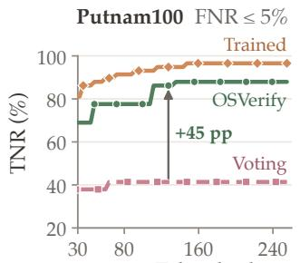

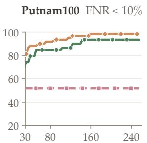  
Token budget per solution (k tokens)

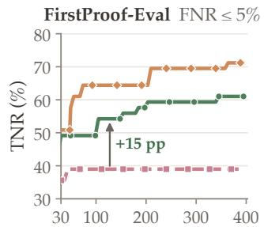

Token budget per solution (k tokens)  
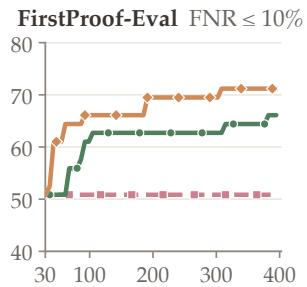  
Figure 5. Approximate inference cost comparison. OSVERIFY never falls below VOTING at any displayed budget; arrows mark its gain at 128k tokens per solution. Each point reports the best empirical TNR attainable within an input-plus-output token budget. VOTING varies from 1 to 64 judgments; OSVERIFY jointly varies the proposal budget and 1–16 validation votes per proposed error. The displayed range starts at 30k tokens per solution, and curves omit leading zero-TNR operating points that accept every solution. Lines connect evaluated budget points; vertical axes vary across panels.

Component-wise inference cost. Table 3 reports the decomposition, proposal, and validation costs for 200 H2V solutions with oss, decomposition depth two, and 16 validator judgments per proposed error. Decomposition and proposer costs use recorded provider usage. Validator input tokens are reconstructed with the model tokenizer, and output tokens are estimated from the mean length of 50 previously sampled completions. The estimate counts the prompt for each proposed error once and sums the output tokens of 16 completions under batched-equivalent accounting.

Table 3. Component-wise H2V inference cost with oss, projected to 16 validator judgments per proposed error. Decomposition and proposer usage are provider-reported; validator inputs are reconstructed with the model tokenizer. Outputs marked † are estimated from previously sampled completion lengths. Requests include every internal decomposition request and one batched-equivalent validation request per proposed error. $K = 1 \mathrm { { \dot { 0 } } ^ { 3 } }$ and $M = 1 0 ^ { 6 }$
<table><tr><td>Component</td><td>Requests</td><td>Input tokens</td><td>Output tokens</td><td>Total tokens</td><td>Tokens/solution</td></tr><tr><td>OSVERIFY: decomposition</td><td>4.51K</td><td>7.08M</td><td>3.26M</td><td>10.34M</td><td>51.7K</td></tr><tr><td>OSVERIFY: proposer</td><td>1.19K</td><td>6.47M</td><td>2.28M</td><td>8.75M</td><td>43.7K</td></tr><tr><td>OSVERIFY: validator  $( n = 1 6 )$ </td><td>672</td><td>3.11M</td><td>15.22M†</td><td>18.33M†</td><td>91.6K</td></tr></table>

The validation estimate uses the original proposed errors and prompts, with completion lengths extrapolated to 16 judgments per proposed error. All 50 sampled validator completions terminated without reaching the output-token limit.

## B.3 Saturation of the VOTING baseline

Figure 6 scales the whole-solution VOTING baseline from 1 to 64 judgments for two backbones on Putnam100 and FirstProof-Eval. We use the first n recorded judgments for each solution, without subset resampling. At each $n ,$ we select the rejection threshold with the highest TNR under the specified empirical FNR constraint on the evaluated cohort.

VOTING exhibits diminishing returns, with most curves approaching a plateau within the first few dozen judgments. For oss under the 5% FNR cap, increasing the vote count from 16 to 64 changes TNR from 41.4% to 39.7% on Putnam100 and leaves it at 35.6% on FirstProof-Eval. Thus increasing VOTING to 64 judgments does not recover the main-table gains from OSVERIFY on these configurations. These are empirical observations within the evaluated budget range.

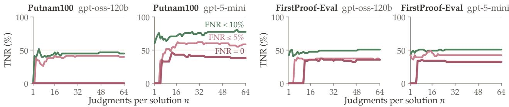  
Figure 6. Scaling the whole-solution VOTING baseline to 64 judgments. Each curve reports the best empirical TNR at the FNR constraint of 0%, 5%, or 10%, using the first n judgments per solution. No subset resampling or smoothing is applied.

## B.4 Held-out threshold selection on Putnam

The main results select thresholds on the evaluation set; this section illustrates deployment, where the threshold is instead selected on held-out valid solutions. We use 100 Putnam valid solutions from the training pool as a calibration dataset. They share no problems with the Putnam100 solutions. We collect 16 whole-solution judgments for VOTING and 16 validation judgments per proposed error for OSVERIFY, using oss. The score is the number of rejecting votes for VOTING and the maximum substantial-vote count over proposed errors for OSVERIFY.

We select thresholds using the order-statistic procedure of FactTest [47], with valid solutions as the null class and $\delta = 0 . 1 0$ . For a target valid-solution rejection rate τ, we choose the smallest k satisfying

$$
\sum _ { j = k } ^ { 1 0 0 } \binom { 1 0 0 } { j } ( 1 - \tau ) ^ { j } \tau ^ { 1 0 0 - j } \leq \delta .
$$

We set the threshold to the kth smallest calibration score and reject only scores strictly above it. This gives $k = 9 9$ for $\tau = 0 . 0 5$ and $k = 9 5$ for $\tau = 0 . 1 0$ . Table 4 applies the resulting thresholds to the recorded test votes.

Table 4. Diagnostic comparison using calibration-selected thresholds on Putnam. All scores use 16 votes.
<table><tr><td>Target FNR</td><td>Method</td><td>Reject if score</td><td>Test FNR</td><td>Test TNR</td></tr><tr><td rowspan="2">5%</td><td>VOTING</td><td>&gt; 16</td><td>0.0% (0/50)</td><td>0.0% (0/58)</td></tr><tr><td>OSVERIFY</td><td>≥ 16</td><td>4.0% (2/50)</td><td>77.6% (45/58)</td></tr><tr><td rowspan="2">10%</td><td>VOTING</td><td>≥ 15</td><td>2.0% (1/50)</td><td>29.3% (17/58)</td></tr><tr><td>OSVERIFY</td><td>≥ 15</td><td>6.0% (3/50)</td><td>81.0% (47/58)</td></tr></table>

## B.5 Training data audit ablation

We examine the effect of auditing proposed errors from invalid solutions when constructing validator training data. The full setup uses the reference-assisted screening described in Appendix C.2; the ablated setup omits this audit. Figure 7 compares the resulting oss validators under a 5% empirical

FNR constraint. With auditing, TNR is 89.6±1.7% on Putnam100, 83.2±0.7% on H2V, and 62.3±0.8% on FirstProof-Eval. Without auditing, the corresponding results are 84.8 ± 2.6%, 82.6 ± 0.7%, and 60.0 ± 1.5%. Auditing improves mean TNR by 4.8, 0.6, and 2.3 percentage points, respectively. These results support checking individual proposed errors rather than relying solely on the invalidity of the source solution.

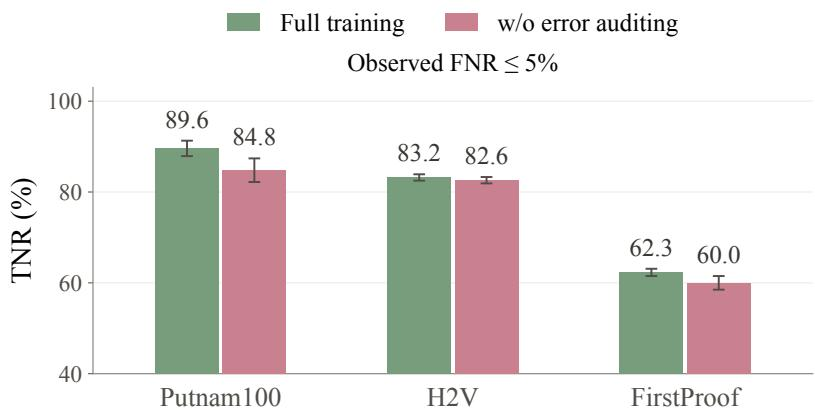  
Figure 7. Auditing proposed errors for validator training. We compare the full training setup with a variant that omits auditing proposed errors from invalid solutions. Bars show mean TNR under a 5% empirical FNR constraint; error bars show standard deviations. The vertical axis starts at 40%.

## C Datasets and Annotation

## C.1 Evaluation datasets

Table 5 summarizes the evaluation datasets. Valid solutions are the positive class for the solutionlevel FNR and TNR definitions.

Table 5. Evaluation datasets.

<table><tr><td>Benchmark</td><td>Invalid</td><td>Valid</td><td>Total</td></tr><tr><td>Putnam100</td><td>58</td><td>50</td><td>108</td></tr><tr><td>H2V</td><td>163</td><td>37</td><td>200</td></tr><tr><td>FirstProof-Eval</td><td>59</td><td>35</td><td>94</td></tr></table>

Putnam100. The valid set contains 50 official solutions to 46 Putnam problems, collected from the Putnam archive.<sup>1</sup> To construct the invalid set, we generate solutions using Claude Sonnet 4.5, GPT-5.4-mini, and Qwen3-235B-A22B-Instruct. We grade these solutions against the official references using GPT-5.5 with xhigh reasoning effort and retain those classified as invalid. Human experts then independently verify that the retained solutions are indeed invalid.

H2V. We use the full test split of Hard2Verify [50], which contains 200 solutions to 79 problems, generated by GPT-5, Claude Sonnet 4, and Gemini 2.5 Pro, with 1,860 step-level labels from expert annotators. A solution is valid if and only if all of its steps are labeled correct. A solution is valid if and only if all of its steps are labeled correct, which yields 42 valid and 158 invalid solutions. We subsequently re-examine all valid and invalid solutions. We relabel five solutions from valid to invalid because they contain a false step or omits a necessary component of the argument. The relabeling is independently confirmed by a human expert. Among them, four contain a false step: a circular equivalence between an event and itself (solution 140), an appeal to a nonexistent theorem whose claimed probability of $1 / 2$ contradicts the official value of about 1/3 (141), an upper bound silently used as an equality (199), and a false structural lemma (62; see the example below). The fifth (179) omits the upper-bound direction of the proof, which the official solution establishes over a full page.

FirstProof-Eval. FirstProof-Eval contains solutions to the 20 problems of First Proof [1], released in two batches of ten. The 94 solutions comprise 17 written by humans, 39 generated by GPT and Gemini models, and 38 released publicly by OpenAI, UCLA, Princeton, and IMProofBench, each with a human-assigned validity label.

Audit example: H2V solution 62   
Problem. A rectangle R is divided into finitely many axis-parallel rectangles, no three of which share a corner. An   
ant moves from a corner of a chosen rectangle to an adjacent corner of the same rectangle. Prove that if the ant   
travels from the bottom-left to the top-right corner of $R ,$ some rectangle is chosen at least twice.   
Original label. Valid.   
Claim in the solution (Step 0). Every interior cut runs across all of $R ,$ so the dissection consists of parallel strips.   
The argument considers an interior endpoint $P$ of a vertical cut and asserts that “the rectangle(s) adjacent above or   
below then also have a corner at $P , ^ { \prime \prime }$ which would give three rectangles with a common corner.   
Counterexample. Let $R = [ 0 , 2 ] ^ { 2 } , A = [ 0 , 2 ] \times [ 1 , 2 ] ^ { \sim } B = [ 0 , 1 ] \times [ 0 , \stackrel { \sim } { 1 } ] .$ , and $C = [ 1 , 2 ] \times [ 0 , 1 ]$ . The vertical cut x = 1   
ends at $P = ( 1 , 1 )$ , which is a corner of B and C only; P lies in the interior of the bottom side of A. No point is a   
corner of three rectangles, yet the dissection is not a strip decomposition.   
Consequence. Steps 2–3 count moves under the strip structure, so the proof does not establish the result, and the   
step is not locally repairable. We relabel the solution as invalid.

## C.2 Training data and supervision

We construct training examples from the training split of the Putnam corpus, IMO-GradingBench [39], ProofBench [40], and the Open Proof Corpus [12]. Each example consists of a problem, a submitted solution, a proposed error, and a binary target indicating whether the error warrants rejection. For valid source solutions, proposed errors receive negative targets. For invalid source solutions, trusted reference answers and available grading guidelines support error proposal and screening before a positive target is assigned; only proposed errors judged substantial by at least 3 of the 5 validation votes receive positive targets. The online validator receives the reference-free problem, solution, and proposed error. We exclude easy examples, on which all five sampled verdicts of the base validator match the target, and examples whose prompts leave fewer than 8,192 output tokens in the 32,768-token context window. Table 6 gives the resulting composition.

Table 6. Composition of the online GRPO training pool. Negative examples are proposed errors on valid solutions; positive examples are substantial proposed errors on invalid solutions.
<table><tr><td>Source</td><td>Negative</td><td>Positive</td><td>Total</td></tr><tr><td>Putnam (training split)</td><td>774</td><td>270</td><td>1,044</td></tr><tr><td>IMO-GradingBench</td><td>71</td><td>165</td><td>236</td></tr><tr><td>ProofBench</td><td>45</td><td>223</td><td>268</td></tr><tr><td>Open Proof Corpus</td><td>13</td><td>126</td><td>139</td></tr><tr><td>Total</td><td>903</td><td>784</td><td>1,687</td></tr></table>

## D Experimental Details

## D.1 Evaluation protocol and metrics

For Voting and OSVERIFY, we independently sample judgments without replacement from each recorded pool. Within each trial, we reselect the rejection threshold that maximizes empirical TNR under the specified FNR constraint, including the always-pass rule.

The reported means and standard deviations summarize variation across the 2,000 resampling trials with the evaluation solutions held fixed.

## D.2 Models and inference configurations

Table 7 lists the backbones and their inference settings. The main comparison uses the sampling protocol above. Unless otherwise specified, we use the same backbone for the error proposer and error validator in OSVERIFY. All validation calls include the problem, the full submitted solution, the focused excerpt, and the proposed error. Dataset-specific policies are fixed within each experiment.

Table 7. Backbones and inference settings. 5mini only supports its default temperature of 1. The trained validator is oss with the LoRA adapter described in Appendix D.5; it validates the proposed errors of the training-free oss proposer.
<table><tr><td>Model</td><td>Provider</td><td>Reasoning effort</td><td>Temperature</td></tr><tr><td>OSS</td><td>Together AI</td><td>Medium</td><td>0.7</td></tr><tr><td>5mini</td><td>OpenAI</td><td>Medium</td><td>1.0</td></tr><tr><td>oss + LoRA (trained validator)</td><td>Tinker</td><td>Medium</td><td>0.7</td></tr></table>

## D.3 Setup of whole-solution judging and proposed-error checking

Figure 2c compares oss judgments of whole solutions with its validation of proposed errors on FirstProof-Eval. Both use 15 votes per decision. For whole-solution judging, the score is the fraction of REJECT verdicts among the first 15 whole-solution judgments. At each threshold, TNR is the fraction of the 59 invalid solutions rejected, and FNR is the fraction of the 35 valid solutions rejected.

For proposed-error checking, the score is the fraction of 15 validator votes that label the proposed error SUBSTANTIAL. TNR is the fraction of the errors on that are confirmed as SUBSTANTIAL by an independent audit (gpt-6-astra xhigh), and FNR is the fraction of the errors on that are confirmed as MINOR or NOT-REAL by the audit.

## D.4 Hierarchical proposal and aggregation

We use maximum decomposition depth two for the main comparison, with the root at depth zero and one proposal call per retained node. The solution-level score is the largest number of SUBSTANTIAL votes received by any of its proposed errors; solutions without proposed errors receive score zero. The decision rejects if this score reaches the selected positive threshold.

Algorithm 1 Hierarchical error proposal   
Input Problem $x ,$ solution y, maximum depth $D .$   
Function Decompose $( u _ { k } , d )$   
1. If $d = D$ or the model judges $u _ { k }$ atomic, return $\{ u _ { k } \}$   
2. Split $u _ { k }$ into $( u _ { 2 k } , u _ { 2 k + 1 } ) ;$ ; return $\{ u _ { k } \} \cup$ Decompose $( u _ { 2 k } , d + 1 )$ ∪ Decompose $( u _ { 2 k + 1 } , d + 1 )$   
Main:   
3. Set $u _ { 1 } = y , U$ ← Decompose $( u _ { 1 } , 0 )$ and ${ \mathcal { G } } ( x , y ) \gets \bigcup _ { u \in U } { \mathcal { G } } ( x , y , u )$   
4. Merge identical proposed errors and return $\mathcal { G } ( x , y )$

## D.5 Online GRPO training

We fine-tune the oss validator with LoRA using online GRPO [54], starting from the base model. Training inputs and targets are constructed as described in Appendix C.2. At each optimization step, we sample 32 training examples and the current policy generates eight fresh rollouts for each. Each rollout uses the validator prompt with the dataset policy of its source domain. Examples are sampled with weights that balance valid-side and invalid-side examples within each domain, and the oversampling of any single example is capped at three times that of the least-sampled example in its domain. Each rollout receives reward one if its final verdict matches the binary target and zero otherwise. For positive targets, the required verdict is SUBSTANTIAL; for negative targets, either NOT-REAL or MINOR is accepted. Truncated responses and responses without a parseable final verdict receive zero reward.

For rewards $r _ { i 1 } , \ldots , r _ { i 8 }$ from example $i ,$ we compute the within-group mean $\bar { r _ { i } }$ and standard deviation $\sigma _ { i }$ . The normalized advantage is

$$
A _ { i j } = \frac { r _ { i j } - \bar { r } _ { i } } { \sigma _ { i } + \epsilon } .
$$

Groups with zero reward variance do not contribute an update. A per-token KL penalty against the base model is subtracted from the advantage of each generated token. We take one policy-gradient update on the fresh rollouts per step, summing contributions over generated tokens without persequence length normalization, and then refresh the sampling policy. We report the checkpoint after 400 optimization steps. Table 8 lists the hyperparameters.

Table 8. Online GRPO hyperparameters.
<table><tr><td>Setting</td><td>Value</td></tr><tr><td>Base model</td><td>oss, medium reasoning effort</td></tr><tr><td>Adapter</td><td>LoRA, rank 32</td></tr><tr><td>Optimizer</td><td> $\mathrm { A d a m } , \beta _ { 1 } = 0 . 9 , \beta _ { 2 } = 0 . 9 5 , \epsilon = 1 0 ^ { - 8 }$ </td></tr><tr><td>Learning rate</td><td>10−⁵, linear warmup for 10 steps, then constant</td></tr><tr><td>Examples per step</td><td>32</td></tr><tr><td>Rollouts per example</td><td>8</td></tr><tr><td>Sampling temperature</td><td>0.7</td></tr><tr><td>Context window</td><td>32,768 tokens (prompt and completion)</td></tr><tr><td>KL coefficient</td><td>0.03 (reference: base model)</td></tr><tr><td>Advantage €</td><td> $1 0 ^ { - 6 }$ </td></tr><tr><td>Per-example oversampling cap 3×</td><td></td></tr><tr><td>Training Steps</td><td>400 steps</td></tr></table>

## E Representative Issues Found in Research Papers

This appendix lists representative issues that OSVERIFY identified in the two papers reviewed in Section 4.4. For each issue, we give the diagnosis reported by OSVERIFY and the correction it proposed; the authors confirmed both. We lightly edit the reports for notation and replace references to source-file line numbers with descriptions of the corresponding statements. Statement and equation numbers for Liu and Wang [36] refer to arXiv:2504.00275v3. For each example, we also include a brief comment from a human expert on the significance of the issue, shown in shaded boxes.

Table 9. Number of reported issues, all verified as real by human experts. Direct review uses the same backbone as OSVERIFY through its web interface.
<table><tr><td>Paper</td><td>Venue</td><td>Backbone</td><td></td><td>OSVERIFY Direct review</td></tr><tr><td>Zhu [72]</td><td>Annals of Mathematics gpt-6-astra max</td><td></td><td>45</td><td>11</td></tr><tr><td>Liu and Wang [36] arXiv preprint</td><td></td><td>gpt-5.6 sol max</td><td>88</td><td>3</td></tr></table>

## E.1 Examples from Zhu [72]

Example 1: Koszul signs in the commutativity constraint. Issue. An auxiliary lemma in the construction of the commutativity constraint, together with the intermediate diagram for Θ, uses c<sub>vect</sub>, which the paper defines as the ordinary flip, whereas the canonical interchange of complexes induces the graded flip. The distinction is nontrivial: for $G = \mathrm { { G L _ { 2 } } } ,$ , the complex $\mathrm { I C } _ { ( 1 , 0 ) }$ has nonzero hypercohomology in degrees −1 and 1. Moreover, the displayed diagram for Θ and $\Theta \dot { | } _ { H ^ { j } } = ( \sqrt { - 1 } ) ^ { j }$ imply that $H ^ { * } ( \check { c ^ { \prime } } )$ is already the ordinary flip, so the final Koszul correction introduces an unwanted minus sign on odd ⊗ odd.

Correction. Use $\tau _ { \mathrm { g r } } ( x \otimes y ) ~ = ~ ( - 1 ) ^ { r s } y \otimes x$ for homogeneous cohomology classes of degrees r and s in the auxiliary lemma and the intermediate diagram for Θ. The next auxiliary lemma then gives $H ^ { * } ( c ^ { \prime } ) = \bar { \tau } _ { \mathrm { g r } } ,$ because the factors $( { \sqrt { - 1 } } ) ^ { r + s }$ cancel. For objects of pure parity, define $\varepsilon ( A ) \stackrel { - } { = } ( 1 - p ( A ) ) / 2 \stackrel { - } { \in } \{ 0 , 1 \}$ and set $c = ( - 1 ) ^ { \dot { \varepsilon } ( A ) \varepsilon ( \dot { B } ) } c ^ { \prime }$ . Since cohomology has the corresponding parity, this gives $H ^ { * } ( c ) = \tau _ { \mathrm { o r d } }$ . Extend by the decomposition into even and odd parts, and retain the ordinary flip in the proposition establishing the commutativity constraint.

Human expert comment. This subtle sign error went unnoticed for years. It is fixable and does not substantially affect the main result, but it must be corrected carefully for the statement to hold as written.

Example 2: A false degree-two generation claim. Issue. The assertion that the relevant cohomology is generated in degree two is false. For $G = \mathrm { G L _ { 4 } }$ and $\mu = ( 1 , 1 , 0 , 0 )$ , the stratum $\operatorname { G r } _ { \mu }$ is the perfection of the Grassmannian ${ \mathrm { G r } } ( 2 , 4 )$ , with dim $H ^ { 2 } = 1$ and dim $H ^ { 4 } = 2$ . An algebra generated by this $H ^ { 2 }$ would have a degree-four part of dimension at most one. Thus the reduction to checking the action only on $H ^ { 2 }$ is invalid.

Correction. Remove the degree-two generation assertion, and replace its use with a justification of the sign formula on $H ^ { 2 j } ( \mathrm { G r } _ { \mu } )$ for every j, as required in the subsequent associated-graded argument.

Human expert comment. The error invalidates the proof strategy of reducing to $H ^ { 2 } .$ , so the original argument must be repaired.

Example 3: Normalization of the shifted intersection complexes. Issue. The definition $C _ { \mu } =$ $\mathrm { I C } _ { \mu } [ ( \bar { 2 \rho } , \mu ) ]$ conflicts with the earlier normalization $\operatorname { I C } _ { \mu } | _ { \mathrm { G r } _ { \mu } } = \bar { \mathbb { Q } } _ { \ell } [ ( 2 \rho , \mu ) ]$ . For $G = \mathrm { { G L _ { 2 } } }$ and $\lambda = \mu =$ $( 1 , 0 )$ , it places the only stalk cohomology on the open stratum in degree −2. Consequently, a later stalk formula gives $q ^ { - 1 }$ instead of the diagonal Kazhdan–Lusztig polynomial 1, and a later identity predicts −id where the defining normalization of Ψ gives id.

Correction. Correct the normalization of $C _ { \mu } ,$ and reconcile the subsequent stalk-polynomial formulas and costalk filtration with the earlier definition $I H ^ { * } = H ^ { * } \bigl ( \mathrm { I C } _ { \mu } [ - ( \dot { 2 \rho } , \mu ) ] \bigr )$

Human expert comment. This normalization error makes the paper internally inconsistent and must be corrected.

Example 4: Arrow directions in a convolution-fiber identification. Issue. The identification with $X _ { \omega _ { 0 } }$ is false as written. Take $n = N = 1 , \mu _ { 1 } = ( 1 ) .$ , and $\beta = p .$ . The original convolution fiber is a point. Even after replacing the undefined $\mu _ { 0 }$ by $\mu _ { 1 } ,$ the displayed arrow $F _ { 0 }  F _ { 1 }$ has valuation $^ { - 1 , }$ , so its inverse has valuation 1 and the closing composite $\dot { F _ { 1 } }  F _ { 0 }  E _ { 0 }$ has valuation 2. Its relative-position-zero locus is therefore empty. The arrow directions and weight indices need correction.

Correction. Define X using arrows $a _ { i } \colon F _ { i + 1 } \to F _ { i }$ with $F _ { 0 } = E$ and inv $( a _ { i } ) = \mu _ { N - i } ^ { * }$ for $0 \leq i < N$ Keep the relative-position-zero condition on $h = \beta \circ a _ { 0 } \circ \cdot \cdot \cdot \circ a _ { N - 1 } \colon F _ { N } \to E _ { 0 }$ . An original chain gives $F _ { i } = E _ { N - i }$ and $a _ { i } = \beta _ { N - i } ^ { - 1 } ,$ which makes h the identity. Conversely, the zero-position condition makes h an isomorphism; identifying $F _ { N }$ with $E _ { 0 }$ through h and inverting the arrows recovers the original chain. Each corrected step remains a relative perfect Grassmannian, and the zero-position locus remains closed. This restores the intended proof of the lemma and the properness of the fibers used later in the paper.

Human expert comment. The original proof indeed is flawed and the proposed correction is solid.

Example 5: The subset J for a general reductive group. Issue. The definition $J = S \backslash \{ 0 \}$ is invalid for a general reductive group $G ,$ which the paper allows. For $G = \mathrm { { S L } _ { 2 } \times \mathrm { { S L } _ { 2 } } }$ , deleting one node leaves an entire affine $A _ { 1 }$ component, so $W _ { J }$ is infinite and has no longest element. Consequently, the subsequent construction using $w _ { J }$ and longest double-coset representatives is undefined in this case, which obstructs the polynomial proof of the local involution lemma.

Correction. Correct the hyperspecial subset J for general reductive $G ,$ and carry this correction through the definitions of $w _ { J } , * , \diamond , d _ { \lambda } ,$ , and $d _ { \mu }$ . Explain the componentwise extension of the cited theorem of Lusztig and Yun needed in the subsequent argument, retaining the stated generality of G.

Human expert comment. The spotted error invalidates the definition and the subsequent lemma in the stated generality.

## E.2 Examples from Liu and Wang [36]

Example 1: The wrong graded component in a normalization. Issue. The normalization step in §7.2.2 selects the wrong graded component. Put $N = n ( n - 1 )$ and $A = \Gamma ( C , \sigma _ { n - 1 } \otimes \sigma _ { n } ) \langle 1 \rangle$ . The unequal ranks and geometric irreducibility give $H ^ { 0 } = H ^ { 2 } = 0 .$ , so A is odd of dimension $2 N ( g - 1 )$ . Hence $\mathrm { S y m } ^ { j } ( A ) = { \boldsymbol { 0 } }$ for $j > 2 N ( g - 1 )$ . Since $d _ { 0 } = d + N ( g - 1 )$ , the component at $d = 2 N ( g - 1 )$ has symmetric degree $3 N ( g - 1 )$ . It is therefore zero rather than one-dimensional, so it cannot supply the highest-weight vector used to compute λ in (7.48).

Correction. Replace the occurrences of $\int _ { X , 2 n ( n - 1 ) ( g - 1 ) }$ in the normalization argument by $\int _ { X , n ( n - 1 ) ( g - 1 ) }$ . At this corrected degree, $d _ { 0 } = 2 n ( n - 1 ) ( g - 1 )$ , so the paper’s global identification of the graded components matches this component with the one-dimensional top super-symmetric power. The degree-raising action annihilates ${ \mathrm { i t } } ,$ so it is the required Frobenius-eigen highest-weight line. Using this line in the highest-vector argument leading to (7.48) yields the same value of $\lambda ,$ and hence the same $\beta _ { \sigma }$ under the stated normalizations of the FGV construction and the Hecke characters.

Human expert comment. This normalization error must be fixed for the statement to be correct.

Example 2: An incorrect proof of Proposition 3.23. Issue. The proof of Proposition 3.23 relies on a false identification: the Clifford-filtration degree of a GPin lift need not equal the minimal reflection length of its orthogonal image. For a four-dimensional hyperbolic space, the GPin lift $1 - e _ { 1 } e _ { 2 }$ has filtration degree two, but its orthogonal image $F$ has a two-dimensional totally isotropic moved space im $( F - 1 )$ , so $F$ cannot be a product of two reflections. This invalidates the justification of (3.17), although it does not by itself disprove (3.17) or the proposition.

Correction. Replace the reflection-length inference with a valid argument, under the hypotheses of the proposition, that the least k with $\widetilde { F } \in G _ { k } \mathrm { C l } ( M )$ equals $2 n - \dim M ^ { F = 1 }$ . If this equality requires additional hypotheses, revise the proposition and the later remark that invokes it accordingly.

Human expert comment. The proof in the paper is indeed incorrect, although the statement is true and can be proved by a different argument.

Example 3: A termwise equivalence for a cumulative filtration. Issue. In the proof of Proposition 3.23, the termwise equivalence

$$
z _ { r } \neq 0 \iff \operatorname { t r } \left( ( G _ { r } \operatorname { C l } ( M ) ) { \widetilde { F } } \right) \neq 0
$$

is false, because the filtration $G _ { \bullet } \mathrm { C l } ( M )$ is cumulative. For example, in the two-dimensional case with det $F = 1 ,$ , one can have $z _ { 0 } \neq 0$ and $z _ { 1 } = 0$ by parity, while the trace is still nonzero on $G _ { 1 }$ because $1 \in G _ { 1 }$

Correction. Replace the termwise equivalence with

$$
\mathrm { t r } \left( ( G _ { r } \mathrm { C l } ( M ) ) \widetilde { F } \right) \neq 0 \iff z _ { j } \neq 0 \mathrm { f o r } \mathrm { s o m e } j \leq r .
$$

Taking the least such r gives min $\{ r : \operatorname { t r } ( ( G _ { r } \operatorname { C l } ( M ) ) { \widetilde { F } } ) \neq 0 \} = \operatorname { o r d } ( z _ { \bullet } )$ , which is exactly the statement needed for the rest of the proof.

Human expert comment. The original proof is indeed inaccurate and the proposed fix is correct.

## F Prompts

The listings below materialize the prompt code used for the reported training-free experiments. Bracketed fields are replaced at inference time. We normalize typographic punctuation to ASCII for display; the instructions and output schemas are otherwise unchanged.

## F.1 Proposer prompt

The box below gives the root-level proposer prompt. For a non-root node, the problem and full solution remain visible, the node’s verbatim solution excerpt is added, and root-level TASK\_INCOMPLETE errors are disabled to avoid decomposition boundary artifacts. The rules for proposed errors, the error types, and the JSON schema are shared across depths.

```markdown
Proposer prompt
You are an error finder. Your job is to carefully analyze the solution and list
ALL concrete, checkable errors you find.
## Question
[QUESTION]
## Solution Under Review
[SOLUTION]
## Focus Areas (prioritize but do not limit yourself to these)
At this level, focus on <sub>**</sub>high-level / strategic errors<sub>**</sub>:
- The solution does not actually answer or solve the question asked
- The solution’s overall approach or strategy is fundamentally flawed
- The solution is partial, incomplete, or only addresses part of the question
The answer fails to complete a required task-level obligation of the original
question
- The solution contains internal contradictions (one part contradicts another)
- The solution’s conclusion does not follow from its reasoning
- Substantial factual errors (wrong names, dates, formulas, theorems)
Calculation errors that affect the final result
Also report any specific errors you notice at finer granularity.
```

\## What Counts as an Error

An error is a <sub>\*\*</sub>concrete, specific mistake<sub>\*\*</sub> in the solution. The following ARE errors:

\- <sub>\*\*</sub>Logical errors<sub>\*\*</sub>: A reasoning step is logically invalid

\- <sub>\*\*</sub>Incorrect application of theorems/formulas<sub>\*\*</sub>: A theorem applied without its hypotheses, or the wrong formula is used

\- <sub>\*\*</sub>Incorrect use of conditions<sub>\*\*</sub>: The solution uses a condition incorrectly, or assumes something not given

\- <sub>\*\*</sub>Calculation/algebraic errors<sub>\*\*</sub>: A computation gives a wrong result that affects subsequent reasoning

\- <sub>\*\*</sub>Factual errors<sub>\*\*</sub>: A concrete factual claim is wrong (wrong name, date, formula, theorem statement)

\- <sub>\*\*</sub>Self-contradictions<sub>\*\*</sub>: The solution makes claims that contradict each other

\- <sub>\*\*</sub>Wrong conclusion<sub>\*\*</sub>: The final answer or conclusion is incorrect

\- <sub>\*\*</sub>Problem misinterpretation / task mismatch<sub>\*\*</sub>: The solution proves or computes something other than what the question asks for

## ### Root-only TASK\_INCOMPLETE

At the root level only, use ‘‘TASK\_INCOMPLETE‘‘ when the whole answer fails to   
complete a required obligation of the original question. This is an umbrella   
type for global incompleteness. It includes task-level missing cases and   
task-level incomplete constructions. It is not a local presentation gap.

\- the question asks for a minimum/maximum/optimal value, but the answer gives only a construction or upper/lower bound and does not prove optimality;

\- the question asks for all solutions / a classification / an iff, but the answer proves only examples, one direction, or a non-exhaustive subset;

\- the question requires a case analysis, but the answer omits a required case or parameter range needed for exhaustiveness;

\- the question asks for a construction or existence proof, but the answer gives only a partial construction, does not verify that the object satisfies the required properties, or does not prove that the construction always works;

\- the final answer is stated, but the central task-level justification needed to accept it is absent.

Do NOT use ‘‘TASK\_INCOMPLETE‘‘ for:

\- a compressed local derivation, omitted routine algebra, or unstated standard lemma whose conclusion is clear from context;

\- an excerpt/decomposition artifact;

\- a proof bridge that could be filled without changing the answer.

\- ‘‘location‘‘ should usually be ‘‘"whole solution"‘‘ or the final claim whose task-level support is missing.

\- ‘‘target‘‘ must state what the question requires and what the answer actually establishes, side by side.

```markdown
required obligation.
‘‘impact‘‘ must explain why the final answer is not established as an answer
to the original question, even if the final numeric/result statement might be
true.
## Error Severity Policy
The goal is to catch proof failures, including <sub>**</sub>critical rigor gaps<sub>**</sub>, while
not nitpicking superficial issues.
### DO NOT flag (minor / fillable / non-load-bearing)
Small notational slips that are clearly typos and self-correct from context.
Omitted routine algebra a competent reader can fill in mechanically.
Citing well-known standard theorems without restating their proofs.
Stylistic, formatting, or phrasing issues.
Errors in optional remarks, side comments, or post-proof addenda.
### DO flag (critical gaps that undermine the proof)
A critical rigor gap is one where:
(a) the step is load-bearing (the rest of the proof depends on it), AND
(b) a competent reader <sub>**</sub>cannot<sub>**</sub> fill it in using standard methods.
Examples that qualify as errors:
An unjustified "by symmetry", "WLOG", or "similarly" where the symmetry/WLOG
reduction is NOT actually valid or NOT actually established.
An induction or recursion whose <sub>**</sub>base case is missing or wrong<sub>**</sub>, OR whose
<sub>**</sub>inductive step omits the actual justification<sub>**</sub> for the inductive claim.
A <sub>**</sub>case analysis<sub>**</sub> that the problem requires but the solution omits one or
more cases (e.g. a parameter range, sign case, parity case).
A formula, inequality, or identity asserted as load-bearing <sub>**</sub>without
derivation<sub>**</sub> when the derivation is non-trivial and the claim is not standard.
A claim labelled "this is obvious / clearly / it is easy to see" applied to a
step that is <sub>**</sub>not obvious<sub>**</sub> and is critical to the conclusion.
An invocation of a theorem whose <sub>**</sub>hypotheses are not verified<sub>**</sub> to hold in
the current setting.
Circular reasoning: assuming what is being proved.
A "construction" provided without proof that it satisfies the required
properties when those properties are non-trivial to verify.
An estimate / bound that handwaves over the critical inequality direction.
### Rule of Thumb
For each suspicious step, ask:
1. Is this step load-bearing ? (Removing or doubting it breaks the proof?)
2. If a competent reader tried to fill in the missing justification using
<sub>**</sub>standard methods only<sub>**</sub>, could they actually do so?
- Yes to 1 AND no to 2 -> flag as a critical error.
- The gap is in stylistic / non-load-bearing content -> do not flag.
- A competent reader could mechanically fill the gap -> do not flag.
When the step is <sub>**</sub>clearly load-bearing AND the justification is genuinely
missing<sub>**</sub>, <sub>**</sub>err toward flagging<sub>**</sub>. Catching critical proof gaps matters more
```

```markdown
than avoiding flags on borderline cases -- the validator will reconfirm
candidates before declaring an error.
## Candidate Discipline: validator-ready proof audit
Your output will be checked later by an independent validator. A useful
candidate is not just "this seems suspicious"; it must be a local, checkable
rejection certificate for the answer as written.
Before adding any JSON error, test it against all four gates:
1. As-written anchor:
- The ‘‘location‘‘ must quote the exact text or name ‘‘"whole solution"‘‘
for a root-level task failure.
- The candidate must challenge what the solution actually says, with the
same quantifiers, objects, assumptions, and proof role.
2. Independent failure check:
- Explain in ‘‘issue‘‘ why the challenged claim/inference fails under the
current proof state.
- For a missing-justification candidate, identify the non-routine
obligation that remains unproved; do not merely say "not shown".
3. Impact chain:
- Explain in ‘‘impact‘‘ how the error defeats a required conclusion,
theorem hypothesis, construction property, case split, optimality proof,
converse direction, or final answer.
- If the issue affects only optional commentary, do not report it.
4. Repair filter:
- Do not report a typo, wording issue, routine omitted algebra, standard
lemma invocation, or compressed bridge that a competent grader can fill
without a new idea.
- Do report a load-bearing gap when filling it would require a new lemma,
missing case, missing construction verification, invalid WLOG/symmetry
reduction, theorem-hypothesis check, or nontrivial inequality/identity.
Prefer these issue tags at the start of ‘‘issue‘‘ when they apply:
FALSE_CORE_CLAIM:
INVALID_INFERENCE:
THEOREM_HYPOTHESIS_FAILURE:
MISSING_REQUIRED_CASE:
UNJUSTIFIED_LOAD_BEARING_STEP:
CONSTRUCTION_NOT_VERIFIED:
TASK_INCOMPLETE:
CALCULATION_ERROR:
Do not pad the list. It is better to return one strong, validator-ready
candidate than several vague near-duplicates.
## Error Types
```

For each error you report, choose exactly one ‘‘error\_type‘‘ from this list:   
PROBLEM\_MISINTERPRETATION   
FALSE\_OR\_UNSUPPORTED\_CLAIM   
INVALID\_INFERENCE   
一 VIOLATED\_CONDITION   
MISSING\_CRITICAL\_CASE   
COMPUTATION\_OR\_DERIVATION\_ERROR   
INTERNAL\_INCONSISTENCY   
CONTRADICTION\_WITH\_PROBLEM   
CIRCULAR\_REASONING   
UNJUSTIFIED\_GENERALIZATION   
METHODOLOGICAL\_OR\_STATISTICAL\_FLAW   
SOURCE\_OR\_EVIDENCE\_MISUSE   
OTHER   
TASK\_INCOMPLETE   
## Schema (type-aware fields)   
The required content of each field depends on whether the error is localized   
(a specific step) or <sub>\*\*</sub>holistic<sub>\*\*</sub> (about the whole solution / a global   
mismatch).   
‘‘location‘‘:   
- <sub>\*\*</sub>Localized error<sub>\*\*</sub>: quote the specific verbatim text from the solution that   
contains the wrong content.   
- <sub>\*\*</sub>Internal contradiction / inconsistency<sub>\*\*</sub>: cite <sub>\*\*</sub>both<sub>\*\*</sub> conflicting   
locations (quote each verbatim).   
<sub>\*\*</sub>Problem misinterpretation / task mismatch / fundamental scope issue<sub>\*\*</sub>: write   
‘‘"whole solution"‘‘.   
‘‘error\_type‘‘: pick one from the list above.   
‘‘target‘‘: what the candidate is about, expressed concretely.   
- <sub>\*\*</sub>Localized error<sub>\*\*</sub>: the specific claim, inference, computation, or step you   
are challenging (1-2 sentences, faithful to the solution).   
- <sub>\*\*</sub>Internal contradiction<sub>\*\*</sub>: the two contradicting statements, both stated   
explicitly.   
- <sub>\*\*</sub>Problem misinterpretation / task mismatch<sub>\*\*</sub>: what the question actually asks   
for AND what the solution actually proves / produces, side by side.   
- <sub>\*\*</sub>TASK\_INCOMPLETE<sub>\*\*</sub>: what the original question requires AND what the answer   
actually establishes -- the task-level gap. Use this for global missing cases   
and incomplete constructions.   
‘‘issue‘‘: the checkable problem you observe.   
- <sub>\*\*</sub>Localized<sub>\*\*</sub>: "the solution does X here, but X is wrong because Y" -- Y must   
cite specific facts from the solution or standard knowledge.   
- <sub>\*\*</sub>Contradiction<sub>\*\*</sub>: "statement A and statement B cannot both be true because   
[specific reason]".   
- <sub>\*\*</sub>Task mismatch<sub>\*\*</sub>: "the question requires X, but the solution targets Y; X !=   
Y because [specific difference]".

- <sub>\*\*</sub>TASK\_INCOMPLETE<sub>\*\*</sub>: "the original question requires [specific obligation],   
but the answer only establishes [specific subset/partial construction]".   
- ‘‘impact‘‘: how the issue affects the final answer or a central step.   
- <sub>\*\*</sub>Localized<sub>\*\*</sub>: trace using the solution’s own variables / values / named steps   
to the final answer or a load-bearing step.   
- <sub>\*\*</sub>Holistic<sub>\*\*</sub> (contradiction, task mismatch, missing case): state which   
load-bearing claim is invalidated, OR that the answer addresses the wrong   
target / does not satisfy what the question required.   
## Output Format   
First, provide your analysis and reasoning.   
Then, output your findings in a JSON block. If you found errors, list them. If you   
found NO errors, output an empty list.   
‘‘‘json   
{   
"errors": [   
{   
"location": "Type-appropriate location (verbatim quote / both quotes /   
’whole solution’).",   
"error\_type": "One of the listed error types.",   
"target": "Type-appropriate target (specific claim / two contradicting   
statements / question-vs-solution / coverage gap).",   
"issue": "What is wrong, stated as a fact about the specific content.",   
"impact": "How the issue affects the final answer or a central step."   
}   
]   
}   
  
If no errors found:   
‘‘‘json   
{"errors": []}   
  
IMPORTANT:   
- Each error must include type-appropriate evidence per the schema above.   
- Each candidate must point to a SPECIFIC part of the solution and explain WHY it   
is wrong.   
- Be thorough but honest -- do not fabricate errors that don’t exist.   
- If the solution is correct, output an empty error list.

## F.2 Validator prompt

The box below gives the validator prompt. Each validator sees the full problem and solution, the focused node excerpt, and one proposed error. The placeholder for the dataset policy is filled with the corresponding block shown in the following boxes.

```markdown
Validator prompt
You are validating a proposed error for a one-sided verifier.
Your job is to decide whether THIS candidate is a real error in the solution as
written.
Operating point:
False FAIL is worse than missed FAIL.
Do not confirm hallucinated, distorted, or excerpt-artifact candidates.
Do not rescue a verified real error by rewriting the answer into a different,
better answer.
## Question
[QUESTION]
## Full Solution (for context):
[SOLUTION]
Solution excerpt being focused on ([NODE_ID], depth=2):
[NODE SOLUTION EXCERPT]
## Proposed error (hypothesis to verify)
<sub>**</sub>Location:<sub>**</sub> [LOCATION]
<sub>**</sub>Description:<sub>**</sub> [DESCRIPTION]
## Labels
‘‘[[NOT_REAL]]‘‘ -- the proposed issue is misread, distorted, contradicted by
full context, or otherwise unverified.
‘‘[[MINOR]]‘‘ -- the issue is real but not a reason to reject the answer under
the active evaluation standard.
‘‘[[SUBSTANTIAL]]‘‘ -- the issue is a valid reason to reject the answer under
the active evaluation standard.
## Step 1: Candidate realness
Treat the proposed error as a hypothesis. Confirm that:
1. it targets a claim, inference, computation, or required omission actually
present in the solution, without changing its meaning, scope, conditions,
quantifiers, or role;
2. the issue remains after reading the full solution and relevant parent
context;
3. the objection itself is mathematically correct and respects every relevant
assumption of the exact claim being challenged. Before confirming a
mathematical objection, restate that exact claim as it is used in the full
solution. If the objection uses a counterexample or contradiction, verify
that it satisfies every relevant assumption and previously established fact
needed by that claim. If any such condition is violated or remains
unchecked, output ‘‘[[NOT_REAL]]‘‘; and
```

4. for a gap or completeness complaint, the required support or deliverable is   
genuinely absent rather than merely compressed or supplied elsewhere.   
Distinguish a missing explanation from a false conclusion: showing that a   
local derivation is absent or compressed verifies at most a gap; it does not   
show that the exact conclusion is false or that the inference is invalid.   
Treat it as a concrete mathematical error only when the objection verifies   
falsity or invalidity under the full conditions of the claim.   
A gap can be real without proving that the stated conclusion is false. Once   
the gap is verified, use the active dataset policy to decide its severity.   
If the candidate misreads the solution, drops a relevant condition, attacks a   
different claim, relies on an invalid counterexample, or is otherwise   
unverified, output ‘‘[[NOT\_REAL]]‘‘. Otherwise continue to Step 2.   
## Step 2: Severity under the active evaluation standard   
Use one materiality test: is the verified issue a reliable reason to reject the   
submitted answer as a solution to the problem?   
Classify it as ‘‘[[MINOR]]‘‘ when it is a harmless presentation issue, or an   
isolated local mistake that the written solution corrects, does not use, or can   
remove while retaining a complete valid route already present in the solution.   
This also includes an issue confined to an optional remark or a case excluded   
by the problem’s assumptions.   
Classify it as ‘‘[[SUBSTANTIAL]]‘‘ when it changes a required answer or object,   
invalidates a claim or inference needed by the written proof’s only complete   
route, or otherwise leaves the problem unsolved. A correct final answer alone   
does not rescue an invalid main argument.   
For every gap, omitted argument, unsupported step, or completeness complaint,   
apply the active dataset policy below. A gap need not contain a false written   
claim, but it must concern support actually required by the problem and absent   
from the full solution.   
### Active dataset policy   
[DATASET-SPECIFIC POLICY; SEE THE NEXT LISTING]   
## Output   
Briefly explain:   
1. the exact claim being challenged in full context;   
2. whether every relevant condition of the objection, counterexample, or   
contradiction was checked;   
3. whether the objection verifies a false conclusion or invalid inference, or   
only a missing/compressed explanation; and   
4. which active-policy rule determines severity.   
Then output exactly one final label:

‘‘[[NOT\_REAL]]‘‘   
‘‘[[MINOR]]‘‘   
‘‘[[SUBSTANTIAL]]‘‘   
Your analysis:

H2V policy   
Evaluation standard: a rigorous olympiad solution.   
An error or omission is ‘‘[[SUBSTANTIAL]]‘‘ when a nontrivial argument needed   
to establish a result required by the problem is missing or invalid, even if   
the final answer is correct or the intended strategy is apparent. Routine   
details that a competent reader can readily supply are ‘‘[[MINOR]]‘‘.

## F.3 Dataset-specific policies

The boxes below contain the complete policy text appended for each benchmark. H2V uses the rigorous olympiad standard because every claimed proof step is part of the correctness target; FirstProof-Eval uses the expert-sketch standard. These dataset-specific policies are applied to every methods including OSVERIFY, VOTING and others.

Putnam100 policy   
Evaluation standard: correctness of the submitted mathematical solution.   
A verified concrete mathematical error is ‘‘[[SUBSTANTIAL]]‘‘. A proof gap   
may be ‘‘[[MINOR]]‘‘ when the intended argument remains correct, the omitted   
detail is not itself a result explicitly requested by the problem, and a   
competent reader can readily supply it without changing the method or   
conclusion.

## FirstProof-Eval policy

Evaluation standard: correctness of an expert-level mathematical solution.   
In FirstProof-Eval, concise proof outlines and expert-level proof sketches are   
accepted. A   
gap is ‘‘[[MINOR]]‘‘ when the solution states the needed claim and gives a   
coherent mathematical route to it, with no verified reason that the route   
fails. This remains true when the omitted derivation or lemma is nontrivial,

not readily fillable, or would require more detail for publication.   
An issue is ‘‘[[SUBSTANTIAL]]‘‘ when it verifies a load-bearing false claim,   
invalid inference, failed calculation, inapplicable theorem, or specific   
mathematical obstruction that requires changing the core argument or   
conclusion. An entirely absent required direction, case, construction, or   
conclusion is also ‘‘[[SUBSTANTIAL]]‘‘ when it is not meaningfully attempted.   
A real local mistake is ‘‘[[MINOR]]‘‘ when it can be corrected or deleted   
without changing the core proof of the requested result. Missing exposition,   
unsupportedness, or a request for more rigor alone is not evidence that the   
stated route fails.