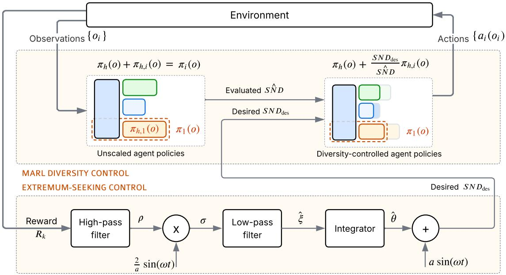
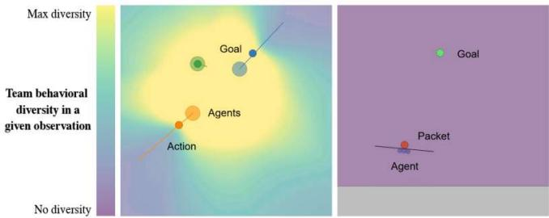
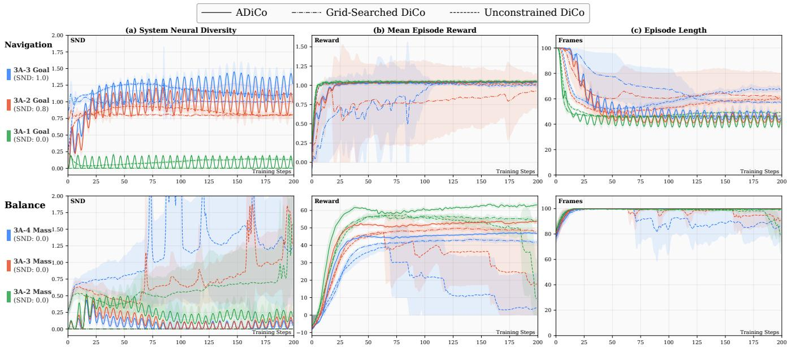
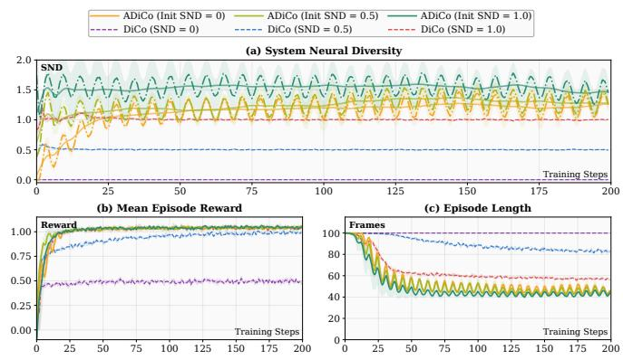
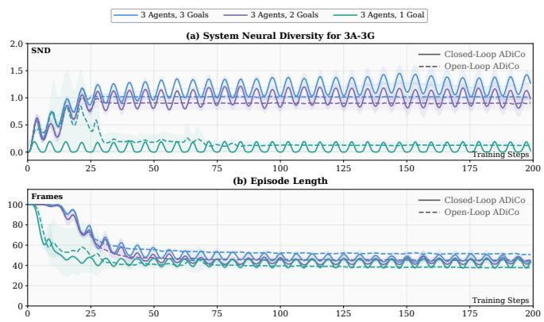

# Optimizing Team Behavior via Extremum-seeking Control in Multi-agent Reinforcement Learning

Svar Rajankumar Patel

Department of Computer Science

University of Massachusetts Lowell

Lowell, Massachusetts, USA

Kshitij Jerath

Department of Mechanical and Industrial Engineering

University of Massachusetts Lowell

Lowell, Massachusetts, USA

Abstract—In cooperative Multi-Agent Reinforcement Learning (MARL), agents must learn to coordinate their actions to achieve shared objectives. A key indicator of effective coordination is behavioral diversity, i.e., the agents’ potential to enact distinct yet complementary control policies given the same set of observations. Although behavioral diversity can enable role specialization and richer joint behaviors, its appropriate level is highly context- and task-dependent and often costly to tune. We propose Adaptive Diversity Control (ADiCo), a two-timescale framework that adapts behavioral diversity online during training. On a fast timescale, Diversity Control (DiCo) regulates system diversity toward a target value. On a slower timescale, an Extremum Seeking Controller (ESC) adjusts this target using only mean episodic returns, without requiring an explicit model or analytical gradient of the diversity-performance landscape. We evaluate ADiCo on six configurations across two cooperative MARL tasks, where it maintains task-appropriate diversity levels: low diversity when homogeneous policies are beneficial and higher diversity when heterogeneous policies are required. Through this adaptation, ADiCo matches or exceeds the mean performance of DiCo (best grid-searched diversity target) and Unconstrained DiCo (diversity allowed to emerge without target regulation). These results demonstrate that incorporating classical feedback control into MARL training enables effective coordination by providing a systematic alternative to task-specific manual selection of the diversity target.

Index Terms—Multi-agent Reinforcement Learning, Behavioral Diversity, System Neural Diversity, Extremum Seeking Control, Model-Free Adaptive Control

## I. INTRODUCTION

In cooperative multi-agent reinforcement learning (MARL) [1], [2], a growing body of work has shown that behavioral diversity among agents can provide significant benefits, including the emergence of complementary roles, improved exploration, and greater resilience to disruptions [3]–[7]. Under the Centralized Training with Decentralized Execution (CTDE) paradigm, centralized information may be used during training while agents execute decentralized policies based on local observations. The resulting degree of behavioral diversity is shaped by architectural and learning-design choices such as parameter sharing, auxiliary objectives, and intrinsic rewards [8]. However, these approaches generally induce or encourage diversity without explicitly regulating its resulting magnitude to a desired, measurable level. Consider a team of delivery drones: if all packages are destined for the same neighborhood, similar behaviors may be sufficient, resulting in low diversity. In contrast, if packages must be delivered to different parts of a city, agents may need to specialize their routes, requiring greater behavioral diversity. The appropriate degree of diversity therefore depends on the task, motivating methods that can explicitly measure and regulate behavioral diversity according to task requirements.

In this work, we measure behavioral diversity using System Neural Diversity (SND) [9], which aggregates pairwise differences between agents’ policies into a single systemlevel measure. To regulate this diversity, we use Diversity Control (DiCo) [4], which represents each agent’s policy as the sum of a shared component and a dynamically scaled agent-specific component, allowing system diversity to be controlled toward a prescribed SND target. However, the appropriate diversity target is task-dependent and generally unknown a priori. We therefore formulate its selection as a feedback optimization problem and use Extremum Seeking Control (ESC) [10], a model-free optimization technique used across domains including robotics, manufacturing and energy systems [11], [12]. ESC applies small sinusoidal perturbations to the diversity target and processes the resulting variations in task performance to estimate the local direction of improvement, which is then used to adapt the nominal diversity setpoint.

Building on these components, we propose Adaptive Diversity Control (ADiCo), a two-timescale framework in which DiCo regulates diversity while ESC adapts the diversity target on a slower timescale. ADiCo preserves DiCo’s compatibility with on- and off-policy actor-critic algorithms using deterministic or stochastic continuous-action policies [4], including IPPO [14] and MADDPG [15], without modifying the underlying MARL learning objective. The main contributions of this work are as follows:

• We introduce ADiCo, a two-timescale framework that integrates ESC with DiCo to adapt behavioral diversity during cooperative MARL training using only scalar performance feedback, without requiring an explicit model or analytical gradient of the diversity– performance relationship.

• We validate ADiCo on six configurations across two cooperative MARL tasks, demonstrating task-appropriate diversity adaptation and performance comparable to or better than grid-searched and unconstrained DiCo baselines without manual tuning of the diversity target.

## II. BACKGROUND AND RELATED WORK

Behavioral diversity in cooperative MARL has been encouraged through a range of architectural and learning mechanisms. Selective parameter-sharing and agent-specific architectures allow policies to specialize to different degrees [16], [18]–[20], while methods based on latent variables, role representations, and intrinsic objectives explicitly encourage diverse behaviors or specialization [21]–[23]. These approaches primarily enable or promote heterogeneity, but generally do not expose the resulting magnitude of behavioral diversity as an explicit control variable. System Neural Diversity (SND) [9] addresses the measurement problem by quantifying policy-level heterogeneity through pairwise behavioral distances, while Diversity Control (DiCo) [4] uses this measure to regulate the system toward a prescribed diversity target, $\mathrm { S N D _ { d e s } }$ . Although DiCo outlines an outerloop procedure for adjusting desired diversity toward a userspecified performance level, it does not address the problem of locating an unknown reward-maximizing diversity target. This motivates adapting the desired diversity directly from task-performance feedback during training.

Adaptive hyperparameter optimization has also been studied within reinforcement learning. Population-Based Training (PBT) jointly adapts model parameters and hyperparameter schedules using a population of concurrently trained agents [26], while Hyperparameter Optimization on the Fly (HOOF) adapts policy-gradient hyperparameters within a single training run by evaluating candidate policy updates using off-policy estimates [24]. Meta-gradient methods instead differentiate through the learning process to adapt differentiable hyperparameters online [25]. In our setting, the desired diversity is a control input to DiCo, and its effect on task performance is unknown and may change as policies learn. We therefore require a model-free controller that can adjust this target during training using scalar performance feedback, without access to an analytical gradient of the diversity-performance relationship.

Extremum Seeking Control (ESC) meets these requirements by applying small periodic perturbations and using the resulting performance variations to estimate a local direction of improvement [10], [11]. ESC has previously been applied to dynamical systems [12] and to refining sampled actions during reinforcement learning [13]. In $\mathrm { A D i C o } ,$ ESC instead adapts a system-level diversity target on a slower timescale than the underlying DiCo/MARL process, seeking a locally high-performing diversity level along a single training run.

## III. ADAPTIVE DIVERSITY CONTROL

In this section, we present Adaptive Diversity Control (ADiCo), a framework for adapting behavioral diversity during cooperative MARL training.

## A. Problem Formulation

We model the cooperative MARL problem as a Decentralized Partially Observable Markov Decision Process (Dec-POMDP), defined by the tuple $\langle \mathcal { N } , S , \{ A _ { i } \} , \{ O _ { i } \} , P , R , \gamma \rangle$ , where $\mathcal { N } = \{ 1 , \ldots , N \}$ denotes the set of agents, S is the global state space, $A _ { i }$ and $O _ { i }$ denote the action and observation spaces associated with agent i, respectively. $P$ is the transition function, R is the shared team reward, and $\gamma \in \ [ 0 , 1 )$ is the discount factor. At each timestep t, agent i receives a local observation $o _ { i , t } ~ \in ~ O _ { i }$ and selects an action $a _ { i , t } ~ \in ~ A _ { i }$ according to its decentralized policy $\pi _ { i } ( a _ { i , t } ~ | ~ o _ { i , t } )$ . The joint policy $\pi ~ = ~ \left( \pi _ { 1 } , \ldots , \pi _ { N } \right)$ is trained to maximize the expected discounted team return maxπ $\begin{array} { r } { \mathbf { \nabla } \cdot \mathbb { E } _ { \pmb { \pi } } \left[ \sum _ { t = 0 } ^ { \infty } \gamma ^ { t } R ( s _ { t } , \mathbf { a } _ { t } ) \right] } \end{array}$ ], where $\mathbf { a } _ { t } ~ = ~ ( a _ { 1 , t } , \ldots , a _ { N , t } )$ denotes the joint action at environment timestep t. Training follows the Centralized Training with Decentralized Execution (CTDE) paradigm, in which centralized information may be used during training while each agent executes its policy using only local observations.

## B. Measuring and Controlling Behavioral Diversity

To quantify behavioral diversity, we employ System Neural Diversity (SND) [9], defined as the average pairwise behavioral distance between agents over a shared observation set O. The behavioral distance between two agents is measured using the 2-Wasserstein distance $W _ { 2 }$ . For the stochastic Gaussian policies considered in this work, this distance has the closed-form expression

$$
W _ { 2 } ( \pi _ { i } ( o ) , \pi _ { j } ( o ) ) = \sqrt { \| \mu _ { i } ( o ) - \mu _ { j } ( o ) \| _ { 2 } ^ { 2 } + \| \sigma _ { i } ( o ) - \sigma _ { j } ( o ) \| _ { 2 } ^ { 2 } } ,\tag{1}
$$

where $\mu _ { i } ( o )$ and $\sigma _ { i } ( o )$ denote the mean and standard deviation vectors of agent i’s action distribution at observation o. For deterministic policies, the variance term vanishes and $W _ { 2 }$ reduces to the Euclidean distance between the agents policy outputs. The system-level diversity is obtained by averaging these pairwise distances across all agent pairs and observations:

$$
\mathrm { S N D } ( \{ \pi _ { i } \} _ { i \in \mathcal { N } } ) = \frac { 2 } { N ( N - 1 ) | O | } \sum _ { i < j } \sum _ { o \in O } W _ { 2 } ( \pi _ { i } ( o ) , \pi _ { j } ( o ) ) .\tag{2}
$$

To control this diversity, DiCo [4] decomposes each agent’s policy into a shared homogeneous component $\pi _ { h } ( o )$ and an agent-specific heterogeneous component $\pi _ { h } ^ { i } ( o )$ . We denote the desired diversity target $\mathrm { S N D _ { d e s } }$ by θ. DiCo dynamically rescales the heterogeneous component according to (Eq. (3)):

$$
\pi _ { i } ( o ) = \pi _ { h } ( o ) + \frac { \theta } { \widehat { \mathrm { S N D } } } \pi _ { h } ^ { i } ( o ) ,\tag{3}
$$

where $\widehat { \mathrm { S N D } }$ is a smoothed estimate of the diversity of the unscaled heterogeneous components $\{ \pi _ { h } ^ { i } \} _ { i \in \mathcal { N } }$ , computed from each training batch and updated at every policy update using the DiCo soft-update mechanism [4]. The scaling factor $\theta / { \widehat { \mathrm { S N D } } }$ adjusts the contribution of the agent-specific component so that the realized system diversity is regulated toward the desired level θ. Thus, DiCo reduces behavioraldiversity regulation to a single scalar target, while the taskappropriate value of that target remains to be determined.

  
Fig. 1. ADiCo system architecture. The DiCo policy decomposition and rescaling pipeline (top) is retained from [4], where policies are rescaled to match the desired diversity $\mathrm { S N D _ { d e s } } ,$ , with the current diversity estimated via exponential moving average. Note the illustrative rescaling of Agent 1’s policy π1(o) in the pipeline (top). The ESC signal chain (bottom) processes the mean reward to estimate the gradient and update the diversity setpoint. The complete procedure is described in Algorithm 1.

## C. Diversity-Performance Landscape

Although DiCo regulates behavioral diversity toward a prescribed target θ, the target that maximizes team performance is generally unknown and task-dependent. To formulate its selection, we introduce the diversity–performance map $J ( \theta )$ representing the expected team performance associated with a diversity target θ. This relationship may change as the policies learn. We therefore consider it on the slower ESC timescale, with the underlying MARL/DiCo training process treated as the faster subsystem.

At each cycle $k ,$ the diversity target is held fixed while agents collect experience and update their policies. The updated policies are then held fixed and evaluated over M complete episodes to obtain the mean episodic return $R _ { k }$ This return provides a stochastic performance measurement at the current target, which ESC uses to adjust the target for the next cycle. Thus, diversity adaptation occurs after each training and evaluation cycle, rather than at every environment timestep.

Using this feedback, ADiCo seeks a locally optimal diversity target $\theta ^ { \star }$ within the admissible range $\Theta = [ 0 , \theta _ { \mathrm { m a x } } ]$ Because the diversity–performance map is unknown and its analytical gradient is unavailable, we treat target selection as a black-box optimization problem. ESC addresses this problem by perturbing the target and processing the resulting changes in $R _ { k }$ to estimate a local direction of performance improvement.

## D. Extremum Seeking Diversity Adaptation

Having formulated diversity-target selection as a blackbox optimization problem, ADiCo uses ESC to estimate a local direction of performance improvement through periodic perturbations. At each ESC cycle k, a sinusoidal perturbation with amplitude a and phase $\phi _ { k }$ is applied to the nominal setpoint $\widehat { \theta } _ { k }$ . The perturbed value is projected onto Θ to obtain the diversity target $\theta _ { k }$ supplied to DiCo. The phase advances according to $\phi _ { k + 1 } = \phi _ { k } + \omega \Delta t$ , where ω is the perturbation angular frequency and $\Delta t$ is the interval between ESC updates.

After training and evaluation at $\theta _ { k }$ , the measured return $R _ { k }$ is processed to estimate the local performance response to the perturbation. A high-pass filter (HPF) attenuates slowly varying components of the return, demodulation extracts the response correlated with the perturbation, and a low-pass filter (LPF) attenuates the remaining oscillatory components. The resulting signal $\hat { \xi } _ { k }$ estimates the local direction of performance improvement.

ESC uses $\hat { \xi } _ { k }$ to update the nominal setpoint $\widehat { \theta } _ { k } .$ , with a positive integrator gain η controlling the adaptation rate and projection onto Θ enforcing the admissible range. These updates seek a locally high-performing diversity level. The complete procedure is summarized in Algorithm 1.

## IV. EXPERIMENTS

This section evaluates ADiCo’s ability to adapt behavioral diversity across different task configurations and analyzes its convergence behavior.

Algorithm 1 Adaptive Diversity Control (ADiCo)   
Require: Dither amplitude a, perturbation frequency $\omega ,$ ESC   
update interval $\Delta t ,$ integrator gain $\eta ,$ filter coefficients   
$\alpha _ { h } , \alpha _ { l } .$ , evaluation episodes M, initial diversity setpoint   
${ \widehat { \theta } } _ { 0 } ,$ admissible range $\Theta = [ 0 , \theta _ { \mathrm { m a x } } ]$   
1: Initialize: $\phi _ { 0 } = 0 , R _ { - 1 } = 0 , \rho _ { - 1 } = 0 , \hat { \xi } _ { - 1 } = 0$   
2: for ESC cycle $k = 0 , 1 , \ldots , K - 1$ do   
Phase 1: Set Diversity Target   
3: Apply dither modulation and enforce admissibility   
constraint:   
4: $\theta _ { k } \gets \Pi _ { \Theta } \Big ( \hat { \theta } _ { k } + a \sin ( \phi _ { k } ) \Big )$   
Phase 2: DiCo Policy Training   
5: for each MARL training iteration do   
6: Collect rollouts and update actor–critic parameters   
7: Regulate diversity toward $\theta _ { k } \mathbf { : }$   
8: $\overline { { { \pi } } } _ { i } ( o ) \longleftarrow \pi _ { h } ( o ) + \frac { \theta _ { k } } { \widehat { \mathrm { S N D } } } \pi _ { h } ^ { i } ( o )$   
9: end for   
Phase 3: ESC Setpoint Update   
10: Evaluate policy performance:   
11: Evaluate policies over M episodes and compute   
$R _ { k }$   
12: Estimate performance gradient:   
13: $\rho _ { k }  \alpha _ { h } \big ( \rho _ { k - 1 } + R _ { k } - R _ { k - 1 } \big )$ ▷ HPF   
14: $\sigma _ { k } \gets \frac { \mathrm { z } } { a } \rho _ { k } \sin ( \phi _ { k } )$ ▷ Demodulation   
15: $\hat { \xi } _ { k } \gets \overset { \omega } { \alpha } _ { l } \sigma _ { k } + ( 1 - \alpha _ { l } ) \hat { \xi } _ { k - 1 }$ ▷ LPF   
16: Update nominal setpoint:   
17: $\hat { \theta } _ { k + 1 } \gets \Pi _ { \Theta } \Big ( \hat { \theta } _ { k } + \eta \hat { \xi } _ { k } \Big )$   
18: $\phi _ { k + 1 }  \phi _ { k } \dot { + } \omega \Delta t$   
19: end for

## A. Environments and Task Configurations

We evaluate ADiCo on two cooperative continuouscontrol tasks from the Vectorized Multi-Agent Simulator (VMAS) [31]: Navigation and Balance (Fig. 2). All experiments use three agents under partial observability, with episodes lasting at most 100 steps. We keep the team size fixed to simplify the analysis, although ADiCo is not limited to a fixed number of agents.

  
Fig. 2. Navigation (left) and Balance (right). In Navigation, agents (colored circles) apply continuous 2D forces to reach goal locations (smaller circles). In Balance, agents (blue) coordinate forces on a shared platform (grey) to move the packet (red) toward the goal (green). The background shows behavioral diversity measured using SND [9], with yellow indicating high and purple indicating low diversity.

For each configuration, we compare ADiCo with two baselines. Grid-searched DiCo uses the best fixed SND target from {0, 0.3, 0.5, 0.8, 1.0, 1.3, 1.5, 1.8, 2.0}, with a separate 12M-frame training run for each target. Unconstrained DiCo fixes the agent-specific scaling factor at one, allowing diversity to emerge without an explicit SND target. These baselines test whether online adaptation can match or improve upon both the best grid-searched target and freely emerging diversity. All methods use the same MARL algorithm, network architecture, and 12M-frame budget per training run.

## B. Training and Evaluation

All our approaches use IPPO [14], [28] and are trained for 12M frames over five random seeds. Training is divided into cycles, with each cycle collecting 60,000 frames from 600 parallel environment instances followed by the MARL policy update. The updated policies are then evaluated over M = 200 episodes, and the mean episodic return $R _ { k }$ is used by ADiCo to update the diversity setpoint before the next cycle.

## V. RESULTS AND ANALYSIS

In this section, we evaluate ADiCo across three key aspects: performance across task configurations, diversity adaptation from different initial targets, and training behavior under continuous ESC perturbations.

## A. Performance Across Task Configurations

We evaluate ADiCo across six configurations of two cooperative tasks. In Navigation, we vary the number of goals (1, 2, or 3) to change the need for specialization, using 3AxG to denote three agents with x goals. In Balance, we vary ball Mass (2, 3, or 4) to change task difficulty while keeping the coordination structure the same, using 3A-xM to denote three agents with ball Mass x. In Navigation (Fig. 3, top row), ADiCo adapts to high diversity (SND ≈1.2–1.3) for 3A-3G, moderate diversity (SND ≈0.8) for 3A-2G, and nearzero diversity for 3A-1G. It achieves reward comparable to grid-searched DiCo, with lower reward variance than Unconstrained DiCo. In Balance (bottom row), ADiCo maintains low diversity across all Mass configurations and matches the performance of DiCo with SND = 0. For Unconstrained DiCo, increasing diversity accompanies declining reward, with performance collapsing in the 3A-4M configuration. These results show that ADiCo automatically adapts toward low diversity when similar behaviors are beneficial and higher diversity when specialization helps. It achieves performance comparable to manually tuned DiCo without requiring configuration-specific grid search, while avoiding the excessive diversity observed with Unconstrained DiCo.

## B. Convergence From Different Initializations

The previous experiments initialize ADiCo at SND = 0. To examine whether this choice affects the final diversity level, we test initial targets of 0, 0.5, and 1.0 on Navigation 3A-3G and compare them with DiCo using the same fixed targets. Fig. 4(a) shows that ADiCo reaches a similar SND range (≈1.2–1.3) from all three initial targets. Runs initialized at 0.5 and 1.0 reach this range faster than those initialized at 0. The DiCo baselines remain near their fixed targets throughout training. All three ADiCo initializations achieve mean returns near 1.0 and episode lengths of approximately 45–50 steps (Fig. 4(b,c)). DiCo with SND = 0 or 0.5 achieves lower performance, while the best grid-searched target, SND = 1.0, produces longer episodes than ADiCo. These results show that ADiCo reaches similar diversity levels and performance across the tested initializations, while completing episodes faster than the fixed-target baselines. We next examine whether keeping ESC active remains beneficial after diversity settles.

Fig. 3. Training curves across Navigation (top) and Balance (bottom) tasks comparing ADiCo (solid), Grid-Searched DiCo (dash-dot), and Unconstrained DiCo (dashed). Colors denote task configurations; the left panel shows DiCo’s manually tuned SND target for each. (a) System Neural Diversity. (b) Mean episode reward. (c) Episode length.  
  
Fig. 4. Convergence analysis on Navigation 3A-3G comparing ADiCo (solid lines) against DiCo (dashed lines) at SND levels 0, 0.5, and 1.0. (a) SND trajectories. (b) Mean episode reward. (c) Episode length.

## C. Effect of Continued ESC Adaptation

ESC continues to perturb the diversity target even after it settles near a particular level. To examine whether continued adaptation remains useful, we compare ADiCo with a variant that monitors the gradient estimate and disables perturbations when a stopping criterion is met. This variant then holds the diversity target fixed for the remainder of training. Fig. 5(a) shows that the frozen-target variant maintains SND near zero for 3A-1G, approximately 0.9 for 3A-2G, and approximately 1.0 for 3A-3G. These values are close to the best targets found through grid search. Once the target is frozen, the SND trajectories flatten as expected. In contrast, ADiCo with continued ESC adaptation achieves shorter episodes in 3A-3G and comparable episode lengths in the other configurations (Fig. 5(b)). These results suggest that continued adaptation can remain beneficial after diversity appears to settle. However, this comparison does not separate the effect of perturbations from the benefit of further target updates, since the frozen-target variant disables both.

  
Fig. 5. Comparison across three Navigation configurations between ADiCo with continued ESC adaptation (Closed-Loop ADiCo) and a variant that disables perturbations and freezes the diversity target when its stopping criterion is met (Open-Loop ADiCo). (a) SND trajectories. (b) Episode length.

## VI. LIMITATIONS AND FUTURE DIRECTIONS

While ADiCo uses mean episodic return to adapt diversity, changes in return are not always caused by diversity adjustments alone. Factors such as policy learning, environmental shifts, and adapting opponents also influence performance, complicating adaptation in adversarial or mixed-motive domains. Consequently, future work could explore alternative feedback signals and evaluation methods that better isolate the specific effect of diversity. Furthermore, because ADiCo relies on extremum seeking control, it risks converging to a local optimum of the performance signal rather than the globally optimal diversity target for the task. This limitation is compounded by the fact that ADiCo currently tunes only a single team-wide SND target, whereas distinct agents or roles may benefit from different diversity levels. Extending the framework with multidimensional ESC could allow multiple diversity targets to be adjusted from a shared performance signal, enabling more detailed control over team behavior. Finally, ADiCo adapts diversity exclusively during training rather than runtime execution. Because teams often need to alter behavior as conditions change within an episode, integrating ADiCo with event-based policy adaptation [32] could allow agents to dynamically adjust their diversity in response to runtime events.

## VII. CONCLUDING REMARKS

In this work, we introduced ADiCo, a framework that adapts team diversity during training using team-performance feedback. Across two cooperative tasks, ADiCo adjusts diversity to task-appropriate levels. Experiments with different initial setpoints further show that, in the tested configuration, users can begin with a rough diversity estimate and let ADiCo refine it without an explicit model of team dynamics. More broadly, ADiCo illustrates how model training can be viewed as a process whose adjustable components are optimized through feedback, much like machines in industrial systems. This perspective allows us to draw on established control techniques to improve the adaptability of learning systems.

## REFERENCES

[1] D. Gronauer and K. Diepold, “Multi-agent reinforcement learning: A comprehensive survey,” arXiv preprint, 2021.

[2] Z. Liang et al., “A survey on multi-agent reinforcement learning and its application,” Journal of Automation and Intelligence, 2024.

[3] H. Haeri, R. Ahmadzadeh, and K. Jerath, “Reward-sharing relational networks in multi-agent reinforcement learning as a framework for emergent behavior,” arXiv preprint arXiv:2207.05886, 2022.

[4] M. Bettini, R. Kortvelesy, and A. Prorok, “Controlling behavioral diversity in multi-agent reinforcement learning,” in Proc. 41st Int. Conf. Machine Learning (ICML), vol. 235, 2024

[5] M. Amir, M. Bettini, and A. Prorok, “When is diversity rewarded in cooperative multi-agent learning?” arXiv preprint arXiv:2506.09434, 2025.

[6] J. Parker-Holder, A. Nguyen, and S. J. Roberts, “Effective diversity in population-based reinforcement learning,” in Advances in Neural Information Processing Systems, vol. 33, 2020.

[7] Y. Zhao et al., “A unified diversity measure for multiagent reinforcement learning,” in Advances in Neural Information Processing Systems, 2023.

[8] Y. Findik, H. Osooli, P. Robinette, K. Jerath, and S. R. Ahmadzadeh, “Influence of team interactions on multi-robot cooperation: A relational network perspective,” in Proc. Int. Symp. Multi-Robot and Multi-Agent Systems (MRS), Boston, MA, USA, 2023, pp. 50–56.

[9] M. Bettini, A. Shankar, and A. Prorok, “System neural diversity: Measuring behavioral heterogeneity in multi-agent learning,” Journal of Machine Learning Research, vol. 26, no. 163, pp. 1–27, 2025.

[10] M. Krstic and H.-H. Wang, “Stability of extremum seeking feedback´ for general nonlinear dynamic systems,” Automatica, vol. 36, no. 4, pp. 595–601, 2000.

[11] Y. Tan, W. H. Moase, C. Manzie, D. Nesiˇ c, and I. M. Y. Mareels,´ “Extremum seeking from 1922 to 2010,” in Proc. 29th Chinese Control Conf., 2010, pp. 14–26.

[12] X. Wu, J. Zeng, A. Tagliabue, and M. W. Mueller, “Model-free online motion adaptation for energy-efficient flight of multicopters,” IEEE Robotics and Automation Letters, 2023.

[13] Y.-C. Chang and S. Gao, “Extremum-seeking action selection for accelerating policy optimization,” arXiv preprint arXiv:2404.01598, 2024.

[14] C. S. De Witt et al., “Is independent learning all you need in the StarCraft multi-agent challenge?” arXiv preprint arXiv:2011.09533, 2020.

[15] R. Lowe et al., “Multi-agent actor-critic for mixed cooperativecompetitive environments,” in Advances in Neural Information Processing Systems, vol. 30, 2017.

[16] F. Christianos, G. Papoudakis, M. A. Rahman, and S. V. Albrecht, “Scaling multi-agent reinforcement learning with selective parameter sharing,” in Proceedings of the 38th International Conference on Machine Learning (ICML), vol. 139, pp. 1989–1998, 2021.

[17] F. Christianos, L. Schafer, and S. V. Albrecht, “Shared experience¨ actor-critic for multi-agent reinforcement learning,” in Proc. 34th Conf. Neural Information Processing Systems (NeurIPS), 2020.

[18] W. Kim and Y. Sung, “Parameter sharing with network pruning for scalable multi-agent deep reinforcement learning,” in Proceedings of the 22nd International Conference on Autonomous Agents and Multiagent Systems (AAMAS), pp. 1942–1950, 2023.

[19] X. Li, L. Pan, and J. Zhang, “Kaleidoscope: Learnable masks for heterogeneous multi-agent reinforcement learning,” in Advances in Neural Information Processing Systems (NeurIPS), vol. 37, pp. 22081– 22106, 2024.

[20] K.-A. A. Tessera, A. Rahman, A. Storkey, and S. V. Albrecht, “HyperMARL: Adaptive hypernetworks for multi-agent RL,” in Proc. Advances in Neural Information Processing Systems (NeurIPS), 2025.

[21] A. Mahajan, T. Rashid, M. Samvelyan, and S. Whiteson, “MAVEN: Multi-agent variational exploration,” in Advances in Neural Information Processing Systems, vol. 32, 2019.

[22] T. Wang, H. Dong, V. Lesser, and C. Zhang, “ROMA: Multi-agent reinforcement learning with emergent roles,” in Proc. 37th Int. Conf. Machine Learning, vol. 119, pp. 9876–9886, 2020.

[23] N. Jaques, A. Lazaridou, E. Hughes, C. Gulcehre, P. A. Ortega, D. Strouse, J. Z. Leibo, and N. de Freitas, “Social influence as intrinsic motivation for multi-agent deep reinforcement learning,” in Proc. Int. Conf. Machine Learning, 2019.

[24] S. Paul, V. Kurin, and S. Whiteson, “Fast efficient hyperparameter tuning for policy gradient methods,” in Advances in Neural Information Processing Systems, vol. 32, 2019.

[25] Z. Xu, H. P. van Hasselt, and D. Silver, “Meta-gradient reinforcement learning,” in Advances in Neural Information Processing Systems, vol. 31, 2018.

[26] M. Jaderberg et al., “Population based training of neural networks,” arXiv preprint arXiv:1711.09846, 2017.

[27] A. Parker-Holder, V. Nguyen, S. Desai, and S. J. Roberts, “Generalized population-based training for hyperparameter optimization in reinforcement learning,” arXiv preprint, 2020.

[28] C. Yu et al., “The surprising effectiveness of PPO in cooperative multiagent games,” Advances in Neural Information Processing Systems, vol. 35, pp. 24611–24624, 2022.

[29] M. Bettini, A. Prorok, and V. Moens, “BenchMARL: Benchmarking multi-agent reinforcement learning,” Journal of Machine Learning Research, vol. 25, pp. 1–10, 2024.

[30] A. Bou et al., “TorchRL: A data-driven decision-making library for PyTorch,” in The Twelfth Int. Conf. Learning Representations, 2024.

[31] M. Bettini, R. Kortvelesy, J. Blumenkamp, and A. Prorok, “VMAS: A vectorized multi-agent simulator for collective robot learning,” in Proc. 16th Int. Symp. Distributed Autonomous Robotic Systems, 2022.

[32] H. Buchi, M. Flageat, E. Sebasti ¨ an, and A. Prorok, “Events as triggers ´ for behavioral diversity in multi-agent reinforcement learning,” arXiv preprint arXiv:2605.12388, 2026.