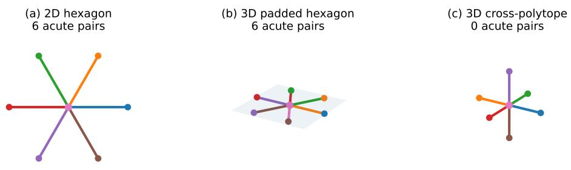
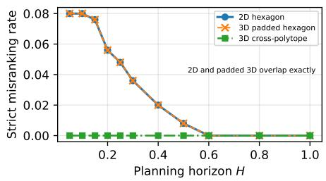
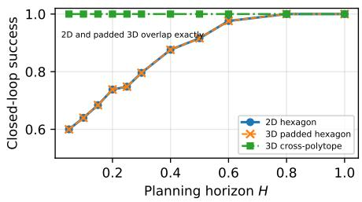

# Order-Consistent Latent Geometry for Reliable Short-Horizon Planning in World Models

Junlin Wu, Wen Fan, and Dandan Zhang

Imperial College London, London, United Kingdom

Abstract. Latent planners often rank candidate action sequences by terminal Euclidean distance to a goal latent. Exact agreement with transition distance would make this score ideal, but is stronger than planning requires: along a transition-shortest rollout, the essential requirement is that latent distance does not reverse true transition progress.

We show that this pathwise no-reversal requirement is precisely the classical self-approaching condition. To the best of our knowledge, we are the first to identify self-approachingness as a planner-facing compatibility condition for terminal Euclidean latent planning and to connect its violation to an exact finite-horizon candidate-order reversal.

Because visual world models predict discrete latent sequences, we analyze their polygonal interpolation. We prove that an acute bend creates a nonempty region in which terminal Euclidean distance ranks a transitionworse candidate ahead of one that makes genuine progress, even under exact rollouts. We further interpret latent dimension as angular capacity through a classical spherical-code bound. A controlled six-branch experiment, including a zero-padded three-dimensional baseline, validates the predicted ordering failure and separates angular arrangement from ambient dimensionality.

## Introduction

Latent world models have emerged as a promising framework for goal-directed6 control. Rather than planning in observation space, they predict the latent conse-2 quences of candidate action sequences and evaluate those candidates in a learned representation. This paradigm spans latent control, diferentiable planning, andi online model predictive control [1–4]. Goal-conditioned and reconstruction-freeX systems similarly optimize toward a latent image goal without decoding futurear pixels [5–8].

Reliable planning therefore depends not only on predictive accuracy, but also on whether latent geometry induces the right ordering over candidate trajectories. A world model may predict every rollout exactly and nevertheless select an action that moves in the wrong direction when terminal Euclidean distance ranks a transition-inferior candidate above one that makes genuine progress. Thus perfect prediction can still be paired with a misleading decision objective.

Short receding-horizon optimization is common, and several methods append a learned terminal value to summarize beyond-horizon consequences [9, 4]. We instead ask what raw terminal Euclidean goal matching can guarantee. Exact agreement with transition distance is unnecessarily restrictive: on one shortest rollout it forces a straight latent segment, while real transition structures contain bends, obstacles, merges, and branches. Planning needs only the weaker ordinal requirement that moving forward along a shortest rollout must not make the same future goal appear farther away. We call this pathwise transition-order consistency and show that it is exactly self-approachingness.

Relation to prior work. Planning-aware representations use structured transition models, learned action distances, curvature regularization, and reachabilityaware objectives or metrics [5, 10–13]. These works establish that raw latent proximity can be insuficient; we do not claim that general observation. Classical greedy and self-approaching drawings study distance-monotone geometric routing [14–16], but not learned world models, horizon-truncated terminal objectives, or the exact candidate-order reversal derived here.

## Contributions. We make four principal contributions:

– We separate exact pathwise metric fidelity from the weaker ordering property needed by terminal-distance guidance, and prove that exact fidelity forces every shortest latent rollout to be straight.

– We identify self-approachingness as this ordering property and derive an equivalent diferential forward-half-space condition.

– For locally straight mandatory junctions, we prove a sharp necessary-andsuficient non-acute criterion and the resulting finite-horizon wrong-way optimum.

– We prove the angular-capacity bound $n \leq 2 D$ and validate the mechanism in a six-branch stress test with a padded-dimension control.

## 2 Theory

## 2.1 Pathwise Transition-Order Consistency

Let $( \mathcal { X } , d _ { \mathrm { T } } )$ be a transition metric space, $\phi : \mathcal { X }  \mathbb { R } ^ { D }$ a latent embedding, and $\gamma : [ 0 , L ] \to \mathcal { X }$ a transition-shortest rollout parameterized by transition length. We write $\eta = \phi \circ \gamma$ for its continuous latent image.

Requiring latent Euclidean distance to reproduce transition distance exactly is unnecessarily restrictive. In particular, the equality $| \eta ( t ) - \eta ( s ) | _ { 2 } = t - s$ for every $s < t$ forces $\eta$ to be a unit-speed straight segment by the equality condition of the Euclidean triangle inequality. Planning only requires a weaker ordinal property. Since $\gamma$ is transition-shortest, moving from $\gamma ( s )$ to $\gamma ( t )$ for $s < t < r$ strictly decreases the true remaining transition distance to the future state $\gamma ( r )$ . Latent distance should not reverse this progress.

Definition 1 (Pathwise transition-order consistency). A transition-shortest latent rollout η is pathwise transition-order consistent $i f ,$ for all $0 \leq s < t <$ $r \leq L$

$$
| \eta ( t ) - \eta ( r ) | _ { 2 } \leq | \eta ( s ) - \eta ( r ) | _ { 2 } .\tag{1}
$$

This condition is precisely self-approachingness. It preserves the ordering of true transition progress along a shortest rollout without requiring latent Euclidean distance to reproduce transition distance numerically. For a diferentiable rollout, the same condition can be written as $\dot { \eta } ( t ) ^ { \top } ( \eta ( r ) - \eta ( t ) ) \geq 0$ for every $r > t .$ . Thus nonzero curvature is not itself a failure; a reversal occurs only when a future point falls behind the current tangent half-space.

## 2.2 Polygonal Rollouts and Acute-Bend Reversal

A visual world model produces a discrete latent rollout $P = ( z _ { 0 } , z _ { 1 } , \dots , z _ { H } )$ We analyze its polygonal interpolation, obtained by joining consecutive predicted states with straight segments. This construction does not assume that the environment or its dynamics are globally linear. It is the minimal continuous geometric representation of a discrete model rollout. Analyzing the interpolation rather than only its sampled vertices also makes the condition independent of temporal resolution: an ordering reversal between two predictions should not disappear merely because the rollout is sampled more coarsely.

Consider a local two-segment portion of a transition-shortest rollout, $z _ { \star } +$ $r u  z _ { \star }  z _ { \star } + b v$ , where $r , b > 0$ are transition distances from the turning state and $u , v \in \mathbb { S } ^ { D - 1 }$ are the two outward directions. The correct rollout moves inward along −u and then outward along v, with true remaining transition distance $r { \mathrel { + { b } } }$

Theorem 1 (Sharp non-acute criterion). The two-segment shortest rollout is pathwise transition-order consistent for every source and goal radius if and only if

$$
u ^ { \top } v \leq 0 .\tag{2}
$$

Thus right and obtuse outward angles preserve pathwise ordering, whereas an acute outward angle produces a strict reversal.

Proof. Pairs of points on the same straight segment are automatically orderconsistent. For a current point $z _ { \star } + r u$ on the first segment and a future point $z _ { \star } + b v$ on the second, their squared latent distance is $F ( r , b ) = r ^ { 2 } + b ^ { 2 } -$ $2 r b , u ^ { \top } v$ . Correct progress toward $z _ { \star }$ decreases $r ,$ while ${ \partial F } / { \partial r } = 2 ( r - b u ^ { \top } v )$ This derivative is nonnegative for every $r , b \ > \ 0$ exactly when $u ^ { \top } v \leq 0$ . If $u ^ { \top } v > 0$ , every $0 < r < b u ^ { \top } v$ gives a strict ordering reversal.

The same geometry can reverse the ordering of feasible finite-horizon candidates. Assume the incoming transition is locally reversible. From $z _ { \star } + r u$ u, compare an inward candidate $z _ { \mathrm { i n } } = z _ { \star } + ( r - h ) u$ with a backward candidate $z _ { \mathrm { b a c k } } = z _ { \star } + ( r + h ) u$ , where $0 < h < r$ . The inward candidate has strictly smaller remaining transition distance to the goal $z _ { \star } + b v$

Proposition 1 (Exact candidate-order reversal). Let $c = u ^ { \top } v$ . If $c > 0$ and $r < b c$ , terminal Euclidean scoring strictly ranks the transition-worse backward candidate ahead of the transition-better inward candidate:

$$
| z _ { \mathrm { b a c k } } - ( z _ { \star } + b v ) | * 2 ^ { 2 } - | z * \mathrm { i n } - ( z _ { \star } + b v ) | _ { 2 } ^ { 2 } = 4 h ( r - b c ) < 0 .\tag{3}
$$

This result does not require the two candidates to be the planner’s only options. It establishes a strict pairwise inversion: a candidate with larger true remaining transition distance receives a better terminal Euclidean score. Therefore, the score fails to preserve the planning-relevant candidate ordering even if a third candidate is ultimately selected from the full candidate set.

In the branch-local environment studied in Sec. 3, the short-horizon reachable set remains on the same branch. In that special case, the complete reachable interval is $q \in [ r - H , r + H ]$ , and the Euclidean terminal loss is minimized at the projection of bc onto this interval. Consequently, when $c > 0$ and $r < b c ,$ , the globally selected endpoint satisfies $q > r$ and the planner moves away from the turning state. Proposition 1 is more general: it proves a genuine ordering failure without assuming that motion is restricted to two directions.

Both results assume exact candidate rollouts. The failure therefore arises from terminal scoring geometry rather than accumulated prediction error or model hallucination.

## 2.3 Latent Dimension as Angular Capacity

The preceding result gives a planner-facing interpretation of latent dimension. Suppose n locally distinct transition branches meet at a common state, with outward latent directions $u _ { 1 } , \ldots , u _ { n } \in \mathbb { S } ^ { D - 1 }$ , and every pair of branches may form a transition-shortest two-segment rollout. By Theorem 1, preserving pathwise transition order for every branch pair requires $u _ { i } ^ { \top } u _ { j } \leq 0$ whenever $i \neq j$

Corollary 1 (Angular capacity). If n transition branches must be pairwise non-acute in $\mathbb { R } ^ { D }$ , then

$$
n \leq 2 D , o r e q u i v a l e n t l y
$$

$$
D \geq \left\lceil { \frac { n } { 2 } } \right\rceil .\tag{4}
$$

The bound is tight and is achieved by subsets of $\pm e _ { 1 } , \ldots , \pm e _ { D }$

Proof. The unit branch directions form a spherical code with minimum angle at least $\pi / 2$ . Rankin’s bound gives $A ( D , \pi / 2 ) = 2 D$ [17], and the cross-polytope achieves equality.

Consequently, latent dimension provides angular capacity: increasing D allows more transition-distinct branches to remain geometrically separated without introducing acute configurations that reverse pathwise progress ordering.

## 3 Controlled Six-Branch Study

We isolate the theorem on a six-branch star. A state is $( i , r )$ with branch $i \in$ $\{ 0 , \ldots , 5 \}$ and radius $r \in [ 0 , 1 ]$ ; cross-branch transition distance is $r + b .$ . Every embedding uses $\phi ( i , r ) = r u _ { i }$ . We compare (i) a 2D regular hexagon, (ii) the same hexagon zero-padded into 3D, and (iii) the 3D cross-polytope $\{ \pm e _ { 1 } , \pm e _ { 2 } , \pm e _ { 3 } \}$ The first two embeddings have identical pairwise angles, six acute pairs, and acute loss $\begin{array} { r } { \mathcal { L } _ { \mathrm { a c u t e } } = \sum _ { i < k } [ u _ { i } ^ { \top } u _ { k } ] _ { + } ^ { 2 } = 1 . 5 \ } \end{array}$ ; the cross-polytope has no acute pair and zero acute loss.

Fig. 1. Geometry of the six-branch latent embeddings. (a) A two-dimensional regular hexagon, in which adjacent branch directions form acute angles. (b) A threedimensional zero-padded copy of the same hexagon, which changes the ambient dimension but preserves all pairwise angles. (c) A three-dimensional cross-polytope embedding with directions $\{ \pm e _ { 1 } , \pm e _ { 2 } , \pm e _ { 3 } \}$ , in which all branch pairs are non-acute. The comparison separates angular arrangement from ambient dimension alone.  
  
(a) Strict terminal-score misranking

  
(b) Receding-horizon success  
Fig. 2. (a) Strict terminal-score misranking across planning horizons. (b) Recedinghorizon planning success. All three embedding conditions are plotted. The 2D and zero-padded 3D hexagons overlap exactly because zero-padding preserves their pairwise angular geometry. Only the reoriented 3D cross-polytope removes acute conflicts, strict misrankings, and the associated planning failures.

Protocol. We discretize each branch at 0.05. Across all ordered branch pairs and start/goal radii in $\{ 0 . 1 , \ldots , 1 . 0 \}$ (3,000 queries per horizon), the planner enumerates terminal states within budget H, minimizes the terminal Euclidean score $\lVert \phi ( y ) - \phi ( g ) \rVert _ { 2 } ^ { 2 }$ , executes one graph step, and replans. We report strict outward-over-inward misranking and success within 100 steps. Ties are excluded from strict misranking and use a fixed lexicographic rule in closed loop. The released script reproduces all curves.

Results. At $H = 0 . 0 5$ , the 2D and padded embeddings produce a strict misranking rate of 8.0% and closed-loop success of 60.0%; the cross-polytope has zero strict misranking and 100% success. At $H = 0 . 3 0$ , the acute embeddings improve to 3.6% misranking and 79.6% success, while the cross-polytope remains at zero and 100%. The acute error vanishes once the horizon is long enough to see beyond the local trap. Most importantly, the 3D padded control is identical to 2D at every horizon, whereas the 3D cross-polytope succeeds: the gain comes from available angular arrangement, not coordinate count by itself.

## 4 Scope and Conclusion

Terminal-distance planning needs no global isometry; it needs Euclidean scores not to reverse progress along the rollout prefixes on which the planner acts. This condition is exactly self-approachingness. Acute mandatory junctions create exact wrong-way optima, while multi-branch bottlenecks turn latent width into finite junction-ordering capacity. Our guarantees are pathwise and apply to graph-like point bottlenecks with locally reversible branches; they do not ensure global ranking across unrelated paths or imply impossibility for continuousaction tasks.

## References

1. Watter, M., Springenberg, J., Boedecker, J., Riedmiller, M.: Embed to control: A locally linear latent dynamics model for control from raw images. In: Advances in Neural Information Processing Systems. Volume 28. (2015) 2746–2754

2. Srinivas, A., Jabri, A., Abbeel, P., Levine, S., Finn, C.: Universal planning networks: Learning generalizable representations for visuomotor control. In: Proceedings of the 35th International Conference on Machine Learning. Volume 80. (2018) 4732–4741

3. Hafner, D., Lillicrap, T., Fischer, I., Villegas, R., Ha, D., Lee, H., Davidson, J.: Learning latent dynamics for planning from pixels. In: Proceedings of the 36th International Conference on Machine Learning. Volume 97. (2019) 2555–2565

4. Hansen, N.A., Su, H., Wang, X.: Temporal diference learning for model predictive control. In: Proceedings of the 39th International Conference on Machine Learning. Volume 162. (2022) 8387–8406

5. Kurutach, T., Tamar, A., Yang, G., Russell, S.J., Abbeel, P.: Learning plannable representations with causal InfoGAN. In: Advances in Neural Information Processing Systems. Volume 31. (2018)

6. Zhou, G., Pan, H., LeCun, Y., Pinto, L.: DINO-WM: World models on pre-trained visual features enable zero-shot planning. In: Proceedings of the 42nd International Conference on Machine Learning. Volume 267. (2025)

7. Assran, M., et al.: V-JEPA 2: Self-supervised video models enable understanding, prediction and planning. arXiv preprint arXiv:2506.09985 (2025)

8. Maes, L., Le Lidec, Q., Scieur, D., LeCun, Y., Balestriero, R.: LeWorldModel: Stable end-to-end joint-embedding predictive architecture from pixels. arXiv preprint arXiv:2603.19312 (2026)

9. Hoeller, D., Farshidian, F., Hutter, M.: Deep value model predictive control. In: Proceedings of the Conference on Robot Learning. Volume 100. (2020) 990–1004

10. Steccanella, L., Evans, J.B., Simsek, O., Jonsson, A.: Learning the minimum action distance. In: Proceedings of the 42nd International Conference on Machine Learning. Volume 267. (2025)

11. Wang, Y., Bounou, O., Zhou, G., Balestriero, R., Rudner, T.G.J., LeCun, Y., Ren, M.: Temporal straightening for latent planning. arXiv preprint arXiv:2603.12231 (2026)

12. Li, W., Li, G., Maeda, K., Ogawa, T., Haseyama, M.: Predictive but not plannable: RC-aux for latent world models. arXiv preprint arXiv:2605.07278 (2026)

13. Li, L., Wang, S., Liu, Q.: Beyond euclidean proximity: Repairing latent world models with horizon-matched trajectory reachability metrics. arXiv preprint arXiv:2605.22164 (2026)

14. Papadimitriou, C.H., Ratajczak, D.: On a conjecture related to geometric routing. In: Algorithmic Aspects of Wireless Sensor Networks. Volume 3121 of Lecture Notes in Computer Science., Springer (2004) 9–17

15. Icking, C., Klein, R., Langetepe, E.: Self-approaching curves. Mathematical Proceedings of the Cambridge Philosophical Society 125(3) (1999) 441–453

16. Alamdari, S., Chan, T.M., Grant, E., Lubiw, A., Pathak, V.: Self-approaching graphs. In: Graph Drawing. Volume 7704 of Lecture Notes in Computer Science., Springer (2013) 260–271

17. Rankin, R.A.: The closest packing of spherical caps in n dimensions. Proceedings of the Glasgow Mathematical Association 2(3) (1955) 139–144