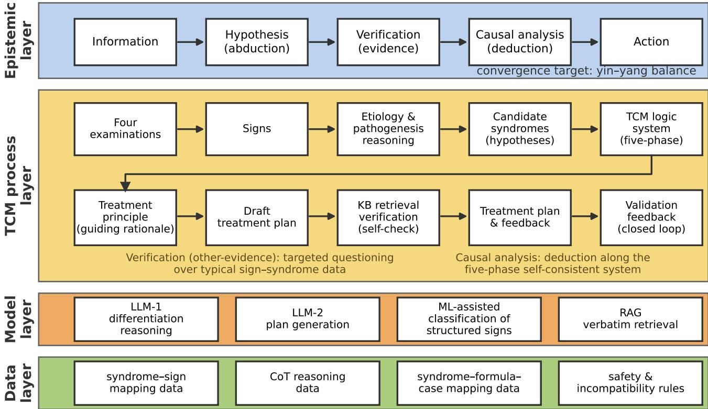
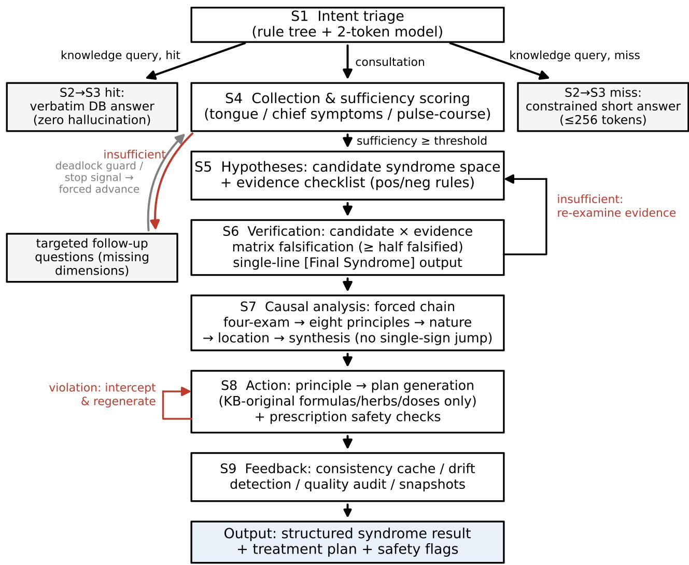
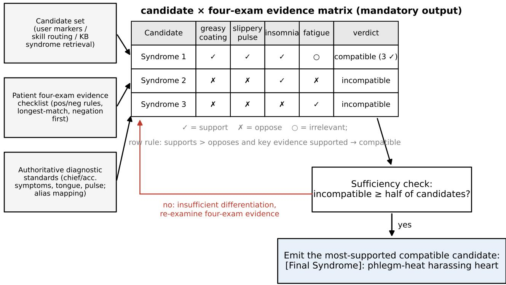
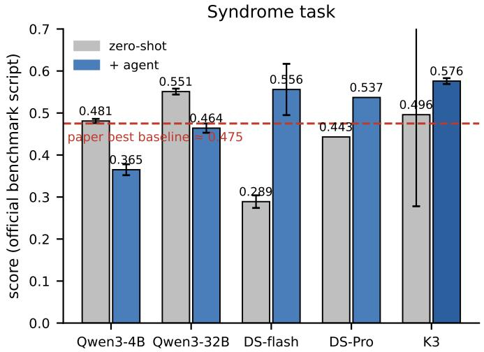
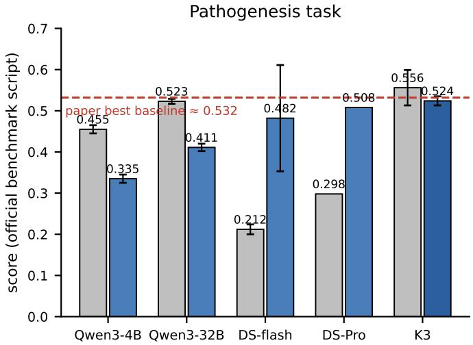
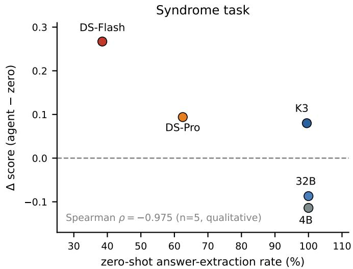
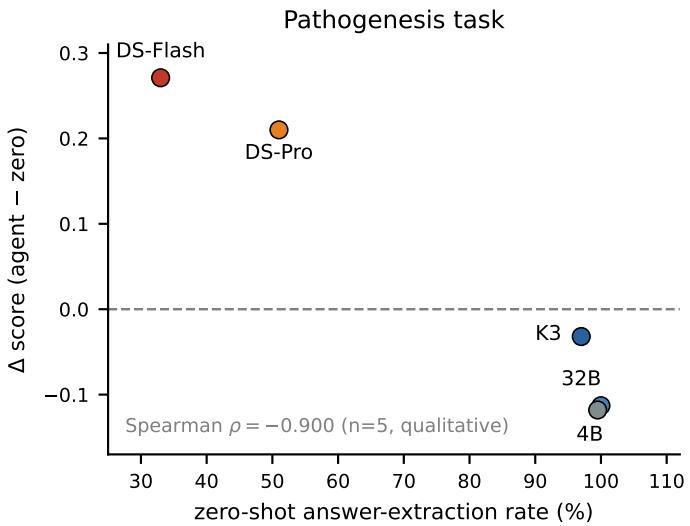

# Output Discipline Sets the Floor: A Falsification-Guided, Model-Agnostic Agent Protocol for Auditable Hypothesis-Driven Decision Making

Jing Liu1B, Yongxing Qi1, Ping Yao2, Ting Wu1

1. Hangzhou Innovation Institute, Beihang University, Hangzhou, China   
2. 32007 Unit, Beijing, China

E-mail: 1530454772@qq.com.

## Abstract

On auditable h othesis-driven decision tasks—where a candidate h othesis s ace can be enumerated and ever candidate checked a ainst the evidence—what actuall binds the erformance of lar e lan ua e models? On the ublic TCMEval-SDT benchmark for Traditional Chinese Medicine s ndrome diferentiation (200 cases u to three re etitions er confi uration aired tests) we find that the bindin constraint is output discipline and reasoning structure, not model capability alone: two ears of model scalin and eneration turnover move zero-shot scores by only −0.03–+0.08, while output-discipline failures—non-terminating reasoning chains, format non-compliance, run-to-run spread s annin u to 0.39 of the score ran e— ersist even in frontier models. We test this h othesis with a model-a nostic a ent framework that formalizes decision making as a five-stage closed loop—hypothesis generation, verification, causal analysis, action, and feedback—enforced b a candidate × evidence matrix falsification rotocol: ever candidate is jud ed a ainst ever evidence item (su ort / o ose / irrelevant), at least half of the candidates must be falsified before a conclusion is licensed, and the surviving most-supported candidates are emitted in a machine-verifiable sin le-line format. Same-model controlled com arisons across five base models show the rotocol’s efect is si n-conditional on zero-shot output discipline: it rescues models whose discipline fails (DeepSeek-V4-Flash: +0.267/+0.271, decomposing entirely into termination rescue and robust on bud et-certified rescue subsets (Δ = +0.24 to +0.46 across certification variants A endix F)) reduces the run-to-run standard deviation of a high-variance model b an order of magnitude (Kimi K3: 0.218 → 0.007 on s ndrome), and significantl costs alread -disci lined models (−0.087 to −0.120 on bud et-matched tem erature-controlled Qwen3-4B/32B). Format-onl ablations attribute the cost to the candidate-bounded format la er and reveal a si n-fli in com lementarit between the causal chain and the format la er; knowled e ablations show the rotocol’s measured efect is inde endent of the injected knowled e content—a rotocol–knowled e decou lin that su orts the framework’s knowled e-as-revisable-data desi n. A two-sta e ada tation transfers the rotocol to misinformation-robust mathematical reasoning, detecting injected false premises at 89.8% recall with a 6.8% false-positive rate—against 100% for a flag-everything baseline (Matthews correlation coeficient 0.54 vs. 0)—and restorin accurac to the no-misinformation ceilin on a com arativel robust model with a small degradation headroom (0.039). Where zero-shot output discipline is weak, the reasoning protocol sets the floor; base-mode capability always sets the ceiling.

## Keywords

agent ; constrained generation ; hypothesis testing ; falsification ; causal reasoning ; output discipline ; hypothesis-driven decision making ; Traditional Chinese Medicine ; s ndrome diferentiation

## ■ 1 Introduction

Many high-stakes decisions follow a structured epistemic pattern: a decision maker collects evidence, proposes candidate hypotheses, verifies or falsifies each against the evidence, analyzes the causal chain connecting evidence to conclusion, and only then acts. Medical diagnosis is the canonical instance—whether in the Western tradition of diferential diagnosis or, as in this paper’s evaluation domain, the Traditional Chinese Medicine (TCM) process of bianzheng lunzhi (syndrome diferentiation and treatment): a physician collects evidence through the four examinations (inspection, auscultation/olfaction, inquiry, and palpation including pulse-taking), proposes candidate syndromes (zheng), verifies or falsifies each hypothesis against the evidence, analyzes the causal chain from etiology to pathogenesis to syndrome, and only then determines the treatment principle and rescri tion. E istemolo icall this is a closed loo of abduction (h pothesis generation), verification (hypothesis testing against evidence), causal analysis (deductive reasoning over domain logic, in the sense of causal modeling [1]), and action with feedback—and it recurs wherever decisions must be justified: clinical reasoning, fact checking, fault diagnosis, and scientific hypothesis testing.

Large language models (LLMs) have shown promise on such tasks, yet applying them exposes four persistent deficiencies. First, association- style direct mapping: given task inputs, models tend to jump directly to a conclusion by reproducing co-occurrence patterns from training cor- pora, rather than performing stepwise causal derivation—the shortcut- learning pathology documented from deep networks generally [2] to LLMs specifically [3]. Second, absence of falsification: models neither propose a candidate hypothesis space nor verify each candidate against the evidence; conclusions are roduced in a sin le ass and cannot be checked, reproduced, or audited, and left to critique itself a model does not fix this—intrinsic self-correction without external feedback fails to improve and can even degrade reasoning [4, 5]. Without candidate-level verification the reasonin chain itself is also ex osed to manipulation—injected false premises propagate along the chain and degrade conclusions even when the model internally possesses the correct knowledge [6]. The sharpest form of this observation is that the knowledge is present and the instruction is present, yet correction still fails: ex licit correction instructions succeed in fewer than half of cases [6]—what is missing is neither knowledge nor willingness but an enforced verification structure. Third, safet and reliabilit risks: hallucinated entities, quantities, and even dangerous recommendations ass without an hard verification—hallucination is a documented, detectable failure mode of LLM generation [7], not a hypothetical concern. Fourth de lo ment tension: cloud models raise data- rivac concerns, while on-premises models preserve privacy but inherit every deficiency above.

Existing work addresses these issues partially. Retrieval-augmented generation (RAG) grounds answers in knowledge bases but leaves the reasoning path free-form. Multi-agent medical systems distribute roles across agents but constrain the dialogue process rather than the reasoning path itself, at multiplied inference cost. Chain-of-thought prompting elicits reasoning text but ofers no machine-verifiable checkpoint of correctness.

A striking empirical pattern motivates this paper. On the benchmark we ado t two ears of model scalin and eneration turnover move zero-shot scores b onl −0.03–+0.08 (Section 6.2), while out utdiscipline failures—non-terminating reasoning chains, format non- compliance, and run-to-run spread spanning up to 0.39 of the score range (operationalized in Table 4)—remain rampant even in frontier models (Section 5). We therefore h othesize that on such tasks the binding constraint is output discipline and reasoning structure, not model capability alone. The hypothesis is falsifiable and sign-conditional: a constrained-reasoning protocol should help exactly where output discipline is missing, and it should add pure, measurable overhead where discipline is already internalized. Testing it requires an instrument that enforces reasoning structure on an arbitrary base model without arameter u dates; we build one.

The instrument is a model-agnostic agent framework that formalizes the epistemic loop above as a data-processing protocol and enforces it on the model’s output. Its core is a candidate × evidence matrix falsification protocol: every candidate isjudged against every evidence item (support / oppose / irrelevant), at least half of the candidates must be falsified before a conclusion is licensed, and the surviving most-supported candi- dates are emitted in a machine-verifiable single-line format. Knowledge is externalized as declarative, domain-expert-revisable data and injected under the protocol’s control—what knowledge is available at each stage is determined by a lifecycle state machine and information-suficiency scorin —so knowled e serves the rotocol rather than the model’s free association, and knowledge correction is decoupled from both model weights and control flow.

We instantiate and evaluate the framework on TCM s ndrome diferentiation. This choice is deliberate rather than incidental. First, TCM diferentiation is one of the few natural tasks that compels all three classical inference modes within a single decision loop [8]: abduction (from four-examination si ns to candidate s ndromes) deduction (from a syndrome to its treatment principle and prescription), and induction (from case statistics to the diferential clues of the data anchor). Second its philosophical framework ( in– ang, five phases) acts as a built-in prior that constrains rather than replaces inference—a natural ally of protocol-constrained reasoning, since the domain itself already formalizes inference as constrained derivation under a world model. Third, abduction is the least mature inference mode in current AI: models that perform well on deduction still struggle with abduction [9], so a quantified, sign-conditional account on an abduction-dense, philosophy- constrained domain is stronger evidence of how protocol constraints interact with model disci line than a uniform ain on a deduction-dense one.

Both predictions of the hypothesis are confirmed (Section 5): the protocol rescues models whose zero-shot output discipline fails, stabi- lizes a high-variance model, and measurably costs already-disciplined models. Our contributions are:

1. A quantified boundary condition for constrained reasoning, established as controlled evidence. Same-model com arisons across five base models—three repetitions, paired Wilcoxon tests with bootstrap confidence intervals, and explicit evaluation hygiene (Section 4.3)—show that the rotocol’s ain is si n-conditional on the base model’s zero-shot out ut disci line: lar e si nificant ains where discipline fails (DeepSeek-V4-Flash +0.267/+0.271, robust under post-hoc budget neutralization on the certified rescue subset), an order-of-magnitude reduction in run-to-run standard deviation for a high-variance model (Kimi K3: 0.218 → 0.007), and significant costs where discipline is already internalized (−0.087/−0.112 on Qwen3-32B; −0.116/−0.120 on budget-matched Qwen3-4B).

2. The instrument: a model-agnostic agent framework for auditable decision making. A five-stage causal-chain closed loop (hypothesis generation → verification → causal analysis → action → feedback verification) instantiated for TCM syndrome diferentiation, enforced by a candidate × four-examination evidence matrix falsification protocol—three-state (support/oppose/irrelevant) cell judgments, row-level aggregation, a “no fewer than half incom-patible” suficiency rule, and a most-supported selection with a single-line structured conclusion—turning diferentiation from one- shot association into a reviewable hypothesis test.

3. Mechanistic attribution of the gains and costs. A res-cue/terminating decomposition shows that the full-set gains on non-terminatin models are entirel termination rescue, at a smal significant cost on reliably terminating cases; format-only ablations identify the candidate-bounded format as the sign-conditional layer and reveal a sign-flipping complementarity between the causal chain and the format layer.

4. Evidence of protocol–knowledge decoupling. Removing all injected skill knowledge leaves benchmark scores unchanged while raisin hit rate, showin that the rotocol’s measured efect is carried by structure rather than by knowledge content; a specialty-tuned knowled e file is further shown to contaminate broad-domain cases, validating specialty-bound knowledge routing.

5. Cross-domain transfer, operationalized rather than asserted. A two-stage adaptation of the same protocol detects injected false remises in mathematical reasonin at 89.8% recall with a 6.8% false-positive rate and restores accuracy to the no-misinformation ceiling on a public external testbed—on a single, comparatively robust model with a small degradation headroom (0.039), so the ceilin result is a roof of ca abilit rather than a robustness guarantee. Persuasion and belief-updating theories developed for human subjects—inoculation theor , the continued influence efect, and belief-revision theory—are used as interpretive lenses for the protocol, each inherited in weakened, computable form and each ofering a consistent interpretation of its behavior rather than an inde endentl testable rediction (Sections 2 and 6). We state the novelty of this instantiation as a scoped claim rather than a priority claim: the LLM–cognitive-science intersection is moving fast, and existin LLM–misinformation work we are aware of uses such theories to inoculate humans or to evaluate model vulnerabilit .

The remainder of this a er is or anized as follows. Section 2 reviews related work. Section 3 presents the framework. Section 4 describes the experimental setup. Section 5 reports results. Section 6 discusses findings and limitations, and Section 7 concludes.

## ■ 2 Related Work

## ■ 2.1 Constrained, verified, and safe generation

Chain-of-thought (CoT) prompting [10], self-consistency [11], and verification-guided decoding improve reasoning reliability but lack domain-specific falsification structure: no candidate space, no evi- dence matrix, no suficiency criterion. Retrieval-augmented generation (RAG) [12] rounds eneration in retrieved documents and miti ates hallucination, but retrieval returns associationall similar text and the downstream reasoning remains unconstrained; neuro-symbolic and GraphRAG-style frameworks applied to TCM knowledge retrieval [13] constrain the knowledge source but likewise leave the reasoning path free. Our framework uses retrieval diferentl : for knowled e ueries it bypasses generation entirely (direct original-text answers), while for decision tasks it injects declarative knowledge as constraints rather than as answer sources; and our matrix protocol adds a structured hypothesis-testing layer on top of these general techniques.

A complementary line of work treats reasoning itself as a security object. Recent work defines reasoning safety along logical consistency, computational eficiency, and manipulation resistance, and proposes runtime monitors that inspect each reasoning step and interrupt unsafe trajectories [14]. This “detect-and-interrupt” paradigm is comple-mentary to ours: monitors discover bad reasoning post hoc and halt it, at the price of an additional model in the loop and non-trivial false-positive rates, whereas our protocol constrains generation at source—deterministically, without an auxiliary model—at the price of requiring tasks that can be structured into a candidate × evidence form. Our audit logs (per-cell judgments, protocol-compliance scores) provide the white-box evidence that monitor-based approaches can only approximate.

## ■ 2.2 Agentic and multi-agent medical systems

ReAct-st le a ents interleave reasonin and actin within a sin le loo [15], but the reasonin remains a free-form scratch ad without verifiable checkpoints. Beyond this single-agent paradigm, LLM-based a ents have been ex lored for decision makin alon three lines. Multi- agent collaboration instantiates multi-disciplinary consultation as inter- agent dialogue: MedAgents [16] organizes expert recruitment, iterative discussion, and consensus formation for zero-shot medical reasoning, and MDAgents [17] adaptively routes queries to a solo agent, a multidisciplinary team, or an integrated care team according to estimated com lexit . Environment simulation builds hos ital-scale simulacra in which doctor a ents evolve throu h ractice (A ent Hos ital [18]) or serves as interactive clinical evaluation environments (AgentClinic [19]). Task-oriented TCM a ents are closest to our settin : Jin Fan [20] decomposes TCM consultation into inquiry, syndrome-diferentiation, and treatment a ents with dual-sta e formula retrieval; TCM-A ent [21] orchestrates multiple agents for network-pharmacology-driven herbal research; and CORE-Acu [22] couples structured chain-of-thought with a safety knowledge graph whose symbolic veto mechanism blocks contraindicated acupuncture decisions.

These s stems constrain the dialo ue rocess or the tool la er, but none enforces a verifiable reasoning protocol within a single reasoning instance: conclusions emerge from agent dialogue or role orchestration rather than from a machine-checkable hypothesis-testing procedure, and multi-role dialo ue multi lies inference cost. Our mechanism executes the full abduction–verification–deduction–action–feedback closed loo inside a sin le model instance with machine-checkable protocols, keeping inference cheap and auditable.

## ■ 2.3 Reasoning robustness under information contamination

Beyond ordinary errors, LLM reasoning is vulnerable to contaminated inputs. Misinformation is one form of a broader threat: the manipulation of the reasoning process itself—of which injected false premises, ersuasive ressure and contaminated evidence are all instances. We frame the roblem at this level of eneralit and evaluate on its best- documented instance. Prior work shows that misinformation propagates along reasoning chains: even when models possess correct internal knowledge, injected false premises reduce knowledgeable accuracy b 10–72% [6], and ex licit correction instructions succeed in fewer than half of cases. Reasoning post-training (thinking models) does not eradicate the vulnerability, which is traced to the instruction- tuning stage rather than to reasoning capacity itself; the proposed remedy—fine-tuning on early factual correction—is training-time and model-bound [6]. The same mechanism anal sis shows that correction is most efective when applied early in the reasoning trajectory, before the contaminated premise propagates downstream [6]; this is precisely the ordering our two-stage design enforces at inference time—the verification stage (candidate × evidence matrix) always precedes the causal-analysis stage (Section 3), so premises are checked before any derivation builds on them.

The failure attern is not machine-s ecific: in human reasonin , mis- information continues to shape inference even after recipients explicitly accept a correction—the continued influence efect [23, 24], traced to memory failure [25]. On the machine side, reasoning-optimized models resist majorit ressure in social-influence simulations (conformit 3.13% vs. up to 19.45%) [26], and enabling thinking mode reduces persuasion rates in multi-agent persuasion experiments [27]. Yet such protection is bound to training, ofers no auditability, and does not distinguish right from wrong: the thinking-mode benefit is documented precisel when the initial answer was alread correct [27], so on initially wrong answers internalized resistance entrenches error rather than reventin it.

Our falsification protocol is an externally enforced, evidence- checking structure of this kind: a candidate survives onl when support- ing evidence outnumbers opposing evidence, and the re-examination loo re-o ens the decision whenever falsification falls short. As an inference-time, training-free layer it complements training-time correc- tions and transfers across models; and because resistance comes from evidence checking rather than stance retention, it yields correctable insistence, avoidin the error-entrenchment failure mode of stancebased defenses [26 27]. Direct evaluation under adversarial remise injection is reported in Section 5.6: the mechanism transfers as a twostage adaptation—the candidate space becomes the premise equations, the evidence columns become numeric/relation/self-consistenc checks, and falsified premises are rewritten reminder-st le before derivation— rather than as a verbatim reuse of the clinical pipeline.

Two persuasion-theoretic lenses inform the design and its bound- ary condition. Inoculation theory [28] confers resistance through forewarning plus refutational preemption of weakened attacks (established meta-analytically [29]), and technique-based prebunking transfers across contents when what is neutralized is a fallac type rather than a topic [30–33]; requiring refutation practice on every candidate before an conclusion is licensed is enforced refutational preemption. The Elaboration Likelihood Model [34] distinguishes central-route scrutiny from peripheral, cue-driven processing, and zero- shot LLM reasoning is biased toward the peripheral route [35]; under this lens the matrix rotocol is an elaboration enforcer consistent with the output-discipline boundary condition of Section 5.1. As far as our literature covera e extends, existin LLM–misinformation work treats models as generators of prebunking material or as targets whose vulnerability is measured; neither treats the model’s own reasoning protocol as the carrier of an inoculation structure. Section 6 develops both mappings.

## ■ 2.4 LLMs and benchmarks for TCM

Several benchmarks evaluate TCM capabilities of LLMs. TCMBench ofers knowledge-centric question answering built on the TCM licensing examination, and re orts that no evaluated model—includin GPT- 4—reaches the 60% passing line [36]. TCM-SD evaluates syndrome derivation from case anal sis over 54,152 real-world clinical records coverin 148 s ndromes [37]. MTCMB [38] extends evaluation to a multi-task setting spanning knowledge, reasoning, and safety, includ- ing diagnosis sub-tasks on syndrome diferentiation and prescription recommendation. TCMEval-SDT [39] is, to our knowledge, the first benchmark targeting the thought process of syndrome diferentiation, providing 300 expert-annotated cases with multi-select options for pathogenesis and syndrome, and zero-shot scores for ChatGPT, Gemini 1.5 Pro, ChatGLM-130B, and Ton i Qianwen. We ado t TCMEval-SDT and its oficial scoring script for comparability.

On the model side, domain-adapted Chinese medical and TCM LLMs improve domain knowledge via continued pre-training and fine- tuning: Zhongjing [40] combines a real multi-turn dialogue corpus with reinforcement learning from human feedback (RLHF) over expertranked outputs; HuatuoGPT-II [41] proposes a single-stage domain-adaptation protocol; and TCM-oriented models such as TCMChat, BianCan , and Qibo [42–44] tar et s ndrome diferentiation, formula recommendation, and knowledge QA respectively. Their reasoning, however, remains a single-pass free-form generation that cannot be audited or falsified step by step. Our framework is orthogonal to these eforts: it wraps an arbitrary base model—without any parameter updates—in a verifiable reasoning protocol. Consistently, our exper- iments show that TCM post-training changes behavior little relative to the base model (±0.01), while the protocol’s cost replicates on the post-trained variant (−0.111/−0.112)—i.e., training-time knowledge injection and inference-time protocol constraints address diferent bottlenecks.

## ■ 3 The Framework

## ■ 3.1 Overview: a five-stage causal-chain closed loop

The framework formalizes diferentiation as a closed loop of five stages:

1. Hypothesis generation (abduction). Given patient evidence, a candidate syndrome space is constructed from (i) candidates provided by the user or upstream reasoning (marker-delimited), (ii) specialty skill routing, and (iii) knowledge-base syndrome retrieval. A scope constraint restricts all subsequent conclusions to this space.

2. Hypothesis verification (evidence matrix). For each candidate, authoritative diagnostic standards (chief/accompanying symptoms, tongue, pulse, treatment principle) are extracted from declarative knowledge files—with alias mapping that unifies synonymous syn- drome names (e.g., “phlegm-heat harassing the heart” and “phlegmheat internal disturbance”) and a per-syndrome length cap—and a patient-evidence checklist is built with positive/negative feature rules (longest-match-first, negation-priority), yielding a candidate × evidence matrix.

3. Causal analysis (constrained reasoning chain). The model is required to reason along a forced chain—four-examination analysis → eight principles → disease nature → disease location → syndrome synthesis—explicitly forbidden to jump from a single sign to a syndrome.

4. Action. The treatment principle is derived over the TCM logic system; formula names, herbs, doses, and acupoints must come from knowled e-base ori inals and are verified via structured tool calls.

5. Feedback verification. Prescriptions pass hard safety checks (incom atibilit , re nanc , toxicit dosa e); dia nosis consistenc across turns is enforced via conclusion caching and drift detection; reasoning quality is scored for audit.

Fi ure 1 shows the four-la er s stem architecture; Fi ure 2 shows the end-to-end processing pipeline.

■ 3.2 Candidate × evidence matrix falsification protocol The protocol, the core of this work, constrains the model’s conclusion process as follows:

• Matrix construction. Rows are candidate syndromes; columns are the patient’s four-examination evidence items.

• Cell judgment. Each cell is judged support, oppose, or irrelevant, justified by the injected diagnostic standards.

• Row aggregation. A candidate is compatible ifsupporting evidence outnumbers opposing evidence and key evidence is supported; otherwise it is incompatible.

• Suficiency rule (falsification). The number of incompatible candidates must be at least half of the candidate space; otherwise diferentiation is deemed insuficient and evidence must be re-examined.

• Selection and output. The final conclusion is the com atible candidate with the most supporting evidence (or several, in multianswer settings), emitted on a single line in a fixed marker format ([Final Syndrome]: X)—machine-extractable and checkable.

• Prohibitions. Choosing by candidate order and copying example conclusions are ex licitl banned.

• Explicit refutation. An opposed cell judgment must name the contradicting evidence (e.g., “opposed by E3”). Silent elimination of a candidate is discouraged: memory-updating research shows that corrections which explicitly re-state the discredited item—co-activating it with the conflicting evidence—update beliefs more efectively than corrections that only supply the correct answer [45], and the logged evidence pointer makes each falsification auditable.

Every cell judgment can be cross-checked against the evidence checklist and dia nostic standards, makin the reasonin white-box and auditable. Figure 3 illustrates the protocol on a worked three- candidate example. Formal readings of the protocol are collected in G: a belief-revision (AGM) reading of the aggregation, contraction, and consistency rules; the proof of Proposition 1 with its caveats.

## • Statistical reading: sequential multi-hypothesis testing

Treat the candidate set $\mathcal { H } = \{ h _ { 1 } , \ldots , h _ { m } \}$ as � competing hypothe- ses and each evidence item $e _ { j }$ as an observation; the cell function $f ( h _ { i } , e _ { j } ) ~ \in ~ \{ + 1 , 0 , - 1 \}$ is a per-hypothesis score. Define the row statistic

$$
S ( h _ { i } ) \ = \ \sum _ { j = 1 } ^ { n } w _ { j } \ f ( h _ { i } , e _ { j } ) , \qquad w _ { j } \ge 0 ,\tag{1}
$$

with compatibility declared if $S ( h _ { i } ) > 0$ and at least one key evidence item $e _ { \mathrm { k e y } }$ satisfies $f = + 1$ . The deployed protocol uses uniform weights $\scriptstyle ( w _ { j } = 1 )$ : the model counts supporting against opposing items, and the key-evidence requirement enters as a separate hard gate rather than as a lar e wei ht. The $\mathbf { \^ { 6 6 } a t }$ least half falsified” rule is then a suficiency stopping criterion: with the falsified set containing both score-incom atible and ke -evidence-failed candidates, inference is licensed only once the condition of Eq. (2) holds

$$
{ \frac { \left| \{ h _ { i } : S ( h _ { i } ) \leq 0 ~ { \mathrm { o r } } ~ f ( h _ { i } , e _ { \mathrm { k e y } } ) \neq + 1 ~ \} \right| } { m } } ~ \geq ~ { \frac { 1 } { 2 } } .\tag{2}
$$

Under a mutually exclusive syndromes, conditionally independent evidence model, each falsified candidate transfers osterior robabilit to the survivors, so the posterior concentration on the remaining h othesis set increases monotonicall in the number of eliminated candidates. The following proposition makes the intuition “more evidence, more reliable conclusions” a theorem rather than a slo an.

Proposition 1 (Evidence-accumulation bound). Assume (i) the true syndrome $h ^ { \star } \in { \mathcal { H } }$ is present; (ii) cell judgments are conditionally independent given ℎ★; (iii) each celljudgment is correct with probability at least $\textstyle 1 - \epsilon , \epsilon < { \frac { 1 } { 2 } }$ , where correctness isjudged against the ground-truth cell value $\nu ( h , e ) \in \{ + 1 , 0 , - 1 \}$ , and errors are sign-symmetric in the sense that E $\left[ f ( h , e ) \right] = \left( 1 - 2 \epsilon \right) \nu ( h , e ) ; \left( \mathrm { i v } \right)$ key-evidence requirements hold; and (v) for every spurious candidate $h _ { i } .$ , all � evidence items weakly favor the true candidate $( \nu ( h ^ { \star } , e _ { j } ) \ge \nu ( h _ { i } , e _ { j } )$ for all $j ) ,$ with at least $n _ { i }$ of them strictly discriminating $( \nu ( h ^ { \star } , e _ { j } ) = + 1 , \nu ( h _ { i } , e _ { j } ) = - 1 )$ Then the probability that the protocol’s selection rule returns $h ^ { \star }$ is bounded below by

$$
\operatorname* { P r } [ \widehat { h } = h ^ { \star } ] \ \ge \ 1 - \sum _ { i \ne \star } \exp \Bigl ( - 2 ( \frac { 1 } { 2 } - \epsilon ) ^ { 2 } \frac { n _ { i } ^ { 2 } } { n } \Bigr ) ,\tag{3}
$$

a Hoefdin -t e bound [46]. In the s ecial case of erfect discrimination on every item $\scriptstyle ( n _ { i } = n$ for all �), Eq. (3) reduces to $1 - ( m -$ 1) $\exp ( - 2 ( \frac { 1 } { 2 } - \epsilon ) ^ { 2 } n )$ , non-trivial once � exceeds l $\scriptstyle \mathtt { n } ( m - 1 ) / ( 2 ( { \frac { 1 } { 2 } } - \epsilon ) ^ { 2 } )$ .

## • Information-theoretic and decision-theoretic readings of the one-half threshold

Why one half? Two readings illuminate the deployed choice, and we state upfront what neither does: uniquely select the threshold. (i) $\mathbf { A } \mathbf { n }$ information reading gives the s mmetric point a label—under a uniform prior, falsifying half the candidates removes exactly one bit of hypothesis-space uncertainty $\mathrm { ( E q . ~ ( 4 ) ) } \cdot$ —but the mar inal information of the (�+1)-th falsification, $\log _ { 2 } { \frac { m - k } { m - k - 1 } }$ , increases with �, so the same calculus pushes toward stopping as late as possible: a landmark, not an optimum. (ii) A decision-theoretic reading defines the conclusion confidence $C ( k ) = k / m ( \mathrm { E q . } ( 5 ) )$ : raising the required � monotonically shrinks both the licensed output set and the selection error, a trade that holds for any threshold and therefore cannot single out one half, but that makes $C$ a per-case, matrix-computable confidence score—the same budget logic as uncertainty sampling in active learning [47, 48], applied at inference time. What selects the operating point is therefore empirical: the $\kappa \in \{ \frac 1 4 , \frac 1 2 , \frac 3 4 \}$ ablation of Section 5.5 (Table 10) which shows the deployed one half is not the winner and that the profitable direction is stricter falsification. At the far edge, when falsification drives � toward $m ,$ the conclusion set may empty, so the protocol’s re-examination loop, not further elimination, is the correct response, and � should be read jointly with the size of the surviving set.

  
Fig. 1 Four-layer architecture. The epistemic layer defines the hypothesis–verification–causal-analysis–action loop; the TCM process layer carries the diferentiation workflow, closing the loop through the validation-feedback stage; the model layer (LLM-1/LLM-2/ML/RAG) executes it; the data layer holds syndrome–sign mappings, reasoning data, case mappings, and safet rules. Within the rocess la er verification takes the form of tar eted uestionin over t ical si n–s ndrome data and causal anal sis roceeds over the five- hase self-consistent system.

$$
\Delta H ( k ) ~ = ~ \log _ { 2 } { \frac { m } { m - k } } ~ { \mathrm { b i t s } } , \qquad \Delta H \bigl ( { \textstyle { \frac { m } { 2 } } } \bigr ) = 1 ~ { \mathrm { b i t } } ,\tag{4}
$$

$$
C ( k ) \ = \ 1 - \frac { | \mathcal { H } _ { \mathrm { s u r v } } | } { m } \ = \ \frac { k } { m } .\tag{5}
$$

## ■ 3.3 Knowledge assets and dual-anchor injection

All medical knowledge lives outside the code as data, in three forms. Case database. A local SQLite database (tcm.db) holds 8,147 case records with question/chain-of-thought/response/syndrome/formula fields, aggregated from 5,903 TCM question–answer pairs, 738 acupunc- ture case records from a renowned physician’s lectures, and 1,506 licensed-physician examination questions. The database additionally contains 58 structured classical formulas, 23 incom atibilit airs (the eighteen incompatibilities and nineteen mutual antagonisms canon enforced at prescription time, plus one extended pair), and 17 pregnancy- contraindication entries (14 banned and 3 caution-level herbs). A Chinese-bigram FTS5 full-text index supports the retrieval cascade of A. Distilled mapping datasets. From 1,103 TCM question–answer pairs we distilled syndrome↔sign, formula-symptom↔syndrome, and prescription mappings. A separate coded dataset of 539 insomnia cases with tongue-sign inputs serves as the specialty pilot from which the data-driven diferential clues below are distilled; other specialties follow the same rocedure. Declarative skill files. Textbook standards (chiefly TCM Diagnostics [49]) and the above datasets are refined into 23 Markdown skill files organized into six specialty skills (basic diagnosis, insomnia, hypertension, gynecology, pediatrics, acupuncture). Skills are routed by specialty priority and injected per lifecycle stage, so physicians can revise knowledge without touching code.

At diferentiation time, two complementary anchors are injected alongside the forced causal chain. Theory anchor (methodological rules). Key decision rules distilled from textbooks, e.g., a thick coating alone cannot exclude deficiency syndromes; the absence of a greasy coating alone cannot exclude phlegm-heat; a pale-red tongue alone cannot exclude liver-fire or phlegm-heat; a pale-purple tongue alone does not diagnose blood stasis; and a symptom-priority principle when signs conflict. Data anchor (statistical clues). Conditional probabilities distilled from the 539-case specialty dataset, e.g., among white-coating samples about 47% are phlegm-heat harassing the heart; teeth-marked tongues occur in 72% of heart–gallbladder qi deficiency and 54% of heart–spleen deficiency cases; greasy coating in 66% of phlegm-heat cases. Syndrome prior distributions and explicit data-bias warnin s are injected to ether, so that when textbook theor and sam le statistics conflict the model still has a decision basis. H gives a Bayesian reading of the two anchors: the data anchor supplies posterior fragments rather than likelihoods, the theory anchor acts as a constraint set rather than a prior, and naive-Bayes pooling links both to the matrix score of Section 3.2.

  
Fig. 2 End-to-end rocessin i eline (S1–S9) with anti-deadlock uestionin uards the insuficienc re-examination loo after matrix falsification and rescri tion-violation interce tion.

Injection budgets scale with model size: 12,000–18,000 characters for 4B models and 28,000–32,000 characters for 32B models. The model runs with thinking (reasoning) mode enabled, and reasoning blocks are stored separatel from final answers for audit.

## ■ 3.4 Intent triage, information suficiency, and active questioning

Incoming input first passes a two-level intent triage (a rule decision tree, then a two-token model classification into consultation / closin / of- topic), so that knowledge queries never enter the diferentiation pipeline. Knowled e ueries are served b a three-level retrieval cascade over the case database, and the top record’s answer text is returned verbatimfrom the database without generation—zero hallucination, at millisecond latency; only when retrieval fails does the model answer within a restricted bud et still outside the diferentiation i eline. A details the triage rules, the cascade, the scoring rule, and a worked example.

Each consultation turn is scored for information suficiency over the evidence categories collected so far (tongue signs, chief symptoms, pulse/course); reaching the suficiency threshold advances directly to diferentiation, and below threshold the agent names the missing dimensions and asks targeted follow-up questions. Anti-deadlock guards truncate repeated question-only outputs and honor explicit user stop signals, preventing infinite questioning. Session-level completeness is estimated as the covera e of chief com laint, s m toms, ton ue, and ulse and ates the COLLECT-exit transition of Section 3.5. D develops the information-theoretic reading of this rule—a greedy information-gain policy in disguise—together with its upgrade path.

  
prohibitions: no default pick by candidate order · no copying example conclusions · no fabricated formulas / herbs / doses  
Fig. 3 The candidate × four-examination evidence matrix falsification protocol on a worked example. Three knowledge inputs build the matrix; row-level aggregation yields compatibility di t th fi i h k i t l t h lf f th did t t b i tibl th i id i i d th t t d tibl did t i itt d i th sin le-line rotocol format.

## ■ 3.5 Lifecycle state machine and safety invariants

The consultation is modeled as a finite state machine with nine states: INIT COLLECT DIAGNOSE PLAN PRESCRIBE REVIEW FOL- LOWUP, COMPLETED, and ABORTED. Transitions carry precon- ditions (symptom completeness ≥ 0.6 to leave COLLECT; diagnosis confidence ≥ 0.7 to leave DIAGNOSE); advancement decisions fuse token-level and semantic confidence with weights 0.3/0.7, with a turn- count fallback; illegal transitions are rejected outright and timeout guards prevent stalls. Table 1 maps the method stages onto lifecycle states.

The nine-state machine is, formally, a finite automaton $( Q , \Sigma , \delta , q _ { 0 } , F )$ whose transition reconditions are uards, and this afords the framework a specification language rather than only an implementation. Illegal-transition rejection is a safety invariant: in linear temporal logic [50], the deployed checks enforce

$$
\begin{array} { r l r } & { \scriptstyle \Xi ( \mathrm { P R E S C R I B E } \implies \bigodot \big ( \mathrm { R E V I E W ~ V ~ A B O R T E D } \big ) ) , } & { \scriptstyle ( 6 ) } \\ & { \scriptstyle \Xi ( \mathrm { ( c o L L E C T ~ \wedge ~ c o m p l e t e n e s s ~ < 0 . 6 ~ \wedge ~ \  f o r c e d ) ~ \Rightarrow ~ \bigodot ~ C o L L E C T } ) , } & \end{array}\tag{7}
$$

where □ is “ loball ”, ⃝ “next”, ^ “eventuall ”, and forced marks the forced-advance paths of Section 3.4 (turn-count fallback, deadlock truncation, timeout guards). The first invariant requires every prescribe to be eventuall followed b a review or an abort, aligned with the PLAN→PRESCRIBE→REVIEW order of Table 1; the second is the COLLECT-exit precondition restricted to non-forced trajectories (stop-signal advancement needs no exclusion because it first raises completeness to the threshold). Both are enforced at runtime by construction and are checkable post hoc on any logged trajectory, which is what makes the audit layer (Section 5.8) a verification step rather than a log dump. Because the automaton is finite and the guards are decidable predicates, these properties are in principle model-checkable over the implementation’s transition graph; we leave mechanized model checkin to future work.

## ■ 3.6 Consistency, feedback, recovery, and runtime robustness

Consistency. Confirmed syndromes are cached; a followup turn (shorter than 50 characters and carrying no new tongue/coating/pulse/symptom/course terms) triggers a full prompt rewrite—“syndrome X is confirmed; explain its rationale and diferentiate itfrom the syndromes the user mentioned; do not re-diagnose”— rather than a fresh diferentiation kee in conclusions stable across turns. Within a turn, multiple distinct syndrome conclusions trigger drift detection, and the last conclusion stands. Reasoning blocks are scored over six dimensions (four-examination flow, eight-principle differentiation, tongue diagnosis, pulse diagnosis, candidate comparison, TCM terminolog ; score = hit classes/6) and logged for audit. Under stationary inputs the cache keeps the conclusion fixed; a genuine change of conclusion requires new evidence that pushes re-diagnosis across a decision boundary, and under the matrix protocol this evolution is monotone in the accumulated evidence—adding evidence refines the same logged matrix rather than restarting it.

Table 1 Mapping between method stages and lifecycle states.
<table><tr><td>Method stage</td><td>Lifecycle state(s)</td></tr><tr><td>Intent triage, direct retrieval</td><td>outside the machine</td></tr><tr><td>Information collection, sufficiency</td><td>COLLECT</td></tr><tr><td>Hypothesis &amp; evidence construction</td><td>DIAGNOSE (prompt injection)</td></tr><tr><td>Matrix falsification &amp; output</td><td>DIAGNOSE (output protocol)</td></tr><tr><td>Causal-chain reasoning</td><td>DIAGNOSE (reasoning)</td></tr><tr><td>Action: plan, prescribe, review</td><td>PLAN → PRESCRIBE → REVIEW</td></tr><tr><td>Feedback &amp; consistency</td><td>FOLLOWUP → COMPLETED</td></tr><tr><td>Runtime protection &amp; audit</td><td>cross-cutting</td></tr><tr><td>Hard violations, fatal signals</td><td>ABORTED</td></tr></table>

Feedback and recovery. Runtime signals (tool failures, safet violations, etc.) are graded into four severities—info, warning, severe, fatal—mapped to six responses (ignore, warn, adjust, pause, roll back, abort). Hard-constraint signals are handled synchronously (target latenc 50 ms), and fatal signals drive the state machine into ABORTED. Snapshots are saved automatically on every state change (SHA-256 integrity, last 10 versions retained); failures follow a three-level policy— automatic retry within 5 s, rollback to the latest safe snapshot within 30 s, or manual intervention.

Runtime robustness. Four cross-cutting subsystems keep long consultations stable on small models: la ered context bud etin across permanent/session/task windows; streaming guardrails (hard token caps, repetition-loop and language-mixing detection); five-dimension health monitoring; and trajectory logging with privacy de-identification. C details the budgets and detection rules.

## ■ 3.7 Prescription safety hard constraints

Before any prescription is emitted, layered mandatory checks run: set- intersection detection over the eighteen incompatibilities (14 pairs) and nineteen mutual antagonisms (8 pairs); pharmacopoeia dose ceilings for 15 toxic herbs [51]; 14 re nanc -banned herbs when the atient is pregnant; human-review flags for children under 14 and adults over 70; and outright refusal of non-TCM operations such as prescribing Western medication or recommending surgery. Violating prescriptions are intercepted and regenerated, never silently patched. During plan and prescription generation the model may invoke nine structured tools through seven textual markers; every call passes a four-stage audited

pipeline (pre-call audit; sandboxed execution with timeout and retries;   
post-call output validation; audit logging), detailed in B.

## ■ 3.8 Model-agnostic adapter and deployment

A unified adapter (local Transformers / vLLM cluster / OpenAIcompatible APIs / mock) decouples the mechanism from any specific model, with automatic device detection, thinking/reasoning separation, logprob confidence, and parameter auto-scaling of knowledge-injection budgets across model sizes.

## ■ 4 Experiments

## ■ 4.1 Dataset

We evaluate on TCMEval-SDT [39] (CC-BY 4.0), the public bench-mark for TCM syndrome-diferentiation reasoning. It contains 300 expert-annotated cases; only the 200-case training split includes gold answers (multi-select among 10 options A–J for both pathogenesis and syndrome), and is therefore used for evaluation. Gold syndrome sets contain 1–4 items and pathogenesis sets 1–6 items.

## ■ 4.2 Evaluation protocol

Options are injected as single-quoted candidate markers into the agent input, triggering the matrix protocol; textual conclusions are extracted and mapped back to option letters. We report: the oficial-script score (the benchmark’s score proportional: $| A \cap B | / ( | A | + | B \setminus A | )$ per case, averaged); hit rate (fraction of cases with non-empty prediction ∩ old); exact match; and macro-F1 (Tables 2 and 3).

## • Component activation under the benchmark pathway

We state explicitly which framework components the benchmark exer- cises, since candidate injection bypasses parts of the loop. Activated and measured: declarative knowledge injection and skill routing (Section 3.3) the forced causal-chain constraint (Section 3) the matrix falsification protocol with its suficiency rule, and the single-line output rotocol. Bypassed by design: abductive candidate construction (the benchmark supplies the candidate set—a deliberate isolation of the verification stage); active questioning and suficiency scoring (inputs are complete case narratives, single-turn); the action-stage tool layer and prescription safety checks (the benchmark tasks end at diferentiation, before rescri tion); and the multi-turn feedback loo (each case runs in a fresh context). The headline numbers therefore measure the verification and causal-analysis core of the loop, not the full five-stage pipeline. The remaining components are validated elsewhere: active questioning and mechanism execution in the 539-case pilot (Section 5.8), and the safety layer, state machine, tool pipeline, and recovery in the 21-test regression suite (Section 5.8).

## ■ 4.3 Evaluation hygiene

Three declarations address evaluation-contamination concerns. (i) Knowledge–benchmark overlap. We computed an 8-gram containment check between each of the 200 benchmark cases (Clinical Data + Clinical Information) and every knowledge text the agent can retrieve (8,147 tcm.db question fields and all 31 skill/knowledge Markdown files, 8,178 texts total): the maximum per-case containment is 1.5% (mean 0.1%), i.e., no benchmark case shares substantive text with the knowled e base. (ii) Knowledge-iteration history. All knowled e and skill files were frozen before benchmark contact. The two docu- mented iterations of the diferential data table (v0.1→v0.2) and the diferential guide (v0.2→v0.3) were driven exclusivel b the 539- case insomnia ilot (a rivate dataset disjoint from the benchmark) and com leted before the first benchmark cam ai n be an; ost-hoc benchmark failure anal ses in this a er were used for inter retation onl and were never fed back into knowledge, prompts, or thresholds. Consistently, the ablation evidence runs opposite to any data-snooping h othesis: the insomnia-tuned uide hurt benchmark erformance (Section 5.4)—contamination was detected and re orted not ex loited. (iii) Hyperparameters. All rotocol thresholds (com leteness 0.6, diagnosis confidence 0.7, injection budgets) were fixed at development time and never tuned on the benchmark; the only benchmark-specific adaptations are the disclosed evaluation-mode output protocol (multianswer [Final Syndrome] format) and the locked base-skill routin .

## ■ 4.4 Statistical analysis

To separate genuine efects from decoding variance, every configuration that su orts sam lin is evaluated in three independent repetitions over the same 200 cases per task. We use run and repetition interchangeably, and case-run to denote one (case, repetition) pair. We report run-level mean ± std, and test paired comparisons on per-case scores averaged across repetitions (unit of analysis: the case, �=200) using the two-sided Wilcoxon signed-rank test, complemented by a paired bootstrap 95% confidence interval of the mean diference (10,000 resamples, fixed seed). Raw �-values are reported throughout. For confirmatory interpretation we apply a Bonferroni correction within the same-model mechanism-gain family (5 models × 2 tasks = 10 tests, �=0.005); cross-model comparisons mix repetition counts and configurations, so they are reported descriptively, without �-values.

Two inferential levels. Case-level tests average over repetitions and answer the case-population question, but they can understate uncertainty where run-level variance is material (for K3 zero-shot, run means span 0.245–0.636). We therefore additionall re ort a conservative run-level check—Welch’s �-test over the three run means per side (unit: the run, �=3)—for ever three-re etition com arison (Table 5). The two levels answer diferent questions and we report both; where they disagree we say so explicitly. Run-level inference at �=3 is low-powered by construction, so a non-significant run-level � is weak evidence rather than evidence of absence. Variance-ratio claims are reported with 95% CIs (variance-ratio �-test, df 2,2). We write “n.s.” for non-significant, and reserve “si nificant” for below the stated threshold.

## ■ 4.5 Configurations

• Qwen3-4B / Qwen3-32B [52]: zero-shot direct answering, and with the full framework (local vLLM);

• PT-4B + agent: a TCM post-trained 4B model with the full framework;

• DeepSeek-V4-Flash [53]: zero-shot and with the framework (oficial API);

• DeepSeek-V4-Pro: zero-shot and with the framework (oficial API);

• K3 zero-shot / K3 + agent: Kimi K3 (2026 release) [54] without and with the framework.

Pa er baselines (Gemini 1.5 Pro ≈0.475 s ndrome, ChatGLM-130B ≈0.532 pathogenesis, converted from the paper’s weighted sums to per-case means) are shown for reference; note they are 2023–2024-era zero-shot evaluations on a random 50-case subset.

## ■ 4.6 Ablation design

Starting from the full agent (G0, Qwen3-4B), we remove one component per roup: G1 no matrix-and-format instruction block (the falsification-matrix requirement, the candidate-bounded single-line emission mandate, and the associated prohibitions are one prompt block and are removed jointly; knowledge injection is retained); G2 no evidence checklist/authoritative standards; G3 no diferential-diagnosis guide (insomnia-tuned); G4 no skill-knowledge injection at all. Each group is re-evaluated on both tasks (200 cases each, three repetitions). A separateformat-only baseline—candidate markers and the mandatory single-line output format, but no matrix and no knowledge injection— separates the format layer from the content layer that G1 removes jointly, and is run on both the bud et-matched Qwen3-4B and Dee Seek-V4- Flash. On Qwen3-4B the factorial is completed b two further arms: a no-matrix arm (G5, content + format, no matrix requirement) and a no-format arm (G6, content + matrix, no emission mandate).

## ■ 4.7 Implementation details

Local/server runs use Qwen3-4B (fp16, thinking enabled, max 2048 new tokens) and Qwen3-32B (vLLM, thinking enabled, max 4096 new tokens), both from unchanged local checkpoints (Qwen3 release of 2025); the Dee Seek runs use the oficial API. The K3 run uses the Kimi coding API with temperature fixed at 1.0 (the only value K3 accepts). All evaluations resume from checkpoints and log every case’s full reasoning for audit. On budget symmetry: zero-shot baselines follow the benchmark a er’s rotocol at an 8 192-token bud et while a ent runs receive the lar er bud ets the rotocol’s matrix out ut re uires; the resulting asymmetry means full-set gains contain termination rescue, which is why the truncation-free decomposition of Section 5.1—not the raw full-set contrast—is our primary controlled evidence. To control a temperature confound in the Qwen3-32B comparison (zero-shot at temperature 0 vs. agent at 0.6), the 32B agent was additionally evaluated at temperature 0. For unambiguous cross-reference, every reported number is tied to a named campaign: C1 = initial runs (single repetition, temperature 0.6–0.7, 16,384-token budget, /no think for flash); C2 = repetition campaign (three repetitions, flash at 32,768 tokens without the trigger; K3/32B at their stated budgets); C3 = budget-matched greedy runs (temperature 0, 8,192-token budget, vLLM; three repetitions for the Qwen3-4B agent and the per-component ablation groups, single repetition for PT-4B, the format-only baselines, and the � ablation). E records two engineering notes on generation budgets and API-side behavior across the campaigns, including a silent endpoint upgrade that we detected and excluded from pooling.

## • PT-4B training

PT-4B is a TCM post-trained variant of Qwen3-4B. Starting from the unchanged Qwen3-4B base checkpoint, we applied supervised fine-tuning (SFT) on a self-curated TCM corpus—one subset of which carries chain-of-thought rationales—followed b group relative polic optimization (GRPO) reinforcement post-training, following the recipes of DeepSeekMath [55] and DeepSeek-R1 [56]. A first version (V1) was trained in April 2025; all experiments in this paper use the V2 upgrade checkpoint of 2025-10-09. Post-training data are drawn from our private TCM datasets and are disjoint from the TCMEval-SDT benchmark (Section 4.3).

Table 2 Oficial-scri t scores on TCMEval-SDT (our own runs n=200 er task). Values are mean ± std over 3 re etitions; † marks sin le runs; ‡ marks sin le bud et matched reed runs (8,192-token bud et). Pa er baselines are 2023–2024-era zero-shot on a 50-case subset, converted to er-case means. Bold values mark er-column maxima; the bold row label marks the rotocol confi uration.
<table><tr><td>Model</td><td>Variant</td><td>Syndrome</td><td>Pathogen.</td></tr><tr><td>Qwen3-4B</td><td>zero-shot</td><td> $0 . 4 8 1 \pm 0 . 0 0 5$ </td><td> $0 . 4 5 5 \pm 0 . 0 1 0$ </td></tr><tr><td>Qwen3-4B PT-4B</td><td>+ agent zero-shot</td><td> $0 . 3 6 5 \pm 0 . 0 1 3$   $0 . 4 7 3 ^ { \dagger }$ </td><td> $0 . 3 3 5 \pm 0 . 0 1 0$   $0 . 4 5 7 ^ { \div }$ </td></tr><tr><td>PT-4B</td><td>+ agent</td><td> $0 . 3 6 2 ^ { \div }$ </td><td>0.345</td></tr><tr><td>Qwen3-32B</td><td>zero-shot</td><td> $0 . 5 5 1 \pm 0 . 0 0 7$ </td><td> $0 . 5 2 3 \pm 0 . 0 0 6$ </td></tr><tr><td>Qwen3-32B</td><td>+ agent</td><td> $0 . 4 6 4 \pm 0 . 0 1 1$ </td><td> $0 . 4 1 1 \pm 0 . 0 0 9$ </td></tr><tr><td>DeepSeek-V4-Flash</td><td>zero-shot</td><td> $0 . 2 8 9 \pm 0 . 0 1 5$ </td><td> $0 . 2 1 2 \pm 0 . 0 1 2$ </td></tr><tr><td>DeepSeek-V4-Flash</td><td>+ agent</td><td> $0 . 5 5 6 \pm 0 . 0 6 1$ </td><td> $0 . 4 8 2 \pm 0 . 1 2 9$ </td></tr><tr><td>DeepSeek-V4-Pro</td><td>zero-shot</td><td> $0 . 4 4 3 ^ { \dagger }$ </td><td> $0 . 2 9 8 ^ { \dagger }$ </td></tr><tr><td>DeepSeek-V4-Pro</td><td>+ agent</td><td> $0 . 5 3 7 ^ { \dagger }$ </td><td> $0 . 5 0 8 ^ { \dagger }$ </td></tr><tr><td>Kimi K3</td><td>zero-shot</td><td> $0 . 4 9 6 \pm 0 . 2 1 8$ </td><td></td></tr><tr><td>Kimi K3</td><td></td><td></td><td> $\mathbf { 0 . 5 5 6 \pm 0 . 0 4 3 }$ </td></tr><tr><td>Paper best baseline</td><td>+ agent</td><td> $\pm 0 . 5 7 6 \pm 0 . 0 0 7$   ${ \approx } 0 . 4 7 5$ </td><td> $0 . 5 2 4 \pm 0 . 0 1 1$   ${ \approx } 0 . 5 3 2$ </td></tr></table>

## ■ 5 Results

## ■ 5.1 The boundary condition: protocol gains are signconditional on zero-shot output discipline

The cleanest evidence for the mechanism’s contribution is the same- model com arison: a base model zero-shot versus the same model with our agent, where no component of the base model changes—only the reasoning protocol. Table 2 reports oficial-script scores and hit rates across five base models; Figure 4 visualizes the comparison; Table 4 profiles each model’s zero-shot output discipline; Table 5 reports the paired significance tests.

Four controlled within-model contrasts, each holding model and configuration fixed, establish the boundary condition.

Rescue where discipline fails. On Dee Seek-V4-Flash (DS-Flash)— whose zero-shot output fails to yield an answer on 61.5%/67.0% of cases (Table 4)—the budget-corrected three-repetition campaign yields the largest significant gain: +0.267 on syndrome (95% CI $[ + 0 . 2 2 6 , + 0 . 3 0 7 ]$ $p ~ = ~ 6 . 1 \times 1 0 ^ { - 2 2 } )$ and +0.271 on pathogenesis $( p ~ = ~ 2 . 0 { \times } 1 0 ^ { - 2 4 } )$ . On DeepSeek-V4-Pro (DS-Pro)—single repetition on both sides, hence descriptive under the two-level standard of Section 4.4—the gain is positive on both tasks (+0.094, case-level $p ~ = ~ 4 . 2 { \times } 1 0 ^ { - 3 } ; ~ + 0 . 2 1 0 , ~ p ~ = ~ 1 . 4 { \times } 1 0 ^ { - 1 2 } )$ , with only 1.5% empty outputs on the agent side; being run-level unreplicated, we report it as descriptive rather than headline evidence. Table 6 decomposes these gains. For each DeepSeek model we split the 200 cases into a reliably terminating subset—cases whose zero-shot output yields an extractable answer in every repetition—and the complementary rescue-prone subset. On rescue-prone cases the protocol’s efect is large and positive (flash, three repetitions: +0.363/+0.339; DS-Pro, sin le re etition, descri tive: +0.435/+0.480): it converts non-answers into answers. On reliably terminating cases the efect flips sign and is small: −0.085/−0.087 (flash, $\scriptstyle { p = 0 . 0 0 2 / 0 . 0 0 3 } )$ and −0.111/−0.050 (Pro, $\scriptstyle p = 2 \times 1 0 ^ { - 4 } / { \mathrm { n . s . } }$ ; single repetition, descriptive). The full-set gains on DeepSeek models are therefore entirely termination rescue; no positive remainder survives on the truncation-free subset.

Table 3 Auxiliary metrics (n=200 per task, C2/C3 campaigns as in Table 2): exact match (EM, %), macro-F1, and set hit rate (%). The hit–score a uantifies the over-rediction failure mode of Section 5.7: hi h hit with a modest oficial-scri t score i di t l ti 4B h t 87 0% hit 0 481
<table><tr><td colspan="2"></td><td colspan="3">Syndrome</td><td colspan="3">Pathogen.</td></tr><tr><td>Model</td><td>Variant</td><td>EM</td><td>F1</td><td>hit</td><td>EM</td><td>F1</td><td>hit</td></tr><tr><td>Qwen3-4B</td><td>zero</td><td>20.0</td><td>0.588</td><td>87.0</td><td>9.5</td><td>0.578</td><td>92.5</td></tr><tr><td>Qwen3-4B</td><td>agent</td><td>16.5</td><td>0.465</td><td>70.0</td><td>7.0</td><td>0.425</td><td>72.5</td></tr><tr><td>PT-4B</td><td>zero</td><td>17.5</td><td>0.589</td><td>89.0</td><td>8.0</td><td>0.585</td><td>92.5</td></tr><tr><td>PT-4B</td><td>agent</td><td>15.0</td><td>0.444</td><td>67.0</td><td>8.5</td><td>0.452</td><td>77.0</td></tr><tr><td>Qwen3-32B</td><td>zero</td><td>29.7</td><td>0.644</td><td>88.0</td><td>16.7</td><td>0.636</td><td>92.0</td></tr><tr><td>Qwen3-32B</td><td>agent</td><td>20.2</td><td>0.563</td><td>83.0</td><td>11.3</td><td>0.523</td><td>83.3</td></tr><tr><td>DS-Flash</td><td>zero</td><td>22.8</td><td>0.310</td><td>36.0</td><td>10.7</td><td>0.244</td><td>31.8</td></tr><tr><td>DS-Flash</td><td>agent</td><td>30.9</td><td>0.661</td><td>88.9</td><td>17.3</td><td>0.615</td><td>87.1</td></tr><tr><td>DS-Pro</td><td>zero</td><td>32.0</td><td>0.484</td><td>58.0</td><td>12.0</td><td>0.352</td><td>47.5</td></tr><tr><td>DS-Pro</td><td>agent</td><td>25.0</td><td>0.636</td><td>89.0</td><td>12.5</td><td>0.629</td><td>93.0</td></tr><tr><td>K3</td><td>zero</td><td>28.5</td><td>0.576</td><td>80.8</td><td>23.3</td><td>0.657</td><td>90.5</td></tr><tr><td>K3</td><td>agent</td><td>33.5</td><td>0.662</td><td>87.8</td><td>17.0</td><td>0.639</td><td>92.0</td></tr></table>

Table 4 Out ut-disci line rofile of each base model, measured on rotocol-free zero-shot out uts (200 cases er task), a ainst the rotocol’s ain Δ (a ent − zero-shot; CIs and -values in Table 5). Answer-extraction rate: fraction of cases whose out ut ields a machine-extractable answer under the benchmark’s oficial extraction rule computed on the first repetition of each arm $( \mathrm { { D S - P r o } ^ { 3 } s }$ onl re etition) so the rate is comparable across arms—for thinking models this coincides with termination within budget, and it subsumes format non-compliance. Over-prediction ratio: per-case mean of |pred|/|gold|. Run std: standard deviation of run means across three repetitions. Cross-run agreement: fraction of cases with identical predicted label sets across all three runs. Run std and self-consistenc re uire three re etitions and are unavailable for the single-run zero-shot configuration (DS-Pro).
<table><tr><td>Model</td><td>Task</td><td>Answer rate (%)</td><td>Over-pred.</td><td>Run std</td><td>Cross-run agr. (%)</td><td>Δ</td></tr><tr><td>DS-Flash</td><td>syn.</td><td>38.5</td><td>0.42</td><td>0.015</td><td>60.0</td><td>+0.267</td></tr><tr><td>DS-Flash</td><td>pat.</td><td>33.0</td><td>0.42</td><td>0.012</td><td>62.5</td><td>+0.271</td></tr><tr><td>DS-Pro</td><td>syn.</td><td>62.5</td><td>0.75</td><td>一</td><td>一</td><td>+0.094</td></tr><tr><td>DS-Pro</td><td>pat.</td><td>51.0</td><td>0.66</td><td>一</td><td>一</td><td>+0.210</td></tr><tr><td>K3</td><td>syn.</td><td>99.5</td><td>1.38</td><td>0.218</td><td>10.5</td><td>+0.080</td></tr><tr><td>K3</td><td>pat.</td><td>97.0</td><td>1.43</td><td>0.043</td><td>37.0</td><td>-0.032</td></tr><tr><td>Qwen3-32B</td><td>syn.</td><td>100</td><td>1.29</td><td>0.007</td><td>53.5</td><td>-0.087</td></tr><tr><td>Qwen3-32B</td><td>pat.</td><td>100</td><td>1.28</td><td>0.006</td><td>38.5</td><td>-0.112</td></tr><tr><td>Qwen3-4B</td><td>syn.</td><td>99.5</td><td>1.46</td><td>0.005</td><td>82.0</td><td>-0.116</td></tr><tr><td>Qwen3-4B</td><td>pat.</td><td>100</td><td>1.42</td><td>0.010</td><td>69.0</td><td>-0.120</td></tr></table>

## • Post-hoc budget neutralization via elapsed-time certification

One objection to the rescue attribution remains: the flash agent runs at 32,768 tokens a ainst the zero-shot baseline’s 8,192, so art of the rescue could reflect budget rather than discipline. Per-case token counts were not archived, but wall-clock times were, and they aford a rate-free certification: the fastest zero-shot case-run that exhausted the 8,192-token budget took 66.9 s (syndrome) / 64.6 s (pathogenesis), so any agent case-run faster than that bound necessarily consumed fewer than 8,192 tokens. 72%/75% of terminating agent case-runs pass the bound (median 49 s/51 s). On rescue- rone cases certified under the strictest reading—the agent terminates below the bound in every repetition—the gain persists or grows: +0.464 on syndrome (95% CI [+0.332, +0.597], �=3.2×10−4, �=17) and +0.237 on pathogenesis (CI [+0.140, +0.335], �=0.036, �=7); that the syndrome gain increases when high-consumption cases are excluded is the opposite of what a budget explanation predicts. A well-powered typical-case certification (median re etition below the bound; �=136/87) ives +0.369/+0.399 $( p { = } 3 . 6 { \times } 1 0 ^ { - 2 2 } / 2 . 1 { \times } 1 0 ^ { - 1 5 } )$ . We do not claim full neutralization: about a quarter of terminating agent case-runs exceed the 8k-equivalent line, and for DS-Pro (16,384-token agent budget) roughly half do, leaving certified subsets too small to be informative (�=2/12)—Pro’s rescue prone gains therefore retain a budget component this proxy can only partially exclude. Calibration, subset definitions, sensitivity across certification variants, and the non-termination pathology evidence are in Appendix F.

  
Fig. 4 Oficial-script scores on TCMEval-SDT (our own runs, n=200 per task). Paired bars show zero-shot vs. +agent for each base model; error bars mark the standard deviation over three repetitions where available. Dashed lines mark the benchmark paper’s best reported zero-shot baselines (2023–2024 era, 50-case subset). Note the K3 pair: the zero-shot error bar (±0.218 descri tive s read over the �=3 runs) versus the a ent’s (±0.007) is the visual evidence for the stabilization claim—the rotocol reduces run-to-run standard deviation b an order of ma nitude ( oint estimate 31-fold).

Table 5 Paired tests of the mechanism’s ain (zero-shot → +a ent) er base model and task: er-case mean diference Δ with bootstra 95% CI and Wilcoxon (n=200 cases). Raw -values; the famil -wise Bonferroni threshold for this 10-test famil is 0.005. The Qwen3-4B com arison is bud et-matched (both sides reed with an 8 192- token bud et three re etitions each on the same vLLM backend). DS-Pro rows are single-repetition (case-level tests only) and are descriptive under the two-level standard of Section 4.4. The 4B negative result cannot be attributed to truncation. Run-level : conservative re lication check—Welch’s �-test over the three run means er side (Section 4.4), uncorrected; “—” for confi urations with a sin le-run side.
<table><tr><td>Model</td><td>Task</td><td>Δ</td><td>95% CI</td><td>p (case)</td><td>p (run)</td></tr><tr><td>Qwen3-4B</td><td>syndrome</td><td>-0.116</td><td>[-0.167, -0.064]</td><td>2.6e-05</td><td>1.7e-03</td></tr><tr><td>Qwen3-4B</td><td>pathogen.</td><td>-0.120</td><td>[-0.157, -0.084]</td><td>8.1e-10</td><td>1.0e-04</td></tr><tr><td>DS-Flash</td><td>syndrome</td><td>+0.267</td><td>[+0.226, +0.307]</td><td>6.1e-22</td><td>1.3e-02</td></tr><tr><td>DS-Flash</td><td>pathogen.</td><td>+0.271</td><td>[+0.234, +0.307]</td><td>2.0e-24</td><td>6.7e-02</td></tr><tr><td>DS-Pro</td><td>syndrome</td><td>+0.094</td><td>[+0.039, +0.149]</td><td>4.2e-03</td><td></td></tr><tr><td>DS-Pro</td><td>pathogen.</td><td>+0.210</td><td>[+0.131, +0.295]</td><td>1.4e-12</td><td></td></tr><tr><td>K3</td><td>syndrome</td><td>+0.080</td><td>[+0.047, +0.113]</td><td>3.5e-06</td><td>0.59</td></tr><tr><td>K3</td><td>pathogen.</td><td>-0.032</td><td>[-0.061, -0.004]</td><td>3.1e-02</td><td>0.32</td></tr><tr><td>Qwen3-32B</td><td>syndrome</td><td>-0.087</td><td>[-0.126, -0.048]</td><td>5.0e-05</td><td>9e-04</td></tr><tr><td>Qwen3-32B</td><td>pathogen.</td><td>-0.112</td><td>[-0.147, -0.079]</td><td>2.9e-09</td><td>1e-04</td></tr></table>

Table 6 Rescue/terminating decomposition of the zero-shot→agent gain on the Dee Seek models ( aired er-case diferences, 95% CI, Wilcoxon ). Reliably terminating: zero-shot ields an extractable answer in every re etition (DS-Pro: sin le run)—a strictl stron er condition than the er-re etition answer-extraction rate of Table 4 which is wh the flash subset (43/200 cases) is smaller than that rate (38.5%) su ests. Rescue-prone: the com lement. K3 and the Qwen models terminate at ≥97% zero-shot answer rate, so for them the full-set contrast in Table 5 is already a terminating case estimate. For DS-Pro the agent-side budget is 16,384 tokens and roughly half of its terminatin case-runs exceed the 8k-e uivalent line, so its rescue- rone ains retain a bud et com onent that the ost-hoc rox (A endix F) can onl artiall exclude. DS-Pro rows are sin le-re etition and hence descri tive under the two-level standard of Section 4.4. Full-set rows duplicate Table 5 for readability.
<table><tr><td>Model</td><td>Subset</td><td>n</td><td>Zero</td><td>Agent</td><td>∆ (95% CI)</td><td>p</td></tr><tr><td>DS-Flash syn.</td><td>full</td><td>200</td><td>0.289</td><td>0.556</td><td>+0.267 [+0.226, +0.307]</td><td>6.1e-22</td></tr><tr><td></td><td>reliably terminating</td><td>43</td><td>0.866</td><td>0.781</td><td>-0.085 [-0.133, -0.037]</td><td>2.0e-03</td></tr><tr><td></td><td>rescue-prone</td><td>157</td><td>0.132</td><td>0.494</td><td>+0.363 [+0.325, +0.401]</td><td>2e-25</td></tr><tr><td>DS-Flash pat.</td><td>full</td><td>200</td><td>0.212</td><td>0.482</td><td>+0.271 [+0.233, +0.308]</td><td>2e-24</td></tr><tr><td></td><td>reliably terminating</td><td>32</td><td>0.709</td><td>0.622</td><td>-0.087 [-0.140, -0.034]</td><td>3.1e-03</td></tr><tr><td></td><td>rescue-prone</td><td>168</td><td>0.117</td><td>0.456</td><td>+0.339 [+0.304, +0.374]</td><td>4e-27</td></tr><tr><td>DS-Pro syn.</td><td>full</td><td>200</td><td>0.443</td><td>0.537</td><td>+0.094 [+0.039, +0.149]</td><td>4.2e-03</td></tr><tr><td></td><td>reliably terminating</td><td>125</td><td>0.708</td><td>0.598</td><td>-0.111 [-0.164, -0.058]</td><td>2.1e-04</td></tr><tr><td></td><td>rescue-prone</td><td>75</td><td>0.000</td><td>0.435</td><td>+0.435 [+0.368, +0.502]</td><td>6e-12</td></tr><tr><td>DS-Pro pat.</td><td>full</td><td>200</td><td>0.298</td><td>0.508</td><td>+0.210 [+0.159, +0.260]</td><td>1e-12</td></tr><tr><td></td><td>reliably terminating</td><td>102</td><td>0.584</td><td>0.534</td><td>-0.050 [-0.097, -0.002]</td><td>6.0e-02</td></tr><tr><td></td><td>rescue-prone</td><td>98</td><td>0.000</td><td>0.480</td><td>+0.480 [+0.429, +0.531]</td><td>1e-16</td></tr></table>

On flash the rotocol also raises the set-hit rate from 32.5%/29.5% to 66.0%/64.5% (syndrome/pathogenesis; C1, the August-2026 initial run—the corresponding C2 figures in Table 3 difer because the API- side model drifted between campaigns, E).

Stabilization of a high-variance model. K3’s forced temperature 1.0 makes its zero-shot out ut unstable (run means s an 0.245–0.636 on syndrome). Under the protocol the run-to-run standard deviation drops from 0.218 to 0.007—a point-estimate factor of 31 (variance-ratio �-test �=0.002, 95% CI [5, 200]; pathogenesis: 3.9-fold, n.s., $\scriptstyle p = 0 . 1 2$ CI [0.6 25]). The wide interval reflects three runs er side we re ort the efect as an order-of-magnitude reduction, not a precise factor. On score, K3 syndrome gains +0.080 at the case level $( p { = } 3 . 5 { \times } 1 0 ^ { - 6 } )$ but the conservative run-level check is non-significant $\scriptstyle ( p = 0 . 5 9 , n = 3$ runs); pathogenesis shows a small nominal decrease (−0.032, n.s. after Bonferroni). We therefore claim stabilization as the robust K3 finding, and the score gain as case-level evidence only.

  
Fig. 5 The protocol’s gain against the zero-shot answer-extraction rate, per base model and task. Each model the protocol helps carries a distinct measurable failure mode (non-termination for flash, artial non-termination for Pro, instabilit for K3); the two models it hurts show none. Rank correlations are re orted ualitativel at �=5.

so no controlled dose–res onse curve can be drawn across them. What is controlled evidence are the four within-model contrasts above. Read together, they support the narrower claim that the mechanism helps where zero-shot output discipline is poor (non-termination, format failure, high variance) and costs where discipline is already strong; the dose–response quantification across a unified protocol is future work. A single run can be badly misleading in either direction: K3’s first run suggested a +158% pathogenesis gain, which the three- repetition campaign replaced with a small nominal decrease—single-run comparisons are anecdotes; repeated runs with paired tests are evidence.

Significant cost where discipline is internalized. On Qwen3-32B— whose zero-shot out ut terminates at 100% and scores 0.551/0.523, near the benchmark’s best reported baselines—the agent scores significantly below zero-shot (s ndrome −0.087, $p \ = \ 5 . 0 { \times } 1 0 ^ { - 5 } ;$ pathogenesis $- 0 . 1 1 2 , p = 2 . 9 { \times } 1 0 ^ { - 9 } )$ . A temperature control (agent at temperature 0 vs. 0.6) rules out decodin as the cause: s ndrome is unchan ed $( p = 0 . 3 1 )$ , and pathogenesis at temperature 0 degrades further (0.201 vs. 0.411 $p = 4 { \times } 1 0 ^ { - 1 4 } )$ . On Qwen3-4B the budget-matched greedy comparison (both sides at 8,192 tokens) replicates the cost (−0.116, $p = 2 . 6 { \times } 1 0 ^ { - 5 } ; - 0 . 1 2 0 , p = 8 . 1 { \times } 1 0 ^ { - 1 0 } ) .$ , so the negative result cannot be attributed to truncation. The TCM post-trained variant PT-4B shows no si nificant ost-trainin efect on either side $( | \Delta | < 0 . 0 3$ , all n.s.), and the rotocol’s cost re licates on it as well (−0.111/−0.112, $p { < } 1 0 ^ { - 4 } )$ —base-model behavior, not domain adaptation, dominates. PT-4B is moreover a 4B with reasonin chains internalized (its SFT corpus includes chain-of-thought rationales); that even a CoT-trained model is changed so little by the protocol suggests the protocol’s leverage point is not the reasoning chain itself.

What is controlled and what is not. The cross-model pattern— gains ordered against zero-shot discipline in Table 4 and Figure 5—is qualitative only: the points were measured under per-model best-efort configurations (diferent generation budgets, decoding temperatures, and campaign dates, including an API-side behavior drift for flash),

## ■ 5.2 Mechanistic attribution: format–content complementarity

Which la er carries these efects? The G1 ablation (Table 8) removes the matrix requirement and the output-format mandate jointly (both live in a single instruction block in the deployed prompt), so it cannot separate them. Theformat-only baseline—candidate markers and the mandator sin le-line out ut format, but no matrix and no knowled e injection— closes this gap on both the budget-matched 4B and DeepSeek-V4-Flash. To ether with G1 (content retained; matrix+format block removed), the 4B cells form a two-factor pattern (syndrome/pathogenesis): zero-shot 0.481/0.455; format-only $0 . 2 4 0 / 0 . 1 7 2 ( - 0 . 2 4 1 / - 0 . 2 8 3 , p < 1 0 ^ { - 1 2 } ) ;$ G1 0.388/0.319 (−0.093/−0.136 vs. zero-shot, $p { = } 0 . 0 0 4 / 2 . 1 { \times } 1 0 ^ { - 8 } ) ;$ full rotocol 0.365/0.335. The structure is not additive. The format la er costs or is neutral under both content conditions $( - 0 . 2 4 1 / - 0 . 2 8 3$ without content; −0.022/+0.015 with it, G1→full, n.s.), and the content bundle (falsification matrix + knowled e injection + causal chain) is significantly harmful without the format $( - 0 . 0 9 3 / - 0 . 1 3 6 )$ yet strongly positive with it $( + 0 . 1 2 6 / + 0 . 1 6 2 , ~ p = 1 . 4 { \times } 1 0 ^ { - 5 } / 3 . 7 { \times } 1 0 ^ { - 1 0 } ) { - } \mathrm { a }$ signflipping interaction. On flash the chain reads zero-shot 0.289/0.212 → format-onl 0.413/0.204 (+0.124/−0.007; =10−5/n.s.) → full $0 . 5 5 6 / 0 . 4 8 2 ( + 0 . 1 4 3 / + 0 . 2 7 8 , p < 1 0 ^ { - 7 } )$ .

Three conclusions follow, each narrower than an additive two-layer stor . (i) The format/candidate-bounding layer is sign-conditional: it resc es the tr ncation- rone model (flash s ndrome +0 124 ans erextraction rate 38.5%→75.0% syndrome, 33.0%→49.5% pathogenesis) but costs the disciplined one (4B), suppressing free causal reasoning into candidate oscillation the 4B ne ative headline of Section 5.1 is attributable rimaril to this la er. (ii) The causal chain and the format layer are complements, not additive layers: on 4B the causal chain pays of only jointly with the format, and the sign flips across the two content conditions; the matrix and knowledge marginals are separately nil (see (iii)). (iii) The matrix’s own marginal contribution to score is nil-to-negative on this model. Two independent estimates agree: with format resent full − (content+format no matrix) = −0.027/−0.008 ( =0.12/0.57, n.s.); without format, (content+matrix, no format) − (content onl ) = −0.054/−0.036 ( =0.018/0.17). The bundle’s ositive residual therefore comes from the causal chain conditional on format—not from the matrix requirement and not from knowledge injection: the residual with the matrix excluded is +0.153/+0.171 over format-only $( p < 1 0 ^ { - 5 } )$ , and removing all injected knowledge from the full rotocol leaves scores unchan ed (−0.001/+0.019, n.s.; G4, Table 8). The ordered attribution on this model thus reads: format-onl → +causal chain (the main efect) → +matrix (≈0) → +knowled e (≈0). The format la er’s own marginal, with content and matrix present, is $+ 0 . 0 3 1 / + 0 . 0 5 1 ( \mathrm { n . s . } / p = 8 { \times } 1 0 ^ { - 4 } )$ . Where the matrix-and-format block does act measurabl is the candidate s ace itself (Table 7): free-form zero-shot hit rate is 87.5%, dropping to 59.0% with content alone, and recovering to 67.5–74.2% as the matrix and the emission format are added—the protocol’s demonstrated functions are candidate-space f t th ll l l dit t il d th i i f ti d t ti of Section 5.6 not benchmark score on this model.

Table 7 The com leted three-factor factorial on bud et-matched Q en3-4B (three re etitions er arm n=200 er task). The content bundle is knowled e injection + causal h i “f t” i th did t b d d i l li i i d t “ t i ” i th falsification-matrix re uirement.
<table><tr><td>Arm (content / matrix / format)</td><td>Syn.</td><td>Pat.</td><td>Hit syn./pat. (%)</td></tr><tr><td>zero-shot  $( - / - / - )$ </td><td>0.481 ± 0.005</td><td> $0 . 4 5 5 \pm 0 . 0 1 0$ </td><td> $8 7 . 5 / 9 2 . 0 $ </td></tr><tr><td>format only  $( - / - / + )$ </td><td>0.240</td><td> $0 . 1 7 2$ </td><td> $3 8 . 0 / 3 8 . 0$ </td></tr><tr><td>content only  $( \mathbf { G } 1 , + / - / - )$ </td><td> $0 . 3 8 8 \pm 0 . 0 0 9$ </td><td> $0 . 3 1 9 \pm 0 . 0 0 7$ </td><td> $5 9 . 0 / 6 6 . 7 $ </td></tr><tr><td>no matrix  $( \mathbf { G } 5 , + / - / + )$ </td><td> $0 . 3 9 2 \pm 0 . 0 0 7$ </td><td> $0 . 3 4 3 \pm 0 . 0 0 4$ </td><td> $6 7 . 3 / 7 2 . 8 $ </td></tr><tr><td>no format  $( \mathbf { G 6 } , + / + / - )$ </td><td> $0 . 3 3 4 \pm 0 . 0 0 7$ </td><td> $0 . 2 8 4 \pm 0 . 0 0 2$ </td><td> $6 7 . 5 / 7 0 . 5 $ </td></tr><tr><td>full protocol (+/+/+)</td><td> $0 . 3 6 5 \pm 0 . 0 1 3$ </td><td> $0 . 3 3 5 \pm 0 . 0 1 0$ </td><td> $6 7 . 5 / 7 4 . 2 $ </td></tr></table>

Table 8 Com onent ablations (Qwen3-4B C3 bud et-matched reed confi uration 8 192-token bud et vLLM three re etitions er rou n=200 er task). Oficial score mean ± std; Δ and hit-rate change vs. G0 (paired Wilcoxon; $1 . 8 . = p > 0 . 0 5 )$
<table><tr><td></td><td colspan="2">Official-script score</td><td colspan="2">∆ vs. G0 (CI, p)</td><td colspan="2">Hit ∆ (pp)</td></tr><tr><td>Group</td><td>Syn.</td><td>Pat.</td><td>Syn.</td><td>Pat.</td><td>Syn.</td><td>Pat.</td></tr><tr><td>G0 full agent</td><td> $0 . 3 6 5 \pm 0 . 0 1 3$ </td><td> $0 . 3 3 5 \pm 0 . 0 1 0$ </td><td></td><td></td><td>67.5</td><td>74.2</td></tr><tr><td>G1 – matrix+format block</td><td> $0 . 3 8 8 \pm 0 . 0 0 9$ </td><td> $0 . 3 1 9 \pm 0 . 0 0 7$ </td><td> $+ 0 . 0 2 2 \ : ( \mathrm { n . s . ) }$ </td><td> $- 0 . 0 1 5 \ : ( \mathrm { n . s . ) }$ </td><td>-8.5</td><td>-7.5</td></tr><tr><td>G2 – evidence checklist</td><td> $0 . 4 0 3 \pm 0 . 0 0 9$ </td><td> $0 . 3 3 2 \pm 0 . 0 0 4$ </td><td> $+ 0 . 0 3 8 \ : ( \mathrm { n . s . ) }$ </td><td> $- 0 . 0 0 3 \ : ( \mathrm { n . s . ) }$ </td><td>+6.2</td><td>-1.6</td></tr><tr><td> ${ \bf G } 3 - \mathrm { d i f f . \ g u i d e }$ </td><td> $0 . 3 9 1 \pm 0 . 0 1 8$ </td><td> $0 . 3 4 7 \pm 0 . 0 1 5$ </td><td> $+ 0 . 0 2 6 \left( \mathrm { n . s . } \right)$ </td><td> $+ 0 . 0 1 2 \ : ( \mathrm { n . s . ) }$ </td><td>+2.2</td><td>-0.7</td></tr><tr><td>G4 – all skill knowledge</td><td> $0 . 3 6 4 \pm 0 . 0 0 9$ </td><td> $0 . 3 5 3 \pm 0 . 0 0 4$ </td><td> $- 0 . 0 0 1 \ \mathrm { ( n . s . ) }$ </td><td> $+ 0 . 0 1 9 \ : ( \mathrm { n . s . ) }$ </td><td>+11.9</td><td>+4.8</td></tr></table>

## ■ 5.3 Standard reasoning baselines: the protocol is not a CoT variant

Could the protocol be merely an expensive chain-of-thought variant? Two standard reasoning baselines answer this on budget-matched

Table 9 Standard reasoning baselines vs. the agent (same-model, oficial-script score; three repetitions). K3 self-consistency uses the existing temperature-1.0 repetitions; 4B self-consistenc sam les at tem erature 0.7.
<table><tr><td>Model</td><td>Configuration</td><td> $\mathrm { { S y n . } }$ </td><td>Pat.</td></tr><tr><td>Qwen3-4B</td><td>zero-shot</td><td> $0 . 4 8 1 \pm 0 . 0 0 5$ </td><td> $0 . 4 5 5 \pm 0 . 0 1 0$ </td></tr><tr><td>Qwen3-4B</td><td>CoT (greedy)</td><td> $0 . 4 8 7 \pm 0 . 0 0 4$ </td><td> $0 . 4 7 1 \pm 0 . 0 0 5$ </td></tr><tr><td>Qwen3-4B</td><td>self-consistency (t=0.7)</td><td>0.479</td><td>0.405</td></tr><tr><td>Qwen3-4B</td><td>+ agent (full protocol)</td><td> $0 . 3 6 5 \pm 0 . 0 1 3$ </td><td> $0 . 3 3 5 \pm 0 . 0 1 0$ </td></tr><tr><td>K3</td><td>zero-shot</td><td> $0 . 4 9 6 \pm 0 . 2 1 8$ </td><td> $0 . 5 5 6 \pm 0 . 0 4 3$ </td></tr><tr><td>K3</td><td>self-consistency (t=1.0)</td><td>0.631</td><td>0.596</td></tr><tr><td>K3</td><td>+ agent (full protocol)</td><td> $0 . 5 7 6 \pm 0 . 0 0 7$ </td><td> $0 . 5 2 4 \pm 0 . 0 1 1$ </td></tr></table>

Qwen3-4B (Table 9). Plain CoT prompting (greedy, three repetitions) scores 0.487/0.471—statisticall indistinguishable from zero-shot and, consistently with the boundary condition, above the agent; a three-sam le self-consistenc vote at tem erature 0.7 scores 0.479/0.405, recovering the sampling penalty without exceeding greedy decod- ing. Structurally, neither baseline shares the protocol’s mechanism: CoT and self-consistency impose no candidate space (their hit rates, 88.7%/87.5% are the free-form re ime’s a ainst the rotocol’s 67.5– 74.2%), no machine-checkable verification checkpoint, and no audit trail—they answer a diferent question (“what conclusion sounds right”) from the protocol’s (“which candidates survive falsification against named evidence”). The score comparison is therefore not the protocol’s claim to value; that claim is overnance (Section 6.1).

Two honest datapoints delimit the claim. On K3—the high-variance model—a three-sam le self-consistenc vote (its runs are alread at the forced temperature 1.0) scores 0.631/0.596, above both K3 zero-shot (0.496/0.556) and K3+a ent (0.576/0.524), at 3× inference cost and zero auditability; and on 4B, both CoT and self-consistency outscore the agent. Where raw multi-select score is the only objective and auditability is not required, majority voting over sampled runs is the better tool for an unstable model; the protocol’s contribution lies elsewhere (deterministic termination, candidate-space enforcement, cell-level auditability, safety checks, and misinformation detection). Flash-side CoT and self-consistenc baselines are deferred: the API endpoint was silently redirected to a newer model generation mid- campaign (E), so fresh flash measurements would not be poolable with the reported C2 campaign.

■ 5.4 Protocol–knowledge decoupling and specialty routing The knowled e-side ablations (G2–G4, Table 8) ield the a er’s most counterintuitive—and, for the framework’s design, most informative— result. Removin all skill-knowled e injection (G4) leaves oficial script scores unchanged (−0.001/+0.019, n.s.) while raising the hit rate by 11.9/4.8 pp. In other words, the protocol’s measured efect on this benchmark is carried by its structure, not by the injected knowledge content. We read this as evidence of protocol–knowledge decoupling: the reasoning discipline and the knowledge la er var independentl , which is precisely the property the framework’s architecture is designed to exploit—knowledge remains external, expert-revisable data that can be corrected or swapped without touching either model weights or control flow (Section 3.3). A framework whose protocol efect depended on knowledge content would be coupled; ours is not.

Table 10 Stopping-fraction ablation (Qwen3-4B, budget-matched greedy, 8,192-token budget, vLLM; n=200 per task, one repetition per �). Oficial scores; Δ and � vs. the de lo ed $\kappa { = } \frac { 1 } { 2 }$ ( aired Wilcoxon with bootstra CI). The $\kappa { = } \frac { 1 } { 2 }$ row is a sin le run of the G0 confi uration and sits within G0’s three-re etition run-to-run s read $( 0 . 3 6 5 \pm 0 . 0 1 3$ s ndrome Table 8) the within-table Δ contrasts are unafected since all three � arms share the same sin le-re etition rotocol.
<table><tr><td>K</td><td>Syndrome</td><td>Pathogen.</td><td> $\Delta \ \mathrm { s y n . }$ </td><td>∆ pat.</td><td>p (pat.)</td></tr><tr><td>1-41234</td><td>0.368</td><td>0.333</td><td>-0.012</td><td>+0.010</td><td>n.s.</td></tr><tr><td> $( \mathrm { d e p l o y e d } )$ </td><td>0.380</td><td>0.323</td><td></td><td></td><td></td></tr><tr><td></td><td>0.403</td><td>0.361</td><td>+0.024</td><td>+0.037</td><td>0.036</td></tr></table>

The hit-rate increase under G4 has a concrete mechanism. Remov- ing the matrix-and-format block (G1) costs 8.5/7.5 pp of hit rate— conclusions escape the candidate space, an efect attributable to the lost candidate-bounded emission mandate—whereas removin knowled e (G4) raises hit rate: injected knowled e as currentl or anized ulls conclusions out of the candidate s ace without addin score. The failure lo locates the defect. The diferential uide was tuned on 539 insomnia cases and was misplaced in the always-loaded base skill; on broad- domain benchmark cases it biased answers toward insomnia s ndromes (e.g., a pediatric nephritis case answered “heart–kidney disharmony,” an insomnia s ndrome absent from the candidate list) and injected misleading decision anchors. Consistentl , removing the evidence checklist (G2) or the insomnia-tuned diferential guide (G3) tends to improve scores—directionally consistent across tasks and repetitions but below significance $( + 0 . 0 3 8 / + 0 . 0 2 6$ and $+ 0 . 0 2 6 / + 0 . 0 1 2 , \mathrm { n . s . } )$ .

Together these results support, at modest statistical strength, the framework’s desi n rinci le that specialty knowledge must be routed by specialty rather than universally injected, and they identify a concrete iteration—relocate specialty-tuned knowledge files into their specialty skills—of exactly the kind the white-box audit loop of Section 5.8 is desi ned to enable. The also delimit honestl what the knowledge architecture does not currently do: contribute measurable benchmark score. We re ort this as a boundar on the architecture’s present value, not as a defect to be hidden.

## ■ 5.5 Stopping-fraction calibration

The suficiency rule’s stopping fraction � (at least a �-fraction of candidates must be falsified) was varied over $\{ { \textstyle { \frac { 1 } { 4 } } } , { \frac { 1 } { 2 } } , { \frac { 3 } { 4 } } \}$ on the bud et- matched Qwen3-4B configuration (vLLM, greedy, 8,192-token budget; 200 cases per task, one repetition per �; only the suficiency wording changed—Table 10). $\kappa { = } \frac { 3 } { 4 }$ wins on both tasks (pathogenesis +0.037 vs. the deployed 1 , 95% CI [+0.001, +0.075], $p = 0 . 0 3 6 ;$ syndrome +0.024, n.s.), and $\kappa { = } \frac { 1 } { 4 }$ loses on syndrome (−0.012, n.s.). Two conclusions both without overreach: (i) the de lo ed default is not o timal on this benchmark, and the profitable direction is stricter falsification— consistent with the over-prediction failure mode of Section 5.7, which predicts exactly this direction; (ii) the stopping fraction is a meaningful, tunable operating point rather than a constant of nature, warranting per-deployment calibration rather than a universal �.

## ■ 5.6 Cross-domain transfer check: premise falsification under injected misinformation

Sections 2.3 and 6 ar ue that the matrix rotocol should transfer to contaminated-reasonin settin s. The rotocol tested here was neither derived from nor inspired by the misinformation literature: it was develo ed inde endentl for clinical s ndrome diferentia- tion, and we use the benchmark of [6] purely as a public external testbed—their data and their instruction intervention, our protocol. We test it on their math word problems with perturbed premise equa- tions (a preemptive answer attack (PAA) scenario in the reasoningsafety taxonomy of [14]). Their original LFS-hosted test data are no lon er available so we reconstructed 243 uni ue uestions ( uestion, old answer, correct premises, perturbed premises) from the repository’s retained evaluation aggregate, and evaluate DeepSeek- V4-Flash under four conditions (3 samples per question, their verbatim prompts): base original (correct premises), base misinformed ( erturbed remises), inst misinformed (their instruction-to-correct intervention), and protocol misinformed (our two-stage adaptation). In the protocol condition, stage one builds a candidate × evidence verification matrix over the premise equations—numeric consistency, relation consistency, internal consistency—falsifies with named evi- dence, and explicitly rewrites falsified equations reminder-style; stage two derives from surviving/corrected equations only. We report raw accurac and knowled eable accurac (K-Acc, conditioned on questions the model solves under base original, their metric).

Three findin s. (i) The threat is real even for a strong model. Misinformation significantly degrades accuracy $\mathrm { K } { \cdot } \mathrm { A c c } 0 . 9 8 6 \to 0 . 9 4 7 ;$ $\Delta ~ = ~ - 0 . 0 3 9$ , 95% CI [−0.062, −0.017], $p ~ = ~ 1 . 8 { \times } 1 0 ^ { - 3 } )$ , though DeepSeek-V4-Flash is comparatively robust on this set. (ii) The protocol detects misinformation reliably, against an explicit trivial baseline. Stage one’s confusion matrix covers 648 of the 729 rows (243 questions × 3 samples, all from the misinformed group—no base original rows mixed in). The remaining 81 rows are 30 rows (10 questions) whose perturbed and correct premise lists are misaligned (ground-truth flags undefined) and 51 rows whose stage-one verdicts failed to parse. Over 2,298 equation verdicts the confusion matrix is TP=1,944, FN=221, FP=9, TN=124: 89.8% recall, 99.5% precision, 6.8% false-positive rate (FPR) (95% CI [3.6, 12.4] on only 133 clean e uations). Because 94.2% of e uations in this ool are erturbed, a flag-everything baseline already achieves 100% recall at 94.2% precision—so precision cannot be the evidence here; the operative contrast is the false- ositive rate where fla -all scores 100% and the rotocol scores 6.8% (Matthews correlation coeficient (MCC) 0.54 vs. 0). This is not a cosmetic distinction: flag-all would send all 124 clean equations into stage two as spurious “corrections,” while the protocol leaves 93% of them intact—exactly the property the recovery stage depends on. A conservative sensitivity check that treats the 51 unparsed rows as missed detections—adding their 289 perturbed equations to FN and their 8 clean equations to TN—moves recall from 89.8% to 79.2% and leaves the FPR essentiall unchan ed (6.8% to 6.4%); the operative contrast with the flag-everything baseline (100% FPR) is unafected. (iii) The protocol restores accuracy to the nomisinformation ceiling—noting that the tested model is comparatively robust and the degradation headroom is small (0.039)—and outperforms the instruction intervention. It scores 0.996 K-Acc—above the perturbed default by +0.049 (95% CI [+0.030, +0.071], $p = 7 . 9 { \times } 1 0 ^ { - 6 } )$ , above the instruction intervention by $+ 0 . 0 3 6 ( p = 3 . 7 { \times } 1 0 ^ { - 5 } )$ , and statistically indistinguishable from the clean-input ceiling (+0.010, n.s.); on raw accuracy it slightly exceeds it (+0.036, $p = 1 . 1 { \times } 1 0 ^ { - 3 } )$ , suggesting the verification pass also disciplines ordinar derivation.

## ■ 5.7 Subset and failure analysis

The dominant failure mode is lenient compatibility (over-prediction): about 30% of cases output more compatible syndromes than the gold set, indicatin the a re ation threshold needs calibration—the direction confirmed by the � ablation of Section 5.5. For the DeepSeek agent run, 22%/29% of cases exhausted the token budget on reasoning and produced no conclusion (scored zero); on the zero-shot side the failure is larger—64%/43% of flash/Pro zero-shot cases produce no parseable answer (Section 5.1). Restricting to cases where the protocol completed (the August-2026 initial run: single repetition, 16,384-token budget, /no think tri er), the a ent reaches 0.532 (syndrome, n=156) and 0.486 (pathogenesis, n=142)—the former exceeding the benchmark’s best re orted zero-shot model (Gemini 1.5 Pro ≈ 0.475).

## ■ 5.8 Mechanism execution audit

On a se arate 539-case insomnia ilot with ton ue-si n in uts 93.5% of reasonin traces executed candidate-b -candidate com ar- ison/elimination 42.3% cited ke decision rules 29.5% cited the diferential guide, 41.0% cited knowledge-base standards, and 32.3% cited data statistics—confirming the constraint protocol is genuinely executed b the model rather than silentl i nored. The white-box traces also located concrete knowled e defects: conflicts between the diferential data table and the actual case distribution were identified and repaired through two documented knowledge iterations (diferential data table v0.1→v0.2; diferential uide v0.2→v0.3), demonstratin the “white-box reasoning → locatable errors → iterable knowledge” loop.

The safet la er is uarded b a re ression suite of 21 unit tests covering, among others, incompatibility detection (licorice–kansui blocked), overdose detection (a 50 g ephedra prescription flagged), pregnancy interception (saflower for a pregnant patient blocked), illegal state-transition rejection, tool-loop alarms, and snapshot recovery.

## ■ 6 Discussion

## ■ 6.1 The protocol sets the floor, capability the ceiling

Two lines of evidence su ort our central claim that the reasoning protocol sets the floor where zero-shot output discipline is weak, and base-model capability sets the ceiling everywhere1. First, the same-model controlled contrasts of Section 5.1: flash +0.267/+0.271, which decomposes into rescue on non-terminating cases $( + 0 . 3 6 3 / + 0 . 3 3 9 )$ and a small significant cost on reliably ter- minating cases (−0.085/−0.087; DS-Pro likewise, single repetition and hence descri tive: +0.435/+0.480 rescue vs. −0.111/−0.050; Table 6); K3 run-to-run std reduced from 0.218 to 0.007 (orderof-magnitude; point estimate 31, 95% CI [5, 200]); and sig- nificant costs on both Qwen models under bud et-matched and temperature-controlled conditions. Second, agent-side scores scale when swapping in a stronger base model (4B→32B→Pro/flash/K3, s ndrome 0.365→0.464→0.537/0.556/0.576 the DS-Pro oint is single-repetition and descriptive), the top three configurations close to indistinguishable at these repetition counts (nominal spread 0.537– 0.576, within flash’s own run-level spread)—the protocol lifts mid-tier models into the frontier cluster. This spread—0.21 points of syndrome score under one uniform rotocol—is not at odds with the bindin - constraint claim: it measures how well each model executes the protocol (cell-level jud ments, evidence use, instruction followin ), i.e., the ceiling; the claim concerns what prevents raw capability from con- vertin into valid out ut at all i.e. the floor. Because the mechanism is model-agnostic, the framework benefits automatically from future model progress without modification.

## • So what is the protocol for?

If the rotocol costs accurac on disci lined models, what is it for? Raw benchmark accuracy was never the objective function. The rotocol is a overnance la er for hi h-stakes decisions: it delivers what free-form zero-shot output cannot provide at all—auditable per- cell reasoning, deterministic prescription-safety checks, multi-turn consistency, zero-hallucination knowledge answers, misinformation detection and recover and machine-extractable conclusions—at a bounded accurac cost (at most 0.03–0.13 across models). De lo ment also cannot assume a disciplined base model: API-side behavior drifted twice within one month in our own cam ai n (E), and small or forcedtemperature models are precisely where free-form output breaks. The boundary condition therefore reads as an engineering routing rule rather than a verdict: apply the full protocol where output discipline is weak or unknown, and a lighter subset—safety checks, direct database answers, single-line output—where the base model is already disciplined. We hypothesize that for disciplined models the forced protocol’s benefits (format termination, candidate bounding) are already internalized, while its costs (knowledge-injection noise, constrained answer multiplicity) dominate.

## • Interpretive lenses.

This boundary condition is consistent with two persuasion-theoretic readings, which we ofer as interpretations of the experimental result, not as its source. Under the Elaboration Likelihood Model [34], the protocol acts as an elaboration enforcer that forces central-route processing— redundant for models already reasoning centrally, decisive for models that do not. Under inoculation theor [28,29], the suficienc rule acts as forewarning (a decision is never licensed until enough candidates have been falsified) and the matrix’s cell-level judgments are refutational preemption exercised on every candidate; and because the protocol attacks an unchecked direct mapping—a structural reasoning failure rather than any domain-specific false content—logic-based inoculation research, which shows that defenses aimed at fallacy types transfer across topics [32, 33], gives the cross-domain transfer of Section 5.6 a mechanism-level basis rather than a urel em irical one.

Table 11 Two defense mechanisms against manipulation of reasoning. Our protocol targets the right-hand column; the misinformation-benchmark evaluation is reported in Section 5.6.
<table><tr><td>Property</td><td>Internalized reasoning</td><td>External protocol (ours)</td></tr><tr><td>Manipulation resistance</td><td>effective [26,27]</td><td>ceiling-restoring, &gt; instruction (Sec. 5.6)</td></tr><tr><td>Cross-model transfer</td><td>no (bound to training)</td><td>yes (model-agnostic adapter)</td></tr><tr><td>Auditability</td><td>black-box</td><td>white-box (cell-level logs)</td></tr><tr><td>Failure mode</td><td>error entrenchment [27]</td><td>over-prediction (Sec. 5.7)</td></tr><tr><td>Correctability</td><td>not evidence-revisable</td><td>re-examination loop</td></tr></table>

## • A security reading.

If cognitive attack on machine reasoning consists in manipulating the reasoning process—as the misinformation-propagation results demon- strate, with reasoning chains hijacked by false premises despite correct internal knowledge [6], and as the continued influence efect documents for human cognition [24]—then defense consists in verifying reasoning inte rit . The two defense la ers act at diferent oints: fine-tunin on early factual correction repairs one model’s weights at training time [6], whereas our matrix protocol verifies every candidate conclu-sion against evidence at inference time, for any base model, and leaves a machine-checkable audit trail. The layers are complementary rather than competing: a corrected model can still face novel contamination, and a verification protocol still benefits from a disciplined base model. This reading also clarifies the framework’s generality: wherever premises may be contaminated—clinical narratives, user-supplied facts, retrieved documents—the candidate-bounded falsification step must be passed before any conclusion is licensed.

Controlled a ent-to-a ent attack studies—the source is a non- archival technical report, so its figures are indicative rather than archival evidence—add both a caveat and an inde endent confirmation [57]. The caveat: against a live adaptive persuader that reads the subject’s reasoning and counters it turn by turn, rationale-only defenses collapse (harmful revision rising from 12.2% to 98.9% for a widely used lightweight model), while static injected messages rarely succeed when evidence remains accessible—our misinformation evaluation uses static premise injection and does not yet cover this stronger threat model (Section 6.4). The confirmation: in the same stud , a verifier that re-attaches the source evidence eliminates harmful revision for every tested subject (0%), whereas a verifier that merely asserts the correct answer protects inconsistently (up to 54.4% residual)— external evidence that the operative variable is evidence re-grounding, exactly the operation our matrix protocol enforces per candidate, rather than confident counter-assertion or stance retention. Consistently, psychological-injection experiments on multi-agent systems find that larger open-source models are more susceptible to injected dark traits— stronger instruction-following executes malicious injections as faithfull as benign ones [58]—matching our boundary condition that scaling the base model im roves rotocol execution without conferrin rotection. Table 11 summarizes the resulting positioning against internalized reasoning defenses.

## ■ 6.2 Why two years of model progress barely moves this benchmark

A striking fact in Table 2 is how little the field’s two-year progress achieves on this benchmark: from Gemini 1.5 Pro (2024, ≈0.475 syndrome) to DeepSeek-V4-Pro, K3, and Qwen3-32B (2026, 0.443– 0.551 on s ndrome—bracketin the 2024 frontier rather than exceedin it), zero-shot scores move onl a few points, while general capabilit benchmarks gained twenty points or more over the same period. The cross-era comparison is indicative rather than definitive—the 2023– 2024 baselines are zero-shot evaluations on a random 50-case subset, converted from wei hted sums—but the direction is consistent across all five of our own 2026-era zero-shot runs. We see four compounding causes, and one consequence. First, the task tests a thought process, not knowledge: contrastive discrimination amon similar s ndromes is s arsel re resented in trainin cor ora (case literature records conclusions, rarely explicit elimination), so general capability gains transfer weakl . Second, the metric punishes deliberation: the oficial script score divides by $\vert A \vert + \vert B \setminus A \vert .$ , so any over-selection is charged directl ; stron er models tend to select more (our failure anal sis finds over- rediction in about 30% of cases) which ca s free-form generation near 0.5–0.55. Third, the field’s main direction of progress is misaligned with the task: lon chain-of-thou ht evolution rewards longer deliberation, whereas this task rewards convergent comparison— the model with the longest reasoning chains in our campaign (DS-Flash, routinely >10k reasoning tokens) scored worst zero-shot (0.289) and roduced the most em t out uts, while the concise-reasonin DS-Pro (≈1k reasoning tokens to termination) scored best. Fourth, the gold labels have an expert-agreement ceiling: multi-select TCM s ndrome labels carry intrinsic inter-expert disagreement, placing the practical ceilin well below 1.0—we ofer this as a h othesis consistent with the clustering of top configurations around 0.53–0.58, since inter-annotator agreement data for the benchmark are not published.

Two ears of scaling and model generation turnover moves zero-shot scores by only −0.03–+0.08 on this benchmark (2026 frontier spread 0.443–0.551 vs. the 2024 frontier ≈0.475 on syndrome—the 2024 score sits inside the 2026 spread). Attaching the protocol to the worst zero-shot configuration—flash, 64% of whose cases never produce an answer at all—yields +0.267; and that headline number is entirely termination rescue: on the reliably terminating subset the sign flips to a small significant cost (Table 6). On output-healthy models the protocol’s net efect is modest and si n-mixed, ran in from +0.080 (K3 s ndrome) to −0.120 (Qwen3-4B pathogenesis). The formulation of our thesis that these data support is therefore not “protocol beats scaling” but: the benchmark’s binding constraint is output discipline and reasoning structure, not model capability alone—a protocol that imposes both rescues confi urations where the are missin , at a measurable and sign-conditional cost where they are not.

## ■ 6.3 Safety and privacy in practice

Knowledge queries are answered verbatim from the database (zero hallucination); prescriptions pass hard incompatibility/pregnancy/dosage checks; the full pipeline runs on-premises within a single model instance (4B local), so atient data never leaves the intranet and inference cost does not multiply with role count as in multi-agent designs. We state the de lo ment trade-of ex licitl : on the bud et-matched 4B comparison the protocol costs accuracy (Table 5), so the on-premises configuration is a deliberate exchange of a small accuracy margin for auditabilit , deterministic safet checks, multi-turn consistenc , and reproducibility—properties that the benchmark does not score but that clinical deployment requires, and that free-form zero-shot output does not provide.

## ■ 6.4 Limitations

(1) Pa er baselines are 2023–2024-era zero-shot models on a 50-case subset cross-era com arison is indicative not definitive. (2) The mis information evaluation (Section 5.6) is bounded in three wa s: it covers a single base model, static premise injection onl , and a reconstructed uestion set with selection bias (conditioned on source-model solvabil it , and the tested model is com arativel robust to misinformation); moreover a live ada tive ersuader that reads and counters the a ent’s intermediate reasonin is known to defeat rationale-onl defenses [57], and the current rotocol has no counter art to such multi-turn adver sarial interaction. (3) No human TCM-ex ert review of out uts has been conducted yet. (4) The framework was validated on text-only f i ti d i ti t t / l i 5 K3 accepts only temperature 1.0, and its zero-shot scores vary substantially across re etitions (s ndrome 0.245–0.636 in our cam ai n) so K3 b id t i t th K3 d i i l si nificant but not run-level si nificant. (6) Dee Seek measurements carr two caveats. First, API-side model behavior can drift between cam ai ns (we observed this for flash twice) so archived and re eated runs are re orted with their res ective decodin confi urations. Second, DeepSeek zero-shot baselines are budget-limited relative to the agent runs (64%/43% non-terminatin at 8,192 tokens), so we re ort the decomposition into termination rescue vs. a small terminating-case cost i S ti 5 1 b d t t h d h t t l th i i l fl h model is no lon er ossible—the API end oint as silentl raded on 2026 09 19 E b d t t lit i i t d tifi d t h f archived wall-clock timin s (A endix F) its limits are item (9). Third both DS-Pro arms are sin le-re etition so er the two-level standard of Section 4.4 we re ort all DS-Pro contrasts as descri tive; the support, but do not carry, the headline claims. (7) Inference cost claims (chea relative to multi-a ent desi ns) are architectural ar uments, not measurements; per-configuration token and latency accounting is future work. (8) The evidence is sin le-domain at benchmark scale: TCMEval-SDT plus one reconstructed 243-question transfer set; a second full-scale domain is needed before the boundar condition can be read as domain-general. (9) The budget-neutralization analysis of A endix F is a rox anal sis: er-case token counts were not archived (the API usage field was not persisted), so certification runs on wall-clock time which includes network and retr overhead and therefore overestimates consum tion—an estimation error shrinks the certified subset rather than flipping the conclusion. The dominant non termination mode (reasoning exhausts the budget with empt visible content) leaves no text that can be classified ost hoc, so the loo -versus-progress distinction rests on the indirect evidence of Appendix F. An instrumented re-run that archives reasoning traces and per-case token usage is left to future work.

## ■ 6.5 Future work

Two control arms close the remaining gaps in the mechanism evidence: a bud et-matched Dee Seek zero-shot at the a ent’s eneration bud et— after the silent endpoint upgrade of 2026-09-19 (E) this requires an end oint servin the ori inal flash wei hts, and is substituted in this revision by the post-hoc elapsed-time certification of Appendix F— and CoT/self-consistenc baselines on the same models, to exclude the reading that the matrix protocol is an expensive CoT variant; a matrix-only ablation arm (matrix without the single-line mandate) would separately identify the matrix’s marginal contribution, which the present design brackets but does not isolate (Section 5.2).

## ■ 7 Conclusion

We asked what binds LLM erformance on auditable h othesis-driven decision tasks and answered with controlled evidence: on TCMEval SDT, the bindin constraint is out ut disci line and reasonin structure, not model capability alone. Two years of scaling move zero-shot scores b onl −0.03–+0.08 (the 2024 frontier sits inside the 2026 s read) while a falsification- uided reasonin rotocol—enforced on the model’s output by a model-agnostic agent framework formalizing a five-stage closed loop—rescues configurations where discipline fails (+0.267/+0.271 on DeepSeek-V4-Flash, entirely termination rescue and robust on bud et-certified subsets), stabilizes a hi h-variance model b an order of ma nitude in run-to-run standard deviation (Kimi K3) and si nificantl costs alread -disci lined models (Qwen3-4B/32B, bud et-matched and tem erature-controlled). Mechanistic abstractions attribute the cost to the candidate-bounded format la er, reveal a si n- flipping complementarity between the causal chain and the format layer, and show that the rotocol’s measured efect is inde endent of the injected knowledge content—a protocol–knowledge decoupling that supports the framework’s knowledge-as-revisable-data design and its model-a nostic claim. A two-sta e ada tation transfers the rotocol to misinformation-robust mathematical reasonin (89.8% recall at 6.8% FPR; accurac restored to the no-misinformation ceilin , on a com arativel robust model with a small de radation headroom). More broadl , the work is evidence that cognitive-securit theories developed for human subjects—inoculation continued influence belief revision— map onto machine reasoning protocols in weakened, computable form, and that this mapping is useful: each theory supplied here a concrete vocabular for an alread -built mechanism (forewarnin refutation ractice ex licit reminders entrenchment orderin ) and each survives as a consistent inter retation of the rotocol’s behavior rather than as a rhetorical analo . The framework turns free-form eneration into an auditable, verifiable, safety-controlled reasoning process suitable for privacy-sensitive medical deployment; where zero-shot output discipline is weak, the reasoning protocol sets the floor, and base-model capabilit alwa s sets the ceiling

## ■ A Intent triage and three-level retrieval with direct answers

Incomin in ut first asses a two-level intent triage. The first level is a rule decision tree: consultation markers (first-person complaint words, medical-record words, tongue/pulse words, consultation-request words, a ronoun- lus-s m tom-verb attern, or at least 3 of 28 s m tom words) indicate a consultation request; otherwise, ten knowledgeuestion atterns (e. ., “the ro erties of X”, “introduce X”) indicate a knowledge query; a fallback rule (no consultation marker, input shorter than 50 characters, no pronoun, at most 5 Chinese word chunks) defaults to knowledge query. The second level asks the model itself to classify the remaining input into consultation / closing / of-topic with a two-token response; on abnormal output it defaults to consultation, so that genuine requests are never refused. Closing input receives a fixed ending phrase; of-topic input receives a capability-boundary notice.

Knowled e ueries o throu h a three-level retrieval cascade: (i) exact whole-sentence match over question/answer/syndrome columns; (ii) Chinese-bi ram FTS5 full-text search ranked b BM25, with seven classes of subject-term extraction (e.g., extracting X from “the properties of X”, formula-name sufix recognition, enumeration-noun splitting); (iii) subject-term exact match with authoritative “properties of X” records promoted. Candidate records are scored by a weighted rule: a sliding-window term hitting the question field scores its character length ×3, hitting the answer field scores length ×1, and authoritativeh sician records receive a +50 bonus. The to record’s answer text is returned verbatimfrom the database without generation (confidence 1.0; zero hallucination; millisecond latenc ). Onl when retrieval fails does the model answer within a restricted budget (256 tokens, temperature 0.3, at most 300 characters) without entering the diferentiation pipeline.

Worked example. For the query “the medicinal properties of Coptis (Huanglian)”, subject extraction ields “Coptis”, and 2/3/4-character slidin windows over the uer roduce 9 terms. Candidate record A is an authoritative question–answer record whose question field covers both the properties and indications of Coptis: all 9 window terms hit the question field (4 two-character terms ×6 = 24; 3 three-character terms ×9 = 27 2 four-character terms ×12 = 24 subtotal 75) the answer field contributes 2, and the authority bonus adds 50—total 127. Candidate record B, an insomnia case record that merely mentions Co tis in assin scores 6 + 2 = 8. Record A therefore ranks first and its original answer text is returned; a pure term-frequency or vector- similarit ranker could instead surface record B which contains the high-frequenc term but answers a diferent question.

## ■ B Structured tool pipeline

During plan and prescription generation the model may invoke nine structured tools through seven textual markers: exact formula, herb, and s ndrome looku s case retrieval read-onl arameterized SQL incompatibility checking; and dose calculation. Every call passes a four-stage pipeline: (i) pre-call audit—registration check, rate limiting, parameter validation, and safety-level confirmation under a three-level tool-safety classification; (ii) sandboxed execution with a 30-second timeout and two exponential-backof retries; (iii) post-call output validation; (iv)

audit logging of parameters and result digests. Stage-specific knowledge (formulas, dosage rules, acupoint prescriptions) is injected with per-file and total budgets (12,000 and 20,000 characters respectively)—a plan-stage skill-file budget separate from the diferentiation-time dual-anchor injection budget of Section 3.3.

## ■ C Runtime robustness and observability

Four cross-cuttin subs stems kee lon consultations stable on small models. Context budgeting splits the window into permanent (25%), session (45%), and task (30%) layers, estimates Chinese text at 1.5 characters per token, and auto-compresses session events beyond 50 entries. Streaming guardrails enforce a hard token cap, truncate after 25 consecutive Latin characters, detect repetition loops every 80 tokens, detect language mixing and training-data leakage, and de- duplicate paragraphs at 85% overlap. Health monitoring watches five dimensions: reasoning quality, behavioral patterns (five identical consecutive tool calls flag a loop), context health, safety compliance, and resource status. Trajectory logging records dialogues, tool-call chains, diagnoses and prescriptions, latency, and confidence to JSONL, with privacy de-identification before any reuse for model-iteration evaluation.

## ■ D Information-gain analysis of active questioning

The rule-based uestionin olic of Section 3.4 admits an information- theoretic reading. Let �(ℎ | �) be the empirical posterior over the candidate set iven the evidence collected so far, estimable from the logged frequencies of the case database. Asking about a four- examination dimension � yields an answer �; the expected information gain of the question is

$$
I G ( \boldsymbol { q } ) \ = \ H ( \mathcal { H } \mid E ) \ - \ \mathbb { E } _ { a \sim \boldsymbol { q } } H ( \mathcal { H } \mid E , a ) ,\tag{8}
$$

the Lindley measure of the information provided by an experiment [59, 60]. Under this readin , the instruction to name the missing dimensions and ask targetedfollow-up questions is a greedy arg max $_ q I G ( q )$ policy in disguise: a missing dimension is one whose answer distribution is unconstrained by �, so its entropy reduction is largest; the fixed one-point-per-term rule and its threshold then read as a coarse proxy, calibrated like the thresholds of Section 5.5. Sequential information collection with a stopping rule is the classical setting of Bayesian experimental design [59] and partially observable sequential decisionmaking [61, 62]; our COLLECT→DIAGNOSE gate (Section 3.5) is a two-action instance. Scope: the deployed system scores coverage, not ��—the expectation over answers requires a response model the current rule la er does not carr —so we claim the framework as a design rationale the implemented heuristic approximates, and as a measurable upgrade path (Section 6.5).

## ■ E Generation-budget engineering notes

Two engineering notes: (i) the initial DeepSeek-V4-Flash agent run (August 2026) used the /no think soft trigger with a 16,384-token bud et, and about 22–29% of cases still exhausted the bud et (scored zero); (ii) in the September 2026 repetition campaign the API-side model behaved diferently—the same trigger lengthened rather than shortened its reasonin —so flash re etitions use a 32,768-token bud et without the trigger; DeepSeek-V4-Pro completes within the 16,384- token budget with only 1.5% empty outputs.

## • Second drift event: silent endpoint upgrade (2026-09-19).

On this date the deepseek-v4-flash endpoint was silently redirected to a newer model: the returned model field reads deepseek-flash and the identifier deepseek-v4-flash no longer appears in the model list (it listed deepseek-v4-flash, deepseek-v4-pro, and a vision variant on 2026-09-06). Measurements taken after this date under that endpoint therefore reflect a diferent, reportedly stronger model generation and are not pooled with the C1/C2 campaigns reported in this paper; they are archived separately for completeness; an attempted bud et-s mmetrized zero-shot re-run of flash at 32,768 tokens fell to this event and is excluded from every analysis in this paper. This second event reinforces the deployment argument of Section 6.1: API-side model identity is not stable over time.

## ■ F Post-hoc budget neutralization: method, calibration, and sensitivity

## • Why a proxy

The evaluation harness lo ed er-case scores wall-clock time and a truncated res onse tail, but not er-case token counts (the API usage field was received but not persisted). Budget consumption is therefore certified from wall-clock time. Timing includes network and retry overhead, so it overestimates generation time; any error biases against the certified subset never in its favor.

## • Calibration and the rate-free bound

Case-runs that exhaust the budget with empty visible content consumed exactly the budgeted tokens. On the C2 flash campaign such exhaustion took a median of 78.0 s/79.9 s (s n./pat.) at 8,192 tokens on the zeroshot side (�=363/397 empty-content case-runs) and 314.8 s/324.3 s at 32,768 tokens on the agent side (�=19/18)—two independent, sep- arately counted anchors, each landing at 101–105 tokens/s (pooled inter uartile ran e (IQR) 98–109), a throu h ut consistent with ublic figures for comparable mixture-of-experts (MoE) API endpoints; no usage record survived in the logs, so this figure is corroboration only. The certification itself is rate-free: the fastest zero-shot exhaustion took 66.9 s (syndrome) and 64.6 s (pathogenesis), hence any agent case-run faster than that bound consumed strictly fewer than 8,192 tokens, irrespective of throughput assumptions. Under this bound, 72% (s ndrome) and 75% (pathogenesis) of terminating agent case-runs are certifiabl below 8 192 tokens (median 49 s/51 s i.e. ≈5 100–5 300 tokens at the calibrated rate). The earlier C1 campaign (August 2026) calibrates separately at ≈181 tokens/s.

## • Subset definitions and results

Within the rescue-prone subset of Table 6, strict certification keeps cases whose a ent side terminates below the rate-free bound in every repetition; typical certification keeps cases that terminate in every repetition with the median repetition below the bound. Table 12 reports both. For DS-Pro the rescue-prone zero-shot scores are zero by construction (single repetition; rescue-prone = unparseable), and its certified subsets are too small to be informative (�=2 s ndrome, �=12 pathogenesis). The conclusion is insensitive to the certification variant: across thresholds (rate-free bound or the 78 s calibrated threshold), run a re ations (strictest or median re etition), and termination requirements, the syndrome gain on certified rescue-prone cases ranges from +0.36 to +0.46 and the pathogenesis gain from +0.24 to +0.40, all significant (full sensitivity matrix in the released outputs).

Table 12 Bud et-certified rescue- rone subsets (DS-Flash C2 aired er-case diferences on the run-mean oficial score). Strict: a ent terminates below the rate-free bound (66.9 s/64.6 s) in ever re etition. Typical: a ent terminates in ever re etition with the median re etition below the bound.
<table><tr><td>Certification</td><td>task</td><td>n</td><td>zero-shot</td><td>agent</td><td>∆ [95% CI]</td><td>Wilcoxon p</td></tr><tr><td>strict</td><td>syn.</td><td>17</td><td>0.183</td><td>0.647</td><td>+0.464 [+0.332, +0.597]</td><td>3e-4</td></tr><tr><td>strict</td><td>pat.</td><td>7</td><td>0.089</td><td>0.326</td><td>+0.237 [+0.140, +0.335]</td><td>0.036</td></tr><tr><td>typical</td><td>syn.</td><td>136</td><td>0.138</td><td>0.507</td><td>+0.369 [+0.327, +0.411]</td><td>4e-22</td></tr><tr><td>typical</td><td>pat.</td><td>87</td><td>0.136</td><td>0.535</td><td>+0.399 [+0.350, +0.449]</td><td>2e-15</td></tr></table>

## • Pathology of non-termination

Of 942 non-terminating zero-shot case-runs (flash: 366/600 syndrome and 403/600 atho enesis ooled over three re etitions; DS-Pro: 75/200 and 98/200 in its sin le re etition; er-re etition counts recom putable from the released per-case logs—note that Table 4’s answer extraction rates are first-re etition er-case a diferent unit) onl 14 left an visible text the rest exhausted the bud et inside the reasonin channel with em t content and cannot be classified ost hoc. All 14 classifiable tails are coherent clinical analyses truncated mid-sentence— none tri ers the runtime’s re etition-loo detector (a 200-character tail-window recurrence check, C)—but this minority is not representati e Three indirect lines of e idence indicate that non-termination is pathological rather than a length shortfall. (i) Concise-mode burnout (strongest). In C1 the flash agent ran with the /no think trigger (thinkin disabled), et 92 of 102 un arsed cases ran to the full 16,384- token bud et without emittin a conclusion: their timin s cluster at 121–159 s (p50 = 144 s), consistent with burning the full budget (≈90 s at the calibrated 181 tokens/s) lus overhead and se arated b a clean a (no case in 60–120 s) from the 10 fast format failures (<60 s)— the bimodalit itself indicates two distinct failure re imes rather than near-miss truncation. The patholog is non-convergence, not answer length: the protocol’s terminating outputs are template-bounded (a ten-candidate matrix lus a one-line conclusion, far below 1k tokens), so a legitimate answer needing >16k tokens is not a tenable reading of a uarter of all cases—and the C1 data redate an end oint drift. (ii) Short-answer burnouts. DS-Pro terminates with ≈100-character answers (median visible length), yet 36.5%/47.5% of its zero-shot case-runs burn the entire 8,192-token bud et with em t content— non-termination occurs in the reasoning channel and is unrelated to answer length. (iii) Wall-hugging timings. Empty-content case-runs cluster ti htl at the bud et wall (e. . 67–113 s on s ndrome at 8 192 tokens), the si nature of deterministic exhaustion rather than of lon but-converging answers.

## • Reproducibility

The analysis scripts (L1 \*.py) and machine-readable outputs are archived and released with the evaluation code.

## ■ G Belief-revision reading of the matrix protocol

The rotocol’s com onents can be stated in the vocabular of belief- revision theory [63,64], giving the engineering choices a logical anchor. The formal objects are the enumerated candidate set $H = \left\{ h _ { 1 } , \dots , h _ { m } \right\}$ and the evidence items $E = \{ e _ { 1 } , \ldots , e _ { n } \}$ with their cell judgments:

$$
\begin{array} { r l } & { \nu ( h , e ) \in \{ + 1 ( \mathrm { s u p p o r t } ) , - 1 ( \mathrm { o p p o s e } ) , 0 ( \mathrm { i r r e l e v a n t } ) \} , } \\ & { \quad s ( h ) = \# \{ e : \nu ( h , e ) = + 1 \} , } \\ & { \quad o ( h ) = \# \{ e : \nu ( h , e ) = - 1 \} . } \end{array}\tag{9}
$$

Three corres ondences hold. (i) Entrenchment: the row-a re ation rule—ℎ is com atible if $s ( h ) > o ( h )$ and ke evidence is su orted— induces a total preorder ⪯ on � with $h _ { i } ~ \preceq ~ h _ { j }$ if $s ( h _ { i } ) ~ \leq ~ s ( h _ { j } ) \colon$ candidates supported by more evidence are abandoned later, a com- putable instance of epistemic entrenchment [64]. (ii) Contraction: declaring a candidate incompatible is a contraction $H ^ { \prime } = H \div h -$ removal without addin information—and the suficienc rule (at least half of � contracted before a conclusion is licensed) reads as a minimal suficient contraction condition, the one-half threshold being the cheap, tunable proxy calibrated in Section 5.5. (iii) Consistency: the conclusion cache and drift detection of Section 3.6 maintain a single stable conclusion across turns—the computable counterpart of the consistenc re uirement on revised belief states [63].

The scope of the analogy is narrow: � is a finite, explicitly enumer- ated hypothesis set, not a logically closed belief set, so the Alchourron–´ Gardenfors–Makinson (AGM) ostulates [¨ 63] are inherited in weakened, computable form rather than as theorems. What the correspondence provides is the auditability vocabulary: every contraction step carries a cell-level justification, the entrenchment ordering is reconstructed from the logged matrix, and any auditor can re-run the contraction sequence and verify that the stopping condition held.

Proof of Proposition 1 (sketch). Under (ii)–(iii), write $D _ { i } = S ( h ^ { \star } ) -$ $S ( h _ { i } )$ for each spurious candidate $h _ { i } { \mathrm { : } }$ a selection error requires $D _ { i } \leq 0$ for some �. Under (iii)’s sign-symmetric error model, the per-item drift of $D _ { i }$ is $( 1 - 2 \epsilon ) \big ( \nu ( h ^ { \star } , e _ { j } ) - \nu ( h _ { i } , e _ { j } ) \big )$ ; by (v) every term is non-negative and at least $n _ { i }$ terms equal 2, so $\mathbb { E } [ D _ { i } ] \ge 2 ( 1 - 2 \epsilon ) n _ { i }$ The error model is load-bearing: under a full adversarial error model, a zero-valued cell can carry expectation ±� and a non-discriminating cell $( \nu ( h ^ { \star } , e _ { j } ) { = } \nu ( h _ { i } , e _ { j } ) )$ can drift as low $\mathrm { a s } - 2 \epsilon .$ , degrading the bound to $\exists [ D _ { i } ] \geq 2 ( 1 - 2 \epsilon ) n _ { i } - 2 \epsilon ( n - n _ { i } )$ , which is non-vacuous only when $n _ { i } / n > \epsilon / ( 1 - \epsilon ) ( \mathrm { e . g . } , > 2 5 \% \mathrm { a t } \epsilon { = } 0 . 2 )$ . The bound should therefore be read as a statement about the sign-symmetric model, with its sensitivity to error asymmetry made explicit. Each term lies in [−2, 2], so Hoefding’s inequality [46] gives $\begin{array} { r } { \operatorname* { P r } [ D _ { i } \leq 0 ] \leq \exp ( - 2 ( \frac { 1 } { 2 } - \epsilon ) ^ { 2 } n _ { i } ^ { 2 } / n ) } \end{array}$ and a union bound over the $m - 1$ spurious candidates yields Eq. (3); conditions (i) and (iv) ensure the true candidate remains in the pool and passes the key-evidence gate. □

Four caveats delimit the result. First, conditional independence is idealized and load-bearing: cell judgments are produced by a single LLM in one pass, so errors correlate across rows and columns and can qualitatively violate independence, not just weaken the constants.

Second the bound controls selection given the pool not the rior event $h ^ { \star } \in { \mathcal { H } } .$ , whose coverage depends on candidate-enumeration quality. Third, the accuracy parameter � has not been estimated—no per-cell gold standard exists, and the execution audit of Section 5.8 measures protocol compliance, not cell-level correctness—so the bound’s premise is unverified rather than validated; estimating � via expert-annotated cell audits is future work. Fourth, assumptions (iii) (sign-symmetric errors) and (v) (discriminating evidence) are strong b design and stated explicitly: on real matrices with many zero cells $n _ { i } \ll n ,$ and without the symmetric model the adversarial bound of the proof sketch applies instead. The white-box property claimed throughout is auditability— errors become locatable, not im ossible. We considered and discarded a Bayesian reading of the threshold itself: under hard elimination no principled crossing point emerges, and the operative question is empirical, answered by the � ablation of Section 5.5.

The proposition is stated for the single-answer case—a unique $h ^ { \star }$ selected against spurious competitors. The benchmark and the deployed protocol are multi-answer (gold sets of 1–4 syndromes and 1–6 pathogenesis; the protocol may emit several compatible candidates). The bound extends per gold candidate: for a gold set $G \subseteq { \mathcal { H } } .$ , the identical ar ument ives, for each $h _ { g } \in G$

$$
\begin{array} { r } { \operatorname* { P r } \big [ \exists h _ { i } \notin G : S ( h _ { i } ) \ge S ( h _ { g } ) \big ] \ \le \ ( m - | G | ) \exp \bigl ( - 2 ( \frac { 1 } { 2 } - \epsilon ) ^ { 2 } n \bigr ) , } \end{array}
$$

i.e., the sin le-answer statement is the $| G | = 1$ special case. This form uses � rather than $n _ { i } ^ { 2 } / n \colon$ it is the perfect-discrimination special case, valid only where every evidence item discriminates every spurious candidate from every gold candidate—in general each gold $h _ { g }$ carries its own $n _ { g }$ and the exponent becomes $- 2 ( \frac { 1 } { 2 } - \epsilon ) ^ { 2 } n _ { g } ^ { 2 } / n$ . What genuinely requires mutual exclusivity is the mass-transfer intuition of Section $3 . 2 ,$ which motivates but does not enter the bound; a full multi-label bound under the oficial multi-select metric is future work.

## • A numerical look at the operating point

At the benchmark’s $m = 1 0$ and the deployed matrix’s typical $n \approx 1 0$ evidence columns per case, the bound is positive only for $\epsilon \lesssim 0 . 1 7 ;$ at $\epsilon = 0 . 2 0 \mathrm { ~ i ~ }$ t evaluates to $1 - 9 e ^ { - 1 . 8 } \approx - 0 . 4 9$ . Since � is unmeasured and plausibly exceeds this range, the bound is vacuous at the operating point; we therefore report the proposition as a qualitative scaling statement—it identifies the two levers that matter (the evidence count � and the cell accuracy �, entering quadratically) and the direction of im rovement—rather than a numerical uarantee.

## ■ H Bayesian reading of the dual anchors

The two anchors are, formall , the two factors of a osterior [65]. The data anchor supplies empirical conditionals $P _ { \mathrm { d a t a } } ( h \mid e _ { j } )$ estimated from the specialty case database (e.g., among white-coating samples about 47% are phlegm-heat harassing the heart; teeth-marked tongues occur in 72% of heart– allbladder i deficienc cases). Two corrections to the naive reading matter here. First, these conditionals are posterior fragments, not likelihoods: since $P ( h \mid e _ { j } ) \propto P ( e _ { j } \mid h ) P ( h )$ , each already mixes the likelihood with the specialty sample’s syndrome base rates. This is precisely why syndrome priors and explicit data-bias warnings are injected together with the conditionals: transporting from the 539-case s ecialt sam le to a de lo ment o ulation is the base-rate adjustment $P _ { \mathrm { d e p l o y } } ( h \mid e ) \propto P _ { \mathrm { d a t a } } ( h \mid e ) \cdot P _ { \mathrm { d e p l o y } } ( h ) / P _ { \mathrm { d a t a } } ( h )$ which cannot even be stated without the prior terms. Second, the theory anchor is not a prior in disguise but a constraint set: rules such as a thick coating alone cannot exclude deficiency syndromes veto eliminations—the forbid drivin a candidate to zero on a sin le si n— rather than contribute probability mass, mirroring the key-evidence gate and row aggregation of the matrix protocol. Combining the observed items $E ~ = ~ \{ e _ { 1 } , \ldots , e _ { J } \}$ under conditional independence gives the naive-Bayes pooling

$$
P ( h \mid E ) \propto P ( h ) ^ { 1 - J } \prod _ { j = 1 } ^ { J } P ( h \mid e _ { j } ) ,\tag{10}
$$

Two connections tie this reading to the rest of the framework. (i) The matrix score $\begin{array} { r } { S ( h _ { i } ) = \sum _ { j } w _ { j } f ( h _ { i } , e _ { j } ) } \end{array}$ of Section 3.2 is a ternary quantization of exactly this additive log-posterior update: $f \in \{ + 1 , 0 , - 1 \}$ thresholds each per-item log-posterior increment, trading granularity for cell-level auditability and for the bounded-error analysis of Propo- sition 1—whose conditional-independence assumption is the same assumption under which the pooling of Eq. (10) is exact. (ii) The reading clarifies what prompt-level injection ofers over weight-level internalization: prior fragments, constraints, and weights all remain inspectable, physician-revisable data while the base model performs the integration. We state the scope explicitly: the framework does not claim that the model computes a calibrated posterior, only that the injected uantities decom ose the decision into auditable rior, likelihood, and constraint terms whose provenance is logged [65].

## ■ Data and Code Availability

The TCMEval-SDT benchmark is publicly available (CC-BY 4.0) [39]. The followin are released in a ublic re ositor (https://github.c om/Silk-Road/falsification-guided-constrained-reaso ning, archived at https://doi.org/10.5281/zenodo.23034930): all evaluation and analysis scripts for every reported campaign, the reconstructed 243- uestion misinformation evaluation set (rebuilt from the retained evaluation aggregate of [6], with its documented selection bias) and the er-case result lo s. The reasonin rotocol central to this work is fully specified in Section 3 (matrix construction, cell judgments, aggregation and suficiency rules, and output format) at a level that permits independent reimplementation. The agent source code and prompt templates are not publicly released at this time because a patent a lication coverin the mechanism is endin ; the are available from the corresponding author on reasonable request subject to the patent rocess. The rivate medical datasets (the 8,147-record case database, the 539-case specialty dataset, and the 1,103-pair distilled dataset) cannot be released for privacy and licensing reasons.

## ■ Acknowledgements

The authors thank the creators of the TCMEval-SDT benchmark for making their data publicly available, and the developers of the DeepSeek, Kimi, and Qwen model families.

## ■ Competing interests

A patent application covering the agent mechanism described in this work is pending. The authors declare that they have no other competing interests or financial conflicts to disclose.

## ■ References

[1] Pearl J. Causality: Models, Reasoning and Inference, 2 edition. Cambrid e Universit Press 2009

[2] Geirhos R, Jacobsen J H, Michaelis C, Zemel R, Brendel W, Bethge M, Wichmann F A. Shortcut learnin in dee neural networks. Nature Machine Intelligence, 2020, 2(11): 665–673

[3] Du M, He F, Zou N, Tao D, Hu X. Shortcut learning of large language models in natural language understanding. Communications of the ACM, 2024 67(1): 110–120

[4] Huang J, Chen X, Mishra S, Zheng H S, Yu A W, Song X, Zhou D. Large language models cannot self-correct reasoning yet. In: The Twelfth International Conference on Learning Representations (ICLR). 2024

[5] Kamoi R, Zhang Y, Zhang N, Han J, Zhang R. When can LLMs actually correct their own mistakes? a critical survey of self-correction of LLMs. Transactions of the Association for Computational Linguistics, 2024 12 1417 1440

[6] Feng Y, Wang Y, Cui S, Faltings B, Lee M, Zhou J. Unraveling misinformation propagation in LLM reasoning. In: Findings of EMNLP. 2025. arXiv:2505.18555

[7] Farquhar S, Kossen J, Kuhn L, Gal Y. Detecting hallucinations in large language models using semantic entropy. Nature, 2024, 630(8017): 625–630

[8] Peirce C S. Deduction, induction, and hypothesis. Popular Science Monthly, 1878, 13: 470–482

[9] Dougrez-Lewis J, He Y, Li Y, Song H, Kochkina E, He S, Liakata M. Evaluating deductive and abductive reasoning in large language models. In: Findings of the Association for Computational Linguistics (ACL). 2025

[10] Wei J, Wang X, Schuurmans D, Bosma M, Ichter B, Xia F, Chi E, Le Q, Zhou D. Chain-of-thought prompting elicits reasoning in large language models. In: Advances in Neural Information Processing Systems (NeurIPS). 2022

[11] Wang X, Wei J, Schuurmans D, Le Q, Chi E, Narang S, Chowdhery A, Zhou D. Self-consistency improves chain of thought reasoning in language models. In: The Eleventh International Conference on Learning Representations (ICLR). 2023

[12] Lewis P, Perez E, Piktus A, Petroni F, Kar ukhin V, Go al N, K¨uttler H, Lewis M, Yih W t, Rocktaschel T, Riedel S, Kiela D. Retrieval-augmented¨ generation for knowledge-intensive NLP tasks. In: Advances in Neural Information Processing Systems (NeurIPS). 2020

[13] He J, Guo Y, Lam L K, Leung W, He L, Jiang Y, Wang C C, Xing G, Chen H. OpenTCM: A GraphRAG-empowered LLM-based system for traditional Chinese medicine knowled e retrieval and dia nosis 2025. arXiv:2504.20118

[14] Wang X, Zhou Y, Wang Q, Li Z, Huang R, Ji Z, Ma P, Wang S. Beyond content safety: Real-time monitoring for reasoning vulnerabilities in large language models, 2026. arXiv:2603.25412

[15] Yao S, Zhao J, Yu D, Du N, Shafran I, Narasimhan K, Cao Y. ReAct: Synergizing reasoning and acting in language models. In: The Eleventh International Conference on Learning Representations (ICLR). 2023

[16] Tang X, Zou A, Zhang Z, Li Z, Zhao Y, Zhang X, Cohan A, Gerstein M. MedAgents: Large language models as collaborators for zero-shot

medical reasonin . In: Findin s of the Association for Com utational Linguistics (ACL). 2024, 599–621

[17] Kim Y, Park C, Jeon H, Chan Y S, Xu X, McDuf D, Lee H, Ghassemi M Breazeal C Park H W. MDA ents: An ada tive collaboration of LLMs for medical decision-makin . In: Advances in Neural Information Processing Systems (NeurIPS). 2024, 79410–79452

[18] Li J, Wang S, Zhang M, Li W, Lai Y, Kang X, Ma W, Liu Y. Agent Hospital: A simulacrum of hospital with evolvable medical agents, 2024. arXiv:2405.02957

[19] Schmid all S Ziaei R Harris C Reis E Jo lin J Moor M. A ent-Clinic: A multimodal agent benchmark to evaluate AI in simulated clinical environments, 2024. arXiv:2405.07960

[20] Yang Y, Ma T, Li R, Zheng X, Shan G. JingFang: An LLM-based multi-agent system for precise medical consultation and syndrome diferentiation in traditional Chinese medicine 2025. arXiv:2502.04345

[21] Wang X, Wang Y, Dong W, Guo S, Wang K, He S, Wang Y, Li H, Lyu J, Liu M, Zhang L, Zhu Y, Peng Y, Ma L, Li Y. TCM-Agent: Advancing network pharmacology and herbal medicine discovery with LLM-based multi-agent systems. Journal of Pharmaceutical Analysis, 2026. doi:10.1016/j.jpha.2026.101581

[22] Xu L, Guo Y, Chen M, Dun Z, Qian Y, Lu A Y, Li S, Liu L. CORE-Acu: Structured reasoning traces and knowledge graph safety verification for acupuncture clinical decision support, 2026. arXiv:2603.08321

[23] Johnson H M, Seifert C M. Updating accounts following a correction of misinformation. Journal of Experimental Psychology: Learning, Memory, and Co nition 1998 24(6): 1483–1494

[24] Lewandowsk S, Ecker U K H, Seifert C M, Schwarz N, Cook J. Misinformation and its correction: Continued influence and successful debiasin . Ps cholo ical Science in the Public Interest, 2012, 13(3): 106–131

[25] Swire-Thompson B, Dobbs M, Thomas A, DeGutis J. Memory failure predicts belief regression after the correction of misinformation. Cognition, 2023, 230: 105276

[26] Lin H T Huan P C Ku C T Hsu C Shieh P X Kan Y. Towards simulating social influence dynamics with LLM-based multi-agents. In: Proceedings of the IEEE International Conference on Information Reuse and Integration for Data Science (IRI). 2025. arXiv:2507.22467

[27] Zhao H, Li J, Wu Z, Ju T, Zhang Z, He B, Liu G. Reasoning or rambling? exploring the efect of thinking on agent persuasion, 2025. arXi :2509 21054

[28] McGuire W J. Inducing resistance to persuasion: Some contemporary approaches. In: Berkowitz L, ed, Advances in Experimental Social Psychology, Vol. 1, 191–229. Academic Press, 1964

[29] Banas J A, Rains S A. A meta-analysis of research on inoculation theory. Communication Monographs, 2010, 77(3): 281–311

[30] Linden v. d S, Maibach E, Cook J, Leiserowitz A, Lewandowsky S. Inoculating against misinformation. Science, 2017, 358(6367): 1141–1142

[31] Lewandowsky S, Linden v. d S. Countering misinformation and fake news through inoculation and prebunking. European Review of Social Psychology, 2021, 32(2): 348–384

[32] Banas J A, Miller G. Inducing resistance to conspiracy theory propaganda: Testing inoculation and metainoculation strategies. Human Communication Research, 2013, 39(2): 184–207

[33] Biddlestone M, Roozenbeek J, Linden v. d S. Once (but not twice) upon a time: Narrative inoculation against conjunction errors indirectly reduces conspiracy beliefs and improves truth discernment. Applied Cognitive Psychology, 2023, 37(2): 304–318

[34] Pett R E, Cacio o J T. The elaboration likelihood model of persuasion. Advances in Experimental Social Psychology, 1986, 19: 123– 205

[35] Ziabari A S Ghazizadeh N Sourati Z Karimi-Malekabadi F Pira P Dehghani M. Reasoning on a spectrum: Aligning LLMs to System 1 and S stem 2 thinkin 2025. arXiv:2502.12470

[36] Yue W, others . TCMBench: A comprehensive benchmark for evaluating large language models in traditional Chinese medicine, 2024. arXiv:2406.01126

[37] Ren M others . TCM-SD: A benchmark for s ndrome diferentiation. In: Proceedings of CCL. 2023

[38] Kon S, others . MTCMB: A multi-task benchmark framework for evaluating LLMs on knowledge, reasoning, and safety in traditional Chinese medicine, 2025. arXiv:2506.01252

[39] Wang Z, Hao M, others . TCMEval-SDT: A benchmark dataset for ndr m dif r nti ti n th ht f tr diti n l Chin m di in S i ntifi Data 2025. PMID: 40082443

[40] Yang S, Zhao H, Zhu S, Zhou G, Xu H, Jia Y, Zan H. Zhongjing: Enhancing the Chinese medical capabilities of large language model through expert feedback and real-world multi-turn dialogue. In: Proceedings of the AAAI Conference on Artificial Intelli ence. 2024, 19368–19376

[41] Chen J, others . HuatuoGPT-II, one-stage training for medical adaption of large language models. In: Conference on Language Modeling (COLM). 2024. arXiv:2311.09774

[42] Dai Y, Shao X, Zhang J, others . TCMChat: A generative large lan-guage model for traditional Chinese medicine. Pharmacological Research, 2024, 210: 107530

[43] Wei S Pen X Wan Y others . BianCan : A traditional Chinese medicine lar e lan ua e model. IEEE Journal of Biomedical and Health Informatics 2025

[44] Wang X, others . Qibo: A large language model for traditional Chinese medicine. Expert Systems with Applications, 2025

[45] Wahlheim C N, Alexander T R, Peske C D. Reminders of everyday misinformation statements can enhance memor for and beliefs in correc- tions of those statements in the short term. Psychological Science, 2020, 31(10): 1325–1339

[46] Hoefding W. Probability inequalities for sums of bounded random variables. Journal of the American Statistical Association, 1963, 58(301): 13–30

[47] Lewis D D, Gale W A. A se uential al orithm for trainin text classifiers. In: Proceedings of the 17th Annual International ACM SIGIR Conference on Research and Development in Information Retrieval. 1994, 3–12

[48] Settles B. Active learning literature survey. Technical Report Computer Sciences Technical Report 1648, University of Wisconsin–Madison, 2009

[49] Li C, Fang Z, eds. Traditional Chinese Medicine Diagnostics, 5 edition. Beijing: China Press of Traditional Chinese Medicine, 2021. (In Chinese)

[50] Pnueli A. The temporal logic of programs. In: Proceedings of the 18th Annual Symposium on Foundations of Computer Science (SFCS). 1977, 46–57

[51] Chinese Pharmacopoeia Commission . Pharmacopoeia of the People’s Republic of China, Part I, 2020 edition. Beijing: China Medical Science Press, 2020. (In Chinese)

[52] Yang A, others . Qwen3 technical report, 2025. arXiv:2505.09388

[53] DeepSeek-AI . DeepSeek model series (deepseek-v4-flash, deepseekv4-pro). https://api.deepseek.com, 2026. Oficial API, accessed

2026-08-25 to 2026-09-16. Verifiable identifiers: the API model res onse field read deepseek-v4-flash through 2026-09-18 and deepseek-flash from 2026-09-19 onward (silent endpoint upgrade, documented in E)

[54] Moonshot AI . Kimi model series (kimi-k3, coding API, temperature fixed at 1.0). https://api.kimi.com, 2026. Oficial codin API, accessed 2026-08-25 to 2026-09-12

[55] Shao Z, Wang P, Zhu Q, Xu R, Song J, Bi X, Zhang H, Zhang M, Li Y K, Wu Y, Guo D. DeepSeekMath: Pushing the limits of mathematical reasoning in open language models, 2024. arXiv:2402.03300

[56] DeepSeek-AI . DeepSeek-R1: Incentivizing reasoning capability in LLMs via reinforcement learning, 2025. arXiv:2501.12948

[57] Mannby A, Wang K. Evaluating manipulation and error propagation in agent-to-agent interactions. Technical report, Margins of Intelligence (non-archival web publication), 2026. https://marginsofintelligenc e.com/research-logs/agent-to-agent-manipulation

[58] Zhan Z, Zhan Y, Li L, Gao H, Wan L, Lu H, Zhao F, Qiao Y, Shao J. PsySafe: A comprehensive framework for psychological-based attack, defense, and evaluation of multi-agent system safety. In: Proceedings of the 62nd Annual Meeting of the Association for Computational Linguistics (ACL, Long Papers). 2024, 15202–15231

[59] Lindley D V. On a measure of the information provided by an ex eriment. The Annals of Mathematical Statistics 1956 27(4): 986–1005

[60] Shannon C E. A mathematical theor of communication. Bell S stem Technical Journal, 1948, 27(3): 379–423

[61] Kaelbling L P, Littman M L, Cassandra A R. Planning and acting in partially observable stochastic domains. Artificial Intelligence, 1998, 101(1–2): 99–134

[62] Hauskrecht M, Fraser H. Planning treatment of ischemic heart disease with partially observable Markov decision processes. Artificial Intelligence in Medicine 2000 18(3): 221–244

[63] Alchourron C E, G´ ardenfors P, Makinson D. On the logic of theory¨ chan e: Partial meet contraction and revision functions. Journal of S mbolic Logic, 1985, 50(2): 510–530

[64] Gardenfors P Makinson D. Revisions of knowled e s stems usin¨ epistemic entrenchment. In: Proceedings of the 2nd Conference on Theoretical As ects of Reasonin about Knowled e (TARK). 1988, 83–95

[65] Berger J O. Statistical Decision Theory and Bayesian Analysis, 2 edition. New York: Springer-Verlag, 1985