# PROAS: A PROGRESS-AWARE ADVANTAGE SHAPING FRAMEWORK FOR MULTI-TURN AGENTIC REINFORCE-MENT LEARNING

Bowen Ding1,2 , Mingda Wan2 , Yuhan Chen2,\* , Jiyao Yuan4,† , Qi Zhu4,† , Futing Wang1,2 , Heyuan Deng4 , Fei Mi4,‡ , Lifeng Shang4 , Tao Lin2,3,‡ ,

1 Zhejiang University 2 School of Engineering, Westlake University

3 Institute of Advanced Technology, Westlake Institute for Advanced Study

4 Huawei Noah’s Ark Lab

2{dingbowen, wanmingda, wangfuting, lintao}@westlake.edu.cn

4{dengheyuan, mifei2, Shang.Lifeng}@huawei.com

## ABSTRACT

Reinforcement learning (RL) has emerged as the primary paradigm for optimizing Large Language Model (LLM) agents, yet efficient critic-free algorithms (e.g., GRPO) suffer from a fundamental uniform credit assignment dilemma that broadcasts trajectory-level advantages equally to all actions. Our analysis reveals that this uniformity inherently reinforces structurally invalid actions in preferred trajectories and ignores the downstream cascading influence of early pivotal deviations in unpreferred ones. To resolve this without introducing critic overhead, we propose Progress-Aware Advantage Shaping (ProAS), a plug-and-play framework that leverages a dynamically evolving Agentic Reference Graph (ARG) to achieve fine-grained credit assignment via Masking Unreasonable Incentives (MUI) and Asymmetric Penalty Redistribution (APR). Extensive experiments across Qwen2.5- 1.5B-Instruct and Qwen2.5-7B-Instruct demonstrate that ProAS universally elevates mainstream group-based baselines to new state-of-the-art performance, achieving peak success rates of 91.9% and 94.3% on ALFWorld, alongside 66.7% and 70.8% on WebShop, respectively. Furthermore, it accelerates training convergence by up to 2.44× while maintaining strong robustness against imperfect or distilled ARGs. Codes: https://github.com/LINs-lab/ProAS.

## 1 INTRODUCTION

Large language models (LLMs) are increasingly deployed as autonomous agents that make sequential decisions through interactions with external environments. Their planning and reasoning capabilities have enabled applications in software engineering (Yang et al., 2024), personal assistance (Yoran et al., 2024), and graphical user interface navigation (Luo et al., 2025).

Reinforcement Learning (RL) has emerged as the primary paradigm for elevating the agentic capacity of LLMs (GLM-5-Team et al., 2026; DeepSeek-AI, 2026). During RL rollouts, agents generate trajectories composed of interleaved environment states and actions, which introduces a fundamental credit assignment challenge:

How should trajectory-level rewards and penalties be attributed to individual actions?

Actor-critic algorithms (e.g., PPO (Schulman et al., 2017)) address this by learning a separate critic, which introduces substantial computational overhead and optimization instability in long-horizon settings (Wang et al., 2026a; Yue et al., 2025). Conversely, critic-free algorithms like Group Relative Policy Optimization (GRPO) (Shao et al., 2024) offer computational efficiency by broadcasting a trajectory-level advantage uniformly to every action (Ding et al., 2025). However, this inherently treats all intra-trajectory actions identically, completely overlooking their critical differences in local validity, task contribution, and downstream inflence. As detailed in § 3.2, we term this structural limitation the uniform credit assignment dilemma.

To systematically understand the uniform credit assignment dilemma, we conduct a fine-grained action-intervention analysis (§ 4.2). Our findings reveal a dual suboptimality. First, in preferred trajectories with positive advantages, uniform credit inadvertently reinforces structurally invalid actions (i.e., unreasonable actions) that pollute the context history and impede the agent from reaching success. Second, in unpreferred trajectories with negative advantages, uniform penalization ignores the autoregressive nature of LLMs, where early deviations drive cascading failures; consequently, they unfairly suppress all actions equally without considering their actual downstream influence.

To resolve this dilemma without introducing critic overhead, we propose Progress-Aware Advantage Shaping (ProAS) in § 4.3. ProAS leverages an Agentic Reference Graph (ARG, mentioned in § 4.1), which abstracts task progression into dynamically evolving sub-goals to formally annotate whether an action is reasonable (structurally valid) or progress-advancing (driving task completion). Using these structural annotations, ProAS asymmetrically reshapes trajectory-level advantages in Eq. 7: (1) Masking Unreasonable Incentives (MUI) zeros out the local advantages of unreasonable actions in preferred trajectories to prevent their inadvertent reinforcement. (2) Asymmetric Penalty Redistribution (APR) utilizes Future-Drift (Eq. 6), the inclusive count of downstream non-advancing actions, to assign proportionally heavier penalties to actions triggering severe downstream stagnation.

Extensive experiments in § 6 on ALFWorld (Shridhar et al., 2021) and WebShop (Yao et al., 2023) using Qwen2.5-1.5B-Instruct and Qwen2.5-7B-Instruct (Qwen Team, 2024) validate ProAS as a versatile, plug-and-play enhancer. It universally elevates mainstream group-based RL baselines (GRPO (Shao et al., 2024), DAPO (Yu et al., 2025), GiGPO (Feng et al., 2025)), boosting success rates by up to 16.7 points (e.g., GRPO on 1.5B ALFWorld) and accelerating training convergence by 1.12× to 2.44×. On top of that, this orthogonal enhancement propels these standard algorithms to establish new state-of-the-art (SOTA) performance, consistently eclipsing the strong segment-level baseline, MiGPO (Wang et al., 2026b). Notably, GiGPO+ProAS outperforms MiGPO by a massive 13.1 points on WebShop with 1.5B model and secures the highest overall success rate of 94.3% on ALFWorld with 7B model. Furthermore, comprehensive ablations (§ 6.2) show that ProAS’s core mechanisms are both synergistic and superior to alternative advantage shaping variants, and confirm ProAS’s robust efficacy against incomplete or distilled ARGs, underscoring the necessity of ARG’s online evolution mechanism.

In summary, our primary contributions are:

• Problem Identification: We expose the uniform credit assignment dilemma in critic-free agentic RL, demonstrating how uniform advantages inadvertently reinforce contextual noise in preferred trajectories and ignore the downstream influence of actions in unpreferred ones.

• Algorithmic Innovation: We propose Progress-Aware Advantage Shaping (ProAS), a plug-andplay framework. Guided by a dynamically evolving Agentic Reference Graph (ARG), ProAS achieves fine-grained, critic-free credit assignment via Masking Unreasonable Incentives (MUI) and Asymmetric Penalty Redistribution (APR).

• Empirical Superiority: ProAS acts as a universal enhancer across multiple model scales and environments. It significantly accelerates training convergence, propels standard group-based algorithms to surpass strong SOTA baselines (e.g., MiGPO), and exhibits high robustness against imperfect and distilled reference guidance.

## 2 RELATED WORKS

Multi-Turn Agentic Tasks. Large Language Model (LLM) agents are increasingly deployed to solve complex real-world tasks (Xu et al., 2025). Given the intricacies of these environments, agents must engage in multi-turn interactions, continuously accumulating contextual knowledge and making sequential decisions to drive task completion. To facilitate the training and evaluation of such agents, the community has introduced various simulated environments. Examples include ALFWorld (Shridhar et al., 2021) for embodied household tasks, WebShop (Yao et al., 2023) for web navigation, AppWorld (Trivedi et al., 2024) for application development, and τ2-Bench (Barres et al., 2025) for evaluating dynamic conversational abilities in domains like aviation and retail.

Rather than constructing new environments, our work focuses on developing more efficient and effective training paradigms tailored for existing multi-turn agentic tasks.

RL for LLM Agents. Critic-free RL like GRPO (Shao et al., 2024) is widely adopted for LLM agents (Qian et al., 2025; Jin et al., 2025; Wei et al., 2025), but suffers from sparse-reward advantage vanishment (Yu et al., 2025) and coarse trajectory-level credit assignment (Tan et al., 2026). While DAPO (Yu et al., 2025) and dense-reward methods (Qian et al., 2025; Lu et al., 2026; Zhao et al., 2026) mitigate this vanishment, their credit assignment remains trajectory-bound. To differentiate intra-trajectory actions, GiGPO (Feng et al., 2025) and MiGPO (Wang et al., 2026b) compute relative advantages by matching anchor states or milestones across rollouts.

In this work, we systematically expose the flaws of uniform credit assignment in both preferred and unpreferred trajectories, addressing them through advantage shaping, which serves as a plug-and-play module for existing critic-free RL algorithms.

## 3 PRELIMINARY

## 3.1 DECISION PROCESS OF LLM AGENTS

Given a task context x $\sim p ( X )$ , an LLM agent aims to solve the task within a maximum horizon of $T$ steps. At each step $t \in [ 1 , T ]$ , the agent receives an immediate environment state $s _ { t }$ . Governed by a parameterized policy $\pi _ { \theta } .$ , the agent samples an action $a _ { t }$ from the admissible action space A (Sutton & Barto, 1998), conditioned on the task context x, the interaction history $h _ { t - 1 } = \{ ( \bar { s _ { i } } , a _ { i } ) \} _ { i = 1 } ^ { t - 1 }$ , and the current state $s _ { t }$ . Formally, this decision-making process is defined as:

$$
a _ { t } \sim \pi _ { \theta } ( \cdot \mid \mathbf { x } , h _ { t - 1 } , s _ { t } ) , \quad a _ { t } \in \mathcal { A } , \quad t \in [ 1 , T ]\tag{1}
$$

In practice, some harnessing wrappers (Feng et al., 2025) often provide partial observations or integrate summarized historical information (Li et al., 2026) (denoted as $\hat { h } _ { t - 1 } )$ ) into the context prior to the current state $s _ { t } .$

## 3.2 GRPO

GRPO (Shao et al., 2024) utilizes a group-level normalization strategy to estimate the advantage for assessing the action value. In GRPO, given a task x, the old policy $\pi _ { \theta _ { \mathrm { o l d } } }$ generates a group of G rollout trajectories $\{ \tau _ { i } \} _ { i = 1 } ^ { G }$ , each evaluated by a verifiable outcome reward $\mathbb { R } ( \tau _ { i } )$ . The trajectory-level advantage $A _ { i }$ for $\tau _ { i }$ is computed by normalizing the rewards within the group:

$$
A _ { i } = \frac { R ( \tau _ { i } ) - \mu } { \sigma + \epsilon }\tag{2}
$$

where $\mu$ and $\sigma$ denote the mean and standard deviation of the group rewards $\{ R ( \tau _ { i } ) \} _ { i = 1 } ^ { G }$ , and $\epsilon$ is a small constant ensuring numerical stability. Excluding entropy and KL regularization terms for simplicity, GRPO optimizes the expected trajectory advantage as follows:

$$
\mathcal { I } _ { \mathrm { G R P O } } ( \theta ) = \mathbb { E } _ { \mathbf { x } , \mathbf { \Phi } , \{ \tau _ { i } \} _ { i = 1 } ^ { G } \sim \pi _ { \theta _ { \mathrm { o l d } } } } \left[ \frac { 1 } { G } \sum _ { i = 1 } ^ { G } \frac { 1 } { | \tau _ { i } | } \sum _ { t = 1 } ^ { | \tau _ { i } | } \operatorname* { m i n } \left( \rho _ { i , t } ( \theta ) A _ { i } , \mathrm { c l i p } \left( \rho _ { i , t } ( \theta ) , 1 - \varepsilon , 1 + \varepsilon \right) A _ { i } \right) \right]\tag{3}
$$

where $| \tau _ { i } |$ is the trajectory length (in tokens), and $y _ { i , t }$ denotes the t-th generated token within $\tau _ { i }$ . The importance ratio $\begin{array} { r } { \rho _ { i , t } ( { \boldsymbol { \theta } } ) = \frac { \pi _ { \boldsymbol { \theta } } ( y _ { i , t } | \mathbf { x } , y _ { i , < t } ) } { \pi _ { \boldsymbol { \theta } _ { \mathrm { o l d } } } ( y _ { i , t } | \mathbf { x } , y _ { i , < t } ) } } \end{array}$ is used in a clipped surrogate with bounds $[ 1 - \varepsilon , 1 + \varepsilon ]$ to limit improvements from favorable ratio changes. Differentiating this surrogate gives (see Appx. A):

$$
\nabla _ { \theta } \mathcal { I } _ { \mathrm { G R P O } } ( \theta ) = \mathbb { E } _ { \mathbf { x } , \{ \tau _ { i } \} _ { i = 1 } ^ { G } \sim \pi _ { \theta _ { \mathrm { o l d } } } } \left[ \frac { 1 } { G } \sum _ { i = 1 } ^ { G } \frac { 1 } { | \tau _ { i } | } \sum _ { t = 1 } ^ { | \tau _ { i } | } \underbrace { \mathbf { 1 } _ { i , t } ^ { \mathrm { c l i p } } \cdot \boldsymbol { A } _ { i } \cdot \rho _ { i , t } ( \theta ) \cdot \nabla _ { \theta } \log \pi _ { \theta } ( y _ { i , t } \mid \mathbf { x } , y _ { i , < t } ) } _ { \mathrm { g r a d i e n t a t s t e p } ( i , t ) } \right]\tag{4}
$$

where $\mathbf { 1 } _ { i , t } ^ { \mathrm { c l i p } }$ indicates whether the surrogate’s gradient is active: it is zero when $A _ { i } > 0$ and $\rho _ { i , t } > 1 + \varepsilon$ or when $A _ { i } < 0$ and $\rho _ { i , t } < 1 - \varepsilon$ , and one otherwise, with the boundary convention specified in Appx. A.

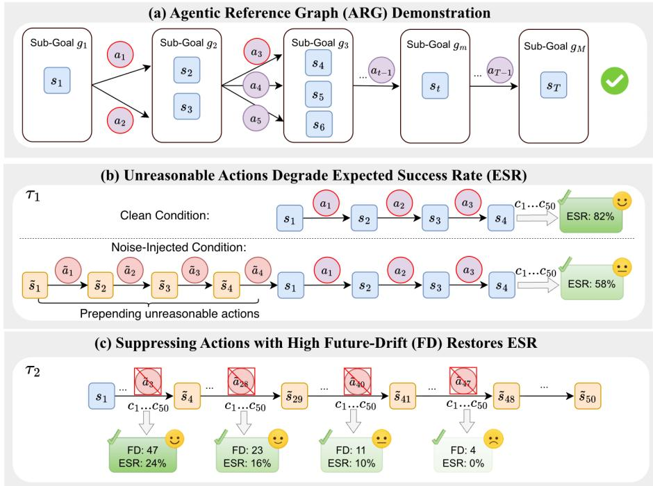  
Figure 1: (a) The demonstration of ARG. Diverse successful trajectories are unified into a DAG that serves as a progress reference. (b) Probing unreasonable actions. From an identical state, the counterpart injected with unreasonable actions yields a lower Expected Success Rate (ESR) on 50 sampled continuations $\{ c _ { i } \} _ { i = 1 } ^ { 5 0 }$ . (c) Suppressing by Future-Drift (FD). Forcibly suppressing the original action at different trajectory points and resampling 50 continuations shows recovered ESR rises with the suppressed action’s FD.

Credit Assignment of GRPO. As shown in Eq. 4, the per-step gradient is directly scaled by the credit multiplier $\mathbf { 1 } _ { i , t } ^ { \mathrm { c l i p } } \cdot A _ { i } \cdot \boldsymbol { \rho } _ { i , t } ( \theta )$ . Under the on-policy setting (where $\rho _ { i , t } ( \theta ) \equiv 1$ and thus $\mathbf { 1 } _ { i , t } ^ { \mathrm { c l i p } } \equiv 1 )$ , this multiplier strictly reduces to the trajectory-level advantage $A _ { i }$ . Consequently, all steps within the same trajectory are indiscriminately updated by the identical scalar, regardless of their individual difference. We term this systematic limitation the dilemma of uniform credit assignment.

## 4 METHODOLOGY

Since RL fundamentally optimizes policies by incentivizing or suppressing action likelihoods, tailored credit assignment requires understanding both the intrinsic properties of each step (e.g., reasonableness and progress advancement) and how modulating them dictates the final outcome. To quantify these step-level properties, § 4.1 constructs an Agentic Reference Graph (ARG). Guided by an intervention study probing these modulation effects (§ 4.2), § 4.3 introduces Progress-Aware Advantage Shaping (ProAS), a lightweight framework designed to resolve the uniform credit dilemma via asymmetric advantage shaping.

## 4.1 AGENTIC REFERENCE GRAPH

As illustrated in Fig. 1(a), ARG abstracts the task-solving progression into M ordered sub-goals using pre-collected successful trajectories. Below, we formalize its construction and online evolution, followed by a two-tier annotation scheme to categorize step-level actions.

Construction and Formalization. To ensure reliable action assessment, we enforce strict graph purity by pruning invalid transitions and self-loops (example in Appx. D.3). Furthermore, while sub-goals follow a strict sequence, their internal atomic requirements are often permutation-invariant (example in Appx. D.4). By modeling each sub-goal’s completion as a state equivalence class, we seamlessly unify these diverse execution paths. Formally, the ARG is defined as a Directed Acyclic Graph (DAG) G = (V, E):

Definition 4.1 (Sub-goals as Vertices). The vertex set $\textstyle \mathcal { V } = \bigcup _ { m = 1 } ^ { M } \pmb { g } _ { m }$ comprises M sub-goals in sequential order. Each sub-goal $\pmb { g } _ { m } = \{ s _ { m , 1 } , s _ { m , 2 } , . . . \}$ is an unordered set ofpermutation-invariant, valid states, strictly excluding error-induced states and redundant self-loops.

Definition 4.2 (Actions as Edges). The edge set $\begin{array} { r } { \pmb { \mathcal { E } } \subseteq \bigcup _ { m = 1 } ^ { M - 1 } ( \pmb { \mathbf { g } } _ { m } \times \pmb { \mathcal { A } } _ { m } \times \pmb { \mathbf { g } } _ { m + 1 } ) } \end{array}$ captures deterministic transitions $( s , a , s ^ { \prime } )$ between consecutive sub-goals under admissible actions $a \in \mathcal A _ { m }$

Dynamic Evolution. To capture the diverse spectrum of valid solutions, the ARG evolves dynamically. Upon verifying a novel successful trajectory at the rollout stage of training iteration $k ,$ we extract its new states $( \Delta \mathbf { g } _ { m } )$ and actions $( \Delta \mathcal { E } )$ to update the current graph $\mathcal { G } ^ { ( k ) }$ via strict union:

$$
\begin{array} { r } { \mathbf { g } _ { m } ^ { ( k + 1 ) } = \mathbf { g } _ { m } ^ { ( k ) } \cup \Delta \mathbf { g } _ { m } \quad ( 1 \leq m \leq M ) , \quad \mathrm { a n d } \quad \mathcal { E } ^ { ( k + 1 ) } = \mathcal { E } ^ { ( k ) } \cup \Delta \mathcal { E } } \end{array}\tag{5}
$$

These discrete updates strictly adhere to the purity principles, providing an increasingly comprehensive reference for action attribution over time (a raw-to-merged example is provided in Appx. D.3).

Action Attribution. We evaluate any rollout trajectory $\tau _ { i } = \{ ( s _ { t } , a _ { t } , s _ { t + 1 } ) \} _ { t = 1 } ^ { | \tau _ { i } | }$ generated at iteration k against $\mathcal { G } ^ { ( k ) }$ to formally annotate each step t using two binary criteria:

(1) Reasonableness $( { \bf R e a } _ { t } ) { \mathrm { : } }$ Evaluates if an action forms a valid ARG transition: $\begin{array} { r l } { \operatorname { R e a } _ { t } } & { { } = } \end{array}$ $\mathbb { \tilde { I } } [ ( s _ { t } , a _ { t } , s _ { t + 1 } ) \in \mathcal { E } ^ { ( k ) } ]$ . While it filters explicit errors, it ignores valid but redundant loops.

(2) Progress-Advancement $\mathbf { ( P A } _ { t } ) \colon$ Strictly quantifies task progression. An action is progressadvancing $( \mathrm { P A } _ { t } = 1 )$ if it induces a valid ARG state $s _ { t + 1 } \in \mathcal { V } ^ { ( k ) }$ while avoiding the historical trajectory $S _ { \leq t } = \{ s _ { 1 } , \ldots , s _ { t } \} \colon \mathrm { P A } _ { t } = \mathbb { I } \big [ s _ { t + 1 } \in \mathcal { V } ^ { ( k ) } \setminus \mathcal { S } _ { \leq t } \big ]$

Thus, progress-advancing actions are a strict subset of reasonable ones $( \mathrm { P A } _ { t } = 1 \implies \mathrm { R e a } _ { t } = 1 )$ Conversely, non-advancing actions $( \mathrm { P A } _ { t } = 0 )$ encapsulate both explicit errors and structurally valid but stagnant steps.

## 4.2 ACTION-INTERVENTION ANALYSIS

By leveraging the reasonableness and progress-advancement annotations to assess fine-grained action quality, our pilot study reveals how individual steps dictate outcomes, motivating our solution to the uniform credit assignment dilemma.

Probing Unreasonable Actions. Unreasonable actions hinder task progress by polluting the context history and disrupting subsequent decisions (Laban et al., 2026). Notably, they constitute a substantial proportion of successful GRPO trajectories (41.6% in ALFWorld, 39.6% in WebShop) of Qwen2.5- 1.5B-Instruct, where they are inadvertently reinforced by the uniform credit applied to preferred rollouts. To probe their impact, we select a clean ALFWorld trajectory (details in Appx. D.1) and sample 50 continuations, $\{ \stackrel { \cdot } { c } _ { i } \} _ { i = 1 } ^ { 5 0 }$ , from a fixed state under two context conditions. As illustrated in Fig. 1(b), the clean control retains the original history, whereas the noise-injected condition prepends a four-step unreasonable segment. Despite sharing the identical underlying environment state, this visible context noise degrades the Expected Success Rate (ESR) from 82% to 58%.

Insight 1: Unreasonable actions in the context actively impede the agent from reaching success.

Suppressing Actions with Varying Future-Drift. Conversely, non-advancing (NA) actions are heavily concentrated in failed GRPO trajectories (93.1% in ALFWorld, 76.1% in WebShop), where they are suppressed uniformly. Given the autoregressive nature of LLMs, late-stage NA actions are often inevitable consequences of an already polluted context rather than making the mistake independently. Therefore, uniformly suppressing all actions within a failed trajectory is inherently unfair. To quantify the cascading effect, we define Future-Drift $( \mathcal { D } _ { i , t }$ , short as FD) as the inclusive count of downstream NA actions from step t:

$$
\mathcal { D } _ { i , t } = \sum _ { t ^ { \prime } = t } ^ { | \tau _ { i } | } \left( 1 - \mathrm { P A } _ { i , t ^ { \prime } } \right)\tag{6}
$$

To assess whether actions with higher Future-Drift warrant heavier penalization, we perform a targeted suppression intervention on a failed ALFWorld trajectory generated by Qwen2.5-1.5B-Instruct as shown in Fig. 1(c). By preserving the trajectory prefix up to specific steps, forbidding the original action, and resampling 50 continuations, we measure the recovered ESR. Suppressing the actions with FD values of 47, 23, 11, and 4 yields ESRs of 24%, 16%, 10%, and 0%, respectively (case details in Appx. D.2). In this case, the higher the suppressed action’s Future-Drift, the more likely the agent is to recover and complete the task.

Insight 2: Actions with higher FD should be prioritized for suppression.

## 4.3 PROGRESS-AWARE ADVANTAGE SHAPING

Building upon the empirical insights from § 4.2, we propose the Progress-Aware Advantage Shaping (ProAS) framework, aiming to resolve the uniform credit dilemma by asymmetrically reshaping the trajectory-level advantage $A _ { i }$ into a step-wise, progress-aware signal $\tilde { A } _ { i , t } \mathrm { : }$

$$
\tilde { A } _ { i , t } = \left\{ \begin{array} { l l } { \mathrm { R e a } _ { t } \cdot A _ { i } , } & { \mathrm { i f } \ A _ { i } > 0 , } \\ { \frac { \mathcal { D } _ { i , t } } { \bar { \mathcal { D } } _ { i } + \epsilon } \cdot A _ { i } , } & { \mathrm { i f } \ A _ { i } < 0 \mathrm { ~ a n d } t \in \mathcal { T } , } \\ { A _ { i } , } & { \mathrm { o t h e r w i s e } , } \end{array} \right.\tag{7}
$$

where $\tau$ denotes the steps sharing the uniform advantage, $\begin{array} { r } { \bar { \mathcal { D } } _ { i } = \frac { 1 } { | \mathcal { T } | } \sum _ { t ^ { \prime } \in \mathcal { T } } \mathcal { D } _ { i , t ^ { \prime } } } \end{array}$ is the average Future-Drift, and ϵ ensures numerical stability. This formulation branches into two mechanisms: (1) Masking Unreasonable Incentives (MUI): Aligning with Insight 1, it zeros out the local advantages of invalid actions $( \mathrm { R e a } _ { t } \ = \ 0 )$ in preferred trajectories $( A _ { i } { \bf \bar { \theta } } > 0$ , usually successful) to prevent inadvertent reinforcement. (2) Asymmetric Penalty Redistribution (APR): Reflecting Insight 2, it leverages normalized Future-Drift to assign proportionally heavier penalties to early pivotal actions in unpreferred trajectories $( A _ { i } < 0$ , usually failed), rectifying the unfairness of uniform suppression.

## 5 EXPERIMENTAL SETUP

To empirically validate the proposed ProAS framework, we conduct extensive experiments across complex, long-horizon agentic environments. Our experiments are structured to answer the following core research questions:

RQ1: Performance & Efficiency (§ 6). Can ProAS consistently elevate task success rates and accelerate training convergence across different model scales under different environments?

RQ2: Algorithm Compatibility (§ 6). Does ProAS seamlessly integrate with mainstream groupbased RL baselines (e.g., GRPO, DAPO, GiGPO) as a robust plug-and-play module?

RQ3: Advantage Shaping Design (§ 6.2.1). Are MUI and APR each individually necessary and mutually synergistic, and does ProAS’s Future-Drift-based redistribution outperform a simpler masking heuristic?

RQ4: Robustness to ARG (§ 6.2.2). Does ProAS remain effective when the reference ARG is randomized, incomplete, static (non-evolving), or distilled from a teacher model?

## 5.1 MODELS AND DATA

Models. Our experiments are conducted across two different model scales: Qwen2.5-1.5B-Instruct and Qwen2.5-7B-Instruct (Qwen Team, 2024), which are denoted as 1.5B and 7B for brevity.

Data. We train and validate on ALFWorld (Shridhar et al., 2021) and WebShop (Yao et al., 2023), two classical long-horizon multi-turn agentic environments (details in Appx. C). ALFWorld is a text-based embodied benchmark over six household task categories (Pick, Look, Clean, Heat, Cool, Pick2, details in Table. 5). Our 150-step training comprises 1777/1767/1784 unique executable tasks of seed 0/1/2 for training and 128 for validation. WebShop (Table 6) is an HTML-based online shopping environment, with 2015/2011/2036 tasks of seed 0/1/2 used for training and 128 for validation.

## 5.1.1 EVALUATION METRICS

Performance Metrics. For ALFWorld, we report the average Success Rate (SR) across the entire validation set, alongside the per-category average SR. For WebShop, we report both the overall average SR and the Task Score (TS). TS is a checklist metric on a scale of 0 to 100: it averages the satisfaction of the requested attributes, options, and price constraint, and then scales this score by how well the purchased product matches the requested product type.

Efficiency Metrics. We quantify training efficiency via speedup Spd@ $K = N _ { \mathrm { b a s e }  K } / N _ { \mathrm { P r o A S }  K } .$ which is defined as the ratio of environment interaction steps required by the baseline versus ProAS to first reach a target K of SR. Reflecting task difficulties, we set $K = 7 0 \%$ for ALFWorld and K = 50% for WebShop.

## 5.1.2 IMPLEMENTATION DETAILS

We conduct experiments upon Verl-Agent (Feng et al., 2025), training all models for 150 RL steps. We validate the policy every 10 RL steps and report metrics from the checkpoint achieving the highest SR. Unless otherwise specified, all experiments are conducted across three random seeds (0, 1, and 2), reporting the mean and standard deviation (std). See details in Appx. B.

ARG Initialization. Unless otherwise specified, we initialize the ARG in ALFWorld using its official crowdsourced annotations. Given the strictly sequential nature of tasks in ALFWorld, we formulate each individual step as a distinct sub-goal. For WebShop, the ARG is initialized using its officially annotated sub-goals alongside their corresponding states and actions.

## 5.1.3 BASELINES

We consider baselines of different paradigms: (1) Proprietary models: GPT-5.6-Sol (OpenAI, 2026), the state-of-the-art model from OpenAI. We apply the reasoning effort as high, and evaluate it with ReAct prompting (Yao et al., 2022). (2) Prompting: Qwen2.5-1.5B-Instruct and Qwen2.5-7B-Instruct, the starting point to be trained. (3) Supervised Fine-Tuning (SFT): Tuning the agent by imitating curated turn-level oracle trajectories from the same training tasks as RL baselines (Details in Appx. B.3). (4) RL: the classical actor-crtic algorithm PPO (Schulman et al., 2017); mainstream group-based RL algorithms GRPO (Shao et al., 2024), DAPO (Yu et al., 2025), GiGPO (Feng et al., 2025); the state-of-the-art (SOTA) agentic RL method MiGPO (Wang et al., 2026b) with segment-level credit assignment.

## 6 RESULTS AND ANALYSIS

## 6.1 MAIN RESULTS

Table 1 summarizes the main evaluation results on ALFWorld and WebShop. We structure our analysis to directly address our research questions regarding performance, efficiency (RQ1), and algorithm compatibility (RQ2).

Baseline Comparisons. We first contrast ProAS against established learning paradigms. Although ProAS leverages annotated prior knowledge for ARG initialization, it significantly outperforms SFT, a direct strategy for utilizing such annotations. Specifically, GiGPO+ProAS surpasses SFT by 12.2 points on the 1.5B ALFWorld benchmark, demonstrating the superiority of active exploration over passive behavior cloning. Furthermore, PPO, a traditional RL algorithm featuring fine-grained credit assignment, exhibits massive variance across different random seeds in long-horizon settings, yielding a highly fluctuating $3 6 . 5 \% \pm 2 8 . 7 \%$ SR on 1.5B ALFWorld. This instability likely stems from the high sensitivity of critic training to variations in the training data. In contrast, other critic-free methods, such as GRPO, DAPO, and GiGPO, maintain controllable variance while simultaneously achieving superior performance.

State-of-the-Art Performance. Equipped with ProAS, group-based RL algorithms consistently establish new SOTA records. In ALFWorld, GiGPO+ProAS attains the highest SR of 94.3% on the 7B model. This surpasses the strong segment-level baseline MiGPO and eclipses the proprietary GPT-5.6-Sol by a massive 15.4 points. WebShop presents a notably steeper challenge, evidenced by GPT-5.6-Sol’s severe struggle at 21.9% SR. Despite this difficulty, ProAS variants dominate the leaderboard. On the 1.5B model, both DAPO and GiGPO integrated with ProAS tie for the best SR at 66.7%, outperforming MiGPO by a striking 13.1 points. On the 7B scale, GRPO+ProAS peaks at 70.8%, further extending the lead over MiGPO.

Table 1: Main results on ALFWorld and WebShop. ALFWorld reports success rates (%) for six task types and all tasks; WebShop reports task score and success rate (%). Boldface indicates that the ProAS framework improves over its corresponding base RL algorithm, while a superscript ∗ marks the best value within the corresponding model-size block.
<table><tr><td rowspan="2">Method</td><td colspan="8">ALFWorld</td><td colspan="3">WebShop</td></tr><tr><td>Pick</td><td>Look</td><td>Clean</td><td>Heat</td><td>Cool</td><td>Pick2</td><td>ALL</td><td> $\operatorname { S p d . } @ 7 0$ </td><td>TS</td><td>SR</td><td>Spd.@50</td></tr><tr><td>Proprietary Model GPT-5.6-Sol (ReAct)</td><td>90.9</td><td>83.3</td><td>68.0</td><td>83.3</td><td>79.2</td><td>68.2</td><td>78.9</td><td></td><td>27.6</td><td>21.9</td><td></td></tr><tr><td>Qwen2.5-1.5B-Instruct</td><td></td><td></td><td></td><td></td><td></td><td></td><td></td><td></td><td></td><td></td><td></td></tr><tr><td>Direct Prompt</td><td> $2 4 . 2 _ { \pm 0 . 0 }$ </td><td> $2 5 . 0 { \scriptstyle \pm 0 . 0 }$ </td><td> $4 . 0 { \scriptstyle \pm 0 . 0 }$ </td><td> $8 . 3 _ { \pm 0 . 0 }$ </td><td> $0 . 0 { \scriptstyle \pm 0 . 0 }$ </td><td> $4 . 5 _ { \pm 0 . 0 }$ </td><td> $1 0 . 9 _ { \pm 0 . 0 }$ </td><td></td><td> $2 5 . 3 _ { \pm 0 . 0 }$ </td><td> $4 . 7 _ { \pm 0 . 0 }$ </td><td></td></tr><tr><td>SFT</td><td> $9 9 . 0 { \scriptstyle \pm 1 . 4 } ^ { * }$ </td><td> $9 1 . 7 \pm 6 . 8$ </td><td> $9 4 . 7 \pm 1 . 9$ </td><td> $1 0 0 . 0 { \scriptstyle \pm 0 . 0 } ^ { * }$ </td><td> $9 3 . 1 _ { \pm 1 . 9 } ^ { }$ </td><td> $1 . 5 { \scriptstyle \pm 2 . 1 }$ </td><td> $7 9 . 7 _ { \pm 0 . 7 }$ </td><td></td><td> $7 8 . 2 \pm 1 . 4$ </td><td> $6 4 . 3 _ { \pm 2 . 4 }$ </td><td></td></tr><tr><td>PPO</td><td> $5 1 . 5 { \scriptstyle \pm 2 6 . 4 }$ </td><td> $3 3 . 3 _ { \pm 2 2 . 0 }$ </td><td> $3 3 . 3 _ { \pm 3 8 . 9 }$ </td><td> $3 6 . 1 _ { \pm 3 3 . 7 }$ </td><td> $3 3 . 3 _ { \pm 3 3 . 1 }$ </td><td> $2 2 . 7 _ { \pm 1 9 . 8 }$ </td><td> $3 6 . 5 _ { \pm 2 8 . 7 }$ </td><td></td><td> $5 7 . 5 _ { \pm 1 1 . 5 }$ </td><td> $2 8 . 1 \pm 1 7 . 4$ </td><td></td></tr><tr><td>MiGPO</td><td> $9 7 . 0 _ { \pm 3 . 0 }$ </td><td> $9 1 . 7 _ { \pm 0 . 0 }$ </td><td> $^ { 9 8 . 7 \pm 2 . 3 ^ { ^ { * } } }$ </td><td> $1 0 0 . 0 { \scriptstyle \pm 0 . 0 } ^ { * }$ </td><td> $8 4 . 7 _ { \pm 6 . 4 }$ </td><td> $7 5 . 8 _ { \pm 2 . 6 }$ </td><td> $9 1 . 1 _ { \pm 1 . 6 }$ </td><td></td><td> $7 9 . 5 { \scriptstyle \pm 1 . 2 }$ </td><td> $5 3 . 6 _ { \pm 1 . 8 }$ </td><td></td></tr><tr><td>GRPO</td><td> $8 0 . 8 _ { \pm 4 . 6 }$ </td><td> $6 9 . 4 _ { \pm 4 . 8 }$ </td><td> $7 0 . 7 _ { \pm 6 . 1 }$ </td><td> $7 5 . 0 _ { \pm 8 . 3 }$ </td><td> $6 3 . 9 _ { \pm 9 . 6 }$ </td><td> $5 9 . 1 _ { \pm 9 . 1 }$ </td><td> $7 0 . 3 _ { \pm 2 . 8 }$ </td><td></td><td> $8 2 . 4 _ { \pm 1 . 3 }$ </td><td> $5 7 . 0 _ { \pm 3 . 1 }$ </td><td></td></tr><tr><td>GRPO+ProAS</td><td> ${ \bf 9 0 . 9 _ { \pm 5 . 2 } }$ </td><td> ${ \bf 8 6 . 1 _ { \pm 4 . 8 } }$ </td><td> ${ \bf 9 0 . 7 } _ { \pm 2 . 3 }$ </td><td> ${ \bf 9 1 . 7 \_ 8 . 3 }$ </td><td> ${ \bf 8 3 . 3 _ { \pm 4 . 2 } }$ </td><td> $7 8 . 8 _ { \pm 5 . 2 }$ </td><td> ${ \bf 8 7 . 0 _ { \pm 2 . 3 } }$ </td><td> $1 . 5 9 \times$ </td><td> $\mathbf { 8 5 . 3 } _ { \pm 2 . 4 } ^ { - }$ </td><td> ${ \bf 6 4 . 6 _ { \pm 1 . 2 } }$ </td><td> $1 . 7 9 \times ^ { * }$ </td></tr><tr><td>DAPO</td><td> $8 9 . 9 _ { \pm 1 . 7 }$ </td><td> $8 3 . 3 _ { \pm 0 . 0 }$ </td><td> $8 9 . 3 _ { \pm 1 2 . 2 }$ </td><td> $8 8 . 9 { \scriptstyle \pm 4 . 8 }$ </td><td> $7 5 . 0 { \scriptstyle \pm 8 . 3 }$ </td><td> $6 6 . 7 \pm 2 . 6$ </td><td> $8 2 . 3 _ { \pm 5 . 0 }$ </td><td></td><td> $7 9 . 2 _ { \pm 2 . 5 }$ </td><td> $5 7 . 3 _ { \pm 4 . 6 }$ </td><td></td></tr><tr><td>DAPO+ProAS</td><td> ${ \bf 9 3 . 9 } _ { \pm 3 . 0 }$ </td><td> ${ \bf 8 6 . 1 \pm 9 . 6 }$ </td><td> $8 4 . 0 _ { \pm 6 . 9 }$ </td><td> ${ \bf 9 4 . 4 _ { \pm 4 . 8 } }$ </td><td> ${ \bf 8 3 . 3 _ { \pm 4 . 2 } }$ </td><td> $7 7 . 3 _ { \pm 4 . 5 }$ </td><td> ${ \bf 8 6 . 5 _ { \pm 1 . 2 } }$ </td><td> $1 . 2 7 \times$ </td><td> ${ \bf 8 7 . 2 \pm 0 . 7 }$ </td><td> ${ \bf 6 6 . 7 \pm 1 . 2 } ^ { * }$ </td><td>1.61×</td></tr><tr><td>GiGPO</td><td> $9 1 . 9 { \scriptstyle \pm 1 . 7 }$ </td><td> $8 3 . 3 _ { \pm 0 . 0 }$ </td><td> $9 4 . 7 _ { \pm 4 . 6 }$ </td><td> $9 4 . 4 _ { \pm 4 . 8 }$ </td><td> $8 4 . 7 _ { \pm 2 . 4 }$ </td><td> $8 9 . 4 _ { \pm 2 . 6 } ^ { * }$ </td><td> $9 0 . 1 _ { \pm 0 . 5 }$ </td><td></td><td> $8 3 . 9 _ { \pm 0 . 4 }$ </td><td> $6 4 . 3 _ { \pm 3 . 9 . }$ </td><td></td></tr><tr><td>GiGPO+ProAS</td><td> ${ \bf 9 4 . 9 _ { \pm 1 . 7 } }$ </td><td> ${ \bf 9 4 . 4 _ { \pm 4 . 8 } } ^ { }$ </td><td> $9 3 . 3 _ { \pm 2 . 3 }$ </td><td> ${ \bf 9 7 . 2 _ { \pm 4 . 8 } }$  一</td><td> $\mathbf { 8 8 . 9 _ { \pm 2 . 4 } }$ </td><td> $8 4 . 8 _ { \pm 2 . 6 }$ </td><td> $\mathbf { 9 1 . 9 _ { \pm 0 . 5 } } ^ { \ast }$ </td><td> $1 . 6 1 \times ^ { * }$ </td><td> $\mathbf { 8 7 . 5 _ { \pm 1 . 7 } } ^ { \ast }$ </td><td> ${ \bf 6 6 . 7 _ { \pm 3 . 2 } } ^ { * }$ </td><td>1.12×</td></tr><tr><td colspan="10">Qwen2.5-7B-Instruct</td><td></td><td></td></tr><tr><td>Direct Prompt</td><td></td><td></td><td> $1 3 . 3 { \scriptstyle \pm 5 . 0 }$ </td><td> $5 . 5 { \scriptstyle \pm 3 . 9 }$ </td><td> $9 . 7 \pm 2 . 0$ </td><td> $3 . 0 _ { \pm 4 . 3 }$ </td><td></td><td></td><td></td><td> $0 . 5 _ { \pm 0 . 4 }$ </td><td></td></tr><tr><td>SFT</td><td> $3 5 . 3 _ { \pm 2 . 9 }$   $1 0 0 . 0 { \scriptstyle \pm 0 . 0 } ^ { * }$ </td><td> $3 3 . 3 { \scriptstyle \pm 6 . 8 }$ </td><td> $9 6 . 0 { \scriptstyle \pm 3 . 3 }$ </td><td> $1 0 0 . 0 { \scriptstyle \pm 0 . 0 } ^ { * }$ </td><td> $9 3 . 1 _ { \pm 1 . 9 } ^ { }$ </td><td></td><td> $1 7 . 7 _ { \pm 0 . 8 }$   $8 0 . 0 { \scriptstyle \pm 0 . 4 }$ </td><td></td><td> $3 . 4 _ { \pm 1 . 1 }$   $8 1 . 9 { \scriptstyle \pm 0 . 5 }$ </td><td></td><td></td></tr><tr><td>PPO</td><td> $8 7 . 9 _ { \pm 6 . 1 }$ </td><td> $8 8 . 9 { \scriptstyle \pm 4 . 0 }$   $7 5 . 0 _ { \pm 1 6 . 7 }$ </td><td> $5 6 . 0 _ { \pm 1 3 . 9 }$ </td><td> $4 7 . 2 _ { \pm 1 2 . 7 }$ </td><td> $3 7 . 5 _ { \pm 1 9 . 1 }$ </td><td> $1 . 5 { \scriptstyle \pm 2 . 1 }$ </td><td></td><td></td><td> $7 5 . 1 \pm 7 . 3$ </td><td> $7 0 . 0 { \scriptstyle \pm 0 . 8 }$ </td><td></td></tr><tr><td>MiGPO</td><td> $1 0 0 . 0 { \scriptstyle \pm 0 . 0 } ^ { * }$ </td><td> $9 4 . 4 { \pm } 4 . 8$ </td><td> $9 6 . 0 { \scriptstyle \pm 4 . 0 }$ </td><td> $8 0 . 6 { \scriptstyle \pm 4 . 8 }$ </td><td> $8 4 . 7 _ { \pm 2 . 4 }$ </td><td> $5 1 . 5 _ { \pm 1 1 . 4 }$   $8 7 . 9 _ { \pm 2 . 6 }$ </td><td> $6 0 . 9 _ { \pm 1 1 . 7 }$   $9 1 . 9 _ { \pm 1 . 2 }$ </td><td></td><td> $8 8 . 0 { \scriptstyle \pm 2 . 2 }$ </td><td> $4 4 . 3 _ { \pm 1 0 . 2 }$   $6 7 . 2 _ { \pm 3 . 1 }$ </td><td></td></tr><tr><td>GRPO</td><td> $9 0 . 9 { \scriptstyle \pm 0 . 0 }$ </td><td> $7 2 . 2 { \scriptstyle \pm 9 . 6 }$ </td><td> $9 2 . 0 _ { \pm 6 . 9 }$ </td><td> $7 7 . 8 _ { \pm 1 7 . 3 }$ </td><td> $7 6 . 4 _ { \pm 4 . 8 }$ </td><td> $6 3 . 6 _ { \pm 4 . 5 }$ </td><td> $8 0 . 7 _ { \pm 3 . 9 }$ </td><td></td><td> $8 5 . 6 _ { \pm 5 . 2 }$ </td><td> $6 7 . 7 _ { \pm 5 . 5 }$ </td><td></td></tr><tr><td>GRPO+ProAS</td><td> ${ \bf 9 7 . 0 _ { \pm 3 . 0 } }$ </td><td> ${ \bf 9 1 . 7 \pm 8 . 3 }$ </td><td> ${ \bf 9 4 . 7 \pm } 2 . 3$ </td><td> ${ \bf 8 6 . 1 \pm 4 . 8 }$ </td><td> $7 7 . 8 _ { \pm 2 . 4 }$ </td><td> ${ \bf 8 3 . 3 \pm 6 . 9 }$  </td><td> ${ \bf 8 9 . 1 } _ { \pm 2 . 3 }$ </td><td>2.20×</td><td> ${ \bf 8 9 . 0 _ { \pm 0 . 6 } }$  </td><td> ${ \bf 7 0 . 8 _ { \pm 0 . 9 } } ^ { \ast }$  *</td><td> $1 . 9 1 \times ^ { * }$ </td></tr><tr><td>DAPO</td><td> $9 7 . 0 _ { \pm 3 . 0 }$ </td><td> $8 3 . 3 _ { \pm 1 4 . 4 }$ </td><td> $9 6 . 0 { \scriptstyle \pm 4 . 0 }$ </td><td> $8 8 . 9 { \scriptstyle \pm 9 . 6 }$ </td><td> $7 6 . 4 _ { \pm 6 . 4 }$ </td><td> $8 4 . 8 _ { \pm 6 . 9 }$ </td><td> $8 8 . 8 _ { \pm 5 . 2 }$ </td><td></td><td> $8 7 . 1 \pm 3 . 6$ </td><td> $6 8 . 8 _ { \pm 4 . 7 }$ </td><td></td></tr><tr><td>DAPO+ProAS</td><td> $9 7 . 0 _ { \pm 3 . 0 }$ </td><td> ${ \bf 8 6 . 1 \pm 1 2 . 7 }$ </td><td> ${ \bf 9 7 . 3 _ { \pm 4 . 6 } }$ </td><td> $8 8 . 9 { \scriptstyle \pm 9 . 6 }$  </td><td> ${ \bf 8 3 . 3 \pm 8 . 3 }$ </td><td> $7 8 . 8 { \scriptstyle \pm 5 . 2 }$ </td><td> ${ \bf 8 9 . 6 } _ { \pm 2 . 0 }$ </td><td> $2 . 0 5 \times$ </td><td> ${ \bf 8 8 . 2 \pm } 2 . 8$ </td><td> ${ \bf 7 0 . 6 _ { \pm 0 . 9 } }$ </td><td>1.62×</td></tr><tr><td>GiGPO</td><td> $9 7 . 0 _ { \pm 3 . 0 }$ </td><td> $1 0 0 . 0 { \scriptstyle \pm 0 . 0 } ^ { * }$ </td><td> $9 7 . 3 _ { \pm 2 . 3 }$ </td><td> $9 7 . 2 { \scriptstyle \pm 4 . 8 }$ </td><td> $8 7 . 5 _ { \pm 0 . 0 }$ </td><td> $^ { 8 6 . 4 } \pm 9 . 1$ </td><td> $9 3 . 8 _ { \pm 2 . 1 }$ </td><td></td><td> $^ { 8 8 . 3 } \pm 1 . 8 $ </td><td> $7 0 . 3 { \scriptstyle \pm 1 . 6 }$ </td><td></td></tr><tr><td>GiGPO+ProAS</td><td> ${ \bf 9 9 . 0 _ { \pm 1 . 7 } }$ </td><td> $8 8 . 9 { \scriptstyle \pm 4 . 8 }$ </td><td> $\mathbf { 9 8 . 7 \_ 2 . 3 } ^ { \ast }$ </td><td> $9 7 . 2 { \scriptstyle \pm 4 . 8 }$ </td><td> $^ { 8 6 . 1 \pm 1 0 . 5 }$ </td><td> $\pm 2 . 4 _ { \pm 2 . 6 } ^ { }$  </td><td> $\mathbf { 9 4 . 3 _ { \pm 2 . 4 } } ^ { * }$ </td><td> $2 . 4 4 \times ^ { * }$ </td><td> $\mathbf { 8 9 . 1 } _ { \pm 2 . 7 }$ </td><td> $7 0 . 1 \pm 2 . 3$ </td><td>1.58×</td></tr></table>

Algorithm Compatibility. Crucially, ProAS demonstrates remarkable plug-and-play compatibility, universally uplifting baseline RL algorithms across all tested configurations. For ALFWorld, equipping GRPO with ProAS yields the most dramatic improvements, boosting the SR by 16.7 points on the 1.5B model and 8.4 points on the 7B model. Consistent gains are mirrored in WebShop, where DAPO+ProAS generates a 9.4-point uplift at the 1.5B scale, and GRPO+ProAS provides a 3.1-point boost at 7B. This confirms ProAS as a versatile enhancer that elevates both the performance floor and ceiling of diverse group-based RL paradigms.

Training Efficiency. Beyond asymptotic performance, ProAS significantly accelerates the training process. On average, it speeds up convergence to target success rates by approximately 1.5× for the 1.5B model across both environments. Impressively, this efficiency gain scales favorably with model size: on the 7B model, ProAS accelerates learning by an average of $2 . 2 \times$ on ALFWorld and 1.7× on WebShop.

## 6.2 ABLATION STUDY

We ablate the core components of ProAS on the 1.5B model using GRPO as the base algorithm. § 6.2.1 ablates our advantage shaping mechanisms, demonstrating that disabling any single technique strictly degrades performance and disrupts their synergy. Subsequently, § 6.2.2 relaxes the ARG construction constraints to investigate ProAS’s robustness against reference quality and origin, while highlighting the critical necessity of the online dynamic evolution mechanism.

## 6.2.1 ADVANTAGE SHAPING ABLATION

To isolate the contributions of our specific advantage shaping interventions, we evaluate three ProAS variants: ProAS , ProAS , and $\mathrm { P r o A S } _ { \mathrm { m s k \pm } }$ , as shown in Table 2(a).

Table 2: Ablation study with Qwen2.5-1.5B-Instruct. ALFWorld reports success rates (SR, %) for six task types and all tasks; WebShop reports task score (TS, %) and success rate (SR, %). Training results are the mean and sample standard deviation over three seeds. Values higher than the GRPO baseline are shown in bold; a superscript ∗ marks the best mean in each column.
<table><tr><td rowspan="2">Method</td><td colspan="7">ALFWorld</td><td colspan="2">WebShop</td></tr><tr><td>Pick</td><td>Look</td><td>Clean</td><td>Heat</td><td>Cool</td><td>Pick2</td><td>ALL</td><td>TS</td><td>SR</td></tr><tr><td>GRPO</td><td> $8 0 . 8 { \scriptstyle \pm 4 . 6 }$ </td><td> $6 9 . 4 { \pm } 4 . 8$ </td><td> $7 0 . 7 \pm 6 . 1$ </td><td> $7 5 . 0 { \scriptstyle \pm 8 . 3 }$ </td><td> $6 3 . 9 { \scriptstyle \pm 9 . 6 }$ </td><td> $5 9 . 1 { \scriptstyle \pm 9 . 1 }$ </td><td> $7 0 . 3 { \scriptstyle \pm 2 . 8 }$ </td><td> $8 2 . 4 \pm 1 . 3 $ </td><td> $5 7 . 0 { \scriptstyle \pm 3 . 1 }$ </td></tr><tr><td> $\mathrm { G R P O } + \mathrm { P r o A S }$  </td><td> $\mathbf { 9 0 . 9 _ { \pm 5 . 2 } } ^ { \circ }$ </td><td> $\mathbf { 8 6 . 1 \_ 4 . 8 } ^ { \ast }$ </td><td> ${ \bf 9 0 . 7 \pm } 2 . 3$ </td><td> $\mathbf { 9 1 . 7 _ { \pm 8 . 3 } } ^ { \ast }$ </td><td> ${ \bf 8 3 . 3 _ { \pm 4 . 2 } } ^ { \ast }$ </td><td> $7 8 . 8 _ { \pm 5 . 2 }$ </td><td> $\mathbf { 8 7 . 0 _ { \pm 2 . 3 } } ^ { \ast }$ </td><td> $\mathbf { 8 5 . 3 _ { \pm 2 . 4 } } ^ { \ast }$ </td><td> ${ \bf 6 4 . 6 _ { \pm 1 . 2 } }$ </td></tr><tr><td colspan="10">(a) Advantage Shaping Ablation</td></tr><tr><td> $\mathrm { G R P O } + \mathrm { P r o A S } _ { - }$ </td><td> ${ \bf 8 3 . 8 _ { \pm 9 . 7 } }$ </td><td> $5 2 . 8 _ { \pm 1 9 . 2 }$ </td><td> $7 8 . 7 \pm { \bf 8 . 3 }$ </td><td> ${ 7 7 . 8 \pm 9 . 6 }$ </td><td> $6 3 . 9 _ { \pm 1 9 . 2 }$ </td><td> ${ \bf 6 0 . 6 _ { \pm 5 . 2 } }$ </td><td> ${ \bf 7 1 . 6 _ { \pm 1 0 . 4 } }$ </td><td> ${ \bf 8 3 . 6 _ { \pm 0 . 5 } }$ </td><td> ${ \bf 6 3 . 3 \pm 7 . 7 }$ </td></tr><tr><td> $\mathrm { G R P O } + \mathrm { P r o A S } _ { + }$ </td><td> ${ \bf 8 6 . 9 \pm 1 . 7 }$ </td><td> ${ \bf 8 3 . 3 \pm 8 . 3 }$ </td><td> ${ \bf 8 5 . 3 _ { \pm 6 . 1 } }$ </td><td> ${ \bf 8 8 . 9 _ { \pm 1 2 . 7 } }$ </td><td> $7 6 . 4 \pm 2 . 4$ </td><td> ${ \bf 8 0 . 3 } _ { \pm 2 . 6 }$ </td><td> ${ \bf 8 3 . 3 _ { \pm 1 . 8 } }$ </td><td> ${ \bf 8 4 . 1 } _ { \pm 2 . 1 }$ </td><td> ${ \bf 6 4 . 6 _ { \pm 1 . 8 } }$ </td></tr><tr><td> $\mathrm { G R P O } + \mathrm { P r o A S } _ { \mathrm { m s k } \pm }$ </td><td> $8 0 . 8 _ { \pm 4 . 6 }$ </td><td> $7 2 . 2 _ { \pm 4 . 8 }$ </td><td> ${ \bf 7 4 . 7 \pm 1 2 . 2 }$ </td><td> ${ \bf 8 3 . 3 \pm 8 . 3 }$ </td><td> ${ 7 0 . 8 \pm 4 . 2 }$ </td><td> $5 6 . 1 \pm 2 . 6$ </td><td> $7 2 . 9 _ { \pm 2 . 4 }$ </td><td> ${ \bf 8 3 . 5 } _ { \pm 2 . 0 }$ </td><td> ${ \bf 6 3 . 8 } _ { \pm 2 . 5 }$ </td></tr><tr><td colspan="10">(b) ARG Ablation</td></tr><tr><td>Random</td><td> $6 7 . 7 \pm 7 . 0$ </td><td> $3 8 . 9 { \scriptstyle \pm 9 . 6 }$ </td><td> $^ { 5 6 . 0 } \pm 1 0 . 6 $ </td><td> $4 4 . 4 _ { \pm 4 . 8 }$ </td><td> $3 4 . 7 _ { \pm 1 9 . 7 }$ </td><td> $2 8 . 8 { \scriptstyle \pm 6 . 9 }$ </td><td> $4 7 . 7 _ { \pm 4 . 8 }$ </td><td> $7 8 . 6 { \scriptstyle \pm 2 . 1 }$ </td><td> $4 9 . 2 _ { \pm 3 . 6 }$ </td></tr><tr><td>Static</td><td> ${ \bf 8 7 . 9 _ { \pm 6 . 1 } }$ </td><td> ${ \bf 8 3 . 3 _ { \pm 0 . 0 } }$ </td><td> $\mathbf { 9 4 . 7 _ { \pm 2 . 3 } } ^ { \ast }$ </td><td> ${ \bf 8 6 . 1 _ { \pm 4 . 8 } }$ </td><td> ${ 7 0 . 8 \pm 7 . 2 }$ </td><td> $7 2 . 7 _ { \pm 4 . 5 }$ </td><td> $\mathbf { 8 2 . 8 _ { \pm 2 . 8 } }$ </td><td> ${ \bf 8 5 . 2 _ { \pm 1 . 7 } }$ </td><td> ${ \bf 6 5 . 9 } _ { \pm 2 . 7 }$ </td></tr><tr><td>Incomplete</td><td> ${ \bf 8 5 . 9 _ { \pm 1 . 7 } }$ </td><td> ${ \bf 7 5 . 0 _ { \pm 8 . 3 } }$ </td><td> $7 7 . 3 _ { \pm 4 . 6 }$ </td><td> $7 7 . 8 _ { \pm 4 . 8 }$ </td><td> $7 6 . 4 \pm 2 . 4$ </td><td> ${ \bf 6 6 . 7 \pm 1 0 . 5 }$ </td><td> $7 7 . 3 { \scriptstyle \pm 2 . 1 }$ </td><td> ${ \bf 8 5 . 0 } _ { \pm 2 . 4 }$ </td><td> ${ \bf 6 3 . 0 _ { \pm 3 . 2 } }$ </td></tr><tr><td>Incomplete &amp; Static</td><td> ${ \bf 8 2 . 8 _ { \pm 7 . 6 } }$ </td><td> ${ \bf 7 5 . 0 _ { \pm 8 . 3 } }$ </td><td> ${ \bf 7 6 . 0 _ { \pm 4 . 0 } }$ </td><td> $7 7 . 8 _ { \pm 4 . 8 }$ </td><td> $6 2 . 5 _ { \pm 1 2 . 5 }$ </td><td> $5 7 . 6 _ { \pm 6 . 9 }$ </td><td> ${ 7 2 . 1 \pm 5 . 2 }$ </td><td> $8 2 . 3 _ { \pm 1 . 4 }$ </td><td> ${ \bar { \bf 5 } } 7 . 6 _ { \pm 2 . 4 }$ </td></tr><tr><td>Distill</td><td> ${ \bf 8 5 . 9 \mathrm { _ { \pm 9 . 3 } } }$ </td><td> ${ \bf 8 0 . 5 \pm 4 . 8 }$ </td><td> $\mathbf { 8 9 . 3 } _ { \pm 2 . 3 }$ </td><td> ${ \bf 8 8 . 9 \pm 4 . 8 }$ </td><td> ${ \bf 8 0 . 5 \pm 8 . 7 }$ </td><td> $7 5 . 7 _ { \pm 2 . 6 }$ </td><td> ${ \bf 8 3 . 6 _ { \pm 0 . 8 } }$ </td><td> ${ \bf 8 4 . 8 _ { \pm 1 . 0 } }$ </td><td> ${ \bf 6 4 . 8 _ { \pm 1 . 4 } }$ </td></tr></table>

First, we ablate individual components: ProAS− disables MUI on preferred trajectories $( A _ { i } > 0 )$ incurring Success Rate (SR) drops of 15.4 and 1.3 points on ALFWorld and WebShop, respectively; $\mathrm { P r o A S } _ { + }$ disables APR on unpreferred ones $( A _ { i } < 0 )$ , causing a 3.7-point SR drop on ALFWorld and a 1.2-point Task Score (TS) drop on WebShop. Their suboptimality confirms that Both MUI and APR are indispensable and act synergistically.

Second, we test an simpler heuristic. Pro $\backslash \mathbf { S } _ { \mathrm { m s k \pm } }$ preserves MUI but replaces APR by naively masking non-advancing actions when $A _ { i } < 0$ . Compared with GRPO+ProAS, it underperforms GRPO+ProAS by 14.1 points SR on ALFWorld and 0.8 points SR on WebShop. This confirms the benefit of APR’s Future-Drift weighting over simplistic masking.

Notably, all three variants still outperform native GRPO on the aggregate metrics, highlighting the fundamental necessity of leveraging progress signals to resolve the uniform credit assignment dilemma.

## 6.2.2 ARG ABLATION

Random replaces ARG-derived annotations with random labels instead of matching against the graph. This causes a catastrophic collapse, dropping SR by 39.3 points on ALFWorld and 15.4 points on WebShop relative to ProAS (Table 2(b)). This confirms that clean, ARG-derived annotations are indispensable for accurate credit assignment.

Incomplete randomly prunes 40% of the action-state pairs from the clean ARG to simulate severe degradation. Despite this, ProAS still outperforms GRPO by 7.0 points on ALFWorld. This robustness largely comes from ARG evolution (mentioned in Eq. 5): disabling it (Incomplete&Static) further drops SR by 5.2 points on ALFWorld and 5.4 points on WebShop relative to Incomplete alone. Evolution matters even with a clean ARG, where disabling it (Static) lowers ALFWorld SR from 87.0% (GRPO+ProAS) to 82.8%, though Static still attains the best WebShop SR (65.9%) among all variants. These results confirm the importance of ARG evolution for ProAS, while showing ProAS remains robust to imperfect ARGs.

Distill tests ProAS with synthetic references, since gold-standard trajectories are often unavailable in practice. We prompt a 7B model to generate successful rollouts across training tasks, building a distilled ARG covering 2,566 tasks. With this synthetic ARG, the 1.5B model reaches 83.6% SR on ALFWorld and 64.8% on WebShop, comparable to GRPO+ProAS and 13.3 and 7.8 points above GRPO, respectively. This validates ProAS’s applicability even on teacher-distilled trajectories.

## 7 CONCLUSION

In this work, we expose the uniform credit assignment dilemma in critic-free agentic RL, where uniform advantages reinforce contextual noise in preferred trajectories $( A _ { i } \ > \ 0 )$ and ignore the cascading influence of actions in unpreferred ones $( A _ { i } < 0 )$ . To address this without critic overhead, we proposed Progress-Aware Advantage Shaping (ProAS), which leverages a dynamically evolving Agentic Reference Graph (ARG) to achieve fine-grained credit assignment via Masking Unreasonable Incentives (MUI) and Asymmetric Penalty Redistribution (APR). Extensive evaluations across multiple model scales and environments confirm ProAS as a robust, universal enhancer that accelerates convergence and propels mainstream baselines to new state-of-the-art performance. The ablation study further confirms MUI-APR synergy, necessity of ARG evolution and robustness under incomplete or distilled ARGs. Together, these results establish a highly efficient, scalable pathway for elevating autonomous language agents.

## REFERENCES

Victor Barres, Honghua Dong, Soham Ray, Xujie Si, and Karthik Narasimhan. τ2-bench: Evaluating conversational agents in a dual-control environment, 2025. URL https://arxiv.org/abs/2506. 07982.

DeepSeek-AI. Deepseek-v4: Towards highly efficient million-token context intelligence, 2026.

Bowen Ding, Yuhan Chen, Futing Wang, Lingfeng Ming, and Tao Lin. Do thinking tokens help or trap? towards more efficient large reasoning model, 2025. URL https://arxiv.org/abs/2506. 23840.

Lang Feng, Zhenghai Xue, Tingcong Liu, and Bo An. Group-in-group policy optimization for llm agent training. arXiv preprint arXiv:2505.10978, 2025.

GLM-5-Team, :, Aohan Zeng, Xin Lv, Zhenyu Hou, Zhengxiao Du, Qinkai Zheng, Bin Chen, Da Yin, Chendi Ge, Chenghua Huang, Chengxing Xie, Chenzheng Zhu, Congfeng Yin, Cunxiang Wang, Gengzheng Pan, Hao Zeng, Haoke Zhang, Haoran Wang, Huilong Chen, Jiajie Zhang, Jian Jiao, Jiaqi Guo, Jingsen Wang, Jingzhao Du, Jinzhu Wu, Kedong Wang, Lei Li, Lin Fan, Lucen Zhong, Mingdao Liu, Mingming Zhao, Pengfan Du, Qian Dong, Rui Lu, Shuang-Li, Shulin Cao, Song Liu, Ting Jiang, Xiaodong Chen, Xiaohan Zhang, Xuancheng Huang, Xuezhen Dong, Yabo Xu, Yao Wei, Yifan An, Yilin Niu, Yitong Zhu, Yuanhao Wen, Yukuo Cen, Yushi Bai, Zhongpei Qiao, Zihan Wang, Zikang Wang, Zilin Zhu, Ziqiang Liu, Zixuan Li, Bojie Wang, Bosi Wen, Can Huang, Changpeng Cai, Chao Yu, Chen Li, Chengwei Hu, Chenhui Zhang, Dan Zhang, Daoyan Lin, Dayong Yang, Di Wang, Ding Ai, Erle Zhu, Fangzhou Yi, Feiyu Chen, Guohong Wen, Hailong Sun, Haisha Zhao, Haiyi Hu, Hanchen Zhang, Hanrui Liu, Hanyu Zhang, Hao Peng, Hao Tai, Haobo Zhang, He Liu, Hongwei Wang, Hongxi Yan, Hongyu Ge, Huan Liu, Huanpeng Chu, Jia’ni Zhao, Jiachen Wang, Jiajing Zhao, Jiamin Ren, Jiapeng Wang, Jiaxin Zhang, Jiayi Gui, Jiayue Zhao, Jijie Li, Jing An, Jing Li, Jingwei Yuan, Jinhua Du, Jinxin Liu, Junkai Zhi, Junwen Duan, Kaiyue Zhou, Kangjian Wei, Ke Wang, Keyun Luo, Laiqiang Zhang, Leigang Sha, Liang Xu, Lindong Wu, Lintao Ding, Lu Chen, Minghao Li, Nianyi Lin, Pan Ta, Qiang Zou, Rongjun Song, Ruiqi Yang, Shangqing Tu, Shangtong Yang, Shaoxiang Wu, Shengyan Zhang, Shijie Li, Shuang Li, Shuyi Fan, Wei Qin, Wei Tian, Weining Zhang, Wenbo Yu, Wenjie Liang, Xiang Kuang, Xiangmeng Cheng, Xiangyang Li, Xiaoquan Yan, Xiaowei Hu, Xiaoying Ling, Xing Fan, Xingye Xia, Xinyuan Zhang, Xinze Zhang, Xirui Pan, Xu Zou, Xunkai Zhang, Yadi Liu, Yandong Wu, Yanfu Li, Yidong Wang, Yifan Zhu, Yijun Tan, Yilin Zhou, Yiming Pan, Ying Zhang, Yinpei Su, Yipeng Geng, Yong Yan, Yonglin Tan, Yuean Bi, Yuhan Shen, Yuhao Yang, Yujiang Li, Yunan Liu, Yunqing Wang, Yuntao Li, Yurong Wu, Yutao Zhang, Yuxi Duan, Yuxuan Zhang, Zezhen Liu, Zhengtao Jiang, Zhenhe Yan, Zheyu Zhang, Zhixiang Wei, Zhuo Chen, Zhuoer Feng, Zijun Yao, Ziwei Chai, Ziyuan Wang, Zuzhou Zhang, Bin Xu, Minlie Huang, Hongning Wang, Juanzi Li, Yuxiao Dong, and Jie Tang. Glm-5: from vibe coding to agentic engineering, 2026. URL https://arxiv.org/abs/2602.15763.

Bowen Jin, Hansi Zeng, Zhenrui Yue, Jinsung Yoon, Sercan Arik, Dong Wang, Hamed Zamani, and Jiawei Han. Search-r1: Training llms to reason and leverage search engines with reinforcement learning, 2025. URL https://arxiv.org/abs/2503.09516.

Philippe Laban, Hiroaki Hayashi, Yingbo Zhou, and Jennifer Neville. Llms get lost in multi-turn conversation. In C. Vondrick, B. Hariharan, C. Raffel, L. Pinto, D. Yang, and A. Faust (eds.), International Conference on Learning Representations, volume 2026, pp. 54738–54778, 2026. URL https://proceedings.iclr.cc/paper\_files/paper/2026/file/ 59f6421e64707225fdf5b28840679a07-Paper-Conference.pdf.

Yujiang Li, Zhenyu Hou, Yi Jing, Jie Tang, and Yuxiao Dong. Compactionrl: Reinforcement learning with context compaction for long-horizon agents, 2026. URL https://arxiv.org/abs/2607. 05378.

Siyuan Lu, Zechuan Wang, Hongxuan Zhang, Qintong Wu, Leilei Gan, Chenyi Zhuang, Jinjie Gu, and Tao Lin. Don’t just fine-tune the agent, tune the environment, 2026. URL https: //arxiv.org/abs/2510.10197.

Run Luo, Lu Wang, Wanwei He, and Xiaobo Xia. Gui-r1: A generalist r1-style vision-language action model for gui agents. arXiv preprint arXiv:2504.10458, 2025.

OpenAI. GPT-5.6: Frontier Intelligence That Scales with Your Ambition. https://openai.com/ index/gpt-5-6/, July 2026.

Cheng Qian, Emre Can Acikgoz, Qi He, Hongru WANG, Xiusi Chen, Dilek Hakkani-Tur, Gokhan Tur, and Heng Ji. Toolrl: Reward is all tool learning needs. In D. Belgrave, C. Zhang, H. Lin, R. Pascanu, P. Koniusz, M. Ghassemi, and N. Chen (eds.), Advances in Neural Information Processing Systems, volume 38, pp. 105523–105553. Curran Associates, Inc., 2025. URL https://proceedings.neurips.cc/paper\_files/paper/2025/file/ 97c5b2707228e7e3fb67e4ecc2e0e607-Paper-Conference.pdf.

Qwen Team. Qwen2.5 technical report, 2024. URL https://arxiv.org/abs/2412.15115.

John Schulman, Filip Wolski, Prafulla Dhariwal, Alec Radford, and Oleg Klimov. Proximal policy optimization algorithms, 2017. URL https://arxiv.org/abs/1707.06347.

Zhihong Shao, Peiyi Wang, Qihao Zhu, Runxin Xu, Junxiao Song, Xiao Bi, Haowei Zhang, Mingchuan Zhang, Y. K. Li, Y. Wu, and Daya Guo. Deepseekmath: Pushing the limits of mathematical reasoning in open language models, 2024. URL https://arxiv.org/abs/2402.03300.

Mohit Shridhar, Xingdi Yuan, Marc-Alexandre Côté, et al. Alfworld: Aligning text and embodied environments for interactive learning. In International Conference on Learning Representations, 2021.

Richard S. Sutton and Andrew G. Barto. Reinforcement learning - an introduction. Adaptive computation and machine learning. MIT Press, 1998. ISBN 978-0-262-19398-6. URL http: //www.incompleteideas.net/book/first/the-book.html.

Hui-Ze Tan, Xiao-Wen Yang, Hao Chen, Jie-Jing Shao, Yi Wen, Yuteng Shen, Weihong Luo, Xiku Du, Lan-Zhe Guo, and Yu-Feng Li. Hindsight credit assignment for long-horizon llm agents, 2026. URL https://arxiv.org/abs/2603.08754.

Harsh Trivedi, Tushar Khot, Mareike Hartmann, Ruskin Manku, Vinty Dong, Edward Li, Shashank Gupta, Ashish Sabharwal, and Niranjan Balasubramanian. AppWorld: A controllable world of apps and people for benchmarking interactive coding agents. In ACL, 2024.

Tianyi Wang, Yixia Li, Long Li, Yibiao Chen, Shaohan Huang, Yun Chen, Peng Li, Yang Liu, and Guanhua Chen. Sppo: Sequence-level ppo for long-horizon reasoning tasks, 2026a. URL https://arxiv.org/abs/2604.08865.

Zixuan Wang, Yuchen Yan, Hongxing Li, Teng Pan, Dingming Li, Ruiqing Zhang, Weiming Lu, Jun Xiao, Yueting Zhuang, and Yongliang Shen. Milestone-guided policy learning for long-horizon language agents. In Forty-third International Conference on Machine Learning, 2026b. URL https://openreview.net/forum?id=Ga3AR4EF6R.

Zhepei Wei, Wenlin Yao, Yao Liu, Weizhi Zhang, Qin Lu, Liang Qiu, Changlong Yu, Puyang Xu, Chao Zhang, Bing Yin, Hyokun Yun, and Lihong Li. WebAgent-R1: Training web agents via endto-end multi-turn reinforcement learning. In The 2025 Conference on Empirical Methods in Natural Language Processing (EMNLP 2025), 2025. URL https://arxiv.org/abs/2505.16421.

Frank (Fangzheng) Xu, Yufan Song, Boxuan Li, Yuxuan Tang, Kritanjali Jain, Mengxue Bao, Zora Wang, Xuhui Zhou, Zhitong Guo, Murong Cao, Mingyang Yang, Hao Yang Lu, Amaad Martin, Zhe Su, Leander Maben, Raj Mehta, Wayne Chi, Lawrence Jang, Yiqing Xie, Shuyan Zhou, and Graham Neubig. Theagentcompany: Benchmarking llm agents on consequential real world tasks. In D. Belgrave, C. Zhang, H. Lin, R. Pascanu, P. Koniusz, M. Ghassemi, and N. Chen (eds.), Advances in Neural Information Processing Systems, volume 38, Main Conference. Curran Associates, Inc., 2025. doi: 10.52202/ 085713-0315. URL https://proceedings.neurips.cc/paper\_files/paper/2025/file/ 0d744742f6fac4d1134c019b7cef3c8a-Paper-Datasets\_and\_Benchmarks\_Track.pdf.

John Yang, Carlos E. Jimenez, Alexander Wettig, Kilian Lieret, Shunyu Yao, Karthik Narasimhan, and Ofir Press. Swe-agent: Agent-computer interfaces enable automated software engineering, 2024. URL https://arxiv.org/abs/2405.15793.

Shunyu Yao, Jeffrey Zhao, Dian Yu, Nan Du, Izhak Shafran, Karthik Narasimhan, and Yuan Cao. React: Synergizing reasoning and acting in language models. arXiv preprint arXiv:2210.03629, 2022.

Shunyu Yao, Howard Chen, John Yang, and Karthik Narasimhan. Webshop: Towards scalable real-world web interaction with grounded language agents, 2023. URL https://arxiv.org/ abs/2207.01206.

Ori Yoran, Samuel Joseph Amouyal, Chaitanya Malaviya, Ben Bogin, Ofir Press, and Jonathan Berant. AssistantBench: Can web agents solve realistic and time-consuming tasks? In Yaser Al-Onaizan, Mohit Bansal, and Yun-Nung Chen (eds.), Proceedings of the 2024 Conference on Empirical Methods in Natural Language Processing, pp. 8938–8968, Miami, Florida, USA, November 2024. Association for Computational Linguistics. doi: 10.18653/v1/2024.emnlp-main.505. URL https://aclanthology.org/2024.emnlp-main.505/.

Qiying Yu, Zheng Zhang, Ruofei Zhu, Yufeng Yuan, Xiaochen Zuo, Yu Yue, Weinan Dai, Tiantian Fan, Gaohong Liu, Lingjun Liu, Xin Liu, Haibin Lin, Zhiqi Lin, Bole Ma, Guangming Sheng, Yuxuan Tong, Chi Zhang, Mofan Zhang, Wang Zhang, Hang Zhu, Jinhua Zhu, Jiaze Chen, Jiangjie Chen, Chengyi Wang, Hongli Yu, Yuxuan Song, Xiangpeng Wei, Hao Zhou, Jingjing Liu, Wei-Ying Ma, Ya-Qin Zhang, Lin Yan, Mu Qiao, Yonghui Wu, and Mingxuan Wang. Dapo: An open-source llm reinforcement learning system at scale, 2025. URL https://arxiv.org/abs/2503.14476.

Yu Yue, Yufeng Yuan, Qiying Yu, Xiaochen Zuo, Ruofei Zhu, Wenyuan Xu, Jiaze Chen, Chengyi Wang, TianTian Fan, Zhengyin Du, Xiangpeng Wei, Xiangyu Yu, Gaohong Liu, Juncai Liu, Lingjun Liu, Haibin Lin, Zhiqi Lin, Bole Ma, Chi Zhang, Mofan Zhang, Wang Zhang, Hang Zhu, Ru Zhang, Xin Liu, Mingxuan Wang, Yonghui Wu, and Lin Yan. Vapo: Efficient and reliable reinforcement learning for advanced reasoning tasks, 2025. URL https://arxiv.org/abs/2504.05118.

Yida Zhao, Kuan Li, Xixi Wu, Liwen Zhang, Ding-Chu Zhang, Baixuan Li, Maojia Song, Zhuo Chen, Chenxi Wang, Xinyu Wang, Kewei Tu, Pengjun Xie, Fei Huang, Jingren Zhou, and Yong Jiang. Repurposing synthetic data for fine-grained search agent supervision. In The Fourteenth International Conference on Learning Representations, 2026. URL https://openreview.net/ forum?id=CByVWPpb8T.

## A DERIVATION OF THE GRPO POLICY GRADIENT

We derive Eq. 4 from the clipped surrogate in Eq. 3, omitting entropy and KL regularization as in the main text. During each policy update, the sampling policy $\pi _ { \boldsymbol { \theta } _ { \mathrm { o l d } } }$ , sampled trajectories, and group-normalized advantages $A _ { i }$ are fixed; in particular, $\nabla _ { \theta } A _ { i } = 0$ . Let $h _ { i , t } = ( \mathbf { x } , y _ { i , < t } )$ denote the conditioning context and assume the old policy assigns positive probability to each sampled token.

Clipped token-level surrogate. Writing $\rho = \rho _ { i , t } ( \theta )$ , the contribution of token $( i , t )$ is

$$
\begin{array} { r l } & { \ell _ { i , t } ( \theta ) = \operatorname* { m i n } ( \rho A _ { i } , \mathrm { c l i p } ( \rho , 1 - \varepsilon , 1 + \varepsilon ) A _ { i } ) } \\ & { \quad \quad = \left\{ \begin{array} { l l } { A _ { i } \operatorname* { m i n } ( \rho , 1 + \varepsilon ) , \quad A _ { i } > 0 , } \\ { A _ { i } \operatorname* { m a x } ( \rho , 1 - \varepsilon ) , \quad A _ { i } < 0 , } \\ { 0 , \quad } & { A _ { i } = 0 . } \end{array} \right. } \end{array}\tag{8}
$$

Thus, the surrogate is flat only when $A _ { i } > 0$ and $\rho > 1 + \varepsilon$ , or when $A _ { i } < 0$ and $\rho < 1 - \varepsilon .$ . A ratio outside the clipping interval does not, by itself, imply zero gradient: the gradient remains active when the ratio moves in the unfavorable direction. Away from the clipping boundaries, define

$$
\mathbf { 1 } _ { i , t } ^ { \mathrm { c l i p } } = \left\{ \begin{array} { l l } { 0 , } & { A _ { i } > 0 \mathrm { a n d } \rho _ { i , t } > 1 + \varepsilon , } \\ { 0 , } & { A _ { i } < 0 \mathrm { a n d } \rho _ { i , t } < 1 - \varepsilon , } \\ { 1 , } & { \mathrm { o t h e r w i s e } . } \end{array} \right.\tag{9}
$$

At a clipping kink, we adopt the derivative of the active linear branch (indicator 1), a valid generalizedgradient convention. For $\bar { \boldsymbol { A } } _ { i } = 0$ , the gradient is zero regardless of the indicator.

Importance-ratio derivative. Since the denominator is fixed, the log-derivative identity gives

$$
\begin{array} { r l } & { \nabla _ { \theta } \rho _ { i , t } ( \theta ) = \frac { \nabla _ { \theta } \pi _ { \theta } \left( y _ { i , t } \mid h _ { i , t } \right) } { \pi _ { \theta _ { \mathrm { o l d } } } \left( y _ { i , t } \mid h _ { i , t } \right) } } \\ & { \qquad = \rho _ { i , t } ( \theta ) \nabla _ { \theta } \log \pi _ { \theta } ( y _ { i , t } \mid h _ { i , t } ) . } \end{array}\tag{10}
$$

Applying the chain rule to Eq. 8 therefore yields

$$
\nabla _ { \theta } \ell _ { i , t } ( \theta ) = \mathbf { 1 } _ { i , t } ^ { \mathrm { c l i p } } A _ { i } \rho _ { i , t } ( \theta ) \nabla _ { \theta } \log \pi _ { \theta } ( y _ { i , t } \mid h _ { i , t } ) .\tag{11}
$$

Group-level gradient. Under the usual conditions for exchanging differentiation and expectation, the fixed sampling distribution introduces no additional derivative term. Averaging the token-level derivatives gives

$$
\begin{array} { r } { \nabla _ { \theta } \mathcal { I } _ { \mathrm { G R P O } } ( \theta ) = \mathbb { E } _ { \mathbf { x } , \{ \tau _ { i } \} _ { i = 1 } ^ { G } \sim \pi _ { \theta _ { \mathrm { o l d } } } } \Bigg [ \frac { 1 } { G } \sum _ { i = 1 } ^ { G } \frac { 1 } { | \tau _ { i } | } \sum _ { t = 1 } ^ { | \tau _ { i } | } \mathbf { 1 } _ { i , t } ^ { \mathrm { c l i p } } A _ { i } \rho _ { i , t } ( \theta ) } \\ { \cdot \nabla _ { \theta } \log \pi _ { \theta } ( y _ { i , t } \mid h _ { i , t } ) \Bigg ] , } \end{array}\tag{12}
$$

which recovers Eq. 4. $\mathrm { A t } \theta = \theta _ { \mathrm { o l d } } , \rho _ { i , t } = 1$ and the clipping indicator is 1 for $\varepsilon > 0$ . Consequently, all tokens in a trajectory share the same advantage multiplier $A _ { i }$ (and trajectory normalization $1 / | \tau _ { i } | )$ , although their score-function gradients can differ. This is the uniform credit-assignment property discussed in Sec. 3.2.

## B FURTHER IMPLEMENTATION DETAILS

## B.1 TRAINING FRAMEWORK

For ALFWorld and WebShop, we adopt the Verl-Agent (Feng et al., 2025) framework. To ensure robustness and reproducibility, we sample and freeze three distinct training sets with environment seeds $0 , 1 ,$ , and 2 for independent and repeated training. For fair evaluation, all resulting model checkpoints are assessed on a unified, static validation set of 128 tasks. This validation set is strictly disjoint from the training data, rigorously preventing any potential data leakage. Validation uses a temperature of 0.4 in both ALFWorld and WebShop.

RL and SFT share the same turn-level input format illustrated in Tables 11 and 12: each prompt contains the task instruction, current observation, admissible actions, and the visible interaction history from the two most recent observation-action turns. The only difference between SFT and RL data is the assistant response, which is curated offline for SFT but generated online for RL.

All experiments are conducted on GPUs. For ALFWorld and WebShop, each 1.5B model run uses 2 $\mathrm { G P U s } , \bar { }$ while each 7B model run uses 4 GPUs.

## B.2 RL CONFIGURATION

General. We follow the standard Verl-Agent (Feng et al., 2025) configuration and use the same settings across all RL methods unless otherwise specified. Models are optimized with AdamW using a learning rate of $1 0 ^ { - 6 }$ , weight decay 0.01, and gradient clipping at 1.0. We use a PPO clipping ratio of 0.2, an entropy coefficient of 0.001, a KL-loss coefficient of 0.01, and one policy-update epoch per rollout batch. At each RL iteration, we sample 16 prompts and generate $G = 8$ trajectories per prompt with temperature 1.0 and top-p = 1.0.

For ALFWorld, we set the maximum prompt and response lengths to 2,048 and 512 tokens, respectively, cap each episode at 50 steps, and use a PPO mini-batch size of 256. For WebShop, the corresponding settings are $4 { , } 0 9 6$ prompt tokens, 512 response tokens, 15 steps, and a PPO mini-batch size of 64.

Reward. Across all runs, we use the same rule-based sparse outcome reward in both environments: a successful trajectory receives 10, whereas an unsuccessful trajectory receives 0. Each invalid action additionally incurs a penalty of −0.1. Specifically, a response is marked invalid if it omits a complete <think>. . . </think> or <action>. . . </action> block, or contains Chinese characters.

PPO. For PPO (Schulman et al., 2017), we estimate advantages using generalized advantage estimation (GAE) with discount factor $\gamma = 1 . 0$ and trace-decay parameter $\lambda = 1 . 0$ . We train a separate critic with AdamW using a learning rate of $1 0 ^ { - 5 }$ and weight decay 0.01, without critic warmup. The remaining policy optimization and rollout settings follow the shared configuration above.

DAPO. For DAPO (Yu et al., 2025), we use asymmetric PPO clipping with lower and upper ratios of 0.2 and 0.28, respectively, and a dual-clip coefficient of 10.0. We disable the actor KL loss and entropy regularization, use token-mean loss aggregation, set the AdamW weight decay to 0.1 with 10 learning-rate warmup steps, and disable group filtering.

GiGPO. For GiGPO (Feng et al., 2025), we set the temporal discount factor to γ = 0.95 and the step-level advantage weight to 1.0. Step advantages are normalized by both the group mean and standard deviation in ALFWorld, and by the group mean only in WebShop.

GiGPO+ProAS. Since GiGPO adopts step-level group-normalized advantages, different steps within the same trajectory need not share the same advantage. This, however, does not affect the plug-in integration of ProAS. We apply MUI to actions with excessively positive advantages, and cluster negative-advantage actions within each trajectory according to their individual advantage magnitudes, rescaling them by future-miss normalization to a mean of one per cluster.

MiGPO. For MiGPO (Wang et al., 2026b), we use mean-normalized segment-level advantages. In ALFWorld, we set the milestone-matching threshold to 0.95, the reverse-decay factor to 0.9, and the step-level advantage weight to 10.0. WebShop uses environment-provided dynamic milestone signals, with a reverse-decay factor of 0.95 and a step-level advantage weight of 1.0.

## B.3 SFT DETAILS

## B.3.1 DATA CURATION.

To construct a controlled imitation-learning baseline matching the RL methods’ task exposure, we curate a supervised dataset for each environment seed (0, 1, 2) from the frozen training tasks:

ALFWorld: We execute the official annotated expert trajectory to obtain one demonstration per unique training game.

WebShop: Lacking official experts, we instantiate a deterministic, goal-conditioned oracle from our ARG using task metadata (target product, query, and options). The resulting trajectories strictly follow the ARG’s sub-goal progression $( \mathbf { g } _ { 1 } \to \cdot \cdot \cdot \to \mathbf { g } _ { 6 }$ , details in Table 10), explicitly grounding the demonstrations in the same progress structure used by ProAS.

Aligning with the data setting in RL experiments. we represent SFT data as turn-level examples rather than complete trajectories. Each input contains the task instruction, current observation, admissible actions, and the two most recent interaction turns. Table 11 and Table 12 demonstrate the SFT data example of ALFWorld and WebShop.

Training Configuration. We perform full-parameter fine-tuning of Qwen2.5-1.5B-Instruct and Qwen2.5-7B-Instruct with the SFT trainer based on FSDP in Verl-Agent, minimizing the token-level negative log-likelihood of the oracle responses. We train for 3 epochs with AdamW $( \beta _ { 1 } = 0 . 9$ $\beta _ { 2 } = 0 . 9 5 )$ , a peak learning rate of $1 0 ^ { - 5 } ,$ , weight decay of 0.01, and gradient clipping at 1.0. The learning rate follows a cosine schedule with a 3% warmup. We use a maximum sequence length of 4,096 tokens with left truncation and per-GPU micro-batch sizes of 4 and 2 for the 1.5B and 7B models, respectively. We save the checkpoint at the end of each epoch and evaluate every epoch checkpoint on the same frozen 128-task validation set used for RL. The SFT result is reported from the checkpoint with the highest validation success rate.

## C ENVIRONMENT DETAILS

ALFWorld. ALFWorld (Shridhar et al., 2021) is a text-based embodied benchmark built from household tasks in simulated indoor scenes. It covers six task families: single-object manipulation (Pick), object examination (Look), cleaning (Clean), heating (Heat), cooling (Cool), and two-object manipulation (Pick2). At each step, the agent observes textual environment feedback and issues one admissible natural-language action, making ALFWorld a multi-turn, single-step environment. Table 5 reports deduplicated task-family counts for the three frozen training sets and the shared validation set.

Table 5: ALFWorld task-family counts in the frozen training sets and validation set. Each training column counts unique game instances within one seed. Validation contains 128 distinct tasks shared across seeds.
<table><tr><td>Task family</td><td>Training seed 0</td><td>Training seed 1</td><td>Training seed 2</td><td>Validation</td></tr><tr><td>Pick</td><td>391</td><td>392</td><td>399</td><td>33</td></tr><tr><td>Look</td><td>161</td><td>162</td><td>162</td><td>12</td></tr><tr><td>Clean</td><td>315</td><td>311</td><td>310</td><td>25</td></tr><tr><td>Heat</td><td>249</td><td>241</td><td>239</td><td>12</td></tr><tr><td>Cool</td><td>262</td><td>268</td><td>266</td><td>24</td></tr><tr><td>Pick2</td><td>399</td><td>393</td><td>408</td><td>22</td></tr><tr><td>Total</td><td>1777</td><td>1767</td><td>1784</td><td>128</td></tr></table>

WebShop. WebShop (Yao et al., 2023) is an HTML-based shopping environment in which the agent must search for a product of Fashion, Garden, Electronics, Grocery and Beauty, then navigate result and product pages, select required options, and purchase the item that matches the user instruction. The task naturally involves both ordered milestones, such as opening the target product before purchasing it, and unordered option choices, such as selecting size and color in either order. Similar to ALFWorld, WebShop allows one environment action per interaction turn. Table 6 reports the distribution of training sets of seed 0/1/2 and the validation set.

Table 6: WebShop task-category counts in the frozen training sets and validation set. Each training column counts unique base tasks within one seed. Validation contains 128 distinct tasks shared across seeds.
<table><tr><td>Task category</td><td>Training seed 0</td><td>Training seed 1</td><td>Training seed 2</td><td>Validation</td></tr><tr><td>Fashion</td><td>1570</td><td>1568</td><td>1577</td><td>95</td></tr><tr><td>Garden</td><td>294</td><td>291</td><td>283</td><td>23</td></tr><tr><td>Electronics</td><td>57</td><td>53</td><td>57</td><td>6</td></tr><tr><td>Grocery</td><td>37</td><td>37</td><td>39</td><td>2</td></tr><tr><td>Beauty</td><td>57</td><td>62</td><td>80</td><td>2</td></tr><tr><td>Total</td><td>2015</td><td>2011</td><td>2036</td><td>128</td></tr></table>

## D CASE STUDY

## D.1 UNREASONABLE ACTION PROBING ANALYSIS IN ALFWORLD

We compare two visible-history conditions while fixing the underlying environment state and rollout budget. Both conditions replay the same three-action clean prefix and reach the same continuation point: the agent is at desk 1, holding keychain 2, with 47 steps remaining. From this state, we independently sample 50 continuations $\{ c _ { i } \} _ { i = } ^ { 5 0 } .$ under each condition. In the noise-injected condition, four unreasonable actions are prepended only to the policy-visible interaction history; they are not executed in the continuation environment and therefore do not alter its starting state.

Table 7 first presents the task ARG and then traces the clean and noise-injected conditions separately. Only the four injected unreasonable actions are highlighted in pink. The sampled suffixes are summarized by a continuation row, followed by the Expected Success Rate (ESR) for each condition.

The two panels therefore differ only in the pink history segment; their clean prefix, continuation state, and rollout budget are identical. The observed ESR decrease from 82% to 58% thus diagnoses the effect of unreasonable content in the policy-visible history rather than a change in the underlying environment state.

## D.2 VARYING FUTURE-DRIFT ACTIONS SUPPRESSION ANALYSIS IN ALFWORLD

We examine the suppression of four non-advancing actions from the same 50-step failed ALFWorld rollout in Table 8 (c), which are actions of steps 3, 28, 40, and 47. At each position, we preserve the complete preceding prefix, reject only an exact match to the original action, and independently sample 50 continuations $\{ { c } _ { i } \} _ { i = 1 } ^ { 5 0 }$

The intervention results exhibit a monotonic relation in this case: the ESR is 24%, 16%, 10%, and 0% when suppressing actions with FD 47, 23, 11, and 4, respectively. The larger recovery at higher-FD positions supports Future-Drift as a diagnostic proxy for an action’s downstream failure burden. Because the four decisions occur at different prefixes and remaining horizons, this case is intended as direct intervention evidence for the diagnostic trend rather than a standalone estimate of a universal causal effect.

## D.3 THE ARG DYNAMIC EVOLUTION IN ALFWORLD

Table 9 illustrates the online ARG evolution mechanism using the task Look at a pencil under the desk lamp. Because the environment’s success criterion broadly accepts any pencil index (e.g., pencil 1 or pencil 2), the task inherently possesses multiple valid solutions that a single static ARG fails to cover. To capture this diversity, any rollout verified as successful during training is first purified by pruning invalid and inadmissible steps. The retained valid path is then seamlessly merged into the current ARG, dynamically expanding its coverage of viable solution trajectories.

## D.4 THE ORDER-AGNOSTIC OF ACTIONS IN WEBSHOP

Table 10 shows a WebShop case from Qwen2.5-1.5B-Instruct GRPO rollouts. The task-level ARG is ordered across sub-goals, but its option-configuration sub-goal ${ \bf g } _ { 3 }$ contains an unordered set of required options. A partial ${ \bf g } _ { 3 }$ state satisfies one required option, while ${ \bf g } _ { 3 }$ is completed only after all required options are selected. The price and attribute constraints, ${ \bf g } _ { 4 }$ and ${ \bf g } _ { 5 }$ , are checked at purchase time before the trajectory reaches ${ \bf g } _ { 6 }$

The contrast highlights the intended granularity of action annotations deriving from ARG. Trajectories A and B differ only within $\mathbf { g } _ { 3 } { \mathrm { : } }$ they visit different intermediate option states but reach the same completion-state equivalence class, so both option orders are treated as progress-advancing. Trajectory C shows the complementary cases: a wrong option and a premature purchase are unsupported by the ARG, whereas a repeated click on an already selected option can be reasonable but non-advancing. Thus, the ARG preserves ordering constraints among high-level sub-goals while avoiding spurious penalties for valid option permutations.

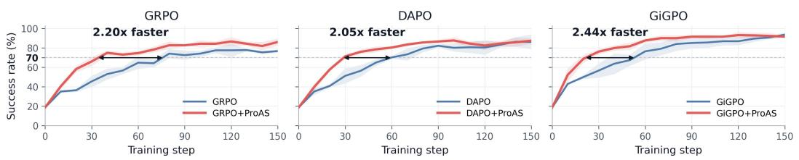  
Qwen2.5-7B-Instruct / WebShop

## E TRAINING SPEEDUP CURVES

Fig. 2 visualizes the validation learning curves used to compute the training-speedup results in Table 1. For each base algorithm, speedup is measured by the number of RL steps required to reach a fixed success-rate target before and after adding ProAS.

Owen2.5-1.5B-Instruct / ALFWorld Mean ± 1 sample std over seeds 0, 1, and 2; Dashed target: 70% success  
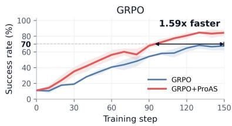

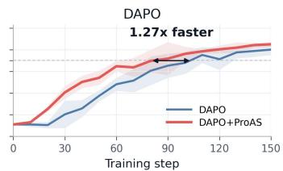  
Qwen2.5-1.5B-Instruct / WebShop

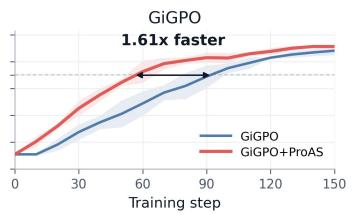  
Mean ± 1 sample std over seeds 0, 1, and 2; Dashed target: 50% success

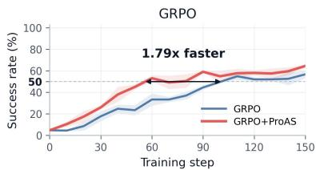

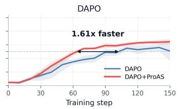  
Qwen2.5-7B-Instruct / ALFWorld

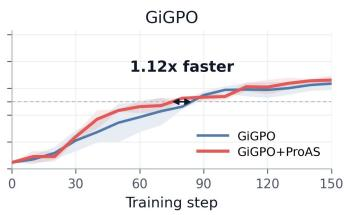  
Mean ± 1 sample std over seeds 0, 1, and 2; Dashed target: 70% success  
Mean ± 1 sample std over seeds 0, 1, and 2; Dashed target: 50% success

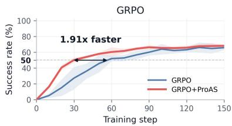

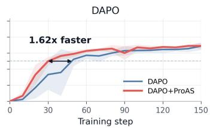

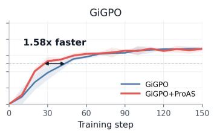  
Figure 2: Validation success rate curves on ALFWorld and WebShop within 150 RL steps. Dashed horizontal lines mark the fixed success rate targets used for computing training speedup: 70 points for ALFWorld and 50 points for WebShop. Black double arrows indicate the speedup of each base algorithm after adding ProAS.

Table 7: An ALFWorld case illustrating the effect of unreasonable actions in the context. The clean and noise-injected conditions reach the same continuation state. Each condition contains 50 independently sampled continuations. Only the injected unreasonable actions are highlighted in pink.
<table><tr><td colspan="5">Case setup</td></tr><tr><td>Task Labels</td><td colspan="4">Put a keychain on a desk. Reat = 1 denotes an ARG-supported transition, and</td></tr><tr><td>Task ARG</td><td colspan="4">previously unvisited ARG state.</td></tr><tr><td>ARG</td><td colspan="4"> $\xrightarrow { \mathrm { t a k e ~ k e y c h a i n ~ } 2 } \mathbf { g } _ { 2 }$  keychain held  $\xrightarrow { \mathbf { g } \circ \mathbf { \ t } \circ \mathbf { \ d e s k } \mathrm { ~ } 1 } \mathbf { g } _ { 3 }$   ${ \bf g } _ { 1 }$  sidetable reached</td></tr><tr><td>Initial edge</td><td colspan="4">move keychain 2 to desk 1 while holding the keychain The initial transition go to sidetable 1 enters</td></tr><tr><td colspan="5">Clean condition</td></tr><tr><td>Condition</td><td>t</td><td>Action or operation ARG annotation</td><td>Reat</td><td>PAt</td></tr><tr><td>Clean</td><td>1</td><td>go to sidetable 1 Enters take keychain 2 from</td><td></td><td>1</td></tr><tr><td></td><td>2 sidetable 1</td><td>Acquires the target keychain and enters</td><td>1</td><td>1</td></tr><tr><td></td><td>3  ${ \tt g o }$ </td><td>to desk 1 Reaches the target desk while holding the keychain:  $\mathbf { g } _ { 3 } .$ </td><td></td><td>1</td></tr><tr><td></td><td>4 Continuation sampling (n = 50)</td><td>50 independently sampled continuations from  $\mathbf { g } _ { 3 } ; 4 1$  reach  $\mathbf { g } _ { 4 } .$ </td><td></td><td></td></tr><tr><td colspan="5">Expected Success Rate: 82% (41/50); Wilson 95% CI [69.2%, 90.2%].</td></tr><tr><td colspan="5">Noise-injected condition</td></tr><tr><td>Condition Noise-</td><td>t I1</td><td>Action or operation ARG annotation go to desk 1 Noise.</td><td>Reat</td><td> $\mathrm { P A } _ { t }$  0</td></tr><tr><td>injected</td><td>I2</td><td></td><td>0</td><td></td></tr><tr><td></td><td>go to cabinet 1 I3 open cabinet 1</td><td>Noise. Noise.</td><td></td><td>0 0</td></tr><tr><td>I4</td><td>go to desk 1</td><td>Noise.</td><td>0 0</td><td>0</td></tr><tr><td>1</td><td>go to sidetable 1</td><td>Enters  $\mathbf { g } _ { 1 } ^ { } ,$ </td><td>1</td><td>1</td></tr><tr><td>2</td><td>take keychain 2 from</td><td>Acquires the target keychain and enters</td><td>1</td><td>1</td></tr><tr><td>3</td><td>sidetable 1 go to desk 1</td><td> $\mathbf { g } _ { 2 } .$  Reaches the same continuation state  ${ \bf g } _ { 3 }$ </td><td>1</td><td></td></tr><tr><td>4</td><td>Continuation sampling</td><td>50 independently sampled continuations from</td><td></td><td></td></tr><tr><td></td><td>(n = 50)</td><td>the same  ${ \bf g } _ { 3 }$  state; 29 reach  $\mathbf { g } _ { 4 } .$  Expected Success Rate: 58% (29/50); Wilson 95% CI [44.2%, 70.6%].</td><td></td><td></td></tr></table>

Table 8: An ALFWorld case comparing exact-action suppression at four positions in the same failed rollout. Action indices are 1-based and Future-Drift (FD) is the inclusive suffix count of non-advancing actions. Repeated non-advancing spans are compressed. Each intervention preserves the original prefix, suppresses only the exact original action at the selected position, and independently samples 50 continuations.
<table><tr><td colspan="7">Case setup</td></tr><tr><td>Task Labels</td><td colspan="4">Look at a bowl under the desk lamp. Reat = 1 denotes an ARG-supported transition, and ARG state. FD counts the current non-advancing action and all subsequent non-advancing actions in the original</td><td></td><td>denotes advancement to a previously unvisited</td></tr><tr><td>Intervention</td><td colspan="4">trajectory. At the selected decision, an exact match to the original action is rejected and that decision is resampled; all other candidate actions remain eligible.</td><td></td><td></td></tr><tr><td colspan="7">Task ARG</td></tr><tr><td colspan="7">ARG</td></tr><tr><td>Raw trajectory</td><td colspan="4"></td><td></td><td></td></tr><tr><td>Condition</td><td>t</td><td>Action or operation</td><td>ARG annotation</td><td>Reat</td><td> $\mathrm { P A } _ { t }$ </td></tr><tr><td>Original failure</td><td>1-2</td><td>look ×2</td><td>Initial probe followed by a self-loop; no ARG progress.</td><td>0</td><td>0 0</td></tr><tr><td></td><td> $^ 3$ </td><td>1ook (FD = 47)</td><td>Admissible self-loop at the first intervention position.</td><td>0</td><td></td></tr><tr><td></td><td> $4 { - } 7$ </td><td>look ×4</td><td>Repeated self-loops before reaching the desk.</td><td>0</td><td></td></tr><tr><td></td><td>8</td><td>go to desk 1 look × 15; probes; one</td><td>Enters  $\mathbf { g } _ { 1 } ;$  the trajectory&#x27;s only advancing action.</td><td>1</td><td></td></tr><tr><td></td><td>9-27</td><td>unsupported bowl command</td><td>Nineteen non-advancing actions remain at  $\mathbf { g } _ { 1 } .$ </td><td>0</td><td>0</td></tr><tr><td></td><td>28</td><td>look at bowl under desklamp 1 (FD = 23)</td><td>Inadmissible command at the second intervention position.</td><td>0</td><td></td></tr><tr><td></td><td>29-39</td><td>Repeated bowl/lamp commands, probes, and redundant navigation</td><td>Eleven non-advancing actions remain at  $\mathbf { g } _ { 1 } .$ </td><td>0</td><td></td></tr><tr><td></td><td>40</td><td>look at bowl 1 from desk 1 with desklamp 1 (FD = 11)</td><td>Inadmissible command at the third intervention position</td><td></td><td>0</td></tr><tr><td></td><td></td><td>41–46 Malformed or unsupported bowl/lamp commands and probes</td><td>Six non-advancing actions remain at  ${ \bf g } _ { 1 } .$ </td><td></td><td>0</td></tr><tr><td></td><td>47</td><td>look at bowl  $\begin{array} { r l r l } { { 2 } } & { { } } & { ( \mathrm { F D } = 4 ) } \end{array}$  48-50 look at bow1 2 ×3</td><td>Inadmissible command at the final intervention position.</td><td></td><td>0</td></tr><tr><td></td><td></td><td>Outcome: failure after the 50-step horizon.</td><td>Repeated inadmissible actions exhaust the horizon.</td><td>0</td><td>0</td></tr><tr><td colspan="6">Suppressing on Step 3 (Future-Drift 47)</td></tr><tr><td>Step 3</td><td>1-2 3</td><td>Replay the original prefix Suppress exact action look</td><td>Returns to the decision state immediately before Step 3 Reject and resample only this action at the selected decision.</td><td>0</td><td>0</td></tr><tr><td></td><td>3-50</td><td>Continuation sampling (n = 50)</td><td>12 independently sampled continuations succeed.</td><td></td><td></td></tr><tr><td></td><td></td><td>Expected Success Rate: 24% (12/50); Wilson 95% CI [14.3%, 37.4%].</td><td></td><td></td><td></td></tr><tr><td colspan="6">Suppressing on Step 28 (Future-Drift 23)</td></tr><tr><td>Step 28</td><td>1-27</td><td>Replay the original prefix</td><td>Returns to the decision state immediately before Step 28.</td><td></td><td></td></tr><tr><td></td><td>28</td><td>Suppress exact original bowl/lamp command</td><td>Reject and resample only the selected inadmissible action.</td><td>0</td><td>0</td></tr><tr><td></td><td></td><td>28–50 Continuation sampling</td><td>8 independently sampled continuations succeed.</td><td></td><td></td></tr><tr><td></td><td></td><td>(n = 50)</td><td></td><td></td><td></td></tr><tr><td colspan="6">Expected Success Rate: 16% (8/50); Wilson 95% CI [8.3%, 28.5%].</td></tr><tr><td>Suppressing on Step 40 (Future-Drift 11)</td><td></td><td>Replay the original prefix</td><td></td><td></td><td></td></tr><tr><td>Step 40</td><td>1-39</td><td>Suppress exact original</td><td>Returns to the decision state immediately before Step 40. Reject and resample only the selected inadmissible action.</td><td></td><td>0</td></tr><tr><td></td><td>40</td><td>bowl/lamp command</td><td></td><td></td><td></td></tr><tr><td></td><td>40-50 </td><td>Continuation sampling (n = 50)</td><td>5 independently sampled continuations succeed.</td><td></td><td></td></tr><tr><td colspan="6">Expected Success Rate: 10% (5/50); Wilson 95% CI [4.3%, 21.4%].</td></tr><tr><td>Suppressing on Step 47 (Future-Drift 4)</td><td></td><td></td><td></td><td></td><td></td></tr><tr><td>Step 47</td><td>1-46 47</td><td>Replay the original prefix Suppress exact action look at</td><td>Returns to the decision state immediately before Step 47. Reject and resample only the selected inadmissible action.</td><td>0</td><td>0</td></tr><tr><td></td><td></td><td>bowl 2</td><td></td><td></td><td></td></tr><tr><td></td><td></td><td>47–50 Continuation sampling</td><td>None of the 50 independently sampled continuations</td><td></td><td></td></tr><tr><td></td><td>(n = 50)</td><td>succeeds. Expected Success Rate: 0% (0/50); Wilson 95% CI [0.0%, 7.1%].</td><td></td><td></td><td></td></tr></table>

Table 9: An ALFWorld case illustrating strict ARG purification and online graph evolution. The action-level annotations are computed against the pre-update graph $\mathcal { G } ^ { ( 1 7 ) }$ . After the rollout succeeds, only its valid, non-self-loop transitions are extracted as a new reference path and merged into $\mathcal { G } ^ { ( 1 8 ) }$
<table><tr><td colspan="6">Case setup</td></tr><tr><td>Task Source</td><td colspan="5">Look at a pencil under the desk lamp. Qwen2.5-1.5B-Instruct rollout at training iteration 17; success; reward  $= 1 0 .$ </td></tr><tr><td> $\mathcal { G } ^ { ( 1 7 ) }$ </td><td colspan="5"> $\xrightarrow { { \mathrm { g o ~ t o ~ d e s k ~ 1 } } } { \mathrm { g } } _ { 1 }$  desk reached Existing expert path: initial state activated take pencil 2 from desk 1  ${ \bf g } _ { 3 }$  success.</td></tr><tr><td>Labels</td><td colspan="5">Reat = 1 denotes a transition supported by  $\mathcal { G } ^ { ( 1 7 ) }$  , and  $\mathrm { P A } _ { t } = 1$  previously unvisited ARG state. The update decision is applied only after environment-verified success.</td></tr><tr><td colspan="5">Raw successful rollout and ARG annotations Annotation under  $\mathcal { G } ^ { ( 1 7 ) }$ </td><td></td></tr><tr><td>t</td><td>Action  $a _ { t }$ </td><td> $\mathbf { g } _ { 1 } .$ </td><td>Reat</td><td>PAt</td><td>Purification</td></tr><tr><td>1 2</td><td>go to desk 1 examine desk 1</td><td>Matches the expert transition and reaches Invalid action.</td><td>1 0</td><td>1 0</td><td>Retain Prune</td></tr><tr><td>3</td><td>examine desk 1</td><td></td><td>0</td><td>0</td><td>Prune</td></tr><tr><td>4</td><td>examine desk 1</td><td>Repeats the same abstract state (self_1oop).</td><td>0</td><td>0</td><td>Prune</td></tr><tr><td>5</td><td>examine desk 1</td><td>Repeats the same abstract state (self_loop).</td><td>0</td><td>0</td><td>Prune</td></tr><tr><td>6</td><td>look at #pencil 1</td><td>Repeats the same abstract state (self_1oop). Inadmissible action.</td><td>0</td><td>0</td><td>Prune</td></tr><tr><td></td><td>with #desklamp 1</td><td></td><td></td><td></td><td></td></tr><tr><td>7 8</td><td>inventory</td><td>Redundant examination.</td><td>0</td><td>0</td><td>Prune</td></tr><tr><td>9</td><td>use desklamp 1</td><td>Matches the expert transition and reaches  $\mathbf { g } _ { 2 } .$ </td><td>1</td><td>1</td><td>Retain</td></tr><tr><td>10</td><td>examine desk 1</td><td>Redundant examination. take pencil 1 from Novel and valid action toward success.</td><td>0 0</td><td>0 0</td><td>Prune Retain</td></tr><tr><td colspan="5">desk 1</td></tr><tr><td colspan="5">initial go to desk 1 g1</td></tr><tr><td> $\mathcal { G } ^ { ( 1 8 ) }$  state</td><td colspan="2">use desklamp 1 g2 desk reached desk lamp activated</td><td colspan="2">pencil 2 acquired (existing expert path)</td><td colspan="2"></td></tr><tr><td colspan="5"></td><td colspan="2">g3</td></tr><tr><td colspan="5"></td><td colspan="2">→ pencil 1 acquired</td></tr><tr><td colspan="5"></td><td colspan="2">(new online path)</td></tr><tr><td colspan="5"></td><td colspan="2"></td></tr></table>

Table 10: A WebShop case illustrating order-invariant option completion and action-level ProAS annotations. Trajectories A and B complete the option sub-goal in different orders and both succeed; Trajectory C shows a failed rollout with unreasonable or non-advancing actions.
<table><tr><td colspan="6">Case setup</td></tr><tr><td>Task</td><td colspan="4">Find women&#x27;s activewear with nylon spandex, color=green, size=x-large, and price below $30.</td><td></td></tr><tr><td>Target</td><td colspan="3">B08G8DXR5N g1 target visible</td><td>price</td><td></td></tr><tr><td>ARG</td><td colspan="3"> $ \mathbf { g } _ { 2 }$  target opened verified → g5 attributes verified → g6 purchase.</td><td>denotes entry into a</td><td></td></tr><tr><td>Labels</td><td colspan="3"> $\mathbf { R e a } _ { t } = 1$  denotes an ARG-supported transition, and  $\mathrm { P A } _ { t } = 1$  previously unvisited valid ARG state. Thus,  $( 1 , 1 )$  non-advancing, and (0, 0) is unsupported.</td><td>is productive, (1, 0) is reasonable but</td><td></td></tr><tr><td colspan="6">Rollout comparison</td></tr><tr><td>Trajectory</td><td>t</td><td>Action at</td><td>ARG annotation</td><td>Reat</td><td> $\mathrm { P A } _ { t }$ </td></tr><tr><td>A: size first</td><td>1</td><td> $\mathsf { s e a r c h } [ . \dots ]$ </td><td>Target product appears in the search results:  $s _ { 1 , 1 } \in \mathbf { g } _ { 1 }$ </td><td>1</td><td>1</td></tr><tr><td></td><td>2</td><td>click[target]</td><td>Target product page is opened:  $s _ { 2 , 1 } \in \mathbf { g } _ { 2 }$ </td><td>1</td><td>1</td></tr><tr><td></td><td>3</td><td> $\mathsf { c l i c k } [ \mathsf { x - l a r g e } ]$ </td><td>Partial  ${ \bf g } _ { 3 }$  state: the required size is selected.</td><td>1</td><td>1</td></tr><tr><td></td><td>4</td><td>click[green] click[buy now]</td><td> ${ \bf g } _ { 3 }$  completed: all required options are selected. Price and attributes are verified; purchase reaches</td><td>1</td><td>1</td></tr><tr><td></td><td>5</td><td></td><td> $\mathbf { g } _ { 6 } .$ </td><td>1</td><td>1</td></tr><tr><td colspan="6">Outcome: success; reward = 10.</td></tr><tr><td>B: color first</td><td>1</td><td>search[. . . ]</td><td>Target product appears in the search results:  $s _ { 1 , 1 } \in \mathbf { g } _ { 1 }$ </td><td>1</td><td>1</td></tr><tr><td></td><td>2</td><td>click[target]</td><td>Target product page is opened:  $s _ { 2 , 1 } \in \mathbf { g } _ { 2 }$ </td><td></td><td>1</td></tr><tr><td></td><td>3</td><td>click[green]</td><td>Partial  ${ \bf g } _ { 3 }$  state: the required color is selected.</td><td>1</td><td></td></tr><tr><td></td><td>4</td><td> $\mathsf { c l i c k } [ \mathsf { x - l a r g e } ]$  click[buy now]</td><td> ${ \bf g } _ { 3 }$  completed: all required options are selected. Price and attributes are verified; purchase reaches</td><td>1</td><td>1</td></tr><tr><td></td><td>5</td><td></td><td> $\mathbf { g } _ { 6 } .$ </td><td>1</td><td>1</td></tr><tr><td colspan="6">Outcome: success; reward = 10.</td></tr><tr><td>C: failed</td><td>1</td><td>search[...]</td><td>Target product appears in the search results:  $s _ { 1 , 1 } \in \mathbf { g } _ { 1 }$ </td><td>1</td><td>1</td></tr><tr><td></td><td>2 3</td><td>click[target] click[large]</td><td>Target product page is opened:  $s _ { 2 , 1 } \in \mathbf { g } _ { 2 } .$  Wrong size option; the transition is not supported</td><td>1</td><td>1</td></tr><tr><td></td><td></td><td></td><td>by the ARG.</td><td>0</td><td>0</td></tr><tr><td></td><td>4</td><td>click[description]</td><td>Neutral page inspection that does not satisfy any ARG requirement.</td><td>0</td><td>0</td></tr><tr><td></td><td>5</td><td>click[buy now]</td><td>Premature purchase before the required option set is completed.</td><td>0</td><td>0</td></tr><tr><td></td><td>9</td><td>click[x-large]</td><td>Recovery segment reaches a partial  ${ \bf g } _ { 3 }$  state.</td><td>1</td><td>1</td></tr><tr><td></td><td>10</td><td>click[green]</td><td> ${ \bf g } _ { 3 }$  completed after the required color is selected.</td><td>1</td><td>1</td></tr><tr><td></td><td>11</td><td>click[x-large]</td><td>Redundant option click; the valid ARG state has already been visited.</td><td>1</td><td>0</td></tr><tr><td></td><td></td><td>Outcome: failure; reward = 0</td><td></td><td></td><td></td></tr></table>

Table 11: A turn-level SFT example from ALFWorld. Underlined text denotes instance-specific fields populated from the task, environment state, and interaction history.
<table><tr><td>SFT Example for ALFWorld</td></tr><tr><td>System Prompt: You are Qwen, created by Alibaba Cloud. You are a helpful assistant.</td></tr><tr><td>User Prompt: You are an expert agent operating in the ALFRED Embodied Environment. Your task is to: put two book in bed.</td></tr><tr><td>Prior to this step, you have already taken 4 step(s). Below are the most recent 2 observations and the corresponding actions you took:</td></tr><tr><td>[Observation 3: You arrive at sidetable 1. On the sidetable 1, you see an alarmclock 1, a cd 2, and a pencil 2.&#x27;, Action 3: &#x27;go to shelf 1&#x27;]</td></tr><tr><td>[Observation 4: You arrive at shelf 1. On the shelf 1, you see nothing.&#x27;, Action 4: &#x27;go to drawer 1&#x27;]</td></tr><tr><td>You are now at step 5 and your current observation is: You arrive at drawer 1. The drawer 1 is closed. Your admissible actions of the current situation are: [‘examine drawer 1’, go to bed 1’, go to desk</td></tr><tr><td>1’, &#x27;go to drawer 2&#x27;, &#x27;go to garbagecan 1’, ‘go to shelf 1’, ‘go to sidetable 1’, &#x27;inventory&#x27;, &#x27;look&#x27;, ‘open drawer 1’]. Now it&#x27;s your turn to take an action.</td></tr><tr><td>You should first reason step-by-step about the current situation. This reasoning process MUST be enclosed within &lt;think&gt; &lt;/think&gt; tags.</td></tr><tr><td>Once you&#x27;ve finished your reasoning, you should choose an admissible action for the current step and present it within &lt;action&gt; &lt;/action&gt; tags. Assistant Response (Supervision Target): &lt;think&gt; The best action is to open drawer 1. &lt;/think&gt;</td></tr></table>

Table 12: A turn-level SFT example from WebShop. Underlined text denotes instance-specific fields populated from the task, environment state, and interaction history.
<table><tr><td>SFT Example for WebShop</td></tr><tr><td>System Prompt: You are Qwen, created by Alibaba Cloud. You are a helpful assistant.</td></tr><tr><td>User Prompt: You are an expert autonomous agent operating in the WebShop e-commerce environment. Your task is to: Find me plug play, easy use turntables, and price lower than 150.00 dollars.</td></tr><tr><td>Prior to this step, you have already taken 1 step. Below is the most recent observation and the corresponding action you took:</td></tr><tr><td>[Observation 1: &#x27;WebShop [SEP] Instruction: [SEP] Find me plug play, easy use turntables, and price lower than 150.00 dollars [SEP] Search&#x27;, Action 1: search[turntables]&#x27;]</td></tr><tr><td>You are now at step 2 and your current observation is: &#x27;Back to Search&#x27; [SEP] &#x27;Page 1 (Total results: 1)&#x27; [SEP] &#x27;Next &gt;’ [SEP] &#x27;B09Q6CZ59K’ [SEP] &#x27;ngruama8 USB Portable Mini Vinyl</td></tr><tr><td>Turntable Audio Player&#x27; [SEP] &#x27;$110.54&#x27;. Your admissible actions of the current situation are: [&#x27;click[back to search]&#x27;, &#x27;click[next &gt;]&#x27;,</td></tr><tr><td>&#x27;click[b09q6cz59k]&#x27;]. Now it&#x27;s your turn to take one action for the current step.</td></tr><tr><td>You should first reason step-by-step about the current situation, then determine which admissible action best advances the shopping goal. This reasoning process MUST be enclosed within &lt;think&gt;</td></tr><tr><td>&lt;/think&gt; tags. Once you&#x27;ve finished your reasoning, you should choose an admissible action for the current step</td></tr><tr><td>and present it within &lt;action&gt; &lt;/action&gt; tags.</td></tr><tr><td>Assistant Response (Supervision Target):</td></tr></table>