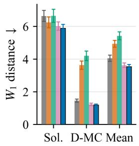
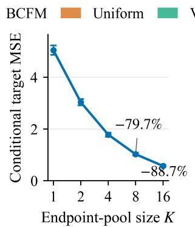
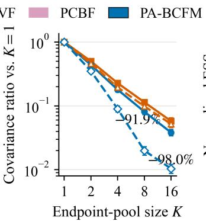
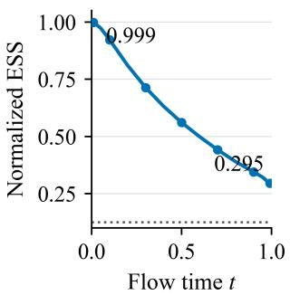
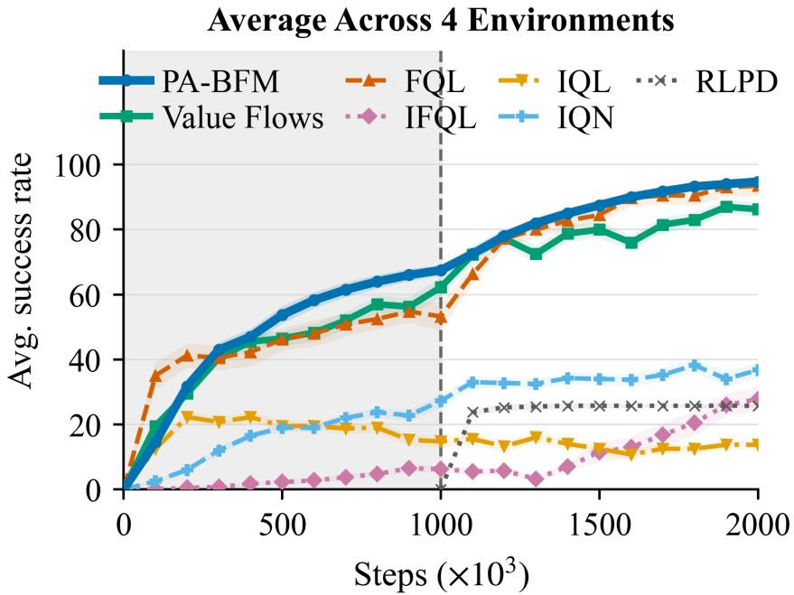
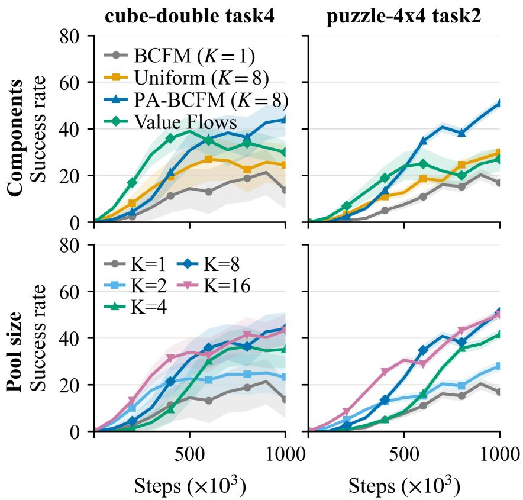
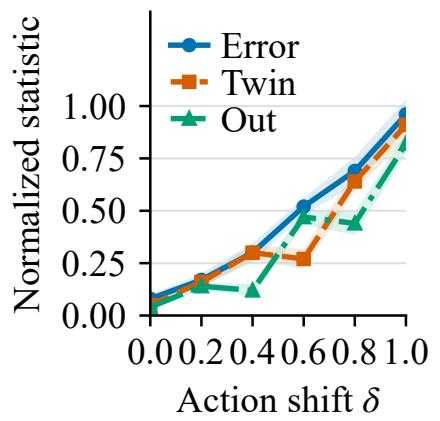
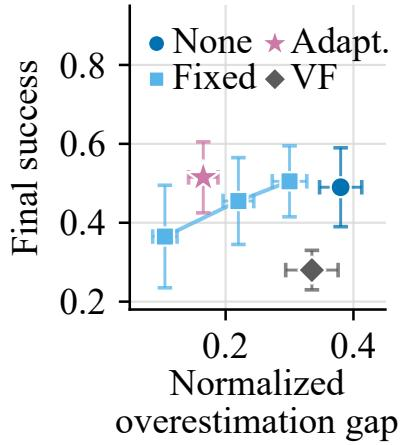

# Posterior-Averaged Bellman Flow Matching for Distributional Critics

Zeqiao Li1, Yijing Wang1, Haoyu Wang1,2, Zheng Li1, Zhiqiang Zuo1

1Tianjin Key Laboratory of Intelligent Unmanned Swarm Technology and System, School of Electrical and Information Engineering, Tianjin University, Tianjin 300072, China 2Key Laboratory of System Control and Information Processing, Ministry of Education of China, Shanghai 200240, China {lizeqiao, yjwang, why2014, zhengl, zqzuo}@tju.edu.cn

## Abstract

Distributional critics model the full return distribution, providing richer signals for exploration and risk-sensitive control. Recent work has shown that flow-based critics can model these distributions flexibly and provide efective supervision across flow time for temporal-diference learning. However, unlike standard flow matching with fixed data endpoints, a flow critic is trained on Bellman targets recursively generated by a learned target critic under the current policy. Existing objectives therefore either use noisy single-endpoint supervision or rely on the learned flow itself for additional guidance. Our key observation is that an intermediate bridge state may be compatible with several Bellman endpoints, so its velocity should average their directions under the corresponding posterior. We propose Posterior-Averaged Bellman Flow Matching (PA-BFM), which samples an endpoint pool, infers the closed-form posterior over the latent anchor, and regresses to the posterior-mean velocity. Uniform anchor selection makes this target an exact finite-pool Rao–Blackwellization of the single-endpoint target: for every K, it preserves the population target, cannot increase conditional variance, and its conditional variance scales as O(K−1). The endpoint pool supports conservative updates, while the twin return flows provide critic-disagreement and unsupported-mass diagnostics. Controlled studies show that PA-BFM reduces fixed-query target mean-squared error by 79.7% and target-induced gradient variance by up to 98.0%, while improving return-distribution fidelity. Across 50 OGBench tasks and four ofline-to-online scenarios, PA-BFM achieves higher aggregate performance than Value Flows.

## 1 Introduction

In actor–critic reinforcement learning (RL), policy improvement depends on the critic used to evaluate actions and construct Bellman targets. Most methods retain only the expected return, whereas distributional RL preserves information about stochastic outcomes, multimodality, and risk (Bellemare et al., 2017; Dabney et al., 2018a,b; Duan et al., 2022). Recent flow-based critics represent this distribution through a continuous transport from simple noise to return samples (Dong et al., 2026; Xu et al., 2026; Ding et al., 2026; Zhong et al., 2025; Chen et al., 2025). Flow-time supervision further provides dense signals for changing temporal-diference targets (Lipman et al., 2023; Albergo and Vanden-Eijnden, 2023; Liu et al., 2023).

Existing flow critics use two complementary forms of Bellman supervision. Endpoint matching is anchored to a sampled Bellman return but uses one continuation, whereas pathwise matching provides denser supervision through another learned successor field. Value Flows combines these objectives with target networks and confidence weighting, while Path-Coupled Bellman Flows (PCBF) introduces source-consistent geometry and a learned-field control variate (Dong et al., 2026; Xu et al., 2026). Related bridge, distillation, and architectural corrections retain the same tension between an anchored but noisy target and guidance from a learned flow (Ding et al., 2026; Chen et al., 2025; Agrawalla et al., 2025).

We recast this tension as a conditional estimation problem. At a fixed intermediate bridge state, multiple Bellman endpoints can be compatible with the same observation. Each compatible endpoint implies a candidate velocity, and the population bridge velocity is the posterior average of these endpoint directions. The uncertainty is therefore not whether a Bellman endpoint law exists, but which compatible endpoint explains the observed intermediate state.

Our goal is to estimate this posterior velocity directly from Bellman endpoint samples. This estimator is particularly natural in distributional RL: conditioned on a replay transition, the target policy and return flow directly sample the conditional Bellman endpoint law. For the one-dimensional linear Gaussian critic bridge, candidate likelihoods are closed form, so the finite endpoint pool induces a tractable posterior over the latent anchor without endpoint retrieval or an auxiliary proposal distribution. In contrast, posterior augmentation in generative modeling often requires retrieval or approximate candidate construction, and policy-side reverse matching may require a separate proposal (Stoica et al., 2026; Yang et al., 2026; Li et al., 2026).

Based on this observation, we propose Posterior-Averaged Bellman Flow Matching (PA-BFM). For each transition, PA-BFM samples a finite endpoint pool, selects one endpoint uniformly to construct the bridge state, and evaluates every candidate using its Gaussian bridge likelihood. The posterior-weighted direction is exactly the conditional expectation of the single-endpoint Bellman conditional flow matching (BCFM) target. Hence every finite pool preserves the population bridge velocity and cannot increase conditional target variance. We further show that its conditional variance scales as $O ( K ^ { - 1 } )$ and derive implications for gradient variability, terminal transport error, and Bellman tracking.

The endpoint posterior supports conservative reweighting, while the twin return flows provide disagreement and unsupported-mass diagnostics (Kuznetsov et al., 2020; Kumar et al., 2019, 2020; Ma et al., 2021; Fujimoto et al., 2018). The main experiments use the undistorted target and retain matched flow-critic policy extraction. Our main contributions are:

• Posterior-averaged Bellman supervision. We formulate source-consistent endpoint matching as posterior velocity estimation and estimate it from K Bellman endpoints using closed-form bridge posteriors, without regressing to a learned successor field.

• Exact finite-pool guarantees. Uniform anchor selection makes PA-BFM an exact Rao– Blackwellization of BCFM. We prove finite-K unbiasedness and variance dominance, characterize $K ^ { - 1 }$ conditional-variance scaling with an ESS-based bound, and propagate velocity error to terminal Wasserstein and Bellman tracking errors.

• Extensions and empirical validation. The endpoint pool supports conservative posterior tilting, while the twin return flows provide critic-disagreement and unsupported-mass diagnostics. Controlled studies, 50 OGBench tasks, and four ofline-to-online scenarios show gains in estimation, return-law fidelity, and downstream performance.

## 2 Preliminaries

We review distributional returns, one-dimensional flow matching, and the source-consistent Bellman bridge used by our critic.

## 2.1 MDPs and Distributional Returns

We consider a discounted Markov decision process $\mathcal { M } = ( S , \mathcal { A } , P , \mathcal { R } , \rho _ { 0 } , \gamma )$ , where S and A are the state and action spaces, P is the transition kernel, R is the reward function, $\rho _ { 0 }$ is the initial-state distribution, and $\gamma \in ( 0 , 1 )$ . In ofline reinforcement learning (RL), the learner observes a fixed dataset $\mathcal { D } = \{ ( s , a , r , s ^ { \prime } , d ) \}$ , where $d \in \{ 0 , 1 \}$ indicates termination and r is the realized reward. We use h for environment time and $t \in [ 0 , 1 ]$ for flow time.

For a policy π, the return random variable is

$$
Z ^ { \pi } ( s , a ) = \sum _ { h = 0 } ^ { \infty } \gamma ^ { h } \mathcal { R } ( S _ { h } , A _ { h } ) , \qquad S _ { 0 } = s , \quad A _ { 0 } = a ,\tag{1}
$$

where $S _ { h + 1 } \sim P ( \cdot \mid S _ { h } , A _ { h } )$ and $A _ { h } \sim \pi ( \cdot \mid S _ { h } )$ for $h \geq 1$ . Its expectation is the action value $Q ^ { \pi } ( s , a ) = \mathbb { E } [ Z ^ { \pi } ( s , a ) ]$ ], whereas distributional RL models the law of $Z ^ { \pi } ( s , a )$ itself (Bellemare et al., 2017; Dabney et al., 2018a,b).

For a state–action conditional return variable $Z ,$ , the distributional Bellman operator is

$$
\begin{array} { c } { { ( T ^ { \pi } Z ) ( s , a ) \stackrel { d } { = } r + \gamma ( 1 - d ) Z ( S ^ { \prime } , A ^ { \prime } ) , } } \\ { { S ^ { \prime } \sim P ( \cdot \mid s , a ) , A ^ { \prime } \sim \pi ( \cdot \mid S ^ { \prime } ) . } } \end{array}\tag{2}
$$

For a nonterminal transition with reward r, its density satisfies

$$
p _ { \mathcal { T } ^ { \pi } Z } ( z \mid s , a ) = \frac { 1 } { \gamma } \mathbb { E } _ { S ^ { \prime } , A ^ { \prime } } \left[ p _ { Z } \left( \frac { z - r } { \gamma } \bigg | S ^ { \prime } , A ^ { \prime } \right) \right] .\tag{3}
$$

Terminal transitions place all mass at $z = r$ . The operator is a γ-contraction under Wasserstein metrics and has $Z ^ { \pi }$ as its unique fixed point (Bellemare et al., 2017).

## 2.2 Flow Matching

Flow matching (FM) learns a time-dependent vector field that transports a standard Gaussian source to a target distribution $p _ { 1 } ( \cdot \mid c )$ . Let $\epsilon \sim \mathcal { N } ( 0 , 1 )$ , and let $p _ { 0 }$ denote its density. The flow solves

$$
\frac { d } { d t } \phi _ { \theta } ( \epsilon \mid t , c ) = v _ { \theta } ( \phi _ { \theta } ( \epsilon \mid t , c ) , t ; c ) , \qquad \phi _ { \theta } ( \epsilon \mid 0 , c ) = \epsilon .\tag{4}
$$

Conditional flow matching (CFM) trains this field using tractable paths (Lipman et al., 2023; Albergo and Vanden-Eijnden, 2023; Liu et al., 2023). For independent $\epsilon \sim \mathcal { N } ( 0 , 1 ) , y \sim p _ { 1 } ( \cdot \mid c )$ 2 and $t \sim \mathrm { U n i f } ( [ 0 , 1 ) )$ , define

$$
X _ { t } = ( 1 - t ) \epsilon + t y , \qquad u _ { t } ( X _ { t } , y ) = y - \epsilon = \frac { y - X _ { t } } { 1 - t } .\tag{5}
$$

The CFM objective is

$$
\mathcal { L } _ { \mathrm { C F M } } ( \theta ) = \mathbb { E } \Big [ \| v _ { \theta } ( X _ { t } , t ; c ) - u _ { t } ( X _ { t } , y ) \| _ { 2 } ^ { 2 } \Big ] .\tag{6}
$$

Its population minimizer is $v ^ { \star } ( x , t ; c ) = \mathbb { E } [ u _ { t } ( x , Y ) \mid X _ { t } = x , c ] \colon$ : the conditional average of all path directions compatible with the observed intermediate point. For our critic, $c = ( s , a )$ , and $Z _ { \theta } ( s , a ) \overset { d } { = } \phi _ { \theta } ( \epsilon \mid 1 , s , a )$

## 2.3 Bellman Endpoint Laws and Source-Consistent Bridges

Fix $( s , a )$ and let $\tau = ( r , s ^ { \prime } , d )$ denote one transition outcome. Let $Y \sim \mu _ { \tau }$ denote the abstract conditional Bellman endpoint law. A sample from this law is generated by a target-flow return $Z _ { \bar { \theta } } ( s ^ { \prime } , a ^ { \prime } ; \epsilon ^ { \prime } )$ :

$$
\begin{array} { r l } & { Y = r + \gamma ( 1 - d ) Z _ { \bar { \theta } } ( s ^ { \prime } , A ^ { \prime } ; \epsilon ^ { \prime } ) , } \\ & { \mu _ { \tau } = \mathrm { L a w } ( Y \mid \tau ) , \qquad A ^ { \prime } \sim \pi ( \cdot \mid s ^ { \prime } ) , \quad \epsilon ^ { \prime } \sim \mathcal { N } ( 0 , 1 ) . } \end{array}\tag{7}
$$

In our implementation, $\mu _ { \tau }$ is the law of the shared-noise mean of the two target critics; the explicit construction is given in Appendix C.1. An endpoint pool averages the successor-action and target-flow randomness within one transition; replay sampling performs the outer average over $\tau \mid s , a$

The Bellman endpoint law does not uniquely determine an intermediate path. For a nonterminal transition $( d = 0 )$ , applying the Bellman afine map to each slice of a successor flow gives $X _ { t } ^ { \mathrm { s l } } = r + \gamma X _ { t } ^ { \prime }$ If $X _ { t } ^ { \prime }$ has density $p _ { t } ^ { \prime } ( \cdot \mid s ^ { \prime } , A ^ { \prime } )$ and velocity $\boldsymbol { v } _ { t } ^ { \prime } ,$ then, with $\xi = ( x - r ) / \gamma$ 2

$$
q _ { t } ^ { \mathrm { s l } } ( \boldsymbol { x } ) = \frac { 1 } { \gamma } \mathbb { E } _ { A ^ { \prime } } [ p _ { t } ^ { \prime } ( \boldsymbol { \xi } \mid \boldsymbol { s } ^ { \prime } , A ^ { \prime } ) ] ,\tag{8}
$$

$$
v _ { t } ^ { \mathrm { s l } } ( x ) = \gamma \frac { \mathbb { E } _ { A ^ { \prime } } [ p _ { t } ^ { \prime } ( \xi \mid s ^ { \prime } , A ^ { \prime } ) v _ { t } ^ { \prime } ( \xi \mid s ^ { \prime } , A ^ { \prime } ) ] } { \mathbb { E } _ { A ^ { \prime } } [ p _ { t } ^ { \prime } ( \xi \mid s ^ { \prime } , A ^ { \prime } ) ] } .\tag{9}
$$

The factor $\gamma$ follows from $\dot { X } _ { t } ^ { \mathrm { s l } } = \gamma \dot { X } _ { t } ^ { \prime }$ . Although this path reaches the correct Bellman endpoint, its source is $\mathcal { N } ( r , \gamma ^ { 2 } )$ , rather than the common critic source $\mathcal { N } ( 0 , 1 )$ . For $d = 1$ , the endpoint law is the point mass at $Y = r$

We therefore use the source-consistent bridge

$$
\begin{array} { c } { { X _ { t } = ( 1 - t ) \epsilon + t Y , \qquad \epsilon \perp Y , } } \\ { { \epsilon \sim \mathcal { N } ( 0 , 1 ) , \qquad Y \sim \mu _ { \tau } . } } \end{array}\tag{10}
$$

If the successor uses the linear path $X _ { t } ^ { \prime } = ( 1 - t ) \epsilon + t X _ { 1 } ^ { \prime }$ with the same source noise, then

$$
X _ { t } = X _ { t } ^ { \mathrm { s l } } + ( 1 - t ) \bigl [ ( 1 - \gamma ) \epsilon - r \bigr ] .\tag{11}
$$

Thus the two paths share the endpoint at $t = 1$ , but not their intermediate marginals.

Using the standard Gaussian density $p _ { 0 } .$ , define

$$
\ell _ { t } ( x \mid y ) = { \frac { 1 } { 1 - t } } p _ { 0 } \left( { \frac { x - t y } { 1 - t } } \right) , \qquad u _ { t } ( x , y ) = { \frac { y - x } { 1 - t } } .\tag{12}
$$

The transition-conditional bridge velocity is

$$
v _ { \tau } ^ { \star } ( x , t ) = \mathbb { E } [ u _ { t } ( x , Y ) | X _ { t } = x , \tau ] .\tag{13}
$$

The full state–action velocity is recovered by the outer transition mixture,

$$
v ^ { \star } ( x , t \mid s , a ) = \mathbb { E } [ v _ { \tau } ^ { \star } ( x , t ) | X _ { t } = x , s , a ] .\tag{14}
$$

Hence the endpoint pool estimates the velocity conditional on one transition, while replay sampling accounts for environment-transition randomness.

## 3 Method

We use PA-BFM for the complete algorithm and PA-BCFM for its posterior-averaged critic-training objective.

## 3.1 Bellman Objectives and Posterior Velocity

Bellman target noise is recursively reused in later temporal-diference updates. Unlike standard FM with fixed data endpoints, a flow critic draws from a learned Bellman law under the current policy, so error can re-enter later targets. We seek an endpoint-anchored estimator that averages continuation uncertainty already present in this law. For a sampled transition $\tau = ( r , s ^ { \prime } , d )$ , draw a Bellman endpoint

$$
Y = r + \gamma ( 1 - d ) Z _ { \bar { \theta } } ( s ^ { \prime } , A ^ { \prime } ; \epsilon ^ { \prime } ) ,
$$

$$
A ^ { \prime } \sim \pi ( \cdot \mid s ^ { \prime } ) , \ ~ \epsilon ^ { \prime } \sim \mathcal { N } ( 0 , 1 ) ,\tag{15}
$$

and construct the source-consistent bridge $X _ { t } = ( 1 - t ) \epsilon + t Y$ , whose supervision direction is $u _ { t } ( X _ { t } , Y ) = ( Y - X _ { t } ) / ( 1 - t ) = Y - \epsilon$ . Bellman conditional flow matching (BCFM) minimizes

$$
\begin{array} { r } { \mathcal { L } _ { \mathrm { B C F M } } ( \theta ) = \mathbb { E } \Big [ \| v _ { \theta } ( X _ { t } , t ; s , a ) - u _ { t } ( X _ { t } , Y ) \| _ { 2 } ^ { 2 } \Big ] . } \end{array}\tag{16}
$$

Conditioned on $X _ { t } = x$ , its population target is

$$
v _ { \tau } ^ { \star } ( x , t ) = \mathbb { E } [ u _ { t } ( x , Y ) | X _ { t } = x , \tau ] .\tag{17}
$$

BCFM is conditionally unbiased, but $X _ { t } ~ = ~ x$ does not identify which compatible endpoint was sampled. Using one continuation therefore introduces avoidable label variance. This is a latent-identity problem: after observing the bridge point, the missing quantity is which compatible continuation produced it.

Value Flows additionally uses distributional conditional flow matching (DCFM) to impose pathwise consistency (Dong et al., 2026). With $X _ { t } ^ { \prime } = \phi _ { \bar { \theta } } ( \epsilon ^ { \prime } \mid t , s ^ { \prime } , A ^ { \prime } )$ , its practical objective is

$$
\begin{array} { r l } & { \mathcal { L } _ { \mathrm { D C F M } } ^ { \mathrm { V F } } ( \theta ) = \mathbb { E } \Big [ \| \Delta _ { t } ^ { \mathrm { V F } } \| _ { 2 } ^ { 2 } \Big ] , } \\ & { \qquad \Delta _ { t } ^ { \mathrm { V F } } = v _ { \theta } ( r + \gamma X _ { t } ^ { \prime } , t ; s , a ) - v _ { \bar { \theta } } ( X _ { t } ^ { \prime } , t ; s ^ { \prime } , A ^ { \prime } ) . } \end{array}\tag{18}
$$

DCFM provides dense learned-field supervision, but it is not an estimator of the source-consistent posterior target in Eq. (17). The corresponding slice-wise afine geometry would instead require

$$
v _ { \theta } ( r + \gamma x ^ { \prime } , t ; s , a ) \approx \gamma v _ { \bar { \theta } } ( x ^ { \prime } , t ; s ^ { \prime } , A ^ { \prime } ) ,\tag{19}
$$

and follows the source-mismatched path in Eq. (9). Because both sides of Eq. (18) are learned, degenerate shared fields may also satisfy its residual. DCFM is therefore dense but self-referential, whereas BCFM is anchored but single-sample. Bridge corrections and critic-specific architectures can strengthen this supervision, but preserve the distinction between sampled endpoint anchors and guidance from a learned field (Ding et al., 2026; Chen et al., 2025; Agrawalla et al., 2025). PCBF instead corrects the single-endpoint target with a learned-field control variate and a tunable coeficient (Xu et al., 2026). Thus BCFM samples one continuation, PCBF corrects it with a learned field, and PA-BFM conditions the same target on a finite endpoint pool. This comparison is estimator-level: PA-BFM changes how the Bellman direction is formed while leaving the target policy, return-flow parameterization, and policy-extraction protocol unchanged.

## 3.2 Posterior-Averaged Bellman Flow Matching

PA-BCFM implements the conditional averaging suggested above in four steps: it samples a Bellman endpoint pool, selects one latent anchor to form the bridge point, infers the anchor posterior, and averages the corresponding BCFM directions. Unlike generic posterior augmentation, no retrieval

model is needed: the target return flow already supplies candidates from the relevant transitionconditional law, and the linear Gaussian bridge supplies their likelihoods analytically. The pool exposes uncertainty about compatible continuations without adding another learned correction field.

For one sampled transition, PA-BCFM draws

$$
{ \bf Y } = ( Y _ { 1 } , \ldots , Y _ { K } ) , \qquad Y _ { j } \stackrel { \mathrm { i . i . d . } } { \sim } \mu _ { \tau } , \quad j = 1 , \ldots , K .\tag{20}
$$

Each endpoint is generated by the target policy and target return flow as in Eq. (15). In practice, $\mu _ { \tau }$ is instantiated by the shared-noise mean of the twin target critics; this does not change the estimator below. All candidates share the sampled transition but retain independent successor-action and return-noise draws, so increasing K targets continuation uncertainty rather than replay-transition uncertainty.

It then chooses one candidate uniformly to construct the observed bridge point,

$$
\begin{array} { r l } & { I \sim \mathrm { U n i f } \{ 1 , \ldots , K \} , \qquad \epsilon \sim \mathcal { N } ( 0 , 1 ) , } \\ & { x _ { t } = ( 1 - t ) \epsilon + t Y _ { I } . } \end{array}\tag{21}
$$

The index I is the unobserved identity of the endpoint that generated $x _ { t }$ . Sampling the anchor from the same pool gives a finite candidate model in which the posterior responsibility of every endpoint can be evaluated exactly.

Given the bridge point, a candidate $Y _ { j }$ explains $x _ { t }$ through the source value $( x _ { t } - t Y _ { j } ) / ( 1 - t )$ Bayes’ rule therefore gives

$$
\begin{array} { r l } & { w _ { j } ( x _ { t } , t ) = \frac { \ell _ { t } ( x _ { t } \mid Y _ { j } ) } { \sum _ { \ell = 1 } ^ { K } \ell _ { t } ( x _ { t } \mid Y _ { \ell } ) } } \\ & { ~ = \operatorname* { P r } ( I = j | X _ { t } = x _ { t } , \mathbf { Y } , \tau , t ) . } \end{array}\tag{22}
$$

Thus $w _ { j }$ is the exact posterior responsibility of candidate $Y _ { j }$ , not a heuristic similarity score. Uniform averaging ignores this compatibility by assigning every candidate the same responsibility. Early in the bridge, many endpoints can explain $x _ { t }$ and the weights are broad; near the endpoint, compatibility becomes sharper. The endpoint-pool efective sample size below measures this timedependent concentration.

Finally, define the candidate directions and posterior target by

$$
\begin{array} { c } { { \displaystyle u _ { j } = u _ { t } ( x _ { t } , Y _ { j } ) = \frac { Y _ { j } - x _ { t } } { 1 - t } , } } \\ { { \displaystyle } } \\ { { \widehat { u } _ { K } ( x _ { t } , t ) = \sum _ { j = 1 } ^ { K } w _ { j } ( x _ { t } , t ) u _ { j } . } } \end{array}\tag{23}
$$

PA-BCFM trains the twin online critics toward this shared target:

$$
\begin{array} { r l } {  { \mathcal { L } _ { \mathrm { P A - B C F M } } = \frac { 1 } { 2 } \sum _ { c = 1 } ^ { 2 } \mathbb { E } \Big [ } } \\ & { \quad \quad \quad \Big \| v _ { \theta _ { c } } ( x _ { t } , t ; s , a ) - \mathrm { s g } [ \widehat { u } _ { K } ( x _ { t } , t ) ] \Big \| _ { 2 } ^ { 2 } \Big ] , } \end{array}\tag{24}
$$

where sg denotes stop-gradient. Replay sampling supplies the outer transition mixture in Eq. (14). Thus PA-BCFM modifies only critic supervision. The policy proposal, action evaluation, and target-network update remain those of the matched flow-critic implementation.

The key point is that posterior averaging changes only the target noise, not the target mean. The following result holds for the practical finite pool.

Theorem 1 (Finite-pool Rao–Blackwellization). Assume that the bridge normalizer is positive and the endpoint direction has a finite conditional second moment. When $K = 1 , { \widehat { u } } _ { 1 } = u _ { I }$ , so PA-BCFM exactly recovers BCFM. For every $K \geq 1$ ，

$$
\widehat { \boldsymbol { u } } _ { K } = \mathbb { E } [ u _ { I } \vert X _ { t } = x _ { t } , \mathbf { Y } , \tau , t ] ,
$$

$$
\mathbb { E } [ \widehat { u } _ { K } \mid X _ { t } = x _ { t } , \tau , t ] = v _ { \tau } ^ { \star } ( x _ { t } , t ) .\tag{25}
$$

Moreover,

$$
\operatorname { V a r } ( \widehat { u } _ { K } \mid X _ { t } , \tau , t ) \leq \operatorname { V a r } ( u _ { I } \mid X _ { t } , \tau , t ) .\tag{26}
$$

Thus every finite pool preserves the population target and cannot increase conditional target variance.

Appendix B.2 gives the corresponding weighted total-variance equality. PA-BCFM removes posterior dispersion among compatible endpoint directions while leaving the conditional mean unchanged. The pool supplies additional information by conditioning away the sampled continuation identity, not by changing the Bellman endpoint law. Equivalently, for any prediction v,

$$
\mathbb { E } \Big [ ( \boldsymbol { v } - \widehat { \boldsymbol { u } } _ { K } ) ^ { 2 } \mid \boldsymbol { X } _ { t } , \tau , t \Big ] = ( \boldsymbol { v } - \boldsymbol { v } _ { \tau } ^ { \star } ) ^ { 2 } + \mathrm { V a r } ( \widehat { \boldsymbol { u } } _ { K } \mid \boldsymbol { X } _ { t } , \tau , t ) ,\tag{27}
$$

so every finite pool has the same population regression minimizer.

Under the moment conditions in Appendix B.3, the remaining large-pool variance obeys

$$
\operatorname { V a r } ( \widehat { u } _ { K } \mid x , t , \tau ) = \frac { \sigma _ { \tau } ^ { 2 } ( x , t ) } { K } + o ( K ^ { - 1 } ) ,\tag{28}
$$

where

$$
\sigma _ { \tau } ^ { 2 } ( x , t ) = \frac { \mathbb { E } _ { Y \sim \mu _ { \tau } } \left[ \ell _ { t } ( x \mid Y ) ^ { 2 } ( u _ { t } ( x , Y ) - v _ { \tau } ^ { \star } ( x , t ) ) ^ { 2 } \right] } { ( \mathbb { E } _ { Y \sim \mu _ { \tau } } \left[ \ell _ { t } ( x \mid Y ) \right] ) ^ { 2 } } .\tag{29}
$$

The efective sample size

$$
\mathrm { E S S } ( \mathbf { w } ) = \frac { 1 } { \sum _ { j = 1 } ^ { K } w _ { j } ^ { 2 } }\tag{30}
$$

measures posterior concentration. Appendix B.3 shows that the normalized ESS converges to a transition-dependent concentration factor and controls the constant in the asymptotic variance bound. Larger pools help most when several candidates retain nonnegligible posterior mass; a larger nominal K cannot compensate for a fully concentrated posterior.

For the squared loss, if $g _ { 1 }$ is the BCFM gradient and $g _ { K }$ the PA-BCFM gradient at the same bridge point, then

$$
\begin{array} { c } { g _ { K } = \mathbb { E } [ g _ { 1 } \mid X _ { t } = x _ { t } , \mathbf { Y } , \tau , t ] , } \\ { \operatorname { C o v } ( g _ { K } \mid X _ { t } , \tau , t ) \preceq \operatorname { C o v } ( g _ { 1 } \mid X _ { t } , \tau , t ) . } \end{array}\tag{31}
$$

Thus the same Rao–Blackwell ordering applies directly to target-induced gradient variability.

Corollary 1 (Training and transport error). Under the smoothness, Polyak–Łojasiewicz, and flow-Lipschitz assumptions in Appendix $B . 4 ,$ the pool-induced contribution to the SGD error floor is $O ( ( B _ { \mathrm { m b } } K ) ^ { - 1 } )$ , and its contribution to terminal $W _ { 1 }$ error is $O ( ( B _ { \mathrm { m b } } K ) ^ { - 1 / 2 } )$ . For a fixed policy, Bellman contraction amplifies the one-step error by at most $1 / ( 1 - \gamma )$

The complete constants and the changing-policy tracking recursion are given in Appendix B.4.

## 3.3 Conservative Learning and Critic Diagnostics

Before each critic update, PA-BCFM has formed the weighted endpoint pool $\{ ( Y _ { j } , w _ { j } ) \} _ { j = 1 } ^ { K }$ . This pool supports conservative reweighting and a training-time disagreement signal. Separate state–action diagnostics are computed directly from the twin return flows.

Let $g : \mathbb { R } \to [ 0 , \infty )$ favor the returns retained by a desired distortion. The reweighted posterior target is

$$
w _ { j } ^ { g } = \frac { w _ { j } g ( Y _ { j } ) } { \sum _ { \ell = 1 } ^ { K } w _ { \ell } g ( Y _ { \ell } ) } ,\tag{32}
$$

$$
\widehat { u } _ { K } ^ { g } = \sum _ { j = 1 } ^ { K } w _ { j } ^ { g } u _ { j } .\tag{33}
$$

The exact finite-pool Rao–Blackwell identity applies to the undistorted target $g \equiv 1$ , but generally not to a distorted target $g \neq 1$ . A nonincreasing g downweights high returns and yields a pessimistically distorted target; hard upper-tail truncation and the soft tilt $g _ { \eta } ( y ) = \exp ( - \eta y )$ are two examples (Kuznetsov et al., 2020; Kumar et al., 2019, 2020; Ma et al., 2021). If the population distortion is $L _ { g } { \mathrm { - L i p s c h i t z } }$ in $W _ { p } ,$ its Bellman operator is $\gamma L _ { g ^ { - } } \mathrm { L i p s c h i t z }$ and is contractive when $\gamma L _ { g } < 1$ . Appendix B.5 gives the population definitions and proofs.

For $c \in \{ 1 , 2 \}$ , the target critics share successor actions and return noises:

$$
\begin{array} { c } { { \displaystyle Y _ { j } ^ { ( c ) } = r + \gamma ( 1 - d ) \phi _ { \bar { \theta } _ { c } } ( \epsilon _ { j } ^ { \prime } \mid 1 , s ^ { \prime } , A _ { j } ^ { \prime } ) , } } \\ { { { \displaystyle Y _ { j } = \frac { 1 } { 2 } \big ( Y _ { j } ^ { ( 1 ) } + Y _ { j } ^ { ( 2 ) } \big ) } , } } \\ { { { \displaystyle D _ { \mathrm { p o o l } } ( \tau , x _ { t } , t , { \bf Y } ) = \sum _ { j = 1 } ^ { K } w _ { j } ^ { 0 } } } } \\ { { { \displaystyle \ ( Y _ { j } ^ { ( 1 ) } - Y _ { j } ^ { ( 2 ) } ) ^ { 2 } } . } } \end{array}\tag{34}
$$

(35)

Here $A _ { i } ^ { \prime } \sim \pi ( \cdot \mid s ^ { \prime } )$ and $\epsilon _ { j } ^ { \prime } \sim \mathcal { N } ( 0 , 1 )$ , and $w _ { j } ^ { 0 }$ denotes the undistorted posterior weight obtained with $g \equiv 1$ . Thus the statistic is defined before any adaptive reweighting. For task $e ,$ let $\Delta _ { e } = $ $q _ { . 9 5 } ^ { \mathcal { D } , e } - q _ { . 0 5 } ^ { \mathcal { D } , e }$ be the fixed ofline return-to-go range. The stop-gradient adaptive heuristic is

$$
\begin{array} { r l } & { \eta ( \tau , x _ { t } , t ) = \eta _ { 0 } \mathrm { s g } \left[ \mathrm { c l i p } \left( \frac { \sqrt { D _ { \mathrm { p o o l } } } } { \Delta _ { e } } , 0 , 1 \right) \right] , } \\ & { g _ { \tau , x _ { t } , t } ( y ) = \mathrm { e x p } \left[ - \eta ( \tau , x _ { t } , t ) \frac { y } { \Delta _ { e } } \right] . } \end{array}\tag{36}
$$

For a fixed distortion g, Appendix B.5 establishes consistency and operator-level contraction conditions. The disagreement-adaptive schedule in Eq. (36) is a stop-gradient practical extension and is not covered by the fixed-distortion contraction result; its scope is clarified in Appendix B.6.

For a queried action, shared return noises isolate disagreement between the twin target return flows:

$$
\begin{array} { r l r } & { } & { Z _ { m } ^ { ( c ) } ( s , a ) = \phi _ { \bar { \theta } _ { c } } ( \xi _ { m } \mid 1 , s , a ) , \qquad c \in \{ 1 , 2 \} , } \\ & { } & { \xi _ { m } \sim \mathcal { N } ( 0 , 1 ) , \qquad m = 1 , \ldots , M _ { \mathrm { d i a g } } , } \end{array}
$$

$$
D _ { \mathrm { t w i n } } ( s , a ) = \frac { 1 } { M _ { \mathrm { d i a g } } } \sum _ { m = 1 } ^ { M _ { \mathrm { d i a g } } } \big ( Z _ { m } ^ { ( 1 ) } ( s , a ) - Z _ { m } ^ { ( 2 ) } ( s , a ) \big ) ^ { 2 } .\tag{37}
$$

<table><tr><td></td><td colspan="2">Gaussian Policies Flow Policies</td><td colspan="2"></td><td colspan="4">Distributional Critics</td></tr><tr><td>Domain</td><td></td><td></td><td></td><td>IQL ReBRAC IFQL FQL</td><td></td><td>IQN Value Flows PCBF PA-BFM</td><td></td><td></td></tr><tr><td>cube-double-play (5 tasks)</td><td> $6 \pm 2$ </td><td> $1 2 \pm 3$ </td><td> $1 4 \pm 5 \ 2 9 \pm 6 \ 4 2 \pm 8$ </td><td></td><td></td><td> $6 9 \pm 4$ </td><td> $7 1 \pm 5$ </td><td> ${ \bf 7 9 \pm 4 }$ </td></tr><tr><td>cube-triple-play (5 tasks)</td><td> $1 \pm 1$ </td><td> $0 \pm 0$ </td><td> $0 \pm 0 4 \pm 2 6 \pm 0$ </td><td></td><td></td><td> ${ \bf 1 4 \pm 3 }$ </td><td> $4 \pm 1$ </td><td> ${ \bf 1 4 \pm 2 }$ </td></tr><tr><td>puzzle-3x3-play (5 tasks)</td><td> $9 \pm 3$ </td><td> $2 2 \pm 2$ </td><td> $1 9 \pm 1 ~ 3 0 \pm 4 ~ 1 5 \pm 1$ </td><td></td><td></td><td> $8 7 \pm 1 3$ </td><td> $5 3 \pm 3$ </td><td> ${ \bf 9 3 \pm 3 }$ </td></tr><tr><td>puzzle-4x4-play(5 tasks)</td><td> $7 \pm 2$ </td><td> $1 4 \pm 3$ </td><td> $2 5 \pm 8 \ 1 7 \pm 5 \ 2 7 \pm 4$ </td><td></td><td></td><td> $2 7 \pm 4$ </td><td> $3 0 \pm 4$ </td><td> ${ \bf 5 2 \pm 6 }$ </td></tr><tr><td>scene-play (5 tasks)</td><td> $2 8 \pm 3$ </td><td> $4 1 \pm 7$ </td><td> $3 0 \pm 4 ~ 5 6 \pm 2 ~ 4 0 \pm 1$ </td><td></td><td></td><td> $5 9 \pm 4$ </td><td> $5 4 \pm 4$ </td><td> ${ \bf 7 8 \pm 2 }$ </td></tr><tr><td>visual-antmaze-medium-navigate (5 tasks)</td><td> $8 4 \pm 5$ </td><td> $8 7 \pm 4$ </td><td> $8 7 \pm 2 ~ 3 8 \pm 4 ~ 7 4 \pm 4$ </td><td></td><td></td><td> $7 5 \pm 1 0$ </td><td> $7 5 \pm 2$ </td><td> ${ \bf 9 1 \pm 3 }$ </td></tr><tr><td>visual-antmaze-teleport-navigate (5 tasks)</td><td> $6 \pm 4$ </td><td> $4 \pm 1$ </td><td> $1 0 \pm 4 5 \pm 2 4 \pm 2$ </td><td></td><td></td><td> $1 3 \pm 4$ </td><td> $1 4 \pm 4$ </td><td> ${ \bf 2 2 \pm 5 }$ </td></tr><tr><td>visual-cube-double-play (5 tasks)</td><td> $1 1 \pm 6$ </td><td> $1 \pm 1$ </td><td> $2 \pm 2 6 \pm 1 1 \pm 0$ </td><td></td><td></td><td> $1 3 \pm 2$ </td><td> $3 \pm 1$ </td><td> ${ \bf 1 7 \pm 5 }$ </td></tr><tr><td>visual-puzzle-3x3-play(5 tasks)</td><td> $2 \pm 3$ </td><td> $2 0 \pm 1$ </td><td></td><td> $2 1 \pm 0 \ 2 0 \pm 1 \ 1 9 \pm 1$ </td><td></td><td> ${ \bf 2 3 \pm 2 }$ </td><td> $1 8 \pm 1$ </td><td> $2 0 \pm 1$ </td></tr><tr><td>visual-scene-play (5 tasks)</td><td> $2 6 \pm 5$ </td><td> $2 8 \pm 5$ </td><td> $2 1 \pm 2 \ 4 1 \pm 4 \ 4 1 \pm 6$ </td><td></td><td></td><td> $4 3 \pm 7$ </td><td> $3 0 \pm 3$ </td><td> ${ \bf 5 0 \pm 8 }$ </td></tr></table>

Table 1: Ofline evaluation on OGBench. Each row averages five tasks; state-based and image-based results use eight and four seeds. Uncertainty is the arithmetic mean of the five task-level standard deviations. Matched flow critics share policy-side components while retaining their original critic supervision. Bold denotes the highest displayed mean in each domain.

For each critic, flow inversion gives

$$
\widehat { F } _ { c } ( z \mid s , a ) = \Phi \left( \phi _ { \bar { \theta } _ { c } } ^ { - 1 } ( z \mid 1 , s , a ) \right) ,\tag{38}
$$

$$
\begin{array} { c l } { { \displaystyle \widehat { F } _ { \mathrm { e n s } } ( z \mid s , a ) = \frac { 1 } { 2 } \sum _ { c = 1 } ^ { 2 } \widehat { F } _ { c } ( z \mid s , a ) , } } \\ { { \displaystyle P _ { \mathrm { o u t } } ( s , a ) = 1 - \widehat { F } _ { \mathrm { e n s } } ( q _ { \mathrm { h i } } ^ { \mathcal { D } } \mid s , a ) . } } \end{array}\tag{39}
$$

$P _ { \mathrm { o u t } }$ is the twin-ensemble mass above an empirical upper-tail threshold fixed before diagnostic evaluation. Unlike these state–action diagnostics, $D _ { \mathrm { p o o l } }$ is conditioned on a training transition and bridge point.

## 3.4 Distributional Policy Improvement

PA-BFM changes only the critic objective: a behavior flow proposes N actions, each evaluated with $M _ { \mathrm { { a c t } } }$ shared return noises:

$$
\begin{array} { r l r } & { } & { a _ { i } \sim \pi _ { \beta } ( \cdot \mid s ) , \qquad i = 1 , \ldots , N , } \\ & { } & { \epsilon _ { i m } \sim { \mathcal N } ( 0 , 1 ) , \qquad m = 1 , \ldots , M _ { \mathrm { a c t } } , } \\ & { } & { z _ { i m } ^ { ( c ) } = \phi _ { \theta _ { c } } ( \epsilon _ { i m } \mid 1 , s , a _ { i } ) , \qquad c \in \{ 1 , 2 \} . } \end{array}\tag{40}
$$

The main experiments use a Monte Carlo estimate of mean return,

$$
\begin{array} { l } { \displaystyle \widehat { \mu } _ { i } = \frac { 1 } { 2 M _ { \mathrm { a c t } } } \sum _ { c = 1 } ^ { 2 } \sum _ { m = 1 } ^ { M _ { \mathrm { a c t } } } z _ { i m } ^ { ( c ) } , } \\ { \displaystyle a ^ { \star } = \arg \operatorname* { m a x } _ { 1 \leq i \leq N } \widehat { \mu } _ { i } . } \end{array}\tag{41}
$$

Appendix C.3 gives the shared candidate-selection and policy-training procedure. PA-BFM introduces no method-specific actor-side objective; matched flow-critic methods share the same policy-side procedure.

  
(a) Return-law $W _ { 1 }$

  
(b) Target MSE

  
(c) Gradient covariance

  
(d) ESS concentration  
Figure 1: Controlled posterior-target evaluation. (a) Return-law $W _ { 1 } ; ~ ( b )$ conditional target MSE; (c) target-induced gradient trace-covariance ratio; and (d) normalized ESS(w)/K at K = 8. Sol./D-MC and VF denote Solitaire Dice/Discrete-MC and Value Flows; solid/dashed in (c) follow the same environment order, and dotted in (d) is $1 / K$ . Error bars are 95% confidence intervals; (b)–(c) use exact bridge-posterior anchors at fixed (τ, t, xt).

## 4 Experiments

We separate estimator-level evaluation from downstream control. (Q1) Controlled processes test posterior-target error, gradient variability, and return-law fidelity. (Q2) Ofline and ofline-to-online benchmarks test downstream policy performance. (Q3) Ablations measure posterior weighting, pool size, and cost. (Q4) Diagnostics test reliability and pessimistic trade-ofs.

The controlled suite comprises a Bernoulli-return process, Solitaire Dice, and a discrete Monte Carlo chain. Downstream evaluation covers 50 OGBench tasks and four ofline-to-online scenarios (Park et al., 2025a). Baselines span scalar, flow-policy, and distributional critic families; RLPD appears only ofline-to-online (Kostrikov et al., 2022; Tarasov et al., 2023; Park et al., 2025b; Bellemare et al., 2017; Dabney et al., 2018a; Ma et al., 2021; Dong et al., 2026; Xu et al., 2026; Ball et al., 2023).

Methods and evaluation. We use a common JAX evaluation pipeline. BCFM, Value Flows, PCBF, and PA-BFM follow a matched code path and share policy-side and optimization components while retaining their critic objectives and flow-time supervision, isolating posterior averaging within this group. Hyperparameters are tuned once per domain under a common budget; state and image tasks use eight and four seeds. K = 8 except in controlled and ablation studies. Full implementation, tuning, and evaluation details appear in Appendices D–E.

## 4.1 Controlled Posterior-Target Estimation

The controlled suite separates conditional target estimation from trained-critic fidelity. Bernoulli fixes the configuration, while Solitaire Dice and Discrete-MC are used for evaluation. For each fixed bridge query $( \tau , t , x _ { t } )$ , every replicate independently resamples the anchor from the exact bridge posterior and draws the remaining K − 1 endpoints from $\mu _ { \tau }$ . We compare BCFM, uniform aggregation, and PA-BCFM for $K \in \{ 1 , 2 , 4 , 8 , 1 6 \}$ ; the learned-flow study includes Value Flows and PCBF with the fixed coeficient $\lambda _ { \mathrm { c v } } = 0 . 3$ (Dong et al., 2026; Xu et al., 2026).

Figure 1(b–d) reports fixed-query estimates. Signed-bias 95% CIs contain zero for all K. Target MSE falls to 1.022 [0.97, 1.08] at $K = 8$ and 0.570 [0.54, 0.61] at $K = 1 6$ , reductions of 79.7% and 88.7% relative to K = 1. At K = 8, the target-induced gradient trace-covariance ratios are 0.081 [0.073, 0.090] on Solitaire Dice and 0.020 [0.017, 0.023] on Discrete-MC. Normalized $\mathrm { E S S } ( \mathbf { w } ) / K$ falls from 0.999 at $t = 0 . 0 1$ to 0.295 at $t = 0 . 9 9$ , indicating broad early averaging and sharper late selection. Figure 1(a) reports seed-level return-law fidelity: PA-BCFM has the lowest mean $W _ { 1 }$ on both processes and overall, 3.538 [3.41, 3.67]; its paired diference from PCBF is $- 0 . 0 8 5 \left[ - 0 . 1 5 6 , - 0 . 0 1 4 \right]$

  
Figure 2: Ofline-to-online evaluation. Mean success and one-standard-deviation bands over eight seeds on four OGBench scenarios. Gray marks one million ofline optimizer updates, followed by one million online environment steps.

## 4.2 Ofline and Online Performance

Table 1 summarizes ofline performance. Fixed policy-side components isolate critic learning among matched flow critics. PA-BFM has the unique highest displayed mean on eight of ten domains and ties for the highest mean on one more. Relative to Value Flows, its state-based average rises from 51.2 to 63.2, its image-based average from 33.4 to 40.0, and the ten-domain average from 42.3 to 51.6. The task-level record is 35 wins, 7 ties, and 8 losses across both observation modalities. Full task-level results appear in Appendix Tables 7–8 of the supplement.

After one million ofline optimizer updates and one million online environment steps, with an unchanged PA-BFM critic objective, Figure 2 shows mean aggregate success of 67.5 at online entry and a final mean of 94.75, versus 62.25 and 86.25 for Value Flows and 53.25 and 93.5 for FQL.

## 4.3 Estimator and Pool-Size Sensitivity

Figure 3 isolates posterior weighting under matched K = 8 endpoints and training; only PA-BCFM weights endpoints by bridge compatibility. It improves final success by 19.5 and 21.2 points over uniform aggregation on cube-double task4 and puzzle-4x4 task2, and by 14 and 24 points over Value Flows.

The pool-size sweep shows diminishing returns beyond K = 8: increasing K from 1 to 8 raises final success from 13.8 to 44 and from 17 to 51, whereas K = 16 gives 43.4 and 50.1. On the representative state and visual configurations, the reported $1 0 ^ { 6 } \mathrm { - u p d a t e }$ costs at $K = 8$ are 4.0 and 11.8 hours, respectively, below the corresponding Value Flows times of 4.4 and 12.5 hours. This performance–cost saturation motivates the default $K = 8$

  
Figure 3: Estimator components and pool-size sensitivity. Top: BCFM (K = 1), uniform and PA-BCFM $( K = 8 )$ , and Value Flows. Bottom: pool-size sensitivity on two state-based tasks.

(a) Diagnostics  

(b) Policy trade-off  
  
Figure 4: Critic diagnostics and adaptive pessimism on puzzle-4x4-play-task4. Left: Error, Twin, and Out denote absolute prediction error, twin disagreement, and unsupported mass. Right: None, Fixed, Adapt., and VF denote undistorted, fixed, adaptive, and Value Flows variants.

## 4.4 Critic Diagnostics and Adaptive Pessimism

On puzzle-4x4-play-task4 at the final ofline checkpoint, twin-critic disagreement and unsupported mass track absolute prediction error under action shift, with Spearman correlations $\rho _ { \mathrm { t w i n } } = 0 . 9 4 3$ and $\rho _ { \mathrm { o u t } } = 0 . 8 8 6$ . Fixed tilting reduces positive overestimation but eventually degrades success; the adaptive rule reduces it from 0.380 to 0.165 while raising final success from 0.490 to 0.515. Appendix D.4 provides the evaluation protocol and complete results for all evaluated fixed strengths.

## 5 Conclusion

We introduced PA-BFM, whose default target is an exact finite-pool Rao–Blackwellization of the single-endpoint BCFM direction under the exact latent-anchor posterior. It preserves the population velocity for every K and cannot increase conditional target variance. We derive $K ^ { - 1 }$ -scaling variance and, under stated assumptions, optimization, terminal Wasserstein, and Bellman tracking bounds. The endpoint pool enables conservative reweighting, while the twin return flows provide critic-disagreement and unsupported-mass diagnostics. Controlled and OGBench experiments show improved estimation, return-law fidelity, and aggregate ofline and ofline-to-online performance over Value Flows.

## References

Bhavya Agrawalla, Michal Nauman, Khush Agrawal, and Aviral Kumar. floq: Training critics via flow-matching for scaling compute in value-based rl, 2025.

Michael S. Albergo and Eric Vanden-Eijnden. Stochastic interpolants: A unifying framework for flows and difusions, 2023.

Philip J. Ball, Laura Smith, Ilya Kostrikov, and Sergey Levine. Eficient online reinforcement learning with ofline data. In Proceedings of the 40th International Conference on Machine Learning, volume 202 of Proceedings of Machine Learning Research, pages 1577–1594, 2023.

Marc G. Bellemare, Will Dabney, and Rémi Munos. A distributional perspective on reinforcement learning. In Proceedings of the 34th International Conference on Machine Learning, pages 449–458. PMLR, 2017.

Deshu Chen, Yuchen Liu, Zhijian Zhou, Chao Qu, and Yuan Qi. Unleashing flow policies with distributional critics, 2025.

Will Dabney, Georg Ostrovski, David Silver, and Rémi Munos. Implicit quantile networks for distributiona reinforcement learning. In Proceedings of the 35th International Conference on Machine Learning, pages 1096–1105. PMLR, 2018a.

Will Dabney, Mark Rowland, Marc G. Bellemare, and Rémi Munos. Distributional reinforcement learning with quantile regression. In Proceedings of the Association for the Advancement of Artificial Intelligence Conference on Artificial Intelligence, volume 32, 2018b.

Shutong Ding, Yimiao Zhou, Ke Hu, Mokai Pan, Shan Zhong, Yanwei Fu, Jingya Wang, and Ye Shi. Distributional reinforcement learning with difusion bridge critics, 2026.

Perry Dong, Chongyi Zheng, Chelsea Finn, Dorsa Sadigh, and Benjamin Eysenbach. Value flows. In International Conference on Learning Representations, 2026.

Jingliang Duan, Yang Guan, Shengbo Eben Li, Yangang Ren, Qi Sun, and Bo Cheng. Distributional soft actor-critic: Of-policy reinforcement learning for addressing value estimation errors. IEEE Transactions on Neural Networks and Learning Systems, 33(11):6584–6598, 2022. doi: 10.1109/TNNLS.2021.3082568.

Scott Fujimoto, Herke van Hoof, and David Meger. Addressing function approximation error in actor-critic methods. In Proceedings of the 35th International Conference on Machine Learning, pages 1587–1596. PMLR, 2018.

Diederik P. Kingma and Jimmy Ba. Adam: A method for stochastic optimization. In International Conference on Learning Representations, 2015.

Ilya Kostrikov, Ashvin Nair, and Sergey Levine. Ofline reinforcement learning with implicit q-learning. In International Conference on Learning Representations, 2022.

Aviral Kumar, Justin Fu, Matthew Soh, George Tucker, and Sergey Levine. Stabilizing of-policy q-learning via bootstrapping error reduction. In Advances in Neural Information Processing Systems, volume 32, 2019.

Aviral Kumar, Aurick Zhou, George Tucker, and Sergey Levine. Conservative q-learning for ofline reinforcement learning. In Advances in Neural Information Processing Systems, volume 33, pages 1179–1191, 2020.

Arsenii Kuznetsov, Pavel Shvechikov, Alexander Grishin, and Dmitry Vetrov. Controlling overestimation bias with truncated mixture of continuous distributional quantile critics. In Proceedings of the 37th International Conference on Machine Learning, pages 5556–5566. PMLR, 2020.

Zeyang Li, Sunbochen Tang, and Navid Azizan. Reverse flow matching: A unified framework for online reinforcement learning with difusion and flow policies. In Proceedings of the 43rd International Conference on Machine Learning. PMLR, 2026.

Yaron Lipman, Ricky T. Q. Chen, Heli Ben-Hamu, Maximilian Nickel, and Matt Le. Flow matching for generative modeling. In International Conference on Learning Representations, 2023.

Xingchao Liu, Chengyue Gong, and Qiang Liu. Flow straight and fast: Learning to generate and transfer data with rectified flow, 2023.

Yecheng Jason Ma, Dinesh Jayaraman, and Osbert Bastani. Conservative ofline distributional reinforcement learning. In Advances in Neural Information Processing Systems, volume 34, 2021.

Seohong Park, Kevin Frans, Benjamin Eysenbach, and Sergey Levine. Ogbench: Benchmarking ofline goal-conditioned rl. In International Conference on Learning Representations, 2025a.

Seohong Park, Qiyang Li, and Sergey Levine. Flow q-learning. In Proceedings of the 42nd International Conference on Machine Learning, volume 267 of Proceedings of Machine Learning Research, pages 48104– 48127, 2025b.

George Stoica, Sayak Paul, Matthew Wallingford, Vivek Ramanujan, Abhay Nori, Winson Han, Ali Farhadi, Ranjay Krishna, and Judy Hofman. Posterior-augmented flow matching, 2026.

Denis Tarasov, Vladislav Kurenkov, Alexander Nikulin, and Sergey Kolesnikov. Revisiting the minimalist approach to ofline reinforcement learning. In Advances in Neural Information Processing Systems, volume 36, 2023.

Boyang Xu, Qing Zou, Siqin Yang, and Hao Yan. Path-coupled bellman flows for distributional reinforcement learning. In Proceedings of the 43rd International Conference on Machine Learning. PMLR, 2026.

Donglin Yang, Yongxing Zhang, Xin Yu, Liang Hou, Xin Tao, Pengfei Wan, Xiaojuan Qi, and Renjie Liao. Stable velocity: A variance perspective on flow matching, 2026.

Shan Zhong, Shutong Ding, He Diao, Xiangyu Wang, Kah Chan Teh, and Bei Peng. Flowcritic: Bridging value estimation with flow matching in reinforcement learning, 2025.

<table><tr><td>Symbol</td><td>Meaning</td><td>Symbol</td><td>Meaning</td></tr><tr><td> $\tau = ( r , s ^ { \prime } , d )$ </td><td>transition outcome for fixed  $( s , a )$ </td><td> $\mu _ { \tau }$ </td><td>conditional Bellman endpoint law</td></tr><tr><td> $Y , \mathbf { Y }$   $X _ { t } , x _ { t }$ </td><td>endpoint and pool  $( Y _ { 1 } , \ldots , Y _ { K } )$  bridge random variable and realiza-</td><td> $I$ </td><td>uniformly sampled anchor index  $\epsilon \sim \mathcal { N } ( 0 , 1 )$  and its density</td></tr><tr><td></td><td>tion</td><td> $\epsilon , p _ { 0 }$ </td><td> $p _ { 0 }$ </td></tr><tr><td> $\ell _ { t } ( x \mid y )$ </td><td>bridge likelihood</td><td> $u _ { t } ( x , y )$ </td><td>endpoint-conditioned bridge direction</td></tr><tr><td> $u _ { j }$ </td><td>candidate direction  $u _ { t } ( x _ { t } , Y _ { j } )$ </td><td> $w _ { j }$ </td><td>posterior anchor responsibility</td></tr><tr><td> $\widehat { u } _ { K }$ </td><td>posterior-mean training target</td><td> $v _ { \theta }$ </td><td>learned velocity field</td></tr><tr><td> $v _ { \tau } ^ { \star }$ </td><td>transition-conditional population ve- locity</td><td> $\mathrm { E S S } ( \mathbf { w } )$ </td><td> $1 / \textstyle \sum _ { j } w _ { j } ^ { 2 }$ </td></tr><tr><td> $K$ </td><td>ensemble-mean endpoint candidates in  $\mathbf { Y }$ </td><td> $c \in \{ 1 , 2 \}$ </td><td>critic index</td></tr><tr><td> $j$ </td><td>endpoint-candidate index,  $1 \leq j \leq K$ </td><td>m</td><td>action-evaluation sample index,  $1 \leq$   $m \leq M _ { \mathrm { { a c t } } }$ </td></tr></table>

Table 2: Core notation. Uppercase variables denote random quantities and lowercase variables their realizations. Implementation- and proof-specific symbols are defined in the subsections where they are used.

## A Preliminaries

## A.1 Core Notation and Bellman Endpoint Law

Fix a state–action pair and transition outcome $\tau = ( r , s ^ { \prime } , d )$ , and let $\mu _ { \tau }$ be the conditional Bellman endpoint law. The estimator draws a pool whose twin-critic candidates are shared-noise ensemble means:

$$
\begin{array} { r l } & { \quad { \bf Y } = ( Y _ { 1 } , \ldots , Y _ { K } ) , \qquad Y _ { j } \stackrel { \mathrm { i . i . d . } } { \sim } \mu _ { \tau } , } \\ & { Y _ { j } ^ { ( c ) } = r + \gamma ( 1 - d ) \phi _ { \bar { \theta } _ { c } } ( \epsilon _ { j } ^ { \prime } \mid 1 , s ^ { \prime } , A _ { j } ^ { \prime } ) , \qquad c \in \{ 1 , 2 \} , } \\ & { \quad Y _ { j } = \frac { 1 } { 2 } ( Y _ { j } ^ { ( 1 ) } + Y _ { j } ^ { ( 2 ) } ) . } \end{array}\tag{42}
$$

(43)

Here $A _ { j } ^ { \prime } \sim \pi ( \cdot \mid s ^ { \prime } ) , \epsilon _ { j } ^ { \prime } \sim \mathcal { N } ( 0 , 1 )$ , and $j = 1 , \ldots , K$ . Candidates are independent across $j ,$ both target critics share $( A _ { j } ^ { \prime } , \dot { \epsilon } _ { j } ^ { \prime } )$ , and $\mu _ { \tau } = \operatorname { L a w } ( Y _ { j } \mid \tau )$

## A.2 Distributional Bellman Operators

Let R and D denote reward and termination random variables. For a fixed policy π, the return satisfies

$$
\begin{array} { c } { { Z ^ { \pi } ( s , a ) \stackrel { d } { = } R + \gamma ( 1 - D ) Z ^ { \pi } ( S ^ { \prime } , A ^ { \prime } ) , } } \\ { { A ^ { \prime } \sim \pi ( \cdot \mid S ^ { \prime } ) . } } \end{array}\tag{44}
$$

Under standard finite-moment assumptions, the induced operator is a γ-contraction in maximal Wasserstein distance (Bellemare et al., 2017). For $d = 1$ , the conditional endpoint law is the point mass at r.

For an approximate iteration $Z _ { n + 1 } = { \widehat { T } } _ { n } Z _ { n }$ , we write $\varepsilon _ { K , n } = \bar { W } _ { 1 } ( \widehat { T } _ { n } Z _ { n } , T ^ { \pi } Z _ { n } )$ ; Appendix B.4 propagates this error.

## A.3 One-Dimensional Return Flows

A conditional return flow solves

$$
\begin{array} { l } { \displaystyle \frac { d } { d t } \phi _ { \theta } ( \epsilon \mid t , s , a ) = v _ { \theta } \big ( \phi _ { \theta } ( \epsilon \mid t , s , a ) , t , s , a \big ) , } \\ { \displaystyle \phi _ { \theta } ( \epsilon \mid 0 , s , a ) = \epsilon . } \end{array}\tag{45}
$$

In one dimension, uniqueness of the ODE makes the terminal map monotone and invertible on its image, enabling the inverse-flow CDF used in Appendix B.6.

## B Theoretical Analysis

This appendix proves the exact finite-pool Rao–Blackwell identity and its variance, optimization, transport, and Bellman-tracking implications. Each estimator analysis fixes the transition, target policy, and target critic, and uses $t \in [ 0 , 1 - \delta ]$ for $\delta > 0$

## B.1 Path Geometry and Population Bridge Target

Fix $( s , a )$ , let $( R , S ^ { \prime } , D )$ be the transition variables with realization $\tau = ( r , s ^ { \prime } , d )$ , and set $X _ { 0 } = \epsilon \sim$ $\mathcal { N } ( 0 , 1 )$ . The endpoint law $\mu _ { \tau }$ is defined in Eq. (7). The results condition on this law and hold for any fixed endpoint law satisfying the stated moments.

Slice-wise Bellman geometry. For a nonterminal transition $( d = 0 )$ , let the successor path be $X _ { t } ^ { \prime } = ( 1 - t ) X _ { 0 } + t X _ { 1 } ^ { \prime }$ with density $p _ { t } ( \cdot \mid S ^ { \prime } , A ^ { \prime } )$ and velocity $\boldsymbol { v } _ { t } ( \cdot \mid S ^ { \prime } , A ^ { \prime } )$ , define the slice-wise afine Bellman path $X _ { t } ^ { \mathrm { s l } } = r + \gamma X _ { t } ^ { \prime } .$ . Conditional on $R = r$ , the change of variables $z = r + \gamma \xi$ gives the mixed density and velocity

$$
q _ { t } ^ { \mathrm { s l i c e } } ( z ) = \frac { 1 } { \gamma } \mathbb { E } _ { S ^ { \prime } , A ^ { \prime } } \left[ p _ { t } ( \xi \mid S ^ { \prime } , A ^ { \prime } ) \right] , \qquad \xi = \frac { z - r } { \gamma } ,\tag{46}
$$

$$
u _ { t } ^ { \mathrm { s l i c e } } ( z ) = \gamma \frac { \mathbb { E } [ p _ { t } ( \xi \mid S ^ { \prime } , A ^ { \prime } ) v _ { t } ( \xi \mid S ^ { \prime } , A ^ { \prime } ) ] } { \mathbb { E } [ p _ { t } ( \xi \mid S ^ { \prime } , A ^ { \prime } ) ] } .\tag{47}
$$

The second identity follows because each branch has $\dot { X } _ { t } ^ { \mathrm { s l } } = \gamma \dot { X } _ { t } ^ { \prime }$ , so its numerator is the mixed probability flux.

At $t = 0$ , however, $X _ { 0 } ^ { \mathrm { s l } } = r + \gamma X _ { 0 } \sim \mathcal N ( r , \gamma ^ { 2 } )$ , so the slice-wise path does not satisfy the common Gaussian source used by the critic. For a terminal transition, $Y = r$ and $\mu _ { \tau } = \delta _ { r }$

Source-consistent endpoint bridge. The bridge used by BCFM and PA-BCFM instead draws $Y = r + \gamma ( 1 - d ) X _ { 1 } ^ { \prime }$ and sets

$$
\begin{array} { r l r } & { X _ { t } = ( 1 - t ) X _ { 0 } + t Y , \quad } & { X _ { 0 } \perp Y , } \\ & { X _ { 0 } \sim \mathcal { N } ( 0 , 1 ) , \quad } & { Y \sim \mu _ { \tau } . } \end{array}\tag{48}
$$

Using the same source noise in the nonterminal successor path gives

$$
X _ { t } = ( 1 - t ) X _ { 0 } + t ( R + \gamma X _ { 1 } ^ { \prime } )\tag{49}
$$

$$
= R + \gamma X _ { t } ^ { \prime } + ( 1 - t ) \bigl [ ( 1 - \gamma ) X _ { 0 } - R \bigr ] ,\tag{50}
$$

which proves Eq. (11). The residual vanishes at $t = 1$ , but not generally at intermediate times; thus the two paths share the Bellman endpoint without sharing their intermediate marginals or velocity fields.

Independence of $X _ { 0 }$ and $Y \sim \mu _ { \tau }$ gives

$$
p ( X _ { t } = x , Y \in d y ~ | ~ \tau ) = \ell _ { t } ( x ~ | ~ y ) \mu _ { \tau } ( d y ) .\tag{51}
$$

Bayes’ rule therefore yields

$$
\nu _ { \tau , x } ( d y ) = \frac { \ell _ { t } ( x \mid y ) \mu _ { \tau } ( d y ) } { B _ { \tau } ( x , t ) } ,\tag{52}
$$

$$
v _ { \tau } ^ { \star } ( x , t ) = \int u _ { t } ( x , y ) \nu _ { \tau , x } ( d y ) .
$$

Lemma 1 (Population target of BCFM). $F i x \left( \tau , x , t \right)$ with $t < 1$ . For the source-consistent bridge in $E q$ (48), the conditional BCFM risk

$$
\mathcal { R } _ { \tau } ( u ; x , t ) = \mathbb { E } \left[ ( u - ( Y - X _ { 0 } ) ) ^ { 2 } \Big | X _ { t } = x , \tau \right]\tag{53}
$$

has the unique $L _ { 2 }$ minimizer

$$
u ^ { \star } = v _ { \tau } ^ { \star } ( x , t ) = \mathbb { E } \left[ \frac { Y - x } { 1 - t } \Big | X _ { t } = x , \tau \right] .\tag{54}
$$

Proof. Since $X _ { t } = ( 1 - t ) X _ { 0 } + t Y$ , conditioning on $X _ { t } = x$ gives

$$
Y - X _ { 0 } = \frac { Y - x } { 1 - t } = u _ { t } ( x , Y ) .\tag{55}
$$

Let $m _ { \tau } ( x , t ) = \mathbb { E } [ u _ { t } ( x , Y ) \mid X _ { t } = x , \tau ]$ . The conditional squared risk decomposes as

$$
\mathscr { R } _ { \tau } ( u ; x , t ) = \mathbb { E } \left[ \big ( u - m _ { \tau } + m _ { \tau } - u _ { t } ( x , Y ) \big ) ^ { 2 } \Big | X _ { t } = x , \tau \right]\tag{56}
$$

$$
\mathbf { \Psi } = \left( u - m _ { \tau } ( x , t ) \right) ^ { 2 }\tag{57}
$$

$$
+ \mathrm { V a r } \left[ u _ { t } ( x , Y ) | X _ { t } = x , \tau \right] .\tag{58}
$$

The second term is independent of u, which proves the result.

Transition mixture. Averaging $v _ { \tau } ^ { \star } ( x , t )$ under the posterior transition weight proportional to $B _ { \tau } ( x , t ) p ( \tau \mid s , a )$ recovers the source-consistent population bridge velocity. Endpoint pooling therefore estimates the transition-conditional velocity, while replay sampling performs the outer Bellman mixture.

Degeneracy of practical DCFM.

Remark 1. The practical DCFM residual admits degenerate shared fields. For example, $v _ { \theta } ( z , t ; s , a ) = v _ { \bar { \theta } } ( z , t ; s , a ) = c ( t )$ makes the residual vanish independently of the reward and transition. Thus the residual alone does not identify the Bellman transform; this observation does not assert that every optimization trajectory converges to a constant field.

## B.2 Finite-Pool Rao–Blackwellization

Fix a transition outcome τ and a flow time $t < 1$ . Draw

$$
\begin{array} { r l } & { \mathbf { Y } = ( Y _ { 1 } , \ldots , Y _ { K } ) , \quad \quad Y _ { j } \stackrel { \mathrm { i . i . d . } } { \sim } \mu _ { \tau } , } \\ & { I \sim \mathrm { U n i f } \{ 1 , \ldots , K \} , \quad \quad X _ { t } = ( 1 - t ) \epsilon + t Y _ { I } . } \end{array}\tag{59}
$$

where I is independent of the endpoint values and $\epsilon \sim \mathcal { N } ( 0 , 1 )$ . For a realized bridge point x, define

$$
\begin{array} { l } { { u _ { j } ( x , t ) = \displaystyle \frac { Y _ { j } - x } { 1 - t } , \qquad \omega _ { j } ( x , t ) = \ell _ { t } ( x \mid Y _ { j } ) , \hfill } } \\ { { w _ { j } ( x , t ) = \displaystyle \frac { \omega _ { j } ( x , t ) } { \sum _ { q = 1 } ^ { K } \omega _ { q } ( x , t ) } . \hfill } } \end{array}\tag{60}
$$

The single-endpoint BCFM target is $U _ { I } = u _ { I } ( X _ { t } , t ) = Y _ { I } - \epsilon$ , whereas PA-BCFM uses

$$
\widehat { u } _ { K } ( X _ { t } , t ) = \sum _ { j = 1 } ^ { K } w _ { j } ( X _ { t } , t ) u _ { j } ( X _ { t } , t ) .\tag{61}
$$

Posterior anchor index. Conditioned on $( X _ { t } = x , { \bf Y } , \tau , t )$ , the density of x under the hypothesis $I = j$ is $\omega _ { j } ( x , t )$ . Since the prior over I is uniform, Bayes’ rule gives

$$
\operatorname* { P r } ( I = j \mid X _ { t } = x , \mathbf { Y } , \tau , t ) = w _ { j } ( x , t ) .\tag{62}
$$

Consequently,

$$
\widehat { u } _ { K } = \mathbb { E } [ U _ { I } | X _ { t } , \mathbf { Y } , \tau , t ] .\tag{63}
$$

Taking the conditional expectation once more and using Lemma 1 yields

$$
\begin{array} { r } { \mathbb { E } [ \widehat { u } _ { K } \mid X _ { t } , \tau , t ] = \mathbb { E } [ U _ { I } \mid X _ { t } , \tau , t ] \smallskip \qquad } \\ { = v _ { \tau } ^ { \star } ( X _ { t } , t ) , \qquad \mathrm { ~ f o r ~ e v e r y ~ } K \ge 1 . } \end{array}\tag{64}
$$

At $K = 1 , \widehat { u } _ { 1 } = U _ { I } = Y _ { I } - \epsilon ;$ , proving exact reduction to BCFM.

The outer transition mixture also gives $\mathbb { E } [ \widehat { u } _ { K } \ \vert \ X _ { t } , s , a , t ] = v ^ { \star } ( X _ { t } , t \ \vert \ s , a )$ . Hence, for any square-integrable prediction $u ( X _ { t } , s , a , t )$

$$
\begin{array} { r } { \mathbb { E } \big [ ( u - \widehat { u } _ { K } ) ^ { 2 } \big ] = \mathbb { E } \big [ ( u - v ^ { \star } ) ^ { 2 } \big ] + \mathbb { E } \big [ ( \widehat { u } _ { K } - v ^ { \star } ) ^ { 2 } \big ] . } \end{array}\tag{65}
$$

The second term does not depend on $u ,$ so every finite pool preserves the population minimizer.

Exact finite-pool variance reduction. Applying conditional total variance to Eq. (63) gives

$$
\begin{array} { l } { \mathrm { V a r } ( U _ { I } \mid X _ { t } , \tau , t ) = \mathrm { V a r } ( \widehat { u } _ { K } \mid X _ { t } , \tau , t ) } \\ { \displaystyle \quad + \mathbb { E } \left[ \sum _ { j = 1 } ^ { K } w _ { j } ( u _ { j } - \widehat { u } _ { K } ) ^ { 2 } \Bigg | X _ { t } , \tau , t \right] . } \end{array}\tag{66}
$$

Therefore

$$
\operatorname { V a r } ( { \widehat { u } } _ { K } \mid X _ { t } , \tau , t ) \leq \operatorname { V a r } ( U _ { I } \mid X _ { t } , \tau , t )\tag{67}
$$

for every finite K. The reduction is strict whenever the posterior over anchor indices assigns positive mass to endpoints with diferent velocities.

Relation to leave-one-out SNIS. For asymptotic analysis, condition on the selected anchor and relabel it as $Y _ { 0 }$ . Then $Y _ { 0 } \sim \nu _ { \tau , x } ,$ while $Y _ { 1 } , \dots , Y _ { K - 1 }$ are i.i.d. from $\mu _ { \tau }$ . Define

$$
\widetilde { u } _ { K - 1 } = \frac { \sum _ { j = 1 } ^ { K - 1 } \omega _ { j } u _ { j } } { \sum _ { j = 1 } ^ { K - 1 } \omega _ { j } } .\tag{68}
$$

Direct algebra yields

$$
\begin{array} { c } { \widehat { u } _ { K } - \widetilde { u } _ { K - 1 } = \alpha _ { 0 , K } \big ( u _ { 0 } - \widetilde { u } _ { K - 1 } \big ) , } \\ { \alpha _ { 0 , K } = \displaystyle \frac { \omega _ { 0 } } { \sum _ { j = 0 } ^ { K - 1 } \omega _ { j } } . } \end{array}\tag{69}
$$

Under a positive normalizer and the stated moment conditions, $\alpha _ { 0 , K } = O _ { p } ( K ^ { - 1 } )$ , so

$$
\widehat { u } _ { K } - \widetilde { u } _ { K - 1 } = { \cal O } _ { p } ( K ^ { - 1 } ) .\tag{70}
$$

The practical estimator is therefore consistent and has the same first-order asymptotic distribution as standard SNIS. In finite samples, however, Eq. (64) is the sharper statement: the anchor correction exactly cancels the ratio bias in expectation under the uniform anchor-sampling protocol.

## B.3 Asymptotic Variance, ESS, and Gradient Covariance

Ratio asymptotics. Fix $( x , t , \tau )$ , and write $\omega ( Y ) = \ell _ { t } ( x \mid Y ) , u ( Y ) = u _ { t } ( x , Y ) , B _ { \tau } ( x , t ) =$ $\mathbb { E } _ { \mu _ { \tau } } [ \omega ( Y ) ]$ , and $\begin{array} { r l r } { v _ { \tau } ^ { \star } } & { { } = } & { \mathbb { E } [ \omega ( Y ) u ( Y ) ] / B _ { \tau } ( x , t ) } \end{array}$ . The multivariate central limit theorem for $( \omega ( Y ) u ( Y ) , \omega ( Y ) )$ , followed by the delta method, gives influence variable

$$
\psi ( Y ) = \frac { \omega ( Y ) ( u ( Y ) - v _ { \tau } ^ { \star } ) } { B _ { \tau } ( x , t ) }\tag{71}
$$

and asymptotic variance

$$
\sigma _ { \tau } ^ { 2 } ( x , t ) = \frac { \mathbb { E } _ { \mu _ { \tau } } \left[ \omega ( Y ) ^ { 2 } ( u ( Y ) - v _ { \tau } ^ { \star } ) ^ { 2 } \right] } { \left( \mathbb { E } _ { \mu _ { \tau } } [ \omega ( Y ) ] \right) ^ { 2 } } .\tag{72}
$$

Because the anchor correction in Eq. (70) is $o _ { p } ( K ^ { - 1 / 2 } )$ , Slutsky’s theorem gives

$$
\begin{array} { r l } & { \sqrt { K } ( \widehat { u } _ { K } - v _ { \tau } ^ { \star } ) \Rightarrow \mathcal { N } ( 0 , \sigma _ { \tau } ^ { 2 } ( x , t ) ) , } \\ & { \operatorname { V a r } ( \widehat { u } _ { K } \mid x , t , \tau ) = \frac { \sigma _ { \tau } ^ { 2 } ( x , t ) } { K } + o ( K ^ { - 1 } ) . } \end{array}\tag{73}
$$

Efective sample size. The realized efective sample size is

$$
\mathrm { E S S } ( \mathbf { w } ) = \frac { ( \sum _ { j } \omega _ { j } ) ^ { 2 } } { \sum _ { j } \omega _ { j } ^ { 2 } } = \frac { 1 } { \sum _ { j } w _ { j } ^ { 2 } } .\tag{74}
$$

The anchor contributes only one term, so the strong law applied to the nonanchor endpoints yields

$$
\frac { \mathrm { E S S } ( \mathbf { w } ) } { K } \xrightarrow { a . s . } \chi _ { \tau } ( x , t ) = \frac { ( \mathbb { E } _ { \mu _ { \tau } } [ \omega ( Y ) ] ) ^ { 2 } } { \mathbb { E } _ { \mu _ { \tau } } [ \omega ( Y ) ^ { 2 } ] } .\tag{75}
$$

$\mathrm { ~ I f ~ } | u ( Y ) - v _ { \tau } ^ { \star } | \leq C _ { u , \tau } ( x , t )$ , then

$$
\begin{array} { c } { \displaystyle \sigma _ { \tau } ^ { 2 } ( \boldsymbol { x } , t ) \le \frac { C _ { u , \tau } ( \boldsymbol { x } , t ) ^ { 2 } } { \chi _ { \tau } ( \boldsymbol { x } , t ) } , } \\ { \displaystyle \mathrm { V a r } ( \widehat { u } _ { K } \mid \boldsymbol { x } , t , \tau ) \le \frac { C _ { u , \tau } ( \boldsymbol { x } , t ) ^ { 2 } } { K \chi _ { \tau } ( \boldsymbol { x } , t ) } + o ( K ^ { - 1 } ) . } \end{array}\tag{76}
$$

Thus ESS measures posterior-weight concentration and controls an asymptotic variance bound; it is not an unconditional exact variance identity.

Gradient Rao–Blackwellization. Fix $( X _ { t } , \tau , t , \theta )$ , and let $J _ { \theta } = \nabla _ { \theta } v _ { \theta } ( X _ { t } , t ; s , a )$ . The singleendpoint BCFM gradient and PA-BCFM gradient are

$$
g _ { 1 } = 2 J _ { \theta } \big ( v _ { \theta } - U _ { I } \big ) , \qquad g _ { K } = 2 J _ { \theta } \big ( v _ { \theta } - \widehat { u } _ { K } \big ) .\tag{77}
$$

Equation (63) implies

$$
g _ { K } = \mathbb { E } [ g _ { 1 } \mid X _ { t } , \mathbf { Y } , \tau , t , \theta ] ,\tag{78}
$$

$$
\operatorname { C o v } ( g _ { K } \mid X _ { t } , \tau , t , \theta ) \preceq \operatorname { C o v } ( g _ { 1 } \mid X _ { t } , \tau , t , \theta ) .
$$

Moreover,

$$
\mathrm { C o v } ( g _ { K } \mid x , t , \tau , \theta ) = \frac { 4 \sigma _ { \tau } ^ { 2 } ( x , t ) } { K } J _ { \theta } J _ { \theta } ^ { \top } + o ( K ^ { - 1 } ) .\tag{79}
$$

This result requires no conditional independence assumption among candidate gradients.

## B.4 Optimization, Transport, and Bellman Tracking

Relation to PCBF. PCBF adds a learned successor-field control variate with coeficient $\lambda _ { \mathrm { c v } }$ , so its population field difers from the source-consistent target by approximation and cross-conditioning terms (Xu et al., 2026). PA-BCFM instead preserves the exact population target for every finite $K$ its pool-dependent error is variance rather than target bias.

Optimization efect of the endpoint pool. Define the population field risk

$$
\begin{array} { r } { \mathcal { F } ( \theta ) = \displaystyle \frac { 1 } { 2 } \mathbb { E } \Big [ \vert v _ { \theta } ( X _ { t } , t ; s , a ) - v ^ { \star } ( X _ { t } , t ; s , a ) \vert ^ { 2 } \Big ] , } \\ { \mathcal { F } _ { \star } = \displaystyle \operatorname* { i n f } _ { \theta } \mathcal { F } ( \theta ) . } \end{array}\tag{80}
$$

Exact finite-pool unbiasedness implies that the PA-BCFM stochastic gradient is unbiased for $\nabla \mathcal { F }$ . Under uniform integrability of the conditional variance bound in Appendix B.3, total variance yields constants $\sigma _ { \mathrm { b a s e } } ^ { 2 }$ and $C _ { \mathrm { p o o l } }$ such that a minibatch of size $B _ { \mathrm { m b } }$ satisfies

$$
\mathbb { E } \Big [ \| \widehat { g } _ { K , B _ { \mathrm { m b } } } - \nabla \mathcal { F } ( \theta ) \| ^ { 2 } \Big ] \leq \frac { 1 } { B _ { \mathrm { m b } } } \left( \sigma _ { \mathrm { b a s e } } ^ { 2 } + \frac { C _ { \mathrm { p o o l } } } { K } \right) .\tag{81}
$$

The first term collects transition, state–action, and flow-time randomness; the second is the endpoint-pool contribution.

Assume F is LF-smooth and satisfies the Polyak–Łojasiewicz condition with constant $\mu _ { \mathrm { P L } }$ , using $\begin{array} { r } { \frac { 1 } { 2 } \| \nabla \mathcal { F } ( \theta ) \| _ { 2 } ^ { 2 } \geq \mu _ { \mathrm { P L } } ( \mathcal { F } ( \theta ) - \mathcal { F } _ { \star } ) } \end{array}$ . For $\theta _ { n + 1 } = \theta _ { n } - \eta _ { \mathrm { o p t } } \widehat { g } _ { K , B _ { \mathrm { m b } } }$ with $\eta _ { \mathrm { o p t } } \leq 1 / L _ { \mathcal { F } }$ , smoothness and unbiasedness give

$$
\begin{array} { r } { \mathbb { E } [ \mathcal { F } ( \theta _ { n + 1 } ) - \mathcal { F } _ { \star } \mid \theta _ { n } ] \leq ( 1 - \mu _ { \mathrm { P L } } \eta _ { \mathrm { o p t } } ) ( \mathcal { F } ( \theta _ { n } ) - \mathcal { F } _ { \star } ) } \\ { + \displaystyle \frac { L _ { \mathcal { F } } \eta _ { \mathrm { o p t } } ^ { 2 } } { 2 B _ { \mathrm { m b } } } \left( \sigma _ { \mathrm { b a s e } } ^ { 2 } + \frac { C _ { \mathrm { p o o l } } } { K } \right) . } \end{array}\tag{82}
$$

Unrolling the recursion proves

$$
\begin{array} { r l } & { \mathbb { E } [ \mathcal { F } ( \theta _ { T } ) - \mathcal { F } _ { \star } ] \leq ( 1 - \mu _ { \mathrm { P L } } \eta _ { \mathrm { o p t } } ) ^ { T } \big ( \mathcal { F } ( \theta _ { 0 } ) - \mathcal { F } _ { \star } \big ) } \\ & { \qquad + \frac { L _ { \mathcal { F } } \eta _ { \mathrm { o p t } } } { 2 \mu _ { \mathrm { P L } } B _ { \mathrm { m b } } } \left( \sigma _ { \mathrm { b a s e } } ^ { 2 } + \frac { C _ { \mathrm { p o o l } } } { K } \right) , } \end{array}\tag{83}
$$

which gives the optimization statement in Corollary 1.

Velocity-to-endpoint stability. Couple the ideal and learned ODEs by their common source and let $e _ { t } = \widehat { X } _ { t } - X _ { t }$ . If the learned field is $L _ { v } – \mathrm { L }$ ipschitz in its state argument, then Grönwall’s inequality gives

$$
| e _ { 1 } | \le \int _ { 0 } ^ { 1 } e ^ { L _ { v } ( 1 - t ) } | v _ { \theta _ { T } } ( X _ { t } , t ) - v ^ { \star } ( X _ { t } , t ) | d t .\tag{84}
$$

Let ${ Z _ { \theta _ { T } , 1 } ^ { \mathrm { e x a c t } } }$ denote the terminal law obtained by exact integration of the learned ODE and $Z _ { \theta _ { T } , 1 } ^ { ( L ) }$ the law produced by the L-step numerical solver. We write

$$
\delta _ { \mathrm { o d e } } = \mathbb { E } \Big [ W _ { 1 } \Big ( Z _ { \theta _ { T } , 1 } ^ { ( L ) } , Z _ { \theta _ { T } , 1 } ^ { \mathrm { e x a c t } } \Big ) \Big ]\tag{85}
$$

for the expected numerical-integration contribution.

Cauchy–Schwarz, the common-source coupling, Jensen’s inequality, and the triangle inequality imply

$$
\begin{array} { c l c r } { { \mathbb { E } W _ { 1 } ( Z _ { \theta _ { T } , 1 } ^ { ( L ) } , Z _ { 1 } ^ { \star } ) \leq C _ { L _ { v } } \sqrt { 2 \mathbb { E } \mathcal { F } ( \theta _ { T } ) } + \delta _ { \mathrm { o d e } } , } } \\ { { \displaystyle C _ { L _ { v } } ^ { 2 } = \int _ { 0 } ^ { 1 } e ^ { 2 L _ { v } ( 1 - t ) } d t . } } \end{array}\tag{86}
$$

Substituting Eq. (83) into Eq. (86) proves the transport statement in Corollary 1. Thus the endpoint-pool contribution is $O ( K ^ { - 1 } )$ in the optimization floor and $O ( K ^ { - 1 / 2 } )$ in the terminal Wasserstein bound.

Bellman tracking. Let $\varepsilon _ { K , n }$ denote the one-step terminal-distribution error, including Eq. (86), numerical integration error, and any target-law mismatch. Distributional Bellman contraction gives, for fixed policy,

$$
d _ { n + 1 } \leq \gamma d _ { n } + \varepsilon _ { K , n } , \qquad \operatorname* { l i m } _ { n } \operatorname* { s u p } _ { n } d _ { n } \leq { \frac { \operatorname* { l i m } \operatorname* { s u p } _ { n } \varepsilon _ { K , n } } { 1 - \gamma } } .\tag{87}
$$

For a changing policy, one additional triangle inequality yields

$$
d _ { n + 1 } \leq \gamma d _ { n } + \varepsilon _ { K , n } + \Delta _ { n } ^ { \pi } ,\tag{88}
$$

where $\Delta _ { n } ^ { \pi }$ measures the change between consecutive policy return laws. This is a tracking result, not a global actor–critic convergence claim.

## B.5 Conservative Endpoint Reweighting

Let $g : \mathbb { R } \to [ 0 , \infty )$ be a fixed distortion with $\begin{array} { r } { 0 < \int g ( y ) \mu _ { \tau } ( d y ) < \infty } \end{array}$ . The distorted endpoint law is

$$
\mu _ { \tau , g } ( d y ) = \frac { g ( y ) \mu _ { \tau } ( d y ) } { \int g ( \widetilde { y } ) \mu _ { \tau } ( d \widetilde { y } ) } .\tag{89}
$$

After observing $X _ { t } = x$ , its bridge posterior is proportional to $\ell _ { g } ( x \mid y ) \mu _ { \tau } ( d y )$ , where

$$
\ell _ { g } ( x \mid y ) = \ell _ { t } ( x \mid y ) g ( y ) .\tag{90}
$$

For $g \equiv 1$ , the weights coincide with the posterior anchor probabilities in Eq. (62), giving the exact finite-pool Rao–Blackwell identity. For nonconstant $^ { g , }$ the weights intentionally define a diferent target and are not the posterior of the uniformly selected anchor.

The practical distorted weights and target are

$$
w _ { j } ^ { g } = { \frac { \ell _ { t } ( x \mid Y _ { j } ) g ( Y _ { j } ) } { \sum _ { \ell = 1 } ^ { K } \ell _ { t } ( x \mid Y _ { \ell } ) g ( Y _ { \ell } ) } } , \qquad { \widehat { u } } _ { K } ^ { g } = \sum _ { j = 1 } ^ { K } w _ { j } ^ { g } u _ { t } ( x , Y _ { j } ) .\tag{91}
$$

Proposition 1 (Consistency of the distorted endpoint estimator). Under the moment and positivenormalizer assumptions of Theorem $^ { 1 , }$ condition on the selected anchor and relabel it as $Y _ { 0 }$ . With unnormalized weight $\ell _ { g . }$

$$
\widehat { u } _ { K } ^ { g } - \widetilde { u } _ { K - 1 } ^ { g } = \alpha _ { 0 , K } ^ { g } \big ( u _ { 0 } - \widetilde { u } _ { K - 1 } ^ { g } \big ) ,
$$

$$
\alpha _ { 0 , K } ^ { g } = { \frac { \ell _ { g } ( x \mid Y _ { 0 } ) } { \sum _ { j = 0 } ^ { K - 1 } \ell _ { g } ( x \mid Y _ { j } ) } } .\tag{92}
$$

Consequently, $\widehat { u } _ { K } ^ { g } - \widetilde { u } _ { K - 1 } ^ { g } = O _ { p } ( K ^ { - 1 } )$

$$
\widehat { u } _ { K } ^ { g } \stackrel { p } {  } v _ { \tau , g } ^ { \star } ( x , t ) = \frac { { \mathbb { E } } _ { \mu _ { \tau } } [ \ell _ { g } ( x \mid Y ) u _ { t } ( x , Y ) ] } { { \mathbb { E } } _ { \mu _ { \tau } } [ \ell _ { g } ( x \mid Y ) ] } ,\tag{93}
$$

and the practical estimator has the same first-order SNIS variance as the leave-one-out ratio. For nonconstant $^ { g , }$ its finite-pool ratio is generally biased by $O ( K ^ { - 1 } )$ ; the exact unbiasedness in $E q$ . (64) is specific to the undistorted objective.

Proof. Equation (92) follows from the same ratio identity as Eq. (69). The nonanchor samples remain independent draws from $\mu _ { \tau }$ , so the strong law, ratio expansion, and central limit theorem apply to $\ell _ { g }$ . The anchor contributes one additional term and changes the leave-one-out ratio by only $O _ { p } ( K ^ { - 1 } )$ . Unlike the case $g \equiv 1$ , no tower-property cancellation makes this distorted ratio exactly unbiased at finite K. □

Hard truncation. For a population truncation level $\rho \in [ 0 , 1 )$ , let $q _ { 1 - \rho }$ be the $( 1 - \rho )$ -quantile of $\mu _ { \tau }$ and define $g _ { \rho } ^ { \mathrm { h a r d } } ( y ) = \mathbf { 1 } \{ y \leq q _ { 1 - \rho } \}$ . Replacing the population quantile by the empirical pool quantile is consistent under continuity of the endpoint CDF at the truncation point. The soft tilt $g _ { \eta } ( y ) = \exp ( - \eta y )$ is covered directly by Proposition 1.

Proposition 2 (Distorted Bellman contraction and pessimistic order). Let $\mathcal { D } _ { g }$ be the population distortion and suppose

$$
W _ { p } ( { \mathcal { D } } _ { g } \mu , { \mathcal { D } } _ { g } \nu ) \leq L _ { g } W _ { p } ( \mu , \nu ) .\tag{94}
$$

Then

$$
\begin{array} { r } { \bar { W } _ { p } ( \mathcal { T } _ { g } ^ { \pi } Z _ { 1 } , \mathcal { T } _ { g } ^ { \pi } Z _ { 2 } ) \leq \gamma L _ { g } \bar { W } _ { p } ( Z _ { 1 } , Z _ { 2 } ) . } \end{array}\tag{95}
$$

Hence γ $L _ { g } < 1$ gives a unique fixed point. $\mathit { I f g }$ is nonincreasing, then ${ \mathcal { D } } _ { g } \mu \preceq _ { \mathrm { F S D } } \mu .$ . If the Bellman operator is monotone and both distorted and undistorted iterations converge, their fixed points satisfy $Z _ { g } ^ { \pi } \preceq _ { \mathrm { F S D } } Z ^ { \pi }$

Proof. The Wasserstein bound follows from Bellman afine scaling and the assumed Lipschitz property of $\mathcal { D } _ { g }$ . For nonincreasing g, the standard covariance inequality implies first-order stochastic dominance. Bellman monotonicity then preserves this order along both convergent iterations.

## B.6 Adaptive Distortion and Reliability Diagnostics

Scope of the adaptive schedule. Proposition 2 applies to a fixed population distortion $g .$ . The practical adaptive rule instead uses $D _ { \mathrm { p o o l } }$ , which depends on the training transition, bridge point, and sampled endpoint pool, and is treated with stop-gradient within each critic update. Freezing this realized coeficient for diferentiation does not define a common distorted Bellman operator across endpoint laws or training iterations. We therefore use the adaptive schedule only as a practical extension and make no operator-level contraction claim for it. This training-time quantity is distinct from the state–action diagnostic $D _ { \mathrm { t w i n } } ( s , a )$

Inverse-flow support probability. For a one-dimensional ODE with unique solutions, each target terminal map $\epsilon \mapsto \phi _ { \bar { \theta } _ { c } } ( \epsilon \mid 1 , s , a )$ is order preserving. For $c \in \{ 1 , 2 \}$ , define

$$
\widehat { F } _ { c } ( z \mid s , a ) = \Phi \left( \phi _ { \bar { \theta } _ { c } } ^ { - 1 } ( z \mid 1 , s , a ) \right) ,\tag{96}
$$

$$
{ \widehat { F } } _ { \mathrm { e n s } } ( z \mid s , a ) = { \frac { 1 } { 2 } } \sum _ { c = 1 } ^ { 2 } { \widehat { F } } _ { c } ( z \mid s , a ) .
$$

For the fixed empirical upper-return threshold $q _ { \mathrm { h i } } ^ { \mathcal { D } }$ , the reported unsupported mass is

$$
\begin{array} { r } { P _ { \mathrm { o u t } } ( s , a ) = 1 - \widehat { F } _ { \mathrm { e n s } } ( q _ { \mathrm { h i } } ^ { \mathcal { D } } \mid s , a ) . } \end{array}\tag{97}
$$

This is a model-implied tail probability rather than an OOD certificate.

Statistical and dynamical conditions. All finite-pool, asymptotic, optimization, and ODE conclusions hold under the assumptions stated in their respective propositions; none imply global actor–critic convergence.

## C Practical Algorithm

This appendix gives the full critic update, the optional endpoint-pool extensions, and the policyimprovement procedure used in the experiments.

## C.1 PA-BCFM Critic Update

Endpoint construction. For each transition $( s , a , r , s ^ { \prime } , d )$ in a minibatch of size $B _ { \mathrm { m b } }$ , write $\tau = ( r , s ^ { \prime } , d )$ and draw

$$
A _ { j } ^ { \prime } \sim \pi ( \cdot \mid s ^ { \prime } ) , \qquad \epsilon _ { j } ^ { \prime } \sim \mathcal { N } ( 0 , 1 ) , \qquad j = 1 , \ldots , K ,\tag{98}
$$

and generate common Bellman endpoints from the ensemble-mean target return flow,

$$
\begin{array} { c } { { Y _ { j } ^ { ( c ) } = r + \gamma ( 1 - d ) \phi _ { \bar { \theta } _ { c } } ( \epsilon _ { j } ^ { \prime } \mid 1 , s ^ { \prime } , A _ { j } ^ { \prime } ) , } } \\ { { Y _ { j } = \displaystyle { \frac { 1 } { 2 } \left( Y _ { j } ^ { ( 1 ) } + Y _ { j } ^ { ( 2 ) } \right) } , \qquad c \in \{ 1 , 2 \} . } } \end{array}\tag{99}
$$

The two target critics share successor actions and return-noise samples. Their endpoint outputs are averaged into the common endpoint $Y _ { j }$ , and the resulting PA-BCFM target is used for both critic losses.

Both target flows are evaluated vectorially on the K shared samples and reuse the successor-state encoding. We sample $I \sim \operatorname { U n i f } \{ 1 , \dots , K \}$ , independently of endpoint values, then draw $\epsilon \sim \mathcal { N } ( 0 , 1 )$ and $t \sim \mathcal { U } [ 0 , 1 - \epsilon _ { t } ]$ . The bridge point is

$$
x _ { t } = ( 1 - t ) \epsilon + t Y _ { I } .\tag{100}
$$

Posterior target. For a distortion g, define the log weight

$$
\Lambda _ { j } = - \frac { ( x _ { t } - t Y _ { j } ) ^ { 2 } } { 2 ( 1 - t ) ^ { 2 } } + \log g ( Y _ { j } ) .\tag{101}
$$

The default PA-BCFM objective uses $g \equiv 1$ . We normalize with log-sum-exp,

$$
w _ { j } = \exp \Bigl ( \Lambda _ { j } - \mathrm { l o g s u m e x p } _ { \ell = 1 } ^ { K } \Lambda _ { \ell } \Bigr ) ,\tag{102}
$$

and construct the candidate directions and posterior target

$$
u _ { j } = \frac { Y _ { j } - x _ { t } } { 1 - t } , \qquad \widehat { u } _ { K } = \sum _ { j = 1 } ^ { K } w _ { j } u _ { j } .\tag{103}
$$

The endpoints, weights, and posterior target are stop-gradient quantities.

Critic and target updates. Each member of the twin critic minimizes

$$
\mathcal { L } _ { c } = \mathbb { E } \left[ \| v _ { \theta _ { c } } ( x _ { t } , t ; s , a ) - \mathrm { s g } [ \widehat { u } _ { K } ] \| _ { 2 } ^ { 2 } \right] , \qquad c \in \{ 1 , 2 \} .\tag{104}
$$

The two online critics are parameterized and optimized separately despite sharing this target; their individual target flows are retained for the training-time pool signal and direct state–action diagnostics in Appendix C.2.

After the gradient update, the corresponding target parameters are updated by Polyak averaging,

$$
\begin{array} { r } { \bar { \theta } _ { c }  \tau _ { \mathrm { t g t } } \theta _ { c } + ( 1 - \tau _ { \mathrm { t g t } } ) \bar { \theta } _ { c } . } \end{array}\tag{105}
$$

Gradients do not pass through the target flow, posterior construction, diagnostics, or target update.

## C.2 Conservative Reweighting and Diagnostics

Fixed endpoint distortions. The main PA-BCFM experiments use the undistorted target $g \equiv 1$ The reported conservative variant uses the fixed soft tilt

$$
g _ { \eta } ( Y _ { j } ) = \exp ( - \eta Y _ { j } ) , \qquad \eta \geq 0 .\tag{106}
$$

Hard upper-tail truncation is implemented by zeroing candidates above the empirical pool quantile; it is not used in the reported experiments. The exact finite-pool Rao–Blackwell identity applies to $g \equiv 1$ ; nonconstant g deliberately defines a distorted target.

Training-time pool disagreement. To separate critic disagreement from candidate-sampling noise, both target critics are evaluated on the same successor actions and return noises:

$$
Y _ { j } ^ { ( c ) } = r + \gamma ( 1 - d ) \phi _ { \bar { \theta } _ { c } } ( \epsilon _ { j } ^ { \prime } \mid 1 , s ^ { \prime } , A _ { j } ^ { \prime } ) , \qquad c \in \{ 1 , 2 \} .\tag{107}
$$

Let $Y _ { j } = ( Y _ { j } ^ { ( 1 ) } + Y _ { j } ^ { ( 2 ) } ) / 2$ , and compute the undistorted posterior weights $\boldsymbol { w _ { j } ^ { 0 } }$ from $Y _ { j }$ . The disagreement score is

$$
D _ { \mathrm { p o o l } } ( \tau , x _ { t } , t , { \bf Y } ) = \sum _ { j = 1 } ^ { K } w _ { j } ^ { 0 } \left( Y _ { j } ^ { ( 1 ) } - Y _ { j } ^ { ( 2 ) } \right) ^ { 2 } .\tag{108}
$$

Algorithm 1 Posterior-Averaged Bellman Flow Matching (PA-BFM)   
Require: replay bufer D, twin critics and targets, policy π, behavior proposal $\pi _ { \beta }$ , endpoint count   
K, optional endpoint distortion g, policy-training schedule P   
1: repeat   
2: Sample $B _ { \mathrm { m b } }$ transitions $( s , a , r , s ^ { \prime } , d )$ from D   
3: Draw K successor actions and target-flow noises per transition   
4: Evaluate both targets and set $Y _ { j } = ( Y _ { j } ^ { ( 1 ) } + Y _ { j } ^ { ( 2 ) } ) / 2$   
5: Sample I uniformly and construct $x _ { t } \dot { = } ( 1 - \dot { t } ) \epsilon + t Y _ { I }$   
6: Form stable posterior logits, weights, and posterior target $\widehat { u } _ { K }$   
7: Update both critics using Eq. (104)   
8: Polyak-update both target critics   
9: if online interaction is active then   
10: Collect transitions and append them to D   
11: end if   
12: if one-step policy training is enabled by P then   
13: Update the behavior-regularized one-step policy with Eq. (114)   
14: end if   
15: until the training budget is exhausted   
16: return twin return critics, behavior proposal, and optional one-step policy

Adaptive distortion. For the reported diagnostic experiment, return-valued quantities are scaled by the task-specific $\Delta _ { e } = q _ { . 9 5 } ^ { \mathcal { D } , e } - q _ { . 0 5 } ^ { \tilde { \mathcal { D } } , e }$ return-to-go range, and normalized disagreement is clipped to [0, 1]. Training-time pool disagreement modulates the soft tilt as

$$
\begin{array} { r l } & { \eta ( \tau , x _ { t } , t ) = \eta _ { 0 } \mathrm { s g } \left[ \mathrm { c l i p } \left( \frac { \sqrt { D _ { \mathrm { p o o l } } ( \tau , x _ { t } , t , \mathbf { Y } ) } } { \Delta _ { e } } , 0 , 1 \right) \right] , } \\ & { g _ { \tau , x _ { t } , t } ( Y _ { j } ) = \mathrm { e x p } \left[ - \eta ( \tau , x _ { t } , t ) \frac { Y _ { j } } { \Delta _ { e } } \right] . } \end{array}\tag{109}
$$

The stop-gradient makes the diagnostic a target-construction signal rather than a second gradient path through the critic. This sample-dependent rule is not covered by the fixed-distortion contraction result.

State–action reliability diagnostics. At a queried $( s , a )$ , shared Gaussian samples isolate disagreement between the twin target return flows:

$$
\begin{array} { r l r } & { } & { Z _ { m } ^ { ( c ) } ( s , a ) = \phi _ { \bar { \theta } _ { c } } ( \xi _ { m } \mid 1 , s , a ) , \qquad c \in \{ 1 , 2 \} , } \\ & { } & { \xi _ { m } \sim { \cal N } ( 0 , 1 ) , \qquad m = 1 , \ldots , M _ { \mathrm { d i a g } } , } \\ & { } & { D _ { \mathrm { t w i n } } ( s , a ) = \displaystyle \frac { 1 } { M _ { \mathrm { d i a g } } } \sum _ { m = 1 } ^ { M _ { \mathrm { d i a g } } } \big ( Z _ { m } ^ { ( 1 ) } ( s , a ) - Z _ { m } ^ { ( 2 ) } ( s , a ) \big ) ^ { 2 } . \qquad } \end{array}\tag{110}
$$

For each one-dimensional return flow, inversion gives the critic CDF; the reported unsupported

mass uses their ensemble average:

$$
\widehat { F } _ { c } ( b \mid s , a ) = \Phi \left( \phi _ { \bar { \theta } _ { c } } ^ { - 1 } ( b \mid 1 , s , a ) \right) ,\tag{111}
$$

$$
\begin{array} { c l } { { \displaystyle \widehat { F } _ { \mathrm { e n s } } ( b \mid s , a ) = \frac { 1 } { 2 } \sum _ { c = 1 } ^ { 2 } \widehat { F } _ { c } ( b \mid s , a ) , } } \\ { { \displaystyle P _ { \mathrm { o u t } } ( s , a ) = 1 - \widehat { F } _ { \mathrm { e n s } } ( q _ { \mathrm { h i } } ^ { \mathcal { D } } \mid s , a ) . } } \end{array}
$$

The threshold $q _ { \mathrm { h i } } ^ { \mathcal { D } }$ is a dataset-derived upper-return threshold selected once before diagnostic evaluation and then held fixed.

## C.3 Policy Extraction and Shared Policy Training

All main experiments rank candidate actions by predicted mean return. Where policy training is enabled by ${ \mathcal { P } } _ { : }$ , actions are distilled into a one-step policy using the shared behavior-regularized objective below. This policy-side procedure is matched across PA-BFM, Value Flows, and PCBF.

Distributional action evaluation. For a state $s ,$ the behavior flow proposes N actions $a _ { i } \sim$ $\pi _ { \beta } ( \cdot \mid s )$ . Each action is evaluated with $M _ { \mathrm { { a c t } } }$ shared return noises under the twin return flows:

$$
\begin{array} { r l } & { z _ { i m } ^ { ( c ) } = \phi _ { \theta _ { c } } ( \epsilon _ { i m } \mid 1 , s , a _ { i } ) , } \\ & { \epsilon _ { i m } \sim \mathcal { N } ( 0 , 1 ) , \qquad \epsilon \in \{ 1 , 2 \} } \end{array}\tag{112}
$$

The mean score and selected action are

$$
\begin{array} { l } { \displaystyle \widehat { \mu } _ { i } = \frac { 1 } { 2 M _ { \mathrm { a c t } } } \sum _ { c = 1 } ^ { 2 } \sum _ { m = 1 } ^ { M _ { \mathrm { a c t } } } z _ { i m } ^ { ( c ) } , } \\ { \displaystyle a ^ { \star } = \arg \operatorname* { m a x } _ { 1 \leq i \leq N } \widehat { \mu } _ { i } . } \end{array}\tag{113}
$$

With the default $M _ { \mathrm { a c t } } = 1$ in Table 12, $\widehat { \mu } _ { i }$ is a single-sample Monte Carlo estimate of the critic mean.

Shared one-step policy update. When policy training is enabled by $\mathcal { P } _ { \cdot }$ , a one-step policy $\pi _ { \psi }$ with parameters $\psi ,$ is trained against the frozen critic with behavior regularization:

$$
\begin{array} { r l } & { \quad a _ { \psi } = \pi _ { \psi } ( s , \zeta ) , } \\ & { \quad \mathcal { L } _ { \mathrm { p o l i c y } } ( \psi ) = \mathbb { E } _ { \zeta \sim \mathcal { N } ( 0 , \mathbf { I } _ { d _ { a } } ) } [ - \widehat { \mu } ( s , a _ { \psi } )  } \\ & { \quad \quad  +  \alpha _ { \mathrm { B C } }  a _ { \psi } - \pi _ { \beta } ( s , \zeta )  _ { 2 } ^ { 2 } ] . } \end{array}\tag{114}
$$

Here ${ \widehat { \mu } } ( s , a )$ is the twin-flow sample mean above evaluated at action $a , \zeta$ is action-generation noise, $\mathbf { I } _ { d _ { a } }$ is the identity covariance in action dimension, and $\alpha _ { \mathrm { B C } } \geq 0$ controls behavior regularization. Critic parameters are fixed during this actor update.

## C.4 Implementation and Complexity

Numerical implementation. We restrict flow time to $t \le 1 - \epsilon _ { t }$ , compute posterior weights with log-sum-exp, and reuse the successor-state representation across all $K$ endpoints. Target-flow solves are vectorized and run without gradient storage. The same ODE solver and precision policy are used across estimator variants.

<table><tr><td>Process</td><td>Configuration</td></tr><tr><td>Bernoulli return One-state continuing MRP;</td><td> $R \sim$  Bernoulli(0.5);  $\gamma = 0 . 5 ;$  exact return law  $Z \sim \operatorname { U n i f } ( 0 , 2 )$ </td></tr><tr><td>Solitaire Dice</td><td>A fair six-sided die is repeatedly rolled. Rolls 2–6 produce reward 1 and continue; roll 1 produces reward 0 and terminates;  $\gamma = 0 . 9$ </td></tr><tr><td>Discrete-MC</td><td>Twenty-state nearest-neighbor chain with absorbing terminal states 0 and 19. States 1-18 use the fixed cosine-exponential nearest- neighbor transition weights of the controlled-process configuration. Transitions to nonterminal states produce reward 1, transitions into a terminal state produce reward 0, and  $\gamma = 0 . 9 5$ </td></tr></table>

Table 3: Controlled-process settings. The Bernoulli process is used to fix the controlled-study configuration; Solitaire Dice and Discrete-MC are used for the reported evaluation.

Complexity. With $T _ { \mathrm { { f l o w } } }$ target-flow solver steps, endpoint construction costs $O ( B _ { \mathrm { m b } } K T _ { \mathrm { f l o w } } )$ network work and $O ( B _ { \mathrm { m b } } K )$ posterior arithmetic and storage. Policy extraction requires $O ( N M _ { \mathrm { a c t } } T _ { \mathrm { f l o w } } )$ return-flow evaluations per state. End-to-end wall time is reported separately from these asymptotic counts.

## D Additional Experiments

## D.1 Controlled Estimator Studies

Controlled processes and exact references. We use a one-state Bernoulli-return process to fix the controlled-study configuration and evaluate the frozen configuration on Solitaire Dice and a discrete Monte Carlo chain. All three processes admit exact return laws, so the finite-pool posterior target can be evaluated without a learned target critic. Table 3 summarizes the process definitions.

For a controlled conditional endpoint law $\mu ,$ the exact posterior Bellman velocity at bridge point x and flow time t is

$$
v ^ { \star } ( x , t ) = \frac { \mathbb { E } _ { Y \sim \mu } \left[ \ell _ { t } ( x \mid Y ) u _ { t } ( x , Y ) \right] } { \mathbb { E } _ { Y \sim \mu } \left[ \ell _ { t } ( x \mid Y ) \right] } ,\tag{115}
$$

where $\ell _ { t } ( x \mid Y )$ is the Gaussian bridge likelihood. The expectations are evaluated from the exact endpoint laws. For each reported process, the oracle study uses $N _ { \mathrm { q } } = 4 0 9 6$ bridge queries and $N _ { \mathrm { r e p } } = 5 1 2$ endpoint-pool replicates per query. For query q, we sample and fix $( \tau _ { q } , t _ { q } , x _ { q } )$ from the exact bridge marginal and compute the oracle velocity $v _ { q } ^ { \star } .$ In every replicate, the relabeled anchor is resampled from the exact bridge posterior

$$
Y _ { \mathrm { a n c } , q } ^ { ( r ) } \sim \nu _ { \tau _ { q } , x _ { q } } ( d y ) \propto \ell _ { t _ { q } } ( x _ { q } \mid y ) \mu _ { \tau _ { q } } ( d y ) .\tag{116}
$$

The remaining K − 1 endpoints are sampled independently from $\mu _ { \tau _ { q } }$ . This is the conditional law of the uniform-anchor estimator given the fixed bridge query, so the $K = 1$ target remains random and provides a nonzero BCFM reference. Uniform aggregation and PA-BCFM use matched candidate pools within each comparison. Process-level results give equal weight to Solitaire Dice and Discrete-MC. Confidence intervals use a process-stratified query-cluster bootstrap, retaining all replicates of each resampled query together.

Fixed-query conditional target estimation. We evaluate the anchor-in-pool estimator with $K \in \{ 1 , 2 , 4 , 8 , 1 6 \}$ . For query q and endpoint-pool replicate $r ,$ let $\widehat { u } _ { K , q } ^ { ( r ) }$ denote the finite-pool target.

<table><tr><td>K</td><td>Signed bias [95% CI]</td><td>Cond. variance</td><td>MSE [95% CI]</td></tr><tr><td>1</td><td>0.004 [-0.006, 0.014]</td><td>5.0407</td><td>5.0447 [4.86, 5.23]</td></tr><tr><td>2</td><td>-0.003 [-0.011, 0.005]</td><td>3.0301</td><td>3.0331 [2.91, 3.16]</td></tr><tr><td>4</td><td>0.002 [-0.005, 0.009]</td><td>1.7790</td><td>1.7810 [1.70, 1.86]</td></tr><tr><td>8</td><td>-0.001 [-0.006, 0.004]</td><td>1.0209</td><td>1.0219 [0.97, 1.08]</td></tr><tr><td>16</td><td>0.001 [-0.003, 0.005]</td><td>0.5693</td><td>0.5703 [0.54, 0.61]</td></tr></table>

Table 4: Fixed-query conditional target estimation. Bias is the mean signed error; variance is the mean within-query conditional variance. Brackets give 95% process-stratified query-cluster bootstrap confidence intervals. Lower MSE is better.
<table><tr><td>Process</td><td>Estimator</td><td> $K = 1$ </td><td> $K = 2$ </td><td> $K = 4$ </td><td> $K = 8$ </td><td> $K = 1 6$ </td></tr><tr><td>Solitaire</td><td>Uniform</td><td>1.000 [1.000,1.000]</td><td>.499 [.470,.529]</td><td> $[ . 2 0 8 _ { ! \div 9 } 2 4 7 ]$ </td><td> $[ . 1 \dot { 0 } 2 , . 1 2 6 ]$ </td><td>.058 [.051,.065]</td></tr><tr><td>Solitaire</td><td>PA-BCFM</td><td>1.000 [1.000,1.000]</td><td>.438 [.409,.468]</td><td>[.164,.195]</td><td>[.073,.090]</td><td>.038 [.034,.043]</td></tr><tr><td>Discrete-MC</td><td>Uniform</td><td>1.000 [1.000,1.000]</td><td>.460 [.432,.489]</td><td>.195 [.179,212]</td><td>.098 [.089,.108]</td><td>.052 [.046,.058]</td></tr><tr><td>Discrete-MC</td><td>PA-BCFM</td><td>1.000 [1.000,1.000]</td><td>.349 [.322,.377]</td><td>.090 [.080,.100]</td><td>.020 [.017,.023]</td><td>.010 [.0088,.0122]</td></tr></table>

Table 5: Target-induced gradient trace-covariance ratio. Values are normalized by the corresponding random K = 1 BCFM reference; brackets give 95% query-cluster bootstrap confidence intervals. Lower is better.

We report the conditional mean-squared error

$$
\mathrm { M S E } _ { K } = \frac { 1 } { N _ { \mathrm { q } } N _ { \mathrm { r e p } } } \sum _ { q = 1 } ^ { N _ { \mathrm { q } } } \sum _ { r = 1 } ^ { N _ { \mathrm { r e p } } } \left( \widehat { u } _ { K , q } ^ { ( r ) } - { v } _ { q } ^ { \star } \right) ^ { 2 } .\tag{117}
$$

Gradient variability and posterior concentration. For the gradient study, critic parameters and the bridge query $( \tau , t , x _ { t } )$ are fixed, while every replicate independently resamples the posterior anchor and the remaining endpoint pool using the same conditional protocol as above. Hence the K = 1 target and gradient remain random. For gradient replicate $g _ { r }$ , we compute the trace covariance

$$
\mathrm { G V a r } = \mathrm { t r } \left( \widehat { \mathrm { C o v } } [ g ] \right) = \frac { 1 } { R _ { g } } \sum _ { r = 1 } ^ { R _ { g } } \left. g _ { r } - \bar { g } \right. _ { 2 } ^ { 2 } .\tag{118}
$$

For each query, we compute the trace covariance across $R _ { g }$ = 256 replicates. The reported processlevel ratio divides the aggregate query-level covariance trace at pool size K by the corresponding K = 1 aggregate. These ratios measure fixed-query, target-induced gradient variability rather than the unconditional variance of full SGD updates. Confidence intervals use the same query-cluster bootstrap.

For PA-BCFM, posterior concentration is summarized by the normalized efective sample size

$$
{ \frac { { \mathrm { E S S } } ( \mathbf { w } ) } { K } } = { \frac { 1 } { K \sum _ { j = 1 } ^ { K } w _ { j } ^ { 2 } } } .\tag{119}
$$

ESS is used as a within-estimator measure of posterior concentration; cross-estimator variance is assessed directly by Table 5.

Learned return-law fidelity. Finally, we train BCFM, uniform endpoint aggregation, Value Flows, PCBF, and PA-BCFM using the same critic architecture, optimizer, transition batches, and

50,000-update budget. Each configuration is trained with eight seeds, and return-law fidelity is evaluated using 50,000 return samples per evaluated state–action pair. Solitaire Dice is evaluated before the first roll. For Discrete-MC, the process-level fidelity value aggregates the configured statewise evaluation grid.
<table><tr><td colspan="3">Method Solitaire Discrete-MC  $\operatorname { A v g } .$ </td></tr><tr><td>BCFM  $( K = 1 )$  Uniform  $( K = 8 )$ </td><td>6.644  $\left[ 6 . 3 1 , 6 . 9 8 \right]$  6.252</td><td>1.454 4.049  $[ 1 . 3 6 , 1 . 5 5 ]$   $[ 3 . 8 6 , 4 . 2 4 ]$ </td></tr></table>

Table 6: Learned return-law fidelity. Entries are seed-level means with 95% confidence intervals. Avg. is the equal-weight average over Solitaire Dice and Discrete-MC. Lower 1-Wasserstein distance is better.

## D.2 Full Ofline OGBench Results

Tables 7 and 8 report the complete task-level results underlying Table 1. Seed counts and the domain-level tuning-task convention follow Appendix E.3.

## D.3 Ofline-to-Online Results

Table 9 reports scenario-level performance at online entry and at the final online checkpoint.

## D.4 Critic Diagnostics and Adaptive Pessimism

We evaluate critic reliability at the final $1 0 ^ { 6 } .$ -update checkpoint on puzzle-4x4-play-task4 using eight seeds. This prespecified domain-level tuning task is not selected using the diagnostic results. For each of $N _ { q } = 1 2 8$ held-out state–action pairs, we construct

$$
\begin{array} { r } { a _ { \delta } = \mathrm { c l i p } ( ( 1 - \delta ) a _ { \mathcal { D } } + \delta a _ { \mathrm { r a n d } } , - 1 , 1 ) , } \\ { \delta \in \{ 0 , . 2 , . 4 , . 6 , . 8 , 1 \} . } \end{array}\tag{120}
$$

where $a _ { \mathrm { r a n d } }$ is sampled uniformly from the normalized action space and shared across methods. Absolute prediction error compares the twin-critic mean with a Monte Carlo return averaged over $N _ { \mathrm { r e f } } = 6 4$ rollouts after forcing $a _ { \delta }$ as the first action and then following the checkpoint’s evaluation policy. The assessed critic is not used in this reference. We compute $D _ { \mathrm { t w i n } }$ from $M _ { \mathrm { d i a g } } = 6 4$ shared return-noise samples and define $P _ { \mathrm { o u t } }$ as predicted mass above the 95th percentile of ofline-dataset return-to-go. Prediction error, $\sqrt { D _ { \mathrm { t w i n } } }$ , and positive overestimation are normalized by the diference between the 95th and 5th return-to-go percentiles; unsupported mass is already dimensionless. Metrics are averaged over queries and seeds.

Across the six action-shift levels, both diagnostics track absolute return-prediction error. The descriptive Spearman correlations are $\rho _ { \mathrm { t w i n } } = 0 . 9 4 3$ for twin-critic disagreement and $\rho _ { \mathrm { o u t } } = 0 . 8 8 6$ for unsupported mass.

For conservative training, we compare the undistorted target, fixed soft tilts $\eta \in \{ 0 . 1 , 0 . 3 , 0 . 6 \}$ the adaptive rule in $\operatorname { E q } .$ . (36), and Value Flows. The adaptive rule uses $D _ { \mathrm { p o o l } }$ computed from undistorted posterior weights, clips normalized disagreement to [0, 1], and caps the tilt at $\eta _ { 0 } = 0 . 6$ It is a stop-gradient practical heuristic and is not directly covered by the fixed-distortion contraction

<table><tr><td></td><td colspan="3">Gaussian Policies</td><td colspan="2">Flow Policies</td><td colspan="6">Distributional Critics</td></tr><tr><td>Task</td><td>BC</td><td></td><td>IQL ReBRAC</td><td>IFQL</td><td>FQL</td><td>C51</td><td>IQN</td><td>CODAC Value Flows PCBF PA-BFM</td><td></td><td></td><td></td></tr><tr><td colspan="10">cube-double-play</td></tr><tr><td></td><td></td><td></td><td>task1 8 ±3 27 ± 5 45 ± 6</td><td></td><td></td><td></td><td> $3 5 \pm 9 6 1 \pm 9 9 \pm 0 7 0 \pm 1 4 8 0 \pm 1 1$ </td><td></td><td> $9 7 \pm 1$ </td><td>92±3</td><td>99 ± 1</td></tr><tr><td></td><td> $\mathtt { t a s k 2 } ^ { * } ~ 0 \pm 0 ~ 1 \pm 1$ </td><td></td><td></td><td></td><td></td><td></td><td> $7 \pm 3 ~ 9 \pm 5 ~ 3 6 \pm 6 ~ 0 \pm 0 ~ 2 4 \pm 9 ~ 6 3 \pm 4$ </td><td></td><td> $7 6 \pm 7$ </td><td> $7 4 \pm 7 \quad 8 9 \pm 2 \quad$ </td><td></td></tr><tr><td></td><td> $\mathtt { t a s k 3 } \ \mathrm { ~ 0 \pm 0 ~ 0 \pm 0 ~ }$ </td><td></td><td>4 ± 1</td><td></td><td></td><td></td><td> $8 \pm 5 \quad 2 2 \pm 5 \quad 0 \pm 0 \quad 2 5 \pm 6 \quad 6 6 \pm 9$ </td><td></td><td> $7 3 \pm 4$ </td><td></td><td> $8 1 \pm 8 \quad \ \mathbf { 9 1 } \pm \mathbf { 2 }$ </td></tr><tr><td></td><td> $\mathtt { t a s k 4 } ~ 0 \pm 0 ~ 0 \pm 0$ </td><td></td><td> $1 \pm 1$ </td><td>1 ± 1</td><td></td><td></td><td> $5 \pm 2 0 \pm 0 1 0 \pm 1 1 3 \pm 2$ </td><td></td><td> $3 0 \pm 5$ </td><td>22 ± 5</td><td>44 ± 7</td></tr><tr><td>task5 0 ±0 4±3</td><td></td><td></td><td>4 ± 2</td><td></td><td></td><td></td><td> $1 7 \pm 6 1 9 \pm 1 0 0 \pm 0 8 1 \pm 8 8 2 \pm 4$ </td><td></td><td> $6 9 \pm 5$ </td><td>84 ± 3</td><td>70 ± 6</td></tr><tr><td colspan="10">cube-triple-play</td></tr><tr><td></td><td>task1* 1±1 4±4</td><td></td><td>1± 2</td><td>2 ± 2</td><td>20 ± 6</td><td>1 ± 0</td><td>29 ± 2</td><td>9± 5</td><td>59 ± 12</td><td>18 ± 4</td><td>60 ± 8</td></tr><tr><td>task2</td><td>0± 0</td><td>0 ± 0</td><td>0±0</td><td>0 ± 0</td><td>1 ± 2</td><td>0 ± 0</td><td>0± 0</td><td>1 ± 0</td><td>0± 0</td><td>0 ± 1</td><td>0 ± 0</td></tr><tr><td>task3</td><td>0± 0</td><td>0 ± 0</td><td>0±0</td><td>0±0</td><td>0±0</td><td>0±0</td><td>1±0</td><td>0±0</td><td>7±3</td><td>1± 1</td><td>7±2</td></tr><tr><td>task4</td><td>0±0</td><td>0 ± 0</td><td>0 ± 0</td><td>0±0</td><td>0 ± 0</td><td>0 ± 0</td><td>0 ± 0</td><td>0± 0</td><td> $0 \pm 0$ </td><td>0± 0</td><td>0 ± 0</td></tr><tr><td>task5</td><td>0 ±0 1±1</td><td></td><td>0±0</td><td>0 ± 0</td><td>0±0</td><td>0 ± 0</td><td>0 ± 0</td><td>0 ± 0</td><td> ${ \bf 2 \pm 1 }$ </td><td>1 ± 1</td><td>1 ± 1</td></tr><tr><td colspan="10">puzzle-3x3-play</td></tr><tr><td>task1</td><td>5 ± 2 33 ± 6</td><td></td><td>97 ± 4</td><td>94 ± 3</td><td>90 ± 4</td><td>5±0</td><td>71 ± 3</td><td>78± 8</td><td> $9 9 \pm 0$ </td><td> ${ \bf 7 3 \pm 2 } \quad { \bf 1 0 0 \pm 0 }$ </td><td></td></tr><tr><td>task2</td><td>1±1 4±3</td><td></td><td>1±1</td><td>1± 2</td><td>16 ± 5</td><td>0 ± 0</td><td>2±2</td><td>5 ± 2</td><td> $9 8 \pm 2$ </td><td> $2 3 \pm 5 \quad \mathbf { 1 0 0 } \pm \mathbf { 0 }$ </td><td></td></tr><tr><td>task3</td><td>1±1 3±2</td><td></td><td>3 ± 1</td><td>0 ± 0</td><td>10 ± 3</td><td>0±0</td><td>0 ± 0</td><td>4±3</td><td> ${ \bf 9 7 \pm 1 }$ </td><td>83 ± 1</td><td>86 ± 2</td></tr><tr><td> $\mathtt { t a s k 4 } ^ { * } 1 \pm 1 \ 2 \pm 1$ </td><td></td><td></td><td>2± 1</td><td>0 ± 0</td><td>16 ± 5</td><td>0±0</td><td>0± 0</td><td>5±5</td><td> $8 4 \pm 2 4$ </td><td> $4 2 \pm 5 \quad \ : \ : \ : \ : \ : \ : \ : \ : \mathbf { 9 4 } \pm 4$ </td><td></td></tr><tr><td>task5 1±0 3±2</td><td></td><td></td><td>5± 3</td><td>0 ± 0</td><td>16 ± 3</td><td>0 ± 0</td><td>0± 0</td><td>6±5</td><td> $5 8 \pm 3 9$ </td><td>43 ± 4</td><td>87 ± 8</td></tr><tr><td colspan="10"></td></tr><tr><td></td><td>puzzle-4x4-play task1 1±1 12±2</td><td></td><td>26 ± 4</td><td>49 ± 9</td><td></td><td></td><td></td><td>34 ± 8 0 ± 0 41 ± 2 37 ± 32</td><td>36 ± 3</td><td> $3 8 \pm 6 7 3 \pm 8$ </td><td></td></tr><tr><td></td><td></td><td></td><td></td><td></td><td></td><td></td><td> $\mathtt { t a s k 2 } \mathtt { 0 \pm 0 } \mathtt { 7 \pm 4 } \mathtt { 1 } 2 \mathtt { \pm 4 } \mathtt { 4 } 4 \mathtt { 4 } 4 \mathtt { 1 } 6 \pm 5 \mathtt { 0 } \pm 0 \mathtt { 1 } 2 \pm 4 \mathtt { 1 } 0 \pm 1 0 \mathtt { 1 } 0 \mathtt { 1 } 2 \mathtt { 1 } 2 \mathtt { 4 } \mathtt { 1 } 0 \mathtt { 1 } 2 \mathtt { 1 } 2 \mathtt { 1 } \mathtt { 1 } 0 \mathtt { 1 } 2 \mathtt { 1 } \mathtt { 1 } 0 \mathtt { 1 } 2 \mathtt { 1 } \mathtt { 1 } 0 \mathtt { 1 } 2 \mathtt { 4 } \mathtt { 1 } 0 \mathtt { 1 } 2 \mathtt { 1 } 0 \mathtt { 1 } 2 \mathtt { 1 } 0 \mathtt { 1 } 2 \mathtt { 4 } \mathtt { 1 } 0 \mathtt { 1 } 2 \mathtt { 4 } \mathtt { 1 } 0 \mathtt { 1 } 2 \mathtt { 1 } 0 \mathtt { 1 } 2 \mathtt { 4 } 0 \mathtt { 1 } 2 \mathtt { 1 } 0 \mathtt { 1 } 2 \mathtt { 1 } 0 \mathtt { 1 } 2 \mathtt { 4 } 0 \mathtt { 1 } 2 \mathtt { 4 } 0 \mathtt { 1 } 2 \mathtt { 1 } 0 \mathtt { 1 } 2 \mathtt { 1 } 0 \mathtt { 1 } 2 \mathtt { 1 } 0 \mathtt { 1 } 2 \mathtt { 1 } 0 \mathtt { 1 } 2 \mathtt { 1 } 0 \mathtt { 1 } 2 \mathtt { 1 } 0 \mathtt { 1 } 2 0 \mathtt { 1 } 2 \mathtt { 1 } 0 \mathtt { 1 } 0 \mathtt { 1 } 2 0 \mathtt { 1 } 2 \mathtt { 1 } 0 \mathtt { 1 } 0 \mathtt { 1 } 0 2 \mathtt { 1 } 0 \mathtt { 1 } 0 2 \mathtt { 1 } 0 \mathtt { 1 } 0 2 \mathtt { 1 } 0 \mathtt { 1 } 0 2 \mathtt { 1 } 0 \mathtt { 1 } 0 2 \mathtt { 1 } 0 \mathtt { 1 } 0 2 \mathtt { 1 } 0 \mathtt { 1 } 0 2 \mathtt { 1 } 0 \mathtt { 1 } 0 2 \mathtt { 1 } 0 \mathtt { 1 } 0 2 \mathtt { 1 } 0 0 \mathtt { 1 } 0 2 \mathtt { 1 } 0 0 \mathtt 0 1 \mathtt { 1 } 0 0 2 \mathtt { 1 } 0 0 0 1 \mathtt 0 \mathtt { 1 } 0 0 0 1 \mathtt 0 0 1 \mathtt 0 0 1 \mathtt 0 0 1 0 \mathtt 0 1 0 0 1 0 0 $ </td><td></td><td>27 ± 5</td><td> $2 3 \pm 5 \quad \mathbf { 5 1 } \pm \mathbf { 2 }$ </td><td></td></tr><tr><td>task3</td><td>0±0 9±3</td><td></td><td>15±3</td><td>50 ± 14 18 ± 5</td><td></td><td>0 ± 0</td><td>45 ±7</td><td>33 ± 29</td><td>30 ± 4</td><td>40 ± 4</td><td>68 ± 5</td></tr><tr><td>task4* *</td><td>0±0</td><td>5± 2</td><td>10 ± 3</td><td>21 ± 11</td><td>11 ± 3</td><td>0 ± 0</td><td>23 ± 2</td><td>12 ± 10</td><td>28 ± 5</td><td> ${ \bf 2 8 \pm 4 4 9 \pm 1 0 }$ </td><td></td></tr><tr><td>task5</td><td>0 ± 0</td><td>4±1</td><td>7±3</td><td>2± 2</td><td>7±3</td><td>0±0</td><td>16 ± 6</td><td>10 ± 8</td><td>13 ± 2</td><td>23 ± 3</td><td>20 ± 6</td></tr><tr><td>scene-play</td><td></td><td></td><td></td><td></td><td></td><td></td><td></td><td></td><td></td><td></td><td></td></tr><tr><td colspan="10"> $\mathbf { t a s k 1 } ^ { \prime } 1 9 \pm 6 9 4 \pm 3 9 5 \pm 2 9 8 \pm 3 1 0 0 \pm 0 1 7 \pm 3 1 0 0 \pm 0 9 \pm 0$ </td></tr><tr><td></td><td></td><td></td><td></td><td></td><td></td><td></td><td></td><td></td><td> $9 9 \pm 0$ </td><td> $\mathbf { 1 0 0 \pm 0 . 1 0 0 \pm 0 }$ </td><td></td></tr><tr><td> $\mathbf { t a s k 2 } ^ { * } \ 1 \pm 1 \ 1 2 \pm 3 \ \ 5 0 \pm 1 3 \quad 0 \pm 0 \quad 7 6 \pm 9 \quad 2 \pm 1 \quad 1 \pm 0 \quad 8 5 \pm 4$ </td><td></td><td></td><td></td><td></td><td></td><td></td><td></td><td></td><td> $9 7 \pm 1$ </td><td></td><td> ${ \bf 5 7 \pm 1 3 1 0 0 \pm 0 }$ </td></tr><tr><td>task3 1 ± 1 32 ± 7 55 ± 16 54 ± 19</td><td></td><td></td><td></td><td></td><td>98 ± 1</td><td>0±1</td><td>94 ± 2</td><td>90 ± 3</td><td> ${ 9 4 \pm 2 }$ </td><td></td><td> $\mathbf { 9 8 \pm 2 1 0 0 \pm 0 }$ </td></tr><tr><td></td><td> $\mathtt { t a s k 4 } \ \mathtt { \Omega } 2 \pm 2 \ \mathtt { \Omega } 0 \pm 1$ </td><td></td><td>3±3</td><td>0 ± 0</td><td>5±1</td><td>2±1</td><td>3 ± 1</td><td> $0 \pm 0$ </td><td> $7 \pm 1 7$ </td><td></td><td> $1 2 \pm 3 \quad { \bf 9 2 } \pm 8 \quad$ </td></tr><tr><td>task5</td><td> $0 \pm 0 0 \pm 0$ </td><td></td><td>0 ± 0</td><td>0±0</td><td>0±0</td><td>0±0</td><td>0±0</td><td> $0 \pm 0$ </td><td> $0 \pm 0$ </td><td> $\mathbf { 2 \pm 1 }$ </td><td> $0 \pm 0$ </td></tr><tr><td></td><td></td><td></td><td></td><td></td><td></td><td></td><td></td><td></td><td></td><td></td><td></td></tr></table>

Table 7: Full ofline evaluation on state-based OGBench tasks. Results cover 25 tasks and eight training seeds. An asterisk marks the domain-level tuning task. Bold denotes the highest displayed task mean; ties at the highest mean are all bold, while fully tied rows are left unbolded.

<table><tr><td rowspan="2">Task</td><td colspan="2">Gaussian Policies</td><td colspan="2">Flow Policies</td><td colspan="4">Distributional Critics</td></tr><tr><td></td><td>IQL ReBRAC</td><td>IFQL FQL</td><td></td><td>IQN</td><td>Value Flows PCBF PA-BFM</td><td></td><td></td></tr><tr><td>visual-antmaze-medium-navigate</td><td colspan="8"></td></tr><tr><td> $\mathtt { t a s k 1 } ^ { * }$ </td><td> $7 8 \pm 9$ </td><td> $5 4 \pm 1 5$ </td><td> ${ \bf 8 1 \pm 3 }$ </td><td> $3 2 \pm 3 6 2 \pm 7$ </td><td></td><td> $7 7 \pm 4$ </td><td> $6 5 \pm 3$ </td><td> $7 8 \pm 7$ </td></tr><tr><td>task2</td><td> $9 0 \pm 3$ </td><td> ${ \bf 9 6 \pm 1 }$ </td><td> $8 7 \pm 1$ </td><td> $6 0 \pm 2 ~ 8 8 \pm 2$ </td><td></td><td> $7 5 \pm 5$ </td><td> $7 3 \pm 1$ </td><td> $9 2 \pm 2$ </td></tr><tr><td>task3</td><td> $8 0 \pm 6$ </td><td> $9 7 \pm 1$ </td><td></td><td> $9 2 \pm 1 3 5 \pm 8 6 4 \pm 5$ </td><td></td><td> $8 1 \pm 7$ </td><td> $8 6 \pm 4$ </td><td> ${ \bf 9 8 \pm 2 }$ </td></tr><tr><td>task4</td><td> $8 9 \pm 4$ </td><td> $9 3 \pm 2$ </td><td> $8 4 \pm 3$ </td><td> $3 5 \pm 2 7 1 \pm 6$ </td><td></td><td> $7 1 \pm 6$ </td><td> $7 8 \pm 3$ </td><td> ${ \bf 9 6 \pm 3 }$ </td></tr><tr><td>task5</td><td> $8 4 \pm 2$ </td><td> ${ \bf 9 7 \pm 1 }$ </td><td></td><td> $8 9 \pm 2 2 9 \pm 7 8 4 \pm 1$ </td><td></td><td> $7 0 \pm 2 6$ </td><td> $7 1 \pm 1$ </td><td> $9 3 \pm 1$ </td></tr><tr><td>visual-antmaze-teleport-navigate</td><td colspan="8"></td></tr><tr><td>task1 水</td><td> $5 \pm 2$ </td><td> $2 \pm 0$ </td><td> $7 \pm 4$ </td><td> $2 \pm 1$ </td><td> $2 \pm 1$ </td><td> $1 0 \pm 4$ </td><td> $\hphantom { 0 } 8 \pm 2$ </td><td> ${ \bf 2 1 \pm 9 }$ </td></tr><tr><td>task2</td><td> $1 0 \pm 2$ </td><td> $1 0 \pm 3$ </td><td> $1 3 \pm 3$ </td><td> $6 \pm 1$ </td><td> $7 \pm 3$ </td><td> $1 7 \pm 5$ </td><td> $1 9 \pm 4$ </td><td> ${ \bf 3 3 \pm 8 }$ </td></tr><tr><td>task3</td><td> $7 \pm 7$ </td><td> $4 \pm 1$ </td><td> $8 \pm 9$ </td><td> $9 \pm 4$ </td><td> $6 \pm 4$ </td><td> $1 6 \pm 3$ </td><td> ${ \bf 1 8 \pm 4 }$ </td><td> $1 6 \pm 2$ </td></tr><tr><td>task4</td><td> $4 \pm 6$ </td><td> $4 \pm 0$ </td><td> $1 8 \pm 2$ </td><td> $9 \pm 1$ </td><td> $4 \pm 2$ </td><td> $1 6 \pm 5$ </td><td> $1 8 \pm 5$ </td><td> ${ \bf 3 2 \pm 3 }$ </td></tr><tr><td>task5</td><td> $2 \pm 1$ </td><td> $2 \pm 1$ </td><td> $4 \pm 2$ </td><td> $1 \pm 1$ </td><td> $2 \pm 1$ </td><td> $\hphantom { 0 } 8 \pm 2$ </td><td> $\hphantom { 0 } 8 \pm 3$ </td><td> ${ \bf 1 0 \pm 2 }$ </td></tr><tr><td colspan="9">visual-cube-double-play</td></tr><tr><td>task1</td><td> $^ { \mathrm { ~ 5 ~ } } \mathrm { 3 4 \pm 2 3 }$ </td><td> $4 \pm 4$ </td><td> $8 \pm 6$ </td><td>23 ± 4</td><td> $4 \pm 1$ </td><td> ${ \bf 3 5 \pm 2 }$ </td><td></td><td> $1 0 \pm 3 \quad 3 0 \pm 1 0$ </td></tr><tr><td>task2</td><td> $3 \pm 1$ </td><td> $0 \pm 0$ </td><td> $0 \pm 0$ </td><td>0±0</td><td> $0 \pm 0$ </td><td> ${ \bf 4 } \pm { \bf 2 }$ </td><td></td><td> $0 \pm 0 \quad \quad 0 \pm 0 \quad$ </td></tr><tr><td>task3</td><td> $7 \pm 4$ </td><td> $2 \pm 2$ </td><td> $1 \pm 1$ </td><td> $4 \pm 2$ </td><td> $0 \pm 0$ </td><td> ${ \bf 1 1 \pm 2 }$ </td><td></td><td> $0 \pm 0 \quad \quad 1 0 \pm 4$ </td></tr><tr><td>task4</td><td> $2 \pm 1$ </td><td> $0 \pm 0$ </td><td> $0 \pm 0$ </td><td> $0 \pm 0$ </td><td> $0 \pm 0$ </td><td> $2 \pm 1$ </td><td>0 ± 0</td><td>10 ± 4</td></tr><tr><td>task5</td><td> $1 1 \pm 2$ </td><td> $0 \pm 0$ </td><td> $2 \pm 1$ </td><td> $4 \pm 1$ </td><td> $1 \pm 1$ </td><td> $1 3 \pm 3$ </td><td>3±1</td><td>33 ± 9</td></tr><tr><td colspan="9"> $\scriptstyle { \mathcal { V } } { \mathit { i } } s u a l - p u z z l e - 3 x 3 - p l a y$ </td></tr><tr><td></td><td> $\mathtt { t a s k 1 } ^ { * } 7 \pm 1 5 \mathtt { \delta \xi } 8 \mathtt { \ t { d } } 4$ </td><td></td><td> ${ \bf 1 0 0 \pm 0 ~ 9 4 \pm 1 ~ 8 4 \pm 1 }$ </td><td></td><td></td><td> $9 3 \pm 5$ </td><td></td><td> $8 1 \pm 1 \quad 9 0 \pm 2 \quad$ </td></tr><tr><td>task2</td><td> $0 \pm 0$ </td><td> ${ \bf 1 2 \pm 1 }$ </td><td> $0 \pm 0$ </td><td> $0 \pm 0$ </td><td> $6 \pm 2$ </td><td> ${ \bf 1 2 \pm 1 }$ </td><td> $0 \pm 0$ </td><td> $0 \pm 0$ </td></tr><tr><td>task3</td><td> $0 \pm 0$ </td><td> $1 \pm 1$ </td><td> $2 \pm 1$ </td><td> $0 \pm 0$ </td><td> $1 \pm 0$ </td><td> $3 \pm 1$ </td><td> $2 \pm 1$ </td><td> ${ \bf 5 \pm 1 }$ </td></tr><tr><td>task4</td><td> $1 \pm 1$ </td><td> $0 \pm 1$ </td><td> $1 \pm 0$ </td><td> $5 \pm 4$ </td><td> $3 \pm 0$ </td><td> ${ \bf 6 \pm 2 }$ </td><td> $5 \pm 3$ </td><td> $4 \pm 1$ </td></tr><tr><td>task5</td><td> $0 \pm 0$ </td><td> $0 \pm 0$ </td><td> $0 \pm 0$ </td><td> $1 \pm 0$ </td><td> $1 \pm 0$ </td><td> ${ \bf 2 \pm 0 }$ </td><td> $1 \pm 0$ </td><td> ${ \bf 2 \pm 1 }$ </td></tr><tr><td colspan="9"> $\mathcal { V } \dot { \mathcal { Z } } s u a \mathcal { l } - s c e n e - p \mathcal { l } a \mathcal { Y }$ </td></tr><tr><td>task1 *</td><td> $\hphantom { 0 } 9 7 \pm 2$ </td><td> $9 8 \pm 4$ </td><td> $8 6 \pm 1 0 9 8 \pm 3 9 5 \pm 2$ </td><td></td><td></td><td> $9 9 \pm 0$ </td><td></td><td> ${ \bf 4 0 \pm 4 } \ { \bf 1 0 0 \pm 1 }$ </td></tr><tr><td>task2</td><td> $2 1 \pm 1 6$ </td><td> $3 0 \pm 1 5$ </td><td></td><td> $0 \pm 0 8 6 \pm 8 7 9 \pm 1 5$ </td><td></td><td> $4 0 \pm 2 7$ </td><td></td><td> $6 2 \pm 8 4 2 \pm 1 4$ </td></tr><tr><td>task3</td><td> $1 2 \pm 9$ </td><td> $1 0 \pm 7$ </td><td></td><td> $1 9 \pm 2 \quad 2 2 \pm 6 \ 3 1 \pm 1 4$ </td><td></td><td> $6 6 \pm 1$ </td><td></td><td> $3 5 \pm 1 6 8 \pm 1 2$ </td></tr><tr><td>task4</td><td> $1 \pm 0$ </td><td> $0 \pm 0$ </td><td> $0 \pm 0$ </td><td> $1 \pm 1 \quad 0 \pm 0$ </td><td></td><td> $1 0 \pm 6$ </td><td> $1 2 \pm 4 ~ 3 8 \pm 1 1$ </td><td></td></tr><tr><td></td><td> $0 \pm 0$ </td><td></td><td></td><td></td><td></td><td></td><td></td><td></td></tr><tr><td>task5</td><td></td><td> $0 \pm 0$ </td><td> $0 \pm 0$ </td><td> $0 \pm 0$ </td><td> $0 \pm 0$ </td><td> $0 \pm 0$ </td><td> $0 \pm 0$ </td><td> $0 \pm 0$ </td></tr></table>

Table 8: Full ofline evaluation on 25 image-based OGBench tasks over four seeds. An asterisk marks the tuning task; bold denotes the highest displayed task mean, with fully tied rows left unbolded.

<table><tr><td colspan="4">Method Antmaze Cube-D Cube-T Scene</td></tr><tr><td colspan="4">Offline checkpoint at 1000k steps</td></tr><tr><td>IQN</td><td> $5 5 { \pm } 5$   $2 9 \pm 4$ </td><td> $2 5 { \pm } 5$ </td><td>0±0</td></tr><tr><td> $\mathrm { I F Q L }$   $1 1 { \pm } 3$ </td><td> $1 2 { \pm } 3$ </td><td> $2 \pm 1$ </td><td> $0 { \pm } 0$ </td></tr><tr><td> $\mathrm { F Q L }$   $\mathbf { 8 7 \pm 7 }$ </td><td> $4 0 { \pm } 1 1$ </td><td> $4 { \pm } 1$ </td><td> ${ \bf 8 2 \pm 1 1 }$ </td></tr><tr><td>RLPD  $0 { \pm } 0$ </td><td> $0 { \pm } 0$ </td><td> $0 { \pm } 0$ </td><td> $0 { \pm } 0$ </td></tr><tr><td> $\mathrm { I Q L }$   $4 1 { \pm } 5$ </td><td> $0 { \pm } 0$ </td><td> $3 { \pm } 2$ </td><td> $1 5 { \pm } 4$ </td></tr><tr><td>Value Flows  $7 2 \pm 4$ </td><td> $6 5 \pm 7$ </td><td> $\bf { 2 9 \pm 8 }$ </td><td> ${ \bf 8 3 \pm 4 }$ </td></tr><tr><td>PA-BFM  ${ \bf 8 9 2 4 }$ </td><td> $\mathbf { 7 8 \pm 4 }$ </td><td> $2 4 \pm 2$ </td><td> ${ \bf 7 9 \pm 3 }$ </td></tr><tr><td colspan="4">Online final at 2000k steps</td></tr><tr><td> $\mathrm { I Q N }$ </td><td> $9 1 \pm 1$   $4 2 \pm 7$ </td><td> $1 4 { \pm } 6$ </td><td> $0 { \pm } 0$ </td></tr><tr><td> $\mathrm { I F Q L }$ </td><td> $3 { \pm } 2$   $4 1 \pm 2$ </td><td> $7 { \pm } 5$ </td><td> $6 0 { \pm } 1 4 $ </td></tr><tr><td> $\mathrm { F Q L }$ </td><td> ${ \bf 9 9 2 1 }$   $\mathbf { 9 2 \pm 3 }$ </td><td> ${ \bf s 3 \pm 1 2 }$ </td><td> $\mathbf { 1 0 0 { \pm } 1 }$ </td></tr><tr><td> $\mathrm { R L P D }$ </td><td> $3 { \pm } 2$   $0 { \pm } 0$ </td><td> $0 { \pm } 0$ </td><td> $\mathbf { 1 0 0 { \pm } 0 }$ </td></tr><tr><td> $\mathrm { I Q L }$ </td><td> $4 5 { \pm } 5$   $0 { \pm } 0$ </td><td> $0 { \pm } 0$ </td><td> $1 0 { \pm } 3$ </td></tr><tr><td>Value Flows</td><td> ${ \bf 9 6 \pm 1 }$   $7 9 { \pm } 6$ </td><td> $7 0 \pm 7$ </td><td> $\mathbf { 1 0 0 } { \pm } \mathbf { 0 }$ </td></tr><tr><td>PA-BFM</td><td> ${ \bf 9 9 2 1 }$   $\mathbf { 9 5 \pm 2 }$ </td><td> ${ \bf 8 5 \pm 4 }$ </td><td> $\mathbf { 1 0 0 } { \pm } \mathbf { 0 }$ </td></tr></table>

Table 9: Ofline-to-online evaluation on four OGBench scenarios. The two panels report success at online entry and after one million online environment steps. Entries are means ± standard deviations over eight seeds; bold denotes means within 95% of the highest scenario mean.

analysis in Appendix B.5. Table 10 reports the complete fixed-strength sweep. Stronger fixed tilting reduces positive overestimation but eventually degrades policy performance. The adaptive variant reduces normalized positive overestimation from 0.380 to 0.165 while increasing final success from 0.490 to 0.515.
<table><tr><td>Variant</td><td>Positive overestimation↓</td><td>Final success ↑</td></tr><tr><td>No distortion</td><td> $0 . 3 8 0 \pm 0 . 0 3 3$ </td><td> $0 . 4 9 0 \pm 0 . 1 0 0$ </td></tr><tr><td>Fixed  $\eta = 0 . 1$ </td><td> $0 . 3 0 0 \pm 0 . 0 2 7$ </td><td> $0 . 5 0 5 \pm 0 . 0 9 0$ </td></tr><tr><td>Fixed  $\eta = 0 . 3$ </td><td> $0 . 2 2 0 \pm 0 . 0 2 4$ </td><td> $0 . 4 5 5 \pm 0 . 1 1 0$ </td></tr><tr><td>Fixed  $\eta = 0 . 6$ </td><td> $\mathbf { 0 . 1 0 5 \pm 0 . 0 1 9 }$ </td><td> $0 . 3 6 5 \pm 0 . 1 3 0$ </td></tr><tr><td>Adaptive</td><td> $0 . 1 6 5 \pm 0 . 0 2 3$ </td><td> $\mathbf { 0 . 5 1 5 \pm 0 . 0 9 0 }$ </td></tr><tr><td>Value Flows</td><td> $0 . 3 3 5 \pm 0 . 0 4 1$ </td><td> $0 . 2 8 0 \pm 0 . 0 5 0$ </td></tr></table>

Table 10: Conservatism–performance trade-of on puzzle-4x4-play-task4. The undistorted PA-BFM and Value Flows scores correspond to the task-level results in the main benchmark table. Lower positive overestimation and higher final success are better.

## D.5 Runtime Analysis

Component and pool-size ablations are shown in Figure 3 of the main paper. The corresponding final-score diferences are reported in the main text; here we focus on computational cost.

Computational cost. Table 11 reports wall-clock hours for $1 0 ^ { 6 } \mathrm { - u p d a t e }$ budgets on one representative state-based configuration and one representative visual configuration. These are configurationlevel values rather than averages over all benchmark domains. All methods use one NVIDIA GeForce RTX 4090 with 24 GB of memory, batch size 256, and the same implementation, compilation, and

data-loading pipeline. The same end-to-end timing boundary is applied to every method within a column; endpoint candidates within an update are evaluated in parallel and reuse the successor-state representation.
<table><tr><td>Method</td><td>Target work</td><td>State Visual</td><td></td></tr><tr><td>BCFM  $( K = 1 )$ </td><td>2 target solves</td><td>3.6</td><td>10.5</td></tr><tr><td>Uniform  $( K = 8 )$ </td><td> $1 6 \mathrm { \ t a r g e t { \ s o l v e s } }$ </td><td>3.8</td><td>11.0</td></tr><tr><td> $\mathrm { P A - B C F M } \ ( K = 4 )$ </td><td> $8 \ \mathrm { s o l v e s } + \mathrm { w t . }$ </td><td>3.8</td><td>11.0</td></tr><tr><td> $\mathrm { P A - B C F M } \ ( K = 8 )$ </td><td> $1 6 \ { \mathrm { s o l v e s } } + { \mathrm { w t } } .$ </td><td>4.0</td><td>11.8</td></tr><tr><td> $\mathrm { P A - B C F M } \left( K = 1 6 \right)$ </td><td> $3 2 \ { \mathrm { s o l v e s } } \ + \ { \mathrm { w t } } .$ </td><td>4.5</td><td>13.2</td></tr><tr><td>Value Flows</td><td> $\mathrm { p a t h + c o n f i d e n c e }$ </td><td>4.4</td><td>12.5</td></tr><tr><td> $\mathrm { P C B F } \left( \lambda _ { \mathrm { c v } } = 0 . 3 \right)$ </td><td> $\mathrm { \ e n d p o i n t { \Sigma } + C V }$ </td><td>4.0</td><td>11.5</td></tr></table>

Table 11: Wall-clock training cost. State and visual columns report configuration-level hours for $1 0 ^ { 6 } \mathrm { - u p d a t e }$ budgets on one NVIDIA GeForce RTX 4090 (24 GB) under the two representative timing settings. Target work counts both target critics, so K ensemble-mean endpoints require 2K target-flow solves.

The default $K = 8$ configuration remains below the measured Value Flows runtime in both settings; $K = 1 6$ adds cost with little gain in Figure 3, supporting $K = 8$ as the default.

## E Experimental Details

All methods are implemented and evaluated in a common JAX codebase adapted from FQL and Value Flows (Park et al., 2025b; Dong et al., 2026). Methods share OGBench wrappers, dataset revisions, preprocessing, budgets, and evaluation code. BCFM, Value Flows, PCBF, and PA-BFM additionally share the actor, behavior proposal, critic backbone, target update, ODE solver, schedule, and mean-based action extraction. They difer in critic supervision: endpoint matching, weighted consistency, a path-coupled control variate, and endpoint-pool posterior averaging, respectively. Isolation claims apply only to this group.

## E.1 Environments

Controlled environments. The one-state Bernoulli-return process is a development process used for configuration selection. Solitaire Dice and the discrete Monte Carlo chain are the controlled evaluation processes. The complete process definitions are given in Table 3. All three processes admit exact return laws, so the reference return distributions and posterior Bellman velocities are computed from the exact endpoint laws; no Monte Carlo reference pool is used for the controlled results.

For Discrete-MC, let $n = 2 0 , \chi = \{ 0 , \dots , n - 1 \}$ , and define the unnormalized state weight

$$
\omega _ { i } = \exp \biggl [ \frac { n - 1 } { 4 \pi } \cos \biggl ( \frac { 4 \pi ( i - 1 ) } { n - 1 } \biggr ) \biggr ] .\tag{121}
$$

For each nonterminal state $i \in \{ 1 , \ldots , n - 2 \}$ , the transition kernel is

$$
\begin{array} { c } { \displaystyle P ( i , i \pm 1 ) = \frac { 1 } { 2 } \frac { \omega _ { i \pm 1 } } { \omega _ { i } + \omega _ { i \pm 1 } } , } \\ { \displaystyle P ( i , i ) = 1 - P ( i , i - 1 ) - P ( i , i + 1 ) , } \end{array}\tag{122}
$$

with $P ( 0 , 0 ) = P ( n - 1 , n - 1 ) = 1$ . Episodes initialize from $X _ { 0 } \sim \operatorname { U n i f } \{ 1 , \dots , n - 2 \}$ . A transition receives reward $R _ { h } = \mathbf { 1 } \{ X _ { h + 1 } \notin \{ 0 , n - 1 \} \}$ , and $\gamma = 0 . 9 5$

Ofline OGBench. We evaluate the 50 single-task state and image environments listed in Tables 7– 8 using the standard OGBench protocol (Dong et al., 2026; Park et al., 2025a). State-based tasks use native observations; image-based tasks use three stacked RGB frames, a small IMPALA encoder, and random-crop augmentation.

Ofline-to-online OGBench. We additionally evaluate ofline-to-online fine-tuning on antmaze-large, cube-double, cube-triple, and scene. Each method is first trained for one million ofline optimizer updates and is then fine-tuned for one million online environment steps while newly collected transitions are appended to the replay bufer. Each method retains its own critic objective throughout both phases.

## E.2 Methods for Comparison

The ofline tables compare Gaussian-policy scalar critics (BC, IQL, and ReBRAC), flow-policy scalar critics (IFQL and FQL), distributional critics (C51, IQN, and CODAC), and flow-based distributional critics (Value Flows, PCBF, and PA-BFM) (Kostrikov et al., 2022; Tarasov et al., 2023; Park et al., 2025b; Bellemare et al., 2017; Dabney et al., 2018a; Ma et al., 2021; Dong et al., 2026; Xu et al., 2026). PCBF also appears in the controlled and runtime comparisons but not in ofline-to-online evaluation. The latter additionally includes RLPD under the common interaction budget and checkpoint schedule (Ball et al., 2023). PA-BFM, Value Flows, and PCBF share the policy-side implementation in the matched comparison and difer in critic supervision.

## E.3 Evaluation Protocol

Ofline evaluation. State-based and image-based tasks use eight and four training seeds, respectively. Each evaluation checkpoint contains 50 episodes, and the main tables report the final checkpoint. For each domain, the reported mean is the arithmetic mean of the five task means, and the displayed uncertainty is the arithmetic mean of the corresponding five task-level standard deviations. The task marked with an asterisk is used for domain-level hyperparameter selection under a common search budget for the matched methods. The selected configuration is fixed across the remaining tasks in that domain, while the tuning task remains in the five-task aggregate for comparability with prior work. Task-level win/tie/loss counts compare final means and are descriptive rather than significance tests.

Ofline-to-online evaluation. Online interaction begins from the one-million-optimizer-update ofline checkpoint. Methods are evaluated every 100k environment steps through 2000k total steps. Each method uses eight independent training seeds. At each checkpoint, the learning curves show the mean success rate over training seeds, and shaded bands show one standard deviation across training seeds. Training seeds and evaluation environment seeds are disjoint, and evaluation seeds are shared across methods within each scenario.

Controlled evaluation. The controlled posterior-target and gradient-covariance protocols are specified with their corresponding metrics in Appendix D.1. Paired estimator comparisons reuse the same candidate endpoint pools whenever the estimators share an endpoint budget. Controlled target-MSE and gradient-covariance intervals use a process-stratified query-cluster bootstrap, with all replicates of a selected query retained together. Learned-fidelity intervals use training seeds as the resampling unit, and paired method diferences use matched seed indices. All reported intervals are 95% confidence intervals.

<table><tr><td>Hyperparameter</td><td>Value</td></tr><tr><td>Optimizer</td><td>Adam (Kingma and Ba, 2015)</td></tr><tr><td>Batch size</td><td>256</td></tr><tr><td>Critic learning rate</td><td> $3 \times 1 0 ^ { - 4 }$ </td></tr><tr><td>Critic hidden-layer sizes</td><td>(512, 512, 512, 512)</td></tr><tr><td>Activation function</td><td>GELU</td></tr><tr><td>Actor layer normalization</td><td>Yes</td></tr><tr><td>Critic/value layer normalization</td><td>Yes</td></tr><tr><td>Return-flow Euler steps</td><td>10</td></tr><tr><td>Return samples per candidate action  $M _ { \mathrm { a c t } }$ </td><td>1</td></tr><tr><td>Candidate actions N</td><td>16</td></tr><tr><td>Target-network update coefficient  $\tau _ { \mathrm { t g t } }$ </td><td> $5 \times 1 0 ^ { - 3 }$ </td></tr><tr><td>Number of critics</td><td>2</td></tr><tr><td>Image encoder</td><td>Small IMPALA (Park et al., 2025b)</td></tr><tr><td>Image augmentation</td><td>Random cropping</td></tr><tr><td>Image frame stack</td><td>3</td></tr><tr><td>Numeric precision</td><td>float32</td></tr></table>

Table 12: Common hyperparameters for PA-BFM and matched flow-critic baselines. Entries apply where the corresponding component is present.

## E.4 Architectures and Hyperparameters

The network architectures and optimization settings of the matched flow-critic methods follow Value Flows (Dong et al., 2026). Table 12 summarizes the settings shared by PA-BFM and the corresponding flow-critic baselines. Entries involving flow integration or candidate-action selection apply only to methods containing those components.

PA-BFM-specific hyperparameters. The default PA-BCFM critic uses K = 8 Bellman endpoints and no pessimistic distortion, i.e., $g \equiv 1$ . Bridge time is sampled as $t \sim \mathrm { U n i f } ( 0 , 1 - 1 0 ^ { - 5 } )$ and posterior logits are normalized by log-sum-exp. All downstream experiments use this setting; $K \in \{ 1 , 2 , 4 , 8 , 1 6 \}$ is varied only in the controlled estimator and pool-sensitivity studies.

Baseline hyperparameter selection. IQL selects its advantage-weighting inverse temperature from {0.3, 1, 3, 10}. ReBRAC selects its actor and critic regularization coeficients from {0.003, 0.01, 0.03, 0.1, 0.3, 1} and {0, 0.001, 0.01, 0.1}, respectively. IFQL selects the number of proposed actions from {32, 64, 128}, and FQL uses its original regularization grid. C51 uses 51 or 101 atoms. IQN and CODAC select the quantile-loss parameter from {0.7, 0.8, 0.9, 0.95}, with CODAC penalty 0.1. PCBF uses $\lambda _ { \mathrm { c v } } = 0 . 3$ , selected on the Bernoulli development process and frozen for Solitaire Dice and Discrete-MC. Each selected setting is fixed for the remaining tasks in its group.

## E.5 Runtime and Reproducibility

All experiments use JAX on one NVIDIA GeForce RTX 4090 (24 GB), with batch size 256 and common implementation, compilation, data-loading, and evaluation boundaries. Table 11 reports end-to-end wall-clock hours for one million updates on representative state and visual configurations; these are configuration-level measurements, not domain averages. Performance comparisons use matched optimizer-update counts.

We record the software and hardware versions, OGBench and dataset revisions, random seeds, training commands, configuration overrides, checkpoint-selection rules, and evaluation commands. Tables and figures use the same plotting and aggregation pipeline across methods.

<table><tr><td>Domain/scenario</td><td>Evaluation</td><td>γ</td></tr><tr><td>cube-double</td><td>Off.+O2O</td><td>.995</td></tr><tr><td>cube-triple</td><td>Off.+O2O</td><td>.995</td></tr><tr><td>puzzle-3x3</td><td>Offline</td><td>.99</td></tr><tr><td>puzzle-4x4</td><td>Offline</td><td>.99</td></tr><tr><td>scene</td><td>Off.+O2O</td><td>.99</td></tr><tr><td>visual-antmaze-</td><td>Offline</td><td>.99</td></tr><tr><td>medium</td><td></td><td></td></tr><tr><td>visual-antmaze-</td><td>Offline</td><td>.99</td></tr><tr><td>teleport</td><td></td><td></td></tr><tr><td>visual-cube-double</td><td>Offline</td><td>.995</td></tr><tr><td>visual-puzzle-3x3 visual-scene</td><td>Offline</td><td>.99</td></tr><tr><td>antmaze-large</td><td>Offline O2O only</td><td>.99 .99</td></tr></table>

Table 13: Domain/scenario settings. PA-BFM uses an undistorted K = 8 critic, and all main experiments use mean-based candidate scoring.