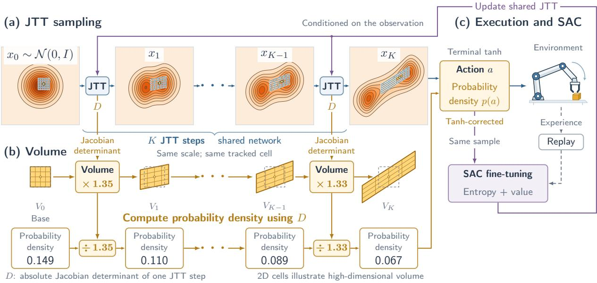
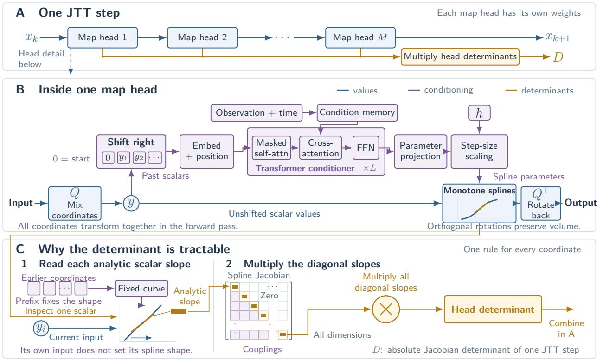
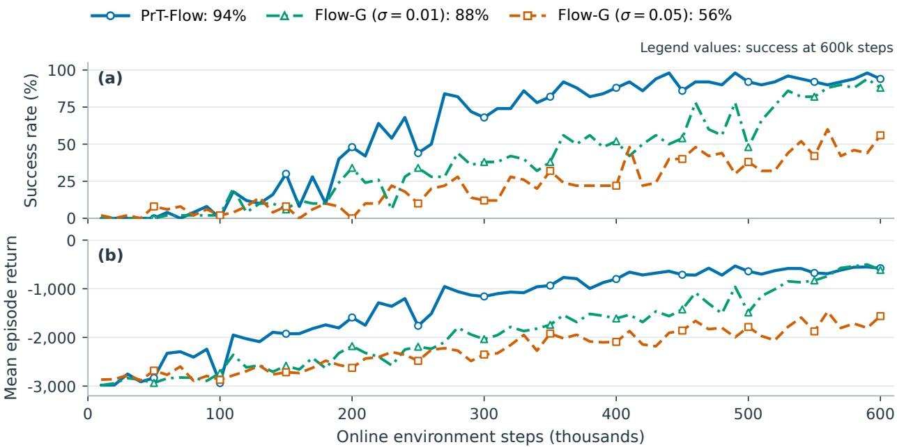

# PrT-Flow: Probability-Tractable Flow Matching for Reinforcement Learning

Congzhong Sun\* Ning Tan† School of Computer Science and Engineering, Sun Yat-sen University

## Abstract

Diffusion models and Flow Matching can represent flexible distributions over robot actions, but many reinforcement learning algorithms also require the probability of each action. We introduce PrT-Flow (Probability-Tractable Flow Matching), which computes probability density while retaining multimodal, multi-step action generation. Its Jacobian-Tractable Transformer (JTT) makes each sampling step invertible and enables efficient computation of its Jacobian determinant. We train these finite steps with Conditional Euler-step Training (CET), which supervises their displacement over one step during sampling rather than their instantaneous velocity. We prove that, under certain assumptions, CET has the same minimizers as fitting the Euler-solver updates of Flow Matching. PrT-Flow achieves 96% success on Robomimic Lift after 300 epochs of imitation learning, matching the diffusion policy reference, and 96% success on OGBench Cube-Triple after 600k online steps. These results demonstrate that invertible networks with tractable probability densities can learn effective robot policies and support SAC-style actor– critic training. Our code is available at https://github.com/Sunlight-zero/PrT-Flow.

## 1 Introduction

Learning robot manipulation from demonstrations requires a policy that maps observations, such as camera images or robot states, to actions. For a given observation, several motions may accomplish the same task, yet their average may not correspond to any valid motion. Therefore, the policy should represent a distribution over actions. With action chunking, it predicts a sequence of actions from the current observation and replans from a new observation after executing a specified number of actions.

Given an observation c, a stochastic policy treats an action chunk A as a random vector following the conditional distribution π(  c). Diffusion Policy learns this distribution from robot demonstrations using a conditional diffusion model (Chi et al., 2023). Flow Matching offers a related approach to probability transport, learning to move noise toward demonstration actions along a prescribed probability path (Lipman et al., 2023; Liu et al., 2023). PointFlowMatch uses this formulation in place of diffusion to learn robot manipulation policies (Chisari et al., 2024). Both approaches use flexible generative models to capture the multiple valid behaviors that a robot may exhibit.

Imitation learning (IL) and reinforcement learning (RL) provide complementary ways to learn robot policies: IL trains a policy to reproduce demonstrations, while RL uses task rewards to improve behavior through interaction. In the actor–critic framework widely used for continuous control, the actor represents the policy and the critic estimates state or action values. Many RL algorithms also require policy probabilities. Soft Actor-Critic (SAC) uses the log probability of a sampled action in its entropy objective (Haarnoja et al.,

  
Figure 1: The overview of PrT-Flow. (a) Conditioned on an observation, the Jacobian-Tractable Transformer (JTT) transforms standard Gaussian noise through K invertible steps of size $h = 1 / K$ . Each step returns both the updated sample and the Jacobian determinant D, without constructing a dense Jacobian matrix. (b) The deformed grid illustrates how the probability density of a sample evolves under these steps. At each step, JTT computes the absolute Jacobian determinant D. The local volume is scaled by D and the corresponding density is divided by D, allowing us to track the probability density of a sample. (c) A final tanh transformation maps the generated sample to a bounded action chunk a with its probability density p(a). SAC-style actor–critic training then uses sampled actions, their log-densities, and learned Q-values to update the FM policy.

2018), while Proximal Policy Optimization (PPO) uses the probability ratio for an action under the updated and previous policies (Schulman et al., 2017). Therefore, a generative policy must provide both action samples and their probabilities to support these algorithms.

Flow Matching provides a sampling procedure, but computing the probability density of its actions requires additional work. Continuous normalizing flows track density changes by integrating the divergence of the velocity field (Chen et al., 2018). However, a robot policy generates actions through finitely many numerical steps, whose endpoint distribution may differ from that of the continuous flow. We seek to compute the density of each action chunk under this finite sampling procedure as the chunk is generated.

We introduce PrT-Flow (Probability-Tractable Flow Matching; Figure 1), which parameterizes each sampling step with an invertible network whose Jacobian determinant is analytically tractable. The Jacobian-Tractable Transformer (JTT) combines causal conditioning with monotone scalar transformations. Each forward pass returns an updated sample and the corresponding determinant, allowing the policy to compute the probability of denoised actions using the change-of-variables formula. We train these steps with Conditional Euler-step Training (CET), which supervises their displacement over one sampling step. Each training example supervises a single step along an interpolation path between noise and a demonstration endpoint; at deployment, the policy composes the steps to generate an action chunk. PrT-Flow thus combines the computable probabilities of normalizing flows with local regression along Flow Matching paths, supporting multimodal, multi-step action generation while providing the action log probabilities used by SAC.

The causal and invertibility constraints in JTT may affect its ability to represent effective behavior. We therefore evaluate PrT-Flow in both imitation learning and offline-to-online reinforcement learning on several benchmarks. PrT-Flow achieves high task success in these settings.

We summarize our contributions as follows.

1. We propose PrT-Flow and its JTT architecture, which compute the probability density of an action during multi-step generation using tractable per-step Jacobian determinants.

2. We introduce CET, a training objective whose minimizers coincide with those of marginal Flow Matching over the same family of finite maps. We also show its equivalence to regression against Euler-solver updates of the marginal velocity field.

3. Our experiments on Lift and Cube-Triple show that the invertible architecture supports high success rates in both imitation learning and SAC-style online control.

Our code is available at https://github.com/Sunlight-zero/PrT-Flow.

## 2 Related Work

## 2.1 Diffusion and Flow Matching Policies

As discussed in the Introduction, Diffusion Policy generates action sequences by iterative denoising (Chi et al., 2023). Flow Matching and rectified flow learn velocity fields that transport noise to data (Lipman et al., 2023; Liu et al., 2023), and PointFlowMatch applies conditional Flow Matching to robot manipulation (Chisari et al., 2024). PrT-Flow retains multi-step generation to preserve the multimodal ability of Diffusion Policy and Flow Matching policies while providing the action probabilities needed for RL.

## 2.2 Reinforcement Learning for Generative Policies

DPPO fine-tunes diffusion policies with PPO over an augmented denoising decision process (Ren et al., 2025). Its PPO ratios use probabilities of individual denoising transitions, rather than the marginal probability of the final action chunk. FQL distills a Flow Matching behavior policy into a separate one-step actor optimized with Q-values (Park et al., 2025b). FPO constructs proxy probability ratios from conditional Flow Matching losses (McAllister et al., 2025), while RLDT improves a pretrained flow policy through transport updates (Lei et al., 2026). These approaches enable policy improvement without directly evaluating the exact probability of the final action samples produced by the multi-step generator. PrT-Flow instead provides the final action probability directly for policy optimization.

## 2.3 Density Evaluation for Policy Optimization

Normalizing-flow policies have been used in SAC (Ward et al., 2019; Mazoure et al., 2020) and dexterous fine-tuning with action-chunked critics (Yang et al., 2026). NFPO uses stabilized Real NVP couplings to provide action probabilities for PPO ratios (Shi et al., 2026); PrT-Flow instead learns multi-step maps through local Flow Matching regression with CET.

SAC-Flow uses noise-augmented sampling and a joint probability density over intermediate states as an entropy surrogate for offline-to-online SAC (Zhang et al., 2025a). PrT-Flow obtains the final action density directly by applying deterministic, invertible Euler-solver steps after sampling the initial Gaussian noise. We mainly compare the performance of our methods to SAC-Flow in Section 5.

GenPO++ uses a reversible solver with paired consecutive states, whose fixed Jacobian determinants cancel in PPO-style joint probability ratios (Hu et al., 2026). PrT-Flow computes the final action probability density without an auxiliary solver-history variable.

FALCON learns interval transport through average-velocity regression, uses cycle consistency to encourage invertibility, and evaluates discrete-map Jacobian determinants for Boltzmann sampling (Rehman et al., 2025). CET instead directly supervises finite maps against Euler targets at the actual sampling step size, while JTT guarantees invertibility by construction and computes determinants from analytic scalar derivatives.

Related architectures include coupling and spline flows (Dinh et al., 2017; Durkan et al., 2019), causal Transformers (Zhai et al., 2025), and learned orthogonal projections (Dai and Seljak, 2021). JTT combines learned orthogonal coordinates with causal monotone splines and step-size conditioning. RegFlow regresses against precomputed endpoint transports (Rehman et al., 2026), whereas CET supervises local finite steps. Continuous normalizing flows and maximum-entropy Flow Matching RL track probability density through velocity-field divergence (Chen et al., 2018; Zhang et al., 2025b), whereas PrT-Flow accumulates the log-determinants of its actual sampling maps.

## 3 Preliminaries

## 3.1 Robot Policies and Action Chunks

At environment time τ , the policy receives a window of observations $\left( o _ { \tau - T _ { o } + 1 } , \dots , o _ { \tau } \right)$ , where $T _ { o }$ is the observation horizon. We denote this observation condition by $c _ { \tau } .$ or simply c when the context is clear. Each action is a vector $\mathbf { \boldsymbol { a } } _ { \tau } \in \mathbb { R } ^ { D _ { c } }$ . An action-chunk policy predicts $T _ { p }$ consecutive actions, executes the first $T _ { a }$ and then replans from the latest observations (Chi et al., 2023). We flatten the predicted chunk into a single vector:

$$
a = \mathrm { v e c } ( \pmb { a } _ { \tau } , \dots , \pmb { a } _ { \tau + T _ { p } - 1 } ) \in \mathbb { R } ^ { d } , \qquad d = T _ { p } D _ { a } .
$$

We denote the conditional probability density of the predicted action chunk by $\pi _ { \boldsymbol { \theta } } ( \boldsymbol { a } \mid \boldsymbol { c } )$ , where θ denotes the policy parameters.

The demonstration dataset pairs each observation condition c with a recorded action chunk $a _ { D }$ in the environment’s bounded control coordinates $[ - 1 , 1 ]$ . The generative model operates in $\mathbb { R } ^ { d }$ and maps its endpoint u to an action through $a = \operatorname { t a n h } u .$ . The corresponding demonstration endpoint is $u _ { D } = \operatorname { a t a n h } \widetilde { a } _ { D }$ where $\tilde { a } _ { D }$ is the demonstration action after the boundary preprocessing described in Appendix A. We use $t \in [ 0 , 1 ]$ for time within the generative process, distinct from environment time $\tau$

## 3.2 Conditional Flow Matching

Given a training pair $( c , u _ { D } )$ , draw Gaussian noise $z \sim \mathcal { N } ( 0 , I _ { d } )$ and a time $t \sim \mathrm { U n i f } [ 0 , 1 ]$ independently. Let $\phi$ denote the standard Gaussian probability density. The straight path from the noise sample to the demonstration endpoint has position and velocity

$$
X _ { t } = ( 1 - t ) z + t u _ { D } , \qquad V = u _ { D } - z .\tag{1}
$$

Conditional Flow Matching fits these path velocities with a network $v _ { \theta } : \mathbb { R } ^ { d } \times [ 0 , 1 ] \times \mathcal { C }  \mathbb { R } ^ { d }$ , where is the observation condition space, by minimizing

$$
\mathcal { L } _ { \mathrm { C F M } } = \mathbb { E } _ { ( c , u _ { D } ) , z , t } \frac { 1 } { d } \| v _ { \theta } ( X _ { t } , t , c ) - V \| _ { 2 } ^ { 2 } ,\tag{2}
$$

where the expectation over $( c , u _ { D } )$ follows the demonstration distribution. With an MSE loss, the network learns to predict the average target velocity for a given state, time, and observation. We use the straight-path formulation of Lipman et al. (2023); Liu et al. (2023); for a broader treatment of the foundations, conditional objectives, and implementation, see Flow Matching Guide and Code by Lipman et al. (2024).

## 3.3 Sampling by Numerical Integration

To generate an action for a fixed observation, Flow Matching draws a Gaussian sample z and solves an ODE from the learned velocity field:

$$
\frac { d x _ { t } } { d t } = v _ { \theta } ( x _ { t } , t , c ) , \qquad x _ { 0 } = z .\tag{3}
$$

With K equal steps of size $h = 1 / K$ and grid points $t _ { k } = k h$ , we can approximately solve this ODE via an Euler solver:

$$
x _ { k + 1 } = x _ { k } + h v _ { \theta } ( x _ { k } , t _ { k } , c ) , \qquad k = 0 , \ldots , K - 1 .\tag{4}
$$

Here $x _ { k }$ is the numerical state at $t _ { k }$ . After K steps, the endpoint $u = x _ { K }$ is mapped to the action chunk. Throughout the paper, $X _ { t }$ denotes a point constructed directly on a training path, whereas $x _ { k }$ denotes a state reached by the sampler. The distribution of generated actions is determined by this finite sequence of numerical updates.

## 3.4 Soft Actor-Critic

Soft Actor-Critic (SAC) is an off-policy algorithm that learns a policy and an action-value function $Q _ { \psi } ( c , a )$ from transitions stored in a replay buffer  (Haarnoja et al., 2018). Its policy objective combines value maximization with entropy regularization:

$$
{ \mathcal { L } } _ { \mathrm { S A C } } = \mathbb { E } _ { c \sim \mathcal { B } , a \sim \pi _ { \theta } ( \cdot \vert c ) } [ \alpha \log \pi _ { \theta } ( a \mid c ) - Q _ { \psi } ( c , a ) ] ,\tag{5}
$$

where $\psi$ denotes the critic parameters and $\alpha > 0$ sets the entropy weight. The policy must provide both an action sample and its log probability, which also enters the critic’s soft Bellman target. Section 4.4.2 gives the action-chunk objectives used in our experiments.

## 4 PrT-Flow

PrT-Flow generates action chunks by repeatedly transforming noisy actions and tracking the change in probability density at each step. The Jacobian-Tractable Transformer (JTT) implements these Euler-solver updates, returning the updated state together with the update’s Jacobian determinant. Both computations are differentiable with respect to the network parameters, allowing SAC to optimize the policy through sampled actions and their log probabilities. Conditional Euler-step Training (CET) learns the Euler-solver updates by supervising their displacements along demonstration paths. We first explain how to compute probability densities during sampling, then describe the network architecture and training procedure.

## 4.1 Motivation

Consider the Euler update from Section 3.3, $x _ { k + 1 } = x _ { k } + h v _ { \theta } ( x _ { k } , t _ { k } , c )$ . Viewed as a transformation of the state $x _ { k }$ , it defines $F _ { h } ( x , t , c ) = x + h v _ { \theta } ( x , t , c )$ , which we call an Euler-step. The sampler starts from Gaussian noise and applies K such transformations. If, for fixed $h , t , c ,$ , each $F _ { h } ( \cdot , t , c )$ is a piecewise continuously differentiable bijection with a nonzero Jacobian determinant almost everywhere, the probability density after one step follows from the change-of-variables formula:

$$
p _ { k + 1 } ( x _ { k + 1 } \mid c ) = { \frac { p _ { k } ( x _ { k } \mid c ) } { | \operatorname* { d e t } J _ { F _ { h } } ( x _ { k } , t _ { k } , c ) | } } , \qquad x _ { k + 1 } = F _ { h } ( x _ { k } , t _ { k } , c ) .\tag{6}
$$

Here $p _ { k }$ is the probability density before the transformation, and $J _ { F _ { h } }$ is the Jacobian of $F _ { h } ( \cdot , t , c )$ . Its absolute determinant measures the local change in volume: expansion lowers the density, while contraction raises it. Taking logarithms makes these corrections additive across sampling steps.

For an arbitrary velocity network $v _ { \theta } .$ , differentiating the Euler-step with respect to x, while holding $h , t ,$ c fixed, gives

$$
J _ { F _ { h } } ( x , t , c ) = I + h J _ { v _ { \theta } } ( x , t , c ) .\tag{7}
$$

Each probability density correction therefore requires det $( I + h J _ { v _ { \theta } } )$ , which generally entails additional Jacobian and determinant calculations. Moreover, a finite Euler step need not be globally invertible. We address both issues by parameterizing $F _ { \theta , h }$ directly as an invertible network with an analytic determinant. Trained on Euler-step targets along Flow Matching paths, this transformation serves as a learned Euler-step. Figure 1 illustrates how it generates samples and tracks their densities.

For step size $h = 1 / K$ , our sampler is

$$
x _ { 0 } = z \sim \mathcal { N } ( 0 , I _ { d } ) , \quad x _ { k + 1 } = F _ { \theta , h } ( x _ { k } , t _ { k } , c ) , \quad t _ { k } = k h , \quad u = x _ { K } , \quad a = \operatorname { t a n h } u .\tag{8}
$$

The final transformation, a = tanh u, maps the generated endpoint into the bounded action space. Writing $\ell _ { k } = \log |$ det $J _ { F _ { \theta , h } } ( x _ { k } , t _ { k } , c ) |$ , we obtain the sampled action chunk’s log probability density:

$$
\log \pi _ { \theta } ( a \mid c ) = \log \phi ( z ) - \sum _ { k = 0 } ^ { K - 1 } \ell _ { k } - \sum _ { j = 1 } ^ { d } \log ( 1 - a _ { j } ^ { 2 } ) .\tag{9}
$$

The three terms account for the Gaussian probability density, the determinants of the learned updates, and the final tanh transformation. Under the conditions in Section 4.2, Eq. (9) gives the log probability density of the sampler in Eq. (8) almost everywhere on $( - 1 , 1 ) ^ { d }$ . Algorithm 1 computes it alongside the sample by subtracting the log-determinant at each step.

Algorithm 1 Forward sampling and action probability density   
Require: observation condition c, step count K, policy parameters θ   
Ensure: normalized action chunk a and log $\pi _ { \boldsymbol { \theta } } ( \boldsymbol { a } \mid \boldsymbol { c } )$   
1: $h  1 / K$   
2: $x _ { 0 } \sim \mathcal { N } ( 0 , I _ { d } )$   
3: ℓ  log ϕ(x0)   
4: for $k = 0 , \ldots , K - 1$ do   
5: $t _ { k } \gets k h$   
6: Apply the composed JTT update to obtain $x _ { k + 1 } = F _ { \theta , h } ( x _ { k } , t _ { k } , c )$ and its log-determinant $\ell _ { k }$   
7: $\ell \gets \ell - \ell _ { k }$   
8: end for   
9: a  tanh xK   
10: $\begin{array} { r } { \ell \gets \ell - \sum _ { j = 1 } ^ { \bar { d } ^ { - } } \log ( 1 - a _ { j } ^ { 2 } ) } \end{array}$   
11: return $a , \log \pi _ { \theta } ( a \mid c )  \ell$

## 4.2 Design Requirements for the Euler-step Network

Section 4.1 derives the action probability density from the determinant of each Euler-step. To compute these determinants while learning from Flow Matching paths, we impose four requirements on the Euler-step network.

1. Identity at zero step size and a local velocity. The step size h specifies the duration of each transport step. A zero-length step must therefore leave the state unchanged: $F _ { \theta , 0 } ( x , t , c ) = x$ . Without this condition, the transformation could produce a finite displacement even as the time interval tends to

zero. Here the local velocity is induced by the directly parameterized finite map family. Wherever the derivative with respect to h exists at zero, the identity condition gives the expansion

$$
v _ { \theta } ( x , t , c ) = \left. \partial _ { h } F _ { \theta , h } ( x , t , c ) \right| _ { h = 0 } , \qquad F _ { \theta , h } ( x , t , c ) = x + h v _ { \theta } ( x , t , c ) + o ( h ) .\tag{10}
$$

Thus, the displacement divided by h approaches $v _ { \theta }$ as $h  0$ , connecting the learned finite update to a velocity field in the zero-step limit.

2. Global invertibility and spatial regularity. To apply the change-of-variables formula, we require the Euler update, for each fixed $( t , c , h )$ , to be a piecewise continuously differentiable bijection of $\mathbb { R } ^ { d }$ with a nonzero spatial Jacobian determinant almost everywhere. Every output then has a unique preimage, allowing us to propagate its probability density through the full sequence of updates.

3. Tractable determinants during sampling. An invertible network does not necessarily provide a tractable determinant. For a typical neural network, computing the Jacobian determinant requires additional calculations beyond the forward pass. Our network must therefore compute the Jacobian determinant efficiently during the forward pass, without constructing the full Jacobian matrix, so that log det $J _ { F _ { \theta , h } } |$ can be accumulated to obtain the sample’s probability density.

4. Numerically well-behaved transformations. A transformation can be analytically invertible yet sharply compress or stretch particular directions, making repeated updates and probability density gradients sensitive to numerical perturbations. The architecture and implementation should limit such directional distortions and allow stable evaluation of log-determinants and their gradients. This is a numerical design goal.

We will describe how JTT addresses these requirements in the next section.

## 4.3 Network Architecture

One JTT feedforward computation consists of M sequential map heads. Each head combines a learned orthogonal coordinate frame, a Transformer conditioner, and monotone scalar splines. A spline is a onedimensional function made of connected curve segments; we use it to transform each scalar coordinate monotonically. Figure 2 shows the complete feedforward calculation $( \mathrm { A } )$ , the operations within a head (B), and the determinant calculation (C).

A head first rotates the state $\boldsymbol { x } \in \mathbb { R } ^ { d }$ into its learned frame, $y = Q x$ , then embeds the right-shifted scalar sequence $( 0 , y _ { 1 } , \dotsc , y _ { d - 1 } )$ as d tokens. Together with time and observation information, these tokens enter the Transformer, which predicts spline parameters for each coordinate. The splines transform the unshifted values $y _ { i } .$ , and $Q ^ { \top }$ rotates the result back to the original frame. A map head thus denotes a complete invertible transformation, distinct from the attention heads inside its Transformer.

The Transformer predicts parameters, while the splines perform the state transformation. The conditioner can therefore use nonlinear representations of the state and observations, with invertibility guaranteed by the transformation it parameterizes. Causality specifies the dependency order among scalar coordinates of the generative state; all commands in an action chunk share the current observation condition c.

## 4.3.1 Causal Scalar Transformations

For coordinate i, the Transformer predicts parameters $\eta _ { \theta , i } ( y _ { < i } , t , c )$ using only the preceding coordinates $y _ { < i } = ( y _ { 1 } , \dotsc , y _ { i - 1 } )$ , time, and observations. The resulting scalar transformation is

$$
S _ { \theta , h } ( y ) _ { i } = s _ { \theta , h } ( y _ { i } ; \eta _ { \theta , i } ( y _ { < i } , t , c ) ) , \qquad i = 1 , \dots , d .\tag{11}
$$

For example, in three dimensions, suppressing the fixed conditions $( t , c , h )$ gives

$$
\begin{array} { l } { { w _ { 1 } = s _ { 1 } ( y _ { 1 } ; \eta _ { 1 } ) , } } \\ { { w _ { 2 } = s _ { 2 } ( y _ { 2 } ; \eta _ { 2 } ( y _ { 1 } ) ) , } } \\ { { w _ { 3 } = s _ { 3 } ( y _ { 3 } ; \eta _ { 3 } ( y _ { 1 } , y _ { 2 } ) ) , } } \end{array} \quad \quad J _ { S } ( y ) = \left( \begin{array} { l l l } { { \partial _ { y _ { 1 } } w _ { 1 } } } & { { 0 } } & { { 0 } } \\ { { \partial _ { y _ { 1 } } w _ { 2 } } } & { { \partial _ { y _ { 2 } } w _ { 2 } } } & { { 0 } } \\ { { \partial _ { y _ { 1 } } w _ { 3 } } } & { { \partial _ { y _ { 2 } } w _ { 3 } } } & { { \partial _ { y _ { 3 } } w _ { 3 } } } \end{array} \right) .
$$

The Jacobian is lower triangular, so its determinant equals the product of the diagonal scalar derivatives, evaluated with the prefix held fixed. Since $\eta _ { \theta , i }$ i does not depend on $y _ { i }$ , these entries require only the derivative of each scalar transformation with respect to its own input, without differentiating through the conditioner.

Right-shifted tokens and a causal self-attention mask enforce this prefix dependence: token i can attend to tokens 1 through i, whose scalar inputs extend only to $y _ { i - 1 }$ . Cross-attention supplies time and observation information. Since all input coordinates are available during forward sampling, one Transformer pass predicts the parameters for all coordinates in parallel.

We ensure a nonzero determinant by choosing scalar transformations with positive derivatives. Each coordinate uses a monotone rational-quadratic spline (RQS) (Durkan et al., 2019), which divides a fixed interval into bins and maps each input bin to an output bin with a rational-quadratic curve. The predicted bin widths, bin heights, and knot slopes control how the spline nonlinearly expands or contracts different parts of the coordinate range. Positive widths, heights, and slopes make the transformation strictly increasing within the interval; identity tails extend it to a bijection of R. Every scalar transformation is therefore bijective at a fixed prefix, as is the full causal transformation. Analytic RQS derivatives give the diagonal entries needed to evaluate its determinant.

## 4.3.2 Step-Size Parameterization and Orthogonal Heads

To obtain the identity at $h = 0$ , we parameterize the spline through deviations from its identity settings, controlled by the step size. We convert the conditioner’s raw outputs b into bounded parameter rates and scale them by h:

$$
r ( b ) = R \operatorname { t a n h } ( b / R ) , \qquad \xi _ { h } = h r ( b )\tag{12}
$$

Here $R > 0$ controls the rate magnitude, and $\xi _ { h }$ gives the parameter offsets for the current step. We then convert these offsets into valid bin widths, bin heights, and knot slopes. Thus h scales the parameter rates before this conversion; it does not multiply the final widths, heights, or slopes.

Zero offsets produce an identity spline: the input and output bin boundaries coincide, and every knot slope equals one. Hence $h = 0$ ensures $\xi _ { h } = 0$ and $S _ { \theta , 0 } =$ id for any network output. For $h > 0$ , the predicted offsets change the spline’s shape. This parameterization embeds the identity condition from Section 4.2 directly in the architecture. Appendix C.1 gives the RQS parameterization and its positivity and identity conditions.

Within one causal head, early coordinates cannot depend on later ones. We therefore compose heads in different learned coordinate frames, so that subsequent heads act on different linear combinations of the preceding outputs. Each head takes the form

$$
y = Q x , \qquad H _ { \boldsymbol { \theta } , h } ( x ) = Q ^ { \top } S _ { \boldsymbol { \theta } , h } ( Q x ) , \qquad Q ^ { \top } Q = I .\tag{13}
$$

Time and observations are held fixed in this expression. Orthogonal frames preserve lengths, contribute no additional determinant factor, and can be inverted by taking the transpose. Composing M heads gives one sampling update:

$$
F _ { \theta , h } = H _ { \theta , h } ^ { ( M ) } \circ \cdot \cdot \cdot \circ H _ { \theta , h } ^ { ( 1 ) } .
$$

Each head has its own coordinate frame and conditioner. Since the orthogonal transformations introduce no probability density correction, the scalar log-derivatives suffice to track the density through the composition.

Every head, and therefore the complete update, becomes the identity at $h = 0$ . The same update parameters are used at all K sampling steps, with $t _ { k }$ supplied to each conditioner.

The resulting JTT update is invertible, and its determinant depends only on scalar derivatives, as formalized below.

Proposition 4.1 (Bijective feedforward transformations with tractable determinants). For fixed $( t , c , h )$ suppose every scalar transformation in Eq. (11) is a bijection $\mathbb { R }  \mathbb { R } f o r$ every fixed prefix. Then each head in Eq. (13) is bijective. At differentiable points with positive scalar derivatives,

$$
\log | \operatorname* { d e t } J _ { H _ { \theta , h } } ( x ) | = \sum _ { i = 1 } ^ { d } \log \frac { \partial s _ { \theta , h } ( y _ { i } ; \eta _ { \theta , i } ) } { \partial y _ { i } } .\tag{14}
$$

Composing heads and sampling updates adds these log-determinants at their respective input states.

The proposition is proved in Appendix C.

## 4.4 Training

## 4.4.1 Conditional Euler-step Training

Standard Flow Matching trains a velocity field along a continuous-time path, whereas our policy samples through a discrete sequence of finite maps. The identity condition $F _ { \theta , 0 } ( x , t , c ) = x$ defines a local velocity, $\partial _ { h } F _ { \theta , h } ( x , t , c ) | _ { h = 0 } ,$ wherever the derivative exists (Section 4.2). This derivative describes only the map family’s first-order behavior as $h  0$

At sampling time, the policy applies the finite map at a fixed positive step size $h = 1 / K$ . Two map families with the same derivative at $h = 0$ can therefore produce different displacements at the sampling step size: equal zero-step velocities do not imply equal finite updates.

CET therefore supervises the finite displacement at the sampling step size. Dividing this displacement by h gives a prediction of the Flow Matching path velocity that requires only one forward map evaluation. No differentiation with respect to h is needed, and parameter gradients follow by ordinary backpropagation. Appendix C.2 explains how regression with this finite quotient differs from regression with the zero-step generator.

For each training example, we sample a demonstration action chunk and apply the inverse-tanh transformation described in Section 3.1 to obtain the target $u _ { D }$ . We also sample Gaussian noise z and a time $t _ { k }$ from the sampling grid. Appendix A specifies how boundary values are handled. Interpolating between z and $u _ { D }$ gives the input $X _ { t _ { k } }$ on a straight path with velocity $u _ { D } - z$ . Applying the update network at this state and dividing its displacement by h yields the predicted path velocity:

$$
X _ { t } = ( 1 - t ) z + t u _ { D } , \qquad V = u _ { D } - z , \qquad q _ { \theta , h } ( x , t , c ) = \frac { F _ { \theta , h } ( x , t , c ) - x } { h } .\tag{15}
$$

The CET loss is similar to the Conditional Flow Matching loss (Eq. (2)). Using the sampling step size $h = 1 / K$ and a uniformly drawn grid index $k \in \{ 0 , \ldots , K - 1 \}$ , CET minimizes

$$
\mathcal { L } _ { \mathrm { C E T } , h } = \mathbb { E } _ { c , u _ { D } , z , k } \frac { 1 } { d } \| q _ { \theta , h } ( X _ { t _ { k } } , t _ { k } , c ) - V \| _ { 2 } ^ { 2 } ;\tag{16}
$$

for each endpoint pair, $X _ { t _ { k } } + h V = X _ { t _ { k + 1 } }$ , so this loss trains the map to advance the path sample toward its next grid position. Both $X _ { t _ { k } }$ and the target velocity V are constructed directly from the endpoints, requiring only one local map evaluation per training example. At deployment, the policy starts from noise and applies all K updates in sequence, using each generated state as the input to the next update.

  
Figure 2: The architecture of Jacobian-Tractable Transformer (JTT). (A) A complete update applies M map heads in sequence and returns the next noisy sample $x _ { k + 1 }$ and the absolute Jacobian determinant D. (B) A causal Transformer with L decoder blocks uses shifted scalar tokens to predict monotone spline parameters. Cross-attention provides time and observation information. The projected outputs are converted to bounded parameter rates and multiplied by h to obtain offsets from the identity settings. These offsets determine the spline parameters. Between the two orthogonal rotations, the splines transform the unshifted scalar values. (C) For a fixed coordinate prefix, time, and observation, $y _ { i }$ determines where its spline is evaluated, but not the spline’s shape. The positive analytic derivatives form the diagonal of the lower-triangular spline Jacobian, and their product gives the head determinant without evaluating off-diagonal entries. The orthogonal rotations preserve its magnitude. At step k, summing the head log-determinants at their respective inputs gives $\ell _ { k } = \log D$

The training and sampling procedures thus use the same positive step size and time grid. Algorithm 2 describes how to train our model with demonstrations.

Different noise–demonstration pairs may pass through the same state with different velocities. Given the state, time, and observation condition, the MSE loss targets the conditional average over velocities of endpoint pairs consistent with that input. The following proposition shows that, within our finite-map family, this conditional supervision and supervision using the marginal velocity have the same minimizers.

Proposition 4.2 (Minimization equivalence of CET and marginal Flow Matching). Fix $h = 1 / K > 0$ and a parameter domain Θ. Under the training distribution in Eq. (16), let $S = ( k , X _ { t _ { k } } , c )$ denote the information available to the network, and define $U = \mathbb { E } [ V \mid S ]$ and $q _ { \theta , h } = q _ { \theta , h } ( X _ { t _ { k } } , t _ { k } , c )$ . Assume that the distribution of (S, V ) is independent of θ and, for every $\theta \in \Theta , V , q _ { \theta , h } \in L ^ { 2 }$ and $q _ { \theta , h }$ is measurable with respect to S. Define

$$
\mathcal { L } _ { \mathrm { F M } , h } ( \theta ) = \frac { 1 } { d } \mathbb { E } \Vert q _ { \theta , h } - U \Vert ^ { 2 } , \qquad C = \frac { 1 } { d } \mathbb { E } \Vert V - U \Vert ^ { 2 } .\tag{17}
$$

## Algorithm 2 Conditional Euler-step Training

Require: demonstration windows after normalization and inverse-tanh transformation $\mathcal { D } _ { u } = \{ ( c , u _ { D } ) \}$ , initialized   
θ, step count K, batch size B, update budget U   
Ensure: trained policy parameters θ   
1: $h  1 / K$   
2: for $r = 1 , \ldots , U$ do   
3: Sample a minibatch $\{ ( c _ { i } , u _ { D , i } ) \} _ { i = 1 } ^ { B }$ from $\mathcal { D } _ { u }$   
4: for $i = 1 , \ldots , B$ do   
5: Draw $z _ { i } \sim \mathcal { N } ( 0 , I _ { d } )$ and $k _ { i } \sim$ Unif $\{ 0 , \ldots , K - 1 \}$   
6: $t _ { i } \gets k _ { i } h ; X _ { i } \gets ( 1 - t _ { i } ) z _ { i } + t _ { i } u _ { D , i } ; V _ { i } \gets u _ { D , i } - z _ { i }$   
7: $q _ { i } \gets \left( F _ { \theta , h } ( X _ { i } , t _ { i } , c _ { i } ) - X _ { i } \right) / h$   
8: end for   
9: $\begin{array} { r } { \mathcal { L }  \frac { 1 } { B d } \sum _ { i = 1 } ^ { B } \| q _ { i } - V _ { i } \| _ { 2 } ^ { 2 } } \end{array}$   
10: Take one optimizer step on θ using $\nabla _ { \boldsymbol { \theta } } \mathcal { L }$   
11: end for   
12: return θ

Then, for every $\theta \in \Theta ,$

$$
{ \mathcal { L } } _ { \mathrm { C E T } , h } ( \theta ) = C + { \mathcal { L } } _ { \mathrm { F M } , h } ( \theta ) ,\tag{18}
$$

where $C$ is independent of θ. For the marginal Euler target $T _ { h } ( S ) = X _ { t _ { k } } + h U$ , also define

$$
\mathcal { L } _ { \mathrm { E } , h } ( \theta ) = \frac { 1 } { d } \mathbb { E } \Vert F _ { \theta , h } ( X _ { t _ { k } } , t _ { k } , c ) - T _ { h } ( S ) \Vert ^ { 2 } = h ^ { 2 } \mathcal { L } _ { \mathrm { F M } , h } ( \theta ) .\tag{19}
$$

Consequently,

$$
\operatorname * { a r g m i n } _ { \theta \in \Theta } \mathcal { L } _ { \mathrm { C E T } , h } = \operatorname * { a r g m i n } _ { \theta \in \Theta } \mathcal { L } _ { \mathrm { F M } , h } = \operatorname * { a r g m i n } _ { \theta \in \Theta } \mathcal { L } _ { \mathrm { E } , h } .\tag{20}
$$

Similar to Conditional Flow Matching, CET uses velocities from directly sampled endpoint pairs without explicitly computing the marginal velocity U (Lipman et al., 2024). See Appendix C.2 for the proof.

## 4.4.2 SAC-Style Policy Learning

We follow an offline-to-online actor–critic schedule based on SAC-Flow (Zhang et al., 2025a). Each offline iteration performs two successive updates on the same batch. The first trains the actor with CET and the critics using the SAC critic loss. The second applies a SAC-style actor–critic update to the same batch. During online learning, the policy executes sampled action chunks and stores the resulting transitions in replay. After warm-up, it trains the actor and critics on replay windows using the objectives below. CET is used only offline; online actor updates use the SAC-style objective.

Let $a _ { B }$ denote the action chunk in a replay window, drawn from either the offline dataset or online interaction. The SAC-style actor objective is

$$
\mathcal { L } _ { \mathrm { a c t o r } } = \mathbb { E } _ { \mathit { c } \sim \mathit { B } , \mathit { a } \sim \pi _ { \theta } ( \cdot | c ) } [ \alpha \log \pi _ { \theta } ( a \mid c ) - \bar { Q } _ { \psi } ( c , a ) ] + \lambda \mathbb { E } _ { ( c , a _ { B } ) \sim \mathit { B } , \mathit { a } \sim \pi _ { \theta } ( \cdot | c ) } \frac { 1 } { d } \| a - a _ { B } \| _ { 2 } ^ { 2 } ,\tag{21}
$$

where ${ \bar { Q } } _ { \psi }$ averages the two critics $Q _ { \psi 1 }$ and $Q _ { \psi _ { 2 } }$ , and λ weights the action-matching penalty.

These objectives act on different quantities. CET uses demonstrations to supervise local transport at noisy intermediate states. The Q term evaluates the complete sampled chunk in terms of task reward, while the entropy term uses its log probability. Action matching penalizes deviations from replay actions directly in action space, constraining reward-driven updates even when no CET path is sampled. During online learning, the reference actions change as the policy collects new replay data. Algorithm 1 computes a and its log probability log $\pi _ { \boldsymbol { \theta } } ( \boldsymbol { a } \mid \boldsymbol { c } )$ together, allowing policy gradients to backpropagate.

For a complete predicted chunk executed from environment time τ with $T _ { p } = T _ { a } ,$ , define its discounted return as $\begin{array} { r } { R _ { \tau } ^ { ( T _ { a } ) } = \sum _ { i = 0 } ^ { T _ { a } - 1 } \gamma ^ { i } r _ { \tau + i } } \end{array}$ , where $r _ { \tau + i }$ is the reward at each step and $\gamma \in [ 0 , 1 )$ is the discount factor. Let $m _ { \tau } ^ { ( T _ { a } ) }$ indicate whether bootstrapping is permitted. Sampling the next chunk $a ^ { \prime } \sim \pi _ { \theta } ( \cdot \mid c _ { \tau + T _ { a } } )$ gives the soft target

$$
y _ { \tau } = R _ { \tau } ^ { ( T _ { a } ) } + \gamma ^ { T _ { a } } m _ { \tau } ^ { ( T _ { a } ) } \left[ \bar { Q } _ { \mathrm { t a r g e t } } ( c _ { \tau + T _ { a } } , a ^ { \prime } ) - \alpha \log \pi _ { \theta } ( a ^ { \prime } \mid c _ { \tau + T _ { a } } ) \right] , \quad a ^ { \prime } \sim \pi _ { \theta } ( \cdot \mid c _ { \tau + T _ { a } } ) .\tag{22}
$$

Here $\bar { Q } _ { \mathrm { t a r g e t } }$ averages the two target critics. Each critic minimizes the squared Bellman residual between its value for the replayed chunk and $y _ { \tau }$ . Both the actor objective and the critic target use the log probability of the complete executed chunk. Appendix A specifies the settings of the replay masks, optimizers, target-network updates, and initial entropy temperature.

## 5 Evaluation

Our experiments address three questions: can JTT learn effective imitation policies under its structural constraints; can the same policy support offline-to-online actor–critic learning; and how do finite-step supervision and learned coordinate frames affect task performance? Lift evaluates imitation learning and the two design choices, while Cube-Triple evaluates online learning and compares offline training configurations.

## 5.1 Experimental Setup

Benchmarks. For Robomimic Lift (Mandlekar et al., 2022), we use the low-dimensional Multi-Human demonstration dataset, comprising 27,582 training windows. The robot must grasp and lift a cube based on a 19-dimensional state observation, with each action chunk containing four seven-dimensional end-effector and gripper commands (d = 28). OGBench Cube-Triple Task 4 (Park et al., 2025a) uses the cube-tripleplay-v0 dataset and requires the robot to move three cubes to a target configuration. The policy maps a 46-dimensional state observation to a chunk of five commands, each with five control coordinates. Both tasks use $T _ { o } = 1$ and $T _ { p } = T _ { a }$ : the robot executes the full predicted chunk before replanning.

Policies and training. PrT-Flow applies four orthogonal JTT heads per update, starting from a Gaussian base distribution and using a final tanh transformation to map outputs to the normalized action bounds. On Lift, we use 16 sampling steps with CET and evaluate the exponential moving average (EMA) weights after 300 training epochs. On Cube-Triple, we use four sampling steps and train the randomly initialized policy and critics for 30,000 paired offline iterations, followed by 600,000 primitive environment steps of online learning. The main configuration uses finite-step CET at the four sampling grid times and an online action-matching weight of λ = 100. Appendix A gives the hyperparameters and action preprocessing details.

Baselines and metrics. The Lift reference is a denoising diffusion probabilistic model (DDPM) policy trained on the same data, with the same action horizons and evaluation episodes. On Cube-Triple, we compare against Flow-G, the gated velocity policy from the SAC-Flow family (Zhang et al., 2025a), with sampling noise standard deviations $\sigma = 0 . 0 1$ and 0.05. All three runs use 30k paired offline iterations and 600k online primitive steps. Flow-G samples with a gated MLP and added noise, whereas PrT-Flow uses deterministic JTT updates; all three use the same raw demonstration corpus. Success rate is the fraction of episodes satisfying the environment’s success criterion, and mean return is the average undiscounted episode reward.

Each evaluation comprises 50 episodes, with a maximum of 500 steps per episode on Lift and 1,000 on Cube-Triple. We report Lift results after 300 training epochs and evaluate Cube-Triple every 10k online steps, reporting results at 600k steps.

## 5.2 Main Results

Imitation learning on Lift. PrT-Flow achieves a 96% success rate, matching the DDPM baseline when both policies are evaluated after 300 training epochs (Table 1). This result shows that causal, invertible JTT updates can support effective closed-loop manipulation despite their structural constraints.

Table 1: Lift imitation learning after 300 epochs. Both policies are evaluated on the same set of 50 episodes.
<table><tr><td>Policy</td><td>Evaluation epoch</td><td>Success rate</td></tr><tr><td>DDPM reference</td><td>300</td><td>96%</td></tr><tr><td>PrT-Flow (JTT, CET)</td><td>300</td><td>96%</td></tr></table>

Offline-to-online learning on Cube-Triple. At 600k online steps, PrT-Flow succeeds in 47 of 50 development evaluation episodes, compared with 44 for Flow-G (σ = 0.01) and 28 for Flow-G (σ = 0.05). Their mean returns are 578.28, 613.80, and 1561.86, respectively (Table 2). Figure 3 shows the full learning trajectories on this shared development set. In separate final evaluations after training, PrT-Flow succeeds in 48 of 50 episodes, compared with 46 for Flow-G (σ = 0.01) and 25 for Flow-G (σ = 0.05).

Although Flow-G (σ = 0.01) achieves a slightly higher final mean return ( 475.48 versus 530.80), PrT-Flow improves more rapidly during online training (Figure 3). At half the online training budget (300k primitive environment steps), PrT-Flow achieves a development success rate of 68% and a mean return of 1158.22, compared with 38% and 2035.18 for Flow-G (σ = 0.01). These learning curves indicate an advantage in online sample efficiency for PrT-Flow in this comparison. The resulting policy achieves effective online control using JTT and the action probabilities computed during its forward pass. Appendix B reports numerical checks of the trained policy’s forward log probabilities and their parameter gradients.

Table 2: Cube-Triple Task 4 after 30k paired offline iterations and 600k online primitive environment steps. Development results use the same set of 50 evaluation episodes for all policies. Final results come from separate 50-episode evaluations after training.
<table><tr><td>Policy</td><td>Dev. SR</td><td>Dev. return</td><td>Final SR</td><td>Final return</td></tr><tr><td>Flow-G, σ = 0.01</td><td>88%</td><td>-613.80</td><td>92%</td><td>-475.48</td></tr><tr><td>Flow-G, σ = 0.05</td><td>56%</td><td>-1561.86</td><td>50%</td><td>-1635.42</td></tr><tr><td>PrT-Flow, CET</td><td>94%</td><td>-578.28</td><td>96%</td><td>-530.80</td></tr></table>

## 5.3 Ablations and Offline Training Configurations

We first examine two design choices using pairs of Lift runs with matched training settings: the supervised quantity and the orthogonal coordinate frames. Both comparisons use 16 sampling steps and evaluate EMA policies after 300 training epochs (Table 3). These are separate runs with a 300-epoch cosine schedule; the PrT-Flow benchmark in Table 1 uses the epoch-300 checkpoint of a 3,000-epoch schedule.

  
Figure 3: Learning curves on Cube-Triple for PrT-Flow and Flow-G $( \sigma = 0 . 0 1$ and 0.05). Panels A and B show success rate and mean return on the shared set of 50 development episodes. Lines connect evaluations without smoothing. At 600k online steps, success rates are 94% for PrT-Flow, 88% for Flow-G $( \sigma = 0 . 0 1 )$ , and 56% for Flow-G $( \sigma = 0 . 0 5 )$ . Values in the legend correspond to this endpoint, rather than each run’s best checkpoint.

Table 3: Design ablations on Lift with K = 16 after 300 training epochs. Each block reports a separate pair of runs with matched training settings, with 50 evaluation episodes per model. Within each pair, only the design choice listed in the first column changes.
<table><tr><td>Design choice</td><td>Configuration Successful episodes</td></tr><tr><td rowspan="2">Supervised quantity</td><td>CET finite-step quotient 49/50</td></tr><tr><td>Zero-step generator 33/50</td></tr><tr><td rowspan="2">Coordinate frame Learned orthogonal frames</td><td>49/50</td></tr><tr><td>Fixed initial random orthogonal frames 33/50</td></tr></table>

Finite-step supervision. The two policies share the network architecture, initialization, training time grid, and demonstration endpoints in generative coordinates. We change only whether the training objective regresses the finite-step quotient $( F _ { \theta , h } - \mathrm { i d } ) / h \mathrm { a t } h = 1 / 1 6$ or the zero-step generator $\partial _ { h } F _ { \theta , h } | _ { h = 0 }$ against the conditional path velocity. CET succeeds in 49 of 50 episodes, compared with 33 for generator supervision. This result supports supervising the finite update used during sampling.

Learned coordinate frames. In a separate matched pair, both policies use CET and start from the same initial weights and random orthogonal frames. One policy learns the frames jointly with the rest of JTT; the other keeps them fixed at initialization. The learned-frame policy succeeds in 49 of 50 episodes, compared with 33 for fixed frames. Thus, learning the coordinate system improves task performance in this comparison, supporting the use of trainable orthogonal transformations alongside the causal scalar maps.

Offline training configurations on Cube-Triple. We also train the same JTT architecture with an alternative offline velocity objective, regressing the zero-step generator $\partial _ { h } F _ { \theta , h } | _ { h = 0 }$ against the conditional path velocity at continuously sampled times, with endpoints in normalized action coordinates. CET instead supervises the finite displacement divided by h at $h = 1 / 4$ , using the four sampling times and demonstration endpoints transformed as in Section 3.1. Both configurations retain the same paired offline actor–critic schedule and SAC-style online learning. They thus differ in how the local maps are supervised offline, while preserving invertible sampling and tractable probability density evaluation.

Table 4: PrT-Flow with two offline training configurations, evaluated after 30k paired offline iterations and 600k online steps. Both use the same development and final evaluation sets, with 50 episodes in each set.
<table><tr><td rowspan="2">Supervised quantity / time sampling</td><td colspan="5">Endpoint</td></tr><tr><td>coordinates</td><td>Dev. SR</td><td>Dev. return</td><td>Final SR</td><td>Final return</td></tr><tr><td>Generator velocity / continuous</td><td>Action</td><td>88%</td><td>-806.02</td><td>94%</td><td>-619.72</td></tr><tr><td>CET quotient / grid</td><td>Generative space</td><td>94%</td><td>-578.28</td><td>96%</td><td>-530.80</td></tr></table>

CET achieves higher development success at 40 of the 42 checkpoints from 190k to 600k steps, with a final success rate of 96% versus 94% for velocity supervision. Although the final difference is one episode, the checkpoint comparison indicates different training trajectories. Because the estimator, time sampling, and target coordinates all change, this comparison evaluates the complete offline configurations.

## 5.4 Discussion

The analysis shows how PrT-Flow computes the action probabilities defined by the finite-step sampling procedure used at deployment. JTT provides analytic Jacobian corrections through invertible finite maps, while CET supervises finite displacements at the deployment step size and relates this objective to marginal Flow Matching regression over the same map family. The experiments show that the invertible and causal structure needed for this computation still permits effective robot behavior: PrT-Flow achieves high imitation success on Lift and supports offline-to-online actor–critic learning on Cube-Triple with the same action generation and probability evaluation procedure. Thus, one policy can combine multi-step Flow Matching generation with an explicit probability density for the actions it executes.

PrT-Flow and methods such as SAC-Flow differ in how they obtain policy probabilities. SAC-Flow introduces random perturbations into finite-step sampling to define probabilities over sampling paths. PrT-Flow applies deterministic, invertible maps after sampling the initial Gaussian noise, computing the probability density of the final action chunk directly using the change-of-variables formula. In our Flow-G experiments (Figure 3), changing only the sampling noise standard deviation from $\sigma = 0 . 0 1$ to 0.05 produces markedly different learning trajectories and fixed-budget performance, indicating that the noise scale itself can substantially affect training. PrT-Flow does not need stepwise noise to compute action probabilities, so it requires no additional sampling noise scale σ for this purpose. Its high online control performance on Cube-Triple shows that explicit finite-step action densities can support effective policy learning without a stochastic path-based probability construction.

This finite-step probability computation also provides a basis for extensions beyond SAC’s action-entropy objective. Inverting the transformations allows the same policy to re-evaluate a given action under updated parameters, making it naturally applicable to likelihood ratios, KL regularization, importance weighting, and replay-action rescoring. Extensions to longer prediction horizons, probability densities of executed action prefixes, visually conditioned policies, and real robots would help establish the scope of probability-tractable Flow Matching as a general generative policy representation.

## 6 Conclusion

We introduced PrT-Flow to make the probability density of a robot’s executed action chunk directly computable while preserving multimodal multi-step Flow Matching generation. The central idea is to make the finite sampling procedure itself invertible with tractable Jacobian determinants, so that action probabilities can be computed directly from the sampling steps. JTT combines causal monotone splines and orthogonal coordinate transformations to accumulate density changes in the same forward pass that generates an action; CET supervises finite displacements at the deployment step size, aligning training with the sampling maps actually used. Proposition 4.2 establishes that, at a fixed step size and within the same finite map family, CET and marginal Flow Matching regression have the same set of minimizing parameters.

The experiments show that the structural constraints needed to track probabilities do not prevent effective robot learning: PrT-Flow achieves 48 successes in 50 imitation-learning evaluation episodes on Robomimic Lift and serves as the action generator in offline-to-online SAC-style learning on OGBench Cube-Triple, also reaching 48 successes in 50 final evaluation episodes. These results provide evidence that a Flow Matching policy can retain multi-step generation while explicitly evaluating the probability density of the actions it executes. Constraining the finite sampling maps allows a single policy to provide both capabilities.

PrT-Flow thus provides a broader basis for studying generative robot policies: the same finite-step model generates actions from noise and returns their explicit probability densities. Future work can exploit this property across a wider range of policy optimization methods. Finite-step generative policies with tractable probabilities may thereby offer a general policy representation that connects the expressive capacity of Flow Matching with likelihood-based reinforcement learning.

## AI Use Statement

ChatGPT and OpenAI Codex were used to assist with Python code implementation, Lean 4 formalization, English-language editing, and LaTeX formatting during the preparation of this manuscript.

## References

Ricky T. Q. Chen, Yulia Rubanova, Jesse Bettencourt, and David K. Duvenaud. Neural ordinary differential equations. In Advances in Neural Information Processing Systems, volume 31, 2018. URL https://proceedings.neurips.cc/paper/2018/hash/ 69386f6bb1dfed68692a24c8686939b9-Abstract.html.

Cheng Chi, Siyuan Feng, Yilun Du, Zhenjia Xu, Eric Cousineau, Benjamin CM Burchfiel, and Shuran Song. Diffusion policy: Visuomotor policy learning via action diffusion. In Proceedings of Robotics: Science and Systems, Daegu, Republic of Korea, July 2023. doi: 10.15607/RSS.2023.XIX.026. URL https://www.roboticsproceedings.org/rss19/p026.html.

Eugenio Chisari, Nick Heppert, Max Argus, Tim Welschehold, Thomas Brox, and Abhinav Valada. Learning robotic manipulation policies from point clouds with conditional flow matching. arXiv preprint arXiv:2409.07343, 2024. URL https://arxiv.org/abs/2409.07343.

Biwei Dai and Uros Seljak. Sliced iterative normalizing flows. In Proceedings of the 38th International Conference on Machine Learning, volume 139 of Proceedings of Machine Learning Research, pages 2352–2364. PMLR, 2021. URL https://proceedings.mlr.press/v139/dai21a.html.

Laurent Dinh, Jascha Sohl-Dickstein, and Samy Bengio. Density estimation using real NVP. In International Conference on Learning Representations, 2017. URL https://arxiv.org/abs/1605.08803.

Conor Durkan, Artur Bekasov, Iain Murray, and George Papamakarios. Neural spline flows. In Advances in Neural Information Processing Systems, volume 32, 2019. URL https://proceedings.neurips.cc/paper\_files/paper/2019/hash/ 7ac71d433f282034e088473244df8c02-Abstract.html.

Tuomas Haarnoja, Aurick Zhou, Pieter Abbeel, and Sergey Levine. Soft actor-critic: Off-policy maximum entropy deep reinforcement learning with a stochastic actor. In Proceedings of the 35th International Conference on Machine Learning, volume 80 of Proceedings of Machine Learning Research, pages 1861–1870, 2018. URL https://proceedings.mlr.press/v80/haarnoja18b.html.

Ke Hu, Shutong Ding, Panxin Tao, Jingya Wang, and Ye Shi. GenPO++: Generative policy optimization with Jacobian-free likelihood ratios. arXiv preprint arXiv:2606.06967, 2026. URL https://arxiv. org/abs/2606.06967.

Boshu Lei, Kostas Daniilidis, and Antonio Loquercio. Reinforcement learning for flow-matching policies with density transport. arXiv preprint arXiv:2606.08602, 2026. doi: 10.48550/arXiv.2606.08602. URL https://arxiv.org/abs/2606.08602.

Yaron Lipman, Ricky T. Q. Chen, Heli Ben-Hamu, Maximilian Nickel, and Matt Le. Flow matching for generative modeling. In International Conference on Learning Representations, 2023. URL https: //arxiv.org/abs/2210.02747.

Yaron Lipman, Marton Havasi, Peter Holderrieth, Neta Shaul, Matt Le, Brian Karrer, Ricky T. Q. Chen, David Lopez-Paz, Heli Ben-Hamu, and Itai Gat. Flow matching guide and code. arXiv preprint arXiv:2412.06264, 2024. doi: 10.48550/arXiv.2412.06264. URL https://arxiv.org/abs/2412.06264.

Xingchao Liu, Chengyue Gong, and Qiang Liu. Flow straight and fast: Learning to generate and transfer data with rectified flow. In International Conference on Learning Representations, 2023. URL https: //arxiv.org/abs/2209.03003.

Ajay Mandlekar, Danfei Xu, Josiah Wong, Soroush Nasiriany, Chen Wang, Rohun Kulkarni, Li Fei-Fei, Silvio Savarese, Yuke Zhu, and Roberto Martín-Martín. What matters in learning from offline human demonstrations for robot manipulation. In Proceedings of the 5th Conference on Robot Learning, volume 164 of Proceedings of Machine Learning Research, pages 1678–1690, 2022. URL https://proceedings.mlr.press/v164/mandlekar22a.html.

Bogdan Mazoure, Thang Doan, Audrey Durand, Joelle Pineau, and R. Devon Hjelm. Leveraging exploration in off-policy algorithms via normalizing flows. In Proceedings of the Conference on Robot Learning, volume 100 of Proceedings of Machine Learning Research, pages 430–444. PMLR, 2020. URL https: //proceedings.mlr.press/v100/mazoure20a.html.

David McAllister, Songwei Ge, Brent Yi, Chung Min Kim, Ethan Weber, Hongsuk Choi, Haiwen Feng, and Angjoo Kanazawa. Flow matching policy gradients. arXiv preprint arXiv:2507.21053, 2025. URL https://arxiv.org/abs/2507.21053.

Seohong Park, Kevin Frans, Benjamin Eysenbach, and Sergey Levine. OGBench: Benchmarking offline goal-conditioned RL. In International Conference on Learning Representations, 2025a. URL https://proceedings.iclr.cc/paper\_files/paper/2025/hash/ ecd92623ac899357312aaa8915853699-Abstract-Conference.html.

Seohong Park, Qiyang Li, and Sergey Levine. Flow q-learning. In Proceedings of the 42nd International Conference on Machine Learning, volume 267 of Proceedings of Machine Learning Research, pages 48104– 48127. PMLR, 2025b. URL https://proceedings.mlr.press/v267/park25f.html.

Danyal Rehman, Tara Akhound-Sadegh, Artem Gazizov, Yoshua Bengio, and Alexander Tong. FALCON: Few-step accurate likelihoods for continuous flows. arXiv preprint arXiv:2512.09914, 2025. URL https://arxiv.org/abs/2512.09914.

Danyal Rehman, Oscar Davis, Jiarui Lu, Jian Tang, Michael Bronstein, Yoshua Bengio, Alexander Tong, and Avishek Joey Bose. Efficient regression-based training of normalizing flows for boltzmann generators. In The Fourteenth International Conference on Learning Representations, 2026. URL https://openreview.net/forum?id=ctdnzPxDI3.

Allen Z. Ren, Justin Lidard, Lars L. Ankile, Anthony Simeonov, Pulkit Agrawal, Anirudha Majumdar, Benjamin Burchfiel, Hongkai Dai, and Max Simchowitz. Diffusion policy policy optimization. In International Conference on Learning Representations, 2025. URL https://proceedings.iclr.cc/paper\_files/paper/2025/hash/ c0749c39aaff9e9e4c91f7118bf21b1e-Abstract-Conference.html.

John Schulman, Filip Wolski, Prafulla Dhariwal, Alec Radford, and Oleg Klimov. Proximal policy optimization algorithms. arXiv preprint arXiv:1707.06347, 2017. URL https://arxiv.org/abs/1707. 06347.

Diyuan Shi, Yiqi Tang, Zifeng Zhuang, and Donglin Wang. NFPO: Stabilized policy optimization of normalizing flow for robotic policy learning. arXiv preprint arXiv:2603.11470, 2026. URL https: //arxiv.org/abs/2603.11470.

Patrick Nadeem Ward, Ariella Smofsky, and Avishek Joey Bose. Improving exploration in soft-actor-critic with normalizing flows policies. arXiv preprint arXiv:1906.02771, 2019. URL https://arxiv.org/ abs/1906.02771.

Chenyu Yang, Denis Tarasov, Davide Liconti, Romain Guntz, Hehui Zheng, and Robert K. Katzschmann. SERNF: Sample-efficient real-world dexterous policy fine-tuning via action-chunked critics and normalizing flows. arXiv preprint arXiv:2602.09580, 2026. URL https://arxiv.org/abs/2602.09580.

Shuangfei Zhai, Ruixiang Zhang, Preetum Nakkiran, David Berthelot, Jiatao Gu, Huangjie Zheng, Tianrong Chen, Miguel Ángel Bautista, Navdeep Jaitly, and Joshua M. Susskind. Normalizing flows are capable generative models. In Proceedings ofthe 42nd International Conference on Machine Learning, volume 267 of Proceedings ofMachine Learning Research, pages 74348–74369. PMLR, 2025. URL https: //proceedings.mlr.press/v267/zhai25d.html.

Yixian Zhang, Shu’ang Yu, Tonghe Zhang, Mo Guang, Haojia Hui, Kaiwen Long, Yu Wang, Chao Yu, and Wenbo Ding. SAC Flow: Sample-efficient reinforcement learning of flow-based policies via velocityreparameterized sequential modeling. arXiv preprint arXiv:2509.25756, 2025a. URL https://arxiv. org/abs/2509.25756.

Yuyang Zhang, Yang Hu, Bo Dai, and Na Li. Max-entropy reinforcement learning with flow matching and a case study on LQR. arXiv preprint arXiv:2512.23870, 2025b. doi: 10.48550/arXiv.2512.23870. URL https://arxiv.org/abs/2512.23870.

## A Experimental Details

Table 5: Optimization settings for the main PrT-Flow experiments. Cube-Triple uses Adam for the actor, critics, and entropy temperature.
<table><tr><td>Parameter</td><td>Lift</td><td>Cube-Triple</td></tr><tr><td>Batch size</td><td>256</td><td>256</td></tr><tr><td>Optimizer</td><td>AdamW</td><td>Adam</td></tr><tr><td>Learning rate</td><td> $1 0 ^ { - 4 }$ </td><td> $3 \times 1 0 ^ { - 4 }$ </td></tr><tr><td>Weight decay</td><td> $1 0 ^ { - 6 }$ </td><td></td></tr><tr><td>AdamW  $( \beta _ { 1 } , \beta _ { 2 } ) / \epsilon$ </td><td> $\left( 0 . 9 , 0 . 9 9 9 \right) / 1 0 ^ { - 8 }$ </td><td></td></tr><tr><td>Cosine warm-up (optimizer steps)</td><td>100</td><td></td></tr><tr><td>EMA power / maximum decay</td><td>0.75 / 0.995</td><td></td></tr><tr><td>Critic hidden layers / width</td><td></td><td>4/512</td></tr><tr><td>Critic aggregation</td><td></td><td>Mean of twin Q-values</td></tr><tr><td>Discount  $\gamma /$  target coefficient Ttarget</td><td></td><td>0.99 / 0.005</td></tr><tr><td>Replay buffer-size option</td><td></td><td> $2 \times 1 0 ^ { 6 }$ </td></tr><tr><td>Online warm-up (environment steps) / UTD</td><td></td><td> $5 { , } 0 0 0 / 1$ </td></tr><tr><td>Initial entropy temperature / target entropy</td><td></td><td> $0 . 2 / 0$ </td></tr><tr><td>Online action-MSE weight</td><td></td><td>100</td></tr></table>

Preprocessing. Lift observations use per-coordinate min–max normalization from training statistics to a nominal [ 1, 1] range without clipping; 10% of demonstrations are reserved for validation. Cube-Triple’s offline actions are clipped with margin $1 0 ^ { - 5 }$ . After task preprocessing, any remaining action coordinates at 1 are replaced by $\pm ( 1 - 1 0 ^ { - 6 } )$ , leaving interior values unchanged, to obtain $\tilde { a } _ { D } ;$ CET then uses $u _ { D } = \operatorname { a t a n h } \tilde { a } _ { D }$

Training details. The main Lift result is the epoch-300 checkpoint of a 3,000-epoch cosine schedule, whereas the matched ablations use a full 300-epoch schedule; both use the warm-up and EMA settings in Table 5. For incomplete replay windows, invalid positions are masked, but the loss is divided by all entries in the batch–time–coordinate array, including masked entries. The alternative generator-supervised configuration in Table 4 uses continuous times and the latent endpoint $a _ { D }$ , corresponding to $\operatorname { t a n h } ( a _ { D } )$ in action space, whereas CET uses the inverse-tanh endpoint.

## A.1 Flow-G Baseline

The two Flow-G configurations differ only in sampling noise $( \sigma = 0 . 0 1 \mathrm { o r } 0 . 0 5 ) \mathrm { : }$ ; both use transition noise 0.05 in SAC actor training. They retain the noise reuse and log-probability calculation of the authors’ released offline-to-online implementation.1 SAC-Flow’s Gaussian construction defines a joint path probability density, with action probability density obtained by integrating out intermediate states (Zhang et al., 2025a, Appendix A.2, Eqs. (15)–(16)). The released implementation instead reuses fixed-key perturbations across Euler steps while summing Gaussian transition log terms, the base log probability, and the tanh correction. This sum serves as its entropy surrogate rather than the exact log probability of the sampled path or action. All three policies share the development evaluation panel and undergo separate 50-episode final evaluations.

## B Numerical Verification

Scalar-map checks. We test the policy’s scalar RQS configuration (eight bins, $B = 4 ,$ rate bound 16) at $h = 1 / 1 6$ and $h = 1 / 4$ . For each of five random seeds, we draw independent sets of 4,096 inputs and outputs, including 128 points in the identity tails in each set, and independent standard-normal raw parameters. With parameters held fixed, we compare analytic and autodifferentiated log-derivatives, check both inverse compositions, and compare forward and inverse log probabilities under a standard Gaussian base. The same draws are evaluated on CPU in FP32 and FP64, giving 40,960 checks per direction and precision. Table 6 reports the maximum absolute discrepancies. All evaluated derivatives are positive; the zero-step and identity-tail checks also pass.

Table 6: Numerical consistency of scalar RQS maps. Here f denotes a map with fixed parameters and step size. Each entry is the maximum absolute discrepancy across the five seeds and two step sizes; the last two rows also take the maximum over both directions.
<table><tr><td>Comparison</td><td>FP32</td><td>FP64</td></tr><tr><td> $f ^ { - 1 } ( f ( x ) )$  VS. x</td><td> $9 . 5 4 \times 1 0 ^ { - 7 }$ </td><td> $1 . 3 3 \times 1 0 ^ { - 1 5 }$ </td></tr><tr><td> $f ( f ^ { - 1 } ( y ) )$  vs. y</td><td> $7 . 1 5 \times 1 0 ^ { - 7 }$ </td><td> $1 . 7 8 \times 1 0 ^ { - 1 5 }$ </td></tr><tr><td>Analytic vs. autodifferentiated log-derivative</td><td> $8 . 2 0 \times 1 0 ^ { - 7 }$ </td><td> $1 . 5 5 \times 1 0 ^ { - 1 5 }$ </td></tr><tr><td>Forward vs. inverse log probability</td><td> $4 . 5 3 \times 1 0 ^ { - 6 }$ </td><td> $6 . 2 2 \times 1 0 ^ { - 1 5 }$ </td></tr></table>

Trained-policy checks. We check probability density evaluation on the main Cube-Triple CET policy at 600k online steps, which generates 25-dimensional action chunks through four finite updates. On the CPU, we compare FP32 and FP64 forward log probabilities using the same parameters, 32 real dataset states, and fixed Gaussian noise. For the concatenated parameter gradient g of the mean log probability, we report $\lVert g _ { 3 2 } - g _ { 6 4 } \rVert _ { 2 } / \lVert g _ { 6 4 } \rVert _ { 2 }$

For three of these sampling trajectories, we also compare each update’s analytic log-determinant with that of its FP64 autodifferentiated Jacobian, giving 12 local comparisons. Table 7 shows close numerical agreement for both the local determinants and the forward probability computations.

Table 7: Numerical consistency of the main Cube-Triple CET policy at 600k online steps. FP32/FP64 comparisons use 32 real states with fixed noise; local Jacobian checks use 12 updates across three four-step sampling trajectories.
<table><tr><td>Comparison</td><td>Metric</td><td>Discrepancy</td></tr><tr><td>Analytic vs. autodifferentiated local log-determinant</td><td>Maximum absolute difference</td><td> $\leq 9 . 2 \times 1 0 ^ { - 1 2 }$ </td></tr><tr><td>FP32 vs. FP64 forward log probability</td><td>Maximum absolute difference</td><td> $1 . 2 0 \times 1 0 ^ { - 4 }$ </td></tr><tr><td>FP32 vs. FP64 parameter gradient of mean log probability</td><td>Relative  $L _ { 2 }$  difference</td><td> $9 . 7 7 \times 1 0 ^ { - 7 }$ </td></tr></table>

## C Mathematical Guarantees

This appendix proves the inversion and Jacobian identities for computing the policy’s probability density and the minimization equivalence underlying CET. It also distinguishes regression at a fixed step size from zero-step generator training. Propositions 4.1 and 4.2 have both been formally verified in Lean 4.

## C.1 Causal Inversion and Scalar RQS Derivatives

RQS parameterization. Each head learns an unconstrained matrix A and sets $Q = \exp ( A - A ^ { \top } ) \in \mathrm { S O } ( d )$ . Using the step-scaled offsets $\xi _ { h } = h r ( \theta )$ from Eq. (12), the widths and heights of $n = n _ { \mathrm { b i n } }$ bins on $[ - B , B ]$ are

$$
\begin{array} { r l } & { w _ { j } = \varepsilon _ { w } + ( 2 B - n \varepsilon _ { w } ) \operatorname { s o f t m a x } ( \xi _ { h } ^ { w } ) _ { j } , } \\ & { \quad q _ { j } = \varepsilon _ { h } + ( 2 B - n \varepsilon _ { h } ) \operatorname { s o f t m a x } ( \xi _ { h } ^ { h } ) _ { j } , \qquad j = 1 , \dots , n . } \end{array}\tag{23}
$$

For $j = 0 , \ldots , n ,$ the knot slopes are

$$
m _ { j } = \mathrm { e x p } \big \{ \mathrm { c l i p } \big [ \mathrm { l o g } \big ( \varepsilon _ { d } + \mathrm { s o f t p l u s } \big ( \xi _ { h , j } ^ { r } + \mathrm { s o f t p l u s } ^ { - 1 } ( 1 - \varepsilon _ { d } ) \big ) \big ) , - L , L \big ] \big \} .\tag{24}
$$

Here $B > 0 , 0 < \varepsilon _ { w } , \varepsilon _ { h } < 2 B / n , 0 < \varepsilon _ { d } < 1$ , and $L \geq 0$ . Cumulative widths and heights define knots with endpoints $\pm B ;$ we use the standard RQS formula (Durkan et al., 2019) within bins and identity tails. At $h = 0 , w _ { j } = q _ { j } = 2 B / n$ and $m _ { j } = 1$ , so the scalar map and its orthogonal compositions are the identity.

Proof of Proposition $4 . l .$ Given an output $w ,$ invert the first scalar map to recover $y _ { 1 }$ . Once $y _ { < i }$ is known, the conditioner fixes the parameters of the ith scalar map, whose inverse uniquely recovers $y _ { i }$ . By induction, every w has exactly one input, proving surjectivity and injectivity.

At any differentiable point, changing $y _ { j }$ for $j > i$ leaves the ith output unchanged, so the Jacobian of S is lower triangular. Its diagonal entries are the scalar derivatives with the prefix held fixed, giving det $\begin{array} { r } { J _ { S } ( y ) = \prod _ { i } \partial _ { y _ { i } } s _ { i } } \end{array}$ For $H = Q ^ { \top } S Q$ , the chain rule yields $J _ { H } ( x ) = Q ^ { \top } J _ { S } ( Q x ) Q$ . Orthogonality of $Q$ then gives det $J _ { H } ( x ) | =$ det $J _ { S } ( Q x ) |$

The scalar derivatives are positive, so taking logarithms is valid. Composition adds the log-determinants of successive heads and steps, each evaluated at its own input. The proof requires neither a triangular Jacobian after rotation nor an exact ODE flow. □

For a scalar bin of width $w > 0$ , height $q > 0$ , and endpoint slopes $d _ { 0 } , d _ { 1 } > 0$ , let $\sigma = q / w$ and $\tau = ( x - x _ { 0 } ) / w \in$ $[ 0 , 1 ]$ . The RQS derivative is

$$
S ^ { \prime } ( x ) = \frac { \sigma ^ { 2 } [ d _ { 1 } \tau ^ { 2 } + 2 \sigma \tau ( 1 - \tau ) + d _ { 0 } ( 1 - \tau ) ^ { 2 } ] } { [ \sigma + ( d _ { 0 } + d _ { 1 } - 2 \sigma ) \tau ( 1 - \tau ) ] ^ { 2 } } > 0 .\tag{25}
$$

Before squaring, the denominator is $\sigma [ \tau ^ { 2 } + ( 1 - \tau ) ^ { 2 } ] + ( d _ { 0 } + d _ { 1 } ) \tau ( 1 - \tau )$ , which is positive throughout the bin, as is the numerator. Each bin thus maps its input interval continuously and strictly increasingly onto the prescribed output interval and has a unique within-bin inverse. Equal widths and heights, unit slopes, and coincident input and output knots give the identity. Adjacent bins share knots and derivatives, and identity tails preserve bijectivity on the real line. The learned endpoint slopes may differ from the tails’ unit slope, so we use almost-everywhere derivatives without assuming global $C ^ { 1 }$ regularity.

## C.2 CET Minimizers and Comparison with Generator Training

ProofofProposition 4.2. Let $q = q _ { \theta , h } ( X _ { t _ { k } } , t _ { k } , c )$ and $U = \mathbb { E } [ V \mid S ]$ . Conditional expectation preserves square integrability, and the Cauchy–Schwarz inequality ensures that all terms below are integrable. Since $q - U$ is $S _ { - }$ measurable and $\operatorname { \mathbb { E } } [ V - U \mid S ] = 0$ , we have

$$
{ \mathbb E } \langle q - U , V - U \rangle = { \mathbb E } \langle q - U , { \mathbb E } [ V - U \mid S ] \rangle = 0 .
$$

Expanding the squared norm of $q - V = ( q - U ) - ( V - U )$ and dividing by d gives Eq. (18). The additive constant is the same for every $\theta \in \Theta$ . Subtracting it preserves every pairwise loss comparison and hence the full sets of minimizers, including when those sets are empty. Finally,

$$
F _ { \theta , h } ( X _ { t _ { k } } , t _ { k } , c ) - T _ { h } ( S ) = h { \bigl ( } q _ { \theta , h } - U { \bigr ) } .
$$

Taking squared norms and expectations, then dividing by $d ,$ gives Eq. (19). The factor $h ^ { 2 }$ is positive and independent of θ, which proves Eq. (20). □

If $F _ { \theta , 0 } ( x , t , c ) = x$ and $h \mapsto F _ { \theta , h } ( x , t , c )$ is differentiable at zero, the definition of derivative gives

$$
F _ { \theta , h } ( x , t , c ) = x + h v _ { \theta } ( x , t , c ) + o ( h ) , \qquad q _ { \theta , h } ( x , t , c ) \longrightarrow v _ { \theta } ( x , t , c ) .\tag{26}
$$

For jointly differentiable heads that equal the identity at $h = 0$ , the generator of their finite composition is the sum of their generators. Conjugating a head by a fixed linear map conjugates its generator in the same way. Neither statement establishes a semigroup law or implies that the finite map is the exact flow of its generator.

Fixed-step objectives differ. Consider the translation $F _ { \theta , h } ( x ) = x + h \theta + h ^ { 2 }$ , which is invertible everywhere. Its generator is $v _ { \theta } = \theta$ , but its finite-step quotient is $q _ { \theta , h } = \theta + h$ . For a zero target, the finite-step risk is minimized at $\theta = - h ,$ whereas the generator risk is minimized at $\theta = 0$ . This example shows that invertibility and $F _ { \theta , 0 } =$ id alone do not justify replacing the quotient used at deployment with the zero-step derivative in CET.