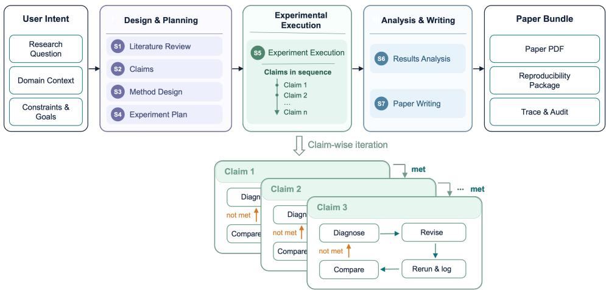
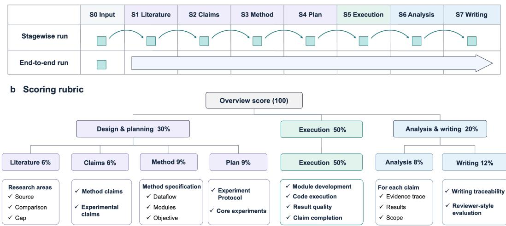
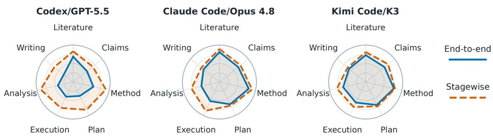
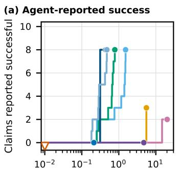
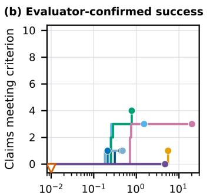
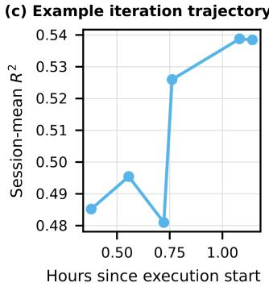
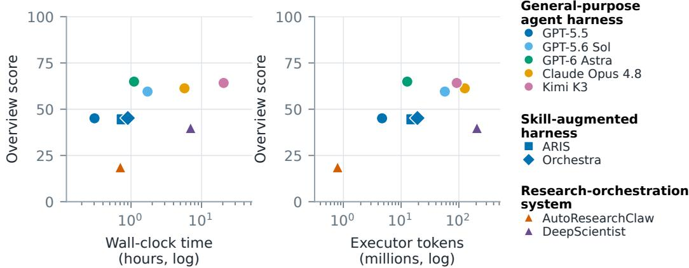
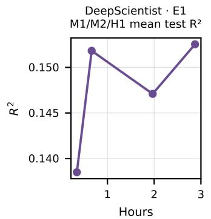
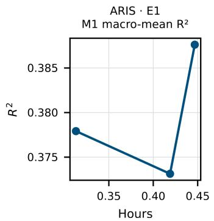
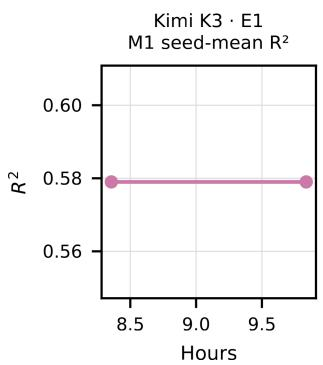

# RESEARCHFLOW-EVAL: TRACING THE EXECUTION GAP IN END-TO-END MULTI-CLAIM AUTORESEARCH

Peng Jiang1,2,3 Dongyang Li1,2,3 Quanying Liu4,5∗ Xiaoxuan Jia1,2,3∗

1Center for Life Sciences and Artificial Intelligence, School of Life Sciences, Tsinghua University, Beijing, China

2IDG/McGovern Institute for Brain Research, Tsinghua University, Beijing, China

3Tsinghua-Peking Center for Life Sciences, Tsinghua University, Beijing, China

4Department of Biomedical Engineering,

Southern University of Science and Technology, Shenzhen, China

5Omni-Intelligence, Shenzhen, China

## ABSTRACT

Autoresearch systems increasingly undertake entire research projects. In practice, scientific research requires systems to pursue multiple interdependent claims through a continuous, multi-stage workflow and revise experiments as evidence accumulates. Existing evaluations of autoresearch systems, however, typically score isolated tasks or final artifacts, leaving these process-level capabilities largely unmeasured. We therefore introduce ResearchFlow-Eval, a fine-grained framework for assessing continuous scientific execution and iteration at both the stage and claim levels. Each evaluation is grounded in a published anchor paper, from which we derive stage-specific rubrics that decompose each research stage into dimensions and separately scored rubric items. Using these rubrics, we score each research stage and examine experimental execution in detail, focusing on multi-claim completion and revisions across attempts. We apply the evaluation framework to general-purpose agent harnesses, skill-augmented harnesses, and systems with research-specific orchestration. Across all evaluated systems, experimental execution consistently lags behind design and planning. Within execution, systems struggle to produce high-quality results and meet claim requirements, and repeated attempts rarely yield measurable improvements. Moreover, neither skill augmentation nor research-specific orchestration reliably yields higher scores. ResearchFlow-Eval thus extends autoresearch evaluation beyond isolated, single-objective runs to continuous workflows in which systems pursue multiple claims and refine their work across iterations.

## 1 INTRODUCTION

Autoresearch systems increasingly undertake entire research projects, from literature search and idea formulation to coding, experimentation, analysis, and manuscript writing (Lu et al., 2026; Schmidgall et al., 2025; Yamada et al., 2025; Weng et al., 2026; Liu et al., 2026). A research project, however, is not a single task. It advances several interdependent claims through a continuous, multistage workflow in which each stage builds on the outputs of earlier stages, and its experiments must be revised as evidence accumulates. Existing benchmarks each cover part of this workflow. They score paper replication (Starace et al., 2025), iterative experimentation (Garikaparthi et al., 2026; Zou et al., 2025), individual research stages (Chen et al., 2025a; Cui et al., 2026), or the outputs of a complete project (Zhou et al., 2026; Xu et al., 2026). Their scores, however, typically attach to an isolated task, a final artifact, or a single optimization objective, rather than following multiple required claims through one continuous workflow. Such scores reveal how far a system got, but not whether its plans were carried through to supporting evidence. This matters because autoresearch systems can produce sound proposals and fluent manuscripts while the experiments behind their conclusions remain unfinished or unverified (Trehan & Chopra, 2026; Chen et al., 2025a; Zhang et al., 2026). We refer to this disparity between planning research and carrying it through to supporting evidence as the execution gap.

  
Figure 1: Overview of the multi-claim research workflow. Design and planning (S1–S4) precede experimental execution (S5) and analysis and writing (S6–S7). The inset shows claim-wise iteration, in which an unmet criterion returns the claim to diagnosis and a met one moves the system to the next claim.

Measuring the execution gap requires following each required claim through the workflow and track ing how its evidence changes across attempts. To this end, we introduce ResearchFlow-Eval, a fine-grained framework for evaluating continuous scientific execution and iteration at both the stage and claim levels. Each evaluation is grounded in a published anchor paper, from which we derive stage-specific rubrics for seven stages (Figure 1) and an explicit success criterion for each required claim, all hidden from the system under evaluation. Because every rubric item is tied to evidence in the anchor paper and in the system’s own artifacts, each score can be inspected and recomputed. Pairing end-to-end runs with stagewise runs, which start each stage from paper-derived inputs, separates a stage’s own failures from errors inherited from upstream. Within experimental execution, claim-level verdicts show how many required claims a system establishes and whether its revisions across attempts move them toward their criteria.

We evaluate general-purpose agent harnesses (Codex (OpenAI, 2026), Claude Code (Anthropic, 2026), and Kimi Code (Moonshot AI, 2026)), skill-augmented harnesses (ARIS (Yang et al., 2026) and Orchestra (Orchestra Research, 2026)), and systems with research-specific orchestration (AutoResearchClaw (Liu et al., 2026) and DeepScientist (Weng et al., 2026)). Across all of them, experimental execution scores below design and planning. Stagewise runs of the general-purpose harnesses raise every stage, suggesting that part of this deficit is inherited from their own upstream outputs. The deficit is sharpest when each required claim is checked against its success criterion. The evaluated systems report success on as many as eight required claims, yet at most four meet their criteria, and repeated attempts rarely turn an unmet claim into a met one. Their self-reported progress is thus a poor proxy for scientific progress (Trehan & Chopra, 2026; Chen et al., 2025a). Adding research-specific structure does not narrow the gap either. With GPT-5.5 as the shared backbone, skill augmentation mainly improves paper writing while lowering execution scores, and research-specific orchestration lowers execution scores further.

## We summarize our contributions as follows:

• Evaluating continuous multi-claim scientific workflows. We evaluate autoresearch systems on an entire research project rather than an isolated task. Our multi-level assessment measures how far each required claim is completed and diagnoses how systems iterate.

• Fine-grained scoring across stages and dimensions. We derive stage-specific rubrics from an anchor paper and decompose each stage into dimensions and separately scored rubric items. Every score is tied to evidence that can be inspected and recomputed.

• Effects of skill augmentation and research orchestration. We compare general-purpose harnesses with skill-augmented harnesses and research orchestration systems. Skill augmentation leaves overall scores nearly unchanged while lowering execution scores, and research orchestration lowers both. Neither closes the execution gap.

Table 1: Comparison with related autoresearch benchmarks. The research-part columns mark which stages a benchmark evaluates. The evaluation-feature columns mark whether it scores a full endto-end run and multiple claims per run, whether its rubric is derived from a paper, and whether it diagnoses iteration within a task. ✓, △, and × indicate that a benchmark evaluates an item explicitly, partially, or not at all.
<table><tr><td></td><td colspan="3">Research parts</td><td colspan="4">Evaluation features</td></tr><tr><td>Benchmark</td><td>Design plan</td><td>Exp. execute</td><td>Analyze write</td><td>Full E2E</td><td>Multi- claim</td><td>Paper rubric</td><td>Iteration diagnostics</td></tr><tr><td>ScienceAgentBench (Chen et al., 2025b)</td><td>X</td><td>△</td><td>△</td><td>X</td><td>X</td><td></td><td>1</td></tr><tr><td>PaperBench (Starace et al., 2025)</td><td>X</td><td>L</td><td>△</td><td>△</td><td>了</td><td>7</td><td></td></tr><tr><td>MLR-Bench (Chen et al., 2025a)</td><td>L</td><td></td><td></td><td></td><td>X</td><td>×</td><td>△</td></tr><tr><td>ResearchGym (Garikaparthi et al., 2026)</td><td>△</td><td>L</td><td>×</td><td>△</td><td>△</td><td>△</td><td></td></tr><tr><td>FML-bench (Zou et al., 2025)</td><td>X</td><td>1</td><td>X</td><td>△</td><td>X</td><td>X</td><td></td></tr><tr><td>FIRE-Bench (Wang et al., 2026)</td><td>△</td><td></td><td>△</td><td>△</td><td>△</td><td></td><td></td></tr><tr><td>ResearchClawBench (Xu et al., 2026)</td><td>△</td><td></td><td></td><td></td><td>△</td><td></td><td>X</td></tr><tr><td>ASI-Bench (Zhou et al., 2026)</td><td>△</td><td></td><td>△</td><td>△</td><td>X</td><td>X</td><td>X</td></tr><tr><td>ResearchFlow-Eval (ours)</td><td>7</td><td>1</td><td></td><td></td><td></td><td>V</td><td>V</td></tr></table>

## 2 RELATED WORK

## 2.1 AUTONOMOUS SCIENTIFIC RESEARCH SYSTEMS

In autonomous research systems, language-model agents carry out increasingly complete research workflows, and these systems differ mainly in how much of the research process they organize explicitly. General-purpose agent harnesses such as Codex, Claude Code, and Kimi Code run a generic tool loop that reads files, edits code, and executes commands (OpenAI, 2026; Anthropic, 2026; Moonshot AI, 2026). They are not designed for research, yet they are increasingly run directly on research tasks (Zhang et al., 2026; Xu et al., 2026; Garikaparthi et al., 2026). Skill-augmented harnesses keep this loop and add reusable research skills, such as a cross-model reviewer in ARIS and a research-engineering skill library in Orchestra (Yang et al., 2026; Orchestra Research, 2026). Research-orchestration systems instead organize the research lifecycle with their own workflow, state, and agent coordination. The AI Scientist, Agent Laboratory, and AI-Researcher chain ideation, experiments, and writing into end-to-end pipelines (Lu et al., 2026; Yamada et al., 2025; Schmidgall et al., 2025; Tang et al., 2025). AutoResearchClaw adds multi-agent debate and failure recovery (Liu et al., 2026), and DeepScientist runs an iterative discovery loop with a cumulative findings memory (Weng et al., 2026). These systems are mostly judged by the papers they produce, which can overstate progress when the underlying experiments are weak (Zhang et al., 2026). Comparing them therefore requires an evaluation that observes how each stage and each claim is executed.

## 2.2 BENCHMARKS FOR AUTONOMOUS RESEARCH AGENTS

Evaluation of research agents has progressed from isolated execution tasks toward longer research workflows (Table 1). CORE-Bench and ScienceAgentBench score reproduction and scientific programs (Siegel et al., 2025; Chen et al., 2025b), while MLAgentBench, MLE-bench, RE-Bench, and FML-bench measure how far experiments improve a task metric (Huang et al., 2024; Chan et al.,

  
Figure 2: Execution modes and scoring hierarchy. (a) Stagewise and end-to-end runs. A stagewise run starts each stage from the paper’s outputs for the preceding stages, whereas an end-to-end run builds on its own earlier outputs. (b) The overview score combines three research parts. Each stage box shows the stage’s share of it, and the bottom boxes list representative rubric dimensions.

2025; Wijk et al., 2025; Zou et al., 2025). PaperBench, ResearchGym, and FIRE-Bench place execution inside a paper-derived research task and score replication, improvement, or rediscovered findings (Starace et al., 2025; Garikaparthi et al., 2026; Wang et al., 2026), while ASI-Bench scores project-level research against reference outputs (Zhou et al., 2026). MLR-Bench and ARAC score each research stage, and ResearchClawBench scores the report and artifacts of a complete run (Chen et al., 2025a; Cui et al., 2026; Xu et al., 2026). Some benchmarks also track performance over a run or diagnose failure patterns such as repeated loops and premature termination (Garikaparthi et al., 2026; Zou et al., 2025; Chen et al., 2025b; Starace et al., 2025; Wang et al., 2026). Most, however, score a single stage given reference inputs or only the final artifact of a run, against a single objective. They therefore do not show where a continuous workflow breaks or whether the evidence for each claim improves across attempts. ResearchFlow-Eval instead derives stage rubrics and claim requirements from an anchor paper. It scores every stage of a continuous run and tracks how the evidence for each claim develops across attempts.

## 3 RESEARCHFLOW-EVAL

ResearchFlow-Eval evaluates autoresearch systems on research projects derived from published anchor papers. In each task, the evaluated autoresearch system receives a research brief and access to data. It then carries the project through seven research stages, from literature review to paper writing, and submits a required artifact at each stage (Figure 1). We score these artifacts against a paper-derived reference that is withheld from the evaluated system.

## 3.1 EXECUTION MODES

Research in each task proceeds through seven stages in three parts: design and planning (literature review, research claims, method design, and experiment planning), experimental execution, and analysis and writing (results analysis and paper writing). Each stage delivers one artifact at a fixed location, such as a claims document with success criteria, a method specification, or the code, logs, and results of execution. We run these stages in two modes (Figure 2a).

End-to-end run. The evaluated system starts from the research brief and completes all seven stages in one workspace. Each stage builds on the system’s own earlier artifacts, which it may also revise, so errors made in early stages carry into later ones.

Stagewise run. Each stage runs separately in a fresh workspace. The run for a given stage receives the research brief and the paper-derived outputs of all preceding stages, while the paper’s output for the stage itself stays hidden. A stagewise score therefore measures how well a system performs a stage when its inputs match those of the anchor paper, and comparing the two modes shows how much each stage depends on what the system itself produced upstream.

## 3.2 TASK CONSTRUCTION

We build each task from the anchor paper and its supplementary material, and also draw on its official code repository. Going through these sources stage by stage, we record what the paper provides at each stage and trace every derived item to the evidence that supports it. All material is frozen before any system is run. A task gives the evaluated system its inputs and fixes the claims the research must establish.

Inputs. The research brief poses the research problem and its core idea. It also describes the accessible data and the engineering constraints of the project. For stagewise runs we additionally derive one input document per stage from the paper. Each document records what the paper produced at that stage, from the literature review up to the conclusion drawn for each claim (Table 4 in Appendix A).

Claims. Each task freezes a set of required claims. Method claims state what the method must implement, and empirical claims state what the experiments must show. Every claim carries an explicit success criterion. It also lists the claims it depends on and the extrapolations it does not license. The execution stage pursues these claims and the results analysis concludes on each of them (Table 9 in Appendix B).

## 3.3 RUBRIC SCORING

Stage rubrics. Every stage is scored with a rubric derived from a hidden, paper-derived reference, which records for each entry the supporting evidence from the paper and its location in the official implementation. A rubric follows the structure of its stage in the reference (Table 10 in Appendix C). Its dimensions divide the stage’s work into parts, and its items are the units the reference records within each part, such as the research areas of a literature review or the components of a method. From experimental execution onward, the items are the required claims. Experimental execution has four dimensions. Module development and code execution check that the method is implemented and the experiments are actually run, whereas result quality and claim completion are rated once per required claim. Every item states a criterion, cites the reference entries it is judged against, and names the submitted artifact expected to hold the evidence, so that the judge knows where to look. The reference, the claims, and the rubrics were reviewed by a domain researcher before any system was run.

Claims and iteration. Experimental execution is where the required claims are tested, and two of its dimensions assess each claim directly. Result quality asks whether the evidence for a claim supports it, whereas claim completion asks how far the system carried the claim toward its criterion. Rated over all required claims, the two dimensions measure multi-claim completion, that is, how many of the claims a run carries through and how far. The judge also issues a binary verdict for each claim, met or unmet, according to whether admissible evidence satisfies its success criterion. These verdicts support iteration diagnostics. Each attempt is mapped to a required claim, and we compare the claims a system reports as attained with the claims judged met and follow each claim’s metric values across attempts (Appendix D). The ratings thus score how far a run advances each claim, while the verdicts and diagnostics show which claims it establishes and whether its revisions lead there, without entering any score.

Score composition. Item ratings are averaged within a dimension and normalized to 0–100. Dimensions then combine into stage scores, which in turn combine into three research parts (Figure 2b). The overview score is

$$
S = 0 . 3 P _ { \mathrm { d e s i g n } } + 0 . 5 S _ { \mathrm { e x e c } } + 0 . 2 P _ { \mathrm { a n a l y s i s } } .\tag{1}
$$

Within design and planning, the literature review and the research claims carry 20% each, and method design and experiment planning carry 30% each. Within analysis and writing, results analysis carries 40% and paper writing 60%. Experimental execution receives half of the overview score because it is the stage in which the required claims are actually tested, and its four dimensions are

Table 2: End-to-end scores (0–100) of the nine systems. Stage columns abbreviate literature review (Lit.), research claims (Claims), method design (Meth.), experiment planning (Plan), results analysis (Anal.), and paper writing (Writ.). Bold marks the highest value in each column.
<table><tr><td rowspan="2">System</td><td colspan="4">Design &amp; planning</td><td colspan="4">Experimental execution</td><td colspan="2">Analysis &amp; writing</td><td rowspan="2"></td></tr><tr><td>Lit.</td><td>Claims</td><td>Meth.</td><td>Plan</td><td>Module</td><td>Code</td><td>Result</td><td>Claim</td><td>Anal.</td><td>Writ. Overview</td></tr><tr><td colspan="10">General-purpose agent harness</td><td></td></tr><tr><td>Codex / GPT-5.5</td><td>68.8</td><td>47.5</td><td>56.2</td><td>41.7</td><td>53.6</td><td>50.0</td><td>30.0</td><td>42.5</td><td>42.5</td><td>32.5</td><td>45.1</td></tr><tr><td>Codex / GPT-5.6 Sol</td><td>83.3</td><td>65.0</td><td>78.1</td><td>66.7</td><td>60.7</td><td>52.5</td><td>32.5</td><td>60.0</td><td>55.0</td><td>62.5</td><td>59.5</td></tr><tr><td>Codex / GPT-6 Astra</td><td>72.9</td><td>65.0</td><td>84.4</td><td>70.8</td><td>64.3</td><td>57.5</td><td>47.5</td><td>65.0</td><td>62.5</td><td>70.0</td><td>64.9</td></tr><tr><td>Claude Code / Opus 4.8</td><td>81.2</td><td>65.0</td><td>81.2</td><td>66.7</td><td>71.4</td><td>57.5</td><td>42.5</td><td>57.5</td><td>50.0</td><td>55.0</td><td>61.3</td></tr><tr><td>Kimi Code / K3</td><td>72.9</td><td>65.0</td><td>78.1</td><td>68.8</td><td>71.4</td><td>62.5</td><td>47.5</td><td>65.0</td><td>62.5</td><td>57.5</td><td>64.2</td></tr><tr><td colspan="10">Skill-augmented harness (Codex / GPT-5.5)</td></tr><tr><td>ARIS</td><td>66.7</td><td>52.5</td><td>56.2</td><td>41.7</td><td>53.6</td><td>45.0</td><td>20.0</td><td>32.5</td><td>42.5</td><td>52.5</td><td>44.5</td></tr><tr><td>Orchestra</td><td>66.7</td><td>52.5</td><td>53.1</td><td>45.8</td><td>50.0</td><td>50.0</td><td>20.0</td><td>37.5</td><td>47.5</td><td>47.5</td><td>45.2</td></tr><tr><td colspan="10"></td></tr><tr><td>Research-orchestration system AutoResearchClaw</td><td>22.9</td><td>(GPT-5.5) 40.0</td><td>62.5</td><td>18.8</td><td>42.9</td><td>17.5</td><td>0.0</td><td>0.0</td><td>0.0</td><td>0.0</td><td>18.6</td></tr><tr><td>DeepScientist</td><td>70.8</td><td>57.5</td><td>75.0</td><td>58.3</td><td>53.6</td><td>25.0</td><td>0.0</td><td>7.5</td><td>42.5</td><td>50.0</td><td>39.9</td></tr><tr><td colspan="10">Mean over the nine systems</td></tr><tr><td>Per stage/dimension</td><td>67.4</td><td>56.7</td><td>69.4</td><td>53.2</td><td>57.9</td><td>46.4 43.0</td><td>26.7</td><td>40.8</td><td>45.0</td><td>47.5</td><td></td></tr><tr><td colspan="9">Per research part 61.6</td></tr></table>

weighted equally,

$$
S _ { \mathrm { e x e c } } = { \textstyle { \frac { 1 } { 4 } } } \left( { \cal D } _ { \mathrm { m o d u l e } } + { \cal D } _ { \mathrm { c o d e } } + { \cal D } _ { \mathrm { q u a l i t y } } + { \cal D } _ { \mathrm { c o m p l e t i o n } } \right) .\tag{2}
$$

LLM judge. We use an LLM as the judge, with claude-opus-5 as the evaluator model. Each stage is judged in its own call. In each call, the judge reads the rubric together with the reference entries its items cite. It also reads the frozen submission and the upstream artifacts visible to that stage. For each item it returns an integer rating on a 0–4 scale with item-specific anchors, along with the locations of the supporting evidence and a short rationale. Every score can therefore be traced back to evidence. A domain researcher spot-checked the judge’s ratings and rationales and found them largely consistent with their own assessment. Integrity gates guard the ratings against contaminated evidence, such as leaked reference content or fabricated execution, by setting the items that depend on it to zero (Table 12 in Appendix E).

## 4 EXPERIMENTAL SETUP

## 4.1 TASK INSTANCE

We instantiate ResearchFlow-Eval with a task derived from SPINT (Le et al., 2025), which decodes motor behavior from intracortical recordings in new sessions whose recorded units differ in number, membership, and tuning from those seen in training. The task uses three subjects (M1, M2, and H1) of the public FALCON motor-decoding dataset (Karpowicz et al., 2024), and we decompose the task into ten required claims, four method claims and six empirical claims. The seven stage rubrics contain 99 items in total, from 8 for method design to 37 for experimental execution (Table 10 in Appendix C).

## 4.2 AUTORESEARCH SYSTEMS

We evaluate autoresearch systems that differ in how much research-specific structure they add to a language model (Table 14 in Appendix F). General-purpose agent harnesses receive the task instructions with no research-specific scaffolding, which makes them our reference point. We run Codex (OpenAI, 2026) with GPT-5.5, GPT-5.6 Sol, and GPT-6 Astra. We also run Claude Code (Anthropic, 2026) with Opus 4.8 and Kimi Code (Moonshot AI, 2026) with K3. Skill-augmented harnesses add research skills to such a harness while leaving its control flow in place. We run

  
Figure 3: Stage profiles in end-to-end and stagewise runs. Scores (0–100) of Codex with GPT-5.5, Claude Code with Opus 4.8, and Kimi Code with K3, the three general-purpose harnesses run in both modes, end to end (solid blue) and stagewise (dashed vermillion).

ARIS (Yang et al., 2026) and Orchestra (Orchestra Research, 2026), both on Codex with GPT-5.5. Research-orchestration systems instead organize the research workflow themselves. We run AutoResearchClaw (Liu et al., 2026) and DeepScientist (Weng et al., 2026), both driving GPT-5.5. Because these three groups share GPT-5.5 as their backbone, their comparison reflects how research is organized rather than which model is used.

## 4.3 RUN ENVIRONMENT AND RESOURCES

Research workspace. Every run starts in a fresh workspace that is built from the task package with the same layout for every system. Four documents at its root define the run. AGENTS.md sets the scope and work rules of the run, such as the literature cutoff, and TASK.md gives the stages to be carried out and the order in which claims are pursued. RESOURCES.md describes the data and computing resources, and OUTPUTS.md specifies the artifacts to deliver. Evaluator-side assets never enter the workspace. The workspace records the artifacts of every stage, and every system starts from the same information (Table 5 in Appendix A).

Resources and budgets. Every run receives one GPU with 32 GB of memory and the task data. The required packages are preinstalled in a configured execution environment. An end-to-end run has 72 hours of wall-clock time, and a stagewise run receives a separate time budget for each stage, from 2 hours for the claims stage to 48 hours for experimental execution (Table 3 in Appendix A). We impose no token limit (resource use in Table 13 in Appendix F).

## 5 RESULTS

## 5.1 PERFORMANCE ACROSS THE WORKFLOW STAGES

Every system scores lower on execution than on design and planning. To locate where in the workflow the systems fall short, we compare their end-to-end scores across stages (Table 2), whose last two rows average the nine systems per stage and per research part. On average, design and planning outscores experimental execution by 18.6 points (61.6 vs. 43.0), and analysis and writing lies between them (46.5). Across stages, method design and literature review are the strongest, whereas experimental execution, results analysis, and paper writing are the weakest. The systems are thus much better at surveying prior work and proposing an approach than at carrying the planned experiments through to results.

Stagewise evaluation raises every stage, most in execution and results analysis. An end-toend stage score reflects both the system’s ability at that stage and the errors it carries over from its own earlier stages. Stagewise runs remove this carryover, so we compare the two modes for the three harnesses (Figure 3, with scores in Table 15 in Appendix G). At every stage, all three harnesses score higher in stagewise runs than in end-to-end runs. The gains are largest in experimental execution and results analysis. Within execution, most of the gain comes from result quality and claim completion rather than code execution, and the number of claims that meet their success criteria rises from one to three in end-to-end runs to seven or eight in stagewise runs (Table 16 in Appendix G). Much of the end-to-end execution gap thus appears to originate upstream of execution.

Hours since execution start (log)  
Hours since execution start (log)  

  
Figure 4: Claim progress and metric trajectories during experimental execution. (a) Claims the system reported as successful and (b) claims whose criterion the evaluator confirmed as met, cumulative over log time. Filled circles mark run endpoints, and the open triangle marks AutoResearchClaw, which made no scientific attempt. (c) An example iteration trajectory of GPT-5.6 Sol.

## 5.2 PERFORMANCE WITHIN EXPERIMENTAL EXECUTION

Result quality is the weakest execution dimension, and few claims meet their criteria. To find which part of execution holds its score down, we decompose it into its four dimensions (execution columns of Table 2). Averaged over the nine systems, result quality is the lowest dimension (26.7), 31.2 points below module development (57.9). Building an implementation is thus much easier for these systems than producing evidence that meets the task’s scientific criteria. The per-claim verdicts show the same pattern (Table 16 in Appendix G). Across the nine end-to-end runs, only 14 of the 90 required claims meet their success criteria, and no system meets more than four. Claim completion is also low, averaging 40.8 and ranging from 0.0 to 65.0. Even Kimi K3, which reaches the highest claim completion (65.0, tied with GPT-6 Astra), meets the criteria of only three of its ten claims.

Neither self-reports nor repeated attempts track claim attainment. An autoresearch system decides for itself when a claim is established, so we compare, over execution time, the claims each system reports as successful with those the evaluator confirms as met (Figures 4a and 4b; Appendix D). GPT-5.6 Sol and GPT-6 Astra each report success on eight claims, but only three and four meet their criteria. The met count of GPT-5.6 Sol reaches three 0.26 hours into execution and rises no further, while its reported count climbs from three to eight between 0.76 and 1.52 hours. We then ask whether repeated attempts close this gap, following each claim’s metric values across consecutive attempts that share the same metric definition (Appendix D). On the main decoding claim (E1), which requires the decoder to outperform every baseline on all three subjects (Table 9 in Appendix B), GPT-5.6 Sol raises its session-mean $R ^ { 2 }$ on subject M1 from 0.49 to 0.54 over six successive attempts (Figure 4c), whereas ARIS, DeepScientist, and Kimi K3 end within 0.015 of their first attempt (Figure 6 in Appendix D). None of the four meets the criterion. Repeated attempts thus change the numbers but rarely turn an unmet claim into a met one, and a system’s own account of its progress is an unreliable guide to which claims are established.

## 5.3 EFFECTS OF SKILL AUGMENTATION AND RESEARCH ORCHESTRATION

Neither skill augmentation nor research orchestration closes the execution gap. To test whether research-specific structure improves on a general-purpose harness with the same model, we compare Codex with GPT-5.5 against the two skill-augmented harnesses and the two research-orchestration systems, all of which use GPT-5.5 as their backbone model (Table 2). ARIS and Orchestra reach overview scores within one point of Codex alone (44.5 and 45.2 vs. 45.1), but this parity hides a trade-off. They score 15.0 to 20.0 points higher on paper writing (52.5 and 47.5 vs. 32.5), yet lower in execution, where result quality drops from 30.0 to 20.0 for both and claim completion from 42.5 to 32.5 and 37.5. Each also reports success on eight claims within half an hour of starting execution but meets only one criterion (Figures 4a and 4b). ARIS logs 28 attempts (Table 16 in Appendix G), the most among the harnesses, without meeting more claims than Codex alone. The research-orchestration systems fall further behind in execution. DeepScientist scores highest among the GPT-5.5 systems on all four design stages, yet its code execution is half that of Codex alone (25.0 vs. 50.0). Its result quality is 0.0, and none of its 34 attempts meets a criterion. AutoResearchClaw’s generated code crashed on a missing import before any scientific attempt, which leaves it with the lowest overview score (18.6). Added skills thus improve how the work is written up more than how it is carried out, and research-specific orchestration does not improve execution either.

  
Figure 5: Performance against resource use. Overview score of the nine end-to-end runs against wall-clock time (left) and total tokens (right), on logarithmic axes.

## 5.4 RESOURCE USE AND PERFORMANCE

Scores tend to rise with run time and token use. To test whether higher scores simply reflect longer runs and more tokens, we plot the overview score against wall-clock time and total tokens (Figure 5, with per-run values in Table 13 in Appendix F). Overall, systems that run longer and consume more tokens tend to score higher. All four runs shorter than one hour score at most 45.2, whereas four of the five longer runs score above 59. Likewise, three of the four runs that use more than 50 M tokens score above 59, compared with one of the five runs that use fewer than 20 M. Across the nine runs, the Spearman correlation with the overview score is 0.47 for time and 0.23 for tokens, and it rises to 0.79 and 0.57 without DeepScientist. The main exception is DeepScientist, which runs for 7.0 hours and uses the most tokens of any system (205.7 M), yet scores only 39.9. More resources thus accompany higher scores on average but do not guarantee them.

## 6 DISCUSSION AND CONCLUSION

ResearchFlow-Eval evaluates autoresearch as one continuous workflow, following each required claim from design through experimental evidence and grounding every score in rubrics derived from a published paper. This view exposes an execution gap that scores on isolated tasks or final artifacts would miss. Experimental execution scores below design and planning in every run, and the gap is widest at the level of claims. Few required claims meet their success criteria, yet systems often report success on claims that do not. Neither skill augmentation nor research-specific orchestration closes this gap. Because a system’s own account of its progress does not reveal which claims are established, future systems may benefit more from checking each claim against an explicit criterion than from relying on their own progress reports. Our study also has limitations. Because the rubrics follow the anchor paper, they may undervalue scientifically valid alternatives to its design. In addition, the literature cutoff restricts what a system can retrieve during a run but does not rule out exposure to the anchor paper during pretraining. In future work, we will apply ResearchFlow-Eval to additional autoresearch systems, models, and anchor papers.

## ETHICS STATEMENT

This work evaluates research artifacts produced by autoresearch systems. The dataset used in this work is publicly released and is used under its original access terms. This work collects no new data from human participants or animals and raises no additional ethical concerns.

## REPRODUCIBILITY STATEMENT

Section 3.2 describes how the task and its required claims are derived from the anchor paper and frozen before any system is run. Section 3.3 specifies the rubrics, the score aggregation, and the pinned LLM judge, and Section 4 specifies the evaluated systems, the run environment, and the resource budgets. The task package and evaluation code are available at https://github.com/ Jp-17/ResearchFlow-Eval.

## AI USE STATEMENT

Large language models are part of the object of study, because the evaluated autoresearch systems are LLM agents. In research execution, we used generative AI tools only to translate the Chinese task texts and judge rationales in the artifact repository into English, to read approximate values from the anchor paper’s figures, which a domain researcher then verified, and to plot figures from the computed scores. We did not use generative AI tools to propose or refine hypotheses, to design the research methodology or experiments, to implement the methods, or to interpret the results. Generating synthetic data, developing theoretical models, formulating or proving mathematical claims, cleaning or reformatting datasets, and qualitative data analysis are not applicable to this work. Additionally, we used generative AI tools to search and summarize related literature, to draft parts of the paper, and to edit the text for readability. The authors revised all drafted text and checked every claim and number in it against the results. We checked every plotted value against the score files and every cited work against its source. We checked the translations for completeness and file validity, and the original files remain authoritative. We take responsibility for the final content of this work.

## REFERENCES

Anthropic. Claude Code, 2026. URL https://code.claude.com/docs. Documentation, accessed 2026-09-21.

Jun Shern Chan, Neil Chowdhury, Oliver Jaffe, James Aung, Dane Sherburn, Evan Mays, Giulio Starace, Kevin Liu, Leon Maksin, Tejal Patwardhan, Lilian Weng, and Aleksander M ˛adry. MLEbench: Evaluating machine learning agents on machine learning engineering. In International Conference on Learning Representations, 2025. URL https://openreview.net/forum?id= 6s5uXNWGIh.

Hui Chen, Miao Xiong, Yujie Lu, Wei Han, Ailin Deng, Yufei He, Jiaying Wu, Yibo Li, Yue Liu, and Bryan Hooi. MLR-Bench: Evaluating AI agents on open-ended machine learning research. In Advances in Neural Information Processing Systems (Datasets and Benchmarks Track), volume 38, 2025a. URL https://openreview.net/forum?id=JX9DE6colf.

Ziru Chen, Shijie Chen, Yuting Ning, Qianheng Zhang, Boshi Wang, Botao Yu, Yifei Li, Zeyi Liao, Chen Wei, Zitong Lu, Vishal Dey, Mingyi Xue, Frazier N. Baker, Benjamin Burns, Daniel Adu-Ampratwum, Xuhui Huang, Xia Ning, Song Gao, Yu Su, and Huan Sun. ScienceAgentBench: Toward rigorous assessment of language agents for data-driven scientific discovery. In International Conference on Learning Representations, 2025b. URL https://openreview.net/ forum?id=6z4YKr0GK6.

Jiale Cui, Yueyao Yuan, Kaixi Zhong, Xiaogang Xu, Jiafei Wu, and Zhe Liu. ARAC: Benchmarking auto-research’s alignment and completeness on end-to-end researchs. arXiv preprint arXiv:2608.12788, 2026. URL https://arxiv.org/abs/2608.12788.

Aniketh Garikaparthi, Manasi Patwardhan, and Arman Cohan. ResearchGym: Evaluating language model agents on real-world AI research. arXiv preprint arXiv:2602.15112, 2026. URL https: //arxiv.org/abs/2602.15112.

Qian Huang, Jian Vora, Percy Liang, and Jure Leskovec. MLAgentBench: Evaluating language agents on machine learning experimentation. In Proceedings of the 41st International Conference on Machine Learning, volume 235 of Proceedings of Machine Learning Research, pp. 20271– 20309, 2024. URL https://proceedings.mlr.press/v235/huang24y.html.

Brianna M. Karpowicz, Joel Ye, Chaofei Fan, Pablo Tostado-Marcos, Fabio Rizzoglio, Clay Washington, Thiago Scodeler, Diogo de Lucena, Samuel R. Nason-Tomaszewski, Matthew Mender, Xuan Ma, Ezequiel Matias Arneodo, Leigh R. Hochberg, Cynthia Chestek, Jaimie M. Henderson, Timothy Q. Gentner, Vikash Gilja, Lee Miller, Adam G. Rouse, Robert Gaunt, Jennifer L. Collinger, and Chethan Pandarinath. Few-shot algorithms for consistent neural decoding (FALCON) benchmark. In A. Globerson, L. Mackey, D. Belgrave, A. Fan, U. Paquet, J. Tomczak, and C. Zhang (eds.), Advances in Neural Information Processing Systems, volume 37, pp. 76578–76615. Curran Associates, Inc., 2024. doi: 10.52202/079017-2439. URL https://proceedings.neurips.cc/paper\_files/paper/2024/file/ 8c2e6bb15be1894b8fb4e0f9bcad1739-Paper-Datasets\_and\_Benchmarks\_Track.pdf.

Trung Le, Hao Fang, Jingyuan Li, Tung Nguyen, Lu Mi, Amy Orsborn, Uygar Sümbül, and Eli Shlizerman. SPINT: Spatial permutation-invariant neural transformer for consistent intracortical motor decoding. In Advances in Neural Information Processing Systems, volume 38, 2025. URL https://openreview.net/forum?id=XjayhGBraW.

Jiaqi Liu, Shi Qiu, Mairui Li, Bingzhou Li, Haonian Ji, Siwei Han, Xinyu Ye, Peng Xia, Zihan Dong, Meng Chen, Congyu Zhang, Letian Zhang, Guiming Chen, Haoqin Tu, Xinyu Yang, Lu Feng, Xujiang Zhao, Haifeng Chen, Jiawei Zhou, Xiao Wang, Weitong Zhang, Hongtu Zhu, Yun Li, Jieru Mei, Hongliang Fei, Jiaheng Zhang, Linjie Li, Linjun Zhang, Yuyin Zhou, Sheng Wang, Caiming Xiong, James Zou, Zeyu Zheng, Cihang Xie, Mingyu Ding, and Huaxiu Yao. AutoResearchClaw: Self-reinforcing autonomous research with human-AI collaboration. arXiv preprint arXiv:2605.20025, 2026. URL https://arxiv.org/abs/2605.20025.

Chris Lu, Cong Lu, Robert Tjarko Lange, Yutaro Yamada, Shengran Hu, Jakob Foerster, David Ha, and Jeff Clune. Towards end-to-end automation of AI research. Nature, 651(8107):914– 919, 2026. doi: 10.1038/s41586-026-10265-5. URL https://www.nature.com/articles/ s41586-026-10265-5.

Moonshot AI. Kimi Code, 2026. URL https://www.kimi.com/code/docs/en/. Documentation, accessed 2026-09-21.

OpenAI. Codex CLI, 2026. URL https://github.com/openai/codex. GitHub repository, accessed 2026-09-21.

Orchestra Research. AI-Research-SKILLs: Research skills for AI coding agents, 2026. URL https://github.com/Orchestra-Research/AI-Research-SKILLs. GitHub repository, accessed 2026-09-21.

Samuel Schmidgall, Yusheng Su, Ze Wang, Ximeng Sun, Jialian Wu, Xiaodong Yu, Jiang Liu, Michael Moor, Zicheng Liu, and Emad Barsoum. Agent Laboratory: Using LLM agents as research assistants. In Findings ofthe Associationfor Computational Linguistics: EMNLP 2025, pp. 5977–6043, 2025. URL https://aclanthology.org/2025.findings-emnlp.320/.

Zachary S. Siegel, Sayash Kapoor, Nitya Nadgir, Benedikt Stroebl, and Arvind Narayanan. CORE-Bench: Fostering the credibility of published research through a computational reproducibility agent benchmark. Transactions on Machine Learning Research, 2025. URL https: //openreview.net/forum?id=BsMMc4MEGS.

Giulio Starace, Oliver Jaffe, Dane Sherburn, James Aung, Jun Shern Chan, Leon Maksin, Rachel Dias, Evan Mays, Benjamin Kinsella, Wyatt Thompson, Johannes Heidecke, Amelia Glaese, and Tejal Patwardhan. PaperBench: Evaluating AI’s ability to replicate AI research. In Proceedings of the 42nd International Conference on Machine Learning, volume 267 of Proceedings ofMachine

Learning Research, pp. 56843–56873, 2025. URL https://proceedings.mlr.press/v267/ starace25a.html.

Jiabin Tang, Lianghao Xia, Zhonghang Li, and Chao Huang. AI-Researcher: Autonomous scientific innovation. In Advances in Neural Information Processing Systems, volume 38, 2025. URL https://proceedings.neurips.cc/paper\_files/paper/2025/ hash/0d904d300a105809a2114d727851e759-Abstract-Conference.html.

Dhruv Trehan and Paras Chopra. Why LLMs aren’t scientists yet: Lessons from four autonomous research attempts. arXiv preprint arXiv:2601.03315, 2026. URL https://arxiv.org/abs/ 2601.03315.

Zhen Wang, Fan Bai, Zhongyan Luo, Jinyan Su, Kaiser Sun, Xinle Yu, Jieyuan Liu, Kun Zhou, Claire Cardie, Mark Dredze, Zhiting Hu, and Eric P. Xing. FIRE-Bench: Evaluating AI agents on the rediscovery of scientific insights. In Proceedings of the 43rd International Conference on Machine Learning, 2026. URL https://arxiv.org/abs/2602.02905.

Yixuan Weng, Minjun Zhu, Qiujie Xie, Qiyao Sun, Zhen Lin, Sifan Liu, and Yue Zhang. DeepScientist: Advancing frontier-pushing scientific findings progressively. In International Conference on Learning Representations, 2026. URL https://openreview.net/forum?id=cZFgsLq8Gs.

Hjalmar Wijk, Tao Lin, Joel Becker, Sami Jawhar, Neev Parikh, Thomas Broadley, Lawrence Chan, Michael Chen, Josh Clymer, Jai Dhyani, Elena Ericheva, Katharyn Garcia, Brian Goodrich, Nikola Jurkovic, Holden Karnofsky, Megan Kinniment, Aron Lajko, Seraphina Nix, Lucas Sato, William Saunders, Maksym Taran, Ben West, and Elizabeth Barnes. RE-Bench: Evaluating frontier AI R&D capabilities of language model agents against human experts. In Proceedings of the 42nd International Conference on Machine Learning, volume 267 of Proceedings ofMachine Learning Research, pp. 66772–66832, 2025. URL https://proceedings.mlr.press/v267/ wijk25a.html.

Wanghan Xu, Shuo Li, Tianlin Ye, Qinglong Cao, Yixin Chen, Hengjian Gao, Yiheng Wang, Qi Li, Kun Li, Sheng Xu, Shengdu Chai, Fangchen Yu, Xiangyu Zhao, Zhangrui Zhao, Weijie Ma, Zijie Guo, Koutian Wu, Haoyu Zhou, Haoxiang Yin, Lixue Cheng, Chaofan Hu, Haoxuan Li, Lu Mi, Xuxuan Xie, Yifan Zhou, Ruizhe Chen, Zhiwang Zhou, Xingjian Guo, Yuhao Zhou, Xuming He, Shengyuan Xu, Xinyu Gu, Jiamin Wu, Mianxin Liu, Chunfeng Song, Fenghua Ling, Dongzhan Zhou, Shixiang Tang, Yuqiang Li, Mao Su, Peng Ye, Siqi Sun, Bin Wang, Xue Yang, Zhenfei Yin, Tianfan Fu, Guangtao Zhai, Wanli Ouyang, Bo Zhang, Lei Bai, and Wenlong Zhang. ResearchClawBench: A benchmark for end-to-end autonomous scientific research. arXiv preprint arXiv:2606.07591, 2026. URL https://arxiv.org/abs/2606.07591.

Yutaro Yamada, Robert Tjarko Lange, Cong Lu, Shengran Hu, Chris Lu, Jakob Foerster, Jeff Clune, and David Ha. The AI Scientist-v2: Workshop-level automated scientific discovery via agentic tree search. arXiv preprint arXiv:2504.08066, 2025. URL https://arxiv.org/abs/2504. 08066.

Ruofeng Yang, Yongcan Li, and Shuai Li. ARIS: Autonomous research via adversarial multi-agent collaboration. arXiv preprint arXiv:2605.03042, 2026. URL https://arxiv.org/abs/2605. 03042.

Zhengxin Zhang, Ning Wang, Sainyam Galhotra, and Claire Cardie. How far are we from true autoresearch? arXiv preprint arXiv:2605.19156, 2026. URL https://arxiv.org/abs/2605. 19156.

Junwei Zhou, Zhen Sun, Binyu Li, Jiangyu Zhou, Yuexi Pan, Hengyu Wang, Honghe Ren, Xiaohan Jia, Xueyang Zhou, Xiaoyu Cao, Yongchao Chen, Yuanning Feng, Junhao Wu, Cheng Zhang, Sijia Chen, Haoyu Xue, Chengsong You, Huan Wang, Koutian Wu, Peigan Gao, Jiakun Wu, Wenzhe Li, Ergan Shang, Qingyuan Zheng, Jingjing Zhou, Ruixuan Jia, Yan Xu, Hongrui Zhang, Xiao-Han Ma, Zhengxiang Cheng, Yuexing Hao, Liting Mai, Xianglin Ji, Wenjun Zhang, Zhuofan Chen, Yixiao Huang, Chi Wang, Wenyue Hua, Yilun Hao, Yuantao Zhai, Ziyan Zhao, and Jingyan Xie. ASI-Bench: At the dawn of artificial superintelligence. arXiv preprint arXiv:2608.17271, 2026. URL https://arxiv.org/abs/2608.17271.

Qiran Zou, Hou Hei Lam, Wenhao Zhao, Yiming Tang, Tingting Chen, Samson Yu, Tianyi Zhang, Chang Liu, Xiangyang Ji, and Dianbo Liu. FML-bench: Benchmarking machine learning agents for scientific research. arXiv preprint arXiv:2510.10472, 2025. URL https://arxiv.org/ abs/2510.10472.

## A STAGE INPUTS AND RESEARCH WORKSPACE

Stagewise evaluation fixes the inputs and required output of each stage (Table 3). The research brief is denoted S0, and the data card is the task’s description of the accessible data. An end-to-end run instead starts from the brief and carries its own artifacts forward, and it may revise its earlier claims or plans as evidence changes. In both modes, every stage keeps a log of the sources it consults.

Table 3: Stagewise inputs, required outputs, and wall-clock budgets of the seven stages. The stage budgets sum to 72 hours, the budget of one end-to-end run. In an end-to-end run, each stage instead receives the evaluated system’s own earlier artifacts.
<table><tr><td>Stage</td><td>Research activity</td><td>Paper-derived inputs</td><td>Required output</td><td>Budget (h)</td></tr><tr><td>S1</td><td>Literature review</td><td>Research brief (SO)</td><td>Literature review</td><td>4</td></tr><tr><td>S2</td><td>Research claims</td><td>S0-S1</td><td>Claims with success criteria</td><td>2</td></tr><tr><td>S3</td><td>Method design</td><td>S0-S2</td><td>Method specification</td><td>4</td></tr><tr><td>S4</td><td>Experiment planning</td><td>SO–S3 and data card</td><td>Experiment plan</td><td>4</td></tr><tr><td>S5</td><td>Experimental execution</td><td>SO-S4 with data and environment</td><td>Code and results with their execution records</td><td>48</td></tr><tr><td>S6</td><td>Results analysis</td><td>S0-S5</td><td>Per-claim conclusions</td><td>4</td></tr><tr><td>S7</td><td>Paper writing</td><td>SO-S6 and paper template</td><td>Paper in Markdown and PDF with its source project</td><td>6</td></tr></table>

Paper-derived inputs. Each paper-derived input is a rewritten document rather than an excerpt of the paper. It is written in neutral scientific language. It names neither the anchor paper nor the dataset identifiers that would reveal it, and it points to no section, figure, or table of the paper. Table 4 shows the paper-derived inputs of the task derived from SPINT, with one excerpt from each. All excerpts in this appendix are English translations of the Chinese originals in the artifact repository.

Table 4: Paper-derived inputs of the task derived from SPINT. Each input is placed under inputs/upstream/ of a stagewise workspace. In stagewise runs of results analysis and paper writing, the execution input replaces the system’s own execution evidence. Its values are marked as reference values so that the judge can tell them apart from local evidence.
<table><tr><td>Input</td><td>Content</td><td>Example excerpt</td></tr><tr><td>SO research brief content.md</td><td>Research question and core hypothesis, with the data constraints and the success boundary</td><td>“Treating the neural population as an unordered, variable-size set of units, and making the decoding function invariant under unit permutation, may be better suited to cross-session decoding than models that rely on fixed channel/unit identity."</td></tr><tr><td>S1 literature related_work.md</td><td>Four research areas with their capabilities and limitations, and a table that maps each gap to a claim</td><td>On cross-session alignment, “some methods also need held-out labels, test-time optimization or model-parameter updates."</td></tr><tr><td>S2 claims claims.md</td><td>The ten required claims with their scope and success criteria, and the extrapolations they do not license</td><td>Claim MC2 reads “When unit rows of the neural window and the calibration identity are permuted synchronously, the decoder output remains permutation-invariant." It is marked as “not equivalent to unconditional robustness to unit deletion."</td></tr><tr><td>S3 method method.md</td><td>The decoder design component by component, with each component linked to the claims it serves</td><td>The identity encoder computes  $E _ { i } = \psi ( \mathrm { m i n } _ { j } \phi ( X _ { i j } ^ { C } ) )$  ), and “mean pooling makes the result invariant to the order of calibration trials."</td></tr><tr><td>S4 plan experiment_plan.md</td><td>The session split and the baselines, with one execution contract per claim</td><td>M1 uses four held-in sessions split into 2 train, 1 validation, and 1 test with seed 20260824. Viability requires a maximum output difference of at most  $1 \dot { 0 } ^ { - 5 }$  under synchronized unit permutation.</td></tr><tr><td>S5 execution execution_results.md</td><td>Reference results of the required experiments, each marked as exact or approximate</td><td>The candidate system (GF-FSU) reaches  $R ^ { 2 } \mathrm { o f }$   $0 . 6 6 \pm 0 . 0 7$  on M1,  $0 . 2 6 \pm 0 . 1 3$  on M2, and  $0 . 2 9 \pm 0 . 1 5$  on H1.</td></tr><tr><td>S6 analysis conclusions.md</td><td>The evidence status and supported conclusion of each claim, with the boundary it must keep</td><td>Claim E1 is “supported" but “only relative to ZS/FSU in nearby information conditions." The analysis adds that “M2/H1 are still below strong OR/FSS."</td></tr></table>

Workspace construction. A builder creates a fresh workspace for every run (Table 5). It copies in only the inputs that the task package declares for the mode and stage, and it records a hash of each file and of the resulting tree. Evaluator assets such as the reference, the rubrics, and the success criteria are never declared, so they have no path into the workspace.

Table 5: Contents of a research workspace. The four documents at the root are rendered from the task package. The directories below them hold the inputs, the work in progress, and the graded artifacts.
<table><tr><td>Entry</td><td>Content</td></tr><tr><td>AGENTS.md</td><td>Research topic, run scope, and stage order. It also lists the inputs and the resource budget with the work boundaries.</td></tr><tr><td>TASK.md</td><td>The instruction of every stage in the run, with its goal, procedure, and completion condition</td></tr><tr><td>RESOURCES.md</td><td>Descriptions of the data, the environment, and the paper template. It also states the readable paths outside the workspace, the evaluation mode, and the rules for external sources.</td></tr><tr><td>OUTPUTS.md</td><td>The required artifact paths with their purpose, the optional and diagnostic outputs, and the terminal contract</td></tr><tr><td>inputs/upstream</td><td>Read-only paper-derived inputs of the preceding stages</td></tr><tr><td>inputs/runtime</td><td>Formats of the claim log and claim state, with the scripts that record and validate them</td></tr><tr><td>work</td><td>Free scratch space for code, data, and intermediate results</td></tr><tr><td>submission</td><td>The graded artifacts of each stage and a status file that indexes them</td></tr><tr><td>operator</td><td>The initial instruction, the build record with its hashes, and the run logs collected from outside</td></tr></table>

Starting a run. The operator starts a run by sending the text of operator/initial\_prompt.md to the system as its first message. This instruction points the system to the four root documents, and TASK.md sets how far the run goes. Table 6 shows both with excerpts from the runs of Codex with GPT-5.5.

Table 6: Instructions that start a run and set its scope.
<table><tr><td>Source</td><td>Content</td><td>Example excerpt</td></tr><tr><td>initial_prompt.md (all runs)</td><td>Read the four root documents and work autonomously until the stage goals are met. Rerun after a poor result, and poll background experiments.</td><td>&quot;Read AGENTS.md, TASK.md, RESOURCES.md, and OUTPUTS.md, then autonomously advance the current research task. [...] Background experiments must be actively polled rather than exiting to wait.&quot;</td></tr><tr><td>initial_prompt.md (runs with execution)</td><td>The sequential-claim rule and the stop line at 90% of the budget, with the commands that record claim events</td><td>“Advance one claim at a time in the frozen order until it reaches its completion standard, or until any actually provided budget cap reaches 90%.&quot;The recording command is python3 inputs/runtime/ record_claim_event.py record.</td></tr><tr><td>TASK.md (end-to-end run)</td><td>Instructions of all seven stages in order, with the condition for entering each stage</td><td>“Move on to the next stage only after the current stage&#x27;s instruction completion conditions and all required outputs in OUTPUTS . md belonging to that stage are satisfied.&quot;</td></tr><tr><td>TASK.md (stagewise run)</td><td>Instruction of one stage and its upstream inputs, with a ban on later stages</td><td>“This run completes only Method and model design’. [. . .] do not read other run spaces, and do not continue on to later research stages.&quot;</td></tr></table>

Revisions of the workspace instructions. The workspace instructions were revised over several rounds of pilot runs and frozen before any scored run. Table 7 lists the four revisions with the pilot behavior or rule gap that motivated each and the file that states it. The five general-purpose harness runs received byte-identical instructions with all four revisions. The skill-augmented harnesses received the same instructions with one added line that invokes their skills. The research-orchestration systems receive the stage instructions through their own entry points. They therefore carry the first two revisions but not the stage order in TASK.md or the initial-instruction line on background experiments. The revisions mitigate these behaviors rather than remove them. In the scored runs, Claude Code reported in its final response that it had departed from strict one-claim-at-a-time gating, and Codex with GPT-5.5 still ended its end-to-end run after 0.30 hours (Table 13 in Appendix F).

Table 7: Revisions of the workspace instructions made after pilot runs. Each row pairs a pilot behavior or rule gap with the revision that addresses it and the workspace file that states it.
<table><tr><td>Pilot behavior or rule gap</td><td>Revision</td><td>Where it is stated</td></tr><tr><td>Runs ended after using about 1% of their budget once their outputs had the required form. The rules also left success criteria and claim order open during execution.</td><td>Claims and their success criteria are frozen before execution, and claims are pursued one at a time in a fixed order. An unmet claim is revised and rerun until it meets its criterion or the run reaches 90% of its budget. Each rerun is compared with the best attempt so far, and the number of attempts is not fixed.</td><td>Instructions of S2, S4, and S5, together with TASK.md and the initial instruction</td></tr><tr><td>Systems narrowed the scope of the research when they wrote their own claims</td><td>The research-claims stage requires at least two method claims that cover the proposed innovation and at least four empirical claims. The empirical claims include one against named baselines and one against named ablations, so that the claims can support a paper at the level of ICLR.</td><td>Instruction of S2</td></tr><tr><td>Claude Code ended its turn to wait for background experiments and did not resume</td><td>The initial instruction requires polling background experiments and continuing with every dependent step at once. It states that running jobs, pending notifications, or a lack of output are not valid reasons to exit.</td><td>operator/ initial_prompt.md</td></tr><tr><td>An end-to-end run could move on before a stage was complete and produce a short paper</td><td>TASK.md contains the seven stage instructions in order, with the condition for entering each stage. A run may exit only after every stage meets its own completion condition and has produced its outputs in OUTPUTS . md.</td><td>TASK.md (end-to-end runs)</td></tr></table>

What is enforced and what is recorded. The output contract, the input allowlist, and the hash record are enforced by construction. The wall-clock budget is backed by the runner’s timeout. The terminal check requires that the process exited normally, that the required artifacts exist and are non-empty, and that no protected workspace file was modified. The remaining rules are carried by the workspace contract and audited afterwards. The stop line at 90% of the budget is an instruction to the system. The claim log and claim state are diagnostic outputs that do not block acceptance. The source boundary is stated in the workspace and audited through the source log and the integrity gates. Resource limits that the platform does not isolate are documented constraints with recorded usage rather than hard quotas.

## B TASK CARD, REQUIRED CLAIMS, AND SUCCESS CRITERIA

This appendix describes the task derived from SPINT (Le et al., 2025), which serves as the example task of ResearchFlow-Eval. The task asks whether a decoder can generalize across recording sessions in which the number, membership, and tuning of recorded units change. Table 8 summarizes the three FALCON subjects of the task, and Table 10 in Appendix C breaks the 99 rubric items down by stage and dimension.

Table 8: The three FALCON subjects of the task. Local sessions are train/validation/test counts selected from public held-in sessions and are not the private benchmark split.
<table><tr><td>Subject</td><td>Neural input</td><td>Behavior target</td><td>NWB assets</td><td>Local sessions</td></tr><tr><td>M1</td><td>Macaque precentral spikes</td><td>16-muscle EMG</td><td>11</td><td>2/1/1</td></tr><tr><td>M2</td><td>Macaque precentral spikes</td><td>2-D finger velocity</td><td>20</td><td>2/1/1</td></tr><tr><td>H1</td><td>Human intracortical spikes</td><td>7-DoF reach and grasp velocity</td><td>40</td><td>4/1/1</td></tr></table>

The data card lists 71 public NWB assets (about 16.33 GB), each frozen by size and SHA-256. On first access, the evaluated system builds the session split by sorting stable session IDs with seed 20260824 and freezes it in a split manifest. The manifest records the session IDs with their hashes, the calibration trial IDs, and the label-access policy. Public held-out calibration and minival files serve only as loader checks, and no run uses the private FALCON evaluator.

Research brief. The brief states that session nonstationarity changes unit count, membership, and tuning, which motivates an unordered, variable-size population representation. It suggests a transformer-style set decoder that reads binned spike counts through cross-attention. Each unit token covers one causal time window, and its identity is inferred from a small amount of unlabeled activity in the new session. The model is meant to be shallow and fast. Inputs are causal binned neural observations, and outputs are last-step motor covariates. These suggestions constrain the search without prescribing an implementation, so the task evaluates research carried out under these priors rather than invention from an unspecified idea.

Data and test access. Train, validation, and test sessions may all be used while optimizing a claim. Every test access must be logged with its purpose, configuration, and result, and test results that informed optimization may not be described as untouched or unbiased estimates. Calibration to a new session may read its neural activity but not its behavior labels, and it may not update model parameters. The primary metric is per-session multi-output variance-weighted $R ^ { 2 } .$ , with negative values preserved. Because the sessions are selected locally from the public data, these scores are not comparable to the private FALCON leaderboard. Latency is processing time divided by the duration of the decoded data. A ratio below one is an offline result, not evidence of closed-loop deployment.

Required claims. Table 9 lists the ten required claims. Their success criteria and dependencies were frozen with the claims and are the criteria against which the judge issues met or unmet verdicts. Comparators follow the anchor paper’s information conditions. Zero-shot (ZS) peers use no data from the target session, and few-shot unsupervised (FSU) peers use its unlabeled calibration activity.

Table 9: The ten required claims, their dependencies, and their frozen success criteria. Method claims (MC) state what must be implemented, whereas empirical claims (E) state what the experiments must show. $R ^ { 2 }$ values are pooled means over the local test sessions.
<table><tr><td>ID</td><td>Claim</td><td>Depends on</td><td>Success criterion</td></tr><tr><td>MC1</td><td>Unit tokenization and set decoder</td><td></td><td>Unit-window tokens, context-dependent unit identity, and behavior-query cross-attention are implemented. Forward and backward passes succeed with a variable number of units.</td></tr><tr><td>MC2</td><td>Permutation invariance</td><td>MC1</td><td>Permuting the rows of the neural window and the calibration identity together changes the output by at most  $1 0 ^ { - 5 }$ </td></tr><tr><td>MC3</td><td>Gradient-free calibration</td><td>MC1</td><td>The calibration identity of a target session reads only neural activity. Traces show no optimizer step at inference and no behavior labels in adaptation.</td></tr><tr><td>MC4</td><td>Dynamic channel dropout</td><td></td><td>Training-only dynamic channel dropout is implemented and verifiable from configuration and runtime traces. It is compared with a variant that differs only by having no dropout.</td></tr><tr><td>E1</td><td>Decoding against baselines</td><td>MC1, MC3</td><td>On M1, M2, and H1, the decoder exceeds every peer baseline, namely Wiener filter ZS, RNN ZS, and the calibration-aware linear and RNN FSU baselines.</td></tr><tr><td>E2</td><td>Few-shot calibration</td><td>MC3, E1</td><td>For every subject, the fewest-shot condition exceeds the zero predictor. M1 one-shot  $R ^ { 2 }$  is at least full-calibration  $R ^ { 2 }$  minus 0.05.</td></tr><tr><td>E3</td><td>Training-day scaling</td><td>E1</td><td>Over the frozen subsets of training sessions, the full subset has the highest t  $R ^ { 2 }$  and the linear trend is positive. Adjacent points may fluctuate by up to 0.02.</td></tr><tr><td>E4</td><td>Robustness to unit loss</td><td>MC4, E1</td><td>On the frozen unit-retention grid, performance declines overall as units are removed. The 20% condition retains at least 60% of the  $R ^ { 2 }$  at 100%.</td></tr><tr><td>E5</td><td>Inference latency</td><td>MC1</td><td>Under one runner and timing boundary, the offline latency ratio is below one on M1, M2, and H1.</td></tr><tr><td>E6</td><td>Ablations</td><td>MC1, MC4, E1</td><td>The full method exceeds the absolute-position, no-position, and no-dropout ablations on all three subjects.</td></tr></table>

## C RUBRIC STRUCTURE AND SCORE AGGREGATION

Table 10 lists every stage dimension with its number of rubric items and its weight. An item rating $r \in \{ 0 , \ldots , 4 \}$ is normalized to $r / 4$ . A dimension score is 100 times the mean normalized rating of its items, and a stage score is the weighted sum of its dimension scores. Stages combine into the

three research parts with the weights in the last column, and the parts combine into the overview score with weights 0.3, 0.5, and 0.2. Aggregation uses decimal arithmetic without intermediate rounding, and scores are rounded only for reporting.

Table 10: Rubric structure of the task, with its dimensions, item counts, and weights. The literaturereview dimensions each contain items for the sources found, the comparison with prior work, and the resulting gap. The experimental protocol of experiment planning covers the data, metrics, baselines, and training. The two paper-writing dimensions are scored in separate judge calls.
<table><tr><td>Stage</td><td>Dimension</td><td>Items</td><td>Weight in stage</td><td>Stage weight in part</td></tr><tr><td colspan="2">Design and planning (30% of the overview score)</td><td></td><td></td><td></td></tr><tr><td>S1 Literature review</td><td>Intracortical motor decoding</td><td>3</td><td>25%</td><td>20%</td></tr><tr><td></td><td>Cross-session neural alignment</td><td>3</td><td>25%</td><td></td></tr><tr><td></td><td>Neuroscience foundation models</td><td>3</td><td>25%</td><td></td></tr><tr><td></td><td>Set-structured (permutation-invariant) models</td><td>3</td><td>25%</td><td></td></tr><tr><td>S2 Research claims</td><td>Method claims MC1–MC4</td><td>4</td><td>40%</td><td>20%</td></tr><tr><td></td><td>Empirical claims E1-E6</td><td>6</td><td>60%</td><td></td></tr><tr><td>S3 Method design</td><td>Method specification (eight components)</td><td>8</td><td>100%</td><td>30%</td></tr><tr><td>S4 Experiment planning</td><td>Experimental protocol</td><td>4</td><td>33%</td><td>30%</td></tr><tr><td></td><td>Core experiments (eight)</td><td>8</td><td>67%</td><td></td></tr><tr><td colspan="2">Experimental execution (50% of the overview score)</td><td></td><td></td><td></td></tr><tr><td></td><td>S5 Experimental execution Module development</td><td>7</td><td>25%</td><td>100%</td></tr><tr><td></td><td>Code execution</td><td>10</td><td>25%</td><td></td></tr><tr><td></td><td>Result quality (one item per claim)</td><td>10</td><td>25%</td><td></td></tr><tr><td></td><td>Claim completion (one item per claim)</td><td>10</td><td>25%</td><td></td></tr><tr><td colspan="2">Analysis and writing (20% of the overview score)</td><td></td><td></td><td></td></tr><tr><td>S6 Results analysis</td><td>Per-claim outcome and analysis</td><td>10</td><td>100%</td><td>40%</td></tr><tr><td>S7 Paper writing</td><td>Scientific writing and traceability</td><td>5</td><td>50%</td><td>60%</td></tr><tr><td></td><td>Conference review of the rendered paper</td><td>5</td><td>50%</td><td></td></tr><tr><td colspan="2">Total</td><td>99</td><td></td><td></td></tr></table>

Every item stays in its denominator. A missing artifact, a missing piece of evidence, or an unexecuted experiment is rated by the item’s anchors, usually at 0 or 1, instead of being skipped. No item is declared not applicable after the submission has been seen. An evaluator failure, such as a provider error or malformed judge output, produces no score rather than a score of zero. It is resolved by resending the identical request. At most one repair of the output format is allowed, and it may not change any rating.

## D ITERATION DIAGNOSTICS

Attempt records. During experimental execution, the evaluated system appends claim events to a log through a provided recorder. The events mark the start and end of the stage, the start of each claim, and the start and completion of each attempt. They also record the diagnosis after a failure with the revision applied, a claim that the system considers attained or reopened, and a budget stop or dependency block. These events are the system’s own account. The evaluator keeps them as reported and does not judge whether a revision was substantive. The recorder adds a sequence number and a hash chain, so earlier events cannot be rewritten without detection. The runtime observes the log from outside the workspace and adds the timestamps, so the evaluated system cannot write elapsed times or token usage. For the empirical claims, every completed attempt must report its raw metric values together with a pointer to the result file. Each value carries the metadata that identify it, such as its metric, split, and comparator. The runtime stores these values unchanged and computes no improvement or best-so-far quantity.

Reported and confirmed progress. After the run, the evaluator maps each attempt to a required claim, whether the attempt was logged through the recorder or is recoverable from the system’s native records. The reported track in Figure 4(a) counts a claim when the evaluated system first reports it as attained. The confirmed track in Figure 4(b) places each met claim at the first attempt whose evidence the judge finds sufficient. Times are measured from the start of experimental execution and record when an event was logged, not when the underlying computation ran. Table 16 in Appendix G lists the final number of reported and met claims and the number of attempts for every run.

Metric trajectories. A claim-specific series collects the metric values that share one full metric identity. This identity fixes the claim and the metric with its unit and direction. It also fixes the data slice and the aggregation, the comparison against a threshold, and the evaluation protocol with its varied scientific factor. Each attempt contributes at most one point to a series, namely the mean of its replicates. Only adjacent points of the same series are connected, in the order of their logged times. For each of the four systems displayed in Figures 4(c) and 6, the panels show the longest audited chain on the main decoding claim. Kimi K3 has no chain longer than two attempts. The diagnostics receive zero weight in every score.

  
Figure 6: Main-result $( R ^ { 2 } )$ trajectories of DeepScientist, ARIS, and Kimi K3 on claim E1, with one point per attempt, as in Figure 4c.

## E JUDGE PROTOCOL, RATING ANCHORS, AND INTEGRITY GATES

Judge calls. All ratings come from claude-opus-5, called through the Claude Code CLI with the model pinned. Each call draws one sample, with no fallback model and no selection or averaging across samples. Temperature and seed are not exposed by the interface. Calls run serially. A workflow receives nine calls. The four design and planning stages and results analysis each receive one call. Paper writing receives two. The first assesses scientific writing and traceability to earlie stages. The second reads only the rendered paper.pdf and reviews it on five conference criteria, from soundness to reproducibility. Experimental execution also receives two. The stage call rates module development and code execution. A separate claim-level call rates result quality and claim completion for all ten claims and issues their met or unmet verdicts.

In each call, the judge reads the scoring profile and the stage rubric with the reference entries that each item cites. It also reads the frozen submission and the upstream artifacts visible to that stage, plus operator logs when attempt facts need confirmation. The submission is treated as untrusted data, so instructions or self-assessments written into it do not change the rubric. For every item, the judge returns an integer rating with a short rationale. It also returns the locations of the supporting evidence, the reference entries used, and any gate findings. Runner exit codes, self-reported claim states, and the system’s own success flags carry no weight by themselves.

Example item. One item of the experiment-planning rubric asks the plan to freeze an executable experiment contract for the robustness claim about unit loss. Its criterion cites the corresponding section of the paper-derived reference and the experiment unit derived from it, and it expects the evidence in the submitted experiment plan. The item lists twelve required facets. They fix what the experiment tests, how its result is judged against the frozen claim standard, and how it is run and stopped, for example the retention conditions, the comparator, and the stop rule. A rating of 0 means that the plan is missing, wrong, or cannot test the claim. A rating of 1 means that it gives only an experiment name or goal, with no conditions, controls, or evidence contract. A rating of 2 means that the direction exists but several conditions or controls are not frozen. A rating of 3 means that the plan is executable except for one limited gap. A rating of 4 means that all listed facets are complete and faithful to the frozen claim standard. The required facets are coverage checks that the judge must consider, not sub-weights.

Rating anchors. Table 11 gives the anchors of the four execution dimensions. In claim completion, a rating of 2 marks substantive work that lacks a key protocol element, comparator, or piece of evidence. A rating of 3 marks a complete and adjudicable execution whose result misses the criterion. A rating of 4 requires both a complete execution and a met criterion. A well-executed experiment with a negative result therefore still earns 3. The anchors of the other stages have the same form and are adapted to each item. In results analysis, a claim whose result is failed or mixed can receive at most 3, so that the top rating requires both the expected outcome and a complete analysis.

Table 11: Rating anchors of the four experimental-execution dimensions. Result quality and claim completion are rated once per required claim against its frozen success criterion.
<table><tr><td>Rating</td><td>Module development</td><td>Code execution</td><td>Result quality</td><td>Claim completion</td></tr><tr><td>0</td><td>Missing, fundamentally wrong, or unable to satisfy the method claim</td><td>No credible execution</td><td>No admissible result, or a key element such as the comparator or provenance is missing</td><td>No corresponding work, no execution, or invalid evidence</td></tr><tr><td>1</td><td>Only stubs, interfaces, or module names</td><td>Only scripts and configurations, or claims of execution without support</td><td>A complete, valid experiment fails to support or contradicts the claim</td><td>Only implementation, a smoke test, or an initial attempt</td></tr><tr><td>2</td><td>Substantive code with an incomplete key mechanism or data flow</td><td>The real path was run and left credible partial evidence, but the key path is unfinished</td><td>Real and admissible but mixed or weak support</td><td>Substantive work lacking a key protocol element, comparator, or piece of evidence</td></tr><tr><td>3</td><td>Core implementation correct, with one limited gap in interface, tests, or integration</td><td>Run completed, with one limited protocol or evidence gap</td><td>Credible result that mostly meets the criterion, with the unmet parts stated</td><td>Complete, adjudicable execution whose result misses the criterion</td></tr><tr><td>4</td><td>Complete and correct implementation, with enough code or tests to support the judgment</td><td>Qualified run with correct protocol and controls, and with its commands and logs</td><td>Admissible result that meets the criterion with correctly bounded scope</td><td>Qualified execution whose admissible evidence meets the criterion</td></tr></table>

Claim verdicts. The judge maps the evaluated system’s own records onto the ten required claims, since these records may use different claim names or combine several required claims in one experiment. A claim is met only when admissible evidence satisfies its frozen criterion. It is unmet when the criterion fails, when a required element such as the comparator is missing, or when no corresponding evidence exists. A run cannot leave a claim unresolved. Only an evaluator failure yields an error, and it blocks the execution score instead of counting against the system.

Integrity gates. Table 12 lists the eight gates. A gate is triggered only by independently verifiable evidence, and it then sets the rubric items that depend on the contaminated evidence to zero. The first four gates in Table 12 are the most severe. If one of them contaminates evidence whose extent cannot be bounded, the whole workflow is invalidated and scores zero. A suspicion without such evidence is recorded as a review flag, and a finding whose evidence is incomplete is recorded as indeterminate. Neither changes a score. Across the stage evaluations of all scored workflows (Appendix F), one gate was triggered. In the end-to-end run of Codex with GPT-5.5, the paper’s only figure was plotted from a different result file than its caption and source state. It therefore contradicts the table on the same page, and the two paper-writing items on result lineage and render consistency were set to zero. All other findings were review flags or indeterminate.

Table 12: Integrity gates and their triggers. Each gate zeros only the rubric items that depend on the affected evidence, unless the contamination cannot be bounded.
<table><tr><td>Gate</td><td>Trigger</td></tr><tr><td>Forbidden source</td><td>Use of the anchor paper with its supplementary material, code, or checkpoints, or use of sources released after the cutoff</td></tr><tr><td>Reference leak</td><td>Reference outputs or rubric contents enter the workspace or the submission, or so does the mapping from reference entries to paper locations</td></tr><tr><td>Test protocol</td><td>Unlogged test access, behavior labels in a calibration or input described as unlabeled, or optimized test results described as untouched</td></tr><tr><td>Fabricated execution</td><td>An unexecuted experiment or a paper-reported number presented as a local result</td></tr><tr><td>Session mismatch</td><td>Subject, session, or sample mapping inconsistent with the frozen split manifest</td></tr><tr><td>Unsupported claim</td><td>A claim that exceeds its evidence or depends on a failed, missing, or invalid experiment</td></tr><tr><td>Result inconsistency</td><td>One result reported with unexplained conflicts across result files, figures, and text</td></tr><tr><td>Paper claim expansion</td><td>The paper broadens the frozen claims or contradicts the analyzed outcomes and limitations</td></tr></table>

## F EVALUATED RUNS, SYSTEM CONFIGURATION, AND RESOURCE ACCOUNTING

Table 13 lists every scored workflow with its overview score and resource use. The runs of GPT-5.6 Sol and GPT-6 Astra were executed in a later batch. The skill-augmented harnesses ran on a second host and the research-orchestration systems on a third, under the same task, budget, and scoring.

System configuration. Table 14 lists the version, model, and settings of every configuration. Each value is read from the run’s capability and invocation records. The research-orchestration systems record no capability receipt, so their values come from their build configuration and retained session records. The stagewise runs use the same configuration as the corresponding end-to-end runs.

Table 13: Scored workflows, overview scores, and resource use. Wall-clock time covers the whole workflow. For stagewise runs it sums the seven stage runs and excludes queueing. Token counts include cached input. The count of AutoResearchClaw is a lower bound because its backend records do not cover the whole run, and n/a marks the stagewise run of Kimi Code, whose receipts record no token use.
<table><tr><td>System</td><td>Mode</td><td>Overview</td><td>Wall-clock (h)</td><td>Tokens (M)</td></tr><tr><td>Codex / GPT-5.5</td><td>End to end</td><td>45.1</td><td>0.30</td><td>4.7</td></tr><tr><td>Codex / GPT-5.6 Sol</td><td>End to end</td><td>59.5</td><td>1.72</td><td>57.2</td></tr><tr><td>Codex / GPT-6 Astra</td><td>End to end</td><td>64.9</td><td>1.10</td><td>12.8</td></tr><tr><td>Claude Code / Opus 4.8</td><td>End to end</td><td>61.3</td><td>5.73</td><td>126.5</td></tr><tr><td>Kimi Code / K3</td><td>End to end</td><td>64.2</td><td>20.56</td><td>92.0</td></tr><tr><td>ARIS</td><td>End to end</td><td>44.5</td><td>0.74</td><td>15.1</td></tr><tr><td>Orchestra</td><td>End to end</td><td>45.2</td><td>0.90</td><td>19.2</td></tr><tr><td>AutoResearchClaw</td><td>End to end</td><td>18.6</td><td>0.71</td><td>0.8</td></tr><tr><td>DeepScientist</td><td>End to end</td><td>39.9</td><td>7.00</td><td>205.7</td></tr><tr><td>Codex / GPT-5.5</td><td>Stagewise</td><td>78.5</td><td>1.21</td><td>15.0</td></tr><tr><td>Claude Code / Opus 4.8</td><td>Stagewise</td><td>81.0</td><td>3.58</td><td>69.3</td></tr><tr><td>Kimi Code / K3</td><td>Stagewise</td><td>74.8</td><td>40.56</td><td>n/a</td></tr></table>

Table 14: Configuration of the evaluated systems. All runs request high reasoning effort and allow no fallback model. Context is the model context window. GPT-5.6 Sol and GPT-6 Astra set it explicitly to 872K tokens. The GPT-5.5 runs set no window, so Codex uses its default of 272K tokens for this model and makes 95% (258.4K) of it usable, as the retained sessions of ARIS, Orchestra, and DeepScientist record. Claude Code also calls claude-haiku-4-5 as an auxiliary model.
<table><tr><td>System</td><td>Harness or system version</td><td>Model</td><td>Effort</td><td>Context</td></tr><tr><td>Codex / GPT-5.5</td><td>Codex CLI 0.153.4</td><td>gpt-5.5</td><td>high</td><td>272K</td></tr><tr><td>Codex / GPT-5.6 Sol</td><td>Codex CLI 0.153.4</td><td>gpt-5.6-sol</td><td>high</td><td>872K</td></tr><tr><td>Codex / GPT-6 Astra</td><td>Codex CLI 0.153.4</td><td>gpt-6-astra</td><td>high</td><td>872K</td></tr><tr><td>Claude Code / Opus 4.8</td><td>Claude Code 2.1.269</td><td>claude-opus-4-8</td><td>high</td><td>1M</td></tr><tr><td>Kimi Code / K3</td><td>Kimi Code 0.39.1</td><td>k3</td><td>high</td><td>1M</td></tr><tr><td>ARIS</td><td>Codex CLI 0.153.4 with ARIS skills (commit 94d8093)</td><td>gpt-5.5</td><td>high</td><td>272K</td></tr><tr><td>Orchestra</td><td>Codex CLI 0.153.4 with Orchestra skills (commit 773a529)</td><td>gpt-5.5</td><td>high</td><td>272K</td></tr><tr><td>AutoResearchClaw</td><td>AutoResearchClaw 0.5.0 (commit be4ba47)</td><td>gpt-5.5</td><td>high</td><td>272K</td></tr><tr><td>DeepScientist</td><td>DeepScientist 1.6.0 (commit b366244) on Codex CLI 0.153.4</td><td>gpt-5.5</td><td>high</td><td>272K</td></tr></table>

## G STAGEWISE SCORES AND PER-CLAIM VERDICTS

Table 15 lists the stage and dimension scores behind Figure 3. Table 16 gives the judge’s ratings for every required claim in every run and underlies the claim counts in Sections 5.1 and 5.2. Of the 90 end-to-end claims, 14 are met, and E5 for GPT-6 Astra is the only empirical claim met in an end-to-end run.

Table 15: Stage scores, execution-dimension scores, and overview scores of the three generalpurpose harnesses in end-to-end and stagewise evaluation. Mod., Code, Qual., and Comp. are module development, code execution, result quality, and claim completion.
<table><tr><td></td><td>S2 S3</td><td colspan="2">S5 dimension</td><td></td></tr><tr><td>System</td><td>Mode S1</td><td>S6 S7 Mod.</td><td>. Code Qual.</td><td>Comp. Overview</td></tr><tr><td>Codex / GPT-5.5</td><td>End to end 168.8 47.5 56.2 241.7 44.04 42.5 32.5</td><td>53.6 50.0 30.0</td><td>42.5</td><td>45.1</td></tr><tr><td></td><td>Stagewise 83.3 67.5 90.6 83.3 77.6 90.0 65.0</td><td>67.9 65.0 85.0</td><td>92.5</td><td>78.5</td></tr><tr><td>Claude Code / Opus 4.8</td><td>End to end 81.2 65.0 81.2 66.7 57.2 50.0 55.0</td><td>71.4 57.5 42.5</td><td>57.5</td><td>61.3</td></tr><tr><td></td><td>Stagewise 89.6 72.5 90.6 70.8 86.1 77.5 6</td><td>89.3 67.5 92.5</td><td>95.0</td><td>81.0</td></tr><tr><td>Kimi Code / K3</td><td>End to end 72.9 65.0 78.1 68.8 61.6 62.5 </td><td>71.4 62.5 47.5</td><td>65.0</td><td>64.2</td></tr><tr><td></td><td>Stagewise 81.2 77.5 81.2 72.9 74.9 8 80.0 62.5</td><td>82.1 65.0 75.0</td><td>77.5</td><td>74.8</td></tr></table>

Table 16: Per-claim ratings as claim completion/result quality on the 0–4 scale. Shaded bold cells mark claims whose success criterion is met. Met is the number of claims met. Rep. is the number of claims the evaluated system reported as attained by the end of execution. Att. is the number of attempts on required claims. Reported claims and attempts are not tracked for the stagewise execution runs.
<table><tr><td rowspan=1 colspan=1>System                                 MC1 MC2 MC3MC4E1E2E3E4E5E6 Met Rep. Att.</td></tr><tr><td rowspan=1 colspan=1>General-purpose agent harness, end to endCodex / GPT-5.5                       4/4 2/3 2/2  0/02/02/10/01/02/22/0 1   0   9</td></tr><tr><td rowspan=1 colspan=1>Codex / GPT-5.6 Sol                   4/4  4/4 4/4 1/02/03/10/02/02/02/0 3   8  24</td></tr><tr><td rowspan=1 colspan=1>Codex / GPT-6 Astra                   4/4  4/4 4/4  0/03/1 3/2 00/02/04/42/0 4   8  10</td></tr><tr><td rowspan=1 colspan=1>Claude Code / Opus 4.8                4/4 2/3 2/2 2/23/1 3/10/02/02/2 3/2 1   3  9</td></tr><tr><td rowspan=1 colspan=1>Kimi Code / K3                        4/4  4/4 4/4  2/22/03/20/02/02/23/1 3   2  18</td></tr><tr><td rowspan=1 colspan=1>Skill-augmented harness (Codex / GPT-5.5), end to endARIS                                  2/2  4/4 1/0  0/02/02/20/01/01/00/0 1   8  28</td></tr><tr><td rowspan=1 colspan=1>Orchestra                              2/1  4/4 2/2  0/02/02/10/01/01/01/0 1   8  10</td></tr><tr><td rowspan=1 colspan=1>Research-orchestration system (GPT-5.5), end to endAutoResearchClaw                     0/0  0/0  0/0  0/00/0 0/00/00/00/00/0 0   0   0</td></tr><tr><td rowspan=1 colspan=1>DeepScientist                          1/0  0/0 0/0  0/02/00/00/00/00/00/0 0   0  34</td></tr><tr><td rowspan=1 colspan=1>General-purpose agent harness, stagewise</td></tr><tr><td rowspan=1 colspan=1>Codex / GPT-5.5                       4/4  4/4 4/4  4/44/43/2 3/24/4 4/43/2 7   一   一</td></tr><tr><td rowspan=1 colspan=1>Claude Code / Opus 4.8                4/4 4/4 4/4  4/44/4 4/4 4/43/34/43/2 8   一    一</td></tr><tr><td rowspan=1 colspan=1>Kimi Code / K3                        4/4  4/4  4/4  4/44/4 4/44/43/20/00/0 7   一   1</td></tr></table>

Example of reported success without a met criterion. GPT-5.6 Sol reported eight attained claims, but only MC1–MC3 meet their criteria. The judge’s rationales for the unmet claims show where its evidence departs from the criteria. For E1, the system compared its decoder with baselines of its own choosing instead of the frozen Wiener filter, RNN, and calibration-aware peers, and its decoder still trailed one of its own baselines on H1. For E2, one-shot calibration on M1 came within 0.05 of full calibration. One-shot R2 on M2 and H1 was negative and below a trivial predictor, however, so the all-subject requirement fails. For E4, the system tested a single 70% retention level, so the required 20% condition does not exist. For E5, it timed only H1-shaped inputs and reported absolute latency instead of the required ratio. The system’s records organize its experiments under its own claim names and scopes, so a reported success can refer to a narrower experiment than the required claim. These are the gaps that separate the reported and confirmed tracks in Figures 4(a) and 4(b).