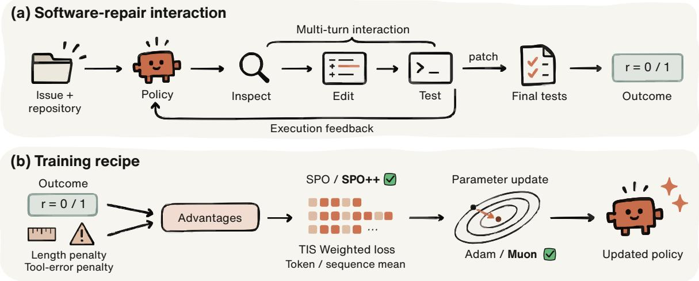
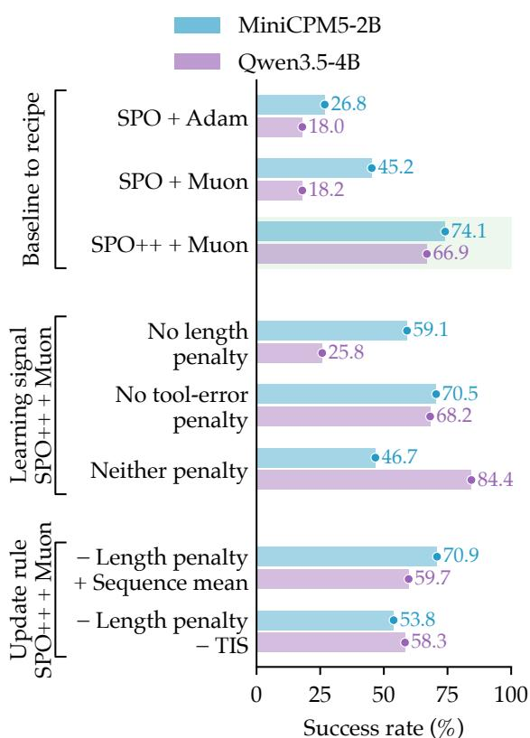
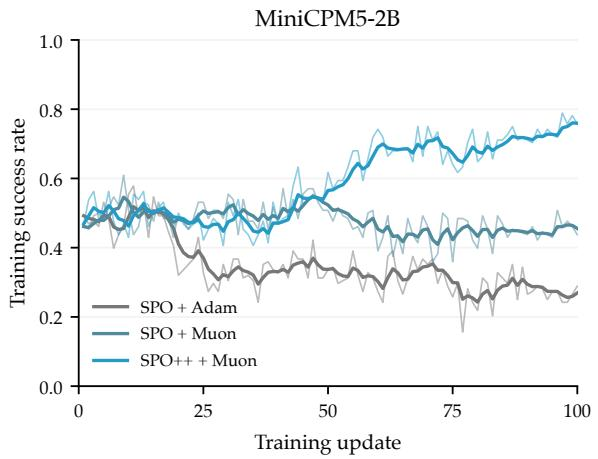
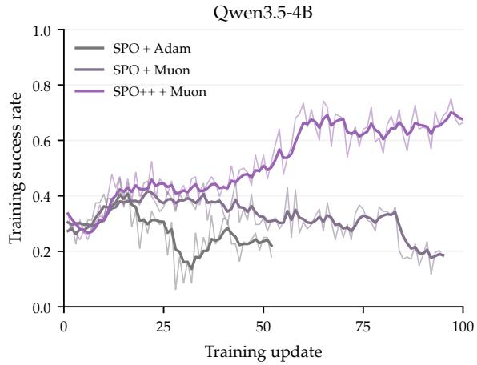
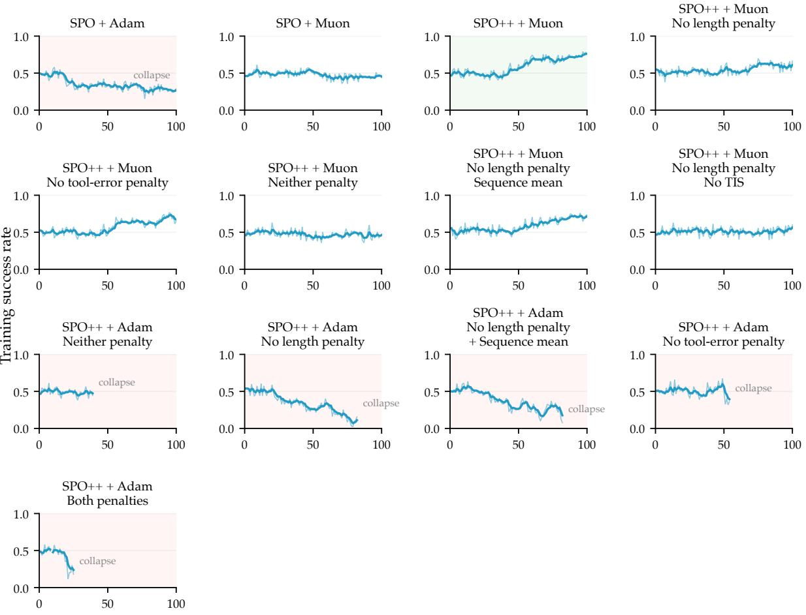
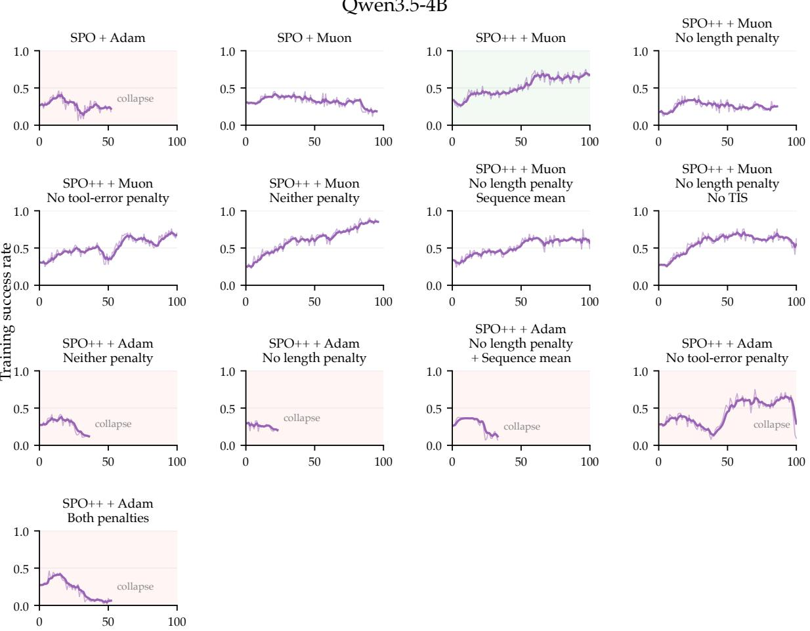

# Long-Horizon RL Needs Muon

Kai Ruan1,\* Jinghao Lin\* Tao Chen Ziqi Zhou2 Qianshan Wei3 Zihe Huang4

1Gaoling School of Artificial Intelligence, Renmin University of China

2Duke University

3Institute of Automation, Chinese Academy of Sciences

4Institute of Computing Technology, Chinese Academy of Sciences

Equal contribution.

## Abstract

Long-horizon agents must coordinate reasoning, tool use, and environment feedback over extended interactions. Learning from sparse outcome rewards requires weighting trajectories of different lengths and updating the policy while rollouts are still being collected. We examine a single-rollout asynchronous recipe combining Muon, token-averaged loss, truncated importance sampling, and auxiliary length and tool-error penalties. Single-rollout sampling allows asynchronous learning without waiting for multiple trajectories for the same issue. We study optimizer choices and recipe components for repository-level issue resolu tion across two model families. The evaluated training runs show higher training success with the full recipe than with the baselines.

## 1 Introduction

Repository-level issue resolution requires an agent to interpret an issue description, navigate and edit the codebase, and validate a candidate patch (Jimenez et al., 2023; Yang et al., 2024). Such workflows require coordinated execution across dependent steps, a defining feature of long-horizon agents (Wu et al., 2026a). Executable tests make these interactions a source of reinforcementlearning feedback (Jain et al., 2025; Luo et al., 2025; Song et al., 2026). Trajectory lengths vary, and asynchronous collection introduces a gap between rollout and learner policies. We study how optimizer choice affects learning from sparse outcomes under these conditions.

We compare Adam (Kingma and Ba, 2014) and Muon (Jordan et al., 2024) within Single-stream Policy Optimization (SPO) (Xu and Ding, 2025), then study how Muon combines with SPO++ (Ruan et al., 2026b), reward shaping, and importance correction. Ablations examine the length penalty (Yu et al., 2025), tool-error penalty, and update rules using the same training success rate metric.

The full recipe achieves higher training success than the SPO baselines in the selected runs from both model families (Figure 2).

  
Figure 1: Overview of the training recipe. (a) A software engineering agent inspects, edits, and tests a repository; final tests provide the binary outcome reward. (b) Length and tool-error penalties shape advantages, TIS reweights token-level policy losses, and token-level averaging aggregates the policy loss before the Muon update.

  
Figure 2: Recipe comparisons for the selected training runs in Figures 4 and 5. Bars summarize unsmoothed training success rates. Pale green highlights the full recipe.

## 2 Related Work

Learning from agent–environment interaction. Software engineering (SWE) agents interact with code repositories and use execution-based evaluation (Jimenez et al., 2023; Yang et al., 2024; Wang et al., 2024), supported by environments and training tasks such as SWE-Gym, R2E-Gym, and SWEsmith (Pan et al., 2024; Jain et al., 2025; Yang et al., 2025; JLULLM LAB, 2026). Training feedback can come from software evolution (Wei et al., 2025), test execution (Luo et al., 2025; Song et al., 2026), or simulation (Sun et al., 2026). Our experiments use execution-based rewards to study policy optimization.

Single-rollout and asynchronous optimization. SPO and SPO++ provide the single-rollout foundation of our recipe (Xu and Ding, 2025; Ruan et al., 2026b). SAO uses value-model learning and tokenlevel masking based on importance ratios (Hou et al., 2026), whereas FlashReinforce combines critic-free updates with token importance sampling and a sequence-level trust region (Hu et al., 2026). Other methods address off-policy agent training through turn-level correction (Li et al., 2025) and variance control (Huang et al., 2026). Muon has also been studied in mathematical and interactive RL (Fan et al., 2026; Ruan et al., 2026a). We study Muon within single-rollout asynchronous training for issue resolution.

Reward and loss design. Reward shaping determines how task outcomes and intermediate behavior contribute to learning, while loss aggregation determines the weight of trajectories with different lengths. Both are studied in agentic RL recipes (Wang et al., 2026; Wu et al., 2026b; Masud et al., 2026) and in reasoning RL through length penalties and trajectory weighting (Yu et al., 2025; Zeng et al., 2026). We examine their combination with Muon in multi-turn software repair.

## 3 Method

## 3.1 Muon-based policy optimization

For each sampled issue, the agent produces one rollout by interacting with the repository through tools. Rollout collection proceeds asynchronously with policy updates, introducing policy lag.

Muon’s update direction admits a spectral-norm interpretation (Bernstein, 2025). For a nonzero matrix gradient G with compact SVD $\begin{array} { r } { G = U _ { r } \Sigma _ { r } V _ { r } ^ { \top } } \end{array}$ one solution to the local linear problem is

$$
\operatorname* { m i n } _ { \| \Delta W \| _ { 2 } \le \eta } \langle G , \Delta W \rangle , \qquad \Delta W ^ { \ast } = - \eta U _ { r } V _ { r } ^ { \top } ,\tag{1}
$$

where $\| \cdot \| _ { 2 }$ denotes the spectral norm and $\eta > 0$ is the update budget. This direction preserves the gradient’s singular vectors and equalizes its nonzero singular values. The constraint bounds the change in a linear layer’s output: $\| \Delta W x \| _ { 2 } \ \leq \ \eta \| x \| _ { 2 }$ Practical Muon applies approximate orthogonalization to a momentum-based update, with matrixdependent scaling.

Newton–Schulz iterations compute this approximation using matrix multiplications, avoiding an explicit SVD (Jordan et al., 2024). Our implementation applies it to hidden weight matrices; embeddings, the output head, normalization parameters, and vector parameters use AdamW.

The SPO baseline computes advantages from outcome rewards and its task-specific baseline, then standardizes them across trajectories and uses proximal policy optimization (PPO)-style clipping (Schulman et al., 2017; Xu and Ding, 2025). We define valid tokens as agent-generated tokens included in the policy loss. Our recipe follows SPO++ in standardizing advantages across valid tokens (Ruan et al., 2026b), with auxiliary reward shaping for issue resolution (Figure 1).

  
Figure 3: Selected training runs. Thin translucent lines show raw values; bold lines show exponential moving averages (span 5) from the first observation.

Following DAPO’s Clip-Higher settings (Yu et al., 2025), the PPO importance-sampling ratio uses asymmetric clipping with $\epsilon _ { \mathrm { l o w } } ~ = ~ 0 . 2$ and $\epsilon _ { \mathrm { h i g h } } = 0 . 2 8$

## 3.2 Outcome reward and auxiliary penalties

Following SWE-bench (Jimenez et al., 2023), the final patch receives a binary outcome reward of 1 if it passes all fail-to-pass (F2P) and pass-to-pass (P2P) tests, and 0 otherwise. F2P tests check issue resolution; P2P tests check for regressions. Empty test sets and evaluations interrupted by infrastructure failures remain unscored.

The length penalty discourages long agent responses at each interaction turn. The tool-error penalty applies to invalid actions and designated tool, command, session, or execution errors reported in observations.

When triggered, the tool-error term is −0.5. The length penalty reaches −0.5 for responses exceeding 2,048 tokens, with the trajectory total proportionally capped. We omit this penalty on the final turn contributing to the policy loss. Writing the length and tool-error terms at turn k as $c _ { k } ^ { \mathrm { l e n } }$ and $c _ { k } ^ { \mathrm { t o o l } }$ , their combined contribution is

$$
c _ { k } = \mathrm { c l i p } \Big ( c _ { k } ^ { \mathrm { l e n } } + c _ { k } ^ { \mathrm { t o o l } } , - 0 . 2 5 , 0 . 2 5 \Big ) .\tag{2}
$$

The combined term is added to each valid token’s advantage in that turn, before standardization across valid tokens. Agent responses containing predefined command-rejection messages trigger an additional trajectory-level penalty. Penalty ablations leave the tool interface and binary outcome reward unchanged.

## 3.3 Importance correction and loss aggregation

Truncated importance sampling (TIS) reweights tokens to account for differences between training and sampling policies (Yao et al., 2025), arising from execution backends and asynchronous policy lag (Zheng et al., 2025). With frozen pre-update policy $\pi _ { \mathrm { o l d } } ^ { \mathrm { t r a i n } }$ evaluated by the training backend and sampling policy πrollout, the weight for generated token $a _ { t }$ in context $s _ { t }$ is

$$
w _ { t } = \operatorname* { m i n } \left( C , { \frac { \pi _ { \mathrm { o l d } } ^ { \mathrm { t r a i n } } ( a _ { t } \mid s _ { t } ) } { \pi ^ { \mathrm { r o l l o u t } } ( a _ { t } \mid s _ { t } ) } } \right) .\tag{3}
$$

We use $C = 2$ and apply the TIS weights directly to the masked token-level PPO losses, without batchwise weight normalization. The no-TIS ablation removes the weights while retaining PPO ratio clipping.

Loss aggregation determines how trajectories of different lengths contribute to an update (Liu et al., 2025; Yu et al., 2025; Zeng et al., 2026). For a batch of N trajectories, let $T _ { i } > 0$ count the valid tokens in trajectory i and $\ell _ { i t }$ denote their corrected losses. Tokens from environment observations are excluded from the policy loss. We compare

  
Figure 4: Training success across MiniCPM5-2B recipes: thin lines show unsmoothed success rates, bold lines show span-5 EMA, red marks collapse, green marks the full recipe.

$$
L _ { \mathrm { t o k e n } } = \frac { \sum _ { i = 1 } ^ { N } \sum _ { t = 1 } ^ { T _ { i } } \ell _ { i t } } { \sum _ { i = 1 } ^ { N } T _ { i } } ,\tag{4}
$$

$$
L _ { \mathrm { s e q u e n c e } } = \frac { 1 } { N } \sum _ { i = 1 } ^ { N } \frac { 1 } { T _ { i } } \sum _ { t = 1 } ^ { T _ { i } } \ell _ { i t } .\tag{5}
$$

The main recipe uses token-level averaging, which weights each trajectory mean in proportion to $T _ { i }$ The sequence-level averaging ablation weights trajectory means equally and keeps advantage standardization unchanged.

## 4 Experiments

## 4.1 Experimental setup

Training uses issue-resolution tasks from R2E-Gym (Jain et al., 2025). The agent interacts with the execution environment through the Claude Code harness (version 2.1.118). Training success rate is the fraction of evaluated rollouts whose final patches pass all required tests in each update;

auxiliary penalties are excluded.

We evaluate MiniCPM5-2B (OpenBMB, 2026) and Qwen3.5-4B (Qwen Team, 2026) with the same training-update and rollout budgets across independently initialized runs.

Curves show the longest available training run per configuration, with a separately selected run for MiniCPM5-2B with SPO + Muon (Figure 3). Figure 2 summarizes the same runs using mean success over updates 90–100 when that window is complete, and the last observed value otherwise. Numerical summaries use recorded values; matched comparisons use complete windows from runs with the same seed.

Adam and Muon share the SPO baseline’s data, rollout budgets, termination rules, and loss aggregation. Both collect task-specific outcome statistics online, without SPO’s offline initialization.

The full-recipe comparison holds Muon fixed while jointly changing advantage normalization, task-specific outcome estimation, clipping, and auxiliary penalties. Component ablations remove either or both penalties, or vary TIS and loss aggregation with the length penalty disabled. Each configuration collects its own trajectories through asynchronous rollouts; comparisons pair runs with the same seed.

  
Figure 5: Training success across Qwen3.5-4B recipes: thin lines show unsmoothed success rates, bold lines show span-5 EMA, red marks collapse, green marks the full recipe.

## 4.2 Main results

The full recipe reaches higher success rates than both SPO baselines later in training for both model families (Figure 3). The gain over SPO + Muon supports combining the optimizer with the full set of recipe changes.

Across the recipe comparisons, training success continues to improve with the full recipe and declines in several Adam configurations (Figures 4 and 5). Without the length penalty, the relative performance of token-level and sequence-level averaging varies across seeds.

## 5 Conclusion

Combining Muon with single-rollout asynchronous updates, importance correction, and auxiliary re-

ward shaping yields higher training success than the SPO baselines in the evaluated runs from both model families.

## References

Jeremy Bernstein. 2025. Deriving muon.

Chongyu Fan, Gaowen Liu, Mingyi Hong, Ramana Rao Kompella, and Sijia Liu. 2026. Rethinking Muon Beyond Pretraining: Spectral Failures and High-Pass Remedies for VLA and RLVR. Preprint, arXiv:2605.19282. Version v1, 2026-05-19.

Zhenyu Hou, Yujiang Li, Jie Tang, and Yuxiao Dong. 2026. Single-rollout asynchronous optimization for agentic reinforcement learning. Preprint, arXiv:2607.07508. Version v1.

Jian Hu, Yifan Zhang, Hao Zhang, Binfeng Xu, Shaokun Zhang, Hongqing Peng, Zhiding Yu, Pavlo Molchanov, Jan Kautz, and Yi Dong. 2026. FlashRE-INFORCE: Critic-free single-rollout asynchronous RL for agentic language models.

Luke J. Huang, Zhuoyang Zhang, Qinghao Hu, Shang Yang, and Song Han. 2026. Stable Asyn-

chrony: Variance-Controlled Off-Policy RL for LLMs. Preprint, arXiv:2602.17616.

Naman Jain, Jaskirat Singh, Manish Shetty, Liang Zheng, Koushik Sen, and Ion Stoica. 2025. R2E-Gym: Procedural environments and hybrid verifiers for scaling open-weights SWE agents. Preprint, arXiv:2504.07164. Version 1, 9 April 2025.

Carlos E. Jimenez, John Yang, Alexander Wettig, Shunyu Yao, Kexin Pei, Ofir Press, and Karthik Narasimhan. 2023. SWE-bench: Can language models resolve real-world GitHub issues? Preprint, arXiv:2310.06770. Version v3.

JLULLM LAB. 2026. From issues to learning signals: A survey of data for coding agents. Survey manuscript.

Keller Jordan, Yuchen Jin, Vlado Boza, Jiacheng You, Franz Cesista, Laker Newhouse, and Jeremy Bernstein. 2024. Muon: An optimizer for hidden layers in neural networks. Technical blog.

Diederik P. Kingma and Jimmy Ba. 2014. Adam: A method for stochastic optimization. Preprint, arXiv:1412.6980.

Chenliang Li, Adel Elmahdy, Alex Boyd, Zhongruo Wang, Siliang Zeng, Alfredo Garcia, Parminder Bhatia, Taha Kass-Hout, Cao Xiao, and Mingyi Hong. 2025. Stabilizing Off-Policy Training for Long-Horizon LLM Agent via Turn-Level Importance Sampling and Clipping-Triggered Normalization. Preprint, arXiv:2511.20718.

Zichen Liu, Changyu Chen, Wenjun Li, Penghui Qi, Tianyu Pang, Chao Du, Wee Sun Lee, and Min Lin. 2025. Understanding R1-Zero-Like Training: A Critical Perspective. Preprint, arXiv:2503.20783.

Michael Luo, Naman Jain, Jaskirat Singh, Sijun Tan, Ameen Patel, Qingyang Wu, Alpay Ariyak, Colin Cai, Tarun Venkat, Shang Zhu, Ben Athiwaratkun, Manan Roongta, Ce Zhang, Li Erran Li, Raluca Ada Popa, Koushik Sen, and Ion Stoica. 2025. DeepSWE: Training a fully open-sourced, state-of-the-art coding agent by scaling RL. Together AI technical blog. Published 2 July 2025; accessed 23 September 2026.

Md Rayhanul Masud, Azmine Toushik Wasi, Salman Rahman, and Md Rizwan Parvez. 2026. Reward engineering for software tasks: A survey of reinforcement learning approaches. Preprint, arXiv:2601.19100.

OpenBMB. 2026. MiniCPM5-2B model card. Hugging Face model card.

Jiayi Pan, Xingyao Wang, Graham Neubig, Navdeep Jaitly, Heng Ji, Alane Suhr, and Yizhe Zhang. 2024. Training software engineering agents and verifiers with SWE-gym. Preprint, arXiv:2412.21139.

Qwen Team. 2026. Qwen3.5: Towards native multimodal agents.

Kai Ruan, Jinghao Lin, Zihe Huang, Ziqi Zhou, Qianshan Wei, Xuan Wang, and Hao Sun. 2026a. When Does Muon Help Agentic Reinforcement Learning? Preprint, arXiv:2607.16169. Version v4, 2026-08- 02.

Kai Ruan, Jinghao Lin, Qianshan Wei, Ziqi Zhou, and Zihe Huang. 2026b. SPO++: Stream-Aligned Policy Optimization for Asynchronous Agentic RL. Preprint, arXiv:2608.24870. Version v1, 2026-08- 25.

John Schulman, Filip Wolski, Prafulla Dhariwal, Alec Radford, and Oleg Klimov. 2017. Proximal policy optimization algorithms. Preprint, arXiv:1707.06347.

Huatong Song, Lisheng Huang, Shuang Sun, Jinhao Jiang, Ran Le, Daixuan Cheng, Guoxin Chen, Yiwen Hu, Zongchao Chen, Yiming Jia, Wayne Xin Zhao, Yang Song, Tao Zhang, and Ji-Rong Wen. 2026. SWE-Master: Unleashing the Potential of Software Engineering Agents via Post-Training. Preprint, arXiv:2602.03411.

Shuang Sun, Huatong Song, Lisheng Huang, Jinhao Jiang, Ran Le, Zhihao Lv, Zongchao Chen, Yiwen Hu, Wenyang Luo, Wayne Xin Zhao, Yang Song, Hongteng Xu, Tao Zhang, and Ji-Rong Wen. 2026. SWE-World: Building Software Engineering Agents in Docker-Free Environments. Preprint, arXiv:2602.03419.

Xiaoxuan Wang, Han Zhang, Haixin Wang, Yidan Shi, Ruoyan Li, Kaiqiao Han, Chenyi Tong, Haoran Deng, Alexander K. Taylor, Renliang Sun, Yanqiao Zhu, Jason Cong, Yizhou Sun, and Wei Wang. 2026. Arlarena: A unified framework for stable agentic reinforcement learning. Preprint, arXiv:2602.21534.

Xingyao Wang, Boxuan Li, Yufan Song, Frank F. Xu, Xiangru Tang, Mingchen Zhuge, Jiayi Pan, Yueqi Song, Bowen Li, Jaskirat Singh, Hoang H. Tran, Fuqiang Li, Ren Ma, Mingzhang Zheng, Bill Qian, Yanjun Shao, Niklas Muennighoff, Yizhe Zhang, Binyuan Hui, and 5 others. 2024. OpenHands: An Open Platform for AI Software Developers as Generalist Agents. Preprint, arXiv:2407.16741.

Yuxiang Wei, Olivier Duchenne, Jade Copet, Quentin Carbonneaux, Lingming Zhang, Daniel Fried, Gabriel Synnaeve, Rishabh Singh, and Sida I. Wang. 2025. SWE-RL: Advancing LLM reasoning via reinforcement learning on open software evolution. Preprint, arXiv:2502.18449. ArXiv record.

Kai Wu, Hao Lyu, Zhen Luo, Chaofan Wang, Siyu Ye, Jinghao Lin, Xiaozhong Ji, Boyuan Jiang, Shengzhi Wang, Zihan Wang, Yiwen Ye, Hao Wang, Zimu Wang, Wenzhe Liu, Ruobing Wang, Kai Cai, Mingliang Xiong, Wen Fang, Mingqing Liu, and 4 others. 2026a. AI4AI survey: From long-horizon agents to recursive self-improvement—definitions, reliable horizons, and open problems. Preprints.org.

Xixi Wu, Qianguo Sun, Ruiyang Zhang, Chao Song, Junlong Wu, Yiyan Qi, and Hong Cheng. 2026b. Demystifying reinforcement learning for long-horizon tool-using agents: A comprehensive recipe. Preprint, arXiv:2603.21972.

Zhongwen Xu and Zihan Ding. 2025. Single-stream Policy Optimization. Preprint, arXiv:2509.13232. Version v2, 2025-09-23.

John Yang, Carlos E. Jimenez, Alexander Wettig, Kilian Lieret, Shunyu Yao, Karthik Narasimhan, and Ofir Press. 2024. SWE-agent: Agent-computer interfaces enable automated software engineering. Preprint, arXiv:2405.15793. Version 3, 11 November 2024.

John Yang, Kilian Lieret, Carlos E. Jimenez, Alexander Wettig, Kabir Khandpur, Yanzhe Zhang, Binyuan Hui, Ofir Press, Ludwig Schmidt, and Diyi Yang. 2025. SWE-smith: Scaling data for software engineering agents. Preprint, arXiv:2504.21798.

Feng Yao, Liyuan Liu, Dinghuai Zhang, Chengyu Dong, Jingbo Shang, and Jianfeng Gao. 2025. Your efficient RL framework secretly brings you off-policy

RL training. Technical blog. First published August 5, 2025.

Qiying Yu, Zheng Zhang, Ruofei Zhu, Yufeng Yuan, Xiaochen Zuo, Yu Yue, Weinan Dai, Tiantian Fan, Gaohong Liu, Lingjun Liu, Xin Liu, Haibin Lin, Zhiqi Lin, Bole Ma, Guangming Sheng, Yuxuan Tong, Chi Zhang, Mofan Zhang, Wang Zhang, and 16 others. 2025. DAPO: An Open-Source LLM Reinforcement Learning System at Scale. Preprint, arXiv:2503.14476. Version v2, 2025-05-20.

Zhiyuan Zeng, Jiameng Huang, Zhangyue Yin, Jiashuo Liu, Ziniu Li, Bingrui Li, Yuhao Wu, Yining Zheng, Ge Zhang, Wenhao Huang, and Xipeng Qiu. 2026. Balanced Aggregation: Understanding and Fixing Aggregation Bias in GRPO. Preprint, arXiv:2605.04077. Version v1, 2026-04-14.

Chujie Zheng, Kai Dang, Bowen Yu, Mingze Li, Huiqiang Jiang, Junrong Lin, Yuqiong Liu, Hao Lin, Chencan Wu, Feng Hu, An Yang, Jingren Zhou, and Junyang Lin. 2025. Stabilizing Reinforcement Learning with LLMs: Formulation and Practices. Preprint, arXiv:2512.01374.