# M ORPHACT: ROBOT POLICIES MORPHING WITH THE WORLDS THEY ACT IN

Ziyan Liu\* 1,2 Jiting Liu\* 2 Weihong Zhong\* 2 Wenda Yu5 Yeqiu Chen1 Jason Li4 Xiaojiang Peng6 Shuyuan Hu2 Kai Wang3 † Bo Zhao2 †

1University of Science and Technology of China

2School of Artificial Intelligence, Shanghai Jiao Tong University

3National University of Singapore

5Tongji University

4Nanyang Technological University 6Shenzhen Technology University

\*Equal contribution †Corresponding authors € Project page

## ABSTRACT

Progress toward general intelligence in the physical world requires scaling robot learning across diverse environments and interactions. However, existing robot policies use shared parameters that remain fixed across interaction contexts. When different operations favor competing parameter adjustments, fitting their mixture can leave individual operations insufficiently adapted. Our atomic-task diagnostics reveal competing update directions in both vision–language and action parameters, with source-improving updates increasing loss on other tasks. This motivates MorphAct1, a contextual parameterization framework that dynamically adjusts robot policy parameters as interaction contexts change. Two coupled generators produce context-dependent low-rank updates for the vision–language and action modules. Their coupling follows the policy’s computational dependency: vision–language updates shape the representations that condition action-side parameter generation. Both generators are trained jointly through the native action objective, without operation labels or expert-adapter targets. MorphAct improves performance across three VLA backbones on LIBERO and Meta-World, with gains of up to 16.30%. In real-world evaluation, it achieves gains of up to 14% over $\pi _ { 0 . 5 } .$ . Ablations support the benefits of contextual parameter generation and representation coupling.

## 1 INTRODUCTION

Progress toward general intelligence in the physical world requires scaling robot learning across diverse environments, operations, and interactions (Driess et al., 2023; Black et al., 2025). This expansion brings together heterogeneous perceptual and control demands within a shared model. Such diversity arises not only across tasks but also within a single interaction: placing an object in a tray involves approaching it, establishing contact, transporting it, and positioning it precisely. These operations require different visual cues and control behaviors, often under an unchanged instruction. As environmental and operational coverage expands, a central challenge is how a shared model can effectively accommodate these heterogeneous demands.

Vision–language–action (VLA) models provide a promising foundation by combining pretrained multimodal representations with action prediction (Brohan et al., 2023a; Kim et al., 2025b; Black et al., 2025; Liu et al., 2025). However, conventional VLA policies execute diverse interactions using a shared, static parameter configuration. Context changes their activations and predicted actions, but their effective weights remain fixed, including after full fine-tuning or low-rank adaptation (Hu et al., 2022; Kim et al., 2025a). Different operations must therefore be learned through shared parameters, even when their training signals favor competing updates—a source of interference in joint optimization (Yu et al., 2020a). This raises the question of how effectively shared parameters reconcile the demands of different operations.

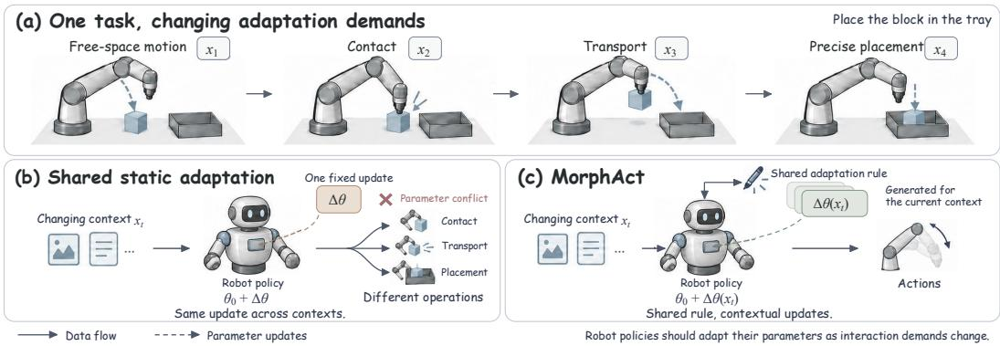  
Figure 1: Robot policies morph with changing interaction contexts. (a) A single manipulation task involves operations with different perceptual and control demands. (b) Existing robot policies use one fixed parameter configuration across contexts, requiring shared parameters to reconcile competing demands. (c) MorphAct generates context-dependent updates for the vision–language and action modules, dynamically adjusting policy parameters as interactions unfold.

We investigate this question through operation-level diagnostics using demonstrations from the 65 atomic tasks in RoboCasa365 (Nasiriany et al., 2026). At a common policy checkpoint, we examine gradient alignment, the effect of a single update on other tasks, and the contributions of individual parameter groups. The diagnostics reveal competing update directions in both the vision–language and action modules. Every measured source-improving update also increases loss on batches from other tasks, while opposing parameter-group contributions can cancel within a module. These findings expose local adaptation trade-offs in shared parameter space. They motivate a shared parameter-generation mechanism whose outputs vary with the interaction context.

To address this challenge, we introduce MorphAct, a contextual parameterization framework that enables robot policies to morph with changing interaction contexts (Figure 1). MorphAct generates context-dependent low-rank parameter updates for the vision–language and action modules, allowing a shared policy to adjust its effective weights to the current interaction. Because vision–language adaptation changes the representations used for control, MorphAct couples the two generators by conditioning action-side parameter generation on the adapted representations. Both generators learn jointly through the native action objective, without operation labels or expert-adapter targets. Low-rank factors provide an efficient implementation of these contextual updates.

We evaluate MorphAct on X-VLA, $\pi _ { 0 } ,$ and $\pi _ { 0 . 5 }$ (Zheng et al., 2026; Black et al., 2025; Physical Intelligence et al., 2025) using LIBERO (Liu et al., 2023) and Meta-World (Yu et al., 2020b), comparing each backbone’s baseline with MorphAct. Across the three backbones, MorphAct improves Meta-World average success by 7.57–16.30%; on LIBERO, X-VLA, π , and $\pi _ { 0 . 5 }$ gain 4.15%, 2.50%, and 1.75%, respectively. Real-world evaluation with $\pi _ { 0 . 5 }$ further yields gains of 8.00–14.00% across four manipulation tasks. Controlled X-VLA ablations on LIBERO show that fixed generation conditions, single-module adaptation, and action-side generation conditioned on pre-adaptation features each reduce mean success. These results support contextual parameterization and representation coupling for accommodating diverse manipulation demands.

Our contributions are threefold: (1) We identify parameter conflicts as a challenge to scaling robot learning across diverse environments and interactions through operation-level diagnostic experiments. (2) We introduce MorphAct, whose representation-coupled generators produce context-dependent vision–language and action parameter updates and learn jointly through the native action objective. (3) We demonstrate success gains on three VLA backbones, two simulation benchmarks, and four real-world tasks, with ablations supporting contextual generation and representation coupling.

## 2 PARAMETER CONFLICTS ACROSS OPERATIONS

As robot learning expands across environments and interactions, static-parameter policies must reconcile diverse operational demands through the same weights. We examine whether different

(a) Gradient conflict

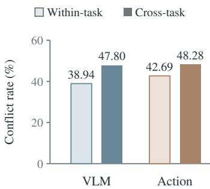  
(b) One-step transfer

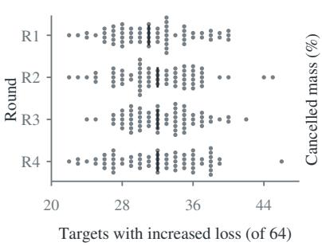  
(c) Contribution cancellation  
Within-task Cross-task

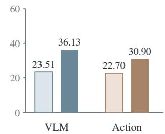  
Figure 2: Parameter conflicts across operations and within modules. (a) Negative-gradient-cosine frequency within and across tasks. (b) Number of other tasks with increased target-batch loss after a source update. All 260 updates reduce source-batch loss; dots represent updates and ticks mark round medians. (c) Fraction of absolute alignment contribution cancelled across parameter groups within each module. Measurements use one checkpoint with 16 sampling rounds for $^ { ( \mathrm { a } , \mathrm { c } ) }$ and four for (b).

operations favor compatible changes to these parameters. Our diagnostics measure gradient alignment, one-step cross-task loss changes, and parameter-group contributions in both vision–language and action modules at a common checkpoint.

Setup. We use demonstrations from the 65 atomic tasks in RoboCasa365 (Nasiriany et al., 2026), grouped by native task ID. All measurements use a fixed RoboCasa-pretrained $\pi _ { 0 . 5 }$ checkpoint and the native action loss $\mathcal { L }$ over the full vision–language (VLM) and action parameter sets. Each sampling round draws batches $U _ { i }$ and $V _ { i }$ from disjoint episodes of task i. Gradient comparisons use $( U _ { i } , U _ { j } )$ across tasks and $( U _ { i } , V _ { i } )$ as a within-task reference. For one-step transfer, $U _ { i }$ supplies the update and $V _ { j }$ the target evaluation. Appendix A details sampling, numerical settings, and metrics.

## 2.1 CONFLICTING DIRECTIONS IN BOTH MODULES

We first ask whether different tasks favor compatible parameter changes. At the common checkpoint, we compute task-batch gradients separately for the VLM and action modules and compare their cosine similarity. A negative cosine indicates competing local descent directions (Yu et al., 2020a). Across 16 sampling rounds, negative alignment occurs in 47.80% of cross-task VLM comparisons and 48.28% of action comparisons, versus 38.94% and 42.69% within tasks (Figure 2(a)). The within-task reference shows that update directions also vary among episodes of the same task, while cross-task comparisons produce negative alignment more frequently. Competing adaptation demands therefore affect both the representations used for control and the action mapping.

## 2.2 CROSS-TASK INTERFERENCE FROM PARAMETER UPDATES

Gradient alignment describes local update directions; we next measure the loss changes produced by an actual update. For each source batch $U _ { i }$ , we take one full-parameter gradient step and evaluate the target batches $V _ { j } ,$ , restarting from the common checkpoint for every source. Target observations, action targets, flow times, and noise remain fixed before and after the step. Across four rounds, all 260 updates reduce their source-batch loss, with a mean relative reduction of 2.38%. Yet each update increases loss on batches from 22–46 of the other 64 tasks, with a median of 32 (Figure 2(b)). Every source-improving update thus has both helpful and harmful effects on other tasks: improving the source does not produce uniformly beneficial transfer across manipulation contexts.

## 2.3 CONFLICTING CONTRIBUTIONS ACROSS PARAMETER GROUPS

The preceding comparisons summarize each module as a whole. To examine the interactions within these summaries, we decompose gradient alignment across 47 VLM groups and 19 action groups, including individual Transformer blocks (Shi et al., 2023). Each group’s gradient inner product is normalized by the same full-module gradient norms, so the contributions sum to the module-level cosine. Positive and negative contributions can offset one another. We sum the absolute contribution mass canceled within each pair and divide by the total absolute contribution mass across comparisons. For cross-task pairs, cancellation reaches 36.13% in the VLM and 30.90% in the action module, compared with 23.51% and 22.70% within tasks (Figure 2(c)). A small module-level cosine can therefore reflect opposing parameter-group contributions rather than uniformly weak interactions. Appendix A.3 reports the complete group definitions and decomposition.

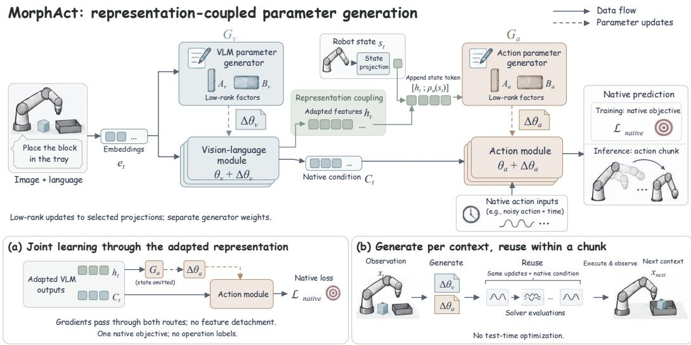  
Figure 3: Representation-coupled parameter generation. $G _ { v }$ generates vision–language updates from multimodal embeddings. The adapted VLM pass produces $h _ { t }$ for action-side parameter generation and $C _ { t }$ for native action conditioning. $G _ { a }$ generates action updates from $h _ { t }$ and robot state. Solid arrows carry data; dashed arrows inject updates. Both generators learn through the action objective, and their outputs are reused within each action chunk.

Implication for MorphAct. Together, these results show that adaptation demands differ across tasks and act on both representation and action parameters. An update that serves one context can work against another, with opposing contributions hidden by module-level summaries. This motivates sharing the adaptation mechanism while allowing its updates to depend on the current context. MorphAct uses two generators connected by the adapted visual–language representation.

## 3 MORPHACT: MORPH WITH THE ENVIRONMENT AND THEN ACT

MorphAct adjusts robot policy parameters to the current interaction context before predicting an action chunk (Figure 3). Two generators produce context-dependent updates for the vision–language and action modules, with action-side generation conditioned on the adapted vision–language representations. We describe this coupled generation process and its low-rank parameterization, then explain how both generators learn through the native action objective and how their outputs are reused within each action chunk.

## 3.1 REPRESENTATION-COUPLED GENERATION

Let $\boldsymbol { x } _ { t } = ( o _ { t } , \ell , s _ { t } )$ denote the observation, instruction, and robot state at replanning time t. We denote the base policy parameters by $\theta ,$ with vision–language and action modules parameterized by $\theta _ { v }$ and $\theta _ { a }$ . MorphAct generates $\Delta \dot { \theta } ( x _ { t } ) = ( \Delta \theta _ { v , t } , \Delta \theta _ { a , t } )$ for selected projections and predicts an action chunk as $\widehat { Y } _ { t } = \pi _ { \theta + \Delta \theta ( x _ { t } ) } ( x _ { t } )$ , suppressing sampling randomness. The generator weights are shared across contexts, while their outputs determine the context-dependent effective parameters.

The two updates follow the policy’s computational dependency: vision–language adaptation changes the representations used for control, so action-side generation conditions on the adapted features. Given multimodal embeddings $e _ { t } = E ( o _ { t } , \ell )$ , the forward computation is

$$
\begin{array} { r } { \begin{array} { l l } { \Delta \theta _ { v , t } = G _ { v } ( e _ { t } ; \phi _ { v } ) , \quad ( h _ { t } , C _ { t } ) = F _ { v } ( e _ { t } ; \theta _ { v } + \Delta \theta _ { v , t } ) , } \\ { u _ { a , t } = C _ { a } ( h _ { t } , s _ { t } ; \rho _ { a } ) , \quad \Delta \theta _ { a , t } = G _ { a } ( u _ { a , t } ; \phi _ { a } ) . } \end{array} } \end{array}\tag{1}
$$

Here, $h _ { t }$ supplies the action generator’s visual–language condition, whereas $C _ { t }$ retains the action module’s native conditioning path. Both are outputs of the same adapted VLM pass. In $\pi _ { 0 }$ and $\pi _ { 0 . 5 } ,$ they correspond to final multimodal prefix tokens and layer-wise prefix key–value states, respectively. The constructor $C _ { a }$ appends a robot-state token projected by $\rho _ { a }$ to $h _ { t }$ . Thus, the generators have separate parameters but are connected through the representation produced by upstream adaptation.

Structured low-rank synthesis. Both generators use the structured synthesis primitive of HY-WU (Wu et al., 2026), with distinct target layouts for the two modules. Queries encode layer and projection/rank identities; generator blocks combine cross-layer attention, within-layer parameter attention, and cross-attention to the condition tokens. Separate A/B readouts then produce the factors for each selected block. The generators attend to individual condition tokens.

For block $j ,$ the generated factors are $A _ { j , t } \in \mathbb { R } ^ { d _ { \mathrm { i n } , j } \times r _ { j } }$ and $B _ { j , t } \in \mathbb { R } ^ { r _ { j } \times d _ { \mathrm { o u t } , j } }$ . With scaling coefficient $\alpha _ { j }$ , the update and its residual contribution for a row-vector input u are

$$
\Delta W _ { j , t } = \frac { \alpha _ { j } } { r _ { j } } A _ { j , t } B _ { j , t } , \qquad \delta y _ { j , t } = \frac { \alpha _ { j } } { r _ { j } } ( u A _ { j , t } ) B _ { j , t } .\tag{2}
$$

The factored computation avoids materializing dense updates. Q/K/V projections use output-head blocks with their actual query and key/value head counts; attention-output projections sum input-head contributions, while feed-forward projections use matrix-level factors. These layouts accommodate the modules’ different widths and depths. The rank $r _ { j }$ is defined per generated block, not for the assembled multi-head projection. Appendix B specifies the factor geometry and output budgets.

## 3.2 LEARNING THROUGH THE ADAPTED REPRESENTATION

MorphAct trains both generators jointly through the base policy’s action objective, using the same adaptation targets as the corresponding LoRA configuration. Let $\Phi = ( \phi _ { v } , \phi _ { a } , \rho _ { a } , \psi )$ denote the generator parameters, state projection, and projector parameters $\psi$ retained as trainable in that configuration. The remaining VLM and action backbone parameters are frozen. Generated factors are differentiable intermediate outputs, not independent optimization variables. For demonstrations $( x _ { t } , Y _ { t } ) \sim \mathcal { D }$ , we optimize

$$
\operatorname* { m i n } _ { \Phi } \ \mathbb { E } _ { ( x _ { t } , Y _ { t } ) \sim \mathcal { D } , \xi } \left[ \mathcal { L } _ { \mathrm { n a t i v e } } \big ( \widehat { y } _ { \Phi } ( x _ { t } , Y _ { t } ; \xi ) , Y _ { t } ; \xi \big ) \right] ,\tag{3}
$$

where $\xi$ contains the randomness required by the native training objective, and $\widehat { y } _ { \Phi }$ denotes its trainingtime prediction. For $\pi _ { 0 }$ and $\pi _ { 0 . 5 }$ , the sampled time and noise $\xi = ( \tau , \epsilon )$ define $z _ { \tau } = \tau \epsilon + ( 1 - \tau ) Y _ { t }$ and the model predicts the velocity $\epsilon - Y _ { t }$ , rather than the clean inference chunk $\widehat { Y } _ { t }$ . This is conditional flow matching along a linear action–noise path (Lipman et al., 2023).

The adapted representation participates in learning through two routes: native action conditioning and action-side parameter generation. Writing $\boldsymbol { r } _ { t } = ( h _ { t } , C _ { t } )$ and the per-sample loss as $\ell _ { t } ( r _ { t } , \Delta \theta _ { a , t } )$ with other inputs suppressed, the upstream gradient is

$$
\nabla _ { \phi _ { v } } \ell _ { t } = J _ { r _ { t } , \phi _ { v } } ^ { \top } \Big [ \frac { \partial \ell _ { t } } { \partial r _ { t } } + J _ { \Delta \theta _ { a , t } , r _ { t } } ^ { \top } \frac { \partial \ell _ { t } } { \partial \Delta \theta _ { a , t } } \Big ] , \qquad J _ { y , z } = \frac { \partial y } { \partial z } .\tag{4}
$$

The first term differentiates through action conditioning while holding the action update fixed; the second accounts for the update’s dependence on adapted features. Neither route is detached. The action objective therefore trains the upstream generator through both the representations used for control and the parameters generated from those representations.

## 3.3 CONTEXT-LEVEL ADAPTATION, CHUNK-LEVEL REUSE

Action-sequence prediction underlies both ACT’s action chunking and Diffusion Policy’s recedinghorizon control (Zhao et al., 2023; Chi et al., 2023). Parameter generation depends on the current observation context, not on noisy actions or internal solver time. At each replanning step, MorphAct generates the VLM update, computes $h _ { t }$ and $C _ { t } .$ , and generates the action update. These quantities are then reused throughout action-chunk prediction and refreshed at the next replanning observation, without test-time optimization. In $\pi _ { 0 }$ and $\pi _ { 0 . 5 }$ , the single adapted prefix pass supplies both representation outputs, while the action expert retains its native state and time interfaces, including $\pi _ { 0 . 5 } \mathrm { ^ { \circ } s }$ time-conditioned normalization. Appendix C provides the inference procedure.

## 3.4 IMPLEMENTATION DETAILS

Both A/B readouts use small, nonzero weight initialization and zero biases, keeping initial residuals small without blocking gradients to the generator trunk. Generator parameters are stored in FP32, while internal attention and feed-forward layers support BF16 computation. Factor readouts, low-rank products, scaling, and residual accumulation are computed in FP32 before conversion to the backbone output dtype. Training uses AdamW with learning-rate warmup, cosine decay, and global gradient clipping; updates with non-finite losses or gradient norms are skipped.

For variable-length conditions, valid tokens are compacted using the supplied masks and grouped by sequence length. The original batch order is restored after generation, preserving gradients through the adapted features. Non-reentrant activation checkpointing reduces training memory. Algorithms 1 and 2 in Appendix C provide the complete training and inference procedures, respectively.

## 4 EXPERIMENTS

We evaluate MorphAct on LIBERO (Liu et al., 2023), Meta-World (Yu et al., 2020b), and four real-world manipulation tasks. These closed-loop evaluations complement the atomic-task analysis in Section 2 by measuring complete task execution. Section 5 examines the contributions of individual design choices through ablations.

## 4.1 EVALUATION SETTING

We use closed-loop task success as the primary metric. In simulation, we compare MorphAct with the corresponding baselines for ${ \mathrm { X - V L A , ~ } } \pi _ { 0 }$ , and $\pi _ { 0 . 5 }$ under the same task settings. On LIBERO, we train jointly on Spatial, Object, Goal, and Long (LIBERO-10), each containing ten tasks, and report suite-level success and their arithmetic average as the Mean score. On Meta-World, we train jointly on all 50 tasks in MT50 and report success for four difficulty groups: Easy (28 tasks), Medium (11), Hard (6), and Very Hard (5). Avg. is the unweighted arithmetic mean of the four group success rates.

We evaluate 50 rollouts per task on LIBERO and twenty on Meta-World. MorphAct uses execution horizon H10 on LIBERO. On Meta-World, its checkpoint and execution-horizon settings are 20k / H3 for $\pi _ { 0 } .$ , 17.5k / H4 for $\pi _ { 0 . 5 } .$ , and 82k / H4 for X-VLA. The two main simulation tables report MorphAct’s mean scores across three random seeds, each using these rollout counts, and the sample variance of the three overall scores in squared percentage points $( \mathsf { p p } ^ { 2 } )$ ). Baseline scores are retained from the original comparison; their variances are not reported.

For real-world evaluation, we compare $\pi _ { 0 . 5 }$ with and without MorphAct on four manipulation tasks, using 50 physical rollouts per task for each method. Section 4.4 describes the tasks.

## 4.2 LIBERO

Table 1 shows that MorphAct improves mean success on all three backbones. On X-VLA, success rises from 93.05% to 97.20%, a gain of 4.15 percentage points. On $\pi _ { 0 } .$ , it increases from 94.15% to 96.65%, a gain of 2.50 points. MorphAct also improves $\pi _ { 0 . 5 }$ from 96.85% to 98.60%, adding 1.75 points to the highest baseline mean in this comparison.

Long shows the largest gain for each backbone: 9.00 points for X-VLA, 7.20 for $\pi _ { 0 } .$ , and 5.13 for $\pi _ { 0 . 5 } .$ MorphAct improves all four suites on X-VLA and $\pi _ { 0 }$ . For X-VLA, Goal rises from 96.00% to 97.07%. For $\pi _ { 0 . 5 }$ , it improves Object, Goal, and Long, while Spatial changes from 98.80% to 98.33%. Thus, the higher mean scores combine a consistent improvement on Long with more varied changes on the remaining suites.

<table><tr><td>Backbone</td><td>Method</td><td>Spatial ↑</td><td>Object ↑</td><td>Goal ↑</td><td>Long ↑</td><td>Mean ↑</td><td>Var.  $( \mathsf { p p } ^ { 2 } )$ </td></tr><tr><td rowspan="2">X-VLA</td><td>Baseline</td><td>95.40</td><td>96.60</td><td>96.00</td><td>84.20</td><td>93.05</td><td></td></tr><tr><td>MorphAct</td><td>98.67</td><td>99.87</td><td>97.07</td><td>93.20</td><td>97.20</td><td>0.0300</td></tr><tr><td rowspan="2"> $\pi _ { 0 }$ </td><td>Baseline</td><td>96.80</td><td>98.80</td><td>95.80</td><td>85.20</td><td>94.15</td><td></td></tr><tr><td>MorphAct</td><td>98.00</td><td>99.60</td><td>96.60</td><td>92.40</td><td>96.65</td><td>0.0517</td></tr><tr><td rowspan="2"> $\pi _ { 0 . 5 }$ </td><td>Baseline</td><td>98.80</td><td>98.20</td><td>98.00</td><td>92.40</td><td>96.85</td><td></td></tr><tr><td>MorphAct</td><td>98.33</td><td>99.67</td><td>98.87</td><td>97.53</td><td>98.60</td><td>0.0525</td></tr></table>

Table 1: LIBERO closed-loop success rates (%). Long denotes LIBERO-10; Mean averages the four suite scores. MorphAct scores are averaged across three random seeds, each covering 40 tasks with 50 rollouts per task and execution horizon H10. Var. is the sample variance of the three overall scores $( \mathrm { p p } ^ { 2 } ) ;$ ; – denotes unreported baseline variance. Shaded rows denote MorphAct. Bold indicates the best result within each backbone and column, including ties.

## 4.3 META-WORLD

Table 2 reports performance under joint training on MT50. MorphAct improves average success from 55.54% to 63.11% on X-VLA, from 50.75% to 67.05% on $\pi _ { 0 }$ , and from 48.70% to 64.42% on π . The corresponding gains are 7.57, 16.30, and 15.72 percentage points. All three backbones therefore benefit from MorphAct on this multi-task benchmark.

The improvements span the difficulty groups rather than appearing only in the aggregate score. π0 and $\pi _ { 0 . 5 }$ improve in all four groups, while X-VLA improves in three and matches its baseline on Very Hard at 55.00%. Some of the largest gains occur on the harder groups: $\pi _ { 0 }$ rises from 20.00% to 58.00% on Very Hard, and $\pi _ { 0 . 5 }$ rises from 38.30% to 66.39% on Hard. For X-VLA, the largest gain is on Medium, from 46.36% to 58.18%. These results show benefits across difficulty levels, with the distribution of gains depending on the backbone.

<table><tr><td>Backbone</td><td>Method</td><td>Easy ↑</td><td>Medium ↑</td><td>Hard ↑</td><td>Very Hard ↑</td><td>Avg. ↑</td><td>Var.  $( \mathsf { p p } ^ { 2 } )$ </td></tr><tr><td rowspan="2">X-VLA</td><td>Baseline</td><td>72.50</td><td>46.36</td><td>48.30</td><td>55.00</td><td>55.54</td><td></td></tr><tr><td>MorphAct</td><td>83.99</td><td>58.18</td><td>55.28</td><td>55.00</td><td>63.11</td><td>1.8400</td></tr><tr><td rowspan="2"> $\pi _ { 0 }$ </td><td>Baseline</td><td>77.90</td><td>51.80</td><td>53.30</td><td>20.00</td><td>50.75</td><td></td></tr><tr><td>MorphAct</td><td>82.44</td><td>71.36</td><td>56.39</td><td>58.00</td><td>67.05</td><td>0.6342</td></tr><tr><td rowspan="2"> $\pi _ { 0 . 5 }$ </td><td>Baseline</td><td>70.50</td><td>45.00</td><td>38.30</td><td>41.00</td><td>48.70</td><td></td></tr><tr><td>MorphAct</td><td>85.77</td><td>59.85</td><td>66.39</td><td>45.67</td><td>64.42</td><td>0.3970</td></tr></table>

Table 2: Meta-World closed-loop success rates (%). Avg. is the unweighted arithmetic mean of the Easy, Medium, Hard, and Very Hard success rates. MorphAct scores are averaged across three random seeds, each covering 50 tasks with 20 rollouts per task. Var. is the sample variance of the three overall scores $( \mathrm { p p } ^ { 2 } ) ;$ ; – denotes unreported baseline variance. Shaded rows denote MorphAct. Bold indicates the best result within each backbone and column, including ties.

## 4.4 REAL-WORLD MANIPULATION

To evaluate MorphAct beyond simulation, we compare $\pi _ { 0 . 5 }$ with and without MorphAct on four physical tasks: Sort Letters, Sort Hardware, Deliver Water, and Cabinet Storage. These tasks involve arranging letter blocks, sorting hardware into containers, transferring water bottles, and placing an object in a cabinet, respectively. Each method is evaluated over 50 physical rollouts per task. Success requires completion of the specified manipulation objective. Figure 4 pairs representative rollout frames with the success rates for each task. MorphAct improves success on all four tasks by 8.00–14.00 percentage points. The largest gain is on Sort Hardware, where success increases from 8.00% to 22.00%; Sort Letters improves from 82.00% to 92.00%, Deliver Water from 78.00% to

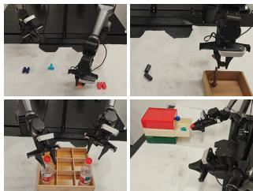

<table><tr><td>Task</td><td>Baseline</td><td>MorphAct</td><td>Gain</td></tr><tr><td>Sort Letters</td><td>82.00%</td><td>92.00%</td><td>+10.00</td></tr><tr><td>Sort Hardware</td><td>8.00%</td><td>22.00%</td><td>+14.00</td></tr><tr><td>Deliver Water</td><td>78.00%</td><td>86.00%</td><td>+8.00</td></tr><tr><td>Cabinet Storage</td><td>84.00%</td><td>96.00%</td><td>+12.00</td></tr></table>

Figure 4: Real-world manipulation results. Left: task examples, read row-wise in the order listed in the table. Right: success rates of the $\pi _ { 0 . 5 }$ baseline and π + MorphAct. Gains are absolute differences in percentage points (pp). Each method is evaluated over 50 physical rollouts per task.
<table><tr><td>Variant</td><td>Spatial ↑</td><td>Object ↑</td><td>Goal ↑</td><td>Long ↑</td><td>Mean ↑</td></tr><tr><td>MorphActA,C</td><td>98.67</td><td>99.87</td><td>97.07</td><td>93.20</td><td>97.20</td></tr><tr><td>ConstantA</td><td>93.40</td><td>90.00</td><td>89.00</td><td>77.60</td><td>87.50</td></tr><tr><td>Task-IDA</td><td>90.00</td><td>90.80</td><td>91.20</td><td>81.00</td><td>88.25</td></tr><tr><td>VLM-onlyB</td><td>40.00</td><td>59.00</td><td>42.00</td><td>33.00</td><td>43.50</td></tr><tr><td>Action-onlyB</td><td>88.80</td><td>92.00</td><td>73.80</td><td>69.40</td><td>81.00</td></tr><tr><td>UnadaptedB,C</td><td>91.00</td><td>97.80</td><td>83.60</td><td>71.60</td><td>86.00</td></tr></table>

Table 3: X-VLA ablation success rates on LIBERO (%). Superscripts identify generation conditions (A, Section 5.1), adapted modules (B, Section 5.2), and feature coupling (C, Section 5.3). Mean averages the four suite scores. Shading denotes MorphAct; bold marks column maxima.

86.00%, and Cabinet Storage from 84.00% to 96.00%. These results complement the simulation comparisons with improvements during closed-loop execution on physical manipulation tasks.

## 4.5 INFERENCE COST

MorphAct generates updates once per replanning context and reuses them throughout action-chunk prediction, keeping parameter generation outside the solver loop. Under matched hardware and execution settings, end-to-end chunk latency increases by approximately 18.00–21.00% relative to shared LoRA on $\pi _ { 0 }$ and $\pi _ { 0 . 5 } .$ . This measurement covers observation preprocessing and complete action-chunk prediction, including parameter generation and low-rank residual computation. Appendix D.2 reports generator parameter counts, active-factor counts, and measured chunk latency, inference memory, and control rate.

## 5 ANALYSIS

We examine three design choices in MorphAct: the condition used for parameter generation, the modules receiving updates, and the features connecting the two generators. Ablations use X-VLA on LIBERO under the task setup and evaluation protocol in Section 4.1. Table 3 reports success rates, with superscripts linking each variant to the comparisons below.

## 5.1 CONTEXT BEYOND TASK IDENTITY

Comparison A varies the generation condition while retaining the policy’s normal image, language, and robot-state inputs. Constant uses one fixed condition across tasks, whereas Task-ID uses one per task. Both retain MorphAct’s generators. Task-ID raises mean success from 87.50% to 88.25%, improving Object, Goal, and Long but reducing Spatial by 3.40 percentage points. MorphAct reaches 97.20%, exceeding Constant and Task-ID by 9.70 and 8.95 points on average, with improvements on every suite. The largest gains occur on Long, at 15.60 and 12.20 points, respectively. Both fixed-condition variants trail the X-VLA baseline’s 93.05% mean success in Table 1, by 5.55 and

4.80 points. MorphAct instead lets updates respond to the current observation and robot state. The comparison supports contextual generation beyond assigning a fixed update to each task.

## 5.2 ADAPTING BOTH MODULES

Comparison B examines the contribution of each adapted module. VLM-only and Action-only disable generated updates in the other module but retain both modules in the policy. Action-only achieves 81.00% mean success versus 43.50% for VLM-only, making action-side generation the stronger single-module choice. We then compare Action-only with Unadapted to separate upstream adaptation from feature coupling. Both use pre-adaptation features to condition the action generator. Unadapted additionally adapts the representation supplied to the action predictor, raising mean success from 81.00% to 86.00% with improvements on all four suites. Upstream adaptation thus benefits action prediction even when its output does not condition action updates.

## 5.3 COUPLING THROUGH ADAPTED FEATURES

Comparison C tests the features supplied to the action generator. Unadapted and MorphAct both generate updates for both modules and use adapted features for action prediction. Unadapted conditions action-side generation on pre-adaptation features, while MorphAct uses the adapted VLM output. This raises mean success from 86.00% to 97.20%, a gain of 11.20 percentage points. The suite-level results distinguish this effect from upstream adaptation alone. On Object, adding VLM updates raises success from Action-only’s 92.00% to Unadapted’s 97.80%, and coupling adds another 2.07 points. On Long, upstream adaptation adds 2.20 points, while coupling adds 21.60 points. Coupling also improves Goal by 13.47 points. Both feature sources support high success on Object, but Goal and Long benefit more from generating action updates that respond to the representation produced by upstream adaptation.

Summary. The ablations support current-context conditioning, adaptation of both modules, and coupling through adapted VLM features. Task identity alone provides a small average gain over constant conditioning, whereas current-context generation improves all four suites. The progression from Action-only to Unadapted to MorphAct separates the benefit of adapting the representation from the further benefit of using it to generate action updates. Together, these comparisons show that parameter generation depends on both the current context and the adapted features used for control.

## 6 RELATED WORK

VLA models. Generalist robot policies scale learning across tasks and embodiments (Brohan et al., 2023b; Open X-Embodiment Collaboration, 2024), while Octo supports adaptation to new observation and action spaces (Ghosh et al., 2024). VIMA specifies manipulation tasks through interleaved textual and visual prompts (Jiang et al., 2023). RT-2, OpenVLA, and the π family connect pretrained vision–language representations to robot actions (Brohan et al., 2023a; Kim et al., 2025b; Black et al., 2025; Physical Intelligence et al., 2025). MorphAct studies how representation and action modules can adapt to changing manipulation contexts within a shared policy.

Parameter-efficient fine-tuning. Adapters and prefix-tuning learn small task-specific components while freezing pretrained weights (Houlsby et al., 2019; Li & Liang, 2021). LoRA learns low-rank weight updates (Hu et al., 2022), and DoRA separates weight magnitude and direction, applying low-rank adaptation to the latter (Liu et al., 2024). For VLA models, OpenVLA-OFT studies efficient decoding and fine-tuning objectives (Kim et al., 2025a), X-VLA uses embodiment-specific soft prompts (Zheng et al., 2026), and VLA-Adapter introduces Bridge Attention between vision–language features and a lightweight action policy (Wang et al., 2026a). MorphAct generates context-dependent low-rank updates while retaining the host policy’s action interface and objective.

Parameter sharing and generation. Multi-task learning studies structural sharing (Yang et al., 2020; Sun et al., 2022), joint optimization (Sener & Koltun, 2018; Chen et al., 2018; Yu et al., 2020a; Liu et al., 2021), and task transfer and layerwise conflicts (Fifty et al., 2021; Shi et al., 2023). Parameter generation synthesizes network weights using hypernetworks (Ha et al., 2017) or diffusion models (Wang et al., 2024; 2025), treating weights as a generative modality (Wang et al., 2026b) and enabling adaptation conditioned on tasks, features, examples, images, or prompts (Karimi Mahabadi et al.,

2021; Ivison & Peters, 2022; Phang et al., 2023; Ruiz et al., 2024; Liang et al., 2025). HY-WU studies structured synthesis of low-rank weight updates (Wu et al., 2026). Hyper-LoRA generates instruction-conditioned updates (Xiong et al., 2024), HyperVLA generates compact-policy parameters once per episode for efficient inference (Xiong et al., 2025), and PhaseLoRA modulates action-side LoRA per chunk (Guo et al., 2026). MorphAct couples parameter generation across perception and action: adapted vision–language representations condition action-side parameter updates, and both generators are trained jointly through the native action objective.

## 7 CONCLUSION

MorphAct generates context-dependent low-rank updates for vision–language and action modules through a shared adaptation mechanism. Its generators are coupled through adapted representations and trained jointly with the native action objective. Atomic-task diagnostics reveal conflicting adaptation demands in both modules, while evaluations on LIBERO, Meta-World, and four realworld tasks demonstrate improved closed-loop manipulation. Ablations further support contextual generation, adaptation of both modules, and coupling through adapted VLM features.

## 8 ACKNOWLEDGMENTS

We thank Yong Zhong (yzhong1024@gmail.com) for technical support.

## REFERENCES

Kevin Black, Noah Brown, Danny Driess, Adnan Esmail, Michael Equi, Chelsea Finn, Niccolo Fusai, Lachy Groom, Karol Hausman, Brian Ichter, Szymon Jakubczak, Tim Jones, Liyiming Ke, Sergey Levine, Adrian Li-Bell, Mohith Mothukuri, Suraj Nair, Karl Pertsch, Lucy Xiaoyang Shi, Laura Smith, James Tanner, Quan Vuong, Anna Walling, Haohuan Wang, and Ury Zhilinsky. π : A Vision-Language-Action Flow Model for General Robot Control. In RSS, 2025.

Anthony Brohan, Noah Brown, Justice Carbajal, Yevgen Chebotar, Xi Chen, Krzysztof Choromanski, Tianli Ding, Danny Driess, Avinava Dubey, Chelsea Finn, et al. RT-2: Vision-Language-Action Models Transfer Web Knowledge to Robotic Control. In CoRL, 2023a.

Anthony Brohan, Noah Brown, Justice Carbajal, Yevgen Chebotar, Joseph Dabis, Chelsea Finn, Keerthana Gopalakrishnan, Karol Hausman, Alexander Herzog, Jasmine Hsu, Julian Ibarz, Brian Ichter, Alex Irpan, Tomas Jackson, Sally Jesmonth, Nikhil Joshi, Ryan Julian, Dmitry Kalashnikov, Yuheng Kuang, Isabel Leal, Kuang-Huei Lee, Sergey Levine, Yao Lu, Utsav Malla, Deeksha Manjunath, Igor Mordatch, Ofir Nachum, Carolina Parada, Jodilyn Peralta, Emily Perez, Karl Pertsch, Jornell Quiambao, Kanishka Rao, Michael S Ryoo, Grecia Salazar, Pannag R Sanketi, Kevin Sayed, Jaspiar Singh, Sumedh Sontakke, Austin Stone, Clayton Tan, Huong Tran, Vincent Vanhoucke, Steve Vega, Quan H Vuong, Fei Xia, Ted Xiao, Peng Xu, Sichun Xu, Tianhe Yu, and Brianna Zitkovich. RT-1: Robotics Transformer for Real-World Control at Scale. In RSS, 2023b.

Zhao Chen, Vijay Badrinarayanan, Chen-Yu Lee, and Andrew Rabinovich. GradNorm: Gradient normalization for adaptive loss balancing in deep multitask networks. In ICML, 2018.

Cheng Chi, Siyuan Feng, Yilun Du, Zhenjia Xu, Eric Cousineau, Benjamin CM Burchfiel, and Shuran Song. Diffusion Policy: Visuomotor Policy Learning via Action Diffusion. In RSS, 2023.

Danny Driess, Fei Xia, Mehdi S. M. Sajjadi, Corey Lynch, Aakanksha Chowdhery, Brian Ichter, Ayzaan Wahid, Jonathan Tompson, Quan Vuong, Tianhe Yu, Wenlong Huang, Yevgen Chebotar, Pierre Sermanet, Daniel Duckworth, Sergey Levine, Vincent Vanhoucke, Karol Hausman, Marc Toussaint, Klaus Greff, Andy Zeng, Igor Mordatch, and Pete Florence. PaLM-E: An Embodied Multimodal Language Model. In ICML, 2023.

Chris Fifty, Ehsan Amid, Zhe Zhao, Tianhe Yu, Rohan Anil, and Chelsea Finn. Efficiently Identifying Task Groupings for Multi-Task Learning. In NeurIPS, 2021.

Dibya Ghosh, Homer Rich Walke, Karl Pertsch, Kevin Black, Oier Mees, Sudeep Dasari, Joey Hejna, Tobias Kreiman, Charles Xu, Jianlan Luo, You Liang Tan, Lawrence Yunliang Chen, Quan Vuong, Ted Xiao, Pannag R Sanketi, Dorsa Sadigh, Chelsea Finn, and Sergey Levine. Octo: An Open-Source Generalist Robot Policy. In RSS, 2024.

Yufei Guo, Yinan Wu, Haoran Duan, Guiguang Ding, and Jungong Han. PhaseLoRA: Control-Regime-Conditioned Low-Rank Adaptation for Continuous-Action Vision-Language-Action Poli cies. arXiv preprint arXiv:2608.15285, 2026.

David Ha, Andrew M. Dai, and Quoc V. Le. HyperNetworks. In ICLR, 2017.

Neil Houlsby, Andrei Giurgiu, Stanislaw Jastrzebski, Bruna Morrone, Quentin De Laroussilhe, Andrea Gesmundo, Mona Attariyan, and Sylvain Gelly. Parameter-efficient transfer learning for NLP. In ICML, 2019.

Edward J. Hu, Yelong Shen, Phillip Wallis, Zeyuan Allen-Zhu, Yuanzhi Li, Shean Wang, Lu Wang, and Weizhu Chen. LoRA: Low-Rank Adaptation of Large Language Models. In ICLR, 2022.

Hamish Ivison and Matthew E. Peters. Hyperdecoders: Instance-specific decoders for multi-task NLP. In Findings ofEMNLP, 2022.

Yunfan Jiang, Agrim Gupta, Zichen Zhang, Guanzhi Wang, Yongqiang Dou, Yanjun Chen, Li Fei-Fei, Anima Anandkumar, Yuke Zhu, and Linxi Fan. VIMA: Robot Manipulation with Multimodal Prompts. In ICML, 2023.

Rabeeh Karimi Mahabadi, Sebastian Ruder, Mostafa Dehghani, and James Henderson. Parameterefficient multi-task fine-tuning for transformers via shared hypernetworks. In ACL, 2021.

Moo Jin Kim, Chelsea Finn, and Percy Liang. Fine-Tuning Vision-Language-Action Models: Optimizing Speed and Success. In RSS, 2025a.

Moo Jin Kim, Karl Pertsch, Siddharth Karamcheti, Ted Xiao, Ashwin Balakrishna, Suraj Nair, Rafael Rafailov, Ethan P Foster, Pannag R Sanketi, Quan Vuong, Thomas Kollar, Benjamin Burchfiel, Russ Tedrake, Dorsa Sadigh, Sergey Levine, Percy Liang, and Chelsea Finn. OpenVLA: An Open-Source Vision-Language-Action Model. In CoRL, 2025b.

Xiang Lisa Li and Percy Liang. Prefix-tuning: Optimizing continuous prompts for generation. In ACL, 2021.

Zhiyuan Liang, Dongwen Tang, Yuhao Zhou, Xuanlei Zhao, Mingjia Shi, Wangbo Zhao, Zekai Li, Peihao Wang, Konstantin Schürholt, Damian Borth, Michael M. Bronstein, Yang You, Zhangyang Wang, and Kai Wang. Drag-and-Drop LLMs: Zero-Shot Prompt-to-Weights. In NeurIPS, 2025.

Yaron Lipman, Ricky T. Q. Chen, Heli Ben-Hamu, Maximilian Nickel, and Matt Le. Flow matching for generative modeling. In ICLR, 2023.

Bo Liu, Xingchao Liu, Xiaojie Jin, Peter Stone, and Qiang Liu. Conflict-Averse Gradient Descent for Multi-task Learning. In NeurIPS, 2021.

Bo Liu, Yifeng Zhu, Chongkai Gao, Yihao Feng, Qiang Liu, Yuke Zhu, and Peter Stone. LIBERO: Benchmarking Knowledge Transfer for Lifelong Robot Learning. In NeurIPS Datasets and Benchmarks Track, 2023.

Shih-Yang Liu, Chien-Yi Wang, Hongxu Yin, Pavlo Molchanov, Yu-Chiang Frank Wang, Kwang-Ting Cheng, and Min-Hung Chen. DoRA: Weight-decomposed low-rank adaptation. In ICML, 2024.

Ziyan Liu, Yeqiu Chen, Hongyi Cai, Tao Lin, Shuo Yang, Zheng Liu, and Bo Zhao. Bridging the semantic-action gap in visual token pruning for efficient vla inference. arXiv preprint arXiv:2511.16449, 2025.

Soroush Nasiriany, Sepehr Nasiriany, Abhiram Maddukuri, and Yuke Zhu. RoboCasa365: A Large-Scale Simulation Framework for Training and Benchmarking Generalist Robots. In ICLR, 2026.

Open X-Embodiment Collaboration. Open X-Embodiment: Robotic Learning Datasets and RT-X Models. In ICRA, 2024.

Jason Phang, Yi Mao, Pengcheng He, and Weizhu Chen. HyperTuning: Toward adapting large language models without back-propagation. In ICML, 2023.

Physical Intelligence, Kevin Black, Noah Brown, James Darpinian, Karan Dhabalia, Danny Driess, Adnan Esmail, Michael Equi, Chelsea Finn, Niccolo Fusai, Manuel Y. Galliker, Dibya Ghosh, Lachy Groom, Karol Hausman, Brian Ichter, Szymon Jakubczak, Tim Jones, Liyiming Ke, Devin LeBlanc, Sergey Levine, Adrian Li-Bell, Mohith Mothukuri, Suraj Nair, Karl Pertsch, Allen Z. Ren, Lucy Xiaoyang Shi, Laura Smith, Jost Tobias Springenberg, Kyle Stachowicz, James Tanner, Quan Vuong, Homer Walke, Anna Walling, Haohuan Wang, Lili Yu, and Ury Zhilinsky. π0.5: a Vision-Language-Action Model with Open-World Generalization. In CoRL, 2025.

Nataniel Ruiz, Yuanzhen Li, Varun Jampani, Wei Wei, Tingbo Hou, Yael Pritch, Neal Wadhwa, Michael Rubinstein, and Kfir Aberman. HyperDreamBooth: HyperNetworks for fast personalization of text-to-image models. In CVPR, 2024.

Ozan Sener and Vladlen Koltun. Multi-task learning as multi-objective optimization. In NeurIPS, 2018.

Guangyuan Shi, Qimai Li, Wenlong Zhang, Jiaxin Chen, and Xiao-Ming Wu. Recon: Reducing conflicting gradients from the root for multi-task learning. In ICLR, 2023.

Lingfeng Sun, Haichao Zhang, Wei Xu, and Masayoshi Tomizuka. PaCo: Parameter-compositional multi-task reinforcement learning. In NeurIPS, 2022.

Kai Wang, Dongwen Tang, Boya Zeng, Yida Yin, Zhaopan Xu, Yukun Zhou, Zelin Zang, Trevor Darrell, Zhuang Liu, and Yang You. Neural network diffusion. arXiv preprint arXiv:2402.13144, 2024.

Kai Wang, Dongwen Tang, Wangbo Zhao, Konstantin Schürholt, Zhangyang Wang, and Yang You. Scaling Up Parameter Generation: A Recurrent Diffusion Approach. In NeurIPS, 2025.

Yihao Wang, Pengxiang Ding, Lingxiao Li, Can Cui, Zirui Ge, Xinyang Tong, Wenxuan Song, Han Zhao, Wei Zhao, Pengxu Hou, Siteng Huang, Yifan Tang, Wenhui Wang, Ru Zhang, Jianyi Liu, and Donglin Wang. VLA-Adapter: An Effective Paradigm for Tiny-Scale Vision-Language-Action Model. In AAAI, 2026a.

Zhangyang Wang, Peihao Wang, and Kai Wang. Position: Weight Space Should Be a First-Class Generative AI Modality. In ICML, 2026b.

Mengxuan Wu, Xuanlei Zhao, Ziqiao Wang, Ruicheng Feng, Zhangyang Wang, and Kai Wang. HY-WU (Part I): An Extensible Functional Neural Memory Framework and An Instantiation in Text-Guided Image Editing. arXiv preprint arXiv:2603.07236, 2026.

Zheng Xiong, Siddhant Sharma, Kang Li, Risto Vuorio, and Shimon Whiteson. Efficient Domain Adaptation of Robotic Foundation Models via Hypernetwork-Generated LoRA. In NeurIPS Workshop on Adaptive Foundation Models, 2024.

Zheng Xiong, Kang Li, Zilin Wang, Matthew Jackson, Jakob Foerster, and Shimon Whiteson. HyperVLA: Efficient Inference in Vision-Language-Action Models via Hypernetworks. arXiv preprint arXiv:2510.04898, 2025.

Ruihan Yang, Huazhe Xu, Yi Wu, and Xiaolong Wang. Multi-Task Reinforcement Learning with Soft Modularization. In NeurIPS, 2020.

Tianhe Yu, Saurabh Kumar, Abhishek Gupta, Sergey Levine, Karol Hausman, and Chelsea Finn. Gradient Surgery for Multi-Task Learning. In NeurIPS, 2020a.

Tianhe Yu, Deirdre Quillen, Zhanpeng He, Ryan Julian, Karol Hausman, Chelsea Finn, and Sergey Levine. Meta-World: A Benchmark and Evaluation for Multi-Task and Meta Reinforcement Learning. In CoRL, 2020b.

Tony Z. Zhao, Vikash Kumar, Sergey Levine, and Chelsea Finn. Learning Fine-Grained Bimanual Manipulation with Low-Cost Hardware. In RSS, 2023.

Jinliang Zheng, Jianxiong Li, Zhihao Wang, Dongxiu Liu, Xirui Kang, Yuchun Feng, Yinan Zheng, Jiayin Zou, Yilun Chen, Jia Zeng, Tai Wang, Ya-Qin Zhang, Jingjing Liu, and Xianyuan Zhan. X-VLA: Soft-Prompted Transformer as Scalable Cross-Embodiment Vision-Language-Action Model. In ICLR, 2026.

## A ATOMIC-TASK DIAGNOSTIC PROTOCOL AND COMPLETE RESULTS

The diagnostic uses the 65 native atomic tasks in RoboCasa365 (Nasiriany et al., 2026), as described in Section 2. Each task identifier defines one group; the complete identifiers appear in Table A6. Task labels organize the diagnostic comparisons and are not inputs or supervision for MorphAct.

## A.1 PARAMETER SCOPE AND SAMPLING

All three measurements start from the same RoboCasa-pretrained $\pi _ { 0 . 5 }$ checkpoint and its associated normalization statistics. The VLM diagnostic set contains 2,923,335,408 scalar parameters, and the action set contains 430,098,464. These sets include vision and language backbones, token embeddings, the action expert, and their associated projections and normalization parameters. They are the full diagnostic sets, not merely the projections targeted by the generated low-rank updates. Token-embedding gradients retain their sparse representation.

For each diagnostic subset and sampling round, the sampler constructs $U _ { i }$ and $V _ { i }$ from disjoint episode groups. For alignment (A) and contribution accounting (C), each batch contains 32 samples from eight episodes, with four sampled timesteps per episode. Cross-task comparisons use $\bar { U _ { i } } , \bar { U _ { j } }$ with $i < j ;$ within-task controls use $U _ { i } , V _ { i }$ . The 16 rounds yield $1 6 { \binom { 6 5 } { 2 } } = 3 3 , 2 8 0$ cross-task pair-rounds and $1 6 \times 6 5 = 1 , 0 4 0$ within-task observations per module. These are repeated batch samples at one checkpoint, not independent training seeds.
<table><tr><td>Setting</td><td>A: alignment</td><td>B: one-step affinity</td><td>C: contributions</td></tr><tr><td>Batch size</td><td>32</td><td>16</td><td>32</td></tr><tr><td>Compared batches</td><td> $U _ { i } , U _ { j } ; U _ { i } , V _ { i }$ </td><td>Source  $U _ { i }$  , target  $V _ { j }$ </td><td> $U _ { i } , U _ { j } ; U _ { i } , V _ { i }$ </td></tr><tr><td>Parameter precision</td><td>BF16</td><td>FP32 from BF16 checkpoint</td><td>BF16</td></tr><tr><td>Sampling rounds</td><td>16</td><td>4</td><td>16</td></tr><tr><td>Cross-task observations 33,280 unordered</td><td>pair-rounds</td><td>16,640 directed pair-rounds</td><td>33,280 unordered pair-rounds</td></tr><tr><td>Within-task observations</td><td>1,040</td><td>260</td><td>1,040</td></tr><tr><td>Measurement</td><td></td><td>Module gradient cosine Full-parameter update, 66 parameter groups target loss</td><td></td></tr></table>

Table A1: Diagnostic settings. A/C resample batches over 16 rounds; B uses four complete sourceto-target rounds at the same checkpoint.

A uses microbatches of four, FP32 accumulation, and BF16 gradient storage. C independently computes group statistics on the same sample manifests, accumulating eight microbatch contributions per batch. Its full-module quantities are reconstructed from its own dot products and norms, so A and C have separate numerical realizations. Negative-cosine frequencies count observations within individual rounds; the sign of a pair’s 16-round mean is a different statistic. Confidence intervals and zero-norm exclusion counts are not reported.

## A.2 GRADIENT ALIGNMENT AND DIRECTIONAL EFFECTS

For module $m \in \{ v , a \}$ , we compute gradients of the native action loss on each source batch and compare their alignment:

$$
g _ { i } ^ { ( m ) } = \nabla _ { \theta _ { m } } \mathcal { L } ( U _ { i } ; \theta ) , \qquad c _ { i j } ^ { ( m ) } = \frac { \langle g _ { i } ^ { ( m ) } , g _ { j } ^ { ( m ) } \rangle } { \| g _ { i } ^ { ( m ) } \| _ { 2 } \| g _ { j } ^ { ( m ) } \| _ { 2 } } .\tag{A1}
$$

Negative alignment indicates competing local descent directions. The conflict frequency is $p _ { m } ^ { - } =$ mean $\mathbf { 1 } [ c _ { i j } ^ { ( m ) } < 0 ]$ . Cross-task comparisons use $( U _ { i } , U _ { j } )$ with $i < j ;$ within-task comparisons use independently sampled $( U _ { i } , V _ { i } )$

Table A2 reports both conflict frequency $p _ { m } ^ { - }$ and angular magnitude $b _ { m } = \operatorname* { m e a n } \operatorname* { m a x } ( 0 , - c ^ { ( m ) } )$ The last column counts pairs with negative 16-round mean cosine, whereas $p _ { m } ^ { - }$ counts negative observations within rounds.
<table><tr><td colspan="3">Mean cosine</td><td colspan="3"> $b _ { m }$ </td></tr><tr><td>Module</td><td>Comparison</td><td> $( 1 0 ^ { - 3 } )$ </td><td> $p _ { m } ^ { - } \left( \% \right)$ </td><td> $( 1 0 ^ { - 3 } )$ </td><td>Negative mean pairs</td></tr><tr><td>VLM</td><td>Cross-task</td><td>1.05</td><td>47.80</td><td>7.00</td><td>890/2,080</td></tr><tr><td>VLM</td><td>Within-task</td><td>10.24</td><td>38.94</td><td>12.01</td><td>11/65</td></tr><tr><td>Action</td><td>Cross-task</td><td>3.00</td><td>48.28</td><td>26.76</td><td>918/2,080</td></tr><tr><td>Action</td><td>Within-task</td><td>25.11</td><td>42.69</td><td>34.50</td><td>19/65</td></tr></table>

Table A2: Gradient alignment at the fixed checkpoint. Within-task batches come from disjoint episode groups. Mean negative part includes zeros from nonnegative observations.

For one-step transfer, each source update starts from the common checkpoint. Following the affinity convention of Fifty et al. (2021), we define

$$
\theta _ { i } ^ { + } = \theta - \eta \nabla _ { \theta } \mathcal { L } ( U _ { i } ; \theta ) , \qquad Z _ { i \to j } = 1 - \frac { \mathcal { L } ( V _ { j } ; \theta _ { i } ^ { + } ) } { \mathcal { L } ( V _ { j } ; \theta ) } .\tag{A2}
$$

Positive $Z _ { i \to j }$ means the update reduces target loss; negative values mean it increases target loss.

For a sufficiently small unpreconditioned update, $\mathcal { L } ( V _ { j } ; \theta - \eta g _ { i } ) - \mathcal { L } ( V _ { j } ; \theta ) = - \eta \langle \nabla _ { \theta } \mathcal { L } ( V _ { j } ; \theta ) , g _ { i } \rangle +$ $O ( \eta ^ { 2 } )$ , where $g _ { i } = \nabla _ { \theta } \mathcal { L } ( U _ { i } ; \theta )$ . This first-order relation motivates the gradient diagnostic; the directional experiment measures the finite-step loss change directly.

B selects 16 samples per side at positions 4k and $4 k + 1 , k = 0 , \ldots , 7 .$ , from each original 32- sample batch. Source gradients accumulate in FP32 with microbatches of four; target evaluation uses a microbatch of 16. Each source update starts afresh from the common checkpoint and applies Equation (A2) with $\eta \approx 0 . 0 1 1 3 2 2$ , calibrated using the first three source identifiers. Parameters are converted from the BF16 checkpoint to FP32 for this experiment. Target observations, action targets, flow times, and noise are held fixed before and after each update. Source self-improvement is measured on $U _ { i } ,$ , not on the independently sampled diagonal target $V _ { i } .$

<table><tr><td>Comparison Loss up</td><td></td><td>Loss down</td><td>Unchanged</td><td>Mean  $Z$   $( 1 0 ^ { - 3 0 \forall } )$ </td><td>Mean increase  $( 1 0 ^ { - 3 0 \forall } )$ </td></tr><tr><td>Cross-task</td><td>8,310</td><td>8,326</td><td>4</td><td> $- 0 . 4 7$ </td><td>44.36</td></tr><tr><td>Within-task</td><td>133</td><td>127</td><td>0</td><td>+4.89</td><td>96.62</td></tr></table>

Table A3: One-step target effects across four sampling rounds. Affinity and loss changes are relative to the target’s initial loss. Mean increase is conditional on a loss-increase event. A positive Z means lower target loss.

The stored relative-loss-increase matrix H is converted to affinity only by $Z = - H$ (Fifty et al., 2021). Table A3 pools all four complete 65 × 65 evaluations. All 260 source updates reduce sourcebatch loss, by 2.38% on average (range 0.37–16.61%). Each source update harms 22–46 other target batches, with a median of 32/64; conversely, each target receives antagonistic updates from at least 20 other sources within its round. The maximum cross-task relative loss increase is 0.80%. These are local loss effects, not closed-loop success rates.

## A.3 PARAMETER GROUPS AND CONTRIBUTION ACCOUNTING

The parameter partition has 47 VLM groups: 27 vision blocks, 18 language blocks, token embeddings, and one group outside Transformer blocks. The action set has 19 groups: 18 Transformer blocks and one outside-block group. Only actual scanned Transformer axes are split by depth. The action outside block group includes final conditional-normalization mapping, action input/output projections, and the time MLP. The VLM counterpart includes image input/output mappings, position embeddings, and final normalization parameters. These groups remain distinct from Transformer layers.

For a fixed module and sampling round, group ℓ contributes to the full-module alignment as

$$
\begin{array} { l l } { \displaystyle q _ { i j } ^ { ( \ell ) } = \frac { \langle g _ { i } ^ { ( \ell ) } , g _ { j } ^ { ( \ell ) } \rangle } { \| g _ { i } \| _ { 2 } \| g _ { j } \| _ { 2 } } , } & { c _ { i j } = \sum _ { \ell } q _ { i j } ^ { ( \ell ) } = P _ { i j } - N _ { i j } , } \\ { \displaystyle P _ { i j } = \sum _ { \ell } \operatorname* { m a x } ( q _ { i j } ^ { ( \ell ) } , 0 ) , } & { N _ { i j } = \sum _ { \ell } \operatorname* { m a x } ( - q _ { i j } ^ { ( \ell ) } , 0 ) . } \end{array}\tag{A3}
$$

The full-module denominator makes the group contributions additive. We quantify their cancellation by pooling absolute contribution mass over pair-rounds:

$$
C _ { m } = 1 - \frac { \sum _ { r , i < j } \left| P _ { r i j } ^ { ( m ) } - N _ { r i j } ^ { ( m ) } \right| } { \sum _ { r , i < j } \left( P _ { r i j } ^ { ( m ) } + N _ { r i j } ^ { ( m ) } \right) } .\tag{A4}
$$

For each pair and round, Equation (A3) gives $c = P - N$ . The cancelled mass is $P + N - | P - N |$ and is computed before averaging across pairs or rounds. Equation (A4) divides its pooled sum by total absolute contribution mass. Cancellation therefore measures opposing normalized contributions, not the proportion of conflicting parameters or a percentage loss degradation.

<table><tr><td>Module</td><td>Comparison</td><td>Observations</td><td>Mixed signs (%)</td><td>Cancellation (%)</td></tr><tr><td>VLM</td><td>Cross-task</td><td>33,280</td><td>99.45</td><td>36.13</td></tr><tr><td>VLM</td><td>Within-task</td><td>1,040</td><td>94.13</td><td>23.51</td></tr><tr><td>Action</td><td>Cross-task</td><td>33,280</td><td>95.93</td><td>30.90</td></tr><tr><td>Action</td><td>Within-task</td><td>1,040</td><td>90.10</td><td>22.70</td></tr></table>

Table A4: Opposing parameter-group contributions. Mixed-sign observations satisfy both $P > 0$ and $N > 0$ . Cancellation pools absolute contribution mass within observations.

Groups are ranked by their share of negative cross-task contribution, $\begin{array} { r } { \sum _ { r , i < j } \operatorname* { m a x } ( - q _ { r i j } ^ { ( \ell ) } , 0 ) } \end{array}$ divided by the sum over groups in the same module. The three largest action groups—outside Transformer blocks (39.02%), block 00 (23.74%), and block 11 (16.11%)—account for 78.88% before rounding. The largest VLM groups are outside Transformer blocks (20.40%), language block 00 (17.44%), and vision block 00 (7.83%). Table A5 lists all groups. Depth profiles use group-local cosine with group-specific gradient norms; the additive contribution q instead uses full-module norms.

<table><tr><td>Rank</td><td>VLM parameter group</td><td>Params (M)</td><td>Conflict (%)</td><td>Negative share (%)</td></tr><tr><td>1</td><td>Outside Transformer blocks</td><td>3.34</td><td>48.56</td><td>20.40</td></tr><tr><td>2</td><td>Language block 00</td><td>110.11</td><td>48.93</td><td>17.44</td></tr><tr><td>3</td><td>Vision block 00</td><td>15.24</td><td>48.15</td><td>7.83</td></tr><tr><td>4</td><td>Vision block 01</td><td>15.24</td><td>48.23</td><td>3.91</td></tr><tr><td>5</td><td>Language block 14</td><td>110.11</td><td>48.86</td><td>3.48</td></tr><tr><td>6</td><td>Language block 07</td><td>110.11</td><td>48.80</td><td>3.14</td></tr><tr><td>7</td><td>Vision block 02</td><td>15.24</td><td>48.08</td><td>3.00</td></tr><tr><td>8</td><td>Language block 09</td><td>110.11</td><td>48.73</td><td>2.98</td></tr><tr><td>9</td><td>Language block 06</td><td>110.11</td><td>49.26</td><td>2.95</td></tr><tr><td>10</td><td>Language block 01</td><td>110.11</td><td>48.50</td><td>2.76</td></tr><tr><td>11</td><td>Language block 04</td><td>110.11</td><td>49.65</td><td>2.58</td></tr><tr><td>12</td><td>Language block 03</td><td>110.11</td><td>49.25</td><td>2.28</td></tr><tr><td>13</td><td>Vision block 04</td><td>15.24</td><td>48.07</td><td>2.28</td></tr><tr><td>14</td><td>Vision block 03</td><td>15.24</td><td>47.94</td><td>2.00</td></tr><tr><td>15</td><td>Language block 05</td><td>110.11</td><td>49.50</td><td>1.96</td></tr><tr><td>16</td><td>Language block 11</td><td>110.11</td><td>48.79</td><td>1.89</td></tr><tr><td>17</td><td>Language block 08</td><td>110.11</td><td>48.81</td><td>1.67</td></tr><tr><td>18</td><td>Language block 10</td><td>110.11</td><td>48.65</td><td>1.63</td></tr><tr><td>19</td><td>Language block 02</td><td>110.11</td><td>49.63</td><td>1.36</td></tr><tr><td>20</td><td>Language block 13</td><td>110.11</td><td>48.59</td><td>1.35</td></tr><tr><td>21</td><td>Language block 12</td><td>110.11</td><td>48.80</td><td>1.28</td></tr><tr><td>22</td><td>Vision block 06</td><td>15.24</td><td>47.67</td><td>1.07</td></tr><tr><td>23</td><td>Token embedding</td><td>526.65</td><td>48.97</td><td>1.00</td></tr><tr><td>24</td><td>Vision block 05</td><td>15.24</td><td>47.60</td><td>0.91</td></tr><tr><td>25</td><td>Vision block 26</td><td>15.24</td><td>48.50</td><td>0.70</td></tr><tr><td>26</td><td>Vision block 08</td><td>15.24</td><td>47.62</td><td>0.68</td></tr><tr><td>27</td><td>Vision block 24</td><td>15.24</td><td>48.75</td><td>0.64</td></tr><tr><td>28</td><td>Vision block 07</td><td>15.24</td><td>47.82</td><td>0.62</td></tr><tr><td>29</td><td>Vision block 09</td><td>15.24</td><td>48.11</td><td>0.46</td></tr><tr><td>30</td><td>Vision block 12</td><td>15.24</td><td>47.94</td><td>0.46</td></tr><tr><td>31</td><td>Vision block 13</td><td>15.24</td><td>48.30</td><td>0.45</td></tr><tr><td>32</td><td>Vision block 14</td><td>15.24</td><td>48.40</td><td>0.43</td></tr><tr><td>33</td><td>Vision block 10</td><td>15.24</td><td>48.00</td><td>0.42</td></tr><tr><td>Rank</td><td>Parameter group</td><td>Params (M)</td><td>Conflict (%)</td><td>Negative share (%)</td></tr><tr><td>Vision–language module (continued)</td><td></td><td></td><td></td><td></td></tr><tr><td>34</td><td>Vision block 11</td><td>15.24</td><td>48.04</td><td>0.40</td></tr><tr><td>35</td><td>Vision block 25</td><td>15.24</td><td>48.64</td><td>0.38</td></tr><tr><td>36</td><td>Vision block 23</td><td>15.24</td><td>49.00</td><td>0.37</td></tr><tr><td>37</td><td>Language block 17</td><td>110.11</td><td>49.52</td><td>0.35</td></tr><tr><td>38</td><td>Vision block 15</td><td>15.24</td><td>48.47</td><td>0.31</td></tr><tr><td>39</td><td>Language block 16</td><td>110.11</td><td>49.03</td><td>0.27</td></tr><tr><td>40</td><td>Vision block 17</td><td>15.24</td><td>48.55</td><td>0.27</td></tr><tr><td>41</td><td>Vision block 16</td><td>15.24</td><td>48.34</td><td>0.25</td></tr><tr><td>42</td><td>Vision block 22</td><td>15.24</td><td>49.18</td><td>0.25</td></tr><tr><td>43</td><td>Vision block 18</td><td>15.24</td><td>48.56</td><td>0.25</td></tr><tr><td>44</td><td>Vision block 21</td><td>15.24</td><td>48.58</td><td>0.24</td></tr><tr><td>45</td><td>Vision block 20</td><td>15.24</td><td>49.13</td><td>0.24</td></tr><tr><td>46</td><td>Vision block 19</td><td>15.24</td><td>48.31</td><td>0.22</td></tr><tr><td>47</td><td>Language block 15</td><td>110.11</td><td>49.64</td><td>0.19</td></tr><tr><td>Action module</td><td></td><td></td><td></td><td></td></tr><tr><td>1</td><td>Outside Transformer blocks</td><td>5.32</td><td>48.22</td><td>39.02</td></tr><tr><td>2</td><td>Action block 00</td><td>23.60</td><td>49.29</td><td>23.74</td></tr><tr><td>3</td><td>Action block 11</td><td>23.60</td><td>49.53</td><td>16.11</td></tr><tr><td>4</td><td>Action block 17</td><td>23.60</td><td>48.53</td><td>4.48</td></tr><tr><td>5</td><td>Action block 01</td><td>23.60</td><td>48.84</td><td>4.42</td></tr><tr><td>6</td><td>Action block 16</td><td>23.60</td><td>48.45</td><td>2.30</td></tr><tr><td>7</td><td>Action block 02</td><td>23.60</td><td>48.46</td><td>1.97</td></tr><tr><td>8</td><td>Action block 14</td><td>23.60</td><td>48.44</td><td>1.50</td></tr><tr><td>9</td><td>Action block 08</td><td>23.60</td><td>49.12</td><td>0.93</td></tr><tr><td>10</td><td>Action block 07</td><td>23.60</td><td>48.16</td><td>0.78</td></tr><tr><td>11</td><td>Action block 15</td><td>23.60</td><td>48.87</td><td>0.71</td></tr><tr><td>12</td><td>Action block 09</td><td>23.60</td><td>48.19</td><td>0.70</td></tr><tr><td>13</td><td>Action block 04</td><td>23.60</td><td>48.59</td><td>0.64</td></tr><tr><td>14</td><td>Action block 12</td><td>23.60</td><td>48.22</td><td>0.64</td></tr><tr><td>15</td><td>Action block 13</td><td>23.60</td><td>48.28</td><td>0.58</td></tr><tr><td>16</td><td>Action block 10</td><td>23.60</td><td>47.94</td><td>0.53</td></tr><tr><td>17</td><td>Action block 03</td><td>23.60</td><td>48.13</td><td>0.47</td></tr><tr><td>18</td><td>Action block 06</td><td>23.60</td><td>48.51</td><td>0.33</td></tr><tr><td>19</td><td></td><td></td><td></td><td></td></tr><tr><td></td><td>Action block 05</td><td>23.60</td><td>47.76</td><td>0.15</td></tr></table>

Table A5: Complete parameter-group rankings. Groups are ranked within each module by negative cross-task contribution share. Conflict frequencies use group-local cosines. The remaining 14 VLM groups and all 19 action groups continue on the next page.

<table><tr><td>ID</td><td>Original RoboCasa source-task identifier</td><td>ID</td><td>Original RoboCasa source-task identifier</td></tr><tr><td>1</td><td>AdjustToasterOvenTemperature</td><td>34</td><td>PickPlaceCounterToCabinet</td></tr><tr><td>2</td><td>AdjustWaterTemperature</td><td>35</td><td>PickPlaceCounterToDrawer</td></tr><tr><td>3</td><td>CheesyBread</td><td>36</td><td>PickPlaceCounterToMicrowave</td></tr><tr><td>4</td><td>CloseBlenderLid</td><td>37</td><td>PickPlaceCounterToOven</td></tr><tr><td>5</td><td>CloseCabinet</td><td>38</td><td>PickPlaceCounterToSink</td></tr><tr><td>6</td><td>CloseDishwasher</td><td>39</td><td>PickPlaceCounterToStandMixer</td></tr><tr><td>7</td><td>CloseDrawer</td><td>40</td><td>PickPlaceCounterToStove</td></tr><tr><td>8</td><td>CloseElectricKettleLid</td><td>41</td><td>PickPlaceCounterToToasterOven</td></tr><tr><td>9</td><td>CloseFridge</td><td>42</td><td>PickPlaceDrawerToCounter</td></tr><tr><td>10</td><td>CloseFridgeDrawer</td><td>43</td><td>PickPlaceFridgeDrawerToShelf</td></tr><tr><td>11</td><td>CloseMicrowave</td><td>44</td><td>PickPlaceFridgeShelfToDrawer</td></tr><tr><td>12</td><td>CloseOven</td><td>45</td><td>PickPlaceMicrowaveToCounter</td></tr><tr><td>13</td><td>CloseStandMixerHead</td><td>46</td><td>PickPlaceSinkToCounter</td></tr><tr><td>14</td><td>CloseToasterOvenDoor</td><td>47</td><td>PickPlaceStoveToCounter</td></tr><tr><td>15</td><td>CoffeeServeMug</td><td>48</td><td>PickPlaceToasterOvenToCounter</td></tr><tr><td>16</td><td>CoffeeSetupMug</td><td>49</td><td>PickPlaceToasterToCounter</td></tr><tr><td>17</td><td>LowerHeat</td><td>50</td><td>PreheatOven</td></tr><tr><td>18</td><td>MakeIcedCoffee</td><td>51</td><td>SlideDishwasherRack</td></tr><tr><td>19</td><td>NavigateKitchen</td><td>52</td><td>SlideOvenRack</td></tr><tr><td>20</td><td>OpenBlenderLid</td><td>53</td><td>SlideToasterOvenRack</td></tr><tr><td>21</td><td>OpenCabinet</td><td>54</td><td>StartCoffeeMachine</td></tr><tr><td>22</td><td>OpenDishwasher</td><td>55</td><td>TurnOffMicrowave</td></tr><tr><td>23</td><td>OpenDrawer</td><td>56</td><td>TurnOffSinkFaucet</td></tr><tr><td>24</td><td>OpenElectricKettleLid</td><td>57</td><td>TurnOffStove</td></tr><tr><td>25</td><td>OpenFridge</td><td>58</td><td>TurnOnBlender</td></tr><tr><td>26</td><td>OpenFridgeDrawer</td><td>59</td><td>TurnOnElectricKettle</td></tr><tr><td>27</td><td>OpenMicrowave</td><td>60</td><td>TurnOnMicrowave</td></tr><tr><td>28</td><td>OpenOven</td><td>61</td><td>TurnOnSinkFaucet</td></tr><tr><td>29</td><td>OpenStandMixerHead</td><td>62</td><td>TurnOnStove</td></tr><tr><td>30</td><td>OpenToasterOvenDoor</td><td>63</td><td>TurnOnToaster</td></tr><tr><td>31</td><td>PackDessert</td><td>64</td><td>TurnOnToasterOven</td></tr><tr><td>32</td><td>PickPlaceCabinetToCounter</td><td>65</td><td>TurnSinkSpout</td></tr><tr><td>33</td><td>PickPlaceCounterToBlender</td><td></td><td></td></tr></table>

Table A6: Original identifiers retained in the diagnostic manifests. IDs follow the original alphabetical order. Each ID denotes one native RoboCasa365 atomic task and one diagnostic group.

## A.4 PARAMETER-GROUP VISUALIZATIONS

Figure 5 retains the five largest negative-contribution groups in each module and explicitly aggregates the rest. Figure 6 reports complete depth profiles for the vision, language, and action Transformers. Frequencies and mean negative parts use group-local cosine; contribution shares use the full-modulenormalized decomposition. These distinct normalizations prevent a large group-local angular conflict from being mistaken for a large contribution to the module’s total interference.

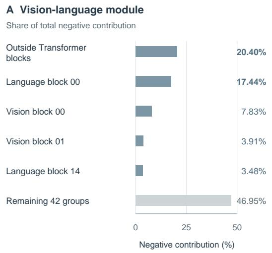

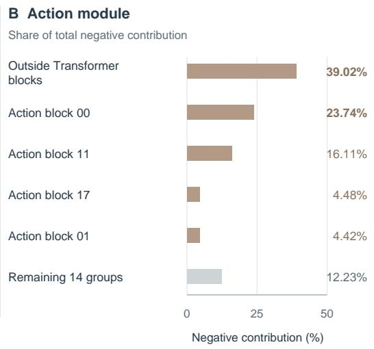  
Figure 5: Negative contributions are concentrated. The five largest groups are shown individually for each module; all others are explicitly combined. Parameters outside Transformer blocks remain separately identified. Percentages are shares of pooled negative cross-task contribution, not fractions of model parameters.

VLM language Transformer  
Conflict across model depth VLM vision encoder  
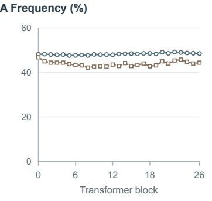

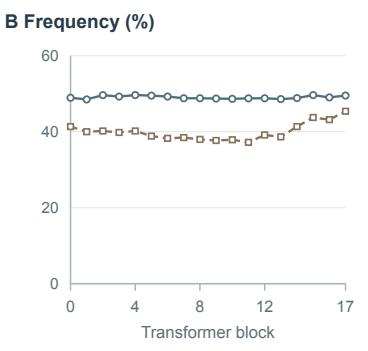

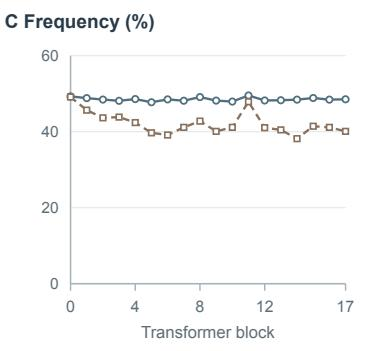

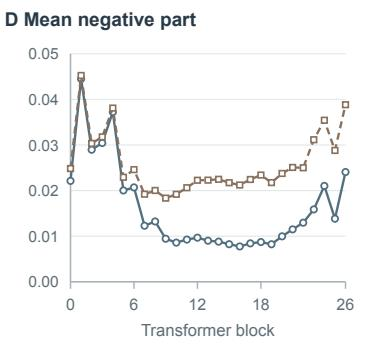

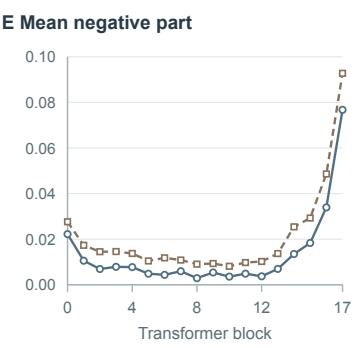

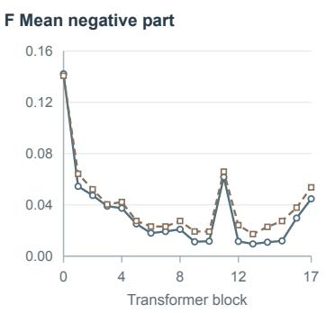  
Individual y scales for magnitude; all profiles retain the original block indices.  
Figure 6: Complete Transformer depth profiles. Cross- and within-task comparisons report negative-cosine frequency and the mean negative part of group-local cosine. Block indices follow the actual 27-block vision, 18-block language, and 18-block action layouts.

## B PARAMETER GEOMETRY AND ARCHITECTURE INTERFACES

With $H _ { q }$ query heads of width $d _ { h }$ , the update is assembled from output-head blocks:

$$
\begin{array} {{ c } { \Delta W _ { Q } = [ \displaystyle \frac { \alpha } { r } A _ { 1 } B _ { 1 } \   \cdots \  \displaystyle \frac { \alpha } { r } A _ { H _ { q } } B _ { H _ { q } } ] , } } \\ { A _ { h } \in \mathbb { R } ^ { d _ { \mathrm { i n } } \times r } , \quad \quad B _ { h } \in \mathbb { R } ^ { r \times d _ { h } } . } \end{array}\tag{B1}
$$

Key and value projections use their actual number of key–value heads. For the attention output projection, input-head contributions are summed:

$$
\begin{array} { r l r } {  { \delta y _ { O } = \frac { \alpha } { r } \sum _ { h = 1 } ^ { H _ { q } } u _ { h } A _ { h } B _ { h } , } } \\ & { } & { A _ { h } \in \mathbb { R } ^ { d _ { h } \times r } , \quad \quad B _ { h } \in \mathbb { R } ^ { r \times d _ { \mathrm { o u t } } } . } \end{array}\tag{B2}
$$

Each factor product has rank at most r; an assembled projection can reach the sum of block ranks, bounded by its dimensions. Matrix-level and output-head constructions have scalar factor counts

$$
N _ { \mathrm { m a t r i x } } = r ( d _ { \mathrm { i n } } + d _ { \mathrm { o u t } } ) ,\tag{B3}
$$

and

$$
N _ { \mathrm { h e a d s } } = H _ { q } r ( d _ { \mathrm { i n } } + d _ { h } ) ,\tag{B4}
$$

respectively. These are per-projection, per-context output budgets, excluding generator weights. Equal block rank therefore does not imply equal generated or trainable capacity. The code validates layer and head counts, projection widths, factor shapes, and scales before residual injection.

The general interface in Equation (1) accommodates different base policies. Table A7 summarizes the integrations. X-VLA retains its fused QKV base projections while adding separate generated Q/K/V residuals. Its action generator additionally uses auxiliary-view visual features; this optional extension does not apply to the π instantiations.

<table><tr><td>Backbone</td><td>VLM-generator condition / targets</td><td>Action-generator condition / targets</td><td>Training prediction</td></tr><tr><td> $\pi _ { 0 } / \pi _ { 0 . 5 }$ </td><td>Multimodal prefix embeddings / selected VLM projections</td><td>Adapted final tokens and state / selected action-expert projections</td><td>Flow velocity</td></tr><tr><td>X-VLA</td><td>Visual/language embeddings / selected Florence encoder projections</td><td>Adapted features, auxiliary views, state / selected action-Transformer projections</td><td>Clean action</td></tr></table>

Table A7: Architecture-specific interfaces. Both integrations preserve the base policy’s actionconditioning and loss definitions. Additional view and domain interfaces are specific to X-VLA.

## C JOINT TRAINING AND POLICY EXECUTION

Algorithms 1 and 2 summarize one training update and action-chunk prediction at one replanning context. Both follow the generation order in Equation (1): generate the VLM update, compute the adapted representation, and generate the action update. Generated updates are applied as low-rank residuals, without materializing dense weight updates.

Only $\Phi = ( \phi _ { v } , \phi _ { a } , \rho _ { a } , \psi )$ is optimized, where ψ denotes the projector parameters retained as trainable by the adaptation configuration. The remaining backbone parameters stay frozen. The condition constructor $C _ { a }$ uses adapted features and robot state; for X-VLA, it additionally includes native auxiliary-view features. Training evaluates per-context operations over the demonstration batch.

Algorithm 1 MorphAct: One Joint Training Update   
Input: Demonstration batch $\boldsymbol { B } = \{ ( \boldsymbol { x } _ { t } , Y _ { t } ) \}$ , with $\boldsymbol { x } _ { t } = ( o _ { t } , \ell , s _ { t } ) ;$ ; parameters $\theta , \Phi ;$ optimizer   
Output: Updated trainable parameters Φ   
1: Apply native preprocessing and construct embeddings $e _ { t } = E ( o _ { t } , \ell )$ and validity masks.   
2: $\Delta \bar { \theta _ { v , t } } \gets G _ { v } \bar { ( e _ { t } ; \phi _ { v } ) }$   
3: $( h _ { t } , C _ { t } ) \gets \dot { F _ { v } } ( e _ { t } ; \theta _ { v } + \Delta \theta _ { v , t } )$   
4: Construct $u _ { a , t }$ using $C _ { a }$ from $h _ { t } , s _ { t } ,$ and any native auxiliary-view features.   
5: $\Delta \theta _ { a , t } \gets G _ { a } ( u _ { a , t } ; \phi _ { a } )$ ▷ Keep $h _ { t }$ and $C _ { t }$ differentiable   
6: Sample the native objective’s random variables $\xi _ { t }$   
7: Construct the native training inputs from $( Y _ { t } , \xi _ { t } )$   
8: Compute $\widehat { y } _ { t }$ using the training inputs, $C _ { t } , s _ { t } .$ , and the action module with parameters $\theta _ { a } + \Delta \theta _ { a , t }$   
9: $\mathcal { L } \gets \mathrm { m e a n } _ { ( x _ { t } , Y _ { t } ) \in \mathcal { B } } \mathcal { L } _ { \mathrm { n a t i v e } } ( \widehat { y } _ { t } , \bar { Y } _ { t } ; \xi _ { t } )$   
10: $g _ { \Phi }  \nabla _ { \Phi } \mathcal { L }$ ▷ Through action conditioning and $h _ { t } \to G _ { a }$   
11: if L and ∥gΦ∥2 are finite then   
12: Apply global gradient clipping to $g _ { \Phi } .$   
13: Update Φ using the configured optimizer and schedule.   
14: else   
15: Skip the parameter update.   
16: end if   
17: return Φ

The factors produced by $G _ { v }$ and $G _ { a }$ are differentiable intermediate outputs, not separate optimization variables. The native action loss trains the VLM generator through both $C _ { t }$ and the dependence of $\Delta \theta _ { a , t }$ on $h _ { t }$ . No operation labels or operation-specific adapter targets are used. The prediction target follows the backbone: flow velocity for $\pi _ { 0 }$ and $\pi _ { 0 . 5 }$ , and clean actions for X-VLA.

Algorithm 2 MorphAct: Action-Chunk Prediction at One Context   
Input: Current context $\boldsymbol { x } _ { t } = ( o _ { t } , \ell , s _ { t } )$ ; learned parameters $\theta , \Phi ;$ native action sampler   
Output: Predicted action chunk $\widehat { Y } _ { t }$   
1: Apply native preprocessing and construct embeddings $e _ { t } = E ( o _ { t } , \ell )$ and validity masks.   
2: $\Delta \theta _ { v , t } \gets G _ { v } ( e _ { t } ; \phi _ { v } )$   
3: $( \boldsymbol { h _ { t } } , \boldsymbol { \dot { C _ { t } } } ) \gets \dot { F _ { v } } ( \boldsymbol { e _ { t } } ; \boldsymbol { \dot { \theta _ { v } } } + \Delta \boldsymbol { \theta _ { v , t } } )$   
4: Construct $u _ { a , t }$ using $C _ { a }$ from $h _ { t } , s _ { t }$ , and any native auxiliary-view features.   
5: $\Delta \theta _ { a , t } \gets G _ { a } ( u _ { a , t } ; \bar { \phi } _ { a } )$   
6: Cache the generated updates and adapted condition $C _ { t }$   
7: Initialize the backbone’s native action sampler.   
8: for each action-module evaluation required by the sampler do   
Compute the native prediction using the current sampler inputs, $C _ { t } , s _ { t } ,$ and $\theta _ { a } + \Delta \theta _ { a , t } .$   
10: Advance the sampler using its original update rule. ▷ No parameter regeneration   
11: end for   
12: Obtain $\widehat { Y } _ { t }$ from the completed sampling procedure.   
13: return $\widehat { Y } _ { t }$

The surrounding control loop executes the first $H _ { \mathrm { e x e c } }$ actions of $\widehat { Y } _ { t }$ and acquires a new observation for replanning. Both generated updates and the adapted conditioning states are recomputed for that new context. The generators do not receive noisy actions or internal solver time; these remain inputs to the native action-prediction procedure. The predicted horizon, executed-prefix length, and solver-step count follow the evaluation configuration.

Objective instantiations. With $z _ { \tau } = \tau \epsilon + ( 1 - \tau ) Y _ { t } ,$ , π0 and $\pi _ { 0 . 5 }$ minimize velocity-prediction error,

$$
\mathcal { L } _ { \pi } = \mathbb { E } _ { \tau , \epsilon } \left[ \| v _ { \Phi } ( z _ { \tau } , \tau , x _ { t } ) - ( \epsilon - Y _ { t } ) \| _ { 2 } ^ { 2 } \right] ,\tag{C1}
$$

using the base implementation’s reduction over action entries. The X-VLA integration instead predicts clean actions:

$$
{ \mathcal { L } } _ { \mathrm { X - V L A } } = \mathbb { E } _ { \tau , \epsilon } \left[ \ell _ { \mathrm { a c t i o n - s p a c e } } \big ( f _ { \Phi } ( z _ { \tau } , \tau , x _ { t } ) , Y _ { t } \big ) \right] .\tag{C2}
$$

Its action-space loss retains the original treatment of position, rotation, and gripper components.   
These instantiate Equation (3).

Initialization and residual scale. Both A/B readout weights are initialized from a zero-mean Gaussian with standard deviation $\sigma _ { 0 } / \sqrt { d _ { g } }$ and zero bias, where $d _ { g }$ is the readout input width. The generated residual $\delta y = ( \alpha / r ) u A B$ obeys $\| \delta y \| _ { 2 } \le ( | \alpha | / r ) \| u \| _ { 2 } \| A \| _ { 2 } \| B \| _ { 2 }$ , using spectral norms for the factors. Small factor scales thus favor small local residuals, without imposing an exactly zero initial policy update.

If an entire factor readout is initialized to zero, the generator trunk initially receives no gradient through that product: one factor derivative is multiplied by zero, while the zero readout has zero input Jacobian. Small, nonzero weights on both readouts avoid this structural blockage.

Precision and optimization. Generator parameters are stored in FP32; internal attention and feedforward computation can use BF16. Factor readouts, low-rank multiplications, scaling, and residual accumulation are evaluated in FP32 before conversion to the base output dtype. The conversion can still quantize a sufficiently small residual. The training implementation uses one AdamW schedule with warmup and cosine decay, global gradient clipping, and checks that prevent updates on non-finite losses or gradient norms. The π implementation additionally checks trainable-gradient coverage. Non-reentrant activation checkpointing reduces activation memory.

Variable-length conditioning. Valid condition tokens are compacted using the supplied masks, grouped by sequence length, and restored to the original batch order after generation. Token compaction and reordering preserve gradients to the condition features. Grouping can require separate generator invocations for different sequence lengths within a batch; generated updates are reused per observation and action chunk. Masks follow each integration’s interface.

## D ADDITIONAL EXPERIMENTAL DETAILS

## D.1 ABLATION CONFIGURATIONS

The variants in Table 3 examine conditioning, adaptation targets, and the representation passed between generators. Task-ID assigns a fixed generation condition to each task, while Constant uses conditions that remain fixed across tasks and observations. Both variants retain the policy’s normal image, language, and robot-state inputs. VLM-only disables generated action-side updates; Actiononly disables generated VLM updates while retaining visual inputs. Unadapted keeps both generators active but feeds the action generator the VLM representation computed before the generated VLM update. The action predictor continues to receive the adapted representation, so this variant specifically changes the condition used for action-side parameter generation.

## D.2 ADAPTATION BUDGET AND RUNTIME

For $N _ { \mathrm { s o l v e } }$ action-refinement steps, the approximate computation is $T _ { \mathrm { p o l i c y } } \approx T _ { E } + T _ { G _ { v } } + T _ { F _ { v } } +$ $T _ { G _ { a } } + N _ { \mathrm { s o l v e } } T _ { F _ { a } }$ . Generator costs include condition construction, and adapted-module costs include the generated residuals. Generation is paid per context rather than per solver step.

Contextual parameterization separates learned generator weights from the updates instantiated for an observation. We report the parameter count of the two generators and, separately, the number of scalar A/B entries in an active low-rank update. Shared LoRA reuses learned factors across contexts, whereas MorphAct generates them from the current context; generated factors are outputs, not additional independently optimized parameters. Explicit factor counts also account for differences between head-aware and matrix-level layouts that a nominal rank alone does not capture.

Table A8 pairs these counts with end-to-end chunk latency, measured inference memory, and control rate. Timing covers observation preprocessing and complete action-chunk prediction, including parameter generation and residual computation where applicable. Methods are compared on matched hardware and execution settings, including solver steps, predicted action horizon, and executed-prefix length. Control rate is measured under the actual action-execution schedule, rather than inferred solely from the inverse of chunk-prediction latency.
<table><tr><td>Adaptation</td><td>Generator params (M)</td><td>Active factors (M)</td><td>Chunk latency (ms)</td><td>Memory (GiB)</td><td>Rate (Hz)</td></tr><tr><td>Backbone: π0</td><td></td><td></td><td></td><td></td><td></td></tr><tr><td>Shared LoRA</td><td></td><td>49.99</td><td>120.00</td><td>7.43</td><td>28.09</td></tr><tr><td>MorphAct</td><td>300.09</td><td>49.99</td><td>145.00</td><td>9.10</td><td>23.20</td></tr><tr><td>Backbone:  $\pi _ { 0 . 5 }$ </td><td></td><td></td><td></td><td></td><td></td></tr><tr><td>Shared LoRA</td><td></td><td>49.99</td><td>138.71</td><td>7.88</td><td>24.99</td></tr><tr><td>MorphAct</td><td>300.09</td><td>49.99</td><td>164.00</td><td>9.53</td><td>21.20</td></tr></table>

Table A8: Adaptation capacity and execution cost. Generator counts include the two generators only; $^ { 6 6 } - ^ { 5 9 }$ indicates the absence of a generator. Active factors count scalar A/B entries used by one context, not the number of matrices. Execution measurements use matched settings within each backbone. Control rates are measured under the action-execution schedule.

MorphAct reuses the generated updates throughout action-chunk prediction, keeping parameter generation outside the solver loop. This amortizes generation across refinement steps but retains the cost of computing and applying the updates. Relative to shared LoRA, chunk latency rises by 25.00 ms on $\pi _ { 0 }$ and 25.29 ms on $\pi _ { 0 . 5 }$ , while inference memory rises by 1.67 and 1.65 GiB, respectively. Measured control rates are 23.20 and 21.20 Hz for MorphAct, compared with 28.09 and 24.99 Hz for shared LoRA. Read together with Table 1, these measurements characterize the manipulation-performance–execution-cost trade-off of contextual adaptation.