# MEMORIZING WHO, KNOWING HOW: BENCHMARKING PERSONAL AND PROCEDURAL MEMORY FOR PERSISTENT ASSISTANTS

Maosheng Qin<sup>1</sup> Qi Zhang<sup>1</sup> Mingxuan Xia<sup>1</sup> Jinglei Chen<sup>2∗</sup> Jiexiang Wang<sup>2</sup> Sheng Guo<sup>2</sup> Cheng Peng<sup>1</sup> Haobo Wang<sup>1∗</sup>

<sup>1</sup>Zhejiang University <sup>2</sup>Ant Group {qinmaosheng,wanghaobo}@zju.edu.cn chenjinglei.cjl@mybank.cn

## ABSTRACT

Memory systems for persistent personal agents must move beyond isolated memories, maintaining both personal memory about whom they serve and procedural memory about how to act. Crucially, in harness-based personal assistance, procedures or skills are inherently user-conditioned: personal context determines which procedures apply, how they are instantiated, and when they should change. Existing benchmarks typically emphasize either personal or procedural memory, leaving their interaction underexplored. We introduce PRAXISMEMBENCH, a harness-based benchmark for persistent personal assistance across daily-life and work trajectories, where personal and procedural memory evolve together and later tasks depend on both. Experiments show that maintaining two memory types separately is insufficient, with completion dropping from single-type to interdependent dependencies (84.6%→77.9%). More broadly, across existing methods, relation-related failures increase from early to late sessions as interaction history grows (59.8%→72.9%), revealing a continual-maintenance challenge: writing correct memories is not enough if their evolving content and organization cannot be preserved for later retrieval. To address this, we propose PRAXISMEM, which uses privileged joint-state supervision to internalize the ability to maintain memory content and organization into the memory manager, with location-aware GRPO and dynamic residual-routed OPSD. PRAXISMEM reaches 40.78% overall Session Success Rate, compared with 20.60% for Claude Code’s native memory.

## 1 INTRODUCTION

Agent harnesses such as OpenClaw and Claude Code enable language models to operate applications, invoke tools, and execute multi-step tasks across practical domains (Zhu et al., 2026; Cai et al., 2026; Ji et al., 2026). Beyond task-level capability, a broader goal is persistent personal assistance, in which the same agent supports one user across a continuing stream of everyday life and work. In this longer-term setting, memory is a key mechanism for such persistence, allowing accumulated interaction history to shape later understanding and action (Packer et al., 2023; Chhikara et al., 2025; Xu et al., 2025). Personal memory maintains evolving user-specific states and preferences, while procedural memory preserves reusable ways of acting across applications. Crucially, procedures are inherently user-conditioned: personal context shapes which procedures apply, how they are instantiated, and when they should change.

Existing memory benchmarks capture two complementary but incomplete sides of persistent personal assistance. Long-term memory benchmarks ask whether models can recover information from dialogue or histories. Many emphasize personal memory like facts, preferences, and their evolution (Maharana et al., 2024; Wu et al., 2025; Chen et al., 2026). However, recall alone does not show whether such personal context can govern consequential actions in external applications. Executable-agent benchmarks instead evaluate procedural memory through application workflows, reusable skills and executable action sequences (He et al., 2026; Li et al., 2026; Ji et al., 2026). Yet without persistent user context, they cannot determine whether a procedure is appropriate for a particular user or how it should adapt as that user changes. Together, these lines leave how personal and procedural memory interact in persistent personal assistance underexplored.

Table 1: Comparison of representative long-term memory (unshaded) and general agent or skill (shaded) benchmarks. $\checkmark , \circ ,$ and ×denote full, partial, and absent coverage. Mixed denotes trajectories spanning multiple application domains; State dep. denotes cross-session dependence on agent-created state or artifacts.
<table><tr><td>Benchmark</td><td>Setting</td><td>Horizon</td><td></td><td>Eval. Domains</td><td>Mixed</td><td>Personal</td><td>Procedural</td><td>State dep.</td></tr><tr><td>SkillsBench</td><td>Exec. agent</td><td>1 task</td><td>84 tasks</td><td>11</td><td>×</td><td>X</td><td>√</td><td>X</td></tr><tr><td>ClawArena</td><td>Harness</td><td>24–30 rounds</td><td>12 scenarios</td><td>≥7</td><td>×</td><td>√</td><td>X</td><td>X</td></tr><tr><td>WorkBuddy Bench</td><td>Harness</td><td>1 task</td><td>260 tasks</td><td>4</td><td>X</td><td>X</td><td>X</td><td>X</td></tr><tr><td>LongMemEval</td><td>QA</td><td>50–500 sessions</td><td>500 Q</td><td>1</td><td>X</td><td>√</td><td>X</td><td>X</td></tr><tr><td>Memoria-Bench</td><td>QA</td><td>Hundreds of turns</td><td>58,422 Q</td><td>7</td><td>×</td><td>X</td><td>√</td><td>X</td></tr><tr><td>VitaBench 2.0</td><td>Exec. agent</td><td>10–20 tasks</td><td>56 users</td><td>3</td><td>√</td><td>√</td><td>X</td><td>X</td></tr><tr><td>MemoryArena</td><td>Exec. agent</td><td>2–16 sessions</td><td>766 tasks</td><td>4</td><td>×</td><td>0</td><td>0</td><td>√</td></tr><tr><td>PraxisMemBench</td><td>Harness</td><td>25 sessions</td><td>1,000 tasks</td><td>40</td><td>√</td><td>√</td><td>√</td><td>√</td></tr></table>

As illustrated in Figure 1, the central challenge in persistent personal assistance is that procedures are user-conditioned: personal memory determines which procedures apply, how they should be instantiated, and when they should change. This coupling is often triggered by underspecified requests, since users rarely restate the relevant personal constraints or previously established procedures (Chen et al., 2026; Zhu et al., 2026). Moreover, the required evidence is distributed across sessions and application domains (Dou et al., 2026; Chen et al., 2026), while persistence adds a maintenance challenge: changing preferences, prior task outcomes, and memory-maintenance decisions can alter which procedure remains appropriate in later sessions (Wu et al., 2025; He et al., 2026). Consequently, personal and procedural memory cannot be maintained as two independent context slots; they must be continually revised and reorganized so that their evolving dependencies remain recoverable amid vast accumulated memory (Xu et al., 2025; Zhang et al., 2026).

To address this gap, we introduce PRAXISMEMBENCH, a benchmark that couples personal and procedural memory in persistent personal assistance. Across its executable tasks, 84.2% require both forms of memory, reflecting how user context and application procedures jointly determine successful action. Each persona follows a distinct trajectory spanning life and work domains, where preferences, procedures, their associations, and application state evolve across sessions. Later requests often omit the relevant historical conditions, requiring the memory method to recover the appropriate personal and procedural context for downstream tool action. As these dependencies

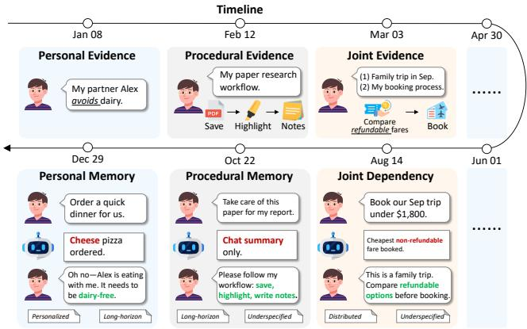  
Figure 1: Representative personal, procedural, and joint memory failures in persistent personal assistance.

persist and change over time, earlier memory-management decisions can directly affect later tasks.

Experiments expose a sharper difficulty than retrieving either memory type alone. A dual-store baseline’s completion declines from personal-only and procedural-only tasks to interdependent tasks (84.6% → 77.9%). Moreover, persistence changes the nature of the failures: the share of relation-related failures rises from early to late sessions (59.8% → 72.9%). These results point to a continual-maintenance problem: Correctly writing memory at one session does not guarantee long-term maintenance of personal–procedural associations. Yet scalar outcome supervision provides little indication of which part of the joint personal–procedural memory state is incorrect.

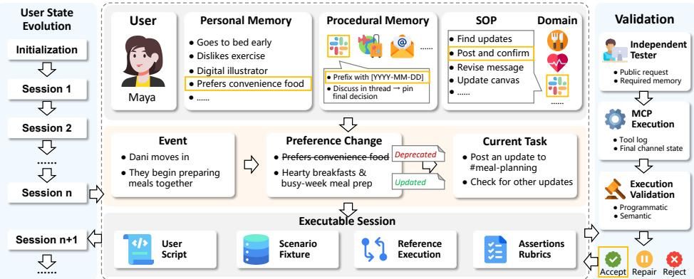  
Figure 2: PraxisMemBench trajectory construction. Each session is instantiated from the evolving user, personal and procedural memory, and application context, then independently validated before updating the canonical state for subsequent sessions.

This observation motivates PRAXISMEM. During training, we use the canonical joint memory state as privileged supervision and derive dynamic residuals against the manager’s realized state to expose what remains incorrect, where it should be organized, and when the defect persists. PRAXISMEM combines location-aware GRPO, which internalizes correct memory content and placement, with dynamic residual-routed OPSD, which supplies teacher guidance only for unresolved criteria and the chunks where their defects persist. On overall Session SR, PRAXISMEM reaches 40.78%, compared with 20.60% for Claude Code’s native memory.

## 2 PRAXISMEMBENCH

## 2.1 PROBLEM FORMULATION

PraxisMemBench follows a persistent agent serving the same user across life and work sessions. At session $n ,$ the user issues a natural request $q _ { n }$ in application domain $d _ { n }$ . The task-agent policy π interacts with persistent application state $S _ { n } .$ , while the memory method f maintains memory state $M _ { n }$ , comprising personal memory, procedural memory, and their evolving association structure:

$$
M _ { n } = \bigl ( M _ { n } ^ { \mathrm { p e r s } } , M _ { n } ^ { \mathrm { p r o c } } , { \mathcal { T } } _ { n } \bigr ) , \qquad \bigl ( H _ { n } , M _ { n + 1 } , S _ { n + 1 } \bigr ) = \Phi _ { \pi , f } ^ { d _ { n } } \bigl ( q _ { n } , M _ { n } , S _ { n } \bigr ) ,\tag{1}
$$

where $H _ { n }$ contains the dialogue, tool interactions, observations, and generated artifacts. Crucially, $\mathcal { I } _ { n }$ denotes the evolving association structure through which personal context conditions relevant procedural memory. Thus, persistent interaction continually updates not only the two memory con tents, but also the relations that determine how they should be jointly used in later sessions.

## 2.2 BENCHMARK CONSTRUCTION

Continuous trajectory annotation. Because PraxisMemBench targets user-conditioned procedures that evolve with personal context, benchmark construction must preserve how the joint memory state changes over time. Therefore, we construct each persona trajectory sequentially, rather than as independent tasks around a fixed profile. Before session $n ,$ the canonical annotation state $\Omega _ { n } ^ { \star }$ contains the canonical memory state $M _ { n } ^ { \star }$ and persistent application state $S _ { n } ^ { \star }$

$$
\Omega _ { n } ^ { \star } = \big ( M _ { n } ^ { \star } , S _ { n } ^ { \star } \big ) , \qquad ( X _ { n } , \Omega _ { n + 1 } ^ { \star } ) = \mathrm { A n n o t a t e } ( \Omega _ { n } ^ { \star } ; e _ { n } , d _ { n } , \sigma _ { n } ) ,\tag{2}
$$

where $M _ { n } ^ { \star } \ = \ ( M _ { n } ^ { \star , \mathrm { p e r s } } , M _ { n } ^ { \star , \mathrm { p r o c } } , \mathcal { T } _ { n } ^ { \star } )$ is the canonical memory state, $e _ { n }$ is a user event, $d _ { n }$ an application domain, and $\sigma _ { n }$ an application SOP. Each accepted session instantiates an executable task $X _ { n }$ and advances the canonical state used to construct subsequent sessions. For example, in Figure $2 , e _ { n }$ is the change that Dani moves in, $d _ { n }$ is the selected communication application, and $\sigma _ { n }$ specifies the reusable workflow for posting and confirming an update.

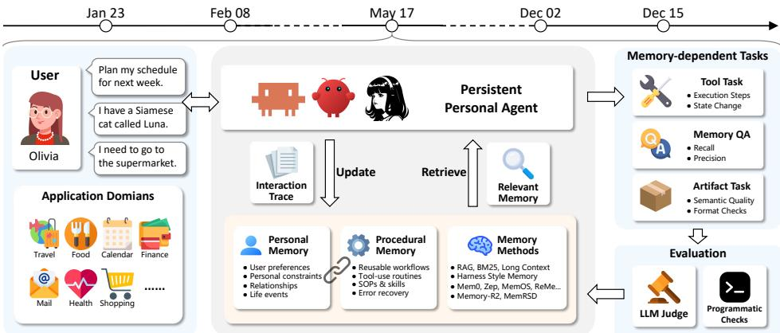  
Figure 3: PraxisMemBench evaluation lifecycle. Across sessions, the memory method continuously updates and retrieves personal and procedural memory from user interactions. The maintained memory persists across the trajectory and shapes later memory-dependent tasks, whose outcomes are evaluated by LLM judges and programmatic checks.

Executable session instantiation. In order to instantiate these joint dependencies, the annotator selects relevant personal memories, applicable procedural memories, an application, and an application-specific SOP from $\Omega _ { n } ^ { \star }$ . Following Eq. 2, these ingredients are instantiated through a current event or preference change, a natural user request, and execution in the selected application. By construction, the task requires personal memory (e.g., Maya’s updated meal preference) and procedural memory (e.g., a previously established Slack workflow) to jointly determine a measurable outcome. Their association $\mathcal { T } _ { n } ^ { \star }$ is instantiated when personal context constrains the candidate space, selects among procedural outcomes, or changes how a procedure should be applied. When a memory is first established, the user states the relevant personal information or procedure naturally but explicitly. Crucially, in later dependent sessions, these details are omitted from the public request, so the evaluated memory method must select the related personal and procedural memories relevant to the current request and user state. The resulting session $X _ { n }$ contains the application fixture, reference execution, and evaluation checks. As detailed in Appendix C.2, only independently validated sessions advance the canonical state in Eq. 2; their outcomes and new memories may then shape subsequent sessions.

## 2.3 EVALUATION

Persistent agent lifecycle. To realize the persistent transition in Eq. 1, PraxisMemBench evaluates each memory method f within the agent–harness–environment loop shown in Figure 3. In session n, the user issues $q _ { n } ;$ memory is accessed according to the evaluation setting, and the task agent interacts with the applications to produce trace $H _ { n }$ and state $S _ { n + 1 }$ . After each session, the resulting interaction updates $\bar { M } _ { n + 1 }$ before the next request arrives. Both $M _ { n + 1 }$ and $S _ { n + 1 }$ are propagated to the next session without canonical-state correction. Thus, persistent evaluation requires continuously maintaining personal and procedural memory together with their evolving associations, so that userconditioned procedures remain current, organized, and retrievable over the trajectory.

Diagnostic evaluation design. To capture both memory-conditioned action and diagnostic memory quality, PraxisMemBench evaluates three session families. Tool and Artifact tasks report personal-memory, procedural-memory, and execution-level scores (Tool Step SR or Artifact Assert), while Memory QA isolates retrieval quality through Precision, Recall, and F1. All three families additionally report Session SR. Semantic requirements are judged by an LLM, whereas tool and artifact outcomes are checked programmatically. Detailed definitions are provided in Appendix D.

Benchmark coverage. PraxisMemBench provides separate training and test splits, each with 20 users and 500 sessions spanning 20 MCP-accessible application domains (40 in total), including travel, shopping, health, food, and finance. The test split is evaluated under two settings, Scheduled and Autonomous, covering 2,185 memory dependencies. Scheduled fixes memory intervention points for controlled and reproducible evaluation, whereas Autonomous uses more underspecified requests and lets the assistant decide when to invoke memory operations; full setting details are provided in the appendix. Figure 4 shows that 303 of 360 executable tasks require joint memory, while many dependencies span months of time. This combination places strong pressure on continual relation maintenance: a correct update at one session does not guarantee that its personal–procedural relation remains intact over time. As we show later, longer dependencies increasingly produce fragmented or competing relations.

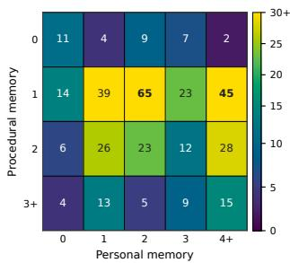

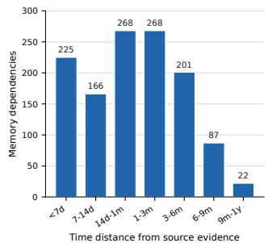

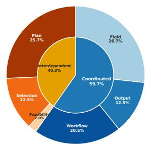  
Figure 4: Memory-dependency structure in the test split. From left to right: (a) Distribution of personal and procedural memory points required by executable tasks; (b) Temporal distance from source evidence for dependencies in later sessions; (c) Joint user-conditioning taxonomy.

## 3 PRAXISMEM: LEARNING A PERSISTENT MEMORY MANAGER

Notably, outcome-driven memory managers typically learn from final task rewards. However, such scalar supervision provides little indication of which part of the joint personal–procedural memory state is incorrect. Addressing this ambiguity requires the memory manager to understand, during each update, how user context and procedural knowledge should jointly shape the desired memory state. Fortunately, during training, the canonical structured memory—including user and event states, reusable skills, and their associations—provides exactly this information. The key is therefore to internalize this supervision into the manager without requiring it at deployment.

Hence, we propose PRAXISMEM, which converts the canonical user–procedure state into privileged information (Zhao et al., 2026) by computing a dynamic residual that reveals what is missing or incorrect, where it belongs, and when the defect persists along the update trajectory. Specifically, location-aware GRPO learns what information should be maintained and where it should be organized, while dynamic residual-routed OPSD identifies when unresolved defects persist along the update trajectory and provides targeted guidance only at those chunks. Together, the two objectives train the manager to maintain personal memory, procedural memory, and their evolving associations within a unified memory state. We focus on Update below because its state changes persist and shape later memory use.

## 3.1 PRIVILEGED JOINT-STATE SUPERVISION

During training, each session provides a canonical joint state $M _ { n } ^ { \star } = ( M _ { n } ^ { \star , \mathrm { p e r s } } , M _ { n } ^ { \star , \mathrm { p r o c } } , \mathcal { T } _ { n } ^ { \star } )$ , specifying the desired personal memory, procedural memory, and their associations. We realize this state with a simple structured Markdown store: USER.md and events/<sub>\*</sub>.md maintain personal and event context, domain-specific SKILL.md files maintain reusable procedures, and MEMORY.md indexes their associations. We treat the canonical states and their discrepancy from the manager’s realized states as privileged supervision: they specify the desired joint personal–procedural organization and expose the remaining gap that the manager must correct. Full memory organization and update mechanics are provided in Appendix B.1.

## 3.2 LOCATION-AWARE GRPO

As motivated above, single-step semantic correctness does not guarantee long-term maintenance of the association structure $\mathcal { T } _ { n } \colon$ a memory update can be correct yet poorly placed for preserving its

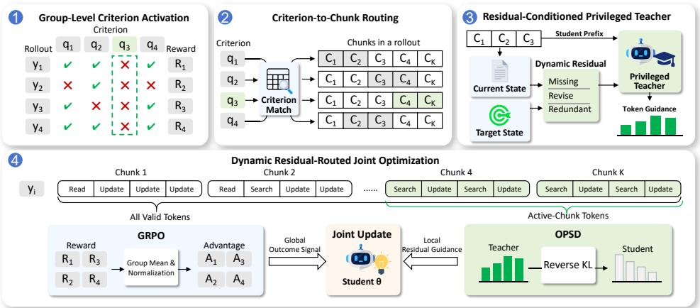  
Figure 5: Overview of PRAXISMEM. (1) Criteria missed by all rollouts are activated. (2) They are routed to chunks where the corresponding memory defects persist. (3) A privileged teacher receives the dynamic residual between current and target memory states to provide token-level guidance. (4) GRPO trains the full rollout, while OPSD supervises only routed chunks.

relation to the relevant user context or procedure after subsequent updates. We therefore extend the soft semantic state matching of DeltaMem (Zhang et al., 2026) with location-aware supervision, using the canonical joint state to internalize in the manager both what to write and where it belongs.

Let $\widehat { \Delta } _ { i } = \{ \widehat { u } _ { a } \}$ and $\Delta _ { n } ^ { \star } = \{ u _ { b } ^ { \star } \}$ denote the predicted and canonical memory changes from $M _ { n } ^ { \star }$ Specifically, type-compatible units above a semantic threshold form candidate matches. We select a one-to-one assignment that prioritizes correct location, then match coverage and semantic similarity:

$$
\gamma _ { i } ^ { \star } = \underset { \gamma \subseteq \mathcal { E } _ { i } } { \mathrm { l e x a r g m a x } } \left( \sum _ { ( a , b ) \in \gamma } \ell _ { a b } , \vert \gamma \vert , \sum _ { ( a , b ) \in \gamma } s _ { a b } \right) ,\tag{3}
$$

where $\ell _ { a b }$ indicates location correctness and $s _ { a b }$ semantic similarity. Matched units contribute according to both content coverage and location, while unmatched predictions penalize redundant memory. Their location-weighted soft precision and recall define $F _ { \mathrm { s t a t e } } ^ { ( i ) } .$ . The Update reward is:

$$
R _ { i } ^ { \mathrm { u p d } } = 0 . 8 F _ { \mathrm { s t a t e } } ^ { ( i ) } + 0 . 1 R _ { \mathrm { f o r m a t } } ^ { ( i ) } + 0 . 1 R _ { \mathrm { e f f } } ^ { ( i ) } ,\tag{4}
$$

where the auxiliary terms encourage valid memory operations and discourage unnecessary actions or state growth. With this reward, we use standard GRPO (Shao et al., 2024) to compute group-relative advantages and optimize the complete manager rollout. However, when every rollout misses the same required memory criterion, group-relative learning provides no successful behavior for that criterion, motivating the residual-routed self-distillation introduced next.

## 3.3 DYNAMIC RESIDUAL-ROUTED SELF-DISTILLATION

Even with location-aware rewards, a joint memory failure remains ambiguous when every rollout misses the same criterion. PRAXISMEM therefore turns the privileged state discrepancy into targeted on-policy self-distillation (OPSD) (Zhao et al., 2026). Criterion routing identifies which content or relation remains unresolved, while dynamic residual routing identifies when that defect persists along the trajectory and supplies guidance only to those chunks. Figure 5 illustrates this process.

Selective criterion–chunk routing. Let $c _ { i j }$ denote the final location-aware coverage of required memory criterion $\kappa _ { j }$ in rollout i. We activate OPSD only when no rollout satisfies that criterion:

$$
u _ { j } = \mathbb { I } \Big [ \operatorname* { m a x } _ { i } c _ { i j } < \tau _ { \mathrm { c o v } } \Big ] , \qquad \mathcal { U } = \{ j : u _ { j } = 1 \} .\tag{5}
$$

For each update chunk $k ,$ let $M _ { i , k } ^ { - }$ denote the realized memory state of rollout i before update, and $M _ { n , k } ^ { \star }$ its canonical target. We then compare the rollout’s realized state with the canonical state:

$$
z _ { i , k } = \mathrm { S e m D i f } \big ( M _ { i , k } ^ { - } , M _ { n , k } ^ { \star } ; M _ { n , k - 1 } ^ { \star } \big ) , \qquad g _ { i , k } = \mathbb { I } [ \mathcal { I } ( z _ { i , k } ) \cap \mathcal { U } \neq \emptyset ] .\tag{6}
$$

Table 2: Overall results on the PraxisMemBench test set. Tool tasks report personal-memory (Pers.), procedural-memory (Proc.), step success rate (Step SR), and session success rate (Session SR). Memory QA reports recall, precision, F1, and SR. Artifact tasks report Pers., Proc., artifact-assertion score (Assert.), and SR.
<table><tr><td rowspan="2">Method</td><td colspan="4">Tool</td><td colspan="4">Memory QA</td><td colspan="4">Artifact</td></tr><tr><td>Pers.</td><td>Proc.</td><td>Step SR</td><td>SR</td><td>Recall</td><td>Precision</td><td>F1</td><td>SR</td><td>Pers.</td><td>Proc.</td><td>Assert.</td><td>SR</td></tr><tr><td colspan="9">Diagnostic</td><td></td><td></td><td></td></tr><tr><td>Oracle</td><td>90.42</td><td>93.98</td><td>93.59</td><td>83.90</td><td>98.45</td><td>99.29</td><td>98.82</td><td>99.29</td><td>85.18</td><td>90.32</td><td>93.16</td><td>77.42</td></tr><tr><td>Long Context</td><td>39.68</td><td>44.91</td><td>72.71</td><td>21.46</td><td>43.37</td><td>57.06</td><td>46.88</td><td>30.71</td><td>52.69</td><td>51.80</td><td>80.56</td><td>30.26</td></tr><tr><td>DualMem</td><td>27.73</td><td>51.30</td><td>79.23</td><td>15.90</td><td>16.21</td><td>35.61</td><td>20.19</td><td>0.71</td><td>39.77</td><td>47.41</td><td>86.89</td><td>13.73</td></tr><tr><td colspan="9">Basic baselines</td><td></td><td></td><td></td><td></td></tr><tr><td>BM25</td><td>22.57</td><td>30.93</td><td>68.08</td><td>15.12</td><td>37.73</td><td>57.07</td><td>42.84</td><td>22.14</td><td>27.88</td><td>25.42</td><td>77.71</td><td>6.45</td></tr><tr><td>Embedding RAG</td><td>26.83</td><td>36.30</td><td>73.47</td><td>16.10</td><td>34.86</td><td>50.51</td><td>38.83</td><td>20.71</td><td>34.41</td><td>31.63</td><td>81.35</td><td>11.61</td></tr><tr><td colspan="9">Harness-native memory</td><td></td><td></td><td></td><td></td></tr><tr><td>OpenClaw</td><td>20.58</td><td>24.91</td><td>62.48</td><td>15.12</td><td>12.28</td><td>25.06</td><td>15.50</td><td>1.43</td><td>21.03</td><td>27.67</td><td>64.36</td><td>8.39</td></tr><tr><td>Hermes</td><td>37.22</td><td>54.49</td><td>74.84</td><td>26.34</td><td>21.87</td><td>42.98</td><td>25.93</td><td>10.71</td><td>45.80</td><td>55.67</td><td>77.66</td><td>23.23</td></tr><tr><td>Claude Code</td><td>37.83</td><td>46.53</td><td>71.92</td><td>22.44</td><td>35.17</td><td>54.75</td><td>40.00</td><td>15.71</td><td>41.87</td><td>47.68</td><td>75.18</td><td>22.58</td></tr><tr><td colspan="9">Advanced memory systems</td><td></td><td></td><td></td><td></td></tr><tr><td>Mem0</td><td>20.78</td><td>47.89</td><td>77.78</td><td>12.42</td><td>19.17</td><td>44.64</td><td>24.05</td><td>2.14</td><td>29.34</td><td>41.54</td><td>80.29</td><td>13.01</td></tr><tr><td>Zep</td><td>24.11</td><td>39.20</td><td>73.69</td><td>18.41</td><td>13.92</td><td>29.64</td><td>17.61</td><td>1.43</td><td>33.37</td><td>33.90</td><td>81.23</td><td>15.48</td></tr><tr><td>A-Mem</td><td>25.03</td><td>42.70</td><td>76.45</td><td>17.46</td><td>24.23</td><td>40.73</td><td>28.02</td><td>7.14</td><td>32.37</td><td>34.17</td><td>80.56</td><td>11.03</td></tr><tr><td>ReMe MemOS</td><td>24.39</td><td>29.97</td><td>67.39</td><td>13.33</td><td>10.35</td><td>22.80</td><td>13.05</td><td>0.00</td><td>31.43</td><td>22.79</td><td>75.60</td><td>6.90</td></tr><tr><td></td><td>29.47</td><td>56.34</td><td>80.30</td><td>19.12</td><td>18.98</td><td>41.48</td><td>23.09</td><td>3.57</td><td>40.01</td><td>50.94</td><td>84.77</td><td>18.18</td></tr><tr><td colspan="9">Learned memory managers</td><td></td><td></td><td></td><td></td></tr><tr><td>Memory-R2</td><td>34.93</td><td>51.76</td><td>79.14</td><td>22.93</td><td>22.61</td><td>45.07</td><td>26.79</td><td>5.71</td><td>38.85</td><td>42.90</td><td>84.00</td><td>17.42</td></tr><tr><td>PraxisMem (Ours)</td><td>63.46</td><td>61.02</td><td>80.91</td><td>37.88</td><td>69.64</td><td>82.30</td><td>74.27</td><td>55.00</td><td>69.40</td><td>59.32</td><td>89.66</td><td>31.33</td></tr></table>

Here, $\mathcal { I } ( z _ { i , k } )$ extracts unresolved required criteria from the current residual. An earlier omission, conflict, or misplacement keeps the gate active until it is repaired.

Dynamic residual-conditioned privileged guidance. The residual $z _ { i , k }$ is recomputed from the rollout’s realized memory state at each chunk, dynamically tracking discrepancies from the canonical state, including missing, conflicting, misplaced, and redundant content. It is exposed only to the self-teacher during training, providing chunk-specific guidance on what memory should be added, revised, moved, or removed as the rollout evolves. Finally, we compute the reverse-KL OPSD loss between the residual-conditioned teacher and the unprivileged student, as detailed in Appendix B.4.

Joint training. Let V contain all valid manager-generated tokens and $\mathcal { A } = \{ ( i , k , t ) \in \mathcal { V } : g _ { i , k } =$ 1} the tokens selected by residual routing. We optimize

$$
{ \mathcal { L } } _ { \mathrm { j o i n t } } = { \mathcal { L } } _ { \mathrm { G R P O } } ( \mathcal { V } ) + \lambda _ { \mathrm { O P S D } } { \mathcal { L } } _ { \mathrm { O P S D } } ( A ) + \beta { \mathcal { L } } _ { \mathrm { r e f K L } } ( \mathcal { V } ) .\tag{7}
$$

Thus, location-aware GRPO shapes the content and organization of the joint memory state, while residual-routed OPSD supplies guidance for unresolved personal, procedural, or association defects.

## 4 EXPERIMENTS

## 4.1 EXPERIMENTAL SETUP

Models and protocol. We use Qwen3.7-Plus as the task agent and GLM-5 as both the user simulator and LLM judge, with deterministic programmatic verifiers for tool and artifact outcomes. Qwen3.5-9B serves as the base model for LLM-based memory methods, and Qwen3-Embedding-0.6B for embedding-based components. We evaluate the Scheduled and Autonomous settings separately using the metrics in Section 2.3, with results aggregated over complete trajectories.

Memory systems. We compare five groups of methods. Diagnostic controls include Oracle Memory, Long Context, and DualMem, which maintains personal and procedural memory in separate stores and combines their retrieved contents only at task time. Retrieval baselines include BM25 and embedding RAG. Harness-style baselines include OpenClaw, Hermes, and Claude Code. Advanced memory systems include Mem0, Zep, A-Mem, ReMe, MemOS, Memory-R2, and PRAXISMEM (Chhikara et al., 2025; Rasmussen et al., 2025; Xu et al., 2025; Cao et al., 2026; Li et al., 2025; Yan et al., 2026a). We preserve each system’s original memory representation and update–retrieval behavior; versions and method-specific configurations are provided in Appendix E.

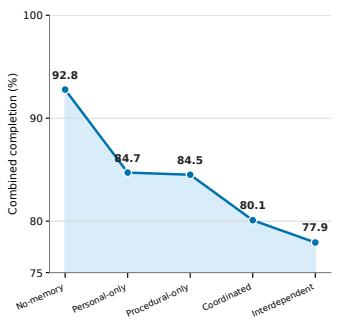

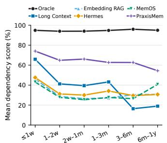  
Time distance from source evidence

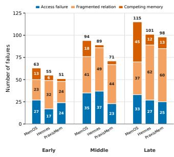  
Figure 6: Memory use across dependency types and persistent interaction. From left to right: (a) DualMem Combined Completion by dependency type; (b) Long-range degradation by evidence age; (c) Counts of memory failures for MemOS, Hermes, and PRAXISMEM across trajectory stages.

## 4.2 OVERALL BENCHMARK RESULTS

Overall performance. Table 2 reveals four consistent patterns. (1) PraxisMemBench remains challenging even for strong memory-augmented agents: component-level scores are consistently higher than session success, showing that recalling individual memories or satisfying isolated execution requirements does not guarantee complete task success. (2) Among harness-native systems, Hermes gives the strongest overall Session SR, while Claude Code performs best on Memory QA. (3) Advanced memory systems remain uneven across task families: For Session SR, MemOS performs best on Tool and Artifact tasks, whereas A-Mem leads on Memory QA, suggesting that stronger performance on one form of memory use does not reliably transfer to others. (4) PRAXIS-MEM performs strongly across all three task families and achieves the best overall results.

## 4.3 ANALYSIS AND FINDINGS

Finding 1: Joint dependencies take coordinated and interdependent forms. We distinguish two forms of joint dependency, both reflecting how procedures in persistent personal assistance are conditioned on user context. In Coordinated tasks, personal and procedural memory must be used together to determine the task outcome. This includes Field Coordination, where both memories jointly determine the same field; Output Coordination, where they jointly shape different parts of an output; and Workflow Coordination, where they jointly govern different actions or steps. In Interdependent tasks, this conditioning is stronger: personal context changes how procedural knowledge can be applied. Action Feasibility determines which actions remain valid, Action Selection determines which candidate action or object should be chosen, and Plan Formation changes how the overall procedure or plan should be composed. Among audited joint tasks, 59.7% are Coordinated and 40.3% are Interdependent. The right panel of Figure 4 summarizes this distribution.

Finding 2: Separate maintenance struggles with stronger interdependence. To test whether maintaining personal and procedural memory independently is sufficient, we implement DualMem, which uses separate stores for the two memory types and combines their retrieved contents only before task execution. However, in general, its performance remains limited, motivating a closer analysis by dependency type. We combine Tool Step SR and Artifact Assertion into a single diagnostic metric, Combined Completion. As shown in the left panel of Figure 6, DualMem performs progressively worse from personal-only (84.7%) and procedural-only (84.5%) tasks to Coordinated tasks (80.1%), and drops further on Interdependent tasks (77.9%). This suggests that Coordinated tasks already require compatible personal and procedural evidence to be maintained together, while Interdependent tasks are harder because the relevant procedural memory depends on the current personal context. DualMem preserves the two memory contents separately but leaves this association implicit, making individually plausible but jointly incompatible memories more likely.

Table 3: Controlled ablation on eight fixed test trajectories. Combined and Interdependent Completion use Tool Step SR and Artifact Assertion.
<table><tr><td>Variant</td><td>Combined Completion</td><td>Interdependent Completion</td><td>Avg SR</td></tr><tr><td>Content-only GRPO</td><td>66.2</td><td>54.9</td><td>23.5</td></tr><tr><td>+ Location-aware reward</td><td>73.6</td><td>66.5</td><td>29.0</td></tr><tr><td>+ Criterion-routed OPSD</td><td>76.9</td><td>72.1</td><td>32.7</td></tr><tr><td>PRAXISMEM (criterion×chunk)</td><td>83.4</td><td>82.1</td><td>43.1</td></tr></table>

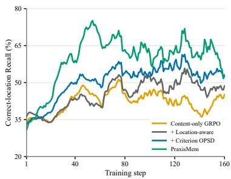  
Figure 7: Correct-location Recall across training variants.

Finding 3: Persistence turns memory coupling into a continual-maintenance problem. The middle panel of Figure 6 examines evidence age using Mean Dependency Score, the average score over all personal and procedural dependency points within each time-distance bucket. Compared with dependencies sourced within one week, the point-weighted mean over later buckets drops by 30.0 points for Long Context, 17.9 for Embedding RAG, and 15.3 for MemOS. This indicates tha persistent interaction increasingly stresses memory use as relevant evidence recedes in time.

To understand the source of degradation, we audit the inference-time evidence produced by MemOS, Hermes, and PRAXISMEM. We classify failures as Access failure, where relevant personal or procedural evidence is missing; Fragmented relation, where both are available but their task-relevant relation is not coherently surfaced; and Competing memory, where a concrete but inapplicable candidate is retrieved instead. The right panel of Figure 6 shows a clear shift in failure composition: Access failures fall from 40.2% in early sessions to 27.1% in late sessions, while relation-related failures rise from 59.8% to 72.9%, increasingly dominated by fragmented relations. These failures point to a continual-maintenance problem: persistent memory systems must not only retain personal and procedural content, but continually revise and reorganize the evolving associations between them as the trajectory grows. Appendix F.5 provides representative cases.

Finding 4: PRAXISMEM improves persistent memory use by learning both memory content and organization. We next examine whether PRAXISMEM improves not only memory content, but also the organization that maintains personal–procedural associations over time. As shown in Figure 7, content-only GRPO learns useful memory updates but remains weak at placing them consistently, with a final-20-step Correct-location Recall of 41.1%. Adding the location-aware reward raises this score to 47.2%, while criterion-routed OPSD further improves it to 53.3%. Full PRAXIS-MEM, which further localizes unresolved defects to the chunks where they persist, reaches 61.3%, showing a progression from content correctness toward better maintained memory organization.

These training-time improvements also transfer to persistent task performance. On the fixed eighttrajectory ablation subset in Table 3, Combined Completion increases from 66.2% under contentonly GRPO to 83.4% with full PRAXISMEM, while Interdependent Completion rises more substantially from 54.9% to 82.1%; Avg SR similarly improves from 23.5% to 43.1%. Together, these results show that persistent memory management benefits from learning not only what personal and procedural content to preserve, but also where and how to organize it so that the evolving association structure I remains recoverable as interaction history grows.

## 5 CONCLUSION

We introduced PRAXISMEMBENCH, a harness-based benchmark for evaluating persistent personal agents across daily-life and work trajectories. PRAXISMEMBENCH focuses on the joint maintenance of personal and procedural memory, motivated by the observation that procedures or skills in personal assistance are inherently user-conditioned. Our experiments show that existing methods increasingly struggle as interaction history grows and their relations must be preserved across repeated updates. Failure analysis further reveals a continual-maintenance challenge, where memory errors shift from simple access failures toward fragmented or competing personal–procedural relations. To address this challenge, we introduced PRAXISMEM, which learns both memory content and organization through location-aware GRPO and dynamic residual OPSD. We hope PRAX-ISMEMBENCH provides a useful testbed for developing memory systems that can support reliable, personalized, and persistent agent behavior over long-term interaction.

## AI USE STATEMENT

Generative AI tools were used in several parts of this work. GPT-5.5 was used during benchmark construction to expand persona seeds into structured profiles and to synthesize personal change events, as described in Appendix C.2. Coding agents, including Codex, were used to assist with software implementation, debugging, experiment tooling, and the preparation and refinement of benchmark instances. Codex was also used to improve the readability and presentation of the manuscript. All AI-assisted benchmark content, manuscript text, factual claims, citations, code, experimental outputs, and interpretations were reviewed and verified by the authors or the independent validation procedures described in the paper. The authors made all final decisions regarding the research design, experimental protocol, analysis, and conclusions, and take full responsibility for the contents of this work.

## ETHICS STATEMENT

PraxisMemBench is constructed from fictional personas and synthetic interaction trajectories and does not contain real user histories or personally identifiable information. All tool interactions are executed in isolated benchmark applications; no real accounts, payments, communications, or other external actions are involved. Synthetic personas and LLM-generated events may inherit cultural, demographic, or behavioral biases and should not be interpreted as representative of real users. Although PraxisMemBench is intended for evaluating memory systems, persistent personal assistants may create privacy and security risks by retaining sensitive information, relying on outdated user states, or applying remembered procedures in inappropriate contexts. Real-world deployments should therefore provide appropriate access controls, user-visible retention and deletion mechanisms, consent-aware data handling, and safeguards for consequential actions. The authors have read and adhered to the ICLR Code of Ethics.

## REPRODUCIBILITY STATEMENT

We document the PraxisMemBench benchmark formulation and construction overview in Section 2, with detailed domain and SOP grounding, sequential trajectory construction, persona and event synthesis, task and gold instantiation, and independent validation in Appendix C. The chronological evaluation protocol, task-family metrics, programmatic verifiers, semantic judging procedure, and judge-agreement audit are described in Appendix D, while all construction and evaluation prompts are provided in Appendix G. Model and harness versions, context and memory budgets, inference settings, hardware, and training configurations are reported in Appendix E, with further details of PRAXISMEM in Appendix B. We will release the fixed benchmark splits, application fixtures and SOPs, gold annotations and verifiers, construction and evaluation code, baseline configurations, prompts, and PRAXISMEM training code and checkpoint to support replication and future extensions.

## REFERENCES

Alibaba Cloud. Model studio model pricing. https://www.alibabacloud.com/help/ en/model-studio/model-pricing, 2026. Accessed: 2026-09-03.

Siqi Cai, Shaopeng Chen, Xiang Fei, Yong Mao, Zihan Xu, Zhiheng Lyu, Zhijian Shao, Yuchen Shi, Shuwen Zhang, Chaofan Qiu, Linjie Che, Xiaoxi Zhao, Feng Wu, Kai Zhang, Chaofan Zhu, Yubin Qi, Xiaoyun Liang, Peijie Dong, Yunhao Zhang, Yuanjie Zhu, Ling Jiang, Xianjun Zhang, Zhehang Chu, Anyuan Sang, Zhen Feng, Sen Nie, Shi Wu, Yuanzhen Xu, Xin Li, Ning Yang, Zhiqiang Dong, Hande Dong, Qiang Lin, Yi Liu, Yunsheng Wu, Ke Li, and Xing Sun. Tencent workbuddy bench: A multi-domain coding-agent benchmark with contamination-resistant task

construction. CoRR, abs/2607.20911, 2026. doi: 10.48550/ARXIV.2607.20911. URL https: //doi.org/10.48550/arXiv.2607.20911.

Zouying Cao, Jiaji Deng, Li Yu, Weikang Zhou, Zhaoyang Liu, Bolin Ding, and Hai Zhao. Remember me, refine me: A dynamic procedural memory framework for experience-driven agent evolution. In Maria Liakata, Viviane P. Moreira, Jiajun Zhang, and David Jurgens (eds.), Findings of the Association for Computational Linguistics, ACL 2026, San Diego, California, United States, July 2-7, 2026, pp. 16803–16822. Association for Computational Linguistics, 2026. doi: 10.18653/V1/2026.FINDINGS-ACL.829. URL https://doi.org/10.18653/v1/ 2026.findings-acl.829.

Xin Chan, Xiaoyang Wang, Dian Yu, Haitao Mi, and Dong Yu. Scaling synthetic data creation with 1,000,000,000 personas. CoRR, abs/2406.20094, 2024. doi: 10.48550/ARXIV.2406.20094. URL https://doi.org/10.48550/arXiv.2406.20094.

Yuxin Chen, Yi Zhang, Zhengzhou Cai, Yaorui Shi, Zhiyuan Yao, Chenhang Cui, Jingnan Zheng, Yaqi Huo, Xi Su, Qi Gu, Xunliang Cai, Xiang Wang, An Zhang, and Tat-Seng Chua. Vitabench 2.0: Evaluating personalized and proactive agents in long-term user interactions. CoRR, abs/2605.27141, 2026. doi: 10.48550/ARXIV.2605.27141. URL https://doi.org/10. 48550/arXiv.2605.27141.

Prateek Chhikara, Dev Khant, Saket Aryan, Taranjeet Singh, and Deshraj Yadav. Mem0: Building production-ready AI agents with scalable long-term memory. In Ines Lynce, Nello Murano,ˆ Mauro Vallati, Serena Villata, Federico Chesani, Michela Milano, Andrea Omicini, and Mehdi Dastani (eds.), ECAI 2025 - 28th European Conference on Artificial Intelligence, 25-30 October 2025, Bologna, Italy - Including 14th Conference on Prestigious Applications of Intelligent Systems (PAIS 2025), volume 413 of Frontiers in Artificial Intelligence and Applications, pp. 2993– 3000. IOS Press, 2025. doi: 10.3233/FAIA251160. URL https://doi.org/10.3233/ FAIA251160.

Shihan Dou, Yujiong Shen, Chenhao Huang, Junjie Ye, Jiayi Chen, Junzhe Wang, Qianyu He, Shichun Liu, Changze Lv, Jiahang Lin, Jiazheng Zhang, Ming Zhang, Shaofan Liu, Tao Ji, Zhangyue Yin, Cheng Zhang, Huaibing Xie, Jianglu Hu, Jingcheng Deng, Lincheng Li, Minda Hu, Shaolei Wang, Syrus Zhao, Weichao Wang, Yan Lei, Yang Liu, Yanling Xiao, Yiting Liu, Zenan Xu, Zhen Guo, Ziliang Zhao, Pluto Zhou, Tao Gui, Qi Zhang, Xuanjing Huang, Yu-Gang Jiang, Di Wang, and Shunyu Yao. Cl-bench life: Can language models learn from real-life context? CoRR, abs/2604.27043, 2026. doi: 10.48550/ARXIV.2604.27043. URL https://doi.org/10.48550/arXiv.2604.27043.

Zexue He, Yu Wang, Churan Zhi, Yuanzhe Hu, Tzu-Ping Chen, Lang Yin, Ze Chen, Tong Arthur Wu, Siru Ouyang, Zihan Wang, Jiaxin Pei, Julian J. McAuley, Yejin Choi, and Alex Pentland. Memoryarena: Benchmarking agent memory in interdependent multi-session agentic tasks. CoRR, abs/2602.16313, 2026. doi: 10.48550/ARXIV.2602.16313. URL https: //doi.org/10.48550/arXiv.2602.16313.

Haonian Ji, Kaiwen Xiong, Siwei Han, Peng Xia, Shi Qiu, Yiyang Zhou, Jiaqi Liu, Jinlong Li, Bingzhou Li, Zeyu Zheng, Cihang Xie, and Huaxiu Yao. Clawarena: Benchmarking AI agents in evolving information environments. CoRR, abs/2604.04202, 2026. doi: 10.48550/ARXIV.2604. 04202. URL https://doi.org/10.48550/arXiv.2604.04202.

Bowen Jiang, Yuan Yuan, Maohao Shen, Zhuoqun Hao, Zhangchen Xu, Zichen Chen, Ziyi Liu, Anvesh Rao Vijjini, Jiashu He, Hanchao Yu, Radha Poovendran, Gregory W. Wornell, Lyle H. Ungar, Dan Roth, Sihao Chen, and Camillo Jose Taylor. Personamem-v2: Towards personalized intelligence via learning implicit user personas and agentic memory. CoRR, abs/2512.06688, 2025. doi: 10.48550/ARXIV.2512.06688. URL https://doi.org/10.48550/arXiv. 2512.06688.

Cheng Jiayang, Dongyu Ru, Lin Qiu, Yiyang Li, Xuezhi Cao, Yangqiu Song, and Xunliang Cai. Amemgym: Interactive memory benchmarking for assistants in long-horizon conversations. In Carl Vondrick, Bharath Hariharan, Colin Raffel, Lerrel Pinto, Diyi Yang, and Aleksandra Faust (eds.), The Fourteenth International Conference on Learning Representations, ICLR 2026, Rio de Janeiro, Brazil, April 23-27, 2026. proceedings.iclr.cc,

2026. URL https://proceedings.iclr.cc/paper\_files/paper/2026/hash/ 0856bc553d3e3b9827e5140d0ad3bf8d-Abstract-Conference.html.

Xiangyi Li, Wenbo Chen, Yimin Liu, Shenghan Zheng, Xiaokun Chen, Yifeng He, Yubo Li, Bingran You, Haotian Shen, Jiankai Sun, Shuyi Wang, Qunhong Zeng, Di Wang, Xuandong Zhao, Yuanli Wang, Roey Ben Chaim, Zonglin Di, Yipeng Gao, Junwei He, Yizhuo He, Liqiang Jing, Luyang Kong, Xin Lan, Jiachen Li, Songlin Li, Yijiang Li, Yueqian Lin, Xinyi Liu, Xuanqing Liu, Haoran Lyu, Ze Ma, Bowei Wang, Runhui Wang, Tianfu Wang, Wengao Ye, Yue Zhang, Hanwen Xing, Yiqi Xue, Steven Dillmann, and Han-Chung Lee. Skillsbench: Benchmarking how well agent skills work across diverse tasks. CoRR, abs/2602.12670, 2026. doi: 10.48550/ARXIV.2602. 12670. URL https://doi.org/10.48550/arXiv.2602.12670.

Zhiyu Li, Shichao Song, Chenyang Xi, Hanyu Wang, Chen Tang, Simin Niu, Ding Chen, Jiawei Yang, Chunyu Li, Qingchen Yu, Jihao Zhao, Yezhaohui Wang, Peng Liu, Zehao Lin, Pengyuan Wang, Jiahao Huo, Tianyi Chen, Kai Chen, Kehang Li, Zhen Tao, Junpeng Ren, Huayi Lai, Hao Wu, Bo Tang, Zhenren Wang, Zhaoxin Fan, Ningyu Zhang, Linfeng Zhang, Junchi Yan, Mingchuan Yang, Tong Xu, Wei Xu, Huajun Chen, Haofeng Wang, Hongkang Yang, Wentao Zhang, Zhi-Qin John Xu, Siheng Chen, and Feiyu Xiong. Memos: A memory OS for AI system. CoRR, abs/2507.03724, 2025. doi: 10.48550/ARXIV.2507.03724. URL https://doi.org/ 10.48550/arXiv.2507.03724.

Adyasha Maharana, Dong-Ho Lee, Sergey Tulyakov, Mohit Bansal, Francesco Barbieri, and Yuwei Fang. Evaluating very long-term conversational memory of LLM agents. In Lun-Wei Ku, Andre Martins, and Vivek Srikumar (eds.), Proceedings of the 62nd Annual Meeting of the Association for Computational Linguistics (Volume 1: Long Papers), ACL 2024, Bangkok, Thailand, August 11-16, 2024, pp. 13851–13870. Association for Computational Linguistics, 2024. doi: 10.18653/ V1/2024.ACL-LONG.747. URL https://doi.org/10.18653/v1/2024.acl-long. 747.

Charles Packer, Vivian Fang, Shishir G. Patil, Kevin Lin, Sarah Wooders, and Joseph E. Gonzalez. Memgpt: Towards llms as operating systems. CoRR, abs/2310.08560, 2023. doi: 10.48550/ ARXIV.2310.08560. URL https://doi.org/10.48550/arXiv.2310.08560.

Preston Rasmussen, Pavlo Paliychuk, Travis Beauvais, Jack Ryan, and Daniel Chalef. Zep: A temporal knowledge graph architecture for agent memory. CoRR, abs/2501.13956, 2025. doi: 10. 48550/ARXIV.2501.13956. URL https://doi.org/10.48550/arXiv.2501.13956.

Zhihong Shao, Peiyi Wang, Qihao Zhu, Runxin Xu, Junxiao Song, Mingchuan Zhang, Y. K. Li, Y. Wu, and Daya Guo. Deepseekmath: Pushing the limits of mathematical reasoning in open language models. CoRR, abs/2402.03300, 2024. doi: 10.48550/ARXIV.2402.03300. URL https://doi.org/10.48550/arXiv.2402.03300.

Yiting Shen, Kun Li, Wei Zhou, and Songlin Hu. Mem2actbench: A benchmark for evaluating long-term memory utilization in task-oriented autonomous agents. In Maria Liakata, Viviane P. Moreira, Jiajun Zhang, and David Jurgens (eds.), Proceedings of the 64th Annual Meeting of the Association for Computational Linguistics (Volume 1: Long Papers), ACL 2026, San Diego, California, United States, July 2-7, 2026, pp. 8173–8190. Association for Computational Linguistics, 2026. doi: 10.18653/V1/2026.ACL-LONG.370. URL https://doi.org/10.18653/v1/ 2026.acl-long.370.

Haoran Tan, Zeyu Zhang, Chen Ma, Xu Chen, Quanyu Dai, and Zhenhua Dong. Membench: Towards more comprehensive evaluation on the memory of llm-based agents. In Wanxiang Che, Joyce Nabende, Ekaterina Shutova, and Mohammad Taher Pilehvar (eds.), Findings of the Association for Computational Linguistics, ACL 2025, Vienna, Austria, July 27 - August 1, 2025, volume ACL 2025 of Findings of ACL, pp. 19336–19352. Association for Computational Linguistics, 2025. doi: 10.18653/V1/2025.FINDINGS-ACL.989. URL https://doi.org/10. 18653/v1/2025.findings-acl.989.

Zora Zhiruo Wang, Jiayuan Mao, Daniel Fried, and Graham Neubig. Agent workflow memory. In Aarti Singh, Maryam Fazel, Daniel Hsu, Simon Lacoste-Julien, Felix Berkenkamp, Tegan Maharaj, Kiri Wagstaff, and Jerry Zhu (eds.), Forty-second International Conference on Machine Learning, ICML 2025, Vancouver, BC, Canada, July 13-19, 2025, volume 267 of Proceedings of

Machine Learning Research. PMLR / OpenReview.net, 2025. URL https://proceedings.   
mlr.press/v267/wang25bx.html.

Di Wu, Hongwei Wang, Wenhao Yu, Yuwei Zhang, Kai-Wei Chang, and Dong Yu. Longmemeval: Benchmarking chat assistants on long-term interactive memory. In The Thirteenth International Conference on Learning Representations, ICLR 2025, Singapore, April 24-28, 2025. OpenReview.net, 2025. URL https://openreview.net/forum?id=pZiyCaVuti.

Wujiang Xu, Zujie Liang, Kai Mei, Hang Gao, Juntao Tan, and Yongfeng Zhang. A-mem: Agentic memory for LLM agents. In Danielle Belgrave, Cheng Zhang, Laura N. Montoya, Hsuan-Tien Lin, Razvan Pascanu, Piotr Koniusz, Marzyeh Ghassemi, Nancy Chen, Ivan Vladimir Meza´ Ru´ız, and Arturo Loaiza-Bonilla (eds.), Advances in Neural Information Processing Systems 38: Annual Conference on Neural Information Processing Systems 2025, NeurIPS 2025, San Diego, CA, USA, December 2-7, 2025 / Mexico City, Mexico, November 30 - December 5, 2025, 2025. URL http://papers.nips.cc/paper\_files/paper/2025/hash/ 19909c36f51abc4856b4560aff3d36d6-Abstract-Conference.html.

Sikuan Yan, Ahmed Bahloul, Ercong Nie, Susanna Schwarzmann, Riccardo Trivisonno, Volker Tresp, and Yunpu Ma. Memory-r2: Fair credit assignment for long-horizon memory-augmented LLM agents. CoRR, abs/2605.21768, 2026a. doi: 10.48550/ARXIV.2605.21768. URL https: //doi.org/10.48550/arXiv.2605.21768.

Sikuan Yan, Xiufeng Yang, Zuchao Huang, Ercong Nie, Zifeng Ding, Zonggen Li, Xiaowen Ma, Jinhe Bi, Kristian Kersting, Jeff Z. Pan, Hinrich Schutze, Volker Tresp, and Yunpu Ma. Memory-¨ r1: Enhancing large language model agents to manage and utilize memories via reinforcement learning. In Maria Liakata, Viviane P. Moreira, Jiajun Zhang, and David Jurgens (eds.), Proceedings ofthe 64th Annual Meeting ofthe Associationfor Computational Linguistics (Volume 1: Long Papers), ACL 2026, San Diego, California, United States, July 2-7, 2026, pp. 12805–12825. Association for Computational Linguistics, 2026b. doi: 10.18653/V1/2026.ACL-LONG.583. URL https://doi.org/10.18653/v1/2026.acl-long.583.

Qi Zhang, Shen Huang, Chu Liu, Shouqing Yang, Junbo Zhao, Haobo Wang, and Pengjun Xie. Deltamem: Towards agentic memory management via reinforcement learning. CoRR, abs/2604.01560, 2026. doi: 10.48550/ARXIV.2604.01560. URL https://doi.org/10. 48550/arXiv.2604.01560.

Siyan Zhao, Zhihui Xie, Mengchen Liu, Jing Huang, Guan Pang, Feiyu Chen, and Aditya Grover. Self-distilled reasoner: On-policy self-distillation for large language models. CoRR, abs/2601.18734, 2026. doi: 10.48550/ARXIV.2601.18734. URL https://doi.org/10. 48550/arXiv.2601.18734.

Ningyan Zhu, Huacan Wang, Jie Zhou, Feiyu Chen, Shuo Zhang, Ge Chen, Chen Liu, Jiarou Wu, Wangyi Chen, Xiaofeng Mou, and Yi Xu. Semaclaw: A step towards general-purpose personal AI agents through harness engineering. CoRR, abs/2604.11548, 2026. doi: 10.48550/ARXIV. 2604.11548. URL https://doi.org/10.48550/arXiv.2604.11548.

## A RELATED WORK

## A.1 LONG-TERM MEMORY AND AGENT BENCHMARKS

Long-term memory benchmarks have progressed from question answering over fixed interaction histories to memory-conditioned agent execution. LoCoMo and LongMemEval test retrieval and reasoning over multi-session conversations (Maharana et al., 2024; Wu et al., 2025), while Mem2ActBench adds task-oriented interaction traces (Shen et al., 2026). More recent benchmark place memory inside executable loops: MemoryArena constructs causally dependent tasks across sessions, and VitaBench 2.0 evaluates how long-term user information affects tool-mediated decisions (He et al., 2026; Chen et al., 2026). These settings move beyond post-hoc recall, but vary in whether they use a general agent harness, natural requests, and agent-created state as an explicit dependency of later tasks.

A complementary distinction concerns what the agent must remember. Personalization benchmarks emphasize user facts, preferences, and their evolution, whereas procedural evaluations represent reusable ways of acting as workflows or skills (Chen et al., 2026; Wang et al., 2025; Li et al., 2026). Harness benchmarks such as ClawArena and WorkBuddy Bench broaden executable coverage across evolving environments and application domains (Ji et al., 2026; Cai et al., 2026), yet do not systematically test both memory forms. For persistent personal agents, however, the challenge is to continuously maintain personal and procedural memory together over long-running interaction in a real harness, where both evolve and must remain usable for later tasks.

## A.2 MEMORY SYSTEMS AND LEARNING-BASED MANAGEMENT

Training-free memory systems externalize long histories through context management, retrieval, and structured updates. MemGPT introduces explicit movement between in-context and external memory, while Mem0 extracts compact memories and retrieves relevant entries for later interactions (Packer et al., 2023; Chhikara et al., 2025). Procedural knowledge is commonly stored separately as induced workflows or portable skill packages (Wang et al., 2025; Li et al., 2026). This division provides practical interfaces for user-specific knowledge and reusable action patterns, but gives limited support for their joint formation and revision when a user’s changing constraints alter how a procedure should be executed.

Recent work learns memory-management policies with reinforcement learning. Memory-R1 optimizes memory operations and answer-time memory use from downstream QA rewards (Yan et al., 2026b); DeltaMem learns end-to-end memory state transitions with state-level rewards (Zhang et al., 2026); and Memory-R2 introduces global–local optimization to improve credit assignment across long session sequences (Yan et al., 2026a). Their rewards primarily encourage correct memory writ ing and retrieval, but provide little supervision for maintaining a well-organized store over long trajectories. Our PRAXISMEM addresses this maintenance problem with location-aware GRPO and dynamic residual distillation against a well-organized target memory, selectively providing tokenlevel guidance to the memory chunks responsible for unmet criteria.

## B ADDITIONAL DETAILS OF PRAXISMEM

Persistent memory management requires more than writing correct information once. As interaction history accumulates, the manager must continuously revise memory so that relevant information remains organized and retrievable over long trajectories. PRAXISMEM therefore uses locationaware GRPO as its primary outcome objective, rewarding not only whether required content is written, but also whether it is maintained in the appropriate part of the persistent store.

GRPO alone provides limited learning signal when every rollout in a group misses the same requirement. We use OPSD to recover this group-level exploration failure. PRAXISMEM constructs a dynamic semantic residual from the student’s realized memory state and the contemporaneous target state. This gives the privileged teacher information about what the current rollout still needs to add, revise, move, or remove. The residual is routed at both the criterion and chunk levels: supervision is applied only to unresolved criteria and only where the corresponding defect persists.

SFT would require complete, high-quality edit trajectories from each current store to its target state. Automatically deriving such trajectories from target states cannot ensure reliable operation-level supervision, while expert annotation at this scale is costly. Multiple add, update, and delete sequences can also yield the same valid target state, so selecting a single canonical trajectory imposes one teacher’s action choices. SFT on such trajectories conditions later actions on gold intermediate states. In contrast, PRAXISMEM trains on the states reached by its own rollouts: the dynamic residual identifies missing, misplaced, outdated, conflicting, or redundant information and guides the operations that can repair it after earlier updates were incomplete or incorrect.

## B.1 PERSISTENT MARKDOWN STATE AND NOTATION

Consider a persistent agent serving the same user across sessions. At session $n ,$ the user issues request $q _ { n }$ , the fixed task-agent policy π produces interaction trace $H _ { n }$ , and the learned memorymanager policy $f _ { \theta }$ maintains memory state $M _ { n }$ . The manager is trained for two tasks: Update,

Table 4: Persistent Markdown state used by PRAXISMEM.
<table><tr><td>Location</td><td>Maintained content</td></tr><tr><td>USER.md</td><td>Stable user attributes and current preferences or constraints.</td></tr><tr><td>MEMORY.md</td><td>Topic index linking current personal state to dated events.</td></tr><tr><td>events/*.md</td><td>Time-indexed changes with optional task and skill links.</td></tr><tr><td>skills/&lt;domain&gt;/SKILL.md</td><td>Domain rules and reusable procedural workflows.</td></tr><tr><td>Raw interaction archive</td><td>Source evidence retained for targeted search and inspection.</td></tr></table>

which incorporates new interaction evidence into the persistent store, and Retrieval, which extracts a compact memory context for a memory-dependent task.

The memory state comprises personal memory, procedural memory, and their association structure,

$$
M _ { n } = { \left( M _ { n } ^ { \mathrm { p e r s } } , M _ { n } ^ { \mathrm { p r o c } } , { \mathbb { Z } } _ { n } \right) } ,\tag{8}
$$

and is realized as a shared directory of structured Markdown files. Table 4 summarizes the placement contract. Personal and procedural memories are maintained by the same manager, while their organization, indexing, and cross-references induce the association structure $\mathcal { I } _ { n }$ that supports subsequent maintenance and joint recovery. Importantly, $\mathcal { I } _ { n }$ is an internal property of the maintained store and need not be explicitly serialized in the retrieval output. The Markdown schema is one implementation of this structured state, not a component of PraxisMemBench itself. PraxisMem only assumes that training-time reference states can be constructed under the chosen memory representation; the representation itself need not be unique, and alternative organizations can be used with analogous state-level targets.

The files form an indirect personal–event–procedure relation. For each topic, MEMORY.md links the current value in USER.md to its dated history in events/<sub>\*</sub>.md. When an interaction establishes or revises a reusable procedure, the corresponding event entry records the associated task and SKILL.md workflow. Thus, MEMORY.md contains no direct skill links: procedural memory is connected to personal state through the event that established their relation.

Let U(M) denote the structured units parsed from store M. Each unit u has a coarse type $c ( u )$ textual content text(u), and location loc(u). The types include user information, memory-index entries, events, domain rules, and reusable workflows. For USER.md and MEMORY.md, location is defined by the file and second-level heading; procedural units are located by their domain-specific SKILL.md path. Event units are treated as location-neutral because their dates and headings primarily preserve provenance rather than determine future access.

For an Update sample, the interaction trace $H _ { n }$ is divided into K ordered chunks $\chi _ { n , 1 : K }$ , and each rollout starts from the canonical pre-session store $M _ { n } ^ { \star }$ . This canonical initialization is used only to construct controlled memory-manager training rollouts. During benchmark evaluation, the realized memory store and application state instead evolve freely across the complete trajectory and are never restored to their canonical pre-session states. We sample a group of B manager rollouts from the frozen pre-update policy:

$$
\mathcal { V } _ { n } = \{ Y _ { i } \} _ { i = 1 } ^ { B } , \qquad Y _ { i } \sim f _ { \theta ^ { - } } \big ( \cdot \mid M _ { n } ^ { \star } , \chi _ { n , 1 : K } \big ) .\tag{9}
$$

If $a _ { i , k }$ denotes the memory operations produced by rollout i after chunk k, its realized store evolves as

$$
M _ { i , 1 } ^ { - } = M _ { n } ^ { \star } , \qquad M _ { i , k } ^ { + } = T ( M _ { i , k } ^ { - } , a _ { i , k } ) , \qquad M _ { i , k + 1 } ^ { - } = M _ { i , k } ^ { + } ,\tag{10}
$$

where T executes the memory operations in an isolated store. We denote the canonical memory state after chunk k by $M _ { n , k } ^ { \star } ,$ with $\bar { M _ { n , 0 } ^ { \star } } = M _ { n } ^ { \star }$ and $M _ { n , K } ^ { \star } = M _ { n + 1 } ^ { \star }$ . These intermediate targets specify a reference state under the chosen schema after each observed chunk and are used only to construct training residuals; they are unavailable at inference.

## B.2 UPDATE AND RETRIEVAL TASKS

The same memory-manager policy $f _ { \theta }$ is trained for both Update and Retrieval. They share the structured Markdown store and outcome-based supervision, but differ in whether the persistent state may change. Table 5 summarizes their task contracts, and Table 6 lists the available memory operations.

Table 5: Update and retrieval training tasks.
<table><tr><td>Task</td><td>Input</td><td>Allowed behavior</td><td>Supervised outcome</td></tr><tr><td>Update</td><td>Store Mn and ordered in- teraction chunks  $\chi _ { n , 1 : K }$ </td><td>Search and read the store, archive evidence, and create or required changes in their des- edit structured Markdown</td><td>The final state must contain the ignated locations while avoid- ing redundant units</td></tr><tr><td>Retrieval</td><td>Store  $M _ { n }$  and current re- quest  $q _ { n }$ </td><td>file-reading operations; return cover the required personal and concise Markdown bullets</td><td>Use read-only list, search, and The returned context must procedural points while ex- cluding irrelevant content</td></tr></table>

Table 6: Memory operations and task-specific availability.
<table><tr><td>Function</td><td>Purpose</td><td>Update</td><td>Retrieval</td></tr><tr><td>save_raw</td><td>Archive the interaction evidence visible in the current chunk.</td><td>√</td><td>X</td></tr><tr><td>list_memory_files</td><td>Inspect the store structure without reading file contents.</td><td>L</td><td>√</td></tr><tr><td>grep_memory</td><td>Search memory and return matches with file locations.</td><td>√</td><td>√</td></tr><tr><td>read_memory</td><td>Read a selected file or line range for focused inspection.</td><td>√</td><td>√</td></tr><tr><td> $\mathsf { e d i t \_ m e m o r y }$ </td><td>Create, replace, or insert structured Markdown content.</td><td>√</td><td>X</td></tr></table>

Update task. Given the current store $M _ { n }$ and ordered interaction chunks $\chi _ { n , 1 : K }$ , the manager may inspect the store, archive new evidence, and create or edit structured Markdown. Update is scored from the realized state transition rather than agreement with a canonical edit sequence: different operation paths receive equal credit when they produce semantically equivalent and correctly organized stores. This allows the manager to consolidate related content, revise existing memories, or repair an omission in a later chunk, reflecting the continual maintenance required by a persistent memory store. The runtime system and instance-specific user prompt templates are shown in Figure 23.

Retrieval task. Given $M _ { n }$ and the current request $q _ { n }$ , the manager uses read-only operations to identify the personal and procedural memories needed by the task agent while leaving $M _ { n }$ unchanged. The output is a compact assistant-facing set of memory points, without file paths, benchmark identifiers, or other annotation metadata. Retrieval therefore evaluates whether relevant information remains accessible from the maintained store as interaction history accumulates. Retrieval need not explicitly serialize personal–procedural relation edges; the maintained organization is successful when it enables the relevant personal and procedural evidence to be jointly recovered for the current task. The corresponding retrieval prompts are shown in Figure 24.

Memory-operation interface. Update exposes the full interface in Table 6: save raw, list memory files, grep memory, read memory, and edit memory. Retrieval exposes only the read-only list, search, and read operations. The scope argument selects all, user, events, skills, raw, or a specific file; raw evidence must be accessed explicitly through the raw scope. grep memory performs lexical search only, without an implicit embedding or BM25 retriever. During Update, each observed chunk is archived once through save raw, while edit memory supports create, str replace, and insert. Invalid or failed operations are returned to the manager and contribute to the format reward.

Update contains multiple state-changing segments and therefore uses both criterion- and chunk-level OPSD routing. Retrieval has a single read-only output segment and uses only the criterion-level gate.

## B.3 LOCATION-AWARE GRPO

For persistent memory management, writing the correct content is not sufficient: as the store accumulates information over long trajectories, memories must also be placed and organized so that they remain maintainable and retrievable. We therefore score Update from both the semantic cor rectness and the location of the realized state change, rather than rewarding content that is merely appended somewhere in the store.

The Content-only GRPO variant in Table 3 uses the DeltaMem-style soft semantic reward for realized memory-state changes. Location-aware GRPO adds placement credit to this content reward under the same training and storage setup.

Location-aware update reward. For rollout i, we compare its realized state change with the canonical change from the same pre-session store:

$$
\widehat { \Delta } _ { i } = \mathrm { d i f f } ( M _ { n } ^ { \star } , M _ { i , K } ^ { + } ) , \qquad \Delta _ { n } ^ { \star } = \mathrm { d i f f } ( M _ { n } ^ { \star } , M _ { n + 1 } ^ { \star } ) ,\tag{11}
$$

where diff returns added, deleted, or modified memory units. Let $\widehat { \Delta } _ { i } = \{ \widehat { u } _ { a } \}$ and $\Delta _ { n } ^ { \star } = \{ u _ { b } ^ { \star } \}$ We compute

$$
\begin{array} { r } { s _ { a b } = \operatorname* { s i m } _ { \mathrm { e m b } } \left( \operatorname { t e x t } ( \widehat { u } _ { a } ) , \operatorname { t e x t } ( u _ { b } ^ { \star } ) \right) , } \end{array}\tag{12}
$$

and retain only type-compatible pairs satisfying $s _ { a b } \geq \tau _ { \mathrm { s e m } }$

For each candidate pair, location correctness is

$$
\ell _ { a b } = \left\{ \begin{array} { l l } { { 1 , } } & { { \mathrm { e v e n t ~ u n i t s , } } } \\ { { 1 , } } & { { \mathrm { u s e r ~ o r ~ i n d e x ~ u n i t s ~ u n d e r ~ t h e ~ s a m e ~ t a r g e t ~ h e a d i n g , } } } \\ { { 1 , } } & { { \mathrm { p r o c e d u r a l ~ u n i t s ~ i n ~ t h e ~ s a m e ~ d o m a i n { - } s p e c i f i c ~ s k i l l ~ p a t h , } } } \\ { { 0 , } } & { { \mathrm { o t h e r w i s e . } } } \end{array} \right.\tag{13}
$$

We then compute a one-to-one matching $\gamma _ { i } ^ { \star }$ that lexicographically maximizes

$$
\left( \sum _ { ( a , b ) \in \gamma } \ell _ { a b } , \vert \gamma \vert , \sum _ { ( a , b ) \in \gamma } s _ { a b } \right) .\tag{14}
$$

This prioritizes correctly located matches, followed by coverage and semantic similarity, preventing a highly similar but misplaced unit from displacing a correctly organized one.

Let $K _ { b }$ denote the required keywords of gold unit $u _ { b } ^ { \star }$ . For a matched pair, its content coverage and location weight are

$$
c _ { a b } = \frac { \sum _ { v \in K _ { b } } \mathbb { I } [ v \in \mathrm { t e x t } ( \widehat { u } _ { a } ) ] } { | K _ { b } | + \epsilon } , \qquad w _ { a b } ^ { \mathrm { l o c } } = \left\{ 1 , \qquad \ell _ { a b } = 1 , \right.\tag{15}
$$

The resulting location-aware soft true-positive count is

$$
\mathrm { T P } _ { i } ^ { \mathrm { l o c } } = \sum _ { ( a , b ) \in \gamma _ { i } ^ { \star } } w _ { a b } ^ { \mathrm { l o c } } c _ { a b } .\tag{16}
$$

Precision and recall are then

$$
P _ { i } ^ { \mathrm { s t a t e } } = \frac { \mathrm { T P } _ { i } ^ { \mathrm { l o c } } } { \left| \widehat { \Delta } _ { i } \right| + \epsilon } , \qquad R _ { i } ^ { \mathrm { s t a t e } } = \frac { \mathrm { T P } _ { i } ^ { \mathrm { l o c } } } { \left| \Delta _ { n } ^ { \star } \right| + \epsilon } ,\tag{17}
$$

with

$$
F _ { i } ^ { \mathrm { s t a t e } } = \frac { 2 P _ { i } ^ { \mathrm { s t a t e } } R _ { i } ^ { \mathrm { s t a t e } } } { P _ { i } ^ { \mathrm { s t a t e } } + R _ { i } ^ { \mathrm { s t a t e } } + \epsilon } .\tag{18}
$$

Unmatched predictions reduce precision, including duplicate or redundant units, while unmatched gold units reduce recall. If both deltas are empty, $\begin{array} { r } { \check { F } _ { i } ^ { \mathrm { s t a t \bar { e } } } = 1 ; } \end{array}$ if only one is empty, $F _ { i } ^ { \mathrm { s t a t e } } = 0$

We additionally use a format reward $R _ { i } ^ { \mathrm { f o r m a t } }$ for valid structured memory operations and an efficiency reward $R _ { i } ^ { \mathrm { { e f f } } }$ that penalizes excessive tool calls and unnecessary state growth. The complete Update reward is

$$
R _ { i } ^ { \mathrm { { u p d } } } = 0 . 8 F _ { i } ^ { \mathrm { { s t a t e } } } + 0 . 1 R _ { i } ^ { \mathrm { { f o r m a t } } } + 0 . 1 R _ { i } ^ { \mathrm { { e f f } } } .\tag{19}
$$

Retrieval reward. Let $\widehat { \mathcal { C } } _ { i }$ denote the memory points returned by rollout i and ${ \mathcal { C } } _ { n } ^ { \star }$ the required context for request $q _ { n }$ . Retrieval uses the same thresholded one-to-one semantic matching and keyword coverage, but no location penalty because the store is not modified. This yields $F _ { i } ^ { \mathrm { r e t } }$ analogously to Eq. 18. Its total reward is

$$
R _ { i } ^ { \mathrm { r e t } } = 0 . 8 F _ { i } ^ { \mathrm { r e t } } + 0 . 1 R _ { i } ^ { \mathrm { f o r m a t } } + 0 . 1 R _ { i } ^ { \mathrm { e f f } } ,\tag{20}
$$

where the auxiliary terms evaluate output format and retrieval efficiency.

GRPO optimization. Each rollout group contains only one task type. Given task reward $R _ { i }$ , the group-relative advantage is

$$
A _ { i } = \frac { R _ { i } - \overline { { R } } } { \mathrm { S t d } ( R _ { 1 } , \ldots , R _ { B } ) + \epsilon _ { A } } .\tag{21}
$$

For a valid manager-generated token $y _ { i , t }$ with online context $h _ { i , t } ^ { S }$ , define

$$
\rho _ { i , t } ( \theta ) = \frac { f _ { \theta } ( y _ { i , t } \mid h _ { i , t } ^ { S } ) } { f _ { \theta ^ { - } } ( y _ { i , t } \mid h _ { i , t } ^ { S } ) } .\tag{22}
$$

For the set V of valid manager-generated tokens, the clipped GRPO loss is

$$
\mathcal { L } _ { \mathrm { G R P O } } ( \mathcal { V } ) = - \frac { 1 } { | \mathcal { V } | } \sum _ { ( i , t ) \in \mathcal { V } } \operatorname* { m i n } \left[ \rho _ { i , t } ( \theta ) A _ { i } , \exp \bigl ( \rho _ { i , t } ( \theta ) , 1 - \epsilon _ { c } , 1 + \epsilon _ { c } \bigr ) A _ { i } \right] .\tag{23}
$$

Prompt tokens, padding, tool observations, and environment outputs are excluded from V. Thus, the task-level outcome reward supervises the complete manager trajectory while gradients are applied only to manager-generated tokens.

## B.4 DYNAMIC RESIDUAL-ROUTED OPSD

GRPO becomes ineffective for a criterion when every rollout in the group misses $\mathbf { i t } ,$ leaving no successful behavior for relative learning. PRAXISMEM addresses this with residual-guided OPSD: criterion-level routing identifies unresolved requirements, while chunk-level routing applies privileged token guidance only where the realized memory state still contains the corresponding defect.

Criterion activation. Let $\kappa _ { j }$ denote a required gold criterion represented by memory unit $u _ { j } ^ { \star }$ Using the location-aware matching $\gamma _ { i } ^ { \star }$ from Eq. 14, its final coverage in rollout i is

$$
\mathrm { c o v } _ { i j } = \left\{ \begin{array} { l l } { w _ { a j } ^ { \mathrm { l o c } } c _ { a j } , } & { ( a , j ) \in \gamma _ { i } ^ { \star } , } \\ { 0 , } & { \mathrm { o t h e r w i s e } . } \end{array} \right.\tag{24}
$$

Thus, missing units receive zero coverage, while incomplete or misplaced units receive partial coverage. We activate criterion $j$ only if no rollout satisfies it:

$$
u _ { j } = \mathbb { I } \bigg [ \operatorname* { m a x } _ { 1 \leq i \leq B } \mathrm { c o v } _ { i j } < \tau _ { \mathrm { c o v } } \bigg ] , \qquad \mathcal { U } = \{ j : u _ { j } = 1 \} .\tag{25}
$$

Redundant predictions do not define gold criteria and therefore do not independently activate OPSD;   
they remain penalized by state precision.

Dynamic residual and chunk routing. Before rollout i acts on chunk $k ,$ we compare its realized store with the canonical memory state after that chunk:

$$
z _ { i , k } = \mathrm { S e m D i f f } \left( M _ { i , k } ^ { - } , M _ { n , k } ^ { \star } ; M _ { n , k - 1 } ^ { \star } \right) .\tag{26}
$$

The residual is privileged training information and contains three types of discrepancy:

$$
z _ { i , k } = \big ( Z _ { i , k } ^ { \mathrm { m i s s i n g } } , Z _ { i , k } ^ { \mathrm { r e v i s e } } , Z _ { i , k } ^ { \mathrm { r e d u n d a n t } } \big ) .\tag{27}
$$

Z<sup>missing</sup> contains absent required units; $Z ^ { \mathrm { { r e v i s e } } }$ contains incomplete, outdated, conflicting, or misplaced units; and $Z ^ { \mathrm { { r e d u n d a n t } } }$ contains unmatched predictions. For misplaced units, the residual also records the current and target locations.

The preceding canonical state $M _ { n , k - 1 } ^ { \star }$ identifies requirements introduced by the current chunk without replacing the rollout’s actual state. Earlier errors therefore remain visible until repaired, reflecting persistent memory management in which each realized state becomes the starting point for subsequent updates.

Let $\mathcal { R } _ { i , k }$ denote the required criteria represented by the missing or revise components of $z _ { i , k }$ . The chunk gate is

$$
g _ { i , k } = \mathbb { I } \left[ \mathcal { R } _ { i , k } \cap \mathcal { U } \neq \emptyset \right] .\tag{28}
$$

Only residual information associated with activated criteria is exposed to the self-teacher. Retrieval has no intermediate state transitions, so it uses a single residual and criterion-level gate over the final output.

Residual-conditioned self-teacher. The student samples token $y _ { i , k , t }$ from its ordinary context $h _ { i , k , t } ^ { S }$ . The frozen policy snapshot $f _ { \theta } .$ − then evaluates the same sampled token with and without access to the residual:

$$
\ell _ { i , k , t } ^ { S } = \log f _ { \theta ^ { - } } ( y _ { i , k , t } \mid h _ { i , k , t } ^ { S } ) ,\tag{29}
$$

$$
\ell _ { i , k , t } ^ { T } = \log f _ { \theta ^ { - } } ( y _ { i , k , t } \mid h _ { i , k , t } ^ { S } , z _ { i , k } ) ,\tag{30}
$$

$$
\begin{array} { r } { \delta _ { i , k , t } = \mathrm { s g } \left[ \ell _ { i , k , t } ^ { T } - \ell _ { i , k , t } ^ { S } \right] . } \end{array}\tag{31}
$$

The teacher does not generate a replacement trajectory; it scores the student’s own sampled tokens under the same prefix while additionally observing the training-only residual.

This corresponds to reverse-KL guidance on student-visited states:

$$
D _ { \mathrm { K L } } ( f _ { S } \parallel f _ { T } ) = \mathbb { E } _ { y \sim f _ { S } } \left[ \log f _ { S } ( y \mid \xi ) - \log f _ { T } ( y \mid \xi , z ) \right] .\tag{32}
$$

Using the sampled token and treating $\delta _ { i , k , t }$ as detached yields the surrogate

$$
- \delta _ { i , k , t } \log f _ { \theta } ( y _ { i , k , t } \mid h _ { i , k , t } ^ { S } ) .\tag{33}
$$

Let V denote all valid manager-generated tokens and

$$
\mathcal { A } = \{ ( i , k , t ) \in \mathcal { V } : g _ { i , k } = 1 \}\tag{34}
$$

the subset inside activated chunks. The OPSD loss is

$$
\mathcal { L } _ { \mathrm { O P S D } } ( \varLambda ) = - \frac { \sum _ { ( i , k , t ) \in \mathcal { A } } \delta _ { i , k , t } \log f _ { \theta } ( y _ { i , k , t } \mid h _ { i , k , t } ^ { S } ) } { | \mathcal { A } | + \epsilon } .\tag{35}
$$

Normalizing by active tokens keeps the OPSD scale independent of rollout length and gate density.   
If $A = \varnothing$ , the OPSD loss is zero and the privileged teacher forward is skipped.

## B.5 JOINT OBJECTIVE AND TRAINING DETAILS

The two training signals are combined as

$$
\mathcal { L } = \mathcal { L } _ { \mathrm { G R P O } } ( \mathcal { V } ) + \lambda _ { \mathrm { O P S D } } ( s ) \mathcal { L } _ { \mathrm { O P S D } } ( A ) + \beta \mathcal { L } _ { \mathrm { r e f K L } } ( \mathcal { V } ) ,\tag{36}
$$

where the reference KL term is included once following the underlying GRPO implementation. GRPO remains active on all valid rollout tokens, while OPSD contributes only within activated segments.

For training step s out of S, we linearly warm up the OPSD coefficient over the first 10% of training:

$$
\lambda _ { \mathrm { O P S D } } ( s ) = 0 . 0 5 \operatorname* { m i n } \Bigl ( \frac { s } { 0 . 1 S } , 1 \Bigr ) .\tag{37}
$$

We use $\tau _ { \mathrm { s e m } } = 0 . 7$ for semantic matching, $\tau _ { \mathrm { c o v } } = 0 . 7$ for criterion satisfaction, and a location weight of 0.2 for semantically compatible content stored at an incorrect heading or skill path. Retrieval uses no location penalty.

For Retrieval, the efficiency reward penalizes excessive memory calls:

$$
R _ { i } ^ { \mathrm { e f f , r e t } } = \operatorname* { m a x } \_ { } \left( 0 , 1 - \frac { \operatorname* { m a x } ( 0 , N _ { i } ^ { \mathrm { c a l l } } - 1 2 ) } { 1 2 } \right) ,\tag{38}
$$

with a runtime cap of 30 calls.

For Update, efficiency accounts for both operation count and unnecessary memory growth:

$$
R _ { i } ^ { \mathrm { a c t s } } = \operatorname* { m a x } \biggl ( 0 , 1 - \frac { \mathrm { m a x } ( 0 , N _ { i } ^ { \mathrm { a c t } } - 2 0 ) } { 2 0 } \biggr ) ,
$$

$$
R _ { i } ^ { \mathrm { l e n } } = \operatorname* { m i n } \left( 1 , \frac { L _ { i } ^ { \mathrm { a l l o w e d } } } { L _ { i } ^ { \mathrm { p r e d } } + \epsilon } \right) ,\tag{39}
$$

$$
R _ { i } ^ { \mathrm { e f f , u p d } } = 0 . 5 R _ { i } ^ { \mathrm { a c t s } } + 0 . 5 R _ { i } ^ { \mathrm { l e n } } .
$$

Here,

$$
L _ { i } ^ { \mathrm { a l l o w e d } } = \mathrm { m a x } ( 1 . 5 L _ { i } ^ { \mathrm { g o l d } } , 1 2 8 ) ,
$$

which limits unnecessary state growth and discourages redundant accumulation that would make long-horizon memory harder to maintain and retrieve from. The format reward is zero when no memory operation is issued; otherwise, it reflects the fraction of successfully parsed and executed operations, together with the required Retrieval output format when applicable.

Update and Retrieval share the same memory-manager backbone but form separate rollout groups, so group-relative advantages are computed only among rollouts of the same task type.

## C BENCHMARK CONSTRUCTION DETAILS

## C.1 TOOL DOMAINS AND SOP GROUNDING

Before constructing user trajectories, we select application domains that reflect recurring work and daily-life activities in persistent personal assistance and can be naturally mediated through a general-purpose harness. Candidate domains include communication, scheduling, shopping, travel, health, and personal finance. We retain a domain only when it supports (i) persistent application objects, (ii) both information-seeking and state-changing actions, and (iii) arguments, outputs, or application states through which personal and procedural memory can affect execution. The held-out domains adapt tool families from existing executable-agent environments to a deterministic offline setting. We separately author the training domains around analogous high-level activities while using distinct domain names, tool interfaces, fixture schemas, and workflows.

For each selected domain, we implement a stateful mock application. Its data model specifies the application objects and valid state transitions; typed tool interfaces expose search or read operations together with actions such as creating, updating, sending, booking, or recording; and fixture files initialize the state for reproducible sessions. Every state-changing action must be observable through a subsequent read or final-state export, which allows the same environment to support both task execution and programmatic evaluation. A domain is admitted only if its fixtures load correctly, the exposed tool schemas match their implementations, read and write calls succeed through the MCP interface, writes produce the expected state transition, invalid tool calls fail explicitly, and independent runs do not share mutable state. These applications are implemented by experienced engineers, with coding agents used to assist development and testing.

For each validated domain, we use a three-stage pipeline to construct reusable SOPs before introducing a specific persona. An SOP specifies a common task goal, the action dependencies required to complete it, and the expected application state or artifact, while leaving all user-specific values uninstantiated. First, a proposal annotator inspects the domain’s objects and exposed tools and proposes three to five tasks that a user would naturally perform in that application. We reject goals that collapse to a single tool call or require an artificial sequence added only to increase task length. For every retained proposal, the annotator also marks which tool arguments, output fields, or artifact slots could later carry personal memory.

Second, a tool engineer makes each proposal executable. The engineer creates a fixture containing the prerequisite objects, target objects, and distractors; runs a reference sequence against the application; and records the required tool calls, returned object identifiers, and resulting state changes. For an artifact workflow, this stage also fixes the artifact location and defines deterministic checks for its existence and structure together with semantic requirements for manual review. Third, an independent tester receives only the task goal and exposed tool schemas, without the reference sequence, fixture contents, or evaluation checks. The tester completes the task and exports its tool trace and final application state. A tool-use SOP is accepted only when this blind execution reaches the intended state and covers the required calls; an artifact SOP must additionally pass its deterministic and semantic checks.

We maintain disjoint domain pools for training and held-out testing. Each split contains 20 domains; the training pool contains 120 accepted SOPs and the test pool contains 140. The pools share no domain names, and training domains use separate capability names, tool surfaces, fixture schemas, and SOP identifiers. Table 7 summarizes the application domains and the executable functionality represented in each split. These accepted SOPs provide the split-specific pool for trajectory construction.

Table 7: Application domains used in the training and test splits. Descriptions summarize the executable functionality used to instantiate SOPs.
<table><tr><td>Domain</td><td>Description</td></tr><tr><td colspan="2">Training split</td></tr><tr><td>Availability Planner</td><td>Finds time windows and records schedule blocks.</td></tr><tr><td>Care Coordination</td><td>Selects services and records plans and check-ins.</td></tr><tr><td>Case Note</td><td>Maintains case notes, decisions, tags, and actions.</td></tr><tr><td>Client Correspondence</td><td>Prepares client replies and handoff messages.</td></tr><tr><td>Community Posting</td><td>Creates board posts, notices, and comments.</td></tr><tr><td>Home Maintenance</td><td>Records repairs, service contacts, and recurring tasks.</td></tr><tr><td>Household Inventory</td><td>Tracks items and creates restock plans.</td></tr><tr><td>Job Search Pipeline</td><td>Matches leads and records applications and follow-ups.</td></tr><tr><td>Learning Plan</td><td>Selects resources and creates plans and review checkpoints.</td></tr><tr><td>Local Resource Finder</td><td>Searches services and records shortlists and outreach.</td></tr><tr><td>Meal Supply Planner</td><td>Selects supplies and creates meal and shopping plans.</td></tr><tr><td>Media Queue</td><td>Maintains viewing, listening, and reading queues.</td></tr><tr><td>Personal Finance Ledger</td><td>Records expenses, budget envelopes, and reimbursement notes.</td></tr><tr><td>Pet Care</td><td>Records routine, activity, and backup-care plans.</td></tr><tr><td>Project Board</td><td>Creates, moves, and annotates project cards.</td></tr><tr><td>Purchase Support</td><td>Compares options and records requests and approvals.</td></tr><tr><td>Reservation Planner</td><td>Finds availability and records reservations.</td></tr><tr><td>Service Case</td><td>Routes cases and records resolutions and closures.</td></tr><tr><td>Subscription Billing</td><td>Reviews plans and records subscription changes.</td></tr><tr><td>Team Bulletin</td><td>Reviews updates and publishes notices and action prompts.</td></tr><tr><td colspan="2">Test split</td></tr><tr><td>Ticket Support</td><td>Creates, updates, resolves, and closes tickets.</td></tr><tr><td>Travel Booking</td><td>Books, reviews, and cancels travel itineraries.</td></tr><tr><td>Calendar</td><td>Creates, updates, reschedules, and cancels events.</td></tr><tr><td>E-commerce</td><td>Manages products, carts, checkout, and returns.</td></tr><tr><td>Education</td><td>Selects resources and creates learning plans.</td></tr><tr><td>Email</td><td>Searches messages and creates replies and summaries.</td></tr><tr><td>Entertainment</td><td>Searches options and creates themed watchlists.</td></tr><tr><td>Fitness</td><td>Records appointments, activities, and wellness plans.</td></tr><tr><td>Food</td><td>Searches recipes and restaurants and creates meal plans.</td></tr><tr><td>Gaming</td><td>Searches games and creates personalized shortlists.</td></tr><tr><td>Location</td><td>Creates commute, neighborhood, and accessibility plans.</td></tr><tr><td>Media</td><td>Creates topic- and effort-aware reading lists.</td></tr><tr><td>Social Posting</td><td>Creates posts, comments, mentions, and follows.</td></tr><tr><td>Team Chat</td><td>Reviews channels and sends, edits, or deletes messages.</td></tr><tr><td>Tasks and Documents</td><td></td></tr><tr><td>Airline Service</td><td>Manages tasks, notes, and procedure updates. Manages flights, baggage, cancellations, and compensation.</td></tr><tr><td>Retail Service</td><td></td></tr><tr><td>Telecom Service</td><td>Manages orders, returns, exchanges, and payments. Manages lines, roaming, payments, and data refills.</td></tr><tr><td>Trading</td><td>Manages accounts, orders, funds, and watchlists.</td></tr><tr><td>Web Research</td><td>Searches pages and creates grounded research notes.</td></tr></table>

## C.2 CONSTRUCTION PIPELINE

PraxisMemBench constructs trajectories in temporal order, as summarized in Algorithm 1. At session n, construction starts from the canonical state $\Omega _ { n } ^ { \star } = ( M _ { n } ^ { \star } , S _ { n } ^ { \star } )$ established by previously accepted sessions. This builder-side canonical state records the trajectory facts and application state needed for construction; it does not prescribe a memory-system representation or organization. The selected event, domain, and SOP shape a candidate task; only independently validated sessions ad vance the canonical state. Changes in personal state can affect which procedure applies and how it is carried out in later tasks.

Algorithm 1 Sequential construction of a PraxisMemBench trajectory.   
Require: Initial canonical state $\Omega _ { 1 } ^ { \star } = ( M _ { 1 } ^ { \star } , S _ { 1 } ^ { \star } )$ , domain–SOP pool P, number of sessions N   
1: for $n = 1 , \ldots , N$ do   
2: repeat   
3: Reconstruct the current canonical state $\Omega _ { n } ^ { \star } = ( M _ { n } ^ { \star } , S _ { n } ^ { \star } )$ from previously accepted sessions   
4: Sample application domain $d _ { n }$ and $\operatorname { s O P } \sigma _ { n }$ from $\mathcal { P }$ when the session is executable   
5: Select personal fields and active procedural memories from $M _ { n } ^ { \star }$ that can jointly shape the session   
6: Synthesize a user event $e _ { n }$ that evolves the current personal state   
7: Construct natural dialogue that discloses newly introduced personal or procedural information   
8: Select historical personal–procedural dependencies required by the current task   
9: Instantiate candidate task $X _ { n } ,$ including the public request, application fixture, and gold checks   
10: Independently execute and validate $X _ { n }$   
11: if $X _ { n } ^ { - }$ passes validation then   
12: Accept $X _ { n }$ and commit $( X _ { n } , \Omega _ { n + 1 } ^ { \star } ) = \mathrm { A }$ nnotate $\left( \Omega _ { n } ^ { \star } ; e _ { n } , d _ { n } , \sigma _ { n } \right)$   
13: else   
14: Repair or resample the failed construction step and revalidate   
15: end if   
16: until $X _ { n }$ passes validation   
17: end for   
18: return Accepted trajectory $\{ X _ { n } \} _ { n = 1 } ^ { N }$ and final canonical state $\Omega _ { N + 1 } ^ { \star }$

Table 8: Persona attribute ontology used to initialize PraxisMemBench trajectories. Each gray row denotes a top-level field group; the following row lists the information represented within that group.  
Basic Identity   
Age, gender, location, languages, education, occupation, income band, and cultural background.   
Professional and Daily Role   
Job title, sector, responsibilities, common tasks, work schedule, digital-tool proficiency, and frequent   
collaborators.   
Personality and Values   
Core values, social orientation, work and planning styles, privacy awareness, sense of responsibility,   
and positive, neutral, and negative traits.   
Relationship Network   
Household, family, friends, colleagues, managers, students, community contacts, frequent contacts,   
and relationship strengths.   
Preferences   
Food, entertainment, communication, learning, work, shopping, health, schedule, and privacy pref  
erences, together with explicit aversions.   
Constraints and Boundaries   
Budget, time, health, family, geography, device, policy and compliance, and career constraints.

Persona initialization. We sample a short persona seed from PersonaHub (Chan et al., 2024) and expand it into a structured, internally consistent profile using the prompt in Figure 20. As summarized in Table 8, the schema covers six top-level categories, ranging from stable identity and social context to preferences and practical constraints. The expanded profile is builder-side state; its fields become available to the assistant only when disclosed in accepted sessions.

Session sampling and event synthesis. To create opportunities for personal context and domainspecific procedures to interact, each scheduled session is sampled from the user and procedural state established by earlier accepted sessions. Tool-use and artifact sessions draw an accepted SOP from the trajectory’s training or test pool, while encouraging occasional reuse of previously visited domains and avoiding excessive short-term repetition. After selecting the domain and SOP, we retrieve the active procedural preferences for that domain and sample a mutable field from the current persona snapshot, allowing the evolving personal state and procedural history to jointly shape the session context. Memory QA sessions instead sample stable and changing personal fields. Together with prior events, these selections define the inputs for session construction.

Table 9: A complete test trajectory spanning nearly one year. QA rows name the personal fields queried; executable rows summarize the task presented to the assistant.
<table><tr><td>Session</td><td>Date</td><td>Family / domain</td><td>Task</td></tr><tr><td>s001</td><td>Jan. 8</td><td>Tool / entertainment</td><td>Create separate watchlists of relaxing movies or shows and games.</td></tr><tr><td>s002</td><td>Jan. 25</td><td>Memory QA</td><td>Recall changes in sense of responsibility.</td></tr><tr><td>s003</td><td>Feb.6</td><td>Artifact / travel</td><td>Set a travel budget limit and sāve context grounded in the user&#x27;s travel preferences.</td></tr><tr><td>s004</td><td>Feb. 22</td><td>Tool / education</td><td>Find beginner Python resources and save a teaching-oriented plan for a pilot.</td></tr><tr><td>s005</td><td>Mar. 9</td><td>Memory QA</td><td>Recall changes in social tendency.</td></tr><tr><td>s006</td><td>Mar. 25</td><td>Artifact / travel</td><td>Create an SFO–JFK trip and save its booking receipt.</td></tr><tr><td>s007</td><td>Apr. 7</td><td>Tool / entertainment</td><td>Create separate calm screen and game watchlists using remembered preferences.</td></tr><tr><td>s008</td><td>Apr. 23</td><td>Memory QA</td><td>Recall changes in work-time structure and wake pattern.</td></tr><tr><td>s009</td><td>May 9</td><td>Artifact / tasks</td><td>Review active priority tasks and create notes for a family travel.</td></tr><tr><td>s010</td><td>May 24</td><td>Tool / e-commerce</td><td>Inspect a delivēred compact-shelf order and request its return.</td></tr><tr><td>s011</td><td>Jun. 21</td><td>Memory QA</td><td>Recall changes in sense of responsibility and shopping avoids.</td></tr><tr><td>s012</td><td>Jul. 4</td><td>Artifact / web</td><td>Research and save a family-travel spending action note.</td></tr><tr><td>s013</td><td>Jul. 21</td><td>Tool / social</td><td>Find and repost a relevant community post.</td></tr><tr><td>s014</td><td>Aug. 6</td><td>Memory QA</td><td>Recall changes in social tendency.</td></tr><tr><td>s015</td><td>Aug. 20</td><td>Artifact / web</td><td>Research a local community resource and save an orientation-handoff note.</td></tr><tr><td>s016</td><td>Sep. 5</td><td>Tool / entertainment</td><td>Create an entertainment watchlist suited to the user&#x27;s travel-planning needs.</td></tr><tr><td>s017</td><td>Sep. 18</td><td>Memory QA</td><td>Recall changes in household composition.</td></tr><tr><td>s018</td><td>Oct. 3</td><td>Artifact / location</td><td>Find accessīble cultural venues and compare public-transit routes to them,</td></tr><tr><td>s019</td><td>Oct. 18</td><td>Tool / telecom</td><td>Verify an overdue bill and send a payment request.</td></tr><tr><td>s020</td><td>Oct. 30</td><td>Memory QA</td><td>Recail changes in professional sector and planning tendency.</td></tr><tr><td>s021</td><td>Nov. 6</td><td>Tool / education</td><td>Create a teaching-oriented Python plan for a community orientation helper.</td></tr><tr><td>s022</td><td>Nov. 13</td><td>Tool / e-commerce</td><td>Return a delivered wall itinerary board.</td></tr><tr><td>s023 s024</td><td>Nov. 20</td><td>Tool / social</td><td>Find and repost a relevant community post highlighting a local place.</td></tr><tr><td></td><td>Nov. 27</td><td>Tool / telecom</td><td>Check the overdue bill for a family phone line and send a payment request.</td></tr><tr><td>s025</td><td>Dec. 4</td><td>Artifact / location</td><td>Find two nearby accessible cultural services, compare public-transit routes to them.</td></tr></table>

To model an evolving user rather than a fixed persona, the event generator then synthesizes a concrete change for each selected mutable field using the prompt in Figure 21. It receives the field’s current value, the complete persona snapshot, earlier events, the session time, and, for executable tasks, the selected domain and SOP. Starting from the current value, the generator proposes a new value together with a plausible event that explains the transition and remains relevant to the upcom ing task. We require the old and new values to differ substantively, the event to remain consistent with the current profile and history, and its wording not to copy entire persona values or explicitly expose a name, age, gender, or occupation. Invalid events are repaired or resampled before the session is instantiated.

Memory disclosure and dependency construction. Beyond constructing the executable task itself, each session must also establish the conversational history from which later memory dependencies arise. Because user-specific information in persistent assistance is typically revealed incidentally across everyday interactions rather than restated at task time, we construct preceding user turns that naturally disclose new personal events and procedural rules before they are needed.

Personal updates describe changes in the user’s state, while procedural updates introduce reusable, domain-specific requirements for how an application action should be performed or an output should be formatted. New procedural rules are stated explicitly when first introduced; later sessions may reuse them without restating their exact content. In this way, both personal and procedural memory are accumulated through natural interaction rather than exposed directly as task specifications.

Given this accumulated history, we then select previously disclosed personal facts together with procedural memories that remain applicable in the current domain and user state. Recent information introduced immediately before the task is normally excluded from the historical target set, since it does not require long-term retrieval. The selected memories are instantiated into measurable task dependencies, such as query constraints, object selection, workflow decisions, output requirements, or final-state conditions. In joint tasks, personal context can further affect which procedural requirement applies or how it should be instantiated. The public request preserves the task goal and necessary non-memory details while omitting the historical personal and procedural information that the memory method must recover. With these dependencies established, the next stage instantiates the concrete task and its corresponding gold checks.

Task and gold instantiation. Given an accepted SOP and the personal–procedural dependencies selected above, an experienced engineer, assisted by a coding agent, instantiates a concrete session in which the public request remains natural while the targeted memories have observable effects on task completion. The request, application fixture, reference execution or artifact requirements, and gold checks are refined jointly so that personal context and procedural requirements interact through measurable task outcomes.

Table 10: Long-horizon scale of representative memory benchmarks and PraxisMemBench.
<table><tr><td>Benchmark</td><td>Setting</td><td>Sessions / turns</td><td>History tokens</td></tr><tr><td rowspan="2">LongMemEval</td><td>S</td><td>~40–50 sessions</td><td>115K</td></tr><tr><td>M</td><td>500 sessions</td><td>1,500K</td></tr><tr><td rowspan="2">MemBench</td><td>Participation normal</td><td>Varies by trajectory</td><td>10K</td></tr><tr><td>Participation long</td><td>Varies by trajectory</td><td>100K</td></tr><tr><td rowspan="2">PersonaMem-v2</td><td>Effective history</td><td>Not fixed</td><td>32K</td></tr><tr><td>Extended history</td><td>Not fixed</td><td>128K</td></tr><tr><td rowspan="2">AMemGym</td><td>Base</td><td>11 periods / 47.15 turns</td><td>60K-140K average</td></tr><tr><td>Extra</td><td>21 periods / 81.60 turns</td><td>512K+ required</td></tr><tr><td>MemoryArena</td><td></td><td>2–16 sessions</td><td>14.1K-122.4K</td></tr><tr><td>PraxisMemBench</td><td>Test trajectory</td><td>25 sessions</td><td>663.6K average</td></tr></table>

For Memory QA, the session asks about previously disclosed attribute histories. Gold answers record the relevant earlier value, change event, and current value, including recent intermediate transitions when necessary, with each required memory point separately annotated.

For tool-use tasks, the selected SOP is instantiated in a session-specific fixture containing prerequisite objects, targets, and plausible distractors. A reference execution determines the required tool calls and final application state. Gold annotations identify the tool arguments, object selections, or state conditions that depend on personal memory, while procedural requirements are checked against the tool trace or resulting state.

For artifact tasks, the builder specifies a generated file or application-state artifact together with deterministic checks for its existence, location, structure, and procedural format. Semantic slots identify content that must reflect historical personal memory. Across all three task families, every claimed memory dependency must map to an observable question answer, tool argument, artifact field, or application outcome; dependencies without a measurable destination are removed or resampled.

Independent validation and acceptance. Before an executable session is accepted, an independent tester receives the public request, only the personal and procedural memories required for that task, and the exposed application tool schemas. The tester can run the same application interface but cannot inspect the fixture, reference tool sequence, gold artifact requirements, or grading code. We compare its resulting trace, state, and artifact with the recorded execution and the same programmatic and rubric-based checks used in evaluation. Tool tasks must cover the required reference steps, reach the intended state, and demonstrably use a targeted personal memory point; artifact tasks must pass their programmatic, semantic-memory, and procedural checks. Memory QA questions undergo gold-answer consistency and answer-leakage checks. Failed sessions are repaired and retested or resampled. Only after acceptance do the disclosed user changes, procedural updates, and application outcome enter the state replayed for the next session.

## C.3 BENCHMARK SCALE

Session count alone does not determine the volume or difficulty of persistent history. Existing memory benchmarks therefore report complementary measures such as sessions, turns, interaction periods, and history tokens. As summarized in Table 10, LongMemEval, MemBench, PersonaMem v2, and AMemGym explicitly evaluate multiple history-length settings (Wu et al., 2025; Tan et al., 2025; Jiang et al., 2025; Jiayang et al., 2026). MemoryArena further shows that executable traces can reach 122.4K tokens with only 2–16 sessions because each session contains multi-step actions and observations (He et al., 2026).

Motivated by the multi-session evaluation designs in Table 10, PraxisMemBench uses 25 temporally ordered sessions per trajectory. This length provides repeated opportunities for personal state changes to affect which procedures apply and how they are executed, while keeping the construction, independent validation, and full evaluation of executable sessions tractable. Across the com plete OpenClaw, Claude Code, and Hermes runs, the observable user, assistant, tool-call, and toolobservation history averages an estimated 663.6K tokens per trajectory (606.7K–742.7K). This scale supports persistent-memory evaluation, although the benchmark’s primary focus is user-conditioned procedural use. Upon acceptance, we will release the benchmark and construction tools so that future evaluations can extend trajectories with additional sessions.

## C.4 BENCHMARK EXAMPLES

Example trajectory. Table 9 follows one year in the life of Maya Chen, a fictional community partnerships coordinator in Greater Vancouver. Each row summarizes one session. Figures 8– 10 show one case from each task family, with lightly abridged requests and the original dated evidence, application state, reference execution, and grading criteria.

Representative tasks. Figures 8–10 present one detailed example from each task family. The Memory QA example isolates the evolving personal state that persistent assistance must preserve. The two executable examples demonstrate the benchmark’s central premise that procedures are inherently user-conditioned. In the Tool example, procedural memory requires the agent to inspect the pending order and its owner’s available payment methods, while personal memory determines which candidate payment method fits the user’s work, privacy, and compliance context. In the Artifact example, procedural memory determines how the ticket must be reviewed, resolved, and verified, while the user’s evolving regional commitments, follow-through preferences, and trusted working relationship determine the concrete resolution plan. In both cases, the procedure alone does not determine the correct execution: it must be selected or instantiated under the current personal context.

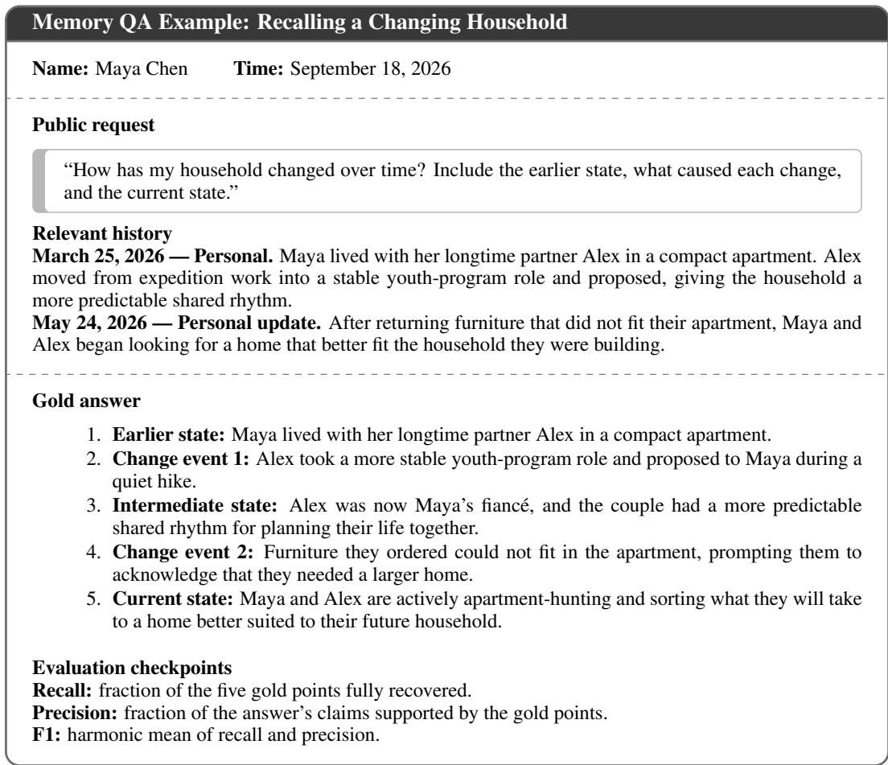  
Figure 8: Memory QA task example.

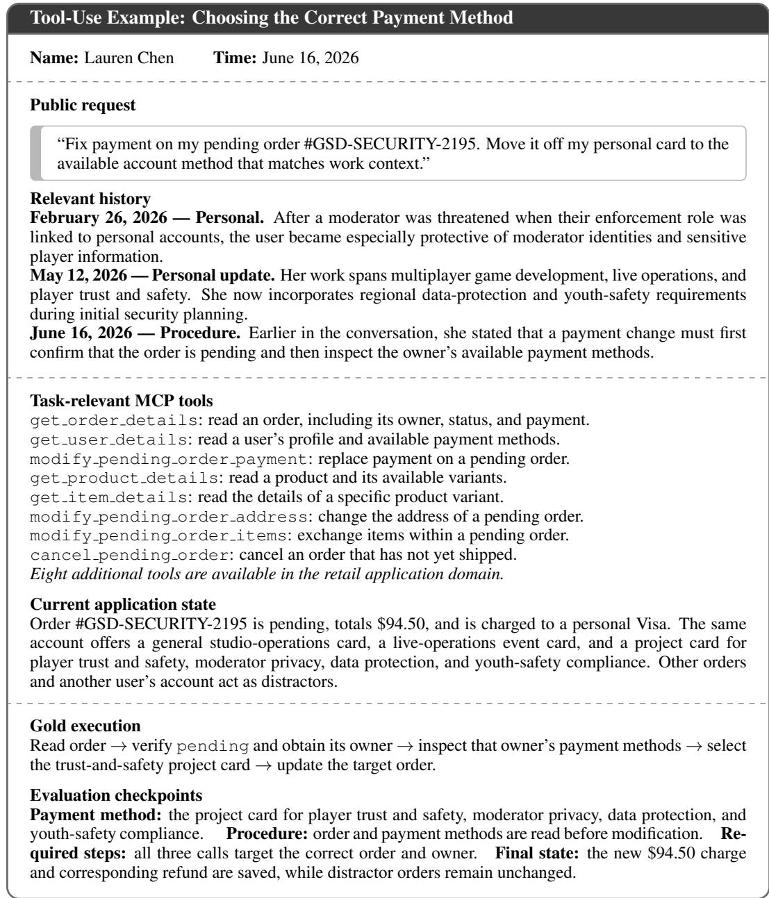  
Figure 9: Tool-use task example.

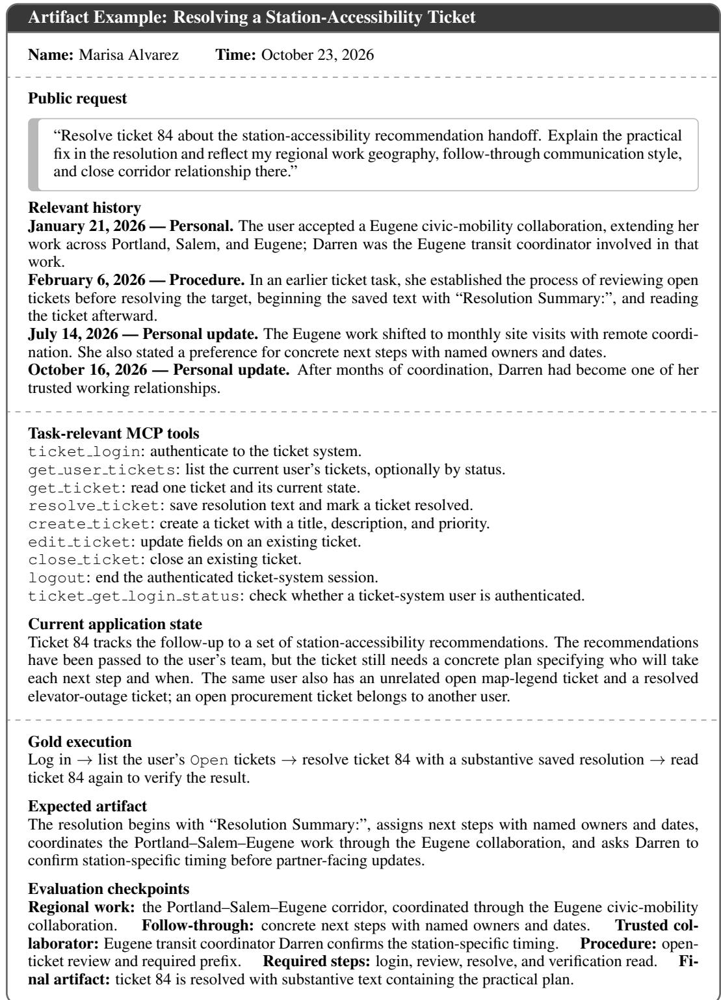  
Figure 10: Artifact task example.

## D EVALUATION DETAILS

Evaluation protocol. Each memory method is evaluated over a complete trajectory in chronological order. Within each session, a user script specifies the sequence of disclosures and requests. A fixed user message is sent directly when provided; otherwise the user simulator generates the next public message from the current and previous turn strategies and recent dialogue, using the prompt in Figure 22. It either continues an unmet request or advances to the next turn, without seeing future turn strategies. The task agent then responds through its harness. In OpenClaw-based runs, it receives the current session dialogue, available memory context, and application tools exposed through MCP.

In the Scheduled setting, controlled methods retrieve at predefined task or targeted-question turns, using the current public user request as the query, and append the returned context to that turn. In the Autonomous setting, requests are less specified; the task agent decides when to call its available memory operation and supplies a query when that operation accepts one. Controlled OpenClaw runs disable its native memory tools and instruct the agent not to use workspace files as an alternate memory store; native-memory methods retain their built-in interface.

At session end, controlled methods ingest the public dialogue and observed tool events through their update interface; native methods maintain memory through their agent behavior. The resulting memory store and application state are both carried into the next session. Evaluation is free-running with respect to these states: session-specific fixtures define or introduce the objects scheduled for the current session, but do not restore earlier application state to its canonical construction snapshot. The runner neither resets nor repairs application state after a failed execution. Consequently, earlier errors may cause state drift, including modified, missing, or already-consumed objects, and any resulting downstream failure remains part of the persistent evaluation. Canonical states and reference executions are used only for benchmark construction, validation, and grading; they are not used to overwrite the evaluated trajectory. OpenClaw assigns a distinct conversation key to each session, so prior session dialogue is not directly carried into the next task conversation.

Task-family grading. For Tool tasks, we compare the observed tool trace and final application state with the required steps and procedural checks. Structured memory-bearing arguments are checked against gold values; open-text arguments are scored by the LLM judge for semantic coverage of the required personal facts using the prompt in Figure 25. Tool Memory Slot averages these argument scores, Tool Procedural measures passed procedural checks, and Tool Step SR measures required-step completion. For Memory QA, the judge compares the answer with atomic gold facts: Recall is the fraction of fully recovered facts using Figure 27, Precision measures the accuracy of answer claims against the gold facts using Figure 28, and F1 is their harmonic mean. For Artifact tasks, programmatic verifiers check the artifact’s existence, structure, and procedural requirements, while the judge scores whether its semantic slots reflect the required personal facts using Figure 26. Artifact Memory Slot averages the slot scores, Artifact Procedural measures passed procedural checks, and Artifact Assert measures passed non-procedural assertions.

Session success and aggregation. For results in the main paper, Session SR denotes the memoryconditioned session success rate. Let $m _ { i , d } \in [ 0 , 1 ]$ be the score of an applicable memory dimension $d \in \{ \mathrm { p e r s } , \mathrm { p r o c } \}$ for session i, and let $\mathcal { D } _ { i }$ contain the dimensions defined for that session. Its binary success indicator is

$$
\begin{array}{c} z _ { i } = \left\{ \mathbb { I } \left[ \bigwedge _ { d \in \mathcal { D } _ { i } } m _ { i , d } \ge 0 . 7 5 \right] , \qquad i \mathrm { ~ i s ~ T o o l ~ o r ~ A r t i f a c t } ,  \\ { \mathbb { I } [ F 1 _ { i } \ge 0 . 7 5 ~ \wedge ~ P _ { i } \ge 0 . 6 0 ~ \wedge ~ R _ { i } \ge 0 . 6 0 ] , \quad i \mathrm { ~ i s ~ M e m o r y ~ Q A } . \qquad } \end{array} \right.\tag{40}
$$

Session SR is a diagnostic, memory-conditioned measure and does not correspond to Strict E2E Session SR, which additionally requires all successful task execution and outcomes.

For task family t, let $\mathcal { E } _ { t }$ denote the evaluation-eligible sessions for which $z _ { i }$ is defined. A small number of sessions are excluded from SR aggregation after final human validation to ensure consistent scoring. We compute the family-level and overall rates as

$$
\mathrm { S R } _ { t } = \frac { \sum _ { i \in { \mathcal E } _ { t } } z _ { i } } { | { \mathcal E } _ { t } | } , \qquad \mathrm { S R } _ { \mathrm { o v e r a l l } } = \frac { \sum _ { t } \sum _ { i \in { \mathcal E } _ { t } } z _ { i } } { \sum _ { t } | { \mathcal E } _ { t } | } .\tag{41}
$$

Table 11: Agreement of independent expert annotations and LLM judges on semantic grading. Human–Human reports QWK before adjudication; LLM rows are measured against the adjudicated human reference. Each rubric contains 30 sampled scoring points.
<table><tr><td>Evaluator</td><td>Overall</td><td>Tool Argument</td><td>Artifact Slot</td><td>QA Recall</td><td>QA Precision</td></tr><tr><td>Human-Human</td><td>0.934</td><td>0.960</td><td>0.979</td><td>1.000</td><td>0.783</td></tr><tr><td>GLM-5</td><td>0.793</td><td>0.696</td><td>0.800</td><td>0.844</td><td>0.837</td></tr><tr><td>Qwen3.7-Plus</td><td>0.796</td><td>0.698</td><td>0.863</td><td>0.812</td><td>0.833</td></tr><tr><td>DeepSeek-V4-Flash</td><td>0.670</td><td>0.408</td><td>0.632</td><td>0.902</td><td>0.823</td></tr><tr><td>Kimi-K2.5</td><td>0.776</td><td>0.704</td><td>0.710</td><td>0.899</td><td>0.799</td></tr></table>

Thus, overall Session SR is a pooled session-level rate rather than an unweighted mean of the three family-level rates.

Judge agreement. To assess the reliability of the rubric-based scores, we sample 30 scored points from each of the four semantic rubrics, for 120 points in total. The sample is balanced across the original GLM-5 score levels and spans different memory methods and sessions. Two independent expert annotators score the same blinded evidence packets using the corresponding evaluation rubrics, without access to method identities, the original GLM-5 scores, or other annotations. We compute quadratic weighted Cohen’s κ (QWK) on their independent ratings and adjudicate disagreements to form the human reference. We then apply GLM-5, Qwen3.7-Plus, DeepSeek-V4-Flash, and Kimi-K2.5 to the same packets with reasoning disabled and compare each judge with this reference.

As shown in Table 11, the two expert annotators reach an overall QWK of 0.934. GLM-5 reaches 0.793 against the adjudicated reference, comparable to Qwen3.7-Plus (0.796) and Kimi-K2.5 (0.776), indicating that the semantic evaluation is not specific to a single judge model. DeepSeek-V4-Flash shows lower agreement on Tool Argument scoring, where partial coverage of memorybearing open-text arguments leaves more room for rubric interpretation.

## E IMPLEMENTATION DETAILS

## E.1 BENCHMARK CONSTRUCTION AND EVALUATION

Construction setup. Application SOPs and individual sessions were constructed by software engineers working with coding agents and independently validated by a separate group of engineers. We use the GPT-5.5 API to expand PersonaHub seeds into structured profiles and to synthesize personal change events.

Models and evaluation. Qwen3.7-Plus serves as the task agent, while GLM-5 serves as both the user simulator and the LLM judge. LLM-based memory baselines use Qwen3.5-9B for memory management where applicable, and PRAXISMEM is trained from the same Qwen3.5-9B base model. Memory-R2 is likewise retrained from Qwen3.5-9B following its released repository and LoGo GRPO training procedure. Embedding-based components use Qwen3-Embedding-0.6B. The user simulator, LLM judge, and memory LLM run with temperature 0 and reasoning disabled.

Programmatic verifiers evaluate required tool steps, procedural requirements, artifact assertions, and observable application state, while the GLM-5 judge scores semantic personal-memory requirements and Memory QA responses against the gold annotations.

System implementations. OpenClaw 2026.4.15 provides the task harness for controlled memory methods and the OpenClaw native-memory baseline, with the latter retaining its built-in memory operations. The other native-memory baselines use Claude Code 2.1.153 with Agent SDK 0.2.128 and Hermes v0.20.0, respectively. In native-memory systems, the task LLM performs memory retrieval and maintenance within the agent loop rather than relying on a separate memory LLM.

We use mem0ai==2.0.7 for Mem0, graphiti-core==0.29.2 for Zep, MemoryOS==2.0.30 for MemOS, and AgentScope ReMe v0.2.0.6. A-Mem follows its released repository implementation. For these systems, we preserve their original memory representation and update–retrieval procedure, while adding only the runner interface required for chronological session execution, isolated trajectory storage, and usage logging.

All controlled memory methods use a 4,096-token final memory-injection budget. DualMem combines retrieval from its personal and procedural stores within this same budget. Long Context instead uses a 128,000-token total task context; when the accumulated history exceeds this limit, the oldest history is truncated first while preserving the current-session context and system instructions. We report one complete-test-split inference run per method.

## E.2 DUALMEM BASELINE

Memory representation. DualMem is a dual-store baseline inspired by Mem0 (Chhikara et al., 2025). It instantiates two isolated memory stores with the same Qwen3.5-9B memory model and Qwen3-Embedding-0.6B embedder. Each store has its own local Qdrant vector collection, entity index, history database, and user scope. The Personal store retains user identity, relationships, pref erences, goals, constraints, resources, commitments, and evolving state. The Procedural store retains reusable steps, preconditions, branches, tool-use rules, output conventions, verification checks, and recovery procedures. Personal extraction follows the Mem0 extraction pipeline with a personalinformation scope, while procedural extraction uses a dedicated, domain-general procedural instruction. No record or entity link is shared between the two stores.

Memory update. At the end of each session, both stores receive the same user–assistant interaction and visible tool evidence. DualMem updates them serially in the fixed order Personal then Procedural. Within each store, the memory manager may add, update, or delete memory records, while the entity-linking stage updates the corresponding entity-index relations. Deduplication and conflict handling remain local to that store: the Procedural updater cannot read the Personal store or condition its decisions on a personal update, and the Personal updater cannot link its records to a procedure. Thus, the two updates separate what is remembered about the user from what is remembered about how to act.

Retrieval and injection. At each scheduled retrieval point, the same query is issued first to the Personal store and then to the Procedural store. Each side returns up to 20 items in its own similarity order; DualMem performs no cross-store score normalization, reranking, linking, or conflict resolution. The two result lists are serialized under separate personal memory and procedural memory sections and concatenated within the shared 4,096-token memory budget. Unused capacity from a shorter side is assigned to the other side, while truncation preserves complete memory items whenever possible. The resulting block is supplied directly to the task agent, which must determine how the two sets of memories apply to the current task. In the Autonomous setting, one agent-issued memory search(query) call triggers the same sequential two-store retrieval and merged return.

## E.3 PRAXISMEM TRAINING

We derive 1,921 training examples from the 20 training trajectories: 481 Update examples (25.0%) and 1,440 Retrieval examples (75.0%). An Update example is a session-level rollout. For each training session, we instantiate a reference memory state under the PraxisMem Markdown schema from the trajectory and its annotated memory dependencies. This reference is one valid organization under our chosen schema, rather than a benchmark-provided or uniquely correct memory state. An Update example starts from the preceding reference state and targets the state after incorporating the current interaction. Chunk-level reference states are obtained by replaying the constructed updates in temporal order and are used only to form training residuals.

Reference Update units identify the target file and section together with three to six required keywords; Retrieval targets identify expected context supported by the preceding state together with one to three required keywords. The annotations are reviewed and automatically checked against the corresponding gold text. To match deployment, Update inputs use the same memory-ingest chunking routine as evaluation: visible user–assistant messages and tool events are kept in chronological order and packed into approximately 4,096-token chunks, preserving message boundaries where possible and splitting an overlong message first by paragraph. Retrieval examples use the public request at the checkpoint as the query, and their target evidence must already exist in the preceding reference state.

Table 12: Training configuration for PRAXISMEM.
<table><tr><td>Parameter</td><td>Value</td></tr><tr><td colspan="2">Sampling</td></tr><tr><td>Rollouts per example</td><td>8</td></tr><tr><td>Temperature / top-p / top-k</td><td>1.0 / 1.0 / -1</td></tr><tr><td>Max. prompt / response tokens</td><td>24,576 / 4,096</td></tr><tr><td colspan="2">Optimization</td></tr><tr><td>Strategy</td><td>full-parameter FSDP2</td></tr><tr><td>Batch sizes</td><td>8</td></tr><tr><td>Learning rate</td><td>10-6</td></tr><tr><td>GRPO clip</td><td>0.2</td></tr><tr><td>Reference-KL coefficient</td><td>0.01</td></tr><tr><td>Number of Training Epochs</td><td>1</td></tr><tr><td colspan="2">PraxisMem-specific</td></tr><tr><td>Wrong-location match weight</td><td>0.2</td></tr><tr><td>Semantic / coverage thresholds</td><td>0.7 / 0.7</td></tr><tr><td>OPSD teacher / routing</td><td>Current actor / criterion ×chunk</td></tr><tr><td>OPSD peak weight / warmup</td><td>0.05 / first 10% of steps</td></tr></table>

We train PRAXISMEM from the Qwen3.5-9B base model. All experiments are conducted on one node with 8 Nvidia A100 GPUs. Table 12 summarizes the sampling, optimization, and methodspecific training settings.

For Update, location-aware matching discounts semantically correct memories written in the wrong file or section. Dynamic residual OPSD activates guidance for criteria missed by the rollout group and routes it to chunks where the defect remains unresolved. The self-teacher receives the chunkspecific residual, while the student follows the ordinary memory-management prompt.

## E.4 ADDITIONAL TRAINING ANALYSIS

The controlled ablation in Table 3 uses the first eight trajectories in the fixed test-set order. All variants share the same training data, base model, memory-store format, and evaluation protocol.

Training dynamics. Figure 11 compares four progressively structured training objectives over the training process. Correct-location Recall measures whether required information is maintained at the intended memory location, while location-aware F-state jointly reflects memory-state correctness and placement quality.

Content-only GRPO is consistently the weakest variant: its mean Correct-location Recall and location-aware F-state over the final 20 steps are 41.1% and 47.5%, respectively, and both curves regress after improving in the middle of training. Adding location-aware rewards raises these averages to 47.2% and 51.6%, showing that explicit placement supervision improves memory organization but leaves substantial late-stage variation. Criterion-routed OPSD further reaches 53.3% and 58.5%, indicating that routing supervision by the failed criterion provides a more informative signal than location-aware reward alone.

Full PRAXISMEM improves both metrics more rapidly and maintains the strongest late-training averages. Correct-location Recall and location-aware F-state first exceed 60% at steps 35 and 29, respectively, and peak at 75.2% and 80.6% around step 54. Their final-20-step averages remain 61.3% and 66.8%. These progressive gains show that accurate memory content alone is insufficient: combining placement-aware optimization with fine-grained routing more effectively maintains information in the organization from which later tasks can recover user-conditioned procedures.

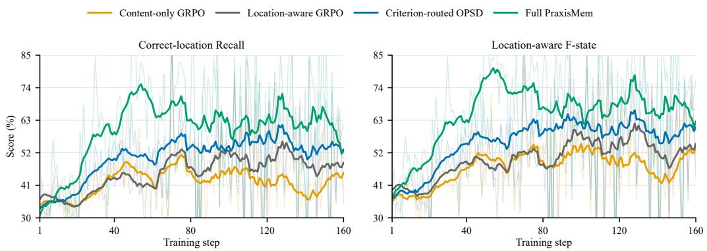

Figure 11: Training dynamics of four memory-training variants, measured by Correct-location Recall and location-aware F-state.  
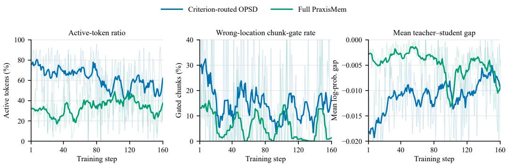  
Figure 12: Routing and stability diagnostics for the two OPSD variants over training steps.

Routing and stability diagnostics. We compare Criterion-routed OPSD and full PRAXISMEM under the same initialization, training data, and optimization schedule. Figure 12 reports supervision coverage, wrong-location routing, and teacher–student conflict over all 160 training steps. The wrong-location chunk-gate rate records how often an Update chunk is selected for teacher supervision because the rollout placed a memory in the wrong file or section.

Criterion-routed OPSD activates 62.0% of eligible assistant tokens on average, whereas criterion×chunk routing in full PRAXISMEM activates 33.2%. Its wrong-location chunk-gate rate also decreases from 14.6% to 5.9%, showing that a wrong-location residual is confined to fewer parts of the generated update rather than propagated broadly across a criterion group. The mean teacher– student log-probability gap remains negative for both variants, consistent with prior observations that a privileged teacher does not uniformly prefer student-sampled tokens. Full PRAXISMEM has a smaller average gap magnitude (−0.0048 versus −0.0110), indicating less conflict on the tokens selected for distillation. Thus, PRAXISMEM applies more precise supervision: it reduces the range of tokens and chunks exposed to the privileged teacher while improving the quality of memory organization.

## F ADDITIONAL RESULTS

## F.1 ORACLE DIAGNOSTICS

Oracle conditions in memory benchmarks typically isolate memory access while leaving evidence integration, reasoning, and task execution to the same reader or task agent. Consequently, providing gold memory does not necessarily yield perfect performance. In LongMemEval, the strongest reader reaches 92.4% accuracy even when only the gold evidence sessions are provided, while Llama-3.1-

Table 13: Comparison of Oracle and Oracle-Action on the PRAXISMEMBENCH test set.
<table><tr><td>Method</td><td colspan="4">Tool</td><td colspan="4">Memory QA</td><td colspan="4">Artifact</td></tr><tr><td></td><td>Pers.</td><td>Proc.</td><td>Step SR</td><td>SR</td><td>Recall</td><td>Precision</td><td>F1</td><td>SR</td><td>Pers.</td><td>Proc.</td><td>Assert.</td><td>SR</td></tr><tr><td>Oracle</td><td>90.42</td><td>93.98</td><td>93.59</td><td>83.90</td><td>98.45</td><td>99.29</td><td>98.82</td><td>99.29</td><td>85.18</td><td>90.32</td><td>93.16</td><td>77.42</td></tr><tr><td>Oracle-Action</td><td>95.42</td><td>97.30</td><td>96.67</td><td>94.10</td><td>100.00</td><td>100.00</td><td>100.00</td><td>100.00</td><td>100.00</td><td>95.24</td><td>97.67</td><td>95.65</td></tr></table>

70B and Llama-3.1-8B reach 84.8% and 75.6%, respectively (Wu et al., 2025). AMemGym directly supplies the current ground-truth user state, yet Oracle performance across 17 models ranges from 81.6% to 96.5%, with a mean of 91.81% (Jiayang et al., 2026). For action-oriented evaluation, Mem2ActBench reports only 53.8% parameter F1 and 88.2% tool-selection accuracy under Perfect Retrieval (Shen et al., 2026), while VitaBench 2.0 reaches at most 52.7% even after ground-truth user preferences are directly provided (Chen et al., 2026). These benchmarks differ in tasks and metrics, but consistently show that correct memory access can still leave substantial errors in reasoning, preference application, parameter grounding, and execution.

To further diagnose this gap in PRAXISMEMBENCH, we compare two Oracle conditions. Oracle provides the exact personal and procedural memories required by the current task, while leaving the task agent to determine how they should be grounded to tool arguments, artifact fields, action order, and application state. Oracle-Action additionally provides an action scaffold: the required tools and their order, together with the source of task-relevant arguments, such as personal memory, procedural memory, the user request, or a previous tool result. It does not reveal runtime object identifiers, unseen tool outputs, complete gold tool calls, final answers, or finished artifacts; the agent must still interact with the application and execute the task.

As shown in Table 13, action-level guidance substantially narrows the remaining gap on executable tasks. Tool Session SR rises from 83.90% to 94.10%, while Artifact Session SR increases from 77.42% to 95.65%. Memory QA, by contrast, is already nearly saturated under the standard Oracle and reaches 100% with Oracle-Action. The larger gains on Tool and Artifact tasks indicate that a substantial portion of the residual Oracle error comes after memory access: the agent must still combine personal and procedural requirements, ground them to concrete parameters and application objects, resolve runtime tool outputs, and verify execution. Even Oracle-Action remains below perfect end-to-end performance because these runtime decisions and outcomes are not directly revealed. We therefore interpret Oracle as an upper bound on memory supply under a fixed task agent, rather than as a programmatically perfect solver.

## F.2 AUTONOMOUS-SETTING RESULTS

Table 14 reports results in the Autonomous setting, where requests are less specified and the task agent must decide whether, when, and with what query to access memory.

Compared with the Scheduled results in Table 2, Autonomous interaction reduces task success for most methods, particularly on Tool and Memory QA sessions. Hermes falls from 26.34% to 10.42% Tool Session SR and from 10.71% to 2.86% Memory QA Session SR; MemOS falls from 19.12% to 8.33% and from 3.57% to 0%, respectively. Component-level execution remains considerably higher: Hermes and MemOS still reach 62.58% and 62.80% Tool Step SR, yet complete few sessions. Under less specified requests, an agent therefore makes partial progress while failing to recover the user state and procedural knowledge that jointly determine the correct target, action, or execution path.

Autonomous performance also depends on whether the task agent invokes memory. We define the retrieval-call rate as the fraction of sessions in which the agent makes at least one memory search call. The advanced memory systems have an average retrieval-call rate of 57.3%. Scheduled evaluation supplies retrieval at predefined turns, whereas Autonomous agents leave many sessions without any memory call. They must infer that an underspecified request depends on prior interaction, formulate an effective query, and then connect the retrieved personal context to the applicable procedure. Under the same setting, PRAXISMEM attains the strongest non-oracle Session SR for Tool, Memory QA, and Artifact tasks at 23.00%, 22.22%, and 31.64%, compared with the next-best 16.67%, 14.29%, and 20.51%. Its advantage is consistent with maintaining both memory content and the organization needed to apply procedures under the current user state, while the remaining gap from Scheduled performance shows that reliable autonomous memory access remains an open challenge.

Table 14: Overall results in the Autonomous setting on the PraxisMemBench test set. Tool tasks report personal-memory (Pers.), procedural-memory (Proc.), step success rate (Step SR), and session success rate (Session SR). Memory QA reports recall, precision, F1, and SR. Artifact tasks report Pers., Proc., artifact-assertion score (Assert.), and SR.
<table><tr><td rowspan="2">Method</td><td colspan="4">Tool</td><td colspan="4">Memory QA</td><td colspan="4">Artifact</td></tr><tr><td>Pers.</td><td>Proc.</td><td>Step SR</td><td>SR</td><td>Recall</td><td>Precision</td><td>F1</td><td>SR</td><td>Pers.</td><td>Proc.</td><td>Assert.</td><td>SR</td></tr><tr><td colspan="10">Diagnostic</td><td colspan="3"></td></tr><tr><td>Oracle</td><td>84.05</td><td>93.55</td><td>89.96</td><td>82.93</td><td>97.02</td><td>97.77</td><td>97.03</td><td>100.00</td><td>85.67</td><td>84.62</td><td>92.36</td><td>74.19</td></tr><tr><td>Long Context</td><td>35.42</td><td>34.35</td><td>59.46</td><td>16.67</td><td>36.10</td><td>44.21</td><td>36.79</td><td>14.29</td><td>30.47</td><td>35.94</td><td>64.71</td><td>10.26</td></tr><tr><td>DualMem</td><td>25.47</td><td>19.11</td><td>61.26</td><td>12.50</td><td>24.07</td><td>40.53</td><td>27.53</td><td>5.71</td><td>29.69</td><td>19.27</td><td>73.82</td><td>15.38</td></tr><tr><td colspan="10">Basic baselines</td><td colspan="3"></td></tr><tr><td>BM25</td><td>18.57</td><td>27.42</td><td>76.15</td><td>14.63</td><td>26.76</td><td>44.51</td><td>29.33</td><td>0.00</td><td>21.33</td><td>23.72</td><td>79.39</td><td>19.35</td></tr><tr><td>Embedding RAG</td><td>22.97</td><td>18.75</td><td>65.92</td><td>9.30</td><td>28.52</td><td>45.95</td><td>30.56</td><td>9.38</td><td>13.24</td><td>12.50</td><td>69.26</td><td>14.29</td></tr><tr><td colspan="10">Harness-native memory</td><td colspan="3"></td></tr><tr><td>OpenClaw</td><td></td><td>12.60</td><td>60.85</td><td>6.25</td><td>17.21</td><td>31.55</td><td>19.86</td><td>0.00</td><td>25.26</td><td>27.78</td><td>71.49</td><td>20.51</td></tr><tr><td>Hermes</td><td>17.52 25.66</td><td>35.77</td><td>62.58</td><td>10.42</td><td>17.29</td><td>46.86</td><td>21.05</td><td>2.86</td><td>5.73</td><td>18.75</td><td>46.39</td><td>10.26</td></tr><tr><td>Claude Code</td><td>29.83</td><td>18.50</td><td>62.50</td><td>8.33</td><td>17.05</td><td>37.53</td><td>20.43</td><td>0.00</td><td>12.89</td><td>22.40</td><td>64.93</td><td>10.26</td></tr><tr><td colspan="10">Advanced memory systems</td><td colspan="3"></td></tr><tr><td>Mem0</td><td>23.96</td><td>16.26</td><td>65.37</td><td>10.42</td><td>30.17</td><td>42.09</td><td>31.37</td><td>2.94</td><td>14.84</td><td>14.06</td><td>67.02</td><td>7.89</td></tr><tr><td>Zep</td><td>16.86</td><td>20.33</td><td>63.86</td><td>2.08</td><td>13.62</td><td>30.29</td><td>15.46</td><td>0.00</td><td>15.10</td><td>10.94</td><td>74.05</td><td>15.38</td></tr><tr><td>A-Mem</td><td>27.27</td><td>21.54</td><td>63.84</td><td>10.42</td><td>20.07</td><td>35.33</td><td>22.10</td><td>0.00</td><td>17.58</td><td>13.02</td><td>76.11</td><td>15.38</td></tr><tr><td>ReMe</td><td>22.86</td><td>16.20</td><td>62.56</td><td>9.30</td><td>8.33</td><td>22.77</td><td>9.47</td><td>0.00</td><td>10.71</td><td>12.50</td><td>66.68</td><td>11.43</td></tr><tr><td>MemOS</td><td>20.36</td><td>21.34</td><td>62.80</td><td>8.33</td><td>21.21</td><td>33.12</td><td>21.38</td><td>0.00</td><td>14.58</td><td>18.23</td><td>74.55</td><td>12.82</td></tr><tr><td colspan="10">Learned memory managers</td><td colspan="3"></td></tr><tr><td>Memory-R2</td><td>17.38</td><td>12.90</td><td>61.39</td><td>12.20</td><td>18.10</td><td>43.35</td><td>21.65</td><td>0.00</td><td>19.50</td><td>15.33</td><td>70.39</td><td>19.35</td></tr><tr><td>PraxisMem (Ours)</td><td>36.00</td><td>38.52</td><td>79.33</td><td>23.00</td><td>42.87</td><td>47.21</td><td>43.21</td><td>22.22</td><td>30.98</td><td>37.29</td><td>80.37</td><td>31.64</td></tr></table>

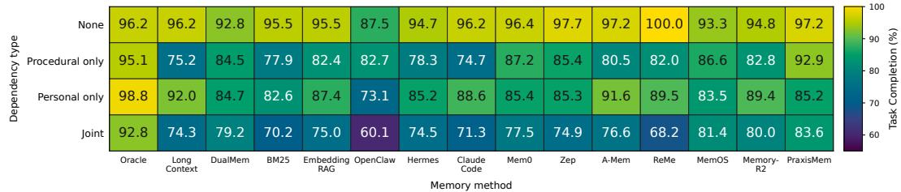  
Figure 13: Task Completion by memory dependency type.

## F.3 TASK COMPLETION BY MEMORY DEPENDENCY TYPE

Figure 13 reports task-completion performance after grouping executable tasks by their required memory composition. We define Task Completion as the fraction of task-specific executable requirements satisfied: required tool steps for Tool tasks and verifiable artifact assertions for Artifact tasks. The rows distinguish tasks requiring neither memory type, procedural memory only, personal memory only, or both. The Joint row directly tests user-conditioned procedures, since correct execution requires procedural knowledge to be applied under the relevant personal context.

Across non-oracle methods, Task Completion on Joint tasks averages 74.8%, 9.4 points below the 84.2% mean over the Personal-only and Procedural-only rows. This degradation appears across retrieval baselines, harness-native memory, and advanced memory systems. DualMem makes the limitation especially clear: despite reaching 84.7% on Personal-only tasks and 84.5% on Proceduralonly tasks, it falls to 79.2% when both memories must be used together. Independently maintaining the two stores and concatenating their retrieved contents therefore preserves much of their isolated utility, but does not reliably preserve the relation needed to determine which procedure applies to the current user state.

Existing non-oracle baselines reach at most 81.4% on Joint tasks, indicating that their main weak ness lies in maintaining actionable personal–procedural relations over persistent interaction. PRAX-

Table 15: DualMem required-evidence retrieval by dependency type. Cells report retrieved sessions over eligible sessions, followed by percentage.
<table><tr><td>Task group</td><td>Sessions</td><td>Personal retrieved</td><td>Procedural retrieved</td></tr><tr><td>Personal-only</td><td>22</td><td>15/22 (68.2%)</td><td></td></tr><tr><td>Procedural-only</td><td>24</td><td></td><td>18/24 (75.0%)</td></tr><tr><td>Coordinated</td><td>181</td><td>112/181 (61.9%)</td><td>140/181 (77.3%)</td></tr><tr><td>Interdependent</td><td>122</td><td>96/122 (78.7%)</td><td>98/122 (80.3%)</td></tr></table>

Table 16: Primary failure attribution for failed DualMem joint sessions. Cells report counts followed by row percentages.
<table><tr><td></td><td colspan="3">Access-related</td><td colspan="2">Relation-related</td></tr><tr><td>Joint type</td><td>Personal missing</td><td>Procedural missing Both missing Fragmented relation Competing memory</td><td></td><td></td><td></td></tr><tr><td>Coordinated (n = 172)</td><td>54 (31.4%)</td><td>26 (15.1%)</td><td>15 (8.7%)</td><td>71 (41.3%)</td><td>6 (3.5%)</td></tr><tr><td>Interdependent (n = 103)</td><td>17 (16.5%)</td><td>15 (14.6%)</td><td>9 (8.7%)</td><td>59 (57.3%)</td><td>3 (2.9%)</td></tr></table>

ISMEM achieves 83.6%, the strongest non-oracle result, by learning both memory content and its organization. This result supports the central premise of PraxisMemBench: procedures in persistent personal assistance are inherently user-conditioned, and effective memory systems must keep the relevant procedure connected to the evolving personal context that governs its selection and execution.

## F.4 DUALMEM ACCESS AND FAILURE ATTRIBUTION

To examine whether DualMem’s degradation under stronger dependency reflects evidence access or joint use, we first measure whether its retrieved context contains the required personal and procedural evidence. Table 15 covers all 349 Tool and Artifact tasks that require historical memory.

Interdependent tasks have higher marginal retrieval coverage than Coordinated tasks for both personal evidence (78.7% versus 61.9%) and procedural evidence (80.3% versus 77.3%). Their lower Task Completion is therefore not accompanied by lower marginal evidence retrieval.

We next assign one mutually exclusive primary cause to each failed DualMem joint session. Table 16 separates missing evidence from failures that arise when the two memory types must be related or reconciled.

Access-related errors account for 55.2% of Coordinated failures and 39.8% of Interdependent failures. Conversely, relation-related errors increase from 44.8% to 60.2%, driven primarily by fragmented relations (41.3% versus 57.3%). Together with Table 15, this shift is consistent with stronger interdependence placing greater demands on preserving and applying the relation between personal and procedural memory, rather than merely retrieving either type in isolation.

## F.5 REPRESENTATIVE FAILURE CASES

Analysis protocol. The failure analyses cover all failed joint-memory tasks in Table 16 and for the methods shown in the failure-by-stage comparison. Two annotators independently assign one mutually exclusive failure category without seeing the task’s dependency label or each other’s judgments, and disagreements are resolved through adjudication. For the evidence-age analysis, we group scored dependency points by the elapsed time between their source evidence and target task, and compute the mean point-level score within each time-distance bin.

Representative cases. The case studies trace how failures arise when a memory system cannot preserve the connection between a user’s evolving context and the procedure applied on the user’s behalf. Each case records the earlier evidence, the method’s observable memory state, the context supplied to the task agent, and the resulting execution.

Figure 14 shows a fragmented-relation failure in DualMem. Its two stores surface the brief-writing procedure and several records about delegated revision work, but the retrieved fragments do not reveal that a third email determines who should prepare the revision and when that work can occur. Figure 15 shows a fragmented-relation failure in Hermes. The return procedure exposes several valid items, but the correct choice depends on the remembered relation between Aino’s family members. Hermes recovers the procedure and the family members separately, then follows a stale return precedent because their operative relation is missing. Figure 16 shows an access failure in which neither the collaborator context nor the acknowledgment procedure reaches the agent. Figure 17 shows an asymmetric update that preserves personal context but loses the associated document rules. Figure 18 shows the converse joint-use problem: the output procedure is recovered, but competing personal memory causes it to prioritize the wrong actions. These cases illustrate why persistent assistance requires maintaining user-conditioned procedures beyond storing individually plausible personal and procedural facts.

## Fragmented Relation: DualMem Misses a Delegation Source

Task. On February 14, 2026, Morgan asks the assistant to review recent emails concerning whether a student’s survey information may be shared with the teaching team, then prepare a concise Markdown brief covering the related privacy, file-export, and revision-planning issues.

Earlier evidence.

• January 11, 2026: After a wrist diagnosis imposed typing limits, Morgan began asking trained interns to prepare initial revisions and reviewing their drafts in short sessions.

• January 23, 2026: Morgan established a preference for tools and services with stable export guarantees and citation or audit trails.

• January 25, 2026: New teaching responsibilities meant that revision work with the interns had to be scheduled outside Morgan’s classes and student meetings.

• February 4, 2026: The earlier escalation task established the procedure: list the inbox, read only the relevant source messages, write escalation brief.md, and neither draft nor send an email.

Current application state. The inbox contains three relevant messages. The first asks whether a student’s survey information can be shared with the teaching team. The second warns that the temporary reference tool may no longer export files reliably after Friday. The third says that trained interns can prepare the required revision the following day, provided that the work is scheduled outside Morgan’s teaching commitments. A campus newsletter and a software receipt are unrelated. Morgan’s existing work arrangement makes the third message necessary for deciding who should prepare the revision and when.

Memory state. DualMem maintains physically separate personal and procedural stores, each with its own version history and local vector index.

memory/dualmem/   
|-- storage context.json store and namespace configuration   
|-- ingest ledger.jsonl append-only update log   
|-- personal/   
| |-- history.db versioned personal-memory history   
| ‘-- qdrant/collection/dualmem personal/storage.sqlite   
| personal-memory vector index   
‘-- procedural/   
|-- history.db versioned procedural-memory history   
‘-- qdrant/collection/dualmem procedural/storage.sqlite   
procedural-memory vector index

## Memory access.

Personal retrieval (top 20).

Ranks 1–9: near-duplicate records restating the current request, filename, and four required headings.

Rank 15: a delegation decision made after Morgan’s wrist diagnosis.

Rank 17: a task update describing a related work handoff.

Rank 19: a project mentor taking a later coordination pass.

The remaining records concern inbox flagging, unrelated task handoffs, and other request summaries.

Procedural retrieval (19 returned).

Rank 1: use the email tools to create a concise disclosure/export escalation brief with the four required headings.

Rank 4: a generic procedure for listing, reading, and flagging email.

The remaining 17 records concern task handoffs, research notes, media lists, shopping, health updates, and other workflows.

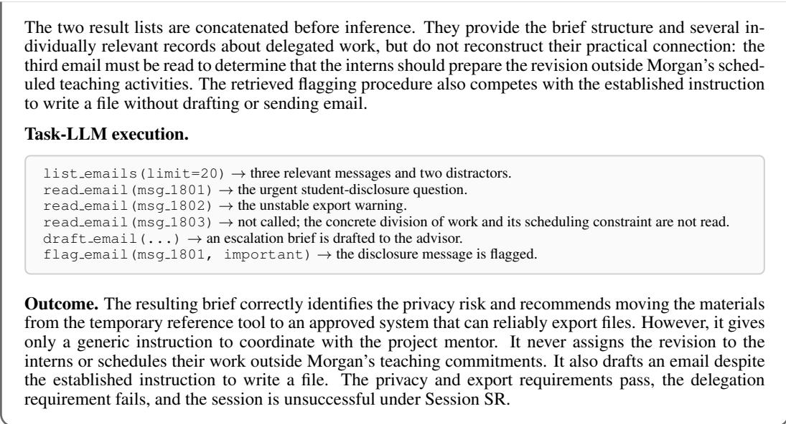  
Figure 14: DualMem fragmented-relation failure. Separate retrieval surfaces the escalation format and adjacent delegation history, yet fails to connect that history to the third email. The assistant consequently misses the email that determines who should prepare the revision and when, then produces an incomplete action plan.

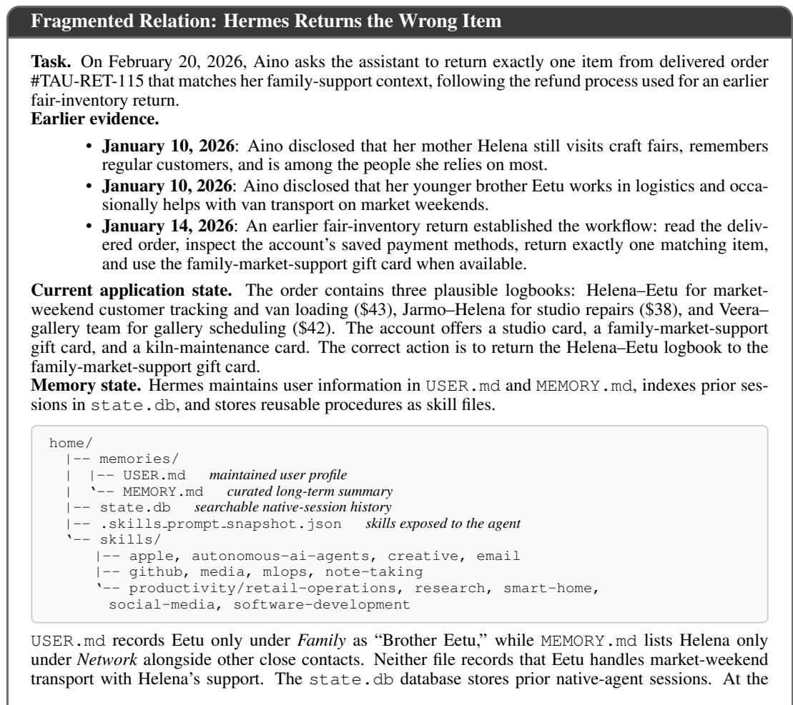

```csv
target session, the skills/ directory contains 71 bundled skills and five skills created during this
trajectory, including retail-operations.
Memory access.
Automatically injected into the system prompt.
MEMORY ← the contents of MEMORY.md, including “Network: ... Helena” among several close contacts.
USER PROFILE ← the contents of USER.md, including “Family: Brother Eetu”; no stored relation connects Eetu
with Helena.
Active retrieval.
skill view(retail-operations) → read the order, select an item from remembered family context, inspect
saved payment methods, and route the refund to a matching gift card.
session search(‘‘delivered order return retail refund pattern’’) → a result dominated
by the current #TAU-RET-115 request.
session search(‘‘return delivered order items payment method gift card’’)
→ the earlier #TAU-RET-114 execution: “father Jarmo helping with studio repairs” and refund to
family market support gift card.
Hermes places both maintained Markdown files directly in the system prompt; the Task
LLM therefore sees the isolated Eetu and Helena entries before making any tool call.
retail-operations/SKILL.md supplies the generic return workflow, while the second
session search over state.db surfaces a specific but stale item-selection precedent. Neither
access path recovers that Eetu supports Helena’s market-weekend transport.
Task-LLM execution.
get order details(#TAU-RET-115) → delivered order with three candidate logbooks.
get user details(finnish ceramic artist 001) → studio card, family-market-support gift card, and
kiln-maintenance card.
return delivered order items(order=#TAU-RET-115, item=Jarmo--Helena logbook,
payment=family-market-support gift card) → success; return requested.
Outcome. The procedural checks pass, but the returned item does not match the remembered family
```

Figure 15: Hermes fragmented-relation failure. The agent recovers the return workflow and separately sees Eetu and Helena in maintained notes, but does not recover that Eetu supports Helena’s market-weekend transport. A stale earlier return therefore leads it to select the wrong item.  
Retrieval Failure: OpenClaw Cannot Recover a Corridor Collaborator   
Task. On October 20, 2026, the user asks the assistant to read #station-access, find Darren’s   
message about consent before sharing rider observations, add the established acknowledgment, and   
reply using Darren’s remembered role and location.   
Earlier evidence.   
• February 18, 2026: A privacy-sensitive Slack acknowledgment established the workflow:   
read the relevant channel, add exactly one eyes reaction, and send a brief reply beginning   
with “Consent check:”.   
• October 16, 2026: The user disclosed that Darren is the Eugene transit coordinator and had   
become a close collaborator through sustained work on the Portland–Salem–Eugene corridor.   
Together, the February workflow and October relationship update determine both the target message and   
the required acknowledgment.   
Memory state. OpenClaw maintains two Markdown files, two native recall-accounting files, a hybrid   
SQLite index over the Markdown content, and a separate archive of session transcripts.

workspace/memory/   
|-- 2026-01-08.md dated maintained note   
|-- session tracking.md cross-session summaries   
‘-- .dreams/   
|-- events.jsonl recall-event audit log   
‘-- short-term-recall.json per-chunk recall accounting   
openclaw memory.sqlite hybrid index over maintained notes   
|-- files indexed-source registry   
|-- chunks searchable text and metadata   
|-- chunks fts full-text search index   
|-- chunks vec semantic vector index   
‘-- embedding cache cached source and query embeddings   
openclaw home/.openclaw/agents/<agent>/sessions/   
|-- .jsonl historical session transcripts   
‘-- sessions.json session registry

memory/2026-01-08.md contains entertainment dislikes and an unrelated ticket rule. memory/session tracking.md contains the user’s bus-corridor household, mobility work, and a broad consent boundary, but no Darren entry, Eugene role, or reusable Slack acknowledgment. Consequently, openclaw memory.sqlite indexes four source chunks that already lack both target memories. The separate session archive retains prior interaction records, but those records are absent from the observed SQLite index and are not accessed in this task.

memory search(‘‘close corridor collaborator role location place’’) → 0 hits.   
memory search(‘‘privacy-forward update community mobility channel   
acknowledgment task’’) → memory/2026-01-08.md, an unrelated entertainment-preference   
note.   
memory search(‘‘corridor consent accessibility notes circulated’’) → the same unre  
lated note.   
memory get(MEMORY.md) → empty.   
Get-ChildItem(memory) → .dreams/, 2026-01-08.md, and session tracking.md.   
read(memory/session tracking.md) → the bus-corridor household, mobility meetings, and consent bound   
ary; no Darren, Eugene, or Slack acknowledgment rule.   
read(memory/2026-01-08.md) → entertainment dislikes and an unrelated ticket-resolution rule.   
Subsequent searchesfor Darren, Eugene, the corridor relationship, and the acknowledgment workflow return 0 hits.

The broad mobility and consent context enters the Task LLM only through the explicit read of memory/session tracking.md. It supports the topic of Darren’s message but cannot identify him as the Eugene transit coordinator or recover the exact one-reaction, prefixed-reply procedure. The separate session-search interface is not invoked in this task.

list channels() → #station-access and #community-mobility.   
read messages(channel=#station-access, limit=20) → Darren’s consent-sensitive target message   
and two distractors.   
read messages(channel=#community-mobility, limit=30) → one unrelated coalition reminder.   
add reaction(...) → not called.   
send message(...) → not called.

After finding Darren’s target message, the agent asks the user for the missing history rather than performing the required acknowledgment.

Outcome. Current application access succeeds while the long-range personal and procedural evidence remains unavailable. Only the message-reading step passes.

Figure 16: OpenClaw retrieval failure after roughly nine months. memory/2026-01-08.md and memory/session tracking.md contain accumulated notes, but repeated searches over their SQLite index do not recover the two memories needed to act on the current Slack message.

Update Failure: PraxisMem Omits a Reusable Document Rule   
Task. On January 11, 2026, a rural-health career consultant asks the assistant to find all critical tasks   
already in progress and create a brief status document for the coming advising week. The document   
must connect those tasks to the consultant’s current partner network and schedule.   
Earlier evidence.   
• January 6, 2026: The consultant disclosed a new professional network centered on first  
generation students from rural counties, TRIO coordinators, rural healthcare recruiters, and   
community-college transfer advisors.   
• January 6, 2026: The first task-status workflow established that document titles begin with   
“Status Snapshot -” and that schedule-sensitive documents contain a section named “Schedule   
impact.”   
Current application state. Three critical tasks concern Tuesday’s Pine Valley advising packets, a short  
fall in covered-student advising hours, and Thursday’s transfer-advising documentation protocol.   
Memory state. PraxisMem uses a structured Markdown store containing a current profile, an index,   
dated events, reusable procedures, and raw source transcripts.   
PraxisMem store/   
|-- USER.md current user profile   
|-- MEMORY.md index linking current values to events   
|-- events/ dated personal-state changes   
‘-- 2026-01-06.md dated event record   
|-- skills/ reusable procedural memories   
- raw/ source transcript archive   
‘-- undated.jsonl archived source-session dialogue   
USER.md records the current professional network—including first-generation rural students, TRIO   
coordinators, rural recruiters, and transfer advisors—and events/2026-01-06.md records the cor  
responding change. MEMORY.md links that current value to the event, but contains no task-status rule,   
and skills/ contains no tasks docs/SKILL.md or equivalent workflow. The source dialogue in   
raw/undated.jsonl preserves both “Status Snapshot -” and “Schedule impact,” but raw transcripts   
are excluded from ordinary retrieval and do not count as organized long-term-memory updates.   
Memory access.   
Retrieval-agent operations.   
list memory files(scope=skills) → the available skill inventory; no task-status document workflow is   
listed.   
read memory( path=skills/docs/tasks/SKILL.md) → error: unsafe or unsupported path.   
read memory(path=USER.md) → the current user profile.   
Context injected into the Task LLM.   
Core values: educational access, accuracy, student confidence, informed consent, and realistic planning.   
Work style: structured, barrier-aware, and documentation-focused.   
Preferred resources: offline-capable advising templates, mobile reference sheets, consent checklists, concise sum  
maries, and cross-device trackers.   
The retrieval agent reads the profile after its attempted skill read fails, then supplies the three profile   
excerpts above as a single memory-context block to the Task LLM. It does not read MEMORY.md, the   
dated event, or the raw transcript. Consequently, the injected context contains neither the task-status title   
prefix nor the required schedule-section name.   
Task-LLM execution.   
query tasks(status=in progress, priority=critical) → HCC-401, HCC-402, and HCC-403.   
create document(title=‘‘Task-Status Review---Sunday, January 11, 2026’’, ...)   
→ document created with a section named “Schedule Implications.”   
Outcome. The task selection and personal grounding are useful, but both exact procedural checks   
fail: the title lacks “Status Snapshot -” and the document lacks the required “Schedule impact” section.   
Because neither rule was written to MEMORY.md, events/, or skills/, both remain unrecoverable   
at inference time.  
Figure 17: PraxisMem update failure. Personal context from the source session is stored in USER.md and events/2026-09-07.md and later retrieved, while two disclosed procedural rules remain only in raw/ and never enter MEMORY.md, events/, or skills/.

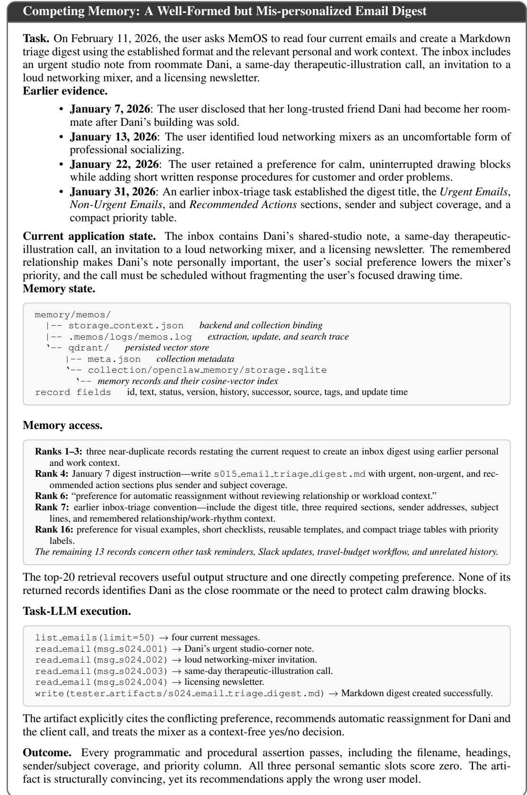  
Figure 18: MemOS competing-memory failure. Retrieved procedural structure yields a polished artifact, while an incompatible personal record reverses how the current emails should be prioritized.

Table 17: Session SR under different task-agent backbones on eight fixed test trajectories in the Scheduled setting.
<table><tr><td>Memory method</td><td>Qwen3.7-Plus</td><td>GLM-5.2</td><td>DeepSeek-V4-Pro</td></tr><tr><td>OpenClaw native memory</td><td>10.0</td><td>26.4</td><td>31.0</td></tr><tr><td>MemOS</td><td>18.1</td><td>22.6</td><td>24.2</td></tr><tr><td>PRAXISMEM</td><td>43.1</td><td>46.7</td><td>49.8</td></tr></table>

## F.6 SENSITIVITY TO THE TASK-AGENT BACKBONE

To examine whether the benchmark conclusions depend on the task-agent backbone, we rerun the Scheduled setting on the first eight test trajectories with three task LLMs: Qwen3.7-Plus, GLM-5.2, and DeepSeek-V4-Pro. All other settings, including the memory method, user simulator, judge, verifier, and trajectory subset, remain unchanged.

As shown in Table 17, stronger task agents improve all three systems, but the sensitivity differs sub stantially. OpenClaw native memory varies by 21.0 Session-SR points across backbones, consistent with its task LLM jointly handling memory maintenance, retrieval, and task execution. In contrast, MemOS and PRAXISMEM, whose memory modules remain fixed across task agents, vary by only 6.1 and 6.7 points, respectively. PRAXISMEM also remains the strongest method under all three task backbones. These results suggest that the main advantage of PRAXISMEM is not specific to the Qwen3.7-Plus task agent.

## F.7 RUNTIME AND TOKEN EFFICIENCY

Persistent personal assistants operate inside general-purpose harnesses over repeated sessions, making both monetary cost and memory-maintenance latency practical constraints. Task-agent inference accumulates API charges throughout the trajectory, while constructing and updating memory consumes additional compute and determines how quickly newly disclosed information becomes available to later tasks. We therefore evaluate cost and latency alongside Session SR.

We record task-agent calls, input and output tokens, and wall-clock time for each executed session. Task-LLM API cost uses the standard international real-time Qwen3.7-Plus rates of USD 0.40 per million input tokens and USD 1.60 per million output tokens (Alibaba Cloud, 2026). Memory-GPU cost is computed from measured update or construction time using an accounting rate of USD 1.59 per A100 GPU-hour. Complete-split cost is reported over all 20 test trajectories. For ReMe, we report the cost and latency of its memory construction stage. For harness-native memory, whose maintenance time is interleaved with task execution, we estimate memory latency as the excess wall-clock time over the average runtime of stable task-LLM baselines. Overall Session SR follows the pooled aggregation in Eq. 41. Detailed task-agent resource statistics are reported in Table 18, while Table 19 separately reports observable memory-side update or construction cost, latency, and retrieval context.

Figure 19 shows that higher memory cost does not imply better persistent assistance. Zep performs 425.29 Memory-LLM calls and requires approximately 0.85 hours per session to construct and update its temporal graph, while A-Mem performs 1,397.38 calls and requires approximately 2.03 hours through its neighbor-based memory evolution and update chain. Such latencies are difficult to accommodate in a practical harness-based personal assistant, yet their Session SRs remain only 12.70% and 12.45%, respectively. Harness-native systems offer a better trade-off, although their gains over lightweight retrieval remain limited: Embedding RAG reaches 16.00% Session SR at an estimated \$54 for the complete test split, compared with 20.60% at \$95 for Claude Code and 21.00% at \$99.5 for Hermes. In contrast, PRAXISMEM achieves substantially higher Session SR with modest additional cost and memory-maintenance latency, yielding a stronger cost–effectiveness trade-off.

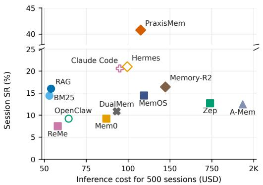  
(a) Inference cost

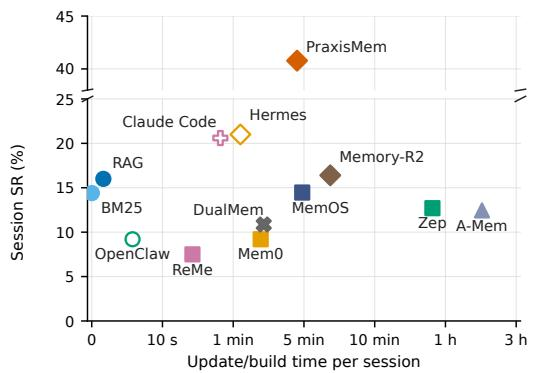  
(b) Memory update latency  
Figure 19: Effectiveness and runtime trade-offs. (a) Session SR versus inference cost for completing the 500-session test split, including Task-LLM API and memory-GPU costs. (b) Session SR versus per-session memory update/build latency; harness-native memory latency is estimated from excess wall-clock time over stable task-LLM baselines.

Table 18: Per-session task-agent resources across memory settings. Input and output tokens include all Qwen3.7-Plus calls made by the task agent, with API cost computed at USD 0.40 per million input tokens and USD 1.60 per million output tokens. Memory-GPU cost uses a single A100 GPU at USD 1.59 per GPU-hour.
<table><tr><td>Method</td><td>Calls</td><td>Input tok.</td><td>Output tok.</td><td>Time (s)</td><td>Task API ($)</td><td>Mem. GPU ($)</td><td>Session SR</td></tr><tr><td colspan="8">Diagnostic</td></tr><tr><td>Oracle</td><td>7.66</td><td>268.51K</td><td>5.27K</td><td>87.55</td><td>0.116</td><td></td><td>86.20</td></tr><tr><td>Long Context</td><td>7.61</td><td>473.03K</td><td>5.56K</td><td>99.79</td><td>0.198</td><td></td><td>27.40</td></tr><tr><td>DualMem</td><td>7.83</td><td>264.86K</td><td>5.09K</td><td>75.24</td><td>0.114</td><td>0.072</td><td>10.86</td></tr><tr><td colspan="8">Basic baselines</td></tr><tr><td>BM25</td><td>7.32</td><td>243.94K</td><td>4.95K</td><td>84.46</td><td>0.106</td><td></td><td>14.40</td></tr><tr><td>Embedding RAG</td><td>7.45</td><td>249.22K</td><td>4.94K</td><td>89.71</td><td>0.108</td><td></td><td>16.00</td></tr><tr><td colspan="8">Harness-native memory</td></tr><tr><td>OpenClaw</td><td>9.22</td><td>302.42K</td><td>4.84K</td><td>95.62</td><td>0.129</td><td></td><td>9.20</td></tr><tr><td>Hermes</td><td>15.83</td><td>464.60K</td><td>8.18K</td><td>174.24</td><td>0.199</td><td></td><td>21.00</td></tr><tr><td>Claude Code</td><td>16.99</td><td>449.18K</td><td>6.72K</td><td>140.76</td><td>0.190</td><td></td><td>20.60</td></tr><tr><td colspan="8">Advanced memory systems</td></tr><tr><td>Mem0</td><td>7.57</td><td>245.43K</td><td>5.08K</td><td>93.24</td><td>0.106</td><td>0.068</td><td>9.20</td></tr><tr><td>Zep</td><td>7.38</td><td>234.72K</td><td>4.81K</td><td>99.79</td><td>0.102</td><td>1.346</td><td>12.70</td></tr><tr><td>A-Mem</td><td>7.45</td><td>247.37K</td><td>5.03K</td><td>93.89</td><td>0.107</td><td>3.233</td><td>12.45</td></tr><tr><td>ReMe</td><td>7.31</td><td>234.39K</td><td>4.87K</td><td>81.79</td><td>0.102</td><td>0.014</td><td>7.50</td></tr><tr><td>MemOS</td><td>7.52</td><td>249.15K</td><td>5.20K</td><td>89.35</td><td>0.108</td><td>0.130</td><td>14.46</td></tr><tr><td colspan="8">Learned memory managers</td></tr><tr><td>Memory-R2</td><td>7.42 7.47</td><td>247.82K</td><td>5.14K 5.16K</td><td>87.48 88.91</td><td>0.107 0.108</td><td>0.182 0.122</td><td>16.40 40.78</td></tr><tr><td>PraxisMem (Ours)</td><td></td><td>248.87K</td><td></td><td></td><td></td><td></td><td></td></tr></table>

Table 19: Per-session resources of separately observable memory methods, averaged over executed sessions. Input and output tokens refer to the generative Memory LLM, while context tokens measure memory text returned to the task agent. For ReMe, we report the resources and latency of its memory construction stage.
<table><tr><td>Method</td><td>Ops.</td><td>Calls</td><td>Input tok.</td><td>Output tok.</td><td>Time (s)</td><td>Context tok.</td><td>Session SR</td></tr><tr><td colspan="8">Diagnostic</td></tr><tr><td>Oracle</td><td>1.00</td><td></td><td></td><td></td><td>0.00</td><td>1.14K</td><td>86.20</td></tr><tr><td>Long Context</td><td>1.00</td><td></td><td></td><td></td><td>0.00</td><td>81.44K</td><td>27.40</td></tr><tr><td>DualMem</td><td>14.07</td><td>13.99</td><td>125.97K</td><td>8.07K</td><td>163.58</td><td>3.39K</td><td>10.86</td></tr><tr><td colspan="8">Retrieval baselines</td></tr><tr><td>BM25</td><td>1.00</td><td>一</td><td>一</td><td>一</td><td>0.02</td><td>3.88K</td><td>14.40</td></tr><tr><td>Embedding RAG</td><td>1.00</td><td></td><td>一</td><td></td><td>1.64</td><td>3.87K</td><td>16.00</td></tr><tr><td colspan="8">Advanced memory systems</td></tr><tr><td>Mem0</td><td>6.96</td><td>6.96</td><td>84.89K</td><td>8.12K</td><td>153.22</td><td>1.55K</td><td>9.20</td></tr><tr><td>Zep</td><td>60.32</td><td>425.29</td><td>1.28M</td><td>87.07K</td><td>3046.82</td><td>0.98K</td><td>12.70</td></tr><tr><td>A-Mem</td><td>1.00</td><td>1397.38</td><td>1.24M</td><td>108.85K</td><td>7320.53</td><td>3.44K</td><td>12.45</td></tr><tr><td>ReMe</td><td>3.13</td><td>2.89</td><td>8.42K</td><td>1.77K</td><td>31.18</td><td>1.03K</td><td>7.50</td></tr><tr><td>MemOS</td><td>6.99</td><td>6.21</td><td>29.35K</td><td>4.69K</td><td>294.12</td><td>2.67K</td><td>14.46</td></tr><tr><td colspan="8">Learned memory managers</td></tr><tr><td>Memory-R2</td><td>7.06 7.33</td><td>10.99</td><td>73.95K</td><td>28.91K</td><td>411.62</td><td>3.13K</td><td>16.40</td></tr><tr><td>PraxisMem (Ours)</td><td></td><td>35.82</td><td>262.17K</td><td>5.18K</td><td>276.62</td><td>0.34K</td><td>40.78</td></tr></table>

## G PROMPT TEMPLATES

We collect the prompts used across benchmark construction, memory management, task execution,   
and evaluation in this section. Braced expressions denote instance-specific inputs.   
You are constructing a stable user persona for a persistent personal-agent benchmark. Expand the sup  
plied persona seed into a realistic, specific, and internally consistent profile. Preserve the central identity   
expressed by the seed while adding enough detail to support a long sequence of personal, tool-use, and   
artifact-creation interactions.   
Input   
source id: {source id}   
seed text: {seed text}   
persona id: {persona id}   
Output format   
Return only valid YAML. Preserve the input metadata and organize the profile under exactly these six   
top-level groups:   
basic identity: full name, age, gender, location, languages, education level, occupation, income   
band, and cultural background.   
professional and daily role: job title, sector, responsibilities, common tasks, work-time struc  
ture, digital-tool proficiency, and frequent collaborators.   
personality and values: social orientation, core values, work style, planning tendency, spending   
style, privacy awareness, sense of responsibility, positive traits, neutral tendencies, and   
negative traits.   
relationship network: household, extended family, friends, colleagues, managers, students, com  
munity contacts, frequent contacts, and relationship strengths.   
preferences: food, entertainment, communication, learning, work, shopping, health, sleep and sched   
ule, privacy, and aversions.   
constraints and boundaries: budget, time, health, family, geographic, device, policy and com   
pliance, and career constraints.

Figure 20: Prompt template for expanding a PersonaHub seed into a structured stable persona.  
System message   
You synthesize one persona change event for a long-term agent memory benchmark. Return only valid   
JSON. Do not include markdown.   
User message   
We are building one benchmark session.   
Inputs   
Persona basic identity, provided only for plausibility checks: {basic identity}.   
Current persona snapshot, provided for conflict checks: {persona snapshot}.   
Target persona field: field path = {field path}; current value = {current value}.   
Optional tool/SOP context: domain id = {domain id}, capability = {capability},   
sop id = {sop id}, source paths = {source paths}.   
Conversation time: {session time tag}.   
Already happened events: {past events}.   
Previous rejected attempt feedback: {repair feedback}.   
Task   
1. Propose one new value for the exact same target persona field. Write one concrete event that   
naturally explains the change from the current value to the new value.   
2. Use the full persona snapshot to avoid contradictions with the user’s other traits, prefer   
ences, constraints, relationships, and role details. Make the event compatible with the op  
tional tool/SOP context if possible. If the sampled field cannot naturally fit that context, set   
needs resample to true and explain briefly.   
3. Make the new value a substantive change that affects future assistant behavior visibly. Preserve   
the current value’s JSON type; for an object, preserve exactly the same keys. Do not keep the old   
value wholesale and append minor details. Prefer a meaningful redirect, reprioritization, nar-

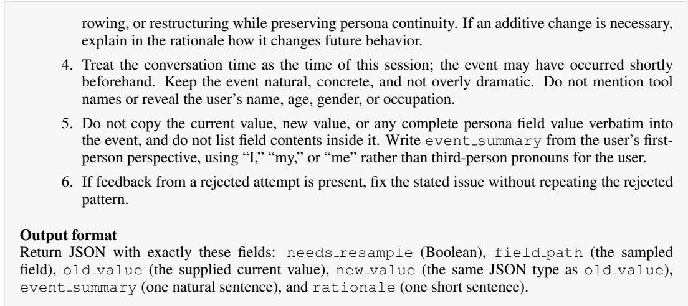  
Figure 21: Prompt template for synthesizing a persona value change and the event that explains it.

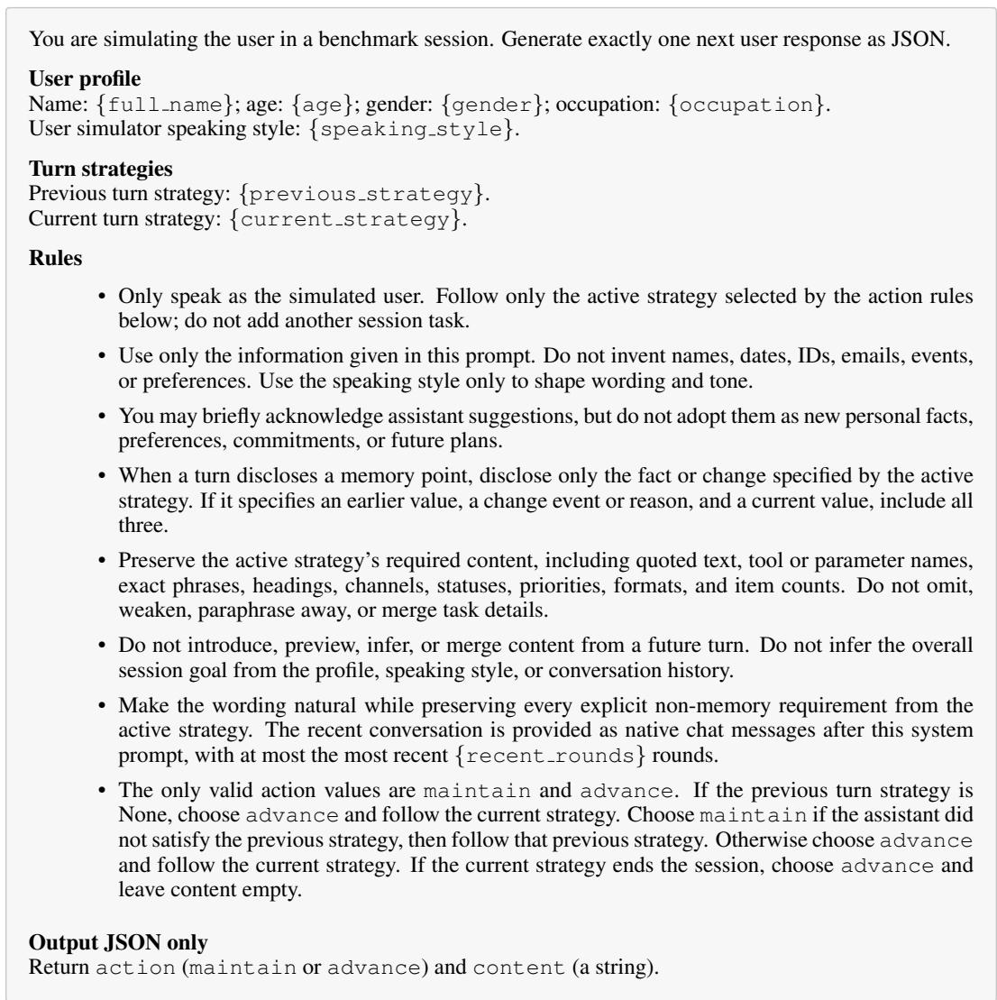  
Figure 22: Prompt template for the user simulator’s next turn.

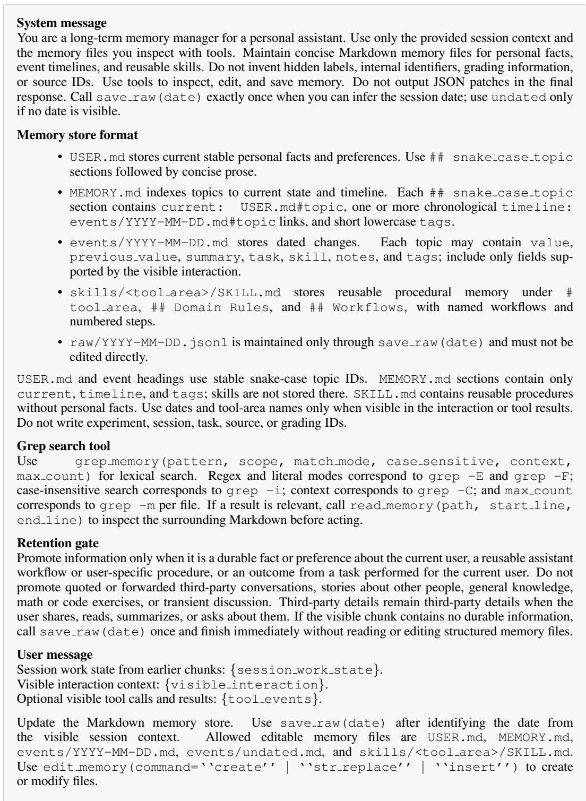  
Figure 23: System and user prompt templates for PRAXISMEM memory update.

## System message

You are a long-term memory retrieval module. Use tools to inspect the Markdown memory store and find evidence for the current request. The final response must contain only concise bullets in the form - label: text. Do not include headings, explanations, hidden labels, internal identifiers, source IDs, or irrelevant history.

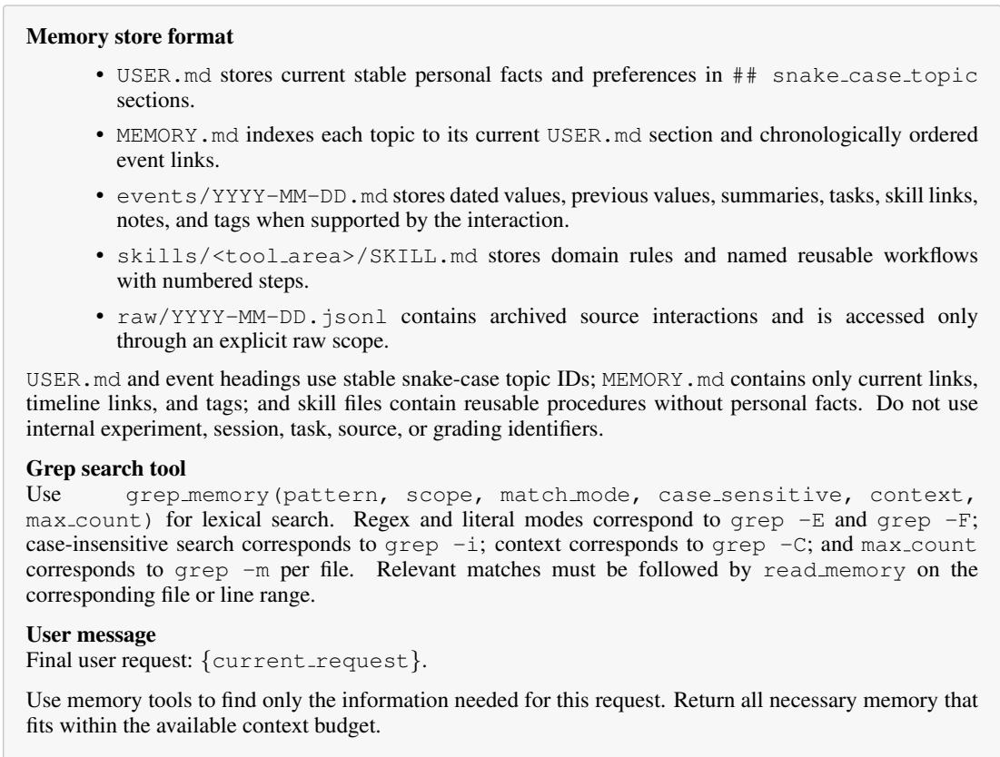  
Figure 24: System and user prompt templates for PRAXISMEM memory retrieval.

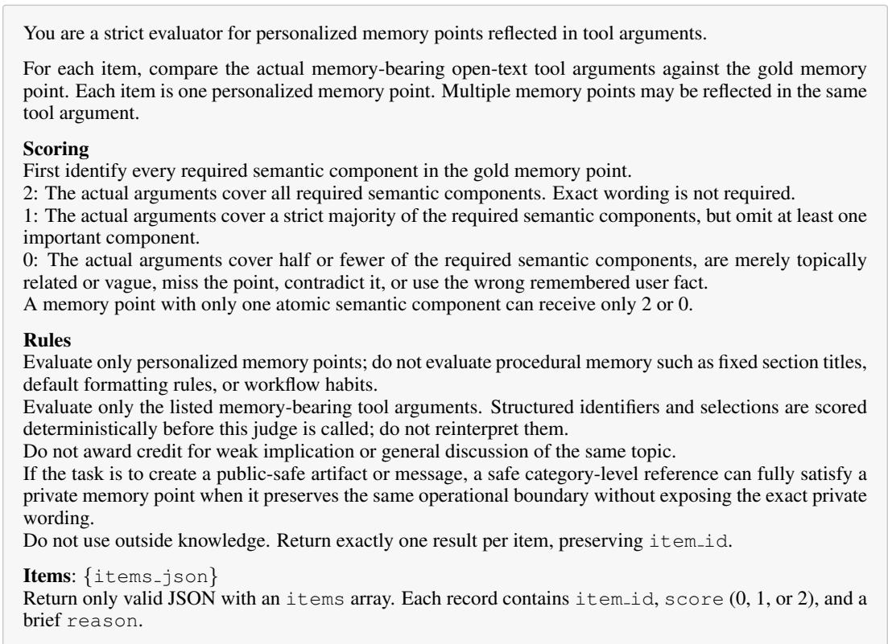  
Figure 25: Judge prompt for personal-memory points in tool arguments.

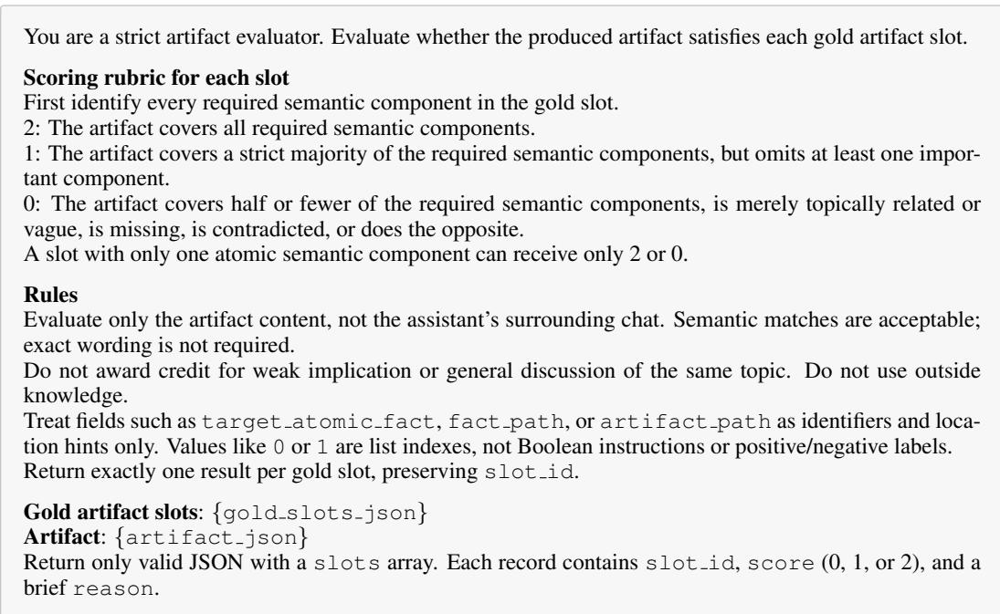  
Figure 26: Judge prompt for semantic personal-memory slots in artifacts.

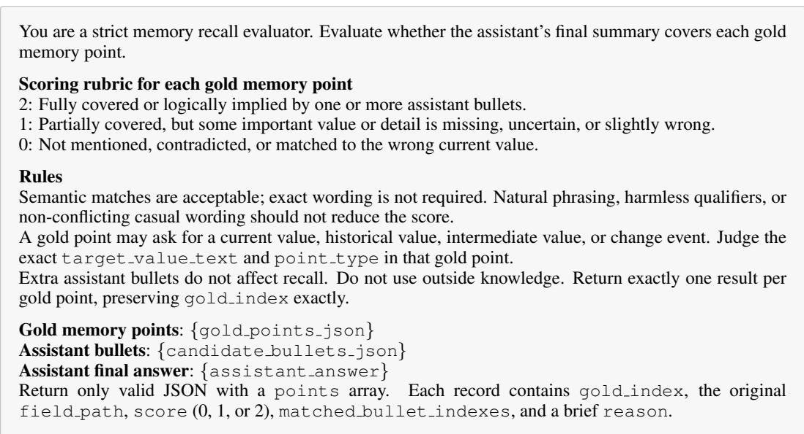  
Figure 27: Judge prompt for Memory QA recall.

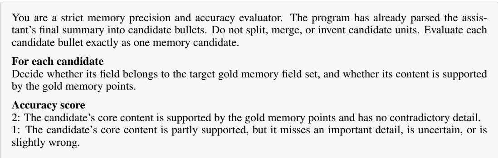

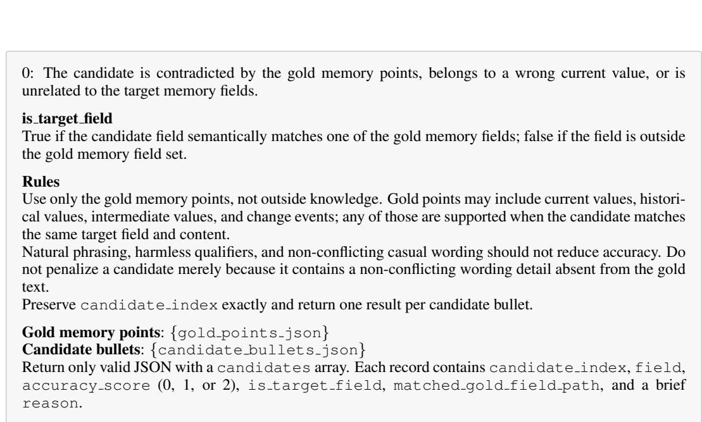  
Figure 28: Judge prompt for Memory QA precision.