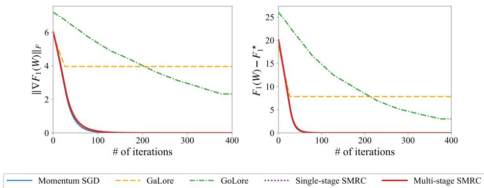
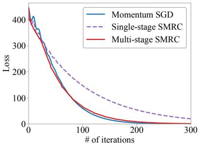
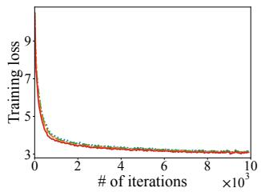
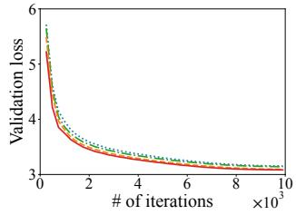
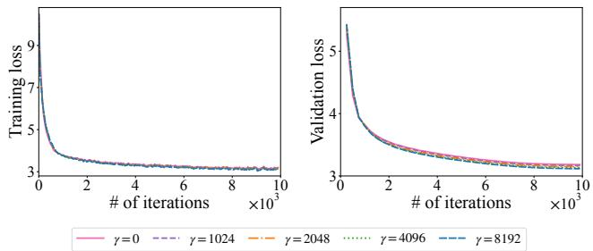
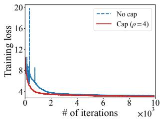

# MEMORY-EFFICIENT SUBSPACE OPTIMIZATION WITH RESIDUAL CORRECTION: FROM MOMENTUM SGD TO MUON

Sifan Yang<sup>1,2,3</sup>, Hongyi Tao<sup>1,2</sup>, Dingzhi Yu<sup>1,2</sup>, Haomin Bai<sup>1,2</sup>, Wei Jiang<sup>4,1</sup>, Silin Gao<sup>3</sup>, Pi Bu<sup>3</sup>, Lijun Zhang<sup>1,2,∗</sup>

<sup>1</sup>State Key Laboratory of Novel Software Technology, Nanjing University

<sup>2</sup>School of Artificial Intelligence, Nanjing University

<sup>3</sup>Alibaba Token Hub, Alibaba Group

<sup>4</sup>School of Computer Science and Engineering, Nanjing University of Science and Technology

## ABSTRACT

Memory-efficient subspace optimization has emerged as a practical approach to reducing the memory cost of LLM training while preserving optimization performance. Previous algorithms typically rely on the leading singular subspace of stochastic gradients, yet the gradient noise may dominate the subspace in later training stages and can prevent convergence. To overcome this limitation, we adopt a residual correction framework, which maintains the optimizer states in the subspace and adds the orthogonal residual gradient to the parameter update. We first integrate this scheme into momentum SGD to develop SMRC, which attains an O(T<sup>−1/4</sup>) convergence rate for a fixed orthonormal basis, matching that of full-space momentum SGD. Our analysis introduces a subspace virtual iterate to resolve the coupling between the momentum and the residual correction. Furthermore, we extend SMRC to a multi-stage variant which periodically recomputes bases to track the evolving dominant subspace and retains the same rate. Since each basis refresh breaks the consistency of the virtual iterates, we devise a boundary correction approach that aligns them across stages. Beyond momentum SGD, we incorporate our framework into Muon and propose PMRC, which applies the matrix sign to the projected momentum. Through a weighted momentum tracking analysis that accounts for the residual gradient, we establish an $O ( T ^ { - 1 / 4 } )$ convergence rate for PMRC, which matches the rate of full-space Muon. We also design a multi-stage PMRC with periodically refreshed bases, which maintains a convergence rate of the same order. Extensive experimental results confirm the effectiveness and efficiency of our algorithms.

## 1 INTRODUCTION

Large language models (LLMs) (Vaswani et al., 2017; Brown et al., 2020; OpenAI, 2023; Bai et al., 2023; Guo et al., 2025; Team et al., 2025) have demonstrated strong capabilities in dialogue (Thoppilan et al., 2022), language understanding (Chowdhery et al., 2023), mathematical reasoning (Lewkowycz et al., 2022) and code generation (Chen et al., 2021). As model scale grows, training imposes substantial computational and memory demands (Brown et al., 2020; Chowdhery et al., 2023; Touvron et al., 2023). The widely used AdamW optimizer (Kingma & Ba, 2015; Loshchilov & Hutter, 2019) further increases memory consumption, since its first- and second-moment estimates are each as large as the model itself. To alleviate the memory overhead, recent work has explored different forms of memory-efficient training, ranging from restricting the set of trainable parameters (Houlsby et al., 2019; Ben Zaken et al., 2022; Hu et al., 2022; Zhang et al., 2023; Pan et al., 2024) to maintaining optimizer states in low-dimensional subspaces (Zhao et al., 2024; He et al., 2025; Chen et al., 2025a; Pan et al., 2025a). In this work, we focus on memory-efficient subspace optimization, which reduces optimization memory by maintaining the optimizer states in a low-dimensional subspace. GaLore (Zhao et al., 2024) is a representative method in this line of work. For a weight matrix $W _ { t } \in \mathbb { R } ^ { m \times n }$ , GaLore utilizes an orthonormal basis $P \in \mathbb { R } ^ { m \times r }$ with $r \ll \operatorname* { m i n } \{ m , n \}$ and projects the gradient $G _ { t } \in \mathbb { R } ^ { m \times n }$ into the space $\mathbb { R } ^ { r \times n }$ , where the optimizer maintains its states, reducing the memory complexity from $O ( m n )$ to $O ( ( m + n ) r )$ . To construct the projection matrix, GaLore computes the leading singular vectors of the stochastic gradient to capture its dominant directions and periodically recomputes P via SVD during training.

As shown by He et al. (2025), GaLore may fail to converge to a stationary point under standard stochastic assumptions. Since the projection basis is estimated from stochastic gradients, whose leading singular directions can be dominated by anisotropic noise rather than the true gradient in later training stages, the selected subspace fails to capture gradient directions. While GoLore (He et al., 2025) replaces the SVD basis with random projections and establishes convergence under standard assumptions, its random subspaces do not exploit dominant gradient directions and are less effective in practice. Recent methods that retain gradient-dependent subspaces either require stronger assumptions (Robert et al., 2025) or offer no memory advantage in the worst case (Pan et al., 2025a). Therefore, there still remains a lack of convergence guarantees for memory-efficient subspace optimization with gradient-dependent dominant subspaces under standard assumptions.

Subspace Momentum SGD with Residual Correction (SMRC). Inspired by Chen et al. (2025a), we adopt a residual correction framework, which maintains optimizer states in a low-dimensional subspace and adds the residual gradient in its orthogonal complement to the update. We incorporate this framework into momentum SGD (Liu et al., 2020) and propose SMRC, which keeps momentum only in the projected space and reduces optimizer-state memory from $O ( m n )$ to $O ( ( m + n ) r )$ Although the projected momentum update and the residual correction lie in orthogonal subspaces, they remain coupled across iterations. To overcome this difficulty, we devise a subspace virtual iterate strategy that absorbs the momentum into an auxiliary trajectory. SMRC achieves an $O ( T ^ { - 1 / 4 } )$ convergence rate for any fixed orthonormal basis, matching that of full-space momentum SGD. Furthermore, since the dominant gradient subspace evolves during training, practical methods periodically refresh the projection matrix P, and we accordingly extend SMRC to a multi-stage variant. A direct application of the single-stage analysis results in a mismatch between virtual iterates at stage boundaries. We design a boundary correction approach that preserves the consistency of the virtual sequence. Our multi-stage SMRC attains the same rate as that of single-stage SMRC.

Projected Muon with Residual Correction (PMRC). Beyond momentum SGD, we apply the residual correction framework to Muon (Jordan et al., 2024), an effective optimizer for LLM training (Liu et al., 2025; Team et al., 2025), and develop PMRC. It maintains momentum in the projected coordinates and applies the matrix sign to the low-dimensional momentum. This nonlinear depen dence of the update on the momentum invalidates the subspace virtual-iterate construction used for SMRC. To address this challenge, we present a weighted momentum tracking analysis that jointly characterizes momentum accumulation and effects induced by the residual correction. The matrixsign step corresponds to steepest descent under the spectral norm and is characterized by the nuclear norm (Bernstein & Newhouse, 2024), whereas the residual gradient correction is measured in the Frobenius norm. We establish convergence under a mixed stationarity measure and PMRC attains the same $O ( T ^ { - 1 / 4 } )$ rate as that of full-space Muon (Li & Hong, 2025). Similarly, we generalize PMRC to a multi-stage setting with periodically refreshed projection bases that better capture the evolving dominant gradient subspace and improve practical performance. The multi-stage variant retains the same ${ \cal O } ( T ^ { - 1 / 4 } )$ convergence rate.

Finally, we evaluate our methods through extensive experiments. On synthetic problems, we examine the residual correction and the multi-stage basis refresh in SMRC, and the results show that the residual correction restores convergence while periodic refreshes track the evolving dominant gradient subspace. For practical LLM training, we develop a practical implementation of PMRC and evaluate it on LLaMA pretraining across four model scales from 60M to 1.3B parameters and on six supervised finetuning settings. Our PMRC consistently performs favorably against prior memoryefficient methods across different model scales and training settings.

## 2 RELATED WORK

In this section, we briefly review related work on memory-efficient optimization and on Muon and its variants. Due to space limitations, we provide additional discussion in Appendix A.

## 2.1 MEMORY-EFFICIENT OPTIMIZATION FOR LLM TRAINING

As model scale grows, full-parameter training becomes increasingly memory-intensive, since gradients and optimizer states impose substantial overhead. Parameter-efficient finetuning methods reduce this cost by restricting the update to a small set of parameters. LoRA (Hu et al., 2022) freezes the model weights and learns low-rank updates, which is effective for finetuning but limits the expressiveness of the update in pretraining (Ding et al., 2023; Lialin et al., 2024). GaLore (Zhao et al., 2024) instead reduces memory by maintaining optimizer states in a low-dimensional gradient subspace. Given a stochastic gradient $G _ { t } \in \mathbb { R } ^ { m \times n }$ , where we assume $m \leq n$ without loss of generality, GaLore uses an orthonormal basis $P _ { t } \in \mathbb { R } ^ { m \times r }$ with $r \ll m$ to form the projected gradient $P _ { t } ^ { \mathcal { \dagger } } G _ { t } \in \mathbb { R } ^ { r \times n }$ . The optimizer states are maintained in the reduced coordinates and the resulting update is mapped back to the original parameter space through $P _ { t }$ . GaLore constructs $P _ { t }$ from the top-r left singular vectors of the stochastic gradient. Since computing the top-r SVD at every iteration is expensive, GaLore refreshes $P _ { t }$ once every τ iterations while keeping it fixed between consecutive refreshes. As shown by He et al. (2025), the leading singular subspaces computed from stochastic gradients can be dominated by anisotropic noise rather than the true gradient, leaving informative gradient directions outside span $( P _ { t } )$ and preventing convergence under standard stochastic assumptions.

To address this limitation, GoLore (He et al., 2025) replaces the SVD basis with random projections. While GoLore establishes convergence guarantees under standard stochastic assumptions, its random subspaces do not preferentially capture dominant gradient directions and lead to slow convergence. Fira (Chen et al., 2025a) follows a complementary approach by retaining the SVD-based subspace and augmenting the projected update with a norm-scaled correction of the discarded residual gradient. Although Fira performs well empirically, its residual scaling is primarily motivated by empirical observations and lacks a convergence guarantee. Zmushko et al. (2025) and Nguyen & Nguyen (2025) also maintain optimizer states in a subspace and apply an SGD-type update in the orthogonal complement. The analysis in Zmushko et al. (2025) is developed for momentum SGD on selected coordinates combined with SGD on the remaining ones. Its convergence guarantee therefore does not directly cover the periodically refreshed SVD subspaces used in GaLore. The convergence rate of Nguyen & Nguyen (2025) is established for a fixed basis under stronger assumptions and applies only to an unweighted residual update.

## 2.2 MUON AND ITS VARIANTS

Muon (Jordan et al., 2024) has demonstrated strong empirical performance in LLM training, outperforming AdamW while exhibiting stable scaling behavior (Team et al., 2025; Liu et al., 2025). For matrix-shaped parameters, Muon updates along the matrix sign of the momentum, the steepestdescent direction under the spectral norm, and approximates it efficiently through Newton–Schulz iterations. Despite these advantages, Muon still requires a momentum of the same size as the parameter matrix and incurs the same $O ( m n )$ optimizer-state memory cost as momentum SGD.

In recent years, a growing body of work has developed Muon variants to improve its memory efficiency (Gupta et al., 2025; Refael et al., 2025; Pan et al., 2025a; Huang et al., 2026; Anson et al., 2026), and we provide a detailed discussion of these methods in Appendix A.3. Among them, GUM (Pan et al., 2025a) combines GaLore-style low-rank projection with layerwise sampling. At each sampling period, a subset of layers receives compensated full-rank updates, while the remaining layers receive projected low-rank ones. The two branches are reweighted according to their sampling probabilities. Since the full-rank branches are drawn independently across layers, all layers may be selected at the same time, in which case GUM offers no memory reduction over Muon.

## 3 NOTATION AND ASSUMPTIONS

In this section, we present necessary preliminaries for our work.

Notation. We denote the optimization variable by $W \in \mathbb { R } ^ { m \times n }$ and assume $m \leq n$ without loss of generality. We use $I _ { r }$ to denote the $r \times r$ identity matrix. For matrices $A , B \in \mathbb { R } ^ { m \times n }$ , we define the trace inner product as $\langle A , B \rangle = \operatorname { t r } ( A ^ { \top } B )$ and denote the Frobenius, spectral and nuclear norms by $\| A \| _ { F } , \| A \| _ { 2 }$ and $\left. A \right. _ { * }$ , respectively. We refer to a matrix $P \in \mathbb { R } ^ { m \times \bar { r } }$ with $P ^ { \top } P = I _ { r }$ as an orthonormal basis. The matrix $P P ^ { \top }$ is the orthogonal projection matrix onto span $( P )$ and $Q = I - P P ^ { \top }$ is the projection matrix onto span $. ( P ) ^ { \perp }$ . All expectations are taken with respect to the randomness of the stochastic gradient oracle.

```latex
Algorithm 1 Single-Stage SMRC
Input: initial iterate $W _ { 1 } , P \in \mathbb { R } ^ { m \times r } , \eta , \beta \in ( 0 , 1 ) , \gamma \in ( 0 , 1 ]$
1: Initialize momentum: $\mathbf { m } _ { 0 } = \mathbf { 0 }$
2: for $t = 1 , \dots , T$ do
3: Query the stochastic gradient $G _ { t } = g ( W _ { t } )$
4: Compute $\mathbf { m } _ { t } = ( 1 - \bar { \beta } ) \mathbf { m } _ { t - 1 } + \beta \bar { P } ^ { \top } G _ { t }$
5: Update $W _ { t + 1 } = W _ { t } - \eta \big ( P \mathbf { m } _ { t } + \gamma ( I - P P ^ { \top } ) G _ { t } \big )$
6: end for
```

In the following, we introduce some standard assumptions in stochastic nonconvex optimization (He et al., 2025).

Assumption 1 (Smoothness) The loss function $F ( \cdot )$ is L-smooth, i.e., $\| \nabla F ( W ) - \nabla F ( W ^ { \prime } ) \| _ { F } \leq$ $L \| W \stackrel { \bullet } { - } W ^ { \prime } \| _ { F } , \quad \forall W , W ^ { \prime } \in \mathbb { R } ^ { m \times n }$

Assumption 2 (Lower boundedness) The loss function $F ( \cdot )$ is lower bounded, i.e., $\begin{array} { r l } { F _ { * } } & { { } = } \end{array}$ $\operatorname* { i n f } _ { W \in \mathbb { R } ^ { m \times n } } F ( W ) > - \infty$ . We define $\Delta = F ( W _ { 1 } ) - F _ { * }$ as the initial optimality gap.

Assumption 3 (Stochastic gradients) For any $W _ { t } ,$ the stochastic gradient oracle returns $g ( W _ { t } )$ such that E $[ g ( W _ { t } ) ] = \nabla F ( W _ { t } )$ and E $\left[ \lVert g ( W _ { t } ) - \nabla F ( W _ { t } ) \rVert _ { F } ^ { 2 } \right] \leq \sigma ^ { 2 }$

Assumption 4 (Orthonormal basis) The basis $P _ { k } \in \mathbb { R } ^ { m \times r }$ is determined by the optimization history prior to stage k and satisfies $P _ { k } ^ { \top } P _ { k } = I _ { r }$

## 4 SUBSPACE MOMENTUM SGD WITH RESIDUAL CORRECTION (SMRC)

In this section, we incorporate the residual correction framework into momentum SGD and develop SMRC. We first present the single-stage SMRC with a fixed orthonormal basis and establish its convergence guarantee. Building on this result, we then propose a multi-stage variant with periodically refreshed bases and show that it retains the same convergence rate.

## 4.1 SINGLE-STAGE SMRC

As discussed above, GaLore (Zhao et al., 2024) discards the gradient component outside the subspace, which can prevent convergence under stochastic noise. GoLore (He et al., 2025) restores the convergence guarantee through random projections, yet its gradient-independent projection strategy leads to worse practical performance than GaLore. To resolve this dilemma, we adopt a residual correction framework inspired by Chen et al. (2025a), which maintains the optimizer states in the low-rank subspace and adds the orthogonal residual gradient to the parameter update.

In this section, we incorporate the residual correction framework into momentum SGD, a widely used method, and develop SMRC, as summarized in Algorithm 1. At each iteration t, SMRC queries a stochastic gradient $G _ { t } ,$ projects it onto the subspace and maintains the low-dimensional momentum $\mathbf { m } _ { t } = ( 1 - \bar { \beta } ) \mathbf { m } _ { t - 1 } + \beta \bar { P ^ { \intercal } } \bar { G } _ { t } \in \mathbb { R } ^ { r \times n }$ , where $\boldsymbol { P } ^ { * } \in \mathbb { R } ^ { m \times r }$ is a fixed orthonormal basis and $\beta \in ( 0 , 1 )$ is the momentum parameter. When $P$ consists of the top-r left singular vectors of the stochastic gradient, the projection $P ^ { \top } G _ { t }$ retains the components along the estimated dominant directions, and the momentum is mapped back to the original parameter space through $P \mathbf { m } _ { t }$ . However, as pointed out by He et al. (2025), this subspace may primarily reflect the noise and miss informative gradient directions once the stochastic noise dominates the true gradient. To recover these directions, we incorporate the residual gradient into the update, i.e., $\begin{array} { r } { \tilde { W _ { t + 1 } } = W _ { t } - \eta ( P \mathbf { m } _ { t } + \gamma ( I - P P ^ { \top } ) G _ { t } ) } \end{array}$ where the parameter $\gamma \in ( 0 , 1 ]$ controls the weight of the residual gradient.

We next outline the key technical difficulty introduced by the residual correction, deferring the detailed argument to Appendix D. Since the two update directions are orthogonal, a natural approach is to analyze the projected and residual terms separately. However, this direct decomposition is insufficient, as the residual correction directly affects the iterate, which alters subsequent gradients that are projected and accumulated in the momentum, leaving the two components coupled across iterations. To overcome this challenge, we develop a subspace virtual iterate approach, which introduces the auxiliary sequence $\begin{array} { r } { U _ { t } = W _ { t } - \frac { ( 1 - \beta ) \eta } { \beta } P \mathbf { m } _ { t - 1 } } \end{array}$ and $U _ { 1 } = W _ { 1 }$ . This sequence is used only in the analysis and is not computed by SMRC. The virtual iterate incorporates the projected momentum into an auxiliary trajectory, thereby decoupling it from the residual correction term. Formally, we establish the theoretical guarantee for SMRC.

Algorithm 2 Multi-Stage SMRC   
Input: initial iterate $W _ { 1 , 1 } , P _ { 1 } , \eta , \beta \in ( 0 , 1 ) , \gamma \in ( 0 , 1 ] , K , \{ T _ { k } \} _ { k = 1 } ^ { K }$   
1: for $k = 1 , \ldots , K$ do   
2: Set momentum m $\mathbf { \nabla } _ { k , 0 } = \mathbf { 0 } .$   
3: for $t = 1 , \ldots , T _ { k }$ do   
4: Query the stochastic gradient $G _ { k , t } = g ( W _ { k , t } )$   
5: Calculate $\mathbf { m } _ { k , t } = ( 1 - \beta ) \mathbf { m } _ { k , t - 1 } + \beta P _ { k } ^ { \top } G _ { k , t }$   
6: Update $W _ { k , t + 1 } = W _ { k , t } - \eta \big ( P _ { k } \mathbf { m } _ { k , t } + \gamma ( I - P _ { k } P _ { k } ^ { \top } ) G _ { k , t } \big )$   
7: end for   
8: if $k < K$ then   
9: Set $\begin{array} { r } { W _ { k + 1 , 1 } = W _ { k , T _ { k } + 1 } - \frac { ( 1 - \beta ) \eta } { \beta } P _ { k } \mathbf { m } _ { k , T _ { k } } } \end{array}$ and update $P _ { k + 1 }$   
10: end if   
11: end for

Theorem 1 (Single-stage SMRC) Define $Q = I - P P ^ { \top }$ and $\begin{array} { r } { c _ { \beta } = \frac { 1 - \beta } { \beta } } \end{array}$ . Under Assumptions 1, 2 and $3 , f o r$ a matrix $P \in \mathbb { R } ^ { m \times r }$ with $P ^ { \top } P = I _ { r }$ and by setting $\begin{array} { r } { \eta = \operatorname* { m i n } \left\{ \frac { \gamma } { 2 L } , \frac { \gamma } { 2 L c _ { \beta } } , \frac { 1 } { L \sqrt { T } } \right\} , \beta \in } \end{array}$ $( 0 , 1 ) , \gamma \in ( 0 , 1 ] ,$ , Algorithm 1 ensures

$$
\frac { 1 } { T } \sum _ { t = 1 } ^ { T } \mathbb { E } \left[ \left. \nabla F ( W _ { t } ) \right. _ { F } \right] = O ( T ^ { - 1 / 4 } ) .
$$

Remark 1 For any $\beta \in ( 0 , 1 ) , \gamma \in ( 0 , 1 ]$ and the step size prescribed in Theorem 1, SMRC attains an $O ( T ^ { - 1 / 4 } )$ convergence rate, which is standard for stochastic nonconvex optimization and matches that of full-space momentum SGD, while storing only a low-rank momentum.

Remark 2 SMRC maintains the momentum m $\in \mathbb { R } ^ { r \times n }$ in the projected space rather than in the ambient space $\mathbb { R } ^ { m \times n }$ . The residual correction $( I - P P ^ { \top } ) G _ { t }$ can be computed directly from the stochastic gradient and needs no additional optimizer state (Chen et al., 2025a). Storing the basis $\boldsymbol { P } \in \mathbb { R } ^ { m \times i }$ and the momentum m<sub>t</sub> only requires $O ( ( m + n ) r )$ memory, which is smaller than the O(mn) memory of full-space momentum SGD.

## 4.2 MULTI-STAGE SMRC

Although the single-stage analysis accommodates any fixed orthonormal basis $P ,$ practical subspace methods (Zhao et al., 2024; Pan et al., 2025a) typically construct P from the dominant singular subspace of the stochastic gradient so that the projected update retains informative gradient directions. Since the dominant singular subspace of the gradient varies throughout optimization, practical subspace methods periodically update the projection basis to capture the evolving geometry of the loss landscape. Following the periodic refresh strategy of GaLore (Zhao et al., 2024), we propose the multi-stage SMRC as presented in Algorithm 2. It partitions the total N iterations into $K$ stages, where stage k contains $T _ { k }$ iterations and $\begin{array} { r } { N = \sum _ { k = 1 } ^ { K } T _ { k } } \end{array}$ Within each stage k, SMRC performs $T _ { k }$ updates using a fixed orthonormal basis $P _ { k }$ and maintains the corresponding low-dimensional momentum $\mathbf { m } _ { k , t } .$ . At the end of stage k, a new basis $P _ { k + 1 }$ is computed from the dominant subspace of the stochastic gradient and the subsequent stage proceeds in the refreshed subspace.

The extension of the single-stage analysis to periodically refreshed bases introduces an additional challenge at stage boundaries. If each new stage is initialized with the terminal iterate of the preceding stage, the corresponding virtual sequence becomes inconsistent across basis refreshes. To resolve this mismatch, we introduce a boundary correction approach that modifies the iterate at each stage transition to compensate for the offset. The corrected transition ensures the terminal virtual iterate of the stage coincides with the initial virtual iterate of the next. The corresponding convergence guarantee of multi-stage SMRC is stated below.

Algorithm 3 Single-Stage PMRC   
Input: initial iterate $W _ { 1 } , P \in \mathbb { R } ^ { m \times r } , \eta , \gamma , \beta \in ( 0 , 1 )$   
1: Initialize momentum: $M _ { 0 } = \mathbf { 0 }$   
2: for $t = 1 , \dots , T$ do   
3: Query the stochastic gradient $G _ { t } = g ( W _ { t } )$   
4: Calculate $M _ { t } = ( 1 - \mathbf { \bar { \beta } } ) M _ { t - 1 } + \beta \bar { P } ^ { \dagger } G _ { t }$ and $Z _ { t } =$ msign(M<sub>t</sub>)   
5: Update $W _ { t + 1 } = W _ { t } - \eta \big ( P Z _ { t } + \gamma ( I - P P ^ { \top } ) G _ { t } \big )$   
6: end for

Theorem 2 (Multi-stage SMRC) Let the total number of iterations be $\begin{array} { r } { N \ = \ \sum _ { k = 1 } ^ { K } T _ { k } } \end{array}$ , where stage k contains $T _ { k }$ iterations. Define $Q _ { k } \ = \ I - P _ { k } P _ { k } ^ { \top }$ and $c _ { \beta } \ = \ ( 1 - \beta ) / \beta .$ Under Assumptions $1 , \ 2 , \ 3$ and 4, for any orthonormal stage basis $P _ { k }$ with $P _ { k } ^ { \top } P _ { k } \ = \ I _ { r }$ , by setting $\begin{array} { r } { \eta = \operatorname* { m i n } \left\{ \frac { \gamma } { 2 L } , \frac { \gamma } { 2 L c _ { \beta } } , \frac { 1 } { L \sqrt { N } } \right\} , \beta \in ( 0 , 1 ) , \gamma \in ( 0 , 1 ] } \end{array}$ , Algorithm 2 ensures

$$
\frac { 1 } { N } \sum _ { k = 1 } ^ { K } \sum _ { t = 1 } ^ { T _ { k } } \mathbb { E } \left[ \left. \nabla F ( W _ { k , t } ) \right. _ { F } \right] = O ( N ^ { - 1 / 4 } ) .
$$

Remark 3 We have established an $O ( N ^ { - 1 / 4 } )$ convergence rate for multi-stage SMRC over N iterations, which matches the convergence order of full-space momentum SGD (Liu et al., 2020). Notably, Theorem 2 holds for any sequence of orthonormal bases $\{ P _ { k } \} _ { k = 1 } ^ { K }$ . In particular, each $P _ { k }$ may be constructed from the dominant singular subspace of the stochastic gradient.

## 5 PROJECTED MUON WITH RESIDUAL CORRECTION (PMRC)

In this section, we extend the residual correction framework to Muon (Jordan et al., 2024), a modern optimizer for LLM training. We first present the single-stage method and establish its convergence guarantee and then extend the method and the guarantee to the multi-stage variant.

## 5.1 SINGLE-STAGE PMRC

Muon (Jordan et al., 2024) has demonstrated strong performance in LLM training (Liu et al., 2025; Team et al., 2025), while its full-dimensional momentum incurs the same $O ( m n )$ optimizer-state memory cost as momentum SGD. At larger model scales, this memory requirement becomes increasingly restrictive and motivates the development of memory-efficient variants of Muon (Pan et al., 2025a). A natural question is whether the momentum of Muon can be maintained in a lowdimensional subspace while preserving the convergence guarantee offull-space Muon.

We incorporate the residual correction framework into Muon and develop PMRC, as outlined in Algorithm 3. Specifically, PMRC projects the stochastic gradient $G _ { t }$ onto the subspace, maintains the low-rank momentum $M _ { t } = ( \bar { 1 } - \bar { \beta } ) M _ { t - 1 } + \beta P ^ { \top } G _ { t } ^ { - } \in \mathbb { R } ^ { r \times n }$ and applies the matrix sign to $M _ { t }$ . Then, PMRC incorporates the orthogonal residual gradient into the parameter update, that is, $W _ { t + 1 } = W _ { t } - \eta ( P \mathrm { m s i g n } ( M _ { t } ) + \gamma ( I - \mathbf { \bar { { P } } } P ^ { \top } ) G _ { t } )$ , where $\gamma > 0$ controls the residual correction.

Notably, PMRC combines the Muon update with residual correction and the two update terms are characterized by different norm geometries. The matrix-sign step corresponds to steepest descent under the spectral norm and is characterized by the nuclear norm (Bernstein & Newhouse, 2024; Li & Hong, 2025), whereas the residual gradient correction is measured in the Frobenius norm. We analyze PMRC through a weighted momentum-tracking argument for the bias-corrected projected momentum, which accounts for both momentum accumulation and the iterate variation induced by residual correction. We establish convergence under the following mixed stationarity measure.

Algorithm 4 Multi-Stage PMRC   
Input: initial iterate $W _ { 1 , 1 } , P _ { 1 } , \eta , \gamma , K , T , \beta \in ( 0 , 1 )$   
1: for $k = 1 , \ldots , K$ do   
2: Set momentum $M _ { k , 0 } = \mathbf { 0 }$   
3: for $t = 1 , \dots , T$ do   
4: Query the stochastic gradient $G _ { k , t } = g ( W _ { k , t } )$   
5: Calculate $M _ { k , t } = ( 1 - \beta ) M _ { k , t - 1 } + \beta P _ { k } ^ { \top } G _ { k , t }$ and $Z _ { k , t } =$ msign $( M _ { k , t } )$   
6: Update $W _ { k , t + 1 } = W _ { k , t } - \eta \big ( P _ { k } Z _ { k , t } + \gamma ( I - P _ { k } P _ { k } ^ { \top } ) G _ { k , t } \big )$   
7: end for   
8: if $k < K$ then   
9: Set $W _ { k + 1 , 1 } = W _ { k , T + 1 }$ and update $P _ { k + 1 }$   
10: end if   
11: end for

Theorem 3 (Single-stage PMRC) Define $Q = I - P P ^ { \top }$ . Under Assumptions $1 , 2$ and 3, for a matrix $P \in \mathbb { R } ^ { m \times r }$ with $P ^ { \top } P = I _ { r }$ and by setting $\beta = \Theta ( T ^ { - 1 / 2 } ) , \eta = \Theta ( T ^ { - 3 / 4 } ) , \gamma = \Theta ( \dot { T } ^ { 1 / 4 } )$ and $L \eta \gamma \leq 1 , A l g$ orithm 3 ensures

$$
\frac { 1 } { T } \sum _ { t = 1 } ^ { T } \mathbb { E } \Big [ \big \lVert P ^ { \top } \nabla F ( W _ { t } ) \big \rVert _ { * } + \big \lVert Q \nabla F ( W _ { t } ) \big \rVert _ { F } \Big ] \leq O ( T ^ { - 1 / 4 } ) .
$$

Remark 4 Under standard stochastic assumptions, PMRC attains an $O ( T ^ { - 1 / 4 } )$ convergence rate under the mixed stationarity measure, matching the convergence order of full-space Muon (Li & Hong, 2025). We establish convergence for a GaLore-style Muon variant that maintains its optimizer states entirely in a low-dimensional space.

Remark 5 When $r ~ = ~ m$ and $P = I$ , the mixed stationarity measure reduces to $\lVert \nabla F ( W _ { t } ) \rVert _ { * }$ which coincides with the standard stationarity measure for Muon. In this case, PMRC reduces to Muon and recovers the $O ( T ^ { - 1 / 4 } )$ convergence order of full-space Muon. Moreover, the mixed stationarity measure also upper bounds the Frobenius norm of the full gradient, i.e., $\Vert \nabla F ( W _ { t } ) \Vert _ { F } \leq$ $\| P ^ { \top } \nabla F ( \dot { W } _ { t } ) \| _ { * } + \| ( I - P \dot { P } ^ { \top } ) \nabla F ( W _ { t } ) \| _ { F }$ . Thus, convergence under the mixed stationarity measure also guarantees convergence of the full gradient in the Frobenius norm.

Remark 6 One may notice that the prescribed choice of $\gamma$ differs between SMRC and PMRC. Although $\gamma$ controls the weight of the residual correction relative to the projected update in both methods, the two algorithms are analyzed under different optimization geometries. In SMRC, both the projected and residual components are measured in the Frobenius norm, s $) \gamma \in ( 0 , 1 ]$ is sufficient for the convergence guarantee. In PMRC, the projected Muon component is measured in the nuclear norm, whereas the residual component is measured in the Frobenius norm. The choice $\gamma = \Theta ( T ^ { 1 / 4 } )$ corresponds to an effective step size $\eta \gamma = \Theta ( T ^ { - 1 / 2 } )$ for the residual component, the standard step size for SGD, while the Muon component retains $\eta = \Theta ( T ^ { - 3 / 4 } )$

## 5.2 MULTI-STAGE PMRC

Since the dominant gradient subspace may evolve during optimization, as discussed in Section 4.2, we propose a multi-stage variant of ${ \mathrm { P M R C } } ,$ as presented in Algorithm 4. At stage k, PMRC constructs an orthonormal basis $P _ { k }$ , initializes the momentum as $\bar { M } _ { k , 0 } = \mathbf { 0 } .$ , and performs $T$ updates with the basis $P _ { k }$ fixed. At the end of stage $k ,$ the terminal iterate is used to initialize the subsequent stage, i.e., $W _ { k + 1 , 1 } = W _ { k , T + 1 }$ . The projection basis is then refreshed to $P _ { k + 1 } ,$ , and the momentum is reinitialized in the corresponding projected coordinates. In this way, each stage retains the singlestage PMRC update with a fixed basis, while the projection subspace is periodically updated to track the evolving dominant gradient directions. We establish the convergence guarantee below.

Theorem 4 (Multi-stage PMRC) Define $Q _ { k } = I - P _ { k } P _ { k } ^ { \top }$ . Under Assumptions $I , 2 , 3$ and 4, with stage lengths T, stage count $K = T$ , total iterations $N = K T$ and by setting $\beta = \Theta ( N ^ { - 1 / 2 } ) , \eta =$

Table 1: Training and validation losses during pretraining. Bold and underlined values indicate the best and second-best results among memory-efficient methods, respectively.
<table><tr><td>Loss Type</td><td>Memory-Efficient</td><td>Optimizer</td><td>60M</td><td>150M</td><td>350M</td><td>1.3B</td></tr><tr><td rowspan="7">Training Loss</td><td>X</td><td>AdamW</td><td>3.445</td><td>3.156</td><td>2.843</td><td>2.551</td></tr><tr><td>X</td><td>Muon</td><td>3.383</td><td>3.086</td><td>2.703</td><td>2.414</td></tr><tr><td>V</td><td>GaLore</td><td>3.484</td><td>3.180</td><td>2.972</td><td>2.842</td></tr><tr><td>V</td><td>GoLore</td><td>3.516</td><td>3.196</td><td>3.003</td><td>3.080</td></tr><tr><td>V</td><td>Fira</td><td>3.601</td><td>3.180</td><td>2.852</td><td>2.657</td></tr><tr><td>V</td><td>GUM</td><td>3.461</td><td>3.141</td><td>2.871</td><td>2.609</td></tr><tr><td>V</td><td>PMRC (Ours)</td><td>3.406</td><td>3.117</td><td>2.769</td><td>2.500</td></tr><tr><td rowspan="7">Validation Loss</td><td>X</td><td>AdamW</td><td>3.421</td><td>3.134</td><td>2.892</td><td>2.613</td></tr><tr><td>X</td><td>Muon</td><td>3.352</td><td>3.067</td><td>2.746</td><td>2.495</td></tr><tr><td>V</td><td>GaLore</td><td>3.462</td><td>3.202</td><td>2.980</td><td>2.875</td></tr><tr><td>V</td><td>GoLore</td><td>3.494</td><td>3.204</td><td>3.015</td><td>3.110</td></tr><tr><td>√</td><td>Fira</td><td>3.576</td><td>3.161</td><td>2.909</td><td>2.730</td></tr><tr><td>V</td><td>GUM</td><td>3.437</td><td>3.156</td><td>2.881</td><td>2.656</td></tr><tr><td>L</td><td>PMRC (Ours)</td><td>3.380</td><td>3.095</td><td>2.786</td><td>2.570</td></tr></table>

Θ $( N ^ { - 3 / 4 } ) , \gamma = \Theta ( N ^ { 1 / 4 } )$ and $L \eta \gamma \leq 1 ,$ , Algorithm 4 ensures

$$
\frac { 1 } { N } \sum _ { k = 1 } ^ { K } \sum _ { t = 1 } ^ { T } \mathbb { E } \Big [ \big \lVert P _ { k } ^ { \top } \nabla F ( W _ { k , t } ) \big \rVert _ { * } + \big \lVert Q _ { k } \nabla F ( W _ { k , t } ) \big \rVert _ { F } \Big ] \leq O ( N ^ { - 1 / 4 } ) .
$$

Remark 7 We establish an $O ( N ^ { - 1 / 4 } )$ convergence rate under the mixed stationarity measure, where N is the total number of stochastic gradient evaluations. This rate is consistent with the single-stage guarantee in Theorem 3 and the standard rate for full-space Muon (Li & Hong, 2025).

## 6 EMPIRICAL STUDY

In this section, we assess the performance of the proposed methods through LLM pretraining and finetuning tasks. In experiments, we adopt a practical PMRC variant that applies a residual cap to improve training stability and refreshes the basis through an efficient approximation of SVD, as detailed in Appendix E.2.1. Due to space limitations, we present only a subset of the results and defer the synthetic experiments and ablation studies to Appendix E.1 and Appendix E.2.4, respectively.

## 6.1 LLM PRETRAINING

We adopt the LLaMA architecture (Touvron et al., 2023) and train models with 60M, 150M, 350M and 1.3B parameters. Their architectural configurations are summarized in Table 4. All models are pretrained on the C4 dataset (Raffel et al., 2020).

Setup. We train the 60M and 150M models on 2 NVIDIA RTX PRO 6000 GPUs, the 350M model on 4 NVIDIA H20 GPUs, and the 1.3B model on 8 NVIDIA H20 GPUs. The corresponding perdevice batch sizes are 256, 256, 160, and 160, yielding global batch sizes of 512, 512, 640, and 1280, respectively. The sequence length is 512 for the 60M and 150M models and 1024 for the 350M and 1.3B models. For each model, the number of training steps approximately follows the Chinchilla scaling law (Hoffmann et al., 2022). For example, the 1.3B model is trained for 20480 steps, which corresponds to $2 0 4 8 0 \times 1 0 2 4 \times 1 2 8 0 \approx 2 6$ .84 billion training tokens, or approximately 20.6 tokens per parameter. We compare our multi-stage PMRC with AdamW (Loshchilov & Hutter, 2019), Muon (Jordan et al., 2024), the AdamW-based GaLore (Zhao et al., 2024), GoLore (He et al., 2025) and Fira (Chen et al., 2025a), and the Muon-based GUM (Pan et al., 2025a). For projectionbased methods, we set the projection rank to $r = 2 5 6$ and the refresh interval to 100. Since GUM randomly selects a subset of layers for full-rank updates, its memory cost depends on the number of full-rank layers s. For a fair comparison, we choose s according to the memory budget of PMRC, setting $s = 6$ and $r = 1 2 8$ for the 60M, 150M, and 350M models, and $s = 4$ and $r = 1 2 8$ for the 1.3B model. The peak allocated memory for the 1.3B model is reported in Table 6. The detailed setup, parameter settings and additional pretraining results are deferred to Appendix E.2.2.

Table 2: Accuracy (%) on IFEval and GSM8K benchmarks. Bold and underlined values indicate the best and second-best results among memory-efficient methods, respectively.
<table><tr><td rowspan="2">Optimizer</td><td colspan="3">IFEval</td><td colspan="3">GSM8K</td></tr><tr><td>Qwen3-8B</td><td>LLaMA-3.1-8B</td><td>OLMo-2-1124-7B</td><td>Qwen3-8B</td><td>LLaMA-3.1-8B</td><td>OLMo-2-1124-7B</td></tr><tr><td>AdamW</td><td>65.83</td><td>50.12</td><td>38.97</td><td>90.14</td><td>72.10</td><td>77.63</td></tr><tr><td>Muon</td><td>62.11</td><td>46.16</td><td>36.45</td><td>89.76</td><td>72.78</td><td>78.01</td></tr><tr><td>GaLore</td><td>66.67</td><td>47.24</td><td>38.13</td><td>89.16</td><td>71.27</td><td>77.86</td></tr><tr><td>GoLore</td><td>68.35</td><td>47.96</td><td>35.73</td><td>88.93</td><td>70.66</td><td>77.10</td></tr><tr><td>GUM</td><td>62.47</td><td>43.65</td><td>36.21</td><td>89.61</td><td>69.74</td><td>78.32</td></tr><tr><td>PMRC (Ours)</td><td>69.06</td><td>50.24</td><td>38.97</td><td>90.30</td><td>72.48</td><td>78.62</td></tr></table>

Results. Table 1 presents a comparison of the training and validation losses achieved by PMRC with those achieved by AdamW, Muon, GaLore, GoLore, Fira and GUM. As evidenced by the reported results, PMRC consistently achieves the lowest training and validation losses among memoryefficient methods. The improvement supports the effectiveness of residual correction in practical LLM pretraining. PMRC also requires less optimizer-state memory than AdamW while achieving lower losses at every scale. We further evaluate the pretrained models on seven downstream benchmarks, with complete results reported in Appendix E.2.2, where PMRC achieves the highest average accuracy among memory-efficient methods.

## 6.2 LLM SUPERVISED FINETUNING

In this section, we conduct supervised finetuning (SFT) of LLMs to enhance their instructionfollowing and mathematical reasoning abilities. Following previous work (Pan et al., 2025a;b; Yu et al., 2026a), we finetune Qwen3-8B (Yang et al., 2025), LLaMA3.1-8B (Grattafiori et al., 2024) and OLMo-2-1124-7B (OLMo et al., 2024) on two common tasks. For a fair comparison, we set the projection rank to $r = 5 1 2$ for all projection-based methods except GUM, for which we use $r = 1 2 8 .$ . For GUM, we adjust the number of selected full-rank layers according to the memory cost of PMRC, using $s = 6 , s = 5$ , and s = 5 layers for Qwen3-8B, LLaMA3.1-8B, and OLMo-2-1124- 7B, respectively. Under these settings, the peak memory usage of GUM still exceeds that of PMRC. We refresh the projection basis every 100 optimizer steps for all memory-efficient optimizers. Our experiments are conducted on a single NVIDIA RTX PRO 6000 GPU and 4 NVIDIA H20 GPUs.

Setup. For the instruction-following task, we follow Pan et al. (2025a) and train models on the GPT-4-LLM dataset, which contains approximately 52K instruction-response examples synthesized by GPT-4. We report performance on IFEval (Zhou et al., 2023), a benchmark designed to measure how reliably a model satisfies explicit instructions and formatting constraints. For the mathematical reasoning task, we follow Yu et al. (2026a) and train models on the NuminaMath-CoT dataset (Li et al., 2024), which consists of 860K problems from high school mathematics and international Olympiad competitions, and we randomly select 64K of them for finetuning. We evaluate the models on the GSM8K benchmark (Cobbe et al., 2021), which consists of grade school math word problems. For both tasks, we use a global batch size of 128 and a maximum sequence length of 2048, and train for one epoch. For evaluation, we allow up to 1280 and 2048 new tokens for IFEval and GSM8K, respectively. We provide detailed training and evaluation configurations, along with peak allocated memory results, in Appendix E.2.3.

Results. We report the instruction-level strict accuracy on the IFEval benchmark and the zeroshot accuracy on the GSM8K benchmark in Table 2. On the IFEval benchmark, PMRC achieves the best performance among all projection-based methods across the three models, outperforming GUM by more than 2 percentage points. Notably, on Qwen3-8B, PMRC also surpasses the full space optimizers. On the GSM8K benchmark, PMRC achieves the best performance among all memory-efficient methods while remaining competitive with the full-space optimizers.

## 7 CONCLUSION

In this paper, we investigate memory-efficient subspace optimization and adopt a residual correction framework. For momentum SGD, our proposed SMRC combines projected momentum with a gradient correction in the orthogonal complement and achieves an $O ( T ^ { - 1 / 4 } )$ convergence rate, which matches that of full-space momentum SGD. We generalize SMRC to a multi-stage variant with arbitrary basis refreshes and introduce a boundary correction that aligns consecutive virtual iterates, while retaining a convergence rate of the same order as the single-stage method. Furthermore, we extend this framework to Muon and propose PMRC, which achieves an $O ( T ^ { - 1 / 4 } )$ rate under a mixed stationarity measure, while the multi-stage variant retains a convergence rate of the same order. The convergence rates of both PMRC variants are of the same order as that of full-space Muon. Both SMRC and PMRC reduce the optimizer-state memory from O(mn) to $O ( ( m + n ) r )$ Extensive experimental results on LLM pretraining and supervised finetuning tasks demonstrate the practical effectiveness and efficiency of our proposed methods.

## AI USE STATEMENT

In this work, we used generative AI tools for polishing, assistance with checking mathematical proofs, creating or editing software code, suggesting experimental parameters, proof organization, and scripts for plotting results. We reviewed all AI-assisted content. LLM-generated code was verified and tested for correctness by the authors. We take responsibility for the final content of this work, including text, claims or artifacts produced with the aid of generative AI.

## REFERENCES

Kang An, Yuxing Liu, Rui Pan, Yi Ren, Shiqian Ma, Donald Goldfarb, and Tong Zhang. ASGO: Adaptive structured gradient optimization. In Advances in Neural Information Processing Systems 38 (NeurIPS), pp. 126775–126814, 2025.

Ben Anson, Conor Houghton, and Edward Milsom. Approximate Muon with low-rank adapters. arXiv preprint arXiv:2608.14492, 2026.

Jinze Bai, Shuai Bai, Yunfei Chu, Zeyu Cui, Kai Dang, Xiaodong Deng, Yang Fan, Wenbin Ge, Yu Han, Fei Huang, Binyuan Hui, Luo Ji, Mei Li, Junyang Lin, Runji Lin, Dayiheng Liu, Gao Liu, Chengqiang Lu, Keming Lu, Jianxin Ma, Rui Men, Xingzhang Ren, Xuancheng Ren, Chuanqi Tan, Sinan Tan, Jianhong Tu, Peng Wang, Shijie Wang, Wei Wang, Shengguang Wu, Benfeng Xu, Jin Xu, An Yang, Hao Yang, Jian Yang, Shusheng Yang, Yang Yao, Bowen Yu, Hongyi Yuan, Zheng Yuan, Jianwei Zhang, Xingxuan Zhang, Yichang Zhang, Zhenru Zhang, Chang Zhou, Jingren Zhou, Xiaohuan Zhou, and Tianhang Zhu. Qwen technical report. arXiv preprint arXiv:2309.16609, 2023.

Elad Ben Zaken, Yoav Goldberg, and Shauli Ravfogel. BitFit: Simple parameter-efficient finetuning for transformer-based masked language-models. In Proceedings ofthe 60th Annual Meeting ofthe Associationfor Computational Linguistics (Volume 2: Short Papers), 2022.

Jeremy Bernstein and Laker Newhouse. Old optimizer, new norm: An anthology. arXiv preprint arXiv:2409.20325, 2024.

Yonatan Bisk, Rowan Zellers, Ronan Le Bras, Jianfeng Gao, and Yejin Choi. Piqa: Reasoning about physical commonsense in natural language. In Proceedings of the AAAI conference on artificial intelligence, pp. 7432–7439, 2020.

Tom Brown, Benjamin Mann, Nick Ryder, Melanie Subbiah, Jared D Kaplan, Prafulla Dhariwal, Arvind Neelakantan, Pranav Shyam, Girish Sastry, Amanda Askell, et al. Language models are few-shot learners. In Advances in Neural Information Processing Systems 33 (NeurIPS), pp. 1877–1901, 2020.

Mark Chen, Jerry Tworek, Heewoo Jun, Qiming Yuan, Henrique Ponde de Oliveira Pinto, Jared Kaplan, Harri Edwards, Yuri Burda, Nicholas Joseph, Greg Brockman, et al. Evaluating large language models trained on code. arXiv preprint arXiv:2107.03374, 2021.

Xi Chen, Kaituo Feng, Changsheng Li, Xunhao Lai, Xiangyu Yue, Ye Yuan, and Guoren Wang. Fira: Can we achieve full-rank training of LLMs under low-rank constraint? In Advances in Neural Information Processing Systems 38 (NeurIPS), 2025a.

Yiming Chen, Yuan Zhang, Yin Liu, Kun Yuan, and Zaiwen Wen. A memory efficient randomized subspace optimization method for training large language models. In Proceedings of the 42nd International Conference on Machine Learning (ICML), 2025b.

Aakanksha Chowdhery, Sharan Narang, Jacob Devlin, Maarten Bosma, Gaurav Mishra, Adam Roberts, Paul Barham, Hyung Won Chung, Charles Sutton, Sebastian Gehrmann, et al. PaLM: Scaling language modeling with pathways. Journal of Machine Learning Research, 24(240): 1–113, 2023.

Peter Clark, Isaac Cowhey, Oren Etzioni, Tushar Khot, Ashish Sabharwal, Carissa Schoenick, and Oyvind Tafjord. Think you have solved question answering? try arc, the ai2 reasoning challenge. arXiv preprint arXiv:1803.05457, 2018.

Karl Cobbe, Vineet Kosaraju, Mohammad Bavarian, Mark Chen, Heewoo Jun, Lukasz Kaiser, Matthias Plappert, Jerry Tworek, Jacob Hilton, Reiichiro Nakano, et al. Training Verifiers to Solve Math Word Problems. arXiv preprint arXiv:2110.14168, 2021.

Tim Dettmers, Artidoro Pagnoni, Ari Holtzman, and Luke Zettlemoyer. QLoRA: Efficient finetuning of quantized LLMs. In Advances in Neural Information Processing Systems 36 (NeurIPS), pp. 10088–10115, 2023.

Ning Ding, Yujia Qin, Guang Yang, Fuchao Wei, Zonghan Yang, Yusheng Su, Shengding Hu, Yulin Chen, Chi-Min Chan, Weize Chen, et al. Parameter-efficient fine-tuning of large-scale pre-trained language models. Nature Machine Intelligence, 5(3):220–235, 2023.

Takeshi Fukaya, Ramaseshan Kannan, Yuji Nakatsukasa, Yusaku Yamamoto, and Yuka Yanagisawa. Shifted cholesky qr for computing the qr factorization of ill-conditioned matrices. SIAM Journal on Scientific Computing, 42(1), 2020.

Athanasios Glentis, Jiaxiang Li, Andi Han, and Mingyi Hong. Memory-efficient llm pretraining via minimalist optimizer design. arXiv preprint arXiv:2506.16659, 2025.

Wenbo Gong, Javier Zazo, Qijun Luo, Puqian Wang, James Hensman, and Chao Ma. ARO: A new lens on matrix optimization for large models. arXiv preprint arXiv:2602.09006, 2026.

Aaron Grattafiori, Abhimanyu Dubey, Abhinav Jauhri, Abhinav Pandey, Abhishek Kadian, Ahmad Al-Dahle, Aiesha Letman, Akhil Mathur, Alan Schelten, Alex Vaughan, Amy Yang, Angela Fan, Anirudh Goyal, Anthony Hartshorn, et al. The Llama 3 Herd of Models. arXiv preprint arXiv:2407.21783, 2024.

Daya Guo, Dejian Yang, Haowei Zhang, Junxiao Song, Peiyi Wang, Qihao Zhu, Runxin Xu, Ruoyu Zhang, Shirong Ma, Xiao Bi, et al. DeepSeek-R1 incentivizes reasoning in LLMs through reinforcement learning. Nature, 645(8081):633–638, 2025.

Aman Gupta, Rafael Celente, Abhishek Shivanna, D. T. Braithwaite, Gregory Dexter, Shao Tang, Hiroto Udagawa, Daniel Silva, Rohan Ramanath, and S. Sathiya Keerthi. Effective quantization of Muon optimizer states. arXiv preprint arXiv:2509.23106, 2025.

Vineet Gupta, Tomer Koren, and Yoram Singer. Shampoo: Preconditioned stochastic tensor optimization. In Proceedings of the 35th International Conference on Machine Learning (ICML), pp. 1842–1850, 2018.

Andi Han, Jiaxiang Li, Wei Huang, Mingyi Hong, Akiko Takeda, Pratik Jawanpuria, and Bamdev Mishra. Sltrain: a sparse plus low rank approach for parameter and memory efficient pretraining. In Advances in Neural Information Processing Systems 37 (NeurIPS), pp. 118267–118295, 2024.

Yongchang Hao, Yanshuai Cao, and Lili Mou. Flora: Low-rank adapters are secretly gradient compressors. In Proceedings of the 41st International Conference on Machine Learning (ICML), pp. 17554–17571, 2024.

Yutong He, Pengrui Li, Yipeng Hu, Chuyan Chen, and Kun Yuan. Subspace optimization for large language models with convergence guarantees. In Proceedings ofthe 42nd International Confer ence on Machine Learning (ICML), pp. 22468–22522, 2025.

Jordan Hoffmann, Sebastian Borgeaud, Arthur Mensch, Elena Buchatskaya, Trevor Cai, Eliza Rutherford, Diego de Las Casas, Lisa Anne Hendricks, Johannes Welbl, Aidan Clark, et al. An empirical analysis of compute-optimal large language model training. In Advances in Neural Information Processing Systems 35 (NeurIPS), pp. 30016–30030, 2022.

Neil Houlsby, Andrei Giurgiu, Stanislaw Jastrzebski, Bruna Morrone, Quentin De Laroussilhe, Andrea Gesmundo, Mona Attariyan, and Sylvain Gelly. Parameter-efficient transfer learning for nlp. In Proceedings of the 36th International Conference on Machine Learning (ICML), pp. 2790– 2799, 2019.

Edward J. Hu, Yelong Shen, Phillip Wallis, Zeyuan Allen-Zhu, Yuanzhi Li, Shean Wang, Lu Wang, and Weizhu Chen. LoRA: Low-rank adaptation of large language models. In The Tenth International Conference on Learning Representations (ICLR), 2022.

Feihu Huang, Yuning Luo, and Songcan Chen. LiMuon: Light and fast Muon optimizer for large models. In Proceedings ofthe 43rd International Conference on Machine Learning (ICML), 2026.

Wei Jiang, Jiayu Qin, Lingyu Wu, Changyou Chen, Tianbao Yang, and Lijun Zhang. Learning unnormalized statistical models via compositional optimization. In Proceedings ofthe 40th Inter national Conference on Machine Learning (ICML), pp. 15105–15124, 2023.

Keller Jordan, Yuchen Jin, Vlado Boza, Jiacheng You, Franz Cesista, Laker Newhouse, and Jeremy Bernstein. Muon: An optimizer for hidden layers in neural networks, 2024. URL https: //kellerjordan.github.io/posts/muon/.

Diederik P. Kingma and Jimmy Ba. Adam: A method for stochastic optimization. In The Third International Conference on Learning Representations (ICLR), 2015.

Aitor Lewkowycz, Anders Andreassen, David Dohan, Ethan Dyer, Henryk Michalewski, Vinay Ramasesh, Ambrose Slone, Cem Anil, Imanol Schlag, Theo Gutman-Solo, et al. Solving quantitative reasoning problems with language models. In Advances in Neural Information Processing Systems 35 (NeurIPS), pp. 3843–3857, 2022.

Jia Li, Edward Beeching, Lewis Tunstall, Ben Lipkin, Roman Soletskyi, Shengyi Huang, Kashif Rasul, Longhui Yu, Albert Jiang, Ziju Shen, et al. Numinamath: The largest public dataset in ai4maths with 860k pairs of competition math problems and solutions, 2024.

Jiaxiang Li and Mingyi Hong. A note on the convergence of Muon. arXiv preprint arXiv:2502.02900, 2025.

Vladislav Lialin, Sherin Muckatira, Namrata Shivagunde, and Anna Rumshisky. ReLoRA: High rank training through low-rank updates. In The Twelfth International Conference on Learning Representations (ICLR), 2024.

Kaizhao Liang, Bo Liu, Lizhang Chen, and Qiang Liu. Memory-efficient LLM training with online subspace descent. In Advances in Neural Information Processing Systems 37 (NeurIPS), pp. 64412–64432, 2024.

Jingyuan Liu, Jianlin Su, Xingcheng Yao, Zhejun Jiang, Guokun Lai, Yulun Du, Yidao Qin, Weixin Xu, Enzhe Lu, Junjie Yan, et al. Muon is scalable for LLM training. arXiv preprint arXiv:2502.16982, 2025.

Yanli Liu, Yuan Gao, and Wotao Yin. An improved analysis of stochastic gradient descent with momentum. In Advances in Neural Information Processing Systems 33 (NeurIPS), pp. 18261– 18271, 2020.

Ilya Loshchilov and Frank Hutter. Decoupled weight decay regularization. In The Seventh International Conference on Learning Representations (ICLR), 2019.

Todor Mihaylov, Peter Clark, Tushar Khot, and Ashish Sabharwal. Can a suit of armor conduct electricity? a new dataset for open book question answering. In Proceedings of the 2018 conference on empirical methods in natural language processing (EMNLP), pp. 2381–2391, 2018.

Aashiq Muhamed, Oscar Li, David Woodruff, Mona Diab, and Virginia Smith. GRASS: Compute efficient low-memory LLM training with structured sparse gradients. In Proceedings ofthe 2024 Conference on Empirical Methods in Natural Language Processing (EMNLP), pp. 14978–15003, 2024.

Thien Hang Nguyen and Huy Le Nguyen. Lean and mean adaptive optimization via subset-norm and subspace-momentum with convergence guarantees. In Proceedings ofthe 42nd International Conference on Machine Learning (ICML), pp. 46116–46161, 2025.

Team OLMo, Pete Walsh, Luca Soldaini, Dirk Groeneveld, Kyle Lo, Shane Arora, Akshita Bhagia, Yuling Gu, Shengyi Huang, Matt Jordan, et al. 2 OLMo 2 furious. arXiv preprint arXiv:2501.00656, 2024.

OpenAI. GPT-4 technical report. arXiv preprint arXiv:2303.08774, 2023.

Rui Pan, Xiang Liu, Shizhe Diao, Renjie Pi, Jipeng Zhang, Chi Han, and Tong Zhang. LISA: Layerwise importance sampling for memory-efficient large language model fine-tuning. In Advances in Neural Information Processing Systems 37 (NeurIPS), pp. 57018–57049, 2024.

Rui Pan, Yang Luo, Yuxing Liu, Yang You, and Tong Zhang. Unbiased gradient low-rank projection. arXiv preprint arXiv:2510.17802, 2025a.

Rui Pan, Dylan Zhang, Hanning Zhang, Xingyuan Pan, Minrui Xu, Jipeng Zhang, Renjie Pi, Xiaoyu Wang, and Tong Zhang. ScaleBiO: Scalable bilevel optimization for LLM data reweighting. In Proceedings of the 63rd Annual Meeting of the Association for Computational Linguistics (Volume 1: Long Papers), pp. 31959–31982, 2025b.

Colin Raffel, Noam Shazeer, Adam Roberts, Katherine Lee, Sharan Narang, Michael Matena, Yanqi Zhou, Wei Li, and Peter J. Liu. Exploring the limits of transfer learning with a unified text-to-text transformer. Journal ofMachine Learning Research, 21(140):1–67, 2020.

Yehonathan Refael, Guy Smorodinsky, Tom Tirer, and Ofir Lindenbaum. Sumo: Subspace-aware moment-orthogonalization for accelerating memory-efficient llm training. In Advances in Neural Information Processing Systems 38 (NeurIPS), pp. 147250–147281, 2025.

Thomas Robert, Mher Safaryan, Ionut-Vlad Modoranu, and Dan Alistarh. LDAdam: Adaptive optimization from low-dimensional gradient statistics. In The Thirteenth International Conference on Learning Representations (ICLR), 2025.

Keisuke Sakaguchi, Ronan Le Bras, Chandra Bhagavatula, and Yejin Choi. Winogrande: An adversarial winograd schema challenge at scale. arXiv preprint arXiv:1907.10641, 2019.

Maarten Sap, Hannah Rashkin, Derek Chen, Ronan Le Bras, and Yejin Choi. Social iqa: Commonsense reasoning about social interactions. In Proceedings of the 2019 conference on empirical methods in natural language processing and the 9th international joint conference on natural language processing (EMNLP-IJCNLP), pp. 4463–4473, 2019.

Yupeng Su, Ruijie Zhang, Ziyue Liu, Yequan Zhao, and Zheng Zhang. Muonq: Enhancing low-bit muon quantization via directional fidelity optimization. arXiv preprint arXiv:2605.11396, 2026.

Kimi Team, Yifan Bai, Yiping Bao, Y Charles, Cheng Chen, Guanduo Chen, Haiting Chen, Huarong Chen, Jiahao Chen, Ningxin Chen, et al. Kimi k2: Open agentic intelligence. arXiv preprint arXiv:2507.20534, 2025.

Romal Thoppilan, Daniel De Freitas, Jamie Hall, Noam Shazeer, Apoorv Kulshreshtha, Heng-Tze Cheng, Alicia Jin, Taylor Bos, Leslie Baker, Yu Du, et al. LaMDA: Language models for dialog applications. arXiv preprint arXiv:2201.08239, 2022.

Hugo Touvron, Louis Martin, Kevin Stone, Peter Albert, Amjad Almahairi, Yasmine Babaei, Nikolay Bashlykov, Soumya Batra, Prajjwal Bhargava, Shruti Bhosale, et al. Llama 2: Open foundation and fine-tuned chat models. arXiv preprint arXiv:2307.09288, 2023.

Ashish Vaswani, Noam Shazeer, Niki Parmar, Jakob Uszkoreit, Llion Jones, Aidan N. Gomez, Łukasz Kaiser, and Illia Polosukhin. Attention is all you need. In Advances in Neural Information Processing Systems 30 (NeurIPS), 2017.

Shuo Xie, Tianhao Wang, Sashank J. Reddi, Sanjiv Kumar, and Zhiyuan Li. Structured preconditioners in adaptive optimization: A unified analysis. In Proceedings of the 42nd International Conference on Machine Learning (ICML), pp. 68746–68776, 2025.

An Yang, Anfeng Li, Baosong Yang, Beichen Zhang, Binyuan Hui, Bo Zheng, Bowen Yu, Chang Gao, Chengen Huang, Chenxu Lv, et al. Qwen3 Technical Report. arXiv preprint arXiv:2505.09388, 2025.

Dingzhi Yu, Rui Pan, Yuxing Liu, Difan Zou, and Tong Zhang. StoSignSGD: Unbiased structural stochasticity fixes SignSGD for training large language models. arXiv preprint arXiv:2604.15416, 2026a.

Dingzhi Yu, Hongyi Tao, Yuanyu Wan, Luo Luo, and Lijun Zhang. Sign-based optimizers are effective under heavy-tailed noise. arXiv preprint arXiv:2602.07425, 2026b.

Rowan Zellers, Ari Holtzman, Yonatan Bisk, Ali Farhadi, and Yejin Choi. HellaSwag: Can a machine really finish your sentence? In Proceedings of the 57th Annual Meeting of the Association for Computational Linguistics, pp. 4791–4800, 2019.

Haochen Zhang, Junze Yin, Guanchu Wang, Zirui Liu, Lin Yang, Tianyi Zhang, Anshumali Shrivastava, and Vladimir Braverman. Breaking the frozen subspace: Importance sampling for low-rank optimization in LLM pretraining. In Advances in Neural Information Processing Systems 38 (NeurIPS), pp. 10122–10174, 2025a.

Qingru Zhang, Minshuo Chen, Alexander Bukharin, Pengcheng He, Yu Cheng, Weizhu Chen, and Tuo Zhao. Adaptive budget allocation for parameter-efficient fine-tuning. In The Eleventh International Conference on Learning Representations (ICLR), 2023.

Yushun Zhang, Congliang Chen, Ziniu Li, Tian Ding, Chenwei Wu, Diederik P Kingma, Yinyu Ye, Zhi-Quan Luo, and Ruoyu Sun. Adam-mini: Use fewer learning rates to gain more. In The Thirteenth International Conference on Learning Representations (ICLR), 2025b.

Jiawei Zhao, Zhenyu Zhang, Beidi Chen, Zhangyang Wang, Anima Anandkumar, and Yuandong Tian. GaLore: Memory-efficient LLM training by gradient low-rank projection. In Proceedings of the 41st International Conference on Machine Learning (ICML), pp. 61121–61143, 2024.

Jeffrey Zhou, Tianjian Lu, Swaroop Mishra, Siddhartha Brahma, Sujoy Basu, Yi Luan, Denny Zhou, and Le Hou. Instruction-Following Evaluation for Large Language Models. arXiv preprint arXiv:2311.07911, 2023.

Hanqing Zhu, Zhenyu Zhang, Wenyan Cong, Xi Liu, Sem Park, Vikas Chandra, Bo Long, David Z. Pan, Zhangyang Wang, and Jinwon Lee. APOLLO: SGD-like memory, adamw-level performance. In Proceedings of Machine Learning and Systems, 2025.

Philip Zmushko, Aleksandr Beznosikov, Martin Taka´c, and Samuel Horvˇ ath. FRUGAL: Memory-´ efficient optimization by reducing state overhead for scalable training. In Proceedings of the 42nd International Conference on Machine Learning (ICML), pp. 80708–80739, 2025.

## A ADDITIONAL DISCUSSION ON RELATED WORK

## A.1 ADDITIONAL MEMORY-EFFICIENT OPTIMIZATION METHODS

Several methods reduce memory cost through structured restrictions on the trainable parameters. Han et al. (2024) combine sparse and low-rank trainable components to increase the expressiveness of memory-efficient updates. LISA (Pan et al., 2024) periodically resamples a subset of intermediate layers and updates parameters within the selected layers.

Another line of work improves the construction and evolution of low-dimensional optimization subspaces. Flora (Hao et al., 2024) repeatedly resamples random low-rank projections, allowing updates from different subspaces to accumulate into higher-rank parameter changes. Muhamed et al. (2024) construct sparse projection matrices from gradient row norms, which reduces the computational cost relative to GaLore. Liang et al. (2024) instead maintain the projection basis through online subspace estimation. SARA (Zhang et al., 2025a) samples singular directions according to their importance rather than deterministically retaining only the leading directions. Chen et al. (2025b) formulate training over sampled low-dimensional parameter subspaces, reducing optimizer-state and activation memory.

Comparison with Nguyen & Nguyen (2025). Nguyen & Nguyen (2025) combine projected momentum with an SGD update in the orthogonal complement. Their convergence guarantee is established for a fixed projection under stronger assumptions, with the residual update restricted to unit weight. It does not provide guarantees for subspace switching or the matrix-sign updates used by Muon. We address these limitations by analyzing weighted residual correction, establishing convergence for multi-stage SMRC with boundary correction, and developing a mixed-geometry analysis for PMRC. Moreover, the proof of Lemma D.1 in Nguyen & Nguyen (2025) contains an error. In our notation with $\gamma = 1$ and $\mathbf { m } _ { 0 } = \mathbf { 0 }$ , the argument relies on the following inequalities

$$
\begin{array} { r l } & { \quad - \eta \displaystyle \sum _ { t = 1 } ^ { T } \left. P ^ { \top } \nabla F ( W _ { t } ) , \mathbf { m } _ { t } \right. } \\ & { \le L \eta ^ { 2 } \displaystyle \sum _ { t = 1 } ^ { T } \displaystyle \sum _ { i = 1 } ^ { t - 1 } ( 1 - \beta ) ^ { t - i } \left\| P \mathbf { m } _ { i } + Q G _ { i } \right\| _ { F } ^ { 2 } - \beta \eta \displaystyle \sum _ { t = 1 } ^ { T } \displaystyle \sum _ { i = 1 } ^ { t } ( 1 - \beta ) ^ { t - i } \left. P ^ { \top } \nabla F ( W _ { i } ) , P ^ { \top } G _ { i } \right. } \\ & { = L \eta ^ { 2 } \displaystyle \sum _ { i = 1 } ^ { T - 1 } \left\| P \mathbf { m } _ { i } + Q G _ { i } \right\| _ { F } ^ { 2 } \displaystyle \sum _ { t = i + 1 } ^ { T } ( 1 - \beta ) ^ { t - i } - \beta \eta \displaystyle \sum _ { i = 1 } ^ { T } \left. P ^ { \top } \nabla F ( W _ { i } ) , P ^ { \top } G _ { i } \right. \displaystyle \sum _ { t = i } ^ { T } ( 1 - \beta ) ^ { t - i } } \\ & { \le \displaystyle \frac { L \eta ^ { 2 } } { \beta } \displaystyle \sum _ { t = 1 } ^ { T } \left\| P \mathbf { m } _ { t } + Q G _ { t } \right\| _ { F } ^ { 2 } - \eta \displaystyle \sum _ { t = i } ^ { T } \left. P ^ { \top } \nabla F ( W _ { t } ) , P ^ { \top } G _ { t } \right. . } \end{array}
$$

It omits the term η $\begin{array} { r l } { \cdot } & { { } / \sum _ { t = 1 } ^ { T } ( 1 - \beta ) ^ { T - t + 1 } \left. P ^ { \top } \nabla F ( W _ { t } ) , P ^ { \top } G _ { t } \right. } \end{array}$ . When $G _ { t } = \nabla F ( W _ { t } )$ , this quantity reduces to $\begin{array} { r } { \eta \sum _ { t = 1 } ^ { T } ( 1 - \beta ) ^ { T - t + 1 } \left. P ^ { \top } \nabla F ( W _ { t } ) \right. _ { F } ^ { 2 } \geq 0 } \end{array}$ . Its removal can make the right-hand side smaller and is not justified by the bound in the original paper.

Other methods reduce memory by directly compressing the optimizer states. Adam-mini (Zhang et al., 2025b) replaces elementwise second-moment estimates with a scalar estimate shared within each Hessian-informed parameter block, while retaining the full first-moment estimate. APOLLO (Zhu et al., 2025) estimates channel-wise gradient scaling from low-rank first- and second-moment states constructed using random projections.

## A.2 LOW-RANK ADAPTATION (LORA)

Low-Rank Adaptation (LoRA) (Hu et al., 2022) is an efficient finetuning method for LLMs. LoRA reduces the memory cost of finetuning by freezing the pretrained weights and training low-rank adapter matrices. Subsequent variants extend this approach through adaptive rank allocation across weight matrices (Zhang et al., 2023), periodic merging of low-rank updates into the base weights (Lialin et al., 2024), and quantization of the frozen weights (Dettmers et al., 2023).

## A.3 MATRIX-AWARE AND MUON-BASED OPTIMIZERS

Matrix-aware optimization exploits the structure of model parameters. Shampoo (Gupta et al., 2018) maintains factored preconditioners along individual dimensions. Xie et al. (2025) and An et al. (2025) further construct adaptive preconditioners from structured matrix gradients.

A separate line of work focuses on reducing the memory cost of Muon. SUMO (Refael et al., 2025) orthogonalizes the momentum within a dynamically adapted low-dimensional subspace, but its convergence guarantee is established only for reversible layers. LiMuon (Huang et al., 2026) combines momentum-based variance reduction with randomized SVD to compress the stored gradient estimate, reducing the memory required for optimizer states. Gupta et al. (2025) reduce the memory cost of Muon through blockwise 8-bit quantization, while Su et al. (2026) further compress the optimizer states to 4-bit precision.

## B PROOFS OF THE THEOREMS

## B.1 PROOF OF THEOREM 1

Throughout the proof, let $\{ \mathcal { F } _ { t } \} _ { t = 0 } ^ { T }$ denote the natural filtration, where $\mathcal { F } _ { t - 1 }$ contains all randomness revealed before the stochastic gradient $G _ { t }$ is queried. We define $Q = I - P P ^ { \top }$ and $\mathbf { v } _ { t } = P \mathbf { m } _ { t }$ According to the momentum update of Algorithm 1, we have

$$
\mathbf { v } _ { t } = ( 1 - \beta ) \mathbf { v } _ { t - 1 } + \beta P P ^ { \top } G _ { t } , \quad \mathbf { v } _ { 0 } = \mathbf { 0 } .\tag{1}
$$

We denote $\begin{array} { r } { c _ { \beta } = \frac { 1 - \beta } { \beta } } \end{array}$ and define the virtual iterate

$$
\begin{array} { r } { U _ { t } = W _ { t } - c _ { \beta } \eta \mathbf { v } _ { t - 1 } , } \end{array}\tag{2}
$$

so that $U _ { 1 } = W _ { 1 }$ . Then we define

$$
\begin{array} { r } { C = P P ^ { \top } + \gamma Q = \gamma I + ( 1 - \gamma ) P P ^ { \top } . } \end{array}\tag{3}
$$

Since $P P ^ { \top }$ and $Q$ are complementary orthogonal projectors, C is symmetric with eigenvalue 1 of multiplicity r and eigenvalue $\gamma$ of multiplicity $m - r$ . In particular, $\stackrel { \cdot } { 0 } \prec \gamma I \preceq C \preceq I$ and $C ^ { 2 } \preceq C$ for $\gamma \in ( 0 , 1 ]$

By substituting the update $W _ { t + 1 } = W _ { t } - \eta ( \mathbf { v } _ { t } + \gamma Q G _ { t } )$ into Eq. (2), we can derive

$$
U _ { t + 1 } = W _ { t + 1 } - c _ { \beta } \eta \mathbf { v } _ { t } = W _ { t } - \eta ( 1 + c _ { \beta } ) \mathbf { v } _ { t } - \eta \gamma Q G _ { t } .\tag{4}
$$

Since $1 + c _ { \beta } = 1 / \beta$ , the recursion Eq. (1) implies

$$
( 1 + c _ { \beta } ) \mathbf { v } _ { t } = { \boldsymbol { \beta } } ^ { - 1 } \mathbf { v } _ { t } = c _ { \beta } \mathbf { v } _ { t - 1 } + P P ^ { \top } G _ { t } .\tag{5}
$$

By substituting Eq. (5) into Eq. (4) and using Eq. (3), we obtain

$$
U _ { t + 1 } = { { \left( W _ { t } - c _ { \beta } \eta { { \bf v } } _ { t - 1 } \right) } - \eta { { \left( P P ^ { \top } + \gamma Q \right) } } G _ { t } } = U _ { t } - \eta C G _ { t } .\tag{6}
$$

By using Assumption 1 and Eq. (6), we have

$$
F ( U _ { t + 1 } ) \leq F ( U _ { t } ) - \eta \ \langle \nabla F ( U _ { t } ) , C G _ { t } \rangle + \frac { L \eta ^ { 2 } } { 2 } \left. C G _ { t } \right. _ { F } ^ { 2 } .
$$

Furthermore, we have

$$
\mathbb { E } \left[ F ( U _ { t + 1 } ) \ | \ { \mathcal F } _ { t - 1 } \right] \le F ( U _ { t } ) - \eta \ \langle \nabla F ( U _ { t } ) , C \nabla F ( W _ { t } ) \rangle + \frac { L \eta ^ { 2 } } { 2 } \mathbb { E } \left[ \| C G _ { t } \| _ { F } ^ { 2 } \ | \ { \mathcal F } _ { t - 1 } \right] .\tag{7}
$$

We denote $\nabla F ( U _ { t } ) = \nabla F ( W _ { t } ) + \Delta _ { t } .$ where $\Delta _ { t } = \nabla F ( U _ { t } ) - \nabla F ( W _ { t } )$ , and define

$$
S _ { t } = \langle \nabla F ( W _ { t } ) , C \nabla F ( W _ { t } ) \rangle = \| P P ^ { \top } \nabla F ( W _ { t } ) \| _ { F } ^ { 2 } + \gamma \| Q \nabla F ( W _ { t } ) \| _ { F } ^ { 2 } .
$$

Then we can derive

$$
\langle \nabla F ( U _ { t } ) , C \nabla F ( W _ { t } ) \rangle = S _ { t } + \langle \Delta _ { t } , C \nabla F ( W _ { t } ) \rangle .\tag{8}
$$

By using Assumption 1, we have

$$
\begin{array} { r } { \| \Delta _ { t } \| _ { F } \leq L \| U _ { t } - W _ { t } \| _ { F } = L c _ { \beta } \eta \| \mathbf { v } _ { t - 1 } \| _ { F } . } \end{array}
$$

Moreover, since $\gamma \in ( 0 , 1 ]$ , we have $\| C \| _ { 2 } = 1$ . Therefore, we can derive

$$
| \left. \Delta _ { t } , C \nabla F ( W _ { t } ) \right. | \leq \| \Delta _ { t } \| _ { F } \| C \nabla F ( W _ { t } ) \| _ { F } \leq L c _ { \beta } \eta \| \mathbf { v } _ { t - 1 } \| _ { F } \| C \nabla F ( W _ { t } ) \| _ { F } .\tag{9}
$$

By using $C ^ { 2 } \preceq C$ , we have $\| C \nabla F ( W _ { t } ) \| _ { F } ^ { 2 } \leq S _ { t }$ . Applying Young’s inequality, we can further derive

$$
| \left. \Delta _ { t } , C \nabla F ( W _ { t } ) \right. | \leq \frac { 1 } { 4 } S _ { t } + L ^ { 2 } { c _ { \beta } } ^ { 2 } \eta ^ { 2 } \| \mathbf { v } _ { t - 1 } \| _ { F } ^ { 2 } .\tag{10}
$$

Combining Eq. (8) and Eq. (10), we can obtain

$$
\langle \nabla F ( U _ { t } ) , C \nabla F ( W _ { t } ) \rangle \geq \frac { 3 } { 4 } S _ { t } - L ^ { 2 } { c _ { \beta } } ^ { 2 } \eta ^ { 2 } \Vert \mathbf { v } _ { t - 1 } \Vert _ { F } ^ { 2 } .\tag{11}
$$

Moreover, since $C ^ { 2 } \preceq C \preceq I$ , we have $\| C \nabla F ( W _ { t } ) \| _ { F } ^ { 2 } \leq S _ { t }$ and $\mathbb { E } [ \| C ( G _ { t } - \nabla F ( W _ { t } ) ) \| _ { F } ^ { 2 } ] \le \sigma ^ { 2 }$ Therefore, we obtain

$$
\begin{array} { r l } & { \mathbb { E } \left[ \| C G _ { t } \| _ { F } ^ { 2 } \mid { \mathcal F } _ { t - 1 } \right] \le \| C \nabla F ( W _ { t } ) \| _ { F } ^ { 2 } + \mathbb { E } \left[ \| C ( G _ { t } - \nabla F ( W _ { t } ) ) \| _ { F } ^ { 2 } \mid { \mathcal F } _ { t - 1 } \right] } \\ & { \qquad \le S _ { t } + \sigma ^ { 2 } . } \end{array}\tag{12}
$$

Plugging Eq. (11) and Eq. (12) into Eq. (7), we can derive

$$
\mathbb { E } [ F ( U _ { t + 1 } ) ] \le \mathbb { E } [ F ( U _ { t } ) ] - \eta \Big ( \frac 3 4 - \frac { L \eta } { 2 } \Big ) \mathbb { E } [ S _ { t } ] + L ^ { 2 } c _ { \beta } { ^ 2 \eta } ^ { 3 } \mathbb { E } \left[ \| \mathbf { v } _ { t - 1 } \| _ { F } ^ { 2 } \right] + \frac { L \eta ^ { 2 } } { 2 } \sigma ^ { 2 } .
$$

By setting $\eta \leq \gamma / ( 2 L ) \leq 1 / ( 2 L )$ , we have $\begin{array} { r } { \frac { 3 } { 4 } - \frac { L \eta } { 2 } \ge \frac { 1 } { 2 } } \end{array}$ and can ensure

$$
\mathbb { E } [ F ( U _ { t + 1 } ) ] \le \mathbb { E } [ F ( U _ { t } ) ] - \frac { \eta } { 2 } \mathbb { E } [ S _ { t } ] + L ^ { 2 } c _ { \beta } { } ^ { 2 } \eta ^ { 3 } \mathbb { E } \left[ \| \mathbf { v } _ { t - 1 } \| _ { F } ^ { 2 } \right] + \frac { L \eta ^ { 2 } } { 2 } \sigma ^ { 2 } .
$$

By summing up over $t = 1 , \dots , T$ , we have

$$
\frac { \eta } { 2 } \sum _ { t = 1 } ^ { T } \mathbb { E } \left[ S _ { t } \right] \le \mathbb { E } [ F ( W _ { 1 } ) ] - \mathbb { E } [ F ( U _ { T + 1 } ) ] + L ^ { 2 } c _ { \beta } { } ^ { 2 } \eta ^ { 3 } \sum _ { t = 1 } ^ { T } \mathbb { E } \left[ \| \mathbf { v } _ { t - 1 } \| _ { F } ^ { 2 } \right] + \frac { L \eta ^ { 2 } } { 2 } T \sigma ^ { 2 } .\tag{13}
$$

It remains to bound the term $\begin{array} { r } { \sum _ { t = 1 } ^ { T } \mathbb { E } \left[ \| \mathbf { v } _ { t - 1 } \| _ { F } ^ { 2 } \right] } \end{array}$ . By using Eq. (1), we have

$$
\begin{array} { r } { \| \mathbf { v } _ { t } \| _ { F } ^ { 2 } = \big \| ( 1 - \beta ) \mathbf { v } _ { t - 1 } + \beta P P ^ { \top } G _ { t } \big \| _ { F } ^ { 2 } \leq ( 1 - \beta ) \| \mathbf { v } _ { t - 1 } \| _ { F } ^ { 2 } + \beta \| P P ^ { \top } G _ { t } \| _ { F } ^ { 2 } , } \end{array}
$$

which further implies $\begin{array} { r } { \beta \| { \mathbf { v } } _ { t - 1 } \| _ { F } ^ { 2 } \leq \| { \mathbf { v } } _ { t - 1 } \| _ { F } ^ { 2 } - \| { \mathbf { v } } _ { t } \| _ { F } ^ { 2 } + \beta \| P P ^ { \top } G _ { t } \| _ { F } ^ { 2 } } \end{array}$ . Summing over $t = 1 , \dots , T$ and using $\mathbf { v } _ { 0 } = \mathbf { 0 }$ , we can derive $\begin{array} { r } { \sum _ { t = 1 } ^ { T } \mathbb { E } \left[ \Vert \mathbf { v } _ { t - 1 } \Vert _ { F } ^ { 2 } \right] \leq \sum _ { t = 1 } ^ { T } \mathbb { E } \left[ \Vert P P ^ { \top } G _ { t } \Vert _ { F } ^ { 2 } \right] } \end{array}$

According to Assumption 3 and $\| P P ^ { \top } \| _ { 2 } \leq 1$ , we have

$$
\sum _ { t = 1 } ^ { T } \mathbb { E } \left[ \Vert P P ^ { \top } G _ { t } \Vert _ { F } ^ { 2 } \right] \leq \sum _ { t = 1 } ^ { T } \mathbb { E } \left[ \Vert P P ^ { \top } \nabla F ( W _ { t } ) \Vert _ { F } ^ { 2 } \right] + T \sigma ^ { 2 } \leq \sum _ { t = 1 } ^ { T } \mathbb { E } \left[ S _ { t } \right] + T \sigma ^ { 2 } .
$$

Finally, substituting these two inequalities into Eq. (13), we obtain

$$
\Big ( \frac { \eta } { 2 } - L ^ { 2 } c _ { \beta } { } ^ { 2 } \eta ^ { 3 } \Big ) \sum _ { t = 1 } ^ { T } \mathbb { E } [ S _ { t } ] \le \mathbb { E } [ F ( W _ { 1 } ) ] - \mathbb { E } [ F ( U _ { T + 1 } ) ] + \Big ( L ^ { 2 } c _ { \beta } { } ^ { 2 } \eta ^ { 3 } + \frac { L \eta ^ { 2 } } { 2 } \Big ) T \sigma ^ { 2 } .\tag{14}
$$

By setting $\eta \leq \gamma / ( 2 L c _ { \beta } ) \leq 1 / ( 2 L c _ { \beta } )$ when $c _ { \beta } > 0$ , we have $\begin{array} { r } { L ^ { 2 } c _ { \beta } { } ^ { 2 } \eta ^ { 2 } \le \frac { 1 } { 4 } } \end{array}$ and $\begin{array} { r } { \frac { \eta } { 2 } - L ^ { 2 } { c _ { \beta } } ^ { 2 } \eta ^ { 3 } \ge \frac { \eta } { 4 } } \end{array}$ Therefore, Eq. (14) implies

$$
\begin{array} { r l } & { \frac { \eta } { 4 } \displaystyle \sum _ { t = 1 } ^ { T } \mathbb { E } \left[ S _ { t } \right] \le \mathbb { E } [ F ( W _ { 1 } ) ] - \mathbb { E } [ F ( U _ { T + 1 } ) ] + \Big ( L ^ { 2 } { c _ { \beta } } ^ { 2 } \eta ^ { 3 } + \frac { L \eta ^ { 2 } } { 2 } \Big ) T \sigma ^ { 2 } } \\ & { \quad \quad \quad \quad \le \mathbb { E } [ F ( W _ { 1 } ) ] - F _ { * } + \Big ( L ^ { 2 } { c _ { \beta } } ^ { 2 } \eta ^ { 3 } + \frac { L \eta ^ { 2 } } { 2 } \Big ) T \sigma ^ { 2 } , } \end{array}\tag{15}
$$

which further implies

$$
\frac { 1 } { T } \sum _ { t = 1 } ^ { T } \mathbb { E } \Big [ \big \| P P ^ { \top } \nabla F ( W _ { t } ) \big \| _ { F } ^ { 2 } + \gamma \big \| Q \nabla F ( W _ { t } ) \big \| _ { F } ^ { 2 } \Big ] \leq \frac { 4 \big ( \mathbb { E } [ F ( W _ { 1 } ) ] - F _ { * } \big ) } { \eta T } + \big ( 2 L \eta + 4 L ^ { 2 } c _ { \beta } { } ^ { 2 } \eta ^ { 2 } \big ) \sigma ^ { 2 } .
$$

Since $S _ { t } \geq \gamma \| \nabla F ( W _ { t } ) \| _ { F } ^ { 2 }$ and $\eta = \Theta ( T ^ { - 1 / 2 } )$ for fixed $\beta$ and $\gamma$ , we obtain

$$
\frac { 1 } { T } \sum _ { t = 1 } ^ { T } \mathbb { E } \Big [ \big \lVert \nabla F ( W _ { t } ) \big \rVert _ { F } ^ { 2 } \Big ] \leq O ( T ^ { - 1 / 2 } ) .
$$

Finally, applying Jensen’s inequality yields

$$
\frac { 1 } { T } \sum _ { t = 1 } ^ { T } \mathbb { E } \left[ \| \nabla F ( W _ { t } ) \| _ { F } \right] \le \left( \frac { 1 } { T } \sum _ { t = 1 } ^ { T } \mathbb { E } \left[ \| \nabla F ( W _ { t } ) \| _ { F } ^ { 2 } \right] \right) ^ { 1 / 2 } = O ( T ^ { - 1 / 4 } ) .
$$

## B.2 PROOF OF THEOREM 2

For each stage $k \in \{ 1 , \ldots , K \}$ , let $\{ \mathcal { F } _ { k , t } \} _ { t = 0 } ^ { T _ { k } }$ denote the filtration, with $\mathcal { F } _ { k , 0 }$ corresponding to the optimization history prior to stage k. By Assumption $4 , P _ { k }$ is $\mathcal { F } _ { k , 0 }$ -measurable and hence $\mathcal { F } _ { k , t - 1 } .$ measurable for every $t \in \{ 1 , \ldots , T _ { k } \}$ . Define $Q _ { k } = I - P _ { k } P _ { k } ^ { \top } , { \bf v } _ { k , t } = P _ { k } { \bf m } _ { k , t }$ and the virtual iterate $U _ { k , t } = W _ { k , t } - c _ { \beta } \eta \bar { \mathbf { v } } _ { k , t - 1 }$

Since the momentum is reset at the start of each stage, i.e., $\mathbf { m } _ { k , 0 } = \mathbf { 0 }$ , we have $\mathbf { v } _ { k , 0 } = \mathbf { 0 }$ and $U _ { k , 1 } = W _ { k , 1 }$ . We define $S _ { k , t } = \left\| P _ { k } P _ { k } ^ { \top } \nabla F ( W _ { k , t } ) \right\| _ { F } ^ { 2 } + \gamma \big \| Q _ { k } \nabla F ( W _ { k , t } ) \big \| _ { F } ^ { 2 }$

Stage k performs $T _ { k }$ iterations of Algorithm 1, initialized at $W _ { k , 1 }$ with $\mathbf { m } _ { k , 0 } = \mathbf { 0 }$ . By setting $\eta \leq$ min $\left\{ \frac { \gamma } { 2 L } , \frac { \gamma } { 2 L c _ { \beta } } , \frac { 1 } { L \sqrt { N } } \right\}$ , the single-stage inequality Eq. (15) applies with $( W _ { t } , G _ { t } , U _ { t } , T )$ replaced by $( { \dot { W } } _ { k , t } , { G } _ { k , t } , { U } _ { k , t } , { \dot { T } } _ { k } )$ ). Taking expectations, we have

$$
\frac { \eta } { 4 } \sum _ { t = 1 } ^ { T _ { k } } \mathbb { E } \left[ S _ { k , t } \right] \le \mathbb { E } \big [ F ( W _ { k , 1 } ) \big ] - \mathbb { E } \big [ F ( U _ { k , T _ { k } + 1 } ) \big ] + \Big ( L ^ { 2 } c _ { \beta } { } ^ { 2 } \eta ^ { 3 } + \frac { L \eta ^ { 2 } } { 2 } \Big ) T _ { k } \sigma ^ { 2 } .\tag{16}
$$

By summing Eq. (16) over $k = 1 , \ldots , K$ and defining $\begin{array} { r } { N = \sum _ { k = 1 } ^ { K } T _ { k } } \end{array}$ , we have

$$
\frac { \eta } { 4 } \sum _ { k = 1 } ^ { K } \sum _ { t = 1 } ^ { T _ { k } } \mathbb { E } [ S _ { k , t } ] \leq \sum _ { k = 1 } ^ { K } \Big ( \mathbb { E } [ F ( W _ { k , 1 } ) ] - \mathbb { E } [ F ( U _ { k , T _ { k } + 1 } ) ] \Big ) + \Big ( L ^ { 2 } { c _ { \beta } } ^ { 2 } \eta ^ { 3 } + \frac { L \eta ^ { 2 } } { 2 } \Big ) N \sigma ^ { 2 } .\tag{17}
$$

Since we set $W _ { k + 1 , 1 } = W _ { k , T _ { k } + 1 } - c _ { \beta } \eta P _ { k } \mathbf { m } _ { k , T _ { k } }$ , we can ensure $W _ { k + 1 , 1 } = U _ { k , T _ { k } + 1 }$

Consequently, we further derive

$$
\sum _ { k = 1 } ^ { K } \Big ( \mathbb { E } [ F ( W _ { k , 1 } ) ] - \mathbb { E } [ F ( U _ { k , T _ { k } + 1 } ) ] \Big ) = \mathbb { E } [ F ( W _ { 1 , 1 } ) ] - \mathbb { E } [ F ( U _ { K , T _ { K } + 1 } ) ] \le F ( W _ { 1 , 1 } ) - F _ { * } ,\tag{18}
$$

where the inequality uses Assumption 2.

By combining Eq. (17) and Eq. (18), we have

$$
\frac { 1 } { N } \sum _ { k = 1 } ^ { K } \sum _ { t = 1 } ^ { T _ { k } } \mathbb { E } \left[ S _ { k , t } \right] \leq \frac { 4 \left( \mathbb { E } \left[ F ( W _ { 1 , 1 } ) \right] - F _ { * } \right) } { \eta N } + \left( 2 L \eta + 4 L ^ { 2 } { c _ { \beta } } ^ { 2 } \eta ^ { 2 } \right) \sigma ^ { 2 } .
$$

By further using $S _ { k , t } \geq \gamma \Vert \nabla F ( W _ { k , t } ) \Vert _ { F } ^ { 2 }$ , we have

$$
\frac { 1 } { N } \sum _ { k = 1 } ^ { K } \sum _ { t = 1 } ^ { T _ { k } } \mathbb { E } \left[ \left\| \nabla F ( W _ { k , t } ) \right\| _ { F } ^ { 2 } \right] \leq \frac { 4 \big ( \mathbb { E } [ F ( W _ { 1 , 1 } ) ] - F _ { * } \big ) } { \gamma \eta N } + \Big ( \frac { 2 L \eta } { \gamma } + \frac { 4 L ^ { 2 } c _ { \beta } { ^ { 2 } } \eta ^ { 2 } } { \gamma } \Big ) \sigma ^ { 2 } .
$$

With fixed $\beta$ and $\gamma ,$ , the choice $\eta = \operatorname* { m i n } \{ 1 / ( L \sqrt { N } ) , \gamma / ( 2 L ) , \gamma / ( 2 L c _ { \beta } ) \}$ satisfies $\eta = \Theta ( N ^ { - 1 / 2 } )$ Finally, applying Jensen’s inequality yields

$$
\frac { 1 } { N } \sum _ { k = 1 } ^ { K } \sum _ { t = 1 } ^ { T _ { k } } \mathbb { E } \left[ \| \nabla F ( W _ { k , t } ) \| _ { F } \right] \le \left( \frac { 1 } { N } \sum _ { k = 1 } ^ { K } \sum _ { t = 1 } ^ { T _ { k } } \mathbb { E } \left[ \| \nabla F ( W _ { k , t } ) \| _ { F } ^ { 2 } \right] \right) ^ { 1 / 2 } = O ( N ^ { - 1 / 4 } ) ,
$$

which completes the proof.

## B.3 PROOF OF THEOREM 3

We first present several definitions. Let $\Delta = F ( W _ { 1 } ) - F _ { * }$ denote the initial optimality gap. For $X \in \mathbb { R } ^ { r \times n }$ , msign(X) is equal to the solution of the problem arg $\operatorname* { m a x } _ { \| Z \| _ { 2 } \leq 1 } \bar { \langle { X , Z } \rangle }$ . Hence we have

$$
\left\| \operatorname* { m s i g n } ( X ) \right\| _ { 2 } \leq 1 , \quad \left\| \operatorname* { m s i g n } ( X ) \right\| _ { F } ^ { 2 } \leq r , \quad \langle X , \operatorname* { m s i g n } ( X ) \rangle = \left\| X \right\| _ { * } .
$$

We define $A _ { t } = P ^ { \top } \nabla F ( W _ { t } ) , R _ { t } = Q \nabla F ( W _ { t } )$ and $\xi _ { t } = G _ { t } - \nabla F ( W _ { t } )$ . The corrected momentum and the corresponding tracking error are

$$
\tilde { M } _ { t } = \frac { M _ { t } } { 1 - ( 1 - \beta ) ^ { t } } , \quad \tilde { E } _ { t } = \tilde { M } _ { t } - A _ { t } , \quad t \geq 1 .
$$

We further define

$$
\bar { A } = \frac { 1 } { T } \sum _ { t = 1 } ^ { T } \mathbb { E } \left[ \left. P ^ { \top } \nabla F ( W _ { t } ) \right. _ { * } \right] , \qquad \bar { R } = \frac { 1 } { T } \sum _ { t = 1 } ^ { T } \mathbb { E } \left[ \left. Q \nabla F ( W _ { t } ) \right. _ { F } \right] ,
$$

$$
\bar { S } = \frac { 1 } { T } \sum _ { t = 1 } ^ { T } \mathbb { E } \left[ \left. Q \nabla F ( W _ { t } ) \right. _ { F } ^ { 2 } \right] , \qquad \overline { { \mathcal { E } } } = \frac { 1 } { T } \sum _ { t = 1 } ^ { T } \mathbb { E } \left[ \left. \tilde { E } _ { t } \right. _ { * } \right] .
$$

Then we introduce several useful lemmas.

Lemma 1 (Lemma D.2 in Yu et al. (2026b)) For any $\ b X \in \mathbb { R } ^ { m \times n }$ and $a > 0$ , the following holds

1. $\langle X , \operatorname* { m s i g n } ( X ) \rangle = \left\| X \right\| _ { * }$

2. ms $\operatorname { g n } ( a X ) = \operatorname* { m s i g n } ( X )$

Lemma 2 (Lemma D.3 in Yu et al. (2026b)) For any $A , B \in \mathbb { R } ^ { r \times n }$ and any $Z _ { B } = \mathrm { m s i g n } ( B )$

$$
\left. A , Z _ { B } \right. \geq \left\| A \right\| _ { * } - 2 \left\| A - B \right\| _ { * } .
$$

Lemma 3 Let $a = 1 - \beta$ and $\begin{array} { r } { \omega _ { i , t } = \frac { \beta a ^ { t - i } } { 1 - a ^ { t } } , 1 \leq i \leq t } \end{array}$ . Then we have

$$
\tilde { M } _ { t } = \sum _ { i = 1 } ^ { t } \omega _ { i , t } P ^ { \top } G _ { i } , \quad \sum _ { i = 1 } ^ { t } \omega _ { i , t } = 1 , \quad v _ { t } = \sum _ { i = 1 } ^ { t } \omega _ { i , t } ^ { 2 } = \frac { \beta } { 2 - \beta } \frac { 1 + a ^ { t } } { 1 - a ^ { t } } .
$$

For $H \geq 1$ , we have $\begin{array} { r } { \frac { 1 } { H } \sum _ { t = 1 } ^ { H } \sqrt { v _ { t } } \leq 2 \sqrt { 2 } \left( \sqrt { \beta } + H ^ { - 1 / 2 } \right) } \end{array}$ . Moreover, for every $t \geq 1$ , we have

$$
\sum _ { i = 1 } ^ { t } \omega _ { i , t } ( t - i ) \leq \frac { 1 } { \beta } , \qquad \sum _ { i = 1 } ^ { t } \omega _ { i , t } \sqrt { t - i } \leq \frac { 1 } { \sqrt { \beta } } .
$$

Lemma 4 For each $Z \in \mathbb { R } ^ { r \times n }$ and $G \in \mathbb { R } ^ { m \times n }$ , we have

$$
\left. P Z , Q G \right. = 0 , \qquad \left\| P Z + \gamma Q G \right\| _ { F } ^ { 2 } = \left\| Z \right\| _ { F } ^ { 2 } + \gamma ^ { 2 } \left\| Q G \right\| _ { F } ^ { 2 } .
$$

In particular, $i f Z = \mathrm { m s i g n } ( X )$ for some $X \in \mathbb { R } ^ { r \times n }$ , then we have

$$
\left\| P Z + \gamma Q G \right\| _ { F } ^ { 2 } \leq r + \gamma ^ { 2 } \left\| Q G \right\| _ { F } ^ { 2 } .
$$

We start the proof by establishing a bound on $\begin{array} { r } { \bar { A } + \frac { \gamma } { 2 } \bar { S } . } \end{array}$

Lemma 5 Under Assumptions 1, 2 and 3, if $L \eta \gamma \leq 1$ , we have

$$
\bar { A } + \frac { \gamma } { 2 } \bar { S } \le \frac { F ( W _ { 1 } ) - F _ { * } } { \eta T } + 2 \overline { { \mathcal { E } } } + \frac { L \eta r } { 2 } + \frac { L \eta \gamma ^ { 2 } \sigma ^ { 2 } } { 2 } .
$$

Moreover, for each $t = 1 , \ldots , T ,$ , we have

$$
\eta \mathbb { E } \left[ \left. A _ { t } \right. _ { * } \right] + \frac { \eta \gamma } { 2 } \mathbb { E } \left[ \left. R _ { t } \right. _ { F } ^ { 2 } \right] \leq \mathbb { E } \big [ F ( W _ { t } ) - F ( W _ { t + 1 } ) \big ] + 2 \eta \mathbb { E } \left[ \left. \tilde { E } _ { t } \right. _ { * } \right] + \frac { L \eta ^ { 2 } r } { 2 } + \frac { L \eta ^ { 2 } \gamma ^ { 2 } \sigma ^ { 2 } } { 2 } .
$$

It remains to derive a bound on $\overline { { \mathcal { E } } }$ and we present the following lemma.

Lemma 6 Under Assumptions 1, 2 and 3, we have

$$
\overline { { \mathcal { E } } } \leq 2 \sqrt { 2 r } \sigma \left( \sqrt { \beta } + T ^ { - 1 / 2 } \right) + \frac { L r \eta } { \beta } + \frac { L \sqrt { r } \eta \gamma \sigma } { \sqrt { \beta } } + \frac { L \sqrt { r } \eta \gamma } { \beta } \bar { R } .
$$

By combining Lemma 5 with Lemma 6, we have

$$
\begin{array} { c } { \displaystyle { \bar { A } + \frac { \gamma } { 2 } \bar { S } \le \frac { \Delta } { \eta T } + 4 \sqrt { 2 r } \sigma \left( \sqrt { \beta } + T ^ { - 1 / 2 } \right) + \frac { 2 L r \eta } { \beta } + \frac { 2 L \sqrt { r } \eta \gamma \sigma } { \sqrt { \beta } } } } \\ { \displaystyle { + \frac { 2 L \sqrt { r } \eta \gamma } { \beta } \bar { R } + \frac { L \eta r } { 2 } + \frac { L \eta \gamma ^ { 2 } \sigma ^ { 2 } } { 2 } . } } \end{array}
$$

Then we derive a bound on ${ \bar { R } } .$ By using Jensen’s inequality and Young’s inequality, we have

$$
\frac { 2 L \sqrt { r } \eta \gamma } { \beta } \bar { R } \leq \frac { \gamma } { 4 } \bar { R } ^ { 2 } + \frac { 4 L ^ { 2 } r \eta ^ { 2 } \gamma } { \beta ^ { 2 } } \leq \frac { \gamma } { 4 } \bar { S } + \frac { 4 L ^ { 2 } r \eta ^ { 2 } \gamma } { \beta ^ { 2 } } ,
$$

which further implies

$$
\begin{array} { c } { \displaystyle { \bar { A } + \frac { \gamma } { 4 } \bar { S } \le \frac { \Delta } { \eta T } + 4 \sqrt { 2 r } \sigma \left( \sqrt { \beta } + T ^ { - 1 / 2 } \right) + \frac { 2 L r \eta } { \beta } + \frac { 2 L \sqrt { r } \eta \gamma \sigma } { \sqrt { \beta } } } } \\ { \displaystyle { + \frac { L \eta r } { 2 } + \frac { L \eta \gamma ^ { 2 } \sigma ^ { 2 } } { 2 } + \frac { 4 L ^ { 2 } r \eta ^ { 2 } \gamma } { \beta ^ { 2 } } . } } \end{array}\tag{19}
$$

We set $\textstyle \beta = T ^ { - 1 / 2 } , \eta = \frac { 1 } { 2 L } T ^ { - 3 / 4 } , \gamma = T ^ { 1 / 4 }$ , which satisfy $\gamma \eta L \leq 1$ . According to Eq. (19), we have

$$
\bar { A } + \frac { \gamma } { 4 } \bar { S } \leq \left[ 2 L \Delta + \frac { 9 r } { 4 } + \frac { \sigma ^ { 2 } } { 4 } + ( 8 \sqrt { 2 } + 1 ) \sqrt { r } \sigma \right] T ^ { - 1 / 4 } .
$$

To derive the guarantee for unsquared stationarity, we introduce a useful inequality. For each $x \geq 0$ and $\gamma > 0$ , we have

$$
x \leq \frac { \gamma } { 4 } x ^ { 2 } + \frac { 1 } { \gamma } .\tag{20}
$$

By using Eq. (20), we can derive $\begin{array} { r } { \bar { R } \le \frac { \gamma } { 4 } \bar { S } + \frac { 1 } { \gamma } = \frac { \gamma } { 4 } \bar { S } + T ^ { - 1 / 4 } } \end{array}$

Therefore, we can obtain

$$
\frac { 1 } { T } \sum _ { t = 1 } ^ { T } \mathbb { E } \left[ \left. P ^ { \top } \nabla F ( W _ { t } ) \right. _ { * } + \left. Q \nabla F ( W _ { t } ) \right. _ { F } \right] \leq \left[ 2 L \Delta + \frac { 9 r } { 4 } + \frac { \sigma ^ { 2 } } { 4 } + ( 8 \sqrt { 2 } + 1 ) \sqrt { r } \sigma + 1 \right] T ^ { - 1 / 4 } .
$$

Moreover, by using $\left\| X \right\| _ { F } \leq \left\| P ^ { \top } X \right\| _ { * } + \left\| Q X \right\| _ { F }$ , we can derive

$$
\frac { 1 } { T } \sum _ { t = 1 } ^ { T } \mathbb { E } \left[ \Vert \nabla F ( W _ { t } ) \Vert _ { F } \right] \leq \left[ 2 L \Delta + \frac { 9 r } { 4 } + \frac { \sigma ^ { 2 } } { 4 } + ( 8 \sqrt { 2 } + 1 ) \sqrt { r } \sigma + 1 \right] T ^ { - 1 / 4 } .
$$

## B.4 PROOF OF THEOREM 4

First, we present several definitions. Let $\Delta = F ( W _ { 1 , 1 } ) - F _ { * }$ denote the initial optimality gap. Consider K stages of length T. The total number of gradient evaluations is $N = K T$ . At the start of stage $k ,$ the algorithm selects a predictable orthonormal basis $P _ { k } \in \mathbb { R } ^ { m \times r }$ and sets $Q _ { k } = I - P _ { k } P _ { k } ^ { \top }$ $M _ { k , 0 } = \mathbf { 0 }$ . We define

$$
\boldsymbol { A } _ { k , t } = \boldsymbol { P } _ { k } ^ { \intercal } \nabla F ( \boldsymbol { W } _ { k , t } ) , \quad \boldsymbol { R } _ { k , t } = Q _ { k } \nabla F ( \boldsymbol { W } _ { k , t } ) , \quad \tilde { M } _ { k , t } = \frac { \boldsymbol { M } _ { k , t } } { 1 - ( 1 - \beta ) ^ { t } } , \quad \tilde { E } _ { k , t } = \tilde { M } _ { k , t } - \boldsymbol { A } _ { k , t } .
$$

$$
\bar { A } = \frac { 1 } { N } \sum _ { k = 1 } ^ { K } \sum _ { t = 1 } ^ { T } \mathbb { E } \left[ \left. A _ { k , t } \right. _ { * } \right] , \qquad \bar { R } = \frac { 1 } { N } \sum _ { k = 1 } ^ { K } \sum _ { t = 1 } ^ { T } \mathbb { E } \left[ \left. R _ { k , t } \right. _ { F } \right] ,
$$

$$
\bar { S } = \frac { 1 } { N } \sum _ { k = 1 } ^ { K } \sum _ { t = 1 } ^ { T } \mathbb { E } \left[ \left. R _ { k , t } \right. _ { F } ^ { 2 } \right] , \qquad \overline { { \mathcal { E } } } = \frac { 1 } { N } \sum _ { k = 1 } ^ { K } \sum _ { t = 1 } ^ { T } \mathbb { E } \left[ \left. \tilde { E } _ { k , t } \right. _ { * } \right] .
$$

As in the previous proof, we first establish the guarantee for multi-stage descent. We can apply Lemma 5 and replace $( P , Q , W _ { t } , G _ { t } , A _ { t } , R _ { t } , \tilde { E } _ { t } )$ by $( P _ { k } , Q _ { k } , W _ { k , t } , G _ { k , t } , A _ { k , t } , R _ { k , t } , \tilde { E } _ { k , t } )$ . Thus, we can derive

$$
\begin{array} { r l } & { \eta \mathbb { E } \left[ \left. A _ { k , t } \right. _ { * } \right] + \displaystyle \frac { \eta \gamma } { 2 } \mathbb { E } \left[ \left. R _ { k , t } \right. _ { F } ^ { 2 } \right] \leq \mathbb { E } \bigl [ F ( W _ { k , t } ) - F ( W _ { k , t + 1 } ) \bigr ] + 2 \eta \mathbb { E } \left[ \left. \tilde { E } _ { k , t } \right. _ { * } \right] } \\ & { \qquad + \displaystyle \frac { L \eta ^ { 2 } r } { 2 } + \frac { L \eta ^ { 2 } \gamma ^ { 2 } \sigma ^ { 2 } } { 2 } . } \end{array}
$$

Summing over $t = 1 , \dots , T$ and $k = 1 , \ldots , K$ and using $\begin{array} { r l } { \sum _ { k = 1 } ^ { K } \sum _ { t = 1 } ^ { T } \mathbb { E } \big [ F ( W _ { k , t } ) - F ( W _ { k , t + 1 } ) \big ] } & { { } = } \end{array}$ $F ( W _ { 1 , 1 } ) - \mathbb { E } [ F ( W _ { K , T + 1 } ) ] \le F ( W _ { 1 , 1 } ) - F _ { * }$ , we have

$$
\bar { A } + \frac { \gamma } { 2 } \bar { S } \le \frac { F ( W _ { 1 , 1 } ) - F _ { * } } { \eta N } + 2 \overline { { \mathcal { E } } } + \frac { L \eta r } { 2 } + \frac { L \eta \gamma ^ { 2 } \sigma ^ { 2 } } { 2 } .\tag{21}
$$

Then we bound the term ${ \overline { { \mathcal { E } } } } .$ By applying Lemma 6, we can derive

$$
\begin{array} { r l } & { \displaystyle \frac { 1 } { T } \sum _ { t = 1 } ^ { T } \mathbb { E } \left[ \left. \tilde { E } _ { k , t } \right. _ { * } \right] \leq 2 \sqrt { 2 r } \sigma \left( \sqrt { \beta } + T ^ { - 1 / 2 } \right) + \frac { L r \eta } { \beta } + \frac { L \sqrt { r } \eta \gamma \sigma } { \sqrt { \beta } } } \\ & { \quad \quad \quad \quad + \frac { L \sqrt { r } \eta \gamma } { \beta } \frac { 1 } { T } \displaystyle \sum _ { t = 1 } ^ { T } \mathbb { E } \left[ \left. R _ { k , t } \right. _ { F } \right] . } \end{array}
$$

Since $N = K T$ , we can derive

$$
\overline { { \mathcal { E } } } \leq 2 \sqrt { 2 r } \sigma \left( \sqrt { \beta } + T ^ { - 1 / 2 } \right) + \frac { L r \eta } { \beta } + \frac { L \sqrt { r } \eta \gamma \sigma } { \sqrt { \beta } } + \frac { L \sqrt { r } \eta \gamma } { \beta } \bar { R } .\tag{22}
$$

Combining Eq. (21) and Eq. (22) and using $\begin{array} { r } { \frac { 2 L \sqrt { r } \eta \gamma } { \beta } \bar { R } \leq \frac { \gamma } { 4 } \bar { S } + \frac { 4 L ^ { 2 } r \eta ^ { 2 } \gamma } { \beta ^ { 2 } } } \end{array}$ , we have

$$
\begin{array} { c } { \displaystyle { \bar { A } + \frac { \gamma } { 4 } \bar { S } \le \frac { \Delta } { \eta N } + 4 \sqrt { 2 r } \sigma \left( \sqrt { \beta } + T ^ { - 1 / 2 } \right) + \frac { 2 L r \eta } { \beta } + \frac { 2 L \sqrt { r } \eta \gamma \sigma } { \sqrt { \beta } } } } \\ { \displaystyle { + \frac { L \eta r } { 2 } + \frac { L \eta \gamma ^ { 2 } \sigma ^ { 2 } } { 2 } + \frac { 4 L ^ { 2 } r \eta ^ { 2 } \gamma } { \beta ^ { 2 } } . } } \end{array}
$$

By setting $\eta = \textstyle { \frac { 1 } { 2 L } } N ^ { - 3 / 4 } , \beta = N ^ { - 1 / 2 } , \gamma = N ^ { 1 / 4 } , T = K = \sqrt { N }$ , we have

$$
\begin{array} { r l } & { \frac { 1 } { N } \displaystyle \sum _ { k = 1 } ^ { K } \displaystyle \sum _ { t = 1 } ^ { T } \mathbb { E } \left[ \left\| P _ { k } ^ { \top } \nabla F ( W _ { k , t } ) \right\| _ { * } + \frac { \gamma } { 4 } \left\| Q _ { k } \nabla F ( W _ { k , t } ) \right\| _ { F } ^ { 2 } \right] } \\ & { \quad \leq \left[ 2 L \Delta + \displaystyle \frac { 9 r } { 4 } + \displaystyle \frac { \sigma ^ { 2 } } { 4 } + ( 8 \sqrt { 2 } + 1 ) \sqrt { r } \sigma \right] N ^ { - 1 / 4 } . } \end{array}
$$

By using Eq. (20), we can obtain

$$
\frac { 1 } { N } \sum _ { k = 1 } ^ { K } \sum _ { t = 1 } ^ { T } \mathbb { E } \left[ \left. P _ { k } ^ { \top } \nabla F ( W _ { k , t } ) \right. _ { * } + \left. Q _ { k } \nabla F ( W _ { k , t } ) \right. _ { F } \right]
$$

$$
\leq \left[ 2 L \Delta + \frac { 9 r } { 4 } + \frac { \sigma ^ { 2 } } { 4 } + ( 8 \sqrt { 2 } + 1 ) \sqrt { r } \sigma + 1 \right] N ^ { - 1 / 4 } .
$$

According to $\left\| X \right\| _ { F } \leq \left\| P _ { k } ^ { \top } X \right\| _ { * } + \left\| Q _ { k } X \right\| _ { F } ,$ we also have

$$
\frac { 1 } { N } \sum _ { k = 1 } ^ { K } \sum _ { t = 1 } ^ { T } \mathbb { E } \left[ \left. \nabla F ( W _ { k , t } ) \right. _ { F } \right] \leq \left[ 2 L \Delta + \frac { 9 r } { 4 } + \frac { \sigma ^ { 2 } } { 4 } + ( 8 \sqrt { 2 } + 1 ) \sqrt { r } \sigma + 1 \right] N ^ { - 1 / 4 } .
$$

## C PROOFS OF SUPPORTING LEMMAS

## C.1 PROOF OF LEMMA 3

First, it is not hard to verify that $\begin{array} { r } { M _ { t } = \beta \sum _ { i = 1 } ^ { t } a ^ { t - i } P ^ { \top } G _ { i } } \end{array}$ . By summing $\omega _ { i , t }$ <sub>t</sub> from $i = 1$ to $t ,$ we have

$$
\sum _ { i = 1 } ^ { t } \omega _ { i , t } = { \frac { \beta } { 1 - a ^ { t } } } \sum _ { j = 0 } ^ { t - 1 } a ^ { j } = { \frac { \beta } { 1 - a ^ { t } } } { \frac { 1 - a ^ { t } } { 1 - a } } = 1 .
$$

The weights satisfy

$$
\sum _ { i = 1 } ^ { t } \omega _ { i , t } ^ { 2 } = { \frac { \beta ^ { 2 } } { ( 1 - a ^ { t } ) ^ { 2 } } } \sum _ { j = 0 } ^ { t - 1 } a ^ { 2 j } = { \frac { \beta ^ { 2 } ( 1 - a ^ { 2 t } ) } { ( 1 - a ^ { 2 } ) ( 1 - a ^ { t } ) ^ { 2 } } } = { \frac { \beta } { 2 - \beta } } { \frac { 1 + a ^ { t } } { 1 - a ^ { t } } } ,
$$

where the identity is due to $1 - a ^ { 2 } = \beta ( 2 - \beta )$ and $1 - a ^ { 2 t } = ( 1 - a ^ { t } ) ( 1 + a ^ { t } )$

By using $( 1 - \beta ) ^ { t } \leq ( 1 + \beta t ) ^ { - 1 }$ , we have $\begin{array} { r } { 1 - a ^ { t } \ge \frac { \beta t } { 1 + \beta t } } \end{array}$ . Furthermore, by using $1 + a ^ { t } \leq 2$ and $2 - \beta \geq 1$ , we can derive $\begin{array} { r } { v _ { t } \le 2 \beta + \frac 2 t , \sqrt { v _ { t } } \le \sqrt { 2 \beta } + \sqrt { \frac 2 t } } \end{array}$

Furthermore, we can derive

$$
\sqrt { 2 \beta } + \frac { \sqrt { 2 } } { H } \sum _ { t = 1 } ^ { H } t ^ { - 1 / 2 } \le \sqrt { 2 \beta } + 2 \sqrt { 2 } H ^ { - 1 / 2 } \le 2 \sqrt { 2 } \left( \sqrt { \beta } + H ^ { - 1 / 2 } \right) ,
$$

where the first inequality is due to $\begin{array} { r } { \sum _ { t = 1 } ^ { H } t ^ { - 1 / 2 } \leq 2 \sqrt { H } . \operatorname { L e t } \ell = t - i } \end{array}$ . According to the definition of $\omega _ { i , t } ,$ we obtain

$$
\sum _ { i = 1 } ^ { t } \omega _ { i , t } ( t - i ) = \frac { \beta } { 1 - a ^ { t } } \sum _ { \ell = 0 } ^ { t - 1 } \ell a ^ { \ell } .
$$

Moreover, we can derive

$$
\sum _ { \ell = 0 } ^ { t - 1 } \ell a ^ { \ell } = \frac { a - t a ^ { t } + ( t - 1 ) a ^ { t + 1 } } { ( 1 - a ) ^ { 2 } }
$$

and we have

$$
\sum _ { i = 1 } ^ { t } \omega _ { i , t } ( t - i ) = \frac { a - t a ^ { t } + ( t - 1 ) a ^ { t + 1 } } { \beta ( 1 - a ^ { t } ) } = \frac { a } { \beta } - \frac { t a ^ { t } } { 1 - a ^ { t } } \leq \frac { a } { \beta } \leq \frac { 1 } { \beta } .
$$

Moreover, $\textstyle \sum _ { i = 1 } ^ { t } \omega _ { i , t } = 1$ . By using Jensen’s inequality, we obtain

$$
\sum _ { i = 1 } ^ { t } \omega _ { i , t } \sqrt { t - i } \leq \left( \sum _ { i = 1 } ^ { t } \omega _ { i , t } ( t - i ) \right) ^ { 1 / 2 } \leq \sqrt { \frac { a } { \beta } } \leq \frac { 1 } { \sqrt { \beta } } .
$$

## C.2 PROOF OF LEMMA 4

Since $P ^ { \top } Q = P ^ { \top } - P ^ { \top } P P ^ { \top } = 0 .$ , we can derive $\langle P Z , Q G \rangle = \operatorname { t r } ( Z ^ { \top } P ^ { \top } Q G ) = 0$ . We also have $\left\| P Z \right\| _ { F } ^ { 2 } = \operatorname { t r } ( Z ^ { \top } P ^ { \top } P Z ) = \left\| Z \right\| _ { F } ^ { 2 }$ . Therefore, we can derive

$$
\left\| P Z + \gamma Q G \right\| _ { F } ^ { 2 } = \left\| Z \right\| _ { F } ^ { 2 } + \gamma ^ { 2 } \left\| Q G \right\| _ { F } ^ { 2 } + 2 \gamma \left. P Z , Q G \right. = \left\| Z \right\| _ { F } ^ { 2 } + \gamma ^ { 2 } \left\| Q G \right\| _ { F } ^ { 2 } .
$$

$\mathrm { I f } \ Z = \mathrm { m s i g n } ( X )$ , then we have $\| Z \| _ { F } ^ { 2 } \le r$ and

$$
\left\| P Z + \gamma Q G \right\| _ { F } ^ { 2 } = \left\| Z \right\| _ { F } ^ { 2 } + \gamma ^ { 2 } \left\| Q G \right\| _ { F } ^ { 2 } + 2 \gamma \left. P Z , Q G \right. \leq r + \gamma ^ { 2 } \left\| Q G \right\| _ { F } ^ { 2 } .
$$

## C.3 PROOF OF LEMMA 5

According to Assumption 1, we can derive

$$
F ( W _ { t + 1 } ) \leq F ( W _ { t } ) - \eta \left. \nabla F ( W _ { t } ) , P Z _ { t } \right. - \eta \gamma \left. \nabla F ( W _ { t } ) , Q G _ { t } \right. + \frac { L \eta ^ { 2 } } { 2 } \left. P Z _ { t } + \gamma Q G _ { t } \right. _ { F } ^ { 2 } .
$$

According to Lemma 2, we further have

$$
\left. \nabla F ( W _ { t } ) , P Z _ { t } \right. = \left. A _ { t } , \mathrm { m s i g n } ( \tilde { M } _ { t } ) \right. \geq \left. A _ { t } \right. _ { * } - 2 \left. \tilde { E } _ { t } \right. _ { * } .
$$

Since $Q ^ { \top } = Q$ and $Q ^ { 2 } \ = \ Q$ , we can derive $\begin{array} { r } { \mathbb { E } [ \langle \nabla F ( W _ { t } ) , Q G _ { t } \rangle ] \ = \ \mathbb { E } \left[ \langle R _ { t } , Q \nabla F ( W _ { t } ) \rangle \right] \ = \ } \end{array}$ $\mathbb { E } \left[ \left. R _ { t } \right. _ { F } ^ { 2 } \right]$

By using Lemma 4, we have $\mathbb { E } \left[ \left. P Z _ { t } + \gamma Q G _ { t } \right. _ { F } ^ { 2 } \right] \leq r + \gamma ^ { 2 } \mathbb { E } \left[ \left. Q G _ { t } \right. _ { F } ^ { 2 } \right]$ . Therefore, by using $\mathbb { E } \Big [ \| Q G _ { t } \| _ { F } ^ { 2 } \Big ] \leq \mathbb { E } \Big [ \| R _ { t } \| _ { F } ^ { 2 } \Big ] + \sigma ^ { 2 }$ , we can derive

$$
\mathbb { E } [ F ( W _ { t + 1 } ) ] \le \mathbb { E } [ F ( W _ { t } ) ] - \eta \mathbb { E } [ \left. A _ { t } \right. _ { * } ] + 2 \eta \mathbb { E } \left[ \left. \tilde { E } _ { t } \right. _ { * } \right] - \eta \gamma \left( 1 - \frac { L \eta \gamma } { 2 } \right) \mathbb { E } \left[ \left. R _ { t } \right. _ { F } ^ { 2 } \right] + \frac { L \eta ^ { 2 } r } { 2 } + \frac { L \eta ^ { 2 } \gamma ^ { 2 } \sigma ^ { 2 } } { 2 } .
$$

Summing up from t = 1 to T and using $L \eta \gamma \leq 1$ , we conclude the proof.

## C.4 PROOF OF LEMMA 6

By using Lemma 3, $P ^ { \top } G _ { i } = A _ { i } + P ^ { \top } \xi _ { i }$ and $\textstyle \sum _ { i = 1 } ^ { t } \omega _ { i , t } = 1$ , we have

$$
\tilde { E } _ { t } = \underbrace { \sum _ { i = 1 } ^ { t } \omega _ { i , t } P ^ { \top } \xi _ { i } } _ { \mathrm { T e r m - 1 } } + \underbrace { \sum _ { i = 1 } ^ { t } \omega _ { i , t } ( A _ { i } - A _ { t } ) } _ { \mathrm { T e r m - 2 } } .
$$

Then we bound the two terms separately. First we have

$$
\mathbb { E } \left[ \left. \sum _ { i = 1 } ^ { t } \omega _ { i , t } P ^ { \top } \xi _ { i } \right. _ { F } ^ { 2 } \right] \leq \sum _ { i = 1 } ^ { t } \omega _ { i , t } ^ { 2 } \mathbb { E } \left[ \left. P ^ { \top } \xi _ { i } \right. _ { F } ^ { 2 } \right] \leq \sigma ^ { 2 } v _ { t } .
$$

By using $\left\| X \right\| _ { * } \leq \sqrt { r } \left\| X \right\| _ { F } , \forall X \in \mathbb { R } ^ { r \times n } , r \leq n$ , we can derive

$$
\mathbb { E } \left[ \left. \sum _ { i = 1 } ^ { t } \omega _ { i , t } \boldsymbol { P } ^ { \top } \xi _ { i } \right. _ { * } \right] \leq \sigma \sqrt { r v _ { t } } .
$$

By using Lemma 3, we obtain

$$
\frac { 1 } { T } \sum _ { t = 1 } ^ { T } \mathbb { E } \left[ \left. \sum _ { i = 1 } ^ { t } \omega _ { i , t } P ^ { \top } \xi _ { i } \right. _ { * } \right] \leq 2 \sqrt { 2 r } \sigma \left( \sqrt { \beta } + T ^ { - 1 / 2 } \right) .
$$

Under Assumption 1, we have $\left\| A _ { i } - A _ { t } \right\| _ { * } \leq \sqrt { r } L \left\| W _ { i } - W _ { t } \right\| _ { F }$ . According to the update in Algorithm 3, for $1 \leq i \leq t$ we can ensure

$$
\left\| { W _ { i } - W _ { t } } \right\| _ { F } \leq \eta \sqrt { r } \left( t - i \right) + \eta \gamma \sum _ { s = i } ^ { t - 1 } \left\| { R _ { s } } \right\| _ { F } + \eta \gamma \left\| \sum _ { s = i } ^ { t - 1 } Q \xi _ { s } \right\| _ { F } .
$$

To derive a bound on Term − 2, we first have

$$
\left\| \omega _ { i , t } ( A _ { i } - A _ { t } ) \right\| _ { * } \leq L \omega _ { i , t } \eta r ( t - i ) + L \omega _ { i , t } \sqrt { r } \eta \gamma \sum _ { s = i } ^ { t - 1 } \left\| R _ { s } \right\| _ { F } + L \omega _ { i , t } \sqrt { r } \eta \gamma \left\| \sum _ { s = i } ^ { t - 1 } Q \xi _ { s } \right\| _ { F } .
$$

Then we bound these terms one by one.

$$
\begin{array} { r l } { \displaystyle \frac { 1 } { T } \sum _ { t = 1 } ^ { T } \sum _ { i = 1 } ^ { t } \omega _ { i , t } \sum _ { s = i } ^ { t - 1 } \mathbb { E } [ \| R _ { s } \| _ { F } ] = \frac { 1 } { T } \sum _ { t = 1 } ^ { T } \sum _ { s = 1 } ^ { t - 1 } \left( \sum _ { i = 1 } ^ { s } \omega _ { i , t } \right) \mathbb { E } [ \| R _ { s } \| _ { F } ] } & { } \\ & { \leq \displaystyle \frac { 1 } { T } \sum _ { t = 1 } ^ { T } \sum _ { s = 1 } ^ { t - 1 } a ^ { t - s } \mathbb { E } [ \| R _ { s } \| _ { F } ] } \\ & { = \displaystyle \frac { 1 } { T } \sum _ { s = 1 } ^ { T - 1 } \mathbb { E } [ \| R _ { s } \| _ { F } ] \sum _ { j = 1 } ^ { T - s } a ^ { j } } \\ & { \leq \displaystyle \frac { a } { \beta } \frac { 1 } { T } \sum _ { s = 1 } ^ { T } \mathbb { E } [ \| R _ { s } \| _ { F } ] \leq \frac { \bar { R } } { \beta } . } \end{array}
$$

We also have

$$
\mathbb { E } \left[ \left. \sum _ { s = i } ^ { t - 1 } Q \xi _ { s } \right. _ { F } ^ { 2 } \right] = \sum _ { s = i } ^ { t - 1 } \mathbb { E } \left[ \left. Q \xi _ { s } \right. _ { F } ^ { 2 } \right] \leq ( t - i ) \sigma ^ { 2 } ,
$$

which further implies

$$
\mathbb { E } \left[ \left. \sum _ { s = i } ^ { t - 1 } Q \xi _ { s } \right. _ { F } \right] \leq \sigma \sqrt { t - i } .
$$

By using Lemma 3, we have

$$
\frac { 1 } { T } \sum _ { t = 1 } ^ { T } \sum _ { i = 1 } ^ { t } \omega _ { i , t } \mathbb { E } \left[ \left. \sum _ { s = i } ^ { t - 1 } Q \xi _ { s } \right. _ { F } \right] \leq \frac { \sigma } { T } \sum _ { t = 1 } ^ { T } \sum _ { i = 1 } ^ { t } \omega _ { i , t } \sqrt { t - i } \leq \frac { \sigma } { \sqrt { \beta } } .
$$

Finally, we can obtain

$$
\mathbb { E } \left[ \frac { 1 } { T } \sum _ { t = 1 } ^ { T } \left. \sum _ { i = 1 } ^ { t } \omega _ { i , t } ( A _ { i } - A _ { t } ) \right. _ { * } \right] \le \frac { L r \eta } { \beta } + \frac { L \sqrt { r } \eta \gamma } { \beta } \bar { R } + \frac { L \sqrt { r } \eta \gamma \sigma } { \sqrt { \beta } } .
$$

## C.5 PROOF OF LEMMA 7

Since $\mathbf { m } _ { t } = ( 1 - \beta ) \mathbf { m } _ { t - 1 } + \beta P ^ { \top } G _ { t } .$ , we can verify

$$
P \mathbf { m } _ { t } = ( 1 - \beta ) P \mathbf { m } _ { t - 1 } + \beta P P ^ { \top } G _ { t } .
$$

Then, we have

$$
\begin{array} { r l } & { \quad \| P P ^ { \top } \nabla F ( W _ { t } ) - P \mathbf { m } _ { t } \| _ { F } ^ { 2 } = \| P P ^ { \top } \nabla F ( W _ { t } ) - ( 1 - \beta ) P \mathbf { m } _ { t - 1 } - \beta P P ^ { \top } G _ { t } \| _ { F } ^ { 2 } } \\ & { = \big \| ( 1 - \beta ) \big ( P P ^ { \top } \nabla F ( W _ { t } ) - P \mathbf { m } _ { t - 1 } \big ) + \beta P P ^ { \top } \big ( \nabla F ( W _ { t } ) - G _ { t } \big ) \big \| _ { F } ^ { 2 } . } \end{array}
$$

By taking expectations, we have

$$
\begin{array} { r l } & { \quad \mathbb { E } \left[ \left. P P ^ { \top } \nabla F ( W _ { t } ) - P \mathbf { m } _ { t } \right. _ { F } ^ { 2 } \right] } \\ & { = ( 1 - \beta ) ^ { 2 } \mathbb { E } \left[ \left. P P ^ { \top } \nabla F ( W _ { t } ) - P \mathbf { m } _ { t - 1 } \right. _ { F } ^ { 2 } \right] + \beta ^ { 2 } \mathbb { E } \left[ \left. P P ^ { \top } \left( \nabla F ( W _ { t } ) - G _ { t } \right) \right. _ { F } ^ { 2 } \right] } \\ & { \leq ( 1 - \beta ) ^ { 2 } ( 1 + \beta ) \mathbb { E } \left[ \left. P P ^ { \top } \nabla F ( W _ { t - 1 } ) - P \mathbf { m } _ { t - 1 } \right. _ { F } ^ { 2 } \right] } \\ & { \quad + \left( 1 - \beta \right) ^ { 2 } \left( 1 + \frac { 1 } { \beta } \right) \mathbb { E } \left[ \left. P P ^ { \top } \nabla F ( W _ { t } ) - P P ^ { \top } \nabla F ( W _ { t - 1 } ) \right. _ { F } ^ { 2 } \right] + \beta ^ { 2 } \sigma ^ { 2 } } \\ & { \leq ( 1 - \beta ) \mathbb { E } \left[ \left. P P ^ { \top } \nabla F ( W _ { t - 1 } ) - P \mathbf { m } _ { t - 1 } \right. _ { F } ^ { 2 } \right] + \frac { 1 } { \beta } \mathbb { E } \left[ \left. P P ^ { \top } \nabla F ( W _ { t } ) - P P ^ { \top } \nabla F ( W _ { t - 1 } ) \right. _ { F } ^ { 2 } \right] + \beta ^ { 2 } \sigma ^ { 2 } , } \end{array}\tag{23}
$$

where the first inequality is due to the weighted Young inequality $\begin{array} { r } { \| \boldsymbol { x } + \boldsymbol { y } \| _ { F } ^ { 2 } \leq ( 1 + \theta ) \| \boldsymbol { x } \| _ { F } ^ { 2 } + ( 1 + } \end{array}$ $1 / \theta ) \| y \| _ { F } ^ { 2 }$ . To bound the second term on the right-hand side, we use Assumption 1 and obtain

$$
\begin{array} { r l } & { \quad \left\| P P ^ { \top } \nabla F ( W _ { t } ) - P P ^ { \top } \nabla F ( W _ { t - 1 } ) \right\| _ { F } ^ { 2 } \leq \left\| \nabla F ( W _ { t } ) - \nabla F ( W _ { t - 1 } ) \right\| _ { F } ^ { 2 } } \\ & { { \leq } L ^ { 2 } \left\| W _ { t } - W _ { t - 1 } \right\| _ { F } ^ { 2 } = L ^ { 2 } \left\| \eta P \mathbf { m } _ { t - 1 } + \eta \gamma ( I - P P ^ { \top } ) G _ { t - 1 } \right\| _ { F } ^ { 2 } } \\ & { { = } \eta ^ { 2 } L ^ { 2 } \left\| P \mathbf { m } _ { t - 1 } \right\| _ { F } ^ { 2 } + \eta ^ { 2 } \gamma ^ { 2 } L ^ { 2 } \left\| ( I - P P ^ { \top } ) G _ { t - 1 } \right\| _ { F } ^ { 2 } , } \end{array}
$$

where the last term is the undesirable contribution from the SGD correction, which causes this direct decomposition argument to break down. To make this explicit, we substitute the above bound into Eq. (23) and obtain

$$
\begin{array} { r l } & { \quad \mathbb { E } \left[ \left. P P ^ { \top } \nabla F ( W _ { t } ) - P \mathbf { m } _ { t } \right. _ { F } ^ { 2 } \right] } \\ & { \leq ( 1 - \beta ) \mathbb { E } \left[ \left. P P ^ { \top } \nabla F ( W _ { t - 1 } ) - P \mathbf { m } _ { t - 1 } \right. _ { F } ^ { 2 } \right] + \frac { \eta ^ { 2 } L ^ { 2 } } { \beta } \mathbb { E } \left[ \left. P \mathbf { m } _ { t - 1 } \right. _ { F } ^ { 2 } \right] } \\ & { \quad + \frac { \eta ^ { 2 } \gamma ^ { 2 } L ^ { 2 } } { \beta } \mathbb { E } \left[ \left. ( I - P P ^ { \top } ) G _ { t - 1 } \right. _ { F } ^ { 2 } \right] + \beta ^ { 2 } \sigma ^ { 2 } . } \end{array}
$$

Summing over $t = 2 , \ldots , T + 1$ , we have

$$
\begin{array} { r l } & { \mathbb { E } \left[ \displaystyle \sum _ { k = 2 } ^ { \gamma + 1 } \| P P ^ { \top } \nabla F ( W _ { k } ) - P \mathbf { m } _ { k } \| _ { F } ^ { 2 } \right] } \\ & { \leq ( 1 - \beta ) \mathbb { E } \left[ \displaystyle \sum _ { \ell = 2 } ^ { \gamma + 1 } \| P P ^ { \top } \nabla F ( W _ { k - 1 } ) - P \mathbf { m } _ { k - 1 } \| _ { F } ^ { 2 } \right] + \frac { \eta ^ { 2 } L ^ { 2 } } { \beta } \mathbb { E } \left[ \displaystyle \sum _ { \ell = 2 } ^ { \gamma + 1 } \| P \mathbf { m } _ { \ell - 1 } \| _ { F } ^ { 2 } \right] } \\ & { \quad + \frac { \eta ^ { 2 } \gamma ^ { 2 } L ^ { 2 } } { \beta } \mathbb { E } \left[ \displaystyle \sum _ { \ell = 2 } ^ { \Gamma + 1 } \| \big ( I - P P ^ { \top } \big ) G _ { \ell - 1 } \| _ { F } ^ { 2 } \right] + \beta ^ { 2 } \sigma ^ { 2 } T } \\ & { = ( 1 - \beta ) \mathbb { E } \left[ \displaystyle \sum _ { \ell = 1 } ^ { T } \big \| P P ^ { \top } \nabla F ( W _ { \ell } ) - P \mathbf { m } _ { \ell } \big \| _ { F } ^ { 2 } \right] + \frac { \eta ^ { 2 } T ^ { 2 } } { \beta } \mathbb { E } \left[ \displaystyle \sum _ { \ell = 1 } ^ { T } \| P \mathbf { m } _ { \ell } \| _ { F } ^ { 2 } \right] } \\ & { \quad + \frac { \eta ^ { 2 } \gamma ^ { 2 } L ^ { 2 } } { \beta } \mathbb { E } \left[ \displaystyle \sum _ { \ell = 1 } ^ { T } \big \| \big ( I - P P ^ { \top } \big ) G _ { \ell } \big \| _ { F } ^ { 2 } \right] + \beta ^ { 2 } \sigma ^ { 2 } T . } \end{array}
$$

Rearranging the above inequality, we obtain Eq. (26).

## D LIMITATIONS OF A DIRECT DECOMPOSITION ANALYSIS

This section explains why a seemingly simpler orthogonal-decomposition proof does not yield the desired rate. According to Assumption 1, we have

$$
\begin{array} { r l } & { \displaystyle F ( { \boldsymbol W } _ { t + 1 } ) \le F ( { \boldsymbol W } _ { t } ) + \langle \nabla F ( { \boldsymbol W } _ { t } ) , { \boldsymbol W } _ { t + 1 } - { \boldsymbol W } _ { t } \rangle + \frac { L } { 2 } \| { \boldsymbol W } _ { t + 1 } - { \boldsymbol W } _ { t } \| _ { F } ^ { 2 } } \\ & { \displaystyle \qquad = F ( { \boldsymbol W } _ { t } ) - \langle \nabla F ( { \boldsymbol W } _ { t } ) , \eta P { \bf m } _ { t } + \eta \gamma ( I - P P ^ { \top } ) G _ { t } \rangle + \frac { L } { 2 } \| \eta P { \bf m } _ { t } + \eta \gamma ( I - P P ^ { \top } ) G _ { t } \| _ { F } ^ { 2 } . } \end{array}
$$

Since $P \mathbf { m } _ { t }$ and $( I - P P ^ { \top } ) G _ { t }$ are orthogonal and the quadratic term expands without a cross term, we can derive

$$
\begin{array} { r l } & { F ( { \boldsymbol W } _ { t + 1 } ) \le F ( { \boldsymbol W } _ { t } ) \underbrace { - \eta \langle \nabla F ( { \boldsymbol W } _ { t } ) , P { \bf m } _ { t } \rangle + \frac { \eta ^ { 2 } L } { 2 } \| P { \bf m } _ { t } \| _ { F } ^ { 2 } } _ { \mathrm { T e r m - 1 } ( t ) } } \\ & { ~ \underbrace { - \eta \gamma \langle \nabla F ( { \boldsymbol W } _ { t } ) , ( I - P P ^ { \top } ) G _ { t } \rangle + \frac { \eta ^ { 2 } \gamma ^ { 2 } L } { 2 } \| ( I - P P ^ { \top } ) G _ { t } \| _ { F } ^ { 2 } } _ { \mathrm { T e r m - 2 } ( t ) } . } \end{array}\tag{24}
$$

Here, $\mathrm { T e r m } - 1 ( t )$ corresponds to the momentum-SGD update in $\operatorname { s p a n } ( P )$ , whereas $\mathrm { T e r m } - 2 ( t )$ corresponds to the residual SGD correction in $\mathrm { s p a n } ( P ) ^ { \perp } . \quad \mathrm { \bf A }$ natural approach is to analyze $\mathrm { T e r m } - 1 ( t )$ using a standard momentum-tracking argument and $\operatorname { T e r m } - 2 ( t )$ using a standard SGD descent analysis, and then combine the resulting bounds. We show below that this direct decomposition fails to establish the desired convergence rate.

To control Term $- 1 ( t )$ , we follow existing work (Jiang et al., 2023) and have

$$
\begin{array} { r l } & { \mathrm { T e r m - } 1 ( t ) = - \eta \langle \nabla F ( { \boldsymbol W } _ { t } ) , P { \bf m } _ { t } \rangle + \displaystyle \frac { \eta } { 2 } \| P P ^ { \top } \nabla F ( { \boldsymbol W } _ { t } ) \| _ { F } ^ { 2 } + \displaystyle \frac { \eta } { 2 } \| P { \bf m } _ { t } \| _ { F } ^ { 2 } } \\ & { \quad \quad \quad \quad - \displaystyle \frac { \eta } { 2 } \| P P ^ { \top } \nabla F ( { \boldsymbol W } _ { t } ) \| _ { F } ^ { 2 } - \displaystyle \frac { \eta } { 2 } \| P { \bf m } _ { t } \| _ { F } ^ { 2 } + \displaystyle \frac { \eta ^ { 2 } L } { 2 } \| P { \bf m } _ { t } \| _ { F } ^ { 2 } } \\ & { \quad \quad \quad \quad \le \displaystyle \frac { \eta } { 2 } \| P P ^ { \top } \nabla F ( { \boldsymbol W } _ { t } ) - P { \bf m } _ { t } \| _ { F } ^ { 2 } - \displaystyle \frac { \eta } { 2 } \| P P ^ { \top } \nabla F ( { \boldsymbol W } _ { t } ) \| _ { F } ^ { 2 } - \displaystyle \frac { \eta } { 4 } \| P { \bf m } _ { t } \| _ { F } ^ { 2 } , } \end{array}
$$

where the inequality is due to $\eta \leq 1 / ( 2 L )$ . Summing the above inequality over $t = 1 , \dots , T$ , we have

$$
\sum _ { t = 1 } ^ { T } \mathrm { T e r m } - 1 ( t ) \leq \frac { \eta } { 2 } \sum _ { t = 1 } ^ { T } \| P P ^ { \top } \nabla F ( W _ { t } ) - P \mathbf { m } _ { t } \| _ { F } ^ { 2 } - \frac { \eta } { 2 } \sum _ { t = 1 } ^ { T } \| P P ^ { \top } \nabla F ( W _ { t } ) \| _ { F } ^ { 2 } - \frac { \eta } { 4 } \sum _ { t = 1 } ^ { T } \| P \mathbf { m } _ { t } \| _ { F } ^ { 2 } .\tag{25}
$$

It remains to bound the first term, which quantifies the tracking error between $P \mathbf { m } _ { t }$ and $P P ^ { \top } \nabla F ( W _ { t } )$ ). To this end, we have the following lemma.

Lemma 7 For the momentum estimator in Algorithm $^ { l , }$ we have

$$
\begin{array} { r l } & { \mathbb { E } \left[ \displaystyle \sum _ { t = 1 } ^ { T } \| P P ^ { \top } \nabla F ( W _ { t } ) - P \mathbf { m } _ { t } \| _ { F } ^ { 2 } \right] } \\ & { \leq \frac { \mathbb { E } \left[ \| P P ^ { \top } \nabla F ( W _ { 1 } ) - P \mathbf { m } _ { 1 } \| _ { F } ^ { 2 } - \| P P ^ { \top } \nabla F ( W _ { T + 1 } ) - P \mathbf { m } _ { T + 1 } \| _ { F } ^ { 2 } \right] } { \beta } + \frac { \eta ^ { 2 } L ^ { 2 } } { \beta ^ { 2 } } \mathbb { E } \left[ \displaystyle \sum _ { t = 1 } ^ { T } \| P \mathbf { m } _ { t } \| _ { F } ^ { 2 } \right] } \\ & { \quad + \frac { \eta ^ { 2 } \gamma ^ { 2 } L ^ { 2 } } { \beta ^ { 2 } } \mathbb { E } \left[ \displaystyle \sum _ { t = 1 } ^ { T } \| ( I - P P ^ { \top } ) G _ { t } \| _ { F } ^ { 2 } \right] + \beta \sigma ^ { 2 } T . } \end{array}\tag{26}
$$

Combining Eq. (26) and Eq. (25), and using $\eta \leq \beta / ( 2 L )$ , we have

$$
\begin{array} { r l } & { \mathbb { E } \left[ \displaystyle \sum _ { t = 1 } ^ { T } \mathrm { T e r m } - 1 ( t ) \right] \leq \frac { \eta } { 2 \beta } \left( \mathbb { E } \left[ \left. P P ^ { \top } \nabla F ( W _ { 1 } ) - P \mathbf { m } _ { 1 } \right. _ { F } ^ { 2 } - \left. P P ^ { \top } \nabla F ( W _ { T + 1 } ) - P \mathbf { m } _ { T + 1 } \right. _ { F } ^ { 2 } \right] \right) } \\ & { \qquad + \frac { \eta \beta \sigma ^ { 2 } T } { 2 } - \frac { \eta } { 2 } \mathbb { E } \left[ \displaystyle \sum _ { t = 1 } ^ { T } \left. P P ^ { \top } \nabla F ( W _ { t } ) \right. _ { F } ^ { 2 } \right] + \frac { \eta ^ { 2 } \gamma ^ { 2 } L } { 4 \beta } \mathbb { E } \left[ \displaystyle \sum _ { t = 1 } ^ { T } \left. ( I - P P ^ { \top } ) G _ { t } \right. _ { F } ^ { 2 } \right] . } \end{array}\tag{27}
$$

The last term in $\operatorname { E q . } \ ( 2 7 )$ is where this route fails. Lemma $^ { 7 }$ must control the change of $P P ^ { \top } \nabla F ( W _ { t } )$ between consecutive iterates. Smoothness bounds this change by $L \| W _ { t } - W _ { t - 1 } \| _ { F }$ and the step contains the residual correction $\eta \gamma ( I - P P ^ { \top } ) G _ { t - 1 }$ , so the residual enters the trackingerror bound with coefficient $\eta ^ { 2 } \gamma ^ { 2 } L / ( 4 \beta )$ . The residual descent in $\textstyle \sum _ { t }$ Term $\mathbf { \varepsilon } - 2 ( t )$ has coefficient $\eta \gamma / 2 ,$ , so the two differ by a factor $\eta \gamma L / ( 2 \beta )$ ). The remaining terms in Eq. (27) force $\beta = \Theta ( 1 / \sqrt { T } )$ and $\eta = \Theta ( 1 / \sqrt { T } )$ and for constant γ this factor is then $\Theta ( 1 )$

Next, we bound Term $- 2 ( t )$ based on a standard analysis:

$$
\begin{array} { r l } & { \mathbb { E } \left[ \mathrm { T e r m } - 2 ( t ) \right] } \\ & { = \mathbb { E } \left[ - \eta \gamma \langle \nabla F ( { W _ { t } } ) , ( I - P P ^ { \top } ) G _ { t } \rangle + \frac { \eta ^ { 2 } \gamma ^ { 2 } L } { 2 } \| ( I - P P ^ { \top } ) G _ { t } \| _ { F } ^ { 2 } \right] } \\ & { = - \eta \gamma \mathbb { E } \left[ \| ( I - P P ^ { \top } ) \nabla F ( { W _ { t } } ) \| _ { F } ^ { 2 } \right] + \frac { \eta ^ { 2 } \gamma ^ { 2 } L } { 2 } \mathbb { E } \left[ \| ( I - P P ^ { \top } ) ( G _ { t } - \nabla F ( { W _ { t } } ) ) + ( I - P P ^ { \top } ) \nabla F ( { W _ { t } } ) \| _ { F } ^ { 2 } \right] } \\ & { \le - \eta \gamma \mathbb { E } \left[ \| ( I - P P ^ { \top } ) \nabla F ( { W _ { t } } ) \| _ { F } ^ { 2 } \right] + \frac { \eta ^ { 2 } \gamma ^ { 2 } L } { 2 } \mathbb { E } \left[ \| ( I - P P ^ { \top } ) \nabla F ( { W _ { t } } ) \| _ { F } ^ { 2 } \right] + \frac { \eta ^ { 2 } \gamma ^ { 2 } L \sigma ^ { 2 } } { 2 } } \\ & { \le - \frac { \eta \gamma } { 2 } \mathbb { E } \left[ \| ( I - P P ^ { \top } ) \nabla F ( { W _ { t } } ) \| _ { F } ^ { 2 } \right] + \frac { \eta ^ { 2 } \gamma ^ { 2 } L \sigma ^ { 2 } } { 2 } , } \end{array}
$$

where the last inequality is due to $\eta \gamma \leq 1 / L$ . Summing the above inequality over $t = 1 , \ldots , T _ { \mathrm { { \scriptsize ~ 2 } } }$ , we have

$$
\mathbb { E } \left[ \sum _ { t = 1 } ^ { T } \mathrm { T e r m } - 2 ( t ) \right] \leq - \frac { \eta \gamma } { 2 } \mathbb { E } \left[ \sum _ { t = 1 } ^ { T } \| ( I - P P ^ { \top } ) \nabla F ( W _ { t } ) \| _ { F } ^ { 2 } \right] + \frac { \eta ^ { 2 } \gamma ^ { 2 } L \sigma ^ { 2 } T } { 2 } .\tag{28}
$$

Summing (24) over all rounds, taking expectations, and setting $\gamma \leq 1$ , we have

$$
\begin{array} { r l } & { \mathbb { E } \left[ F ( W _ { T + 1 } ) - F ( W _ { 1 } ) \right] \leq - \displaystyle \frac { \eta \gamma } { 2 } \mathbb { E } \left[ \displaystyle \sum _ { t = 1 } ^ { T } \| \nabla F ( W _ { t } ) \| _ { F } ^ { 2 } \right] + \displaystyle \frac { \eta ^ { 2 } \gamma ^ { 2 } L \sigma ^ { 2 } T } { 2 } + \displaystyle \frac { \eta \beta \sigma ^ { 2 } T } { 2 } } \\ & { \qquad + \displaystyle \frac { \eta } { 2 \beta } \mathbb { E } \left[ \| P P ^ { \top } \nabla F ( W _ { 1 } ) - P \mathbf { m } _ { 1 } \| _ { F } ^ { 2 } - \| P P ^ { \top } \nabla F ( W _ { T + 1 } ) - P \mathbf { m } _ { T + 1 } \| _ { F } ^ { 2 } \right] } \\ & { \qquad + \displaystyle \frac { \eta ^ { 2 } \gamma ^ { 2 } L } { 4 \beta } \mathbb { E } \left[ \displaystyle \sum _ { t = 1 } ^ { T } \| ( I - P P ^ { \top } ) G _ { t } \| _ { F } ^ { 2 } \right] , } \end{array}
$$

where the inequality is due to Eq. (27) and Eq. (28). Finally, we have

$$
\begin{array} { l } { \displaystyle \frac { 1 } { T } \mathbb { E } \left[ \displaystyle \sum _ { t = 1 } ^ { T } \lVert \nabla F ( W _ { t } ) \rVert _ { F } ^ { 2 } \right] } \\ { \displaystyle \le \frac { 2 } { \eta \gamma T } \mathbb { E } \left[ F ( W _ { 1 } ) - F ( W _ { T + 1 } ) \right] } \\ { \displaystyle \quad + \frac { 1 } { \beta \gamma T } \left( \mathbb { E } \left[ \lVert P P ^ { \top } \nabla F ( W _ { 1 } ) - P \mathbf { m } _ { 1 } \rVert _ { F } ^ { 2 } - \lVert P P ^ { \top } \nabla F ( W _ { T + 1 } ) - P \mathbf { m } _ { T + 1 } \rVert _ { F } ^ { 2 } \right] \right) } \\ { \displaystyle \ + \left( \eta \gamma L + \frac { \beta } { \gamma } \right) \sigma ^ { 2 } + \frac { \eta \gamma L } { 2 \beta T } \mathbb { E } \left[ \displaystyle \sum _ { t = 1 } ^ { T } \lVert ( I - P P ^ { \top } ) G _ { t } \rVert _ { F } ^ { 2 } \right] . } \end{array}\tag{29}
$$

Without the last term in Eq. (29), the choices $\gamma = \Theta ( 1 )$ and $\eta , \beta = \Theta ( T ^ { - 1 / 2 } )$ would yield an $O ( T ^ { - 1 / 2 } )$ bound on the average squared gradient norm. However, under this scaling the coefficient $\eta \gamma L / ( 2 \beta )$ remains Θ(1). Although the true-gradient component of the residual second moment can be absorbed into the descent term, bounding its noise component by $\sigma ^ { 2 }$ leaves a variance contribution that does not vanish with T. Consequently, this tracking bound does not establish the desired $O ( T ^ { - 1 / 2 } )$ rate under stochastic gradients.

## E EXPERIMENTS

In this section, we assess the performance of the proposed methods via numerical experiments.

  
Figure 1: Effect of residual correction.

## E.1 SYNTHETIC EXPERIMENTS

We conduct two synthetic experiments and compare our methods with Momentum SGD, Ga-Lore (Zhao et al., 2024) and GoLore (He et al., 2025).

## E.1.1 EFFECT OF RESIDUAL CORRECTION

Setup. We conduct this experiment using a stochastic quadratic problem adapted from the counterexample of He et al. (2025):

$$
F _ { 1 } ( W ) = \frac { 1 } { 2 } \| A W \| _ { F } ^ { 2 } + \langle B , W \rangle , \qquad G _ { t } = \nabla F _ { 1 } ( W _ { t } ) + \xi _ { t } ,\tag{30}
$$

where $W \in \mathbb { R } ^ { m \times n }$ and $\xi _ { t }$ is gradient noise with $\mathbb { E } \left[ \xi _ { t } \right] = 0 .$ . We set $m = 3 0 , n = 8$ and the projection rank $r = 2$ . Because the number of rows exceeds the number of columns, all low-rank methods use a right projection basis $P _ { t } \in \mathbb { R } ^ { 8 \times 2 }$ . For GaLore, GoLore and multi-stage SMRC, we set the refresh interval to 50. We train all methods for 400 iterations and grid search the parameters $\eta \in \{ 0 . 0 5 , 0 . 1 , 0 . 2 , 0 . 5 , 0 . 8 , 0 . 9 \}$ and $\beta \in \{ 0 . 1 , 0 . 3 , 0 . 5 , 0 . 7 , 0 . 9 \}$ . We set $\gamma = 0 . 8$ for SMRC. We set

$$
U _ { s } = \left[ \mathbf { 0 } _ { 2 8 \times 2 } ^ { I _ { 2 } } \right] \in \mathbb { R } ^ { 3 0 \times 2 } , \quad U _ { n } = \left[ \mathbf { 0 } _ { 2 8 \times 2 } \right] \in \mathbb { R } ^ { 3 0 \times 2 } ,
$$

which satisfy $\begin{array} { r } { U _ { s } ^ { \top } U _ { s } = I _ { 2 } , U _ { n } ^ { \top } U _ { n } = I _ { 2 } , U _ { s } ^ { \top } U _ { n } = \mathbf { 0 } } \end{array}$ . We further define

$$
H = \left[ \begin{array} { c c c c c c c c c } { 1 } & { 1 } & { 1 } & { 1 } & { 1 } & { 1 } & { 1 } & { 1 } \\ { 1 } & { - 1 } & { 1 } & { - 1 } & { 1 } & { - 1 } & { 1 } & { - 1 } \end{array} \right] .
$$

The quadratic objective is specified by $\begin{array} { r } { A = U _ { s } ^ { \top } , B = \frac { 1 } { 2 } U _ { s } H } \end{array}$ , where $A \in \mathbb { R } ^ { 2 \times 3 0 }$ has orthonormal rows. The parameter matrix is initialized as $W _ { 0 } = U _ { s }$ diag $( 1 . 8 , 0 . 9 ) H$ . We define $\begin{array} { r } { V _ { s } = \frac { 1 } { \sqrt { 8 } } H ^ { \top } } \end{array}$ and compute a complete QR factorization of $V _ { s }$ and form $V _ { n } \in \mathbb { R } ^ { 8 \times 2 }$ from the third and fourth columns of the orthogonal matrix. We have $V _ { n } ^ { \top } V _ { n } \stackrel {  } { = } I _ { 2 } , V _ { n } ^ { \top } V _ { s } \stackrel {  } { = } \mathbf { 0 }$ . At iteration t, the stochastic gradient is $G _ { t } = \nabla F _ { 1 } ( W _ { t } ) + \xi _ { t }$ , where $\begin{array} { r } { \xi _ { t } = 4 s _ { t } U _ { n } V _ { n } ^ { \top } , s _ { t } \overset { \mathrm { i . i . d . } } { \sim } } \end{array}$ Rademacher({−1, +1}).

Results. As shown in Figure 1, GaLore fails to converge when its selected subspace becomes dominated by gradient noise, leaving informative gradient directions outside the subspace. By incorpo rating the discarded gradient components through residual correction, SMRC restores convergence and achieves performance comparable to that of Momentum SGD.

## E.1.2 BENEFIT OF MULTI-STAGE SUBSPACE REFRESHING

Setup. We consider the following problem

$$
F _ { 2 } ( W ) = \frac { \lambda _ { 1 } } { 2 } \| U _ { 1 } ^ { \top } W \| _ { F } ^ { 2 } + \frac { \lambda _ { 2 } } { 2 } \| U _ { 2 } ^ { \top } W \| _ { F } ^ { 2 } + \frac { \mu } { 2 } \| U _ { \bot } ^ { \top } W \| _ { F } ^ { 2 } , \qquad G _ { t } = \nabla F _ { 2 } ( W _ { t } ) + \xi _ { t } ,\tag{31}
$$

  
Figure 2: Results of multi-stage refreshing.

where $W \in \mathbb { R } ^ { 3 0 \times 3 2 }$ . Let $e _ { i } \in \mathbb { R } ^ { 3 0 }$ be the i-th standard unit vector. We set $U _ { 1 } = [ e _ { 1 } , e _ { 2 } ] , U _ { 2 } =$ $[ e _ { 3 } , e _ { 4 } ] , U _ { \perp } = [ e _ { 5 } , \ldots , e _ { 3 0 } ] , ( \lambda _ { 1 } , \lambda _ { 2 } , \mu ) = ( 4 , 0 . 0 2 , 0 . 0 1 )$ and $W _ { 0 } = 1 . 2 U _ { 1 } H _ { 1 } + 5 0 \bar { U _ { 2 } } H _ { 2 }$ , where

$$
H _ { 1 } = \left[ { \bf { 1 } } _ { 8 } ^ { \top } \quad { \bf { 0 } } _ { 8 } ^ { \top } \quad { \bf { 0 } } _ { 8 } ^ { \top } \quad { \bf { 0 } } _ { 8 } ^ { \top } \quad  \\  { \bf { 0 } } _ { 8 } ^ { \top } \quad { \bf { 1 } } _ { 8 } ^ { \top } \quad { \bf { 0 } } _ { 8 } ^ { \top } \quad { \bf { 0 } } _ { 8 } ^ { \top } \right] , \qquad H _ { 2 } = \left[ { \bf { 0 } } _ { 8 } ^ { \top } \quad { \bf { 0 } } _ { 8 } ^ { \top } \quad { \bf { 1 } } _ { 8 } ^ { \top } \quad { \bf { 0 } } _ { 8 } ^ { \top } \right] .
$$

We use Gaussian noise $\xi _ { t } ~ = ~ 0 . 0 1 Z _ { t } .$ , where $( Z _ { t } ) _ { i j } \stackrel { \mathrm { ~ \tiny ~ { ~ i . i . d . } ~ } } { \sim } { \mathcal { N } } ( 0 , 1 )$ We set the projection rank to $r \ = \ 2$ and train for 300 iterations. Single-stage SMRC keeps the subspace fixed, whereas multi-stage SMRC refreshes it every 20 iterations. At each stage transition, multistage SMRC explicitly applies the boundary correction in Algorithm 2. For all methods, we search $\eta , \beta ~ \in ~ \{ \bar { 0 . 0 2 } , \bar { 0 . 0 5 } , 0 . 1 , 0 . 3 , 0 . 5 \}$ . For SMRC variants, we additionally search over $\gamma \in$ $\{ 0 . 0 2 , 0 . 0 5 , 0 . 1 , 0 . 3 , 0 . 5 , 0 . 7 \}$

Results. Figure 2 shows that single-stage SMRC continues to make progress through residual correction, but its convergence slows as the dominant gradient directions evolve during optimization. In contrast, multi-stage SMRC periodically refreshes the projection basis to track the evolving dominant directions, resulting in faster convergence and performance comparable to that of full-space Momentum SGD.

## E.2 LANGUAGE MODEL EXPERIMENTS

To verify the empirical effectiveness of the proposed algorithm in practice, we compare our PMRC with previous methods in LLM pretraining and finetuning settings.

## E.2.1 A PRACTICAL IMPLEMENTATION OF PMRC

We present a practical variant of Algorithm 4 with the following two modifications.

First, although the residual correction is explicitly scaled by $\gamma ,$ a single global coefficient cannot consistently align its magnitude with the projected Muon direction across parameter blocks and optimization steps. In particular, during early training, the initial subspace may leave a relatively large fraction of the gradient in the orthogonal complement, causing $\gamma \| \mathbf { \bar { ( } } I - P _ { k } \mathbf { \bar { } } P _ { k } ^ { \top } ) G _ { k , t } \| _ { F }$ to substantially exceed $\| \bar { P } _ { k } Z _ { k , t } \| _ { F }$ . We observed that this scale imbalance coincides with pronounced loss fluctuations during the early stage of training. We introduce a residual cap that bounds the residual correction with respect to the projected Muon direction, while preserving the original coefficient γ whenever the residual update is already below the prescribed threshold.

Define $R _ { k , t } = ( I - P _ { k } P _ { k } ^ { \top } ) G _ { k , t }$ . We modify the update rule as follows:

$$
W _ { k , t + 1 } = W _ { k , t } - 0 . 2 \sqrt { \operatorname* { m a x } \{ m , n \} } \eta \left( P _ { k } Z _ { k , t } + \widehat { \gamma } _ { k , t } R _ { k , t } \right) - \eta \lambda W _ { k , t } ,\tag{32}
$$

where

$$
\widehat { \gamma } _ { k , t } = \operatorname* { m i n } \left\{ \gamma , \rho \sqrt { \frac { \| P _ { k } Z _ { k , t } \| _ { F } ^ { 2 } } { \operatorname* { m a x } \{ \| R _ { k , t } \| _ { F } ^ { 2 } , \epsilon \} } } \right\} .
$$

Table 3: Per-matrix projector latency on the LLaMA-350M matrix shapes on a single NVIDIA RTX PRO 6000 GPU.
<table><tr><td>Matrix Shape</td><td>Exact SVD (ms)</td><td>Ours (ms)</td></tr><tr><td> $1 0 2 4 \times 1 0 2 4$ </td><td>58.01</td><td>3.21</td></tr><tr><td> $2 7 3 6 \times 1 0 2 4$ </td><td>57.75</td><td>2.98</td></tr><tr><td> $1 0 2 4 \times 2 7 3 6$ </td><td>57.36</td><td>2.98</td></tr></table>

Table 4: Architecture configurations of the LLaMA-style models.
<table><tr><td>Model Size</td><td>Hidden Size</td><td>Layers</td><td>Heads</td><td>FFN Size</td><td>Vocabulary Size</td><td>Max Sequence Length</td></tr><tr><td>60M</td><td>512</td><td>8</td><td>8</td><td>1376</td><td>32000</td><td>1024</td></tr><tr><td>150M</td><td>768</td><td>14</td><td>12</td><td>2048</td><td>32000</td><td>2048</td></tr><tr><td>350M</td><td>1024</td><td>24</td><td>16</td><td>2736</td><td>32000</td><td>2048</td></tr><tr><td>1.3B</td><td>2048</td><td>24</td><td>32</td><td>5461</td><td>32000</td><td>1024</td></tr></table>

Following the standard practical implementation of Muon, we retain the shape-dependent learningrate scaling factor $0 . 2 \sqrt { \operatorname* { m a x } \{ m , n \} }$ and weight decay with coefficient λ. These two components are inherited from Liu et al. (2025). We set $\rho = 4$ and $\epsilon = 1 0 ^ { - 3 0 }$ in our experiments.

Second, periodic SVD computations in GaLore introduce time overhead when the projection basis is refreshed, particularly for high-dimensional matrices. To improve computational efficiency, we replace the exact SVD with a warm-started subspace approximation adapted from ARO (Gong et al., 2026). Specifically, given the matrix $G \in \mathbb { R } ^ { m \times n }$ and the previous basis $P ^ { \mathrm { p r e v } } \in \mathbb { R } ^ { m \times r }$ , we update the basis by

$$
\begin{array} { r } { P = \mathrm { Q R } \Big ( G f _ { \mathrm { R N } } \big ( ( P ^ { \mathrm { p r e v } } ) ^ { \top } G \big ) ^ { \top } \Big ) , } \end{array}
$$

where $f _ { \mathrm { R N } } ( \cdot )$ performs row normalization and $\mathrm { Q R } ( \cdot )$ returns an orthonormal basis. The corresponding singular values are estimated from the row norms of $P ^ { \top } G .$ . In our implementation, the QR operation is computed with SCQR (Fukaya et al., 2020). To quantify the practical benefit, we measure the per-matrix latency of a basis refresh on the LLaMA-350M shapes. As shown in Table 3, the approximate refresh consistently takes around 3 milliseconds, whereas the exact SVD used by GaLore requires nearly 58 milliseconds.

## E.2.2 LLM PRETRAINING TASKS

We adopt the LLaMA architecture and study four model scales with 60M, 150M, 350M and 1.3B parameters, whose architectural configurations are summarized in Table 4. We pretrain all models on the C4 dataset (Raffel et al., 2020). We implement the experiments based on the code from Glentis et al. (2025) <sup>1</sup> and calculate msign(·) using Newton–Schulz iterations. Our implementations of GaLore<sup>2</sup>, GoLore<sup>3</sup> and Fira<sup>4</sup> are based on their publicly released code. For AdamW-based methods, we set $\beta _ { 1 } = 0 . 9$ and $\beta _ { 2 } = 0 . 9 9 9$ . For Muon-based methods, we set the momentum coefficient to $1 - \beta = 0 . 9 5$ and enable Nesterov momentum. We compute the matrix sign using 5 Newton–Schulz iterations and optimize the one-dimensional and embedding-layer parameters with AdamW.

We then evaluate the models on the following benchmarks: ARC-Easy, ARC-Challenge (Clark et al., 2018), OpenBookQA (Mihaylov et al., 2018), HellaSwag (Zellers et al., 2019), PIQA (Bisk et al., 2020), SIQA (Sap et al., 2019) and WinoGrande (Sakaguchi et al., 2019).

Each hyperparameter either follows the recommendation of the original paper or is selected by grid search. For each model and optimizer, we select the hyperparameter configuration that achieves the highest average accuracy across the seven downstream benchmarks, with the chosen values summarized in Table 7. We report the memory cost of all methods in Table 6, measured with torch.compile disabled. As shown in Table 8, PMRC achieves the highest average accuracy among all memory-efficient methods across all model scales.

Table 5: Training configurations of the LLaMA-style models.
<table><tr><td>Hyperparameter</td><td>60M</td><td>150M</td><td>350M</td><td>1.3B</td></tr><tr><td>Global Batch Size</td><td>512</td><td>512</td><td>640</td><td>1280</td></tr><tr><td>Device Micro-batch Size</td><td>256</td><td>256</td><td>160</td><td>160</td></tr><tr><td>Sequence Length</td><td>512</td><td>512</td><td>1024</td><td>1024</td></tr><tr><td>Tokens per Step</td><td>262144</td><td>262144</td><td>655360</td><td>1310720</td></tr><tr><td>Training Steps</td><td>4431</td><td>9900</td><td>11300</td><td>20480</td></tr><tr><td>Total Training Tokens</td><td>1.162B</td><td>2.595B</td><td>7.406B</td><td>26.84B</td></tr><tr><td>Learning-rate Schedule</td><td>cosine</td><td>cosine</td><td>cosine</td><td>cosine</td></tr><tr><td>Gradient Clipping</td><td>1.0</td><td>1.0</td><td>1.0</td><td>1.0</td></tr></table>

Table 6: Peak allocated GPU memory (GiB) during 1.3B pretraining.
<table><tr><td>Model</td><td>AdamW</td><td>Muon</td><td>GaLore</td><td>GoLore</td><td>Fira</td><td>GUM</td><td>PMRC</td></tr><tr><td>1.3B</td><td>57.77</td><td>55.52</td><td>54.00</td><td>54.00</td><td>54.00</td><td>53.85</td><td>53.44</td></tr></table>

## E.2.3 LLM FINETUNING TASKS

In this section, we provide the omitted details of the LLM supervised finetuning (SFT) experiments. For the instruction-following task, we train on a single NVIDIA RTX PRO 6000 GPU and adopt a device micro-batch size of 16 with 8 gradient accumulation steps for Muon, GaLore, GoLore, GUM, and PMRC, and a device micro-batch size of 8 with 16 gradient accumulation steps for AdamW, so that the global batch size is 128 in both cases. For the mathematical reasoning task, we train on 4 NVIDIA H20 GPUs and adopt a device micro-batch size of 4 with 8 gradient accumulation steps for the same methods and a device micro-batch size of 2 with 16 gradient accumulation steps for AdamW, so that the global batch size is again 128. For AdamW-based methods, we use the standard coefficients $\beta _ { 1 } = 0 . 9$ and $\beta _ { 2 } ~ = ~ 0 . 9 9 9$ . For Muon-based methods, the momentum coefficient is set to $1 - \beta = 0 . 9 5$ with Nesterov momentum enabled. The matrix sign is approximated using 5 Newton–Schulz iterations, while one-dimensional parameters and embedding layers are optimized with AdamW.

Hyperparameter Tuning. For each model and optimization method we select the learning rate by a grid search over $\{ 1 \times 1 \breve { 0 } ^ { - 5 } , 2 \times 1 0 ^ { - 5 } , 4 \times 1 0 ^ { - 5 } , 8 \times 1 0 ^ { - 5 } \}$ for the instruction-following task and $\{ \tilde { 8 } \times 1 0 ^ { - 6 } , 1 \times 1 0 ^ { - 5 } , 3 \times 1 0 ^ { - 5 } , 5 \times 1 0 ^ { - 5 } , 7 \times 1 0 ^ { - 5 } \}$ for the mathematical-reasoning task. PMRC uses a residual cap at a ratio of 4 and we grid search $\dot { \gamma } \in \{ 2 0 0 0 , 4 0 0 0 , 8 0 0 0 , 1 6 0 0 0 \}$ . We select the parameters that achieve the highest accuracy on benchmarks.

Additional results. We present the prompt-level and instruction-level strict accuracy on the IFEval benchmark in Table 9. For completeness, we include the results of GUM with rank $r = 2 5 6$ in addition to the memory-matched setting with $r \ = \ 1 2 8$ used in the main experiments. PMRC outperforms GUM at both ranks on all three models in both metrics. We also report the peak allocated GPU memory of all methods in Table 10, measured on a single NVIDIA H20 GPU with torch.compile disabled. PMRC requires the lowest peak memory across all models.

## E.2.4 ABLATION STUDIES

For all ablations, we pretrain LLaMA-150M on the C4 dataset for 9900 steps with a sequence length of 512 and a global batch size of 512. We refresh the projection basis every 100 steps and, unless otherwise stated, set the residual cap to $\rho = 4 .$

Effect of the subspace rank. We vary the projection rank over $r \in \{ 6 4 , 1 2 8 , 2 5 6 , 5 1 2 \}$ with the residual weight fixed at $\gamma \ = \ 8 1 9 2$ and all other settings unchanged. Increasing r expands the subspace in which momentum is maintained and the matrix-sign transformation is applied. As shown in Figure 3, a larger rank reduces the validation loss, but also increases the memory required to store the projection basis and the projected momentum. For a parameter matrix of size $m \times n ,$ this memory cost scales as $O ( ( m + n ) r )$ . These results illustrate the trade-off between validation performance and optimizer-state memory when choosing the subspace rank.

Table 7: Hyperparameter settings for different optimizers and model sizes.
<table><tr><td>Model</td><td>AdamW</td><td>Muon</td><td>GaLore</td><td>GoLore</td><td>Fira</td><td>GUM</td><td colspan="2">PMRC</td></tr><tr><td></td><td>lr</td><td>lr</td><td>lr</td><td>lr</td><td>lr</td><td>lr</td><td>lr</td><td>γ</td></tr><tr><td>LLaMA-60M</td><td> $\overline { { 3 \times 1 0 ^ { - 3 } } }$ </td><td> $\overline { { 3 \times 1 0 ^ { - 3 } } }$ </td><td> $\overline { { 3 \times 1 0 ^ { - 3 } } }$ </td><td> $\overline { { 5 \times 1 0 ^ { - 3 } } }$ </td><td> $\overline { { 2 \times 1 0 ^ { - 3 } } }$ </td><td> $\overline { { 3 \times 1 0 ^ { - 3 } } }$ </td><td> $\overline { { 2 \times 1 0 ^ { - 3 } } }$ </td><td>8192</td></tr><tr><td>LLaMA-150M</td><td> $2 \times 1 0 ^ { - 3 }$ </td><td> $3 \times 1 0 ^ { - 3 }$ </td><td> $5 \times 1 0 ^ { - 3 }$ </td><td> $5 \times 1 0 ^ { - 3 }$ </td><td> $5 \times 1 0 ^ { - 3 }$ </td><td> $5 \times 1 0 ^ { - 3 }$ </td><td> $2 \times 1 0 ^ { - 3 }$ </td><td>16384</td></tr><tr><td>LLaMA-350M</td><td> $1 \times 1 0 ^ { - 3 }$ </td><td> $2 \times 1 0 ^ { - 3 }$ </td><td> $5 \times 1 0 ^ { - 3 }$ </td><td> $5 \times 1 0 ^ { - 3 }$ </td><td> $5 \times 1 0 ^ { - 3 }$ </td><td> $3 \times 1 0 ^ { - 3 }$ </td><td> $2 \times 1 0 ^ { - 3 }$ </td><td>16384</td></tr><tr><td>LLaMA-1.3B</td><td> $1 \times 1 0 ^ { - 3 }$ </td><td> $1 \times 1 0 ^ { - 3 }$ </td><td> $1 \times 1 0 ^ { - 3 }$ </td><td> $1 \times 1 0 ^ { - 3 }$ </td><td> $1 \times 1 0 ^ { - 3 }$ </td><td> $1 \times 1 0 ^ { - 3 }$ </td><td> $5 \times 1 0 ^ { - 3 }$ </td><td>16384</td></tr></table>

Table 8: Zero-shot accuracy (%) on seven benchmarks. Bold and underlined values indicate the best and second-best average accuracies among memory-efficient methods, respectively. Averages are computed from unrounded scores.
<table><tr><td>Model</td><td colspan="8">Optimizer ARC-E ARC-C OBQA HellaSwag PIQA SIQA WinoGrande Avg.</td></tr><tr><td rowspan="7">LLaMA -60M</td><td>AdamW</td><td>33.67</td><td>17.92</td><td>12.80</td><td>27.15</td><td>59.74 35.98</td><td>51.07</td><td>34.05</td></tr><tr><td>Muon</td><td>35.77</td><td>17.83</td><td>13.20</td><td>27.46</td><td>60.66 35.82</td><td>49.80</td><td>34.37</td></tr><tr><td>GaLore</td><td>34.39</td><td>18.60</td><td>14.40</td><td>26.94</td><td>58.87 34.75</td><td>52.33</td><td>34.32</td></tr><tr><td>GoLore</td><td>32.79</td><td>17.75</td><td>12.20</td><td>27.03</td><td>57.83 37.10</td><td>52.01</td><td>33.82</td></tr><tr><td>Fira</td><td>34.93</td><td>18.86</td><td>12.20</td><td>26.98</td><td>59.1935.47</td><td>50.75</td><td>34.05</td></tr><tr><td>GUM</td><td>35.02</td><td>18.34</td><td>13.40</td><td>27.04</td><td>58.27 35.98</td><td>51.62</td><td>34.23</td></tr><tr><td>PMRC</td><td>34.89</td><td>18.43</td><td>13.40</td><td>27.32</td><td>59.41 36.69</td><td>52.41</td><td>34.65</td></tr><tr><td rowspan="7">LLaMA -150M</td><td>AdamW</td><td>38.59</td><td>17.49</td><td>14.60</td><td>28.39</td><td>61.64 35.67</td><td>50.83</td><td>35.32</td></tr><tr><td>Muon</td><td>40.03</td><td>17.66</td><td>16.40</td><td>28.64</td><td>62.73 36.80</td><td>50.43</td><td>36.10</td></tr><tr><td>GaLore</td><td>38.22</td><td>17.58</td><td>13.60</td><td>27.99</td><td>60.61 37.10</td><td>50.51</td><td>35.09</td></tr><tr><td>GoLore</td><td>38.13</td><td>16.38</td><td>15.00</td><td>27.76</td><td>60.88 36.34</td><td>50.99</td><td>35.07</td></tr><tr><td>Fira</td><td>38.59</td><td>18.17</td><td>13.40</td><td>28.15</td><td>61.64 35.88</td><td>50.83</td><td>35.24</td></tr><tr><td>GUM</td><td>38.09</td><td>18.34</td><td>14.60</td><td>27.89</td><td>60.77 37.15</td><td>50.75</td><td>35.37</td></tr><tr><td>PMRC</td><td>38.76</td><td>18.77</td><td>15.80</td><td>28.81</td><td>61.21 36.80</td><td>52.17</td><td>36.05</td></tr><tr><td rowspan="7">LLaMA -350M</td><td>AdamW</td><td>42.68</td><td>18.00</td><td>16.80</td><td>30.14</td><td>64.96 37.15</td><td>52.80</td><td>37.51</td></tr><tr><td>Muon</td><td>44.19</td><td>19.97</td><td>18.80</td><td>32.08</td><td>66.21 38.02</td><td>54.70</td><td>39.14</td></tr><tr><td>GaLore</td><td>40.03</td><td>19.11</td><td>15.20</td><td>29.13</td><td>62.95 36.85</td><td>51.62</td><td>36.41</td></tr><tr><td>GoLore</td><td>39.86</td><td>16.55</td><td>15.00</td><td>29.20</td><td>63.66 37.05</td><td>50.20</td><td>35.93</td></tr><tr><td>Fira</td><td>41.50</td><td>17.58</td><td>16.20</td><td>29.94</td><td>64.04 36.85</td><td>51.54</td><td>36.81</td></tr><tr><td>GUM</td><td>42.13</td><td>19.54</td><td>15.60</td><td>30.15</td><td>65.78 37.31</td><td>50.83</td><td>37.33</td></tr><tr><td>PMRC</td><td>44.11</td><td>20.14</td><td>18.40</td><td>31.25</td><td>65.67 38.54</td><td>50.99</td><td>38.44</td></tr><tr><td rowspan="6">LLaMA -1.3B</td><td>AdamW</td><td>46.68</td><td>21.25</td><td>18.40</td><td>34.79</td><td>68.28 39.15</td><td>51.62</td><td>40.02</td></tr><tr><td>Muon</td><td>51.60</td><td>21.76</td><td>19.60</td><td>39.14</td><td>71.00 40.53</td><td>51.14</td><td>42.11</td></tr><tr><td>GaLore</td><td>42.00</td><td>19.45</td><td>15.60</td><td>29.93</td><td>64.64 37.41</td><td>50.04</td><td>37.01</td></tr><tr><td>GoLore</td><td>38.80</td><td>17.66</td><td>13.40</td><td>28.90</td><td>62.84 34.80</td><td>51.30</td><td>35.39</td></tr><tr><td>Fira</td><td>45.03</td><td>18.77</td><td>16.20</td><td>32.10</td><td>67.25 37.56</td><td>51.85</td><td>38.40</td></tr><tr><td>GUM PMRC</td><td>46.97 48.86</td><td>20.14 20.65</td><td>19.00 19.60</td><td>33.62 36.01</td><td>67.25 39.71 69.48 39.76</td><td>52.25 51.07</td><td>39.85 40.78</td></tr></table>

Effect of the residual weight. We fix the rank at $r \ = \ 2 5 6$ and vary the residual weight over $\gamma \in \{ 0 , 1 0 2 4 , 2 0 4 8 , 4 0 9 6 , 8 \overleftarrow { 1 } 9 2 \}$ with all other settings unchanged. Since the residual cap remains active, γ serves as an upper bound on the effective weight applied to each parameter matrix rather than its exact value. As shown in Figure 4, the validation loss decreases monotonically as γ increases over the tested range, with diminishing improvements at larger values. In particular, γ = 0 removes the residual correction and yields the highest validation loss. This comparison supports the benefit of incorporating gradient information from the orthogonal complement in LLM pretraining.

r= 64 r= 128 r= 256 r= 512  
Table 9: Accuracy (%) on the IFEval (instruction-following) benchmark. Bold and underlined values indicate the best and second-best results among memory-efficient methods, respectively.
<table><tr><td colspan="2"></td><td colspan="3">Prompt-level Strict Accuracy</td><td colspan="3">Instruction-level Strict Accuracy</td></tr><tr><td>Memory-Efficient</td><td>Optimizer</td><td>Qwen3-8B</td><td>LLaMA-3.1-8B</td><td>OLMo-2-1124-7B</td><td>Qwen3-8B</td><td>LLaMA-3.1-8B</td><td>OLMo-2-1124-7B</td></tr><tr><td>X</td><td>AdamW</td><td>56.38</td><td>39.19</td><td>26.80</td><td>65.83</td><td>50.12</td><td>38.97</td></tr><tr><td>X</td><td>Muon</td><td>52.68</td><td>34.38</td><td>24.03</td><td>62.11</td><td>46.16</td><td>36.45</td></tr><tr><td>√</td><td>GaLore</td><td>57.49</td><td>36.60</td><td>26.62</td><td>66.67</td><td>47.24</td><td>38.13</td></tr><tr><td>√</td><td>GoLore</td><td>58.96</td><td>32.90</td><td>24.03</td><td>68.35</td><td>47.96</td><td>35.73</td></tr><tr><td>√</td><td>GUM (r = 128)</td><td>51.76</td><td>33.46</td><td>24.95</td><td>62.47</td><td>43.65</td><td>36.21</td></tr><tr><td>√</td><td>GUM (r = 256)</td><td>55.45</td><td>35.30</td><td>26.25</td><td>65.35</td><td>46.76</td><td>36.69</td></tr><tr><td>√</td><td>PMRC</td><td>59.89</td><td>37.52</td><td>27.36</td><td>69.06</td><td>50.24</td><td>38.97</td></tr></table>

Table 10: Peak allocated GPU memory (GiB) during full-parameter SFT. We use a micro-batch size of 16 with 8 gradient accumulation steps for IFEval and a micro-batch size of 4 with 32 gradient accumulation steps for GSM8K. All memory measurements are performed on a single H20 GPU.
<table><tr><td>Task</td><td>Model</td><td>AdamW</td><td>Muon</td><td>GaLore</td><td>GoLore</td><td>GUM</td><td>PMRC</td></tr><tr><td rowspan="3">IFEval</td><td>Qwen3-8B</td><td>89.16</td><td>76.23</td><td>67.71</td><td>67.71</td><td>66.01</td><td>65.88</td></tr><tr><td>LLaMA-3.1-8B</td><td>78.32</td><td>65.32</td><td>56.63</td><td>56.63</td><td>54.90</td><td>54.81</td></tr><tr><td>OLMo-2-1124-7B</td><td>69.74</td><td>57.43</td><td>49.23</td><td>49.23</td><td>47.79</td><td>47.75</td></tr><tr><td rowspan="3">GSM8K</td><td>Qwen3-8B</td><td>79.46</td><td>66.52</td><td>58.02</td><td>58.02</td><td>57.00</td><td>56.18</td></tr><tr><td>LLaMA-3.1-8B</td><td>74.98</td><td>61.98</td><td>53.30</td><td>53.30</td><td>52.35</td><td>51.48</td></tr><tr><td>OLMo-2-1124-7B</td><td>66.77</td><td>54.71</td><td>46.54</td><td>46.54</td><td>45.80</td><td>45.03</td></tr></table>





Figure 3: Effect of the subspace rank r on PMRC.  
  
Figure 4: Effect of the residual weight $\gamma$ on PMRC.

Effect of the residual cap. We finally examine the role of the residual cap in stabilizing training. Under the practical update in Eq. (32), the effective residual weight is

$$
\widehat { \gamma } _ { k , t } = \operatorname* { m i n } \left\{ \gamma , \rho \sqrt { \frac { \| P _ { k } Z _ { k , t } \| _ { F } ^ { 2 } } { \operatorname* { m a x } \{ \| R _ { k , t } \| _ { F } ^ { 2 } , \epsilon \} } } \right\} .
$$

  
Figure 5: Effect of the residual cap on PMRC.

By construction, this rule ensures $\| \widehat { \gamma } _ { k , t } R _ { k , t } \| _ { F } \leq \rho \| P _ { k } Z _ { k , t } \| _ { F }$ . We compare the default choice $\rho = 4$ with an uncapped run, fixing $r \ = \ 2 5 6$ and $\gamma = 8 1 9 2$ in both runs. Without the cap, the full residual gradient is multiplied by $\gamma$ at every step. As shown in Figure $^ { 5 , }$ the uncapped run becomes unstable during early training. This observation supports the use of the residual cap to control excessively large residual updates, while retaining the original coefficient $\gamma$ whenever the correction is below the threshold.