# MIPS: MITIGATING MODE COLLAPSE IN REINFORCEMENT LEARNING FOR LARGE OUTCOME SPACES

Armaan Sandhu1∗ Abhijeet Sinha2∗ Dianbo Liu2

1University of Massachusetts Amherst 2National University of Singapore apsandhu@umass.edu, {abhijeet, dianbo}@nus.edu.sg

## ABSTRACT

Expected-reward maximization in reinforcement learning concentrates probability mass on a few outcomes, even in tasks that require many distinct, high-quality solutions, a failure known as mode collapse. Inverse Probability Scaling (IPS) counters this in group-based policy gradients such as GRPO by dividing each reward by the outcome’s probability, estimated from its frequency within the sampled group. When the outcome space is large relative to the group, outcomes rarely repeat and these estimates become uninformative. Since an outcome can be constructed along many trajectories, its probability is a sum over all of them, and computing it directly is intractable. We propose Marginal IPS (MIPS), which performs marginal evaluation by combining the sampled trajectory with a learned model of the trajectories that lead to each outcome. On Hypergrids, where the exact sampling distribution is computable, MIPS stays near the reward-distribution target as the outcome space grows relative to the rollout group, while frequency-based IPS degrades. In molecular synthesis and phylogenetic inference, MIPS sustains diverse, high-quality sampling where GRPO and frequency-based IPS collapse, showing that MIPS serves as a reliable solution to mode collapse in RL.

## 1 INTRODUCTION

Many reinforcement learning (RL) problems require a policy to preserve multiple distinct, highquality solutions rather than identify a single optimum. This setting arises in large-language-model post-training (Ouyang et al., 2022), molecular discovery (Zhu et al., 2023; Koziarski et al., 2024), and combinatorial generation (Bengio et al., 2021), where several terminal outcomes may be simultaneously useful (Kirk et al., 2024; Pan et al., 2022). Standard expected-reward optimization in RL, however, often concentrates probability mass on a small subset of rewarding outcomes, yielding repetitive or homogeneous samples despite high expected reward (Sinha et al., 2026; Kirk et al., 2024; Olivecrona et al., 2017; Li et al., 2026). We refer to this concentration of the terminal sampling distribution as mode collapse.

To mitigate mode collapse in RL, we seek a policy that maintains broad coverage of useful outcomes while assigning greater probability to higher-quality ones. This requires the learned outcome probabilities to reflect the reward landscape, so that distinct rewarding regions remain represented according to their relative quality. Under this view, diversity depends not only on how broadly probability mass is spread, but also on where it is placed in the outcome space. This turns mode-collapse mitigation into learning reward-aligned outcome probabilities, i.e., $p _ { \theta } ( o _ { i } ) \propto R ( o _ { i } )$ , rather than optimizing generic diversity proxies such as policy entropy, novelty, or pairwise disagreement. Generic entropy regularization can increase stochasticity without specifying how probability should be allocated across outcomes (Haarnoja et al., 2018), although specialized formulations can induce reward-aligned behavior (Tiapkin et al., 2024; Deleu et al., 2024). GFlowNets provide an established framework for learning such outcome probabilities (Bengio et al., 2021; 2023); our focus is on achieving this behavior within a conventional RL optimization pipeline.

Inverse Probability Scaling (IPS) provides such a route by scaling each sampled reward by the inverse probability of its terminal outcome (Sinha et al., 2026). Intuitively, IPS increases the relative advantage of rare rewarding outcomes and decreases that of outcomes sampled more frequently.

The difficulty with IPS is estimating the marginal probability of a terminal outcome. IPS-GRPO uses outcome frequencies within a rollout group, which become uninformative for outcomes whose probability is too small to yield repeated observations within the group (Section 2).

A readily available trajectory likelihood is not a substitute for the needed terminal probability. In constructive environments, many distinct action sequences can lead to the same outcome, so one path’s probability does not include the probability of the alternative paths producing that outcome.

We introduce Marginal Inverse Probability Scaling (MIPS), which evaluates the marginal terminal probability using one sampled trajectory together with a learned trajectory-conditional model. The conditional model accounts for the many-to-one mapping from trajectories to outcomes, allowing MIPS to estimate the outcome marginal without sampling a large number of trajectories or explicit path enumeration. The resulting scaled rewards enter the standard GRPO surrogate unchanged (Shao et al., 2024; Schulman et al., 2017). Figure 1 illustrates the effect on a Hypergrid with four rewarding modes: entropy-regularized RL and frequency-based IPS each collapse onto a single mode, whereas MIPS places probability on all four in line with the reward.

We evaluate MIPS across three increasingly large and structured domains. On enumerable Hypergrids, exact policy probabilities allow direct measurement of agreement between the reward landscape and policy; sweeps over terminal-space size and rollout-group size additionally test how the effectiveness of IPS depends on group size G as the outcome space grows. In reaction-based molecular synthesis (Koziarski et al., 2024), we measure retention of diverse high-reward modes and molecular scaffolds. In phylogenetic tree construction (Zhou et al., 2024), we measure terminal coverage and alignment between sampling mass and reward. The latter two evaluations assess diverse coverage and the retention of high-quality solutions.

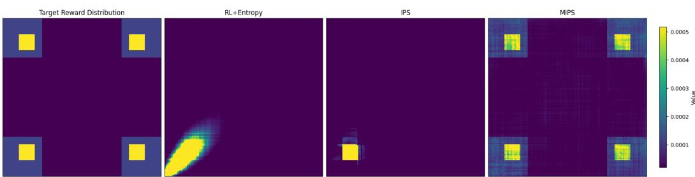  
Figure 1: Terminal distributions on a Hypergrid. Left to right: the reward-distribution target, entropyregularized RL, frequency-based IPS-GRPO, and MIPS-GRPO.

Our contributions are:

• We introduce MIPS, which estimates an outcome’s marginal probability using a learned trajectory-conditional model, while retaining the standard GRPO update.

• We evaluate MIPS on Hypergrids, where the learned outcome distribution can be compared exactly with the reward distribution. We then extend the evaluation to molecular synthesis and phylogenetic tree construction, where we measure coverage of high-quality outcomes and alignment with the reward.

## 2 WHY IPS HAS LIMITATIONS

Inverse Probability Scaling (IPS) modifies the reward for an outcome o as

$$
\widetilde R ( o ) = \frac { R ( o ) } { P _ { \theta } ( o ) } ,
$$

where $P _ { \theta } ( o )$ is the probability that the current policy generates o. With the true $P _ { \theta } ( o )$ , IPS admits a reward-proportional stationary solution, $P _ { \theta } ( o _ { i } ) \propto \dot { R } ( \bar { o } _ { i } )$ (Sinha et al., 2026).

In practice, however, $P _ { \theta } ( o )$ is generally unknown. IPS-GRPO estimates it from outcome frequencies within a group of G rollouts (Sinha et al., 2026), so the estimate has resolution $1 / G .$ . For an outcome $^ { O , }$ the expected number of occurrences in a group is $G P _ { \theta } ( o )$ , and after one occurrence, the probability of observing it again is $1 - \left( 1 - P _ { \theta } ( o ) \right) ^ { G - 1 }$ . When $G P _ { \theta } ( o ) \ll 1$ , repeated observations are unlikely, and a sampled outcome is therefore typically observed only once and assigned probability $1 / G$ . In this regime, the within-group frequency provides little information about its underlying probability. This makes the choice of G important in practice.

In large constructive problems, the size of the outcome space is typically unknown in advance, and the effective outcome space accessible to the policy evolves throughout training. Because neither the scale nor the effective support of this space is fixed, no single choice of G can reliably provide enough repeated outcomes throughout training. Choosing G to be conservatively large is also impractical because the sampling cost grows directly with the group size, motivating an estimator that does not depend on repeated occurrences of the same outcome.

MIPS addresses this limitation by estimating the marginal probability of each sampled outcome without relying on its frequency within the rollout group.

## 3 MARGINAL INVERSE PROBABILITY SCALING (MIPS)

IPS requires the probability of the outcome o, rather than the probability of any particular trajectory that generates it. For an outcome o, this marginal outcome probability is

$$
P _ { \theta } ( o ) = \sum _ { \tau \in \mathcal { T } ( o ) } P _ { \theta } ( \tau ) ,
$$

where $\mathcal { T } ( o )$ denotes the set of construction trajectories generating output $o .$ This marginalization motivates the name Marginal Inverse Probability Scaling (MIPS). A single trajectory likelihood cannot generally replace this quantity because multiple distinct trajectories may generate the same outcome. In large constructive spaces, explicitly summing over all trajectories in $\mathcal { T } ( o )$ is generally intractable.

For a finite, acyclic, deterministic constructive process with positive rewards, $R ( o ) > 0$ , MIPS avoids this sum using a learned trajectory-conditional model.

Let $\tau = ( s _ { 0 } , a _ { 0 } , \ldots , s _ { T } )$ be an on-policy trajectory with likelihood $\begin{array} { r } { P _ { \theta } ( \tau ) = \prod _ { t = 0 } ^ { T - 1 } \pi _ { \theta } ( a _ { t } \ | \ s _ { t } ) } \end{array}$ Since o is determined by $\tau , P _ { \theta } ( \tau , o ) = P _ { \theta } ( \tau )$ . By the chain rule, $P _ { \theta } ( \tau , o ) = P _ { \theta } ^ { - } ( o ) \breve { P } _ { \theta } ( \tau \mid o )$ , and therefore $P _ { \theta } ( \tau ) = P _ { \theta } ( \dot { o } ) P _ { \theta } ( \tau \mid \dot { o } )$ . For any supported trajectory,

$$
P _ { \theta } ( o ) = \frac { P _ { \theta } ( \tau ) } { P _ { \theta } ( \tau \mid o ) } .
$$

Thu $^ { 1 S , }$ given the trajectory-conditional probability, the marginal outcome probability can be recovered using one trajectory for the sampled outcome.

MIPS therefore introduces a learnable trajectory-conditional model $c _ { \phi } ( \tau \mid o )$ , such that:

$$
c _ { \phi } ( \tau \mid o ) \approx P _ { \theta } ( \tau \mid o ) , \qquad a n d \qquad \sum _ { \tau \in \mathcal { T } ( o ) } c _ { \phi } ( \tau \mid o ) = 1 ,
$$

and substitutes it into the marginal identity. For each sampled trajectory, MIPS defines

$$
P _ { \theta , \phi } ( o ) = \frac { P _ { \theta } ( \tau ) } { c _ { \phi } ( \tau \mid o ) } , \qquad \widetilde { R } = \frac { R ( o ) } { P _ { \theta , \phi } ( o ) } = \frac { R ( o ) c _ { \phi } ( \tau \mid o ) } { P _ { \theta } ( \tau ) } .\tag{1}
$$

If $c _ { \phi } ( \tau \mid o ) = P _ { \theta } ( \tau \mid o )$ , then $P _ { \theta , \phi } ( o ) = P _ { \theta } ( o )$ for every trajectory generating $o .$

To make the conditional model tractable, it can be factorized over predecessor transitions. For a finite acyclic construction process with a unique initial state and a Markov policy,

$$
c _ { \phi } ( \tau \mid o ) = \prod _ { t = 1 } ^ { T } c _ { \phi } ( s _ { t - 1 } , a _ { t - 1 } \mid s _ { t } ) ,
$$

with each factor normalized over valid incoming transitions.

The conditional model is trained by maximum likelihood using on-policy trajectories:

$$
\mathcal { L } _ { \mathrm { c o n d } } ( \phi ) = - \mathbb { E } _ { \tau \sim \pi _ { \theta } } \left[ \sum _ { t = 1 } ^ { T } \log c _ { \phi } ( s _ { t - 1 } , a _ { t - 1 } \mid s _ { t } ) \right] .\tag{2}
$$

At each training step, MIPS uses the current conditional model $c _ { \phi } ( \tau \mid o )$ to compute scaled rewards for the new rollouts. It then keeps those scaled rewards fixed, normalizes them within the rollout group, and updates the policy with the usual clipped GRPO objective. The complete update is given in Appendix A.

With an approximate conditional model, $P _ { \theta , \phi } ( o )$ may vary across trajectories to the same outcome and is not generally an unbiased estimate of $P _ { \theta } ( o ) ;$ nor do the samplewise estimates necessarily form a normalized outcome distribution. Its accuracy depends on conditional-model fit and adequate policy support.

## 3.1 RELATION TO GFLOWNETS

GFlowNets also target reward-proportional terminal sampling (Bengio et al., 2021; 2023). The trajectory-conditional factorization used by MIPS is similar to the backward policy used in GFlowNets (Malkin et al., 2022). Related work connects GFlowNet objectives to entropy-regularized RL (Tiapkin et al., 2024), analyzes multi-path marginal corrections (Deleu et al., 2024), and develops policygradient and PPO-style GFlowNet training (Niu et al., 2024; Zykova-Myzina et al., 2026).

MIPS differs in how this conditional distribution is used: it estimates the current policy’s marginal terminal probability for IPS, thereby avoiding repeated terminal observations while retaining the standard GRPO surrogate. It does not introduce a new GFlowNet objective. Detailed comparisons appear in Appendix B.

## 4 EXPERIMENTS

We first study MIPS in a controlled setting, the Hypergrid environment. Because the terminal distribution of each trained policy can be computed exactly in this setup, we can compare it directly with the reward-distribution target and vary the outcome-space size and group size independently. We then test whether these findings carry over to two large structured domains, molecular synthesis and phylogenetic tree construction, where the outcome spaces are too large to enumerate. In these domains, we assess coverage of high-quality outcomes and the alignment between sampling density and reward, and include task-specific GFlowNet samplers as reference points.

## 4.1 HYPERGRID SCALABILITY WITH OUTCOME-SPACE SIZE AND GROUP SIZE

We use a two-dimensional Hypergrid with side length H, in which each state is represented by a pair of coordinates in $\{ 0 , \ldots , H ^  \bar { - } 1 \bar { \} ^ { 2 } }$ . An agent starts at (0, 0) and, at each step, the agent can either increment one coordinate or stop. Any state at which the agent stops is a terminal state, so the agent can choose to terminate at any point in the grid. Different orders of coordinate increments can reach the same terminal state, creating multiple construction trajectories for each outcome. A grid with side length H has $H ^ { 2 }$ possible terminal states. Here the outcomes are the same as the terminal states. Since the Hypergrid is enumerable, we can compute the learned outcome distribution $P _ { \theta }$ exactly and directly assess whether it matches the desired reward-aligned distribution. Each episode terminates at a grid coordinate $s \in \{ 0 , \ldots , H - 1 \} ^ { 2 }$ , which is mapped uniformly to $x \in [ - 1 , 1 ] ^ { 2 }$ . The reward is defined as

$$
R ( x ) = R _ { 0 } + R _ { 1 } \prod _ { i = 1 } ^ { 2 } 1 ( | x _ { i } | > 0 . 5 ) + R _ { 2 } \prod _ { i = 1 } ^ { 2 } 1 ( 0 . 6 < | x _ { i } | < 0 . 8 ) ,\tag{3}
$$

where $0 < R _ { 0 } \ll R _ { 1 } < R _ { 2 }$ . This construction produces 4 symmetric high-reward modes surrounded by a ring, resulting in a sharply multimodal reward landscape (Figure 1, left). We set $R _ { 0 } = 0 . 1$ $R _ { 1 } = 0 . 5$ , and $R _ { 2 } = 2 . 0$ , ensuring that every terminal state receives a positive reward.

Experiment. We compare three training methods: GRPO, IPS-GRPO, and MIPS-GRPO. For each method, we consider grid side lengths H ∈ {4, 8, 16, 32, 64, 128, 256, 512} and rollout-group sizes G ∈ {16, 32, 64, 128, 256, 512, 1024, 2048}, yielding 192 experimental configurations in total. For each configuration, we trained the policy until convergence. To quantify how closely the trained policy’s outcome distribution matches the reward distribution, we use Jensen–Shannon divergence (JSD) and total variation distance (TV), with lower values indicating better alignment. Because the environment is enumerable, we use dynamic programming to compute the exact outcome distribution of each trained policy.

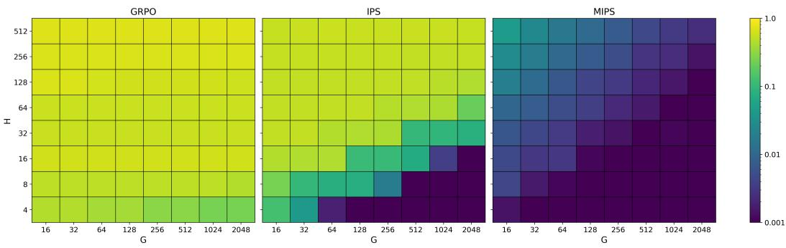  
Figure 2: Hypergrid scalability. JSD between the exact outcome distribution and the rewarddistribution target for GRPO (left), IPS-GRPO (center), and MIPS-GRPO (right). Grid side length H is shown on the vertical axis and group size G on the horizontal axis, with ${ \dot { H } } ^ { \smash { \sum } }$ outcomes and a shared logarithmic color scale across panels.

Results. Figure 2 shows how the three methods behave as the outcome space becomes larger and the rollout group size changes. GRPO remains far from the reward-distribution target across most settings.

IPS behaves differently. On smaller outcome spaces, it can closely match the target reward distribution, especially when the rollout group is sufficiently large. However, its performance deteriorates as the outcome space grows. Increasing the group size helps, but mainly shifts the point at which this deterioration occurs rather than removing it. MIPS shows a different scaling behavior. Its outcome distribution remains close to the reward-distribution target over a much wider range of outcome spaces and group sizes. In particular, its behavior changes much less when the group is small relative to the number of possible outcomes.

Figure 3 makes this behavior more concrete by showing the learned outcome distributions for a fixed Hypergrid while the group size is increased. GRPO concentrates almost all of its probability around a single rewarding region, exhibiting mode collapse. With a small group, IPS-GRPO shows a similar form of collapse but covers more outcomes. As the group size G becomes larger, IPS becomes more effective. MIPS behaves differently. Even with the smaller group size G, it places probability around all rewarding regions. Increasing the group size G mainly refines this distribution rather than changing which modes are represented.

The important observation is therefore not simply that MIPS produces a more diverse distribution, but that its diversity follows the structure of the reward distribution itself. The complete JSD and TV results (Appendix C.1, Tables 4 and 5) show that, although sufficiently large groups allow IPS-GRPO to match MIPS on the smallest grids, MIPS achieves consistently better alignment as the outcome space grows, across all tested group sizes G.

Taken together, the Hypergrid experiments verify two key properties of MIPS. First, MIPS preserves diversity as the outcome space grows without requiring the rollout group size G to grow with it. Second, this diversity is not produced by indiscriminate randomness: the learned policy distribution remains structured by the reward itself, placing probability mass across the distinct rewarding modes rather than spreading it uniformly. These results show that MIPS can scale to large outcome spaces while maintaining reward-aligned diversity and substantially reducing sensitivity to the hyperparameter G.

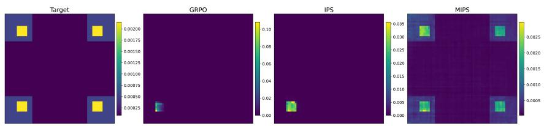

(a) G = 64  
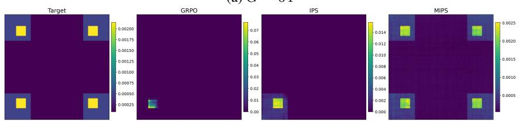

(b) G = 512  
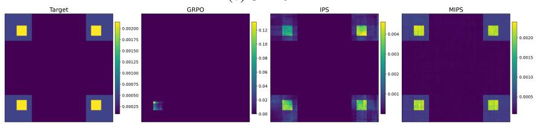  
(c) $G = 2 0 4 8$  
Figure 3: Outcome distributions on the 64 × 64 Hypergrid. The reward-distribution target and the exact outcome distributions learned by GRPO, IPS-GRPO, and MIPS-GRPO are shown for increasing rollout-group sizes G.

Stability and convergence of marginal-probability estimation. Because Hypergrid marginals are exactly computable by dynamic programming, we directly evaluate the accuracy of the MIPS estimator during training. For each trajectory sampled during training, we measure $\ell _ { i } =$ $( P _ { \theta , \phi } ( o _ { i } ) - P _ { \theta } ( o _ { i } ) ) ^ { 2 }$ , where $P _ { \theta , \phi } ( o _ { i } )$ is the estimated marginal and $P _ { \theta } ( o _ { i } )$ is the exact marginal under the current policy. Figure 4 reports the batch mean and variance of $\ell _ { i }$ across training on the log scale.

Both decrease rapidly after an initial transient and remain low thereafter. This empirically supports stable convergence of the coupled policy and trajectory-conditional model to a low-error regime.

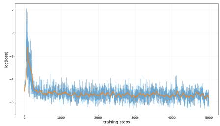  
(a) Log mean squared probability error.

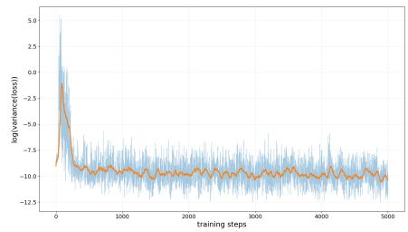  
(b) Log variance of the squared probability error.  
Figure 4: Marginal-probability estimation. Raw measurements and smoothed trends are shown.

## 4.1.1 ABLATION OF CONDITIONAL SCALING

We ablate the use of the trajectory-conditional model $c _ { \phi } ( \tau \mid o )$ in the MIPS scaling factor. In the full method, the scaling term uses the conditional trajectory model $c _ { \phi } ( \tau \mid o )$ to account for how trajectories are distributed given the outcome. In the ablated variant, this conditional information is removed from the scaling computation, so the estimator relies only on the trajectory likelihood $P _ { \theta } ( \tau )$

This is equivalent to setting $c _ { \phi } ( \tau \mid o ) = 1$ . Any other constant yields the same behavior because the scaled rewards are group-normalized when computing advantages.

Table 1 shows that removing conditional scaling substantially degrades alignment with the rewarddistribution target across all Hypergrid configurations. Both Jensen–Shannon divergence (JSD) and total variation (TV) distance increase sharply in every setting. These results show that the benefit of MIPS does not arise from trajectory probability scaling alone. Conditioning the scaling factor on the outcome is important for estimating the marginal outcome probability and, consequently, for matching the target reward distribution.

Table 1: Ablation of conditional scaling on Hypergrids. JSD and TV distance from the rewarddistribution target. We compare full MIPS with a variant that does not use the trajectory-conditional model in the scaling factor.
<table><tr><td rowspan="2">H</td><td rowspan="2">G</td><td colspan="2">JSD↓</td><td colspan="2">TV↓</td></tr><tr><td>MIPS</td><td> ${ \bf N o } c _ { \phi } ( \tau \mid o )$ </td><td>MIPS</td><td> ${ \mathrm { N o } } c _ { \phi } ( \tau \mid o )$ </td></tr><tr><td>32</td><td>32</td><td>0.0032</td><td>0.5740</td><td>0.0617</td><td>0.9147</td></tr><tr><td>32</td><td>64</td><td>0.0040</td><td>0.5592</td><td>0.0697</td><td>0.9013</td></tr><tr><td>64</td><td>32</td><td>0.0077</td><td>0.6315</td><td>0.0996</td><td>0.9622</td></tr><tr><td>64</td><td>64</td><td>0.0052</td><td>0.6428</td><td>0.0815</td><td>0.9689</td></tr></table>

## 4.2 MOLECULAR SYNTHESIS

Molecular synthesis can be viewed as a sequential decision-making problem where an agent builds a molecule through a series of chemically valid reactions. At each step, the agent selects a reaction and compatible building blocks, and the final molecule receives a reward based on its desired properties. This gives a natural reinforcement-learning formulation, where the sequence of synthesis decisions forms a trajectory and the resulting molecule is the outcome. The number of possible trajectories grows combinatorially with the available reactions, building blocks, and synthesis steps, creating an enormous search space. Moreover, different synthesis trajectories can lead to the same molecule, so many trajectories may correspond to a single outcome. The goal is therefore not only to find the best molecule, but to explore this large combinatorial space and discover diverse, high-quality molecules.

Environment. We use the reaction-based environment, sEH proxy task, and reward construction of RGFN (Koziarski et al., 2024) without modification. Starting from an initial building block, the policy repeatedly selects a reaction template, a compatible building block, and one of the resulting products until choosing to stop. The chemistry contains 17 reaction types and 350 low-cost building blocks.

Thus, as the number of reaction steps increases, many different trajectories can contribute probability to the same molecule, making this a challenging setting for marginal outcome-probability estimation. We compare GRPO, IPS-GRPO, MIPS-GRPO, and RGFN trained with its published trajectorybalance configuration.

Evaluation. After 4,000 training iterations, we draw 50,000 molecules from each final policy. Molecules are identified by canonical SMILES, and uniqueness is measured only over valid samples. To measure diversity specifically within the high-quality region, we follow the mode criterion of Koziarski et al. (2024): unique molecules with sEH proxy score above 7 are processed in decreasing score order, and the Leader algorithm selects a new mode when its Tanimoto similarity to every previously selected mode is at most 0.5. We additionally count distinct Murcko scaffolds among molecules with proxy score above 7 to measure whether high-quality samples span different molecular cores. Finally, we report the mean sEH proxy over all samples and over the discovered modes to assess whether broader coverage is accompanied by maintaining the molecular quality.

Coverage and quality. Table 2 compares the methods in terms of overall molecular diversity, high-reward mode coverage, structural diversity, and proxy quality.

GRPO collapses almost completely, producing essentially a single unique molecule per run. IPS-GRPO improves overall uniqueness modestly, generating 17 unique molecules on average, but still fails to recover any high-reward modes. RGFN maintains much broader support, generating 34,744 unique molecules (69.5% of valid samples) and recovering 18 distinct high-reward modes.

Table 2: Final-policy molecular synthesis results. Statistics from 50,000 samples across 3 seeds. The selected metrics measure overall coverage, high-quality diversity, structural diversity, and molecular quality.
<table><tr><td>Metric</td><td>What it measures</td><td>GRPO</td><td>IPS-GRPO</td><td>RGFN</td><td>MIPS-GRPO</td></tr><tr><td>Unique molecules (count) ↑</td><td>Overall molecular diversity</td><td> $\overline { { 1 \pm 0 } }$ </td><td> $1 7 \pm 1 1$ </td><td> $3 4 , 7 4 4 \pm 1 , 2 7 0$ </td><td> $\mathbf { 4 5 , 7 9 4 \pm 2 , 3 3 2 }$ </td></tr><tr><td>High-reward modes ↑</td><td>Distinct high-quality regions</td><td> $0 \pm 0$ </td><td> $0 \pm 0$ </td><td> $1 8 \pm 1$ </td><td> ${ \bf 7 0 \pm 2 }$ </td></tr><tr><td>Murcko scaffolds (proxy &gt; 7) ↑</td><td>High-quality structural diversity</td><td> $0 \pm 0$ </td><td> $0 \pm 0$ </td><td> $2 5 \pm 6$ </td><td> ${ \bf 1 4 9 \pm 4 2 }$ </td></tr><tr><td>Mean proxy (all samples)</td><td>Overall molecular quality</td><td> $6 . 5 4 \pm 0 . 3 7$ </td><td> $4 . 6 8 \pm 1 . 3 1$ </td><td> $4 . 1 9 \pm 0 . 3 7$ </td><td> $4 . 4 7 \pm 0 . 1 3$ </td></tr><tr><td>Mean proxy (modes) ↑</td><td>Quality of discovered modes</td><td></td><td></td><td> $7 . 1 7 \pm 0 . 0 5$ </td><td> ${ \bf 7 . 2 2 \pm 0 . 0 8 }$ </td></tr></table>

MIPS-GRPO further expands this coverage, generating 45,794 unique molecules (91.8% of valid samples), along with 70 high-reward modes and 149 high-reward Murcko scaffolds. The increase in scaffolds indicates that these additional modes span different molecular cores rather than consisting only of small variations of similar structures.

This broader coverage does not come at the cost of proxy quality. MIPS-GRPO achieves a mean proxy score of 4.47 across all generated molecules, compared with 4.19 for RGFN, while its discovered modes have a mean proxy score of 7.22, compared with 7.17 for RGFN. Together, these results show that MIPS-GRPO expands both overall and high-reward coverage while maintaining comparable molecular quality.

## 4.3 PHYLOGENETIC TREE CONSTRUCTION

Phylogenetic tree construction can be formulated as a sequential decision-making problem in which an agent builds a tree by repeatedly merging pairs of subtrees and assigning branch lengths. The resulting sequence of construction decisions forms a trajectory, while the completed phylogenetic tree is the outcome and receives a reward based on how well it explains the observed sequence data. This is a challenging combinatorial search problem because the number of possible tree topologies grows rapidly with the number of taxa, and many different construction trajectories can lead to the same final tree. The task therefore provides a structured setting in which to test whether a policy can retain diverse tree hypotheses while continuing to favor high-quality ones.

Setup and evaluation. We use a 10-taxon setting derived from the DS1 benchmark and the bottomup construction process of PhyloGFN (Zhou et al., 2024): starting from individual taxa, the policy merges pairs of subtrees and assigns branch lengths until a complete tree is formed. Rewards are based on the Jukes–Cantor log-likelihood (Jukes & Cantor, 1969). We compare GRPO, IPS-GRPO, MIPS-GRPO, and PhyloGFN using $1 0 ^ { 6 }$ samples from each final policy.

We measure coverage by the number of distinct tree signatures, where a signature combines tree topology and branch-length assignment, and assess tree quality using the mean log-likelihood (MLL) of sampled trees. Alignment with the reward distribution is measured by the Pearson correlation between outcome log-probability of the policy and log-likelihood of the generated tree, both on each method’s own samples (sampling r), and on a common set of trees when the corresponding densities are available (shared-tree r). For MIPS-GRPO, the tree log-probability is estimated using Equation (1), with the trained policy and conditional model providing $P _ { \theta } ( \tau )$ and $c _ { \phi } ( \tau \mid o )$

Table 3: Phylogenetic tree construction with 10 taxa. Results from $1 0 ^ { 6 }$ samples per final policy (mean ± standard deviation over three seeds).
<table><tr><td>Method</td><td>Unique signatures / 1M ↑</td><td>MLL</td><td>Sampling r ↑</td><td>Shared-tree r ↑</td></tr><tr><td>GRPO</td><td> $1 \pm 0$ </td><td> $- 4 3 1 8 . 4 \pm 0 . 0$ </td><td>一</td><td>一</td></tr><tr><td>IPS-GRPO</td><td> $2 6 3 , 5 3 2 \pm 2 4 , 4 6 6$ </td><td> $- 4 2 9 4 . 4 \pm 3 . 7$ </td><td> $0 . 1 4 0 \pm 0 . 0 1 0$ </td><td>一</td></tr><tr><td>PhyloGFN</td><td> $1 , 0 0 0 , 0 0 0 \pm 0$ </td><td> $- 4 3 6 6 . 5 \pm 2 . 2$ </td><td> $0 . 8 3 6 \pm 0 . 0 4 4$ </td><td> $0 . 9 3 6 \pm 0 . 0 1 2$ </td></tr><tr><td>MIPS-GRPO</td><td> $1 , 0 0 0 , 0 0 0 \pm 0$ </td><td> $- 4 3 7 2 . 9 \pm 0 . 9$ </td><td> $\mathbf { 0 . 9 6 7 \pm 0 . 0 0 3 }$ </td><td> $\mathbf { 0 . 9 6 2 \pm 0 . 0 1 0 }$ </td></tr></table>

Coverage and quality. Table 3 shows that MIPS-GRPO and PhyloGFN achieve broad coverage, whereas IPS-GRPO covers far fewer trees and GRPO collapses to a single tree. Broader coverage comes with lower MLL: instead of concentrating on a few high-likelihood trees, the policy spreads probability across a wider range of trees, including lower-likelihood ones.

MIPS-GRPO shows the strongest reward alignment, with a sampling correlation of r = 0.967 compared with 0.836 for PhyloGFN and 0.140 for IPS-GRPO. It also has the highest correlation on the shared tree set (Figure 5), so this advantage does not depend on each method’s own samples. Missing correlations could not be estimated because the corresponding policies generated too few distinct trees. Overall, MIPS-GRPO combines broad topology coverage with a sampling density that increases consistently with tree likelihood.

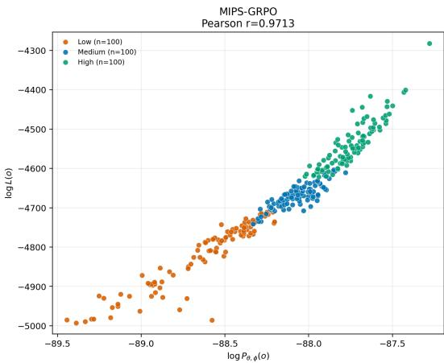

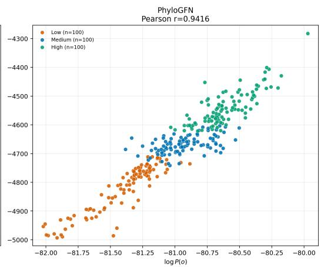  
Figure 5: Probability–likelihood alignment on a shared tree set. Terminal log-likelihood versus outcome log-probability for MIPS-GRPO (left) and PhyloGFN (right) on a common set of 300 trees (50 per method per log-likelihood band). A common set removes the dependence of the correlation on each method’s own sampling distribution. MIPS-GRPO spreads its mass over a larger outcome space, so its log-probabilities are lower and absolute values are not comparable across panels. Pearson r is reported above each panel.

Taken together, these results show that MIPS does more than increase stochasticity in phylogenetic construction. Compared with GRPO and IPS-GRPO, it covers a far broader set of trees while assigning higher probability to higher-likelihood ones, and it achieves similarly broad coverage to PhyloGFN while exhibiting stronger reward alignment.

## 5 DISCUSSION

Our results show that MIPS can maintain diverse, high-quality outcomes as the outcome space grows, effectively mitigating mode collapse in large outcome spaces. On Hypergrids, MIPS remains closely aligned with the reward distribution across different outcome-space sizes and group sizes. The marginal-estimation results and ablation studies further show that the trajectory-conditional model is important for accurately estimating marginal outcome probabilities. This behavior also extends to larger, structured problems. In molecular synthesis, MIPS discovers diverse, high-reward molecules and molecular scaffolds while maintaining high mode quality. In phylogenetic inference, MIPS achieves broad tree coverage while assigning higher probability to higher-likelihood trees, resulting in stronger alignment between the policy and the reward distribution over outcomes.

MIPS is limited by the accuracy of its learned trajectory-conditional model and by the assumptions underlying the current formulation, which considers finite, acyclic, deterministic constructive processes with positive rewards. Future work could extend MIPS beyond these assumptions, particularly to continuous outcome spaces in which outcomes may not be uniquely defined but instead exhibit varying degrees of similarity. Such settings could motivate marginal-probability corrections that account for similarity or local structure among outcomes rather than relying on exact outcome identity.

More broadly, this study opens the door to using RL algorithms effectively for search and sampling tasks, rather than only for reward maximization, through an appropriate choice of advantage calculation.

## REFERENCES

Emmanuel Bengio, Moksh Jain, Maksym Korablyov, Doina Precup, and Yoshua Bengio. Flow network based generative models for non-iterative diverse candidate generation. Advances in neural information processing systems, 34:27381–27394, 2021.

Yoshua Bengio, Salem Lahlou, Tristan Deleu, Edward J. Hu, Mo Tiwari, and Emmanuel Bengio. Gflownet foundations. Journal of Machine Learning Research, 24(210):1–55, 2023. URL http: //jmlr.org/papers/v24/22-0364.html.

Tristan Deleu, Padideh Nouri, Nikolay Malkin, Doina Precup, and Yoshua Bengio. Discrete probabilistic inference as control in multi-path environments. In Negar Kiyavash and Joris M. Mooij (eds.), Proceedings ofthe Fortieth Conference on Uncertainty in Artificial Intelligence, volume 244 of Proceedings ofMachine Learning Research, pp. 997–1021. PMLR, 15–19 Jul 2024. URL https://proceedings.mlr.press/v244/deleu24a.html.

Tuomas Haarnoja, Aurick Zhou, Pieter Abbeel, and Sergey Levine. Soft actor-critic: Off-policy maximum entropy deep reinforcement learning with a stochastic actor. In International conference on machine learning, pp. 1861–1870. Pmlr, 2018.

Thomas H. Jukes and Charles R. Cantor. Evolution of protein molecules. In H. N. Munro (ed.), Mammalian Protein Metabolism, volume 3, pp. 21–132. Academic Press, New York, 1969. doi: 10.1016/B978-1-4832-3211-9.50009-7.

Hohyun Kim, Seunggeun Lee, and Min-Hwan Oh. Symmetry-aware GFlowNets. In Aarti Singh, Maryam Fazel, Daniel Hsu, Simon Lacoste-Julien, Felix Berkenkamp, Tegan Maharaj, Kiri Wagstaff, and Jerry Zhu (eds.), Proceedings of the 42nd International Conference on Machine Learning, volume 267 of Proceedings ofMachine Learning Research, pp. 30334–30362. PMLR, 13–19 Jul 2025. URL https://proceedings.mlr.press/v267/kim25s.html.

Robert Kirk, Ishita Mediratta, Christoforos Nalmpantis, Jelena Luketina, Eric Hambro, Edward Grefenstette, and Roberta Raileanu. Understanding the effects of rlhf on llm generalisation and diversity. In B. Kim, Y. Yue, S. Chaudhuri, K. Fragkiadaki, M. Khan, and Y. Sun (eds.), International Conference on Learning Representations, volume 2024, pp. 20620–20653, 2024. URL https://proceedings.iclr.cc/paper\_files/paper/2024/file/5a68 d05006d5b05dd9463dd9c0219db0-Paper-Conference.pdf.

Michał Koziarski, Andrei Rekesh, Dmytro Shevchuk, Almer van der Sloot, Piotr Gainski, Yoshua´ Bengio, Cheng-Hao Liu, Mike Tyers, and Robert A Batey. Rgfn: Synthesizable molecular generation using gflownets. Advances in Neural Information Processing Systems, 37:46908–46955, 2024.

Chenyi Li, Yuan Zhang, Bo Wang, Guoqing Ma, Wei Tang, Haoyang Huang, and Nan Duan. Setpo: Set-level policy optimization for diversity-preserving llm reasoning. arXiv preprint arXiv:2602.01062, 2026.

Nikolay Malkin, Moksh Jain, Emmanuel Bengio, Chen Sun, and Yoshua Bengio. Trajectory balance: Improved credit assignment in gflownets. Advances in Neural Information Processing Systems, 35: 5955–5967, 2022.

Puhua Niu, Shili Wu, Mingzhou Fan, and Xiaoning Qian. Gflownet training by policy gradients. arXiv preprint arXiv:2408.05885, 2024.

Marcus Olivecrona, Thomas Blaschke, Ola Engkvist, and Hongming Chen. Molecular de-novo design through deep reinforcement learning. Journal of cheminformatics, 9(1):48, 2017.

Long Ouyang, Jeffrey Wu, Xu Jiang, Diogo Almeida, Carroll Wainwright, Pamela Mishkin, Chong Zhang, Sandhini Agarwal, Katarina Slama, Alex Ray, et al. Training language models to follow instructions with human feedback. Advances in neural information processing systems, 35:27730– 27744, 2022.

Ling Pan, Dinghuai Zhang, Aaron Courville, Longbo Huang, and Yoshua Bengio. Generative augmented flow networks. arXiv preprint arXiv:2210.03308, 2022.

John Schulman, Filip Wolski, Prafulla Dhariwal, Alec Radford, and Oleg Klimov. Proximal policy optimization algorithms. arXiv preprint arXiv:1707.06347, 2017.

Zhihong Shao, Peiyi Wang, Qihao Zhu, Runxin Xu, Junxiao Song, Xiao Bi, Haowei Zhang, Mingchuan Zhang, YK Li, et al. Deepseekmath: Pushing the limits of mathematical reasoning in open language models. arXiv preprint arXiv:2402.03300, 2024.

Abhijeet Sinha, Sundari Elango, and Dianbo Liu. Expected return causes outcome-level mode collapse in reinforcement learning and how to fix it with inverse probability scaling. arXiv preprint arXiv:2601.21669, 2026.

Daniil Tiapkin, Nikita Morozov, Alexey Naumov, and Dmitry P Vetrov. Generative flow networks as entropy-regularized rl. In International Conference on Artificial Intelligence and Statistics, pp. 4213–4221. PMLR, 2024.

Ming Yang Zhou, Zichao Yan, Elliot Layne, Nikolay Malkin, Dinghuai Zhang, Moksh Jain, Mathieu Blanchette, and Yoshua Bengio. Phylogfn: Phylogenetic inference with generative flow networks. In International Conference on Learning Representations, volume 2024, pp. 35370–35403, 2024.

Yiheng Zhu, Jialu Wu, Chaowen Hu, Jiahuan Yan, Tingjun Hou, Jian Wu, et al. Sample-efficient multi-objective molecular optimization with gflownets. Advances in neural information processing systems, 36:79667–79684, 2023.

Anna Zykova-Myzina, Timofei Gritsaev, Daniil Tiapkin, and Nikita Morozov. Proximal policy optimization for amortized discrete sampling. arXiv preprint arXiv:2606.15793, 2026.

## A MIPS-GRPO POLICY UPDATE

## Algorithm 1 gives the update used for MIPS-GRPO.

Algorithm 1 MIPS-GRPO   
Require: policy $\pi _ { \boldsymbol { \theta } } ;$ conditional model $c _ { \phi } ;$ group size G; clipping parameter ϵ; policy epochs $K ;$ conditional  
model epochs $K _ { c } ;$ entropy coefficient $\beta$ for entropy $\mathcal { H }$   
1: for each update do   
2: πold $ \pi _ { \theta }$   
3: Sample $G$ trajectories $\tau _ { i } = ( s _ { i , 0 } , a _ { i , 0 } , . . . , s _ { i , T _ { i } } ) \sim \pi _ { \mathrm { o l d } }$   
4: Let $o _ { i }$ denote the terminal outcome of $\tau _ { i }$   
without gradients:   
5: for $i \stackrel { \smile } { = } 1 , \dots , G$ do   
6: $\ell _ { i } ^ { \pi } \gets \sum _ { t = 0 } ^ { T _ { i } - 1 }$ log πold $\left( a _ { i , t } \mid s _ { i , t } \right)$   
7: $\begin{array} { r } { \ell _ { i } ^ { c } \gets \sum _ { t = 1 } ^ { T _ { i } } \log c _ { \phi } \big ( s _ { i , t - 1 } , a _ { i , t - 1 } ~ \big | ~ s _ { i , t } \big ) } \end{array}$   
8: log wi $\gets \log R ( o _ { i } ) + \ell _ { i } ^ { c } - \ell _ { i } ^ { \pi }$   
9: end for   
10: $\widehat { A } _ { i } \gets \frac { w _ { i } - \mathrm { m e a n } _ { j } ( w _ { j } ) } { { \boldsymbol { \mathfrak { c } } } + { \boldsymbol { \mathsf { d } } } \ . \left( { \boldsymbol { \mathscr { a } } } \right. \ . ) }$   
stdj (wj )   
11: Stop gradients through $\widehat { A } _ { i }$   
12: for ${ \bf \tilde { \Sigma } } = 1 , \dots , K$ do   
13: $\rho _ { i , t } ( \theta ) \longleftarrow { \frac { \pi _ { \theta } { ( a _ { i , t } \mid s _ { i , t } ) } } { \pi _ { \mathrm { o l d } } { ( a _ { i , t } \mid s _ { i , t } ) } } }$   
14: ${ \mathcal { H } } _ { \pi } ( \theta )  { \frac { 1 } { G } } \sum _ { i = 1 } ^ { G } { \frac { 1 } { T _ { i } } } \sum _ { t = 0 } ^ { T _ { i } - 1 } { \mathcal { H } } ( \pi _ { \theta } ( \cdot \mid s _ { i , t } ) )$   
15: $\mathcal { L } _ { \pi } ( \theta ) \gets - \frac { 1 } { G } \sum _ { i = 1 } ^ { G } \frac { 1 } { T _ { i } } \sum _ { t = 0 } ^ { T _ { i } - 1 } \operatorname* { m i n } \Bigl ( \rho _ { i , t } ( \theta ) \widehat { A } _ { i } , \mathrm { c l i p } ( \rho _ { i , t } ( \theta ) , 1 - \epsilon , 1 + \epsilon ) \widehat { A } _ { i } \Bigr ) - \beta \mathcal { H } _ { \pi } ( \theta )$   
16: Take one optimizer step on $\theta$   
17: end for   
18: for $k _ { c } = 1 , \ldots , K _ { c }$ do   
19: $\mathcal { L } _ { c } ( \phi )  - \frac { 1 } { G } \sum _ { i = 1 } ^ { G } \sum _ { t = 1 } ^ { T _ { i } } \log c _ { \phi } ( s _ { i , t - 1 } , a _ { i , t - 1 } \mid s _ { i , t } )$   
20: Take one optimizer step on $\phi$   
21: end for   
22: end for

## B FURTHER CONNECTIONS TO GFLOWNETS AND SYMMETRY

Trajectory balance. The trajectory-conditional model $c _ { \phi }$ represents a distribution over construction paths, as a GFlowNet backward policy does through transitions from a terminal object to the initial state. In trajectory balance (TB), the forward and backward probabilities satisfy (Malkin et al., 2022)

$$
Z P _ { F } ( \tau ) = R ( o ) P _ { B } ( \tau \mid o ) .
$$

At exact balance, $P _ { F } ( \tau ) / P _ { B } ( \tau \mid o ) = R ( o ) / Z = P _ { F } ( o )$ . MIPS uses the same probability-ratio identity, but to estimate the current policy’s marginal terminal probability for IPS, rather than to enforce this target-reward constraint. Its trajectory-conditional model tracks the policy’s conditional paths through likelihood fitting; the policy receives the resulting IPS correction through the GRPO surrogate.

Policy-gradient GFlowNets. GFlowNets can also be trained through policy gradients and entropyregularized control (Niu et al., 2024; Tiapkin et al., 2024; Deleu et al., 2024). Zykova-Myzina et al. (2026) derive Entropic PPO for GFlowNet sampling, using log-backward-probability rewards, entropy regularization, and optionally likelihood-based backward-policy learning. MIPS instead augments conventional reward-based RL: a trajectory-conditional model estimates marginal outcome probabilities for IPS, whose scaled rewards define group-relative advantages.

Multiplicity and symmetry. Kim et al. (2025) address biases from graph symmetries and equivalent actions through symmetry-aware reward scaling. MIPS instead corrects construction-path multiplicity when estimating outcome probabilities from trajectory likelihoods. For outcomes defined up to symmetry, the policy and conditional model must use the same equivalence classes; symmetry and MIPS corrections thus address related but distinct biases.

C EXPERIMENTAL DETAILS

C.1 HYPERGRID SCALABILITY

Table 4: Jensen–Shannon divergence on the complete Hypergrid sweep (↓). Error between the exact learned terminal distribution and the reward-distribution target. Each entry is the mean ± standard deviation across repeated runs.
<table><tr><td>H Method</td><td>G = 16</td><td>G = 32</td><td>G = 64</td><td>G = 128</td><td>G = 256</td><td>G = 512</td><td>G = 1024</td><td>G = 2048</td></tr><tr><td rowspan="2">4 GRPO</td><td rowspan="2">0.4535 ± 0.0005</td><td rowspan="2">0.4539 ± 0.0000</td><td rowspan="2"> $0 . 3 9 8 1 \pm 0 . 1 1 1 5$ </td><td rowspan="2"> $\overline { { 0 . 3 9 8 3 \pm 0 . 1 1 1 3 } }$ </td><td rowspan="2">0.2985 ± 0.1059</td><td rowspan="2"> $\overline { { 0 . 2 9 8 5 \pm 0 . 1 0 6 0 } }$ </td><td rowspan="2"> $\overline { { 0 . 2 4 5 7 \pm 0 . 0 2 2 3 } }$ </td><td rowspan="2">0.2429 ± 0.0235  $\mathbf { 0 . 0 0 0 0 \pm 0 . 0 0 0 0 }$ </td></tr><tr><td>0.0003 ± 0.0003 0.0001 ± 0.0000</td></tr><tr><td>IPS-GRPO</td><td> $0 . 1 2 7 7 \pm 0 . 0 0 0 6$ </td><td> $0 . 0 4 2 0 \pm 0 . 0 0 1 8$ </td><td> $0 . 0 0 1 9 \pm 0 . 0 0 0 5$ </td><td></td><td></td><td> $\mathbf { 0 . 0 0 0 1 \pm 0 . 0 0 0 0 }$ </td><td> $\mathbf { 0 . 0 0 0 1 \pm 0 . 0 0 0 0 }$ </td><td></td></tr><tr><td></td><td></td><td>MIPS-GRPO 0.0014 ± 0.0005 0.0006 ± 0.0004 0.0004 ± 0.0002</td><td></td><td> $0 . 0 0 0 6 \pm 0 . 0 0 0 4$ </td><td> $0 . 0 0 0 2 \pm 0 . 0 0 0 1$ </td><td> $\mathbf { 0 . 0 0 0 1 \pm 0 . 0 0 0 0 }$ </td><td> $\mathbf { 0 . 0 0 0 1 \pm 0 . 0 0 0 0 }$ </td><td> $0 . 0 0 0 1 \pm 0 . 0 0 0 0$ </td></tr><tr><td>8 GRPO</td><td> $0 . 5 0 6 2 \pm 0 . 0 0 0 2$ </td><td> $0 . 5 0 4 7 \pm 0 . 0 0 3 3$ </td><td> $0 . 5 0 6 6 \pm 0 . 0 0 0 2$ </td><td> $0 . 5 0 6 7 \pm 0 . 0 0 0 2$ </td><td> $0 . 5 0 6 8 \pm 0 . 0 0 0 1$ </td><td> $0 . 5 0 6 8 \pm 0 . 0 0 0 1$ </td><td> $0 . 5 0 6 6 \pm 0 . 0 0 0 4$ </td><td> $0 . 4 5 2 5 \pm 0 . 0 6 2 5$ </td></tr><tr><td>IPS-GRPO</td><td> $0 . 2 4 3 0 \pm 0 . 1 2 2 2$ </td><td> $0 . 0 9 9 9 \pm 0 . 0 0 4 6$ </td><td>0.0781 ± 0.0010</td><td> $0 . 0 7 5 0 \pm 0 . 0 0 0 3$ </td><td> $0 . 0 1 7 3 \pm 0 . 0 0 2 7$ </td><td> $\mathbf { 0 . 0 0 0 5 \pm 0 . 0 0 0 2 }$ </td><td>0.0001 ± 0.0001 0.0001 ± 0.0001</td><td></td></tr><tr><td>MIPS-GRPO</td><td></td><td></td><td></td><td>0.0042 ± 0.0021 0.0016 ± 0.0006 0.0011 ± 0.0004 0.0008 ± 0.0004 0.0009 ± 0.0003</td><td></td><td> $0 . 0 0 0 6 \pm 0 . 0 0 0 5$ </td><td> $0 . 0 0 0 3 \pm 0 . 0 0 0 1$ </td><td> $0 . 0 0 0 2 \pm 0 . 0 0 0 1$ </td></tr><tr><td>16 GRPO</td><td>0.6069 ± 0.0011</td><td> $0 . 6 0 8 1 \pm 0 . 0 0 0 3$ </td><td> $0 . 6 0 8 6 \pm 0 . 0 0 0 2$ </td><td>0.6088 ± 0.0001</td><td>0.6089 ± 0.0000</td><td>0.6089 ± 0.0000</td><td> $0 . 6 0 8 9 \pm 0 . 0 0 0 0$ </td><td>0.6090 ± 0.0000</td></tr><tr><td>IPS-GRPO</td><td>0.4514 ± 0.0007</td><td> $0 . 4 3 8 6 \pm 0 . 0 0 1 6$ </td><td> $0 . 4 4 0 1 \pm 0 . 0 0 0 2$ </td><td>0.1091 ± 0.0010</td><td>0.1058 ± 0.0010</td><td>0.0689 ± 0.0011</td><td>0.0035 ± 0.0002 0.0003 ± 0.0001</td><td></td></tr><tr><td>MIPS-GRPO</td><td></td><td></td><td></td><td></td><td>0.0046 ± 0.0006 0.0030 ± 0.0009 0.0030 ± 0.0015 0.0011 ± 0.0003 0.0009 ± 0.0003 0.0006 ± 0.0004 0.0008 ± 0.0003 0.0003 ± 0.0002</td><td></td><td></td><td></td></tr><tr><td>32 GRPO</td><td> $0 . 5 5 4 1 \pm 0 . 0 0 3 9$ </td><td> $0 . 5 5 5 7 \pm 0 . 0 0 5 3$ </td><td> $0 . 5 5 6 3 \pm 0 . 0 0 2 0$ </td><td> $0 . 5 5 7 7 \pm 0 . 0 0 3 9$ </td><td> $0 . 5 5 7 3 \pm 0 . 0 0 1 6$ </td><td> $0 . 5 5 7 2 \pm 0 . 0 0 0 3$ </td><td> $0 . 5 5 7 8 \pm 0 . 0 0 0 4$ </td><td></td></tr><tr><td>IPS-GRPO</td><td>0.5306 ± 0.0018</td><td>0.5303 ± 0.0009</td><td>0.4540 ± 0.0017</td><td>0.4356 ± 0.0007</td><td>0.4317 ± 0.0009</td><td>0.1003 ± 0.0011</td><td>0.0914 ± 0.0008</td><td>0.5576 ± 0.0002 0.0800 ± 0.0006</td></tr><tr><td></td><td></td><td></td><td></td><td></td><td>MIPS-GRPO 0.0064 ± 0.0030 0.0043 ± 0.0014 0.0033 ± 0.0006 0.0018 ± 0.0009 0.0014 ± 0.0004 0.0010 ± 0.0002</td><td></td><td>0.0011 ± 0.0009 0.0005 ± 0.0001</td><td></td></tr><tr><td>64 GRPO</td><td> $0 . 5 7 2 5 \pm 0 . 0 0 7 8$ </td><td> $0 . 5 7 9 3 \pm 0 . 0 0 9 9$ </td><td> $0 . 5 7 3 4 \pm 0 . 0 0 4 6$ </td><td></td><td></td><td></td><td> $0 . 5 7 1 3 \pm 0 . 0 0 2 5$ </td><td></td></tr><tr><td>IPS-GRPO</td><td> $0 . 5 3 4 7 \pm 0 . 0 0 3 3$ </td><td> $0 . 5 3 7 0 \pm 0 . 0 0 1 9$ </td><td>0.5369 ± 0.0021</td><td> $\begin{array} { c } { { 0 . 5 7 5 3 \pm 0 . 0 0 4 2 } } \\ { { . . . } } \end{array}$  0.5265 ± 0.0014</td><td> $\begin{array} { l } { 0 . 5 7 3 3 \pm 0 . 0 0 2 6 } \\ { \sim \ . 0 . 1 0 7 , } \end{array}$  0.4647 ± 0.0017</td><td> $\begin{array} { c } { 0 . 5 7 1 1 \pm 0 . 0 0 3 3 } \\ { n . 1 2 5 6 \perp n \hat { n } \hat { n } \hat { n } \hat { n } } \end{array}$  0.4356 ± 0.0003</td><td>0.4330 ± 0.0003</td><td> $0 . 5 7 4 7 \pm 0 . 0 0 4 0$  0.2039 ± 0.0939</td></tr><tr><td>MIPS</td><td></td><td>0.0097 ± 0.0009 0.0074 ± 0.0018 0.0050 ± 0.0011</td><td></td><td>0.0036 ± 0.0008</td><td>0.0022 ± 0.0007</td><td>0.0016 ± 0.0003</td><td>0.0009 ± 0.0001</td><td>0.0007 ± 0.0001</td></tr><tr><td>128 GRPO</td><td>0.6712 ± 0.0006</td><td> $0 . 6 7 1 5 \pm 0 . 0 0 0 1$ </td><td> $0 . 6 2 1 1 \pm 0 . 1 0 0 4$ </td><td>0.6080 ± 0.0742</td><td>0.6084 ± 0.0030</td><td>0.6026 ± 0.0070</td><td>0.5991 ± 0.0034</td><td></td></tr><tr><td>IPS-GRPO</td><td>0.5292 ± 0.0025</td><td>0.5312 ± 0.0029</td><td>0.5291 ± 0.0009</td><td>0.5247 ± 0.0018</td><td>0.5237 ± 0.0011</td><td>0.5200 ± 0.0017</td><td>0.4809 ± 0.0003</td><td>0.5981 ± 0.0041</td></tr><tr><td></td><td>MIPS-GRPO 0.0185 ± 0.0019</td><td>0.0108 ± 0.0016 0.0066 ± 0.0008 0.0040 ± 0.0003</td><td></td><td></td><td>0.0032 ± 0.0006</td><td>0.0021 ± 0.0005</td><td>0.0015 ± 0.0003</td><td>0.4344 ± 0.0017 0.0010 ± 0.0001</td></tr><tr><td>256 GRPO</td><td>0.6849 ± 0.0000</td><td> $0 . 6 8 4 9 \pm 0 . 0 0 0 0$ </td><td></td><td>0.6849 ± 0.0000</td><td>0.6849 ± 0.0000</td><td>0.6849 ± 0.0000</td><td>0.6849 ± 0.0000</td><td></td></tr><tr><td>IPS-GRPO</td><td>0.5464 ± 0.0029</td><td>0.5515 ± 0.0026</td><td> $\begin{array} { c } { 0 . 6 8 4 9 \pm 0 . 0 0 0 0 } \\ { 0 5 . 1 5 { 0 } \pm \mathrm { n 0 0 2 } 9 } \end{array}$ </td><td>0.5437 ± 0.0009</td><td>0.5426 ± 0.0016</td><td>0.5371 ± 0.0009</td><td>0.5312 ± 0.0027</td><td>0.6849 ± 0.0000  $0 . 5 2 6 1 \pm 0 . 0 0 2 8$ </td></tr><tr><td></td><td>MIPS-GRPO 0.0270 ± 0.0026</td><td>0.0175 ± 0.0025</td><td>0.0102 ± 0.0017</td><td>0.0073 ± 0.0005</td><td>0.0050 ± 0.0010</td><td>0.0028 ± 0.0002</td><td>0.0024 ± 0.0005</td><td>0.0014 ± 0.0002</td></tr><tr><td>512 GRPO</td><td>0.6902 ± 0.0000</td><td>0.6902 ± 0.0000</td><td>0.6902 ± 0.0000</td><td>0.6902 ± 0.0000</td><td>0.6902 ± 0.0000</td><td>0.6902 ± 0.0000</td><td>0.6902 ± 0.0000</td><td></td></tr><tr><td>IPS-GRPO</td><td>0.5437 ± 0.0029</td><td>0.5650 ± 0.0022</td><td>0.5721 ± 0.0035</td><td>0.5664 ± 0.0014</td><td>0.5605 ± 0.0006</td><td>0.5585 ± 0.0020</td><td>0.5537 ± 0.0003</td><td>0.6902 ± 0.0000 0.5402 ± 0.0008</td></tr><tr><td></td><td>MIPS-GRPO 0.0428 ± 0.0039</td><td>0.0250 ± 0.0027</td><td></td><td></td><td>0.0160 ± 0.0012 0.0106 ± 0.0006 0.0071 ± 0.0003 0.0045 ± 0.0004 0.0032 ± 0.0002 0.0025 ± 0.0003</td><td></td><td></td><td></td></tr><tr><td></td><td></td><td></td><td></td><td></td><td></td><td></td><td></td><td></td></tr></table>

Table 5: Total variation distance on the complete Hypergrid sweep (↓). Error between the exact learned terminal distribution and the reward-distribution target. Each entry is the mean ± standard deviation across repeated runs.
<table><tr><td>H Method</td><td>G = 16</td><td>G = 32</td><td>G = 64</td><td>G = 128</td><td>G = 256</td><td>G = 512</td><td>G = 1024</td><td>G = 2048</td></tr><tr><td rowspan="2">4 GRPO</td><td> $0 . 8 3 3 2 \pm 0 . 0 0 0 2$ </td><td>0.8333 ± 0.0000</td><td> $0 . 7 7 0 8 \pm 0 . 1 2 5 1$ </td><td>0.7709 ± 0.1248</td><td>0.6562 ± 0.1197</td><td> $0 . 6 5 6 1 \pm 0 . 1 1 9 8$ </td><td>0.5982 ± 0.0198</td><td> $0 . 5 9 3 7 \pm 0 . 0 2 0 8$ </td></tr><tr><td> $0 . 3 3 1 4 \pm 0 . 0 0 0 2$ </td><td> $0 . 2 1 5 1 \pm 0 . 0 0 3 7$ </td><td> $0 . 0 5 0 8 \pm 0 . 0 0 8 4$ </td><td></td><td>0.0193 ± 0.0094 0.0111 ± 0.0007</td><td> $\mathbf { 0 . 0 0 8 5 \pm 0 . 0 0 0 7 }$ </td><td>0.0084 ± 0.0008</td><td> $\mathbf { 0 . 0 0 5 1 \pm 0 . 0 0 1 9 }$ </td></tr><tr><td rowspan="2"></td><td></td><td>MIPS-GRPO 0.0417 ± 0.0070 0.0260 ± 0.0119 0.0247 ± 0.0086</td><td></td><td> $0 . 0 2 5 2 \pm 0 . 0 1 1 1$ </td><td> $0 . 0 1 5 3 \pm 0 . 0 0 5 4$ </td><td> $0 . 0 1 2 6 \pm 0 . 0 0 0 7$ </td><td> $0 . 0 1 1 2 \pm 0 . 0 0 2 9$ </td><td> $0 . 0 1 3 7 \pm 0 . 0 0 1 4$ </td></tr><tr><td> $0 . 8 8 3 7 \pm 0 . 0 0 0 1$ </td><td>0.8831 ± 0.0014</td><td> $0 . 8 8 3 9 \pm 0 . 0 0 0 0$ </td><td>0.8839 ± 0.0000</td><td> $0 . 8 8 3 9 \pm 0 . 0 0 0 0$ </td><td> $0 . 8 8 3 9 \pm 0 . 0 0 0 0$ </td><td> $\overline { { 0 . 8 8 3 8 \pm 0 . 0 0 0 1 } }$ </td><td> $0 . 8 2 5 9 \pm 0 . 0 6 7 0$ </td></tr><tr><td rowspan="2">8 GRPO IPS-GRPO</td><td> $0 . 5 6 2 6 \pm 0 . 1 6 0 8$ </td><td> $0 . 2 9 4 8 \pm 0 . 0 1 1 0$ </td><td> $0 . 2 1 6 3 \pm 0 . 0 0 3 2$ </td><td> $0 . 2 1 1 6 \pm 0 . 0 0 0 1$ </td><td></td><td></td><td>0.1166 ± 0.0064 0.0236 ± 0.0042 0.0119 ± 0.0041 0.0120 ± 0.0033</td><td></td></tr><tr><td>MIPS-GRPO 0.0692 ± 0.0224 0.0430 ± 0.0082 0.0360 ± 0.0099 0.0291 ± 0.0102 0.0329 ± 0.0064</td><td></td><td></td><td></td><td></td><td> $0 . 0 2 4 3 \pm 0 . 0 1 1 3$ </td><td> $0 . 0 1 7 0 \pm 0 . 0 0 2 0$ </td><td> $0 . 0 1 7 5 \pm 0 . 0 0 3 8$ </td></tr><tr><td rowspan="2">16 GRPO</td><td> $0 . 9 5 9 7 \pm 0 . 0 0 0 5$ </td><td> $0 . 9 6 0 1 \pm 0 . 0 0 0 1$ </td><td></td><td></td><td></td><td></td><td></td><td></td></tr><tr><td>0.8293 ± 0.0006</td><td>0.8186 ± 0.0020</td><td> $\overline { { 0 . 9 6 0 2 \pm 0 . 0 0 0 1 } }$ </td><td> $0 . 9 6 0 3 \pm 0 . 0 0 0 0$ </td><td> $0 . 9 6 0 3 \pm 0 . 0 0 0 0$ </td><td> $0 . 9 6 0 4 \pm 0 . 0 0 0 0$ </td><td> $\overline { { 0 . 9 6 0 4 \pm 0 . 0 0 0 0 } }$ </td><td>0.9604 ± 0.0000</td></tr><tr><td rowspan="2">IPS-GRPO MIPS-GRPO</td><td>0.0755 ± 0.0077</td><td>0.0616 ± 0.0112 0.0617 ± 0.0173</td><td>0.8207 ± 0.0001</td><td>0.2922 ± 0.0025</td><td>0.2885 ± 0.0006</td><td>0.2492 ± 0.0018</td><td>0.0629 ± 0.0024</td><td>0.0204 ± 0.0028</td></tr><tr><td></td><td></td><td></td><td>0.0363 ± 0.0040</td><td>0.0333 ± 0.0062</td><td>0.0268 ± 0.0087</td><td></td><td>0.0310 ± 0.0064 0.0201 ± 0.0044</td></tr><tr><td rowspan="2">32 GRPO IPS-GRPO</td><td>0.9179 ± 0.0059</td><td> $\begin{array} { r } { 0 . 9 2 2 1 \pm 0 . 0 0 3 9 } \\ { 0 . 0 0 0 7 \perp 0 0 0 6 } \end{array}$ </td><td> $0 . 9 2 0 3 \pm 0 . 0 0 1 8$ </td><td>0.9215 ± 0.0006</td><td>0.9222 ± 0.0001</td><td>0.9226 ± 0.0000</td><td> $0 . 9 2 2 6 \pm 0 . 0 0 0 0$ </td><td> $0 . 9 2 2 6 \pm 0 . 0 0 0 0$ </td></tr><tr><td>0.9009 ± 0.0020</td><td> $0 . 9 0 0 7 \pm 0 . 0 0 0 6$ </td><td> $0 . 8 1 8 3 \pm 0 . 0 0 1 6$ </td><td>0.8137 ± 0.0006</td><td>0.8114 ± 0.0011</td><td>0.2845 ± 0.0045</td><td>0.2526 ± 0.0008</td><td>0.2429 ± 0.0008</td></tr><tr><td rowspan="2">MIPS-GRPO</td><td>0.0863 ± 0.0215</td><td></td><td></td><td>0.0727 ± 0.0102 0.0633 ± 0.0065 0.0461 ± 0.0134</td><td>0.0407 ± 0.0069</td><td>90.0342 ± 0.0049</td><td>0.0350 ± 0.0145</td><td>0.0246 ± 0.0031</td></tr><tr><td>0.9246 ± 0.0043</td><td>0.9300 ± 0.0066</td><td> $0 . 9 2 8 4 \pm 0 . 0 0 3 5$ </td><td> $0 . 9 2 8 2 \pm 0 . 0 0 3 0$ </td><td> $0 . 9 2 6 6 \pm 0 . 0 0 1 8$ </td><td>0.9260 ± 0.0027</td><td> $0 . 9 2 6 4 \pm 0 . 0 0 1 2$ </td><td>0.9284 ± 0.0034</td></tr><tr><td rowspan="2">64 GRPO IPS-GRPO</td><td>0.9002 ± 0.0030</td><td>0.9032 ± 0.0028</td><td>0.9044 ± 0.0026</td><td>0.8959 ± 0.0012</td><td>0.8308 ± 0.0024</td><td>0.8126 ± 0.0002</td><td>0.8122 ± 0.0002</td><td></td></tr><tr><td>0.1076 ± 0.0044</td><td>0.0957 ± 0.0142 0.0789 ± 0.0084</td><td></td><td></td><td>0.0674 ± 0.0075 0.0518 ± 0.0077</td><td>70.0439 ± 0.0033</td><td>0.0328 ± 0.0029</td><td>0.4926 ± 0.1538 0.0291 ± 0.0022</td></tr><tr><td rowspan="2">MIPS-GRPO 128 GRPO</td><td>0.9868 ± 0.0004</td><td>0.9870 ± 0.0001</td><td> $0 . 9 4 6 7 \pm 0 . 0 8 0 3$ </td><td>0.9401 ± 0.0559</td><td> $\overline { { 0 . 9 4 6 5 \pm 0 . 0 0 1 9 } }$ </td><td>0.9429 ± 0.0032</td><td></td><td></td></tr><tr><td>0.8905 ± 0.0031</td><td>0.8949 ± 0.0029</td><td>0.8942 ± 0.0017</td><td>0.8927 ± 0.0026</td><td>0.8937 ± 0.0017</td><td>0.8915 ± 0.0011</td><td> $0 . 9 4 0 1 \pm 0 . 0 0 1 1$  0.8501 ± 0.0004</td><td> $\overline { { 0 . 9 3 8 6 \pm 0 . 0 0 2 8 } }$ </td></tr><tr><td rowspan="2">IPS-GRPO MIPS-GRPO</td><td>0.1515 ± 0.0107</td><td>0.1137 ± 0.0091</td><td>0.0872 ± 0.0056</td><td>0.0679 ± 0.0026</td><td>0.0625 ± 0.0067</td><td>0.0492 ± 0.0070</td><td>0.0422 ± 0.0047</td><td>0.8089 ± 0.0022 0.0338 ± 0.0018</td></tr><tr><td>0.9955 ± 0.0000</td><td>0.9955 ± 0.0000</td><td>0.9955 ± 0.0000</td><td>0.9955 ± 0.0000</td><td>0.9955 ± 0.0000</td><td>0.9955 ± 0.0000</td><td>0.9955 ± 0.0000</td><td></td></tr><tr><td rowspan="2">256 GRPO IPS-GRPO</td><td>0.8975 ± 0.0017</td><td>0.9067 ± 0.0028</td><td>0.9068 ± 0.0032</td><td>0.9065 ± 0.0014</td><td>0.9071 ± 0.0018</td><td>0.9039 ± 0.0013</td><td>0.8997 ± 0.0032</td><td>0.9955 ± 0.0000</td></tr><tr><td>MIPS-GRPO 0.1814 ± 0.0106</td><td>0.1435 ± 0.0106</td><td>0.1100 ± 0.0095</td><td>0.0945 ± 0.0042</td><td>0.0766 ± 0.0085</td><td>0.0568 ± 0.0028</td><td>0.0526 ± 0.0060</td><td>0.8957 ± 0.0019 0.0409 ± 0.0024</td></tr><tr><td rowspan="2">512 GRPO</td><td>0.9985 ± 0.0000</td><td>0.9985 ± 0.0000</td><td>0.9985 ± 0.0000</td><td>0.9985 ± 0.0000</td><td>0.9985 ± 0.0000</td><td>0.9985 ± 0.0000</td><td></td><td></td></tr><tr><td>0.8967 ± 0.0015</td><td>0.9108 ± 0.0018</td><td>0.9194 ± 0.0022</td><td>0.9186 ± 0.0012</td><td>0.9165 ± 0.0003</td><td>0.9157 ± 0.0014</td><td>0.9985 ± 0.0000</td><td>0.9985 ± 0.0000</td></tr><tr><td rowspan="2">IPS-GRPO</td><td>MIPS-GRPO 0.2323 ± 0.0098</td><td></td><td></td><td></td><td></td><td></td><td>0.9130 ± 0.0002</td><td>0.9054 ± 0.0014</td></tr><tr><td></td><td>0.1735 ± 0.0089 0.1390 ± 0.0061</td><td></td><td></td><td>0.1129 ± 0.0041 0.0917 ± 0.0021 0.0720 ± 0.0039</td><td></td><td>0.0604 ± 0.0027</td><td>0.0541 ± 0.0034</td></tr></table>

Table 6: Hypergrid reproducibility settings. H and G are swept; every other value is fixed. Seeds are 1, 2, 3.
<table><tr><td>Setting</td><td>Value</td></tr><tr><td>Grid</td><td> $D = 2 , H \in \{ 4 , 8 , 1 6 , 3 2 , 6 4 , 1 2 8 , 2 5 6 , 5 1 2 \}$ </td></tr><tr><td>Coordinates</td><td> $\mathrm { l i n s p a c e } ( - 1 , 1 , H )$ </td></tr><tr><td>Actions</td><td>Increment one coordinate, or stop</td></tr><tr><td>Termination</td><td>Stop, or all coordinates at  $H - 1$ </td></tr><tr><td>Policy</td><td>MLP,  $H D  1 2 8  1 2 8  D + 1$  , ReLU</td></tr><tr><td>Optimizer</td><td>Adam, step size  $1 0 ^ { - 3 } , ( \beta _ { 1 } , \beta _ { 2 } ) = ( 0 . 9 , 0 . 9 9 9 )$ </td></tr><tr><td>Updates</td><td>10,000, one full-batch step each</td></tr><tr><td>Batch size  $G$ </td><td>{16, 32, 64, 128, 256, 512, 1024, 2048}</td></tr><tr><td>Entropy coefficient</td><td>0.1</td></tr></table>

## C.2 MOLECULAR SYNTHESIS

Table 7: Hyperparameters for molecular synthesis. GRPO, IPS-GRPO, and MIPS-GRPO share the same policy architecture and training settings; MIPS-GRPO additionally trains a separate conditional model $c _ { \phi } .$ . RGFN uses its published configuration.
<table><tr><td>Hyperparameter</td><td>Value</td></tr><tr><td>Shared</td><td></td></tr><tr><td>Policy network</td><td>Graph transformer, 5 layers, 4 heads, hidden dim 64</td></tr><tr><td>Graph features</td><td>Node dim 71, edge dim 4</td></tr><tr><td>Output heads</td><td>Phase-specific MLPs with GELU</td></tr><tr><td>Maximum reactions</td><td>4</td></tr><tr><td>Reward</td><td> $\exp ( \beta \cdot \mathrm { p r o x y } ) , \beta = 8$ </td></tr><tr><td>Optimizer</td><td>Adam</td></tr><tr><td>Training iterations</td><td>4,000</td></tr><tr><td>Group size G</td><td>100</td></tr><tr><td>Replay buffer</td><td>None</td></tr><tr><td>Exploration</td><td>None (on-policy)</td></tr><tr><td>Policy-ratio clip €</td><td>0.2</td></tr><tr><td>Gradient clip (policy)</td><td>10.0</td></tr><tr><td>Learning rate (GRPO, IPS-GRPO)</td><td> $1 \times 1 0 ^ { - 3 }$ </td></tr><tr><td>MIPS-GRPO</td><td></td></tr><tr><td>Conditional model  $c _ { \phi }$ </td><td>Separate network, same architecture</td></tr><tr><td>Learning rate  $( c _ { \phi } )$ </td><td> $1 \times 1 0 ^ { - 3 }$ </td></tr><tr><td>Fitting epochs per update  $\left( c _ { \phi } \right)$ </td><td>4</td></tr><tr><td>Gradient clip  $( c _ { \phi } )$ </td><td>1.0</td></tr></table>

Evaluation details. In addition to the metrics in the main text, we report four quantities. Mode candidates are unique molecules with a proxy score above 7 before similarity filtering. Thus, if a method has no mode candidates, it has not sampled any high-reward molecules. Following Koziarski et al. (2024), we also count Murcko scaffolds among molecules with proxy score above 8. For the discovered modes, we report two standard chemistry metrics: quantitative estimate of drug-likeness (QED) and synthetic accessibility (SA). QED ranges from 0 to 1, with higher values indicating greater drug-likeness. SA ranges from 1 to 10, with lower values indicating easier synthesis. Our evaluation differs from Koziarski et al. (2024) in that we count modes using samples from the final policy rather than all molecules visited during training.

Table 8: Per-seed molecular synthesis results. Statistics of 50,000 samples from each final policy (3 seeds). Unique fractions are computed over valid samples, and scaffold counts are taken among molecules above the given proxy score. Mode-level quality metrics are averaged over discovered modes and are undefined when no mode is found.
<table><tr><td></td><td colspan="8">Diversity</td><td colspan="4">Quality</td></tr><tr><td>Method</td><td>Seed</td><td>Unique</td><td>Unique (%)</td><td>Modes</td><td>Candidates</td><td>Scaffolds (&gt; 7)</td><td>Scaffolds (&gt; 8)</td><td>Valid (%)</td><td>Mean proxy</td><td>Mode proxy</td><td>Mode QED</td><td>Mode SA</td></tr><tr><td>GRPO</td><td>0</td><td>1</td><td>0.002</td><td>0</td><td>0</td><td>0</td><td>0</td><td>100.0</td><td>6.60</td><td></td><td></td><td></td></tr><tr><td></td><td>1</td><td>1</td><td>0.002</td><td>0</td><td>0</td><td>0</td><td>0</td><td>100.0</td><td>6.88</td><td></td><td></td><td></td></tr><tr><td></td><td>2</td><td>1</td><td>0.002</td><td>0</td><td>0</td><td>0</td><td>0</td><td>100.0</td><td>6.15</td><td></td><td></td><td></td></tr><tr><td>IPS-GRPO</td><td>0</td><td>6</td><td>0.012</td><td>0</td><td>0</td><td>0</td><td>0</td><td>100.0</td><td>3.35</td><td></td><td></td><td></td></tr><tr><td></td><td>1</td><td>17</td><td>0.034</td><td>0</td><td>0</td><td>0</td><td>0</td><td>100.0</td><td>5.97</td><td></td><td></td><td></td></tr><tr><td></td><td>2</td><td>27</td><td>0.055</td><td>0</td><td>0</td><td>0</td><td>0</td><td>100.0</td><td>4.72</td><td></td><td></td><td></td></tr><tr><td>RGFN</td><td>0</td><td>35,711</td><td>71.5</td><td>19</td><td>27</td><td>25</td><td>0</td><td>99.9</td><td>4.41</td><td>7.12</td><td>0.234</td><td>3.11</td></tr><tr><td></td><td>1</td><td>33,306</td><td>66.6</td><td>17</td><td>36</td><td>30</td><td>0</td><td>100.0</td><td>4.40</td><td>7.22</td><td>0.319</td><td>3.01</td></tr><tr><td></td><td>2</td><td>35,216</td><td>70.5</td><td>18</td><td>19</td><td>19</td><td>0</td><td>100.0</td><td>3.76</td><td>7.16</td><td>0.369</td><td>2.95</td></tr><tr><td>MIPS-GRPO</td><td>0</td><td>47,022</td><td>94.1</td><td>71</td><td>132</td><td>128</td><td>1</td><td>100.0</td><td>4.39</td><td>7.30</td><td>0.441</td><td>2.87</td></tr><tr><td></td><td>1</td><td>43,105</td><td>86.2</td><td>72</td><td>236</td><td>197</td><td>1</td><td>100.0</td><td>4.62</td><td>7.21</td><td>0.289</td><td></td></tr><tr><td></td><td>2</td><td>47,255</td><td>95.2</td><td>68</td><td>122</td><td>122</td><td>0</td><td>100.0</td><td>4.40</td><td>7.15</td><td>0.301</td><td>2.80 2.91</td></tr></table>

## C.3 PHYLOGENETIC INFERENCE

Environment details. We use the first 10 taxa of the DS1 alignment (1,949 sites). Branch lengths are chosen from 50 discrete values, 0.001, 0.002, . . . , 0.050, for all methods.

Training details. All four methods share the forward network. GRPO, IPS-GRPO, and MIPS-GRPO each process 4,096 on-policy trajectories per iteration for 10,000 iterations, i.e. 40.96M trajectories without replay. PhyloGFN processes 3,277 on-policy and 819 replayed trajectories per iteration for the same 10,000 iterations, also 40.96M in total. MIPS-GRPO additionally trains a separate conditional model $c _ { \phi }$ . Table 9 lists all hyperparameters.

Table 9: Hyperparameters for phylogenetic inference (DS1 subset, 10 taxa).
<table><tr><td>Hyperparameter</td><td>Value</td></tr><tr><td>Shared (all four methods)</td><td></td></tr><tr><td>Policy network</td><td>Transformer, 6 layers, 4 heads; MLP output heads, hidden 256</td></tr><tr><td>Training iterations</td><td>10,000</td></tr><tr><td>Exploration probability</td><td>Linear from 0.5 to 0.001 over 200 iterations</td></tr><tr><td colspan="2">GRPO, IPS-GRPO, MIPS-GRPO</td></tr><tr><td>Group size G</td><td>4,096</td></tr><tr><td>Policy epochs K</td><td>1</td></tr><tr><td>Learning rate (policy)</td><td> $1 0 ^ { - 4 } ( \mathrm { A d a m } )$ </td></tr><tr><td>Clip parameter €</td><td>0.2</td></tr><tr><td>Entropy coefficient  $\beta$ </td><td>0</td></tr><tr><td>MIPS-GRPO</td><td></td></tr><tr><td>Conditional model  $c _ { \phi }$ </td><td>MLP, 2 hidden layers of width 128, over valid merges; input features describe the step, the merged subtrees, and the terminal tree</td></tr><tr><td>Conditional-model epochs  $K _ { c }$  Learning rate (cφ)</td><td>4  $1 0 ^ { - 3 } ( \mathrm { A d a m } )$ </td></tr><tr><td>PhyloGFN</td><td></td></tr><tr><td>Loss / backward policy</td><td>Trajectory balance / fixed uniform</td></tr><tr><td></td><td></td></tr><tr><td>Learning rate (model / log Z)</td><td> $1 0 ^ { - 4 } / 1 \dot { 0 } ^ { - 2 } ( \mathrm { A d a m } )$ </td></tr></table>

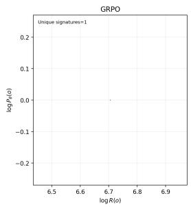

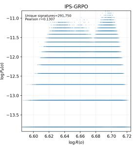

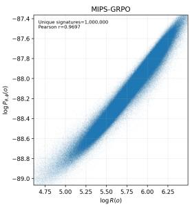

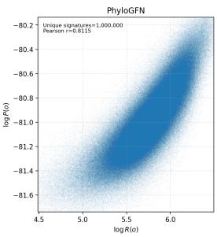  
Figure 6: Outcome log-probability versus log-reward. Each panel shows $1 0 ^ { 6 }$ trees sampled from the final policy. GRPO places all probability on a single tree (log $P _ { \theta } ( o ) = 0 )$ , and IPS-GRPO’s probabilities barely vary with reward. MIPS-GRPO and PhyloGFN cover a broad set of trees, with MIPS-GRPO’s estimated probability $P _ { \theta , \phi } ( o )$ following the reward most closely. Axis ranges differ across panels.

Table 10: Per-seed phylogenetic results. Unique counts among $1 0 ^ { 6 }$ samples from each final policy.
<table><tr><td>Method</td><td>Seed</td><td>Unique topologies</td><td>Unique signatures</td><td>Sampling r</td><td>Marginal log-lik.</td><td>MLL</td><td>Shared-tree r</td></tr><tr><td rowspan="3">GRPO</td><td>0</td><td>1</td><td>1</td><td></td><td>-4318.36</td><td>-4183.27</td><td></td></tr><tr><td>1</td><td>1</td><td>1</td><td></td><td>-4318.43</td><td>-4182.40</td><td></td></tr><tr><td>2</td><td>1</td><td>1</td><td></td><td>-4318.43</td><td>-4182.61</td><td></td></tr><tr><td rowspan="3">IPS-GRPO</td><td>0</td><td>13</td><td>291,750</td><td>0.131</td><td>-4293.30</td><td>-4212.82</td><td></td></tr><tr><td>1</td><td>11</td><td>248,245</td><td>0.150</td><td>-4298.43</td><td>-4214.99</td><td></td></tr><tr><td>2</td><td>13</td><td>250,600</td><td>0.140</td><td>-4291.36</td><td>-4211.82</td><td></td></tr><tr><td rowspan="3">PhyloGFN</td><td>0</td><td>985,326</td><td>1,000,000</td><td>0.812</td><td>-4367.72</td><td>-4672.82</td><td>0.942</td></tr><tr><td>1</td><td>985,263</td><td>1,000,000</td><td>0.886</td><td>-4363.99</td><td>-4671.59</td><td>0.922</td></tr><tr><td>2</td><td>985,322</td><td>1,000,000</td><td>0.809</td><td>-4367.77</td><td>-4672.78</td><td>0.943</td></tr><tr><td rowspan="3">MIPS-GRPO</td><td>0</td><td>955,839</td><td>1,000,000</td><td>0.970</td><td>-4372.49</td><td>-4663.80</td><td>0.971</td></tr><tr><td>1</td><td>955,918</td><td>1,000,000</td><td>0.968</td><td>-4373.98</td><td>-4664.66</td><td>0.952</td></tr><tr><td>2</td><td>955,800</td><td>1,000,000</td><td>0.964</td><td>-4372.22</td><td>-4663.60</td><td>0.964</td></tr></table>