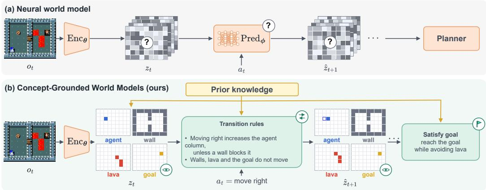
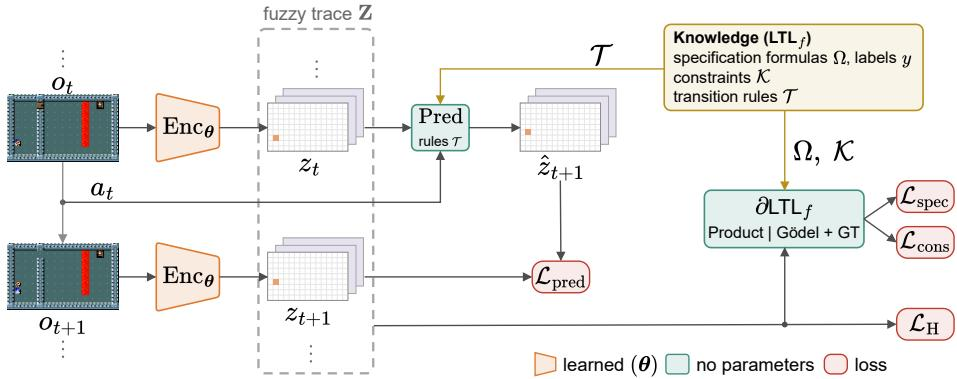
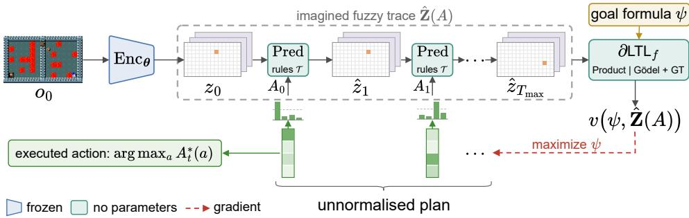
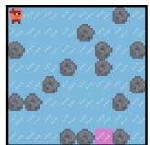
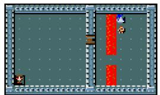
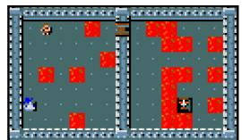
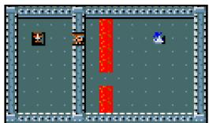
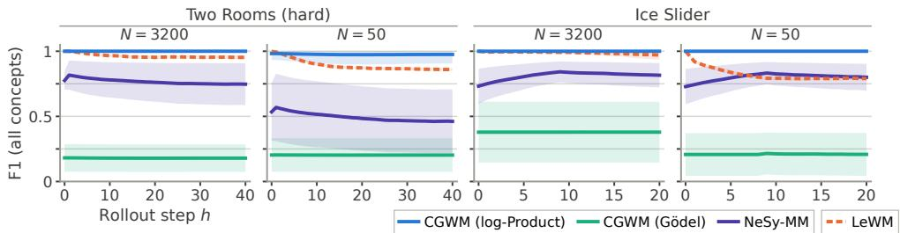
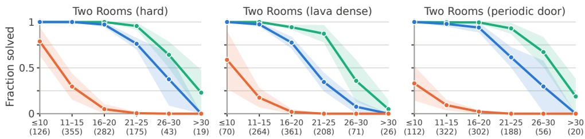

# NEUROSYMBOLIC LEARNING OF INTERPRETABLE WORLD MODELS

Riccardo Andreoni Fondazione Bruno Kessler Free University of Bozen-Bolzano randreoni@fbk.eu

Chiara Ghidini Alessandro Daniele<sup>∗</sup> Free University of Bozen-Bolzano chiara.ghidini@unibz.it alessandro.daniele@unibz.it

Massimiliano Ronzani Fondazione Bruno Kessler mronzani@fbk.eu

Emile van Krieken<sup>∗</sup> Vrije Universiteit Amsterdam e.van.krieken@vu.nl

## ABSTRACT

World models aim to learn compact representations of an environment from observations, enabling agents to predict future states and plan their behaviour. However, most existing approaches learn black-box representations, with limited ability to incorporate prior knowledge about the world. We introduce Concept-Grounded World Models (CGWMs), a neurosymbolic world model design that instead learns interpretable concept representations. We learn these concepts from observations using explicit and complete knowledge, expressed in temporal logic, that specifies the valid world states and the temporal relations governing their dynamics. Furthermore, we directly use this knowledge by formulating planning as differentiable reasoning, optimising the agent’s actions by gradient ascent to satisfy a goal. We experimentally compare CGWM with a purely neural baseline and a neurosymbolic baseline on two game environments. We find that CGWMs ground concepts much more accurately, even over long horizons, resulting in significantly more robust planning both in and out of distribution.

## 1 INTRODUCTION

One of the longstanding goals of artificial intelligence is to accurately model the world around us (McCarthy & Hayes, 1981; Sutton, 1990). This research has been reinvigorated since the deep learning revolution (Ha & Schmidhuber, 2018), and especially in recent years, motivated by attempts to enable AI in the physical world, like robotics (Ding et al., 2026). However, most of these approaches are purely neural, modelling transitions over opaque latent representations (Dawid & LeCun, 2023; Hafner et al., 2023). Therefore, while world models are becoming more effective at predicting future states of the environment, they are difficult to inspect, adapt, and safely plan in.

We instead argue for a neurosymbolic world model design called Concept-Grounded World Models (CGWM) that uses symbolic transition systems acting on interpretable, abstract concepts (Knab et al., 2026). CGWM grounds these abstract representations in real-world data using an encoder neural network that bridges the continuous world with the symbolic concepts. After grounding, we can directly plan in the transition system with flexible goals that can include safety constraints. Furthermore, when the grounding of concepts from real-world data is robustly learned, CGWM can transfer zero-shot to new environments by merely adapting the transition system.

Central to these benefits is learning a robust grounding of concepts. In this work, we study how learning from temporal knowledge and weak environment supervision may provide such groundings. For this, CGWM uses techniques from the field of neurosymbolic learning, where the goal is to ground concepts using a mix of weakly supervised data and background knowledge (Feldstein et al., 2024). To model the kind of temporal knowledge required for world models, CGWM uses $\operatorname { F L T L } _ { f }$ (Andreoni et al., 2026), which relaxes $\operatorname { L T L } _ { f }$ formulas with fuzzy semantics (Badreddine et al., 2022; van Krieken et al., 2022). The fuzzy semantics ensure the differentiability of the $\operatorname { L T L } _ { f }$ knowledge to enable direct integration with neural networks. To effectively minimise these losses, CGWM includes several training techniques to prevent poor local minima and ensure that concepts are properly grounded. Finally, in addition to training the encoder, we also apply $\operatorname { F L T L } _ { f }$ to successfully plan in CGWMs.

  
Figure 1: CGWMs are interpretable world models that ground concepts in images and use a symbolic transition system. This improves data efficiency, provides zero-shot transfer to new environments and allows for flexible and safe planning for new goals.

Contributions (i) We introduce CGWM, a neurosymbolic world model design with a neural encoder that grounds a symbolic state of concepts, and a symbolic transition system encoded in $\operatorname { L T L } _ { f } . \mathrm { ( i i ) }$ We develop algorithms for robust learning and planning in CGWMs using $\operatorname { F L T L } _ { f }$ , a fuzzy relaxation of the $\operatorname { L T L } _ { f }$ knowledge. (iii) We experimentally compare CGWM with a purely neural baseline and a neurosymbolic baseline on two game environments<sup>1</sup>, and find that CGWM grounds concepts much more accurately, which results in improved robustness of planning both in and out of distribution, and that the choice of fuzzy semantics plays a crucial role in learning and planning.

## 2 BACKGROUND

## 2.1 LINEAR TEMPORAL LOGIC ON FINITE TRACES

The knowledge relevant to our setting is inherently temporal, we formalize it with temporal logics over traces. In several application domains, such as planning, system dynamics are naturally captured by unbounded but finite traces (De Giacomo et al., 2014). This led to LTL on finite traces $\left( \mathrm { L T L } _ { f } \right)$ (De Giacomo & Vardi, 2013). An $\mathrm { L T L } _ { f }$ formula $\varphi$ over a set of d concepts $\mathcal { C }$ extends propositional logic with temporal operators (strong) next $\mathsf { X }$ and (strong) until U, and follows the syntax:

$$
\varphi : = { \textsf { T } } | \bot | { \textsf { C } } | \neg \varphi | \varphi \wedge \varphi | \varphi \vee \varphi | \varphi \to \varphi | \mathsf { X } \varphi | \varphi \mathsf { U } \varphi\tag{1}
$$

where $C \in { \mathcal { C } } .$ , the symbols ⊤ and ⊥ are the true andfalse constants, respectively, and $\neg , \land , \lor , $ are Boolean connectives for NOT, AND, OR, and implication. The other temporal operators are defined in terms of these, $\begin{array} { r } { \mathbf { e . g . , F } \varphi \equiv \intercal \cup \varphi , } \end{array}$ and ${ \sf G } \varphi \equiv \neg { \sf F } \neg \varphi$ for the eventually and globally operators.

The semantics of LTL<sub>f</sub> is defined over sequences of time steps, each mapping every concept to either 0 (for false) or 1 (for true). Formally, a trace of length n is a list of d-dimensional vectors $\mathbf { C } = \langle \mathbf { c } _ { 0 } , \dots , \mathbf { c } _ { n - 1 } \rangle$ in which, for each time step $t = 0 , \ldots , n - 1$ , the t-th vector $\mathbf { c } _ { t } \in \{ 0 , 1 \} ^ { d }$ assigns a truth value to each concept $C \in { \mathcal { C } }$

Intuitively, at time step $t , \mathsf { X } \varphi$ states that there is a next time step $t + 1$ in which $\varphi$ holds; $\varphi _ { 1 } \cup$ φ<sub>2</sub> states that $\varphi _ { 2 }$ holds in time step t or a later time step $s > t ,$ and in all time steps in between, i.e., $t \le t ^ { \prime } < s , \varphi _ { 1 }$ holds. $\mathsf { F } \varphi$ states that there is a future step $t ^ { \prime } \geq t$ in which $\varphi$ holds; and $G \varphi$ states that $\varphi$ holds in all future steps $t ^ { \prime } \geq t .$ Appendix A contains a complete formal introduction to $\operatorname { L T L } _ { f }$

## 2.2 FUZZY EVALUATION OF TEMPORAL FORMULAS

In this work, we employ $\operatorname { F L T L } _ { f }$ to integrate temporal knowledge expressed in $\operatorname { L T L } _ { f }$ into the learning process, and we evaluate formulas with $\partial \mathrm { L T L } _ { f }$ , the neurosymbolic framework that implements this semantics (Andreoni et al., 2026). FL $\operatorname { T L } _ { f }$ interprets $\operatorname { L T L } _ { f }$ formulas with differentiable fuzzy logic operators to enable compatibility with gradient-based learning (van Krieken et al., 2022). $\operatorname { F L T L } _ { f }$ generalises the notion of trace defined above by relaxing the space of each truth vector $\mathbf { c } _ { t }$ from Booleans {0, 1} to the interval [0, 1], which yields the fuzzy trace $\mathbf { Z } = \langle \mathbf { z } _ { 0 } , \ldots , \mathbf { z } _ { n - 1 } \rangle$ . Here, $z _ { t , i }$ denotes the degree of truth of a concept $C _ { i } \in \mathcal { C }$ at time step $t .$ We denote by $v ( \varphi , \mathbf { Z } , t ) \in [ 0 , 1 ]$ the degree of truth of an $\operatorname { F L T L } _ { f }$ formula $\varphi$ over a fuzzy trace $\mathbf { Z }$ at time step $t \geq 0$

Logical connectives $\neg , \land , \lor , $ are evaluated by applying a fuzzy operator (namely, the negation $\ominus .$ the t-norm $\otimes ,$ , the t-conorm $\bigoplus$ , and the implication $\circleddash$ respectively) to the degrees of truth of their subformulas. For instance, $v ( \varphi _ { 1 } \wedge \varphi _ { 2 } , \mathbf { Z } , t ) = v ( \varphi _ { 1 } , \mathbf { Z } , t ) \otimes v ( \varphi _ { 2 } , \mathbf { Z } , t )$ . Temporal operators like $\mathsf { X }$ and U instead relate the degree of truth at time step t to those at subsequent time steps: $v ( \mathsf { X } \varphi , \mathbf { Z } , t ) = v ( \varphi , \mathbf { Z } , t + 1 )$ if $t < n - 1$ and 0 otherwise, and $v ( \varphi _ { 1 } \cup \varphi _ { 2 } , \mathbf { Z } , t ) \ { \stackrel { } { = } } \ v ( \varphi _ { 2 } , \mathbf { Z } , t )$ ⊕ $\left( v ( \varphi _ { 1 } , \mathbf { Z } , t ) \otimes v ( \mathsf { X } ( \varphi _ { 1 } \mathsf { U } \varphi _ { 2 } ) , \mathbf { Z } , t ) \right)$

We write $v ( \varphi , \mathbf { Z } ) = v ( \varphi , \mathbf { Z } , 0 )$ for the degree of truth of $\varphi$ in Z. We employ two instances of the FLTL $^ { \prime } f$ family: the Godel semantics, where¨ $\alpha \otimes \beta = \operatorname* { m i n } ( \alpha , \beta )$ and $\alpha \oplus \beta = \operatorname* { m a x } ( \alpha , \beta )$ , and the product semantics, where $\alpha \otimes \beta = \alpha \beta$ and α ⊕ $\beta = \alpha + \beta - \alpha \beta$ . Both use the standard negation $\ominus \alpha = 1 - \alpha$ and interpret implication as the material implication $\alpha \Leftrightarrow \beta = ( \ominus \alpha ) \oplus \beta$

In this work, we primarily use the temporal operators Globally (G) and Eventually (F). To compute their degrees of truth, we use the following characterisation from Andreoni et al. (2026):

$$
v ( \mathsf { F } \varphi , \mathbf { Z } ) = \bigoplus _ { t = 0 } ^ { n - 1 } v ( \varphi , \mathbf { Z } , t ) , \qquad v ( \mathsf { G } \varphi , \mathbf { Z } ) = \bigotimes _ { t = 0 } ^ { n - 1 } v ( \varphi , \mathbf { Z } , t ) ,\tag{2}
$$

where $\oplus$ and $\otimes$ denote the iterated application of the t-conorm ⊕ and of the t-norm ⊗, respectively.

## 3 CONCEPT-GROUNDED WORLD MODELS

We introduce Concept-Grounded World Models (CGWMs), a type of neurosymbolic world model trained from $\operatorname { L T L } _ { f }$ formulas (see Figure 1). Existing neural world models use a purely neural latent state, and their features are not trained to have human-interpretable semantics (Dawid $\& \mathrm { \ L e C u n } .$ 2023; Hafner et al., 2023). Instead, our CGWMs represent latent states as truth values for each concept, enabling direct human interpretation. We use prior knowledge about the environment, expressed in $\operatorname { L T L } _ { f }$ over the same concepts, in three ways: to ground concepts in observations during training using only a small number of weak labels per trajectory; to replace the transition function of the world model; and to specify the goal at planning time.

## 3.1 PROBLEM SETTING

We assume that, at each time step t, the environment provides an image $\mathbf { o } _ { t }$ and the agent executes an action $a _ { t } \in { \mathcal { A } }$ . From this, we define a trajectory as a sequence $\tau = \langle \mathbf { o } _ { 0 } , a _ { 0 } , \mathbf { o } _ { 1 } , \dots , a _ { T - 1 } , \mathbf { o } _ { T } \rangle$ with $T \leq T _ { \mathrm { m a x } } .$ . In this paper, we assume that the environment is deterministic and fully observable, and that complete knowledge about the environment is available and exactly determines state transitions. We discuss extensions of this setting in Section 7.

A CGWM receives three types of rules about the environment as $\operatorname { L T L } _ { f }$ formulas over concepts $C .$ Constraints $\kappa \in { \mathcal { K } }$ represent rules that should hold on every trajectory, like $\mathsf { G } \neg ( \mathsf { a g e n t } _ { 1 . 2 } \wedge \mathsf { w a l l } _ { 1 , 2 } )$ Transition rules $\tau$ describe transitions in concept space, defining the symbolic state at time step t+1 from the state and action at time step $t ,$ such as $\left( \mathsf { a g e n t } _ { 1 , 2 } \wedge \right.$ right $\land \lnot { \mathbf { w a l l } } _ { 1 , 3 } ) \to \mathsf { X a g e n t } _ { 1 , 3 } .$ Finally, we have a set $\Omega = \{ \omega _ { 1 } , \dots , \omega _ { M } \}$ of specification formulas which, unlike constraints, hold only on some trajectories and not on others. One example is $\omega _ { m } = { \sf F }$ at goal, which states that the agent is eventually in the same cell as the goal. In particular, each training trajectory comes with a binary label $y _ { m }$ per specification formula, equal to 1 $\mathbf { i f } \mathbf { C } \Vdash \omega _ { m }$ and to 0 otherwise. These labels provide only weak supervision: we do not give labels for individual concepts $\mathbf { c } _ { t } .$ . Each formula is written for every cell, and Appendix B lists the knowledge of each environment.

  
Figure 2: Overview of CGWM during learning.

## 3.2 MODEL

A CGWM consists of two components, an encoder and a predictor (Figure 2). The encoder maps an image to a symbolic state, which assigns a degree of truth in [0, 1] to every concept C. The predictor computes the symbolic state at time step $t + 1$ from the symbolic state and the action at time step t:

$$
\operatorname { E n c o d e r : } \mathbf { z } _ { t } = \operatorname { E n c } _ { \theta } ( \mathbf { o } _ { t } ) \in [ 0 , 1 ] ^ { d } , \qquad \operatorname { P r e d i c t o r : } \hat { \mathbf { z } } _ { t + 1 } = \operatorname { P r e d } ( \mathbf { z } _ { t } , a _ { t } ) .\tag{3}
$$

The encoder is a neural network with d output channels, one per concept, followed by a sigmoid function, so that the entry $z _ { t , i }$ is the degree of truth of concept $C _ { i }$ at time step t. The predictor has no learnable parameters, and it applies the transition rules $\tau$ to the current state and action, evaluated with $\partial \mathrm { L T L } _ { f }$ (Section 2.2). Since these rules are written over the same concepts ${ \mathcal { C } } ,$ the predicted state is again an assignment of degrees of truth to those propositions. Constraints and specification formulas are evaluated on a fuzzy trace Z in the same way. We write $v ( \omega , \mathbf Z )$ and $v ( \kappa , \mathbf { Z } )$ for the degrees of truth of a specification formula ω and of a constraint κ on a fuzzy trace $\mathbf { Z } ,$ which are both differentiable with respect to the encoder parameters $\pmb { \theta } .$

## 3.3 LEARNING

Only the encoder parameters θ are learned, with the loss

$$
\begin{array} { r } { \mathcal { L } ( \pmb { \theta } ) = \mathcal { L } _ { \mathrm { s p e c } } + \mathcal { L } _ { \mathrm { c o n s } } + \mathcal { L } _ { \mathrm { p r e d } } + \lambda _ { \mathrm { H } } \mathcal { L } _ { \mathrm { H } } . } \end{array}\tag{4}
$$

The specification loss $\mathcal { L } _ { \mathrm { s p e c } }$ is the binary cross-entropy between $v ( \omega _ { m } , \mathbf { Z } )$ and the label $y _ { m } ,$ averaged over formulas and trajectories. It is the only term that uses supervision, and it constrains the trace as a whole rather than any single proposition. The constraint loss $\mathcal { L } _ { \mathrm { c o n s } }$ is the average of − log v(κ, Z) over the constraints $\kappa \in { \mathcal { K } } .$ and is minimised when every constraint is fully satisfied. The prediction loss $\mathcal { L } _ { \mathrm { p r e d } }$ is the binary cross-entropy between the predicted next state $\hat { \mathbf { z } } _ { t + 1 } = \operatorname { P r e d } ( \operatorname { E n c } _ { \pmb { \theta } } ( \mathbf { o } _ { t } ) , a _ { t } )$ and the state $\mathbf { z } _ { t + 1 } = \operatorname { E n c } _ { \pmb { \theta } } ( \mathbf { o } _ { t + 1 } )$ encoded from the next observation. Although the CGWM predictor does not have learnable parameters, it is differentiable, so gradients still reach the encoder parameters $\pmb \theta .$ The entropy term ${ \mathcal { L } } _ { \mathrm { H } }$ is the negated binary entropy of $\mathbf { Z } ,$ averaged over concepts and time steps. Its weight $\lambda _ { \mathrm { H } }$ decreases linearly to zero during the first half of training. Minimising ${ \mathcal { L } } _ { \mathrm { H } }$ prevents concept truth values from prematurely saturating to 0 or 1 at the beginning of training, which we found helps to avoid poor local minima.

Many constraints $\kappa \in { \mathcal { K } }$ are implications of the form ${ \mathsf { G } } \left( \alpha \to \beta \right)$ . In an environment with an agent and walls, an example constraint is $\mathsf { G } \left( \mathsf { a g e n t } _ { 1 , 2 } \wedge \mathsf { r i g h t } \wedge \mathsf { x a g e n t } _ { 1 , 2 } \right) \to \mathsf { w a l l } _ { 1 , 3 } .$ if the agent moves right and remains in the same cell, then the cell to its right is a wall. Here, the antecedent is about agent and is used as evidence, and the consequent is about wall, the concept that receives the evidence. A fuzzy implication can become true either by raising the degree of truth of the consequent $\beta$ (modus ponens), or by lowering that of the antecedent α (modus tollens) (van Krieken et al., 2022). By default, minimising $\mathcal { L } _ { \mathrm { c o n s } }$ enables both directions. However, the modus tollens direction changes the concepts that provide the evidence, and it admits local minima in which the antecedent is false everywhere, satisfying the constraint trivially. In our example, the encoder can set agent to false in every cell. We therefore prevent gradients from flowing into the antecedent, which we denote by $\underline { { \alpha } } ,$ and write the constraint as ${ \mathsf { G } } ( \underline { { \alpha } } \overset { \cdot } {  } \beta )$ .

  
Figure 3: Overview of CGWM during planning.

## 3.4 PLANNING

After the world model has been trained, it can be leveraged to plan towards a goal, which can be expressed as an $\operatorname { L T L } _ { f }$ specification ψ. Rather than relying on classical planning, we formulate planning as a differentiable optimisation problem to enable future hybrid world models with both symbolic and continuous variables (Section 7). When planning with CGWM, we freeze the encoder parameters and apply the encoder to the first image of the episode, $\hat { \mathbf { z } } _ { 0 } ~ = ~ \mathrm { E n c } _ { \pmb { \theta } } ( \mathbf { o } _ { 0 } )$ (Figure 3). Afterwards, no other observations are received and planning happens only on the imagined symbolic states. A plan is parameterised by a matrix $U \in \dot { \mathbb { R } } ^ { T _ { \operatorname* { m a x } } \times | \mathcal { A } | }$ , whose rows $\mathbf { u } _ { t }$ are transformed into action truth degrees $A _ { t } \in [ 0 , 1 ] ^ { | \mathcal { A } | }$ according to the fuzzy semantics used for planning. Starting from $\hat { \mathbf { z } } _ { 0 } = \mathrm { E n c } _ { \theta } ( \mathbf { o } _ { 0 } )$ , the predictor uses $A _ { t }$ in place of the discrete action $a _ { t }$ and produces the imagined fuzzy trace $\hat { \mathbf { Z } } ( A ) = \langle \hat { \mathbf { z } } _ { 0 } , \dots , \hat { \mathbf { z } } _ { T _ { \operatorname* { m a x } } } \rangle$

$$
\hat { \mathbf { z } } _ { t + 1 } = \operatorname { P r e d } ( \hat { \mathbf { z } } _ { t } , A _ { t } ) , \qquad t = 0 , \dots , T _ { \operatorname* { m a x } } - 1 .\tag{5}
$$

We then plan by searching for matrices A that maximise the degree of truth of the goal formula:

$$
A ^ { * } = \arg \operatorname* { m a x } _ { A } \ v \big ( \psi , \hat { \mathbf { Z } } ( A ) \big ) .\tag{6}
$$

Since the encoder is frozen and the predictor has no parameters, gradients only propagate to the matrix U. We optimise Equation (6) by gradient ascent, running several independent initialisations of U in parallel. We execute the best imagined plan by taking, at each time step t, the action $a _ { t }$ with the highest degree of truth arg ma $\mathrm { X } _ { a _ { t } } A _ { t , a _ { t } }$

The encoder is used only to recognise the concepts in C in the first image, while transition rules $\tau$ and goal formula ψ specify how the world evolves and what the task is. As a consequence, the same trained CGWM world model can plan in environments with different layouts or grid sizes, with different dynamics by replacing $\tau$ , and for different tasks by replacing $\psi ,$ as long as the set of concepts C is unchanged (Section 4).

## 3.5 FUZZY SEMANTICS FOR LEARNING AND PLANNING

Which fuzzy semantics of $\operatorname { F L T L } _ { f }$ (see Section 2.2) best suit learning and planning in CGWM? Product semantics smoothly propagates gradients through multiple operands and is generally well suited for learning, while the sparse gradients of Godel semantics are often seen as inefficient for¨ learning (van Krieken et al., 2022). However, recent work on the Godel Trick, which adds noise¨ to the Godel semantics, found that it can outperform product semantics on combinatorial prob-¨ lems (Daniele & van Krieken, 2026). This suggests that the Godel Trick may be particularly well¨ suited for planning, which requires searching over discrete actions.

  
a. Ice Slider

  
b. Two Rooms (hard)

  
c. Two Rooms (lava dense)

  
d. Two Rooms (periodic door)  
Figure 4: Initial observations of the environments: (a) Ice Slider, (b) Two Rooms (hard), (c) Two Rooms (lava dense), and (d) Two Rooms (periodic door), where the door has closed on the agent.

We test this hypothesis by evaluating both semantics in both phases, computing product semantics in logarithmic space for numerical stability (Badreddine et al., 2023). During learning, we use the two semantics directly, without adding noise. During planning, we add noise to explore different plans. For Godel semantics, we use the G ¨ odel Trick and follow the categorical-variable construction ¨ of Daniele & van Krieken (2026). For product semantics, we instead use Gumbel-Softmax (Jang et al., 2017) to obtain the action truth values $A _ { t }$ . Noise is sampled at every optimisation step to enable escaping local minima. We report variants without noise in Table 8.

## 4 EXPERIMENTAL SETUP

We evaluate CGWM on two grid-world environments with different dynamics and compare it with LeWorldModel (LeWM) (Maes et al., 2026), a purely neural world model, and NeSy-MM (De Smet et al., 2025), a neurosymbolic Markov model that we adapt to our setting. The experiments address four research questions.

RQ1: Does CGWM learn to recognise the concepts in C from images using only trajectory labels and knowledge, while requiring fewer training trajectories than the baselines?

RQ2: Is the grounding preserved in the imagined trace as the rollout horizon grows?

RQ3: Can CGWM plan safely and effectively both in the environments it has been trained on and in environments with different layouts or dynamics?

RQ4: How does the choice of fuzzy semantics affect learning and planning?

Next, we describe the environments, baselines, and protocols (more settings in Appendices B and D).

Environments. The first environment is Ice Slider (Figure 4a) (Bagatella et al., 2021), a puzzle in which the agent slides along the chosen direction until it hits a rock or the grid border, the episode ends when it stops on the goal. Its concepts are $\mathcal { C } _ { I S } = \{ \mathrm { a g e n t } , \mathrm { r o c k } , \mathrm { g o a l } \}$ . The second environment, Two Rooms (Figure 4b), is built with MiniHack (Samvelyan et al., 2021) to reproduce a NetHack level (Kuttler et al., 2020): a grid divided by a wall into two rooms, where the agent must¨ reach the goal in the other room by first stepping on a button that opens the door, while avoiding lava, which ends the episode. Its concepts are $\mathcal { C } _ { T R } = \{ \mathrm { a g e n t } , \mathrm { g o a l }$ , wall, lava, button, door}, and it has richer dynamics than Ice Slider. We consider three variants of Two Rooms of increasing complexity: Two Rooms (easy) has only the agent, the goal and the walls; Two Rooms (medium) adds the button and the closed door; and Two Rooms (hard) adds the lava. The layouts are randomised in every episode for Ice Slider (rocks and goal), Two Rooms (easy) (goal), Two Rooms (medium) (goal and button), and Two Rooms (hard) (inner wall, lava and all objects). To test generalisation, we derive two environments from Two Rooms (hard): Two Rooms (lava dense) (Figure 4c) keeps the dynamics but changes the layout, with three times as many lava cells, while Two Rooms (peri odic door) (Figure 4d) changes the dynamics: once the button is pressed, the door opens and closes at each time step, crushing any agent standing on the door cell as it closes. Appendix B describes all environments in detail, alongside used formulas.

Baselines. To evaluate the benefits of explicit symbolic states and of training on prior knowledge, we compare CGWM against LeWM, a JEPA world model that uses neural networks for both the encoder and the predictor (Maes et al., 2026). We give LeWM a latent vector for each cell of the grid, to match the spatial structure of CGWM. We also give LeWM a reward at every frame (whereas CGWM only receives per-trajectory labels), for instance when the agent is at the goal or first presses the button, and a negative reward when it steps on lava. LeWM learns to predict this reward from its latent state with a reward head. At planning time, LeWM optimises the actions by gradient descent on the predicted reward. Unlike CGWM, which plans once from the first image, LeWM gets environment observations every five actions and re-plans. Although these changes depart from the original LeWM, they all favour the baseline. We further motivate them in Appendix D.2.

We also compare CGWM with NeSy-MM (De Smet et al., 2025), a neurosymbolic Markov model with a neural encoder and a predictor based on a symbolic probabilistic logic program, which makes it close to our assumptions. However, De Smet et al. (2025) either provide symbolic states, or only model the agent’s position, with direct supervision on the agent’s final position. We therefore give it the same concepts, knowledge, and trajectory labels as CGWM. NeSy-MM does not come with a planning procedure, so we only compare on concept grounding.

Protocol and Metrics. We evaluate data efficiency by varying the number of training trajectories $N \in \{ 5 0 , 2 0 0 , 8 0 0 , 3 2 0 0 \}$ , using ten random seeds for each setting. We give LeWM approximately four times as many optimisation steps as CGWM to ensure convergence. All reported results are the mean and standard deviation over the ten seeds. We evaluate the learned world models along two dimensions. We measure the quality of the learned concept representations with the F1 score, and measure planning performance by the fraction of test instances successfully solved. Protocols specific to each evaluation are described alongside the corresponding results in Section 5.

## 5 RESULTS

In this section, we answer the four research questions of Section 4. The complete results are reported in Appendix C. To answer RQ1 and RQ2, we measure concept recognition using the F1 score, both on states encoded from observations and along imagined rollouts of increasing horizon. Since LeWM has no explicit concepts, we train a linear probe on its latent states using the ground-truth concepts of the training trajectories. Figure 5 summarises the results.

  
Figure 5: CGWM with log-product, learns accurate grounding from weak supervision and knowledge. F1 on the concepts along the imagined trace, for the largest and smallest training sets.

RQ1: Grounding from observations. Trained with log-product semantics, CGWM learns an explicit symbolic state whose concepts are almost always grounded perfectly. Its F1 remains perfect as the size of the training set decreases, with only slightly lower performance on the Two Rooms environment with 50 trajectories (Figure 5). Instead, when trained with Godel semantics, it does not¨ ground the concepts at any training set size. NeSy-MM, which receives the same knowledge and trajectory labels as CGWM, grounds only part of the concepts (more details in Appendix C), and its performance degrades with smaller training set sizes in the Two Rooms environment. Additionally, Appendix C.1 ablates the entropy loss term ${ \mathcal { L } } _ { \mathrm { H } }$ and the blocking of modus tollens gradients (Section 3.3). The ablations have poor grounding performance resulting from local minima. Finally, after training a linear probe from ground-truth concepts, LeWM recognises the concepts just as well as CGWM on single observations, but it differs when imagining the next steps.

RQ2: Long-horizon grounding. CGWM and NeSy-MM imagine next steps with the transition rules rather than with a learned predictor. As a consequence, when the grounding is perfect, the predicted symbolic state should remain correct at every horizon, since the environments are deterministic. For CGWM, this is confirmed by the results on the longest rollouts (Figure 5). NeSy-MM, instead, starts from an imperfect grounding and propagates initial errors to subsequent time steps. LeWM starts from a nearly perfect initial state, but its performance degrades with longer horizons.

Table 1: CGWMs learn representations that allow for robust planning both in and out of distribution. Percentage of planning instances solved in the environment, mean and standard deviation (in parentheses) over 10 seeds. For CGWM, the semantics used for planning is in parentheses.
<table><tr><td rowspan="2"></td><td colspan="5">Two Rooms</td><td colspan="2">Ice Slider</td></tr><tr><td>easy</td><td>medium</td><td>hard</td><td></td><td>lava dense periodic door</td><td> $T { = } 2 0$ </td><td> $T { = } T ^ { * }$ </td></tr><tr><td>CGWM (Gödel Trick)</td><td>100.0 (0.0)</td><td>100.0 (0.0)</td><td>96.3 (0.8)</td><td>88.4 (2.8)</td><td>94.9 (1.0)</td><td>100.0 (0.0)</td><td>100.0 (0.0)</td></tr><tr><td>CGWM (log-product)</td><td>100.0 (0.0)</td><td>100.0 (0.0)</td><td>90.4(1.9)</td><td>68.6 (5.5)</td><td>84.3 (3.3)</td><td>99.8 (0.4)</td><td>90.4(1.7)</td></tr><tr><td>LeWM</td><td>95.8 (1.2)</td><td>37.8 (2.8)</td><td>22.0 (9.0)</td><td>9.6 (6.9)</td><td>7.2 (3.6)</td><td>69.1 (12.6)</td><td>3.6 (2.9)</td></tr></table>

A simple explanation is that prediction errors accumulate by repeatedly applying the learned dynamics, whereas CGWM can apply the given transition rules exactly. This is supported by the results at smaller training set sizes, where LeWM’s performance degrades more rapidly with rollout steps, suggesting that the learned dynamics do not generalise accurately when trained on less data.

RQ3: Planning. To answer RQ3, we evaluate CGWM and LeWM on the same 100 test instances per seed. CGWM optimises the goal formula ψ = F at goal on its imagined trace, whereas LeWM optimises its predicted reward. Plans have a maximum horizon of 40 actions in Two Rooms and 20 in Ice Slider, and all test instances are solvable within these horizons.

In Two Rooms, LeWM is trained separately on each of the three variants, while CGWM always uses the world model trained on Two Rooms (hard). We next evaluate generalisation without retraining on Two Rooms (lava dense) and Two Rooms (periodic door). In the latter, CGWM only replaces the transition rules, while keeping its encoder unchanged. Planning performance is measured as the fraction of test instances solved. We note that if CGWM finds a plan, it is automatically safe, as the transition rules state that lava ends the episode, and so the agent fails to reach the goal. The results are summarised in Table 1. In Two Rooms (easy), both methods solve nearly every instance. As the environment becomes more complex, the success rate of LeWM drops substantially, whereas CGWM continues to solve most instances. The difference persists under generalisation: without retraining, CGWM solves most instances in both Two Rooms (lava dense) and Two Rooms (periodic door), while LeWM rarely reaches the goal. In Ice Slider, CGWM with the Godel Trick solves every¨ instance with a maximum horizon of $\check { T } = 2 0$ . We therefore test whether it can also find an optimal plan by setting the horizon for each instance to the length T<sup>∗</sup> of its shortest plan. CGWM with the Godel Trick still solves every instance, while log-product solves¨ 90.4% and LeWM only 3.6%.

In Two Rooms, instead, CGWM does not solve every instance. We investigate whether these failures are associated with planning difficulty, using the length of the optimal plan as a proxy. We group test instances by their optimal plan length and report the fraction solved in each group in Figure 6. Failures concentrate on instances requiring longer plans. LeWM mostly succeeds when the optimal plan is short and almost never when it requires more than 15 actions. CGWM remains effective at substantially longer horizons, although its success rate also decreases for the longest plans.

RQ4: Fuzzy semantics. The choice of fuzzy semantics has opposite effects on learning and planning. During learning, only log-product grounds the concepts, whereas Godel fails across all training¨ set sizes. This can be explained by the sparse gradients discussed in Section 3.5. Conversely, during planning, the Godel Trick outperforms log-product (Table 1), supporting the hypothesis put forward ¨ in Section 3.5. Importantly, CGWM can learn with log-product and plan with the Godel Trick,¨ without retraining the encoder or rewriting any formula.

## 6 RELATED WORK

Learning world models. CGWMs learn latent states from observations, relating our work to state representation learning, which learns compact states that evolve with the agent’s actions (Lesort et al., 2018). Such methods encode observations with a neural network and mainly differ in the training objective. Generative world models train the encoder jointly with a decoder that reconstructs observations from the latent state (Hafner et al., 2023; Ha & Schmidhuber, 2018); some models also predict rewards for a given task (Hansen et al., 2024; Schrittwieser et al., 2020). Like CGWMs, world models based on Joint Embedding Predictive Architectures (JEPA) avoid reconstruction and are trained to predict the latent encoding of the next observation (Dawid & LeCun, 2023). Their encoders are either pre-trained and frozen (Zhou et al., 2025; Assran et al., 2025), or trained jointly with the predictor using a regularization term that prevents collapse (Sobal et al., 2025; Maes et al., 2026); CGWM instead constrains the latent state with logical knowledge and needs no regularisation. Another line of work learns discrete latent states, using reconstruction losses (Asai et al., 2022; Agostinelli & Soltani, 2024) or regularized prediction losses (Bizzaro & Serafini, 2026). Their variables, however, have no predefined meaning, which must be recovered after training by probes that map the latent to ground-truth concepts; in CGWM, concepts are named in advance, so the latent state needs no probe to be interpreted. Finally, some works use LLMs to write programs describing state transitions, but these operate only on symbolic inputs and outputs (Tang et al., 2024).

Optimal plan length (instances)  
  
CGWM (Gödel Trick) CGWM (log-Product) LeWM  
Figure 6: CGWM can plan over long horizons. Fraction of instances solved, grouped by the length of their optimal plan, with the number of instances per group in parentheses.

Neurosymbolic world models. Neurosymbolic learning integrates knowledge into deep learning through differentiable logics, usually under fuzzy or probabilistic semantics (Badreddine et al., 2022; Manhaeve et al., 2018; Xu et al., 2018). Recent work extends this integration to temporal logic, where knowledge constrains sequences rather than single inputs (Umili et al., 2023; Andreoni et al., 2025; Manginas et al., 2025; Andreoni et al., 2026).

Several methods integrate knowledge into world models. Ramachandra et al. (2026) inject knowledge about spatial rotations to regularise continuous latent state dynamics during training. Tamassia et al. (2026) propose a generative world model in which additional symbolic properties, predicted from latent states, can define rewards for planning. Closer to CGWM, De Smet et al. (2025) model the environment as a Markov model whose symbolic state describes relations between objects, and whose transitions are probabilistic logic programs (De Smet et al., 2023). However, the model either receives symbolic states, or grounds initial agent positions to generate a sequence of images following an action sequence. Neither of the latter two world models is used for planning. Xi et al. (2026) learn action preconditions and effects from observations in which only the first and last symbolic states are observed. The predicates are given in advance together with the constraints that the action model must satisfy. In Ahmed et al. (2025), the predicates and operators of a planning domain are given as symbolic abstractions, and a large language model synthesizes the low-level transition functions as programs from observed transitions; observations are symbolic game states rather than images, and planning uses a classical planner over the operators. Finally, temporal specifications are also used to define the reward of a learning agent, either by assuming symbols are given (Icarte et al., 2022; Giacomo et al., 2019) or by learning to ground them in observations (Umili et al., 2024).

## 7 CONCLUSION

We introduced CGWM, a neurosymbolic approach to learning interpretable world models that support planning and robust generalisation. As a first step, we deliberately focused on a restricted setting that isolates these aspects, assuming (i) complete knowledge of the symbolic dynamics, (ii) concepts that are fully observable from a single observation, and (iii) deterministic dynamics. These assumptions constitute limitations of the current work and motivate several directions for future research.

Hybrid latent states and predictors could combine symbolic knowledge with learned continuous components, either to represent genuinely continuous variables or to model aspects of the state and dynamics not covered by the available knowledge. Our use of differentiable planning is deliberate in this respect: by optimising actions through backpropagation, the planner can potentially be extended to jointly optimise symbolic and continuous components. With incomplete knowledge, an alternative is to learn the missing symbolic rules from data (Daniele et al., 2023; Barbiero et al., 2023; Bizzaro & Daniele, 2026), although weaker knowledge may introduce reasoning shortcuts (Marconato et al., 2026). Partial observability additionally requires extending the state beyond information available in a single observation. Overall, CGWM demonstrates how explicit knowledge can connect interpretable representations, dynamics, and planning within a unified world model, while providing a flexible foundation for future developments.

## 8 AI STATEMENT

In this work, we used generative AI tools to implement part of the method, the code that generates the synthetic datasets, to aid writing part of the paper, to provide feedback on drafts, and to edit it for readability. We have not used generative AI tools to develop theoretical models or conceptual frameworks, propose or refine hypotheses, design or provide feedback on research methodology or experiments, clean and reformat dataset, support qualitative and thematic data analysis, interpret results, and the paper contains no mathematical claims or proofs. The code, its outputs, and all the text drafted with AI assistance was reviewed and edited by the authors. We take responsibility for the final content of this work, including text, claims or artifacts produced with the aid of generative AI.

## REFERENCES

Forest Agostinelli and Misagh Soltani. Learning discrete world models for heuristic search. RLJ, 4:1781–1792, 2024. URL https://rlj.cs.umass.edu/2024/papers/Paper225. html.

Zergham Ahmed, Joshua B. Tenenbaum, Christopher Bates, and Samuel J. Gershman. Synthesizing world models for bilevel planning. Trans. Mach. Learn. Res., 2025, 2025. URL https:// openreview.net/forum?id=m9V4JHLJrD.

Riccardo Andreoni, Andrei Buliga, Alessandro Daniele, Chiara Ghidini, Marco Montali, and Massimiliano Ronzani. T-ILR: a neurosymbolic integration for LTLf. In Leilani H. Gilpin, Eleonora Giunchiglia, Pascal Hitzler, and Emile van Krieken (eds.), Proceedings of The 19th International Conference on Neurosymbolic Learning and Reasoning (NeSy 2025), 8-10 September 2025, Santa Cruz, CA, USA, volume 284 of Proceedings ofMachine Learning Research, pp. 252–265. PMLR, 2025. URL https://proceedings.mlr.press/v284/andreoni25a.html.

Riccardo Andreoni, Andrei Buliga, Alessandro Daniele, Paolo Felli, Chiara Ghidini, Marco Montali, and Massimiliano Ronzani. Time to reason: Scalable neurosymbolic learning for ltlf via fuzzy semantics. CoRR, abs/2608.16443, 2026. doi: 10.48550/ARXIV.2608.16443. URL https: //doi.org/10.48550/arXiv.2608.16443.

Masataro Asai, Hiroshi Kajino, Alex Fukunaga, and Christian Muise. Classical planning in deep latent space. J. Artif. Intell. Res., 74:1599–1686, 2022. doi: 10.1613/JAIR.1.13768. URL https://doi.org/10.1613/jair.1.13768.

Mido Assran, Adrien Bardes, David Fan, Quentin Garrido, Russell Howes, Mojtaba Komeili, Matthew J. Muckley, Ammar Rizvi, Claire Roberts, Koustuv Sinha, Artem Zholus, Sergio Arnaud, Abha Gejji, Ada Martin, Francois Robert Hogan, Daniel Dugas, Piotr Bojanowski, Vasil Khalidov, Patrick Labatut, Francisco Massa, Marc Szafraniec, Kapil Krishnakumar, Yong Li, Xiaodong Ma, Sarath Chandar, Franziska Meier, Yann LeCun, Michael Rabbat, and Nicolas Ballas. V-JEPA 2: Self-supervised video models enable understanding, prediction and planning. CoRR, abs/2506.09985, 2025. doi: 10.48550/ARXIV.2506.09985. URL https: //doi.org/10.48550/arXiv.2506.09985.

Samy Badreddine, Artur S. d’Avila Garcez, Luciano Serafini, and Michael Spranger. Logic tensor networks. Artif. Intell., 303:103649, 2022. doi: 10.1016/J.ARTINT.2021.103649. URL https: //doi.org/10.1016/j.artint.2021.103649.

Samy Badreddine, Luciano Serafini, and Michael Spranger. logltn: Differentiable fuzzy logic in the logarithm space. CoRR, abs/2306.14546, 2023. doi: 10.48550/ARXIV.2306.14546. URL https://doi.org/10.48550/arXiv.2306.14546.

Marco Bagatella, Miroslav Olsak, Michal Rol´ ´ınek, and Georg Martius. Planning from pixels in environments with combinatorially hard search spaces. In Marc’Aurelio Ranzato, Alina Beygelzimer, Yann N. Dauphin, Percy Liang, and Jennifer Wortman Vaughan (eds.), Advances in Neural Information Processing Systems 34: Annual Conference on Neural Information Processing Systems 2021, NeurIPS 2021, December 6-14, 2021, virtual, pp. 24707–24718, 2021. URL https://proceedings.neurips.cc/paper/2021/ hash/cf708fc1decf0337aded484f8f4519ae-Abstract.html.

Christel Baier and Joost-Pieter Katoen. Principles of model checking. MIT Press, 2008. ISBN 978-0-262-02649-9.

Randall Balestriero and Yann LeCun. Lejepa: Provable and scalable self-supervised learning without the heuristics. CoRR, abs/2511.08544, 2025. doi: 10.48550/ARXIV.2511.08544. URL https://doi.org/10.48550/arXiv.2511.08544.

Pietro Barbiero, Gabriele Ciravegna, Francesco Giannini, Mateo Espinosa Zarlenga, Lucie Charlotte Magister, Alberto Tonda, Pietro Lio, Fred´ eric Precioso, Mateja Jamnik, and Giuseppe´ Marra. Interpretable neural-symbolic concept reasoning. In Andreas Krause, Emma Brunskill, Kyunghyun Cho, Barbara Engelhardt, Sivan Sabato, and Jonathan Scarlett (eds.), International Conference on Machine Learning, ICML 2023, 23-29 July 2023, Honolulu, Hawaii, USA, volume 202 of Proceedings of Machine Learning Research, pp. 1801–1825. PMLR, 2023. URL https://proceedings.mlr.press/v202/barbiero23a.html.

Davide Bizzaro and Alessandro Daniele. Logic of hypotheses: from zero to full knowledge in neurosymbolic integration. In Renata Wassermann, Marie-Laure Mugnier, and Franz Baader (eds.), Proceedings of the 23rd International Conference on Principles of Knowledge Representation and Reasoning, KR 2026, Lisbon, Portugal, July 20-23, 2026, 2026. doi: 10.24963/KR.2026/81. URL https://doi.org/10.24963/kr.2026/81.

Davide Bizzaro and Luciano Serafini. Discrete world models via regularization. In Maria De Marsico, Tin Kam Ho, Fred´ eric Jurie, Cheng-Lin Liu, Daniel P. Lopresti, Ingela Nystr´ om, Jean-Marc¨ Ogier, Arun Ross, and Liang Wang (eds.), Pattern Recognition - 28th International Conference, ICPR 2026, Lyon, France, August 17-22, 2026, Proceedings, Part XIII, volume 16824 of Lecture Notes in Computer Science, pp. 79–93. Springer, 2026. doi: 10.1007/978-3-032-31927-2\ 6. URL https://doi.org/10.1007/978-3-032-31927-2\_6.

Alessandro Daniele and Emile van Krieken. Gradient-based optimization on godel logic as discrete¨ local search. In Renata Wassermann, Marie-Laure Mugnier, and Franz Baader (eds.), Proceedings of the 23rd International Conference on Principles of Knowledge Representation and Reasoning, KR 2026, Lisbon, Portugal, July 20-23, 2026, 2026. doi: 10.24963/KR.2026/84. URL https: //doi.org/10.24963/kr.2026/84.

Alessandro Daniele, Tommaso Campari, Sagar Malhotra, and Luciano Serafini. Deep symbolic learning: Discovering symbols and rules from perceptions. In Proceedings of the Thirty-Second International Joint Conference on Artificial Intelligence, IJCAI 2023, 19th-25th August 2023, Macao, SAR, China, pp. 3597–3605. ijcai.org, 2023. doi: 10.24963/IJCAI.2023/400. URL https://doi.org/10.24963/ijcai.2023/400.

Anna Dawid and Yann LeCun. Introduction to latent variable energy-based models: A path towards autonomous machine intelligence. CoRR, abs/2306.02572, 2023. doi: 10.48550/ARXIV.2306. 02572. URL https://doi.org/10.48550/arXiv.2306.02572.

Giuseppe De Giacomo and Moshe Y. Vardi. Linear temporal logic and linear dynamic logic on finite traces. In Francesca Rossi (ed.), IJCAI 2013, Proceedings of the 23rd International Joint Conference on Artificial Intelligence, Beijing, China, August 3-9, 2013, pp. 854–860. IJ-CAI/AAAI, 2013. URL http://www.aaai.org/ocs/index.php/IJCAI/IJCAI13/ paper/view/6997.

Giuseppe De Giacomo, Riccardo De Masellis, and Marco Montali. Reasoning on LTL on finite traces: Insensitivity to infiniteness. In Carla E. Brodley and Peter Stone (eds.), Proceedings of the Twenty-Eighth AAAI Conference on Artificial Intelligence, July 27 -31, 2014, Quebec City,´ Quebec, Canada´ , pp. 1027–1033. AAAI Press, 2014. doi: 10.1609/AAAI.V28I1.8872.

Lennert De Smet, Pedro Zuidberg Dos Martires, Robin Manhaeve, Giuseppe Marra, Angelika Kimmig, and Luc De Raedt. Neural probabilistic logic programming in discrete-continuous domains. In Robin J. Evans and Ilya Shpitser (eds.), Proceedings of the Thirty-Ninth Conference on Uncertainty in Artificial Intelligence, volume 216 of Proceedings of Machine Learning Research, pp. 529–538. PMLR, 31 Jul–04 Aug 2023. URL https://proceedings.mlr.press/ v216/de-smet23a.html.

Lennert De Smet, Gabriele Venturato, Luc De Raedt, and Giuseppe Marra. Relational neurosymbolic markov models. In Toby Walsh, Julie Shah, and Zico Kolter (eds.), Thirty-Ninth AAAI Conference on Artificial Intelligence, Thirty-Seventh Conference on Innovative Applications ofArtificial Intelligence, Fifteenth Symposium on Educational Advances in Artificial Intelligence, AAAI 2025, Philadelphia, PA, USA, February 25 - March 4, 2025, pp. 16181–16189. AAAI Press, 2025. doi: 10.1609/AAAI.V39I15.33777. URL https://doi.org/10.1609/aaai.v39i15. 33777.

Jingtao Ding, Yunke Zhang, Yu Shang, Yuheng Zhang, Zefang Zong, Jie Feng, Yuan Yuan, Hongyuan Su, Nian Li, Nicholas Sukiennik, Fengli Xu, and Yong Li. Understanding world or predicting future? A comprehensive survey of world models. ACM Comput. Surv., 58(3): 57:1–57:38, 2026. doi: 10.1145/3746449. URL https://doi.org/10.1145/3746449.

Jonathan Feldstein, Paulius Dilkas, Vaishak Belle, and Efthymia Tsamoura. Mapping the neurosymbolic AI landscape by architectures: A handbook on augmenting deep learning through symbolic reasoning. CoRR, abs/2410.22077, 2024. doi: 10.48550/ARXIV.2410.22077. URL https://doi.org/10.48550/arXiv.2410.22077.

Giuseppe De Giacomo, Luca Iocchi, Marco Favorito, and Fabio Patrizi. Foundations for restraining bolts: Reinforcement learning with ltlf/ldlf restraining specifications. In J. Benton, Nir Lipovetzky, Eva Onaindia, David E. Smith, and Siddharth Srivastava (eds.), Proceedings of the Twenty-Ninth International Conference on Automated Planning and Scheduling, ICAPS 2019, Berkeley, CA, USA, July 11-15, 2019, pp. 128–136. AAAI Press, 2019. URL https: //ojs.aaai.org/index.php/ICAPS/article/view/3549.

David Ha and Jurgen Schmidhuber. World models. ¨ CoRR, abs/1803.10122, 2018. URL http: //arxiv.org/abs/1803.10122.

Danijar Hafner, Jurgis Pasukonis, Jimmy Ba, and Timothy P. Lillicrap. Mastering diverse domains through world models. CoRR, abs/2301.04104, 2023. doi: 10.48550/ARXIV.2301.04104. URL https://doi.org/10.48550/arXiv.2301.04104.

Nicklas Hansen, Hao Su, and Xiaolong Wang. TD-MPC2: scalable, robust world models for continuous control. In The Twelfth International Conference on Learning Representations, ICLR 2024, Vienna, Austria, May 7-11, 2024. OpenReview.net, 2024. URL https://openreview. net/forum?id=Oxh5CstDJU.

Rodrigo Toro Icarte, Toryn Q. Klassen, Richard Anthony Valenzano, and Sheila A. McIlraith. Re ward machines: Exploiting reward function structure in reinforcement learning. J. Artif. Intell. Res., 73:173–208, 2022. doi: 10.1613/JAIR.1.12440. URL https://doi.org/10.1613/ jair.1.12440.

Eric Jang, Shixiang Gu, and Ben Poole. Categorical reparameterization with gumbel-softmax. In 5th International Conference on Learning Representations, ICLR 2017, Toulon, France, April 24-26, 2017, Conference Track Proceedings. OpenReview.net, 2017. URL https://openreview. net/forum?id=rkE3y85ee.

Diederik P. Kingma and Jimmy Ba. Adam: A method for stochastic optimization. In Yoshua Bengio and Yann LeCun (eds.), 3rd International Conference on Learning Representations, ICLR 2015, San Diego, CA, USA, May 7-9, 2015, Conference Track Proceedings, 2015. URL http: //arxiv.org/abs/1412.6980.

Patrick Knab, David Steinmann, Christian Bartelt, Kristian Kersting, Bernt Schiele, Thomas Seidl, Udo Schlegel, and Wolfgang Stammer. What’s in the bottle? A survey and roadmap of concept bottleneck models. Trans. Mach. Learn. Res., 2026, 2026. URL https://openreview. net/forum?id=IF5vnqxBEW.

Wouter Kool, Herke Van Hoof, and Max Welling. Buy 4 reinforce samples, get a baseline for free! drlStructPred 2019, 2019.

Heinrich Kuttler, Nantas Nardelli, Alexander H. Miller, Roberta Raileanu, Marco Selvatici,¨ Edward Grefenstette, and Tim Rocktaschel. The nethack learning environment. In ¨ Hugo Larochelle, Marc’Aurelio Ranzato, Raia Hadsell, Maria-Florina Balcan, and Hsuan-Tien Lin (eds.), Advances in Neural Information Processing Systems 33: Annual Conference on Neural Information Processing Systems 2020, NeurIPS 2020, December 6-12, 2020, virtual, 2020. URL https://proceedings.neurips.cc/paper/2020/hash/ 569ff987c643b4bedf504efda8f786c2-Abstract.html.

Timothee Lesort, Natalia D´ ´ıaz Rodr´ıguez, Jean-Franc¸ois Goudou, and David Filliat. State representation learning for control: An overview. Neural Networks, 108:379–392, 2018. doi: 10.1016/J. NEUNET.2018.07.006. URL https://doi.org/10.1016/j.neunet.2018.07.006.

Lucas Maes, Quentin Le Lidec, Damien Scieur, Yann LeCun, and Randall Balestriero. Leworld model: Stable end-to-end joint-embedding predictive architecture from pixels. CoRR, abs/2603.19312, 2026. doi: 10.48550/ARXIV.2603.19312. URL https://doi.org/10. 48550/arXiv.2603.19312.

Nikolaos Manginas, George Paliouras, and Luc De Raedt. Nesya: Neurosymbolic automata. In Proceedings of the Thirty-Fourth International Joint Conference on Artificial Intelligence, IJCAI 2025, Montreal, Canada, August 16-22, 2025, pp. 5950–5958. ijcai.org, 2025. doi: 10.24963/ IJCAI.2025/662. URL https://doi.org/10.24963/ijcai.2025/662.

Robin Manhaeve, Sebastijan Dumancic, Angelika Kimmig, Thomas Demeester, and Luc De Raedt. Deepproblog: Neural probabilistic logic programming. In Samy Bengio, Hanna M. Wallach, Hugo Larochelle, Kristen Grauman, Nicolo Cesa-Bianchi, and Roman Garnett (eds.),\` Ad vances in Neural Information Processing Systems 31: Annual Conference on Neural Information Processing Systems 2018, NeurIPS 2018, December 3-8, 2018, Montreal, Canada ´ , pp. 3753–3763, 2018. URL https://proceedings.neurips.cc/paper/2018/hash/ dc5d637ed5e62c36ecb73b654b05ba2a-Abstract.html.

Emanuele Marconato, Samuele Bortolotti, Emile van Krieken, Paolo Morettin, Elena Umili, Antonio Vergari, Efthymia Tsamoura, Andrea Passerini, and Stefano Teso. Symbol grounding in neurosymbolic AI: A gentle introduction to reasoning shortcuts. J. Artif. Intell. Res., 86, 2026. doi: 10.1613/JAIR.1.22389. URL https://doi.org/10.1613/jair.1.22389.

John McCarthy and Patrick J Hayes. Some philosophical problems from the standpoint of artificial intelligence. In Readings in artificial intelligence, pp. 431–450. Elsevier, 1981.

Ajay Ramachandra, Gesina Schwalbe, and Zoe Falomir. Injecting qualitative spatial reasoning into world models via logic tensor networks. In Proceedings of the Thirty-Fifth International Joint Conference on Artificial Intelligence and the 29th European Conference on Artificial Intelligence, IJCAI/ECAI 2026, Bremen, Germany, 15-21 August 2026, pp. 4016–4025. ijcai.org, 2026. doi: 10.24963/IJCAI.2026/447. URL https://doi.org/10.24963/ijcai.2026/447.

Mikayel Samvelyan, Robert Kirk, Vitaly Kurin, Jack Parker-Holder, Minqi Jiang, Eric Hambro, Fabio Petroni, Heinrich Kuttler, Edward Grefenstette, and Tim Rockt¨ aschel. Minihack the planet:¨ A sandbox for open-ended reinforcement learning research. In Joaquin Vanschoren and Sai-Kit Yeung (eds.), Proceedings of the Neural Information Processing Systems Track on Datasets and Benchmarks 1, NeurIPS Datasets and Benchmarks 2021, December 2021, virtual, 2021. URL https://datasets-benchmarks-proceedings.neurips.cc/paper/2021/ hash/fa7cdfad1a5aaf8370ebeda47a1ff1c3-Abstract-round1.html.

Julian Schrittwieser, Ioannis Antonoglou, Thomas Hubert, Karen Simonyan, Laurent Sifre, Simon Schmitt, Arthur Guez, Edward Lockhart, Demis Hassabis, Thore Graepel, Timothy P. Lillicrap,

and David Silver. Mastering atari, go, chess and shogi by planning with a learned model. Nat., 588(7839):604–609, 2020. doi: 10.1038/S41586-020-03051-4. URL https://doi.org/ 10.1038/s41586-020-03051-4.

Uladzislau Sobal, Wancong Zhang, Kyunghyun Cho, Randall Balestriero, Tim G. J. Rudner, and Yann LeCun. Learning from reward-free offline data: A case for planning with latent dynamics models. In Danielle Belgrave, Cheng Zhang, Laura N. Montoya, Hsuan-Tien Lin, Razvan Pascanu, Piotr Koniusz, Marzyeh Ghassemi, Nancy Chen, Ivan Vladimir Meza´ Ru´ız, and Arturo Loaiza-Bonilla (eds.), Advances in Neural Information Processing Systems 38: Annual Conference on Neural Information Processing Systems 2025, NeurIPS 2025, San Diego, CA, USA, December 2-7, 2025 / Mexico City, Mexico, November 30 - December 5, 2025, 2025. URL http://papers.nips.cc/paper\_files/paper/2025/hash/ 3e7cf447f21cd11c846463affefce665-Abstract-Conference.html.

Richard S. Sutton. Integrated architectures for learning, planning, and reacting based on approximating dynamic programming. In Bruce W. Porter and Raymond J. Mooney (eds.), Machine Learning, Proceedings of the Seventh International Conference on Machine Learning, Austin, Texas, USA, June 21-23, 1990, pp. 216–224. Morgan Kaufmann, 1990. doi: 10.1016/B978-1-55860-141-3.50030-4. URL https://doi.org/10.1016/ b978-1-55860-141-3.50030-4.

Isidoro Tamassia, Lennert De Smet, and Giuseppe Marra. Towards zero-shot task transfer with neurosymbolic world models. CoRR, abs/2608.17959, 2026. doi: 10.48550/ARXIV.2608.17959. URL https://doi.org/10.48550/arXiv.2608.17959.

Hao Tang, Darren Key, and Kevin Ellis. Worldcoder, a model-based llm agent: Building world models by writing code and interacting with the environment. Advances in Neural Information Processing Systems, 37:70148–70212, 2024.

Elena Umili, Roberto Capobianco, and Giuseppe De Giacomo. Grounding ltlf specifications in image sequences. In Pierre Marquis, Tran Cao Son, and Gabriele Kern-Isberner (eds.), Proceedings ofthe 20th International Conference on Principles ofKnowledge Representation and Reasoning, KR 2023, Rhodes, Greece, September 2-8, 2023, pp. 668–678, 2023. doi: 10.24963/KR.2023/65. URL https://doi.org/10.24963/kr.2023/65.

Elena Umili, Francesco Argenziano, and Roberto Capobianco. Neural reward machines. In Ulle Endriss, Francisco S. Melo, Kerstin Bach, Alberto Jose Bugar´ ´ın Diz, Jose Maria Alonso-Moral, Senen Barro, and Fredrik Heintz (eds.),´ ECAI 2024 - 27th European Conference on Artificial Intelligence, 19-24 October 2024, Santiago de Compostela, Spain - Including 13th Conference on Prestigious Applications ofIntelligent Systems (PAIS 2024), volume 392 of Frontiers in Artificial Intelligence and Applications, pp. 3055–3062. IOS Press, 2024. doi: 10.3233/FAIA240847. URL https://doi.org/10.3233/FAIA240847.

Emile van Krieken, Erman Acar, and Frank van Harmelen. Analyzing differentiable fuzzy logic operators. Artif. Intell., 302:103602, 2022. doi: 10.1016/J.ARTINT.2021.103602. URL https: //doi.org/10.1016/j.artint.2021.103602.

Kai Xi, Stephen Gould, and Sylvie Thiebaux. Learning lifted action models from unsupervised´ visual traces. CoRR, abs/2604.19043, 2026. doi: 10.48550/ARXIV.2604.19043. URL https: //doi.org/10.48550/arXiv.2604.19043.

Jingyi Xu, Zilu Zhang, Tal Friedman, Yitao Liang, and Guy Van den Broeck. A semantic loss function for deep learning with symbolic knowledge. In Jennifer Dy and Andreas Krause (eds.), Proceedings of the 35th International Conference on Machine Learning, volume 80 of Proceedings of Machine Learning Research, pp. 5502–5511. PMLR, 10–15 Jul 2018. URL https://proceedings.mlr.press/v80/xu18h.html.

Gaoyue Zhou, Hengkai Pan, Yann LeCun, and Lerrel Pinto. DINO-WM: world models on pre-trained visual features enable zero-shot planning. In Aarti Singh, Maryam Fazel, Daniel Hsu, Simon Lacoste-Julien, Felix Berkenkamp, Tegan Maharaj, Kiri Wagstaff, and Jerry Zhu (eds.), Forty-second International Conference on Machine Learning, ICML 2025, Vancouver, BC, Canada, July 13-19, 2025, volume 267 of Proceedings of Machine Learning Research. PMLR

/ OpenReview.net, 2025. URL https://proceedings.mlr.press/v267/zhou25t.   
html.

## A SUPPLEMENTARY MATERIAL ON LTL<sub>f</sub> AND FLTL<sub>f</sub>

In this appendix, we complement the background information about $\operatorname { L T L } _ { f }$ and $\operatorname { F L T L } _ { f }$ presented in Sections 2.1 and 2.2.

## A.1 LTL<sub>f</sub>

As described in Section 2.1, the semantics of the syntax described in Equation (1) for an LTL<sub>f</sub> formula φ is explicitly defined over finite traces $\mathbf { C } = \langle \mathbf { c } _ { 0 } , \dots , \mathbf { c } _ { n - 1 } \rangle$ , where the vectors $\mathbf { c } _ { t } \in \{ 0 , 1 \} ^ { \mathrm { \check { d } } }$ have a Boolean value, either 0 (false) or 1 (true), for every concept $C \in { \mathcal { C } }$

The syntax in Equation (1) extends propositional logic on C with formulas employing the temporal operators X and U, respectively representing (strong) next and (strong) until, which are then used as a basis for defining further operators such as F and G.

Formally, for an $\operatorname { L T L } _ { f }$ formula $\varphi ,$ a trace C, and a time step $t \in \{ 0 , \ldots , n - 1 \}$ , we inductively define that $\varphi$ is true in time step t of C, written $\mathbf { C } , t \mid = \varphi ,$ as in De Giacomo & Vardi (2013):

```perl
C, t |= C ∈ C if c<sub>t,C</sub> = 1
C, t |= ¬φ if C, t ̸|= φ
C, t |= φ<sub>1</sub> ∨ φ<sub>2</sub> if C, t |= φ<sub>1</sub> or C, t |= φ<sub>2</sub>
C, t |= Xφ if t < n − 1 and C, t + 1 |= φ
C, t |= φ<sub>1</sub> U φ<sub>2</sub> if C, s |= φ<sub>2</sub> for some s s.t. $t \leq s \leq n - 1$ and
C, t<sup>′</sup> |= φ<sub>1</sub> for every t<sup>′</sup> s.t. $t \leq t ^ { \prime } < s$
```

We say that C satisfies $\varphi ,$ , written $\mathbf { C } \models \varphi , { \mathrm { i f } } \mathbf { C } , 0 \models \varphi .$

The syntax and semantics of the other standard Boolean connectives of Equation $( 1 ) \top , \bot , \land , $ are derived as usual: $\varphi _ { 1 } \wedge \varphi _ { 2 } \equiv \neg ( \neg \varphi _ { 1 } \vee \neg \varphi _ { 2 } ) , \varphi _ { 1 } \to \varphi _ { 2 } \equiv \neg \varphi _ { 1 } \vee \varphi _ { 2 } , \top \equiv \varphi \vee \neg \varphi ,$ , and $\perp \equiv \lnot { \top }$ Further key temporal operators are derived from X and U as presented in Table 2.

<table><tr><td>Operator</td><td>Abbreviation</td><td>Description</td></tr><tr><td>Weak next  $( \mathsf { X } _ { w } )$ </td><td> ${ \sf X } _ { w } \varphi \equiv { \sf X } \varphi { \sf V } \lnot { \sf X } { \sf T }$ </td><td>If there is a next instant,  $\varphi$  holds at it.</td></tr><tr><td>Eventually  $( \mathsf { F } )$ </td><td> $\mathsf { F } \varphi \equiv \mathsf { T } \cup \varphi$ </td><td> $\varphi$  holds at some instant of the trace.</td></tr><tr><td>Globally (G)</td><td> ${ \sf G } \varphi \equiv \neg { \sf F } \neg \varphi$ </td><td> $\varphi$  holds at every instant of the trace.</td></tr><tr><td>Release (R)</td><td> $\varphi _ { 1 } \mathsf { R } \varphi _ { 2 } \equiv \lnot ( \lnot \varphi _ { 1 } \mathsf { U } \lnot \varphi _ { 2 } )$ </td><td> $\varphi _ { 2 }$  holds up to and including the first instant at which  $\varphi _ { 1 }$  holds; if  $\varphi _ { 1 }$  never holds,  $\varphi _ { 2 }$  holds throughout the</td></tr><tr><td>Strong release (M) Weak until (W)</td><td> $\varphi _ { 1 } \mathtt { M } \varphi _ { 2 } \equiv ( \varphi _ { 1 } \mathtt { R } \varphi _ { 2 } ) \wedge \mathtt { F } \varphi _ { 1 }$   $\varphi _ { 1 } \textsf { W } \varphi _ { 2 } \equiv ( \varphi _ { 1 } \textsf { U } \varphi _ { 2 } ) \vee \mathsf { G } \varphi _ { 1 }$ </td><td>trace. As release, but  $\varphi _ { 1 }$  is required to hold at some instant. As until, but  $\varphi _ { 2 }$  is not required to hold; if it never does,  $\varphi _ { 1 }$  holds throughout the trace.</td></tr></table>

Table 2: Derived temporal operators of LTL<sub>f</sub>.

Note that, for the sake of brevity, we often use predicate logic notation to write long $\operatorname { L T L } _ { f }$ formulas in a compact manner. For example, assume we have a scenario where an agent can move on a matrix of $\mathbf { \omega } ^ { \mathrm { ~ ~ } } 1 , \ldots , N$ cells, but cannot stay on cells occupied by a rock. This knowledge has to be formalised as a long conjunction

$$
( \mathsf { a g e n t } ( 1 ) \to \neg \mathsf { r o c k } ( 1 ) ) \land ( \mathsf { a g e n t } ( 2 ) \to \neg \mathsf { r o c k } ( 2 ) ) \land \dotsc \land ( \mathsf { a g e n t } ( N ) \to \neg \mathsf { r o c k } ( N ) )
$$

We abbreviate this long formula with the equivalent predicate logic formula

$$
\forall g ( \mathsf { a g e n t } ( g ) \to \mathsf { \neg r o c k } ( g ) )
$$

where the for all (∀) quantifier ranges over the finite domain of N cells. Analogously, we use the exists only one (∃!) quantifier to write formulas such as

$$
\exists ! g ( \mathsf { a g e n t } ( g ) )
$$

as a shorthand for $\begin{array} { r } { \bigvee _ { i = 1 } ^ { N } \left( \mathsf { a g e n t } ( i ) \wedge \bigwedge _ { j \neq i } \neg \mathsf { a g e n t } ( j ) \right) } \end{array}$

## A.2 FLTL<sub>f</sub>

Let $\mathbf { Z } = \langle \mathbf { z } _ { 0 } , \ldots , \mathbf { z } _ { n - 1 } \rangle$ be a fuzzy trace, where each ${ \bf z } _ { t } ~ \in ~ [ 0 , 1 ] ^ { d }$ assigns to every proposition $C _ { i } \in \mathcal { C }$ its degree of truth $z _ { t , i }$ at time step t. Recall that $v ( \varphi , \mathbf { \bar { Z } } , t )$ denotes the degree of truth of the $\operatorname { F L T L } _ { f }$ formula $\varphi$ over Z at time step t. The fuzzy propositional connectives $\neg , \land , \lor , $ are evaluated at each time step t as follows, where $C \in { \mathcal { C } }$ and $\varphi _ { 1 } , \varphi _ { 2 }$ are $\operatorname { F L T L } _ { f }$ formulas:

$$
\begin{array} { r c l } { v ( \top , \mathbf Z , t ) } & { = } & { 1 \mathrm { ~ a n d ~ } v ( \bot , \mathbf Z , t ) = 0 ; } \\ { v ( p , \mathbf Z , t ) } & { = } & { z _ { t , p } ; } \\ { v ( \varphi , \mathbf Z , t ) } & { = } & { \Theta v ( \varphi , \mathbf Z , t ) ; } \\ { v ( \varphi _ { 1 } \wedge \varphi _ { 2 } , \mathbf Z , t ) } & { = } & { v ( \varphi _ { 1 } , \mathbf Z , t ) \otimes v ( \varphi _ { 2 } , \mathbf Z , t ) ; } \\ { v ( \varphi _ { 1 } \vee \varphi _ { 2 } , \mathbf Z , t ) } & { = } & { v ( \varphi _ { 1 } , \mathbf Z , t ) \oplus v ( \varphi _ { 2 } , \mathbf Z , t ) ; } \\ { v ( \varphi _ { 1 }  \varphi _ { 2 } , \mathbf Z , t ) } & { = } & { v ( \varphi _ { 1 } , \mathbf Z , t ) \oplus v ( \varphi _ { 2 } , \mathbf Z , t ) ; } \\ { v ( \mathbf K \varphi , \mathbf Z , t ) } & { = } & { v ( \varphi , \mathbf Z , t + 1 ) \mathrm { ~ i f ~ } t < n - 1 , \mathrm { ~ 0 ~ o t h e r w i s e } ; } \\ { v ( \varphi _ { 1 } \cup \varphi _ { 2 } , \mathbf Z , t ) } & { = } & { v ( \varphi _ { 2 } , \mathbf Z , t ) \oplus ( v ( \varphi _ { 1 } , \mathbf Z , t ) \otimes v ( \mathbf X ( \varphi _ { 1 } \cup \varphi _ { 2 } ) , \mathbf Z , t ) ) . } \end{array}
$$

where $\otimes , \oplus , \ominus , \odot$ are the chosen t-norm, t-conorm (or s-norm), negation function and implication function, respectively. Note that the semantics of U (until) is given using the recursive formulation based on the expansion law for the until operator (Baier & Katoen, 2008).

We also consider the fuzzy counterparts of the derived $\operatorname { L T L } _ { f }$ operators reported in Table 2, whose semantics is given explicitly below:

$$
\begin{array} { r c l } { v ( { \bf X } _ { w } \varphi , { \bf Z } , t ) } & { = } & { v ( \varphi , { \bf Z } , t + 1 ) \mathrm { i f } t < n - 1 , 1 \mathrm { o t h e r w i s e } ; } \\ { v ( \mathsf { F } \varphi , { \bf Z } , t ) } & { = } & { v ( \varphi , { \bf Z } , t ) \oplus v ( { \bf X } \mathsf { F } \varphi , { \bf Z } , t ) ; } \\ { v ( \mathsf { G } \varphi , { \bf Z } , t ) } & { = } & { v ( \varphi , { \bf Z } , t ) \otimes v ( { \bf X } _ { w } \mathsf { G } \varphi , { \bf Z } , t ) ; } \\ { v ( \varphi _ { 1 } \mathsf { W } \varphi _ { 2 } , { \bf Z } , t ) } & { = } & { v ( \varphi _ { 2 } , { \bf Z } , t ) \oplus ( v ( \varphi _ { 1 } , { \bf Z } , t ) \otimes v ( { \bf X } _ { w } ( \varphi _ { 1 } \mathsf { W } \varphi _ { 2 } ) , { \bf Z } , t ) ) ; } \\ { v ( \varphi _ { 1 } \mathsf { M } \varphi _ { 2 } , { \bf Z } , t ) } & { = } & { v ( \varphi _ { 2 } , { \bf Z } , t ) \otimes ( v ( \varphi _ { 1 } , { \bf Z } , t ) \oplus v ( { \bf X } ( \varphi _ { 1 } \mathsf { M } \varphi _ { 2 } ) , { \bf Z } , t ) ) ; } \\ { v ( \varphi _ { 1 } \mathsf { R } \varphi _ { 2 } , { \bf Z } , t ) } & { = } & { v ( \varphi _ { 2 } , { \bf Z } , t ) \otimes ( v ( \varphi _ { 1 } , { \bf Z } , t ) \oplus v ( { \bf X } _ { w } ( \varphi _ { 1 } \mathsf { R } \varphi _ { 2 } ) , { \bf Z } , t ) ) . } \end{array}
$$

In Andreoni et al. (2026), it is shown that $\mathsf { F } , \mathsf { G } , \mathsf { X } _ { w }$ and R can still be obtained as abbreviations in the $\operatorname { F L T L } _ { f }$ case, exactly as in Table 2. By contrast, W and M must in general be defined explicitly. The only exception is the Godel semantics, where they can be derived as well. This result also yields the¨ characterisation of F and G given in Equation (2).

## B ENVIRONMENTS AND KNOWLEDGE

This appendix describes the two environments and lists the knowledge given to CGWM, that is, the specification formulas Ω, the constraints $\kappa ,$ , and the transition rules $\bar { \tau }$ of each environment.

In this paper, we assume that the environment is deterministic and fully observable, that the size of the grid is known, and that complete knowledge about the environment is available and exactly determines state transitions. We discuss extensions of this setting in Section 7. The agent acts in a grid world of size $H \times W$ , represented by cells $\begin{array} { r } { \mathcal { G } = [ H ] \times [ W ] . } \end{array}$ , with $[ n ] : = \{ 1 , \dots , n \}$ . At each time step t, the environment provides an RGB image $\mathbf { o } _ { t } \in \mathbb { R } ^ { l H \times l W \times 3 }$ , with l the number of pixels along the side of a cell; and the agent executes an action $a _ { t } \in A .$ . The state is described by a finite set $\mathcal { C }$ of concepts. For each concept $c \in { \mathcal { C } }$ and cell $( h , w ) \in \mathcal { G }$ , the proposition $c ( g )$ states that concept c holds in cell $g = ( h , w )$ . The symbolic state at time step t is the binary tensor $\mathbf { c } _ { t } \in \{ 0 , 1 \} ^ { H \times W \times | { \mathcal { C } } | }$ that collects the truth values of all these propositions, and $\mathbf { C } = \langle \mathbf { c } _ { 0 } , \dots \mathbf { , c } _ { T } \rangle$ is the symbolic trace of the trajectory, which is not given to the model.

All the formulas are $\operatorname { L T L } _ { f }$ formulas over the propositions $c ( g )$ , with the quantifiers over cells introduced in Appendix A. Besides the operators of Section 2, we use three additional ones. The weak next ${ \sf X } _ { w } \varphi$ is true at the last time step of the trace, and equals $\mathsf { X } _ { \mathcal { S } }$ at every other time step. The proposition Last is true only at the last time step of the trace. The formula $\exists ! g . \varphi ( g )$ is true when $\varphi$ is satisfied in exactly one cell. For each action $a \in A ,$ , the proposition a is true at the time steps in which the agent takes action a. For an agent’s movement in a direction d and an integer $k \geq 1$ $g + k \delta _ { d }$ denotes the cell k steps away from $g$ in the direction $d .$ Propositions about cells outside the grid are false, and a constraint whose consequent refers to one specific cell $g + k \delta _ { d }$ is quantified only over the cells for which $g + k \delta _ { d }$ is inside the grid. As in Section $3 . 3 ,$ , an underlined subformula $\underline { { \varphi } }$ is evaluated as usual, but no gradient flows through it during training.

## B.1 ICE SLIDER

Ice Slider is a game played on an $8 \times 8$ grid of ice cells, some of which contain a rock, and one of which is the goal. At each time step the agent chooses a direction in $\mathcal { A } _ { I S } = \{ \mathrm { N } , \mathrm { E } , \mathrm { S } , \mathrm { W } \}$ and slides along it until the next cell contains a rock or is outside the grid, so it does not move if such a cell is adjacent. Sliding over the goal does not stop the agent. The episode ends when the agent stops on the goal, or after 20 actions. Rocks and goal never move. The concepts are $\mathcal { C } _ { I S } \overset { \_ } { = } \{ \mathrm { a g e n t , r o c k , g o a l } \}$ . The dataset contains 3200 training and 800 test trajectories generated by scripted policies, and about 40% of the training trajectories end with the agent on the goal. Table 3 lists the knowledge given to CGWM. We write at goal for $\exists g$ . agent(g) ∧ goal(g), and $K = 7$ for the largest number of cells the agent can slide over with one action. In the transition rules, $c ^ { \prime } ( g )$ is the truth value of $c ( g )$ at the next time step. To simplify notation, we introduce the proposition $\mathtt { b o r d e r } _ { d } ( g )$ , which is true when $g + \delta _ { d }$ is outside the grid. Furthermore, to abbreviate, we write ${ \mathsf { b l o c k e d } } _ { d } ( g )$ for $\mathtt { r o c k } ( g + \delta _ { d } )$ ∨ border $_ d ( g )$ , true when the next cell along direction d contains a rock or is outside the grid, and $\mathtt { f r e e } _ { d , k } ( g )$ for $\textstyle \bigwedge _ { j = 0 } ^ { k - 1 } \lnot \mathbf { r o c k } ( g - j \delta _ { d } )$ , true when g and the $k - 1$ cells before it along d contain no rock. Formulas that contain a direction d are written once for a generic direction, and the formula given to CGWM is the conjunction of the formulas obtained by replacing d with each direction in $\boldsymbol { A } _ { I S }$

Table 3: Knowledge given to CGWM in Ice Slider.
<table><tr><td>Formula</td><td>Meaning</td></tr><tr><td> $S p e c i f i c a t i o n f o r m u l a s \Omega _ { I S }$  Fat_goal</td><td>The agent eventually reaches the goal.</td></tr><tr><td></td><td></td></tr><tr><td> $C o n s t r a i n t s \ K _ { I S }$   $\mathsf { G } ( \mathsf { a t \mathrm { _ { - } g o a l } } \to \mathsf { L a s t } )$ </td><td>The agent is on the goal only at the last</td></tr><tr><td></td><td>time step.</td></tr><tr><td> ${ \mathsf { G } } \exists ! g . \mathsf { a g e n t } ( g )$   $\mathsf { G } \exists ! g . \mathsf { g o a l } ( g )$ </td><td>There is exactly one agent.</td></tr><tr><td> $\forall g . \mathsf { a g e n t } ( g ) \to \neg \mathtt { r o c k } ( g )$ </td><td>There is exactly one goal. The agent does not start on a rock.</td></tr><tr><td> $\mathsf { G } \forall \overline { { g . \left( d \land \mathsf { X } _ { w } \right)} \underline { { \mathsf { a g e n t } } } ( g )  } \to \mathtt { r o c k } ( g + \delta _ { d } )$ </td><td>If the agent stops in g moving along d, the</td></tr><tr><td> $\mathsf { G } \forall g . \left( \mathsf { a g e n t } ( g ) \wedge d \wedge \mathsf { X } _ { w } \neg \mathsf { a g e n t } ( g ) \right) \to \neg \neg \mathsf { r o c k } ( g + \delta _ { d } )$ </td><td>next cell along d contains a rock. If the agent leaves g along d, the next cell</td></tr><tr><td> $\begin{array} { r } { \bigwedge _ { k = 1 } ^ { K } ( \mathsf { G } \forall g . ( \underline { { \mathsf { a g e n t } ( g ) } } \wedge d \bigwedge \wedge \mathsf { X } _ { w } \underline { { \mathsf { a g e n t } ( g + k \delta _ { d } ) } } ) \qquad \to } \end{array}$ </td><td>along d does not contain a rock. The cells the agent slides over contain no</td></tr><tr><td> ${ \textstyle \bigwedge } _ { j = 1 } ^ { k } \neg \mathbf { r o c k } ( g + j \delta _ { d } ) )$   $\mathsf { G } \breve { \curlyvee } g . \left( \mathsf { a g e n t } ( g ) \wedge d \wedge \mathsf { X } _ { w } \underline { { \mathsf { a t . g o a l } } } \right) \to \bigvee _ { k = 1 } ^ { K } \mathsf { g o a l } ( g + k \delta _ { d } )$ </td><td>rock. If the agent reaches the goal moving along</td></tr><tr><td> $\mathsf { G } \forall g . \left( \mathsf { X } _ { w } \underline { { \mathsf { a t } } } _ { \mathsf { - } } \mathsf { g o a l } \wedge d \wedge \mathsf { X } _ { w } \underline { { \mathsf { g o a l } } } ( g ) \right) \to \bigvee _ { k = 1 } ^ { K } \mathsf { a g e n t } ( g - \mathsf { a } )$ </td><td>d, the goal is on its path. If the agent reaches the goal in g moving</td></tr><tr><td> $k \delta _ { d } )$ </td><td>along d, it started from a cell behind g.</td></tr><tr><td>Transition rules  $\mathcal { T } _ { I S }$ </td><td></td></tr><tr><td> $\mathsf { a g e n t } ^ { \prime } ( g ) = \bigvee _ { d } ( d \wedge \mathsf { b l o c k e d } _ { d } ( g ) \wedge \bigvee _ { k = 0 } ^ { K } \big ( \mathsf { a g e n t } ( g - k \delta _ { d } ) \wedge$ </td><td>After a movement d, the agent is in g if g is blocked along d and the agent was</td></tr><tr><td> $\mathbf { f r e e } _ { d , k } ( g ) { \big ) }$ </td><td>k cells before g with no rock in between,</td></tr><tr><td> $\mathbf { r o c k } ^ { \prime } ( g ) = \mathbf { r o c k } ( g ) , \quad \mathbf { g o a l } ^ { \prime } ( g ) = \mathbf { g o a l } ( g )$ </td><td>where  $k = 0$  means that it did not move.</td></tr></table>

## B.2 TWO ROOMS

Two Rooms is a game played on a $9 \times 1 5$ grid surrounded by walls and divided by an inner wall into two rooms, connected by a single door cell in the inner wall. At each time step the agent moves by one cell in a direction in $\bar { \mathcal { A } } _ { T R } = \{ \mathrm { N } , \mathrm { E } , \mathrm { S } , \mathrm { W } \}$ , and it does not move if the next cell is a wall or the door. The door is closed at the beginning of the episode, opens at the time step after the agent stands on the button, and then stays open. The episode ends when the agent reaches the goal or steps on lava, or after 40 actions. Walls, lava, button and goal never move. The concepts are $\mathcal { C } _ { T R } = \{ \mathtt { a g e n t } , \mathtt { g o a l }$ , wall, lava, button, door}. In Two Rooms (hard), the layout changes in every episode. In the training set, about 24% of the trajectories end with the agent on the goal, about $2 6 \%$ end on the lava, and in about $6 2 \%$ the door is open at the end. Two Rooms (easy) and Two Rooms (medium) have no lava and a fixed inner wall in the middle of the grid. In Two Rooms (easy), the inner wall has an open passage instead of the door and there is no button, the agent starts at a random cell of the left room, and the goal is at a random cell of the right room. Two Rooms (medium) adds the door, which blocks the passage until the button is pressed. Each of these datasets contains 3200 training and 800 test trajectories generated by scripted policies. Two Rooms (lava dense) is generated as Two Rooms (hard), but contains 18 lava cells instead of 6. Two Rooms (periodic door) uses the layouts of Two Rooms (hard) and changes the dynamics. When the agent stands on the button, from the next time step the door alternates between open and closed at every time step. An agent that is on the door cell when the door closes is crushed, and the episode ends. Both variants are test sets of 800 instances, used only for planning. Table 4 lists the knowledge given to CGWM in Two Rooms (hard). We write at goal for ∃g. agent(g) ∧ goal(g), on lava for ∃g. agent(g) ∧ lava(g), and door open for $\neg \exists g$ . door(g), since the door disappears when it opens. In the transition rules, obstacle(g) stands for wall $. ( g ) \lor \mathsf { d o o r } ( g )$ , and pressed for ∃g. agent(g) ∧ button(g). As in Ice Slider, the formulas written for a generic direction d stand for the conjunction of the four formulas obtained by replacing d with each direction in $\boldsymbol { \mathcal { A } } _ { T R }$

Table 4: Knowledge given to CGWM in Two Rooms (hard).
<table><tr><td>Formula</td><td>Meaning</td></tr><tr><td colspan="2">Specification formulas ΩTR</td></tr><tr><td>Fat_goal</td><td>The agent eventually reaches the goal.</td></tr><tr><td>Fon_lava</td><td>The agent eventually steps on lava. The door is eventually open.</td></tr><tr><td colspan="2">Fdoor_open</td></tr><tr><td>Constraints  $\displaystyle { \mathcal { K } } _ { T R }$  G(at-goal → Last)</td><td>The agent is on the goal only at the last</td></tr><tr><td>G(on_lava → Last)</td><td>time step. The agent is on lava only at the last time</td></tr><tr><td></td><td>step.</td></tr><tr><td>¬door_open G∃!g. agent(g)</td><td>At the first time step the door is closed. There is exactly one agent.</td></tr><tr><td>G∃!g. goal(g)</td><td>There is exactly one goal.</td></tr><tr><td>G∃!g. button(g)</td><td>There is exactly one button.</td></tr><tr><td>G(¬ door_open → ∃!g. door(g))</td><td>While the door is closed, it occupies ex-</td></tr><tr><td>∀g. F agent(g) → ¬ wall(g)</td><td>actly one cell. A cell the agent occupies at some time</td></tr><tr><td> ${ \mathsf { G } } \forall g . ( \mathsf { a g e n t } ( g ) \wedge d \wedge \mathsf { X } _ { w } \mathsf { a t . g o a l } ) \to \mathsf { g o a l } ( g + \delta _ { d } )$ </td><td>step is not a wall. If the agent reaches the goal moving from</td></tr><tr><td>G∀g. (agent(g) ∧ d ∧ Xw ¬at-goa1) → ¬goa1(g + δd)</td><td>g along d, the goal is the next cell. If the agent moves from g along d without</td></tr><tr><td>G∀g. (Xw at-goal ∧ d ∧ Xw goa1(g + δd)) → agent(g)</td><td>reaching the goal, the next cell is not the goal. If the agent reaches the goal in g+δd mov-</td></tr><tr><td>G∀g. (agent(g) ∧ d ∧ Xw on_1ava) → 1ava(g + δd)</td><td>ing along d, it was in g. If the agent steps on lava moving from g</td></tr><tr><td>G ∀g. (agent(g) ∧ d ∧ Xw ¬on_1ava) → ¬ 1ava(g + δd)</td><td>along d, the next cell is lava. If the agent moves from g along d without</td></tr><tr><td>G∀g. (agent(g) ∧ d ∧ Xw agent(g) ∧ ¬door(g + δd)) →</td><td>stepping on lava, the next cell is not lava. If the agent does not move along d and the</td></tr><tr><td>wall(g + δd)</td><td>next cell is not the door, the next cell is a wall.</td></tr><tr><td>G∀g. (agent(g) ∧ d ∧ Xw ¬agent(g)) → ¬ wa11(g + δd) ∧ ¬ door(g + δd)</td><td>If the agent leaves g along d, the next cell is neither a wall nor the closed door.</td></tr><tr><td>G ∀g. (agent(g) ∧ d ∧ ¬X door_open ∧ XX door_open) → button(g + δd)</td><td>If the door is still closed at the next time step and open at the one after, the agent</td></tr><tr><td></td><td>has moved onto the button.</td></tr><tr><td colspan="2">Transition rules  $\mathcal { T } _ { T R }$ </td></tr><tr><td></td><td>agent′(g) = Vd ((agent(g − δd) ∧ d ∧ ¬ obstacle(g)) ∨ The agent moves by one cell along d, or</td></tr><tr><td>(agent(g) ∧ d∧ obstacle(g + δd)))</td><td>stays in g if the next cell is a wall or the closed door.</td></tr><tr><td>door&#x27;(g) = door(g) ∧ ¬ pressed</td><td>The door opens at the time step after the</td></tr><tr><td>c′(g) = c(g), for c ∈ {wal1, lava, goal, button}</td><td>agent stands on the button. Walls, lava, goal and button do not move.</td></tr></table>

Table 5 reports the transition rules of Two Rooms (periodic door), which are the only part of the knowledge that changes with respect to Two Rooms (hard). Since Two Rooms (periodic door) is only used for planning, its specification formulas and constraints are never used. Here, we also use the operator Y, which takes the value of φ at the previous time step. In the transition rules, obstacle<sup>′</sup>(g) stands for wall(g) ∨ door<sup>′</sup>(g), because the door is assumed to change before the agent moves.

Table 5: Transition rules of Two Rooms (periodic door).
<table><tr><td>Formula</td><td>Meaning</td></tr><tr><td> $\mathsf { d o o r } ^ { \prime } ( g ) = ( \mathsf { d o o r } ( g ) \wedge \mathsf { a g e n t } ( g ) ) \vee ( \mathsf { Y } \mathsf { d o o r } ( g ) \wedge \neg ( \mathsf { d o o r } ( g ) \wedge$  pressed))</td><td>The door stays closed until the button is pressed, and alternates between open and closed afterwards, unless the agent is on it.</td></tr><tr><td>agent  $\begin{array} { r } { \mathrm { \Sigma } ^ { \prime } ( g ) = \bigvee _ { d } \big ( \big ( { \mathsf { a g e n t } } ( g - \delta _ { d } ) \wedge \neg { \mathsf { d o o r } } ( g - \delta _ { d } ) \wedge d \wedge } \end{array}$   $\lnot \ \circ \mathsf { b s t a c l e } ^ { \prime } ( g ) \big ) \vee \big ( \mathsf { a g e n t } ( g ) \wedge \lnot \mathsf { d o o r } ( g ) \wedge d \wedge \mathsf { o b s t a c l e } ^ { \prime } ( g + \lfloor h \rfloor ) \big ) .$ </td><td>The agent moves as in Two Rooms (hard), with the door of the next time step block- ing it, and it stays in g forever once the</td></tr><tr><td> $\delta _ { d } ) ) \big ) \big \rangle \vee \left( \mathsf { a g e n t } ( g ) \wedge \mathsf { d o o r } ( g ) \right)$   $c ^ { \prime } ( g ) = c ( g ) , \mathrm { f o r } c \in \{ { \tt w a l l } , 1 { \tt a v a } , { \tt b u t t o n } , { \tt g o a l } \}$ </td><td>door closes on it. Walls, lava, button and goal do not move.</td></tr></table>

## C COMPLETE EXPERIMENTAL RESULTS

Tables 6 and 7 report the F1 of the concepts for every training set size, in Two Rooms (hard) and in Ice Slider. We group the concepts into static ones, which do not change position during an episode, and dynamic ones, which do. In Two Rooms the static concepts are goal, wall, lava and button, and the dynamic ones are agent and door. In Ice Slider the static concepts are rock and goal, and the only dynamic one is agent. Each value is the F1 averaged over the concepts of the group, computed on the encoded states for h=0 and on the imagined trace for $h > 0$ . The rows of CGWM are labelled with the semantics used for training. LeWM is the version used in the main text, with one latent vector of 32 features per cell of the grid, and LeWM (original) is its original formulation, with a single 192-dimensional latent vector. Since the latent vector of LeWM (original) has no grid structure, the linear probe reads the feature map of its encoder on the encoded states, and the same feature map reconstructed by a decoder from the imagined latent states.

In Ice Slider the F1 on NeSy-MM of agent is higher on the imagined trace than on the encoded state. At h = 0 the symbolic state is read from the encoder, while at $h > 0$ it is obtained by sampling initial symbolic states from the encoder and applying the transition rules with the actions of the trajectory, so the knowledge of the dynamics also contributes to the estimate. In Ice Slider the encoder grounds the static concepts perfectly and the agent incorrectly, so the sampled states agree on the rocks and on the goal and may disagree on the position of the agent. The transition rules make the agent slide until it meets a rock or the border, and therefore map many starting positions onto the same stopping cell. Applying them to the samples concentrates the estimate, and since the true agent follows the same rules, it concentrates towards its actual position. In Two Rooms the same phenomenon happens with weaker intensity. For CGWM and LeWM, instead, the imagined state is deterministic, and it can only inherit the errors of the encoded one.

## C.1 ABLATIONS

Tables 6 and 7 also report an ablation on CGWM trained without the entropy term ${ \mathcal { L } } _ { \mathrm { H } }$ and without the stop-gradient on the antecedent. Results show that both components are needed to consistently achieve a perfect grounding of the concepts. In Two Rooms, no run of either ablation grounds all the concepts, and in Ice Slider only some of the runs do. The standard deviation over the seeds also becomes much larger, since the runs split between those that ground the concepts and those that do not.

More precisely, we find that both techniques are primarily effective at preventing local minima. In the ablations, only 7 out of 10 runs on Ice Slider $( N = 3 2 0 0 )$ with the no-entropy baseline manage to minimise the constraint losses. These runs have perfect grounding accuracy, like the non-ablated version. All other ablation runs get stuck in local minima.

Table 6: F1 of the concepts in Two Rooms (hard), for each training set size N and rollout step h, as mean and standard deviation (in parentheses) over the seeds.
<table><tr><td rowspan="2"></td><td colspan="2">Static concepts</td><td colspan="5">Dynamic concepts</td><td colspan="2">All concepts</td></tr><tr><td>h=0</td><td>40</td><td>h=0</td><td>10</td><td>20</td><td>30</td><td>40</td><td>h=0</td><td>40</td></tr><tr><td colspan="2">CGWM (log-product)</td><td></td><td></td><td></td><td></td><td></td><td></td><td></td><td></td></tr><tr><td></td><td></td><td></td><td></td><td></td><td></td><td></td><td></td><td></td><td>3200 1.00 (0.00) 1.00 (0.00) 1.00 (0.00) 1.00 (0.00) 1.00 (0.00) 1.00 (0.00) 1.00 (0.00) 1.00 (0.00) 1.00 (0.00)</td></tr><tr><td></td><td></td><td></td><td></td><td></td><td></td><td></td><td></td><td></td><td>800 1.00 (0.00) 1.00 (0.00) 1.00 (0.00) 1.00 (0.00) 1.00 (0.00) 1.00 (0.00) 1.00 (0.00) 1.00 (0.00) 1.00 (0.00)</td></tr><tr><td></td><td>200 1.00 (0.00) 1.00 (0.00) 1.00 (0.00) 1.00 (0.00) 1.00 (0.00) 1.00 (0.00) 1.00 (0.00) 1.00 (0.00) 1.00 (0.00)</td><td></td><td></td><td></td><td></td><td></td><td></td><td></td><td></td></tr><tr><td colspan="2">50 0.97 (0.07) 0.97 (0.07) 1.00 (0.00) 0.98 (0.05) 0.97 (0.08) 0.98 (0.07) 0.98 (0.06) 0.98 (0.05) 0.98 (0.07)</td><td></td><td></td><td></td><td></td><td></td><td></td><td></td><td></td></tr><tr><td>CGWM (log-product, no stop-gradient)</td><td></td><td></td><td></td><td></td><td></td><td></td><td></td><td></td><td></td></tr><tr><td colspan="2">3200 0.23 (0.18) 0.23 (0.18) 0.30 (0.24) 0.21 (0.17) 0.18 (0.15) 0.19 (0.16) 0.19 (0.16) 0.25 (0.11) 0.21 (0.11)</td><td></td><td></td><td></td><td></td><td></td><td></td><td></td><td></td></tr><tr><td>800 0.10 (0.17) 0.10 (0.17) 0.40 (0.20) 0.27 (0.14) 0.24 (0.12) 0.26 (0.13) 0.26 (0.13) 0.20 (0.10) 0.15 (0.10)</td><td></td><td></td><td></td><td></td><td></td><td></td><td></td><td></td><td></td></tr><tr><td>200 0.20 (0.19) 0.20 (0.19) 0.25 (0.25) 0.17 (0.17) 0.15 (0.15) 0.16 (0.16) 0.16 (0.16) 0.22 (0.13) 0.19 (0.12)</td><td></td><td></td><td></td><td></td><td></td><td></td><td></td><td></td><td></td></tr><tr><td colspan="2">50 0.15 (0.17) 0.15 (0.17) 0.15 (0.23) 0.10 (0.16) 0.09 (0.14) 0.10 (0.15) 0.10 (0.15) 0.15 (0.14) 0.13 (0.12)</td><td></td><td></td><td></td><td></td><td></td><td></td><td></td><td></td></tr><tr><td colspan="2">CGWM (log-product, no entropy)</td><td></td><td></td><td></td><td></td><td></td><td></td><td></td><td></td></tr><tr><td colspan="2">3200 0.51 (0.25) 0.51 (0.25) 0.85 (0.32) 0.63 (0.33) 0.53 (0.30) 0.51 (0.29) 0.49 (0.29) 0.63 (0.27) 0.51 (0.26)</td><td></td><td></td><td></td><td></td><td></td><td></td><td></td><td></td></tr><tr><td colspan="2">800 0.52 (0.25) 0.52 (0.25) 0.93 (0.15) 0.65 (0.23) 0.53 (0.20) 0.50 (0.19) 0.48 (0.18) 0.66 (0.21) 0.51 (0.21)</td><td></td><td></td><td></td><td></td><td></td><td></td><td></td><td></td></tr><tr><td colspan="2">200 0.54 (0.26) 0.54 (0.26) 0.90 (0.20) 0.69 (0.27) 0.59 (0.23) 0.56 (0.22) 0.54 (0.21) 0.66 (0.24) 0.54 (0.23)</td><td></td><td></td><td></td><td></td><td></td><td></td><td></td><td></td></tr><tr><td colspan="2">50 0.46 (0.24) 0.46 (0.24) 0.90 (0.20) 0.68 (0.19) 0.56 (0.16) 0.52 (0.14) 0.50 (0.13) 0.60 (0.22) 0.47 (0.20)</td><td></td><td></td><td></td><td></td><td></td><td></td><td></td><td></td></tr><tr><td colspan="2">CGWM (Gödel)</td><td></td><td></td><td></td><td></td><td></td><td></td><td></td><td></td></tr><tr><td colspan="2">3200 0.27 (0.16) 0.27 (0.16) 0.01 (0.01) 0.01 (0.01) 0.01 (0.01) 0.01 (0.01) 0.01 (0.01) 0.18 (0.11) 0.18 (0.11)</td><td></td><td></td><td></td><td></td><td></td><td></td><td></td><td></td></tr><tr><td colspan="2">800 0.33 (0.15) 0.32 (0.15) 0.01 (0.00) 0.00 (0.00) 0.00 (0.00) 0.00 (0.00) 0.00 (0.00) 0.22 (0.10) 0.22 (0.10)</td><td></td><td></td><td></td><td></td><td></td><td></td><td></td><td></td></tr><tr><td colspan="2">200 0.27 (0.17) 0.27 (0.17) 0.01 (0.01) 0.00 (0.00) 0.00 (0.00) 0.00 (0.00) 0.00 (0.00) 0.18 (0.12) 0.18 (0.12)</td><td></td><td></td><td></td><td></td><td></td><td></td><td></td><td></td></tr><tr><td colspan="2">50 0.30 (0.19) 0.30 (0.19) 0.01 (0.00) 0.00 (0.00) 0.00 (0.00) 0.00 (0.00) 0.00 (0.00) 0.20 (0.13) 0.20 (0.13)</td><td></td><td></td><td></td><td></td><td></td><td></td><td></td><td></td></tr><tr><td colspan="2">CGWM (Gödel Trick)</td><td></td><td></td><td></td><td></td><td></td><td></td><td></td><td></td></tr><tr><td colspan="2">3200 0.21 (0.10) 0.21 (0.10) 0.12 (0.19) 0.08 (0.13) 0.07 (0.12) 0.07 (0.12) 0.08 (0.13) 0.18 (0.10) 0.16 (0.08)</td><td></td><td></td><td></td><td></td><td></td><td></td><td></td><td></td></tr><tr><td colspan="2">800 0.16 (0.10) 0.16 (0.10) 0.09 (0.17) 0.06 (0.11) 0.05 (0.10) 0.05 (0.10) 0.05 (0.11) 0.13 (0.09) 0.12 (0.08)</td><td></td><td></td><td></td><td></td><td></td><td></td><td></td><td></td></tr><tr><td colspan="2">200 0.06 (0.08) 0.06 (0.08) 0.07 (0.15) 0.05 (0.10) 0.04 (0.09) 0.04 (0.09) 0.05 (0.10) 0.06 (0.09) 0.05 (0.07)</td><td></td><td></td><td></td><td></td><td></td><td></td><td></td><td></td></tr><tr><td colspan="2">50 0.08 (0.08) 0.08 (0.08) 0.06 (0.15) 0.04 (0.10) 0.03 (0.09) 0.04 (0.09) 0.04 (0.10) 0.07 (0.07) 0.06 (0.06)</td><td></td><td></td><td></td><td></td><td></td><td></td><td></td><td></td></tr><tr><td colspan="2">LeWM</td><td></td><td></td><td></td><td></td><td></td><td></td><td></td><td></td></tr><tr><td colspan="2">3200 1.00 (0.00) 1.00 (0.00) 1.00 (0.00) 0.90 (0.03) 0.86 (0.04) 0.86 (0.04) 0.86 (0.04) 1.00 (0.00) 0.95 (0.02)</td><td></td><td></td><td></td><td></td><td></td><td></td><td></td><td></td></tr><tr><td colspan="2">800 1.00 (0.00) 1.00 (0.00) 1.00 (0.00) 0.80 (0.01) 0.74 (0.02) 0.74 (0.03) 0.72 (0.03) 1.00 (0.00) 0.91 (0.01)</td><td></td><td></td><td></td><td></td><td></td><td></td><td></td><td></td></tr><tr><td colspan="2">200 1.00 (0.00) 1.00 (0.00) 1.00 (0.00) 0.72 (0.02) 0.63 (0.01) 0.63 (0.02) 0.62 (0.01) 1.00 (0.00) 0.87 (0.00)</td><td></td><td></td><td></td><td></td><td></td><td></td><td></td><td>50 1.00 (0.01) 1.00 (0.00) 1.00 (0.00) 0.70 (0.03) 0.62 (0.03) 0.60 (0.04) 0.57 (0.04) 1.00 (0.00) 0.86 (0.01)</td></tr><tr><td colspan="2"></td><td></td><td></td><td></td><td></td><td></td><td></td><td></td><td></td></tr><tr><td colspan="2">LeWM (original)</td><td></td><td></td><td></td><td></td><td></td><td></td><td></td><td></td></tr><tr><td colspan="2">3200 0.89 (0.00) 0.50 (0.18) 0.90 (0.20) 0.00 (0.00) 0.00 (0.00) 0.01 (0.01) 0.01 (0.01) 0.90 (0.07) 0.34 (0.12)</td><td></td><td></td><td></td><td></td><td></td><td></td><td></td><td></td></tr><tr><td colspan="2">800 0.89 (0.00) 0.65 (0.04) 0.65 (0.23) 0.01 (0.01) 0.01 (0.01) 0.01 (0.01) 0.01 (0.01) 0.81 (0.08) 0.44 (0.03)</td><td></td><td></td><td></td><td></td><td></td><td></td><td></td><td></td></tr><tr><td colspan="2">200 0.90 (0.01) 0.28 (0.02) 0.85 (0.23) 0.04 (0.01) 0.03 (0.01) 0.03 (0.01) 0.03 (0.01) 0.88 (0.08) 0.20 (0.01)</td><td></td><td></td><td></td><td></td><td></td><td></td><td></td><td></td></tr><tr><td colspan="2">50 0.87 (0.06) 0.15 (0.01) 1.00 (0.00) 0.02 (0.00) 0.02 (0.00) 0.01 (0.00) 0.01 (0.00) 0.92 (0.04) 0.10 (0.01)</td></table>

Table 7: F1 of the concepts in Ice Slider, for each training set size N and rollout step h, as mean and standard deviation (in parentheses) over the seeds.
<table><tr><td rowspan="2">N</td><td colspan="2">Static concepts</td><td colspan="5">Dynamic concepts</td><td colspan="2">All concepts</td></tr><tr><td>h=0</td><td>20</td><td>h=0</td><td>5</td><td>10</td><td>15</td><td>20</td><td>h=0</td><td>20</td></tr><tr><td colspan="2">CGWM (log-product)</td><td></td><td></td><td></td><td></td><td></td><td></td><td></td><td></td></tr><tr><td></td><td></td><td></td><td></td><td></td><td></td><td></td><td></td><td></td><td>3200 1.00 (0.00) 1.00 (0.00) 1.00 (0.00) 1.00 (0.00) 1.00 (0.00) 1.00 (0.00) 1.00 (0.00) 1.00 (0.00) 1.00 (0.00)</td></tr><tr><td></td><td></td><td></td><td></td><td></td><td></td><td></td><td></td><td></td><td>800 1.00 (0.00) 1.00 (0.00) 1.00 (0.00) 1.00 (0.00) 1.00 (0.00) 1.00 (0.00) 1.00 (0.00) 1.00 (0.00) 1.00 (0.00)</td></tr><tr><td></td><td></td><td></td><td></td><td></td><td></td><td></td><td></td><td></td><td>200 1.00 (0.00) 1.00 (0.00) 1.00 (0.00) 1.00 (0.00) 1.00 (0.00) 1.00 (0.00) 1.00 (0.00) 1.00 (0.00) 1.00 (0.00)</td></tr><tr><td colspan="2">50 1.00 (0.00) 1.00 (0.00) 1.00 (0.00) 1.00 (0.00) 1.00 (0.00) 1.00 (0.00) 1.00 (0.00) 1.00 (0.00) 1.00 (0.00)</td><td></td><td></td><td></td><td></td><td></td><td></td><td></td><td></td></tr><tr><td>CGWM (log-product, no stop-gradient)</td><td></td><td></td><td></td><td></td><td></td><td></td><td></td><td></td><td></td></tr><tr><td colspan="2">3200 0.45 (0.20) 0.45 (0.20) 0.00 (0.00) 0.00 (0.00) 0.00 (0.00) 0.00 (0.00) 0.00 (0.00) 0.30 (0.13) 0.30 (0.13)</td><td></td><td></td><td></td><td></td><td></td><td></td><td></td><td></td></tr><tr><td>800 0.60 (0.35) 0.60 (0.35) 0.40 (0.49) 0.40 (0.49) 0.40 (0.49) 0.40 (0.49) 0.40 (0.49) 0.54 (0.39) 0.54 (0.39)</td><td></td><td></td><td></td><td></td><td></td><td></td><td></td><td></td><td></td></tr><tr><td>200 0.75 (0.38) 0.75 (0.38) 0.70 (0.46) 0.70 (0.46) 0.70 (0.46) 0.70 (0.46) 0.70 (0.46) 0.74 (0.40) 0.74 (0.40)</td><td></td><td></td><td></td><td></td><td></td><td></td><td></td><td></td><td></td></tr><tr><td colspan="2">50 0.79 (0.34) 0.79 (0.34) 0.70 (0.46) 0.70 (0.46) 0.70 (0.46) 0.70 (0.46) 0.70 (0.46) 0.76 (0.37) 0.76 (0.37)</td><td></td><td></td><td></td><td></td><td></td><td></td><td></td><td></td></tr><tr><td colspan="2">CGWM (log-product, no entropy)</td><td></td><td></td><td></td><td></td><td></td><td></td><td></td><td></td></tr><tr><td colspan="2">3200 0.77 (0.37) 0.77 (0.37) 0.80 (0.40) 0.73 (0.41) 0.74 (0.40) 0.73 (0.41) 0.73 (0.42) 0.78 (0.37) 0.75 (0.39)</td><td></td><td></td><td></td><td></td><td></td><td></td><td></td><td></td></tr><tr><td colspan="2">800 0.80 (0.40) 0.80 (0.40) 0.80 (0.40) 0.82 (0.35) 0.83 (0.34) 0.83 (0.35) 0.82 (0.36) 0.80 (0.40) 0.81 (0.39)</td><td></td><td></td><td></td><td></td><td></td><td></td><td></td><td></td></tr><tr><td colspan="2">200 0.85 (0.32) 0.85 (0.32) 0.90 (0.30) 0.83 (0.34) 0.84 (0.33) 0.83 (0.35) 0.83 (0.35) 0.87 (0.31) 0.84 (0.33)</td><td></td><td></td><td></td><td></td><td></td><td></td><td></td><td></td></tr><tr><td colspan="2">50 0.82 (0.37) 0.82 (0.37) 0.80 (0.40) 0.81 (0.38) 0.82 (0.35) 0.82 (0.36) 0.82 (0.36) 0.81 (0.38) 0.82 (0.36)</td><td></td><td></td><td></td><td></td><td></td><td></td><td></td><td></td></tr><tr><td colspan="2">CGWM (Gödel) 3200 0.57 (0.35) 0.57 (0.35) 0.00 (0.00) 0.00 (0.00) 0.00 (0.00) 0.00 (0.00) 0.00 (0.00) 0.38 (0.23) 0.38 (0.23)</td><td></td><td></td><td></td><td></td><td></td><td></td><td></td><td></td></tr><tr><td colspan="2">800 0.32 (0.26) 0.32 (0.26) 0.00 (0.00) 0.00 (0.00) 0.02 (0.03) 0.01 (0.02) 0.00 (0.00) 0.21 (0.18) 0.22 (0.17)</td><td></td><td></td><td></td><td></td><td></td><td></td><td></td><td></td></tr><tr><td colspan="2">200 0.28 (0.20) 0.28 (0.20) 0.00 (0.00) 0.00 (0.00) 0.03 (0.03) 0.01 (0.02) 0.00 (0.00) 0.19 (0.13) 0.19 (0.13)</td><td></td><td></td><td></td><td></td><td></td><td></td><td></td><td></td></tr><tr><td colspan="2">50 0.31 (0.25) 0.31 (0.25) 0.00 (0.00) 0.00 (0.00) 0.01 (0.03) 0.01 (0.01) 0.00 (0.00) 0.21 (0.16) 0.21 (0.16)</td><td></td><td></td><td></td><td></td><td></td><td></td><td></td><td></td></tr><tr><td colspan="2"></td><td></td><td></td><td></td><td></td><td></td><td></td><td></td><td></td></tr><tr><td colspan="2">CGWM (Gödel Trick) 3200 0.31 (0.16) 0.31 (0.16) 0.47 (0.48) 0.03 (0.04) 0.05 (0.05) 0.03 (0.03) 0.06 (0.06) 0.36 (0.25) 0.23 (0.12)</td><td></td><td></td><td></td><td></td><td></td><td></td><td></td><td></td></tr><tr><td colspan="2">800 0.13 (0.08) 0.13 (0.08) 0.00 (0.00) 0.00 (0.00) 0.00 (0.00) 0.00 (0.00) 0.00 (0.00) 0.08 (0.05) 0.08 (0.06)</td><td></td><td></td><td></td><td></td><td></td><td></td><td></td><td></td></tr><tr><td colspan="2">200 0.02 (0.05) 0.02 (0.05) 0.00 (0.00) 0.00 (0.00) 0.00 (0.00) 0.00 (0.00) 0.00 (0.00) 0.01 (0.04) 0.01 (0.04)</td><td></td><td></td><td></td><td></td><td></td><td></td><td></td><td></td></tr><tr><td colspan="2">50 0.02 (0.05) 0.02 (0.05) 0.00 (0.00) 0.00 (0.00) 0.00 (0.00) 0.00 (0.00) 0.00 (0.00) 0.01 (0.04) 0.01 (0.04)</td><td></td><td></td><td></td><td></td><td></td><td></td><td></td><td></td></tr><tr><td colspan="2">LeWM</td><td></td><td></td><td></td><td></td><td></td><td></td><td></td><td></td></tr><tr><td colspan="2">3200 1.00 (0.00) 0.98 (0.04) 1.00 (0.00) 0.98 (0.02) 0.98 (0.02) 0.96 (0.04) 0.95 (0.07) 1.00 (0.00) 0.97 (0.04)</td><td></td><td></td><td></td><td></td><td></td><td></td><td></td><td></td></tr><tr><td colspan="2">800 1.00 (0.00) 0.95 (0.14) 1.00 (0.00) 0.89 (0.12) 0.86 (0.18) 0.81 (0.24) 0.78 (0.26) 1.00 (0.00) 0.89 (0.17)</td><td></td><td></td><td></td><td></td><td></td><td></td><td></td><td></td></tr><tr><td colspan="2">200 1.00 (0.00) 0.98 (0.04) 1.00 (0.00) 0.75 (0.02) 0.66 (0.02) 0.65 (0.03) 0.65 (0.02) 1.00 (0.00) 0.87 (0.03)</td><td></td><td></td><td></td><td></td><td></td><td></td><td></td><td></td></tr><tr><td colspan="2">50 1.00 (0.00) 1.00 (0.00) 1.00 (0.00) 0.51 (0.05) 0.38 (0.05) 0.37 (0.03) 0.37 (0.04) 1.00 (0.00) 0.79 (0.01)</td><td></td><td></td><td></td><td></td><td></td><td></td><td></td><td></td></tr><tr><td colspan="2">LeWM (original)</td><td></td><td></td><td></td><td></td><td></td><td></td><td></td><td></td></tr><tr><td colspan="2">3200 1.00 (0.00) 0.63 (0.14) 1.00 (0.00) 0.01 (0.01) 0.03 (0.01) 0.02 (0.01) 0.02 (0.01) 1.00 (0.00) 0.43 (0.09)</td><td></td><td></td><td></td><td></td><td></td><td></td><td></td><td></td></tr><tr><td colspan="2">800 1.00 (0.00) 0.69 (0.01) 1.00 (0.00) 0.01 (0.00) 0.01 (0.01) 0.01 (0.01) 0.01 (0.01) 1.00 (0.00) 0.46 (0.01)</td><td></td><td></td><td></td><td></td><td></td><td></td><td></td><td></td></tr><tr><td colspan="2">200 1.00 (0.00) 0.55 (0.01) 1.00 (0.00) 0.01 (0.01) 0.01 (0.01) 0.02 (0.01) 0.02 (0.01) 1.00 (0.00) 0.38 (0.01)</td><td></td><td></td><td></td><td></td><td></td><td></td><td></td><td></td></tr><tr><td colspan="2"></td><td></td><td></td><td></td><td></td><td></td><td></td><td></td><td></td></tr><tr><td colspan="2">50 1.00 (0.00) 0.42 (0.02) 1.00 (0.00) 0.01 (0.01) 0.02 (0.01) 0.02 (0.01) 0.03 (0.02) 1.00 (0.00) 0.29 (0.01) NeSy-MM</td></table>

## C.2 FUZZY SEMANTICS FOR LEARNING AND PLANNING

Table 8 compares the modes of the two semantics, where the first and the third rows are the configurations used in the main text. Under the log-product semantics, sampling the actions with the Gumbel-Softmax is never worse than the plain softmax, and clearly better in the harder environments. Under the Godel semantics, the G¨ odel Trick gives the same kind of improvement over the¨ plain softmax.

Table 8: Percentage of planning instances solved in the environment for each semantics and mode. Mean and standard deviation (in parentheses) over the seeds.
<table><tr><td rowspan="2"></td><td colspan="5">Two Rooms</td><td colspan="2">Ice Slider</td></tr><tr><td>easy</td><td>medium</td><td>hard</td><td></td><td>lava dense periodic door</td><td> $T { = } 2 0$ </td><td> $T { = } T ^ { * }$ </td></tr><tr><td colspan="8">Gödel</td></tr><tr><td>Gödel Trick</td><td>100.0 (0.0)</td><td>100.0 (0.0)</td><td>96.3 (0.8)</td><td>88.4 (2.8)</td><td>94.9 (1.0)</td><td></td><td>100.0 (0.0) 100.0 (0.0)</td></tr><tr><td>softmax</td><td>100.0 (0.0)</td><td>84.4 (3.4)</td><td>88.5 (2.6)</td><td>86.2 (3.5)</td><td>81.7 (4.1)</td><td>100.0 (0.0)</td><td>100.0 (0.0)</td></tr><tr><td colspan="8">log-product</td></tr><tr><td>Gumbel-Softmax 100.0 (0.0) 100.0 (0.0) 90.4 (1.9)</td><td></td><td></td><td></td><td>68.6 (5.5)</td><td>84.3 (3.3)</td><td>99.8 (0.4)</td><td>90.4 (1.7)</td></tr><tr><td>softmax</td><td>99.9 (0.3)1</td><td>100.0 (0.0) 80.6 (3.4)</td><td></td><td>51.7 (5.3)</td><td>76.9 (3.4)</td><td>99.4 (0.7)</td><td>84.8 (3.2)</td></tr></table>

## D IMPLEMENTATION DETAILS

This appendix describes the architectures, the losses and the hyperparameters of CGWM and of the baselines. The environment is a grid of $H \times W$ cells G, C is the set of concepts, and $z _ { t , g , c }$ is the degree of truth that concept c holds in cell g at time step t. A trajectory has at most $T _ { \mathrm { m a x } }$ actions, 40 in Two Rooms and 20 in Ice Slider.

## D.1 IMPLEMENTATION DETAILS OF CGWM

Encoder. The observations are RGB images, with three colour channels and l = 8 pixels per cell, so an image of Two Rooms has $7 2 \times 1 2 0$ pixels and an image of Ice Slider has $6 4 \times 6 4$ , with values rescaled to [0, 1]. The encoder applies three convolutional layers with $2 \times 2$ kernels, stride 2, and 32, 64 and 64 channels, each followed by a ReLU. The three strides reduce each $8 \times 8$ block of pixels to a single position, so the output is one 64-dimensional feature vector per cell, computed only from the pixels of that cell. Two $1 \times 1$ convolutions, the first with 32 channels and a ReLU and the second with |C| channels, map each feature vector to one logit per concept, and the sigmoid function σ turns each logit into a degree of truth in [0, 1].

Losses. We consider a batch of B trajectories, where trajectory b has $T _ { b }$ actions $a _ { 0 } ^ { b } , \ldots , a _ { T _ { b } - 1 } ^ { b } ,$ labels $y _ { 1 } ^ { b } , \ldots , y _ { M } ^ { b }$ , and fuzzy trace $\mathbf { Z } ^ { b } = \langle \mathbf { z } _ { 0 } ^ { b } , \ldots , \mathbf { z } _ { T _ { h } } ^ { b } \rangle$ . Trajectories shorter than $T _ { \mathrm { m a x } }$ are padded, and the padded time steps are ignored by every term. Under the log-product semantics, the four terms of Equation (4) are

$$
\mathcal { L } _ { \mathrm { s p e c } } = - \frac { 1 } { B M } \sum _ { b = 1 } ^ { B } \sum _ { m = 1 } ^ { M } \left[ y _ { m } ^ { b } \log v ( \boldsymbol { \omega } _ { m } , \mathbf { Z } ^ { b } ) + ( 1 - y _ { m } ^ { b } ) \log \left( 1 - v ( \boldsymbol { \omega } _ { m } , \mathbf { Z } ^ { b } ) \right) \right] ,
$$

$$
\mathcal { L } _ { \mathrm { c o n s } } = - \frac { 1 } { B \left| \mathcal { K } \right| } \sum _ { b = 1 } ^ { B } \sum _ { \kappa \in \mathcal { K } } \log v ( \kappa , \mathbf { Z } ^ { b } ) ,
$$

$$
\mathcal { L } _ { \mathrm { p r e d } } = \frac { 1 } { \sum _ { b } T _ { b } } \sum _ { b = 1 } ^ { B } \sum _ { t = 0 } ^ { T _ { b } - 1 } \mathrm { B C E } \big ( \hat { \mathbf { z } } _ { t + 1 } ^ { b } , \mathbf { z } _ { t + 1 } ^ { b } \big ) , \qquad \hat { \mathbf { z } } _ { t + 1 } ^ { b } = \mathrm { P r e d } ( \mathbf { z } _ { t } ^ { b } , a _ { t } ^ { b } ) ,
$$

$$
\mathcal { L } _ { \mathrm { H } } = - \frac { 1 } { \left| \mathcal { C } \right| \left| \mathcal { G } \right| \sum _ { b } ( T _ { b } + 1 ) } \sum _ { b = 1 } ^ { B } \sum _ { t = 0 } ^ { T _ { b } } \sum _ { c \in \mathcal { C } } \sum _ { g \in \mathcal { G } } \mathrm { H } \big ( z _ { t , g , c } ^ { b } \big ) .
$$

The binary cross-entropy is averaged over all the transitions of the batch, the cells and the concepts, and $\mathrm { H } ( x ) = - x \log x - ( 1 - x ) \log ( 1 - x )$ is the binary entropy. The weight of the entropy term at epoch e is $\lambda _ { \mathrm { H } } ( e ) = \lambda _ { \mathrm { H } } ^ { 0 }$ max $\left( 0 , 1 - e / [ E / 2 ] \right)$ , where E is the number of epochs and $\lambda _ { \mathrm { H } } ^ { 0 } = 1 . 5 .$ , so it decreases linearly to zero during the first half of training.

Training. We use Adam (Kingma & Ba, 2015) with learning rate $3 { \cdot } 1 0 ^ { - 4 }$ , and batches of 32 trajectories. The number of epochs is chosen so that every run performs the same number of optimisation steps whatever the training set size, 6,400 in Two Rooms and 3,200 in Ice Slider, up to rounding.

Planning. For each instance, CGWM optimises 128 plans in parallel. The entries of the matrix U of each plan (Section 3.4) are drawn from $\mathcal { N } ( 0 , 0 . 1 ^ { \dot { 2 } } )$ and optimised with Adam, with learning rate 0.1, for 300 steps. Under the log-product semantics, the degrees of truth of the actions are sampled with the Gumbel-Softmax (Jang et al., 2017), $A _ { t } = \mathrm { s o f t m a x } ( \mathbf { u } _ { t } + \mathbf { g } _ { t } )$ , where the entries of $\mathbf { g } _ { t }$ are drawn from a standard Gumbel distribution at every step, and the loss is $- \log v \left( \psi , { \hat { \mathbf { Z } } } ( A ) \right)$ Under the Godel semantics, the G¨ odel Trick perturbs the plan in the same way,¨ $\tilde { \mathbf { u } } _ { t } = \mathbf { u } _ { t } + \mathbf { g } _ { t } ,$ and sets $\begin{array} { r } { A _ { t , a } = \sigma \big ( \tilde { u } _ { t , a } - \frac { 1 } { 2 } ( \tilde { u } _ { t } ^ { ( 1 ) } + \tilde { u } _ { t } ^ { ( 2 ) } ) \big ) } \end{array}$ , where $\tilde { u } _ { t } ^ { ( 1 ) }$ and $\tilde { u } _ { t } ^ { ( 2 ) }$ are the two largest entries of $\tilde { \mathbf { u } } _ { t }$ Only the action with the largest perturbed value has a degree of truth above $1 / 2 .$ , and the loss is $1 - v \left( \psi , { \hat { \mathbf { Z } } } ( A ) \right)$

## D.2 IMPLEMENTATION DETAILS OF BASELINES

LeWM. The encoder of LeWM has the same three convolutional layers as the encoder of CGWM, followed by $\mathbf { a \ 1 \times 1 }$ convolution with 32 output channels and batch normalisation, so that the latent state is a 32-dimensional vector per cell. The predictor receives the latent state and the action, repeated in every cell, and applies a $3 \times 3$ convolution with 64 channels followed by residual $3 \times 3$ convolutional blocks, two in Two Rooms and six in Ice Slider, and a $1 \times 1$ convolution whose output is added to the input latent state. Following Maes et al. (2026), the prediction loss is the mean squared error between the predicted and the encoded latent states, and SIGReg (Balestriero & LeCun, 2025) is applied to the latent vectors of the cells, with 64 random projections and weight 0.1. The reward head is a multilayer perceptron with 256 hidden units that maps the latent state to a scalar reward, and is trained with the squared error. The reward is 1 when the agent is on the goal, and, in Two Rooms, −1 when the agent is on lava and 0.5 at the first time step in which the agent stands on the button. LeWM is trained with the same optimiser, learning rate, batch size and gradient clipping as CGWM, for 25,600 optimisation steps in Two Rooms and 12,800 in Ice Slider.

To plan, LeWM encodes the current image and optimises 128 plans in parallel, initialised and optimised as those of CGWM, for 300 steps. The objective of a plan is the sum of the rewards predicted along its imagined trace. LeWM then executes the first five actions of the plan with the highest objective and observes the new image. It repeats the same procedure every five actions until $\breve { T } _ { \mathrm { m a x } }$ actions have been executed: it encodes the last image, optimises the remaining part of the plan for 50 steps, starting from the previous solution, and executes its next five actions. The original LeWM plans with the cross-entropy method, which is designed for the continuous action spaces of its control tasks, while here an action is one of four directions. We therefore optimise its plans with a gradient-based procedure, as for CGWM, so that the two planners differ only in their objective. We also let LeWM re-observe the environment every five actions, while CGWM plans once from the first image. This is motivated by Tables 6 and 7, since the concepts that a linear probe recovers from the imagined states of LeWM degrade as the rollout grows, so re-planning from a fresh observation keeps every imagined rollout short. This removes part of the error accumulated when imagining.

Since the latent state of LeWM does not explicitly contain the concepts, we read them with a linear probe, $\textbf { a } 1 \times 1$ convolution that maps the latent vector of each cell to one value per concept. The probe is trained with the binary cross-entropy against the true concepts of the encoded states of the first 300 training trajectories of the run, for min(300, N) epochs (where $N$ is the number of trajectories) with Adam and a learning rate of 0.01. The probe is then applied to both the encoded and the imagined latent states.

LeWM (original). LeWM (original) follows the original formulation, in which the latent state is a single 192-dimensional vector. The encoder has the same three convolutional layers, followed by a fully connected layer with 256 units, batch normalisation, a ReLU, and a linear layer with 192 outputs. The predictor adds to the latent vector the output of a multilayer perceptron with 512 hidden units, which receives the latent vector and the one-hot action. It is trained with the same losses as LeWM, with SIGReg applied to the latent vectors with 1024 random projections, and with the same reward head, optimiser and number of steps. Since its latent vector has no grid structure, a decoder, consisting of a multilayer perceptron with 256 hidden units, is trained to reconstruct the feature map of the encoder from the latent vector, with no gradient flowing back into the world model. The probe then reads the 64-dimensional feature vector of each cell. On the encoded states it reads the feature map of the encoder, and on the imagined states it reads the feature map reconstructed by the decoder. With this latent state, the probe recovers the dynamic concepts from the encoded states, but its F1 on the imagined states falls close to zero already after a few imagined steps (Tables 6 and 7). A plan optimised on such rollouts carries no information about where the agent is, which is why the version used in the main text keeps one latent vector per cell.

NeSy-MM. NeSy-MM receives the same concepts, transition rules, constraints and specification formulas as CGWM, and the same trajectory labels. CGWM encodes an image into a fuzzy symbolic state and evaluates every formula once on the resulting fuzzy trace, obtaining a degree of truth, while NeSy-MM uses its perception to define a probability distribution over crisp symbolic states, and evaluates the same formulas with Boolean semantics on states sampled from it. The perception of NeSy-MM has the same architecture as the encoder of CGWM, and outputs a categorical distribution over the cells for agent and goal, and for button in Two Rooms, and a Bernoulli distribution per cell for the other concepts. Given an observation, NeSy-MM samples 100 symbolic states from the distribution provided by the encoder. The transition rules are then applied to each sampled state, with the crisp actions of the trajectory, and since the environment is deterministic and the rules are complete, this results in a crisp symbolic trace. Each constraint and each specification formula is then evaluated on this trace under classical semantics, and is therefore either true or false. NeSy-MM is trained by maximising the log-probability that the constraints are evaluated as true and that the specification formulas match their respective labels. This is estimated over the 100 samples. The gradient with respect to the sampled concepts is estimated with the RLOO estimator (Kool et al., 2019). NeSy-MM is trained with Adam, batches of 32 trajectories and the same number of optimisation steps as CGWM, with learning rate $1 0 ^ { - 3 }$ in Two Rooms and $3 \cdot 1 0 ^ { - 4 }$ in Ice Slider. To measure the grounding, for each concept we take the most probable cell if the concept occupies exactly one cell, and all the cells with probability above $1 / 2$ otherwise.

## D.3 EVALUATION PROTOCOL

Every model is trained with the ten seeds and with $N \in \{ 5 0 , 2 0 0 , 8 0 0 , 3 2 0 0 \}$ training trajectories. For a given seed, the N trajectories are the first $N$ of a random permutation of the 3200 training trajectories, so the smaller training sets are contained in the larger ones. The seed also determines the initialisation of the model, the order of the batches, and the noise sampled during training for the model that requires it. During planning, for each seed, 100 instances are sampled without replacement from the 800 test trajectories of the environment, and all the methods plan on the same instances. CGWM plans with the world model trained with the log-product semantics and the same seed on 3200 trajectories of Two Rooms (hard) or of Ice Slider. LeWM plans with the model trained with the same seed on the corresponding environment, which also includes Two Rooms (easy) and Two Rooms (medium). An instance counts as solved when executing the plan in the environment brings the agent to the goal. In the setting $T { = } T ^ { * }$ of Ice Slider, $T ^ { * }$ is the length of the shortest plan of the instance, computed by breadth-first search.

## D.4 HARDWARE AND REPRODUCIBILITY

Hardware. All experiments were run on a machine with two Intel Xeon Silver 4410Y processors, 256 GB of RAM, and two NVIDIA RTX A6000 GPUs with 48 GB of memory each.

Reproducibility. We do not distribute the datasets, as they are generated procedurally and deterministically by the code we release. Each dataset is generated from a fixed seed. All the other sources of randomness are seeded as well. The code, together with the configuration file of every

run and the versions of the libraries, is available at https://anonymous.4open.science/ r/cgwm-726E.