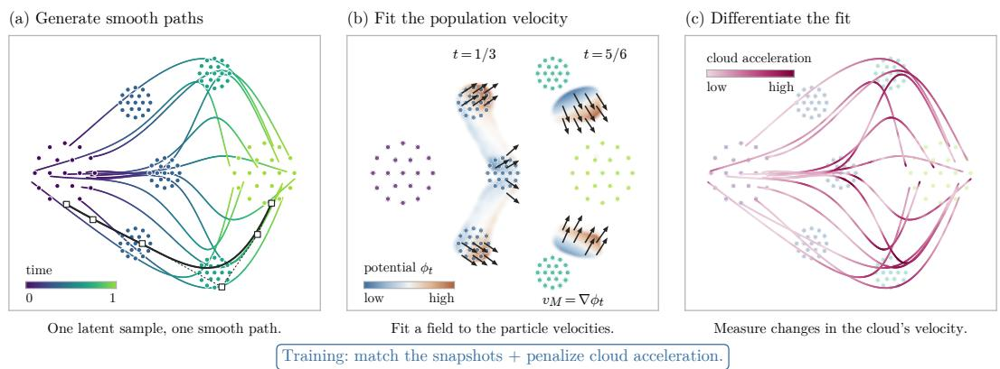
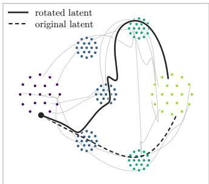
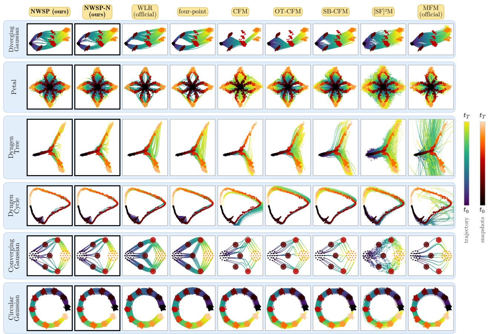
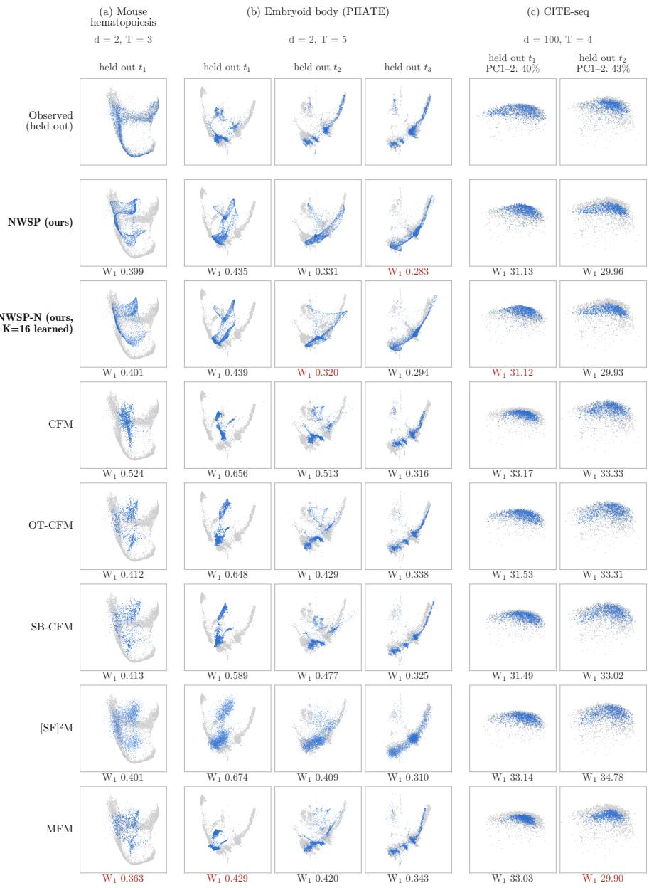
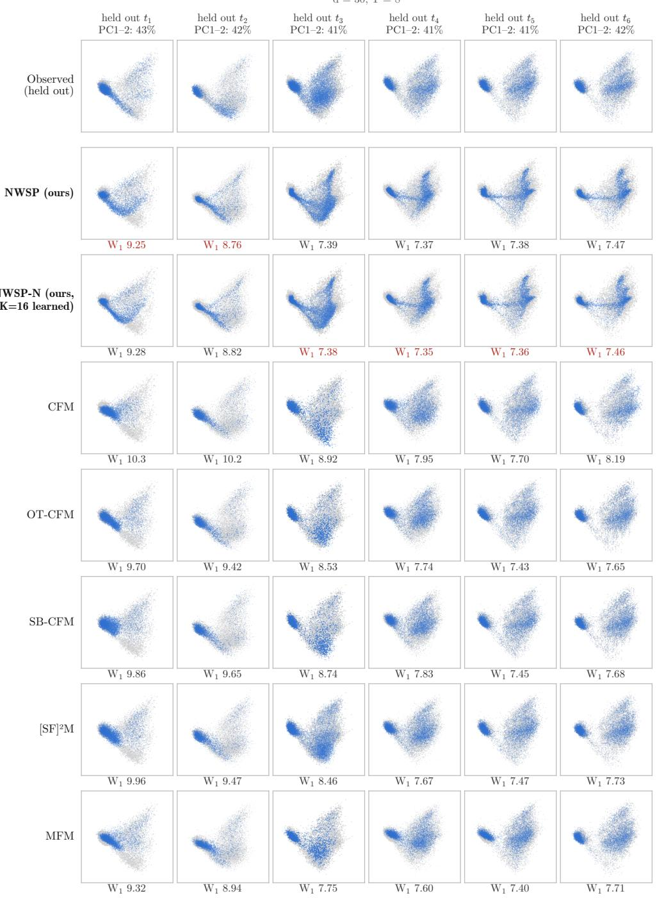

# Neural Wasserstein Splines: Representation-Invariant Second-Order Priors for Trajectory Inference

Amartya Banerjee Dept. of Computer Science UNC Chapel Hill

Harlin Lee   
SDSS   
UNC Chapel Hill

Caroline Moosm¨uller Dept. of Mathematics UNC Chapel Hill

## Abstract

Population dynamics are often observed only as unpaired snapshots, which leave the evolution between measurements underdetermined. Second-order regularization can constrain it, but a penalty on the accelerations of sampled particles is a prior on joint particle paths, and diferent particle representations of the same marginal curve can have diferent acceleration costs. We therefore introduce Neural Wasserstein Splines (NWSP), a sample-based method that learns a continuous population curve under a Wasserstein smoothness prior. A neural network maps latent variables to the control points of a cubic spline in time, so samples at any time come from the spline basis without numerical integration. We project the generator’s velocity onto gradients of a finite dictionary of scalar potentials and diferentiate this measuredependent projection in time, obtaining a finite-dimensional surrogate for the intrinsic Wasserstein acceleration, trained jointly with distributional fit losses. For a fixed dictionary and ridge parameter, we prove that the population penalty depends only on the marginal curve and bound its sensitivity to moment-estimation errors. Learned potentials (NWSP-N) sharpen acceleration estimates. On various synthetic and singlecell benchmarks, NWSP is highly competitive with transport and flow-based methods, ranking in the top two in 11 of 16 settings. The penalty improves on an unregularized spline in 13 of 16 settings and, while competitive with a particle-acceleration penalty, adds provable representation invariance.

## 1 INTRODUCTION

Observing a population at only a few times does not determine how it moves in between. A natural prior is that its motion changes gradually: penalizing acceleration favors nearly constant velocity, so the curve bends only where the data require it, whereas interpolating consecutive snapshots separately produces velocity jumps at every observation time. In singlecell experiments, destructive assays also mean that cells measured at successive times cannot be matched (Schiebinger et al., 2019; Tong et al., 2020). Trajectory inference therefore seeks a continuous curve of distributions that explains the snapshots, and the dynamical prior determines the evolution between them.

Applying an acceleration penalty to a population requires deciding what acceleration means. One option is the acceleration of the particles in a generative model, but unpaired snapshots do not identify which particle is which: many particle systems induce the same distribution at every time yet have very diferent accelerations (a Gaussian cloud can stay still or rotate rigidly; Fig. 2). A particle-acceleration penalty then also penalizes an arbitrary modeling choice. The alternative is the intrinsic Wasserstein acceleration, the rate of change of the minimum-norm velocity that transports the curve of distributions, which depends only on the curve (Benamou et al., 2019; Justiniano et al., 2024). NWSP therefore regularizes the acceleration of the curve of distributions rather than that of any individual particle path.

Computing such curves is expensive: spline constructions need optimal transport (OT) couplings between consecutive snapshots (Chewi et al., 2021), subdivision schemes such as Wasserstein Lane–Riesenfeld (WLR) solve repeated OT problems during refinement (Baner jee et al., 2025), and neural flow models generate samples by integrating a learned vector field. NWSP also uses splines, but over individual particle paths, so no transport problem is solved between snapshots; we compare scaling, not measured runtime (Section B).

  
Figure 1: Learning a smooth population curve from unpaired snapshots. (a) A network maps each latent sample to spline control points (squares), defining a complete path. (b) Ridge regression fits the velocity $\boldsymbol { v } _ { M } = \nabla \phi _ { t }$ to particle velocities. Blue/orange indicates lower/higher potential $\phi _ { t } ,$ scaled separately at each time; shading fades in low-density regions. (c) Diferentiating the fitted field gives cloud acceleration aM, whose magnitude colors the same paths. Training balances snapshot fit with mean squared cloud acceleration. NWSP-N also learns the potentials in (b).

We introduce Neural Wasserstein Splines (NWSP).1 A neural network maps a random latent variable to a whole smooth particle path, a spline in time, so the population can be sampled at any time without integration or cross-time OT couplings. We estimate the population velocity from these paths, diferentiate it in time to obtain the population acceleration, and train the network to fit the snapshots while keeping this acceleration small. NWSP-N additionally learns the potentials used to estimate the velocity.

Contributions. (i) Generative splines without cross-time OT. NWSP learns from minibatches of the full snapshots and samples at any time without numerical integration, using full training support on three datasets where exact-transport splines require subsampling. (ii) A diferentiated populationacceleration surrogate. We prove representation invariance for fixed potentials, bound the surrogate’s sensitivity to moment errors, establish Fourier approximation rates, and show that omitting the moving-Gram correction leaves a nonvanishing bias. (iii) Adaptive potential estimation. NWSP-N learns the potentials through a separate velocity-fitting ob jective; matched-size controls isolate the gain from adaptation and generator ablations evaluate the acceleration prior.

## 1.1 Related work

Wasserstein splines. Benamou et al. (2019) formulate intrinsic second-order models and a relaxation over particle paths, and Justiniano et al. (2024) discretize intrinsic splines with local Wasserstein distances and generalized barycenters. Chewi et al. (2021) interpolate in Euclidean space after constructing OT correspondences, while WLR and four-point schemes refine curves by repeated geodesic averaging (Banerjee et al., 2025). NWSP estimates population acceleration through a system indexed by potentials rather than observed particles.

Neural population dynamics. TrajectoryNet and MIOFlow fit flows with transport and geometric constraints (Tong et al., 2020; Huguet et al., 2022). Flow and bridge matching regress fields against conditionalpath targets (Lipman et al., 2023; Tong et al., 2024a,b); Metric Flow Matching and PACE incorporate data geometry (Kapu´sniak et al., 2024; Yu et al., 2026). SplineFlow and MMFM use spline interpolants as flow-matching targets (Rathod et al., 2026; Rohbeck et al., 2025); ALI-CFM learns interpolants adversarially before fitting a velocity field (Kviman et al., 2026). NWSP uses the spline itself to generate samples, with no second generative field.

Smoothness and velocity estimation. Momentum bridges and acceleration matching model position–velocity dynamics (Chen et al., 2023; Theodoropoulos et al., 2025; Dazzini et al., 2026; Sun et al., 2026); smooth bridges and Wassersplines impose smoothness through reference processes or field penalties (Hong et al., 2025; Zhang et al., 2022). Guan et al. (2026) learn population mechanics from a Wasserstein action principle. NWSP instead uses population acceleration as a regularizer for a direct spline generator. Its velocity fit builds on Action Matching and

Wasserstein Lagrangian Flows (Neklyudov et al., 2023, 2024); diferentiating the measure-dependent projection yields its second-order penalty.

## 2 PRELIMINARIES

At times $t _ { 1 } ~ < ~ \cdots ~ < ~ t _ { T }$ , we observe point clouds $\{ x _ { k , i } \} _ { i = 1 } ^ { n _ { k } } \subset \mathbb { R } ^ { d }$ with empirical measures $\begin{array} { r l } { \hat { \rho } _ { t _ { k } } } & { { } = } \end{array}$ $n _ { k } ^ { - 1 } \sum _ { i } \delta _ { x _ { k , i } } .$ with no correspondence between samples observed at diferent times. We rescale time to [0, 1] and write R for the indices retained for training. We aim to infer a probability-measure curve $\rho _ { t }$ with finite second moments by distributional, rather than pointwise or exact, fitting.

Intrinsic velocity and acceleration. For a suficiently regular curve, the Wasserstein tangent velocity $v _ { t } ( x )$ is the minimum- $L ^ { 2 } ( \rho _ { t } )$ )-norm solution of the continuity equation (Ambrosio et al., 2008),

$$
\begin{array} { r } { \partial _ { t } \rho _ { t } + \nabla \cdot \left( \rho _ { t } v _ { t } \right) = 0 . } \end{array}\tag{1}
$$

The velocity $v _ { t }$ belongs to the $L ^ { 2 } ( \rho _ { t } )$ -closure of gradient vector fields; in the smooth setting, we may write $v _ { t } ( x ) = \nabla _ { x } \phi _ { t } ( x )$ . Its intrinsic acceleration is the material derivative of the velocity field,

$$
a _ { t } ( x ) = \partial _ { t } v _ { t } ( x ) + D _ { x } v _ { t } ( x ) v _ { t } ( x )\tag{2}
$$

$$
\begin{array} { r } { = \nabla _ { \boldsymbol { x } } \big ( \partial _ { t } \phi _ { t } ( \boldsymbol { x } ) + \frac { 1 } { 2 } \| \nabla _ { \boldsymbol { x } } \phi _ { t } ( \boldsymbol { x } ) \| ^ { 2 } \big ) . } \end{array}\tag{3}
$$

Thus, the spatial derivative is taken in the direction ${ v } _ { t } ( x )$ of the flow itself (Otto, 2001; Justiniano et al., 2024). The corresponding acceleration energy

$$
\mathcal { A } ( \rho ) = \int _ { 0 } ^ { 1 } \| a _ { t } \| _ { \rho _ { t } } ^ { 2 } d t , \quad \quad \| h \| _ { \rho _ { t } } ^ { 2 } = \int \| h ( x ) \| ^ { 2 } d \rho _ { t } ( x ) ,
$$

depends only on the full marginal curve $( \rho _ { t } ) _ { t \in [ 0 , 1 ] }$

Identical marginals do not imply identical paths. Consider a random path Xt with law $\rho _ { t }$ . The conditional velocity $\mathbb { E } [ \dot { X } _ { t } \ | \ X _ { t } = x ]$ satisfies Eq. (1), but may include motion that leaves the distribution unchanged. For $Z \sim \mathcal { N } ( 0 , I _ { 2 } )$ , compare $X _ { t } ^ { \mathrm { s t a t } } = Z$ and $X _ { t } ^ { \mathrm { r o t } } = R ( \omega t ) Z _ { : }$ , where $R ( \alpha )$ rotates the plane by angle α. Both have law $\mathcal { N } ( 0 , I _ { 2 } )$ at every time because Gaussian is rotationally symmetric. Yet $\ddot { X } _ { t } ^ { \mathrm { s t a t } } = 0$ and $\ddot { X } _ { t } ^ { \mathrm { r o t } } = - \omega ^ { 2 } X _ { t } ^ { \mathrm { r o t } }$ , giving

$$
\mathbb { E } \| \ddot { X } _ { t } ^ { \mathrm { s t a t } } \| ^ { 2 } = 0 , \qquad \mathbb { E } \| \ddot { X } _ { t } ^ { \mathrm { r o t } } \| ^ { 2 } = 2 \omega ^ { 4 } .\tag{4}
$$

The common marginal curve is stationary, so $v _ { t } =$ $a _ { t } = 0$ . Thus, the nonzero pathwise acceleration en ergy measures rotation, not population change.

More generally, for $Z \sim { \mathcal { N } } ( 0 , I )$ , the paths $G _ { t } ( Z )$ and $G _ { t } ( R _ { t } Z )$ share every marginal for any time-dependent generator $G _ { t }$ and orthogonal $R _ { t }$ (Fig. 2). A prior on the population should therefore give all such repre sentations the same penalty, even when the common marginal curve evolves.

  
Figure 2: Same population, diferent particle paths. Rotating the latent changes particle paths (solid versus dashed) but preserves every marginal. Dots show the observed snapshots; gray lines show other rotated paths. Particle acceleration thus depends on the representation, whereas the population acceleration $a _ { M }$ is unchanged for a fixed dictionary.

## 3 NEURAL WASSERSTEINSPLINES (NWSP)

NWSP models population dynamics using smooth generative particle paths. Their analytic derivatives are used to fit a population-level velocity field, which is then diferentiated to approximate the intrinsic population acceleration. The generator is trained to match the observed snapshots while penalizing this acceleration; NWSP-N extends the method by augmenting the fixed velocity basis with learned potential gradi ents. Figure 1 gives an overview.

## 3.1 A spline-based generative model

We first describe a generative model for random particle paths $X _ { \theta } ( t , Z )$ , where $Z \sim \mathcal { N } ( 0 , I _ { d _ { z } } )$ is a latent draw and θ denotes neural network parameters. We write Xt when the dependence on θ and Z is clear.

More specifically, a neural network $C _ { \theta } : \mathbb { R } ^ { d _ { z } }  \mathbb { R } ^ { J \times d }$ maps $Z$ to $J = \left| \mathcal { R } \right| + 2$ control points, which are vectors in $\mathbb { R } ^ { d }$ that shape the generated particle trajectory. With knots at the times indexed by R and clamped cubic B-spline basis functions $B _ { j , 3 }$ mapping t to R,

$$
X _ { t } = \sum _ { j = 1 } ^ { J } B _ { j , 3 } ( t ) C _ { \theta } ( Z ) _ { j } , \qquad \rho _ { t } = \operatorname { L a w } ( X _ { t } ) .\tag{5}
$$

A single fixed latent draw $Z = z$ determines the entire deterministic particle path $t \mapsto X _ { \theta } ( t , z )$ , while

randomness over Z induces the marginal distribution $\rho _ { t } ~ = \mathrm { L a w } ( X _ { \theta } ( t , Z ) )$ . Simple interior knots give $C ^ { 2 }$ paths with analytic derivatives

$$
\begin{array} { l } { { U _ { t } : = \dot { X } _ { t } = \displaystyle \sum _ { j } \ddot { B } _ { j , 3 } ( t ) C _ { \theta } ( Z ) _ { j } , } } \\ { { \displaystyle W _ { t } : = \ddot { X } _ { t } = \sum _ { j } \ddot { B } _ { j , 3 } ( t ) C _ { \theta } ( Z ) _ { j } . } } \end{array}\tag{6}
$$

A single forward pass of $C _ { \theta }$ thus gives particle positions, velocities, and accelerations analytically, with out velocity measurements or numerical integration.

## 3.2 From particles to population velocity

Next, we construct a population-level velocity vector field from the positions and velocities generated by the spline model. Let $f _ { 1 } , \ldots , f _ { M } : \mathbb { R } ^ { d } \mapsto $ R be smooth potentials and their gradients $F ( x ) \ =$ $[ \nabla f _ { 1 } ( x ) \cdot \cdot \cdot \bar { \nabla f } _ { M } ( x ) ] \ \in \ \mathbb { R } ^ { d \times M }$ . We approximate the particle velocity $U _ { t }$ within a span of finite basis:

$v _ { M } ( t , x ) = F ( x ) c ( t )$ with coeficients $\boldsymbol { c } ( t ) \in \mathbb { R } ^ { M }$

(7)

We solve this as a regression problem. Suppressing time arguments, define matrices

$$
A = \mathbb { E } [ F ( X _ { t } ) ^ { \top } F ( X _ { t } ) ] , \qquad b = \mathbb { E } [ F ( X _ { t } ) ^ { \top } U _ { t } ] .\tag{8}
$$

For ridge parameter $\lambda > 0$ , the fitted

$$
c = \underset { q \in \mathbb { R } ^ { M } } { \arg \operatorname* { m i n } } \{ \mathbb { E } \| F ( X _ { t } ) q - U _ { t } \| ^ { 2 } + \lambda \| q \| ^ { 2 } \}\tag{9}
$$

satisfies

$$
( A + \lambda I ) c = b .\tag{10}
$$

Relation to Action Matching. The continuity equation (1) has a weak form: for every smooth test function $f _ { i }$

$$
\frac { d } { d t } \int f d \rho _ { t } = \int \nabla f \cdot \boldsymbol { v _ { t } } d \rho _ { t } ,
$$

so the velocity can be probed through test functions without solving the PDE. Action Matching (AM) (Neklyudov et al., 2023) turns this identity into a learning problem: it fits a neural potential $s _ { t } ( x )$ , with $\boldsymbol { v } _ { t } = \nabla \boldsymbol { s } _ { t }$ , to samples of $\rho _ { t }$ at many times, and since samples carry no velocities its objective must diferentiate the learned potential in time. Our setting difers in two ways. The generator supplies particle paths, so the left side is available in closed form: for $f = f _ { j }$ the chain rule gives $\mathbb { E } [ \nabla f _ { j } ( X _ { t } ) \cdot U _ { t } ] = b _ { j }$ , with no time derivative of any learned function. And the potentials are a fixed finite family, so the fit is the ridge regression above, AM’s least-squares objective restricted to span $\{ \nabla f _ { j } \}$ and solved at each t. Regressing $v _ { t }$ instead of $U _ { t }$ gives the same normal equations, because the non-gradient part of $\mathbb { E } [ U _ { t } \ | \ X _ { t } ]$ is orthogonal to the span. The velocity estimate is thus not new; the new step is diferentiating its solution in time along the moving population (Section 3.3). At finite M and nonzero ridge, $v _ { M }$ need not solve the continuity equation exactly. NWSP uses $M _ { 0 }$ fixed linear, quadratic, and sinusoidal potentials, with $M \ = \ M _ { 0 }$ , and estimates expectations by minibatches.

## 3.3 From velocity to population acceleration

The fitted population velocity $v _ { M } ( t , x )$ changes with time because the regression moments $A ( t )$ and b(t) are evaluated along the time-varying particle paths $X _ { t }$ . To diferentiate these moments, let $D _ { x } F ( x ) [ u ]$ denote the directional derivative of $F$ at x in direction u. Since $\dot { X } _ { t } = U _ { t }$ , the chain rule gives

$$
{ \dot { F } } _ { t } : = { \frac { d } { d t } } F ( X _ { t } ) = D _ { x } F ( X _ { t } ) [ U _ { t } ] .
$$

With $F = F ( X _ { t } )$ inside expectations,

$$
\begin{array} { r } { \dot { \boldsymbol { A } } = \mathbb { E } [ \dot { \boldsymbol { F } } ^ { \top } \boldsymbol { F } + \boldsymbol { F } ^ { \top } \dot { \boldsymbol { F } } ] , \quad } \\ { \dot { \boldsymbol { b } } = \mathbb { E } [ \dot { \boldsymbol { F } } ^ { \top } \boldsymbol { U } _ { t } + \boldsymbol { F } ^ { \top } \boldsymbol { W } _ { t } ] . } \end{array}\tag{11}
$$

Diferentiating (10) at fixed $( f _ { i } ) _ { i = 1 } ^ { M }$ and λ yields

$$
( A + \lambda I ) { \dot { c } } = { \dot { b } } - { \dot { A } } c .\tag{12}
$$

The correction $- \dot { A } c$ arises because the regression Gram matrix $A ( t )$ changes with time. Taking material derivative of (7) yields the following approximation to the intrinsic acceleration field (2):

$$
a _ { M } ( t , x ) = F ( x ) \dot { c } + D _ { x } F ( x ) [ F ( x ) c ] c .\tag{13}
$$

The population acceleration is therefore obtained by diferentiating the fitted velocity field $v _ { M }$ , not by projecting the particle acceleration $W _ { t }$ as $U _ { t }$ was projected to obtain $v _ { M } \colon$ in the rotating-Gaussian example of Section 2, $W _ { t }$ is nonzero although the marginal velocity and intrinsic acceleration vanish.

## 3.4 Training objective and sampling

Write the approximated acceleration energy as $\begin{array} { r } { \mathcal { E } ( \theta ; F ) = \int _ { 0 } ^ { 1 } \| a _ { M } ( t , \cdot ) \| _ { \rho _ { t } } ^ { 2 } } \end{array}$ dt. Set training objective

$$
\begin{array} { r l } & { \mathcal { L } _ { \mathrm { f i t } } ( \theta ) = \displaystyle \frac { 1 } { | \mathcal { R } | } \sum _ { k \in \mathcal { R } } \left[ S _ { \varepsilon } ( \rho _ { t _ { k } } , \hat { \rho } _ { t _ { k } } ) + \gamma \mathrm { M M D } ^ { 2 } ( \rho _ { t _ { k } } , \hat { \rho } _ { t _ { k } } ) \right] , } \\ & { \mathcal { L } ( \theta ; F ) = \mathcal { L } _ { \mathrm { f i t } } ( \theta ) + \lambda _ { a } \mathcal { E } ( \theta ; F ) / L ^ { 2 } . } \end{array}\tag{14}
$$

Here $S _ { \varepsilon }$ is the debiased Sinkhorn divergence with entropic hyperparameter ε (Cuturi, 2013; Feydy et al., 2019), and MMD uses Gaussian kernels (Gretton et al.,

Algorithm 1 NWSP and NWSP-N training $\left( \lambda _ { a } > 0 \right)$   
Require: Retained snapshots, $C _ { \theta } ,$ dictionary $F , \lambda , \lambda _ { a } ,$   
$\ { \dot { L } } ^ { 2 } .$ , batch size B   
1: Warm up $C _ { \theta } ; \mathrm { i f } \ K > 0 ,$ pretrain $g _ { \psi }$ using $\widehat { \mathcal { Q } }$   
2: for each subsequent optimization step ℓ do   
3: Sample times $\tau$ and snapshot minibatches   
4: With θ fixed, update $\psi$ to maximize $\widehat { \mathfrak { Q } } \mathrm { ~ i f ~ } K > 0$   
5: Fix $F$ and its scales; compute minibatch $\widehat { \mathcal { L } } _ { \mathrm { f i t } }$   
6: for each $t \in \tau$ do   
7: Draw projection and evaluation batches   
8: Estimate $\mathbf { \widehat { A } } , \widehat { b } , \widehat { { A } } , \widehat { { b } }$ using Eqs. (8) and (11)   
9: Factor $\widehat { H } = \widehat { A } + \lambda I ;$ solve $\widehat { H } \widehat { c } = \widehat { b }$   
10: Reuse the factorization: $\widehat { H \dot { c } } = \widehat { \dot { b } } - \widehat { \dot { A } } \widehat { c }$   
11: Evaluate ˆaM on $\widetilde { X } _ { t , i }$ using Eq. (13)   
12: end for   
13: Form $\widehat { \varepsilon }$ using Eq. (15)   
14: Update $\theta$ to minimize $\widehat { \mathcal { L } } _ { \mathrm { f i t } } + \lambda _ { a } ^ { ( \ell ) } \widehat { \mathcal { E } } / L ^ { 2 }$ , diferentiat  
ing through both solves   
15: end for

2012). $L ^ { 2 }$ is a fixed squared root-mean-square radius of the pooled retained data. Training first fits the observed snapshots, after which the accelerationregularization weight $\lambda _ { a } ^ { ( \ell ) }$ is gradually increased from zero to $\lambda _ { a }$ . See Algorithm 1.

At each sampled time $t \in { \mathcal { T } } ,$ we draw two independent latent minibatches $( Z _ { i } ) _ { i = : } ^ { B }$ and $( \widetilde Z _ { i } ) _ { i = 1 } ^ { B } .$ The first batch generates the particles used to estimate $\widehat { A } , \widehat { b } , \widehat { \dot { A } } , \widehat { \dot { b } } ;$ the second generates evaluation particles $\widetilde { X } _ { t , i } = X _ { \theta } ( t , \widetilde { Z } _ { i } )$ , on which the acceleration energy is computed:

$$
\widehat { \mathcal { E } } = \frac { 1 } { | \mathcal { T } | B } \sum _ { t \in \mathcal { T } } \sum _ { i = 1 } ^ { B } \| \widehat { a } _ { M } ( t , \widetilde { X } _ { t , i } ) \| ^ { 2 } .\tag{15}
$$

Optimization details, schedules, normalization, and batch sizes are in Section $\operatorname { A } ;$ computational cost is discussed in Section B.

## 3.5 NWSP-N: Expanding the basis

We propose an extension of NWSP that augments the fixed potential basis in Section 3.2 with learned potentials. NWSP-N adds $K$ scalar potentials from a neural network $g _ { \psi } : \mathbb { R } ^ { d }  \mathbb { R } ^ { K }$ :

$$
F _ { \psi } ( \boldsymbol { x } ) = \left[ \nabla f _ { 1 } \cdot \cdot \cdot \nabla f _ { M _ { 0 } } \mid \nabla g _ { \psi , 1 } \cdot \cdot \cdot \nabla g _ { \psi , K } \right] .\tag{16}
$$

With θ fixed, NWSP-N learns the added potentials so that their gradients capture as much of the population velocity field as possible. At each time $t ,$ define the regularized explained velocity energy

$$
\begin{array} { r l } & { \mathcal { T } _ { r } ( \psi , t ) = b ^ { \top } ( A + \lambda I ) ^ { - 1 } b } \\ & { \qquad = \| v _ { t } \| _ { \rho _ { t } } ^ { 2 } - \underset { q \in \mathbb { R } ^ { M } } { \operatorname* { m i n } } \left\{ \| v _ { t } - F _ { \psi } q \| _ { \rho _ { t } } ^ { 2 } + \lambda \| q \| ^ { 2 } \right\} . } \end{array}\tag{17}
$$

This measures how much of the population velocity energy can be represented by $F _ { \psi }$ . We learn $\psi$ by maximizing this quantity across time. To prevent times with larger particle speeds from dominating the objective, we normalize by the spline-particle velocity scale,

$$
\mathcal { Q } ( \psi ; \theta ) = \int _ { 0 } ^ { 1 } \frac { \mathcal { I } _ { r } ( \psi , t ) } { \operatorname* { m a x } ( \mathbb { E } \| U _ { t } \| ^ { 2 } , \epsilon _ { U } ) } d t ,\tag{18}
$$

The two-independent-batch estimator $\widehat { \mathcal { Q } }$ used in practice is given in Section A. The learned gradient features are additionally normalized by their root-mean-square magnitude to control feature scaling.

NWSP-N alternates between updating $g _ { \psi }$ and updating $C _ { \theta } ;$ see Algorithm 1. Potential updates hold θ fixed and improve the feature basis so that it captures the population velocity more accurately. Generator updates instead hold ψ and the feature-normalization scales fixed, and update θ to fit the data. We do not minimize the acceleration penalty with respect to $\psi ,$ since doing so could favor features that simply fail to represent the underlying motion and therefore make the measured acceleration artificially small.

## 3.6 Theoretical guarantees

The surrogate is useful as a population prior only if it does not depend on the particle representation, is stable to estimation error, and can resolve the motion of interest; we address these three points in turn. Statements and proofs are in Section C. They rely on a regularity condition (R) stated there: twice-diferentiable paths, thrice-diferentiable potentials, and integrable bounds that allow time derivatives inside expectations. No density is assumed; the Fourier approximation result additionally assumes the periodic setting and positive densities stated there.

## Does the penalty depend on how the particles are generated? Not for a fixed dictionary.

Proposition 1 (Representation invariance). Fix a time-independent dictionary and ridge parameter $\lambda >$ 0. Two lifts satisfying (R) and inducing the same marginal curve yield identical $A , b , { \dot { A } } , { \dot { b } } ,$ hence identical $v _ { M } , a _ { M }$ and, whenever finite, population acceleration energy.

The reason is that $\begin{array} { r } { A _ { i j } = \int \nabla f _ { i } \cdot \nabla f _ { j } d \rho _ { t } } \end{array}$ and $b _ { j } ~ =$ $\partial _ { t } \int f _ { j } d \rho _ { t }$ , and hence their time derivatives, are averages over the population and never refer to which particle is which. The same holds for any fixed learned dictionary. It does not extend to the full NWSP-N procedure, because the potential-learning objective (18) is normalized by the path-dependent particle velocity energy $\mathbb { E } \Vert U _ { t } \Vert ^ { 2 }$ , and it is an exact statement about populations, not about finite batches.

How accurate is the estimate, and why diferentiate the projection? Theorem 2 bounds the error of $a _ { M }$ by the errors in all four moments $A , b , { \dot { A } } , { \dot { b } } ,$ not only those of the velocity fit, because the acceleration error involves time and space derivatives of the velocity error (Eq. (27) in Section C). For a regular reference curve with exact moments (Sobolev regularity $s > 1 + d / 2$ , positive densities, ridge $\lambda _ { N } = O ( N ^ { - s } ) )$ , a Fourier dictionary with cutof N has velocity error $O ( N ^ { - s } )$ and acceleration error $O ( N ^ { 1 - s } )$ (Theorem 3); these rates do not cover the trained generator or a learned dictionary. Diferentiating the projection is also necessary: dropping $- \dot { A } c$ in Eq. (12) adds $F ( A + \lambda I ) ^ { - 1 }$ Ac˙ to the acceleration, which converges to $\Pi _ { \rho _ { t } } \left[ ( \partial _ { t } \rho _ { t } / \rho _ { t } ) v _ { t } \right]$ , where $\Pi _ { \rho _ { t } }$ is the weighted projection onto gradient fields (Corollary 4). This field need not vanish, so enlarging the dictionary does not repair the omission.

What can a finite dictionary resolve? Invariance does not imply adequate resolution. Linear and quadratic potentials cannot see shape changes that preserve the mean and variance; Section C.5 gives a Gaussian-mixture example in which they report zero acceleration for a changing distribution. Learning the potentials addresses this limitation of the projection space; we assess it empirically in Section 4.4, as the theory does not guarantee that the learning rule resolves every such change.

## 4 EXPERIMENTS

## 4.1 Experimental setup

Data and prediction tasks. Ten datasets provide sixteen dataset–protocol settings and 66 held-out snapshots in dimensions 2–100 (Table 4). They include synthetic trajectories, dyngen simulations (Cannoodt et al., 2021), embryoid body (Moon et al., 2019), Mouse hematopoiesis (Weinreb et al., 2020), Veres β-cell data (Veres et al., 2019), and CITE-seq (Burkhardt et al., 2022; Banerjee et al., 2025), following the benchmark sources in Section A. Leaveone-out removes each interior snapshot in turn; leavealternate-out removes every second one jointly.

Baselines and metrics. We compare NWSP and NWSP-N with WLR, four-point subdivision, CFM, OT-CFM, SB-CFM, $[ \mathrm { S F } ] ^ { 2 } \mathrm { M } .$ , and MFM. The primary metric is the exact empirical $W _ { 1 }$ between the predicted population and the withheld snapshot; we also report $W _ { 2 }$ and Gaussian-kernel $\mathrm { M M D ^ { 2 } }$ (Eqs. (20) and (21)). Scores average over holdouts within each seed and then over three seeds, with one sample standard deviation as spread. All metrics use the same models, selected on $W _ { 1 }$ with the target score excluded (Section A.1).

## 4.2 Prediction between observed snapshots

NWSP attains the lowest $W _ { 1 }$ in five settings and NWSP-N in four; they place in the top two in eleven and nine settings, respectively (Table 1). NWSP improves over OT-CFM, SB-CFM, CFM, and $[ \mathrm { S F } ] ^ { 2 } \mathrm { M }$ in 14, 13, 15, and 15 of the sixteen settings, so direct spline sampling is competitive with learned vector-field models while requiring no trajectory integration at inference.

Curved dynamics and single-cell data. On Circular Gaussian, leave-one-out $W _ { 1 }$ is 0.427 for NWSP and 0.426 for NWSP-N, versus 0.886 for the strongest baseline, MFM; with alternate snapshots removed it is 0.484 and 0.479, versus 0.780 for four-point subdivision. Both variants also lead on Dyngen Cycle under both protocols, and on leave-one-out embryoid body, Veres, and CITE-seq they occupy the first two positions under both $W _ { 1 }$ and $W _ { 2 }$ (Table 5). For embryoid body, $W _ { 1 }$ falls from the best baseline’s 0.397 to 0.350 and 0.351; on CITE-seq the values are 31.06, 30.55, and 30.53, a smaller gain that persists in the 100-dimensional evaluation space. $\mathrm { M M D ^ { 2 } }$ rankings are less uniform and geometric baselines remain strong: subdivision leads on Petal, MFM on Mouse leaveone-out and Veres leave-alternate-out. Dataset-level summaries and held-out point clouds are in Table 7 and Figs. 4 and 5.

Full-snapshot coverage. Both variants draw minibatches from all retained observations, whereas the evaluated exact-transport WLR and four-point implementations require 1000-point subsamples on embryoid body, Mouse, and Veres (five settings); all methods are scored against complete withheld snapshots. This is a coverage advantage, not a measured speedup (Section B), and diferences in training support prevent attributing every comparison to the acceleration prior, which the next experiment isolates.

## 4.3 What does the acceleration prior contribute?

The spline-only model already produces $C ^ { 2 }$ paths. Table 2 asks whether regularizing population acceleration adds predictive value beyond this smoothness; the two arms share architecture and snapshot loss and difer only in the penalty.

Regularization lowers mean $W _ { 1 }$ in thirteen of sixteen settings, with median relative change $- 2 . 2 \%$ The gains are heterogeneous: embryoid body leave-one-out improves from 0.450 to 0.350, and Petal from 0.153 to

Table 1: Held-out $W _ { 1 }$ (lower is better): mean over three seeds, with one sample SD below. WLR and 4-point are deterministic (no spread); their subsampled entries average three draws. Bold and underline mark the best and second-best means, compared before rounding; the last rows count best and top-two results. NWSP and NWSP-N are ours. Withheld snapshots are scored at full support (Section 4.2).
<table><tr><td>Dataset</td><td>WLR</td><td>4-point</td><td>OT-CFM</td><td>SB-CFM</td><td>CFM</td><td> $[ \mathrm { S F } ] ^ { 2 } \mathrm { M }$ </td><td>MFM</td><td>NWSP (ours)</td><td>NWSP-N (ours)</td></tr><tr><td>Leave-one-out</td><td></td><td></td><td></td><td></td><td></td><td></td><td></td><td></td><td></td></tr><tr><td>Diverging Gauss.</td><td>1.194</td><td>1.193</td><td>1.173 ± 0.035</td><td>1.192 ±0.038</td><td>1.275 ± 0.022</td><td>1.164 ± 0.014</td><td>1.299 ± 0.116</td><td>1.136 ± 0.017</td><td>1.117 ± 0.026</td></tr><tr><td>Petal</td><td>0.055</td><td>0.052</td><td>0.063 ± 0.003</td><td>0.064 ±0.002</td><td>0.174 ± 0.037</td><td>0.092 ± 0.004</td><td>0.084 ± 0.005</td><td>0.090 ± 0.014</td><td>0.085 ± 0.009</td></tr><tr><td>Converging Gauss.</td><td>0.453</td><td>0.438</td><td>0.443 ± 0.012</td><td>0.434 ± 0.012</td><td>0.483 ± 0.006</td><td>0.431 ± 0.012</td><td>0.435 ± 0.044</td><td>0.452 ± 0.022</td><td>0.469 ± 0.025</td></tr><tr><td>Embryoid body</td><td>0.428</td><td>0.407</td><td>0.472 ± 0.023</td><td>0.464 ± 0.022</td><td>0.495 ± 0.019</td><td>0.464 ± 0.015</td><td>0.397 ± 0.025</td><td>0.350 ± 0.007</td><td>0.351 ± 0.003</td></tr><tr><td>CITE-seq</td><td>31.062</td><td>31.688</td><td>32.422 ± 0.102</td><td>32.252 ± 0.150</td><td>33.246 ± 0.536</td><td>33.960 ± 0.223</td><td>31.465 ± 0.115</td><td>30.545 ± 0.106</td><td>30.527 ± 0.093</td></tr><tr><td>Circular Gauss.</td><td>1.961</td><td>1.406</td><td>1.545 ± 0.067</td><td>1.579 ± 0.023</td><td>1.560 ± 0.052</td><td>1.592 ± 0.048</td><td>0.886 ± 0.119</td><td>0.427 ± 0.015</td><td>0.426 ± 0.014</td></tr><tr><td>Dyngen Tree</td><td>2.454</td><td>2.444</td><td>2.489 ± 0.056</td><td>2.516 ± 0.112</td><td>2.391 ± 0.088</td><td>2.481</td><td>2.517</td><td>2.388 ± 0.031</td><td>2.409 ± 0.006</td></tr><tr><td>Dyngen Cycle</td><td>0.878</td><td>0.758</td><td>0.685 ± 0.006</td><td>0.690 ± 0.012</td><td>0.734 ± 0.010</td><td>± 0.046 0.688</td><td>± 0.054 0.676 ± 0.008</td><td>0.607 ± 0.012</td><td>0.609 ± 0.011</td></tr><tr><td>Mouse hemat.</td><td>0.406</td><td>0.402</td><td>0.412 ± 0.009</td><td>0.413 ± 0.022</td><td>0.524 ± 0.012</td><td>± 0.023 0.401 ± 0.027</td><td>0.363 ± 0.009</td><td>0.399 ± 0.007</td><td>0.401 ± 0.010</td></tr><tr><td>Veres β-cell</td><td>8.191</td><td>8.353</td><td>8.414 ±0.051</td><td>8.535 ±0.013</td><td>8.873 ±0.022</td><td>8.461 ± 0.044</td><td>8.121 ± 0.025</td><td>7.935 ± 0.008</td><td>7.942 ± 0.014</td></tr><tr><td>Leave-alternate-out</td><td></td><td></td><td></td><td></td><td></td><td></td><td></td><td></td><td></td></tr><tr><td>Petal</td><td>0.040</td><td>0.045</td><td>0.120 ± 0.004</td><td>0.064 ± 0.009</td><td>0.202 ± 0.010</td><td>0.086 ± 0.016</td><td>0.064 ± 0.005</td><td>0.086 ± 0.011</td><td>0.079 ± 0.017</td></tr><tr><td>Embryoid body</td><td>0.404</td><td>0.441</td><td>0.455 ± 0.018</td><td>0.465 ± 0.033</td><td>0.479 ± 0.047</td><td>0.434 ± 0.014</td><td>0.463 ± 0.028</td><td>0.412 ± 0.007</td><td>0.410 ± 0.004</td></tr><tr><td>Circular Gauss.</td><td>1.908</td><td>0.780</td><td>1.665 ± 0.118</td><td>1.663 ± 0.129</td><td>1.677 ± 0.106</td><td>1.716 ± 0.081</td><td>1.587 ±0.422</td><td>0.484 ± 0.007</td><td>0.479 ± 0.014</td></tr><tr><td>Dyngen Tree</td><td>2.635</td><td>2.678</td><td>2.683 ± 0.014</td><td>2.715 ± 0.033</td><td>2.561 ± 0.047</td><td>2.641 ± 0.030</td><td>2.582 ± 0.018</td><td>2.624 ± 0.011</td><td>2.657 ± 0.021</td></tr><tr><td>Dyngen Cycle</td><td>0.859</td><td>0.750</td><td>0.830</td><td>0.851</td><td>0.839</td><td>0.832</td><td>0.802</td><td>0.738 ± 0.019</td><td>0.738 ± 0.022</td></tr><tr><td>Veres β-cell</td><td>8.385</td><td>8.560</td><td>± 0.034 8.553</td><td>± 0.028 8.621</td><td>± 0.018 8.924</td><td>± 0.025 8.748</td><td>±0.019 7.973</td><td>8.153 ± 0.029</td><td>8.160 ± 0.026</td></tr><tr><td>Best /  16</td><td>2</td><td>1</td><td>± 0.098 0</td><td>± 0.181 0</td><td>± 0.105 1</td><td>±0.395 1</td><td>±0.058 2</td><td>5</td><td>4-9-</td></tr></table>

Table 2: Efect of the acceleration prior. Held-out $W _ { 1 }$ $( \mathrm { m e a n } \pm \mathrm { S D }$ over three seeds) for the same generator trained without (Spline-only) or with the population-acceleration penalty. Bold and underline mark the best and second-best mean within each protocol; a dash marks an inapplicable protocol.
<table><tr><td></td><td colspan="2">Leave-one-out</td><td colspan="2">Leave-alternate-out</td></tr><tr><td>Dataset</td><td> $\mathrm { S P L I N E { \mathrm { - } } O N L Y }$ </td><td>NWSP</td><td> $\mathrm { S P L I N E { \mathrm { - } O N L Y } }$ </td><td>NWSP</td></tr><tr><td>Diverging Gauss.</td><td> $\mathbf { 1 . 0 8 4 \pm 0 . 0 1 1 }$ </td><td> $\underline { { 1 . 1 3 6 } } \pm 0 . 0 1 7$ </td><td></td><td></td></tr><tr><td>Petal</td><td> $0 . 1 5 3 \pm 0 . 0 0 4$ </td><td> $\mathbf { 0 . 0 9 0 \pm 0 . 0 1 4 }$ </td><td> $0 . 1 9 9 \pm 0 . 0 0 9$ </td><td> $\mathbf { 0 . 0 8 6 \pm 0 . 0 1 1 }$ </td></tr><tr><td>Converging Gauss.</td><td> $\underline { { 0 . 4 6 6 } } \pm 0 . 0 2 5$ </td><td> ${ \bf 0 . 4 5 2 \pm 0 . 0 2 2 }$ </td><td></td><td></td></tr><tr><td>Embryoid body</td><td> $0 . 4 5 0 \pm 0 . 0 0 3$ </td><td> ${ \bf 0 . 3 5 0 \pm 0 . 0 0 7 }$ </td><td> $0 . 4 5 7 \pm 0 . 0 0 2$ </td><td> ${ \bf 0 . 4 1 2 \pm 0 . 0 0 7 }$ </td></tr><tr><td>CITE-seq</td><td> $3 0 . 5 8 6 \pm 0 . 0 5 2$ </td><td> $\mathbf { 3 0 . 5 4 5 \pm 0 . 1 0 6 }$ </td><td></td><td></td></tr><tr><td>Circular Gauss.</td><td> $\underline { { 0 . 4 3 2 } } \pm 0 . 0 2 4$ </td><td> ${ \bf 0 . 4 2 7 \pm 0 . 0 1 5 }$ </td><td> $\mathbf { 0 . 4 8 3 \pm 0 . 0 1 0 }$ </td><td> $0 . 4 8 4 \pm 0 . 0 0 7$ </td></tr><tr><td>Dyngen Tree</td><td> $2 . 5 1 0 \pm 0 . 0 2 6$ </td><td> ${ \bf 2 . 3 8 8 \pm 0 . 0 3 1 }$ </td><td> $2 . 6 2 8 \pm 0 . 0 0 8$ </td><td> $\mathbf { 2 . 6 2 4 \pm 0 . 0 1 1 }$ </td></tr><tr><td>Dyngen Cycle</td><td> $\underline { { 0 . 6 2 9 } } \pm 0 . 0 0 4$ </td><td> $\mathbf { 0 . 6 0 7 \pm 0 . 0 1 2 }$ </td><td> $\underline { { 0 . 7 4 7 } } \pm 0 . 0 1 1$ </td><td> $\mathbf { 0 . 7 3 8 \pm 0 . 0 1 9 }$ </td></tr><tr><td>Mouse hemat.</td><td> ${ \underline { { 0 . 4 0 3 } } } \pm 0 . 0 1 7$ </td><td> ${ \bf 0 . 3 9 9 \pm 0 . 0 0 7 }$ </td><td></td><td></td></tr><tr><td>Veres β-cell</td><td> $8 . 2 5 8 \pm 0 . 0 0 7$ </td><td> ${ \bf 7 . 9 3 5 \pm 0 . 0 0 8 }$ </td><td> $\mathbf { 8 . 1 0 5 \pm 0 . 0 1 4 }$ </td><td> $\underline { { 8 . 1 5 3 } } \pm 0 . 0 2 9$ </td></tr></table>

0.090 and from 0.199 to 0.086 under the two protocols, so smooth particle paths alone do not supply the same inductive bias. The CITE-seq change is small, and Diverging Gaussian and Veres leave-alternate-out favor spline-only. The largest gains are concentrated in a few settings and depend on the regularization range (Section A.1); Petal remains better served by subdivision.

Table 3: Learning the projection space. Relative acceleration error on analytic reference flows (mean ± SD over five seeds; lower is better). Each added block has sixteen potentials; the NWSP-N block is trained for 300 updates. Bold and underline mark the best and second-best means, ties included.
<table><tr><td>d</td><td>NWSP (ours)</td><td>+16 ridge</td><td>+16 untrained</td><td>NWSP-N (ours)</td></tr><tr><td>2</td><td>0.705 ± 0.046</td><td>0.683 ± 0.056</td><td>0.306 ± 0.025 0.899</td><td>0.062 ± 0.004</td></tr><tr><td>5</td><td>0.927 ± 0.025</td><td>0.918 ±0.023</td><td>± 0.024</td><td>0.137 ± 0.016</td></tr><tr><td>10</td><td>0.962 ± 0.006</td><td>0.960 ± 0.008</td><td>0.960 ± 0.006</td><td>0.199 ± 0.016</td></tr><tr><td>30</td><td>0.975 ± 0.002</td><td>0.975 ± 0.002</td><td>0.975 ± 0.002</td><td>0.341 ± 0.021</td></tr></table>

Replacing projected acceleration with raw particle acceleration gives a closer comparison (Table 9). Projection has lower $W _ { 1 }$ in eleven settings and higher error in five; the median raw-minus-projected change is +0.8%. With diferent hardware across the two arms and several small diferences, this ablation supports neither a universal predictive advantage nor equivalence of the penalties; their geometric distinction needs a test that changes particle paths while keeping the marginal curve fixed.

## 4.4 Does adaptation improve acceleration estimation?

On analytic reference flows, acceleration is known independently of the fitted dictionary. Table 3 compares the fixed dictionary with three equal-size additions: sixteen ridge features, sixteen untrained neural potentials, or sixteen learned potentials. Projection and error evaluation use independent samples, and results average five seeds; matched sizes isolate learning from dictionary expansion.

After 300 potential updates, relative acceleration error falls from 0.705 to 0.062 at d = 2 and from 0.975 to 0.341 at $d = 3 0$ . Learned potentials outperform both matched-size additions at every displayed dimension; at $d = 3 0$ all three non-adaptive dictionaries have error 0.975, so the improvement is attributable to adaptation rather than feature count. Resolution remains imperfect: error increases with dimension, and adding 64 learned potentials does not uniformly improve on 16. Longer optimization can be more useful than a larger block (Table 8).

Testing the diferentiated projection. A timedependent Gaussian latent rotation preserves every marginal but raises the raw particle energy from 1.42 to $1 . 4 5 \times 1 0 ^ { 5 }$ as its rate goes from zero to sixteen, whereas the projected energy varies by at most 2.3% through rate four at the largest sample size (Section $\operatorname { E } ) ;$ exact invariance is a population statement, not a finite-batch guarantee. On the periodic density curve of Section C.4, the moving-Gram correction reduces the absolute $L ^ { 2 } ( \rho _ { t } )$ acceleration error from 0.577 to about $7 \times 1 0 ^ { - 1 4 }$ , and the uncorrected error persists under Fourier refinement: velocity resolution cannot repair an incorrectly diferentiated projection.

## 5 DISCUSSION AND CONCLUSION

NWSP decouples how a population is sampled from how its motion is regularized. The spline generator yields samples and analytic derivatives without cross-time transport, and the diferentiated projection charges acceleration to the marginal curve rather than to unidentifiable particle paths, so every representation of the same curve receives the same penalty. Empirically, NWSP is highly competitive with transportand flow-based baselines, ranking top two in eleven of sixteen settings while training on full snapshots, and its acceleration prior improves on spline smoothness in thirteen of sixteen settings while remaining competitive with raw particle acceleration. Learned potentials sharply improve acceleration estimation on controlled flows (relative error $0 . 7 0 5 \ :  \ : 0 . 0 6 2$ at $d = 2 )$ , and NWSP-N attains the lowest $W _ { 1 }$ in four settings, showing that the prior can be adapted within the same framework.

The guarantees show that invariance holds for frozen dictionaries and the Fourier rates assume exact moments and regular positive densities, so extending both to the alternating neural optimization is a natural next step. By design, NWSP identifies marginal curves rather than individual cell histories, and it shifts the bottleneck from full-support transport to dictionary estimation, which reaches 5186 fixed features at $d =$ 100 (Section B). Sparser dictionaries and matched runtime and memory comparisons are promising directions for scaling further.

## AI use statement

Generative AI tools were used to assist with drafting portions of the manuscript and revising the text for clarity, organization, consistency checks and readabil ity. The authors take full responsibility for the final manuscript, including its originality, technical claims, reported results, and references.

## References

Ambrosio, L., Gigli, N., and Savar´e, G. (2008). Gradient Flows in Metric Spaces and in the Space of Probability Measures. Lectures in Mathematics ETH Z¨urich. Birkh¨auser, Basel, 2 edition.

Banerjee, A., Lee, H., Sharon, N., and Moosm¨uller, C. (2025). Eficient trajectory inference in Wasserstein space using consecutive averaging. In AISTATS, volume 258 of PMLR, pages 2260–2268.

Benamou, J.-D., Gallou¨et, T., and Vialard, F.-X. (2019). Second order models for optimal transport and cubic splines on the Wasserstein space. Foundations of Computational Mathematics, 19:1113–1143.

Burkhardt, D., Luecken, M., Benz, A., Holderrieth, P., Bloom, J., Lance, C., Chow, A., and Holbrook, R. (2022). Open problems—multimodal single-cell integration. Kaggle, NeurIPS 2022 competition.

Cannoodt, R., Saelens, W., Deconinck, L., and Saeys, Y. (2021). Spearheading future omics analyses using dyngen, a multi-modal simulator of single cells. Nature Communications, 12:3942.

Chen, T., Liu, G.-H., Tao, M., and Theodorou, E. A. (2023). Deep momentum multi-marginal Schr¨odinger bridge. In Advances in Neural Information Processing Systems, volume 36.

Chewi, S., Clancy, J., Le Gouic, T., Rigollet, P., Stepaniants, G., and Stromme, A. (2021). Fast and smooth interpolation on Wasserstein space. In AIS-TATS, volume 130 of PMLR, pages 3061–3069.

Clancy, J. and Suarez, F. (2022). Wasserstein–Fisher– Rao splines. arXiv preprint arXiv:2203.15728.

Cuturi, M. (2013). Sinkhorn distances: Lightspeed computation of optimal transport. In Advances in Neural Information Processing Systems, volume 26.

Dazzini, B., Conforti, G., Durmus, A., and Pooladian, A.-A. (2026). Trajectory inference via acceleration matching. arXiv preprint arXiv:2608.03916.

Feydy, J., S´ejourn´e, T., Vialard, F.-X., Amari, S.-i., Trouv´e, A., and Peyr´e, G. (2019). Interpolating between optimal transport and MMD using Sinkhorn divergences. In AISTATS, volume 89 of PMLR, pages 2681–2690.

Gretton, A., Borgwardt, K. M., Rasch, M. J., Sch¨olkopf, B., and Smola, A. (2012). A kernel twosample test. Journal of Machine Learning Research, 13:723–773.

Guan, V., Atanackovic, L., and Neklyudov, K. (2026). A call to Lagrangian action: Learning population mechanics from temporal snapshots. In ICML, volume 306 of PMLR, pages 37395–37416.

Hong, W., Shi, Y., and Niles-Weed, J. (2025). Trajectory inference with smooth Schr¨odinger bridges. In ICML, volume 267 of PMLR, pages 23722–23750.

Huguet, G., Magruder, D. S., Tong, A., Fasina, O., Kuchroo, M., Wolf, G., and Krishnaswamy, S. (2022). Manifold interpolating optimal-transport flows for trajectory inference. In Advances in Neural Information Processing Systems, volume 35.

Justiniano, J., Rumpf, M., and Erbar, M. (2024). Approximation of splines in Wasserstein spaces. ESAIM: Control, Optimisation and Calculus of Variations, 30:64.

Kapu´sniak, K., Potaptchik, P., Reu, T., Zhang, L., Tong, A., Bronstein, M., Bose, A. J., and Di Giovanni, F. (2024). Metric flow matching for smooth interpolations on the data manifold. In Advances in Neural Information Processing Systems, volume 37.

Kviman, O., Tamogashev, K., Branchini, N., Elvira, V., Lagergren, J., and Malkin, N. (2026). Multimarginal flow matching with adversarially learnt interpolants. In ICLR.

Lipman, Y., Chen, R. T. Q., Ben-Hamu, H., Nickel, M., and Le, M. (2023). Flow matching for generative modeling. In ICLR.

Moon, K. R., van Dijk, D., Wang, Z., Gigante, S., Burkhardt, D. B., Chen, W. S., Yim, K., van den Elzen, A., Hirn, M. J., Coifman, R. R., Ivanova, N. B., Wolf, G., and Krishnaswamy, S. (2019). Visualizing structure and transitions in high-dimensional biological data. Nature Biotechnology, 37(12):1482– 1492.

Neklyudov, K., Brekelmans, R., Severo, D., and Makhzani, A. (2023). Action matching: Learning stochastic dynamics from samples. In ICML, volume 202 of PMLR, pages 25858–25889.

Neklyudov, K., Brekelmans, R., Tong, A., Atanackovic, L., Liu, Q., and Makhzani, A. (2024). A computational framework for solving Wasserstein Lagrangian flows. In ICML, volume 235 of PMLR, pages 37461–37485.

Otto, F. (2001). The geometry of dissipative evolution equations: The porous medium equation. Communications in Partial Diferential Equations, 26(1– 2):101–174.

Rathod, S. S., Li\`o, P., and Zhang, X. (2026). SplineFlow: Flow matching for dynamical systems with B-spline interpolants. arXiv preprint arXiv:2601.23072.

Rohbeck, M., De Brouwer, E., Bunne, C., Huetter, J.-C., Biton, A., Chen, K., Regev, A., and Lopez, R. (2025). Modeling complex system dynamics with flow matching across time and conditions. In ICLR.

Schiebinger, G., Shu, J., Tabaka, M., Cleary, B., Subramanian, V., Solomon, A., Gould, J., Liu, S., Lin, S., Berube, P., Lee, L., Chen, J., Brumbaugh, J., Rigollet, P., Hochedlinger, K., Jaenisch, R., Regev, A., and Lander, E. S. (2019). Optimal-transport analysis of single-cell gene expression identifies developmental trajectories in reprogramming. Cell, 176(4):928–943.e22.

Stoeckius, M., Hafemeister, C., Stephenson, W., Houck-Loomis, B., Chattopadhyay, P. K., Swerd low, H., Satija, R., and Smibert, P. (2017). Simultaneous epitope and transcriptome measurement in single cells. Nature Methods, 14:865–868.

Sun, Y., Wu, Z., Huang, Z., and Zhou, P. (2026). TracingFlow: A simulation-free trajectory inference framework based on second-order dynamics. arXiv preprint arXiv:2608.21070.

Tang, S., Zhang, Y., Tong, A., and Chatterjee, P. (2026). Branched Schr¨odinger bridge matching. In ICLR.

Theodoropoulos, P., Saravanos, A. D., Theodorou, E. A., and Liu, G.-H. (2025). Momentum multimarginal Schr¨odinger bridge matching. In Advances in Neural Information Processing Systems, volume 38.

Tong, A. (2023). Processed single-cell RNA time series data. Mendeley Data, version 1.

Tong, A., Fatras, K., Malkin, N., Huguet, G., Zhang, Y., Rector-Brooks, J., Wolf, G., and Bengio, Y. (2024a). Improving and generalizing flow-based generative models with minibatch optimal transport. Transactions on Machine Learning Research.

Tong, A., Huang, J., Wolf, G., van Dijk, D., and Krishnaswamy, S. (2020). TrajectoryNet: A dynamic optimal transport network for modeling cellular dynamics. In ICML, volume 119 of PMLR, pages 9526– 9536.

Tong, A. Y., Malkin, N., Fatras, K., Atanackovic, L., Zhang, Y., Huguet, G., Wolf, G., and Bengio, Y. (2024b). Simulation-free Schr¨odinger bridges via score and flow matching. In AISTATS, volume 238 of PMLR, pages 1279–1287.

Veres, A., Faust, A. L., Bushnell, H. L., Engquist, E. N., Kenty, J. H.-R., Harb, G., Poh, Y.-C., Sintov,

E., G¨urtler, M., Pagliuca, F. W., Peterson, Q. P., and Melton, D. A. (2019). Charting cellular identity during human in vitro β-cell diferentiation. Nature, 569(7756):368–373.

Weinreb, C., Rodriguez-Fraticelli, A., Camargo, F. D., and Klein, A. M. (2020). Lineage tracing on transcriptional landscapes links state to fate during differentiation. Science, 367(6479):eaaw3381.

Yu, C., Wang, C., Liao, B., and Wu, T. (2026). PACE: Geometry-aware bridge transport for single-cell trajectory inference. In ICML Workshop on Generative and Agentic AI for Biology (GenBio). Workshop poster; extended version arXiv:2605.18587.

Zhang, P., Smirnov, D., and Solomon, J. (2022). Wassersplines for neural vector field-controlled animation. Computer Graphics Forum, 41:31–41.

Zhang, Z., Li, T., and Zhou, P. (2025). Learning stochastic dynamics from snapshots through regularized unbalanced optimal transport. In ICLR.

# Neural Wasserstein Splines: Representation-Invariant Second-Order Priors for Trajectory Inference: Supplementary Materials

## A IMPLEMENTATION AND EVALUATION

Table 4: Datasets and held-out tasks. State dimension $d ,$ snapshots $T ,$ held-out targets $| \mathcal { H } |$ under leave-oneout (loo) and leave-alternate-out (alt), and fixed-dictionary size $M _ { 0 } ;$ NWSP-N adds $K = 1 6$ potentials. A dash marks an inapplicable protocol.

<table><tr><td>Dataset</td><td>d</td><td>T</td><td> $| \mathcal { H } | _ { \mathrm { l o o } }$ </td><td> $| { \mathcal { H } } | _ { \mathrm { a l t } }$ </td><td> $M _ { 0 }$ </td></tr><tr><td>Circular Gaussian</td><td>2</td><td>10</td><td>8</td><td>4</td><td>41</td></tr><tr><td>Dyngen Cycle</td><td>10</td><td>15</td><td>13</td><td>7</td><td>101</td></tr><tr><td>Dyngen Tree</td><td>10</td><td>7</td><td>5</td><td>3</td><td>101</td></tr><tr><td>Petal</td><td>2</td><td>5</td><td>3</td><td>2</td><td>41</td></tr><tr><td>Converging Gaussian</td><td>2</td><td>4</td><td>2</td><td></td><td>41</td></tr><tr><td>Diverging Gaussian</td><td>2</td><td>4</td><td>2</td><td></td><td>41</td></tr><tr><td>Embryoid body</td><td>2</td><td>5</td><td>3</td><td>2</td><td>41</td></tr><tr><td>Mouse hematopoiesis</td><td>2</td><td>3</td><td>1</td><td></td><td>41</td></tr><tr><td>Veres β-cell</td><td>30</td><td>8</td><td>6</td><td>3</td><td>531</td></tr><tr><td>CITE-seq</td><td>100</td><td>4</td><td>2</td><td></td><td>5186</td></tr></table>

We use $d _ { z } = \operatorname* { m i n } ( d , 1 6 )$ and an afine component plus a multilayer network, initialized from snapshot means indexed by R and pooled covariance. Nine datasets follow the WLR, PACE, and BranchSBM benchmarks (Banerjee et al., 2025; Yu et al., 2026; Tang et al., 2026); the tenth is the 100-dimensional CITE-seq time course.

Dataset provenance. We load Circular Gaussian, Diverging Gaussian, Petal, Converging Gaussian, Dyngen Tree, Dyngen Cycle, and CITE-seq through the released WLR benchmark loader (Banerjee et al., 2025). Petal is adapted from MIOFlow (Huguet et al., 2022), and Converging Gaussian from Wasserstein–Fisher–Rao splines (Clancy and Suarez, 2022). The WLR authors generated Dyngen Tree and Cycle using the dyngen simulator (Cannoodt et al., 2021); the released ten-dimensional representations use PCA for Tree and PHATE for Cycle (Moon et al., 2019).

Embryoid body originates from Moon et al. (2019). We use the two-dimensional PHATE coordinates in eb velocity v5.npz distributed with PACE (Yu et al., 2026); this processed dataset is also distributed with TrajectoryNet (Tong et al., 2020). Mouse hematopoiesis originates from Weinreb et al. (2020); we load the two-dimensional release supplied with BranchSBM (Tang et al., 2026), whose data source is DeepRUOT (Zhang et al., 2025). The thirty-dimensional Veres data (Veres et al., 2019) are likewise loaded from BranchSBM’s released CSV.

CITE-seq uses the WLR release of the NeurIPS 2022 Open Problems time-course data (Burkhardt et al., 2022; Banerjee et al., 2025), represented in 100 dimensions and subsampled by the released loader to 1000 cells per snapshot. Stoeckius et al. (2017) introduced the CITE-seq assay; that assay reference is distinct from the source of this time-course dataset.

Licenses, data use, and code. A related processed CITE-seq archive (Tong, 2023) is licensed CC BY 4.0. Our code is released under the MIT license. We reuse public numerical cell-state data and collect no new human data; model inputs contain expression-derived coordinates, not participant names or contact information. The code repository provides NWSP and NWSP-N, pinned dependencies, a YAML configuration, and synthetic toy datasets. It demonstrates both methods but does not reproduce all benchmark tables.

Fixed settings. The generator uses a trainable linear map plus a three-hidden-layer, width-128 SiLU network. Its initial output follows the natural spline through retained snapshot means; the linear part uses the first $d _ { z }$ columns of the pooled covariance square root. The loss is given in Eq. (14). Training uses double precision and 3000 Adam steps at learning rate $3 \times 1 0 ^ { - 3 }$ , with cosine decay and gradient clipping at 10. Each step uses projection and independent energy batches of 256, two stratified time samples $( | \mathcal { T } | = 2 )$ , and fitting batches of $\operatorname* { m i n } ( 1 2 8 , n _ { \operatorname* { m i n } } )$ from every retained snapshot, where $n _ { \mathrm { m i n } } = \operatorname* { m i n } _ { k \in \mathcal { R } } n _ { k }$ . The first 300 iterations fit snapshots without the acceleration penalty. The acceleration weight is then increased linearly over 20% of the remaining iterations. We set $\gamma = 0 . 1$ , training-loss MMD bandwidths 0.25–4 times the pooled retained-data median distance, and Sinkhorn hyperparameter $\varepsilon = \operatorname* { m a x } ( 1 0 ^ { - 3 } , 0 . 0 2 \bar { s } )$ , where ¯s is the mean summed coordinate variance of retained snapshots. The dictionary has all linear and quadratic potentials plus 36 sine/cosine features across three frequency scales, scaled to unit retained-data gradient energy; ridge parameter $\lambda = 1 0 ^ { - 4 }$ . NWSP-N adds a tanh network of depth 2, width 64 and 16 outputs, which are the learned potentials. Gradients and Hessian– vector products use analytic chain rules, including third activation derivatives when backpropagating into the generator.

Alternating updates. When acceleration regularization is used, NWSP-N pretrains its potentials after the 300-step generator warmup for 200 steps at learning rate 0.003, then makes 1 potential update per generator step at rate 0.001. Each potential update uses two independent batches at each sampled time and the symmetric estimate below. The generator update holds potential parameters fixed. Generator normalization constants are instead pooled over four sampled times, refreshed every 25 steps, and held fixed during time diferentiation. Computational cost is discussed in Section B.

Potential-learning estimate. At a sampled time, draw two independent batches $\{ ( \boldsymbol { X } _ { t } ^ { ( j , i ) } , \boldsymbol { U } _ { t } ^ { ( j , i ) } ) \} _ { i = 1 } ^ { B _ { \psi } } , ~ j ~ \in$ {1, 2}. For learned potential $k ,$ normalize its gradient by

$$
s _ { k } = \left[ \frac { 1 } { 2 B _ { \psi } } \sum _ { j = 1 } ^ { 2 } \sum _ { i = 1 } ^ { B _ { \psi } } \| \nabla g _ { \psi , k } ( X _ { t } ^ { ( j , i ) } ) \| ^ { 2 } + 1 0 ^ { - 1 2 } \right] ^ { 1 / 2 } .
$$

This normalization is diferentiated in ψ. Write $( \widehat { A } _ { j } , \widehat { b } _ { j } )$ for the empirical moments of batch $j$ with these normalized features and $\hat { c } _ { j } = ( \widehat { A } _ { j } + \lambda I ) ^ { - 1 } \widehat { b } _ { j }$ . Let

$$
e _ { U } = \operatorname* { m a x } \left\{ \frac { 1 } { 2 B _ { \psi } } \sum _ { j = 1 } ^ { 2 } \sum _ { i = 1 } ^ { B _ { \psi } } \Vert U _ { t } ^ { ( j , i ) } \Vert ^ { 2 } , \epsilon _ { U } \right\} .
$$

We fix $\epsilon _ { U }$ at the smallest positive normal double-precision value. The symmetric score is

$$
\widehat { \mathcal { Q } } _ { t } = \frac { \widehat { b } _ { 2 } ^ { \top } \widehat { c } _ { 1 } + \widehat { b } _ { 1 } ^ { \top } \widehat { c } _ { 2 } } { 2 e _ { U } } ,\tag{19}
$$

and $\begin{array} { r } { \widehat { \mathcal { Q } } = | \mathcal { T } | ^ { - 1 } \sum _ { t \in \mathcal { T } } \widehat { \mathcal { Q } } _ { t } } \end{array}$ is maximized with θ fixed. Each batch is used once to fit coeficients and once to evaluate coeficients fitted on the other batch. For generator updates, stored scales are refreshed from 256 samples at each of four stratified times and held fixed during physical-time diferentiation. The potential network estimates motion; it does not discriminate between generated and observed data.

Estimation and normalization. The independent energy batch in Eq. (15) prevents reuse of the projection samples, but it does not remove bias from the nonlinear coeficient estimates. The stability result in Theorem 2 concerns moment perturbations; energy quadrature introduces a separate sampling error. The divisor $L ^ { 2 }$ is fixed by retained data rather than a model-dependent energy that may vanish at initialization.

Variants and baselines. The unregularized spline fits are shared by NWSP and NWSP-N. Flow baselines train for 10000 steps; their six configurations vary width and noise. MFM uses a locally adaptive normal-distribution metric (LAND) for $d \leq 1 0$ and a radial-basis-function metric (RBF) for $d \geq 3 0$ , variants OT/I, bandwidths 0.5, 1, 2, and 101 Euler steps. WLR and four-point use exact transport at subdivision depth seven. Hardware is described in Section B. With $K = 0$ , the NWSP-N training procedure reproduces 0 of 118 reference NWSP fits exactly (median per-run diference 12.9%). These discrepancies limit attribution of small between-method diferences.

## A.1 Hyperparameters and evaluation protocol

Hyperparameter search. NWSP selects the acceleration weight from $\{ 0 , 1 0 ^ { - 8 } , 1 0 ^ { - 6 } , 1 0 ^ { - 4 } , 1 0 ^ { - 2 } , 1 \}$ , covering the unregularized spline and several orders of magnitude of regularization strength. NWSP-N uses the same grid except on CITE-seq, where it considers $\{ 0 , 1 0 ^ { - 4 } \}$ . Each baseline is evaluated over six candidate configurations.

Baseline implementation. On embryoid body, Mouse, and Veres, unequal-size large snapshots made exacttransport subdivision infeasible at full support. WLR and four-point therefore use independent 1000-point retained-snapshot subsamples, with three draws; all withheld targets remain at full support. Equal-size CITEseq uses exact full-support transport. For MFM, nonfinite RBF precisions are replaced with the median finite precision; alternate-out fits use retained snapshots only and integrate to each gap’s midpoint. These baseline completions were made after initial results were available. Veres alternate-out MFM ran on CPU rather than GPU.

## A.2 Prediction metrics

Scores of one prediction. Let $\begin{array} { r } { \hat { \mu } = \sum _ { i = 1 } ^ { n } \mu _ { i } \delta _ { x _ { i } } } \end{array}$ be a prediction and $\begin{array} { r } { \hat { \nu } _ { h } = \frac { 1 } { m } \sum _ { j = 1 } ^ { m } \delta _ { y _ { j } } } \end{array}$ the withheld snapshot of holdout h. NWSP and the flow baselines predict $n = m$ points with $\mu _ { i } = 1 / n ;$ WLR and four-point subdivision return a weighted measure, scored with its weights. We compare prediction and snapshot in dataset coordinates and in full dimension, computing Wasserstein distances exactly as the linear programs

$$
W _ { p } ( \hat { \mu } , \hat { \nu } _ { h } ) ^ { p } = \operatorname* { m i n } _ { \pi \in \Pi ( \mu , \nu ) } \sum _ { i , j } \pi _ { i j } \left\| x _ { i } - y _ { j } \right\| ^ { p } , \qquad p \in \{ 1 , 2 \} ,\tag{20}
$$

The norm is Euclidean, $\nu _ { j } = 1 / m$ and $\Pi ( \mu , \nu )$ is the set of couplings of the two weight vectors. We solve the programs with the network simplex method and verify that it did not stop at its iteration cap. The MMD is the plug-in estimate averaged over a ladder of Gaussian kernels,

$$
\mathrm { M M D } ^ { 2 } ( \hat { \mu } , \hat { \nu } _ { h } ) = \frac { 1 } { 5 } \sum _ { \beta } \bigg [ \sum _ { i , i ^ { \prime } } \mu _ { i } \mu _ { i ^ { \prime } } k _ { \beta } ( x _ { i } , x _ { i ^ { \prime } } ) + \sum _ { j , j ^ { \prime } } \nu _ { j } \nu _ { j ^ { \prime } } k _ { \beta } ( y _ { j } , y _ { j ^ { \prime } } ) - 2 \sum _ { i , j } \mu _ { i } \nu _ { j } k _ { \beta } ( x _ { i } , y _ { j } ) \bigg ] ,\tag{21}
$$

with $k _ { \beta } ( x , y ) = \exp ( - \left\| x - y \right\| ^ { 2 } / 2 \beta ^ { 2 } )$ and $\beta \in \{ 0 . 2 5 , 0 . 5 , 1 , 2 , 4 \} \varsigma$ , where $\varsigma$ is the standard deviation of al coordinates of the withheld snapshot. The tables report this averaged squared discrepancy. Embryoid body scores use PHATE coordinates standardized with retained frames, so they are not comparable with other datasets, whose scores use all data coordinates.

We average holdouts within each seed, then seeds 0–2; each spread is one sample SD of the three seed averages.   
Subsampled transport methods use three subsample draws; deterministic methods have no seed SD.

## B COMPUTATIONAL COST

This section collects the computational properties of NWSP and NWSP-N that are referred to in the main text. We report what the construction costs and what we measured; we did not run matched runtime or memory comparisons against the baselines, so the comparison with transport-based methods below concerns scaling, not measured speed.

What does not depend on the snapshots. The snapshot loss compares generated and observed samples at the same time with a Sinkhorn divergence and an MMD term, using minibatches of min $( 1 2 8 , n _ { \mathrm { m i n } } )$ points per retained snapshot. No transport coupling between diferent times is constructed or stored. In contrast, constructing a transport spline or a Wasserstein subdivision requires couplings between full snapshots, whose cost matrices alone have size quadratic in the snapshot sizes. In our benchmark this is why the evaluated exacttransport implementations of WLR and four-point subdivision needed 1000-point subsamples on three datasets (Section A.1), whereas NWSP and NWSP-N were trained with minibatches from the full snapshots. This is a diference in the data that can be used, not a measured speedup.

Cost of the acceleration penalty. Let B be the projection batch size, $M = M _ { 0 } + K$ the number of potentials (Eq. (16)), and w the width of the learned potential network. At each sampled time, forming the moments $\widehat { A } , \widehat { b } , \widehat { \dot { A } } , \widehat { \dot { b } }$ and factoring $\widehat { A } + \lambda I$ costs $O ( B d M ^ { 2 } + M ^ { 3 } )$ in the dense implementation, plus $O ( B ( w ^ { 2 } d + w d K ) )$ for a depth-two potential network. The second linear system (12) reuses the factorization of the first (10), so it adds only $O ( M ^ { 2 } )$ , and the generator’s gradients are propagated through both solves. Storing the feature evaluations and the Gram matrix takes $O ( B d M + M ^ { 2 } )$ memory, apart from generator activations and derivative bufers. These costs depend on the minibatch and the dictionary, not on the number of observed points per snapshot. With $\lambda _ { a } = 0$ the projection and potential-update steps are skipped, and training reduces to the snapshot loss with the spline generator.

Dictionary size is the practical limit. The fixed dictionary contains all linear and quadratic potentials plus 36 sine/cosine features, so $M _ { 0 } = d + d ( d + 1 ) / 2 + 3 6$ grows quadratically in the dimension: 41 at $d = 2 .$ , 531 at $d = 3 0$ , and 5186 at d = 100 (Table 4). At d = 100 the dense Gram matrix and factorization therefore dominate the cost. Reducing this burden, for example by a low-rank or sparse dictionary or by adapting the dictionary size to the batch size, is a natural direction; the stability bound in Theorem 2 indicates how large the moment errors may be for a target accuracy.

Computing infrastructure. The main CPU benchmark used AMD EPYC 9754 processors (128 cores per processor) for NWSP and AMD EPYC 9654 processors (96 cores per processor) for NWSP-N. CPU fits used eight numerical threads for NWSP and one for NWSP-N; these are per-process settings, not the total core counts of the machines. The Veres and CITE-seq fits for both methods used NVIDIA H100 GPUs with 80 GB memory. NWSP-N GPU workers used one to three CPU threads, depending on the job. Some GPU allocations hosted multiple independent workers. The fresh-seed checks retained the corresponding CPU environments; the additional eight-thread NWSP-N check is reported separately.

The raw-acceleration ablation used EPYC 9654 and EPYC 9754 CPU workers and NVIDIA A100 GPUs with 40 GB or 80 GB memory, with two completed H100 tasks also included. The A100 hosts used EPYC 7713 and EPYC 7V13 processors, respectively. Raw-acceleration workers used eight numerical threads.

Inference. Sampling evaluates $C _ { \theta }$ and the spline basis. It needs no potential fitting, no numerical integration, and no access to the training snapshots.

## C PROOFS AND APPROXIMATION CONDITIONS

Standing condition (R). The lift $X _ { t }$ is almost surely $C ^ { 2 }$ in time, with $U _ { t } = \dot { X } _ { t }$ and $W _ { t } = \ddot { X } _ { t }$ , and the potentials are $C ^ { 3 }$ in space. On each compact time interval, assume integrable random envelopes for $f _ { j } ( X _ { t } )$ its first two pathwise time derivatives, and the entries of $F ( X _ { t } ) ^ { \top } F ( X _ { t } )$ and their first time derivatives. In particular, the envelopes cover $\nabla f _ { j } \cdot U _ { t } , U _ { t } ^ { \top } \nabla ^ { 2 } f _ { j } U _ { t } + \nabla f _ { j } \cdot W _ { t }$ , and the products in Eq. (11). These conditions justify the exchanges of time diferentiation and expectation used below. For the least-squares interpretation, assume square-integrable path velocities; whenever acceleration energies are used, assume those energies are finite. None of these finite-dictionary identities requires a density for $\rho _ { t }$

All dictionaries and feature scales in this appendix are held fixed during time diferentiation. Vector norms are Euclidean, matrix norms are induced operator norms, and field norms are $L ^ { 2 } ( \rho _ { t } )$ unless otherwise indicated.

## C.1 Representation invariance

Proof of Proposition 1. The chain rule and (R) give

$$
A _ { i j } = \int \nabla f _ { i } \cdot \nabla f _ { j } d \rho _ { t } , \qquad b _ { j } = \frac { d } { d t } \int f _ { j } d \rho _ { t } , \qquad \dot { b } _ { j } = \frac { d ^ { 2 } } { d t ^ { 2 } } \int f _ { j } d \rho _ { t } .
$$

Diferentiating the first identity gives ${ \dot { A } } .$ Thus two representations of the same marginal curve have the same four moments. Since $A + \lambda I \succeq \lambda I$ , both linear systems have unique solutions. The fields $v _ { M } , a _ { M }$ and their population energies consequently coincide. The argument applies unchanged to a frozen learned dictionary.

## C.2 Stability of the two solves

Theorem 2 (Stability under moment errors). At a fixed time, let $H = A + \lambda I$ and $\kappa = \lambda _ { \operatorname* { m i n } } ( H ) \geq \lambda$ . Use the same dictionary F, ridge λ, and evaluation measure for the perturbed system. Hats denote perturbed moments and the solutions of the two corresponding linear systems; in particular, $\widehat { \dot { c } }$ denotes the second solution. Write $\delta _ { A } = \| \hat { A } - A \| < \kappa _ { ; }$ with analogous notation for the other moment errors. Set

$$
R _ { 0 } = \frac { \delta _ { b } + \delta _ { A } \| c \| } { \kappa - \delta _ { A } } ,\tag{22}
$$

$$
R _ { 1 } = \frac { { \delta _ { \dot { b } } + \delta _ { \dot { A } } \| c \| + ( \| \dot { A } \| + \delta _ { \dot { A } } ) R _ { 0 } + \delta _ { A } \| \dot { c } \| } } { \kappa - \delta _ { A } } .\tag{23}
$$

Then $\| \hat { c } - c \| \leq R _ { 0 }$ and $\| \widehat { \dot { c } } - \dot { c } \| \leq R _ { 1 }$ . Wherever $\| F ( x ) \| \le K _ { 0 }$ and $\| D _ { x } F ( x ) [ u ] \| \leq K _ { 1 } \| u \|$

$$
\begin{array} { r } { \| \hat { \boldsymbol { a } } _ { M } - \boldsymbol { a } _ { M } \| \leq K _ { 0 } R _ { 1 } + K _ { 0 } K _ { 1 } ( 2 \| \boldsymbol { c } \| + R _ { 0 } ) R _ { 0 } . } \end{array}\tag{24}
$$

Since $\kappa \geq \lambda$ , the condition $\delta _ { A } < \kappa$ holds whenever the Gram-matrix error is below the ridge parameter. The experiments reported here do not measure $\| { \hat { A } } - A \|$ or $\lambda _ { \operatorname* { m i n } } ( H )$ , so the condition is a hypothesis of the theorem, not a verified property of the reported runs.

Proof. Let $\Delta { \cal A } = \hat { \cal A } - { \cal A }$ , define the other moment diferences similarly, and put $e = { \hat { c } } - c , g = { \widehat { \dot { c } } } - { \dot { c } } $ . The inverse of $\hat { H } = \hat { A } + \lambda I$ has norm at most $( \kappa - \delta _ { A } ) ^ { - 1 }$ . Subtracting the two pairs of normal equations yields

$$
\hat { H } e = \Delta b - \Delta A c , \qquad \hat { H } g = \Delta \dot { b } - \Delta \dot { A } c - \widehat { \dot { A } } e - \Delta A \dot { c } .
$$

The inverse bound gives $R _ { 0 } , R _ { 1 }$ . Finally, $\hat { a } _ { M } - a _ { M } = F g + D _ { x } F [ F \hat { c } ] e + D _ { x } F [ F e ] c ,$ , which implies Eq. (24). If $D = \left\| \hat { a } _ { M } - a _ { M } \right\| _ { L ^ { 2 } ( \rho _ { t } ) }$ , the error in squared energy is at most $( 2 \| a _ { M } \| _ { L ^ { 2 } ( \rho _ { t } ) } + D ) D$ □

## C.3 Fourier approximation

Theorem 3 (Consistency for Fourier trial spaces). On the d-dimensional torus $\mathbb { T } ^ { d }$ with normalized Lebesgue measure, let $\rho \in C ^ { 1 } ( [ 0 , 1 ] ; L ^ { \infty } (  { \mathbb { T } } ^ { d } ) )$ satisfy $0 < m \leq \rho _ { t } \leq M _ { \rho }$ , and let the tangent velocity $v \in C ^ { 1 } ( [ 0 , 1 ] ; H ^ { s } ( \mathbb { T } ^ { d } ) )$ , $s > 1 + d / 2$ , be the gradient of a periodic potential. Let $V _ { N }$ be the span of the gradient Fourier modes with $0 < \| \boldsymbol { k } \| _ { \infty } \leq N$ , expressed in an unweighted $L ^ { 2 }$ -orthonormal basis. Let $v _ { N }$ be the ridge projection onto $V _ { N }$ and $a _ { N }$ its material derivative. With exact moments and a time-independent ridge $0 \le \lambda _ { N } \le C _ { r } N ^ { - s }$ ，

$$
\operatorname* { s u p } _ { t } \big ( \| v _ { N } - v \| _ { L ^ { 2 } } + \| \partial _ { t } v _ { N } - \partial _ { t } v \| _ { L ^ { 2 } } \big ) \leq C N ^ { - s } ,\tag{25}
$$

$$
\operatorname* { s u p } _ { t } \| a _ { N } - a \| _ { L ^ { 2 } ( \rho _ { t } ) } \leq C N ^ { 1 - s } .\tag{26}
$$

The integrated acceleration energies converge at rate $O ( N ^ { 1 - s } )$ . Here N is a frequency cutof, not the number M of dictionary columns.

Proof. Write $\| \cdot \| _ { 2 }$ for the unweighted spatial norm, let $P _ { N }$ be the unweighted Fourier projection onto $V _ { N }$ , and define $\begin{array} { r } { \mathfrak { b } _ { t } ( u , w ) = \int \rho _ { t } u \cdot w } \end{array}$ . Constants below are independent of t and N. Orthonormality makes the coeficient ridge equal to $\lambda _ { N } \| v _ { N } \| _ { 2 } ^ { 2 }$ , so the normal equations are

$$
\mathfrak { b } _ { t } ( v _ { N } , w ) + \lambda _ { N } \langle v _ { N } , w \rangle = \mathfrak { b } _ { t } ( v , w ) , \qquad w \in V _ { N } .
$$

For $u = v , \partial _ { t } v$ , Fourier truncation gives $\| ( I - P _ { N } ) u \| _ { 2 } \leq C N ^ { - s } \ \mathrm { a n d } \ \| ( I - P _ { N } ) u \| _ { H ^ { 1 } } \leq C N ^ { 1 - s }$

Velocity. Put $q _ { N } = v _ { N } - P _ { N } v$ . Subtract the equation for $P _ { N } \mathcal { \hat { \mathbf { \Pi } } }$ v and test with $q _ { N } \colon$

$$
m \| q _ { N } \| _ { 2 } ^ { 2 } \leq \left( M _ { \rho } \| v - P _ { N } v \| _ { 2 } + \lambda _ { N } \| P _ { N } v \| _ { 2 } \right) \| q _ { N } \| _ { 2 } .
$$

Hence $\| q _ { N } \| _ { 2 } \le C N ^ { - s }$ . For $q \in V _ { N }$ , the inverse bounds are $\lVert q \rVert _ { H ^ { 1 } } \leq C N \lVert q \rVert _ { 2 }$ and $\| q \| _ { \infty } \leq C N ^ { d / 2 } \| q \| _ { 2 }$ . Together with truncation and Sobolev embedding, they $\mathrm { g i v e , }$ for $e _ { N } = v _ { N } - v$

$$
\| e _ { N } \| _ { 2 } \le C N ^ { - s } , \qquad \| e _ { N } \| _ { H ^ { 1 } } \le C N ^ { 1 - s } , \qquad \| v _ { N } \| _ { \infty } \le C .
$$

Time derivative. Because the basis and ridge are time-independent, diferentiation gives

$$
{ \mathsf { b } } _ { t } ( \partial _ { t } v _ { N } , w ) + \lambda _ { N } \langle \partial _ { t } v _ { N } , w \rangle = { \mathsf { b } } _ { t } ( \partial _ { t } v , w ) - \int \partial _ { t } \rho _ { t } e _ { N } \cdot w .
$$

Test with $q _ { N } ^ { \prime } = \partial _ { t } v _ { N } - P _ { N } \partial _ { t } v$ . Coercivity bounds its norm by

$$
\| q _ { N } ^ { \prime } \| _ { 2 } \leq C \big ( \| ( I - P _ { N } ) \partial _ { t } v \| _ { 2 } + \lambda _ { N } \| P _ { N } \partial _ { t } v \| _ { 2 } + \| \partial _ { t } \rho _ { t } \| _ { \infty } \| e _ { N } \| _ { 2 } \big ) \leq C N ^ { - s } .
$$

This proves Eq. (25) after adding the truncation error.

Acceleration and energy. For $e _ { M } = v _ { M } - v$ , the exact decomposition

$$
a _ { M } - a = \partial _ { t } e _ { M } + D _ { x } e _ { M } v _ { M } + D _ { x } v e _ { M }\tag{27}
$$

implies

$$
\| a _ { N } - a \| _ { 2 } \leq \| \partial _ { t } e _ { N } \| _ { 2 } + \| D _ { x } e _ { N } \| _ { 2 } \| v _ { N } \| _ { \infty } + \| D _ { x } v \| _ { \infty } \| e _ { N } \| _ { 2 } \leq C N ^ { 1 - s } .
$$

The derivative bound follows from $s > 1 + d / 2$ . Equivalence of weighted and unweighted norms proves Eq. (26). Finally,

$$
\big | \| a _ { N } \| _ { \rho _ { t } } ^ { 2 } - \| a \| _ { \rho _ { t } } ^ { 2 } \big | \leq \big ( 2 \| a \| _ { \rho _ { t } } + \| a _ { N } - a \| _ { \rho _ { t } } \big ) \| a _ { N } - a \| _ { \rho _ { t } } .
$$

Uniform bounds and integration over $[ 0 , 1 ]$ give the energy rate.

## C.4 Why the moving-Gram correction cannot be dropped

Corollary 4 (Error from omitting the moving-Gram correction). Let $\dot { c } ^ { \mathrm { o m i t } }$ solve $( A + \lambda I ) { \dot { c } } ^ { \mathrm { o m i t } } = { \dot { b } }$ and set $a _ { M } ^ { \mathrm { o m i t } } = F \dot { c } ^ { \mathrm { o m i t } } + D _ { x } F [ F c ] c$ . For any fixed dictionary with an invertible system,

$$
a _ { M } ^ { \mathrm { o m i t } } - a _ { M } = F ( A + \lambda I ) ^ { - 1 } \dot { A } c .\tag{28}
$$

Under the assumptions of Theorem ${ \mathcal { B } } ,$ at each fixed time,

$$
a _ { N } ^ { \mathrm { o m i t } } \longrightarrow a + \Pi _ { \rho _ { t } } \big [ \big ( \partial _ { t } \rho _ { t } / \rho _ { t } \big ) v \big ] \quad i n \ L ^ { 2 } ( \rho _ { t } ) ,
$$

where $\Pi _ { \rho _ { t } }$ projects onto the closure of gradients of smooth periodic potentials. The additional term need not vanish.

Proof. Subtract the corrected and uncorrected coeficient equations to obtain Eq. (28). In the Fourier setting, write the right-hand side as $z _ { N }$ . Its variational equation is

$$
\int \rho _ { t } \boldsymbol { z } _ { N } \cdot \boldsymbol { w } + \lambda _ { N } \langle \boldsymbol { z } _ { N } , \boldsymbol { w } \rangle = \int \partial _ { t } \rho _ { t } \boldsymbol { v } _ { N } \cdot \boldsymbol { w } , \qquad \boldsymbol { w } \in V _ { N } .
$$

Set $g = ( \partial _ { t } \rho _ { t } / \rho _ { t } ) \mathrm { ~ }$ v and $z = \Pi _ { \rho _ { t } } g$ . For any $w _ { N } \in V _ { N }$ , subtract the projection identity for z and test with $z _ { N } - w _ { N }$ Coercivity and bounded $\partial _ { t } \rho _ { t }$ give

$$
\begin{array} { r } { \| z _ { N } - z \| _ { L ^ { 2 } } \leq C \big ( \| z - w _ { N } \| _ { L ^ { 2 } } + \| v _ { N } - v \| _ { L ^ { 2 } } + \lambda _ { N } \| w _ { N } \| _ { L ^ { 2 } } \big ) . } \end{array}
$$

The Fourier spaces are dense in the periodic gradient space. Choosing $w _ { N }  z ,$ using $v _ { N }  v$ and $\lambda _ { N }  0$ , and applying norm equivalence proves the limit.

For an explicit nonzero limit, take $\rho _ { t } ( x ) = 1 + \alpha ( t )$ cos x on the circle, with $\alpha ( t ) = \eta \sin ( 2 \pi t )$ and $0 < \eta < 1$ . The periodic gradient velocity $v = - \alpha ^ { \prime } ( t )$ sin $x / \rho _ { t }$ satisfies the continuity equation. $\mathrm { A t } ~ t = 0 , \rho _ { 0 } = 1$ and

$$
( \partial _ { t } \rho _ { t } / \rho _ { t } ) v \big | _ { t = 0 } = - \alpha ^ { \prime } ( 0 ) ^ { 2 } \sin { x } \cos { x } = - 2 \pi ^ { 2 } \eta ^ { 2 } \sin ( 2 x ) .
$$

This is already a periodic gradient, so its projection is itself and is nonzero. Even an exact velocity fit cannot remove the omitted derivative term. □

Periodic numerical check. The numerical check uses $x \in [ 0 , 2 \pi )$ with reference measure $d x / ( 2 \pi )$ , density $\rho _ { t } ( x ) = 1 + 0 . 3 \sin ( 2 \pi t )$ cos x, velocity $v = - \partial _ { t } [ 0 . 3 \sin ( 2 \pi t ) ]$ sin $x / \rho _ { t } .$ , zero ridge, and 16,384 quadrature nodes at $t = 0 . 1 3 7$ . At cutof $N = 1 6$ , the reported absolute error $\| a _ { N } - a \| _ { L ^ { 2 } ( \rho _ { t } ) }$ is $7 . 3 \times 1 0 ^ { - 1 4 }$ with the correction and 0.577 without it. This absolute norm is distinct from the relative-error metric used in the learned-potentia experiments.

## C.5 A finite-dictionary resolution example

For $0 < m ( t ) < 1$ , let $\begin{array} { r } { \rho _ { t } = \frac { 1 } { 2 } { \mathcal { N } } ( - m ( t ) , 1 - m ( t ) ^ { 2 } ) + \frac { 1 } { 2 } { \mathcal { N } } ( m ( t ) , 1 - m ( t ) ^ { 2 } ) } \end{array}$ . Its first two moments are 0 and 1, whereas its fourth moment is $3 - 2 m ( t ) ^ { 4 }$ . Nonconstant $m ( t )$ therefore changes the distribution without changing the moments of linear or quadratic potentials. For that dictionary, $b = \dot { b } = 0$ , hence $c = { \dot { c } } = 0$ and $a _ { M } = 0$ The example separates two properties: an estimator can be representation-invariant and still miss distributional changes outside its projection space. It motivates learning potentials, but does not prove that the implemented learning rule resolves every such change.

## D SUPPLEMENTARY PREDICTION RESULTS

Tables 5 and 6 report $W _ { 2 }$ and MMD for the same fitted models used in the main $W _ { 1 }$ comparison. Hyperparameters are not retuned for these metrics. Table 7 aggregates relative $W _ { 1 }$ diferences within datasets to avoid counting two protocols as independent datasets. These summaries describe the observed score diferences; they are not independent replications across protocols.

Table 5: Held-out $W _ { 2 }$ (lower is better). Same fitted models, splits, and conventions as Table 1.
<table><tr><td>Dataset</td><td>WLR 4-point</td><td></td><td>OT-CFM</td><td>SB-CFM</td><td>CFM</td><td> $[ \mathrm { S F } ] ^ { 2 } \mathrm { M }$ </td><td>MFM</td><td>NWSP (ours)</td><td>NWSP-N (ours)</td></tr><tr><td>Leave-one-out</td><td></td><td></td><td></td><td></td><td></td><td></td><td></td><td></td><td></td></tr><tr><td>Diverging Gauss.</td><td>1.333</td><td>1.368</td><td>1.341 ± 0.039</td><td>1.351 ± 0.042</td><td>1.371 ± 0.025</td><td>1.321 ± 0.027</td><td>1.433 ± 0.099</td><td>1.364 ± 0.016</td><td>1.357 ± 0.027</td></tr><tr><td>Petal</td><td>0.076</td><td>0.074</td><td>0.084 ± 0.003</td><td>0.083 ± 0.002</td><td>0.193 ± 0.034</td><td>0.109 ± 0.004</td><td>0.102 ± 0.005</td><td>0.123 ± 0.022</td><td>0.116 ± 0.016</td></tr><tr><td>Converging Gauss.</td><td>0.488</td><td>0.491</td><td>0.472 ± 0.011</td><td>0.466 ± 0.011</td><td>0.508 ± 0.010</td><td>0.468 ± 0.010</td><td>0.471 ± 0.040</td><td>0.496 ± 0.023</td><td>0.524 ± 0.034</td></tr><tr><td>Embryoid body</td><td>0.552</td><td>0.525</td><td>0.582 ± 0.013</td><td>0.569 ± 0.016</td><td>0.601 ±0.011</td><td>0.569 ± 0.015</td><td>0.495 ±0.024</td><td>0.448 ± 0.002</td><td>0.454 ± 0.004</td></tr><tr><td>CITE-seq</td><td>32.598</td><td>33.245</td><td>33.873 ± 0.106</td><td>33.648 ± 0.182</td><td>34.815 ± 0.577</td><td>35.240 ± 0.272</td><td>32.861 ± 0.127</td><td>32.013 ± 0.139</td><td>31.992 ± 0.130</td></tr><tr><td>Circular Gauss.</td><td>1.975</td><td>1.425</td><td>1.578 ± 0.067</td><td>1.611 ± 0.025</td><td>1.592 ± 0.052</td><td>1.622 ± 0.048</td><td>0.928 ± 0.119</td><td>0.484 ± 0.017</td><td>0.482 ± 0.017</td></tr><tr><td>Dyngen Tree</td><td>2.533</td><td>2.529</td><td>2.559 ± 0.056</td><td>2.590 ± 0.109</td><td>2.469 ± 0.088</td><td>2.555 ± 0.046</td><td>2.608 ± 0.054</td><td>2.480 ± 0.027</td><td>2.499 ± 0.007</td></tr><tr><td>Dyngen Cycle</td><td>0.933</td><td>0.819</td><td>0.712 ± 0.007</td><td>0.719 ± 0.013</td><td>0.761 ± 0.008</td><td>0.721 ± 0.023</td><td>0.702 ± 0.010</td><td>0.640 ± 0.013</td><td>0.641 ± 0.013</td></tr><tr><td>Mouse hemat.</td><td>0.498</td><td>0.494</td><td>0.493 ± 0.005</td><td>0.483 ± 0.014</td><td>0.611 ± 0.013</td><td>0.479 ± 0.017</td><td>0.449 ± 0.004</td><td>0.491 ± 0.006</td><td>0.489 ± 0.010</td></tr><tr><td>Veres β-cell</td><td>8.784</td><td>8.954</td><td>9.131 ± 0.065</td><td>9.294 ±0.094</td><td>9.705 ± 0.071</td><td>9.138 ± 0.053</td><td>8.720 ± 0.016</td><td>8.645 ± 0.026</td><td>8.651 ± 0.028</td></tr><tr><td>Leave-alternate-out</td><td></td><td></td><td></td><td></td><td></td><td></td><td></td><td></td><td></td></tr><tr><td>Petal</td><td>0.066</td><td>0.069</td><td>0.134 ± 0.004</td><td>0.084 ± 0.008</td><td>0.206 ± 0.010</td><td>0.104 ± 0.020</td><td>0.086 ± 0.005</td><td>0.124 ± 0.022</td><td>0.122 ± 0.029</td></tr><tr><td>Embryoid body</td><td>0.534</td><td>0.565</td><td>0.573 ± 0.007</td><td>0.564 ± 0.037</td><td>0.568 ± 0.036</td><td>0.550 ± 0.008</td><td>0.570 ± 0.025</td><td>0.523 ± 0.010</td><td>0.526 ± 0.010</td></tr><tr><td>Circular Gauss.</td><td>1.921</td><td>0.811</td><td>1.705 ± 0.125</td><td>1.701 ± 0.131</td><td>1.714 ± 0.109</td><td>1.752 ± 0.083</td><td>1.643 ± 0.416</td><td>0.538 ± 0.010</td><td>0.534 ± 0.016</td></tr><tr><td>Dyngen Tree</td><td>2.726</td><td>2.770</td><td>2.766 ± 0.019</td><td>2.797 ±0.031</td><td>2.642 ±0.049</td><td>2.718 ± 0.028</td><td>2.658 ± 0.017</td><td>2.704 ±0.013</td><td>2.729 ± 0.023</td></tr><tr><td>Dyngen Cycle</td><td>0.907</td><td>0.806</td><td>0.869 ± 0.036</td><td>0.890 ± 0.026</td><td>0.865 ± 0.016</td><td>0.875 ± 0.022</td><td>0.828 ± 0.021</td><td>0.764 ± 0.025</td><td>0.769 ± 0.026</td></tr><tr><td>Veres β-cell</td><td>8.985</td><td>9.178</td><td>9.208 ± 0.098</td><td>9.241 ± 0.136</td><td>9.645 ± 0.101</td><td>9.318 ± 0.388</td><td>8.557 ± 0.033</td><td>8.895 ± 0.027</td><td>8.907 ± 0.024</td></tr><tr><td>Best /  16</td><td>1</td><td>1</td><td>0</td><td>1</td><td>2</td><td>1</td><td>2</td><td>5</td><td>3</td></tr><tr><td>Top two / 16</td><td>3</td><td>2</td><td>0</td><td>1</td><td>2</td><td>3</td><td>3</td><td>10</td><td>8</td></tr></table>

Table 6: Held-out MMD2 (lower is better; average over five Gaussian bandwidths). Same fitted models, splits, and conventions as Table 1.
<table><tr><td>Dataset</td><td>WLR</td><td>4-point</td><td>OT-CFM</td><td>SB-CFM</td><td>CFM</td><td> $[ \mathrm { S F } ] ^ { 2 } \mathrm { M }$ </td><td>MFM</td><td>NWSP (ours)</td><td>NWSP-N (ours)</td></tr><tr><td>Leave-one-out</td><td></td><td></td><td></td><td></td><td></td><td></td><td></td><td>0.197</td><td></td></tr><tr><td>Diverging Gauss.</td><td>0.278</td><td>0.263</td><td>0.278 ± 0.008</td><td>0.281 ± 0.008</td><td>0.361 ± 0.002</td><td>0.266 ± 0.003</td><td>0.357 ± 0.037</td><td>± 0.001</td><td>0.195 ± 0.001</td></tr><tr><td>Petal</td><td>0.006</td><td>0.005</td><td>0.007 ± 0.001</td><td>0.007 ± 0.000</td><td>0.048 ± 0.023</td><td>0.011 ± 0.001</td><td>0.018 ± 0.005</td><td>0.010 ± 0.002</td><td>0.009 ± 0.001</td></tr><tr><td>Converging Gauss.</td><td>0.178</td><td>0.166</td><td>0.173 ± 0.007</td><td>0.163 ± 0.010</td><td>0.194 ± 0.002</td><td>0.159 ± 0.009</td><td>0.153 ± 0.031</td><td>0.169 ± 0.007</td><td>0.181 ± 0.007</td></tr><tr><td>Embryoid body</td><td>0.053</td><td>0.051</td><td>0.068 ± 0.007</td><td>0.068 ± 0.005</td><td>0.091 ± 0.014</td><td>0.062 ± 0.010</td><td>0.062 ± 0.008</td><td>0.044 ± 0.002</td><td>0.045 ± 0.002</td></tr><tr><td>CITE-seq</td><td>0.007</td><td>0.006</td><td>0.006 ± 0.000</td><td>0.006 ± 0.000</td><td>0.009 ± 0.000</td><td>0.005 ± 0.000</td><td>0.019 ± 0.004</td><td>0.028 ± 0.001</td><td>0.028 ± 0.001</td></tr><tr><td>Circular Gauss.</td><td>0.273</td><td>0.161</td><td>0.199 ± 0.015</td><td>0.207 ± 0.005</td><td>0.205 ± 0.014</td><td>0.202 ± 0.014</td><td>0.084 ± 0.021</td><td>0.020 ± 0.002</td><td>0.021 ± 0.001</td></tr><tr><td>Dyngen Tree</td><td>0.109</td><td>0.104</td><td>0.116 ± 0.007</td><td>0.116 ± 0.010</td><td>0.120 ± 0.011</td><td>0.105 ±0.004</td><td>0.109 ± 0.006</td><td>0.107 ± 0.003</td><td>0.113 ± 0.003</td></tr><tr><td>Dyngen Cycle</td><td>0.427</td><td>0.347</td><td>0.311 ± 0.002</td><td>0.314 ± 0.004</td><td>0.326 ± 0.013</td><td>0.254 ± 0.007</td><td>0.300 ± 0.003</td><td>0.267 ± 0.012</td><td>0.268 ± 0.013</td></tr><tr><td>Mouse hemat.</td><td>0.059</td><td>0.058</td><td>0.062 ±0.004</td><td>0.062 ± 0.007</td><td>0.112 ± 0.004</td><td>0.056 ± 0.005</td><td>0.056 ± 0.006</td><td>0.060 ± 0.001</td><td>0.059 ± 0.002</td></tr><tr><td>Veres β-cell</td><td>0.008</td><td>0.007</td><td>0.009 ± 0.001</td><td>0.008 ± 0.000</td><td>0.012 ± 0.000</td><td>0.008 ± 0.000</td><td>0.015 ± 0.001</td><td>0.022 ± 0.000</td><td>0.023 ± 0.000</td></tr><tr><td>Leave-alternate-out</td><td></td><td></td><td></td><td></td><td></td><td></td><td></td><td></td><td></td></tr><tr><td>Petal</td><td>0.002</td><td>0.003</td><td>0.063 ± 0.006</td><td>0.007 ± 0.002</td><td>0.111 ± 0.010</td><td>0.009 ± 0.005</td><td>0.009 ± 0.001</td><td>0.009 ± 0.002</td><td>0.008 ± 0.003</td></tr><tr><td>Embryoid body</td><td>0.045</td><td>0.063</td><td>0.060 ± 0.006</td><td>0.071 ± 0.009</td><td>0.095 ± 0.026</td><td>0.046 ± 0.004</td><td>0.095 ± 0.012</td><td>0.058 ± 0.004</td><td>0.057 ± 0.002</td></tr><tr><td>Circular Gauss.</td><td>0.270</td><td>0.071</td><td>0.219 ± 0.022</td><td>0.220 ± 0.026</td><td>0.228 ± 0.019</td><td>0.223 ± 0.015</td><td>0.204 ± 0.080</td><td>0.033 ± 0.005</td><td>0.032 ± 0.004</td></tr><tr><td>Dyngen Tree</td><td>0.115</td><td>0.115</td><td>0.125 ± 0.004</td><td>0.116 ± 0.002</td><td>0.143 ± 0.010</td><td>0.111 ± 0.002</td><td>0.136 ± 0.002</td><td>0.127 ± 0.003</td><td>0.133 ± 0.005</td></tr><tr><td>Dyngen Cycle</td><td>0.428</td><td>0.335</td><td>0.412 ± 0.026</td><td>0.430 ± 0.020</td><td>0.427 ± 0.016</td><td>0.343 ± 0.020</td><td>0.386 ± 0.019</td><td>0.345 ± 0.008</td><td>0.345 ± 0.007</td></tr><tr><td>Veres β-cell</td><td>0.010</td><td>0.009</td><td>0.011 ± 0.000</td><td>0.011 ± 0.003</td><td>0.017 ± 0.001</td><td>0.011 ± 0.004</td><td>0.015 ± 0.002</td><td>0.020 ± 0.000</td><td>0.020 ± 0.000</td></tr><tr><td>Best / 16</td><td>2</td><td>5</td><td>0</td><td>0</td><td>0</td><td></td><td>1</td><td>2</td><td>2</td></tr><tr><td>Top two / 16</td><td>5</td><td>7</td><td>0</td><td>1</td><td>0</td><td>4-9</td><td>2</td><td>5</td><td>4</td></tr></table>

Table 7: Dataset-level comparison with each baseline. Relative $W _ { 1 }$ diferences are averaged over protocols within each dataset before counting wins. Columns: win count, median relative change (negative favors ours), and one-sided exact sign-test p (post hoc, uncorrected). Bold and underline compare win counts and medians of our two variants.
<table><tr><td rowspan="3">Baseline</td><td colspan="3">NWSP (ours)</td><td colspan="3">NWSP-N (ours)</td></tr><tr><td>wins/n</td><td>median</td><td>p</td><td>wins/n</td><td>median</td><td>p</td></tr><tr><td>WLR</td><td>9/10</td><td>-2.3%</td><td>0.011</td><td>8/10</td><td>-2.3%</td><td>0.055</td></tr><tr><td>4-point</td><td>8/10</td><td>-4.2%</td><td>0.055</td><td>8/10</td><td>-4.2%</td><td>0.055</td></tr><tr><td>OT-CFM</td><td>8/10</td><td>-4.2%</td><td>0.055</td><td>8/10</td><td>-4.9%</td><td>0.055</td></tr><tr><td>SB-CFM</td><td>8/10</td><td>-5.0%</td><td>0.055</td><td>8/10</td><td>-5.7%</td><td>0.055</td></tr><tr><td>CFM</td><td>9/10</td><td>-12.8%</td><td>0.011</td><td>9/10</td><td>-13.5%</td><td>0.011</td></tr><tr><td>[SF]2M</td><td>9/10</td><td>-4.5%</td><td>0.011</td><td>9/10</td><td>-7.1%</td><td>0.011</td></tr><tr><td>MFM</td><td>7/10</td><td>-2.3%</td><td>0.172</td><td>6/10</td><td>-1.8%</td><td>0.377</td></tr></table>

## E ACCELERATION ESTIMATION AND REGULARIZATION

Rotating particle representations. The latent-rotation check evaluates alternative particle representations at $t = 0 . 5$ while preserving the complete marginal curve. The quoted projected-energy variation uses the largest batch size in the supplied evaluation. Rapid rotations make the cancellations in the diferentiated moments dificult to estimate. This tests finite-sample estimation of the same population quantity, not held-out prediction or stationarity of the distribution.

Analytic reference curves. The analytic examples contain rotating three-well gradient flows, blind Gaussian mixtures and rotating lifts of constant clouds. The reference accelerations are evaluated analytically and checked numerically. Potential training uses 300 steps at rate $3 \times 1 0 ^ { - 3 }$ , batches of 256 from 20000 samples. Independent projection and evaluation batches have 4000 and 8000 samples. Reported relative errors average over 21 time points. Tables report five-seed means and SDs. These examples also informed method development.

Table 8: Optimization and dictionary size for NWSP-N. Relative acceleration error as in Table 3 (mean ± SD over five seeds); the first column repeats the standard configuration, the others use more updates or more learned potentials. Bold and underline mark the best and second-best means.
<table><tr><td>NWSP-N (ours): optimization and dictionary size</td><td>16 learned</td><td>16 learned</td><td>64 learned</td></tr><tr><td>d</td><td>300 steps</td><td>3000 steps</td><td>300 steps</td></tr><tr><td>2 5</td><td> $0 . 0 6 2 \pm 0 . 0 0 4$ </td><td> $\underline { { 0 . 0 3 8 } } \pm 0 . 0 0 5$   $\mathbf { 0 . 0 1 8 \pm 0 . 0 0 2 }$ </td><td> $\mathbf { 0 . 0 3 2 \pm 0 . 0 0 3 }$   $0 . 1 1 2 \pm 0 . 0 0 8$ </td></tr><tr><td>10</td><td> $0 . 1 3 7 \pm 0 . 0 1 6$   $0 . 1 9 9 \pm 0 . 0 1 6$ </td><td> $\mathbf { 0 . 0 1 9 \pm 0 . 0 0 2 }$ </td><td> $0 . 1 9 5 \pm 0 . 0 1 2$ </td></tr><tr><td>30</td><td> $\underline { { 0 . 3 4 1 } } \pm 0 . 0 2 1$ </td><td> $\mathbf { 0 . 0 2 7 \pm 0 . 0 0 3 }$ </td><td> $0 . 3 4 7 \pm 0 . 0 2 1$ </td></tr></table>

The auxiliary controls also identify limits of adaptation. An untrained block beats the trained block on the one-dimensional blind mixture; long constant-rate runs can degrade or diverge. An ofline Action-Matching network overtakes NWSP-N between 300 and 3000 steps, reaching errors $3 . 4 { \times } 1 0 ^ { - 4 } – 1 . 0 { \times } 1 0 ^ { - 3 }$ at $1 0 ^ { 4 }$ steps. This comparison does not test either estimator inside a moving generator.

## E.1 Raw versus projected acceleration

The raw-acceleration ablation uses the same generator, training schedule, regularization search, data scale, and seeds as NWSP in all sixteen settings. It was conducted after the main benchmark. Raw acceleration gives the lower/higher $W _ { 1 }$ in $5 / 1 1$ settings (median change +0.8%, mean +2.4%). The counts are $4 / 1 2$ for $W _ { 2 }$ and $6 / 1 0$ for MMD. Diferences are below 1% in 6 settings. The raw arm ran on diferent hardware environments, which can move individual scores by about the size of a seed spread.

Table 9: Population versus particle acceleration. Held-out $W _ { 1 } \ \mathrm { ( m e a n \pm \ S D }$ over three seeds) with the projected penalty (NWSP) or a raw particle-acceleration penalty, otherwise identical. Last column: change from projected to raw (positive favors NWSP). The two arms ran on diferent hardware.
<table><tr><td colspan="5">NWSP (ours)</td></tr><tr><td>Dataset</td><td>Projected acceleration Raw acceleration Raw vs projected</td><td></td><td></td><td></td></tr><tr><td>Leave-one-out</td><td></td><td></td><td></td><td></td></tr><tr><td>Diverging Gauss.</td><td> $1 . 1 3 6 \pm 0 . 0 1 7$ </td><td></td><td> $\mathbf { 1 . 1 1 0 \pm 0 . 0 1 4 }$ </td><td>-2.3%</td></tr><tr><td>Petal</td><td> $\mathbf { 0 . 0 9 0 \pm 0 . 0 1 4 }$ </td><td></td><td> $\underline { { 0 . 1 0 0 } } \pm 0 . 0 1 1$ </td><td>+11.8%</td></tr><tr><td>Converging Gauss.</td><td> $\mathbf { 0 . 4 5 2 \pm 0 . 0 2 2 }$ </td><td></td><td> $\underline { { 0 . 4 9 8 } } \pm 0 . 0 2 2$ </td><td>+10.1%</td></tr><tr><td>Embryoid body</td><td> $\mathbf { 0 . 3 5 0 \pm 0 . 0 0 7 }$ </td><td></td><td> $0 . 3 6 1 \pm 0 . 0 0 6$ </td><td>+3.2%</td></tr><tr><td>CITE-seq</td><td> $3 0 . 5 4 5 \pm 0 . 1 0 6$ </td><td></td><td> $\mathbf { 3 0 . 5 3 9 } \pm 0 . 1 3 9$ </td><td>-0.0%</td></tr><tr><td>Circular Gauss.</td><td> $\mathbf { 0 . 4 2 7 \pm 0 . 0 1 5 }$ </td><td></td><td> $\underline { { 0 . 4 2 8 } } \pm 0 . 0 1 8$ </td><td>+0.3%</td></tr><tr><td>Dyngen Tree</td><td> ${ \bf 2 . 3 8 8 \pm 0 . 0 3 1 }$ </td><td></td><td> $2 . 4 1 8 \pm 0 . 0 1 9$ </td><td>+1.3%</td></tr><tr><td>Dyngen Cycle</td><td> $\mathbf { 0 . 6 0 7 \pm 0 . 0 1 2 }$ </td><td></td><td> $\underline { { 0 . 6 1 8 } } \pm 0 . 0 0 4$ </td><td>+1.8%</td></tr><tr><td>Mouse hemat.</td><td> ${ \bf 0 . 3 9 9 \pm 0 . 0 0 7 }$ </td><td></td><td> $\underline { { 0 . 4 2 5 } } \pm 0 . 0 1 1$ </td><td>+6.5%</td></tr><tr><td>Veres β-cell</td><td> ${ \bf 7 . 9 3 5 \pm 0 . 0 0 8 }$ </td><td></td><td> $7 . 9 7 2 \pm 0 . 0 0 4$ </td><td>+0.5%</td></tr><tr><td colspan="5">Leave-alternate-out</td></tr><tr><td>Petal</td><td> $\mathbf { 0 . 0 8 6 \pm 0 . 0 1 1 }$ </td><td></td><td> $\underline { { 0 . 0 9 1 } } \pm 0 . 0 1 4$ </td><td>+5.9%</td></tr><tr><td>Embryoid body</td><td> $\mathbf { 0 . 4 1 2 \pm 0 . 0 0 7 }$ </td><td></td><td> $0 . 4 1 3 \pm 0 . 0 1 0$ </td><td>+0.3%</td></tr><tr><td>Circular Gauss.</td><td> $\underline { { 0 . 4 8 4 } } \pm 0 . 0 0 7$ </td><td></td><td> $\mathbf { 0 . 4 8 3 \pm 0 . 0 1 0 }$ </td><td>-0.1%</td></tr><tr><td>Dyngen Tree</td><td> $\mathbf { 2 . 6 2 4 \pm 0 . 0 1 1 }$ </td><td></td><td> $2 . 6 5 2 \pm 0 . 0 2 2$ </td><td>+1.1%</td></tr><tr><td>Dyngen Cycle</td><td></td><td> $0 . 7 3 8 \pm 0 . 0 1 9$ </td><td> $\mathbf { 0 . 7 2 4 \pm 0 . 0 0 4 }$ </td><td>-1.9%</td></tr><tr><td>Veres β-cell</td><td> $\underline { { 8 . 1 5 3 } } \pm 0 . 0 2 9$ </td><td></td><td> ${ \bf 8 . 1 3 9 \pm 0 . 0 0 6 }$ </td><td>-0.2%</td></tr></table>

## F QUALITATIVE RESULTS

Figure 3 illustrates fitted synthetic dynamics using all snapshots; it is not a held-out evaluation. Figures 4 and 5 show held-out single-cell predictions. Quantitative comparisons use the full evaluation coordinates, not the two-dimensional plotting projections.

  
Figure 3: Fitted synthetic population trajectories. Each model is fitted to all available snapshots; no time point is withheld. Colors indicate time and snapshot index. These plots illustrate the resulting dynamics rather than held-out generalization, which is measured separately in Table 1.

  
Figure 4: Held-out snapshots of (a) Mouse hematopoiesis, (b) Embryoid body (PHATE) and (c) CITE-seq, and each method’s prediction of them; every column is a separate leave-one-out fit that never saw its snapshot, and the number under each panel is that holdout’s $W _ { 1 }$ (red: the lowest of the column). Clouds use seed zero; scores average the three seeds. Gray clouds are retained neighbors. CITE-seq/Veres PCA and Embryoid-bodystandardized PHATE use retained frames only. These views do not establish full-dimensional rankings.

(d) Veres ¯-cell  
  
Figure 5: Held-out snapshots of (d) Veres β-cell and each method’s prediction of them, as in Fig. 4.