# Non-asymptotic Convergence of Average-reward Q-learning with Options

Kintan Saha Indian Institute of Science kintansaha@iisc.ac.in

Anders Jonsson Universitat Pompeu Fabra anders.jonsson@upf.edu

Ahana Deb Universitat Pompeu Fabra ahana.deb@upf.edu

Debabrota Basu Univ. Lille, Inria, CNRS- CRIStAL, Centrale Lille debabrota.basu@inria.fr

## Abstract

We study the finite-sample convergence of Q-learning algorithms for the average-reward formulation of Reinforcement Learning (RL) with options. While options allow temporarily extended and hierarchical actions, the average-reward formulation incorporates continual tasks beyond discounted and episodic RL. We establish the first O<sup>˜</sup>(1/iterations) convergence guarantees, in the mean-square sense, for average-reward option Q-learning algorithms in both the inter and intra-option settings. First, we prove that both inter- and intra-option Bellman operators satisfy multi-step span contractions under unichain assumptions. Then, we propose synchronous estimators of these multi-step option Bellman operators leading to two variants of option Q-learning. Finally, we extend the stochastic approximation framework to prove convergence rates of these two algorithms under the minimal assumptions used in the literature. As a result, we obtain the first non-asymptotic convergence rates for Q-learning algorithms in average-reward RL with hierarchies and reward machines. Our experimental results across RL environments corroborate the theoretical findings.

## CONTENTS

INTRODUCTION 3   
2 A PRIMER ON AVERAGE- REWARD OPTION Q-LEARNING 4   
3 J-STEP CONTRACTION OF OPTION BELLMAN OPERATOR 6   
4 ALGORITHM DESIGN: J-STEP INTER- AND INTRA-OPTION Q-LEARNING 7   
4.1 Inter-option Q-learning 7   
4.2 Intra-option Q-learning 8   
5 CONVERGENCE ANALYSIS 8   
RL WITH HIERARCHICAL REWARD MACHINES 11   
7 EXPERIMENTAL ANALYSIS 11   
8 DISCUSSIONS 12   
APPENDIX 15   
A TABLE OF NOTATIONS 16   
B ADDITIONAL RELATED WORK 17   
C J-STEP CONTRACTION RESULTS FOR OPTION BELLMAN OPERATORS 19   
C.1 An overlap inequality 19   
C.2 Intra-option J-step contraction 19   
C.3 Inter-option J-step contraction 23   
D ANALYSIS OF SYNCHRONOUS OPTION ALGORITHMS 28   
D.1 J-step estimators for the synchronous option algorithms 28   
D.2 Finite-time bounds for synchronous intra-option Q-learning 33   
D.2.1 Lyapunov framework, error decomposition and drift control 34   
D.2.2 Bounding $T _ { \mathrm { g r e e d y } }$ 36   
D.2.3 Bounding $T _ { \mathrm { n o i s e } }$ and $T _ { \mathrm { q u a d } }$ 42   
D.2.4 Unrolling the Lyapunov recursion 44   
D.3 Finite-time bounds for synchronous inter-option Q-learning 49   
D.3.1 Lyapunov framework, error decomposition and drift control 50   
D.3.2 Bounding $T _ { \mathrm { g r e e d y } }$ 51   
D.3.3 Bounding $T _ { \mathrm { e s t } }$ 55   
D.3.4 Bounding $T _ { \mathrm { n o i s e } }$ and $T _ { \mathrm { q u a d } }$ 57   
D.3.5 Unrolling the Lyapunov recursion 58   
E APPLICATION: AVERAGE-REWARD Q-LEARNING WITH REWARD MACHINES 61   
E.1 Average-reward MDPs with reward machines 61   
E.2 Verifying Assumptions 62   
E.3 J-step span contraction for MDPRM operators 63   
E.4 Finite-time bounds for HRM 63   
F ADDITIONAL EXPERIMENTAL RESULTS 64   
F.1 A guideline for selecting J 66

## 1 INTRODUCTION

In Reinforcement Learning (RL), an agent learns a behavioural strategy (aka policy) while sequentially interacting with an environment by taking a sequence of actions, collecting new observations regarding the environment, and goodness of the actions (also known as rewards). The aim is to find a policy optimising the cumulative utility of the agent’s actions (Sutton and Barto, 1998). In practice, we encounter RL problems in which the agent has to solve complex tasks and predict the consequences of its actions over multiple levels of abstraction. For example, hierarchical RL (HRL) decomposes a complex high-level task into several low-level tasks, which are often simpler to solve (Barto and Mahadevan, 2003). In RL with reward machines, the agent has access to a reward machine, i.e. an automaton whose states compactly represent the interaction history and in turn determines the reward signal (Icarte et al., 2020). In these settings, the agent has to take temporally extended actions and learn their consequences to optimise the long-term utilities. RL with options framework (Precup et al., 1998; Sutton et al., 1999) allows learning and planning with such temporally extended actions (aka options). An option is a set of initial states, an internal policy for primitive actions, and a termination condition, yielding a stochastic holding time of the option.

Example 1 (Four Rooms (Sutton et al., 1999)). An agent navigates through the four points A, B, C, and D situated at the corners of four rooms connected by hallways. The agent’s primitive actions are going left, right, up, or down, while the options are going from one hallway to the other and following a room-specific policy to take primitive actions inside it. Here, an RL agent can take two approaches (Sutton et al., 1999). (a) Inter-option: Learn and plan by treating options as actions, and update the estimates on goodness of an option only after its termination. (b) Intra-option: Learn and plan by taking primitive actions, and update the estimates for the options after each action.

Options allow hierarchical learning and planning (Mitchener et al., 2022; Ravindran and Barto, 2002), skill sharing across tasks (Klissarov and Precup, 2021; Ramesh et al., 2019), and faster exploration via multi-step actions (Klissarov and Precup, 2021). RL with options was originally proposed for Markov Decision Processes (MDPs: a model of RL interaction) with discounted cumulative rewards as utilities (Bacon et al., 2017; Sutton et al., 1999; Tiwari and Thomas, 2019). The framework was later extended to the average-reward setting (Wan et al., 2021), in which the agent aims to maximise the rate of reward obtained per-step over an infinite number of possible interactions. It allows control of the long-term behaviour of continuing RL algorithms outside the episodic setting (Ghavamzadeh and Mahadevan, 2007). Thus, we focus on the average-reward setting of RL with options.

But convergence analysis of average-reward RL is often more challenging than its discounted counterpart, in part due to the absence of standard norm contractions. While the asymptotic analysis of average-reward RL with primitive actions is well-developed (Abounadi et al., 2001, 2002; Yu et al., 2026), fewer theoretical guarantees are available for its finite-time analysis. Recently, finite-time convergence guarantees were established for average-reward Q-learning with primitive actions (Chen, 2025; Chen et al., 2026). However, there is no finitetime convergence guarantee available for average-reward option-based Q-learning as the existing results are only asymptotic (Wan et al., 2024; Yu et al., 2026). In this paper, we bridge this gap.

Our Contributions. With four axes, we theoretically and numerically answer the question:

How do the expected errors in inter- & intra-option Q-learning, i.e. the discrepancies between an estimate Q<sup>ˆ</sup><sub>k</sub> yielded by algorithms and the optimal Q-function Q<sup>∗</sup>, decrease with the number of iterations k?

1. The convergence of Q-learning algorithms depends on the contraction of the option Bellman operator in a compatible seminorm. We establish J-step contraction for inter- and intra-option Bellman operators with respect to span seminorm extending results for MDPs (Puterman, 1994).

2. We develop new J-step estimators for synchronous inter- and intra-option Q-learning. An unbiased estimator would require intermediate greedy option selections based on unavailable greedy finite-horizon Bellman values. We replace these oracle decisions by approximately greedy choices constructed from empirical Bellman operators, and develop a perturbation analysis to control the resulting bias. The inter-option setting introduces an additional source of bias because the Bellman updates depend on quantities determined by the random option durations and rewards, which must also be estimated online from past interactions. Our analysis jointly controls both sources of bias and further rectifies the estimators and corresponding rates for average-reward Q-learning with primitive actions (Chen et al., 2026; Naskar et al., 2026; Zhang et al., 2021).

Table 1: Finite-time bounds on $\Delta _ { k } ^ { 2 } \triangleq \mathbb { E } \big [ \mathrm { s p } ( Q _ { k } - Q ^ { * } ) ^ { 2 } \big ]$ . We present the bounds in $\tilde { \mathcal { O } } ( \cdot )$ . sp(x) denotes span: $( \mathrm { m a x } _ { i } \mathbf { x } ( i ) - \mathrm { m i n } _ { i ^ { \prime } } \mathbf { x } ( i ^ { \prime } ) ) / 2$
<table><tr><td rowspan="3">Stepsize</td><td colspan="2"> $\begin{array} { r } { \alpha _ { k } = \frac { 4 } { ( 1 - \gamma ) ( k + h ) } } \end{array}$ </td></tr><tr><td></td><td></td></tr><tr><td>Inter-option (Theorem 5.1)</td><td></td><td> $\begin{array} { r } { \overline { { \frac { 1 } { k } \left( \Delta _ { 0 } ^ { 2 } + \frac { \mathrm { s p } ( Q ^ { * } ) ^ { 2 } + | \mathcal { S } | | \mathcal { O } | J ^ { 4 } } { ( 1 - \gamma ) ^ { 3 } } \right) } } } \end{array}$ </td></tr><tr><td>Intra-option (Theorem 5.2)</td><td></td><td> $\begin{array} { r } { \frac { 1 } { k } \left( \Delta _ { 0 } ^ { 2 } + \frac { \mathrm { s p } ( Q ^ { * } ) ^ { 2 } + | S | J ^ { 4 } } { ( 1 - \gamma ) ^ { 3 } } \right) } \end{array}$ </td></tr></table>

3. We prove the first finite-time convergence bounds for synchronous inter and intra-option Q-learning (Table 1). We establish $\widetilde { \mathcal { O } } ( 1 / k )$ convergence rate for both algorithms with a learning rate of $\Theta ( 1 / k )$ . Here, we assume only bounded second moment of the holding times of options (Yu et al., 2026), instead of a uniform lowerupper bounds on the holding times (Wan et al., 2024). Our analysis also extends existing seminorm stochasticapproximation theory (Chen et al., 2026) by allowing decaying biased updates, rather than requiring unbiased updates.

4. As a consequence, we obtain finite-time convergence guarantees for RL with Hierarchical Reward Machines, whereas most prior convergence bounds are limited to the discounted and episodic settings (Barto and Mahadevan, 2003; G¨urtler et al., 2021; Vezhnevets et al., 2017). We numerically validate across multiple environments that using our J-step estimators lead to better convergence and contraction for both inter and intra-option Q-learning in comparison with their one-step variants.

Further discussion on related works is in Appendix B.

## 2 A PRIMER ON AVERAGE- REWARD OPTION Q-LEARNING

We begin by formalising the average-reward RL with options as a Semi MDP (SMDP), and provide the details of the inter and intra-option Q-learning.

Average-reward Semi MDPs. A finite state-action SMDP (or tabular SMDP) is a tuple $\begin{array} { l l } { { \mathcal { M } } } & { { \triangleq } } \end{array}$ $( \boldsymbol { S } , \boldsymbol { \mathcal { A } } , \boldsymbol { r } , p , \boldsymbol { \mathcal { L } } )$ (Bradtke and Duf, 1994; Parr, 1998; Schweitzer, 1971). Here, S is a finite state space. A is a finite action space. $\ell ( s , a ) \sim \mathcal { L }$ denotes a stochastic holding time of action a at state s after which the environment moves to next state $s ^ { \prime } \sim p ( \cdot \mid s , a , \ell ( s , a ) ) \in \Delta _ { \mathcal { S } }$ and yields the corresponding reward $r ( s , a )$ . p is called the transition kernel. Note that SMDPs include the classical MDPs (Puterman, 1994) as a special case with unit holding time.

At each step $t \in \mathbb { N } ,$ a learning agent observes a state $S _ { t }$ and takes an action $A _ { t }$ according to a policy $\pi \in \Delta _ { \mathcal { A } }$ The policy π can use either the information of the present state (Markovian) or the history of interactions to take an action at each step t. In return, after a stochastic holding time $\ell ( S _ { t } , A _ { t } )$ , the agent observes corresponding reward $r ( S _ { t } , A _ { t } )$ , and the environment transits to a next state $S \sim p ( \cdot | S _ { t } , A _ { t } , \ell ( S _ { t } , A _ { t } ) )$ . Given an initial state $s _ { 0 } \in S$ , the average reward (or reward-rate) of playing policy π is defined as

$$
\bar { r } ^ { \pi } ( s _ { 0 } ) \triangleq \operatorname* { l i m } _ { T  \infty } \frac { 1 } { T } \mathbb { E } _ { \pi , \mathcal { M } } [ \sum _ { t = 0 } ^ { T - 1 } r ( S _ { t } , A _ { t } ) \ | \ S _ { 0 } = s _ { 0 } ] \ .\tag{average-reward}
$$

We state a minimal requirement for well-definedness and boundedness of $\bar { r } ^ { \pi } ( s _ { 0 } )$ across policies $\pi$ and initial states $s _ { 0 }$ (Schweitzer, 1971; Wan et al., 2024).

Assumption 1 (Well-behaved SMDP). For all state-action pairs, the second moment of holding time $\mathbb { E } [ \ell ^ { 2 } ( s , a ) ] \le c ^ { 2 } < \infty$ , and the underlying primitive one-step rewards are bounded, $i . e . \ r ( s , a ) \in [ 0 , 1 ]$

A policy attaining the optimal reward rate ${ \bar { r } } ^ { * } \triangleq \operatorname* { s u p } _ { \pi } r ^ { \pi } ( s _ { 0 } )$ for all initial states is referred to be an optimal policy. If the optimal reward rate is independent of the initial state, $( \bar { r } ^ { * } , Q ^ { * } )$ is a solution of the average-reward optimality equation (AOE) over $( r ^ { * } , Q )$ (Puterman, 1994; Schweitzer, 1971):

$$
\begin{array} { l l l } { { Q ( s , a ) = \displaystyle \bar { r } ( s , a ) - r ^ { * } \bar { l } ( s , a ) + \sum _ { s ^ { \prime } } \bar { p } ( s ^ { \prime } | s , a ) \operatorname* { m a x } _ { a ^ { \prime } } Q ( s ^ { \prime } , a ^ { \prime } ) } } \\ { { { } } } \\ { { { \ } \triangleq ( H Q ) ( s , a ) , } } \end{array}\tag{AOE}
$$

where $\bar { r } ( s , a ) = \mathbb { E } [ r \mid s , a ] , \bar { l } ( s , a ) = \mathbb { E } [ \ell \mid s , a ]$ , and $\begin{array} { r } { \bar { p } ( s ^ { \prime } | s , a ) = \sum _ { r , \ell } p ( s ^ { \prime } , r , \ell | s , a ) } \end{array}$ . Under Assumption $1 , \bar { r } ^ { * }$ is achieved by a deterministic stationary optimal policy (Schweitzer, 1971). Further, H is referred to as a Bellman operator, while $Q ^ { * }$ is one of its fixed points.

In (AOE), $Q : \mathcal { S } \times \mathcal { A }  \mathbb { R }$ is a Q-function, and $Q ^ { * }$ is referred to as an optimal Q-function. Further, for a unichain SMDP (Puterman, 1994), a Q-function solving (AOE) is defined up to an additive constant leading to the equivalence class $\mathcal { Q } ^ { * } \triangleq \{ Q ^ { * } + c \mathbf { 1 } : c \in \mathbb { R } \}$ . A Q-learning algorithm tries to iteratively solve (AOE) by plugging in the estimates of Q-functions, rewards, and holding times updated with collected samples (Sutton and Barto, 1998; Wan et al., 2021).

Average-reward MDPs with Options. Sutton et al. (1999) propose the options framework to model RL problems with temporarily extended actions. Specifically, a tabular MDP with option is defined as $\mathcal { M } \overset { \triangle } { = }$ $( \boldsymbol { S } , \mathcal { A } , \mathcal { O } , \boldsymbol { r } , \boldsymbol { p } )$ . While $s , { \mathcal { A } } , r , p$ are as in the MDPs, O denotes the option set, where each option o is defined by a tuple $( \pi ( \cdot | \cdot , o ) , \beta ( \cdot , o ) )$ . Here, $\pi ( a | s , o )$ is the option’s policy dictating the probability of taking an action a while executing an option o at state s, and $\beta ( s , o )$ is a probability dictating the option’s termination while executing at state s. For simplicity, we consider that any option can start from any state (Wan et al., 2021). Executing an option at state s generates: a trajectory of primitive actions, a cumulative reward, a random duration ℓ, and a terminal state $s ^ { \prime } .$ . Thus, options induce an SMDP $( s , \mathcal { O } , \hat { r } , \hat { p } , \hat { L } )$ over the state-option space $( \cal { S } , \mathscr { O } )$ . Here, ˆr is the set of all possible options’ cumulative rewards, L<sup>ˆ</sup> is the set of all possible lengths of options dictated by the termination probabilities $\{ \beta ( \cdot | \cdot , o ) : o \in { \mathcal { O } } \}$ , and $\hat { p }$ is the options’ transition kernel, such that $\hat { p } ( s ^ { \prime } , \hat { r } , \ell \mid s , o ) \triangleq \operatorname* { P r } ( S _ { t + 1 } = s ^ { \prime } , \hat { r } _ { t } = \hat { r } , \hat { L } _ { t } = \ell \mid S _ { t } = s , O _ { t } = o )$ . Given a stationary hierarchical (option-level) policy $\pi : { \mathcal { S } } \to \Delta _ { \mathcal { O } }$ , and initial $( s , o )$ , the option-level average-reward is (Ross, 1970),

$$
\begin{array} { r } { \bar { r } ^ { \pi } ( s , o ) \triangleq \underset { T  \infty } { \operatorname* { l i m } } \mathbb { E } _ { \pi , \mathcal { M } } [ \frac { 1 } { T } \displaystyle \sum _ { t = 0 } ^ { T - 1 } r _ { t } \mid S _ { 0 } = s , O _ { 0 } = o ] } \\ { = \underset { n  \infty } { \operatorname* { l i m } } \frac { \mathbb { E } _ { \pi , \mathcal { M } } [ \sum _ { i = 0 } ^ { n - 1 } \hat { r } _ { i } \mid S _ { 0 } = s , O _ { 0 } = o ] } { \mathbb { E } _ { \pi , \mathcal { M } } [ \sum _ { i = 0 } ^ { n - 1 } \ell _ { i } \mid S _ { 0 } = s , O _ { 0 } = o ] } . } \end{array}\tag{OAR}
$$

Here, ${ \hat { r } } ( s , o ) , \ { \hat { \ell } } ( s , o )$ , and $\hat { p } ( \cdot \mid s , o )$ denote the expected reward, the expected holding time, and the stateoption transition probability, respectively. Q-learning algorithms (Wan et al., 2021, 2024) aim to solve (AOE) corresponding to $( s , \mathcal { O } , \hat { r } , \hat { p } , \hat { L } )$ and option-level average-reward (OAR), and to obtain the optimal reward rate $\bar { r } ^ { * }$ and an optimal option Q-function $Q ^ { * } : S \times \mathcal { O }  \mathbb { R }$ . Sutton et al. (1999) propose two approaches to solve this: inter-option and intra-option Q-learning.

I. Inter-option learning. Inter-option learning treats options as primitive actions in an SMDP. Hence, the option Q-function $Q \in \mathbb { R } ^ { \bar { S } \times O }$ leads to the inter-option Bellman operator

$$
( H _ { \mathrm { i n t e r } } Q ) ( s , o ) \triangleq \hat { r } ( s , o ) + \sum _ { s ^ { \prime } } \hat { p } ( s ^ { \prime } | s , o ) \operatorname* { m a x } _ { o ^ { \prime } } Q ( s ^ { \prime } , o ^ { \prime } ) .\tag{1}
$$

This formulation captures the option-level reward ˆr evaluated at the option termination times. This yields the iterates of the inter-option diferential Q-learning algorithm (Wan et al., 2021)

$$
Q _ { k + 1 } ( s , o ) \  Q _ { k } ( s , o ) + \alpha _ { k } ( s , o ) \times \Big ( ( { \hat { H } } _ { \mathrm { i n t e r } } Q _ { k } ) ( s , o ) - Q _ { k } ( s , o ) - { \bar { r } } _ { k } { \hat { \ell } } ( s , o ) \Big )\tag{2}
$$

for all $( s , o )$ . Here, $\alpha _ { k } ( s , o ) \in \mathbb { R } _ { + }$ is the stepsize for state-option pair $( s , o ) , ( \hat { H } _ { \mathrm { i n t e r } } Q _ { k } )$ is an estimate of the inter-option Bellman operator and $\bar { r } _ { k }$ is an estimate of $\bar { r } ^ { * }$ . (2) defines a synchronous inter-option Q-learning algorithm, when the iterates are updated for all state-options simultaneously.

II. Intra-option learning. Intra-option Q-learning updates the Q-function after every primitive action. This further induces the option-averaged dynamics, $\begin{array} { r } { r ( s , o ) = \sum _ { a } \pi ( a | s , o ) r ( s , a ) } \end{array}$ and $\begin{array} { r } { p ( s ^ { \prime } | s , o ) = \sum _ { a } \pi ( a | s , o ) p ( s ^ { \prime } | s , a ) } \end{array}$ The corresponding intra-option Bellman operator is

$$
( H _ { \mathrm { i n t r a } } Q ) ( s , o ) \triangleq r ( s , o ) + \sum _ { s ^ { \prime } \in S } p ( s ^ { \prime } | s , o ) \times \Big [ \underbrace { ( 1 - \beta ( s ^ { \prime } , o ) ) } _ { \mathrm { n o n \ : \ : \ : } \mathrm { e r m i n a t i o n } } Q ( s ^ { \prime } , o ) + \underbrace { \beta ( s ^ { \prime } , o ) } _ { \mathrm { t e r m i n a t i o n } } \operatorname* { m a x } _ { o ^ { \prime } } Q ( s ^ { \prime } , o ^ { \prime } ) \Big ]\tag{3}
$$

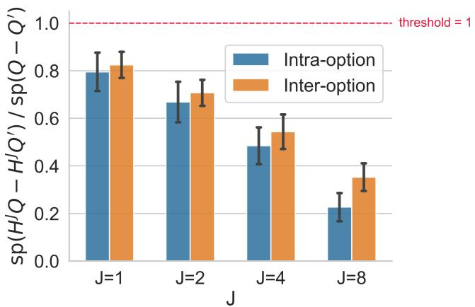  
Figure 1: Contraction factors (γ) for intra-option and inter-option in Four Rooms.

This operator reflects the fact that with probability $1 - \beta _ { ; }$ the option continues, and with probability $\beta ,$ control switches to a new option. The synchronous intra-option diferential Q-learning (Wan et al., 2021) iterates are

$$
Q _ { k + 1 } ( s , o )  \ Q _ { k } ( s , o ) + \alpha _ { k } ( s , o ) ( ( \widehat { H } _ { \mathrm { i n t r a } } Q _ { k } ) ( s , o ) - \bar { r } _ { k } - Q _ { k } ( s , o ) ) .\tag{4}
$$

for all $( s , o )$ . Here, $( \hat { H } _ { \mathrm { i n t r a } } Q _ { k } )$ is an estimate of the intra-option Bellman operator constructed by sampling $a \sim \pi ( \cdot | s , o )$ and using the corresponding reward for each $( s , o )$ , and $\bar { r } _ { k }$ is an estimate of $\bar { r } ^ { * }$

Goal: We measure the convergence rate of average-reward inter- and intra-option Q-learning algorithms by bounding the decay of the mean square error of the iterates from the optimal Q-function, i.e. $\mathbb { E } [ \operatorname { s p } ( Q _ { k } - Q ^ { * } ) ^ { 2 } ]$ 2 with the number of iterations k. We use the span seminorm, i.e. $\begin{array} { r } { \mathrm { s p } ( Q ) \triangleq ( \operatorname* { m a x } _ { s , a } Q ( s , a ) - \operatorname* { m i n } _ { s , a } Q ( s , a ) ) / 2 , } \end{array}$ to measure errors of Q-value iterates as it is invariant up to additive constants. In this work, we prove multi-step $Q -$ learning with options as contractions, design multi-step inter-/intra-option Q-learnings, and finally, prove their convergence rates to be $\tilde { \mathcal { O } } ( 1 / k )$ for properly tuned stepsizes.

## 3 J-STEP CONTRACTION OF OPTION BELLMAN OPERATOR

Contraction is a key property of Bellman operators that ensure convergence of Q-learning algorithms. While contraction is immediate in the discounted setting, it is often unavailable in the average-reward setting (Puterman, 1994; Zhang et al., 2021). Thus, even for classical MDPs, convergence analysis opens with proving the contraction of the J-step Bellman operator, i.e. the J-fold composition $H ^ { \breve { J } }$ , in the span seminorm (Chen et al., 2026). We prove that both J-step inter- and intra-option Bellman operators are contractions.

Normalized inter-option operator. The standard inter-option Bellman operator in Section 2 is the one used in the average-reward options literature. But a direct stochastic approximation of (AOE) requires estimating both the diferential value function and the unknown optimal reward rate $\bar { r } ^ { \star } ,$ , naturally leading to a coupled or two-timescale recursion. To obtain a single-timescale recursion, we instead develop the equivalent Schweitzer transformed operator (Wan et al., 2024). Specifically, for $\lambda ( s , o ) \triangleq ( { \hat { \ell } } ( s , o ) ) ^ { - 1 } , \rho ( s , o ) \triangleq { \hat { r } } ( s , o ) \lambda ( s , o )$ , we define

$$
( \bar { H } _ { \mathrm { i n t e r } } Q ) ( s , o ) \triangleq \rho ( s , o ) + ( 1 - \lambda ( s , o ) ) Q ( s , o ) + \lambda ( s , o ) \sum _ { s ^ { \prime } } \hat { p } ( s ^ { \prime } | s , o ) \operatorname* { m a x } _ { o ^ { \prime } } Q ( s ^ { \prime } , o ^ { \prime } ) .\tag{5}
$$

Multiplying (AOE) by $\lambda ( s , o )$ gives $\bar { H } _ { \mathrm { i n t e r } } Q ^ { \star } - Q ^ { \star } = \bar { r } ^ { \star } { \bf 1 }$ . Hence, $Q ^ { \star }$ is a fixed point of $\bar { H } _ { \mathrm { i n t e r } }$ in the span seminorm. Now, we state the structures required to prove $\bar { H } _ { \mathrm { i n t e r } } ^ { J }$ to be a contraction. Define $\chi \triangleq S \times \mathcal { O }$

Assumption 2 (Inter-option unichain SMDP). For every deterministic option-selection rule d : $\mathcal { X }  \mathcal { O }$ , consider the Markov chain on X with transition kernel $\widetilde { P } _ { d } ( ( s ^ { \prime } , o ^ { \prime } ) \mid ( s , o ) ) = ( 1 - \lambda ( s , o ) ) \mathbb { 1 } \{ ( s ^ { \prime } , o ^ { \prime } ) = ( s , o ) \} +$ $\lambda ( s , o ) \widehat { p } ( s ^ { \prime } \mid s , o ) \mathbb { 1 } \left\{ o ^ { \prime } = d ( s ^ { \prime } , o ) \right\}$ . We assume that $\widetilde { P } _ { d }$ is unichain $f o r$ every d. Moreover, $\widehat { p } ( s \mid s , o ) > 0 , \lambda ( s , o ) < 1$ for every $( s , o ) \in \mathcal { X }$

Unichain assumption is widely adopted for analysing average-reward RL (Chen, 2025; Chen et al., 2026; Wan et al., 2021). A deterministic stationary policy in a unichain MDP induces Markov chains with a single recurrent class ensuring well-definedness of average-reward and its invariance with respect to the initial state.

Theorem 3.1 (Inter-option contraction). Let $\bar { H } _ { \mathrm { i n t e r } } ^ { J }$ denote J compositions of $\bar { H } _ { \mathrm { i n t e r } }$ . Under Assumption 2, there exists $1 \leq \dot { J } \leq | S | | \mathcal { O } |$ and $\gamma _ { \mathrm { i n t e r } } \in ( 0 , 1 ) \ s . t$

$$
\mathrm { s p } ( \bar { H } _ { \mathrm { i n t e r } } ^ { J } Q - \bar { H } _ { \mathrm { i n t e r } } ^ { J } Q ^ { \prime } ) \leq \gamma _ { \mathrm { i n t e r } } \mathrm { s p } ( Q - Q ^ { \prime } ) .
$$

While Assumption 2 concerns the option-level SMDP where decisions are made only at option termination times, the intra-option operator concerns the primitive-timescale intra-option dynamics on $\boldsymbol { s } \times \boldsymbol { \mathcal { O } }$ , where the active option evolves at every primitive step through the continuation/termination mechanism. In particular, unichain properties need not transfer between these two constructions.

Assumption 3 (Intra-Option unichain MDP). For every deterministic option-selection rule $d : \mathcal { X } \to \mathcal { O }$ consider the Markov chain on X with transition kernel $P _ { d } ( ( s ^ { \prime } , o ^ { \prime } ) \mid ( s , o ) ) = p ( s ^ { \prime } \mid s , o ) \big [ ( 1 - \beta ( s ^ { \prime } , o ) ) 1 \{ o ^ { \prime } =$ $o \} + \beta ( s ^ { \prime } , o ) \Im \{ o ^ { \prime } = d ( s ^ { \prime } , o ) \} \ ]$ . We assume that $P _ { d }$ is unichain for every d. Moreover, $p ( s \mid s , o ) > 0 , \beta ( s , o ) < 1$ for every $( s , o ) \in \mathcal { X }$

Theorem 3.2 (Intra-option contraction). Under Assumption 3, there exists $1 \leq J \leq | S | | \mathcal { O } |$ and $\gamma _ { \mathrm { { i n t r a } } } \in ( 0 , 1 )$ such that

$$
\begin{array} { r } { \mathrm { s p } ( H _ { \mathrm { i n t r a } } ^ { J } Q - H _ { \mathrm { i n t r a } } ^ { J } Q ^ { \prime } ) \leq \gamma _ { \mathrm { i n t r a } } \mathrm { s p } ( Q - Q ^ { \prime } ) . } \end{array}
$$

These results extend the span contraction of average-reward MDPs (Puterman, 1994) to options. The proofs are deferred to Appendix C. The strict positivity/self-loop conditions in Assumptions 2, 3 can be weakened via aperiodicity transform (Appendix C). We empirically demonstrate the contractions in Figure 1, and write γ for either $\gamma _ { \mathrm { { i n t e r } } } ~ \mathrm { { o r } } ~ \gamma _ { \mathrm { { i n t r a } } }$ whenever the setting is clear.

## 4 ALGORITHM DESIGN: J-STEP INTER- AND INTRA-OPTION Q-LEARNING

Enabled with the J-step span contractions, we design estimators of J-step inter- and intra-option Bellman operators that further yield two variants of option Q-Learning. We then prove the sublinear convergence of these option Q-learning algorithms (Table 1).

The Premise of Synchronous Q-learning. For the J-step option Q-functions, the optimal option Q-function is given by the fixed points of $\operatorname { s p } ( H ^ { J } ( Q ) - Q ) = 0$ . Leveraging the stochastic approximation framework to find the fixed points of an operator (Borkar, 2008), we perform the synchronous updates for all the state-options $( s , o )$ simultaneously as

$$
Q _ { k + 1 } ( s , o ) = Q _ { k } ( s , o ) + \alpha _ { k } \Big ( \widehat { T } ^ { J } ( Q _ { k } ) ( s , o ) - Q _ { k } ( s , o ) \Big ) ,\tag{6}
$$

where $\widehat { T } ^ { J } ( Q _ { k } )$ is a stochastic estimator of (inter-/intra-option) Bellman operator $H ^ { J } ( Q _ { k } )$ , and $\alpha _ { k } > 0$ is the learning rate. Note that, the proposed synchronous algorithms do not require an explicit centering step, unlike Relative Value Iteration (RVI) (Puterman, 1994; Schweitzer, 1971). Throughout, by the empirical Bellman operator we mean the corresponding Bellman operator with the unknown transition kernel replaced by its empirical estimate constructed from past interactions.

## 4.1 Inter-option Q-learning

At every iteration k, for each initial state-option pair $x \ { \stackrel { \Delta } { = } } \ \left( s , o \right)$ , we generate a fresh J-step trajectory $\{ R _ { k } ^ { ( i ) } , L _ { k } ^ { ( i ) } \} _ { i = 0 } ^ { J - 1 }$ via a procedure we will outline below. Using all trajectories observed before iteration $k ,$ we maintain the following rolling estimates of $\rho , \lambda$

$$
\widehat { \lambda } _ { k } ( s , o ) \triangleq \frac { 1 + k } { 1 + \sum _ { t = 0 } ^ { k - 1 } L _ { t } ^ { ( 0 ) } ( s , o ) } , \quad \widehat { \rho } _ { k } ( s , o ) \triangleq \frac { \sum _ { t = 0 } ^ { k - 1 } R _ { t } ^ { ( 0 ) } ( s , o ) } { 1 + \sum _ { t = 0 } ^ { k - 1 } L _ { t } ^ { ( 0 ) } ( s , o ) } .
$$

These are used to estimate the normalized inter-option Bellman operator $H _ { k }$ , which is obtained by replacing $\rho , \lambda$ with $\hat { \rho } _ { k } , \hat { \lambda } _ { k }$ in Eq. (5).

Now, we outline how the J-step trajectory is obtained. For each $X _ { k } ^ { ( 0 ) } = ( s , o )$ , at step i of the J-step rollout, given $X _ { k } ^ { ( i ) } = ( S _ { k } ^ { ( i ) } , O _ { k } ^ { ( i ) } )$ , we independently sample an option execution $( \widetilde { R } _ { k } ^ { ( i ) } , L _ { k } ^ { ( i ) } , \bar { S } _ { k } ^ { ( i + 1 ) } ) \sim \hat { p } ( \cdot , \cdot , \cdot | X _ { k } ^ { ( i ) } )$ , and draw $D _ { k } ^ { ( i + 1 ) } \sim$ Bernoull $( \widehat { \lambda } _ { k } ( X _ { k } ^ { ( i ) } ) )$ . If $D _ { k } ^ { ( i + 1 ) } = 0$ , we set $X _ { k } ^ { ( i + 1 ) } = X _ { k } ^ { ( i ) }$ . If $D _ { k } ^ { ( i + 1 ) } = 1$ , we set $X _ { k } ^ { ( i + 1 ) } =$ $( \bar { S } _ { k } ^ { ( i + 1 ) }$ , arg ma $\mathtt { c } _ { o ^ { \prime } \in \mathcal { O } } \big ( \widehat { H } _ { \mathrm { k , i n t e r } } ^ { J - i - 1 } Q _ { k } \big ) ( \bar { S } _ { k } ^ { ( i + 1 ) } , o ^ { \prime } ) \big )$ , where $\widehat { H } _ { \mathrm { k , i n t e r } }$ is the empirical Bellman operator corresponding to $H _ { k }$ . Thus, $D _ { k } ^ { ( i + 1 ) }$ stochastically realizes the mixture induced by $\widehat { \lambda } _ { k }$ in the normalized inter-option Bellman operator (5): $D _ { k } ^ { ( i + 1 ) } = 0$ produces the self-loop term and $D _ { k } ^ { ( i + 1 ) } = 1$ produces the greedy-transition term. Using the resulting option-level trajectory $\{ X _ { k } ^ { ( i ) } , R _ { k } ^ { ( i ) } , L _ { k } ^ { ( i ) } \} _ { i = 0 } ^ { J - 1 }$ , we construct the estimator of the J-step normalized inter-option Bellman operato

$$
( \widehat { T } _ { \mathrm { k , i n t e r } } ^ { J } Q ) ( x ) \triangleq \sum _ { i = 0 } ^ { J - 1 } \widehat { \rho } _ { k } ( X _ { k } ^ { ( i ) } ) + \big ( 1 - D _ { k } ^ { ( J ) } \big ) Q ( X _ { k } ^ { ( J - 1 ) } ) + D _ { k } ^ { ( J ) } \operatorname* { m a x } _ { \sigma ^ { \prime } \in \mathcal { O } } Q ( S _ { k } ^ { ( J ) } , \sigma ^ { \prime } ) .\tag{7}
$$

for all x. Then, we use a learning rate $\textstyle \alpha _ { k } ( x ) = { \frac { \alpha } { k + h } }$ for all state-options to run the Q-learning updates as per Eq. (6). We present the pseudocode in Algorithm 1.

## 4.2 Intra-option Q-learning

In the intra-option setting, we instead take primitive actions using the action-level policy $A \sim \pi ( \cdot | X )$ from each state-option X, and construct the estimator of the intra-option Bellman operator.

At every iteration k, for every initial state-option pair $X _ { k } ^ { ( 0 ) } = ( s , o )$ , we generate J-step trajectories of primitive actions $A _ { k } ^ { ( i ) } \sim \pi ( \cdot \mid X _ { k } ^ { ( i ) } )$ , reward-transitions $( R _ { k } ^ { ( i ) } , S _ { k } ^ { ( i + 1 ) } ) \sim p ( \cdot , \cdot \mid S _ { k } ^ { ( i ) } , A _ { k } ^ { ( i ) } )$ , and option terminations $B _ { k } ^ { ( i + 1 ) }$ ∼ Bernoulli $\ddot { ( } \beta ( S _ { k } ^ { ( i + 1 ) } , O _ { k } ^ { ( i ) } ) ) . ~ B _ { k } ^ { ( i + 1 ) } = 0$ implies $O _ { k } ^ { ( i + 1 ) } = O _ { k } ^ { ( i ) } . \ B _ { k } ^ { ( i + 1 ) } = 1$ indicates termination of the i-th option and the next option is chosen according to $\begin{array} { r } { O _ { k } ^ { ( i + 1 ) } \in \arg \operatorname* { m a x } _ { o ^ { \prime } \in O } \big ( \widehat { H } _ { \mathrm { k , i n t r a } } ^ { J - i - 1 } Q _ { k } \big ) ( S _ { k } ^ { ( i + 1 ) } , o ^ { \prime } ) } \end{array}$ , where $\widehat { H } _ { \mathrm { k , i n t r a } }$ denotes the empirical Bellman operator associated with $H _ { \mathrm { { i n t r a } } }$ at k-th iteration. Thus, $B _ { k } ^ { ( i + 1 ) }$ stochastically realizes the mixture induced by $\beta ( S _ { k } ^ { ( i + 1 ) } , \cdot )$ in the intra-option Bellman operator $( 3 ) \colon B _ { k } ^ { ( i + 1 ) } = 0$ produces the self-loop term and $B _ { k } ^ { ( i + 1 ) } = 1$ produces the greedy-transition term for next option selection. Using this data, we construct an estimator of J-step intra-option Bellman operator

$$
( \widehat { T } _ { \mathrm { k , i n t r a ~ } } ^ { J } Q ) ( x ) \triangleq \sum _ { i = 0 } ^ { J - 1 } R _ { k } ^ { ( i + 1 ) } + ( 1 - B _ { k } ^ { ( J ) } ) Q ( S _ { k } ^ { ( J ) } , O _ { k } ^ { ( J - 1 ) } ) + B _ { k } ^ { ( J ) } \operatorname* { m a x } _ { \sigma ^ { \prime } \in O } Q ( S _ { k } ^ { ( J ) } , \sigma ^ { \prime } ) .\tag{8}
$$

for all $x = \left( s , o \right)$ . Then, we use a learning rate $\textstyle \alpha _ { k } ( x ) = { \frac { \alpha } { k + h } }$ for all state-options to run the Q-learning updates as per Eq. (6). The pseudocode is described in Algo. 2.

## 5 CONVERGENCE ANALYSIS

Now, we derive suitable learning rates and finite-time convergence guarantees for the two proposed option Qlearning algorithms. We guarantee convergence of the Q-values only up to an additive constant, i.e., set-wise convergence, to the optimality class $\mathcal { Q } ^ { * }$ of the Average Optimality Equation (AOE).

Theorem 5.1 (Inter-option Q-learning). If Assumption 1-2 hold true, and we set $\begin{array} { r } { \alpha _ { k } = \frac { 4 } { ( 1 - \gamma ) ( k + h ) } } \end{array}$ for some $h > 0$ . Then, $\Delta _ { k } ^ { 2 } \triangleq \mathbb { E } \big [ \operatorname { s p } ( Q _ { k } - Q ^ { * } ) ^ { 2 } \big ] =$

$$
{ \widetilde O } { \left( \frac { 1 } { k } \left( \Delta _ { 0 } ^ { 2 } + ( \mathrm { s p } ( Q ^ { * } ) ^ { 2 } + | { \mathcal { S } } | | { \mathcal { O } } | c ^ { 2 } J ^ { 4 } + | { \mathcal { S } } | J ^ { 4 } \right) { \frac { \log ( | { \mathcal { S } } | | { \mathcal { O } } | ) } { ( 1 - \gamma ) ^ { 3 } } } \right) }
$$

Theorem 5.2 (Intra-option Q-learning). If Assumption 1 and 3 hold true, then setting the stepsizes as $\begin{array} { r } { \alpha _ { k } = \frac { 4 } { ( 1 - \gamma ) ( k + h ) } } \end{array}$ for some $h > 0$ , yields

$$
\Delta _ { k } ^ { 2 } = \widetilde { \mathcal { O } } \left( \frac { 1 } { k } \left( \Delta _ { 0 } ^ { 2 } + \left( \mathrm { s p } ( Q ^ { * } ) ^ { 2 } + | \mathcal { S } | J ^ { 4 } \right) \frac { \log | \mathcal { S } | | \mathcal { O } | } { ( 1 - \gamma ) ^ { 3 } } \right) \right) .
$$

As a result, both algorithms achieve sublinear decay of the mean-square span error: intra-option Q-learning achieves $\widetilde { \mathcal { O } } ( 1 / k )$ , while inter-option Q-learning achieves $\widetilde { \mathcal { O } } ( 1 / k )$ with additional errors from estimating the reward rates and inverse holding times online. In addition, these bounds imply a sample complexity of $\widetilde { \mathcal { O } } ( 1 / \varepsilon ^ { 2 } )$ to guarantee $\mathbb { E } \left[ \operatorname { s p } ( Q _ { k } - Q ^ { * } ) \right] \leq \varepsilon$ (Corollaries D.13 and D.27), consistent with prior finite-time analyses of averagereward Q-learning with primitive actions (Chen et al., 2026; Zhang et al., 2021).

Inter- vs. Intra-option. The additional $| S | | \mathcal { O } | c ^ { 2 } J ^ { 4 }$ term in the inter-option bound (Theorem 5.1) comes from online estimation of the reward rates and inverse mean holding times $( \rho , \lambda )$ , and hence depends on the holding-time second-moment bound c. No such estimation is required in the intra-option setting.

Proof sketch. Our analysis builds on the generalized Moreau-envelope framework of Chen et al. (2026), with a key diference: our J-step estimators are not conditionally unbiased estimators of $H ^ { J } Q _ { k }$ , where H denotes $\bar { H } _ { \mathrm { i n t e r } }$ or $H _ { \mathrm { { i n t r a } } }$ . An unbiased J-step estimator would require intermediate option selections based on finite-horizon values $H ^ { m } Q _ { k } , m \in \{ 1 , 2 , \dots , J - 1 \}$ , because at an intermediate state with m steps remaining, the maximization in the nested composition $H ^ { J } Q _ { k }$ is over $H ^ { m } Q _ { k }$ , rather than over $Q _ { k }$ itself. However, these are unavailable in a model-free setting. We instead sample the intermediate options greedily from $\widehat { H } _ { k } ^ { m } Q _ { k }$ . Our proof, therefore, has to combine the J-step span contraction with a careful control of the bias induced by empirical approximately greedy option selection. The proofs are established via the following steps.

1. Moreau-envelope Lyapunov recursion. We first use the J-step span contraction (Theorem 3.1 and 3.2) to construct a smooth generalized Moreau-envelope Lyapunov function $M ( Q ) = p _ { m } ( Q ) ^ { 2 } / 2$ equivalent to $\operatorname { s p } ( Q ) ^ { 2 }$ modulo constant vectors. By denoting $m _ { k } \triangleq \mathbb { E } [ M ( Q _ { k } - Q ^ { * } ) ]$ , smoothness yields a one-step recursion of the form

$$
m _ { k + 1 } \leq m _ { k } + \alpha _ { k } \big ( T _ { \mathrm { d r i f t } } + T _ { \mathrm { n o i s e } } + T _ { \mathrm { g r e e d y } } + T _ { \mathrm { e s t } } \big ) + L \alpha _ { k } ^ { 2 } T _ { \mathrm { q u a d } } ,
$$

where $T _ { \mathrm { e s t } }$ appears only in the inter-option setting. The J-step contraction implies $T _ { \mathrm { d r i f t } } \le - c m _ { k }$ for $c > 0$ providing the negative drift in the recursion.

2. Removing Bellman-oracle access. A direct J-step estimator would require the intermediate greedy choice arg max $\mathsf { \Pi } _ { \mathsf { \tilde { o } } } ( H ^ { m } Q _ { k } ) ( s , o )$ , whenever m steps remain. Since these values are unavailable, we construct an empirical Bellman operator $\widehat { H } _ { k }$ from past interactions, and use $\widehat { d } _ { k , m } ( s ) \in \arg \operatorname* { m a x } _ { o } ( \widehat { H } _ { k } ^ { m } Q _ { k } ) ( s , o )$ . The fresh rollout still uses the true environment, so its expectation, denoted by $\widetilde { H } _ { k } ^ { J } Q _ { k }$ , is neither $\widehat { H } _ { k } ^ { J } Q _ { k }$ nor $H ^ { J } Q _ { k }$ . This yields the first-order perturbation $T _ { \mathrm { g r e e d y } } = \mathbb { E } [ \langle \nabla M ( Q _ { k } - Q ^ { * } ) , \widetilde { H } _ { k } ^ { J } Q _ { k } - H ^ { J } Q _ { k } \rangle ]$

3. Controlling the approximately greedy bias. We first prove that the iterates a.s. satisfy $\| Q _ { k } \| _ { \infty } =$ ${ \mathcal { O } } ( \log k )$ . Using this bound together with finite-sample deviation bounds for the empirical Bellman operator gives (Lemma D.7, D.18):

$$
\mathbb { E } \left[ \mathrm { s p } \Big ( \widetilde { H } _ { k } ^ { J } Q _ { k } - H ^ { J } Q _ { k } \Big ) ^ { 2 } \right] = \widetilde { \mathcal { O } } ( 1 / k ) .
$$

We use properties of Moreau envelope to absorb a part of $T _ { \mathrm { g r e e d y } }$ into $T _ { \mathrm { d r i f t } }$ , while remainder contributes $\widetilde { \mathcal { O } } ( k ^ { - 2 } )$ after multiplied with $\alpha _ { k } = \Theta ( 1 / k )$

4. Additional bias in inter-option. The normalized inter-option Bellman operator introduces a second source of bias due to the unknown reward rate $\rho$ and inverse mean holding time λ. We estimate them online by $\widehat { \rho } _ { k }$ and $\widehat { \lambda } _ { k }$ yielding finite-time mean-square bounds of order $\widetilde { \mathcal { O } } ( 1 / k )$ . Propagating these errors through the finite J-step Bellman composition yields the additional first-order term $T _ { \mathrm { e s t } } .$ Conceptually, the inter-option conditional-mean error decomposes as $\widetilde { H } _ { k } ^ { J } Q _ { k } - H ^ { J } Q _ { k } = \left( \widetilde { H } _ { k } ^ { J } Q _ { k } - \bar { H } _ { k } ^ { J } Q _ { k } \right) + \left( \bar { H } _ { k } ^ { J } Q _ { k } - \bar { H } ^ { J } \bar { Q } _ { k } \right)$ , where the first term is due to approximate greedy option selection and the second is due to online estimation of $\rho$ and $\lambda .$ The intra-option setting has only the first source of bias.

5. Rollout noise and the quadratic term. After conditioning on the past, the diference between the sampled J-step target and its expectation is a martingale-diference term. Hence, the linear noise term vanishes. The second-order smoothness remainder is shown to be $L \alpha _ { k } ^ { 2 } T _ { \mathrm { q u a d } } = \mathcal { O } ( \alpha _ { k } ^ { 2 } m _ { k } )$

6. Unrolling the recursion. Combining the preceding bounds gives, for all $k ,$

$$
m _ { k + 1 } \leq \left( 1 - \mathcal { O } ( \alpha _ { k } ) \right) m _ { k } + \widetilde { \mathcal { O } } ( \alpha _ { k } ^ { 2 } ) .
$$

Unrolling the recursion yields the stated $\widetilde { \mathcal { O } } ( 1 / k )$ convergence rate.

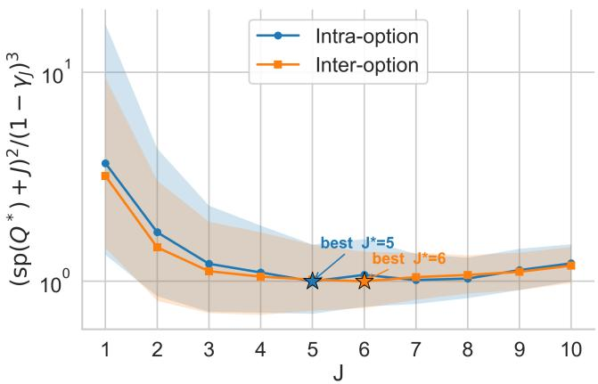  
Figure 2: Guideline to select J with $\frac { ( \mathrm { s p } ( Q ^ { * } ) + J ) ^ { 2 } } { ( 1 - \gamma ) ^ { 3 } }$

The complete proofs are in Appendix D.

Comparison with asymptotic analysis. Wan et al. (2021, 2024) conduct asymptotic analysis of their proposed 1-step inter- and intra-option diferential Q-learning algorithms with RVI-type recentering. The analysis difers in a couple of ways. First, they do not need to construct a J-step estimator of the option Bellman operators since the contraction property of the Bellman operators is not required in the asymptotic analysis. Rather, asymptotic analysis requires only that the option Bellman operators are Lipschitz– a property which the 1-step option Bellman operators satisfy, and hence, they use the 1-step option Bellman operators. Second, their analysis for their inter-option algorithm employs a coupled Stochastic Approximation (SA) scheme to estimate option lengths whilst simultaneously updating the Q-values. This results in a single-timescale SA with vanishing perturbations. This is similar to our derivation of finite-time rates in both the settings, which are modelled as single-timescale SA with decaying perturbations.

Rectifying J-step estimators in prior work. Prior finite-time analyses of average-reward Q-learning with primitive actions (Chen et al., 2026; Naskar et al., 2026; Zhang et al., 2021) use a J-step estimator of the form $\begin{array} { r } { \widehat { H } _ { J } ( Q _ { k } ) = \sum _ { i = 0 } ^ { J - 1 } R _ { k + i } + \operatorname* { m a x } _ { a ^ { \prime } } Q _ { k } ( S _ { k + J } , a ^ { \prime } ) } \end{array}$ , with intermediate actions selected greedily from $Q _ { k }$ . This estimator is claimed to be unbiased for the J-step Bellman operator. But in general, its conditional expectation is not $H ^ { J } Q _ { k }$ . Indeed, the J-fold Bellman composition requires the intermediate action with m steps remaining to be selected greedily with respect to $H ^ { m } Q _ { k } .$ , rather than $Q _ { k }$ itself.

Consider the following zero-reward MDP: let $s _ { 0 } \ \xrightarrow { a _ { 0 } } \ s _ { 1 }$ , with $a , b$ at $s _ { 1 }$ leading deterministically to $x , y ,$ respectively, and let $x , y$ have only self-loops via c. Choose $Q ( s _ { 1 } , a ) = 1 , Q ( s _ { 1 } , b ) = 0 , Q ( x , c ) = 0 , Q ( y , c ) = 1 0 .$ Then $( H Q ) ( s _ { 1 } , a ) = 0$ and $( H Q ) ( s _ { 1 } , b ) = 1 0$ , so $( H ^ { 2 } Q ) ( s _ { 0 } , a _ { 0 } ) = 1 0$ . In contrast, an estimator that selects the intermediate action greedily from $Q$ chooses a instead of b and returns 0. Thus $\widehat { H } _ { J }$ is biased (here $J = 2 )$ and the intermediate greedy choice must generally use $H ^ { m } Q$ rather than $Q .$ Consequently, the corresponding finite-time analyses based on this unbiasedness property do not directly apply as stated.

Our construction rectifies this issue by replacing the unavailable greedy values with empirical Bellman iterates and explicitly controlling the resulting bias. This yields corrected J-step estimators and corresponding finitetime rates for average-reward Q-learning with primitive actions, while also extending the methodology to interand intra-option Q-learning. Notably, specializing our analysis to average-reward Q-learning with primitive actions (Chen et ${ \mathrm { a l . , } }$ 2026; Zhang et al., 2021), the harmonic-stepsize rate becomes $\widetilde { \mathcal { O } } ( \mathrm { i } / k )$ rather than $\mathcal { O } ( 1 / k )$ with an additional $\widetilde { \mathcal { O } } ( | S | J ^ { 4 } / k )$ contribution arising from the empirical approximately-greedy selections.

Guideline to Select J. The dependence of $J , \gamma$ on the performance bounds can be inferred from Theorem 5.1 and 5.2. Specifically, $\frac { J } { 1 - \gamma ( J ) }$ reflects the efect of the choice of J and corresponding γ on the finite-time rates. We empirically investigate this connection (Figure 2) in Four Rooms. We observe that there are optimal $J ^ { \prime } \mathrm { s } .$ namely 6 and 5 for inter- and intra-option settings, by tracking the quantity $\frac { ( \mathrm { s p } ( Q ^ { * } ) + J ) ^ { 2 } } { ( 1 - \gamma ) ^ { 3 } }$ , since it captures the trade of between stronger J-step contraction and the rollout-length contribution, while excluding the conservative empirical-model estimation term (Appendix F.1). Thus, instead of the worst-case bound of $| S | | \mathcal { O } |$ , we can use small values of J in practice, and achieve the performance gain.

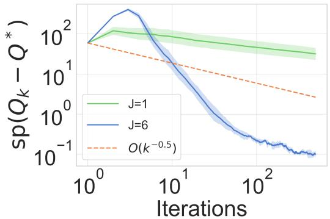  
(a) Inter-option

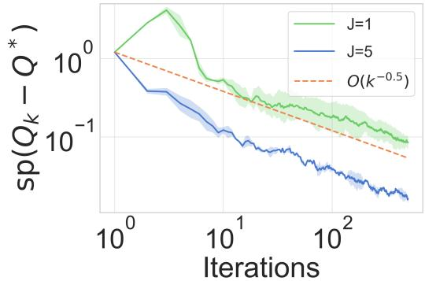  
(b) Intra-option  
Figure 3: Evolution of $\mathrm { s p } ( Q _ { k } - Q ^ { * } )$ $( { \mathrm { m e a n } } \pm { \mathrm { s t d } } .$ over 5 runs) with k iterations for Four Rooms.

Choices of stepsizes. Our analysis uses the harmonic stepsize $\alpha _ { k } = \Theta ( 1 / k )$ , for which the pathwise growth bound $\| Q _ { k } \| _ { \infty } = \mathcal { O } ( \log i$ k) leads to the final mean-square rate $\widetilde { \mathcal { O } } ( 1 / k )$ . The same proof framework can be extended to yield guarantees for polynomial stepsizes. In particular, for $\alpha _ { k } = \alpha / ( k + h ) ^ { p }$ with $p \in ( 1 / 2 , 1 )$ , the pathwise argument gives $\| Q _ { k } \| _ { \infty } = \mathcal { O } ( k ^ { 1 - p } )$ . Consequently, the empirical approximately-greedy perturbation scales as $\widetilde { \mathcal { O } } ( k ^ { 1 - 2 p } )$ , implying a corresponding mean-square rate of $\widetilde { \mathcal { O } } ( k ^ { 1 - 2 p } )$

## 6 RL WITH HIERARCHICAL REWARD MACHINES

Prior works on average-reward HRL (Ghavamzadeh and Mahadevan, 2007) derive the average-reward Bellman equations and corresponding Q-learning algorithms, but do not establish convergence of the proposed updates, leaving a gap between the fixed-point characterization and the algorithmic behaviour. Our proposed algorithms are the first to exhibit non-asymptotic convergence to hierarchically optimal policies. Specifically, the analysis establishes convergence of the proposed algorithms to the solutions of (AOE) with options, and closes this gap.

Hierarchical Reward Machines (HRMs) to options. RM reward is Markovian on $ { \mathcal { X } } = S \times U$ , where U is RM’s states. Every transition in RM $\left. u , u _ { t } \right.$ induces an option that starts in state u and terminates with a change in the RM state. Therefore, ${ \bar { H } } _ { \mathrm { i n t e r } } , H _ { \mathrm { i n t r a } }$ on both J-step algorithms defined in Section 4 are consistent with the new state space X. In this case, the option holding times are the hitting times of RM transitions which are not in general bounded. Our analysis allow this by only requiring their second moments to be bounded (Assumption 1).

Finite-time guarantees. Under Assumptions 2 and 3 and the assumption on the cross-product space (Assumption 4), both intra- and inter-option operators are J-step span contractions (Theorem E.2). Therefore the $\widetilde { O } ( 1 / k )$ bounds from Theorem 5.1 and 5.2 hold but with |S||O| replaced by $| S | | U | | \mathcal { O } |$ . The intra-option and inter-option bounds vary logarithmically and linearly respectively with RM size |U|.

Hierarchical optimality. Our analysis guarantees convergence of the Q-values, up to an additive constant, to the optimality class $\mathcal { Q } ^ { * }$ of (AOE) for the option SMDP on X. Under standard assumptions on options $( \mathrm { e . g . }$ non-zero probability of option termination, which in HRMs is equivalent to non-zero probability of satisfying the logical formula associated with an outgoing RM transition), the policies obtained by option Q-learning are hierarchically optimal with respect to the given option policies (Ghavamzadeh and Mahadevan, 2007). Specifically, they are optimal among all policies that select between the HRM options. Optimality over all primitive policies requires the option policies to be optimal for their sub-tasks, which depends on the options rather than algorithms.

A detailed reduction of MDPs with HRMs to options, and implications of our convergence guarantees is in Appendix E.

## 7 EXPERIMENTAL ANALYSIS

We empirically validate our findings across three hierarchical reinforcement learning (HRL) benchmarks: Four Rooms (Sutton et al., 1999), Taxi (Dietterich, 2000), and Ofice gridworld (Icarte et al., 2020). We report the mean square deviations from the optimal option Q-function over iterations. For Four Rooms, Figure 3 shows $\mathrm { s p } ( Q _ { k } - Q ^ { * } )$ on log-log axes for the 6-step inter- and 5-step intra-option algorithms, and the one-step Q-learning $( J = 1 )$ over k iterations (averaged over 5 independent seeds). Results for Taxi and Ofice gridworld are in Appendix F, along with environment and hyper-parameter details.

Observations. (a) We observe that the $J = 6$ and $J = 5$ step estimators yield strictly faster convergence in inter- and intra-option settings than classic option Q-learnings with $J = 1$ . (b) In both the settings, the empirical convergence rates match $\mathcal { O } ( k ^ { - 1 / 2 } )$ theoretical reference for the intra- and inter-option Q-learning, as stated by Theorem 5.1 and 5.2.

## 8 DISCUSSIONS

We design two variants of option Q-learning algorithms. We derive the first non-asymptotic sublinear convergence for these option Q-learning algorithms. The proof proceeds by (a) J-step contraction for inter- and intra-option Q-learning, (b) designing J-step option Bellman operator estimates and Q-update steps with proper learning rates, (c) tackling the efect of only second moment bounded stochastic holding times for options, and (d) controlling the bias introduced by approximately greedy option selection and online estimation of reward rate and inverse mean holding times. Our results establish the first non-asymptotic convergence bound for Q-learning with hierarchical RMs.

We analyse the single timescale framework for synchronous option Q-learning. The natural next step is to analyse the asynchronous setting, where only a subset of the Q-estimates are updated at each iteration. Another direction is the analysis of two-timescale option Q-learning (Manenti and Iannelli, 2025). Second, an important open question is whether the unichain assumptions can be relaxed to more general multichain settings for options, in line with recent developments in average-reward RL (Lee and Ryu, 2025, 2026). Finally, understanding the role of function approximation in the options framework, in terms of stability and convergence, remains an open direction.

## References

Abounadi, J., Bertsekas, D., and Borkar, V. S. (2001). Learning algorithms for markov decision processes with average cost. SIAM Journal on Control and Optimization, 40(3):681–698. 3, 17

Abounadi, J., Bertsekas, D. P., and Borkar, V. (2002). Stochastic approximation for nonexpansive maps: Application to q-learning algorithms. SIAM Journal on Control and Optimization, 41(1):1–22. 3, 17

Bacon, P.-L., Harb, J., and Precup, D. (2017). The option-critic architecture. In Proceedings of the AAAI conference on artificial intelligence, volume 31. 3, 17

Barto, A. G. and Mahadevan, S. (2003). Recent advances in hierarchical reinforcement learning. Discrete event dynamic systems, 13(4):341–379. 3, 4, 17

Borkar, V. (2008). Stochastic Approximation: A Dynamical Systems Viewpoint. Cambridge University Press. 7

Borkar, V. S. (1998). Asynchronous stochastic approximations. SIAM Journal on Control and Optimization, 36(3):840–851. 17

Boucheron, S., Lugosi, G., and Massart, P. (2013). Concentration Inequalities: A Nonasymptotic Theory of Independence. Oxford University Press. 37, 38

Bradtke, S. and Duf, M. (1994). Reinforcement learning methods for continuous-time markov decision problems. Advances in neural information processing systems, 7. 4

Chen, Z. (2025). Non-asymptotic guarantees for average-reward q-learning with adaptive stepsizes. In Belgrave, D., Zhang, C., Lin, H., Pascanu, R., Koniusz, P., Ghassemi, M., and Chen, N., editors, Advances in Neural Information Processing Systems, volume 38, Main Conference, pages 147194–147249. Curran Associates, Inc. 3, 6, 33, 35, 44, 63

Chen, Z., Maguluri, S. T., Shakkottai, S., and Shanmugam, K. (2020). Finite-sample analysis of contractive stochastic approximation using smooth convex envelopes. In Larochelle, H., Ranzato, M., Hadsell, R., Balcan, M., and Lin, H., editors, Advances in Neural Information Processing Systems, volume 33, pages 8223–8234. Curran Associates, Inc. 17

Chen, Z., Maguluri, S. T., Shakkottai, S., and Shanmugam, K. (2024). A lyapunov theory for finite-sample guarantees of markovian stochastic approximation. Operations Research, 72(4):1352–1367. 17

Chen, Z., Zhang, S., Zhang, J., Haque, S. U., and Maguluri, S. T. (2026). A nonasymptotic theory of seminorm lyapunov stability: From deterministic to stochastic iterative algorithms. Mathematics of Operations Research. 3, 4, 6, 9, 10, 17, 18, 28, 34, 44, 63

Dietterich, T. G. (2000). Hierarchical reinforcement learning with the maxq value function decomposition. J. Artif. Int. Res., 13(1):227–303. 11, 64

Ghavamzadeh, M. and Mahadevan, S. (2007). Hierarchical average reward reinforcement learning. Journal of Machine Learning Research, 8(87):2629–2669. 3, 11, 17, 63

G¨urtler, N., B¨uchler, D., and Martius, G. (2021). Hierarchical reinforcement learning with timed subgoals. Advances in Neural Information Processing Systems, 34:21732–21743. 4, 17

Icarte, R. T., Klassen, T. Q., Valenzano, R. A., and McIlraith, S. A. (2020). Reward machines: Exploiting reward function structure in reinforcement learning. CoRR, abs/2010.03950. 3, 11, 61, 62, 64

Klissarov, M. and C. Machado, M. (2023). Deep Laplacian-based options for temporally-extended exploration. In Krause, A., Brunskill, E., Cho, K., Engelhardt, B., Sabato, S., and Scarlett, J., editors, Proceedings of the 40th International Conference on Machine Learning, volume 202 of Proceedings of Machine Learning Research, pages 17198–17217. PMLR. 17

Klissarov, M. and Precup, D. (2021). Flexible option learning. Advances in Neural Information Processing Systems, 34:4632–4646. 3, 17

Lee, J. and Ryu, E. K. (2025). Optimal non-asymptotic rates of value iteration for average-reward markov decision processes. In The Thirteenth International Conference on Learning Representations. 12

Lee, J. and Ryu, E. K. (2026). Policy gradient algorithms in average-reward multichain mdps. ArXiv, abs/2602.18003. 12

Machado, M. C. (2025). Representation-driven option discovery in reinforcement learning. In Proceedings of the AAAI Conference on Artificial Intelligence, volume 39, pages 28705–28705. 17

Machado, M. C., Barreto, A., Precup, D., and Bowling, M. (2023). Temporal abstraction in reinforcement learning with the successor representation. Journal of machine learning research, 24(80):1–69. 17

Machado, M. C., Bellemare, M. G., and Bowling, M. (2017). A laplacian framework for option discovery in reinforcement learning. In International conference on machine learning, pages 2295–2304. PMLR. 17

Machado, M. C., Rosenbaum, C., Guo, X., Liu, M., Tesauro, G., and Campbell, M. (2018). Eigenoption discovery through the deep successor representation. In International Conference on Learning Representations. 17

Manenti, M. and Iannelli, A. (2025). Convergence and stability of q-learning in hierarchical reinforcement learning. 12

Mitchener, L., Tuckey, D., Crosby, M., and Russo, A. (2022). Detect, understand, act: A neuro-symbolic hierarchical reinforcement learning framework. Machine Learning, 111(4):1523–1549. 3, 17

Naskar, A., Thoppe, G., and Gupta, V. (2026). Parameter-free optimal rates for nonlinear semi-norm contractions with applications to q-learning. In Proceedings of the AAAI Conference on Artificial Intelligence, volume 40, pages 24495–24503. 3, 10, 18

Parr, R. E. (1998). Hierarchical control and learning for Markov decision processes. University of California, Berkeley. 4

Precup, D., Sutton, R. S., and Singh, S. (1998). Theoretical results on reinforcement learning with temporally abstract options. In N´edellec, C. and Rouveirol, C., editors, Machine Learning: ECML-98, pages 382–393, Berlin, Heidelberg. Springer Berlin Heidelberg. 3

Puterman, M. L. (1994). Markov Decision Processes: Discrete Stochastic Dynamic Programming. John Wiley & Sons, Inc., USA, 1st edition. 3, 4, 5, 6, 7, 17, 27, 62

Ramesh, R., Tomar, M., and Ravindran, B. (2019). Successor options: An option discovery framework for reinforcement learning. arXiv preprint arXiv:1905.05731. 3, 17

Ravindran, B. and Barto, A. G. (2002). Model minimization in hierarchical reinforcement learning. In International symposium on abstraction, reformulation, and approximation, pages 196–211. Springer. 3, 17

Ross, S. M. (1970). Average cost semi-markov decision processes. Journal of Applied Probability, 7(3):649–656. 5

Schweitzer, P. J. (1971). Iterative solution of the functional equations of undiscounted markov renewal programming. Journal of Mathematical Analysis and Applications, 34(3):495–501. 4, 5, 7

Shalev-Shwartz, S. (2012). Online Learning and Online Convex Optimization. Foundations and Trends® in Machine Learning Series. Now Publishers. 35

Sutton, R. S. and Barto, A. G. (1998). Reinforcement learning: An introduction, volume 1. MIT press Cambridge. 3, 5

Sutton, R. S., Precup, D., and Singh, S. (1999). Between mdps and semi-mdps: A framework for temporal abstraction in reinforcement learning. Artificial Intelligence, 112(1):181–211. 3, 5, 11, 17

Tiwari, S. and Thomas, P. S. (2019). Natural option critic. In Proceedings of the AAAI Conference on Artificial Intelligence, volume 33, pages 5175–5182. 3

Vezhnevets, A. S., Osindero, S., Schaul, T., Heess, N., Jaderberg, M., Silver, D., and Kavukcuoglu, K. (2017). FeUdal networks for hierarchical reinforcement learning. In Precup, D. and Teh, Y. W., editors, Proceedings of the 34th International Conference on Machine Learning, volume 70 of Proceedings of Machine Learning Research, pages 3540–3549. PMLR. 4, 17

Wan, Y., Naik, A., and Sutton, R. (2021). Average-reward learning and planning with options. Advances in Neural Information Processing Systems, 34:22758–22769. 3, 5, 6, 10

Wan, Y., Yu, H., and Sutton, R. S. (2024). On convergence of average-reward q-learning in weakly communicating markov decision processes. 3, 4, 5, 6, 10, 17, 63

Yu, H., Wan, Y., and Sutton, R. S. (2025). Average-reward reinforcement learning in semi-markov decision processes via relative value iteration. 17

Yu, H., Wan, Y., and Sutton, R. S. (2026). Asynchronous stochastic approximation with applications to averagereward reinforcement learning. SIAM Journal on Control and Optimization, 64(3):1456–1481. 3, 4, 17, 63

Zhang, S., Zhang, Z., and Maguluri, S. T. (2021). Finite sample analysis of average-reward td learning and q-learning. Advances in Neural Information Processing Systems, 34:1230–1242. 3, 6, 9, 10, 18

## APPENDIX

## OVERVIEW OF THE APPENDIX

• Appendix B: Additional Related Work. Reviews prior literature on average-reward Q-learning, stochastic approximation, hierarchical reinforcement learning with options, and finite-time analyses for seminormcontractive stochastic approximation schemes.

• Appendix C: J-step contraction results for option Bellman operators. Establishes Puterman-style span seminorm contractions for the inter- and intra-option Bellman operators proving Theorems 3.1 and 3.2.

• Appendix D: Analysis of synchronous option Q-learning. Introduces the synchronous J-step estimators and develops the finite-time analysis of synchronous inter- and intra-option Q-learning. The section constructs the Lyapunov framework based on a smooth Moreau-envelope approximation of the span seminorm and derives the corresponding non-asymptotic convergence rates proving Theorems 5.1, 5.2.

• Appendix E: Application to average-reward reinforcement learning with reward machines. Shows how hierarchical reward machines induce options, verifies the required assumptions, establishes the corresponding J-step contractions, and derives finite-time convergence guarantees for average-reward hierarchical reinforcement learning.

• Appendix F: Additional experimental results. Provides supplementary experiments, implementation details, hyperparameter settings, and additional plots for the Four Rooms, Taxi, and Ofice environments.

## A TABLE OF NOTATIONS

Table 2: Notation for the average-reward option-learning setup and algorithms.
<table><tr><td>Symbol</td><td>Meaning</td></tr><tr><td> $s , A , \mathcal { O }$ </td><td>Finite state, primitive-action, and option spaces.</td></tr><tr><td> $s , a , o$ </td><td>Generic state, primitive action, and option.</td></tr><tr><td> $S _ { k } , A _ { k } , O _ { k }$ </td><td>State, primitive action, and option at iteration k.</td></tr><tr><td> $p ( s ^ { \prime } | s , a )$ </td><td>Primitive MDP transition kernel.</td></tr><tr><td> $r ( s , a )$ </td><td>Primitive one-step reward.</td></tr><tr><td> $\pi ( a | s , o )$ </td><td>Intra-option policy associated with option  $o .$ </td></tr><tr><td> $\beta ( s , o )$ </td><td>Termination probability of option o at state s.</td></tr><tr><td> $\ell ( s , o )$ </td><td>Random holding time of option o initiated at state s.</td></tr><tr><td>C</td><td>Uniform holding-time second-moment parameter:  $\mathbb { E } [ \ell ( s , o ) ^ { 2 } ] \leq c ^ { 2 } .$ </td></tr><tr><td> ${ \hat { r } } ( s , o )$ </td><td>Expected cumulative reward over one execution of option  $o .$ </td></tr><tr><td> $\hat { \ell } ( s , o )$ </td><td>Expected holding time of option o.</td></tr><tr><td> $\hat { p } ( s ^ { \prime } | s , o )$ </td><td>Option-level transition kernel.</td></tr><tr><td> $\bar { r } ^ { \pi } , \bar { r } ^ { * }$ </td><td>Average reward rate under policy  $\pi$  and the optimal average reward rate.</td></tr><tr><td> $Q , Q ^ { * } , Q _ { k }$ </td><td>Option Q-function, optimal differential Q-function, and k-th iterate.</td></tr><tr><td>1</td><td>All-ones vector.</td></tr><tr><td>1</td><td>Indicator random variable</td></tr><tr><td> $\operatorname { s p } ( Q )$ </td><td>Span seminorm,  $\begin{array} { r } { \operatorname { s p } ( Q ) : = ( \operatorname* { m a x } _ { s , o } Q ( s , o ) - \operatorname* { m i n } _ { s , o } Q ( s , o ) ) / 2 . } \end{array}$ </td></tr><tr><td> $\Delta _ { 0 }$ </td><td>Initial span error,  $\Delta _ { 0 } : = \mathrm { s p } ( Q _ { 0 } - Q ^ { * } )$ </td></tr><tr><td> ${ \bar { H } } _ { \mathrm { i n t e r } } , H _ { \mathrm { i n t r a } }$ </td><td>Normalized inter-option and intra-option Bellman operators.</td></tr><tr><td> $H ^ { J }$ </td><td>J-fold composition of a Bellman operator.</td></tr><tr><td>J</td><td>Multi-step Bellman composition / rollout horizon.</td></tr><tr><td> $\gamma _ { \mathrm { i n t e r } } , \gamma _ { \mathrm { i n t r a } }$ </td><td>Contraction factor of the J-step Bellman operator in span seminorm.</td></tr><tr><td> $\rho ( s , o )$ </td><td>Normalized option reward rate,  $\rho ( s , o ) : = { \hat { r } } ( s , o ) / { \hat { \ell } } ( s , o )$ </td></tr><tr><td> $\lambda ( s , o )$ </td><td>Inverse mean holding time.  $\lambda ( s , o ) : = 1 / \hat { \ell } ( s , o )$ </td></tr><tr><td> $\hat { \rho } _ { k } , \hat { \lambda } _ { k }$ </td><td>Rolling estimates of  $\rho$  and  $\lambda .$ </td></tr><tr><td> $A _ { k } , B _ { k }$ </td><td>Rolling cumulative reward and holding-time statistics used to construct  $\hat { \rho } _ { k }$  and</td></tr><tr><td> $\alpha _ { k } , \alpha$ </td><td>Stepsize and stepsize-scale parameter.</td></tr><tr><td> $h$ </td><td>Positive offset/regularization parameter in the stepsize.</td></tr><tr><td> $N _ { k } ( s , o )$ </td><td>Number of activations/visits of coordinate  $( s , o )$  up to iteration  $k .$ </td></tr><tr><td> $H _ { k }$ </td><td>Approximate normalized inter-option Bellman operator obtained by replacing  $\rho , \lambda$  with</td></tr><tr><td></td><td> $\widehat { \rho } _ { k } , \widehat { \lambda } _ { k }$  in (5).</td></tr><tr><td> $\widehat { H } _ { \mathrm { k , i n t e r } } , \widehat { H } _ { \mathrm { k , i n t r a } }$ </td><td>Empirical Bellman operators at iteration k corresponding to  $H _ { k }$  and  $H _ { \mathrm { { i n t r a } } }$  respectively.</td></tr><tr><td> $\widehat { T } _ { \mathrm { k , i n t e r } } ^ { J } , \widehat { T } _ { \mathrm { k , i n t r a } } ^ { J }$ </td><td>Estimators of  $H _ { k } ^ { J }$  and  $H _ { \mathrm { i n t r a } } ^ { J }$  respectively.</td></tr><tr><td> $\widetilde { H } _ { \mathrm { k , i n t e r } } ^ { J } , \widetilde { H } _ { \mathrm { k , i n t r a } } ^ { J }$ </td><td>Expectation of the estimators  $\widehat { T } _ { \mathrm { k , i n t e r } } ^ { J }$  and  $\widehat { T } _ { \mathrm { k , i n t r a } } ^ { J }$  respectively.</td></tr></table>

## B ADDITIONAL RELATED WORK

Average-reward Q-learning. Classical algorithms for average-reward Q-learning include Relative Value Iteration (RVI) Q-learning and stochastic shortest path (SSP) Q-learning, whose asymptotic convergence properties were established in (Abounadi et al., 2001) using tools from asynchronous stochastic approximation (Borkar, 1998). These results were subsequently extended under weaker assumptions and more general settings in (Abounadi et al., 2002; Wan et al., 2024; Yu et al., 2025, 2026). However, these works focus primarily on asymptotic convergence and stability, and do not provide finite-time guarantees.

Asymptotic stochastic approximation for options. The options framework (Sutton et al., 1999) provides a principled approach to hierarchical reinforcement learning (HRL). While most prior work in HRL has focused on the discounted setting (Barto and Mahadevan, 2003; G¨urtler et al., 2021; Vezhnevets et al., 2017), comparatively less is understood in the average-reward regime, which is particularly relevant for continuing tasks (Ghavamzadeh and Mahadevan, 2007). Existing work (Wan et al., 2024) establishes asymptotic convergence guarantees for RVIstyle (Puterman, 1994) option-based Q-learning algorithms, but does not address finite-time analysis. Moreover, the assumptions and proof techniques used for asymptotic stochastic approximation difer substantially from those required for finite-time guarantees.

Finite-sample analysis for stochastic approximation. Finite-time analysis of stochastic approximation (SA) depends critically on the contraction properties of the underlying fixed-point operator and the behaviour of the noise in the underlying stochastic process. Finite-time guarantees for SA with contractive operators have been extensively studied in (Chen et al., 2020, 2024), while more recent works have extended these techniques to seminorm contractive operators (Chen et al., 2026). However, these results are not directly applicable to average-reward RL with options. In particular, they assume contraction properties that must first be established for the Option Bellman operator (Theorems 3.1 and 3.2), and often rely on almost sure bounds on the noise. In the SMDP setting, such assumptions would require the holding times to be almost surely bounded, which is overly restrictive. Instead, we assume only bounded second moments of the holding times (Assumption 1), which aligns naturally with assumptions commonly used in asymptotic analyses (Yu et al., 2025).

Options. Options have been shown to have extensive applications in deep reinforcement learning (Bacon et al., 2017; Klissarov and C. Machado, 2023; Machado, 2025; Machado et al., 2023, 2017, 2018). Options had been introduced as a general framework for planning by using temporally extended actions (Sutton et al., 1999). It allows hierarchical learning and planning (Mitchener et al., 2022; Ravindran and Barto, 2002), skill sharing across tasks (Klissarov and Precup, 2021; Ramesh et al., 2019), and faster exploration via multi-step actions (Klissarov and Precup, 2021).

Remark 1. Consider the following MDP with states $( s _ { 0 } , s _ { 1 } , x , y )$ , zero rewards, and transitions

$$
s _ { 0 } \ { \xrightarrow { a _ { 0 } } } \ s _ { 1 } , \qquad s _ { 1 } \ { \xrightarrow { a } } \ x , \qquad s _ { 1 } \ { \xrightarrow { b } } \ y .
$$

Let x and y each have only self loops, and define

$$
Q ( s _ { 1 } , a ) = 1 , \qquad Q ( s _ { 1 } , b ) = 0 , \qquad Q ( x , c ) = 0 , \qquad Q ( y , c ) = 1 0 .
$$

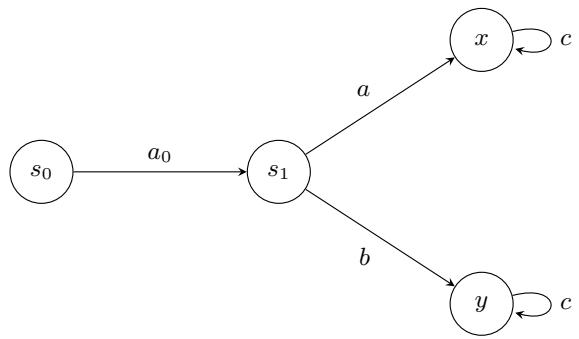

Let H denote the average reward Bellman operator i.e. $\begin{array} { r } { \mathcal { H } ( Q ) ( s , a ) = r ( s , a ) + \sum _ { s ^ { \prime } } P ( s ^ { \prime } | s , a ) \operatorname* { m a x } _ { a ^ { \prime } } Q ( s ^ { \prime } , a ^ { \prime } ) } \end{array}$ Then

$$
( \mathcal { H } Q ) ( s _ { 1 } , a ) = 0 , \qquad ( \mathcal { H } Q ) ( s _ { 1 } , b ) = 1 0 ,
$$

and hence

$$
( \mathcal { H } ^ { 2 } Q ) ( s _ { 0 } , a _ { 0 } ) = \operatorname* { m a x } _ { u \in \{ a , b \} } ( \mathcal { H } Q ) ( s _ { 1 } , u ) = 1 0 .
$$

However, the rollout construction (Chen et al., 2026; Naskar et al., 2026; Zhang et al., 2021) chooses the intermediate action greedily with respect to Q. Since

$$
Q ( s _ { 1 } , a ) > Q ( s _ { 1 } , b ) ,
$$

it selects a, reaches x, and returns

$$
\hat { \mathcal { H } } _ { \mathrm { r o l l } } ^ { 2 } Q ( s _ { 0 } , a _ { 0 } ) = 0 + 0 + \operatorname* { m a x } _ { c } Q ( x , c ) = 0 .
$$

Therefore,

$$
\mathbb { E } [ \hat { \mathcal { H } } _ { \mathrm { r o l l } } ^ { 2 } Q ( s _ { 0 } , a _ { 0 } ) ] = 0 \neq 1 0 = ( \mathcal { H } ^ { 2 } Q ) ( s _ { 0 } , a _ { 0 } ) .
$$

Thus, selecting every intermediate action according to arg $\operatorname* { m a x } _ { a } Q ( s , a )$ does not, in general, give an unbiased estimator of $\mathcal { H } ^ { J } Q$

## C J-STEP CONTRACTION RESULTS FOR OPTION BELLMANOPERATORS

In this section we establish Puterman-type J-step span contractions for the intra-option and inter-option Bellman operators stated in Theorems 3.1 and 3.2. We proceed with the analysis by establishing the following:

1. a uniform overlap condition on the induced J-step state kernels, and

2. a policy-sandwich argument for the J-fold Bellman iterate.

## C.1 An overlap inequality

Lemma C.1 (Overlap inequality). Let $P , Q$ be probability distributions on a finite set $S ,$ and let $f : S  \mathbb { R }$ Then

$$
\left| P ^ { \top } f - Q ^ { \top } f \right| \leq \left( 1 - \sum _ { j \in S } \operatorname* { m i n } \{ P ( j ) , Q ( j ) \} \right) 2 \operatorname { s p } ( f ) .
$$

Proof. Let

$$
c ( j ) \triangleq \operatorname* { m i n } \{ P ( j ) , Q ( j ) \} , \qquad \alpha \triangleq \sum _ { j \in S } c ( j ) \in [ 0 , 1 ] .
$$

If $\alpha = 1$ , then $P = Q$ and the claim is trivial. Otherwise define the residual measures

$$
\bar { P } ( j ) \triangleq P ( j ) - c ( j ) \geq 0 , \qquad \bar { Q } ( j ) \triangleq Q ( j ) - c ( j ) \geq 0 ,
$$

so that $\begin{array} { r } { \sum _ { j } \bar { P } ( j ) = \sum _ { j } \bar { Q } ( j ) = 1 - \alpha } \end{array}$ . Normalize:

$$
\tilde { P } ( j ) \triangleq \frac { \bar { P } ( j ) } { 1 - \alpha } , \qquad \tilde { Q } ( j ) \triangleq \frac { \bar { Q } ( j ) } { 1 - \alpha } .
$$

Then $\tilde { P } , \tilde { Q }$ are probability distributions and

$$
P ^ { \top } f - Q ^ { \top } f = \sum _ { j } ( P ( j ) - Q ( j ) ) f ( j ) = \sum _ { j } ( \bar { P } ( j ) - \bar { Q } ( j ) ) f ( j ) = ( 1 - \alpha ) ( \tilde { P } ^ { \top } f - \tilde { Q } ^ { \top } f ) .
$$

Since $\tilde { P } ^ { \top } f$ and $\tilde { Q } ^ { \top } f$ both lie in the interval $[ \operatorname* { m i n } _ { j } f ( j )$ , max<sub>j</sub> f(j)], we have

$$
| \tilde { P } ^ { \top } f - \tilde { Q } ^ { \top } f | \leq \operatorname* { m a x } _ { j } f ( j ) - \operatorname* { m i n } _ { j } f ( j ) = 2 \mathrm { s p } ( f ) .
$$

Hence

$$
| P ^ { \top } f - Q ^ { \top } f | \leq ( 1 - \alpha ) 2 \mathrm { s p } ( f ) = \left( 1 - \sum _ { j \in S } \operatorname* { m i n } \{ P ( j ) , Q ( j ) \} \right) 2 \mathrm { s p } ( f ) ,
$$

as required.

## C.2 Intra-option J-step contraction

Recall the intra-option Bellman operator

$$
( H _ { \mathrm { i n t r a } } Q ) ( s , o ) = r ( s , o ) + \sum _ { s ^ { \prime } \in S } p ( s ^ { \prime } \mid s , o ) U _ { Q } ( s ^ { \prime } , o ) ,
$$

where

$$
U _ { Q } ( s ^ { \prime } , o ) = ( 1 - \beta ( s ^ { \prime } , o ) ) Q ( s ^ { \prime } , o ) + \beta ( s ^ { \prime } , o ) \operatorname* { m a x } _ { o ^ { \prime } \in O } Q ( s ^ { \prime } , o ^ { \prime } ) .
$$

For $\Delta \in \mathbb { R } ^ { S \times O }$ define the state-envelope

$$
V _ { \Delta } ( s ) \triangleq \operatorname* { m a x } _ { o \in O } \Delta ( s , o ) , \qquad s \in S .
$$

Then

$$
\operatorname { s p } ( V _ { \Delta } ) \leq \operatorname { s p } ( \Delta ) ,
$$

because $V _ { \Delta }$ is a pointwise maximum over the option coordinate.

Policy Fix an initial pair $( s , o ) \in S \times O$ and a deterministic Markov option-selection policy $\pi = ( \pi _ { t } ) _ { t \geq 1 }$ , where

$$
\pi _ { t } : S \times O \to O .
$$

Starting from $( S _ { 0 } , O _ { 0 } ) = ( s , o )$ , define the intra-option evolution by

$$
S _ { t + 1 } \sim p ( \cdot \mid S _ { t } , O _ { t } ) ,
$$

and after observing $S _ { t + 1 }$

$$
O _ { t + 1 } = \left\{ { \begin{array} { l l } { O _ { t } , } & { { \mathrm { w i t h ~ p r o b a b i l i t y ~ } } 1 - \beta ( S _ { t + 1 } , O _ { t } ) , } \\ { \pi _ { t + 1 } ( S _ { t + 1 } , O _ { t } ) , } & { { \mathrm { w i t h ~ p r o b a b i l i t y ~ } } \beta ( S _ { t + 1 } , O _ { t } ) . } \end{array} } \right.
$$

Let $P _ { \pi } ^ { J } ( \cdot \mid s , o )$ denote the law of $S _ { J }$ under this process:

$$
P _ { \pi } ^ { J } ( j \mid s , o ) \triangleq { \mathbb P } _ { \pi } ( S _ { J } = j \mid S _ { 0 } = s , O _ { 0 } = o ) .
$$

We prove the following Property 1 in Lemma C.4.

Property 1. Assume that there exists an integer $J \geq 1$ such that for every pair of deterministic Markov policies $\pi _ { 1 } , \pi _ { 2 }$

$$
\eta _ { \mathrm { i n t r a } } ( \pi _ { 1 } , \pi _ { 2 } ) \triangleq \operatorname* { m i n } _ { s , u \in S \atop o , o ^ { \prime } \in O } \sum _ { j \in S } \operatorname* { m i n } \Bigl \{ P _ { \pi _ { 1 } } ^ { J } ( j \mid s , o ) , P _ { \pi _ { 2 } } ^ { J } ( j \mid u , o ^ { \prime } ) \Bigr \} > 0 .
$$

We first prove a policy-sandwich bound.

Lemma C.2 (Intra-option sandwich bound). Let $\Delta \triangleq Q - Q ^ { \prime }$ . Then for every $J \geq 1$ and every $( s , o ) \in S \times O$

$$
( H _ { \mathrm { i n t r a } } ^ { J } Q ) ( s , o ) - ( H _ { \mathrm { i n t r a } } ^ { J } Q ^ { \prime } ) ( s , o ) \leq \operatorname* { s u p } _ { \pi } \sum _ { j \in S } P _ { \pi } ^ { J } ( j \mid s , o ) V _ { \Delta } ( j ) .
$$

A symmetric lower bound holds with in $\mathrm { f } _ { \pi }$ in place of $\operatorname { s u p } _ { \pi }$

Proof. We prove the upper bound by induction on $J .$

For $J = 1$ , the reward term cancels:

$$
( H _ { \mathrm { i n t r a } } Q ) ( s , o ) - ( H _ { \mathrm { i n t r a } } Q ^ { \prime } ) ( s , o ) = \sum _ { s ^ { \prime } } p ( s ^ { \prime } \mid s , o ) \bigl ( U _ { Q } ( s ^ { \prime } , o ) - U _ { Q ^ { \prime } } ( s ^ { \prime } , o ) \bigr ) .
$$

Now

$$
U _ { Q } ( s ^ { \prime } , o ) - U _ { Q ^ { \prime } } ( s ^ { \prime } , o ) = ( 1 - \beta ( s ^ { \prime } , o ) ) \Delta ( s ^ { \prime } , o ) + \beta ( s ^ { \prime } , o ) \big ( \operatorname* { m a x } _ { o _ { 1 } } Q ( s ^ { \prime } , o _ { 1 } ) - \operatorname* { m a x } _ { o _ { 1 } } Q ^ { \prime } ( s ^ { \prime } , o _ { 1 } ) \big ) .
$$

Using

$$
\operatorname* { m a x } _ { o _ { 1 } } Q ( s ^ { \prime } , o _ { 1 } ) - \operatorname* { m a x } _ { o _ { 1 } } Q ^ { \prime } ( s ^ { \prime } , o _ { 1 } ) \leq \operatorname* { m a x } _ { o _ { 1 } } \Delta ( s ^ { \prime } , o _ { 1 } ) = V _ { \Delta } ( s ^ { \prime } )
$$

and $\Delta ( s ^ { \prime } , o ) \le V _ { \Delta } ( s ^ { \prime } )$ , we get

$$
U _ { Q } ( s ^ { \prime } , o ) - U _ { Q ^ { \prime } } ( s ^ { \prime } , o ) \leq V _ { \Delta } ( s ^ { \prime } ) .
$$

Hence

$$
( H _ { \mathrm { i n t r a } } Q ) ( s , o ) - ( H _ { \mathrm { i n t r a } } Q ^ { \prime } ) ( s , o ) \leq \sum _ { s ^ { \prime } } p ( s ^ { \prime } \mid s , o ) V _ { \Delta } ( s ^ { \prime } ) .
$$

But this is exactly $\begin{array} { r } { \sum _ { j } P _ { \pi } ^ { 1 } ( j \mid s , o ) V _ { \Delta } ( j ) } \end{array}$ , independent of $\pi ,$ so the claim holds for $J = 1$

Now suppose the claim holds for some $J \geq 1$ . Then

$$
H _ { \mathrm { i n t r a } } ^ { J + 1 } = H _ { \mathrm { i n t r a } } \circ H _ { \mathrm { i n t r a } } ^ { J } ,
$$

and therefore

$$
( H _ { \mathrm { i n t r a } } ^ { J + 1 } Q ) ( s , o ) - ( H _ { \mathrm { i n t r a } } ^ { J + 1 } Q ^ { \prime } ) ( s , o ) = \sum _ { s ^ { \prime } } P ( s ^ { \prime } \mid s , o ) \Big ( U _ { H _ { \mathrm { i n t r a } } ^ { J } Q } ( s ^ { \prime } , o ) - U _ { H _ { \mathrm { i n t r a } } ^ { J } Q ^ { \prime } } ( s ^ { \prime } , o ) \Big ) .
$$

For fixed $s ^ { \prime } ,$ expanding the continuation operator yields

$$
\begin{array} { r l } & { U _ { H _ { \operatorname* { i n t r a t } } ^ { J } } Q ( s ^ { \prime } , o ) - U _ { H _ { \operatorname* { i n t r a t } } ^ { J } } Q \prime ( s ^ { \prime } , o ) } \\ & { = ( 1 - \beta ( s ^ { \prime } , o ) ) \Big ( ( H _ { \operatorname* { i n t r a } } ^ { J } Q ) ( s ^ { \prime } , o ) - ( H _ { \operatorname* { i n t r a } } ^ { J } Q ^ { \prime } ) ( s ^ { \prime } , o ) \Big ) } \\ & { \qquad + \beta ( s ^ { \prime } , o ) \Big ( \underset { o _ { 1 } } { \operatorname* { m a x } } ( H _ { \operatorname* { i n t r a } } ^ { J } Q ) ( s ^ { \prime } , o _ { 1 } ) - \underset { o _ { 1 } } { \operatorname* { m a x } } ( H _ { \operatorname* { i n t r a } } ^ { J } Q ^ { \prime } ) ( s ^ { \prime } , o _ { 1 } ) \Big ) } \\ & { \leq ( 1 - \beta ( s ^ { \prime } , o ) ) \underset { \pi } { \operatorname* { s u p } } \underset { j } { \operatorname* { s u p } } P _ { \pi } ^ { J } ( j \mid s ^ { \prime } , o ) V _ { \Delta } ( j ) + \beta ( s ^ { \prime } , o ) \underset { o _ { 1 } } { \operatorname* { m a x } } \underset { \pi } { \operatorname* { s u p } } \underset { j } { \sum _ { j } } P _ { \pi } ^ { J } ( j \mid s ^ { \prime } , o _ { 1 } ) V _ { \Delta } ( j ) . } \end{array}
$$

To dominate both the continuation and termination branches, we construct a policy in our policy class $\pi _ { t } :$ $S \times O \to O$ . Define $\tilde { \pi }$ such that, upon termination into a state $s ^ { \prime }$ from option $^ { O , }$ it selects an option $o ^ { \star } ( s ^ { \prime } , o )$ achieving the maximizing termination branch, and subsequently follows a maximizing continuation policy. This construction ensures that ˜π dominates both branches. Thus, conditioning on the termination event then gives

$$
U _ { H _ { \mathrm { i n t r a } } ^ { J } Q } ( s ^ { \prime } , o ) - U _ { H _ { \mathrm { i n t r a } } ^ { J } Q ^ { \prime } } ( s ^ { \prime } , o ) \leq \operatorname* { s u p } _ { \pi } \sum _ { j } P _ { \pi } ^ { J + 1 } ( j \mid s ^ { \prime } , o ) V _ { \Delta } ( j ) .
$$

Substituting back and averaging over $S _ { 1 } \sim p ( \cdot \mid s , o )$ yields

$$
( H _ { \mathrm { i n t r a } } ^ { J + 1 } Q ) ( s , o ) - ( H _ { \mathrm { i n t r a } } ^ { J + 1 } Q ^ { \prime } ) ( s , o ) \leq \operatorname* { s u p } _ { \pi } \sum _ { j } P _ { \pi } ^ { J + 1 } ( j \mid s , o ) V _ { \Delta } ( j ) .
$$

This completes the induction.

□

Theorem C.3 (J-step span contraction for the intra-option Bellman operator). Under Property 1, define

$$
\gamma _ { \mathrm { { i n t r a } } } \triangleq 1 - \operatorname* { m i n } _ { \pi _ { 1 } , \pi _ { 2 } } \eta _ { \mathrm { { i n t r a } } } ( \pi _ { 1 } , \pi _ { 2 } ) \in [ 0 , 1 ) .
$$

Then we have for all $Q , Q ^ { \prime } \in \mathbb { R } ^ { S \times O }$

$$
\mathrm { s p } \bigl ( H _ { \mathrm { i n t r a } } ^ { J } Q - H _ { \mathrm { i n t r a } } ^ { J } Q ^ { \prime } \bigr ) \leq \gamma _ { \mathrm { i n t r a } } \mathrm { s p } ( Q - Q ^ { \prime } ) .
$$

Proof. Let

$$
\Delta \triangleq Q - Q ^ { \prime } , \qquad F \triangleq H _ { \mathrm { i n t r a } } ^ { J } Q - H _ { \mathrm { i n t r a } } ^ { J } Q ^ { \prime } .
$$

By definition of the span seminorm on $S \times O _ { \cdot }$

$$
2 \mathrm { s p } ( F ) = \operatorname* { m a x } _ { ( s , o ) , ( u , o ^ { \prime } ) } \bigl ( F ( s , o ) - F ( u , o ^ { \prime } ) \bigr ) .
$$

Fix $( s , o )$ and $( u , o ^ { \prime } )$ . Using Lemma C.2, the upper sandwich bound at $( s , o )$ and the lower sandwich bound at $( u , o ^ { \prime } )$ yields,

$$
F ( s , o ) - F ( u , o ^ { \prime } ) \leq \operatorname* { s u p } _ { \pi _ { 1 } } \sum _ { j } P _ { \pi _ { 1 } } ^ { J } ( j \mid s , o ) V _ { \Delta } ( j ) - \operatorname* { i n f } _ { \pi _ { 2 } } \sum _ { j } P _ { \pi _ { 2 } } ^ { J } ( j \mid u , o ^ { \prime } ) V _ { \Delta } ( j ) .
$$

Hence

$$
F ( s , o ) - F ( u , o ^ { \prime } ) \leq \operatorname* { s u p } _ { \pi _ { 1 } , \pi _ { 2 } } \left( \sum _ { j } P _ { \pi _ { 1 } } ^ { J } ( j \mid s , o ) V _ { \Delta } ( j ) - \sum _ { j } P _ { \pi _ { 2 } } ^ { J } ( j \mid u , o ^ { \prime } ) V _ { \Delta } ( j ) \right) .
$$

Now applying Lemma C.1 with

$$
\begin{array} { r } { P ( j ) = P _ { \pi _ { 1 } } ^ { J } ( j \mid s , o ) , \qquad Q ( j ) = P _ { \pi _ { 2 } } ^ { J } ( j \mid u , o ^ { \prime } ) , \qquad f = V _ { \Delta } . } \end{array}
$$

This gives

$$
\left| \sum _ { j } P ( j ) V _ { \Delta } ( j ) - \sum _ { j } Q ( j ) V _ { \Delta } ( j ) \right| \leq \left( 1 - \sum _ { j } \operatorname* { m i n } \{ P ( j ) , Q ( j ) \} \right) 2 \mathrm { s p } ( V _ { \Delta } ) .
$$

By Property 1,

$$
\sum _ { j } \operatorname* { m i n } \{ P ( j ) , Q ( j ) \} \geq \eta _ { \mathrm { i n t r a } } ( \pi _ { 1 } , \pi _ { 2 } ) ,
$$

uniformly over $( s , o ) , ( u , o ^ { \prime } )$ . Therefore

$$
\begin{array} { r } { F ( s , o ) - F ( u , o ^ { \prime } ) \leq 2 \big ( 1 - \eta _ { \mathrm { i n t r a } } ( \pi _ { 1 } , \pi _ { 2 } ) \big ) \mathrm { s p } ( V _ { \Delta } ) \leq 2 \big ( 1 - \eta _ { \mathrm { i n t r a } } ( \pi _ { 1 } , \pi _ { 2 } ) \big ) \mathrm { s p } ( \Delta ) . } \end{array}
$$

Taking the supremum over all $( s , o ) , ( u , o ^ { \prime } )$ and then over $\pi _ { 1 } , \pi _ { 2 }$ yields

$$
\begin{array} { r l } & { 2 \mathrm { s p } ( F ) \le 2 \left( 1 - \displaystyle \operatorname* { m i n } _ { \pi _ { 1 } , \pi _ { 2 } } \eta _ { \mathrm { i n t r a } } ( \pi _ { 1 } , \pi _ { 2 } ) \right) \mathrm { s p } ( \Delta ) = 2 \gamma _ { \mathrm { i n t r a } } \mathrm { s p } ( Q - Q ^ { \prime } ) . } \\ & { ~ \Longrightarrow ~ \mathrm { s p } ( H _ { \mathrm { i n t r a } } ^ { J } Q - H _ { \mathrm { i n t r a } } ^ { J } Q ^ { \prime } ) \le \gamma _ { \mathrm { i n t r a } } \mathrm { s p } ( Q - Q ^ { \prime } ) . } \end{array}
$$

Now we will show Assumption 3 implies Property 1 thus completing the proof of Theorem 3.2.

For a fixed deterministic decision rule d : $s \times \mathcal { O } \to \mathcal { O }$ , define the transition kernel on the augmented state space $\chi \triangleq S \times \mathcal { O }$ as,

$$
\begin{array} { r } { P _ { d } \big ( ( s ^ { \prime } , o ^ { \prime } ) \mid ( s , o ) \big ) = p ( s ^ { \prime } \mid s , o ) \Big [ ( 1 - \beta ( s ^ { \prime } , o ) ) \mathbb { 1 } \{ o ^ { \prime } = o \} + \beta ( s ^ { \prime } , o ) \mathbb { 1 } \{ o ^ { \prime } = d ( s ^ { \prime } , o ) \} \Big ] . } \end{array}
$$

An option-selection policy is specified by a sequence of deterministic decision rules

$$
\mu = ( d ^ { ( 1 ) } , d ^ { ( 2 ) } , \ldots ) ,
$$

where $d ^ { ( k ) } : S \times O \to O$ is applied upon termination of an option at step k. Given $\mu ,$ the resulting process is a time-inhomogeneous Markov chain on the augmented state space $\chi \triangleq S \times O$ , whose transition kernel at step $k$ is

$$
\begin{array} { r } { P _ { \mu } ^ { ( k ) } \big ( ( s ^ { \prime } , o ^ { \prime } ) \mid ( s , o ) \big ) = p ( s ^ { \prime } \mid s , o ) \Big [ ( 1 - \beta ( s ^ { \prime } , o ) ) \mathbb { 1 } \{ o ^ { \prime } = o \} + \beta ( s ^ { \prime } , o ) \mathbb { 1 } \{ o ^ { \prime } = d ^ { ( k ) } ( s ^ { \prime } , o ) \} \Big ] . } \end{array}
$$

Accordingly, $P _ { \mu } ^ { n }$ denotes the n-step composition of these kernels, with the kth factor using the corresponding decision rule $d ^ { ( k ) }$

Lemma C.4. Fix two deterministic option-selection policies

$$
\mu _ { i } = ( d _ { i } ^ { ( 1 ) } , d _ { i } ^ { ( 2 ) } , . . . ) , i = 1 , 2 ,
$$

and initial states $x _ { i } = ( s _ { i } , o _ { i } ) \in \mathcal { X }$ . Define the reachable sets

$$
X _ { i } ( n ) \triangleq \{ x \in \mathcal { X } : \tilde { P } _ { \mu _ { i } } ^ { n } ( x \mid x _ { i } ) > 0 \} .
$$

Under Assumption 3, there exists $J \le | S | | \mathcal { O } |$ such that

$$
X _ { 1 } ( J ) \cap X _ { 2 } ( J ) \neq \emptyset .
$$

Consequently, Property 1 holds.

Proof. Under Assumption 3, for each i the sequence $\{ X _ { i } ( n ) \} _ { n \geq 0 }$ is monotone increasing due to the positivity of the transition kernel, $\mathrm { i . e . , } X _ { i } ( n ) \subseteq X _ { i } ( n + 1 )$ .

Assume for contradiction that

$$
X _ { 1 } ( \vert \mathcal { X } \vert ) \cap X _ { 2 } ( \vert \mathcal { X } \vert ) = \emptyset .
$$

Since the sets are monotone increasing, by the pigeonhole principle there exists $m _ { 1 } , m _ { 2 } \leq | { \mathcal { X } } |$ such that

$$
X _ { i } ( m _ { i } ) = X _ { i } ( m _ { i } + 1 ) , \quad i = 1 , 2 .
$$

Since $X _ { i } ( m _ { i } ) = X _ { i } ( m _ { i } + 1 )$ , no transitions under $\tilde { P } _ { d _ { i } ^ { ( m _ { i } ) } }$ can leave $X _ { i } ( m _ { i } )$ ; hence $X _ { i } ( m _ { i } )$ is closed under $\tilde { P } _ { d _ { i } ^ { ( m _ { i } ) } }$ We now construct a policy $\delta : \mathcal { X }  O$ as

$$
\delta ( s , o ) = \left\{ \begin{array} { l l } { d _ { 1 } ^ { ( m _ { 1 } ) } ( s , o ) , } & { ( s , o ) \in X _ { 1 } ( m _ { 1 } ) , } \\ { d _ { 2 } ^ { ( m _ { 2 } ) } ( s , o ) , } & { ( s , o ) \in X _ { 2 } ( m _ { 2 } ) , } \\ { \mathrm { a r b i t r a r y , } } & { \mathrm { o t h e r w i s e . } } \end{array} \right.
$$

By construction, for any $x \in X _ { 1 } ( m _ { 1 } )$ and $y \not \in X _ { 1 } ( m _ { 1 } )$ ，

$$
\tilde { P } _ { \delta } ( y \mid x ) = \tilde { P } _ { d _ { 1 } ^ { ( m _ { 1 } ) } } ( y \mid x ) = 0 ,
$$

and similarly for $X _ { 2 } ( m _ { 2 } )$ . Thus both $X _ { 1 } ( m _ { 1 } )$ and $X _ { 2 } ( m _ { 2 } )$ are closed under $\tilde { P } _ { \delta }$

This implies that the Markov chain induced by $\delta$ has at least two disjoint closed communicating classes, contradicting the unichain assumption of Assumption 3.

Therefore,

$$
X _ { 1 } ( \vert \mathcal { X } \vert ) \cap X _ { 2 } ( \vert \mathcal { X } \vert ) \neq \emptyset .
$$

Hence there exists $x \in \mathcal { X }$ and $J \leq | { \mathcal { X } } |$ such that

$$
\tilde { P } _ { \mu _ { 1 } } ^ { J } ( x \mid x _ { 1 } ) > 0 \quad \mathrm { a n d } \quad \tilde { P } _ { \mu _ { 2 } } ^ { J } ( x \mid x _ { 2 } ) > 0 ,
$$

which establishes Property 1. Since $\mu _ { 1 }$ and $\mu _ { 2 }$ were arbitrary, the result follows.

Thus, the proof of Theorem 3.2 follows from Theorem C.3 under Assumption 3.

## C.3 Inter-option J-step contraction

Recall the normalized inter-option Bellman operator

$$
( H _ { \mathrm { i n t e r } } Q ) ( s , o ) = \rho ( s , o ) + ( 1 - \lambda ( s , o ) ) Q ( s , o ) + \lambda ( s , o ) \sum _ { s ^ { \prime } \in S } \hat { p } ( s ^ { \prime } \mid s , o ) \operatorname* { m a x } _ { o ^ { \prime } \in O } Q ( s ^ { \prime } , o ^ { \prime } ) ,
$$

where

$$
\rho ( s , o ) \triangleq \frac { \hat { r } ( s , o ) } { \hat { \ell } ( s , o ) } , \qquad \lambda ( s , o ) \triangleq \frac { 1 } { \hat { \ell } ( s , o ) } .
$$

Since $\rho$ is independent of $Q ,$ , it cancels when taking diferences. The remaining terms can be viewed as a controlled Markov transition on the state-option space

$$
\chi \triangleq S \times O .
$$

Policy and transformed kernel. Fix $X _ { 0 } = ( S _ { 0 } , O _ { 0 } ) = ( s , o )$ and let $\pi = ( \pi _ { t } ) _ { t \geq 1 }$ be a deterministic Markov option-selection policy, where

$$
\pi _ { t } : \mathcal { X }  \mathcal { O } .
$$

For a decision rule $d : S  O ,$ define the transformed state-option kernel

$$
\widetilde { P } _ { d } \big ( ( s ^ { \prime } , o ^ { \prime } ) \mid ( s , o ) \big ) \triangleq ( 1 - \lambda ( s , o ) ) \mathbb { 1 } \{ ( s ^ { \prime } , o ^ { \prime } ) = ( s , o ) \} + \lambda ( s , o ) \hat { p } ( s ^ { \prime } \mid s , o ) \mathbb { 1 } \{ o ^ { \prime } = d ( s ^ { \prime } , o ) \} .\tag{9}
$$

Thus, with probability $1 - \lambda ( s , o )$ the transformed process remains at $( s , o )$ , while with probability $\lambda ( s , o )$ an option-level transition occurs according to $\hat { p } ( \cdot \mid s , o )$ and the next option is selected using d.

Note that the Bellman-greedy selectors used form the state-only subclass $d ( s ^ { \prime } , o ) = \bar { d } ( s ^ { \prime } )$ . Hence $\bar { d } ( s ^ { \prime } )$ can be used instead of $d ( s ^ { \prime } , o )$ in (9), since the next option selection in the inter-option setting only depends on the next state if the chain has transitioned to a new state. We enlarge the admissible policy class is only for the overlap argument in Lemma C.7.

Under policy π, let

$$
P _ { \pi } ^ { J } ( y \mid x ) \triangleq \mathbb { P } _ { \pi } ( X _ { J } = y \mid X _ { 0 } = x ) , \qquad x , y \in \mathcal { X } ,
$$

denote the resulting J-step transition law.

We prove the following Property 2 in Lemma C.7.

Property 2. There exists $J \geq 1$ such that for every pair of deterministic Markov policies $\pi _ { 1 } , \pi _ { 2 }$

$$
\eta _ { \mathrm { i n t e r } } ( \pi _ { 1 } , \pi _ { 2 } ) \triangleq \operatorname* { m i n } _ { x , u \in \mathcal { X } } \sum _ { y \in \mathcal { X } } \operatorname* { m i n } \Bigl \{ P _ { \pi _ { 1 } } ^ { J } ( y \mid x ) , P _ { \pi _ { 2 } } ^ { J } ( y \mid u ) \Bigr \} > 0 .
$$

Lemma C.5 (Inter-option sandwich bound). Let $\Delta \triangleq Q - Q ^ { \prime }$ . Then, for every $J \geq 1$ and every $x \in \mathcal { X }$

$$
\operatorname* { i n f } _ { \pi } \sum _ { y \in \mathcal { X } } P _ { \pi } ^ { J } ( y \mid x ) \Delta ( y ) \leq ( H _ { \mathrm { i n t e r } } ^ { J } Q ) ( x ) - ( H _ { \mathrm { i n t e r } } ^ { J } Q ^ { \prime } ) ( x ) \leq \operatorname* { s u p } _ { \pi } \sum _ { y \in \mathcal { X } } P _ { \pi } ^ { J } ( y \mid x ) \Delta ( y ) .
$$

Proof. We prove the upper bound by induction on $J ;$ the lower bound follows analogously.

For $J = 1$ -，

$$
\begin{array} { r l } & { ( H _ { \mathrm { i n t e r } } Q - H _ { \mathrm { i n t e r } } Q ^ { \prime } ) ( s , o ) } \\ & { = ( 1 - \lambda ( s , o ) ) \Delta ( s , o ) + \lambda ( s , o ) \displaystyle \sum _ { s ^ { \prime } \in S } \hat { p } ( s ^ { \prime } \mid s , o ) \left( \operatorname* { m a x } _ { o _ { 1 } \in O } Q ( s ^ { \prime } , o _ { 1 } ) - \operatorname* { m a x } _ { o _ { 1 } \in O } Q ^ { \prime } ( s ^ { \prime } , o _ { 1 } ) \right) . } \end{array}
$$

Using

$$
\operatorname* { m a x } _ { o _ { 1 } \in O } Q ( s ^ { \prime } , o _ { 1 } ) - \operatorname* { m a x } _ { o _ { 1 } \in O } Q ^ { \prime } ( s ^ { \prime } , o _ { 1 } ) \leq \operatorname* { m a x } _ { o _ { 1 } \in O } \Delta ( s ^ { \prime } , o _ { 1 } ) ,
$$

we obtain

$$
\begin{array} { r l } & { ( H _ { \mathrm { i n t e r } } Q - H _ { \mathrm { i n t e r } } Q ^ { \prime } ) ( s , o ) } \\ & { \le ( 1 - \lambda ( s , o ) ) \Delta ( s , o ) + \lambda ( s , o ) \displaystyle \sum _ { s ^ { \prime } \in S } \hat { p } ( s ^ { \prime } \mid s , o ) \displaystyle \operatorname* { m a x } _ { o _ { 1 } \in O } \Delta ( s ^ { \prime } , o _ { 1 } ) . } \end{array}
$$

Choosing, for every successor state $s ^ { \prime } ,$

$$
\pi _ { 1 } ( s ^ { \prime } ) \in \arg \operatorname* { m a x } _ { o _ { 1 } \in O } \Delta ( s ^ { \prime } , o _ { 1 } ) ,
$$

the right-hand side is precisely

$$
\sum _ { y \in \mathcal { X } } P _ { \pi } ^ { 1 } ( y \mid ( s , o ) ) \Delta ( y )
$$

for an admissible policy π. Hence

$$
( H _ { \mathrm { i n t e r } } Q - H _ { \mathrm { i n t e r } } Q ^ { \prime } ) ( s , o ) \le \operatorname* { s u p } _ { \pi } \sum _ { y \in \mathcal { X } } P _ { \pi } ^ { 1 } ( y \mid ( s , o ) ) \Delta ( y ) .
$$

Now assume the claim holds for some $J \geq 1$ , and define

$$
F _ { J } \triangleq H _ { \mathrm { i n t e r } } ^ { J } Q - H _ { \mathrm { i n t e r } } ^ { J } Q ^ { \prime } .
$$

Then

$$
F _ { J + 1 } = H _ { \mathrm { i n t e r } } ( H _ { \mathrm { i n t e r } } ^ { J } Q ) - H _ { \mathrm { i n t e r } } ( H _ { \mathrm { i n t e r } } ^ { J } Q ^ { \prime } ) ,
$$

and therefore

$$
F _ { J + 1 } ( s , o ) = ( 1 - \lambda ( s , o ) ) F _ { J } ( s , o ) + \lambda ( s , o ) \sum _ { s ^ { \prime } \in S } \hat { p } ( s ^ { \prime } \mid s , o ) \binom { \operatorname* { m a x } ( H _ { \mathrm { m e r } } ^ { J } Q ) ( s ^ { \prime } , o _ { 1 } ) - \operatorname* { m a x } _ { o _ { 1 } \in O } ( H _ { \mathrm { m e r } } ^ { J } Q ^ { \prime } ) ( s ^ { \prime } , o _ { 1 } ) } { o _ { 1 } \in O } .
$$

Consequently,

$$
F _ { J + 1 } ( s , o ) \leq ( 1 - \lambda ( s , o ) ) F _ { J } ( s , o ) + \lambda ( s , o ) \sum _ { s ^ { \prime } \in S } \hat { p } ( s ^ { \prime } \mid s , o ) \operatorname* { m a x } _ { o _ { 1 } \in O } F _ { J } ( s ^ { \prime } , o _ { 1 } ) .
$$

By the induction hypothesis,

$$
F _ { J } ( x ) \leq \operatorname* { s u p } _ { \pi } \sum _ { y \in \mathcal { X } } P _ { \pi } ^ { J } ( y \mid x ) \Delta ( y ) .
$$

Hence,

$$
F _ { J + 1 } ( s , o ) \leq ( 1 - \lambda ( s , o ) ) \operatorname* { s u p } _ { \pi } \sum _ { y } P _ { \pi } ^ { J } ( y \mid ( s , o ) ) \Delta ( y ) + \lambda ( s , o ) \sum _ { s ^ { \prime } } \hat { p } ( s ^ { \prime } \mid s , o ) \operatorname* { m a x } _ { o _ { 1 } } \operatorname* { s u p } _ { \pi } \sum _ { y } P _ { \pi } ^ { J } ( y \mid ( s ^ { \prime } , o _ { 1 } ) ) \Delta ( y ) .
$$

For every successor state $s ^ { \prime } ,$ choose an option attaining the maximizing branch and thereafter follow a maximizing continuation policy. Together with a maximizing continuation policy on the self-loop branch, these choices define an admissible Markov policy ˜π. Therefore,

$$
F _ { J + 1 } ( s , o ) \leq \sum _ { y \in \mathcal { X } } P _ { \bar { \pi } } ^ { J + 1 } ( y \mid ( s , o ) ) \Delta ( y ) \leq \operatorname* { s u p } _ { \pi } \sum _ { y \in \mathcal { X } } P _ { \pi } ^ { J + 1 } ( y \mid ( s , o ) ) \Delta ( y ) .
$$

This proves the upper bound.

For the lower bound, use

$$
\displaystyle \operatorname* { m a x } _ { o } Q ( s , o ) - \operatorname* { m a x } _ { o } Q ^ { \prime } ( s , o ) \geq \operatorname* { m i n } _ { o } \Delta ( s , o )
$$

and repeat the same induction with minimizing policies.

Theorem C.6 (J-step span contraction for the inter-option Bellman operator). Under Property 2, define

$$
\gamma _ { \mathrm { i n t e r } } \triangleq 1 - \operatorname* { m i n } _ { \pi _ { 1 } , \pi _ { 2 } } \eta _ { \mathrm { i n t e r } } ( \pi _ { 1 } , \pi _ { 2 } ) \in [ 0 , 1 ) .
$$

Then, for all $Q , Q ^ { \prime } \in \mathbb { R } ^ { S \times O }$ ，

$$
\mathrm { s p } \big ( H _ { \mathrm { i n t e r } } ^ { J } Q - H _ { \mathrm { i n t e r } } ^ { J } Q ^ { \prime } \big ) \leq \gamma _ { \mathrm { i n t e r } } \mathrm { s p } ( Q - Q ^ { \prime } ) .
$$

Proof. Let

$$
\Delta \triangleq Q - Q ^ { \prime } , \qquad F \triangleq H _ { \mathrm { i n t e r } } ^ { J } Q - H _ { \mathrm { i n t e r } } ^ { J } Q ^ { \prime } .
$$

Fix $x , u \in { \mathcal { X } }$ . By the upper and lower sandwich bounds,

$$
F ( x ) - F ( u ) \leq \operatorname* { s u p } _ { \pi _ { 1 } , \pi _ { 2 } } \left( \sum _ { y \in \mathcal { X } } P _ { \pi _ { 1 } } ^ { J } ( y \mid x ) \Delta ( y ) - \sum _ { y \in \mathcal { X } } P _ { \pi _ { 2 } } ^ { J } ( y \mid u ) \Delta ( y ) \right) .
$$

For fixed $\pi _ { 1 } , \pi _ { 2 }$ , apply Lemma C.1 with

$$
\begin{array} { r } { P ( y ) = P _ { \pi _ { 1 } } ^ { J } ( y \mid x ) , \qquad q ( y ) = P _ { \pi _ { 2 } } ^ { J } ( y \mid u ) , \qquad f ( y ) = \Delta ( y ) . } \end{array}
$$

By Property 2,

$$
\sum _ { y \in \mathcal { X } } \operatorname* { m i n } \{ P ( y ) , q ( y ) \} \geq \eta _ { \mathrm { i n t e r } } ( \pi _ { 1 } , \pi _ { 2 } ) .
$$

Therefore,

$$
F ( x ) - F ( u ) \leq 2 \bigl ( 1 - \eta _ { \mathrm { i n t e r } } ( \pi _ { 1 } , \pi _ { 2 } ) \bigr ) \mathrm { s p } ( \Delta ) ,
$$

where we used

$$
\operatorname* { m a x } _ { y } \Delta ( y ) - \operatorname* { m i n } _ { y } \Delta ( y ) = 2 \mathrm { s p } ( \Delta ) .
$$

Taking the supremum over x, u gives

$$
2 \mathrm { s p } ( F ) \leq 2 \left( 1 - \operatorname* { m i n } _ { \pi _ { 1 } , \pi _ { 2 } } \eta _ { \mathrm { i n t e r } } ( \pi _ { 1 } , \pi _ { 2 } ) \right) \mathrm { s p } ( \Delta ) .
$$

Hence

$$
\operatorname { s p } ( F ) \leq \gamma _ { \mathrm { i n t e r } } \operatorname { s p } ( Q - Q ^ { \prime } ) .
$$

We now show that Assumption 2 implies Property 2, completing the proof of Theorem 3.1.

For a deterministic stationary option-selection rule $d : \mathcal { X } \to \mathcal { O }$ , let $\widetilde { P } _ { d }$ denote the corresponding transformed kernel on X:

$$
\widetilde { P } _ { d } \big ( ( s ^ { \prime } , o ^ { \prime } ) \mid ( s , o ) \big ) = ( 1 - \lambda ( s , o ) ) \mathbb { 1 } \{ ( s ^ { \prime } , o ^ { \prime } ) = ( s , o ) \} + \lambda ( s , o ) \hat { p } ( s ^ { \prime } \mid s , o ) \mathbb { 1 } \{ o ^ { \prime } = d ( s ^ { \prime } , o ) \} .
$$

An option-selection policy is specified by a sequence of deterministic decision rules

$$
\pi = ( d ^ { ( 0 ) } , d ^ { ( 1 ) } , \ldots ) ,
$$

where $d ^ { ( k ) } : \mathcal { X }  \mathcal { O }$ . Given $\pi ,$ , the resulting process is a time-inhomogeneous Markov chain on the augmented state space $x ,$ whose transition kernel at step k is

$$
\widetilde { P } _ { \pi } ^ { \left( k \right) } \left( \left( s ^ { \prime } , o ^ { \prime } \right) \mid \left( s , o \right) \right) = \left( 1 - \lambda ( s , o ) \right) \mathbb { 1 } \{ \left( s ^ { \prime } , o ^ { \prime } \right) = \left( s , o \right) \} + \lambda ( s , o ) \hat { p } ( s ^ { \prime } \mid s , o ) \mathbb { 1 } \{ o ^ { \prime } = d ^ { \left( k \right) } ( s ^ { \prime } , o ) \} .
$$

Accordingly, ${ \widetilde { P } } _ { \pi } ^ { n }$ denotes the n-step composition of these kernels, with the kth factor using the corresponding decision rule $d ^ { ( k ) }$

For $i = 1 , 2$ , fix deterministic option selection policies $\pi _ { i } = \{ d _ { i } ^ { ( n ) } \} _ { n \geq 0 }$ and initial state-option pairs $x _ { i } \in { \mathcal { X } }$ Define the reachable sets

$$
X _ { i } ( n ) \triangleq \left\{ y \in \mathcal { X } : P _ { \pi _ { i } } ^ { n } ( y \mid x _ { i } ) > 0 \right\} .
$$

Lemma C.7. Under Assumption ${ \it 2 } ,$ there exists $J \leq | \mathcal { X } | = | S | | \mathcal { O } |$ such that

$$
X _ { 1 } ( J ) \cap X _ { 2 } ( J ) \neq \emptyset .
$$

Consequently, Property 2 holds.

Proof. Because every transformed kernel contains a positive self-loop, the reachable sets are monotone:

$$
X _ { i } ( n ) \subseteq X _ { i } ( n + 1 ) , \qquad i = 1 , 2 .
$$

Suppose, for contradiction, that

$$
\quad X _ { 1 } ( n ) \cap X _ { 2 } ( n ) = \emptyset \qquad { \mathrm { f o r ~ a l l ~ } } n \leq | { \mathcal { X } } | .
$$

Since $\mathcal { X }$ is finite and the sets $X _ { i } ( n )$ are monotone, there exists $m _ { 1 } , m _ { 2 } \leq | { \mathcal { X } } |$ for which the reachable sets stabilize:

$$
X _ { i } ( m _ { i } ) = X _ { i } ( m _ { i } + 1 ) , \qquad i = 1 , 2 .
$$

At the stabilization time, let $d _ { i } ^ { ( m _ { i } ) }$ denote the deterministic decision rule used by $\pi _ { i } .$ . Since

$$
X _ { i } ( m _ { i } ) = X _ { i } ( m _ { i } + 1 ) ,
$$

no transition under $\widetilde { P } _ { d _ { i } ^ { ( m _ { i } ) } }$ can leave $X _ { i } ( m _ { i } )$ . Thus $X _ { i } ( m _ { i } )$ is closed under $\widetilde { P } _ { d _ { i } ^ { ( m _ { i } ) } }$

Because $X _ { 1 } ( m _ { 1 } )$ and $X _ { 2 } ( m _ { 2 } )$ are disjoint, define a deterministic stationary decision rule $\delta : \mathcal { X }  \mathcal { O } .$ , similar to the intra-option setting, which agrees with the respective decision rules on the two closed sets and choosing arbitrary options elsewhere. Equivalently, on the state-option space, δ induces a kernel satisfying

$$
\widetilde { P } _ { \delta } ( y \mid x ) = \widetilde { P } _ { d _ { 1 } ^ { ( m _ { 1 } ) } } ( y \mid x ) , \qquad x \in X _ { 1 } ( m _ { 1 } ) ,
$$

and

$$
\widetilde { P } _ { \delta } ( y \mid x ) = \widetilde { P } _ { d _ { 2 } ^ { ( m _ { 2 } ) } } ( y \mid x ) , \qquad x \in X _ { 2 } ( m _ { 2 } ) .
$$

Consequently, both $X _ { 1 } ( m _ { 1 } )$ and $X _ { 2 } ( m _ { 2 } )$ are closed under $\widetilde { P } _ { \delta }$

The Markov chain induced by δ therefore contains at least two disjoint closed communicating classes, contradicting the unichain assumption.

Hence, for some $J \leq | { \mathcal { X } } | |$

$$
X _ { 1 } ( J ) \cap X _ { 2 } ( J ) \neq \emptyset .
$$

Thus there exists $y \in \mathcal X$ such that

$$
P _ { \pi _ { 1 } } ^ { J } ( y \mid x _ { 1 } ) > 0 , \qquad P _ { \pi _ { 2 } } ^ { J } ( y \mid x _ { 2 } ) > 0 .
$$

Therefore,

$$
\sum _ { z \in \mathcal { X } } \operatorname* { m i n } \Bigl \{ P _ { \pi _ { 1 } } ^ { J } ( z \mid x _ { 1 } ) , P _ { \pi _ { 2 } } ^ { J } ( z \mid x _ { 2 } ) \Bigr \} > 0 .
$$

Since the state-option space and the set of deterministic decision rules are finite, taking the minimum over all initial pairs and admissible policy pairs yields a strictly positive overlap coeficient. Hence Property 2 follows.

Combining the preceding lemma with Theorem C.6 establishes Theorem 3.1.

Relaxing the strict positivity/self-loop conditions. The strict conditions $p ( s \mid s , o ) > 0 , \lambda ( s , o ) < 1$ , and $\beta ( s , o ) < 1$ are suficient conditions ensuring aperiodicity of the augmented state–option chains. They can be relaxed using the standard aperiodicity transformation (Puterman, 1994, Sec. 8.5.4).

## 1. Inter-option. For any $\eta \in ( 0 , 1 )$ , define

$$
\bar { H } _ { \eta , \mathrm { i n t e r } } Q \triangleq ( 1 - \eta ) Q + \eta \bar { H } _ { \mathrm { i n t e r } } Q .
$$

The associated controlled kernel is $\widetilde { P } _ { d } ^ { ( \eta ) } = ( 1 - \eta ) I + \eta \widetilde { P } _ { d }$ and therefore has positive self-loops for every selector d. Hence the overlap and policy-sandwich arguments used for Theorem 3.1 apply verbatim to $\bar { H } _ { \mathrm { i n t e r } } ^ { ( \eta ) } ,$ yielding a J-step span contraction. Moreover,

$$
\bar { H } _ { \mathrm { i n t e r } } Q - Q = c \mathbf { 1 } \quad \Longleftrightarrow \quad \bar { H } _ { \eta , \mathrm { i n t e r } } Q - Q = \eta c \mathbf { 1 } ,
$$

so the quotient-space optimality class is preserved, and hence the greedy optimal option-selection policies, are unchanged.

## 2. Intra-option. Similarly, define

$$
H _ { \eta , \mathrm { i n t r a } } Q \triangleq ( 1 - \eta ) Q + \eta H _ { \mathrm { i n t r a } } Q .
$$

For every deterministic selector $d ,$ the associated kernel is $P _ { d } ^ { ( \eta ) } = ( 1 - \eta ) I + \eta P _ { d } $ , which has positive selfloops uniformly over $d .$ Thus the proof of Theorem 3.2 applies unchanged to $H _ { \eta }$ <sub>,intra</sub>, giving a J-step span contraction. Also,

$$
H _ { \mathrm { { i n t r a } } } Q - Q = c \mathbf { 1 } \quad \Longleftrightarrow \quad H _ { \eta , \mathrm { { i n t r a } } } Q - Q = \eta c \mathbf { 1 } ,
$$

so the quotient-space optimality class and the induced greedy optimal option-selection policies are preserved.

## D ANALYSIS OF SYNCHRONOUS OPTION ALGORITHMS

In this section we show that the synchronous inter- and intra-option algorithms outlined in Algorithm 1 and Algorithm 2 respectively can be written as stochastic approximation schemes driven by J-step Bellman operators. In section D.1, we formulate the problem setup and construct the estimators of the J-step Bellman operators and analyze their properties. Section D.2 analyzes synchronous intra-option Q-learning: we first establish an almost-sure growth bound for the iterates, then control the bias induced by empirically approximately-greedy intermediate option selection, and finally combine these bounds with the generalized Moreau-envelope framework of Chen et al. (2026) to obtain the finite-time rate. Section D.3 follows the same analysis for synchronous interoption Q-learning, with one additional first-order perturbation arising from the online estimation of the reward rates and inverse mean holding times.

## D.1 J-step estimators for the synchronous option algorithms

In the synchronous setting, all coordinates $( s , o ) \in S \times O$ are updated simultaneously at each iteration. Accordingly, for every $( s , o ) \in S \times O$ , we construct an independent J-step rollout initialized from that coordinate. We construct the estimators for both the intra-option and inter-option settings.

Synchronous intra-option estimator. Recall that the intra-option Bellman operator is

$$
( H _ { \mathrm { i n t r a } } Q ) ( s , o ) = \sum _ { a \in A } \pi ( a \mid s , o ) \sum _ { s ^ { \prime } , r } p ( s ^ { \prime } , r \mid s , a ) \Big ( r ( s , a ) + ( 1 - \beta ( s ^ { \prime } , o ) ) Q ( s ^ { \prime } , o ) + \beta ( s ^ { \prime } , o ) \operatorname* { m a x } _ { o ^ { \prime } \in O } Q ( s ^ { \prime } , o ^ { \prime } ) \Big ) .
$$

Define the empirical reward and transition kernel by

$$
\widehat { r } _ { k } ( s , o ) \triangleq \frac { 1 } { k } \sum _ { t = 0 } ^ { k - 1 } R _ { t } ^ { ( 1 ) } ( s , o ) , \qquad \widehat { p } _ { k } ( s ^ { \prime } \mid s , o ) \triangleq \frac { 1 } { k } \sum _ { t = 0 } ^ { k - 1 } \mathbf { 1 } \{ S _ { t } ^ { ( 1 ) } ( s , o ) = s ^ { \prime } \} .
$$

Let $\widehat { H } _ { \mathrm { k , i n t r a } }$ then denote the empirical intra-option Bellman operator at iteration k,

$$
( \widehat { H } _ { \mathrm { k , i n t r a } } Q ) ( s , o ) = \widehat { r } _ { k } ( s , o ) + \sum _ { s ^ { \prime } } \widehat { p } _ { k } ( s ^ { \prime } \mid s , o ) \left[ ( 1 - \beta ( s ^ { \prime } , o ) ) Q ( s ^ { \prime } , o ) + \beta ( s ^ { \prime } , o ) \operatorname* { m a x } _ { o ^ { \prime } } Q ( s ^ { \prime } , o ^ { \prime } ) \right] .
$$

We now describe the construction of the estimator. At iteration k, for each $( s , o ) \in S \times O$ and let $S _ { k } ^ { ( 0 ) } = s$ $O _ { k } ^ { ( 0 ) } = o .$ . For $i = 0 , 1 , \ldots , J - 1$ , generate

$$
A _ { k } ^ { ( i ) } \sim \pi ( \cdot \mid S _ { k } ^ { ( i ) } , O _ { k } ^ { ( i ) } ) , \qquad ( R _ { k } ^ { ( i + 1 ) } , S _ { k } ^ { ( i + 1 ) } ) \sim p ( \cdot , \cdot \mid S _ { k } ^ { ( i ) } , A _ { k } ^ { ( i ) } ) ,
$$

and

$$
B _ { k } ^ { ( i + 1 ) } \sim \mathrm { B e r n o u l l i } \big ( \beta ( S _ { k } ^ { ( i + 1 ) } , O _ { k } ^ { ( i ) } ) \big ) .
$$

If $i \le J - 2$ , define

$$
O _ { k } ^ { ( i + 1 ) } = \left\{ \begin{array} { l l } { O _ { k } ^ { ( i ) } , } & { B _ { k } ^ { ( i + 1 ) } = 0 , } \\ { \arg \operatorname* { m a x } _ { o ^ { \prime } \in O } \big ( \widehat { H } _ { \mathrm { k , i n t r a } } ^ { J - i - 1 } Q \big ) ( S _ { k } ^ { ( i + 1 ) } , o ^ { \prime } ) , } & { B _ { k } ^ { ( i + 1 ) } = 1 . } \end{array} \right.
$$

The corresponding J-step target is

$$
\widehat { T } _ { \mathrm { k , i n t r a } } ^ { J } ( Q ) ( s , o ) \triangleq \sum _ { i = 0 } ^ { J - 1 } R _ { k } ^ { ( i + 1 ) } + ( 1 - B _ { k } ^ { ( J ) } ) Q ( S _ { k } ^ { ( J ) } , O _ { k } ^ { ( J - 1 ) } ) + B _ { k } ^ { ( J ) } \operatorname* { m a x } _ { o ^ { \prime } \in O } Q ( S _ { k } ^ { ( J ) } , o ^ { \prime } ) .
$$

For a fixed $Q ,$ define, for $m = 1 , \ldots , J - 1$ , the empirical greedy decision rule

$$
\widehat { d } _ { k , m } ( s ) \in \mathop { \mathrm { a r g } } \operatorname* { m a x } _ { o \in \mathcal { O } } \bigl ( \widehat { H } _ { \mathrm { k , i n t r a } } ^ { m } Q \bigr ) ( s , o ) .
$$

Algorithm 1 Synchronous inter-option J-step Q-learning   
Require: Horizon J, step-sizes $\{ \alpha _ { k } \} _ { k \ge 0 } ,$ initial iterate $Q _ { 0 }$   
1: Initialize $A _ { 0 } ( x )  0 , B _ { 0 } ( x )  \bar { 1 _ { , } } \bar { C _ { 0 } }  1 _ { : }$ , and $N _ { 0 } ( x , s ^ { \prime } ) \gets 0$ for every $\boldsymbol { x } = ( s , o ) \in \boldsymbol { S } \times \boldsymbol { \mathcal { O } }$ and $s ^ { \prime } \in S .$   
2: Set ${ \widehat { p } } _ { 0 } ( \cdot | x )$ to any distribution on S.   
3: for $k = 0 , 1 , 2 , \ldots$ do   
4: For every $x = ( s , o ) \in S \times \mathcal { O } ,$ set $\widehat { \rho } _ { k } ( x ) \gets A _ { k } ( x ) / B _ { k } ( x )$ and $\widehat { \lambda } _ { k } ( x ) \gets C _ { k } / B _ { k } ( x )$   
5: if $k \geq 1$ then   
6: For every $x \in { \mathcal { S } } \times { \mathcal { O } }$ and $s ^ { \prime } \in { \mathcal { S } } ,$ set $\widehat { p } _ { k } ( s ^ { \prime } | x ) \gets N _ { k } ( x , s ^ { \prime } ) / k .$   
7: end if   
8: Define the empirical Bellman operator   
$( \widehat { H } _ { \mathrm { k , i n t e r } } Q ) ( s , o ) \gets \widehat { \rho } _ { k } ( s , o ) + ( 1 - \widehat { \lambda } _ { k } ( s , o ) ) Q ( s , o ) + \widehat { \lambda } _ { k } ( s , o ) \sum _ { s ^ { \prime } } \widehat { p } _ { k } ( s ^ { \prime } | s , o ) \operatorname* { m a x } _ { o ^ { \prime } } Q ( s ^ { \prime } , o ^ { \prime } ) \quad \forall ( s , o ) \in S \times \mathcal { O } .$   
9: for all $\boldsymbol { x } = ( s , o ) \in \boldsymbol { S } \times \boldsymbol { \mathcal { O } }$ do   
10: $X _ { k } ^ { ( 0 ) } \gets ( s , o )$   
11: for $i = 0 , \ldots , J - 1$ do   
12: Write $X _ { k } ^ { ( i ) } = ( S _ { k } ^ { ( i ) } , O _ { k } ^ { ( i ) } )$   
13: Independently execute option $O _ { k } ^ { ( i ) }$ from $S _ { k } ^ { ( i ) }$ and observe $( \widetilde { R } _ { k } ^ { ( i ) } , L _ { k } ^ { ( i ) } , \overline { { S } } _ { k } ^ { ( i + 1 ) } )$   
14: Independently sample $D _ { k } ^ { ( i + 1 ) }$ ∼ Bernoull $\mathsf { i } ( \widehat { \lambda } _ { k } ( X _ { k } ^ { ( i ) } ) )$   
15: if $D _ { k } ^ { ( i + 1 ) } = 0$ then   
16: $\ddot { X _ { k } ^ { ( i + 1 ) } }  X _ { k } ^ { ( i ) } .$   
17: else i ${ \ddot { \textbf { f } } } i \leq J - { \overset { \cdot } { 2 } }$ then   
18: $S _ { k } ^ { ( i + 1 ) }  \overline { { S } } _ { k } ^ { ( i + 1 ) }$   
19: $\begin{array} { r } { O _ { k } ^ { ( i + 1 ) } \gets \arg \operatorname* { m a x } _ { o ^ { \prime } \in \mathcal { O } } ( \widehat { H } _ { \mathrm { k , i n t e r } } ^ { J - i - 1 } Q _ { k } ) ( S _ { k } ^ { ( i + 1 ) } , o ^ { \prime } ) . } \end{array}$   
20: $X _ { k } ^ { ( i + 1 ) } \gets ( S _ { k } ^ { ( i + 1 ) } , O _ { k } ^ { ( i + 1 ) } )$   
21: end if   
22: end for   
23: Compute   
$\widehat { T } _ { k , \mathrm { i n t e r } } ^ { J } ( Q _ { k } ) ( s , o ) \gets \sum _ { i = 0 } ^ { J - 1 } \widehat { \rho } _ { k } ( X _ { k } ^ { ( i ) } ) + ( 1 - D _ { k } ^ { ( J ) } ) Q _ { k } ( S _ { k } ^ { ( J - 1 ) } , O _ { k } ^ { ( J - 1 ) } ) + D _ { k } ^ { ( J ) } \operatorname* { m a x } _ { \sigma ^ { \prime } \in \mathcal { O } } Q _ { k } ( \overline { { S } } _ { k } ^ { ( J ) } , \sigma ^ { \prime } ) .$   
24: Update $Q _ { k + 1 } ( s , o ) \xleftarrow { } Q _ { k } ( s , o ) + \alpha _ { k } \left( \widehat { T } _ { k , \mathrm { i n t e r } } ^ { J } ( Q _ { k } ) ( s , o ) - Q _ { k } ( s , o ) \right)$   
25: Set   
$A _ { k + 1 } ( x )  A _ { k } ( x ) + \widetilde { R } _ { k } ^ { ( 0 ) }$   
$B _ { k + 1 } ( x ) \gets B _ { k } ( x ) + L _ { k } ^ { ( 0 ) }$   
$N _ { k + 1 } ( x , s ^ { \prime } ) \gets N _ { k } ( x , s ^ { \prime } ) + \mathbb { 1 } \{ \overline { { S } } _ { k } ^ { ( 1 ) } = s ^ { \prime } \} \quad \forall s ^ { \prime } \in S$   
26: end for   
27: Set $C _ { k + 1 } \gets C _ { k } + 1 .$   
28: end for

Thus, whenever there are m Bellman steps remaining after an option terminates, the next option is chosen greedily with respect to $\widehat { H } _ { \mathrm { k , i n t r a } } ^ { m } Q$ , rather than the unavailable oracle quantity $H _ { \mathrm { { i n t r a } } } ^ { m } Q .$

For a deterministic decision rule $d : S  \mathcal { O }$ , define

$$
( H _ { d } ^ { \mathrm { i n t r a } } Q ) ( s , o ) \triangleq r ( s , o ) + \sum _ { s ^ { \prime } } p ( s ^ { \prime } | s , o ) \left[ ( 1 - \beta ( s ^ { \prime } , o ) ) Q ( s ^ { \prime } , o ) + \beta ( s ^ { \prime } , o ) Q ( s ^ { \prime } , d ( s ^ { \prime } ) ) \right] .\tag{10}
$$

The intra-option Bellman operator satisfies $H _ { \mathrm { i n t r a } } Q = \operatorname* { m a x } _ { d } H _ { d } ^ { \mathrm { i n t r a } } Q$ coordinatewise. The expectation of $\widehat { T } _ { \mathrm { k , i n t r a } } ^ { J }$

```latex
Algorithm 2 Synchronous intra-option J-step Q-learning
Require: Horizon $^ { J , }$ step-sizes $\{ \alpha _ { k } \} _ { k \ge 0 } .$ , initial iterate $Q _ { 0 }$
1: Initialize $R _ { 0 } ( x ) \gets 0$ and $N _ { 0 } ( x , s ^ { \prime } ) \stackrel { - } {  } 0$ for every $\boldsymbol { x } = ( s , o ) \in \boldsymbol { S } \times \boldsymbol { \mathcal { O } }$ and $s ^ { \prime } \in S .$
2: Set $\widehat { r _ { 0 } } ( x ) \gets \mathrm { ~ 0 ~ }$ and ${ \widehat { p } } _ { 0 } ( \cdot | x )$ to any distribution on ${ \mathcal { S } } .$
3: for $k = 0 , 1 , 2 , \ldots$ do
4: if k ≥ 1 then
5: For every ${ \boldsymbol { c } } \in { \mathcal { S } } \times { \mathcal { O } } .$ , set $\widehat { r } _ { k } ( x ) \gets R _ { k } ( x ) / k .$
6: For every x $; \in \mathcal { S } \times \mathcal { O }$ and $s ^ { \prime } \in { \mathcal { S } } ,$ set $\widehat { p } _ { k } ( s ^ { \prime } | x ) \gets N _ { k } ( x , s ^ { \prime } ) / k .$
7: end if
8: Define the empirical Bellman operator
$( \widehat { H } _ { k , \mathrm { i n t r a l } } Q ) ( s , o ) \gets \widehat { r } _ { k } ( s , o ) + \sum \widehat { p } _ { k } ( s ^ { \prime } | s , o ) \big [ ( 1 - \beta ( s ^ { \prime } , o ) ) Q ( s ^ { \prime } , o ) + \beta ( s ^ { \prime } , o ) \operatorname* { m a x } _ { o ^ { \prime } } Q ( s ^ { \prime } , o ^ { \prime } ) \big ] , \quad \forall ( s , o ) \in S \times \mathcal { O } .$
s<sup>′</sup>
9: for all $\boldsymbol { x } = ( s , o ) \in \boldsymbol { S } \times \boldsymbol { \mathcal { O } }$ do
10: $S _ { k } ^ { ( 0 ) } \gets s , O _ { k } ^ { ( 0 ) } \gets o .$
11: for $i = 0 , \ldots , J - 1$ do
12: Sample $\hat { A _ { k } ^ { ( i ) } } \sim \pi ( \cdot | S _ { k } ^ { ( i ) } , O _ { k } ^ { ( i ) } )$
13: Sample $( \ddot { R } _ { k } ^ { ( i + 1 ) } , S _ { k } ^ { ( i + \ddot { 1 } ) } ) \stackrel { \sim } { \sim } p ( \cdot , \cdot | S _ { k } ^ { ( i ) } , A _ { k } ^ { ( i ) } )$
14: Sample $B _ { k } ^ { ( i + 1 ) } \sim \mathrm { B e r n o u l l i } ( \beta ( S _ { k } ^ { ( i + 1 ) } , O _ { k } ^ { ( i ) } ) )$
15: if $i \le J - 2$ then
16: if $B _ { k } ^ { ( i + 1 ) } = 0$ then
17: $\ddot { O } _ { k } ^ { ( i + 1 ) }  O _ { k } ^ { ( i ) }$
18: else
19: $\begin{array} { r } { O _ { k } ^ { ( i + 1 ) } \gets \arg \operatorname* { m a x } _ { o ^ { \prime } \in \mathcal { O } } ( \widehat { H } _ { k , \mathrm { i n t r a } } ^ { J - i - 1 } Q _ { k } ) ( S _ { k } ^ { ( i + 1 ) } , o ^ { \prime } ) } \end{array}$
20: end if
21: end if
22: end for
23: Compute
$\widehat { T } _ { k , \mathrm { i n t r a } } ^ { J } ( Q _ { k } ) ( s , o ) \mathrel { \mathop : } \sum _ { i = 0 } ^ { J - 1 } R _ { k } ^ { ( i + 1 ) } + ( 1 - B _ { k } ^ { ( J ) } ) Q _ { k } ( S _ { k } ^ { ( J ) } , O _ { k } ^ { ( J - 1 ) } ) + B _ { k } ^ { ( J ) } \operatorname* { m a x } _ { o ^ { \prime } \in { \mathcal O } } Q _ { k } ( S _ { k } ^ { ( J ) } , o ^ { \prime } ) .$
24: Update $Q _ { k + 1 } ( s , o ) \xleftarrow { } Q _ { k } ( s , o ) + \alpha _ { k } \big ( \widehat { T } _ { k , \mathrm { i n t r a } } ^ { J } ( Q _ { k } ) ( s , o ) - Q _ { k } ( s , o ) \big )$
25: Set
$R _ { k + 1 } ( x ) \gets R _ { k } ( x ) + R _ { k } ^ { ( 1 ) }$
$N _ { k + 1 } ( x , s ^ { \prime } ) \gets N _ { k } ( x , s ^ { \prime } ) + \mathbb { 1 } \{ S _ { k } ^ { ( 1 ) } = s ^ { \prime } \} \quad \forall s ^ { \prime } \in S$
26: end for
27: end for
```

is therefore

$$
\mathbb { E } [ \widehat { T } _ { \mathrm { k , i n t r a } } ^ { J } Q ] = \widetilde { H } _ { \mathrm { k , i n t r a } } ^ { J } Q \stackrel { \Delta } { = } H _ { \widehat { d } _ { k , J - 1 } } ^ { \mathrm { i n t r a } } H _ { \widehat { d } _ { k , J - 2 } } ^ { \mathrm { i n t r a } } \cdot \cdot H _ { \widehat { d } _ { k , 1 } } ^ { \mathrm { i n t r a } } H _ { \mathrm { i n t r a } } Q .
$$

Notice that $\widetilde { H } _ { \mathrm { k , i n t r a } } ^ { J }$ is generally not the J-fold composition of a single operator, since the greedy rule depends on the remaining horizon.

Synchronous inter-option estimator. Let ${ \mathcal { X } } \triangleq S \times O , \quad x = ( s , o ) \in { \mathcal { X } } .$ . For the inter-option setting, recall the normalized Bellman operator

$$
( H _ { \mathrm { i n t e r } } Q ) ( s , o ) = \rho ( s , o ) + ( 1 - \lambda ( s , o ) ) Q ( s , o ) + \lambda ( s , o ) \sum _ { s ^ { \prime } \in S } \hat { p } ( s ^ { \prime } \mid s , o ) \operatorname* { m a x } _ { o ^ { \prime } \in O } Q ( s ^ { \prime } , o ^ { \prime } ) ,
$$

where $\begin{array} { r } { \rho ( s , o ) \triangleq \frac { { \hat { r } } ( s , o ) } { \hat { \ell } ( s , o ) } , \lambda ( s , o ) \triangleq \frac { 1 } { \hat { \ell } ( s , o ) } } \end{array}$ . Here $\boldsymbol { \hat { r } } ( s , o ) = \mathbb { E } [ \boldsymbol { \widetilde { R } } \mid s , o ] , \boldsymbol { \hat { \ell } } ( s , o ) = \mathbb { E } [ L \mid s , o ]$ , where $\widetilde { R }$ and L denote respectively the cumulative reward and holding time of one execution of option o starting from s.

Under Assumption 1, primitive rewards satisfy $| R _ { t } | \leq 1$ . Consequently, $| \widetilde { R } | \le L$ . Moreover, since $L \geq 1$ almost surely,

$$
\begin{array} { r } { \hat { \ell } ( s , o ) \geq 1 , \qquad 0 < \lambda ( s , o ) \leq 1 , \qquad | \rho ( s , o ) | \leq 1 . } \end{array}
$$

Unlike the intra-option operator, the quantities $\rho$ and λ are not known. We therefore estimate them online from previous synchronous generative samples.

For each $x \ = \ ( s , o ) \in \mathcal { X }$ , let $\{ \widetilde { R } _ { t } ( x ) , L _ { t } ( x ) \} _ { t > 0 }$ denote the sequence of first-step option-execution samples generated from the rollout initialized at x at each iteration. Across iterations, these samples are i.i.d. conditional on the fixed initial coordinate x, with $\mathbb { E } [ \widetilde { R } _ { t } ( x ) ] = \hat { r } ( x ) , \mathbb { E } [ L _ { t } ( x ) ] = \hat { \ell } ( x )$

At the beginning of iteration k, define the rolling statistics

$$
A _ { k } ( x ) \triangleq \sum _ { t = 0 } ^ { k - 1 } \widetilde { R } _ { t } ( x ) , \quad B _ { k } ( x ) \triangleq 1 + \sum _ { t = 0 } ^ { k - 1 } L _ { t } ( x ) , \quad C _ { k } \triangleq k + 1 ,
$$

and the corresponding estimates

$$
\widehat { \rho } _ { k } ( x ) \triangleq \frac { A _ { k } ( x ) } { B _ { k } ( x ) } , \qquad \widehat { \lambda } _ { k } ( x ) \triangleq \frac { C _ { k } } { B _ { k } ( x ) } .
$$

The pseudocount in $B _ { k } ( x )$ ensures that both quantities are well-defined also at $k = 0$

Since $\begin{array} { r } { | A _ { k } ( x ) | \le \sum _ { t = 0 } ^ { k - 1 } L _ { t } ( x ) \le B _ { k } ( x ) , \quad B _ { k } ( x ) = 1 + \sum _ { t = 0 } ^ { k - 1 } L _ { t } ( x ) \ge k + 1 = C _ { k } } \end{array}$ , we have pathwise

$$
| \widehat { \rho } _ { k } ( x ) | \leq 1 , \qquad 0 < \widehat { \lambda } _ { k } ( x ) \leq 1 .
$$

Let $H _ { k }$ denote the Bellman operator obtained by replacing $( \rho , \lambda )$ by $( \widehat { \rho } _ { k } , \widehat { \lambda } _ { k } )$

$$
( H _ { k } Q ) ( s , o ) = \widehat { \rho } _ { k } ( s , o ) + ( 1 - \widehat { \lambda } _ { k } ( s , o ) ) Q ( s , o ) + \widehat { \lambda } _ { k } ( s , o ) \sum _ { s ^ { \prime } \in S } \widehat { p } ( s ^ { \prime } \mid s , o ) \operatorname* { m a x } _ { o ^ { \prime } \in O } Q ( s ^ { \prime } , o ^ { \prime } ) .
$$

Similar to the intra-option setting, we will define the empircal Bellman operator associated with $H _ { k }$ and then use it to construct a J-step estimator.

Define the empirical transition kernel by

$$
\widehat { p } _ { k } ( s ^ { \prime } \mid s , o ) \triangleq \frac { 1 } { k } \sum _ { t = 0 } ^ { k - 1 } \mathbf { 1 } \{ \bar { S } _ { t } ^ { ( 1 ) } ( s , o ) = s ^ { \prime } \} .
$$

Let $\widehat { H } _ { \mathrm { k , i n t e r } }$ then denote the empirical inter-option Bellman operator at iteration $\mathrm { k } ,$

$$
( \widehat { H } _ { \mathrm { k , i n t e r } } Q ) ( s , o ) = \widehat { \rho } _ { k } ( s , o ) + ( 1 - \widehat { \lambda } _ { k } ( s , o ) ) Q ( s , o ) + \widehat { \lambda } _ { k } ( s , o ) \sum _ { s ^ { \prime } \in S } \widehat { p } _ { k } ( s ^ { \prime } \mid s , o ) \operatorname* { m a x } _ { o ^ { \prime } \in O } Q ( s ^ { \prime } , o ^ { \prime } ) .
$$

For each initial coordinate $X _ { k } ^ { ( 0 ) } = ( S _ { k } ^ { ( 0 ) } , O _ { k } ^ { ( 0 ) } ) = ( s , o )$ . At stage $i = 0 , \ldots , J - 1$ , independently generate an option-level sample $( \widetilde { R } _ { i } , L _ { i } , \overline { { S } } _ { k } ^ { ( i + 1 ) } )$ from the option-execution law corresponding to $X _ { k } ^ { ( i ) } = ( S _ { k } ^ { ( i ) } , O _ { k } ^ { ( i ) } )$ , and independently generate

$$
D _ { k } ^ { ( i + 1 ) } \sim \mathrm { B e r n o u l l i } \big ( \widehat { \lambda } _ { k } ( X _ { k } ^ { ( i ) } ) \big ) .
$$

If $D _ { k } ^ { ( i + 1 ) } = 0 ;$ , set $X _ { k } ^ { ( i + 1 ) } = X _ { k } ^ { ( i ) }$

If $D _ { k } ^ { ( i + 1 ) } = 1$ and $i \leq J - 2 ,$ , set $S _ { k } ^ { ( i + 1 ) } = \overline { { S } } _ { k } ^ { ( i + 1 ) }$ , and choose $\begin{array} { r } { O _ { k } ^ { ( i + 1 ) } \in \arg \operatorname* { m a x } _ { o ^ { \prime } \in O } \left( \widehat { H } _ { \mathrm { k , i n t e r } } ^ { J - i - 1 } Q \right) ( S _ { k } ^ { ( i + 1 ) } , o ^ { \prime } ) } \end{array}$ The J-step synchronous target is then

$$
\widehat { T } _ { k , \mathrm { i n t e r } } ^ { J } ( Q ) ( s , o ) \triangleq \sum _ { i = 0 } ^ { J - 1 } \widehat { \rho } _ { k } ( X _ { k } ^ { ( i ) } ) + ( 1 - D _ { k } ^ { ( J ) } ) Q ( S _ { k } ^ { ( J - 1 ) } , O _ { k } ^ { ( J - 1 ) } ) + D _ { k } ^ { ( J ) } \operatorname* { m a x } _ { o \in \mathcal O } Q ( \bar { S } _ { K } ^ { ( J ) } , o ) .
$$

Similar to the intra-option setting, we will now characterize the conditional mean of the estimator $\widehat { T } _ { k , \mathrm { i n t e r } } ^ { J } ( Q )$ For a fixed $Q ,$ define, for $m = 1 , \ldots , J - 1$ , the empirical greedy decision rule

$$
\widehat { d } _ { k , m } ( s ) \in \arg \operatorname* { m a x } _ { o \in \mathcal { O } } \bigl ( \widehat { H } _ { \mathrm { k , i n t e r } } ^ { m } Q \bigr ) ( s , o ) .
$$

For a deterministic decision rule $d : S  \mathcal { O }$ , define

$$
( H _ { d } ^ { \mathrm { k , i n t e r } } Q ) ( s , o ) \triangleq \widehat { \rho } _ { k } ( s , o ) + ( 1 - \widehat { \lambda } _ { k } ( s , o ) ) Q ( s , o ) + \widehat { \lambda } _ { k } ( s , o ) \sum _ { s ^ { \prime } \in S } \widehat { p } ( s ^ { \prime } \mid s , o ) Q ( s ^ { \prime } , d ( s ^ { \prime } ) ) .\tag{11}
$$

The Bellman operator $H _ { k }$ satisfies $H _ { k } Q = \operatorname* { m a x } _ { d } H _ { d } ^ { \mathrm { k , i n t e r } } Q$ coordinatewise. The expectation of $\widehat { T } _ { \mathrm { k , i n t e r } } ^ { J }$ is therefore

$$
\mathbb { E } [ \widehat { T } _ { \mathrm { k , i n t e r } } ^ { J } Q ] = \widetilde { H } _ { \mathrm { k , i n t e r } } ^ { J } Q \triangleq H _ { \widehat { d } _ { k , J - 1 } } ^ { \mathrm { k , i n t e r } } H _ { \widehat { d } _ { k , J - 2 } } ^ { \mathrm { k , i n t e r } } \cdot \cdot H _ { \widehat { d } _ { k , 1 } } ^ { \mathrm { k , i n t e r } } H _ { k } Q .
$$

Notice that $\widetilde { H } _ { \mathrm { k , i n t e r } } ^ { J }$ is generally not the J-fold composition of a single operator, since the greedy rule depends on the remaining horizon.

Synchronous SA recursions. Let $\mathcal { F } _ { k }$ denote the history available immediately before generating the fresh rollouts at iteration k. More precisely, let

$$
\begin{array} { r } { \mathcal { F } _ { k } \triangleq \sigma ( Q _ { 0 } , \{ \mathcal { Z } _ { t } ( x ) : 0 \leq t \leq k - 1 , x \in \mathcal { S } \times \mathcal { O } \} ) , } \end{array}
$$

where $\mathcal { Z } _ { t } ( x )$ collects all rollout samples generated from initial coordinate x at iteration t. Hence, $Q _ { k }$ and all empirical quantities constructed from past samples, including the empirical Bellman operators $\widehat { H } _ { k }$ , are $\mathcal { F } _ { k ^ { - } }$ measurable, while the rollouts generated at iteration k are fresh conditional on $\mathcal { F } _ { k }$

For intra-option learning, the synchronous recursion is

$$
Q _ { k + 1 } = Q _ { k } + \alpha _ { k } \left( \widehat { T } _ { k , \mathrm { i n t r a } } ^ { J } ( Q _ { k } ) - Q _ { k } \right) .
$$

By construction,

$$
\mathbb { E } \left[ \widehat { T } _ { k , \mathrm { i n t r a } } ^ { J } ( Q _ { k } ) \mid \mathcal { F } _ { k } \right] = \widetilde { H } _ { k , \mathrm { i n t r a } } ^ { J } Q _ { k } ,
$$

where $\smash { \widetilde { H } _ { k , \mathrm { i n t r a } } ^ { J } Q _ { k } }$ is the conditional mean of the fresh J-step rollout when the intermediate options are selected using the empirical continuation values $\widehat { H } _ { k , i n t r a } ^ { m } Q _ { k }$ . Define

$$
w _ { k } ^ { \mathrm { i n t r a } } \triangleq \widehat { T } _ { k , \mathrm { i n t r a } } ^ { J , \mathrm { s y n c } } ( Q _ { k } ) - \widetilde { H } _ { k , \mathrm { i n t r a } } ^ { J } Q _ { k } .
$$

Then $\mathbb { E } [ w _ { k } ^ { \mathrm { i n t r a } } ~ \vert ~ \mathcal { F } _ { k } ] = 0 .$ , so $\{ w _ { k } ^ { \mathrm { i n t r a } } \} _ { k \geq 0 }$ is a martingale-diference noise sequence with respect to $\{ \mathcal { F } _ { k } \} _ { k \ge 0 }$ Moreover,

$$
\begin{array} { r } { \widehat { T } _ { k , \mathrm { i n t r a } } ^ { J } ( Q _ { k } ) - H _ { \mathrm { i n t r a } } ^ { J } Q _ { k } = w _ { k } ^ { \mathrm { i n t r a } } + \underbrace { \left( \widetilde { H } _ { k , \mathrm { i n t r a } } ^ { J } Q _ { k } - H _ { \mathrm { i n t r a } } ^ { J } Q _ { k } \right) } _ { \mathrm { a p p r o x i m a t e l y - g r e e d y ~ b i a s } } . } \end{array}
$$

Therefore, the intra-option recursion can be written as

$$
Q _ { k + 1 } = Q _ { k } + \alpha _ { k } \left( H _ { \mathrm { i n t r a } } ^ { J } Q _ { k } - Q _ { k } + w _ { k } ^ { \mathrm { i n t r a } } + B _ { k } ^ { \mathrm { i n t r a } } ( Q _ { k } ) \right) ,
$$

where

$$
B _ { k } ^ { \mathrm { i n t r a } } ( Q _ { k } ) \triangleq \widetilde { H } _ { k , \mathrm { i n t r a } } ^ { J } Q _ { k } - H _ { \mathrm { i n t r a } } ^ { J } Q _ { k } .
$$

For inter-option learning, the synchronous recursion is

$$
Q _ { k + 1 } = Q _ { k } + \alpha _ { k } \left( \widehat { T } _ { k , \mathrm { i n t e r } } ^ { J } ( Q _ { k } ) - Q _ { k } \right) .
$$

Its conditional mean satisfies

$$
\mathbb { E } \Big [ \widehat { T } _ { k , \mathrm { i n t e r } } ^ { J } ( Q _ { k } ) \ | \ \mathcal { F } _ { k } \Big ] = \widetilde { H } _ { k , \mathrm { i n t e r } } ^ { J } Q _ { k } .
$$

Recall that $H _ { k }$ denotes the normalized inter-option Bellman operator obtained by replacing $( \rho , \lambda )$ with $( \widehat { \rho } _ { k } , \widehat { \lambda } _ { k } )$ while retaining the population option-transition kernel. Define

$$
w _ { k } ^ { \mathrm { i n t e r } } \triangleq \widehat { T } _ { k , \mathrm { i n t e r } } ^ { J , \mathrm { s y n c } } ( Q _ { k } ) - \widetilde { H } _ { k , \mathrm { i n t e r } } ^ { J } Q _ { k } .
$$

Then $\mathbb { E } [ w _ { k } ^ { \mathrm { i n t e r } } \mid \mathcal { F } _ { k } ] = 0$ , so $\{ w _ { k } ^ { \mathrm { i n t e r } } \} _ { k \geq 0 }$ is again a martingale-diference noise sequence. The total inter-option error decomposes as

$$
\widehat { T } _ { k , \mathrm { i n t e r } } ^ { J } ( Q _ { k } ) - H _ { \mathrm { i n t e r } } ^ { J } Q _ { k } = w _ { k } ^ { \mathrm { i n t e r } } + \underbrace { \left( \widetilde { H } _ { k , \mathrm { i n t e r } } ^ { J } Q _ { k } - H _ { k } ^ { J } Q _ { k } \right) } _ { \mathrm { a p p r o x i m a t e l y - g r e e d y ~ b i a s } } + \underbrace { \left( H _ { k } ^ { J } Q _ { k } - H _ { \mathrm { i n t e r } } ^ { J } Q _ { k } \right) } _ { ( \widehat { \rho } _ { k } , \widehat { \lambda } _ { k } ) \mathrm { ~ b i a s } } .
$$

Hence,

$$
Q _ { k + 1 } = Q _ { k } + \alpha _ { k } \left( H _ { \mathrm { i n t e r } } ^ { J } Q _ { k } - Q _ { k } + w _ { k } ^ { \mathrm { i n t e r } } + B _ { k , \mathrm { g r e e d y } } ^ { \mathrm { i n t e r } } ( Q _ { k } ) + B _ { k , \mathrm { e s t } } ^ { \mathrm { i n t e r } } ( Q _ { k } ) \right) ,
$$

where

$$
B _ { k , \mathrm { g r e e d y } } ^ { \mathrm { i n t e r } } ( Q _ { k } ) \triangleq \widetilde { H } _ { k , \mathrm { i n t e r } } ^ { J } Q _ { k } - H _ { k } ^ { J } Q _ { k } , \qquad B _ { k , \mathrm { e s t } } ^ { \mathrm { i n t e r } } ( Q _ { k } ) \triangleq H _ { k } ^ { J } Q _ { k } - H _ { \mathrm { i n t e r } } ^ { J } Q _ { k } .
$$

Thus, in both settings $w _ { k }$ represents the fresh martingale-diference rollout noise, while the remaining terms are predictable first-order perturbations that are controlled separately in the finite-sample analysis.

## D.2 Finite-time bounds for synchronous intra-option Q-learning

We recall that the synchronous intra-option Q-learning update is

$$
Q _ { k + 1 } = Q _ { k } + \alpha _ { k } \Big ( \widetilde { H } _ { \mathrm { k , i n t r a } } ^ { J } ( Q _ { k } ) - Q _ { k } + \omega _ { k } \Big ) , \quad \omega _ { k } \triangleq \widehat { T } _ { \mathrm { k , i n t r a } } ^ { J } ( Q _ { k } ) - \widetilde { H } _ { \mathrm { k , i n t r a } } ^ { J } ( Q _ { k } ) , \alpha _ { k } = \frac { \alpha } { k + h } .\tag{12}
$$

where

$$
\widehat { T } _ { \mathrm { k , i n t r a } } ^ { J } ( Q _ { k } ) = \sum _ { i = 0 } ^ { J - 1 } R _ { k } ^ { ( i + 1 ) } + ( 1 - B _ { k } ^ { ( J ) } ) Q _ { k } ( S _ { k } ^ { ( J ) } , O _ { k } ^ { ( J - 1 ) } ) + B _ { k } ^ { ( J ) } \operatorname* { m a x } _ { \sigma ^ { \prime } \in \mathcal { O } } Q _ { k } ( S _ { k } ^ { ( J ) } , \sigma ^ { \prime } ) .
$$

We first state a result inspired by (Chen, 2025), which quantifies the growth of the iterates generated by Algorithm 2.

Lemma D.1 (Almost-sure growth of the synchronous intra-option iterates). For every $k \geq 1$ , almost surely,

$$
\| Q _ { k } \| _ { \infty } \leq b _ { k } ,
$$

where

$$
b _ { k } \triangleq \| Q _ { 0 } \| _ { \infty } + \alpha J \left( { \frac { 1 } { h } } + \log \left( { \frac { k + h } { h } } \right) \right) = { \mathcal { O } } ( \log k ) .
$$

Proof. Since the primitive rewards are bounded in [0, 1], the J-step intra-option estimator in (8) satisfies, pathwise,

$$
\operatorname* { m i n } _ { s ^ { \prime } , o ^ { \prime } } Q _ { k } ( s ^ { \prime } , o ^ { \prime } ) \leq \widehat { T } _ { \mathrm { k , i n t r a } } ^ { J } ( Q _ { k } ) ( s , o ) \leq J + \operatorname* { m a x } _ { s ^ { \prime } , o ^ { \prime } } Q _ { k } ( s ^ { \prime } , o ^ { \prime } )
$$

for every $( s , o )$ . Indeed, the accumulated reward over the J steps lies in $[ 0 , J ] .$ , while the terminal contribution is either a single Q-value or the maximum over the option values at the terminal state.

The synchronous update is

$$
\begin{array} { r } { Q _ { k + 1 } ( s , o ) = ( 1 - \alpha _ { k } ) Q _ { k } ( s , o ) + \alpha _ { k } \widehat { T } _ { \mathrm { k , i n t r a } } ^ { J } ( Q _ { k } ) ( s , o ) , } \end{array}
$$

where $\alpha _ { k } \in [ 0 , 1 ]$ . Hence, for every $( s , o )$

$$
Q _ { k + 1 } ( s , o ) \leq \operatorname* { m a x } _ { s ^ { \prime } , o ^ { \prime } } Q _ { k } ( s ^ { \prime } , o ^ { \prime } ) + J \alpha _ { k } , \quad Q _ { k + 1 } ( s , o ) \geq \operatorname* { m i n } _ { s ^ { \prime } , o ^ { \prime } } Q _ { k } ( s ^ { \prime } , o ^ { \prime } ) .
$$

Therefore,

$$
\operatorname* { m a x } _ { s , o } Q _ { k + 1 } ( s , o ) \leq \operatorname* { m a x } _ { s , o } Q _ { k } ( s , o ) + J \alpha _ { k } , \quad \operatorname* { m i n } _ { s , o } Q _ { k + 1 } ( s , o ) \geq \operatorname* { m i n } _ { s , o } Q _ { k } ( s , o ) .
$$

It follows that

$$
\| Q _ { k + 1 } \| _ { \infty } \leq \| Q _ { k } \| _ { \infty } + J \alpha _ { k } .
$$

Iterating this inequality gives

$$
\| Q _ { k } \| _ { \infty } \leq \| Q _ { 0 } \| _ { \infty } + J \sum _ { t = 0 } ^ { k - 1 } \alpha _ { t } .
$$

Substituting $\alpha _ { t } = \alpha / ( t + h )$ 2

$$
\| Q _ { k } \| _ { \infty } \leq \| Q _ { 0 } \| _ { \infty } + \alpha J \sum _ { t = 0 } ^ { k - 1 } { \frac { 1 } { t + h } } .
$$

Using

$$
\sum _ { t = 0 } ^ { k - 1 } \frac { 1 } { t + h } \leq \frac { 1 } { h } + \int _ { 0 } ^ { k } \frac { d x } { x + h } = \frac { 1 } { h } + \log \left( \frac { k + h } { h } \right) ,
$$

we obtain

$$
\| Q _ { k } \| _ { \infty } \leq \| Q _ { 0 } \| _ { \infty } + \alpha J \left( { \frac { 1 } { h } } + \log \left( { \frac { k + h } { h } } \right) \right) = b _ { k } .
$$

Hence $b _ { k } = \mathcal { O } ( \log k )$

## D.2.1 Lyapunov framework, error decomposition and drift control

We use the generalized Moreau-envelope Lyapunov function for the finite-sample analysis (Chen et al., 2026),

$$
M ( Q ) \triangleq \operatorname* { m i n } _ { \boldsymbol { u } \in \mathbb { R } ^ { | \boldsymbol { S } | | \boldsymbol { \mathcal { O } } | } } \left\{ \frac { 1 } { 2 } \mathrm { s p } ( \boldsymbol { u } ) ^ { 2 } + \frac { 1 } { 2 \theta } \| \boldsymbol { Q } - \boldsymbol { u } \| _ { q } ^ { 2 } \right\} ,
$$

for some $\theta > 0$ and $q \geq 1$ , which will be chosen later. Let $l _ { q } = ( | S | | \mathcal { O } | ) ^ { - 1 / q }$ and $u _ { q } = 1$ . Then, $l _ { q } \| Q \| _ { q } \leq \| Q \| _ { \infty } \leq$ $u _ { q } \rVert Q \rVert _ { q }$ for any $Q \in \mathbb { R } ^ { | S | | \mathcal { O } | }$

The properties of the lyapunov function are stated in the following lemma.

Lemma D.2 (Properties of the Moreau envelope). The following properties hold:

1. The function $M ( \cdot )$ is convex, diferentiable, and satisfies

$$
M ( Q _ { 2 } ) \leq M ( Q _ { 1 } ) + \langle \nabla M ( Q _ { 1 } ) , Q _ { 2 } - Q _ { 1 } \rangle + \frac { L } { 2 } \mathrm { s p } ( Q _ { 2 } - Q _ { 1 } ) ^ { 2 } , \quad \forall Q _ { 1 } , Q _ { 2 } \in \mathbb { R } ^ { | \mathcal { S } | | \mathcal { O } | } ,
$$

where $L = ( q - 1 ) / ( \ell _ { q } ^ { 2 } \theta )$

2. There exists a seminorm $p _ { m } ( \cdot )$ , which satisfies $\begin{array} { r } { p _ { m } ( Q ) = \operatorname* { m i n } _ { c \in \mathbb { R } } \| Q - c e \| _ { m } } \end{array}$ for some norm $\| \cdot \| _ { m }$ , such that $M ( Q ) = p _ { m } ( Q ) ^ { 2 } / 2$

3. It holds that $\ell _ { m } p _ { m } ( Q ) \leq \operatorname { s p } ( Q ) \leq u _ { m } p _ { m } ( Q )$ for all $Q \in \mathbb { R } ^ { | S | | \mathcal { O } | }$ , where $\ell _ { m } = ( 1 + \theta \ell _ { q } ^ { 2 } ) ^ { 1 / 2 }$ and $u _ { m } =$ $( 1 + \theta u _ { q } ^ { 2 } ) ^ { 1 / 2 }$

4. It holds for all $Q \in \mathbb { R } ^ { | S | | \mathcal { O } | }$ and $c \in \mathbb { R }$ that $\langle \nabla M ( Q ) , c e \rangle = 0$

5. It holds for all $\begin{array} { r } { Q _ { 1 } , Q _ { 2 } , Q _ { 3 } \in \mathbb { R } ^ { | S | | \mathcal { O } | } \ t h a t \ \langle \nabla M ( Q _ { 1 } ) - \nabla M ( Q _ { 2 } ) , Q _ { 3 } \rangle \leq L \mathrm { s p } ( Q _ { 1 } - Q _ { 2 } ) \mathrm { s p } ( Q _ { 3 } ) . } \end{array}$

6. $| | \nabla p _ { m } ( Q ) | | _ { m , * } \leq 1$ where $| | \cdot | | _ { m , \ l }$ <sub>⋆</sub> is the dual norm $o f \parallel \cdot \parallel _ { m }$

Proof. Lemma D.2(1)-(5) is identical to (Chen, 2025, Proposition 4.1).

For Lemma D.2(6), the proof of (Chen, 2025, Lemma 6.5, Appendix B.3) yields the following,

$$
| p _ { m } ( Q _ { 1 } ) - p _ { m } ( Q _ { 2 } ) | \leq p _ { m } ( Q _ { 1 } - Q _ { 2 } ) = \operatorname* { m i n } _ { c ^ { \prime } \in \mathbb { R } } | | Q _ { 1 } - Q _ { 2 } - c ^ { \prime } e | | _ { m } \leq | | Q _ { 1 } - Q _ { 2 } | | _ { m }
$$

Hence, $p _ { m } ( \cdot )$ is 1-Lipschitz continuous with respect to $| | \cdot | | _ { m }$ . Hence, (Shalev-Shwartz, 2012, Lemma 2.6) implies that $| | \nabla p _ { m } ( Q ) | | _ { m , * } \leq 1$

Let $M _ { k } \triangleq M ( Q _ { k } - Q ^ { * } )$ . Using (12) and Lemma D.2(1),

$$
\mathbb { E } \big [ M _ { k + 1 } \big ] \leq \mathbb { E } \big [ M _ { k } \big ] + \alpha _ { k } \mathbb { E } \bigg [ \bigg \langle \nabla M ( Q _ { k } - Q ^ { * } ) , \widehat { T } _ { \mathrm { k , i n t r a } } ^ { J } ( Q _ { k } ) - Q _ { k } \bigg \rangle \bigg ] + \frac { L \alpha _ { k } ^ { 2 } } { 2 } \mathbb { E } \bigg [ \mathrm { s p } \bigg ( \widehat { T } _ { \mathrm { k , i n t r a } } ^ { J } ( Q _ { k } ) - Q _ { k } \bigg ) ^ { 2 } \bigg ] .\tag{13}
$$

Adding and subtracting the ideal mean terms gives

$$
\mathbb { E } [ M _ { k + 1 } ] \leq \mathbb { E } [ M _ { k } ] + \alpha _ { k } ( T _ { \mathrm { d r i f t } } + T _ { \mathrm { g r e e d y } } + T _ { \mathrm { n o i s e } } ) + \frac { L \alpha _ { k } ^ { 2 } } { 2 } T _ { \mathrm { q u a d } } .\tag{14}
$$

Here

$$
\begin{array} { r l } & { \quad T _ { \mathrm { d r i f t } } \triangleq \mathbb { E } \left[ \left. \nabla M ( Q _ { k } - Q ^ { * } ) , H _ { \mathrm { i n t r a } } ^ { J } ( Q _ { k } ) - Q _ { k } \right. \right] , } \\ & { T _ { \mathrm { g r e e d y } } \triangleq \mathbb { E } \left[ \left. \nabla M ( Q _ { k } - Q ^ { * } ) , \widetilde { H } _ { \mathrm { k , i n t r a } } ^ { J } ( Q _ { k } ) - H _ { \mathrm { i n t r a } } ^ { J } ( Q _ { k } ) \right. \right] , } \\ & { \quad T _ { \mathrm { n o i s e } } \triangleq \mathbb { E } \left[ \left. \nabla M ( Q _ { k } - Q ^ { * } ) , \omega _ { k } \right. \right] , } \\ & { \quad T _ { \mathrm { q u a d } } \triangleq \mathbb { E } \left[ \mathrm { s p } \left( \widehat { T } _ { \mathrm { k , i n t r a } } ^ { J } ( Q _ { k } ) - Q _ { k } \right) ^ { 2 } \right] . } \end{array}
$$

The terms have the following interpretations: $T _ { 1 }$ is the deterministic contraction drift of the ideal J-step Bellman operator; $T _ { 2 }$ is the bias incurred as part of the construction of the J-step estimator using approximately greedy options; $T _ { 3 }$ is the error from the martingale diference noise; and $T _ { 4 }$ is the quadratic noise term arising from the smoothness property of the lyapunov function. For notational clarity, we will henceforth write $\widetilde { H } _ { \mathrm { k , i n t r a } }$ as $\widetilde { H } _ { k }$ in this section.

Lemma D.3. Defining $\begin{array} { r } { \phi _ { 1 } \triangleq 1 - \frac { \gamma u _ { m } } { \ell _ { m } } } \end{array}$ , we get for every $k \geq 1$

$$
\begin{array} { r } { T _ { \mathrm { d r i f t } } \leq - 2 \phi _ { 1 } \mathbb { E } [ M _ { k } ] , } \end{array}
$$

Proof. The proof follows from (Chen, 2025, Lemma 6.5) using the contraction property of the J-step intra-option Bellman operator (Theorem 3.2). Specifically, since $H _ { \mathrm { i n t r a } } ^ { J } ( Q ^ { * } ) - Q ^ { * } = J r ^ { * } { \bf 1 } \in \mathrm { k e r } ( \mathrm { s p } )$ , we have,

$$
\begin{array} { r l } { \langle \nabla M ( Q _ { k } - Q ^ { * } ) , H _ { \mathrm { i n t r a } } ^ { J } ( Q _ { k } ) - Q _ { k } \rangle = \langle \nabla M ( Q _ { k } - Q ^ { * } ) , H _ { \mathrm { i n t r a } } ^ { J } ( Q _ { k } ) - H _ { \mathrm { i n t r a } } ^ { J } ( Q ^ { * } ) + Q ^ { * } - Q _ { k } \rangle } & { } \\ { = \underbrace { \langle \nabla M ( Q _ { k } - Q ^ { * } ) , H _ { \mathrm { i n t r a } } ^ { J } ( Q _ { k } ) - H _ { \mathrm { i n t r a } } ^ { J } ( Q ^ { * } ) \rangle } _ { T _ { 1 , 1 } } } & { } \\ { + \underbrace { \langle \nabla M ( Q _ { k } - Q ^ { * } ) , Q ^ { * } - Q _ { k } \rangle } _ { T _ { 1 , 2 } } . } & { } \end{array}\tag{15}
$$

Next, we bound the terms $T _ { 1 , 1 }$ and $T _ { 1 , 2 }$ on the right-hand side of the previous inequality.

Using the fact that the Moreau envelope is diferentiable,

$$
\nabla M ( Q ) = p _ { m } ( Q ) \nabla p _ { m } ( Q ) , \quad \forall Q \in \mathbb { R } ^ { | S | | \mathcal { O } | } .
$$

It follows that for any $c \in \mathbb { R }$ , we have

$$
\begin{array} { r l } & { T _ { 1 , 1 } = \langle \nabla M ( Q _ { k } - Q ^ { * } ) , H _ { \mathrm { i n t r a } } ^ { J } ( Q _ { k } ) - H _ { \mathrm { i n t r a } } ^ { J } ( Q ^ { * } ) + c e \rangle } \\ & { \qquad = p _ { m } ( Q _ { k } - Q ^ { * } ) \langle \nabla p _ { m } ( Q _ { k } - Q ^ { * } ) , H _ { \mathrm { i n t r a } } ^ { J } ( Q _ { k } ) - H _ { \mathrm { i n t r a } } ^ { J } ( Q ^ { * } ) - c e \rangle } \\ & { \qquad \leq p _ { m } ( Q _ { k } - Q ^ { * } ) \| \nabla p _ { m } ( Q _ { k } - Q ^ { * } ) \| _ { m , * } \| H _ { \mathrm { i n t r a } } ^ { J } ( Q _ { k } ) - H _ { \mathrm { i n t r a } } ^ { J } ( Q ^ { * } ) - c e \| _ { m } , } \end{array}\tag{Lemma D.2 (4)}
$$

where $\| \cdot \| _ { m , * }$ is the dual norm of $\| \cdot \| _ { m }$ . Using Lemma $\mathrm { D . 2 ( 6 ) }$ , we have

$$
\begin{array} { r l r } {  { T _ { 1 , 1 } \leq p _ { m } ( Q _ { k } - Q ^ { * } ) \| \nabla p _ { m } ( Q _ { k } - Q ^ { * } ) \| _ { m ^ { * } \operatorname* { s u p } } ( H _ { \mathrm { M r e a } } ^ { 1 } ( Q _ { k } ) - H _ { \mathrm { i n t r a l } } ^ { 1 } ( Q ^ { * } ) - c c \| _ { m } } }  \\ & { } & { \leq p _ { m } ( Q _ { k } - Q ^ { * } ) \| H _ { \mathrm { i n t r a l } } ^ { J } ( Q _ { k } ) - H _ { \mathrm { i n t r a l } } ^ { J } ( Q ^ { * } ) - c d \| _ { m } } \\ & { } & { = p _ { m } ( Q _ { k } - Q ^ { * } ) p _ { m } ( H _ { \mathrm { M r e a } } ^ { 1 } ( Q _ { k } ) - H _ { \mathrm { i n t r a l } } ^ { J } ( Q ^ { * } ) ) \ ( \mathrm { C h o n s i n g ~ } c = \mathrm { a r g ~ m i n } _ { c ^ { * } \in \mathbb { R } } \| H _ { \mathrm { i n t r a l } } ^ { J } ( Q _ { k } ) - H _ { \mathrm { i n t r a l } } ^ { J } ( Q ^ { * } ) - c ^ { * } e \| _ { m } ) } \\ & { } & { \leq \frac { 1 } { \ell _ { m } } p _ { m } ( Q _ { k } - Q ^ { * } ) \mathrm { s p } ( H _ { \mathrm { i n t r a l } } ^ { J } ( Q _ { k } ) - H _ { \mathrm { i n t r a l } } ^ { J } ( Q ^ { * } ) ) } \\ & { } & { \overset { \mathrm { ( L e m m a ~ 2 ~ 7 ~ h e m ~ ( Q _ { k } - Q ^ { * } ) ) } } { \leq \frac { \gamma _ { \mathrm { i n t r a l } } } { \ell _ { m } } p _ { m } ( Q _ { k } - Q ^ { * } ) \mathrm { s p } ( Q _ { k } - Q ^ { * } ) } } \\ & { } &  \overset { \mathrm { ( L e m m a ~ 2 ~ 7 ~ h e m ~ ( Q _ { k } - Q ^ { * } ) ) } }  \leq \frac  \gamma _  \mathrm  i n t r a l  \end{array}
$$

Next, for $T _ { 1 , 2 }$ , since $p _ { m } ( \cdot )$ is a convex function, we have

$$
\begin{array} { r } { p _ { m } ( 0 ) - p _ { m } ( Q _ { k } - Q ^ { * } ) \geq \langle \nabla p _ { m } ( Q _ { k } - Q ^ { * } ) , Q ^ { * } - Q _ { k } \rangle . } \end{array}
$$

It follows that

$$
\begin{array} { r l } & { T _ { 1 , 2 } = \langle \nabla M ( Q _ { k } - Q ^ { * } ) , Q ^ { * } - Q _ { k } \rangle = p _ { m } ( Q _ { k } - Q ^ { * } ) \langle \nabla p _ { m } ( Q _ { k } - Q ^ { * } ) , Q ^ { * } - Q _ { k } \rangle } \\ & { \qquad \leq - p _ { m } ( Q _ { k } - Q ^ { * } ) ^ { 2 } } \\ & { \qquad = - 2 M ( Q _ { k } - Q ^ { * } ) . } \end{array}\tag{17}
$$

Finally, combining (16) and (17) together in (15), we have

$$
\begin{array} { r l } & { \langle \nabla M ( Q _ { k } - Q ^ { * } ) , H _ { \mathrm { i n t r a } } ^ { J } ( Q _ { k } ) - Q _ { k } \rangle \leq T _ { 1 , 1 } + T _ { 1 , 2 } } \\ & { \phantom { \langle \nabla M ( Q _ { k } - Q ^ { * } ) , H _ { \mathrm { i n t r a } } ^ { J } ( Q _ { k } ) - } \leq - 2 \left( 1 - \frac { \gamma _ { \mathrm { i n t r a } } u _ { m } } { \ell _ { m } } \right) M ( Q _ { k } - Q ^ { * } ) } \\ & { \phantom { \langle \nabla M ( Q _ { k } - Q ^ { * } ) , H _ { \mathrm { i n t r a } } ^ { J } ( Q _ { k } ) - } = - 2 \phi _ { 1 } M ( Q _ { k } - Q ^ { * } ) . } \end{array}
$$

Writing $\gamma = \gamma _ { \mathrm { i n t r a } }$ and taking expectations on both sides of the inequality finishes the proof.

## D.2.2 Bounding $T _ { \mathrm { g r e e d y } }$

We first recall the notation used in constructing $ { \widetilde { H } } _ { k } ^ { J }$ . Let $H \triangleq H _ { \mathrm { i n t r a } }$ denote the population intra-option Bellman operator and let $\widehat { H } _ { k } \triangleq \widehat { H } _ { \mathrm { k , i n t r a } }$ For $m = 1 , \ldots , J - 1$ , define

$$
\widehat { d } _ { k , m } ( s ) \in \arg \operatorname* { m a x } _ { o \in \mathcal { O } } \bigl ( \widehat { H } _ { k } ^ { m } Q \bigr ) ( s , o ) .
$$

Thus, when m Bellman steps remain, the rollout chooses the next option using the empirical continuation value $\widehat { H } _ { k } ^ { m } Q$

For a deterministic option-selection rule $d : S  \mathcal { O }$ , define the population and empirical fixed-policy Bellman operators

$$
( H _ { d } Q ) ( s , o ) \triangleq r ( s , o ) + \sum _ { s ^ { \prime } } p ( s ^ { \prime } | s , o ) \left[ ( 1 - \beta ( s ^ { \prime } , o ) ) Q ( s ^ { \prime } , o ) + \beta ( s ^ { \prime } , o ) Q ( s ^ { \prime } , d ( s ^ { \prime } ) ) \right] ,
$$

$$
( \widehat { H } _ { k , d } Q ) ( s , o ) \triangleq \widehat { r } _ { k } ( s , o ) + \sum _ { s ^ { \prime } } \widehat { p } _ { k } ( s ^ { \prime } | s , o ) \left[ ( 1 - \beta ( s ^ { \prime } , o ) ) Q ( s ^ { \prime } , o ) + \beta ( s ^ { \prime } , o ) Q ( s ^ { \prime } , d ( s ^ { \prime } ) ) \right] .
$$

The optimality operators satisfy $H Q = \operatorname* { m a x } _ { d } H _ { d } Q$ and $\widehat { H } _ { k } Q = \operatorname* { m a x } _ { d } \widehat { H } _ { k , d } Q$ coordinatewise. In particular,

$$
\widehat { H } _ { k } ^ { J } Q = \widehat { H } _ { k , \widehat { d } _ { k , J - 1 } } \cdot \cdot \cdot \widehat { H } _ { k , \widehat { d } _ { k , 1 } } \widehat { H } _ { k } Q ,
$$

while the conditional mean of the fresh rollout is

$$
\widetilde { H } _ { k } ^ { J } Q = H _ { \widehat { d } _ { k , J - 1 } } \cdot \cdot \cdot H _ { \widehat { d } _ { k , 1 } } H Q .
$$

Thus, $\widetilde { H } _ { k } ^ { J } Q$ and $\widehat { H } _ { k } ^ { J } Q$ use exactly the same sequence of empirical greedy rules and difer only in whether these rules are evaluated under the population or empirical model.

We first state a uniform one-step empirical-model bound.

Lemma D.4 (One-step empirical Bellman estimation error). For every $k \geq 1$ ，

$$
\mathbb { E } \left[ \left. ( \widehat { H } _ { k } - H ) Q _ { k } \right. _ { \infty } ^ { 2 } \right] \leq \frac { C _ { \mathrm { e m p } } ( 1 + b _ { k } ^ { 2 } ) } { k } ,
$$

where

$$
C _ { \mathrm { e m p } } \triangleq 4 \left( | S | + 2 \log ( | S | | \mathcal { O } | ) + 2 \right) .
$$

Moreover, for every deterministic option-selection rule d,

$$
\mathbb { E } \left[ \left. \big ( \widehat { H } _ { k , d } - H _ { d } \big ) Q _ { k } \right. _ { \infty } ^ { 2 } \right] \leq \frac { C _ { \mathrm { e m p } } ( 1 + b _ { k } ^ { 2 } ) } { k } .
$$

Proof. First note that, for every $( s , o )$

$$
\begin{array} { r l } & { \left| ( ( \widehat { H } _ { k } - H ) Q _ { k } ) ( s , o ) \right| } \\ & { \leq | \widehat { r } _ { k } ( s , o ) - r ( s , o ) | + \displaystyle \sum _ { s ^ { \prime } } | \widehat { p } _ { k } ( s ^ { \prime } \mid s , o ) - p ( s ^ { \prime } \mid s , o ) | \times \left| ( 1 - \beta ( s ^ { \prime } , o ) ) Q _ { k } ( s ^ { \prime } , o ) + \beta ( s ^ { \prime } , o ) \operatorname* { m a x } _ { o ^ { \prime } } Q _ { k } ( s ^ { \prime } , o ^ { \prime } ) \right| . } \end{array}
$$

where,

$$
r ( s , o ) = \mathbb { E } [ R _ { t } ^ { ( 1 ) } ( s , o ) ] = \sum _ { a \in \mathcal { A } } \pi ( a \mid s , o ) r ( s , a ) ,
$$

and

$$
p ( s ^ { \prime } \mid s , o ) = \mathbb { P } ( S _ { t } ^ { ( 1 ) } ( s , o ) = s ^ { \prime } ) = \sum _ { a \in \mathcal { A } } \pi ( a \mid s , o ) p ( s ^ { \prime } \mid s , a ) .
$$

We first bound the empirical reward error. For each $( s , o )$ , observe that

$$
\widehat { r } _ { k } ( s , o ) - r ( s , o ) = \frac { 1 } { k } \sum _ { t = 0 } ^ { k - 1 } \Big ( R _ { t } ^ { ( 1 ) } ( s , o ) - \mathbb { E } [ R _ { t } ^ { ( 1 ) } ( s , o ) ] \Big ) .
$$

Since $R _ { t } ^ { ( 1 ) } ( s , o ) \in [ 0 , 1 ]$ , Hoefding’s lemma (Boucheron et al., 2013) gives

$$
\mathbb { E } \left[ e ^ { \lambda ( \widehat { r } _ { k } ( s , o ) - r ( s , o ) ) } \right] \leq \exp \left( \frac { \lambda ^ { 2 } } { 8 k } \right) ,
$$

and hence

$$
\begin{array} { r } { \mathbb { P } \left( | \widehat { r } _ { k } ( s , o ) - r ( s , o ) | \geq t \right) \leq 2 e ^ { - 2 k t ^ { 2 } } . } \end{array}
$$

A union bound gives

$$
\mathbb { P } \left( \operatorname* { m a x } _ { s , o } | \widehat { r } _ { k } ( s , o ) - r ( s , o ) | \geq t \right) \leq 2 | S | | \mathcal { O } | e ^ { - 2 k t ^ { 2 } } .
$$

Setting

$$
t _ { 0 } ^ { 2 } = \frac { \log ( 2 | \mathcal { S } | | \mathcal { O } | ) } { 2 k } ,
$$

and using the tail-integration formula,

$$
\begin{array} { r l } {  { \mathbb { E } [ \operatorname* { m a x } _ { s , o } | \widehat { r } _ { k } ( s , o ) - r ( s , o ) | ^ { 2 } ] = \int _ { 0 } ^ { \infty } 2 t \mathbb { P } ( \operatorname* { m a x } _ { s , o } | \widehat { r } _ { k } ( s , o ) - r ( s , o ) | \geq t ) d t } } \\ & { \leq t _ { 0 } ^ { 2 } + \int _ { t _ { 0 } } ^ { \infty } 4 | S | | O | t e ^ { - 2 k t ^ { 2 } } d t } \\ & { = \frac { \log ( 2 | S | | O | ) + 1 } { 2 k } . } \end{array}
$$

Therefore,

$$
\mathbb { E } \left[ \operatorname* { m a x } _ { s , o } | \widehat { r } _ { k } ( s , o ) - r ( s , o ) | ^ { 2 } \right] \leq \frac { \log ( 2 | S | | O | ) + 1 } { 2 k } .\tag{18}
$$

We next bound the empirical transition error. Fix (s, o) and define

$$
Z _ { s , o } \triangleq \Vert \widehat { p } _ { k } ( \cdot  { | } s , o ) - p ( \cdot  { | } s , o ) \Vert _ { 1 } .
$$

Enumerating $\boldsymbol { S } = \left\{ \boldsymbol { s } _ { 1 } , \ldots , \boldsymbol { s } _ { | \boldsymbol { s } | } \right\}$ , we have

$$
\widehat { p } _ { k } ( s _ { j } | s , o ) = \frac { 1 } { k } \sum _ { t = 0 } ^ { k - 1 } \mathbf { 1 } \{ S _ { t } ^ { ( 1 ) } ( s , o ) = s _ { j } \} .
$$

Since $\mathbb { E } [ \widehat { p } _ { k } ( \cdot | s , o ) ] = p ( \cdot | s , o )$ , hence

$$
\mathbb { E } [ ( \widehat { p } _ { k } ( s _ { j } | s , o ) - p ( s _ { j } | s , o ) ) ^ { 2 } ] = \frac { p ( s _ { j } | s , o ) ( 1 - p ( s _ { j } | s , o ) ) } { k } ,
$$

and therefore

$$
\begin{array} { r l } & { \mathbb { E } \left[ \| \widehat { p } _ { k } ( \cdot \mid s , o ) - p ( \cdot \mid s , o ) \| _ { 2 } ^ { 2 } \right] = \displaystyle \frac { 1 } { k } \sum _ { j = 1 } ^ { | s | } p ( s _ { j } | s , o ) ( 1 - p ( s _ { j } | s , o ) ) } \\ & { \qquad \leq \displaystyle \frac { 1 - \sum _ { j = 1 } ^ { | s | } p ( s _ { j } | s , o ) ^ { 2 } } { k } \leq \frac { 1 } { k } . } \end{array}
$$

Hence, by $\| x \| _ { 1 } \leq { \sqrt { | S | } } \| x \| _ { 2 }$ and Jensen’s inequality,

$$
\begin{array} { r l } & { \mathbb { E } [ Z _ { s , o } ] \leq \sqrt { | { \cal S } | } \mathbb { E } \left[ \| \widehat { p } _ { k } ( \cdot  { | } s , o ) - p ( \cdot  { | } s , o ) \| _ { 2 } \right] } \\ & { \qquad \leq \sqrt { | { \cal S } | } \mathbb { E } \left[ \| \widehat { p } _ { k } ( \cdot  { | } s , o ) - p ( \cdot  { | } s , o ) \| _ { 2 } ^ { 2 } \right] } \\ & { \qquad \leq \sqrt { \displaystyle \frac { | { \cal S } | } { k } } . } \end{array}
$$

We now control deviations of $Z _ { s , o }$ around its mean. Replacing one transition sample in the empirical distribution can change $\widehat { p } _ { k } ( \cdot \mid s , o )$ by at most $2 / k$ in $\ell _ { 1 }$ norm. Therefore, by McDiarmid’s inequality (Boucheron et al., 2013),

$$
\mathbb { P } \left( Z _ { s , o } - \mathbb { E } [ Z _ { s , o } ] \geq t \right) \leq \exp \left( - \frac { k t ^ { 2 } } { 2 } \right) .
$$

Let

$$
Y _ { s , o } \triangleq \left( Z _ { s , o } - \mathbb { E } [ Z _ { s , o } ] \right) _ { + } \implies \{ Y _ { s , o } \geq t \} = \{ Z _ { s , o } - \mathbb { E } [ Z _ { s , o } ] \geq t \} .
$$

A union bound gives

$$
\mathbb { P } \left( \operatorname* { m a x } _ { s , o } Y _ { s , o } \geq t \right) \leq | S | | \mathcal { O } | \exp \left( - \frac { k t ^ { 2 } } { 2 } \right) .
$$

Setting

$$
t _ { 0 } ^ { 2 } = \frac { 2 \log | S | | \mathcal { O } | } { k } ,
$$

and integrating the tail,

$$
\begin{array} { r l r } {  { \mathbb { E } [ \operatorname* { m a x } _ { s , o } Y _ { s , o } ^ { 2 } ] = \int _ { 0 } ^ { \infty } 2 t \mathbb { P } ( \operatorname* { m a x } _ { s , o } Y _ { s , o } \geq t ) d t } } \\ & { } & { \leq t _ { 0 } ^ { 2 } + \int _ { t _ { 0 } } ^ { \infty } 2 t | S | | \mathcal { O } | \exp ( - \frac { k t ^ { 2 } } { 2 } ) d t } \\ & { } & { = \frac { 2 \log | S | | \mathcal { O } | } { k } + \frac { 2 } { k } . } \end{array}
$$

Since

$$
\operatorname* { m a x } _ { s , o } Z _ { s , o } \leq \sqrt { \frac { | { \cal S } | } { k } } + \operatorname* { m a x } _ { s , o } Y _ { s , o } ,
$$

using $( a + b ) ^ { 2 } \leq 2 a ^ { 2 } + 2 b ^ { 2 }$ yields

$$
\begin{array} { r l r } {  { \mathbb { E } [ \operatorname* { m a x } _ { s , o } \| \widehat { p } _ { k } ( \cdot \mid s , o ) - p ( \cdot \mid s , o ) \| _ { 1 } ^ { 2 } ] \leq \frac { 2 | \mathcal { S } | } { k } + 2 \mathbb { E } [ \operatorname* { m a x } _ { s , o } Y _ { s , o } ^ { 2 } ] } } \\ & { } & { \leq \frac { 2 | \mathcal { S } | + 4 \log ( | \mathcal { S } | | \mathcal { O } | ) + 4 } { k } . } \end{array}\tag{19}
$$

Since $0 \le \beta ( s ^ { \prime } , o ) \le 1$

$$
\left| ( 1 - \beta ( s ^ { \prime } , o ) ) Q _ { k } ( s ^ { \prime } , o ) + \beta ( s ^ { \prime } , o ) \operatorname* { m a x } _ { o ^ { \prime } } Q _ { k } ( s ^ { \prime } , o ^ { \prime } ) \right| \leq \| Q _ { k } \| _ { \infty } \leq b _ { k } .
$$

Therefore,

$$
\begin{array} { r } { \Big \vert ( ( \widehat { H } _ { k } - H ) Q _ { k } ) ( s , o ) \Big \vert \le | \widehat { r } _ { k } ( s , o ) - r ( s , o ) | + b _ { k } \| \widehat { p } _ { k } ( \cdot \vert s , o ) - p ( \cdot \vert s , o ) \| _ { 1 } . } \end{array}
$$

Taking the maximum over (s, o) and using $( a + b ) ^ { 2 } \leq 2 a ^ { 2 } + 2 b ^ { 2 }$

$$
\left\| ( \widehat { H } _ { k } - H ) Q _ { k } \right\| _ { \infty } ^ { 2 } \leq 2 \operatorname* { m a x } _ { s , o } | \widehat { r } _ { k } ( s , o ) - r ( s , o ) | ^ { 2 } + 2 b _ { k } ^ { 2 } \operatorname* { m a x } _ { s , o } \| \widehat { p } _ { k } ( \cdot \vert s , o ) - p ( \cdot \vert s , o ) \| _ { 1 } ^ { 2 } .
$$

Taking expectations and applying (18) and (19) yields

$$
\mathbb { E } \left[ \Big \| ( \widehat { H } _ { k } - H ) Q _ { k } \Big \| _ { \infty } ^ { 2 } \right] \leq \frac { \log ( 2 | S | | \mathcal { O } | ) + 1 } { 2 k } + \frac { ( 2 | S | + 4 \log ( | S | | \mathcal { O } | ) + 4 ) b _ { k } ^ { 2 } } { k } .
$$

Hence

$$
\mathbb { E } \left[ \left\| ( \widehat { H } _ { k } - H ) Q _ { k } \right\| _ { \infty } ^ { 2 } \right] \leq \frac { 4 ( | \mathcal { S } | + 2 \log ( | \mathcal { S } | | \mathcal { O } | ) + 2 ) ( 1 + b _ { k } ^ { 2 } ) } { k } .
$$

Lemma D.5 (Population-rollout versus empirical-model error). For every $k \geq 1$

$$
\mathbb { E } \left[ \left. \widetilde { H } _ { k } ^ { J } Q _ { k } - \widehat { H } _ { k } ^ { J } Q _ { k } \right. _ { \infty } ^ { 2 } \right] \leq \frac { C _ { \mathrm { e m p } } J ^ { 2 } \left( 1 + ( b _ { k } + J ) ^ { 2 } \right) } { k } .
$$

Proof. For $m = 1 , \ldots , J - 1$ , define

$$
\widehat { d } _ { k , m } ( s ) \in \arg \operatorname* { m a x } _ { o \in \mathcal { O } } \bigl ( \widehat { H } _ { k } ^ { m } Q _ { k } \bigr ) ( s , o ) .
$$

By construction,

$$
\widetilde { H } _ { k } ^ { J } Q _ { k } = H _ { \widehat { d } _ { k , J - 1 } } \cdot \cdot \cdot H _ { \widehat { d } _ { k , 1 } } H Q _ { k } ,
$$

whereas

$$
\widehat { H } _ { k } ^ { J } Q _ { k } = \widehat { H } _ { k , \widehat { d } _ { k , J - 1 } } \cdot \cdot \cdot \widehat { H } _ { k , \widehat { d } _ { k , 1 } } \widehat { H } _ { k } Q _ { k } .
$$

We first verify sup-norm non-expansiveness. For any deterministic decision rule d and any $Q , Q ^ { \prime }$

$$
\begin{array} { l } { | ( H _ { d } Q - H _ { d } Q ^ { \prime } ) ( s , o ) | \le \displaystyle \sum _ { s ^ { \prime } } p ( s ^ { \prime } | s , o ) \left[ ( 1 - \beta ( s ^ { \prime } , o ) ) | Q ( s ^ { \prime } , o ) - Q ^ { \prime } ( s ^ { \prime } , o ) | + \beta ( s ^ { \prime } , o ) | Q ( s ^ { \prime } , d ( s ^ { \prime } ) ) - Q ^ { \prime } ( s ^ { \prime } , d ( s ^ { \prime } ) ) | \right] } \\ { \displaystyle \qquad \le | Q - Q ^ { \prime } | | _ { \infty } . } \end{array}
$$

Hence

$$
\| H _ { d } Q - H _ { d } Q ^ { \prime } \| _ { \infty } \leq \| Q - Q ^ { \prime } \| _ { \infty } .
$$

Replacing p by $\widehat { p } _ { k }$ gives

$$
\| \widehat { H } _ { k , d } Q - \widehat { H } _ { k , d } Q ^ { \prime } \| _ { \infty } \leq \| Q - Q ^ { \prime } \| _ { \infty } .
$$

Similarly,

$$
\| H Q - H Q ^ { \prime } \| _ { \infty } \leq \| Q - Q ^ { \prime } \| _ { \infty } , \qquad \| \widehat { H } _ { k } Q - \widehat { H } _ { k } Q ^ { \prime } \| _ { \infty } \leq \| Q - Q ^ { \prime } \| _ { \infty } ,
$$

since

$$
\left| \operatorname* { m a x } _ { \sigma ^ { \prime } } Q ( s ^ { \prime } , o ^ { \prime } ) - \operatorname* { m a x } _ { o ^ { \prime } } Q ^ { \prime } ( s ^ { \prime } , o ^ { \prime } ) \right| \leq \| Q - Q ^ { \prime } \| _ { \infty } .
$$

For $r = 0 , \ldots , J$ , define the hybrid iterates

$$
Z _ { r } \triangleq H _ { \widehat { d } _ { k , J - 1 } } \cdot \cdot \cdot H _ { \widehat { d } _ { k , r } } \widehat { H } _ { k , \widehat { d } _ { k , r - 1 } } \cdot \cdot \cdot \widehat { H } _ { k , \widehat { d } _ { k , 1 } } \widehat { H } _ { k } Q _ { k } ,
$$

with the convention that empty compositions are omitted. Thus

$$
Z _ { 0 } = \widetilde { H } _ { k } ^ { J } Q _ { k } , \qquad Z _ { J } = \widehat { H } _ { k } ^ { J } Q _ { k } .
$$

Therefore,

$$
\left\| \widetilde { H } _ { k } ^ { J } Q _ { k } - \widehat { H } _ { k } ^ { J } Q _ { k } \right\| _ { \infty } \leq \sum _ { r = 0 } ^ { J - 1 } \| Z _ { r } - Z _ { r + 1 } \| _ { \infty } .
$$

For $r = 0 .$ , we have

$$
Z _ { 0 } = H _ { \widehat { d } _ { k , J - 1 } } \cdot \cdot \cdot H _ { \widehat { d } _ { k , 1 } } H Q _ { k } ,
$$

and

$$
Z _ { 1 } = H _ { \widehat { d } _ { k , J - 1 } } \cdot \cdot \cdot H _ { \widehat { d } _ { k , 1 } } \widehat { H } _ { k } Q _ { k } .
$$

By non-expansiveness of the outer population fixed-policy operators,

$$
\| Z _ { 0 } - Z _ { 1 } \| _ { \infty } \leq \| ( \widehat { H } _ { k } - H ) Q _ { k } \| _ { \infty } .
$$

For $1 \leq r \leq J - 1$ , define

$$
V _ { r } \triangleq \widehat { H } _ { k , \widehat { d } _ { k , r - 1 } } \cdot \cdot \cdot \widehat { H } _ { k , \widehat { d } _ { k , 1 } } \widehat { H } _ { k } Q _ { k } .
$$

Then

$$
Z _ { r } = H _ { \widehat { d } _ { k , J - 1 } } \cdot \cdot \cdot H _ { \widehat { d } _ { k , r + 1 } } H _ { \widehat { d } _ { k , r } } V _ { r } ,
$$

while

$$
Z _ { r + 1 } = H _ { \widehat { d } _ { k , J - 1 } } \cdot \cdot \cdot H _ { \widehat { d } _ { k , r + 1 } } \widehat { H } _ { k , \widehat { d } _ { k , r } } V _ { r } .
$$

Again by non-expansiveness of the outer operators,

$$
\begin{array} { r } { \| Z _ { r } - Z _ { r + 1 } \| _ { \infty } \leq \left\| \left( \widehat { H } _ { k , \widehat { d } _ { k , r } } - H _ { \widehat { d } _ { k , r } } \right) V _ { r } \right\| _ { \infty } . } \end{array}
$$

Since rewards are bounded in [0, 1],

$$
\| \widehat { H } _ { k } Q \| _ { \infty } \leq 1 + \| Q \| _ { \infty } , \qquad \| \widehat { H } _ { k , d } Q \| _ { \infty } \leq 1 + \| Q \| _ { \infty } .
$$

Hence, using $\| Q _ { k } \| _ { \infty } \leq b _ { k }$ almost surely,

$$
\| V _ { r } \| _ { \infty } \leq b _ { k } + r \leq b _ { k } + J .
$$

Let

$$
\boldsymbol { e } _ { r , k } \triangleq \operatorname* { m a x } _ { s , o } \vert \widehat { \boldsymbol { r } } _ { k } ( s , o ) - \boldsymbol { r } ( s , o ) \vert , \qquad \boldsymbol { e } _ { p , k } \triangleq \operatorname* { m a x } _ { s , o } \Vert \widehat { \boldsymbol { p } } _ { k } ( \cdot \vert s , o ) - \boldsymbol { p } ( \cdot \vert s , o ) \Vert _ { 1 } .
$$

For the first hybrid diference,

$$
\| ( \widehat { H } _ { k } - H ) Q _ { k } \| _ { \infty } \leq e _ { r , k } + b _ { k } e _ { p , k } .
$$

For every $1 \leq r \leq J - 1$

$$
\begin{array} { r } { \left\| \left( \widehat { H } _ { k , \widehat { d } _ { k , r } } - H _ { \widehat { d } _ { k , r } } \right) V _ { r } \right\| _ { \infty } \leq e _ { r , k } + \| V _ { r } \| _ { \infty } e _ { p , k } \leq e _ { r , k } + ( b _ { k } + J ) e _ { p , k } . } \end{array}
$$

Therefore,

$$
\begin{array} { r } { \left\| \widetilde { H } _ { k } ^ { J } Q _ { k } - \widehat { H } _ { k } ^ { J } Q _ { k } \right\| _ { \infty } \leq J \left( e _ { r , k } + ( b _ { k } + J ) e _ { p , k } \right) . } \end{array}
$$

Squaring gives

$$
\left\| \widetilde { H } _ { k } ^ { J } Q _ { k } - \widehat { H } _ { k } ^ { J } Q _ { k } \right\| _ { \infty } ^ { 2 } \leq J ^ { 2 } \left( e _ { r , k } + ( b _ { k } + J ) e _ { p , k } \right) ^ { 2 } .
$$

By the argument of Lemma D.4, replacing the a.s. upper bound of $\| Q _ { k } \| _ { \infty } \leq b _ { k }$ with $( b _ { k } + J )$

$$
\mathbb { E } \left[ \left( e _ { r , k } + ( b _ { k } + J ) e _ { p , k } \right) ^ { 2 } \right] \leq \frac { C _ { \mathrm { e m p } } \left( 1 + ( b _ { k } + J ) ^ { 2 } \right) } { k } .
$$

Hence

$$
\mathbb { E } \left[ \left. \widetilde { H } _ { k } ^ { J } Q _ { k } - \widehat { H } _ { k } ^ { J } Q _ { k } \right. _ { \infty } ^ { 2 } \right] \leq \frac { C _ { \mathrm { e m p } } J ^ { 2 } \left( 1 + ( b _ { k } + J ) ^ { 2 } \right) } { k } ,
$$

which proves the result.

Lemma D.6 (Empirical versus population J-step Bellman error). For every $k \geq 1$

$$
\mathbb { E } \left[ \left. \widehat { H } _ { k } ^ { J } Q _ { k } - H ^ { J } Q _ { k } \right. _ { \infty } ^ { 2 } \right] \leq \frac { C _ { \mathrm { e m p } } J ^ { 2 } \left( 1 + ( b _ { k } + J ) ^ { 2 } \right) } { k } .
$$

Proof. Define

$$
Z _ { r } \triangleq \widehat { H } _ { k } ^ { J - r } H ^ { r } Q _ { k } , \qquad r = 0 , \ldots , J .
$$

Then $Z _ { 0 } = \widehat { H } _ { k } ^ { J } Q _ { k }$ and $Z _ { J } = H ^ { J } Q _ { k }$ . Therefore,

$$
\begin{array} { r } { \left\| \widehat { H } _ { k } ^ { J } Q _ { k } - H ^ { J } Q _ { k } \right\| _ { \infty } \leq \displaystyle \sum _ { r = 0 } ^ { J - 1 } \| Z _ { r } - Z _ { r + 1 } \| _ { \infty } . } \end{array}
$$

By the sup-norm non-expansiveness of $\widehat { H } _ { k }$ ,

$$
\begin{array} { r } { \| Z _ { r } - Z _ { r + 1 } \| _ { \infty } \leq \left\| ( \widehat { H } _ { k } - H ) H ^ { r } Q _ { k } \right\| _ { \infty } . } \end{array}
$$

Moreover,

$$
\begin{array} { r } { \| H ^ { r } Q _ { k } \| _ { \infty } \leq \| Q _ { k } \| _ { \infty } + r \leq b _ { k } + J . } \end{array}
$$

Hence, using Lemma D.4 and Cauchy–Schwarz,

$$
\mathbb { E } \left[ \left. \widehat { H } _ { k } ^ { J } Q _ { k } - H ^ { J } Q _ { k } \right. _ { \infty } ^ { 2 } \right] \leq \frac { C _ { \mathrm { e m p } } J ^ { 2 } \left( 1 + ( b _ { k } + J ) ^ { 2 } \right) } { k } .
$$

Lemma D.7 (Finite-J empirical-oracle error). For every $k \geq 1$

$$
\mathbb { E } \left[ \operatorname { s p } \left( \widetilde { H } _ { k } ^ { J } Q _ { k } - H ^ { J } Q _ { k } \right) ^ { 2 } \right] \leq \frac { 4 C _ { \mathrm { e m p } } J ^ { 2 } \left( 1 + ( b _ { k } + J ) ^ { 2 } \right) } { k } .
$$

Consequently, since $b _ { k } = \mathcal { O } ( J \log k )$

$$
\mathbb { E } \left[ \mathrm { s p } \left( \widetilde { H } _ { k } ^ { J } Q _ { k } - H ^ { J } Q _ { k } \right) ^ { 2 } \right] = \widetilde { \mathcal { O } } \left( \frac { J ^ { 4 } } { k } \right) .
$$

Proof. Combining Lemma D.5 and D.6, and using $\operatorname { s p } ( \cdot ) \leq \| \cdot \| _ { \infty }$ yields Lemma D.7.

Proposition D.8 (Control of the approximately greedy perturbation). Recall

$$
T _ { \mathrm { g r e e d y } } \triangleq \mathbb { E } \left[ \left. \nabla M ( Q _ { k } - Q ^ { * } ) , \widetilde { H } _ { k } ^ { J } Q _ { k } - H ^ { J } Q _ { k } \right. \right] .
$$

Then, for every $k \geq 1$

$$
T _ { \mathrm { g r e e d y } } \leq \frac { \phi _ { 1 } } { 2 } m _ { k } + \frac { 4 C _ { \mathrm { e m p } } J ^ { 2 } \left( 1 + ( b _ { k } + J ) ^ { 2 } \right) } { \phi _ { 1 } \ell _ { m } ^ { 2 } k } ,
$$

where $m _ { k } \triangleq \mathbb { E } [ M ( Q _ { k } - Q ^ { * } ) ]$ . In particular,

$$
T _ { \mathrm { g r e e d y } } \leq \frac { \phi _ { 1 } } { 2 } m _ { k } + \widetilde { \mathcal { O } } \left( \frac { J ^ { 4 } } { k } \right) .
$$

Proof. Recall that $M ( Q ) = { \textstyle \frac { 1 } { 2 } } p _ { m } ( Q ) ^ { 2 }$ for some seminorm $p _ { m }$ (Lemma D.2). Hence, $\nabla M ( Q ) = p _ { m } ( Q ) \nabla p _ { m } ( Q )$ Hence, we have

$$
\begin{array} { r l r } { \left. \nabla M ( Q _ { k } - Q ^ { * } ) , \tilde { H } _ { k } ^ { J } Q _ { k } - H ^ { J } Q _ { k } \right. \leq } & { p _ { m } ( Q _ { k } - Q ^ { * } ) \left. \nabla p _ { m } ( Q _ { k } - Q ^ { * } ) , \tilde { H } _ { k } ^ { J } Q _ { k } - H ^ { J } Q _ { k } \right. } & \\ & { \leq p _ { m } ( Q _ { k } - Q ^ { * } ) \| \nabla p _ { m } ( Q _ { k } - Q ^ { * } ) \| _ { m , * } \| \tilde { H } _ { k } ^ { J } Q _ { k } - H ^ { J } Q _ { k } \| _ { m } } & \\ & { \mathrm { ( C a u c h y - s c h w a r z ~ i n e q u a l i t y ) } } & \\ & { \leq \frac { \sqrt { 2 M ( Q _ { k } - Q ^ { * } ) } } { \ell _ { m } } \mathrm { s p } \left( \tilde { H } _ { k } ^ { J } Q _ { k } - H ^ { J } Q _ { k } \right) . } & { \mathrm { ( L e m m a ~ D . 2 ( 3 ) ( 6 ) ) } } \end{array}
$$

Taking expectations and applying the AM-GM inequality with parameter $\phi _ { 1 } / 2$ gives

$$
\begin{array} { r l } & { T _ { \mathrm { g r e e d y } } \leq \displaystyle \frac { \phi _ { 1 } } { 2 } m _ { k } + \frac { 1 } { \phi _ { 1 } \ell _ { m } ^ { 2 } } \mathbb { E } \left[ \mathrm { s p } \left( \widetilde { H } _ { k } ^ { J } Q _ { k } - H ^ { J } Q _ { k } \right) ^ { 2 } \right] } \\ & { \qquad \leq \displaystyle \frac { \phi _ { 1 } } { 2 } m _ { k } + \frac { 4 C _ { \mathrm { e m p } } J ^ { 2 } \left( 1 + ( b _ { k } + J ) ^ { 2 } \right) } { \phi _ { 1 } \ell _ { m } ^ { 2 } k } , } \end{array}
$$

where the final inequality follows from Lemma D.7. Since $b _ { k } = \mathcal { O } ( J \log k )$ , the second term is $\widetilde { \mathcal { O } } ( J ^ { 4 } / k )$ □

## D.2.3 Bounding $T _ { \mathrm { n o i s e } }$ and $T _ { \mathrm { q u a d } }$

Proposition D.9. It holds for any $k \geq 1$ that

$$
T _ { \mathrm { n o i s e } } = 0 .
$$

Proof. By construction, $\widetilde { H } _ { k , \mathrm { i n t r a } } ^ { J } ( Q _ { k } ) = \mathbb { E } [ \widehat { T } _ { \mathrm { k , i n t r a } } ^ { J } ( Q _ { k } ) | \mathcal { F } _ { k } ]$ . Hence $\mathbb { E } [ \omega _ { k } \vert \mathcal { F } _ { k } ] = 0$ . Since $\nabla M ( Q _ { k } - Q ^ { * } )$ is $\mathcal { F } _ { k ^ { - } }$ measurable,

$$
T _ { \mathrm { n o i s e } } = \mathbb { E } \left[ \langle \nabla M ( Q _ { k } - Q ^ { * } ) , \mathbb { E } [ \omega _ { k } \vert \mathcal { F } _ { k } ] \rangle \right] = 0 .
$$

Proposition D.10 (Control of the quadratic term). Recall

$$
\begin{array} { r } { T _ { \mathrm { q u a d } } \triangleq \mathbb { E } \left[ \operatorname { s p } \left( \widehat { T } _ { \mathrm { k , i n t r a } } ^ { J } ( Q _ { k } ) - Q _ { k } \right) ^ { 2 } \right] . } \end{array}
$$

Then $\forall k \geq 1$

$$
T _ { \mathrm { q u a d } } \leq 1 6 u _ { m } ^ { 2 } m _ { k } + 2 \left( J + 2 \mathrm { s p } ( Q ^ { \ast } ) \right) ^ { 2 } ,
$$

where $m _ { k } \triangleq \mathbb { E } [ M ( Q _ { k } - Q ^ { * } ) ]$ . Consequently,

$$
\frac { L \alpha _ { k } ^ { 2 } } { 2 } T _ { \mathrm { q u a d } } \leq 8 L u _ { m } ^ { 2 } \alpha _ { k } ^ { 2 } m _ { k } + L \alpha _ { k } ^ { 2 } \left( J + 2 \mathrm { s p } ( Q ^ { * } ) \right) ^ { 2 } .
$$

In particular, if

$$
\alpha _ { k } \leq \frac { \phi _ { 1 } } { 1 6 L u _ { m } ^ { 2 } } ,
$$

then

$$
\frac { L \alpha _ { k } ^ { 2 } } { 2 } T _ { \mathrm { q u a d } } \leq \frac { \phi _ { 1 } } { 2 } \alpha _ { k } m _ { k } + L \alpha _ { k } ^ { 2 } \left( J + 2 \mathrm { s p } ( Q ^ { * } ) \right) ^ { 2 } .
$$

Thus, the first term can be absorbed into the negative drift, while the remaining contribution is $\mathcal { O } ( \alpha _ { k } ^ { 2 } )$ .

Proof. Since rewards are bounded in [0, 1], for every $( s , o )$ 2

$$
\operatorname* { m i n } _ { s ^ { \prime } , o ^ { \prime } } Q _ { k } ( s ^ { \prime } , o ^ { \prime } ) \leq \widehat { T } _ { \mathrm { k , i n t r a } } ^ { J } ( Q _ { k } ) ( s , o ) \leq J + \operatorname* { m a x } _ { s ^ { \prime } , o ^ { \prime } } Q _ { k } ( s ^ { \prime } , o ^ { \prime } ) .
$$

Hence

$$
\begin{array} { r l } & { \widehat { T } _ { \mathrm { k , i n t r a } } ^ { J } ( Q _ { k } ) ( s , o ) - Q _ { k } ( s , o ) \leq J + \underset { s ^ { \prime } , o ^ { \prime } } { \operatorname* { m a x } } Q _ { k } ( s ^ { \prime } , o ^ { \prime } ) - \underset { s ^ { \prime } , o ^ { \prime } } { \operatorname* { m i n } } Q _ { k } ( s ^ { \prime } , o ^ { \prime } ) } \\ & { \qquad = J + 2 \mathrm { s p } ( Q _ { k } ) , } \end{array}
$$

while

$$
\begin{array} { r l } & { \widehat { T } _ { \mathrm { k , i n t r a } } ^ { J } ( Q _ { k } ) ( s , o ) - Q _ { k } ( s , o ) \geq \operatorname* { m i n } _ { s ^ { \prime } , o ^ { \prime } } Q _ { k } ( s ^ { \prime } , o ^ { \prime } ) - \underset { s ^ { \prime } , o ^ { \prime } } { \operatorname* { m a x } } Q _ { k } ( s ^ { \prime } , o ^ { \prime } ) } \\ & { \qquad = - 2 \mathrm { s p } ( Q _ { k } ) . } \end{array}
$$

Therefore,

$$
\mathrm { s p } \left( \widehat { T } _ { \mathrm { k , i n t r a } } ^ { J } ( Q _ { k } ) - Q _ { k } \right) \leq \frac { J + \mathrm { 4 s p } ( Q _ { k } ) } { 2 } \leq J + 2 \mathrm { s p } ( Q _ { k } ) .
$$

It follows that

$$
\begin{array} { r l } & { T _ { \mathrm { q u a d } } \leq \mathbb { E } \left[ \left( J + 2 \mathrm { s p } ( Q _ { k } ) \right) ^ { 2 } \right] } \\ & { \qquad \leq \mathbb { E } \left[ \left( J + 2 \mathrm { s p } ( Q _ { k } - Q ^ { * } ) + 2 \mathrm { s p } ( Q ^ { * } ) \right) ^ { 2 } \right] } \\ & { \qquad \leq 8 \mathbb { E } \left[ \mathrm { s p } ( Q _ { k } - Q ^ { * } ) ^ { 2 } \right] + 2 \left( J + 2 \mathrm { s p } ( Q ^ { * } ) \right) ^ { 2 } . } \end{array}
$$

Using Lemma D.2, we have

$$
\mathbb { E } \left[ \operatorname { s p } ( Q _ { k } - Q ^ { * } ) ^ { 2 } \right] \leq 2 u _ { m } ^ { 2 } m _ { k } .
$$

Therefore,

$$
T _ { \mathrm { q u a d } } \leq 1 6 u _ { m } ^ { 2 } m _ { k } + 2 \left( J + 2 \mathrm { s p } ( Q ^ { \ast } ) \right) ^ { 2 } .
$$

Multiplying by $L \alpha _ { k } ^ { 2 } / 2$ gives

$$
\frac { L \alpha _ { k } ^ { 2 } } { 2 } T _ { \mathrm { q u a d } } \leq 8 L u _ { m } ^ { 2 } \alpha _ { k } ^ { 2 } m _ { k } + L \alpha _ { k } ^ { 2 } \left( J + 2 \mathrm { s p } ( Q ^ { * } ) \right) ^ { 2 } .
$$

Finally, if

$$
\alpha _ { k } \leq \frac { \phi _ { 1 } } { 1 6 L u _ { m } ^ { 2 } } \implies 8 L u _ { m } ^ { 2 } \alpha _ { k } ^ { 2 } \leq \frac { \phi _ { 1 } } { 2 } \alpha _ { k } ,
$$

which proves the result.

## D.2.4 Unrolling the Lyapunov recursion

We now combine the preceding bounds and instantiate the generalized Moreau envelope for the span seminorm. Following Chen (2025); Chen et al. (2026), choose

$$
q \triangleq 2 \log ( | \cal S | | \mathcal { O } | ) , \qquad \theta \triangleq \left( \frac { 1 + \gamma } { 2 \gamma } \right) ^ { 2 } - 1 .
$$

where $\gamma$ is the contraction of the J-step intra-option Bellman operator (Theorem 3.2). Then

$$
\ell _ { q } \| x \| _ { q } \leq \| x \| _ { \infty } \leq u _ { q } \| x \| _ { q } , \qquad \ell _ { q } = e ^ { - 1 / 2 } , \qquad u _ { q } = 1 .
$$

Consequently,

$$
\ell _ { m } = \sqrt { 1 + \frac { \theta } { e } } , \qquad u _ { m } = \sqrt { 1 + \theta } .
$$

Moreover, since $x \mapsto \| x \| _ { q } ^ { 2 } / 2$ is $( q - 1 )$ -smooth with respect to $\| \cdot \| _ { q }$ , the corresponding Moreau envelope is L-smooth with respect to the span seminorm with

$$
L = { \frac { e ( q - 1 ) } { \theta } } .
$$

In particular,

$$
\frac { u _ { m } ^ { 2 } } { \ell _ { m } ^ { 2 } } = \frac { 1 + \theta } { 1 + \theta / e } \leq e ,\tag{20}
$$

$$
\gamma \frac { u _ { m } } { \ell _ { m } } \leq \gamma \sqrt { 1 + \theta } = \frac { 1 + \gamma } { 2 } ,\tag{21}
$$

and therefore

$$
\phi _ { 1 } \triangleq 1 - \gamma \frac { u _ { m } } { \ell _ { m } } \geq \frac { 1 - \gamma } { 2 } .
$$

Furthermore,

$$
\begin{array} { r } { L u _ { m } ^ { 2 } = e ( q - 1 ) \frac { 1 + \theta } { \theta } } \\ { \leq \frac { 4 e \log ( | S | | \mathcal { O } | ) } { 1 - \gamma } . } \end{array}\tag{22}
$$

Proposition D.11 (One-step Lyapunov recursion). Let

$$
m _ { k } \triangleq \mathbb { E } [ M ( Q _ { k } - Q ^ { * } ) ] .
$$

Suppose

$$
\alpha _ { k } \leq \frac { \phi _ { 1 } } { 1 6 L u _ { m } ^ { 2 } } .
$$

Then, for every $k \geq 1$

$$
\begin{array} { r l } & { m _ { k + 1 } \leq ( 1 - \phi _ { 1 } \alpha _ { k } ) m _ { k } + L \alpha _ { k } ^ { 2 } \left( J + 2 \mathrm { s p } ( Q ^ { * } ) \right) ^ { 2 } } \\ & { \qquad + \frac { 4 \alpha _ { k } C _ { d } J ^ { 2 } \left( 1 + ( b _ { k } + J ) ^ { 2 } \right) } { \phi _ { 1 } \ell _ { m } ^ { 2 } k } , } \end{array}\tag{23}
$$

where

$$
C _ { d } \triangleq | S | + 2 \log ( | S | | \mathcal { O } | ) + 2 ,
$$

and

$$
b _ { k } = \| Q _ { 0 } \| _ { \infty } + \alpha J \left( { \frac { 1 } { h } } + \log \left( { \frac { k + h } { h } } \right) \right) .
$$

Proof. The Moreau smoothness inequality gives

$$
m _ { k + 1 } \leq m _ { k } + \alpha _ { k } \left( T _ { \mathrm { d r i f t } } + T _ { \mathrm { n o i s e } } + T _ { \mathrm { g r e e d y } } \right) + \frac { L \alpha _ { k } ^ { 2 } } { 2 } T _ { \mathrm { q u a d } } .
$$

By Lemma D.3,

$$
T _ { \mathrm { d r i f t } } \leq - 2 \phi _ { 1 } m _ { k } .
$$

Proposition D.8 gives

$$
T _ { \mathrm { g r e e d y } } \leq \frac { \phi _ { 1 } } { 2 } m _ { k } + \frac { 4 C _ { d } J ^ { 2 } \left( 1 + ( b _ { k } + J ) ^ { 2 } \right) } { \phi _ { 1 } \ell _ { m } ^ { 2 } k } ,
$$

while Proposition D.9 gives

$$
T _ { \mathrm { n o i s e } } = 0 .
$$

Finally, Proposition D.10 yields

$$
\frac { L \alpha _ { k } ^ { 2 } } { 2 } T _ { \mathrm { q u a d } } \leq \frac { \phi _ { 1 } } { 2 } \alpha _ { k } m _ { k } + L \alpha _ { k } ^ { 2 } \left( J + 2 \mathrm { s p } ( Q ^ { * } ) \right) ^ { 2 } .
$$

Combining the four bounds gives

$$
- 2 \phi _ { 1 } + \frac { \phi _ { 1 } } { 2 } + \frac { \phi _ { 1 } } { 2 } = - \phi _ { 1 } ,
$$

which proves (23).

We now state the full version of Theorem 5.2.

Theorem D.12 (Synchronous intra-option Q-learning). Let

$$
\alpha _ { k } = \frac { \alpha } { k + h } , \qquad \alpha = \frac { 4 } { 1 - \gamma } ,
$$

and suppose

$$
h \geq \frac { 5 1 2 e \log ( | { \cal S } | | { \cal O } | ) } { ( 1 - \gamma ) ^ { 3 } } .\tag{24}
$$

Then the stepsize condition of Proposition D.11 is satisfied. Moreover, for every $k \geq 2$

$$
\begin{array} { r l r } {  { \mathbb { E } [ \operatorname { s p } ( Q _ { k } - Q ^ { * } ) ^ { 2 } ] \leq e \Delta _ { 1 } ^ { 2 } \frac { h ( h - 1 ) } { ( k + h - 2 ) ( k + h - 1 ) } } } \\ & { } & { \quad + \frac { 1 2 8 e \log ( | { \cal S } | | { \cal O } \vert ) } { ( 1 - \gamma ) ^ { 3 } } ( J + 2 \mathrm { s p } ( Q ^ { * } ) ) ^ { 2 } \frac { k - 1 } { ( k + h - 2 ) ( k + h - 1 ) } } \\ & { } & { \quad + \frac { 6 4 e C _ { d } J ^ { 2 } } { ( 1 - \gamma ) ^ { 2 } } ( 1 + ( b _ { k - 1 } + J ) ^ { 2 } ) \times \frac { ( 1 + \log ( k ) ) } { ( k + h - 2 ) } , } \end{array}\tag{25}
$$

where

$$
\Delta _ { 1 } \triangleq \operatorname { s p } ( Q _ { 0 } - Q ^ { * } ) + \frac { \alpha } { h } \left( J + 2 \mathrm { s p } ( Q _ { 0 } ) \right) .
$$

Consequently,

$$
\mathbb { E } \left[ \mathrm { s p } ( Q _ { k } - Q ^ { * } ) ^ { 2 } \right] = \widetilde { \mathcal { O } } \left( \frac { 1 } { k } \right) .\tag{26}
$$

More explicitly,

$$
\mathbb { E } \left[ \mathrm { s p } ( Q _ { k } - Q ^ { * } ) ^ { 2 } \right] = \mathcal { O } \left( \frac { ( J + \mathrm { s p } ( Q ^ { * } ) ) ^ { 2 } \log ( | \mathcal { S } | | \mathcal { O } | ) } { ( 1 - \gamma ) ^ { 3 } k } + \frac { C _ { d } J ^ { 2 } \left( 1 + ( b _ { k } + J ) ^ { 2 } \right) } { ( 1 - \gamma ) ^ { 2 } k } \right) ,\tag{27}
$$

up to the faster-decaying initialization term.

Proof. By (22) and $\phi _ { 1 } \geq ( 1 - \gamma ) / 2$

$$
\frac { \phi _ { 1 } } { 1 6 L u _ { m } ^ { 2 } } \geq \frac { ( 1 - \gamma ) ^ { 2 } } { 1 2 8 e \log ( | \cal { S } | | \mathcal { O } | ) } .
$$

Since

$$
\alpha _ { k } \leq \frac { \alpha } { h } = \frac { 4 } { ( 1 - \gamma ) h } ,
$$

condition (24) ensures

$$
\alpha _ { k } \leq \frac { \phi _ { 1 } } { 1 6 L u _ { m } ^ { 2 } } .
$$

Moreover,

$$
\alpha \phi _ { 1 } \geq \frac { 4 } { 1 - \gamma } \frac { 1 - \gamma } { 2 } = 2 .
$$

Therefore, from Proposition D.11,

$$
m _ { k + 1 } \leq \left( 1 - \frac { 2 } { k + h } \right) m _ { k } + \frac { B } { ( k + h ) ^ { 2 } } + \frac { G \left( 1 + ( b _ { k } + J ) ^ { 2 } \right) } { k ( k + h ) } ,\tag{28}
$$

where

$$
B \triangleq L \alpha ^ { 2 } \left( J + 2 \mathrm { s p } ( Q ^ { * } ) \right) ^ { 2 }
$$

and

$$
G \triangleq \frac { 4 \alpha C _ { d } J ^ { 2 } } { \phi _ { 1 } \ell _ { m } ^ { 2 } } .
$$

For $1 \leq i \leq k - 1$

$$
\begin{array} { c } { { \displaystyle { \prod _ { j = i + 1 } ^ { k - 1 } \left( 1 - \frac { 2 } { j + h } \right) = \prod _ { j = i + 1 } ^ { k - 1 } \frac { j + h - 2 } { j + h } } } } \\ { { = \displaystyle { \frac { ( i + h - 1 ) ( i + h ) } { ( k + h - 2 ) ( k + h - 1 ) } . } } } \end{array}
$$

Hence, unrolling (28) from iteration 1 gives

$$
\begin{array} { l } { m _ { k } \leq m _ { 1 } \displaystyle \frac { h ( h - 1 ) } { ( k + h - 2 ) ( k + h - 1 ) } } \\ { \displaystyle \qquad + \frac { B } { ( k + h - 2 ) ( k + h - 1 ) } \sum _ { i = 1 } ^ { k - 1 } \displaystyle \frac { i + h - 1 } { i + h } } \\ { \displaystyle \qquad + \frac { G } { ( k + h - 2 ) ( k + h - 1 ) } \sum _ { i = 1 } ^ { k - 1 } \big ( 1 + ( b _ { i } + J ) ^ { 2 } \big ) \frac { i + h - 1 } { i } . } \end{array}\tag{29}
$$

Since

$$
\frac { i + h - 1 } { i + h } \leq 1 ,
$$

the second sum satisfies

$$
\sum _ { i = 1 } ^ { k - 1 } { \frac { i + h - 1 } { i + h } } \leq k - 1 .
$$

Furthermore, $b _ { i }$ is nondecreasing, so

$$
\sum _ { i = 1 } ^ { k - 1 } \left( 1 + ( b _ { i } + J ) ^ { 2 } \right) \frac { i + h - 1 } { i }
$$

$$
\leq { \big ( } 1 + ( b _ { k - 1 } + J ) ^ { 2 } { \big ) } \sum _ { i = 1 } ^ { k - 1 } { \bigg ( } 1 + { \frac { h - 1 } { i } } { \bigg ) }
$$

$$
\leq \left( 1 + ( b _ { k - 1 } + J ) ^ { 2 } \right) \left[ ( k - 1 ) + ( h - 1 ) ( 1 + \log ( k - 1 ) ) \right] .
$$

Thus,

$$
\begin{array} { l } { m _ { k } \leq m _ { 1 } \displaystyle \frac { h ( h - 1 ) } { ( k + h - 2 ) ( k + h - 1 ) } } \\ { \displaystyle \qquad + B \displaystyle \frac { k - 1 } { ( k + h - 2 ) ( k + h - 1 ) } } \\ { \displaystyle \qquad + G \left( 1 + ( b _ { k - 1 } + J ) ^ { 2 } \right) \displaystyle \frac { ( k - 1 ) + ( h - 1 ) ( 1 + \log ( k - 1 ) ) } { ( k + h - 2 ) ( k + h - 1 ) } . } \end{array}\tag{30}
$$

It remains to convert the Moreau error to the span error. By norm equivalence,

$$
\operatorname { s p } ( Q _ { k } - Q ^ { * } ) ^ { 2 } \leq 2 u _ { m } ^ { 2 } M ( Q _ { k } - Q ^ { * } ) ,
$$

and hence

$$
\mathbb { E } [ \mathrm { s p } ( Q _ { k } - Q ^ { * } ) ^ { 2 } ] \leq 2 u _ { m } ^ { 2 } m _ { k } .
$$

Also,

$$
M ( Q _ { 1 } - Q ^ { * } ) \leq \frac { \operatorname { s p } ( Q _ { 1 } - Q ^ { * } ) ^ { 2 } } { 2 \ell _ { m } ^ { 2 } } .
$$

Since

$$
\begin{array} { r } { \mathrm { s p } ( Q _ { 1 } - Q ^ { * } ) \leq \mathrm { s p } ( Q _ { 0 } - Q ^ { * } ) + \alpha _ { 0 } \mathrm { s p } \left( \widehat { T } _ { \mathrm { k , i n t r a } } ^ { J } ( Q _ { 0 } ) - Q _ { 0 } \right) , } \end{array}
$$

Proposition D.10 and the corresponding pathwise bound give

$$
\operatorname* { s p } ( Q _ { 1 } - Q ^ { * } ) \leq \Delta _ { 1 } .
$$

Therefore, using (20),

$$
2 u _ { m } ^ { 2 } m _ { 1 } \leq \frac { u _ { m } ^ { 2 } } { \ell _ { m } ^ { 2 } } \Delta _ { 1 } ^ { 2 } \leq e \Delta _ { 1 } ^ { 2 } .
$$

For the quadratic contribution,

$$
\begin{array} { r l r } {  { 2 u _ { m } ^ { 2 } B = 2 L u _ { m } ^ { 2 } \alpha ^ { 2 } ( J + 2 \mathrm { s p } ( Q ^ { * } ) ) ^ { 2 } } } \\ & { } & { \quad \leq \frac { 1 2 8 e \log ( | S | | \mathcal { O } | ) } { ( 1 - \gamma ) ^ { 3 } } ( J + 2 \mathrm { s p } ( Q ^ { * } ) ) ^ { 2 } . } \end{array}
$$

Finally,

$$
\begin{array} { r l r } {  { 2 u _ { m } ^ { 2 } G = \frac { 8 \alpha C _ { d } J ^ { 2 } u _ { m } ^ { 2 } } { \phi _ { 1 } \ell _ { m } ^ { 2 } } } } \\ & { } & { \leq \frac { 6 4 e C _ { d } J ^ { 2 } } { ( 1 - \gamma ) ^ { 2 } } , } \end{array}
$$

where we used $u _ { m } ^ { 2 } / \ell _ { m } ^ { 2 } \leq e , \phi _ { 1 } \geq ( 1 - \gamma ) / 2$ , and $\alpha = 4 / ( 1 - \gamma )$ . Substituting these estimates into (30) proves (25). Finally, since

$$
b _ { k } = \| Q _ { 0 } \| _ { \infty } + \mathcal { O } \left( \frac { J } { 1 - \gamma } \log k \right) ,
$$

the empirical-greedy contribution is $\widetilde { \mathcal { O } } ( 1 / k )$ , while the initialization term is $\mathcal { O } ( k ^ { - 2 } )$ and the quadratic term is $\mathcal { O } ( k ^ { - 1 } )$ . This proves (26). □

Corollary D.13 (Sample complexity of synchronous intra-option Q-learning). Suppose Assumptions 1 and 3 hold. Consider synchronous intra-option $Q -$ learning with

$$
\alpha _ { k } = \frac { 4 } { 1 - \gamma } \frac { 1 } { k + h } , \qquad h \geq \frac { 5 1 2 e \log ( | \boldsymbol { S } | | \boldsymbol { \mathcal { O } } | ) } { ( 1 - \gamma ) ^ { 3 } } .
$$

Then, for every $\epsilon > 0 .$ , it sufices to take

$$
k \geq \widetilde { \mathcal { O } } \left( \frac { 1 } { \epsilon ^ { 2 } } \right)
$$

to guarantee

$$
\mathbb { E } [ \operatorname { s p } ( Q _ { k } - Q ^ { * } ) ] \leq \epsilon .
$$

More explicitly, it sufices to take

$$
k = \widetilde { \mathcal { O } } \left( \frac { 1 } { \epsilon ^ { 2 } } \left[ h \left( \mathrm { s p } ( Q _ { 0 } ) + \frac { J } { 1 - \gamma } \right) ^ { 2 } + \frac { J ^ { 2 } \log ( | \mathcal { S } | | \mathcal { O } | ) } { ( 1 - \gamma ) ^ { 5 } } + \frac { C _ { d } J ^ { 2 } } { ( 1 - \gamma ) ^ { 2 } } \left( 1 + \| Q _ { 0 } \| _ { \infty } ^ { 2 } + \frac { J ^ { 2 } } { ( 1 - \gamma ) ^ { 2 } } \right) \right] \right) ,
$$

where

$$
C _ { d } \triangleq | S | + 2 \log ( | S | | \mathcal { O } | ) + 2 .
$$

Proof. From Theorem D.12, for every $k \geq 2$

$$
\begin{array} { r l } & { \mathbb { E } [ \mathrm { s p } ( Q _ { k } - Q ^ { * } ) ^ { 2 } ] \leq { { e } } \Delta _ { 1 } ^ { 2 } \displaystyle \frac { h ( h - 1 ) } { \left( k + h - 2 \right) ( k + h - 1 ) } + \frac { 1 2 8 { { e } } \log ( | \mathcal { S } | | \mathcal { O } | ) } { ( 1 - \gamma ) ^ { 3 } } \left( J + 2 \mathrm { s p } ( Q ^ { * } ) \right) ^ { 2 } \frac { k - 1 } { ( k + h - 2 ) ( k + h - 1 ) } } \\ & { \qquad + \displaystyle \frac { 6 4 { { e } } C _ { d } J ^ { 2 } } { ( 1 - \gamma ) ^ { 2 } } \left( 1 + ( b _ { k - 1 } + J ) ^ { 2 } \right) \frac { 1 + \log k } { k + h - 2 } , } \end{array}
$$

where $d = | \boldsymbol { S } | | \boldsymbol { \mathcal { O } } |$ . Since $h \geq 2$

$$
\frac { h ( h - 1 ) } { ( k + h - 2 ) ( k + h - 1 ) } \leq \frac { h } { k } , \qquad \frac { k - 1 } { ( k + h - 2 ) ( k + h - 1 ) } \leq \frac { 1 } { k } ,
$$

and

$$
{ \frac { 1 } { k + h - 2 } } \leq { \frac { 1 } { k } } .
$$

Therefore,

$$
\begin{array} { r } { \mathbb { E } [ \mathrm { s p } ( Q _ { k } - Q ^ { * } ) ^ { 2 } ] \leq \displaystyle \frac { 1 } { k } \Biggl [ e h \Delta _ { 1 } ^ { 2 } + \frac { 1 2 8 e \log ( | \mathcal { S } | | \mathcal { O } | ) } { ( 1 - \gamma ) ^ { 3 } } \left( J + 2 \mathrm { s p } ( Q ^ { * } ) \right) ^ { 2 } } \\ { + \frac { 6 4 e C _ { d } J ^ { 2 } } { ( 1 - \gamma ) ^ { 2 } } \left( 1 + ( b _ { k - 1 } + J ) ^ { 2 } \right) ( 1 + \log k ) \Biggr ] . } \end{array}
$$

Since $Q ^ { * }$ is a span fixed point of $H _ { \mathrm { i n t r a } } ^ { J }$ ，

$$
\begin{array} { r } { \mathrm { s p } ( Q ^ { * } ) \leq \mathrm { s p } ( H _ { \mathrm { i n t r a } } ^ { J } Q ^ { * } - H _ { \mathrm { i n t r a } } ^ { J } 0 ) + \mathrm { s p } ( H _ { \mathrm { i n t r a } } ^ { J } 0 ) \leq \gamma \mathrm { s p } ( Q ^ { * } ) + J . } \end{array}
$$

Hence

$$
\operatorname { s p } ( Q ^ { * } ) \leq \frac { J } { 1 - \gamma } .
$$

Therefore,

$$
\mathrm { s p } ( Q _ { 0 } - Q ^ { * } ) \leq \mathrm { s p } ( Q _ { 0 } ) + \frac { J } { 1 - \gamma } ,
$$

and, recalling

$$
\Delta _ { 1 } = \mathrm { s p } ( Q _ { 0 } - Q ^ { * } ) + \frac { \alpha } { h } \left( J + 2 \mathrm { s p } ( Q _ { 0 } ) \right) , \qquad \alpha = \frac { 4 } { 1 - \gamma } ,
$$

we have

$$
\Delta _ { 1 } = \mathcal { O } \left( \operatorname { s p } ( Q _ { 0 } ) + \frac { J } { 1 - \gamma } \right) .
$$

Moreover, Lemma D.1 gives

$$
b _ { k } = \| Q _ { 0 } \| _ { \infty } + \mathcal { O } \left( \frac { J } { 1 - \gamma } \log k \right) .
$$

Consequently,

$$
\left( 1 + ( b _ { k - 1 } + J ) ^ { 2 } \right) ( 1 + \log k ) = \widetilde { \mathcal { O } } \left( 1 + \| Q _ { 0 } \| _ { \infty } ^ { 2 } + \frac { J ^ { 2 } } { ( 1 - \gamma ) ^ { 2 } } \right) .
$$

Substituting these bounds yields

$$
\begin{array} { r } { \mathbb { E } [ \mathrm { s p } ( Q _ { k } - Q ^ { * } ) ^ { 2 } ] = \widetilde { \mathcal { O } } \Bigg ( \frac { 1 } { k } \Bigg [ h \left( \mathrm { s p } ( Q _ { 0 } ) + \frac { J } { 1 - \gamma } \right) ^ { 2 } + \frac { J ^ { 2 } \log ( | \mathcal { S } | | \mathcal { O } | ) } { ( 1 - \gamma ) ^ { 5 } } } \\ { + \frac { C _ { d } J ^ { 2 } } { ( 1 - \gamma ) ^ { 2 } } \left( 1 + \| Q _ { 0 } \| _ { \infty } ^ { 2 } + \frac { J ^ { 2 } } { ( 1 - \gamma ) ^ { 2 } } \right) \Bigg ] \Bigg ) . } \end{array}
$$

Finally, Jensen’s inequality gives

$$
\begin{array} { r } { \mathbb { E } [ \mathrm { s p } ( Q _ { k } - Q ^ { * } ) ] \leq \sqrt { \mathbb { E } [ \mathrm { s p } ( Q _ { k } - Q ^ { * } ) ^ { 2 } ] } . } \end{array}
$$

Thus the stated choice of k guarantees $\mathbb { E } [ \operatorname { s p } ( Q _ { k } - Q ^ { * } ) ] \leq \epsilon$

## D.3 Finite-time bounds for synchronous inter-option Q-learning

We recall that the synchronous inter-option Q-learning update is

$$
Q _ { k + 1 } = Q _ { k } + \alpha _ { k } \Big ( \widetilde { H } _ { k , \mathrm { i n t e r } } ^ { J } ( Q _ { k } ) - Q _ { k } + \omega _ { k } \Big ) , \qquad \alpha _ { k } = \frac { \alpha } { k + h } ,\tag{31}
$$

where

$$
\omega _ { k } \triangleq \widehat { T } _ { \mathrm { k , i n t e r } } ^ { J } ( Q _ { k } ) - \widetilde { H } _ { k , \mathrm { i n t e r } } ^ { J } ( Q _ { k } ) .
$$

Here, $\widetilde { H } _ { k , \mathrm { i n t e r } } ^ { J } ( Q _ { k } )$ is the conditional mean of the fresh J-step rollout given the history before iteration k.

Recall also that

$$
H _ { k } Q \triangleq \widehat { \rho } _ { k } + \bigl ( 1 - \widehat { \lambda } _ { k } \bigr ) Q + \widehat { \lambda } _ { k } \mathscr { P } Q ,
$$

where

$$
( \mathcal { P } Q ) ( s , o ) \triangleq \sum _ { s ^ { \prime } } \widehat { p } ( s ^ { \prime } | s , o ) \operatorname* { m a x } _ { o ^ { \prime } } Q ( s ^ { \prime } , o ^ { \prime } ) .
$$

Thus $H _ { k }$ is the population normalized inter-option Bellman operator with $\rho ,$ λ replaced by their rolling estimates $\widehat { \rho } _ { k } , \widehat { \lambda } _ { k }$

Let $\widehat { H } _ { k }$ denote $\widehat { H } _ { \mathrm { k , i n t e r } }$ , the empirical Bellman operator associated with $H _ { k } ,$ , obtained by replacing the optiontransition kernel pb by its empirical estimate constructed from samples available before iteration k.

We first establish the almost-sure growth bound used throughout the analysis.

Lemma D.14 (Almost-sure growth of the synchronous inter-option iterates). For every $k \geq 1$ , almost surely,

$$
\| Q _ { k } \| _ { \infty } \leq b _ { k } ,
$$

where

$$
b _ { k } \triangleq \| Q _ { 0 } \| _ { \infty } + \alpha J \left( { \frac { 1 } { h } } + \log \left( { \frac { k + h } { h } } \right) \right) = { \mathcal { O } } ( \log k ) .
$$

Proof. Since $0 \leq \widehat { \rho } _ { k } ( x ) \leq 1$ , every realized J-step inter-option target satisfies, pathwise,

$$
\operatorname* { m i n } _ { x } Q _ { k } ( x ) \leq { \widehat { T } } _ { \mathrm { k , i n t e r } } ^ { J } ( Q _ { k } ) ( x ) \leq J + \operatorname* { m a x } _ { x } Q _ { k } ( x ) .
$$

Indeed, the first J terms of the target are values of $\widehat { \rho } _ { k }$ and hence lie in $[ 0 , 1 ]$ , while the terminal contribution is either a single Q-value or the maximum over the option values at the terminal state.

Since

$$
Q _ { k + 1 } ( x ) = ( 1 - \alpha _ { k } ) Q _ { k } ( x ) + \alpha _ { k } \widehat { T } _ { \mathrm { k , i n t e r } } ^ { J } ( Q _ { k } ) ( x )
$$

and $\alpha _ { k } \in [ 0 , 1 ]$

$$
Q _ { k + 1 } ( x ) \leq \operatorname* { m a x } _ { x ^ { \prime } } Q _ { k } ( x ^ { \prime } ) + J \alpha _ { k } , \qquad Q _ { k + 1 } ( x ) \geq \operatorname* { m i n } _ { x ^ { \prime } } Q _ { k } ( x ^ { \prime } ) .
$$

Therefore

$$
\| Q _ { k + 1 } \| _ { \infty } \leq \| Q _ { k } \| _ { \infty } + J \alpha _ { k } .
$$

Iterating and using $\alpha _ { t } = \alpha / ( t + h )$ gives

$$
\| Q _ { k } \| _ { \infty } \leq \| Q _ { 0 } \| _ { \infty } + \alpha J \sum _ { t = 0 } ^ { k - 1 } { \frac { 1 } { t + h } } .
$$

Finally,

$$
\sum _ { t = 0 } ^ { k - 1 } { \frac { 1 } { t + h } } \leq { \frac { 1 } { h } } + \log \left( { \frac { k + h } { h } } \right) ,
$$

which proves the result.

## D.3.1 Lyapunov framework, error decomposition and drift control

We use the same generalized Moreau-envelope Lyapunov function as in Section D.2,

$$
M ( Q ) \triangleq M _ { q , \theta } ( Q ) = \operatorname* { m i n } _ { u } \left\{ \frac { 1 } { 2 } \mathrm { s p } ( u ) ^ { 2 } + \frac { 1 } { 2 \theta } \| Q - u \| _ { q } ^ { 2 } \right\} .
$$

By Lemma D.2, there exists a seminorm $p _ { m }$ such that $M ( Q ) = p _ { m } ( Q ) ^ { 2 } / 2$ and

$$
\ell _ { m } p _ { m } ( Q ) \leq \operatorname { s p } ( Q ) \leq u _ { m } p _ { m } ( Q ) .
$$

Moreover,

$$
M ( Q _ { 2 } ) \leq M ( Q _ { 1 } ) + \langle \nabla M ( Q _ { 1 } ) , Q _ { 2 } - Q _ { 1 } \rangle + { \frac { L } { 2 } } \mathrm { s p } ( Q _ { 2 } - Q _ { 1 } ) ^ { 2 } .
$$

Let $M _ { k } \triangleq M ( Q _ { k } - Q ^ { * } )$ and $m _ { k } \triangleq \mathbb { E } [ M _ { k } ]$ . Using (31),

$$
\mathbb { E } [ M _ { k + 1 } ] \leq m _ { k } + \alpha _ { k } \mathbb { E } \left[ \left. \nabla M ( Q _ { k } - Q ^ { * } ) , \widehat { T } _ { \mathrm { k , i n t e r } } ^ { J } ( Q _ { k } ) - Q _ { k } \right. \right] + \frac { L \alpha _ { k } ^ { 2 } } { 2 } T _ { \mathrm { q u a d } } .
$$

We decompose the conditional-mean error as

$$
\widetilde { H } _ { k , \mathrm { i n t e r } } ^ { J } Q _ { k } - \bar { H } _ { \mathrm { i n t e r } } ^ { J } Q _ { k } = \left( \widetilde { H } _ { k , \mathrm { i n t e r } } ^ { J } Q _ { k } - H _ { k } ^ { J } Q _ { k } \right) + \left( H _ { k } ^ { J } Q _ { k } - \bar { H } _ { \mathrm { i n t e r } } ^ { J } Q _ { k } \right) .
$$

Hence

$$
m _ { k + 1 } \leq m _ { k } + \alpha _ { k } \left( T _ { \mathrm { d r i f t } } + T _ { \mathrm { g r e e d y } } + T _ { \mathrm { e s t } } + T _ { \mathrm { n o i s e } } \right) + \frac { L \alpha _ { k } ^ { 2 } } { 2 } T _ { \mathrm { q u a d } } ,
$$

where

$$
T _ { \mathrm { d r i f t } } \triangleq \mathbb { E } \left[ \left. \nabla M ( Q _ { k } - Q ^ { * } ) , \bar { H } _ { \mathrm { i n t e r } } ^ { J } Q _ { k } - Q _ { k } \right. \right] ,
$$

$$
T _ { \mathrm { g r e e d y } } \triangleq \mathbb { E } \left[ \left. \nabla M ( Q _ { k } - Q ^ { * } ) , \widetilde { H } _ { k , \mathrm { i n t e r } } ^ { J } Q _ { k } - H _ { k } ^ { J } Q _ { k } \right. \right] ,
$$

$$
T _ { \mathrm { e s t } } \triangleq \mathbb { E } \left[ \left. \nabla M ( Q _ { k } - Q ^ { * } ) , H _ { k } ^ { J } Q _ { k } - \bar { H } _ { \mathrm { i n t e r } } ^ { J } Q _ { k } \right. \right] ,
$$

$$
T _ { \mathrm { n o i s e } } \triangleq \mathbb { E } \left[ \langle \nabla M ( Q _ { k } - Q ^ { * } ) , \omega _ { k } \rangle \right] ,
$$

$$
\begin{array} { r } { T _ { \mathrm { q u a d } } \triangleq \mathbb { E } \left[ \operatorname { s p } \left( \widehat { T } _ { \mathrm { k , i n t e r } } ^ { J } ( Q _ { k } ) - Q _ { k } \right) ^ { 2 } \right] . } \end{array}
$$

Thus, relative to the intra-option analysis, the only additional first-order term is $T _ { \mathrm { e s t } }$

Lemma D.15. Define

$$
\phi _ { 1 } \triangleq 1 - \frac { \gamma u _ { m } } { \ell _ { m } } , \quad \gamma = \gamma _ { \mathrm { i n t e r } } .
$$

Then, for every $k \geq 1$

$$
T _ { \mathrm { d r i f t } } \leq - 2 \phi _ { 1 } m _ { k } .
$$

Proof. The proof is identical to Lemma D.3, using the J-step contraction of $\bar { H } _ { \mathrm { i n t e r } }$ from Theorem 3.1.

## D.3.2 Bounding $T _ { \mathrm { g r e e d y } }$

We first quantify the error introduced by selecting the intermediate options using empirical finite-horizon continuation values. Recall that $H _ { k }$ denotes the normalized inter-option Bellman operator with $\rho , \lambda$ replaced by $\widehat { \rho } _ { k } , \widehat { \lambda } _ { k } ,$ , while $\widehat { H } _ { k }$ additionally replaces the option-transition kernel $\widehat { p }$ by its empirical estimate $\widehat { p } _ { k }$

For a deterministic option-selection rule $d : S  \mathcal { O }$ , define

$$
( H _ { k , d } Q ) ( s , o ) \triangleq \widehat { \rho } _ { k } ( s , o ) + ( 1 - { \widehat { \lambda } } _ { k } ( s , o ) ) Q ( s , o ) + { \widehat { \lambda } } _ { k } ( s , o ) \sum _ { s ^ { \prime } } \widehat { p } ( s ^ { \prime } | s , o ) Q ( s ^ { \prime } , d ( s ^ { \prime } ) ) ,
$$

and

$$
( \widehat { H } _ { k , d } Q ) ( s , o ) \triangleq \widehat { \rho } _ { k } ( s , o ) + ( 1 - \widehat { \lambda } _ { k } ( s , o ) ) Q ( s , o ) + \widehat { \lambda } _ { k } ( s , o ) \sum _ { s ^ { \prime } } \widehat { p } _ { k } ( s ^ { \prime } | s , o ) Q ( s ^ { \prime } , d ( s ^ { \prime } ) ) .
$$

The corresponding optimality operators are $H _ { k }$ and $\widehat { H } _ { k }$ , respectively.

For $m = 1 , \ldots , J - 1$ , let

$$
\widehat { d } _ { k , m } ( s ) \in \arg \operatorname* { m a x } _ { o \in \mathcal { O } } \bigl ( \widehat { H } _ { k } ^ { m } Q _ { k } \bigr ) ( s , o ) .
$$

Then

$$
\widetilde { H } _ { k , \mathrm { i n t e r } } ^ { J } Q _ { k } = H _ { k , \widehat { d } _ { k , J - 1 } } \cdot \cdot \cdot H _ { k , \widehat { d } _ { k , 1 } } H _ { k } Q _ { k } ,
$$

whereas

$$
\widehat { H } _ { k } ^ { J } Q _ { k } = \widehat { H } _ { k , \widehat { d } _ { k , J - 1 } } \cdot \cdot \cdot \widehat { H } _ { k , \widehat { d } _ { k , 1 } } \widehat { H } _ { k } Q _ { k } .
$$

Thus, the two compositions use exactly the same sequence of empirical greedy rules and difer only through the option-transition kernel.

Define

$$
e _ { p , k } \triangleq \operatorname* { m a x } _ { s , o } \Vert \widehat { p } _ { k } ( \cdot | s , o ) - \widehat { p } ( \cdot | s , o ) \Vert _ { 1 } .
$$

The transition-kernel concentration argument (Lemma D.4) gives

$$
\mathbb { E } [ e _ { p , k } ^ { 2 } ] \leq \frac { C _ { p } } { k } , \qquad C _ { p } \triangleq 2 |  { \boldsymbol { S } } | + 4 \log ( |  { \boldsymbol { S } } | |  { \boldsymbol { O } } | ) + 4 .
$$

Lemma D.16 (Population-rollout versus empirical-model error). For every $k \geq 1$

$$
\mathbb { E } \left[ \left. \widetilde { H } _ { k , \mathrm { i n t e r } } ^ { J } Q _ { k } - \widehat { H } _ { k } ^ { J } Q _ { k } \right. _ { \infty } ^ { 2 } \right] \leq \frac { C _ { p } J ^ { 2 } ( b _ { k } + J ) ^ { 2 } } { k } .
$$

Proof. For $m = 1 , \ldots , J - 1$ , define the empirical greedy rules

$$
\widehat { d } _ { k , m } ( s ) \in \arg \operatorname* { m a x } _ { o \in \mathcal { O } } \bigl ( \widehat { H } _ { k } ^ { m } Q _ { k } \bigr ) ( s , o ) .
$$

By construction,

$$
\widetilde { H } _ { k , \mathrm { i n t e r } } ^ { J } Q _ { k } = H _ { k , \widehat { d } _ { k , J - 1 } } \cdot \cdot \cdot H _ { k , \widehat { d } _ { k , 1 } } H _ { k } Q _ { k } ,
$$

whereas

$$
\widehat { H } _ { k } ^ { J } Q _ { k } = \widehat { H } _ { k , \widehat { d } _ { k , J - 1 } } \cdot \cdot \cdot \widehat { H } _ { k , \widehat { d } _ { k , 1 } } \widehat { H } _ { k } Q _ { k } .
$$

Thus, the two compositions use exactly the same empirical greedy rules and difer only through the option transition kernel.

We first verify sup-norm non-expansiveness. For any deterministic decision rule d and any $Q , Q ^ { \prime }$

$$
\big | ( H _ { k , d } Q - H _ { k , d } Q ^ { \prime } ) ( s , o ) \big | \leq ( 1 - \widehat { \lambda } _ { k } ( s , o ) ) \big | Q ( s , o ) - Q ^ { \prime } ( s , o ) \big | + \widehat { \lambda } _ { k } ( s , o ) \sum _ { s ^ { \prime } } \widehat { p } ( s ^ { \prime } | s , o ) \big | Q ( s ^ { \prime } , d ( s ^ { \prime } ) ) - Q ^ { \prime } ( s ^ { \prime } , d ( s ^ { \prime } ) ) \big | .
$$

Since $0 \leq \widehat { \lambda } _ { k } ( s , o ) \leq 1$ and ${ \widehat { p } } ( \cdot | s , o )$ is a probability distribution,

$$
\| H _ { k , d } Q - H _ { k , d } Q ^ { \prime } \| _ { \infty } \leq \| Q - Q ^ { \prime } \| _ { \infty } .
$$

Replacing $\widehat { p }$ by pbk gives

$$
\| \widehat { H } _ { k , d } Q - \widehat { H } _ { k , d } Q ^ { \prime } \| _ { \infty } \leq \| Q - Q ^ { \prime } \| _ { \infty } .
$$

Likewise, using

$$
\left| \operatorname* { m a x } _ { \sigma ^ { \prime } } Q ( s ^ { \prime } , o ^ { \prime } ) - \operatorname* { m a x } _ { o ^ { \prime } } Q ^ { \prime } ( s ^ { \prime } , o ^ { \prime } ) \right| \leq \| Q - Q ^ { \prime } \| _ { \infty } ,
$$

we obtain

$$
\| H _ { k } Q - H _ { k } Q ^ { \prime } \| _ { \infty } \le \| Q - Q ^ { \prime } \| _ { \infty } , \qquad \| \widehat { H } _ { k } Q - \widehat { H } _ { k } Q ^ { \prime } \| _ { \infty } \le \| Q - Q ^ { \prime } \| _ { \infty } .
$$

We now replace the empirical-model operators by their population-model counterparts one stage at a time. Define

$$
Z _ { 0 } \triangleq H _ { \boldsymbol { k } , \widehat { d } _ { \boldsymbol { k } , \boldsymbol { J } - 1 } } \cdot \cdot \cdot H _ { \boldsymbol { k } , \widehat { d } _ { \boldsymbol { k } , 1 } } H _ { \boldsymbol { k } } Q _ { \boldsymbol { k } } ,
$$

and, for $1 \leq r \leq J - 1$

$$
Z _ { r } \triangleq H _ { k , \widehat { d } _ { k , J - 1 } } \cdot \cdot \cdot H _ { k , \widehat { d } _ { k , r } } \widehat { H } _ { k , \widehat { d } _ { k , r - 1 } } \cdot \cdot \cdot \widehat { H } _ { k , \widehat { d } _ { k , 1 } } \widehat { H } _ { k } Q _ { k } ,
$$

with

$$
Z _ { J } \triangleq \widehat { H } _ { k , \widehat { d } _ { k , J - 1 } } \cdot \cdot \cdot \widehat { H } _ { k , \widehat { d } _ { k , 1 } } \widehat { H } _ { k } Q _ { k } .
$$

Hence,

$$
Z _ { 0 } = \widetilde { H } _ { k , \mathrm { i n t e r } } ^ { J } Q _ { k } , \qquad Z _ { J } = \widehat { H } _ { k } ^ { J } Q _ { k } ,
$$

and therefore

$$
\left\| \widetilde { H } _ { k , \mathrm { i n t e r } } ^ { J } Q _ { k } - \widehat { H } _ { k } ^ { J } Q _ { k } \right\| _ { \infty } \leq \sum _ { r = 0 } ^ { J - 1 } \| Z _ { r } - Z _ { r + 1 } \| _ { \infty } .
$$

For the first hybrid diference,

$$
Z _ { 0 } = H _ { \boldsymbol { k } , \widehat { d } _ { \boldsymbol { k } , J - 1 } } \cdot \cdot \cdot H _ { \boldsymbol { k } , \widehat { d } _ { \boldsymbol { k } , 1 } } H _ { \boldsymbol { k } } Q _ { \boldsymbol { k } } ,
$$

whereas

$$
Z _ { 1 } = H _ { k , \widehat { d } _ { k , J - 1 } } \cdot \cdot \cdot H _ { k , \widehat { d } _ { k , 1 } } \widehat { H } _ { k } Q _ { k } .
$$

By non-expansiveness of the outer population fixed-policy operators,

$$
\| Z _ { 0 } - Z _ { 1 } \| _ { \infty } \leq \| ( \widehat { H } _ { k } - H _ { k } ) Q _ { k } \| _ { \infty } .
$$

For $1 \leq r \leq J - 1$ , define

$$
V _ { r } \triangleq \widehat { H } _ { k , \widehat { d } _ { k , r - 1 } } \cdot \cdot \cdot \widehat { H } _ { k , \widehat { d } _ { k , 1 } } \widehat { H } _ { k } Q _ { k } .
$$

Then

$$
\begin{array} { r } { Z _ { r } = H _ { k , \widehat { d } _ { k , J - 1 } } \cdot \cdot \cdot H _ { k , \widehat { d } _ { k , r + 1 } } H _ { k , \widehat { d } _ { k , r } } V _ { r } , } \end{array}
$$

while

$$
Z _ { r + 1 } = H _ { k , \widehat { d } _ { k , J - 1 } } \cdot \cdot \cdot H _ { k , \widehat { d } _ { k , r + 1 } } \widehat { H } _ { k , \widehat { d } _ { k , r } } V _ { r } .
$$

Hence, again by non-expansiveness,

$$
\begin{array} { r } { \| Z _ { r } - Z _ { r + 1 } \| _ { \infty } \leq \left\| \left( \widehat { H } _ { k , \widehat { d } _ { k , r } } - H _ { k , \widehat { d } _ { k , r } } \right) V _ { r } \right\| _ { \infty } . } \end{array}
$$

Let

$$
e _ { p , k } \triangleq \operatorname* { m a x } _ { s , o } \Vert \widehat { p } _ { k } ( \cdot | s , o ) - \widehat { p } ( \cdot | s , o ) \Vert _ { 1 } .
$$

Since $H _ { k , d }$ and $\widehat { H } _ { k , d }$ difer only through the option-transition kernel, for every deterministic rule d and every V ,

$$
| \big ( ( \widehat { H } _ { k , d } - H _ { k , d } ) V \big ) ( s , o ) \big | = \widehat { \lambda } _ { k } \big ( s , o ) \left| \sum _ { s ^ { \prime } } \Big ( \widehat { p } _ { k } \big ( s ^ { \prime } | s , o \big ) - \widehat { p } ( s ^ { \prime } | s , o ) \Big ) V \big ( s ^ { \prime } , d ( s ^ { \prime } ) \big ) \right| \leq e _ { p , k } \| V \| _ { \infty } .
$$

Therefore,

$$
\| ( \widehat { H } _ { k , d } - H _ { k , d } ) V \| _ { \infty } \leq e _ { p , k } \| V \| _ { \infty } .
$$

The same argument for the optimality operators gives

$$
\| ( \widehat { H } _ { k } - H _ { k } ) V \| _ { \infty } \leq e _ { p , k } \| V \| _ { \infty } .
$$

It remains to control the intermediate iterates. Since $0 \le \widehat { \rho } _ { k } \le 1$ ，

$$
\| \widehat { H } _ { k } V \| _ { \infty } \leq 1 + \| V \| _ { \infty } , \qquad \| \widehat { H } _ { k , d } V \| _ { \infty } \leq 1 + \| V \| _ { \infty } .
$$

Using $\| Q _ { k } \| _ { \infty } \leq b _ { k }$ almost surely therefore gives

$$
\| V _ { r } \| _ { \infty } \leq b _ { k } + r \leq b _ { k } + J .
$$

Consequently,

$$
\begin{array} { r } { \| Z _ { 0 } - Z _ { 1 } \| _ { \infty } \le e _ { p , k } b _ { k } \le e _ { p , k } ( b _ { k } + J ) , } \end{array}
$$

and, for every $1 \leq r \leq J - 1$

$$
\| Z _ { r } - Z _ { r + 1 } \| _ { \infty } \leq e _ { p , k } ( b _ { k } + J ) .
$$

Thus,

$$
\left\| \widetilde { H } _ { k , \mathrm { i n t e r } } ^ { J } Q _ { k } - \widehat { H } _ { k } ^ { J } Q _ { k } \right\| _ { \infty } \leq J e _ { p , k } ( b _ { k } + J ) .
$$

Squaring and taking expectations gives

$$
\begin{array} { r } { \mathbb { E } \left[ \left\| \widetilde { H } _ { k , \mathrm { i n t e r } } ^ { J } Q _ { k } - \widehat { H } _ { k } ^ { J } Q _ { k } \right\| _ { \infty } ^ { 2 } \right] \leq J ^ { 2 } ( b _ { k } + J ) ^ { 2 } \mathbb { E } [ e _ { p , k } ^ { 2 } ] . } \end{array}
$$

Finally, the empirical transition-kernel concentration bound from Lemma D.4 applied to the inter-option setting gives

$$
\mathbb { E } [ e _ { p , k } ^ { 2 } ] \leq \frac { C _ { p } } { k } ,
$$

and hence

$$
\mathbb { E } \left[ \left. \widetilde { H } _ { k , \mathrm { i n t e r } } ^ { J } Q _ { k } - \widehat { H } _ { k } ^ { J } Q _ { k } \right. _ { \infty } ^ { 2 } \right] \leq \frac { C _ { p } J ^ { 2 } ( b _ { k } + J ) ^ { 2 } } { k } .
$$

Lemma D.17 (Empirical versus population J-step Bellman error). For every $k \geq 1$

$$
\mathbb { E } \left[ \left. \widehat { H } _ { k } ^ { J } Q _ { k } - H _ { k } ^ { J } Q _ { k } \right. _ { \infty } ^ { 2 } \right] \leq \frac { C _ { p } J ^ { 2 } ( b _ { k } + J ) ^ { 2 } } { k } .
$$

Proof. Define

$$
Z _ { r } \triangleq \widehat { H } _ { k } ^ { \_ J - r } H _ { k } ^ { r } Q _ { k } , \qquad r = 0 , \ldots , J .
$$

Then $Z _ { 0 } = \widehat { H } _ { k } ^ { J } Q _ { k }$ and $Z _ { J } = H _ { k } ^ { J } Q _ { k }$ . Hence

$$
\begin{array} { r } { \left\| \widehat { H } _ { k } ^ { J } Q _ { k } - H _ { k } ^ { J } Q _ { k } \right\| _ { \infty } \leq \displaystyle \sum _ { r = 0 } ^ { J - 1 } \| Z _ { r } - Z _ { r + 1 } \| _ { \infty } . } \end{array}
$$

By sup-norm non-expansiveness of $\widehat { H } _ { k }$

$$
\begin{array} { r } { \| Z _ { r } - Z _ { r + 1 } \| _ { \infty } \leq \left\| ( \widehat { H } _ { k } - H _ { k } ) H _ { k } ^ { r } Q _ { k } \right\| _ { \infty } . } \end{array}
$$

Since

$$
\begin{array} { r } { \| H _ { k } ^ { r } Q _ { k } \| _ { \infty } \leq b _ { k } + r \leq b _ { k } + J , } \end{array}
$$

the one-step empirical model comparison gives, pathwise,

$$
\begin{array} { r } { \left\| ( \widehat { H } _ { k } - H _ { k } ) H _ { k } ^ { r } Q _ { k } \right\| _ { \infty } \leq e _ { p , k } ( b _ { k } + J ) . } \end{array}
$$

Therefore

$$
\begin{array} { r } { \left\| \widehat { H } _ { k } ^ { J } Q _ { k } - H _ { k } ^ { J } Q _ { k } \right\| _ { \infty } \leq J e _ { p , k } ( b _ { k } + J ) . } \end{array}
$$

Squaring and using $\mathbb { E } [ e _ { p , k } ^ { 2 } ] \le C _ { p } / k$ proves the result.

Lemma D.18 (Finite-J empirical-greedy error). For every $k \geq 1$

$$
\mathbb { E } \left[ \operatorname { s p } \left( \widetilde { H } _ { k , \mathrm { i n t e r } } ^ { J } Q _ { k } - H _ { k } ^ { J } Q _ { k } \right) ^ { 2 } \right] \leq \frac { 4 C _ { p } J ^ { 2 } ( b _ { k } + J ) ^ { 2 } } { k } .
$$

In particular, since $b _ { k } = \mathcal { O } ( J \log k )$

$$
\mathbb { E } \left[ \operatorname { s p } \left( \widetilde { H } _ { k , \mathrm { i n t e r } } ^ { J } Q _ { k } - H _ { k } ^ { J } Q _ { k } \right) ^ { 2 } \right] = \widetilde { \mathcal { O } } \left( \frac { J ^ { 4 } } { k } \right) .
$$

Proof. Decompose

$$
\widetilde { H } _ { k , \mathrm { i n t e r } } ^ { J } Q _ { k } - H _ { k } ^ { J } Q _ { k } = \left( \widetilde { H } _ { k , \mathrm { i n t e r } } ^ { J } Q _ { k } - \widehat { H } _ { k } ^ { J } Q _ { k } \right) + \left( \widehat { H } _ { k } ^ { J } Q _ { k } - H _ { k } ^ { J } Q _ { k } \right) .
$$

Using $\operatorname { s p } ( x ) \leq \| x \| _ { \infty }$ and $( a + b ) ^ { 2 } \leq 2 a ^ { 2 } + 2 b ^ { 2 }$

$$
\begin{array} { r } { \mathbb { E } \left[ \operatorname { s p } \left( \widetilde { H } _ { k , \mathrm { i n t e r } } ^ { J } Q _ { k } - H _ { k } ^ { J } Q _ { k } \right) ^ { 2 } \right] \leq 2 \mathbb { E } \left[ \left. \widetilde { H } _ { k , \mathrm { i n t e r } } ^ { J } Q _ { k } - \widehat { H } _ { k } ^ { J } Q _ { k } \right. _ { \infty } ^ { 2 } \right] + 2 \mathbb { E } \left[ \left. \widehat { H } _ { k } ^ { J } Q _ { k } - H _ { k } ^ { J } Q _ { k } \right. _ { \infty } ^ { 2 } \right] . } \end{array}
$$

Applying Lemmas D.16 and D.17 gives

$$
\mathbb { E } \left[ \operatorname { s p } \left( \widetilde { H } _ { k , \mathrm { i n t e r } } ^ { J } Q _ { k } - H _ { k } ^ { J } Q _ { k } \right) ^ { 2 } \right] \leq \frac { 4 C _ { p } J ^ { 2 } ( b _ { k } + J ) ^ { 2 } } { k } .
$$

The final claim follows from $b _ { k } = \mathcal { O } ( J \log k )$

Proposition D.19 (Control of the approximately greedy perturbation). Recall

$$
T _ { \mathrm { g r e e d y } } \triangleq \mathbb { E } \left[ \left. \nabla M ( Q _ { k } - Q ^ { * } ) , \widetilde { H } _ { k , \mathrm { i n t e r } } ^ { J } Q _ { k } - H _ { k } ^ { J } Q _ { k } \right. \right] .
$$

Then, for every $k \geq 1$

$$
T _ { \mathrm { g r e e d y } } \leq { \frac { \phi _ { 1 } } { 4 } } m _ { k } + { \frac { 8 C _ { p } J ^ { 2 } ( b _ { k } + J ) ^ { 2 } } { \phi _ { 1 } \ell _ { m } ^ { 2 } k } } .
$$

In particular,

$$
T _ { \mathrm { g r e e d y } } \leq \frac { \phi _ { 1 } } { 4 } m _ { k } + \widetilde { \mathcal { O } } \left( \frac { J ^ { 4 } } { k } \right) .
$$

Proof. By the Moreau-envelope inequality argument from Proposition D.8,

$$
\langle \nabla M ( Q _ { k } - Q ^ { * } ) , z \rangle \leq \frac { \sqrt { 2 M _ { k } } } { \ell _ { m } } \mathrm { s p } ( z ) .
$$

Applying the AM-GM inequality with parameter $\phi _ { 1 } / 4$ gives

$$
T _ { \mathrm { g r e e d y } } \leq \frac { \phi _ { 1 } } { 4 } m _ { k } + \frac { 2 } { \phi _ { 1 } \ell _ { m } ^ { 2 } } \mathbb { E } \left[ \mathrm { s p } \left( \widetilde { H } _ { k , \mathrm { i n t e r } } ^ { J } Q _ { k } - H _ { k } ^ { J } Q _ { k } \right) ^ { 2 } \right] .
$$

Applying Lemma D.18 yields

$$
T _ { \mathrm { g r e e d y } } \leq { \frac { \phi _ { 1 } } { 4 } } m _ { k } + { \frac { 8 C _ { p } J ^ { 2 } ( b _ { k } + J ) ^ { 2 } } { \phi _ { 1 } \ell _ { m } ^ { 2 } k } } .
$$

Since $b _ { k } = \mathcal { O } ( J \log k )$ , the second term is $\widetilde { \mathcal { O } } ( J ^ { 4 } / k )$

## D.3.3 Bounding $T _ { \mathrm { e s t } }$

We now control the additional error caused by estimating the reward rate and inverse mean holding time.

Define

$$
\begin{array} { r } { e _ { \rho , k } \triangleq \Vert \widehat { \rho } _ { k } - \rho \Vert _ { \infty } , \qquad e _ { \lambda , k } \triangleq \Vert \widehat { \lambda } _ { k } - \lambda \Vert _ { \infty } . } \end{array}
$$

Lemma D.20 (Accuracy of the rolling inter-option estimates). Under Assumption 1, for every $x \in S \times \mathcal { O }$

$$
\mathbb { E } | \widehat { \rho } _ { k } ( x ) - \rho ( x ) | ^ { 2 } \leq \frac { c ^ { 2 } } { k + 1 } , \qquad \mathbb { E } | \widehat { \lambda } _ { k } ( x ) - \lambda ( x ) | ^ { 2 } \leq \frac { c ^ { 2 } } { k + 1 } .
$$

Consequently,

$$
\mathbb { E } [ e _ { \rho , k } ^ { 2 } ] \leq \frac { | \mathcal { S } | | \mathcal { O } | c ^ { 2 } } { k + 1 } , \qquad \mathbb { E } [ e _ { \lambda , k } ^ { 2 } ] \leq \frac { | \mathcal { S } | | \mathcal { O } | c ^ { 2 } } { k + 1 } .
$$

Proof. Fix x. Writing

$$
B _ { k } ( x ) \triangleq 1 + \sum _ { t = 0 } ^ { k - 1 } { \cal L } _ { t } ( x ) ,
$$

we have $B _ { k } ( x ) \geq k + 1$ . Since $\rho ( x ) = \mathbb { E } [ \widetilde { R } ( x ) ] / \mathbb { E } [ L ( x ) ]$ ，

$$
\mathbb { E } [ \widetilde { R } _ { t } ( x ) - \rho ( x ) L _ { t } ( x ) ] = 0
$$

and

$$
\widehat { \rho } _ { k } ( x ) - \rho ( x ) = \frac { \sum _ { t = 0 } ^ { k - 1 } ( \widetilde { R } _ { t } ( x ) - \rho ( x ) L _ { t } ( x ) ) - \rho ( x ) } { B _ { k } ( x ) } .
$$

The summands are independent and mean-zero. Since $0 \leq \widetilde { R } _ { t } ( x ) \leq L _ { t } ( x )$ and $0 \leq \rho ( x ) \leq 1$

$$
| \widetilde { R } _ { t } ( x ) - \rho ( x ) L _ { t } ( x ) | \leq L _ { t } ( x ) .
$$

Therefore

$$
\mathbb { E } | \widehat { \rho } _ { k } ( x ) - \rho ( x ) | ^ { 2 } \leq \frac { k c ^ { 2 } + 1 } { ( k + 1 ) ^ { 2 } } \leq \frac { c ^ { 2 } } { k + 1 } .
$$

Similarly, since $\lambda ( x ) = 1 / \mathbb { E } [ L ( x ) ]$

$$
\mathbb { E } [ 1 - \lambda ( x ) L _ { t } ( x ) ] = 0
$$

and

$$
\widehat { \lambda } _ { k } ( x ) - \lambda ( x ) = \frac { \sum _ { t = 0 } ^ { k - 1 } ( 1 - \lambda ( x ) L _ { t } ( x ) ) + 1 - \lambda ( x ) } { B _ { k } ( x ) } .
$$

Moreover,

$$
\begin{array} { r } { \mathbb { E } [ ( 1 - \lambda ( x ) L ) ^ { 2 } | x ] = \lambda ( x ) ^ { 2 } \mathrm { V a r } ( L | x ) \leq \mathbb { E } [ L ^ { 2 } | x ] \leq c ^ { 2 } . } \end{array}
$$

Hence

$$
\mathbb { E } | \widehat { \lambda } _ { k } ( x ) - \lambda ( x ) | ^ { 2 } \leq \frac { c ^ { 2 } } { k + 1 } .
$$

Finally,

$$
e _ { \rho , k } ^ { 2 } \leq \sum _ { x } | { \widehat { \rho } } _ { k } ( x ) - \rho ( x ) | ^ { 2 } , \qquad e _ { \lambda , k } ^ { 2 } \leq \sum _ { x } | { \widehat { \lambda } } _ { k } ( x ) - \lambda ( x ) | ^ { 2 } ,
$$

which proves the maximal bounds.

Lemma D.21 (Finite-J parameter-estimation error). For every Q,

$$
\mathrm { s p } ( H _ { k } ^ { J } Q - \bar { H } _ { \mathrm { i n t e r } } ^ { J } Q ) \leq J e _ { \rho , k } + J \big ( 2 \mathrm { s p } ( Q ) + J - 1 \big ) e _ { \lambda , k } .
$$

Consequently,

$$
\mathbb { E } \left[ \mathrm { s p } ( H _ { k } ^ { J } Q _ { k } - \bar { H } _ { \mathrm { i n t e r } } ^ { J } Q _ { k } ) ^ { 2 } \right] \leq \mathcal { E } _ { k } ,
$$

where

$$
\mathcal { E } _ { k } \triangleq \frac { 2 | \boldsymbol { S } | | \boldsymbol { \mathcal { O } } | c ^ { 2 } J ^ { 2 } } { k + 1 } \left[ 1 + ( 2 b _ { k } + J - 1 ) ^ { 2 } \right] .
$$

Proof. The one-step operators satisfy

$$
\bar { H } _ { \mathrm { i n t e r } } Q = \rho + Q + \lambda ( \mathcal P Q - Q ) , \qquad H _ { k } Q = \widehat \rho _ { k } + Q + \widehat \lambda _ { k } ( \mathcal P Q - Q ) .
$$

Hence

$$
H _ { k } Q - { \bar { H } } _ { \mathrm { i n t e r } } Q = ( { \widehat { \rho } } _ { k } - \rho ) + ( { \widehat { \lambda } } _ { k } - \lambda ) ( { \mathcal { P } } Q - Q ) .
$$

Since

$$
\| { \mathcal { P } } Q - Q \| _ { \infty } \leq 2 \mathrm { s p } ( Q ) ,
$$

we obtain

$$
\mathrm { s p } ( H _ { k } Q - \bar { H } _ { \mathrm { i n t e r } } Q ) \leq e _ { \rho , k } + 2 \mathrm { s p } ( Q ) e _ { \lambda , k } .
$$

We now compare the J-fold compositions by replacing one occurrence of $\bar { H } _ { \mathrm { i n t e r } }$ by H<sub>k</sub> $H _ { k }$ at a time. For $r = 0 , \ldots , J ,$ define

$$
Z _ { r } \triangleq H _ { k } ^ { J - r } \bar { H } _ { \mathrm { i n t e r } } ^ { r } Q .
$$

Then

$$
Z _ { 0 } = H _ { k } ^ { J } Q , \qquad Z _ { J } = \bar { H } _ { \mathrm { i n t e r } } ^ { J } Q .
$$

Therefore, by the triangle inequality for the span seminorm,

$$
\mathrm { s p } ( H _ { k } ^ { J } Q - \bar { H } _ { \mathrm { i n t e r } } ^ { J } Q ) \leq \sum _ { r = 0 } ^ { J - 1 } \mathrm { s p } ( Z _ { r } - Z _ { r + 1 } ) .
$$

For each $r = 0 , \ldots , J - 1$

$$
Z _ { r } = H _ { k } ^ { J - r - 1 } H _ { k } \bar { H } _ { \mathrm { i n t e r } } ^ { r } Q ,
$$

whereas

$$
Z _ { r + 1 } = H _ { k } ^ { J - r - 1 } \bar { H } _ { \mathrm { i n t e r } } ^ { r + 1 } Q .
$$

Hence

$$
Z _ { r } - Z _ { r + 1 } = H _ { k } ^ { J - r - 1 } \bigl ( H _ { k } \bar { H } _ { \mathrm { i n t e r } } ^ { r } Q \bigr ) - H _ { k } ^ { J - r - 1 } \bigl ( \bar { H } _ { \mathrm { i n t e r } } ^ { r + 1 } Q \bigr ) .
$$

By the span non-expansiveness of $H _ { k }$ , established in Lemma D.16,

$$
\mathrm { s p } ( Z _ { r } - Z _ { r + 1 } ) \leq \mathrm { s p } \left( H _ { k } \bar { H } _ { \mathrm { i n t e r } } ^ { r } Q - \bar { H } _ { \mathrm { i n t e r } } ^ { r + 1 } Q \right) .
$$

Since

$$
\bar { H } _ { \mathrm { i n t e r } } ^ { r + 1 } Q = \bar { H } _ { \mathrm { i n t e r } } \bigl ( \bar { H } _ { \mathrm { i n t e r } } ^ { r } Q \bigr ) ,
$$

the one-step bound gives

$$
\begin{array} { r } { \mathrm { s p } ( Z _ { r } - Z _ { r + 1 } ) \le e _ { \rho , k } + 2 \mathrm { s p } ( \bar { H } _ { \mathrm { i n t e r } } ^ { r } Q ) e _ { \lambda , k } . } \end{array}
$$

Summing over r yields

$$
\mathrm { s p } ( H _ { k } ^ { J } Q - \bar { H } _ { \mathrm { i n t e r } } ^ { J } Q ) \leq J e _ { \rho , k } + 2 e _ { \lambda , k } \sum _ { r = 0 } ^ { J - 1 } \mathrm { s p } ( \bar { H } _ { \mathrm { i n t e r } } ^ { r } Q ) .
$$

Because rewards are bounded by one hence using $\widetilde { R } \leq L \ a . s . \ \Longrightarrow \ \rho = \mathbb { E } [ \widetilde { R } ] / \mathbb { E } [ L ] \leq 1 ;$

$$
\operatorname { s p } ( { \bar { H } } _ { \mathrm { i n t e r } } V ) \leq \operatorname { s p } ( V ) + 1 .
$$

Iterating this inequality gives

$$
\operatorname { s p } ( \bar { H } _ { \mathrm { i n t e r } } ^ { r } Q ) \leq \operatorname { s p } ( Q ) + r .
$$

Therefore,

$$
\sum _ { r = 0 } ^ { J - 1 } \operatorname { s p } ( \bar { H } _ { \mathrm { i n t e r } } ^ { r } Q ) \leq J \mathrm { s p } ( Q ) + \frac { J ( J - 1 ) } { 2 } ,
$$

and hence

$$
\mathrm { s p } ( H _ { k } ^ { J } Q - \bar { H } _ { \mathrm { i n t e r } } ^ { J } Q ) \leq J e _ { \rho , k } + J \big ( 2 \mathrm { s p } ( Q ) + J - 1 \big ) e _ { \lambda , k } .
$$

Setting $Q = Q _ { k }$ , using $\operatorname { s p } ( Q _ { k } ) \leq \| Q _ { k } \| _ { \infty } \leq b _ { k }$ , and applying $( a + b ) ^ { 2 } \leq 2 a ^ { 2 } + 2 b ^ { 2 }$ gives

$$
\mathrm { s p } ( H _ { k } ^ { J } Q _ { k } - \bar { H } _ { \mathrm { i n t e r } } ^ { J } Q _ { k } ) ^ { 2 } \leq 2 J ^ { 2 } e _ { \rho , k } ^ { 2 } + 2 J ^ { 2 } ( 2 b _ { k } + J - 1 ) ^ { 2 } e _ { \lambda , k } ^ { 2 } .
$$

Taking expectations and using Lemma D.20,

$$
\mathbb { E } [ e _ { \rho , k } ^ { 2 } ] \leq \frac { | \mathcal { S } | | \mathcal { O } | c ^ { 2 } } { k + 1 } , \qquad \mathbb { E } [ e _ { \lambda , k } ^ { 2 } ] \leq \frac { | \mathcal { S } | | \mathcal { O } | c ^ { 2 } } { k + 1 } ,
$$

we obtain

$$
\mathbb { E } \left[ \mathrm { s p } ( H _ { k } ^ { J } Q _ { k } - \bar { H } _ { \mathrm { i n t e r } } ^ { J } Q _ { k } ) ^ { 2 } \right] \leq \frac { 2 | { \cal S } | | { \cal O } | c ^ { 2 } J ^ { 2 } } { k + 1 } \left[ 1 + ( 2 b _ { k } + J - 1 ) ^ { 2 } \right] .
$$

Proposition D.22 (Control of the parameter-estimation perturbation). For every $k \geq 1$

$$
T _ { \mathrm { e s t } } \leq \frac { \phi _ { 1 } } { 4 } m _ { k } + \frac { 2 \mathcal { E } _ { k } } { \phi _ { 1 } \ell _ { m } ^ { 2 } } .
$$

In particular,

$$
T _ { \mathrm { e s t } } \leq \frac { \phi _ { 1 } } { 4 } m _ { k } + \widetilde { \mathcal { O } } \left( \frac { 1 } { k } \right) .
$$

Proof. The Moreau pairing inequality gives

$$
T _ { \mathrm { e s t } } \leq \mathbb { E } \left[ \frac { \sqrt { 2 M _ { k } } } { \ell _ { m } } \mathrm { s p } ( H _ { k } ^ { J } Q _ { k } - \bar { H } _ { \mathrm { i n t e r } } ^ { J } Q _ { k } ) \right] .
$$

Applying the AM-GM inequality with parameter $\phi _ { 1 } / 4$ yields

$$
T _ { \mathrm { e s t } } \leq \frac { \phi _ { 1 } } { 4 } m _ { k } + \frac { 2 } { \phi _ { 1 } \ell _ { m } ^ { 2 } } \mathbb { E } \left[ \mathrm { s p } ( H _ { k } ^ { J } Q _ { k } - \bar { H } _ { \mathrm { i n t e r } } ^ { J } Q _ { k } ) ^ { 2 } \right] .
$$

Lemma D.21 proves the result.

## D.3.4 Bounding $T _ { \mathrm { n o i s e } }$ and $T _ { \mathrm { q u a d } }$

Proposition D.23. For every $k \geq 1$

$$
T _ { \mathrm { n o i s e } } = 0 .
$$

Proof. By construction, $\widetilde { H } _ { k , \mathrm { i n t e r } } ^ { J } ( Q _ { k } ) = \mathbb { E } [ \widehat { T } _ { \mathrm { k , i n t e r } } ^ { J } ( Q _ { k } ) | \mathcal { F } _ { k } ]$ . Hence $\mathbb { E } [ \omega _ { k } \vert \mathcal { F } _ { k } ] = 0$ . Since $\nabla M ( Q _ { k } - Q ^ { * } )$ is $\mathcal { F } _ { k ^ { - } }$ measurable,

$$
T _ { \mathrm { n o i s e } } = \mathbb { E } \left[ \langle \nabla M ( Q _ { k } - Q ^ { * } ) , \mathbb { E } [ \omega _ { k } \vert \mathcal { F } _ { k } ] \rangle \right] = 0 .
$$

Proposition D.24 (Control of the quadratic term). For every $k \geq 1$

$$
T _ { \mathrm { q u a d } } \leq 1 6 u _ { m } ^ { 2 } m _ { k } + 2 \left( J + 2 \mathrm { s p } ( Q ^ { \ast } ) \right) ^ { 2 } .
$$

Consequently,

$$
\frac { L \alpha _ { k } ^ { 2 } } { 2 } T _ { \mathrm { q u a d } } \leq 8 L u _ { m } ^ { 2 } \alpha _ { k } ^ { 2 } m _ { k } + L \alpha _ { k } ^ { 2 } \left( J + 2 \mathrm { s p } ( Q ^ { * } ) \right) ^ { 2 } .
$$

In particular, $i f$

$$
\alpha _ { k } \leq \frac { \phi _ { 1 } } { 1 6 L u _ { m } ^ { 2 } } ,
$$

then

$$
\frac { L \alpha _ { k } ^ { 2 } } { 2 } T _ { \mathrm { q u a d } } \leq \frac { \phi _ { 1 } } { 2 } \alpha _ { k } m _ { k } + L \alpha _ { k } ^ { 2 } \left( J + 2 \mathrm { s p } ( Q ^ { * } ) \right) ^ { 2 } .
$$

Proof. Since $0 \leq \widehat { \rho } _ { k } ( x ) \leq 1$ , every realized inter-option target satisfies

$$
\operatorname* { m i n } _ { x } Q _ { k } ( x ) \leq { \widehat { T } } _ { \mathrm { k , i n t e r } } ^ { J } ( Q _ { k } ) ( x ) \leq J + \operatorname* { m a x } _ { x } Q _ { k } ( x ) .
$$

Hence

$$
\begin{array} { r } { \operatorname { s p } \left( \widehat { T } _ { \mathrm { k , i n t e r } } ^ { J } ( Q _ { k } ) - Q _ { k } \right) \leq J + 2 \operatorname { s p } ( Q _ { k } ) . } \end{array}
$$

Using

$$
\operatorname { s p } ( Q _ { k } ) \leq \operatorname { s p } ( Q _ { k } - Q ^ { * } ) + \operatorname { s p } ( Q ^ { * } )
$$

and $( a + b ) ^ { 2 } \leq 2 a ^ { 2 } + 2 b ^ { 2 } .$

$$
T _ { \mathrm { q u a d } } \leq 8 \mathbb { E } [ \mathrm { s p } ( Q _ { k } - Q ^ { * } ) ^ { 2 } ] + 2 ( J + 2 \mathrm { s p } ( Q ^ { * } ) ) ^ { 2 } .
$$

Since

$$
\mathbb { E } [ \mathrm { s p } ( Q _ { k } - Q ^ { * } ) ^ { 2 } ] \leq 2 u _ { m } ^ { 2 } m _ { k } ,
$$

the first claim follows. The remaining statements are immediate.

## D.3.5 Unrolling the Lyapunov recursion

We now use exactly the same Moreau-envelope choice as in the intra-option analysis. Let

$$
q \triangleq 2 \log ( | S | | \mathcal { O } | ) , \qquad \theta \triangleq \left( \frac { 1 + \gamma } { 2 \gamma } \right) ^ { 2 } - 1 .
$$

Then

$$
\ell _ { m } = \sqrt { 1 + \theta / e } , \qquad u _ { m } = \sqrt { 1 + \theta } , \qquad L = \frac { e ( q - 1 ) } { \theta } ,
$$

and

$$
\frac { u _ { m } ^ { 2 } } { \ell _ { m } ^ { 2 } } \leq e , \qquad \phi _ { 1 } = 1 - \gamma \frac { u _ { m } } { \ell _ { m } } \geq \frac { 1 - \gamma } { 2 } , \qquad L u _ { m } ^ { 2 } \leq \frac { 4 e \log ( | S | | \mathcal { O } | ) } { 1 - \gamma } .
$$

Proposition D.25 (One-step Lyapunov recursion). Suppose

$$
\alpha _ { k } \leq \frac { \phi _ { 1 } } { 1 6 L u _ { m } ^ { 2 } } .
$$

Then, for every $k \geq 1$

$$
\begin{array} { r l r } & { } & { m _ { k + 1 } \leq ( 1 - \phi _ { 1 } \alpha _ { k } ) m _ { k } + L \alpha _ { k } ^ { 2 } ( J + 2 \mathrm { s p } ( Q ^ { * } ) ) ^ { 2 } } \\ & { } & { \quad + \frac { 2 \alpha _ { k } C _ { p } J ^ { 2 } ( 1 + ( b _ { k } + J ) ) ^ { 2 } } { \phi _ { 1 } \ell _ { m } ^ { 2 } k } + \frac { 2 \alpha _ { k } \mathcal { E } _ { k } } { \phi _ { 1 } \ell _ { m } ^ { 2 } } . } \end{array}
$$

Proof. Combining Lemma D.15, Proposition D.19, Proposition D.22, Proposition D.23, and Proposition D.24 gives

$$
- 2 \phi _ { 1 } + \frac { \phi _ { 1 } } { 4 } + \frac { \phi _ { 1 } } { 4 } + \frac { \phi _ { 1 } } { 2 } = - \phi _ { 1 }
$$

for the coeficient multiplying $\alpha _ { k } m _ { k }$ , which proves the claim.

We now state the full version of Theorem 5.1.

Theorem D.26 (Synchronous inter-option Q-learning). Let

$$
\alpha _ { k } = \frac { \alpha } { k + h } , \qquad \alpha = \frac { 4 } { 1 - \gamma } ,
$$

and suppose

$$
h \geq \frac { 5 1 2 e \log ( | { \cal S } | | { \cal O } | ) } { ( 1 - \gamma ) ^ { 3 } } .
$$

Then the stepsize condition of Proposition D.25 is satisfied.

Define

$$
\Delta _ { 1 } \triangleq \operatorname { s p } ( Q _ { 0 } - Q ^ { * } ) + \frac { \alpha } { h } \left( J + 2 \mathrm { s p } ( Q _ { 0 } ) \right)
$$

and

$$
G _ { k } \triangleq ( 2 | \mathcal { S } | + 4 \log ( | \mathcal { S } | | \mathcal { O } | ) + 4 ) J ^ { 2 } ( b _ { k } + J ) ^ { 2 } + 2 | \mathcal { S } | | \mathcal { O } | c ^ { 2 } J ^ { 2 } \left[ 1 + ( 2 b _ { k } + J - 1 ) ^ { 2 } \right] .
$$

Then, for every $k \geq 2 .$

$$
\begin{array} { r l } {  { \mathbb { E } [ \mathrm { s p } ( Q _ { k } - Q ^ { * } ) ^ { 2 } ] \leq e \Delta _ { 1 } ^ { 2 } \frac { h ( h - 1 ) } { ( k + h - 2 ) ( k + h - 1 ) } } } \\ & { + \frac { 1 2 8 e \log ( | \mathcal { S } | | \mathcal { O } | ) } { ( 1 - \gamma ) ^ { 3 } } ( J + 2 \mathrm { s p } ( Q ^ { * } ) ) ^ { 2 } \frac { k - 1 } { ( k + h - 2 ) ( k + h - 1 ) } } \\ & { + \frac { 3 2 e } { ( 1 - \gamma ) ^ { 2 } } G _ { k - 1 } \frac { ( k - 1 ) + ( h - 1 ) ( 1 + \log ( k - 1 ) ) } { ( k + h - 2 ) ( k + h - 1 ) } . } \end{array}
$$

Consequently,

$$
\mathbb { E } [ \mathrm { s p } ( Q _ { k } - Q ^ { * } ) ^ { 2 } ] = \widetilde { \mathcal { O } } \left( \frac { 1 } { k } \right) .
$$

More explicitly, up to the faster-decaying initialization term,

$$
\mathbb { E } [ \mathrm { s p } ( Q _ { k } - Q ^ { * } ) ^ { 2 } ] = \mathcal { O } \left( \frac { ( J + \mathrm { s p } ( Q ^ { * } ) ) ^ { 2 } \log ( | \mathcal { S } | | \mathcal { O } | ) } { ( 1 - \gamma ) ^ { 3 } k } + \frac { C _ { p } J ^ { 2 } ( b _ { k } + J ) ^ { 2 } } { ( 1 - \gamma ) ^ { 2 } k } + \frac { | \mathcal { S } | | \mathcal { O } | | c ^ { 2 } J ^ { 2 } [ 1 + ( 2 b _ { k } + J ) ^ { 2 } ] } { ( 1 - \gamma ) ^ { 2 } k } \right) .
$$

Proof. Since

$$
\frac { \phi _ { 1 } } { 1 6 L u _ { m } ^ { 2 } } \geq \frac { ( 1 - \gamma ) ^ { 2 } } { 1 2 8 e \log ( | \mathcal { S } | | \mathcal { O } | ) }
$$

and $\alpha _ { k } \leq 4 / ( ( 1 - \gamma ) h )$ , the stated lower bound on h ensures the stepsize condition.

$$
\alpha \phi _ { 1 } \geq \frac { 4 } { 1 - \gamma } \frac { 1 - \gamma } { 2 } = 2 .
$$

Therefore Proposition D.25 implies

$$
m _ { k + 1 } \leq \left( 1 - \frac { 2 } { k + h } \right) m _ { k } + \frac { B } { ( k + h ) ^ { 2 } } + \frac { D _ { k } } { k ( k + h ) } ,
$$

where

$$
B \triangleq L \alpha ^ { 2 } ( J + 2 \mathrm { s p } ( Q ^ { * } ) ) ^ { 2 }
$$

and, using $( k + 1 ) ^ { - 1 } \leq k ^ { - 1 }$

$$
D _ { k } \triangleq \frac { 2 \alpha } { \phi _ { 1 } \ell _ { m } ^ { 2 } } G _ { k } .
$$

For $1 \leq i \leq k - 1$ -

$$
\prod _ { j = i + 1 } ^ { k - 1 } \left( 1 - { \frac { 2 } { j + h } } \right) = { \frac { ( i + h - 1 ) ( i + h ) } { ( k + h - 2 ) ( k + h - 1 ) } } .
$$

Unrolling from iteration 1 therefore gives

$$
\begin{array} { l } { m _ { k } \leq m _ { 1 } \displaystyle \frac { h ( h - 1 ) } { ( k + h - 2 ) ( k + h - 1 ) } } \\ { \displaystyle \qquad + B \displaystyle \frac { k - 1 } { ( k + h - 2 ) ( k + h - 1 ) } } \\ { \displaystyle \qquad + D _ { k - 1 } \displaystyle \frac { ( k - 1 ) + ( h - 1 ) ( 1 + \log ( k - 1 ) ) } { ( k + h - 2 ) ( k + h - 1 ) } , } \end{array}
$$

where we used that $b _ { k } .$ , and hence $D _ { k }$ , is nondecreasing.

By norm equivalence,

$$
\mathbb { E } [ \mathrm { s p } ( Q _ { k } - Q ^ { * } ) ^ { 2 } ] \leq 2 u _ { m } ^ { 2 } m _ { k } .
$$

Furthermore,

$$
2 u _ { m } ^ { 2 } m _ { 1 } \leq \frac { u _ { m } ^ { 2 } } { \ell _ { m } ^ { 2 } } \Delta _ { 1 } ^ { 2 } \leq e \Delta _ { 1 } ^ { 2 } .
$$

For the quadratic contribution,

$$
2 u _ { m } ^ { 2 } B = 2 L u _ { m } ^ { 2 } \alpha ^ { 2 } ( J + 2 \mathrm { s p } ( Q ^ { * } ) ) ^ { 2 } \leq \frac { 1 2 8 e \log ( | \cal { S } | | \cal { O } | ) } { ( 1 - \gamma ) ^ { 3 } } ( J + 2 \mathrm { s p } ( Q ^ { * } ) ) ^ { 2 } .
$$

Finally,

$$
2 u _ { m } ^ { 2 } D _ { k } = \frac { 4 \alpha u _ { m } ^ { 2 } } { \phi _ { 1 } \ell _ { m } ^ { 2 } } G _ { k } \leq \frac { 3 2 e } { ( 1 - \gamma ) ^ { 2 } } G _ { k } ,
$$

where we used $u _ { m } ^ { 2 } / \ell _ { m } ^ { 2 } \leq e , \phi _ { 1 } \geq ( 1 - \gamma ) / 2 .$ and $\alpha = 4 / ( 1 - \gamma )$

Substitution proves the explicit bound.

Finally,

$$
b _ { k } = \| Q _ { 0 } \| _ { \infty } + \mathcal { O } \left( \frac { J } { 1 - \gamma } \log k \right) ,
$$

so both first-order perturbations contribute $\widetilde { \mathcal { O } } ( 1 / k )$ , while the quadratic contribution is $\mathcal { O } ( 1 / k )$ and the initial ization term is $\mathcal { O } ( k ^ { - 2 } )$ . Hence

$$
\mathbb { E } [ \operatorname { s p } ( Q _ { k } - Q ^ { * } ) ^ { 2 } ] = \widetilde { \mathcal { O } } ( 1 / k ) .
$$

Corollary D.27 (Rate and sample complexity). Under the assumptions and stepsize conditions of Theorem $D . 2 6$ , the iterates generated by Algorithm 1 satisfy

$$
\mathbb { E } \big [ \mathrm { s p } ( Q _ { k } - Q ^ { * } ) ^ { 2 } \big ] = \widetilde { \mathcal { O } } \bigg ( \frac { 1 } { k } \bigg ) , \qquad \mathbb { E } [ \mathrm { s p } ( Q _ { k } - Q ^ { * } ) ] = \widetilde { \mathcal { O } } \bigg ( \frac { 1 } { \sqrt { k } } \bigg ) .
$$

More explicitly, up to the faster-decaying initialization term,

$$
\mathbb { E } \big [ \mathrm { s p } ( Q _ { k } - Q ^ { \star } ) ^ { 2 } \big ] = \widetilde { \mathcal { O } } \left( \frac { 1 } { k } \left[ \frac { ( J + \mathrm { s p } ( Q ^ { \star } ) ) ^ { 2 } \log ( | \mathcal { S } | | \mathcal { O } | ) } { ( 1 - \gamma ) ^ { 3 } } + \frac { C _ { p } J ^ { 2 } ( b _ { k } + J ) ^ { 2 } } { ( 1 - \gamma ) ^ { 2 } } + \frac { | \mathcal { S } | | \mathcal { O } | c ^ { 2 } J ^ { 2 } \big ( 1 + ( 2 b _ { k } + J ) ^ { 2 } \big ) } { ( 1 - \gamma ) ^ { 2 } } \right] \right) ,
$$

where $C _ { p } = 2 | \boldsymbol { S } | + 4 \log ( | \boldsymbol { S } | | \boldsymbol { \mathcal { O } } | ) + 4$ and $b _ { k } = \mathcal { O } ( \log k )$

Consequently, for every $\varepsilon > 0 _ { \scriptscriptstyle \perp }$ , it sufices to take

$$
k = \widetilde { \mathcal { O } } \left( \frac { 1 } { \varepsilon ^ { 2 } } \right)
$$

to guarantee

$$
\mathbb { E } [ \operatorname { s p } ( Q _ { k } - Q ^ { * } ) ] \leq \varepsilon .
$$

Proof. Theorem D.26 gives

$$
\mathbb { E } [ \mathrm { s p } ( Q _ { k } - Q ^ { * } ) ^ { 2 } ] = \widetilde { \mathcal { O } } \bigg ( \frac { 1 } { k } \bigg ) ,
$$

since $b _ { k } = \mathcal O ( \log k )$ , while the initialization contribution decays as $\mathcal { O } ( k ^ { - 2 } )$ . Therefore, by Jensen’s inequality,

$$
\mathbb { E } [ \mathrm { s p } ( Q _ { k } - Q ^ { * } ) ] \leq \sqrt { \mathbb { E } [ \mathrm { s p } ( Q _ { k } - Q ^ { * } ) ^ { 2 } ] } = \widetilde { \mathcal { O } } \left( \frac { 1 } { \sqrt { k } } \right) .
$$

Hence, choosing $k = \widetilde { \mathcal { O } } ( \varepsilon ^ { - 2 } )$ ensures $\mathbb { E } [ \operatorname { s p } ( Q _ { k } - Q ^ { * } ) ] \leq \varepsilon$

## E APPLICATION: AVERAGE-REWARD Q-LEARNING WITH REWARD MACHINES

In this section we show that the J-step span contraction (Theorem 3.1 and 3.2) and the finite-time bounds for synchronous intra- and inter-option Q learning (Theorems 5.1 and 5.2) hold for average-reward reinforcement learning in Reward Machines (Icarte et al., 2020). Reward machines (RMs) are a type of finite state machine, which take as input an interaction history and outputs a reward function. RMs are used to formalise tasks specified by linear temporal logic, sub-goal sequences or regular languages, in which reward is non-Markovian. Our results show the first non-asymptotic convergence guarantees for average reward Q-learning for hierarchical RMs.

## E.1 Average-reward MDPs with reward machines

Using the formalism introduced in Icarte et al. (2020), we define average-reward MDPRMs as follows:

Definition 1 (Average-reward MDPRM). An average-reward Markov decision process with a reward machine ( ar-MDPRM) can be given by a tuple

$$
\mathcal { T } = \langle S , A , p , \mathcal { P } , L , U , u _ { 0 } , F , \delta _ { u } , \delta _ { r } \rangle ,
$$

where $( S , A , p )$ is the underlying primitive MDP, P is a finite set of propositional symbols, $L : S \times A \times S \to 2 ^ { \mathcal { P } }$ is the labelling function, U is a finite set of RM states with initial state $u _ { 0 } \in U$ and terminal set $F ~ ( w i t h ~ U \cap F = \emptyset )$ $\delta _ { u } : U \times 2 ^ { \mathcal { P } } \overset { } {  } U \cup F$ is the state-transition function, and $\delta _ { r } : U \to \left[ S \times A \times S \to \mathbb { R } \right]$ is the state-reward function, where we aim to maximise the cumulative average reward given by

$$
\bar { r } ^ { \pi } = \operatorname * { l i m } _ { T \to \infty } \frac { 1 } { T } \mathbb { E } ^ { \pi } \Bigl [ \sum _ { t = 0 } ^ { T - 1 } R _ { t + 1 } \Bigr ] , \qquad R _ { t + 1 } = \delta _ { r } ( u _ { t } ) ( s _ { t } , a _ { t } , s _ { t + 1 } ) .
$$

Without loss of generality, we assume rewards in $[ 0 , 1 ]$ consistent with our Assumption 1. The reward signal $R _ { t + 1 }$ is non-Markovian in the original state space S, but is Markovian in the augmented state space $\chi = S \times U$ following Observation 1 in Icarte et al. (2020), repeated here for clarity:

Observation 1. Given an $M D P R M T = \langle S , A , p , \gamma , P , L , U , u _ { 0 } , F , \delta _ { u } , \delta _ { r } \rangle$ , let $\mathcal { M } _ { T }$ be the MDP $( S ^ { \prime } , A ^ { \prime } , r ^ { \prime } , p ^ { \prime } , \gamma ^ { \prime } )$ defined such that $S ^ { \prime } = S \times ( U \cup F ) , A ^ { \prime } = A , \gamma ^ { \prime } = \gamma$

$$
\begin{array} { r } { p ^ { \prime } \big ( ( s ^ { \prime } , u ^ { \prime } ) \mid ( s , u ) , a \big ) = \left\{ \begin{array} { l l } { p ( s ^ { \prime } \mid s , a ) } & { i f u \in F ~ a n d ~ u ^ { \prime } = u , } \\ { p ( s ^ { \prime } \mid s , a ) } & { i f u \in U ~ a n d ~ u ^ { \prime } = \delta _ { u } ( u , L ( s , a , s ^ { \prime } ) ) , } \\ { 0 } & { o t h e r w i s e , } \end{array} \right. } \end{array}\tag{32}
$$

and

$$
r ^ { \prime } \bigl ( ( s , u ) , a , ( s ^ { \prime } , u ^ { \prime } ) \bigr ) = \delta _ { r } ( u ) ( s , a , s ^ { \prime } ) \quad i f u \not \in F ( z e r o o t h e r w i s e ) .\tag{33}
$$

Then any policy for $\mathcal { M } _ { T }$ achieves the same expected discounted return in $T _ { i }$ , and vice versa.

Rewriting the average reward analogue as,

Proposition E.1 (Cross-product reduction). Let $\tau$ be an ar-MDPRM. Define the augmented $M D P \mathcal { M } \tau =$ $( \mathcal { X } , A , \bar { p } , \bar { r } )$ by

$$
\mathcal X = S \times ( U \sqcup F ) , \bar { p } \big ( ( s ^ { \prime } , u ^ { \prime } ) \big \mid ( s , u ) , a \big ) \ = \ \left\{ \begin{array} { l l } { p ( s ^ { \prime } | s , a ) } & { i f u \in U \ a n d \ u ^ { \prime } = \delta _ { u } ( u , L ( s , a , s ^ { \prime } ) ) , } \\ { p ( s ^ { \prime } | s , a ) \mathbf 1 \{ u ^ { \prime } = u \} } & { i f u \in F , } \\ { 0 } & { o t h e r w i s e , } \end{array} \right.
$$

and $\bar { r } \bigl ( ( s , u ) , a , ( s ^ { \prime } , u ^ { \prime } ) \bigr ) = \delta _ { r } ( u ) ( s , a , s ^ { \prime } )$ when $u \in U \ ( a n d 0 \ o n \ F )$ . Then for any policy $\pi : \mathcal { X }  A$ , the expected average reward induced in T and $\mathcal { M } _ { \mathcal { T } }$ are equal.

The HRM construction: Hierarchical Reward Machines (HRMs) introduced in Icarte et al. (2020), define options for each ordered pair $\langle u , u _ { t } \rangle \in U \times ( U \cup F )$ such that $u _ { t } = \delta _ { u } ( u , \sigma )$ for some $\sigma \in 2 ^ { \mathcal { P } }$ . Concretely, we can define the options with the initiation set ${ \mathcal { T } } _ { \langle u , u _ { t } \rangle } = \{ ( s , u ) : s \in S \}$ , intra-option policy $\pi _ { \langle u , u _ { t } \rangle } ( a | s )$ , and termination condition

$$
\begin{array} { r } { \beta _ { \langle u , u _ { t } \rangle } ( s ^ { \prime } , u ^ { \prime } ) = \left\{ \begin{array} { l l } { 1 } & { \mathrm { i f ~ } u ^ { \prime } \neq u \mathrm { ~ o r ~ } s ^ { \prime } \mathrm { ~ i s ~ t e r m i n a l , } } \\ { 0 } & { \mathrm { o t h e r w i s e , } } \end{array} \right. } \end{array}\tag{34}
$$

i.e. the option terminates when the underlying state in the RM changes, or the environment resets. This induces an SMDP on the option-level state space $\chi = S \times U$ , with the holding time

$$
\ell \bigl ( ( s , u ) , \langle u , u _ { t } \rangle \bigr ) \ = \ \operatorname* { i n f } \big \{ k \geq 1 : u _ { k } \neq u \ \mathrm { o r } \ s _ { k } \ \mathrm { t e r m i n a l } \big \} .
$$

The reward $\hat { r } ( ( s , u ) , \langle u , u _ { t } \rangle )$ and expected holding time $\hat { \ell } ( ( s , u ) , \langle u , u _ { t } \rangle )$ are then defined as before, and the normalised inter-option and intra-option Bellman operators $\bar { H } _ { \mathrm { i n t e r } }$ and $H _ { \mathrm { { i n t r a } } }$ of Eqs. 5, 3 act on $Q \in \mathbb { R } ^ { \mathcal { X } \times \mathcal { O } }$ exactly as before.

However, note that HRM options may terminate deterministically and hence need not satisfy the strict condition $\beta ( x , o ) < 1$ . In this case we apply the lazy intra-option operator $H _ { \eta , \mathrm { i n t r a } } = ( 1 - \eta ) I + \eta H _ { \mathrm { i n t r a } }$ (Appendix C.3). Its optimality class coincides with that of $H _ { \mathrm { { i n t r a } } }$ , while its augmented kernels have uniformly positive self-loops. A model-free J-step estimator is obtained by inserting an independent Bernoulli-η lazy branch at each rollout step. Specifically, to simulate a J-step rollout for the lazy intra-option operator $H _ { \eta , \mathrm { i n t r a } } \triangleq ( 1 - \eta ) I + \eta H _ { \mathrm { i n t r a } } ,$ we augment the original intra-option rollout with an independent lazy coin toss at each step. At the ith step of the J-step rollout with $X _ { k } ^ { ( i ) } \ = \ ( S _ { k } ^ { ( i ) } , O _ { k } ^ { ( i ) } )$ , draw $L _ { k } ^ { ( i + 1 ) } \sim$ Bernoulli(η). If $L _ { k } ^ { ( i + 1 ) } = 0 ,$ , set $X _ { k } ^ { ( i + 1 ) } = X _ { k } ^ { ( i ) }$ and incur zero reward. If $L _ { k } ^ { ( i + 1 ) } = 1$ , perform one ordinary intra-option transition as in Algorithm 2: sample the primitive action and next state, observe the one-step reward, sample the termination indicator according to $\beta ,$ and, upon termination, choose the next option greedily with respect to the remaining-horizon lazy empirical Bellman value $O _ { k } ^ { ( i + 1 ) } \in$ $\begin{array} { r } { \bar { \mathbf \Xi } _ { \perp } ^ { - } \operatorname { a r g m a x } _ { o ^ { \prime } \in \mathcal O } \left( \widehat { H } _ { k , \eta , \mathrm { i n t r a } } ^ { J - i - 1 } Q _ { k } \right) ( S _ { k } ^ { ( i + 1 ) } , o ^ { \prime } ) } \end{array}$ . Here, $\widehat { H } _ { k , \eta , \mathrm { i n t r a } }$ is the empirical Bellman operator corresponding to $H _ { \eta , \mathrm { i n t r a } }$ , constructed like the other empirical Bellman operators in Appendix D.1. Thus, the lazy J-step estimator is obtained from the original intra-option rollout by inserting an independent Bernoulli-η self-loop at every stage. Therefore the contraction and finite-time analysis will apply to the lazy intra-option recursion.

## E.2 Verifying Assumptions

We now verify that the Assumptions $^ { 2 , }$ 3 hold for the HRM framework.

Assumption 4 (HRM unichain and reachability). The augmented MDP $\mathcal { M } _ { \mathcal { T } }$ defined in Proposition E.1 satisfies:

1. Assumption 3 for intra-option and Assumption 2 for inter-option setting hold with X as $S ,$ i.e., for every deterministic stationary policy $\mu : \mathcal { X } \to \mathcal { O } _ { : }$ , the induced Markov chain on $\boldsymbol { \mathcal { X } } \times \boldsymbol { \mathcal { O } }$ is unichain.

2. The positivity conditions hold on X i.e., $p ( x | x , o ) > 0$ for all $x \in \mathcal { X }$ and $o \in O$ (this can be relaxed to the standard aperiodicity transformation of (Puterman, 1994, Section $8 . 5 . 4 )$

3. The holding times satisfy $\mathbb { E } \big [ \ell ( ( s , u ) , o ) ^ { 2 } \big ] \leq c ^ { 2 }$ for all $( s , u ) \in \mathcal { X }$ and $o \in \mathcal { O }$

Remark. If the RM has no terminal states, i.e. $F = \emptyset$ (the never-ending case considered in Icarte et al. (2020)), and the underlying MDP is unichain, then the augmented MDP $\mathcal { M } _ { \mathcal { T } }$ is unichain if the RM is strongly connected on the recurrent class of every induced chain. Under the analogous hypothesis in the discounted reward setting Icarte et al. (2020) prove convergence for CRM. If the RM has terminal states, we can introduce episode restarts, where upon reaching a state $u \in F$ , the augmented chain is reinitialised to $( s _ { 0 } , u _ { 0 } )$ following a fixed distribution. In this case, the resulting kernel $\bar { p }$ is again unichain and aperiodic.

Remark. Under the intra-option policy $\pi _ { \langle u , u _ { t } \rangle }$ , the hitting time of the set $\{ u ^ { \prime } \neq u \} \cup \{ s ^ { \prime }$ terminal} from $( s , u )$ is given by $\ell ( ( s , u ) , \langle u , u _ { t } \rangle )$ . On the finite cross-product state space $x ,$ any irreducible chain has hitting time with finite moments of every order, so Assumption 4(3) follows whenever the intra-option chain is irreducible on $\{ ( s , u ) : s \in S , u \in U \}$ . This relaxes the almost-surely bounded holding-time assumption required by a naive application of Chen (2025); Chen et al. (2026) to the second-moment condition already used in our main results, and is consistent with the asymptotic analysis of Yu et al. (2026).

The J-step rollouts are now defined on the option level chain over $\mathcal { X } \times \mathcal { O }$ , and the resulting estimators follow as in Section 4, with intermediate options chosen greedily with respect to empirical operators, and the bias is controlled exactly as in Appendix D, where the next state $\boldsymbol { x } _ { i + 1 } = \left( \boldsymbol { s } _ { i + 1 } , \boldsymbol { u } _ { i + 1 } \right)$ is obtained following the RM transition $u _ { i + 1 } = \delta _ { u } ( u _ { i } , L ( s _ { i } , a _ { i } , s _ { i + 1 } ) )$ .

## E.3 J-step span contraction for MDPRM operators

Theorem E.2 (HRM inter-option and intra-option J-step contraction). Under Assumption $4 ( 1 ) \_ ( 3 )$ applied to the HRM formulation, the inter-option operator H<sup>¯</sup><sub>inter</sub> of Eq. (5) and the lazy intra-option operator $H _ { \mathrm { i n t r a } } ^ { ( \eta ) }$ satisfy, for some $1 \leq J \leq | \mathcal { X } | | \mathcal { O } |$ and ${ \gamma } _ { \mathrm { i n t e r } } , { \gamma } _ { \eta , \mathrm { i n t r a } } \in ( 0 , 1 )$

$$
\begin{array} { r } { \mathrm { s p } \big ( \bar { H } _ { \mathrm { i n t e r } } ^ { J } Q - \bar { H } _ { \mathrm { i n t e r } } ^ { J } Q ^ { \prime } \big ) \ \leq \ \gamma _ { \mathrm { i n t e r } } \mathrm { s p } ( Q - Q ^ { \prime } ) , \qquad \mathrm { s p } \big ( ( H _ { \eta , \mathrm { i n t r a } } ^ { J } Q - H _ { \eta , \mathrm { i n t r a } } ^ { J } Q ^ { \prime } ) \ \leq \ \gamma _ { \eta , \mathrm { i n t r a } } \mathrm { s p } ( Q - Q ^ { \prime } ) . } \end{array}
$$

Proof sketch. In our formulation, the options operate on a finite state-option space $\boldsymbol { \mathcal { X } } \times \boldsymbol { \mathcal { O } }$ of size $| S | | U | \cdot | \mathcal { O } |$ with finite expected holding time. Lemma C.1 (overlap lemma) along with the policy-sandwich argument for the J-fold Bellman iterate, hold exactly with $\mathcal { X }$ as the state space instead of $S ,$ proving the J-step contraction for $H _ { \mathrm { i n t r a } }$ and $\bar { H } _ { \mathrm { i n t e r } }$ □

## E.4 Finite-time bounds for HRM

Combining Theorem E.2 with Theorems 5.2, 5.1 yields finite-time guarantees for average-reward Q-learning on MDPRMs.

Corollary E.3 (Finite-time bound for synchronous Q-learning on MDPRMs). Consider the synchronous J-step recursion

$$
Q _ { k + 1 } = Q _ { k } + \alpha _ { k } \bigl ( \widehat { H } ^ { J } ( Q _ { k } ) - Q _ { k } \bigr )
$$

on $\boldsymbol { \mathcal { X } } \times \boldsymbol { \mathcal { O } }$ where ${ \widehat { H } } ^ { J }$ is any of the J-step estimators defined before. Under Assumption 4 and $\begin{array} { r } { \alpha _ { k } = \frac { 4 } { ( 1 - \gamma ) ( k + h ) } } \end{array}$ with $\gamma$ according to inter/ intra-option, and h as in Theorems 5.1 and 5.2,

$$
\mathbb { E } \big [ \mathrm { s p } ( Q _ { k } - Q ^ { * } ) ^ { 2 } \big ] = \widetilde { \cal O } ( 1 / k ) ,
$$

where the leading constants are the same as in Theorems 5.1 and 5.2, with $| S | | O |$ replaced by $| S | | U | | \mathcal { O } |$

Remark. The inter-option Q iterates of Corollary E.3 converge to a fixed point of $\bar { H } _ { \mathrm { i n t e r } }$ on $\boldsymbol { \mathcal { X } } \times \boldsymbol { \mathcal { O } }$ . If we assume non-zero probability of option termination in $| S | | U |$ steps (following Assumption 4.2 in Wan et al. (2024)), greedy policies with respect to this fixed point are hierarchically optimal for the original ar-MDPRM with respect to the given option policies Ghavamzadeh and Mahadevan (2007). Our finite-time analysis gives the first non-asymptotic guarantees of hierarchical optimality for HRM in the average-reward setting.

RM as sub-goal sequence tasks : For RMs which are acyclic in $U , { \mathrm { i . e . } }$ , if a sequence of sub-goals is encoded as a chain RM $u _ { 0 } \to u _ { 1 } \to \cdots \to u _ { | U | - 1 } \to t _ { \mathrm { f } }$ , which restarts on reaching t, Corollary E.3 applies directly. Using $\operatorname { s p } ( Q ^ { * } ) \leq J / ( 1 - \gamma )$ , the intra-option bound becomes $\mathbb { E } [ \mathrm { s p } ( Q _ { k } - Q ^ { * } ) ^ { 2 } ] = \widetilde { O } \big ( J ^ { 2 } \log ( | S | | U | | \mathcal { O } | ) / ( ( 1 - \gamma ) ^ { 5 } k ) \big )$ which depends logarithmically on |U| explicitly, but the size of the RM also enters the bound through $J , \gamma$ of the cross-product chain. The inter-option bound has an additional term in $\begin{array} { r l } { \vert S \vert \vert U \vert \vert \mathcal { O } \vert c ^ { 2 } J ^ { 2 } } \end{array}$ which makes the bound linear in |U|.

## F ADDITIONAL EXPERIMENTAL RESULTS

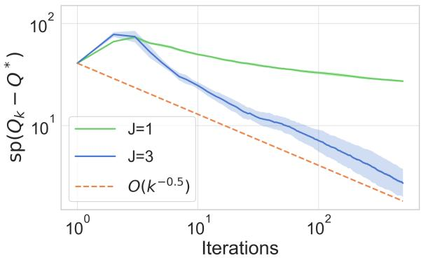  
(a) Taxi

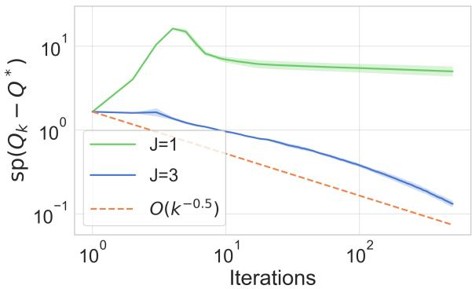  
(b) Ofice gridworld

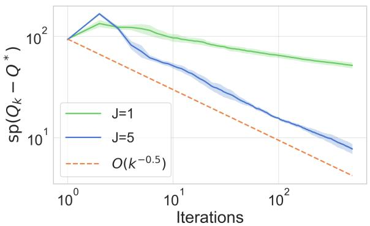  
(c) Taxi

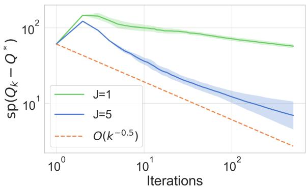  
(d) Ofice gridworld  
Figure 4: Evolution of $\mathrm { s p } ( Q _ { k } - Q ^ { * } )$ with iterations k for synchronous learning for intra-option setting (a), (b) and inter-option setting (c), (d) for Taxi and Ofice gridworld respectively.

In this section, we provide results for two additional benchmarks- Taxi (Dietterich, 2000) and Ofice gridworld, and provide additional experimental details.

Environments: Four Rooms: The environment consists of four labeled $3 \times 3$ rooms in a $2 \times 2$ grid, as shown in Fig 5. The state space has 36 cells, and the action space consists of 4 primitive actions up, down, left, bottom with stochastic transitions (transitions to incorrect state in perpendicular direction with probability 0.1), and the walls act as reflectors. The environment deals with a patrolling task, requiring to visit specific locations $A \to B \to C \to D \to A$ repeatedly in that order, producing a reward of +1. In the labelled MDP, the current observation is not suficient to predict the next optimal action and this has to be combined with also the current RM state. The cross product MDP on which the task is Markovian has $3 6 \times 4 = 1 4 4$ states.

Taxi: We use the standard Taxi domain (Dietterich, 2000), with a $5 \times 5 ~ \mathrm { g r i d }$ , and 4 possible passenger locations, with an additional fifth location as inside the taxi, giving a $5 \times 5$ (taxi location) ×5 (passenger location) ×4 (destination location) = 500 states. The action space consists of 4 primitive actions up, down, left, right for movement along with pickup and drop-of. To make the task average-reward, we remove the episode termination and reset the environment after a successful delivery.

Ofice gridworld: We adapt the Ofice gridworld as described in Icarte et al. (2020), with a $1 2 \times 9$ gridworld, with two cofee locations, one mail location and an ofice location at o. The agent must fetch cofee and mail, and arrive at the ofice. The non-Markovian reward can be encoded by a 4 state reward machine.

Options: For the Four Rooms environment, we use 4 hallway-reaching options, one for each hallway, with BFS-greedy intra-option policy with $\epsilon = 0 . 0 5$ exploration. For Taxi, we use four go-to-location options, one for each designated location of the passenger $\mathrm { ( R , G , Y , B ) }$ , and two single-step options with primitive actions pickup and drop-of. For Ofice gridworld, we use four options corresponding to reaching locations for the mail, $o f f i c e ,$ and two diferent locations for cofee.

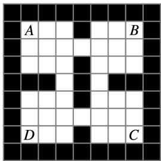  
(a) Labeled-MDP

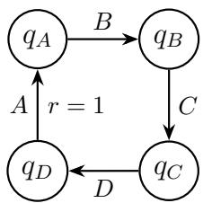  
(b) RM  
Figure 5: Four Rooms gridworld with $3 \times 3$ rooms, four primitive actions, and a reward machine corresponding to a patrolling task.

Algorithms and stepsizes: We show convergence results for intra and inter-option Q-learning, each with $J \in$ {1, 3}, and show contraction factors for diferent values of J in Table 3. We use decaying stepsize $\alpha _ { k } = \alpha / ( k + h )$ with $\alpha = 4 / ( 1 - \gamma )$ . Each curve in Figures 4 is averaged over $> 5$ independent seeds, and the shaded band show one standard deviation across seeds.

Computational resources: All experiments are tabular and were run on a single laptop CPU (Apple M2 MacBook, 8-core CPU, 16 GB unified memory, Python 3.9.6). Each algorithm stores tables of size $| S | | \mathcal { O } |$ total memory used is under 1GB. The entire experimental sweep, including all environments and all algorithms, completes in under three hours of wall-clock time, no GPU was used.<sup>1</sup>

Experimental results: Figures 4 show the span seminorm error $\mathrm { s p } ( Q _ { k } - Q ^ { * } )$ for Taxi and Ofice gridworld domain. Similar to Four Rooms, the estimator with higher J for each of the environments converges strictly faster than the $J = 1$ one-step estimator, following the $\bar { \mathcal { O } } ( k ^ { - 1 / 2 } )$ reference line.

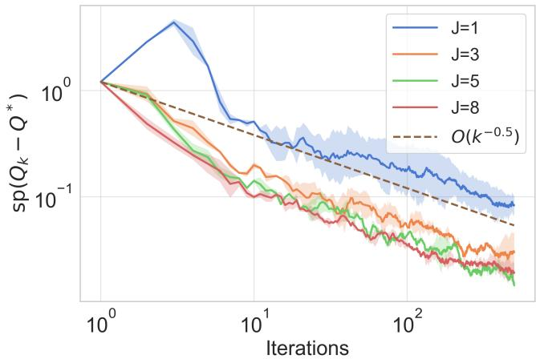  
Figure 6: Evolution of $\mathrm { s p } ( Q _ { k } - Q ^ { * } )$ over iterations k for synchronous intra-option setting for Four Rooms environment.

In Figure 6 we plot the span seminorm error $\mathrm { s p } ( Q _ { k } - Q ^ { * } )$ over k iterations, for diferent values of $^ { J , }$ and we observe that with increasing values of J the slope of the convergence curve becomes steeper with diminishing returns for higher values of J.

Table 3: Contraction factor γ for the three environments for diferent values of J for the synchronous setting.
<table><tr><td rowspan="3">J</td><td colspan="2">Four Rooms</td><td colspan="2">Taxi</td><td colspan="2">Office gridworld</td></tr><tr><td></td><td>Intra-option Inter-option</td><td>Intra-option Inter-option</td><td></td><td>Intra-option Inter-option</td><td></td></tr><tr><td>1</td><td> $0 . 8 1 \pm 0 . 0 7$ </td><td> $0 . 8 2 1 \pm 0 . 0 5$ </td><td> $0 . 7 9 \pm 0 . 0 8$ </td><td> $0 . 8 3 \pm 0 . 0 5$ </td><td> $0 . 7 5 \pm 0 . 0 7$ </td><td> $0 . 8 3 \pm 0 . 0 7$ </td></tr><tr><td>2</td><td> $0 . 6 8 \pm 0 . 0 8$ </td><td> $0 . 7 0 \pm 0 . 0 6$ </td><td> $0 . 6 8 \pm 0 . 0 8$ </td><td> $0 . 7 3 \pm 0 . 0 5$ </td><td> $0 . 6 3 \pm 0 . 0 6$ </td><td> $0 . 7 6 \pm 0 . 0 7$ </td></tr><tr><td></td><td> $0 . 5 6 \pm 0 . 0 9$ </td><td> $0 . 6 2 \pm 0 . 0 6$ </td><td> $0 . 5 8 \pm 0 . 0 8$ </td><td> $0 . 6 6 \pm 0 . 0 5$ </td><td> $0 . 5 4 \pm 0 . 0 6$ </td><td> $0 . 7 2 \pm 0 . 0 6$ </td></tr><tr><td>34</td><td> $0 . 4 8 \pm 0 . 0 8$ </td><td> $0 . 5 5 \pm 0 . 0 7$ </td><td> $0 . 4 8 \pm 0 . 0 9$ </td><td> $0 . 5 9 \pm 0 . 0 4$ </td><td> $0 . 4 8 \pm 0 . 0 5$ </td><td> $0 . 6 6 \pm 0 . 0 6$ </td></tr></table>

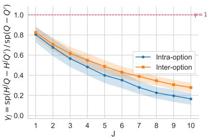  
(a) γ vs J

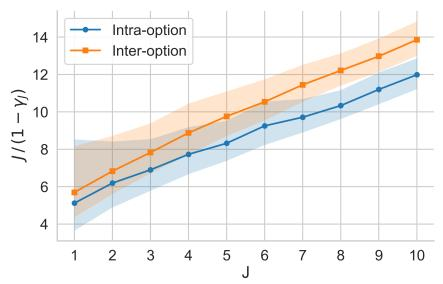  
(b) $\frac { J } { ( 1 - \gamma ) }$ vs J

  
(c) $\frac { ( \mathrm { s p } ( Q ^ { * } ) + J ) ^ { 2 } } { ( 1 - \gamma ) ^ { 3 } }$ vs J  
Figure 7: J-step contraction and J-step selection guideline for intra-and inter-option operators for Four rooms environment.

## F.1 A guideline for selecting J

The finite-time bounds of Theorems 5.1 and 5.2 vary with J in two diferent ways as shown in Appendix D. Given $d \triangleq \left| S \right| \left| \mathscr { O } \right|$ and $b _ { k } = \mathcal { O } ( J \log k )$ (Lemma D.1), we have the intra-option bound following Theorem D.12:

$$
\mathbb { E } \big [ \mathrm { s p } ( Q _ { k } - Q ^ { \star } ) ^ { 2 } \big ] = { \cal O } \Bigg ( \underbrace { \frac { ( \mathrm { s p } ( Q ^ { \star } ) + J ) ^ { 2 } \log d } { ( 1 - \gamma ) ^ { 3 } k } } _ { \mathrm { ( i ) ~ r o l l o u t ~ v a r i a n c e } } + \ \underbrace { \frac { C _ { d } J ^ { 2 } \big ( 1 + ( b _ { k } + J ) ^ { 2 } \big ) } { ( 1 - \gamma ) ^ { 2 } k } } _ { \mathrm { ( i i ) ~ a p p r o s i m a t e l y - g r e e d y ~ h i a s } } \Bigg ) , \qquad C _ { d } = | \mathcal { S } | + 2 \log d + 2 .\tag{35}
$$

Following Theorem D.26, the inter-option bound has an additional term of order $d c ^ { 2 } J ^ { 2 } \left[ 1 + ( 2 b _ { k } + J ) ^ { 2 } \right] / \left( ( 1 - \gamma ) ^ { 2 } k \right)$ In Equation (35), term (i) is due to the rollout noise $T _ { \mathrm { q u a d } } .$ , controlled in Proposition D.10, and term (ii) is due to the approximately greedy perturbation $T _ { \mathrm { g r e e d y } }$ controlled in Proposition D.8, which arises from choosing the intermediate options using the empirical Bellman operators ${ \widehat { H } } _ { k } ,$ and since $b _ { k } = \mathcal { O } ( J \log k )$ , this term varies with $\widetilde { \mathcal { O } } ( J ^ { 4 } )$ and also inherits |S| through $C _ { d }$ . The inter-option terms are analogous and additionally carries $\textstyle | S | | \mathcal { O } | c ^ { 2 }$

The two terms scale diferently: firstly, the rollout variance term carries the factor $( 1 - \gamma ) ^ { - 3 }$ while the estimation terms carries $( 1 - \gamma ) ^ { - 2 }$ , so for a domain with slow contraction the bound would be more sensitive to the first term. Secondly, the estimation term (ii) is the worst-case bound on the model-free estimation error, and the factors |S| for intra- and |S||O| for inter-option come from a union bound over the entire state-option space (Lemma D.4). This particular bound is deliberately conservative, and we show so in our experiments which run the approximately greedy algorithm and show that increasing J yields faster convergence, confirming that the $\widetilde { \mathcal { O } } ( J ^ { 4 } )$ is far from tight in practice.

We track the intrinsic rollout-contraction trade-of i.e. the term (i) of the finite-time bound (without the loose estimation term) in Equation (35) $\frac { \left( \operatorname { s p } ( Q ^ { \star } ) + J \right) ^ { 2 } } { \left( 1 - \gamma \right) ^ { 3 } }$ , plotted against J in Figure 7(c), for both intra- and inter-option operators in the Four Rooms environment. We observe that increasing J strengthens the span contraction lowering the denominator $( 1 - \gamma ) ^ { - 3 }$ , but increases the length of the rollout and the target variance $( \operatorname { s p } ( Q ^ { \star } ) + J ) ^ { 2 }$ This trade-of is balanced at an internal optimal $J ^ { * }$ , which is consistent with the diminishing returns observed for increasing J in the convergence curves in Figure 6.