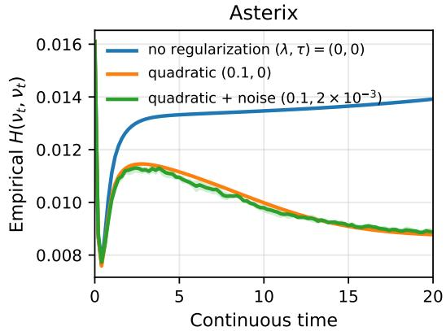
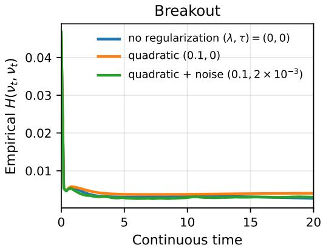

# On the Convergence of Semi-Gradient TD: A Mean Field Perspective

Haruki Settai The University of Tokyo

Tadashi Kozuno Sun Intelligence

Shinji Ito The University of Tokyo & RIKEN

SHARUKI692@G.ECC.U-TOKYO.AC.JP

TADASHI.KOZUNO@GMAIL.COM

SHINJI@MIST.I.U-TOKYO.AC.JP

## Abstract

Semi-gradient temporal-difference learning is a core algorithmic component of reinforcement learning, but bootstrapping with function approximation generally induces a non-conservative vector field and can lead to instability. We analyze this effect for two-layer neural networks in the mean-field regime and identify a simple stability mechanism in which entropy-induced relaxation dominates the sensitivity of the moving bootstrap target. Under this condition, we prove exponential convergence to a unique fixed point and quantify its bias relative to the unregularized Bellman solution. We also show that the same mechanism extends to entropy-regularized off-policy control through soft Q-learning.

## 1 Introduction

Temporal-difference (TD) learning is one of the basic mechanisms for value estimation in reinforcement learning. Its semi-gradient form is particularly simple, updating the current prediction toward a bootstrapped target without differentiating through that target. This simplicity, however, also makes its dynamics fundamentally different from ordinary gradient descent. With function approximation, the expected semi-gradient update generally defines a non-conservative vector field, and the resulting dynamics can diverge or oscillate even in the absence of sampling noise (Baird, 1995; Gordon, 2000; Asadi et al., 2023).

Understanding this instability becomes particularly challenging with neural-network function approximation, where the representation itself evolves during learning. Despite the practical importance of neural TD methods, convergence theory for semi-gradient TD beyond linear or near-initialization regimes remains limited. The mean-field regime provides a tractable framework for studying feature learning in wide two-layer neural networks by describing training through the evolution of a distribution over parameters. Yet mean-field analyses of semi-gradient TD remain scarce. Zhang et al. (2020) establish a best-iterate guarantee in function value, but do not prove convergence of the learning dynamics themselves. Agazzi & Lu (2022) characterize the equilibrium structure of mean-field semi-gradient TD and show that a convergent trajectory induces the true value function under suitable assumptions, while their convergence guarantee is obtained in a lazy-training regime. Thus, convergence of nonlinear mean-field semi-gradient TD dynamics, and the mechanism that can stabilize them, remain poorly understood.

In this work, we study noisy semi-gradient TD with two-layer neural networks in the mean-field regime. We write $q _ { t } ( \theta ) d \theta$ for the parameter law evolving under the mean-field semi-gradient Langevin dynamics. Following the changing-objective viewpoint of Asadi et al. (2023), for any parameter law $q ,$ let $F ( q , \nu )$ denote the frozen-target regression objective with entropy and quadratic regularization, where the bootstrap target is frozen at $q$ and ν represents the online predictor. We define the corresponding frozen-target minimizer map by

$$
T ( q ) : = \arg \operatorname* { m i n } _ { \nu } F ( q , \nu ) .
$$

If the bootstrap target were fixed, mean-field Langevin theory provides relaxation toward $T ( q )$ (Chizat, 2022; Nitanda et al., 2022). In semi-gradient TD, however, the target is generated by the current parameter law itself, so the relevant minimizer is $T ( q _ { t } )$ and moves together with $q _ { t }$ . The central question is whether relaxation toward the current frozen-target minimizer is strong enough to dominate this moving-target effect.

Our first contribution is a last-iterate convergence guarantee for mean-field semi-gradient TD. The analysis is governed by the relaxation rate $\rho \tau$ induced by noise and regularization and the constant $L _ { p }$ measuring the sensitivity of the frozen-target objective to changes in the bootstrap target. $\mathrm { I f } \rho \tau > L _ { p } ,$ then the frozen-target optimality gap

$$
G ( t ) : = F ( q _ { t } , q _ { t } ) - F ( q _ { t } , T ( q _ { t } ) )
$$

decays exponentially as

$$
G ( t ) \leq e ^ { - 2 ( \rho \tau - L _ { p } ) t } G ( 0 ) .
$$

Under the same condition, the map T is $L _ { p } / ( \rho \tau )$ -contractive in Wasserstein distance and therefore admits a unique fixed point $q _ { \star } = T ( q _ { \star } )$ . Combining the decay of the frozen-target optimality gap with this contraction yields exponential convergence of the actual semi-gradient parameter law $q _ { t }$ to $q _ { \star }$ (Theorem 1). As summarized in Table 1, previous results establish either feature learning or last-iterate convergence, but not both simultaneously. We provide the first last-iterate convergence guarantee for mean-field semi-gradient TD.

The limiting law $q _ { \star }$ , however, solves an entropy- and quadratically-regularized problem rather than the original Bellman equation. We therefore complement the dynamical convergence result with an explicit bound on the resulting approximation and regularization error (Theorem $2 )$ . In the realizable case, suppose there exists a parameter law $q ^ { \pi }$ such that $V _ { q ^ { \pi } } = V ^ { \pi }$ and $D _ { \mathrm { K L } } ( q ^ { \pi } | | g _ { \lambda , \tau } ) < \infty$ . Then

$$
\| V _ { q \star } - V ^ { \pi } \| _ { L ^ { 2 } ( d ^ { \pi } ) } \leq \sqrt { \frac { \tau } { 1 - \gamma } D _ { \mathrm { K L } } ( q ^ { \pi } \| g _ { \lambda , \tau } ) } .
$$

Thus, the same regularization that stabilizes the learning dynamics introduces a quantitatively controlled bias in the learned value function. Our general result also allows for function-approximation error.

Finally, we extend the same stability mechanism to entropy-regularized off-policy soft Q-learning, obtaining exponential convergence to a unique self-consistent equilibrium (Theorem 3). We also quantify the error of this equilibrium relative to the soft Bellman fixed point (Theorem 4).

Additional related work. Beyond the mean-field setting, convergence of TD learning with nonlinear or neural function approximation has been studied under various structural and overparameterization assumptions. Brandfonbrener & Bruna (2020) analyze the expected nonlinear TD dynamics through geometric properties of the function class and the underlying Markov chain. A separate line of work establishes finite-time guarantees for neural TD using overparameterization and control of the network around its initialization (Cai et al., 2019; Cayci et al., 2023; Ke et al., 2024). These results provide complementary convergence guarantees outside the mean-field feature-learning regime considered here.

Table 1: Comparison of convergence results for nonlinear TD learning.
<table><tr><td></td><td>Neural function approximation</td><td>Feature learning</td><td>Last-iterate convergence</td><td>Control extension</td></tr><tr><td>Cai et al. (2019)</td><td>√</td><td>一</td><td>1</td><td>√</td></tr><tr><td>Zhang et al. (2020)</td><td>√</td><td>√</td><td>一</td><td>√</td></tr><tr><td>Agazzi and Lu (2022)</td><td>√</td><td>一</td><td>√</td><td>一</td></tr><tr><td>Asadi et al. (2023)</td><td>一</td><td>一</td><td>√</td><td>√</td></tr><tr><td>Ours</td><td>√</td><td>√</td><td>√</td><td>√</td></tr></table>

Notes. The entries indicate guarantees established within the respective settings of each work and should not be interpreted as implication or dominance relations between the results. In particular, our convergence guarantees are obtained for regularized dynamics and therefore introduce bias relative to the unregularized Bellman solution. We quantify this regularization bias separately in Theorems 2 and 4.

## 2 Problem Setting

## 2.1 Notation

Let $\mathcal { P } _ { 2 } ( \mathbb { R } ^ { d } )$ denote the space of probability measures on $\mathbb { R } ^ { d }$ with finite second moment, and let $\mathcal { P } _ { 2 } ^ { \mathrm { a c } } ( \mathbb { R } ^ { d } )$ denote its subset of measures absolutely continuous with respect to Lebesgue measure. We write $W _ { 2 }$ for the 2-Wasserstein distance. For $\nu _ { i } ( \mathrm { d } \theta ) = q _ { i } ( \theta ) \mathrm { d } \theta \in \mathcal { P } _ { 2 } ^ { \mathrm { a c } } ( \mathbb { R } ^ { d } ) , i = 1 , 2$ , we define the differential entropy, the Kullback–Leibler divergence, and the relative Fisher information by

$$
\mathcal H ( \nu _ { 1 } ) : = - \int q _ { 1 } \log q _ { 1 } \mathrm { d } \theta , \qquad D _ { \mathrm { K L } } ( \nu _ { 1 } | | \nu _ { 2 } ) : = \int q _ { 1 } \log \frac { q _ { 1 } } { q _ { 2 } } \mathrm { d } \theta ,
$$

and

$$
I ( \nu _ { 1 } \| \nu _ { 2 } ) : = \int q _ { 1 } \left\| \nabla \log \frac { q _ { 1 } } { q _ { 2 } } \right\| ^ { 2 } \mathrm { d } \theta .
$$

We identify an absolutely continuous probability measure with its density whenever no confusion arises.

## 2.2 Reinforcement Learning Setup

We consider a discrete-time discounted Markov decision process $( S , { \mathcal { A } } , P , r , \gamma )$ , where S and A are possibly infinite bounded subsets of Euclidean spaces. Here P is the transition kernel, $r : S \times \mathcal { A } $ $[ 0 , 1 ]$ is the reward function, and $\gamma \in ( 0 , 1 )$ is the discount factor. A policy $\pi : S  \Delta ( { \mathcal { A } } )$ maps each state $s \in S$ to a distribution $\pi ( \cdot | s )$ over A.

We first consider the policy evaluation problem, where a policy π is fixed and the goal is to learn its value function $V ^ { \pi }$ , namely the expected infinite-horizon discounted return under π. It is the unique solution of the Bellman equation

$$
\begin{array} { r } { V ^ { \pi } ( s ) = \mathbb { E } _ { \mathbf { \pi } _ { a \sim \pi ( \cdot | s ) } } \left[ r ( s , a ) + \gamma V ^ { \pi } ( s ^ { \prime } ) \right] . } \end{array}
$$

We later extend the same framework to entropy-regularized off-policy control through soft Q-learning.

## 2.3 Semi-Gradient TD

Let $V ( s ; \vartheta )$ be a value-function approximator with parameter ϑ. Given a transition $( s _ { k } , a _ { k } , s _ { k + 1 } )$ semi-gradient TD updates

$$
\vartheta ^ { ( k + 1 ) } = \vartheta ^ { ( k ) } + \alpha \delta _ { k } \nabla _ { \vartheta } V ( s _ { k } ; \vartheta ^ { ( k ) } ) ,
$$

where

$$
\delta _ { k } = r ( s _ { k } , a _ { k } ) + \gamma V ( s _ { k + 1 } ; \vartheta ^ { ( k ) } ) - V ( s _ { k } ; \vartheta ^ { ( k ) } ) .
$$

Unlike gradient descent on the squared TD error, this update does not differentiate through the bootstrapped term $V ( s _ { k + 1 } ; \vartheta ^ { ( k ) } )$ . Consequently, its expected update field need not be the gradient of any fixed scalar objective and may exhibit oscillation or divergence under function approximation (Baird, 1995; Tsitsiklis & Van Roy, 1997; Gordon, 2000).

## 2.4 Two-Layer Neural Networks and Mean-Field Formulation

We now specialize the value-function approximator to a two-layer neural network and formulate its semi-gradient dynamics in the mean-field parameterization. Let X denote the input space and $\Theta = \mathbb { R } ^ { d }$ the parameter space of a single neuron. For policy evaluation, $\mathcal { X } = \mathcal { S }$ . We consider the feature map

$$
\phi ( x ; \theta ) = \sigma _ { 1 } ( c ) \sigma _ { 2 } ( w ^ { \top } x + b ) , \qquad \theta = ( c , w , b ) \in \Theta ,
$$

where $\sigma _ { 1 } , \sigma _ { 2 } \in C ^ { 1 }$ have bounded values and derivatives. Given particles $\pmb { \theta } = ( \theta _ { 1 } , \dots , \theta _ { M } ) \in \Theta ^ { M }$ define the two-layer network

$$
V _ { M } ( s ; \pmb \theta ) : = \frac { 1 } { M } \sum _ { i = 1 } ^ { M } \phi ( s ; \pmb \theta _ { i } ) .
$$

Applying the semi-gradient TD update from the previous section to this network gives, for each particle,

$$
\theta _ { i } ^ { ( k + 1 ) } = \theta _ { i } ^ { ( k ) } + \frac { \alpha } { M } \delta _ { k } \nabla _ { \theta } \phi ( s _ { k } ; \theta _ { i } ^ { ( k ) } ) ,
$$

where

$$
\delta _ { k } = r ( s _ { k } , a _ { k } ) + \gamma V _ { M } ( s _ { k + 1 } ; \pmb \theta ^ { ( k ) } ) - V _ { M } ( s _ { k } ; \pmb \theta ^ { ( k ) } ) .
$$

Writing $\eta : = \alpha / M$ , the particle motion is therefore the usual semi-gradient TD update expressed in the two-layer parameterization.

To obtain the mean-field representation, introduce the empirical parameter law

$$
\nu _ { M } : = \frac { 1 } { M } \sum _ { i = 1 } ^ { M } \delta _ { \theta _ { i } } .
$$

Then

$$
V _ { M } ( s ; \theta ) = V ( s ; \nu _ { M } ) , \qquad V ( s ; \nu ) : = \int _ { \Theta } \phi ( s ; \theta ) \nu ( \mathrm { d } \theta ) ,
$$

for any $\nu \in \mathscr { P } _ { 2 } ( \Theta )$ . The mean-field formulation replaces the finite empirical law $\nu _ { M }$ by a general probability law $\nu \in \mathcal { P } _ { 2 } ( \Theta )$ .

To represent the semi-gradient structure at the level of probability measures, we separate the law generating the bootstrap target from the law being updated. Following the changing-objective viewpoint of Asadi et al. (2023), for a target law $\mu$ and an online law $\nu ,$ define

$$
H ( \mu , \nu ) : = \frac { 1 } { 2 } \mathbb { E } _ { s , a , s ^ { \prime } } \left[ \left( r ( s , a ) + \gamma V ( s ^ { \prime } ; \mu ) - V ( s ; \nu ) \right) ^ { 2 } \right] .
$$

The expectation is taken with respect to the transition distribution used by the algorithm. For fixed $\mu ,$ the functional $H ( \mu , \cdot )$ is an ordinary regression objective toward the bootstrap target generated by $\mu .$ Semi-gradient TD differentiates only with respect to the online law and evaluates the two arguments on the diagonal $\mu = \nu$ . Thus, while $H ( \mu , \cdot )$ is a fixed objective when $\mu$ is held fixed, the objective itself moves along the actual semi-gradient dynamics.

We study the regularized dynamics obtained by adding the quadratic functional

$$
R ( \nu ) : = \frac { \lambda } { 2 } \int _ { \Theta } \| \theta \| ^ { 2 } \nu ( \mathrm { d } \theta ) , \qquad \lambda > 0 ,
$$

and define

$$
E ( \mu , \nu ) : = H ( \mu , \nu ) + R ( \nu ) .
$$

For a functional of a probability law, we write $\delta / \delta \nu$ for its first variation with respect to $\nu .$ In the present setting,

$$
\frac { \delta H } { \delta \nu } ( \mu , \nu ) ( \theta ) = - \mathbb { E } _ { s , a , s ^ { \prime } } \left[ \left( r ( s , a ) + \gamma V ( s ^ { \prime } ; \mu ) - V ( s ; \nu ) \right) \phi ( s ; \theta ) \right] ,
$$

and hence

$$
\frac { \delta E } { \delta \nu } ( \mu , \nu ) ( \theta ) = \frac { \delta H } { \delta \nu } ( \mu , \nu ) ( \theta ) + \frac { \lambda } { 2 } \| \theta \| ^ { 2 } .
$$

Taking the parameter gradient of the first variation and evaluating on the diagonal $\mu = \nu$ recovers the expected particle-wise semi-gradient direction, with the additional drift induced by the quadratic regularization. The diagonal evaluation is the key distinction from ordinary optimization of the fixed functional $H ( \mu , \cdot )$

## 2.5 Noisy Semi-Gradient Mean-Field Dynamics

We now add isotropic Gaussian noise to the population semi-gradient dynamics. At the particle level, the resulting update is

$$
\theta _ { i } ^ { ( k + 1 ) } = \theta _ { i } ^ { ( k ) } - \eta \nabla _ { \theta } \frac { \delta E } { \delta \nu } \big ( \nu _ { M } ^ { ( k ) } , \nu _ { M } ^ { ( k ) } \big ) \big ( \theta _ { i } ^ { ( k ) } \big ) + \sqrt { 2 \tau \eta } \xi _ { i } ^ { ( k ) } ,\tag{1}
$$

where $\tau > 0$ controls the noise level, $\xi _ { i } ^ { ( k ) } \sim \mathcal { N } ( 0 , I _ { d } )$ are independent, and

$$
\nu _ { M } ^ { ( k ) } = \frac { 1 } { M } \sum _ { i = 1 } ^ { M } \delta _ { \theta _ { i } ^ { ( k ) } }
$$

is the empirical parameter law. Here the TD drift is the expected semi-gradient drift; the stochasticity in (1) comes from the added Langevin perturbation.

In continuous time, the corresponding mean-field dynamics are described by the McKean–Vlasov diffusion

$$
\mathrm { d } \theta _ { t } = - \nabla _ { \theta } \frac { \delta E } { \delta \nu } ( \nu _ { t } , \nu _ { t } ) ( \theta _ { t } ) \mathrm { d } t + \sqrt { 2 \tau } \mathrm { d } W _ { t } ,\tag{2}
$$

where $\nu _ { t }$ denotes the law of $\theta _ { t }$ . Under suitable regularity and growth conditions on the drift, standard Fokker–Planck–Kolmogorov theory ensures propagation of finite second moments and absolute continuity of the time-marginal laws (Bogachev et al., 2015). We therefore write

$$
\nu _ { t } ( \mathrm { d } \theta ) = q _ { t } ( \theta ) \mathrm { d } \theta , \qquad \nu _ { t } \in \mathcal { P } _ { 2 } ^ { \mathrm { a c } } ( \mathbb { R } ^ { d } ) .
$$

The density $q _ { t }$ evolves according to the nonlinear Fokker–Planck equation

$$
\partial _ { t } q _ { t } = \nabla _ { \theta } \cdot \left( q _ { t } \nabla _ { \theta } \frac { \delta E } { \delta \nu } ( q _ { t } , q _ { t } ) \right) + \tau \Delta _ { \theta } q _ { t } .\tag{3}
$$

Define the entropy-regularized frozen-target functional

$$
F ( \mu , \nu ) : = E ( \mu , \nu ) - \tau \mathcal { H } ( \nu ) ,
$$

where H denotes the differential entropy defined in Section 2.1. Since

$$
\nabla _ { \boldsymbol { \theta } } \frac { \delta ( - \tau \mathcal { H } ) } { \delta \nu } ( \nu ) ( \boldsymbol { \theta } ) = \tau \nabla _ { \boldsymbol { \theta } } \log q ( \boldsymbol { \theta } )
$$

for $\nu ( \mathrm { d } \theta ) = q ( \theta ) \mathrm { d } \theta$ , the Fokker–Planck equation can equivalently be written as

$$
\partial _ { t } q _ { t } = \nabla _ { \boldsymbol { \theta } } \cdot \left( q _ { t } \nabla _ { \boldsymbol { \theta } } \frac { \delta F } { \delta \nu } ( q _ { t } , q _ { t } ) \right) .\tag{4}
$$

For a fixed target law $\mu ,$ the dynamics associated with $F ( \mu , \cdot )$ are ordinary mean-field Langevin dynamics and relax toward the minimizer of this fixed functional. In the actual semi-gradient dynamics, however, the target law is the current law $q _ { t }$ itself and therefore moves together with the online law. Consequently, (4) has a gradient-flow-like form but is not the Wasserstein gradient flow of the diagonal functional $\nu \mapsto F ( \nu , \nu )$ , since the first variation is taken only with respect to the second argument.

## 3 Main Assumptions and Preliminary Results

We first introduce the two ingredients that govern the convergence analysis. The first controls the coupling between the target and online laws in the frozen-target objective. The second quantifies the relaxation properties of the corresponding Gibbs distributions.

Assumption 1 (Mixed smoothness of the frozen-target objective). There exists $L _ { p } < \infty$ such that, for all admissible $\mu , \nu _ { 1 } , \nu _ { 2 } \in \mathcal { P } _ { 2 } ( \mathbb { R } ^ { d } )$ and every $\theta \in \mathbb { R } ^ { d }$

$$
\left\| \nabla _ { \theta } \left[ \frac { \delta H } { \delta \mu } ( \mu , \nu _ { 1 } ) ( \theta ) - \frac { \delta H } { \delta \mu } ( \mu , \nu _ { 2 } ) ( \theta ) \right] \right\| \leq L _ { p } W _ { 2 } ( \nu _ { 1 } , \nu _ { 2 } ) .
$$

The constant $L _ { p }$ measures the mixed sensitivity of the frozen-target objective to the interaction between the target and online laws. For the two-layer parameterization in Section 2.4, Assumption 1 follows from the boundedness of the feature map and its first derivatives together with a finite second moment of the input distribution.

For a fixed target law $\mu ,$ the functional $F ( \mu , \cdot )$ is convex in the probability law and includes both quadratic and entropy regularization. Its minimizer therefore admits a Gibbs representation.

Proposition 1 (Gibbs form of the frozen-target minimizer; cf. Hu et al., 2021). For every $\mu \in \mathcal P _ { 2 } ( \mathbb { R } ^ { d } )$ , thefunctional $\nu \mapsto F ( \mu , \nu )$ admits a unique minimizer $\pi _ { \mu , \ast } \in \mathcal { P } _ { 2 } ^ { \mathrm { a c } } ( \mathbb { R } ^ { d } )$ . Its density satisfies

$$
\pi _ { \mu , * } ( \theta ) \propto \exp \left( - \frac { 1 } { \tau } \frac { \delta E } { \delta \nu } ( \mu , \pi _ { \mu , * } ) ( \theta ) \right) .
$$

More generally, for any $\mu , \nu \in \mathcal { P } _ { 2 } ( \mathbb { R } ^ { d } )$ , define the associated Gibbs law $\pi _ { \mu , \nu }$ by

$$
\pi _ { \mu , \nu } ( \mathrm { d } \theta ) = \frac { 1 } { Z _ { \mu , \nu } } \exp \left( - \frac { 1 } { \tau } \frac { \delta E } { \delta \nu } ( \mu , \nu ) ( \theta ) \right) \mathrm { d } \theta ,
$$

where $Z _ { \mu , \nu }$ is the normalizing constant. The quadratic regularizer together with the bounded perturbation induced by H ensures that $\pi _ { \mu , \nu }$ is well defined and belongs to $\mathcal { P } _ { 2 } ^ { \mathrm { a c } } ( \mathbb { R } ^ { d } )$ .

The second ingredient is a uniform functional inequality for this Gibbs family.

Assumption 2 (Uniform log-Sobolev inequality). There exists $\rho > 0$ such that, uniformly over all admissible $\mu , \nu \in \mathcal { P } _ { 2 } ( \mathbb { R } ^ { d } )$ ), the Gibbs law $\pi _ { \mu , \nu }$ satisfies

$$
D _ { \mathrm { K L } } ( m \Vert \pi _ { \mu , \nu } ) \leq \frac { 1 } { 2 \rho } I ( m \Vert \pi _ { \mu , \nu } )
$$

for every $m \in \mathcal { P } _ { 2 } ^ { \mathrm { a c } } ( \mathbb { R } ^ { d } )$ .

Our convergence results use Assumption 2 only through the effective relaxation strength $\rho \tau$ and do not require any specific dependence of $\rho$ on the temperature τ . Sufficient conditions for Assumption 2 are given in Appendix A.1.

Proposition 2 (Entropy sandwich; cf. Chizat, 2022; Nitanda et al., 2022). For every $\mu \in \mathcal P _ { 2 } ( \mathbb { R } ^ { d } )$ and $\nu \in \mathcal { P } _ { 2 } ^ { \mathrm { a c } } ( \mathbb { R } ^ { d } )$ ,

$$
\tau D _ { \mathrm { K L } } ( \nu \| \pi _ { \mu , \ast } ) \leq F ( \mu , \nu ) - F ( \mu , \pi _ { \mu , \ast } ) \leq \tau D _ { \mathrm { K L } } ( \nu \| \pi _ { \mu , \nu } ) .
$$

Together with Assumption 2, the entropy-sandwich inequality relates the rate of decrease along the frozen-target dynamics to the frozen-target optimality gap.

## 4 Main Results

## 4.1 Policy Evaluation

We first establish convergence of the noisy mean-field semi-gradient dynamics in the policy-evaluation setting. Throughout this section, we write

$$
\nu _ { t } ( \mathrm { d } \theta ) = q _ { t } ( \theta ) \mathrm { d } \theta
$$

for the parameter law evolving according to (4). For each target law $\mu ,$ define the Gibbs response map

$$
T ( \mu ) : = \pi _ { \mu , * } ( \theta ) \mathrm { d } \theta ,
$$

where $\pi _ { \mu , * }$ is the unique minimizer of $\nu \mapsto F ( \mu , \nu )$

A direct analysis of the diagonal functional $F ( \nu _ { t } , \nu _ { t } )$ does not yield a closed estimate because the bootstrap target moves together with the online law. We instead consider the frozen-target optimality gap

$$
G ( t ) : = F ( \nu _ { t } , \nu _ { t } ) - F ( \nu _ { t } , T ( \nu _ { t } ) ) .
$$

The first lemma shows that this gap decreases exponentially whenever the relaxation rate $\rho \tau$ dominates the sensitivity $L _ { p }$ of the moving target.

Lemma 1 (Decay of the frozen-target optimality gap). Suppose that $\nu _ { 0 } ~ \in ~ \mathcal { P } _ { 2 } ^ { \mathrm { a c } } ( \mathbb { R } ^ { d } )$ satisfies $F ( \nu _ { 0 } , \nu _ { 0 } ) < \infty$ , and let $( \nu _ { t } ) _ { t \geq 0 }$ be a sufficiently regular solution to (4). Under Assumptions 1 and 2, supposefurther that $\rho \tau > L _ { p } .$ . Then

$$
\frac { d } { d t } G ( t ) \leq - 2 ( \rho \tau - L _ { p } ) G ( t ) .
$$

Consequently,

$$
G ( t ) \leq e ^ { - 2 ( \rho \tau - L _ { p } ) t } G ( 0 )
$$

for every $t \geq 0 .$

Lemma 1 shows that the current parameter law approaches its instantaneous frozen-target minimizer. This alone does not imply convergence to a common limit because the minimizer itself changes with the target law. The next lemma controls this dependence.

Lemma 2 (Stability of the Gibbs response map). Under Assumptions 1 and $2 , f o r$ every $\mu _ { 1 } , \mu _ { 2 } \in$ $\mathcal { P } _ { 2 } ( \mathbb { R } ^ { d } )$

$$
W _ { 2 } \big ( T ( \mu _ { 1 } ) , T ( \mu _ { 2 } ) \big ) \le \frac { L _ { p } } { \rho \tau } W _ { 2 } ( \mu _ { 1 } , \mu _ { 2 } ) .
$$

In particular, $i f \rho \tau > L _ { p } ,$ , then $T$ is a contraction on $\left( \mathcal { P } _ { 2 } ( \mathbb { R } ^ { d } ) , W _ { 2 } \right)$

Since $\left( \mathcal { P } _ { 2 } ( \mathbb { R } ^ { d } ) , W _ { 2 } \right)$ is complete, Lemma 2 and Banach’s fixed-point theorem imply that, under $\rho \tau > L _ { p }$ , the response map $T$ admits a unique fixed point. We denote it by $\nu _ { \star }$ , so that

$$
\begin{array} { r } { \nu _ { \star } = T ( \nu _ { \star } ) . } \end{array}
$$

The two preceding lemmas now yield convergence of the full semi-gradient dynamics.

Theorem 1 (Exponential convergence to the self-consistent equilibrium). Suppose that the conditions ofLemma 1 hold and that

$$
\rho \tau > L _ { p } .
$$

Then $( \nu _ { t } ) _ { t \geq 0 }$ converges exponentially in $W _ { 2 }$ to the unique self-consistent equilibrium $\nu _ { \star }$ . More precisely,for every $t \geq 0$

$$
W _ { 2 } ( \nu _ { t } , \nu _ { \star } ) \leq \frac { \sqrt { 2 \rho \tau } } { \rho \tau - L _ { p } } \sqrt { G ( 0 ) } e ^ { - ( \rho \tau - L _ { p } ) t } .
$$

Lemma 1 controls relaxation toward the instantaneous frozen-target minimizer, while Lemma $^ 2$ controls the sensitivity of that minimizer to changes in the bootstrap target. The condition $\rho \tau > L _ { p }$ ensures that the relaxation is strong enough to dominate the moving-target effect.

## 4.2 Approximation and Regularization Error

Theorem 1 establishes convergence to a unique self-consistent equilibrium. Since this equilibrium is defined through an entropy- and quadratically-regularized objective, it need not represent the unregularized value function exactly. We next quantify this error.

Let

$$
g _ { \lambda , \tau } : = \mathcal { N } \left( 0 , \frac { \tau } { \lambda } I _ { d } \right) .
$$

For any absolutely continuous parameter law $\nu ,$

$$
R ( \nu ) - \tau \mathcal { H } ( \nu ) = \tau D _ { \mathrm { K L } } ( \nu | | g _ { \lambda , \tau } ) - \frac { \tau d } 2 \log \frac { 2 \pi \tau } { \lambda } .
$$

We write $V _ { \nu } ( s ) : = V ( s ; \nu )$ . For any measurable function $f$ on $s ,$ , define the Bellman operator of the evaluated policy by

$$
\begin{array} { r } { ( T ^ { \pi } f ) ( s ) : = \mathbb { E } _ { \tiny \begin{array} { c } { a \sim \pi ( \cdot \vert s ) } \\ { s ^ { \prime } \sim P \left( \cdot \vert s , a \right) } \end{array} } \left[ r ( s , a ) + \gamma f ( s ^ { \prime } ) \right] . } \end{array}
$$

Theorem 2 (Approximation and regularization error). Let $P ^ { \pi }$ be the transition operator of the evaluated policy and let $d ^ { \pi }$ be a stationary state distribution for $P ^ { \pi }$ . Suppose that the expectation defining the frozen-target objective H is taken under the transition distribution $d ^ { \pi } ( d s ) \pi ( d a \ )$ s) $P ( d s ^ { \prime } \mid s , a )$ . Let $\nu _ { \star }$ be a self-consistent equilibrium satisfying

$$
\nu _ { \star } \in \mathop { \mathrm { a r g m i n } } _ { \nu } F ( \nu _ { \star } , \nu ) .
$$

Then

$$
\| V _ { \nu _ { \star } } - V ^ { \pi } \| _ { L ^ { 2 } ( d ^ { \pi } ) } \leq \operatorname* { i n f } _ { \nu } \left\{ \frac { 1 + \gamma } { 1 - \gamma } \| V _ { \nu } - V ^ { \pi } \| _ { L ^ { 2 } ( d ^ { \pi } ) } + \sqrt { \frac { \tau } { 1 - \gamma } D _ { \mathrm { K L } } ( \nu \| g _ { \lambda , \tau } ) } \right\} ,
$$

where the infimum is over parameter laws withfinite $D _ { \mathrm { K L } } ( \nu \Vert g _ { \lambda , \tau } )$

In particular, suppose that there exists a parameter law $\nu ^ { \pi }$ satisfying

$$
V _ { \nu ^ { \pi } } = V ^ { \pi } , \qquad D _ { \mathrm { K L } } ( \nu ^ { \pi } \| g _ { \lambda , \tau } ) < \infty .
$$

Then

$$
\| V _ { \nu _ { \star } } - V ^ { \pi } \| _ { L ^ { 2 } ( d ^ { \pi } ) } ^ { 2 } \leq \frac { \tau } { 1 - \gamma } \left[ D _ { \mathrm { K L } } ( \nu ^ { \pi } \| g _ { \lambda , \tau } ) - D _ { \mathrm { K L } } ( \nu _ { \star } \| g _ { \lambda , \tau } ) \right] \leq \frac { \tau } { 1 - \gamma } D _ { \mathrm { K L } } ( \nu ^ { \pi } \| g _ { \lambda , \tau } ) .
$$

Theorem 2 separates two sources of error. The first term measures the approximation error of the mean-field function class, while the second reflects the parameter-space regularization. In the realizable case, the approximation term vanishes.

## 4.3 Extension to Soft Q-Learning

We now extend the analysis to entropy-regularized off-policy control. Fix $\beta > 0$ and a finite reference measure $m _ { A }$ on ${ \mathcal { A } } .$ , taken to be counting measure when A is finite. For a Q-function $Q ,$ define the soft value operator

$$
( S _ { \beta } Q ) ( s ) : = \beta \log \int _ { A } \exp \left( \frac { Q ( s , a ) } { \beta } \right) m _ { A } ( d a )
$$

and the soft Bellman operator

$$
( \mathcal T _ { \beta } Q ) ( s , a ) : = r ( s , a ) + \gamma \mathbb { E } _ { s ^ { \prime } \sim P ( \cdot \vert s , a ) } \left[ ( S _ { \beta } Q ) ( s ^ { \prime } ) \right] .
$$

We write $Q _ { \nu } ( s , a ) : = Q ( s , a ; \nu )$ for the Q-function represented by a parameter law $\nu .$ For target and online laws $\mu$ and $\nu ,$ define the frozen-target soft-Q objective

$$
H _ { Q } ( \mu , \nu ) : = \frac { 1 } { 2 } \mathbb { E } _ { ( s , a , s ^ { \prime } ) \sim \mu _ { b } } \left[ ( r ( s , a ) + \gamma ( S _ { \beta } Q _ { \mu } ) ( s ^ { \prime } ) - Q _ { \nu } ( s , a ) ) ^ { 2 } \right] ,
$$

where $\mu _ { b } ( d s , d a , d s ^ { \prime } ) = d _ { b } ( d s , d a ) P ( d s ^ { \prime } \mid s , a )$ for a fixed off-policy state-action sampling distribution $d _ { b }$ . We set

$$
E _ { Q } ( \mu , \nu ) : = H _ { Q } ( \mu , \nu ) + R ( \nu ) , \qquad F _ { Q } ( \mu , \nu ) : = E _ { Q } ( \mu , \nu ) - \tau \mathcal { H } ( \nu ) .
$$

The dependence on the target and online laws remains analogous to that in policy evaluation. $\mathsf { A p - }$ pendix C.1 verifies the corresponding mixed-smoothness condition with constant $L _ { p } ^ { Q }$ . Let

$$
T _ { Q } ( \mu ) : = \arg \operatorname* { m i n } _ { \nu } F _ { Q } ( \mu , \nu ) , \qquad G _ { Q } ( t ) : = F _ { Q } ( \nu _ { t } , \nu _ { t } ) - F _ { Q } ( \nu _ { t } , T _ { Q } ( \nu _ { t } ) ) .
$$

Theorem 3 (Exponential convergence of soft Q-learning). Suppose that the soft-Q frozen-target objective satisfies the mixed-smoothness condition with constant $L _ { p } ^ { Q }$ and that its associated Gibbs family satisfies the uniform log-Sobolev inequality with constant $\rho .$ Let $( \nu _ { t } ) _ { t \geq 0 }$ be a sufficiently regular solution to the corresponding noisy mean-field semi-gradient dynamics, with $F _ { Q } ( \nu _ { 0 } , \nu _ { 0 } ) < \infty .$ If

$$
\rho \tau > L _ { p } ^ { Q } ,
$$

then the Gibbs response map $T _ { Q }$ admits a uniquefixed point $\nu _ { \star } ^ { Q }$ , and the mean-field soft-Q dynamics converge exponentially to $\nu _ { \star } ^ { Q }$ in $W _ { 2 }$ . More precisely, for every $t \geq 0$

$$
W _ { 2 } ( \nu _ { t } , \nu _ { \star } ^ { Q } ) \leq \frac { \sqrt { 2 \rho \tau } } { \rho \tau - L _ { p } ^ { Q } } \sqrt { G _ { Q } ( 0 ) } e ^ { - ( \rho \tau - L _ { p } ^ { Q } ) t } .
$$

The proof follows the same two-step structure as in policy evaluation. The soft-Q analogue of Lemma 1 gives exponential decay of $G _ { Q } ( t )$ , while the analogue of Lemma 2 controls the Gibbs response map. We leave these parallel intermediate statements inside the proof rather than repeating them as separate lemmas.

To compare the limiting equilibrium with the soft Bellman fixed point, we assume full support of the off-policy state-action distribution. This converts the $L ^ { 2 } ( d _ { b } )$ Bellman residual to a sup-norm bound, after which we use the standard sup-norm contraction of the soft Bellman operator.

Theorem 4 (Soft-Q approximation and regularization error). Suppose that S and A arefinite, and let $d _ { b }$ be the state-action marginal of the off-policy sampling distribution. Assume that

$$
d _ { \operatorname* { m i n } } : = \operatorname* { m i n } _ { s , a } d _ { b } ( s , a ) > 0 .
$$

Let $Q _ { \beta } ^ { \star }$ be the fixed point of the soft Bellman operator $\tau _ { \beta }$ , and let $\nu _ { \star } ^ { Q }$ be a self-consistent soft-Q equilibrium satisfying

$$
\nu _ { \star } ^ { Q } \in \arg \operatorname* { m i n } _ { \nu } F _ { Q } ( \nu _ { \star } ^ { Q } , \nu ) .
$$

  
Figure 1: Empirical $H ( \nu _ { t } , \nu _ { t } )$ on Asterix and Breakout under unregularized TD, quadratic regularization, and quadratic regularization with Langevin noise. The quadratic-only baseline isolates the effect of the confining regularizer from that of the Langevin perturbation. Lower values correspond to smaller empirical squared TD residuals. The noisy curves show the mean and one standard deviation over five noise realizations.

Then

$$
\left\| Q _ { \nu _ { \star } ^ { Q } } - Q _ { \beta } ^ { \star } \right\| _ { \infty } \leq \frac { 1 } { ( 1 - \gamma ) \sqrt { d _ { \operatorname* { m i n } } } } \operatorname* { i n f } _ { \nu } \left\{ \left\| Q _ { \nu } - \mathcal { T } _ { \beta } Q _ { \nu _ { \star } ^ { Q } } \right\| _ { L ^ { 2 } ( d _ { b } ) } + \sqrt { \tau D _ { \mathrm { K L } } ( \nu \| g _ { \lambda , \tau } ) } \right\} ,
$$

where the infimum is over parameter laws withfinite $D _ { \mathrm { K L } } ( \nu \Vert g _ { \lambda , \tau } )$

## 5 Numerical Illustration

We illustrate the effect of regularization on finite-width semi-gradient TD in Asterix and Breakout (MinAtar) using fixed pretrained policies. We compare unregularized TD, quadratic regularization, and quadratic regularization with Langevin noise. The quadratic-only baseline separates the effect of the confining regularization from the additional effect of Langevin noise. All methods use the same transition data and network initialization, so that the comparison isolates the effect of regularization. Experimental details are given in Appendix D.

Figure 1 shows two regimes. On Asterix, the unregularized objective deteriorates after an initial decrease, while regularization suppresses this long-run increase. On Breakout, unregularized TD is already stable and the improvement is smaller. The additional effect of Langevin noise is modest at the scale considered here. The contrast between the two environments suggests that the benefit of regularization is most visible when the unregularized semi-gradient dynamics exhibit unfavorable long-run behavior. These experiments provide a qualitative illustration of the stability mechanism. We do not estimate $\rho$ or $L _ { p }$ in these environments, so they are not a direct verification of the sufficient condition $\rho \tau > L _ { p }$

## 6 Conclusion

We studied noisy semi-gradient TD with two-layer neural networks in the mean-field regime and identified a stability mechanism in which relaxation toward the frozen-target minimizer dominates the sensitivity of the moving bootstrap target. Under this condition, we proved exponential convergence to a unique self-consistent equilibrium and quantified its error relative to the unregularized value function. We also showed that the same mechanism extends to entropy-regularized off-policy soft Q-learning.

Scope and limitations. Our analysis focuses on the population continuous-time dynamics in order to isolate the stability mechanism caused by the moving bootstrap target. We do not provide finite-width, time-discretization, or stochastic-gradient guarantees in this work. Related propagationof-chaos results for mean-field TD (Agazzi & Lu, 2022) and finite-particle and discretization analyses for mean-field Langevin dynamics (Suzuki et al., 2023) provide natural starting points for such extensions. Establishing their quantitative counterparts for the present semi-gradient dynamics is left for future work.

## References

Andrea Agazzi and Jianfeng Lu. Temporal-difference learning with nonlinear function approximation: lazy training and mean field regimes. In Proceedings of the 2nd Mathematical and Scientific Machine Learning Conference, volume 145 of Proceedings of Machine Learning Research, pp. 37– 74. PMLR, 2022. URL https://proceedings.mlr.press/v145/agazzi22a.html.

Kavosh Asadi, Shoham Sabach, Yao Liu, Omer Gottesman, and Rasool Fakoor. TD convergence: An optimization perspective. In Advances in Neural Information Processing Systems, volume 36, pp. 49169–49186, 2023. DOI: 10.52202/075280-2138. URL https://proceedings.neurips.cc/paper\_files/paper/2023/hash/ 9a08fbb992f15faa695c42b6a2c8e000-Abstract.html.

Leemon C. Baird, III. Residual algorithms: Reinforcement learning with function approximation. In Proceedings of the Twelfth International Conference on Machine Learning, pp. 30–37, San Francisco, CA, 1995. Morgan Kaufmann. DOI: 10.1016/B978-1-55860-377-6.50013-X.

Vladimir I. Bogachev, Nicolai V. Krylov, Michael Röckner, and Stanislav V. Shaposhnikov. Fokker– Planck–Kolmogorov Equations, volume 207 of Mathematical Surveys and Monographs. American Mathematical Society, Providence, RI, 2015. DOI: 10.1090/surv/207.

David Brandfonbrener and Joan Bruna. Geometric insights into the convergence of nonlinear TD learning. In International Conference on Learning Representations, 2020. URL https: //openreview.net/forum?id=SJezGp4YPr.

Qi Cai, Zhuoran Yang, Jason D. Lee, and Zhaoran Wang. Neural temporal-difference learning converges to global optima. In Advances in Neural Information Processing Systems, volume 32, pp. 11312–11322, 2019. URL https://proceedings.neurips.cc/paper/2019/hash/ 98baeb82b676b662e12a7af8ad9212f6-Abstract.html.

Semih Cayci, Siddhartha Satpathi, Niao He, and R. Srikant. Sample complexity and overparameterization bounds for temporal-difference learning with neural network approximation. IEEE Transactions on Automatic Control, 68(5):2891–2905, 2023. DOI: 10.1109/TAC.2023.3234234.

Lénaïc Chizat. Mean-field Langevin dynamics: Exponential convergence and annealing. Transactions on Machine Learning Research, 2022. ISSN 2835-8856. URL https://openreview.net/ forum?id=BDqzLH1gEm.

Geoffrey J. Gordon. Reinforcement learning with function approximation converges to a region. In Advances in Neural Information Processing Systems, volume 13, pp. 1040–1046. MIT Press, 2000. URL https://proceedings.neurips.cc/paper/2000/hash/ 04df4d434d481c5bb723be1b6df1ee65-Abstract.html.

Kaitong Hu, Zhenjie Ren, David Šiška, and Łukasz Szpruch. Mean-field Langevin dynamics and energy landscape of neural networks. Annales de l’Institut Henri Poincaré, Probabilités et Statistiques, 57(4):2043–2065, 2021. DOI: 10.1214/20-AIHP1140.

Zhifa Ke, Zaiwen Wen, and Junyu Zhang. An improved finite-time analysis of temporal difference learning with deep neural networks. In Proceedings of the 41st International Conference on Machine Learning, volume 235 of Proceedings of Machine Learning Research, pp. 23407–23429. PMLR, 2024. URL https://proceedings.mlr.press/v235/ke24b.html.

Atsushi Nitanda, Denny Wu, and Taiji Suzuki. Convex analysis of the mean field Langevin dynamics. In Proceedings of The 25th International Conference on Artificial Intelligence and Statistics, volume 151 of Proceedings of Machine Learning Research, pp. 9741–9757. PMLR, 2022. URL https://proceedings.mlr.press/v151/nitanda22a.html.

Taiji Suzuki, Denny Wu, and Atsushi Nitanda. Convergence of mean-field Langevin dynamics: time-space discretization, stochastic gradient, and variance reduction. In Advances in Neural Information Processing Systems, volume 36, pp. 15545–15577, 2023. DOI: 10.52202/ 075280-0684. URL https://proceedings.neurips.cc/paper\_files/paper/ 2023/hash/32133a6a24d6554263d3584e3ac10faa-Abstract.html.

John N. Tsitsiklis and Benjamin Van Roy. An analysis of temporal-difference learning with function approximation. IEEE Transactions on Automatic Control, 42(5):674–690, 1997. DOI: 10.1109/9. 580874.

Yufeng Zhang, Qi Cai, Zhuoran Yang, Yongxin Chen, and Zhaoran Wang. Can temporal-difference and Q-learning learn representation? A mean-field theory. In Advances in Neural Information Processing Systems, volume 33, pp. 19680–19692, 2020. URL https://proceedings.neurips.cc/paper/2020/hash/ e3bc4e7f243ebc05d66a0568a3331966-Abstract.html.

## A Verification of the Main Assumptions

## A.1 A Sufficient Condition for the Uniform Log-Sobolev Inequality

Assumption 2 is imposed abstractly in the main results. Here we give one concrete sufficient condition under an additional second-order regularity assumption on the feature map. This additional condition is used only to invoke the Bakry–Émery criterion and is not specific to the semi-gradient structure studied in this paper. In particular, it is satisfied by the two-layer parametrization in Section 2.4 for standard smooth bounded activations such as tanh and sigmoid when the input domain is bounded. Our main convergence theorem is stated in terms of a general uniform log-Sobolev constant $\rho ,$ so any sharper estimate of $\rho$ enlarges the resulting stability regime without changing the argument.

Recall that, for fixed target and online laws $\mu , \nu ,$ the associated Gibbs law has density

$$
\pi _ { \mu , \nu } ( \theta ) \propto \exp \left( - \frac { 1 } { \tau } \frac { \delta E } { \delta \nu } ( \mu , \nu ) ( \theta ) \right) .
$$

For policy evaluation, define

$$
\Delta _ { \mu , \nu } ( s , a , s ^ { \prime } ) : = r ( s , a ) + \gamma V ( s ^ { \prime } ; \mu ) - V ( s ; \nu ) .
$$

Then

$$
\frac { \delta E } { \delta \nu } ( \mu , \nu ) ( \theta ) = - \mathbb { E } _ { s , a , s ^ { \prime } } \left[ \Delta _ { \mu , \nu } ( s , a , s ^ { \prime } ) \phi ( s ; \theta ) \right] + \frac { \lambda } { 2 } \| \theta \| ^ { 2 } .
$$

For the verification below, suppose in addition that $\phi ( s ; \cdot )$ is twice continuously differentiable and that

$$
B _ { 0 } : = \operatorname* { s u p } _ { s , \theta } | \phi ( s ; \theta ) | < \infty , \qquad B _ { 2 } : = \operatorname* { s u p } _ { s , \theta } \| \nabla _ { \theta } ^ { 2 } \phi ( s ; \theta ) \| _ { \mathrm { o p } } < \infty .\tag{5}
$$

For the feature map

$$
\phi ( x ; \theta ) = \sigma _ { 1 } ( c ) \sigma _ { 2 } ( w ^ { \top } x + b ) , \qquad \theta = ( c , w , b ) ,
$$

these bounds hold when the input domain is bounded and $\sigma _ { 1 } , \sigma _ { 2 }$ and their derivatives up to second order are bounded. This includes, for example, tanh and sigmoid activations.

Since $\mu$ and ν are probability measures,

$$
| V ( s ; \mu ) | \leq B _ { 0 } , \qquad | V ( s ; \nu ) | \leq B _ { 0 } .
$$

Together with $r \in [ 0 , 1 ]$ , this yields the uniform residual bound

$$
| \Delta _ { \mu , \nu } ( s , a , s ^ { \prime } ) | \leq D _ { \Delta } , \qquad D _ { \Delta } : = 1 + ( 1 + \gamma ) B _ { 0 } .
$$

Proposition 3 (A Bakry–Émery certificate for Assumption 2). Suppose that (5) holds and

$$
\lambda > D _ { \Delta } B _ { 2 } .
$$

Then every Gibbs law $\pi _ { \mu , \nu }$ satisfies

$$
D _ { \mathrm { K L } } ( m \| \pi _ { \mu , \nu } ) \leq \frac { 1 } { 2 \rho _ { \mathrm { B E } } } I ( m \| \pi _ { \mu , \nu } )
$$

for every m $\in \mathcal { P } _ { 2 } ^ { \mathrm { a c } } ( \mathbb { R } ^ { d } )$ , uniformly over $\mu , \nu ,$ with

$$
\rho _ { \mathrm { B E } } : = \frac { \lambda - D _ { \Delta } B _ { 2 } } { \tau } .
$$

Equivalently,

$$
\rho _ { \mathrm { B E } } \tau = \lambda - D _ { \Delta } B _ { 2 } .
$$

Proof. Differentiating the first variation with respect to $\theta$ twice gives

$$
\nabla _ { \theta } ^ { 2 } \frac { \delta E } { \delta \nu } ( \mu , \nu ) ( \theta ) = \lambda I _ { d } - \mathbb { E } _ { s , a , s ^ { \prime } } \left[ \Delta _ { \mu , \nu } ( s , a , s ^ { \prime } ) \nabla _ { \theta } ^ { 2 } \phi ( s ; \theta ) \right] .
$$

For every unit vector $u \in \mathbb { R } ^ { d }$

$$
\begin{array} { r l } & { u ^ { \top } \nabla _ { \theta } ^ { 2 } \frac { \delta E } { \delta \nu } ( \mu , \nu ) ( \theta ) u = \lambda - \mathbb { E } _ { s , a , s ^ { \prime } } \left[ \Delta _ { \mu , \nu } ( s , a , s ^ { \prime } ) u ^ { \top } \nabla _ { \theta } ^ { 2 } \phi ( s ; \theta ) u \right] } \\ & { \qquad \geq \lambda - \mathbb { E } _ { s , a , s ^ { \prime } } \left[ | \Delta _ { \mu , \nu } ( s , a , s ^ { \prime } ) | \| \nabla _ { \theta } ^ { 2 } \phi ( s ; \theta ) \| _ { \mathrm { o p } } \right] } \\ & { \qquad \geq \lambda - D _ { \Delta } B _ { 2 } . } \end{array}\tag{6}
$$

Hence

$$
\nabla _ { \theta } ^ { 2 } \frac { \delta E } { \delta \nu } ( \mu , \nu ) ( \theta ) \succeq ( \lambda - D _ { \Delta } B _ { 2 } ) I _ { d }
$$

uniformly over $\mu , \nu , \theta .$

Up to an additive normalizing constant, the negative log-density of $\pi _ { \mu , \nu }$ is

$$
U _ { \mu , \nu } ( \theta ) : = \frac { 1 } { \tau } \frac { \delta E } { \delta \nu } ( \mu , \nu ) ( \theta ) .
$$

Therefore,

$$
\nabla _ { \theta } ^ { 2 } U _ { \mu , \nu } ( \theta ) \succeq \frac { \lambda - D _ { \Delta } B _ { 2 } } { \tau } I _ { d } = \rho _ { \mathrm { B E } } I _ { d } .
$$

The Bakry–Émery criterion then gives the claimed log-Sobolev inequality.

Proposition 3 is only one sufficient certificate for Assumption 2. Combined with the stability condition $\rho \tau > L _ { p }$ , it yields the explicit sufficient condition

$$
\lambda > D _ { \Delta } B _ { 2 } + L _ { p } .
$$

The convergence analysis itself does not rely on this particular certificate or on the additional secondorder regularity used above. Any stronger log-Sobolev estimate for the Gibbs family can instead be substituted directly into the general condition $\rho \tau > L _ { p }$

## A.2 Verification of the Mixed-Smoothness Condition

We next verify the mixed-smoothness condition for the two-layer mean-field parameterization used in the main text. For $x \in \mathcal { X }$ , define

$$
L _ { \phi } ( x ) : = \operatorname* { s u p } _ { \theta \in \mathbb { R } ^ { d } } \| \nabla _ { \theta } \phi ( x ; \theta ) \| .
$$

We assume

$$
\mathbb { E } \left[ L _ { \phi } ( s ) L _ { \phi } ( s ^ { \prime } ) \right] < \infty
$$

under the transition distribution defining H. This condition follows from the standing assumptions for the two-layer feature map, as shown below.

The first variation of H with respect to its target law is

$$
\frac { \delta H } { \delta \mu } ( \mu , \nu ) ( \theta ) = \gamma \mathbb { E } _ { s , a , s ^ { \prime } } \left[ \Delta _ { \mu , \nu } ( s , a , s ^ { \prime } ) \phi ( s ^ { \prime } ; \theta ) \right] .
$$

Therefore, for any $\nu _ { 1 } , \nu _ { 2 } \in \mathcal { P } _ { 2 } ( \mathbb { R } ^ { d } )$ ,

$$
\begin{array} { l } { { \displaystyle \nabla _ { \theta } \left[ \frac { \delta H } { \delta \mu } ( \mu , \nu _ { 1 } ) ( \theta ) - \frac { \delta H } { \delta \mu } ( \mu , \nu _ { 2 } ) ( \theta ) \right] } } \\ { { \displaystyle \quad = \gamma \mathbb { E } _ { s , a , s ^ { \prime } } \left[ \left( V ( s ; \nu _ { 2 } ) - V ( s ; \nu _ { 1 } ) \right) \nabla _ { \theta } \phi ( s ^ { \prime } ; \theta ) \right] . } } \end{array}\tag{7}
$$

For every fixed state $s ,$ the map $\theta \mapsto \phi ( s ; \theta )$ is $L _ { \phi } ( s )$ -Lipschitz. Hence, by the Kantorovich– Rubinstein inequality and $W _ { 1 } \leq W _ { 2 }$

$$
| V ( s ; \nu _ { 2 } ) - V ( s ; \nu _ { 1 } ) | = \left| \int \phi ( s ; \vartheta ) ( \nu _ { 2 } - \nu _ { 1 } ) ( d \vartheta ) \right| \le L _ { \phi } ( s ) W _ { 2 } ( \nu _ { 1 } , \nu _ { 2 } ) .\tag{8}
$$

Substituting (8) into (7) gives

$$
\begin{array} { r l } & { \left\| \nabla _ { \theta } \left[ \displaystyle \frac { \delta H } { \delta \mu } ( \mu , \nu _ { 1 } ) ( \theta ) - \displaystyle \frac { \delta H } { \delta \mu } ( \mu , \nu _ { 2 } ) ( \theta ) \right] \right\| } \\ & { \qquad \leq \gamma \mathbb { E } _ { s , a , s ^ { \prime } } \left[ L _ { \phi } ( s ) L _ { \phi } ( s ^ { \prime } ) \right] W _ { 2 } ( \nu _ { 1 } , \nu _ { 2 } ) . } \end{array}\tag{9}
$$

Thus Assumption 1 holds with

$$
L _ { p } = \gamma \mathbb { E } _ { s , a , s ^ { \prime } } \left[ L _ { \phi } ( s ) L _ { \phi } ( s ^ { \prime } ) \right] .
$$

It remains to verify that this constant is finite for the feature map used in Section 2.4. Recall that

$$
\phi ( x ; \theta ) = \sigma _ { 1 } ( c ) \sigma _ { 2 } ( w ^ { \top } x + b ) , \qquad \theta = ( c , w , b ) .
$$

Let

$$
B _ { 1 , 0 } : = \| \sigma _ { 1 } \| _ { \infty } , \qquad B _ { 1 , 1 } : = \| \sigma _ { 1 } ^ { \prime } \| _ { \infty } , \qquad B _ { 2 , 0 } : = \| \sigma _ { 2 } \| _ { \infty } , \qquad B _ { 2 , 1 } : = \| \sigma _ { 2 } ^ { \prime } \| _ { \infty } .
$$

Writing $z = w ^ { \top } x + b .$ , we have

$$
\begin{array} { r } { \nabla _ { \theta } \phi ( x ; \theta ) = \left( \begin{array} { c } { \sigma _ { 1 } ^ { \prime } ( c ) \sigma _ { 2 } ( z ) } \\ { \sigma _ { 1 } ( c ) \sigma _ { 2 } ^ { \prime } ( z ) x } \\ { \sigma _ { 1 } ( c ) \sigma _ { 2 } ^ { \prime } ( z ) } \end{array} \right) , } \end{array}
$$

and consequently

$$
\begin{array} { r l } & { L _ { \phi } ( x ) ^ { 2 } \leq B _ { 1 , 1 } ^ { 2 } B _ { 2 , 0 } ^ { 2 } + B _ { 1 , 0 } ^ { 2 } B _ { 2 , 1 } ^ { 2 } \left( 1 + \Vert x \Vert ^ { 2 } \right) } \\ & { \qquad \leq K _ { \phi } ^ { 2 } \left( 1 + \Vert x \Vert ^ { 2 } \right) , } \end{array}\tag{10}
$$

where

$$
K _ { \phi } ^ { 2 } : = B _ { 1 , 1 } ^ { 2 } B _ { 2 , 0 } ^ { 2 } + B _ { 1 , 0 } ^ { 2 } B _ { 2 , 1 } ^ { 2 } .
$$

Therefore, by Cauchy–Schwarz,

$$
\begin{array} { r l } & { L _ { p } \leq \gamma \sqrt { \mathbb { E } [ L _ { \phi } ( s ) ^ { 2 } ] \mathbb { E } [ L _ { \phi } ( s ^ { \prime } ) ^ { 2 } ] } } \\ & { \quad \leq \gamma K _ { \phi } ^ { 2 } \sqrt { ( 1 + \mathbb { E } \Vert s \Vert ^ { 2 } ) \left( 1 + \mathbb { E } \Vert s ^ { \prime } \Vert ^ { 2 } \right) } . } \end{array}\tag{11}
$$

Hence $L _ { p } < \infty$ whenever the state marginals of the transition distribution have finite second moments.   
In particular, this is automatic under the bounded-state assumption in Section 2.2.

## B Proofs for Policy Evaluation

## B.1 Proof of Lemma 1

Proof. Recall that

$$
G ( t ) = F ( \nu _ { t } , \nu _ { t } ) - F ( \nu _ { t } , T ( \nu _ { t } ) ) ,
$$

where $\nu _ { t } ( d \theta ) = q _ { t } ( \theta ) d \theta$ and $T ( \nu _ { t } )$ is the minimizer of $\nu \mapsto F ( \nu _ { t } , \nu )$ . By the chain rule and the envelope theorem applied to the minimizer $T ( \nu _ { t } )$ ,

$$
\frac { d } { d t } G ( t ) = \int \partial _ { t } q _ { t } ( \theta ) \left[ \frac { \delta F } { \delta \nu } ( \nu _ { t } , \nu _ { t } ) ( \theta ) + \frac { \delta E } { \delta \mu } ( \nu _ { t } , \nu _ { t } ) ( \theta ) - \frac { \delta E } { \delta \mu } ( \nu _ { t } , T ( \nu _ { t } ) ) ( \theta ) \right] d \theta .\tag{12}
$$

Here the derivative of $F$ with respect to its first argument is the same as that of $E ,$ since the entropy and quadratic regularization act only on the second argument.

To separate the two contributions to the evolution of $G ( t )$ , define the relaxation field

$$
v _ { t } ^ { \mathrm { r e l } } ( \theta ) : = \nabla _ { \theta } \frac { \delta F } { \delta \nu } ( \nu _ { t } , \nu _ { t } ) ( \theta )
$$

and the moving-target field

$$
v _ { t } ^ { \mathrm { m o v } } ( \theta ) : = \nabla _ { \theta } \left[ \frac { \delta E } { \delta \mu } ( \nu _ { t } , \nu _ { t } ) ( \theta ) - \frac { \delta E } { \delta \mu } ( \nu _ { t } , T ( \nu _ { t } ) ) ( \theta ) \right] .
$$

Substituting the Fokker–Planck equation

$$
\partial _ { t } q _ { t } = \nabla _ { \theta } \cdot \left( q _ { t } v _ { t } ^ { \mathrm { r e l } } \right)
$$

into (12) and integrating by parts gives

$$
\frac { d } { d t } G ( t ) = - \left. v _ { t } ^ { \mathrm { r e l } } \right. _ { L ^ { 2 } ( \nu _ { t } ) } ^ { 2 } - \left. v _ { t } ^ { \mathrm { m o v } } , v _ { t } ^ { \mathrm { r e l } } \right. _ { L ^ { 2 } ( \nu _ { t } ) } .\tag{13}
$$

We first control the relaxation field. By definition of the Gibbs law,

$$
\pi _ { \nu _ { t } , \nu _ { t } } ( \theta ) \propto \exp \left( - \frac { 1 } { \tau } \frac { \delta E } { \delta \nu } ( \nu _ { t } , \nu _ { t } ) ( \theta ) \right) .
$$

Since $F ( \mu , \nu ) = E ( \mu , \nu ) - \tau \mathcal { H } ( \nu )$ , we obtain

$$
v _ { t } ^ { \mathrm { r e l } } ( \theta ) = \tau \nabla _ { \theta } \log \frac { q _ { t } ( \theta ) } { \pi _ { \nu _ { t } , \nu _ { t } } ( \theta ) } .
$$

Consequently,

$$
\left\| v _ { t } ^ { \mathrm { r e l } } \right\| _ { L ^ { 2 } ( \nu _ { t } ) } ^ { 2 } = \tau ^ { 2 } I ( \nu _ { t } \| \pi _ { \nu _ { t } , \nu _ { t } } ) .
$$

Assumption 2 and the upper bound in the entropy-sandwich inequality imply

$$
\begin{array} { r l } & { \left. v _ { t } ^ { \mathrm { r e l } } \right. _ { L ^ { 2 } ( \nu _ { t } ) } ^ { 2 } \geq 2 \rho \tau ^ { 2 } D _ { \mathrm { K L } } ( \nu _ { t } \Vert \pi _ { \nu _ { t } , \nu _ { t } } ) } \\ & { \qquad \geq 2 \rho \tau \left[ F ( \nu _ { t } , \nu _ { t } ) - F ( \nu _ { t } , T ( \nu _ { t } ) ) \right] } \\ & { \qquad = 2 \rho \tau G ( t ) . } \end{array}\tag{14}
$$

We next control the moving-target field. Since $E ( \mu , \nu ) = H ( \mu , \nu ) + R ( \nu )$ , differentiation with respect to the first argument gives

$$
\frac { \delta E } { \delta \mu } = \frac { \delta H } { \delta \mu } .
$$

Assumption 1 therefore gives, pointwise in $\theta ,$

$$
\| v _ { t } ^ { \operatorname { m o v } } ( \theta ) \| \leq L _ { p } W _ { 2 } ( \nu _ { t } , T ( \nu _ { t } ) ) .
$$

Hence

$$
\| v _ { t } ^ { \mathrm { m o v } } \| _ { L ^ { 2 } ( \nu _ { t } ) } ^ { 2 } \le L _ { p } ^ { 2 } W _ { 2 } ^ { 2 } ( \nu _ { t } , T ( \nu _ { t } ) ) .\tag{15}
$$

The log-Sobolev inequality for $T ( \nu _ { t } )$ implies the corresponding Talagrand inequality,

$$
W _ { 2 } ^ { 2 } ( \nu _ { t } , T ( \nu _ { t } ) ) \leq \frac { 2 } { \rho } D _ { \mathrm { K L } } ( \nu _ { t } \| T ( \nu _ { t } ) ) .
$$

Using the lower bound in the entropy-sandwich inequality,

$$
\tau D _ { \mathrm { K L } } ( \nu _ { t } \| T ( \nu _ { t } ) ) \leq G ( t ) ,
$$

we conclude from (15) that

$$
\left\| v _ { t } ^ { \mathrm { m o v } } \right\| _ { L ^ { 2 } ( \nu _ { t } ) } ^ { 2 } \leq \frac { 2 L _ { p } ^ { 2 } } { \rho \tau } G ( t ) .\tag{16}
$$

Combining (14) and (16) gives

$$
\begin{array} { r l r } {  { \| v _ { t } ^ { \mathrm { m o v } } \| _ { L ^ { 2 } ( \nu _ { t } ) } \leq L _ { p } \sqrt { \frac { 2 G ( t ) } { \rho \tau } } } } \\ & { } & { \leq \displaystyle \frac { L _ { p } } { \rho \tau } \| v _ { t } ^ { \mathrm { r e l } } \| _ { L ^ { 2 } ( \nu _ { t } ) } . } \end{array}
$$

Therefore, by (13) and Cauchy–Schwarz,

$$
\begin{array} { r l } & { \displaystyle \frac { d } { d t } G ( t ) \leq - \left\| v _ { t } ^ { \mathrm { r e l } } \right\| _ { L ^ { 2 } ( \nu _ { t } ) } ^ { 2 } + \left\| v _ { t } ^ { \mathrm { m o v } } \right\| _ { L ^ { 2 } ( \nu _ { t } ) } \left\| v _ { t } ^ { \mathrm { r e l } } \right\| _ { L ^ { 2 } ( \nu _ { t } ) } } \\ & { \qquad \leq - \left( 1 - \displaystyle \frac { L _ { p } } { \rho \tau } \right) \left\| v _ { t } ^ { \mathrm { r e l } } \right\| _ { L ^ { 2 } ( \nu _ { t } ) } ^ { 2 } . } \end{array}
$$

Since $\rho \tau > L _ { p }$ , the coefficient is positive. Applying (14) once more yields

$$
\frac { d } { d t } G ( t ) \leq - 2 ( \rho \tau - L _ { p } ) G ( t ) .
$$

Gronwall’s inequality therefore gives

$$
G ( t ) \leq e ^ { - 2 ( \rho \tau - L _ { p } ) t } G ( 0 ) ,
$$

as claimed.

## B.2 Proof of Lemma 2

Proof. Fix $\mu _ { 1 } , \mu _ { 2 } \in \mathcal { P } _ { 2 } ( \mathbb { R } ^ { d } )$ and write

$$
\nu _ { 1 } : = T ( \mu _ { 1 } ) , \qquad \nu _ { 2 } : = T ( \mu _ { 2 } ) .
$$

Applying the lower bound in the entropy-sandwich inequality to the frozen-target objective $F ( \mu _ { 2 } , \cdot )$ gives

$$
\tau D _ { \mathrm { K L } } ( \nu _ { 1 } \| \nu _ { 2 } ) \leq F ( \mu _ { 2 } , \nu _ { 1 } ) - F ( \mu _ { 2 } , \nu _ { 2 } ) .
$$

Exchanging the roles of $\mu _ { 1 }$ and $\mu _ { 2 }$ similarly gives

$$
\tau D _ { \mathrm { K L } } ( \nu _ { 2 } \| \nu _ { 1 } ) \leq F ( \mu _ { 1 } , \nu _ { 2 } ) - F ( \mu _ { 1 } , \nu _ { 1 } ) .
$$

Adding the two inequalities, the quadratic regularization and entropy terms cancel because they depend only on the second argument. Hence

$$
\tau \left[ D _ { \mathrm { K L } } ( \nu _ { 1 } \| \nu _ { 2 } ) + D _ { \mathrm { K L } } ( \nu _ { 2 } \| \nu _ { 1 } ) \right] \leq \Delta _ { H } ,\tag{17}
$$

where

$$
\begin{array} { c } { { \Delta _ { H } : = H ( \mu _ { 2 } , \nu _ { 1 } ) - H ( \mu _ { 1 } , \nu _ { 1 } ) } } \\ { { - H ( \mu _ { 2 } , \nu _ { 2 } ) + H ( \mu _ { 1 } , \nu _ { 2 } ) . } } \end{array}\tag{18}
$$

Let

$$
\mu _ { s } : = ( 1 - s ) \mu _ { 1 } + s \mu _ { 2 } , \qquad s \in [ 0 , 1 ] .
$$

By the first-variation formula,

$$
\Delta _ { H } = \int _ { 0 } ^ { 1 } \int _ { \mathbb { R } ^ { d } } \left[ \frac { \delta H } { \delta \mu } ( \mu _ { s } , \nu _ { 1 } ) ( \theta ) - \frac { \delta H } { \delta \mu } ( \mu _ { s } , \nu _ { 2 } ) ( \theta ) \right] ( \mu _ { 2 } - \mu _ { 1 } ) ( d \theta ) \mathrm { d } s .\tag{19}
$$

Assumption 1 implies that, for every $s \in \ [ 0 , 1 ]$ the function inside the square brackets is $L _ { p } W _ { 2 } ( \nu _ { 1 } , \nu _ { 2 } )$ -Lipschitz in θ. Therefore, Kantorovich–Rubinstein duality and $W _ { 1 } \leq W _ { 2 }$ yield

$$
\Delta _ { H } \leq L _ { p } W _ { 2 } ( \mu _ { 1 } , \mu _ { 2 } ) W _ { 2 } ( \nu _ { 1 } , \nu _ { 2 } ) .\tag{20}
$$

On the other hand, Assumption 2 implies Talagrand’s inequality for both $\nu _ { 1 }$ and $\nu _ { 2 }$ . Applying it in both directions and adding gives

$$
\rho W _ { 2 } ^ { 2 } ( \nu _ { 1 } , \nu _ { 2 } ) \leq D _ { \mathrm { K L } } ( \nu _ { 1 } \| \nu _ { 2 } ) + D _ { \mathrm { K L } } ( \nu _ { 2 } \| \nu _ { 1 } ) .\tag{21}
$$

Combining (17), (20), and (21), we obtain

$$
\rho \tau W _ { 2 } ^ { 2 } ( \nu _ { 1 } , \nu _ { 2 } ) \leq L _ { p } W _ { 2 } ( \mu _ { 1 } , \mu _ { 2 } ) W _ { 2 } ( \nu _ { 1 } , \nu _ { 2 } ) .\tag{22}
$$

If $W _ { 2 } ( \nu _ { 1 } , \nu _ { 2 } ) = 0$ , the desired inequality is immediate. Otherwise, dividing (22) by $W _ { 2 } ( \nu _ { 1 } , \nu _ { 2 } )$ gives

$$
W _ { 2 } ( T ( \mu _ { 1 } ) , T ( \mu _ { 2 } ) ) \le \frac { L _ { p } } { \rho \tau } W _ { 2 } ( \mu _ { 1 } , \mu _ { 2 } ) .
$$

In particular, $T$ is a contraction whenever $\rho \tau > L _ { p }$

## B.3 Proof of Theorem 1

Proof. Under $\rho \tau > L _ { p }$ , Lemma 2 and completeness of $( \mathcal { P } _ { 2 } ( \mathbb { R } ^ { d } ) , W _ { 2 } )$ imply that $T$ has a unique fixed point $\nu _ { \star }$ , satisfying

$$
T ( \nu _ { \star } ) = \nu _ { \star } .
$$

By the triangle inequality, this fixed-point identity, and Lemma $2 .$

$$
\begin{array} { l } { { \displaystyle { W _ { 2 } ( \nu _ { t } , \nu _ { \star } ) \leq W _ { 2 } ( \nu _ { t } , T ( \nu _ { t } ) ) + W _ { 2 } ( T ( \nu _ { t } ) , T ( \nu _ { \star } ) ) } } } \\ { { \displaystyle { \qquad \leq W _ { 2 } ( \nu _ { t } , T ( \nu _ { t } ) ) + \frac { L _ { p } } { \rho \tau } W _ { 2 } ( \nu _ { t } , \nu _ { \star } ) . } } } \end{array}\tag{23}
$$

Since $\rho \tau > L _ { p } ,$

$$
W _ { 2 } ( \nu _ { t } , \nu _ { \star } ) \leq \frac { \rho \tau } { \rho \tau - L _ { p } } W _ { 2 } ( \nu _ { t } , T ( \nu _ { t } ) ) .\tag{24}
$$

By Talagrand’s inequality for the Gibbs law $T ( \nu _ { t } )$ and the lower bound in the entropy-sandwich inequality,

$$
\begin{array} { l } { \displaystyle { W _ { 2 } ^ { 2 } ( \nu _ { t } , T ( \nu _ { t } ) ) \leq \frac { 2 } { \rho } D _ { \mathrm { K L } } ( \nu _ { t } \| T ( \nu _ { t } ) ) } } \\ { \displaystyle { \qquad \leq \frac { 2 } { \rho \tau } G ( t ) . } } \end{array}\tag{25}
$$

Combining (24) and (25) gives

$$
W _ { 2 } ( \nu _ { t } , \nu _ { \star } ) \leq \frac { \sqrt { 2 \rho \tau } } { \rho \tau - L _ { p } } \sqrt { G ( t ) } .\tag{26}
$$

Finally, Lemma 1 gives

$$
G ( t ) \leq e ^ { - 2 ( \rho \tau - L _ { p } ) t } G ( 0 ) .
$$

Substituting this estimate into (26) yields

$$
W _ { 2 } ( \nu _ { t } , \nu _ { \star } ) \leq \frac { \sqrt { 2 \rho \tau } } { \rho \tau - L _ { p } } \sqrt { G ( 0 ) } e ^ { - ( \rho \tau - L _ { p } ) t } ,
$$

which proves the claim.

## B.4 Proof of Theorem 2

Proof. Fix any comparator $\nu \in \mathcal { P } _ { 2 } ( \mathbb { R } ^ { d } )$ satisfying $D _ { \mathrm { K L } } ( \nu \Vert g _ { \lambda , \tau } ) < \infty$ . Since $\nu _ { \star }$ minimizes $\nu ^ { \prime } \mapsto$ $F ( \nu _ { \star } , \nu ^ { \prime } )$ , consider the interpolation

$$
\nu _ { \varepsilon } = ( 1 - \varepsilon ) \nu _ { \star } + \varepsilon \nu , \qquad \varepsilon \in ( 0 , 1 ] .
$$

The optimality of $\nu _ { \star }$ gives

$$
F ( \nu _ { \star } , \nu _ { \varepsilon } ) - F ( \nu _ { \star } , \nu _ { \star } ) \geq 0 .
$$

Using the identity

$$
R ( \nu ) - \tau \mathcal { H } ( \nu ) = \tau D _ { \mathrm { K L } } ( \nu \| g _ { \lambda , \tau } ) - \frac { \tau d } { 2 } \log \frac { 2 \pi \tau } { \lambda } ,
$$

together with the convexity of relative entropy, we obtain the corresponding first-order inequality as $\varepsilon \downarrow 0 .$ . Under the on-policy transition distribution specified in Theorem 2, the regression term satisfies

$$
\begin{array} { r l } & { \mathbb { E } \left[ \left( V _ { \nu _ { \star } } ( s ) - r ( s , a ) - \gamma V _ { \nu _ { \star } } ( s ^ { \prime } ) \right) \left( V _ { \nu } ( s ) - V _ { \nu _ { \star } } ( s ) \right) \right] } \\ & { \qquad = \langle V _ { \nu _ { \star } } - T ^ { \pi } V _ { \nu _ { \star } } , V _ { \nu } - V _ { \nu _ { \star } } \rangle _ { L ^ { 2 } ( d ^ { \pi } ) } . } \end{array}
$$

Hence,

$$
\begin{array} { r l } & { \langle V _ { \nu _ { \star } } - T ^ { \pi } V _ { \nu _ { \star } } , V _ { \nu } - V _ { \nu _ { \star } } \rangle _ { L ^ { 2 } ( d ^ { \pi } ) } } \\ & { \qquad + \tau \left[ D _ { \mathrm { K L } } ( \nu \| g _ { \lambda , \tau } ) - D _ { \mathrm { K L } } ( \nu _ { \star } \| g _ { \lambda , \tau } ) \right] \geq 0 . } \end{array}\tag{27}
$$

Since $V ^ { \pi } = T ^ { \pi } V ^ { \pi }$

$$
V _ { \nu _ { \star } } - T ^ { \pi } V _ { \nu _ { \star } } = ( I - \gamma P ^ { \pi } ) ( V _ { \nu _ { \star } } - V ^ { \pi } ) .\tag{28}
$$

Moreover,

$$
V _ { \nu } - V _ { \nu _ { \star } } = ( V _ { \nu } - V ^ { \pi } ) - ( V _ { \nu _ { \star } } - V ^ { \pi } ) .
$$

Substituting these identities into (27) gives

$$
\begin{array} { r l } & { \langle ( I - \gamma P ^ { \pi } ) ( V _ { \nu _ { \star } } - V ^ { \pi } ) , V _ { \nu _ { \star } } - V ^ { \pi } \rangle _ { d ^ { \pi } } } \\ & { \qquad \leq \langle ( I - \gamma P ^ { \pi } ) ( V _ { \nu _ { \star } } - V ^ { \pi } ) , V _ { \nu } - V ^ { \pi } \rangle _ { d ^ { \pi } } + \tau \Delta _ { \mathrm { K L } } ( \nu ) , } \end{array}\tag{29}
$$

where

$$
\Delta _ { \mathrm { K L } } ( \nu ) = D _ { \mathrm { K L } } ( \nu \Vert g _ { \lambda , \tau } ) - D _ { \mathrm { K L } } ( \nu _ { \star } \Vert g _ { \lambda , \tau } ) .
$$

Because $d ^ { \pi }$ is stationary for $P ^ { \pi }$ , the Markov operator $P ^ { \pi }$ is nonexpansive in $L ^ { 2 } ( d ^ { \pi } )$ ,

$$
\| P ^ { \pi } f \| _ { L ^ { 2 } ( d ^ { \pi } ) } \leq \| f \| _ { L ^ { 2 } ( d ^ { \pi } ) } .\tag{30}
$$

Indeed, Jensen’s inequality and stationarity give

$$
\| P ^ { \pi } f \| _ { L ^ { 2 } ( d ^ { \pi } ) } ^ { 2 } \leq \int P ^ { \pi } ( f ^ { 2 } ) ( s ) d ^ { \pi } ( d s ) = \| f \| _ { L ^ { 2 } ( d ^ { \pi } ) } ^ { 2 } .
$$

It follows that

$$
\begin{array} { r l } & { \langle ( I - \gamma P ^ { \pi } ) ( V _ { \nu _ { \star } } - V ^ { \pi } ) , V _ { \nu _ { \star } } - V ^ { \pi } \rangle _ { d ^ { \pi } } } \\ & { \qquad \geq ( 1 - \gamma ) \| V _ { \nu _ { \star } } - V ^ { \pi } \| _ { L ^ { 2 } ( d ^ { \pi } ) } ^ { 2 } , } \end{array}\tag{31}
$$

and

$$
\begin{array} { r } { \| ( I - \gamma P ^ { \pi } ) ( V _ { \nu _ { \star } } - V ^ { \pi } ) \| _ { L ^ { 2 } ( d ^ { \pi } ) } \leq ( 1 + \gamma ) \| V _ { \nu _ { \star } } - V ^ { \pi } \| _ { L ^ { 2 } ( d ^ { \pi } ) } . } \end{array}\tag{32}
$$

Therefore, by Cauchy–Schwarz, (29) implies

$$
\begin{array} { r l } & { ( 1 - \gamma ) \| V _ { \nu _ { \star } } - V ^ { \pi } \| _ { L ^ { 2 } ( d ^ { \pi } ) } ^ { 2 } \leq ( 1 + \gamma ) \| V _ { \nu _ { \star } } - V ^ { \pi } \| _ { L ^ { 2 } ( d ^ { \pi } ) } \| V _ { \nu } - V ^ { \pi } \| _ { L ^ { 2 } ( d ^ { \pi } ) } } \\ & { \qquad + \tau \Delta _ { \mathrm { K L } } ( \nu ) . } \end{array}\tag{33}
$$

Dropping the nonnegative term $D _ { \mathrm { K L } } ( \nu _ { \star } \| g _ { \lambda , \tau } )$ from the right-hand side of (33), we obtain

$$
\begin{array} { l } { \displaystyle \| V _ { \nu _ { \star } } - V ^ { \pi } \| _ { L ^ { 2 } ( d ^ { \pi } ) } ^ { 2 } \leq \displaystyle \frac { 1 + \gamma } { 1 - \gamma } \| V _ { \nu } - V ^ { \pi } \| _ { L ^ { 2 } ( d ^ { \pi } ) } \| V _ { \nu _ { \star } } - V ^ { \pi } \| _ { L ^ { 2 } ( d ^ { \pi } ) } } \\ { \displaystyle + \frac { \tau } { 1 - \gamma } D _ { \mathrm { K L } } ( \nu \| g _ { \lambda , \tau } ) . } \end{array}
$$

Using the elementary implication

$$
x ^ { 2 } \leq b x + c \quad \Longrightarrow \quad x \leq b + { \sqrt { c } } \qquad ( x , b , c \geq 0 ) ,
$$

we conclude that

$$
\| V _ { \nu _ { \star } } - V ^ { \pi } \| _ { L ^ { 2 } ( d ^ { \pi } ) } \leq \frac { 1 + \gamma } { 1 - \gamma } \| V _ { \nu } - V ^ { \pi } \| _ { L ^ { 2 } ( d ^ { \pi } ) } + \sqrt { \frac { \tau } { 1 - \gamma } D _ { \mathrm { K L } } ( \nu \| g _ { \lambda , \tau } ) } .\tag{34}
$$

Taking the infimum over all admissible comparators ν proves the first claim.

For the realizable case, choose $\nu = \nu ^ { \pi }$ such that $V _ { \nu ^ { \pi } } = V ^ { \pi }$ . Then (33) gives directly

$$
\begin{array} { r } { ( 1 - \gamma ) \| V _ { \nu _ { \star } } - V ^ { \pi } \| _ { L ^ { 2 } ( d ^ { \pi } ) } ^ { 2 } \leq \tau \left[ D _ { \mathrm { K L } } ( \nu ^ { \pi } \| g _ { \lambda , \tau } ) - D _ { \mathrm { K L } } ( \nu _ { \star } \| g _ { \lambda , \tau } ) \right] . } \end{array}
$$

Dividing by 1 − γ yields

$$
\| V _ { \nu _ { \star } } - V ^ { \pi } \| _ { L ^ { 2 } ( d ^ { \pi } ) } ^ { 2 } \leq \frac { \tau } { 1 - \gamma } \left[ D _ { \mathrm { K L } } ( \nu ^ { \pi } \| g _ { \lambda , \tau } ) - D _ { \mathrm { K L } } ( \nu _ { \star } \| g _ { \lambda , \tau } ) \right] .
$$

Finally, $D _ { \mathrm { K L } } ( \nu _ { \star } \| g _ { \lambda , \tau } ) \geq 0$ gives the second inequality in the theorem.

## C Soft Q-Learning

## C.1 Frozen-Target Objective and Mixed Smoothness

For soft Q-learning, we take the input space to be $\mathcal { X } = \mathcal { S } \times \mathcal { A }$ and write

$$
Q _ { \nu } ( s , a ) : = \int _ { \mathbb { R } ^ { d } } \phi ( ( s , a ) ; \theta ) \nu ( d \theta ) .
$$

Recall that the frozen-target soft-Q objective is

$$
H _ { Q } ( \mu , \nu ) = \frac { 1 } { 2 } \mathbb { E } _ { ( s , a , s ^ { \prime } ) \sim \mu _ { b } } \left[ \left( r ( s , a ) + \gamma ( S _ { \beta } Q _ { \mu } ) ( s ^ { \prime } ) - Q _ { \nu } ( s , a ) \right) ^ { 2 } \right] ,
$$

where

$$
\mu _ { b } ( d s , d a , d s ^ { \prime } ) = d _ { b } ( d s , d a ) P ( d s ^ { \prime } \mid s , a ) .
$$

We set

$$
E _ { Q } ( \mu , \nu ) = H _ { Q } ( \mu , \nu ) + R ( \nu ) , \qquad F _ { Q } ( \mu , \nu ) = E _ { Q } ( \mu , \nu ) - \tau \mathcal { H } ( \nu ) .
$$

We first verify that the dependence of $H _ { Q }$ on the target and online laws satisfies the same mixedsmoothness structure as in policy evaluation. For each target law $\mu ,$ define the Boltzmann policy induced by $Q _ { \mu }$ as

$$
\pi _ { \mu } ^ { \beta } ( d a ^ { \prime } \mid s ^ { \prime } ) : = \frac { \exp \left( Q _ { \mu } ( s ^ { \prime } , a ^ { \prime } ) / \beta \right) m _ { \cal A } ( d a ^ { \prime } ) } { \displaystyle \int _ { \cal A } \exp \left( Q _ { \mu } ( s ^ { \prime } , \widetilde { a } ) / \beta \right) m _ { \cal A } ( d \widetilde { a } ) } .
$$

By the definition of the soft value operator,

$$
( S _ { \beta } Q _ { \mu } ) ( s ^ { \prime } ) = \beta \log \int _ { \cal A } \exp \left( { \frac { Q _ { \mu } ( s ^ { \prime } , a ^ { \prime } ) } { \beta } } \right) m _ { A } ( d a ^ { \prime } ) .
$$

Since

$$
\frac { \delta Q _ { \mu } ( s ^ { \prime } , a ^ { \prime } ) } { \delta \mu } ( \theta ) = \phi ( ( s ^ { \prime } , a ^ { \prime } ) ; \theta ) ,
$$

differentiating the soft value operator with respect to the target law gives

$$
\begin{array} { c } { { \displaystyle \frac { \delta ( S _ { \beta } Q _ { \mu } ) ( s ^ { \prime } ) } { \delta \mu } ( \theta ) = \frac { \displaystyle \int _ { \cal A } \exp \left( Q _ { \mu } ( s ^ { \prime } , a ^ { \prime } ) / \beta \right) \phi ( ( s ^ { \prime } , a ^ { \prime } ) ; \theta ) m _ { \cal A } ( d a ^ { \prime } ) } { \displaystyle \int _ { \cal A } \exp \left( Q _ { \mu } ( s ^ { \prime } , \widetilde { a } ) / \beta \right) m _ { \cal A } ( d \widetilde { a } ) } } } \\ { { = \displaystyle \int _ { \cal A } \phi ( ( s ^ { \prime } , a ^ { \prime } ) ; \theta ) \pi _ { \mu } ^ { \beta } ( d a ^ { \prime } \mid s ^ { \prime } ) . } } \end{array}\tag{35}
$$

Define the soft-Q temporal-difference residual by

$$
\Delta _ { \mu , \nu } ^ { Q } ( s , a , s ^ { \prime } ) : = r ( s , a ) + \gamma ( S _ { \beta } Q _ { \mu } ) ( s ^ { \prime } ) - Q _ { \nu } ( s , a ) .
$$

The first variation of $H _ { Q }$ with respect to the target law is then

$$
\frac { \delta H _ { Q } } { \delta \mu } ( \mu , \nu ) ( \theta ) = \gamma \mathbb { E } _ { \mu _ { b } } \left[ \Delta _ { \mu , \nu } ^ { Q } ( s , a , s ^ { \prime } ) \int _ { \mathcal { A } } \phi ( ( s ^ { \prime } , a ^ { \prime } ) ; \theta ) \pi _ { \mu } ^ { \beta } ( d a ^ { \prime } \mid s ^ { \prime } ) \right] .\tag{36}
$$

For fixed $\mu ,$ both $( S _ { \beta } Q _ { \mu } ) ( s ^ { \prime } )$ and $\pi _ { \mu } ^ { \beta } ( \cdot \mid s ^ { \prime } )$ are fixed. Hence, for two online laws $\nu _ { 1 } , \nu _ { 2 }$

$$
\begin{array} { l } { \displaystyle \nabla _ { \theta } \left[ \frac { \delta H _ { Q } } { \delta \mu } ( \mu , \nu _ { 1 } ) ( \theta ) - \frac { \delta H _ { Q } } { \delta \mu } ( \mu , \nu _ { 2 } ) ( \theta ) \right] } \\ { \displaystyle = \gamma \mathbb { E } _ { \mu _ { b } } \left[ ( Q _ { \nu _ { 2 } } ( s , a ) - Q _ { \nu _ { 1 } } ( s , a ) ) \int _ { A } \nabla _ { \theta } \phi ( ( s ^ { \prime } , a ^ { \prime } ) ; \theta ) \pi _ { \mu } ^ { \beta } ( d a ^ { \prime } \mid s ^ { \prime } ) \right] . } \end{array}\tag{37}
$$

For $x = ( s , a )$ , define

$$
L _ { \phi } ( x ) : = \operatorname* { s u p } _ { \theta \in \mathbb { R } ^ { d } } \| \nabla _ { \theta } \phi ( x ; \theta ) \| .
$$

Under the bounded state-action assumption and the bounded first derivatives of the activations used in Section 2.4,

$$
\overline { { L } } _ { \phi } : = \operatorname* { s u p } _ { x \in { \cal S } \times { \cal A } } L _ { \phi } ( x ) < \infty .
$$

As in policy evaluation, Kantorovich–Rubinstein duality gives

$$
| Q _ { \nu _ { 2 } } ( s , a ) - Q _ { \nu _ { 1 } } ( s , a ) | \leq L _ { \phi } ( s , a ) W _ { 2 } ( \nu _ { 1 } , \nu _ { 2 } ) \leq \overline { { { L } } } _ { \phi } W _ { 2 } ( \nu _ { 1 } , \nu _ { 2 } ) .
$$

Moreover, because $\pi _ { \mu } ^ { \beta } ( \cdot \mid s ^ { \prime } )$ is a probability measure,

$$
\left\| \int _ { A } \nabla _ { \theta } \phi ( ( s ^ { \prime } , a ^ { \prime } ) ; \theta ) \pi _ { \mu } ^ { \beta } ( d a ^ { \prime } \mid s ^ { \prime } ) \right\| \leq \overline { { L } } _ { \phi } .
$$

Substituting these bounds into (37) yields

$$
\left\| \nabla _ { \theta } \left[ \frac { \delta H _ { Q } } { \delta \mu } ( \mu , \nu _ { 1 } ) ( \theta ) - \frac { \delta H _ { Q } } { \delta \mu } ( \mu , \nu _ { 2 } ) ( \theta ) \right] \right\| \leq L _ { p } ^ { Q } W _ { 2 } ( \nu _ { 1 } , \nu _ { 2 } ) ,
$$

where one may take

$$
L _ { p } ^ { Q } : = \gamma \overline { { { L } } } _ { \phi } ^ { 2 } .
$$

Thus the soft-Q frozen-target objective satisfies the same mixed-smoothness condition used in the policy-evaluation analysis.

The corresponding noisy mean-field semi-gradient dynamics are

$$
\partial _ { t } q _ { t } = \nabla _ { \theta } \cdot \left( q _ { t } \nabla _ { \theta } \frac { \delta F _ { Q } } { \delta \nu } ( \nu _ { t } , \nu _ { t } ) \right) , \qquad \nu _ { t } ( d \theta ) = q _ { t } ( \theta ) d \theta .
$$

## C.2 Proof of Theorem 3

Proof. By Appendix C.1, the frozen-target soft-Q objective satisfies the same mixed-smoothness condition as in policy evaluation, with constant $L _ { p } ^ { Q }$ . Moreover, for each fixed target law $\mu ,$ the Gibbs characterization, the uniform log-Sobolev inequality, and the entropy-sandwich inequality apply to $F _ { Q } ( \mu , \cdot )$ exactly as they do to $F ( \mu , \cdot )$

Therefore, the proof of Lemma 1 applies with

$$
F , \ E , \ H , \ T , \ L _ { p } , \ G \quad { \mathrm { r e p l a c e d } } \ b y \quad F _ { Q } , \ E _ { Q } , \ H _ { Q } , \ T _ { Q } , \ L _ { p } ^ { Q } , \ G _ { Q } .
$$

Hence

$$
\frac { \mathrm { d } } { \mathrm { d } t } G _ { Q } ( t ) \leq - 2 ( \rho \tau - L _ { p } ^ { Q } ) G _ { Q } ( t ) ,\tag{38}
$$

and consequently

$$
G _ { Q } ( t ) \leq e ^ { - 2 ( \rho \tau - L _ { p } ^ { Q } ) t } G _ { Q } ( 0 ) .\tag{39}
$$

Likewise, the proof of Lemma 2 applies to the soft-Q Gibbs response map and gives

$$
W _ { 2 } ( T _ { Q } ( \mu _ { 1 } ) , T _ { Q } ( \mu _ { 2 } ) ) \leq \frac { L _ { p } ^ { Q } } { \rho \tau } W _ { 2 } ( \mu _ { 1 } , \mu _ { 2 } ) .\tag{40}
$$

Thus, if $\rho \tau > L _ { p } ^ { Q }$ , the map $T _ { Q }$ is a contraction on $\mathcal { P } _ { 2 } ( \mathbb { R } ^ { d } )$ and admits a unique fixed point $\nu _ { \star } ^ { Q }$ Finally, repeating the argument in the proof of Theorem 1,

$$
\begin{array} { l } { { \displaystyle W _ { 2 } ( \nu _ { t } , \nu _ { \star } ^ { Q } ) \leq \frac { \rho \tau } { \rho \tau - L _ { p } ^ { Q } } W _ { 2 } ( \nu _ { t } , T _ { Q } ( \nu _ { t } ) ) } } \\ { { \displaystyle \qquad \leq \frac { \sqrt { 2 \rho \tau } } { \rho \tau - L _ { p } ^ { Q } } \sqrt { G _ { Q } ( t ) } } . } \end{array}\tag{41}
$$

Combining this inequality with (39) yields

$$
W _ { 2 } ( \nu _ { t } , \nu _ { \star } ^ { Q } ) \leq \frac { \sqrt { 2 \rho \tau } } { \rho \tau - L _ { p } ^ { Q } } \sqrt { G _ { Q } ( 0 ) } e ^ { - ( \rho \tau - L _ { p } ^ { Q } ) t } ,
$$

which proves the theorem.

## C.3 Proof of Theorem 4

Proof. Fix any comparator ν satisfying $D _ { \mathrm { K L } } ( \nu | | g _ { \lambda , \tau } ) < \infty$ . Since

$$
\nu _ { \star } ^ { Q } \in \arg \operatorname* { m i n } _ { \nu ^ { \prime } } F _ { Q } ( \nu _ { \star } ^ { Q } , \nu ^ { \prime } ) ,
$$

the same interpolation and convexity argument used in the proof of Theorem 2 gives

$$
\begin{array} { r } { \left. Q _ { \nu _ { \star } ^ { Q } } - { \mathcal T } _ { \beta } Q _ { \nu _ { \star } ^ { Q } } , Q _ { \nu } - Q _ { \nu _ { \star } ^ { Q } } \right. _ { L ^ { 2 } ( d _ { b } ) } + \tau \left[ D _ { \mathrm { K L } } ( \nu \| g _ { \lambda , \tau } ) - D _ { \mathrm { K L } } ( \nu _ { \star } ^ { Q } \| g _ { \lambda , \tau } ) \right] \geq 0 . } \end{array}
$$

Using

$$
Q _ { \nu } - Q _ { \nu _ { \star } ^ { Q } } = \left( Q _ { \nu } - \mathcal { T } _ { \beta } Q _ { \nu _ { \star } ^ { Q } } \right) - \left( Q _ { \nu _ { \star } ^ { Q } } - \mathcal { T } _ { \beta } Q _ { \nu _ { \star } ^ { Q } } \right) ,
$$

we obtain

$$
\begin{array} { r } { \left\| Q _ { \nu _ { \star } ^ { Q } } - { \mathcal T } _ { \beta } Q _ { \nu _ { \star } ^ { Q } } \right\| _ { L ^ { 2 } ( d _ { b } ) } ^ { 2 } \leq \Big \langle Q _ { \nu _ { \star } ^ { Q } } - { \mathcal T } _ { \beta } Q _ { \nu _ { \star } ^ { Q } } , Q _ { \nu } - { \mathcal T } _ { \beta } Q _ { \nu _ { \star } ^ { Q } } \Big \rangle _ { L ^ { 2 } ( d _ { b } ) } } \\ { + \tau \left[ D _ { \mathrm { K L } } ( \nu \| g _ { \lambda , \tau } ) - D _ { \mathrm { K L } } ( \nu _ { \star } ^ { Q } \| g _ { \lambda , \tau } ) \right] . } \end{array}
$$

By Cauchy–Schwarz and the nonnegativity of relative entropy,

$$
\begin{array} { r l } & { \left\| Q _ { \nu _ { \star } ^ { Q } } - { \mathcal { T } } _ { \beta } Q _ { \nu _ { \star } ^ { Q } } \right\| _ { L ^ { 2 } ( d _ { b } ) } ^ { 2 } \leq \left\| Q _ { \nu _ { \star } ^ { Q } } - { \mathcal { T } } _ { \beta } Q _ { \nu _ { \star } ^ { Q } } \right\| _ { L ^ { 2 } ( d _ { b } ) } \left\| Q _ { \nu } - { \mathcal { T } } _ { \beta } Q _ { \nu _ { \star } ^ { Q } } \right\| _ { L ^ { 2 } ( d _ { b } ) } } \\ & { \qquad + \tau D _ { \mathrm { K L } } ( \nu \| g _ { \lambda , \tau } ) . } \end{array}
$$

Using the elementary implication

$$
x ^ { 2 } \leq b x + c \quad \Longrightarrow \quad x \leq b + { \sqrt { c } } , \qquad x , b , c \geq 0 ,
$$

we conclude that

$$
\begin{array} { r } { \left\| Q _ { \nu _ { \star } ^ { Q } } - { \mathcal T } _ { \beta } Q _ { \nu _ { \star } ^ { Q } } \right\| _ { L ^ { 2 } ( d _ { b } ) } \leq \left\| Q _ { \nu } - { \mathcal T } _ { \beta } Q _ { \nu _ { \star } ^ { Q } } \right\| _ { L ^ { 2 } ( d _ { b } ) } + \sqrt { \tau D _ { \mathrm { K L } } ( \nu \| g _ { \lambda , \tau } ) } . } \end{array}
$$

The soft Bellman operator is a γ-contraction in the sup norm,

$$
\begin{array} { r } { \| \mathcal { T } _ { \beta } Q - \mathcal { T } _ { \beta } Q ^ { \prime } \| _ { \infty } \leq \gamma \| Q - Q ^ { \prime } \| _ { \infty } . } \end{array}
$$

Since $Q _ { \beta } ^ { \star } = \mathcal { T } _ { \beta } Q _ { \beta } ^ { \star }$ , we have

$$
\begin{array} { r l } & { \left\| Q _ { \nu _ { \star } ^ { Q } } - Q _ { \beta } ^ { \star } \right\| _ { \infty } \leq \left\| Q _ { \nu _ { \star } ^ { Q } } - { \mathcal T } _ { \beta } Q _ { \nu _ { \star } ^ { Q } } \right\| _ { \infty } + \left\| { \mathcal T } _ { \beta } Q _ { \nu _ { \star } ^ { Q } } - { \mathcal T } _ { \beta } Q _ { \beta } ^ { \star } \right\| _ { \infty } } \\ & { \qquad \leq \left\| Q _ { \nu _ { \star } ^ { Q } } - { \mathcal T } _ { \beta } Q _ { \nu _ { \star } ^ { Q } } \right\| _ { \infty } + \gamma \left\| Q _ { \nu _ { \star } ^ { Q } } - Q _ { \beta } ^ { \star } \right\| _ { \infty } . } \end{array}
$$

Therefore,

$$
\left. Q _ { \nu _ { \star } ^ { Q } } - Q _ { \beta } ^ { \star } \right. _ { \infty } \leq \frac { 1 } { 1 - \gamma } \left. Q _ { \nu _ { \star } ^ { Q } } - \mathcal { T } _ { \beta } Q _ { \nu _ { \star } ^ { Q } } \right. _ { \infty } .
$$

Because $d _ { \operatorname* { m i n } } > 0$ , every function h on $\boldsymbol { s } \times \boldsymbol { A }$ satisfies

$$
\| h \| _ { \infty } \leq \frac { 1 } { \sqrt { d _ { \operatorname* { m i n } } } } \| h \| _ { L ^ { 2 } ( d _ { b } ) } .
$$

Hence,

$$
\begin{array} { r l } & { \left\| Q _ { \nu _ { \star } ^ { Q } } - Q _ { \beta } ^ { \star } \right\| _ { \infty } \leq \frac { 1 } { ( 1 - \gamma ) \sqrt { d _ { \operatorname* { m i n } } } } \left\| Q _ { \nu _ { \star } ^ { Q } } - { \mathcal { T } } _ { \beta } Q _ { \nu _ { \star } ^ { Q } } \right\| _ { L ^ { 2 } ( d _ { b } ) } } \\ & { \qquad \leq \frac { 1 } { ( 1 - \gamma ) \sqrt { d _ { \operatorname* { m i n } } } } \left\{ \left\| Q _ { \nu } - { \mathcal { T } } _ { \beta } Q _ { \nu _ { \star } ^ { Q } } \right\| _ { L ^ { 2 } ( d _ { b } ) } + \sqrt { \tau D _ { \mathrm { K L } } ( \nu \| g _ { \lambda , \tau } ) } \right\} . } \end{array}
$$

Taking the infimum over all parameter laws ν with finite $D _ { \mathrm { K L } } ( \nu \Vert g _ { \lambda , \tau } )$ proves the claim. □

## D Experimental Details

Environments and data collection. We consider policy evaluation on Asterix and Breakout in MinAtar. For each environment, we use the pretrained PPO checkpoint distributed with the gymnax-blines repository (agents/Asterix-MinAtar/ppo.pkl and agents/Breakout-MinAtar/ppo.pkl, respectively), and keep the policy fixed throughout the experiment. The repository provides the PPO training pipeline together with the corresponding pretrained checkpoints in agents/<env\_name>/ppo.pkl. Using these fixed stochastic policies, we collect a transition pool by running 2048 parallel environments for 128 steps, yielding 262,144 transitions per environment. Terminal transitions use the final observation before the environment reset. From each pool, we use a fixed set of 16,384 transitions for training and a disjoint set of 65,536 transitions for evaluation. The same data split is used for all methods. These finite-rollout distributions are used only for the numerical illustration and are not intended to exactly represent a stationary state distribution.

Finite-width dynamics. We use the finite-particle approximation of the two-layer parameterization in Section 2.4,

$$
V _ { M } ( s ; \pmb { \theta } ) = \frac { 1 } { M } \sum _ { i = 1 } ^ { M } \phi ( s ; \theta _ { i } ) , \qquad \phi ( s ; \theta _ { i } ) = C \operatorname { t a n h } ( c _ { i } ) \operatorname { t a n h } ( w _ { i } ^ { \top } s + b _ { i } ) ,
$$

with width $M = 4 0 9 6$ and output scale $C = 1 0 0$ . Observations are flattened before being passed to the network. We initialize

$$
w _ { i } \sim { \mathcal N } ( 0 , I ) / \sqrt { d _ { \mathrm { i n } } } , \qquad b _ { i } \sim 0 . 1 { \mathcal N } ( 0 , 1 ) , \qquad c _ { i } \sim { \mathcal N } ( 0 , 1 ) ,
$$

and use the same initialization for all compared methods.

At each iteration, the semi-gradient is computed on the entire fixed training set, with gradients stopped through the bootstrap target. We use discount factor $\gamma = 0 . 9 9$ , step size $\eta = 1 0 ^ { - 4 }$ , and run for $2 \times 1 0 ^ { 5 }$ iterations, corresponding to continuous time $T = 2 0$ under $t = k \eta$ . We compare

$$
( \lambda , \tau ) \in \left\{ ( 0 , 0 ) , ( 0 . 1 , 0 ) , ( 0 . 1 , 2 \times 1 0 ^ { - 3 } ) \right\} ,
$$

corresponding respectively to no regularization, quadratic regularization only, and quadratic regularization with Langevin noise. For $\tau > 0$ , the particle update includes independent Gaussian noise with scale $\sqrt { 2 \tau \eta }$ as in the noisy semi-gradient dynamics.

Evaluation and randomness. We report the empirical counterpart of $H ( \nu _ { t } , \nu _ { t } )$ on the fixed evaluation set,

$$
\widehat { H } _ { \mathrm { e v a l } } ( \nu _ { t } , \nu _ { t } ) = \frac { 1 } { 2 | \mathcal { D } _ { \mathrm { e v a l } } | } \sum _ { ( s , r , s ^ { \prime } ) \in \mathcal { D } _ { \mathrm { e v a l } } } \left( r + \gamma V ( s ^ { \prime } ; \nu _ { t } ) - V ( s ; \nu _ { t } ) \right) ^ { 2 } .
$$

For $\tau = 0 .$ , the update is deterministic given the initialization and dataset, and we therefore report a single trajectory. For $\tau = 2 \times 1 0 ^ { - 3 }$ , we keep the initialization fixed and vary only the Langevin-noise realization. Figure 1 reports the mean and one standard deviation over five noise seeds.