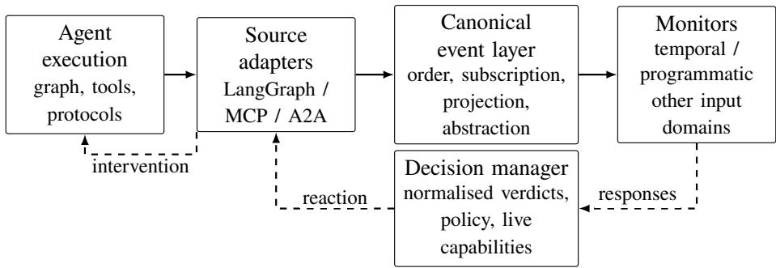
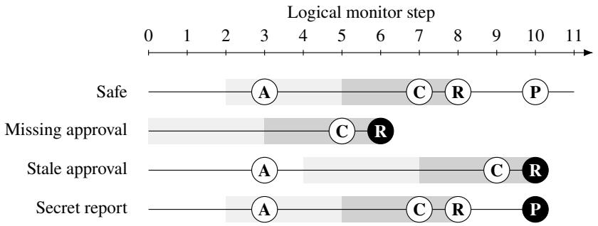

# One Monitor Does Not Fit All: Formalism-Agnostic Runtime Verification for Agentic AI

Angelo Ferrando

University of Modena and Reggio Emilia, Modena, Italy angelo.ferrando@unimore.it

## Abstract

Agentic AI systems combine model decisions, mutable state, tool calls, and delegation to external agents. Monitoring them requires observations from diferent execution boundaries, while prevention requires control before an operation produces its efect. We present AgenticRV, a runtimeverification architecture that separates these boundaries from the monitoring formalism. Adapters emit canonical events; each monitor receives its own projection and abstraction; and a decision policy uses normalised verdicts to select a reaction supported by the responsible adapter. We formalise when observations sufice, monitor replacement preserves decisions, and blocking prevents unsafe efects. We also distinguish rejected attempts from completed efects, avoiding the assumption that a blocked request must leave every monitor in a permanent violation state. The Python implementation supports LangGraph, MCP, and A2A. A controlled LangGraph experiment combines an external Reelay temporal monitor with a programmatic report monitor; ablations show why both are needed for the selected requirements. Diferential checks and cross-adapter tests provide further integration evidence. An LLM-driven incident-response example illustrates the same enforcement path, while existing microbenchmarks isolate framework costs. The results support reuse of monitoring methods at explicit control boundaries, subject to the stated observation and deployment assumptions.

Keywords: Runtime verification; Agentic AI; Runtime enforcement; Monitor interoperability.

## 1 Introduction

Agentic AI systems combine language models with stateful workflows, external tools, and other agents. Their behaviour cannot be assessed only from the text produced by a model. A tool request may change an external system, a state update may afect later decisions, and a delegated task may continue outside the local runtime. Relevant observations are spread across model calls, workflow execution, tools, and communication boundaries such as the Model Context Protocol (MCP) and Agent2Agent (A2A) [2, 10].

Runtime Verification (RV) checks an execution against a specification [9]. Earlier work has separated instrumentation from the monitoring formalism, including ROSMonitoring [5] and RV4Chatbot [6]. Runtime enforcement for LLM agents is also already supported by approaches such as AgentSpec [14]. We build on these ideas. Our problem is how to connect diferent monitoring methods to the same agent execution while making their observation, state, and control assumptions explicit.

Consider an incident-response agent that collects diagnostics, creates a checkpoint, applies remediation, and sends an external report. A temporal monitor can require approval and a recent checkpoint before remediation. A separate programmatic monitor can inspect the report destination and content. They need diferent inputs and need not use the same verdict vocabulary. The runtime must combine their decisions without embedding either monitor’s semantics in the workflow. It must also distinguish an attempted remediation from a completed one: rejecting a request prevents its efect, but the attempt still belongs to the audit history.

The underlying issues also occur in conventional software. In the agentic setting, however, a model selects actions and arguments at runtime, a graph controls local execution, and tools or delegated tasks cross separately instrumented boundaries. A model’s statement that an action is approved is not approval evidence. Observing a node’s output does not by itself provide control over its propagation. Receiving a remote task update does not imply control over the remote agent. A reusable interface must expose these diferences rather than give every event the same enforcement meaning.

  
Figure 1: The event layer is shared; each monitor has its own observation function. Solid arrows carry observations and dashed arrows carry decisions and interventions. Only installed interposing boundaries can retain an operation for a preventive decision.

This paper presents AgenticRV, a formalism-agnostic architecture for this interface. Source adapters produce canonical events. Monitor-specific projections and abstractions produce the input expected by each monitor, and normalisation maps native verdicts to a common domain. At a boundary that can retain an operation, a decision manager selects a supported reaction before the operation is released. A prior vision paper identified RV constraining LLM-driven systems as one direction in the relation between RV and LLMs [4]; here we give a concrete architecture and examine the conditions under which that direction provides useful guarantees.

We make three contributions. First, we define an observation and control contract: we characterise property-suficient observations, establish a normalised-response condition for monitor replacement, and give a conditional prevention argument. Second, we implement the interface for LangGraph, MCP, and A2A, identifying which boundaries support observation and which support interposition. We also describe the application-specific configuration work. Third, we evaluate joint monitoring with an external temporal monitor and a programmatic monitor, including cross-adapter control, ablations, temporal diferential checks, and protocol-adapter tests. An LLM-driven example illustrates integration, while microbenchmarks measure the framework costs separately from monitor algorithms.

The contribution is a runtime interface and its contracts, rather than a new specification language or a verification method for model reasoning. The guarantees concern visible operations at installed boundaries. They depend on the observation function, monitor, policy, and faithful adapter enforcement.

## 2 Architecture

We use agentic AI system for an application in which model-driven components select actions, update state, invoke tools, or delegate tasks. Figure 1 separates the source adapters, canonical event layer, monitors, and decision manager. An adapter understands its source but contains no property-specific logic. A monitor understands its input domain but need not understand LangGraph, MCP, or A2A.

Instrumentation and events. Adapters either observe an execution or interpose on an operation. An observation event reports activity without retaining the operation. A decision event is emitted before a controlled operation and retains it while synchronous monitors are consulted. Event kind and lifecycle phase do not alone establish control: an MCP request with phase before is still passive if the adapter is configured for observation only.

Canonicalisation standardises the event envelope, not every payload. The envelope identifies the source, kind, timestamp, lifecycle phase, and available execution scope. Its payload records the data exposed by that source. For example, a summarising node can produce start and completion events containing its input and returned summary. The next node’s input can expose the propagated value. This does not require a separate event for a value moving along an edge. Route metadata, when available, supplies a further observation of the selected branch.

The framework adapter covers local execution. The MCP adapter covers wrapped tool and resource requests. The A2A adapter covers wrapped discovery, messages, task operations, status updates, artefacts, and cancellation. Protocol identifiers can relate these observations to the local task. This correlation does not reconstruct a global causal order or expose remote internals.

Monitor-facing information. Each monitor registration specifies subscriptions, projection, abstraction, verdict normalisation, synchronous or asynchronous execution, and a decision deadline. Subscriptions select event kinds. Projection selects or redacts fields; abstraction maps the resulting view to the monitor input. An LTL monitor may receive Boolean valuations, while a programmatic oracle receives structured fields. Either stage may discard an irrelevant event. These choices are part of the property configuration, since filtering can remove evidence or change an event-counting clock.

Decisions and interventions. The decision manager combines normalised verdicts under a deployment policy. A backend-neutral reaction is a decision such as allow or block whose meaning does not name a framework API. An intervention is its concrete implementation: blocking a native tool suppresses the callable; blocking an MCP request suppresses forwarding. The adapter advertises the reactions supported at each boundary, and records the selected intervention and outcome as another canonical event.

The abstract interface also admits pausing, replacing, requesting approval, escalating, aborting, and compensating. An adapter need not support all of them. In particular, a passive callback cannot retroactively block its originating operation. Later escalation or compensation has a diferent guarantee. Arbitration handles multiple monitors and configured failures, including timeouts and inconclusive results. Fail-open permits an operation without a usable mandatory verdict; fail-closed selects a preventive fallback when the boundary and monitor authorisations support it.

Trust and scope. We assume correct adapters, event delivery, policy, and property-specific monitoring code. Projection limits the observation passed through the interface; it does not isolate malicious Python code running in the same process. Guarantees are limited to the instrumented boundaries and their available interventions. Ordinary node execution, internal state merges, unwrapped clients, and remote-agent internals do not become controllable simply because related events are available.

## 3 Observation and Control Contracts

We formalise the interface exposed by the adapters. The model does not describe an agent’s internal reasoning or give semantics to an entire framework.

## 3.1 Events, Observations, and Monitors

Definition 1 (Canonical event and trace). A canonical event is $e = \left. \iota , a , k , t , d \right. \in \left| \mathsf { d } \times \mathcal { A } \times \mathcal { K } \times \mathbb { T } \times \mathcal { D } \right.$ where � is its identifier, � its source adapter, � its kind, � its timestamp, and � its data. A canonical trace is a finite sequence $\tau = e _ { 1 } \cdot \cdot \cdot e _ { n } \in { \mathcal { E } } ^ { * }$ with distinct event identifiers.

The data component is an open finite map. It can contain lifecycle phase, execution scope, protocol identifiers, and source payload. We write $i d ( e )$ and data(�) for the corresponding components. Trace order is delivery order, rather than timestamp order. We assume a centralised event layer that preserves this order for each monitor. Distributed trace reconstruction and clock synchronisation are outside this model. The subset ${ \mathcal { E } } _ { \mathsf { d e c } }$ contains events for which an adapter retains an operation before execution; all other events are observations.

For each monitor �, let

$$
\pi _ { m } : { \mathcal { E } } \to { \mathcal { E } } _ { m } \cup \{ \varepsilon \} , \qquad \alpha _ { m } : { \mathcal { E } } _ { m } \to \Sigma _ { m } \cup \{ \varepsilon \} .
$$

Projection selects the authorised view in $\mathcal { E } _ { m } ;$ abstraction maps it to the input domain $\Sigma _ { m }$ . Either function can return $\varepsilon ,$ discarding the event. Subscription matching is included in $\pi _ { m }$ . Extending $\alpha _ { m } ( \varepsilon ) = \varepsilon$ , we write $o b s _ { m } = \alpha _ { m } \circ \pi _ { m }$ and

$$
o b s _ { m } ( e _ { 1 } \cdot \cdot \cdot e _ { n } ) = \left( o b s _ { m } ( e _ { 1 } ) \cdot \cdot \cdot o b s _ { m } ( e _ { n } ) \right) \downarrow _ { \varepsilon } ,
$$

where $\downarrow _ { \varepsilon }$ removes discarded events. For an LTL monitor, $\Sigma _ { m } = 2 ^ { A P _ { m } }$ ; another monitor can receive structured values or numerical features. Canonicalisation does not choose between these domains.

Definition 2 (Monitor). A monitor is $M _ { m } = \langle Q _ { m } , q _ { m } ^ { 0 } , \Sigma _ { m } , V _ { m } , \delta _ { m } , \lambda _ { m } \rangle$ , with transition and verdict functions

$$
\delta _ { m } : Q _ { m } \times \Sigma _ { m } \to Q _ { m } , \qquad \lambda _ { m } : Q _ { m } \to V _ { m } \cup \{ \perp \} .
$$

Here $Q _ { m }$ is its state space, $q _ { m } ^ { 0 }$ its initial state, $\Sigma _ { m }$ its observation alphabet, $V _ { m }$ its native verdict domain, and ⊥ denotes absence of a verdict. On observation �, the monitor moves to $q ^ { \prime } = \delta _ { m } ( q , \sigma )$ and returns $\lambda _ { m } ( q ^ { \prime } )$

The transition and verdict functions may be generated from a specification, implemented directly, or supplied by another analysis method. The interface does not establish their correctness. Online and ofline monitors can process the same observation sequences; ofline verdicts cannot prevent efects in the recorded execution.

## 3.2 What Must an Observation Preserve?

Projection and abstraction must preserve the answer to the specified prefix question. Let $b : { \mathcal { E } } ^ { * } \to { \mathcal { W } }$ give the intended semantic answer at each prefix. The answer domain may be $\mathcal { W } = \{ 0 , 1 \}$ for a Boolean safety gate, or $\mathcal { W } = \{ { \sf T } , { \sf F } , { \sf ? } \}$ for three-valued temporal prefix semantics. It need not coincide with the monitor’s native verdict domain $V _ { m }$ . Let $H \subseteq { \mathcal { E } } ^ { * }$ be the admissible prefixes of the deployment, including its assumptions about event sources and workflow scope.

Definition 3 (Property-suficient observation). An observation function $o b s _ { m }$ is suficient for � on � if

$$
\forall \tau , \tau ^ { \prime } \in H : \quad o b s _ { m } ( \tau ) = o b s _ { m } ( \tau ^ { \prime } ) \implies b ( \tau ) = b ( \tau ^ { \prime } ) .\tag{1}
$$

Proposition 1 (Exact observation-based answers). There exists a function

$$
\widehat { b } : o b s _ { m } ( H )  \mathcal { W } , \qquad b = \widehat { b } \circ o b s _ { m } o n H ,
$$

if and only if (1) holds.

Proof. If $b = \widehat { b } \circ o b s _ { m } .$ , equal observations yield equal answers. Conversely, define $\widehat { b } ( w ) = b ( \tau )$ for any $\tau \in H$ with $o b s _ { m } ( \tau ) = w$ . Equation (1) makes this choice independent of the representative. □

The obligation depends on the chosen answer function. If � identifies bad prefixes, $b ( \tau ) = 0$ means that � is not a bad prefix; it does not assert that the property is satisfied. If � instead gives three-valued prefix semantics, suficiency must also preserve the distinction between satisfaction and inconclusiveness.

This is an information condition, not a monitor-synthesis algorithm. If two prefixes have the same view but require diferent semantic answers, no exact monitor using only that view can distinguish them. For a Boolean safety gate, rejecting an ambiguous request can avoid permitting an unsafe candidate, but may also reject a safe one. This conservative choice does not recover the lost distinction.

For example, if approval is represented by a trusted Boolean, the temporal monitor need not receive the credential used to establish it. Suficiency then depends on the trusted validator, binding approval to the relevant incident, and preserving the completion event. If the property concerns the report destination, removing that destination without retaining an adequate classification makes the observation insuficient. A scope identifier or a separate monitor instance is also needed when the property distinguishes tasks. Otherwise approval for one task can become indistinguishable from approval for another.

Filtering afects temporal meaning as well as data. A bound of six observations is measured in the monitor’s sequence, after discarded events are removed. Discarding diagnostic observations can make approval appear more recent. Changing the subscription or abstraction therefore requires checking (1) again; it is not merely a performance optimisation.

## 3.3 Normalised Verdicts and Reactions

Let $\nu _ { m } : V _ { m } \to { \widehat { V } }$ map native verdicts to a common domain, for example

$$
\widehat { V } = \{ \mathsf { p e r m i t , r e j e c t , i n c o n c l u s i v e , e r r o r } \} .
$$

A response records the event identifier, monitor, native verdict, normalised verdict, and common control metadata. This metadata includes response status, mandatory participation, priority, and authorised reactions. Native verdicts and diagnostics are retained for audit.

Let $R _ { e }$ be the responses collected for event $^ { e , }$ and let $\eta ( R _ { e } )$ remove native verdicts and diagnostics while retaining normalised verdicts and the common control metadata. If replacement is enabled, an authorised replacement proposal is also explicit control data. For adapter $^ { a , }$ let $C _ { a } ( e ) \subseteq \mathcal { R }$ be the supported reactions. We require the policy to have the form

$$
P ( e , R _ { e } , C _ { a } ( e ) ) = \overline { { P } } ( e , \eta ( R _ { e } ) , C _ { a } ( e ) ) \in C _ { a } ( e ) .\tag{2}
$$

Thus, native values may be stored in a response without being interpreted by arbitration. A policy that branches on a monitor-specific diagnostic or native verdict would violate this contract.

Proposition 2 (Decision preservation under monitor replacement). For the same decision event, capabilities, and policy, replacing monitors preserves the selected reaction whenever $\eta ( R _ { e } )$ is unchanged.

Proof. Both executions give $\overline { P }$ the same arguments in (2), so a deterministic policy returns the same reaction. □

The condition includes failure and deadline status, priority, authorisation, and any replacement proposal. Equality of successful verdicts alone is insuficient if a replacement monitor times out. For a fixed event stream, the result applies at every decision point. It does not require the two monitors to implement the same formalism, only the same control-facing responses in that deployment.

## 3.4 Attempts, Efects, and Prevention

An attempt and its efect are diferent observations. A rejected request belongs to the canonical audit trace but not to the sequence of completed efects. Suppose a monitor checks G¬unapprovedRequest on an attempt trace and enters an absorbing violation state when an unapproved request is made. Blocking the request does not erase that attempt, so this monitor correctly remains violated. Under a policy that blocks every violation, it will also reject later requests. This is fail-stop behaviour, not evidence that those later requests are unsafe.

A recoverable gate instead answers whether the current request is permitted from the relevant history. It can reject an unapproved attempt, retain the evidence that actually occurred, and permit a later valid request. An audit monitor may still retain the historical violation. Another option is to scope a fail-stop monitor to a task that is intentionally aborted. Resetting a monitor after each rejection is not a general repair: it can remove approval, revocation, or other history still needed for safety.

Let $u \in \mathcal { B } ^ { \ast }$ be the completed-efect prefix and $x \in { \mathcal { B } }$ the pending efect. For an allow/block gate, define the intended query by $u x \in L$ , where $L \subseteq { \mathcal { B } } ^ { * }$ is a prefix-closed safety language with $\varepsilon \in L$ . A monitor may implement this query from the full audit history, provided its state represents the relevant completed efects and current attempt correctly. The interface does not assume transactional rollback of arbitrary monitor state. If a requirement depends on time or other observations, these must also be represented in the safety model; erasing rejected attempts does not by itself preserve that requirement.

Proposition 3 (Conditional prevention). Assume that: (i) every efectpasses through an installed decision boundary; (ii) decisions and efects are serialised, so the gate checks the actual completed prefix �; (iii) every candidate �� ∉ � is rejected by a mandatory synchronous gate; and (iv) rejection or failure blocks release, with authorised and supported blocking faithfully applied by the adapter. Then every completed-efect prefix belongs to �.

Proof. Initially $u \ = \varepsilon \in { \cal L }$ . A blocked request leaves � unchanged. If � is released, condition (iii), together with (iv), excludes �� ∉ �, so $u x \in L$ . Induction over completed efects proves the claim. □

These assumptions identify the assurance boundary. A subscription miss, an unsound abstraction, fail-open behaviour, an unsupported preventive reaction, an unwrapped call, or a failed intervention can invalidate the argument. Concurrent operations additionally need an atomic check-and-release discipline or a property-specific concurrency argument; an ordered event log alone does not establish it. Replacement requires checking the substituted efect, and is not covered by this allow/block result.

Each adapter implements a reaction through $\gamma _ { a , e } : C _ { a } ( e )  \mathcal { I } _ { a }$ , where ${ \cal { I } } _ { a }$ is its set of interventions. Prevention requires this intervention to succeed while the operation is held. Events emitted after dispatch, asynchronous verdicts, and late responses can support later reactions but cannot prevent that occurrence.

## 4 Implementation and Instantiation

AgenticRV is a Python package whose core depends on neither an agent framework nor a monitoring library. LangGraph, MCP, and A2A are optional integrations. The inspected implementation is version 0.1.0. We distinguish implemented operations, executable integration tests, and measured performance coverage below; support for an operation is not evidence of an experiment using it.

## 4.1 Runtime, Monitor Interface, and Adapter Coverage

Immutable CanonicalEvent objects implement the formal envelope. A private asynchronous loop assigns an increasing sequence number, orders delivery, and maintains one serial queue per monitor. Matching precedes field projection and redaction; user abstraction receives only the projected view. Python callables, stateful objects, and JSON-over-HTTP monitor services share the same request interface. Native verdicts are stored alongside their normalised values. The built-in policies use common verdicts, status, priority, authorisation, and explicit replacement proposals, rather than the native verdict or diagnostics.

The runtime supports deny-overrides, unanimous, and priority arbitration. Failures, missing verdicts, and deadlines enter the configured failure policy. An asynchronous or late contribution cannot change a finalised decision. A delivery gap marks the afected monitor desynchronised rather than silently using stale state. Recording and replay support fresh ofline analysis with the same observation functions; replay does not invoke live interventions.

Table 1 identifies the control boundaries. The LangGraph proxy injects a callback handler into the runnable configuration. Model events are obtained only from callback-aware LangChain components; a raw provider HTTP client needs separate instrumentation. Node inputs and outputs expose some internal state propagation, but the proxy does not guard every reducer or state merge. Selected routes are observations when callback metadata exposes them, not independently blockable graph edges.

MCP support includes a client-session proxy for initialisation, tool calls, and resource reads. A2A support includes a client proxy and an SDK interceptor for outgoing operations and returned task facets. These adapters are implemented, not future work. The executed tests include a real in-process MCP session and a real A2A SDK client using a controlled transport (Section 5.3). They establish bounded integration behaviour; they do not establish remote-service throughput or correctness of opaque agents.

Table 1: Implemented boundaries. D denotes a held decision; O denotes passive observation. Decision boundaries support allow, log, block, and replace. Protocol requests are D in interposing mode and O in passive mode. Coverage requires use of the wrapper or handler.
<table><tr><td>Adapter</td><td>Operation or evidence</td><td>Class</td></tr><tr><td>LangGraph</td><td>Proxied graph invocation; explicit update_state; guarded native tool</td><td>D before dispatch</td></tr><tr><td></td><td>Nodes, subgraphs, exposed routes, callback-aware models and tokens, retrievers, state reads, checkpoints, interrupts, retries, custom events, completions and errors</td><td>0</td></tr><tr><td>MCP</td><td>Wrapped initialisation, tool call, resource read</td><td>D or O</td></tr><tr><td></td><td>Negotiated capabilities, results, errors, cancellations</td><td>0</td></tr><tr><td>A2A</td><td>Wrapped discovery, outgoing message, task request, subscription, cancellation D or O</td><td></td></tr><tr><td></td><td>request Status, artefact and streaming updates, responses and failures</td><td>0</td></tr><tr><td></td><td></td><td></td></tr><tr><td>Runtime</td><td>Applied intervention and its outcome</td><td>0</td></tr></table>

## 4.2 What Is Manual, and What Is Reused?

Instantiation has three layers. The adapter supplies framework and protocol event kinds and supported reactions. The monitor integration supplies its input domain, transition function, and native-verdict normalisation. The application supplies requirements, trusted evidence, relevant scopes, field projection, abstraction, and deployment policy. The architecture reuses the first two layers where possible; it does not automatically derive the third from natural-language requirements.

For the incident-response application, the existing LangGraph adapter is installed once and six efect functions are guarded. Application code validates approval and classifies report contents. The Reelay registration subscribes to langgraph.tool, includes 17 field paths, explicitly excludes four raw fields, and maps two native verdicts. One abstraction uses the tool name, lifecycle phase, and five trusted Boolean fields to produce a total valuation. Approval and checkpoint are true on successful completion; remediation and reporting are true on held attempts. The supplied abstraction spans 57 source lines, with a 15-line classification helper; the stateful Reelay facade spans 76 lines, including lifecycle hooks and evidence recording. These are source inventories including comments and blank lines, not development-time estimates.

The distinction matters in reuse. Adding a property over existing fields requires a specification or monitor and its registration. Adding a genuinely new observation may require application instrumentation or an adapter change. Replacing Reelay requires another facade and normaliser, but not modifications to the LangGraph wrapper. A content monitor may legitimately need raw report text that the temporal monitor must not receive. Projection declarations are therefore reviewed per property rather than copied indiscriminately.

Subscriptions and field projection are declarative; abstraction and trusted classification may require Python code. Native verdict mappings can be declared as a table, while numerical verdicts can use configured thresholds. Validation checks deployment structure and callable interfaces, not semantic suficiency. The condition in Section 3.2 supplies the corresponding review obligation. Time bounds, task scoping, failure policy, and monitor recovery remain explicit engineering choices.

The case study and controlled experiments use one monitor instance per logical workflow and serial efect requests. No automatic isolation of arbitrary interleaved tasks is claimed. A deployment with concurrent tasks must introduce suitable per-task monitor state and preserve the scope information needed by its requirements.

## 5 Evaluation

We separate four questions: (Q1) can monitors with diferent inputs and native verdicts jointly control the same workflow? (Q2) does the temporal integration preserve the selected specification, including its boundaries and recovery? (Q3) which implemented adapter and runtime behaviours have executable validation? (Q4) what are the costs of instrumentation and dispatch apart from non-trivial monitor computation? The first three questions use controlled validation, while the fourth uses microbenchmarks. The validation and timing sets use diferent environments and are not pooled.

## 5.1 Joint Monitoring and Controlled Ablations

The controlled experiment uses a real compiled LangGraph, the existing LangGraph adapter, and two mandatory synchronous monitors. Each operation is executed through a guarded tool and records its efect in an in-memory ledger. The driver supplies deterministic action sequences, with one monitor state per workflow. This isolates monitoring and enforcement from action selection and does not use an LLM. No changes to the core runtime or adapters were needed.

Temporal monitor. The first monitor uses Reelay 25.0.0 [13] with the fixed Rye specification used by the incident-response example. At monitor step �, it checks the current predicate

$$
\chi _ { i } = \left( r e m e d i a t e _ { i } \Rightarrow ( \mathsf { O } _ { \leq 6 } a p p r o \nu a l \wedge \mathsf { O } _ { \leq 3 } c h e c k p o i n t ) _ { i } \right) \wedge ( r e p o r t _ { i } \Rightarrow \neg s e c r e t _ { i } ) .
$$

The past-time operator $0 _ { \le k }$ means that its argument occurred at a distance of at most � monitor steps, including the current step. One step is produced for each held attempt and each successful tool completion. Approval and checkpoint are true only at completion; remediation and reporting are true at their held attempts. Other tool observations still advance this logical clock. Non-tool callbacks and discarded phases do not.

The bounds 6 and 3 are illustrative validation parameters, not elicited incident-response requirements. They distinguish the baseline approval distance of five steps from the stale distance of seven. The boundary experiment below also tests the exact limits. A deployment must derive suitable bounds from its requirements and observation clock; physical-time freshness would require timestamp-based monitoring instead.

Reelay receives a total Boolean valuation and the action name. It does not receive raw report text or its destination. Its native satisfied and violation verdicts map to permit and reject. The fixed formula checks $\chi _ { i } .$ , rather than an absorbing verdict for $\mathbf { G } \chi$ over all attempts. Rejection therefore need not prevent a later request satisfying its current guard. Historical violations remain in the recorded responses.

Programmatic monitor. The second monitor receives only a reporting request’s destination and raw report text. It checks an exact HTTPS hostname allowlist and rejects reports containing the literal INTERNAL\_API\_KEY=. Its native verdicts are ok, unsafe\_destination, and secret\_content. The latter two map to reject. It receives no approval or checkpoint history and cannot enforce the temporal requirement. The literal is a controlled stand-in for a content rule, not a general secret detector.

The two monitors therefore difer in their input, state, implementation, and native vocabulary. Both use the same canonical tool events. The policy blocks when a mandatory monitor rejects, and both registrations authorise blocking. Successful completions are delivered in order before the next tool decision.

Paths and ablations. We execute seven paths: a safe workflow; missing approval followed by a public report; stale approval; reporting to an unapproved destination; a secret report; a secret report whose supplied Boolean classification is false; and a rejected secret report followed by a public report. The classification mismatch tests the value of checking raw content with an independently configured monitor:

Table 2: Controlled ablations: seven paths and 34 tool decisions per configuration. Counts concern the constructed requirements and inputs.
<table><tr><td>Active monitors</td><td>Unsafe requests executed (of 6)</td><td>Safe requests blocked (of 28)</td></tr><tr><td>None</td><td>6</td><td>0</td></tr><tr><td>Reelay only</td><td>2</td><td>0</td></tr><tr><td>Report monitor only</td><td>2</td><td>0</td></tr><tr><td>Both</td><td>0</td><td>0</td></tr></table>

Table 3: Cross-boundary validation. Both monitors are active; only temporal observation or scope partition changes.
<table><tr><td>Temporal observation</td><td>Unsafe executed (of 6)</td><td>Safe blocked (of 2)</td></tr><tr><td>LangGraph and MCP, per incident</td><td>0</td><td>0</td></tr><tr><td>Same events, scope erased</td><td>1</td><td>0</td></tr><tr><td>MCP events only, per incident</td><td>0</td><td>2</td></tr></table>

the temporal monitor’s observation is insuficient for this error, whereas the content monitor detects the chosen literal.

Each path is run with no monitor, Reelay alone, the report monitor alone, and both. The driver continues after a rejection where the path includes a recovery request. Table 2 reports 34 tool decisions per configuration, comprising six unsafe and 28 safe requests under the selected requirements. The labels are fixed by the controlled inputs and checked against the efect ledger; they are not obtained from either monitor’s verdict.

Reelay alone misses the unapproved destination and the classification mismatch. The report monitor alone misses missing and stale approval. Together they block all six unsafe attempts without blocking a safe request in these paths. In the recovery paths, a public report is permitted after a rejected remediation or secret report. The rejected efect is absent from the ledger; the subsequent permitted efect is present. No monitor error, timeout, late response, or dropped delivery is recorded in the joint runs.

This experiment demonstrates joint integration and a useful separation of observations. It covers one external temporal monitor and one programmatic method. It does not establish interoperability with every formalism, quantify configuration time, or estimate safety rates on unconstrained agent tasks.

## 5.2 A Gate Across LangGraph and MCP

A compiled LangGraph invokes local approval and MCP reporting tools. Both adapters share the runtime and policy. The oficial MCP client/server use in-memory streams, with reports recorded in a server ledger and no core implementation changes.

The additional requirement is approval for the report’s own incident: $\psi _ { s } = r e p o r t _ { s } \Rightarrow 0 a p p r o \nu e d _ { s }$ Approval remains valid for incident � in this experiment, which tests correlation rather than $\chi _ { i } \mathrm { ' s }$ freshness bounds. The application binds scope.trace\_id before invocation; nested calls inherit it. A facade maintains Reelay state per incident. Its projection retains kind, phase, scope, approval completion and MCP tool name. Abstraction turns completed approval into approved=true and a held reporting request into report=true. An approval claim in report arguments supplies no evidence. The programmatic monitor receives only destination and text, applying Section 5.1’s content rule.

Seven paths test matching, missing, mismatched and claimed approval, unapproved destination, secret content, and recovery after rejection. Each starts with fresh state; scopes may alternate within a path. They contain eight reporting requests: six unsafe and two safe. Three configurations give 21 executions and 24 reporting decisions (Table 3); counts exclude approvals and initialisation. The ledger confirms release or suppression, with no monitor or delivery failures.

Approval for � followed by reporting for � yields native violation/ok, normalised to reject/permit;

deny-overrides blocks release. Erasing scope instead permits this report and makes its history indistinguishable from approval and reporting for �: a concrete counterexample to Equation (1). Observing MCP alone loses approval evidence and blocks both legitimate reports. With the full view, a public report is permitted after secret-report rejection without resetting approval history. Trustworthy scope and approval remain application obligations; this is controlled integration, not automatic task isolation or remote-service evaluation.

## 5.3 Diferential Checks and Adapter Validation

We compare the fixed Reelay monitor with an independent Python evaluator of $\chi _ { i }$ . The alphabet contains six symbols: completed approval, completed checkpoint, a neutral step, remediation attempt, publicreport attempt, and secret-report attempt. We enumerate all 1,554 non-empty words of length at most four. Comparing every step of every word gives 5,910 verdict comparisons with no mismatch. This finite enumeration checks the chosen alphabet and short histories; it is not a proof for unbounded traces.

Short prefixes do not cross every freshness bound. We separately vary approval age from one to eight and checkpoint age from one to five at a remediation request. Excluding equal ages, which cannot represent two distinct observations in this alphabet, gives 35 cases. Reelay permits exactly when the approval age is at most six and the checkpoint age at most three. The checks include rejection followed by a permissible observation, confirming the non-absorbing interpretation of the current guard.

We also change the native-verdict payload while retaining each of the four common verdicts and the same control metadata. The built-in policy selects the same reaction in all four pairs, exercising Equation (2). This is a regression check of that interface condition, not an independent proof of the complete implementation.

The selected repository test set contains 179 passing cases, with no skips or failures. It covers adapters, projection, policy, ordered runtime delivery, timeouts and late responses, trace handling, and selected executable examples. The protocol examples use a real in-process MCP client/server session and a real A2A SDK client with a controlled JSON-RPC transport. The MCP example executes echo but blocks delete\_records before the server function is reached. The A2A example forwards one permitted message and blocks the rejected message before transport dispatch. Other adapter tests check passive mode, replacement, lifecycle events, errors, cancellation, and scope. These are integration checks, not experiments with deployed remote agents.

The controlled validation uses CPython 3.11.16 on Linux, LangGraph 1.2.14, LangChain Core 1.6.7, MCP 1.30.0, A2A SDK 1.2.2, and Reelay 25.0.0. The supplement records the dependency snapshot, scripts, specification checksum, test report, and per-request outcomes. These versions are separate from the performance environment below.

## 5.4 LLM-Driven Incident-Response Example

The LLM-driven integration example connects Ollama to an iterative LangGraph agent and the same Reelay monitor. The application alternates an agent node with guarded efect execution. A JSON schema constrains model output to an enabled action and an untrusted note. The workflow excludes transitions that are not meaningful in the current state, but the monitor decides whether an enabled efect satisfies its temporal and reporting guard. The six guarded operations are triage, approval validation, diagnostic collection, checkpoint creation, destructive remediation, and external reporting. Approval validation and content classification are application functions. The model does not supply the trusted safety propositions. Raw credentials, reports, incident identifiers, and model notes are excluded from the temporal monitor’s view. Efects are recorded in an in-memory ledger. The four executions use llama3.2:3b through Ollama 0.12.9, temperature zero, and fresh graph and monitor state per scenario. Figure 2 shows the relevant events. The safe path completes remediation and reporting. Missing approval and stale approval each block remediation. A secret-bearing report is blocked after permitted remediation, so remediation remains in the ledger while publication is absent. Each run reaches its intended witness and records no monitor failure or timeout. The case study’s Ollama calls use the raw local HTTP client, so this example does not generate callback-based langgraph.model events.

  
A: approval complete C: checkpoint complete R: remediation P: report Light/dark shading: approval/checkpoint windows. Filled requests are blocked.  
Figure 2: Relevant events from the four Reelay–Ollama witnesses. Unmarked attempts and completions also advance logical time. Shaded regions show the histories considered at remediation. A blocked request produces no completion or ledger entry for its efect.

Scripted providers reproduce these four paths with the same formal histories, verdicts, and ledgers; the selected tests rerun that deterministic integration. The four model runs are single witnesses. They illustrate the execution path, not the frequency of unsafe model choices or the efectiveness of enforcement over a benchmark of realistic incidents. The ablations supply the stronger, reproducible evidence about joint monitoring; they do not turn these four witnesses into a statistical LLM study.

## 5.5 Framework Costs

The microbenchmarks isolate instrumentation, dispatch, projection, auditing, and intervention. Their monitors return immediately in the same process. They measure framework overhead, not the cost or diversity of substantive monitor algorithms. Reelay is not part of this timing campaign.

The timing measurements use an Apple M3 Pro with 18 GiB of memory, Python 3.14.6, AgenticRV 0.1.0, and LangGraph 1.2.9. Each condition runs in 20 fresh processes with three warm-up and five measured batches of approximately 200 ms. Settled time includes work queued by an operation and drained within its batch, excluding construction, warm-up, validation, and shutdown. Batches are averaged within each process before averaging across processes. The 95% intervals use 10,000 bootstrap resamples of processes.

The five groups in Table 4 are independent experiments, not stages of one pipeline. Instrumenting the one-node graph adds 696.108 �s over its 222.905 �s native execution. A first monitor adds a further $4 1 3 . 6 4 7 \mu \mathrm { s } ;$ the complete invocation is 1.333 ms. At a guarded tool boundary, increasing from zero to eight immediate monitors adds 868.839 �s. The largest fixed dispatch increment occurs with the first monitor, followed by roughly linear growth in this setting.

For a 256 KiB payload, header and full projection add 134.013 and 246.076 �s relative to a subscription miss; hashing adds 751.008 �s because it reads the complete payload. Narrow views reduce both exposure and processing work, provided they preserve the property’s evidence. JSONL audit recording adds $7 6 - 8 6 \mu \mathrm { s }$ . Flushing each record adds $9 . 5 7 3 \mu \mathrm { s }$ over bufering, without an fsync.

Blocking is 144.214 $\mu \mathrm { s }$ faster than allowing because the blocked path omits the callable and its completion event. This is a diference in work, not a performance advantage of rejection. Blocked side efects are absent in the measured runs, with no recorded monitor errors, timeouts, late responses, or dropped deliveries.

Limits of the evidence. The benchmarks isolate fixed costs, so percentage overheads do not generalise to model- or network-dominated workflows. They exclude cold starts, concurrency, remote monitors,

Table 4: Settled wall-clock time per operation. Intervals are 95% worker-bootstrap confidence intervals. Diferences are relative to the baseline identified for each group. A negative value indicates that less work is performed than in the baseline.
<table><tr><td>Condition</td><td>Mean (µs)</td><td></td><td>95% CI (µs) ∆ time (µs)</td><td>∆(%)</td></tr><tr><td colspan="5">LangGraph invocation (baseline: Native)</td></tr><tr><td>Native</td><td>222.905</td><td>[221.672, 224.263]</td><td></td><td></td></tr><tr><td>Proxy-0</td><td>919.013</td><td>[901.148, 936.825]</td><td>+696.108</td><td>+312.3</td></tr><tr><td>Proxy-1</td><td>1332.660</td><td>[1263.414, 1454.243]</td><td>+1109.755</td><td>+497.9</td></tr><tr><td colspan="5">Guarded tool (baseline: 0 monitors)</td></tr><tr><td>0 monitors</td><td>297.919</td><td>[293.136, 303.084]</td><td></td><td></td></tr><tr><td>1 monitor</td><td>573.731</td><td>[523.640, 666.920]</td><td>+275.812</td><td>+92.6</td></tr><tr><td>2 monitors</td><td>628.819</td><td>[618.723, 640.138]</td><td>+330.900</td><td>+111.1</td></tr><tr><td>4 monitors</td><td>804.655</td><td>[795.937, 815.548]</td><td>+506.736</td><td>+170.1</td></tr><tr><td>8 monitors</td><td>1166.758</td><td>[1157.101, 1176.901]</td><td>+868.839 +291.6</td><td></td></tr><tr><td colspan="5">Projection, 256 KiB payload (baseline: subscription miss)</td></tr><tr><td>Subscription miss</td><td>93.615</td><td>[89.327, 100.752]</td><td></td><td></td></tr><tr><td>Header</td><td>227.628</td><td>[224.821, 230.746]</td><td>+134.013</td><td>+143.2</td></tr><tr><td>Full</td><td>339.691</td><td>[337.524, 341.914]</td><td>+246.076</td><td>+262.9</td></tr><tr><td>SHA-256 hash</td><td>844.623</td><td>[821.319, 883.086]</td><td>+751.008</td><td>+802.2</td></tr><tr><td colspan="5">JSONL audit (baseline: Disabled)</td></tr><tr><td>Disabled</td><td>226.770</td><td>[223.583, 229.910]</td><td></td><td></td></tr><tr><td>Buffered</td><td>303.074</td><td>[300.215, 306.146]</td><td>+76.304</td><td>+33.6</td></tr><tr><td>Flush each record</td><td>312.647</td><td>[309.175, 316.183]</td><td>+85.877</td><td>+37.9</td></tr><tr><td colspan="5">Intervention (baseline: Allow)</td></tr><tr><td>Allow</td><td>528.222</td><td>[521.695, 535.113]</td><td></td><td></td></tr><tr><td>Block</td><td>384.008</td><td>[379.657, 388.286]</td><td>-144.214</td><td>-27.3</td></tr></table>

MCP/A2A latency and substantive monitor computation. In-memory validation adds monitor and protocol checks but does not close these performance gaps. Deployment still requires suitable approval, content, scope and observation assumptions. No guardrail comparison is established.

## 6 Related Work

Runtime verification separates the observation of an execution from the analysis of its trace [9]. Runtime enforcement additionally controls whether an operation is released. Surveys of correct-by-construction enforcement in AI distinguish the guarantees of such mechanisms from checks of an AI component’s output alone [8]. Our prevention argument is conditional on the installed boundary and monitor contract; it does not construct a shield from a model of the environment.

Monitoring infrastructures. ROSMonitoring separates ROS instrumentation from monitoring backends and does not prescribe a specification formalism [5]. ROSMonitoring 2.0 extends that setting to services and ordered topics [12]. RV4Chatbot follows the same design direction for chatbot interaction protocols, instantiated for Rasa and Dialogflow [6]. These are direct architectural precedents. Formalism agnosticism and adapter-based observation are therefore not new contributions of AgenticRV.

We extend this separation to a shared interface for local graph events and tool/delegation boundaries, with per-monitor observation and normalisation, explicit boundary capabilities, and a distinction between attempted actions and efects. The observation-suficiency condition states which property information a view must retain. The replacement and prevention propositions state the limits of the resulting control contract. These mechanisms are applicable beyond agentic AI; the agentic contribution is their instantiation across the identified sources and trust boundaries, together with executable joint-monitor evidence.

Agent guardrails and enforcement. NeMo Guardrails provides programmable rails for LLM applications [11]. AgentSpec provides a DSL combining triggers, predicates, and enforcement actions, and evaluates runtime constraints on several kinds of LLM agents [14]. It already supports modular runtime enforcement and adaptation to agent frameworks. The distinction is not that AgenticRV introduces enforcement or reusable instrumentation, but that its core interface leaves the monitor input, state, formalism, and native verdict domain to separately registered implementations.

ProbGuard learns a probabilistic execution model and predicts safety risks to trigger proactive intervention [15]; RvLLM uses its own formal-specification approach to constrain LLM behaviour [16]. These methods have their own guarantees and evaluation scopes. They are possible sources of monitoring components for an interoperability layer, subject to appropriate observation and response bindings. We have not integrated them, and the two-monitor experiment does not establish compatibility with their implementations.

Specifications and monitor generation. Operational and declarative monitoring approaches can be combined for data-rich traces, as in TP-DejaVu [7]. NL2TL translates natural-language requirements into temporal logic [3]. Such work can help obtain a monitor or specification, while AgenticRV addresses its connection to execution boundaries. It does not remove the need to establish trusted propositions, review information loss, or select a failure policy.

AgentHarm evaluates harmful multi-step agent behaviour [1]. It motivates evaluation over full executions, but our controlled paths are not a substitute for such benchmarks. The present results concern interface integration and conditional enforcement, rather than comparative end-to-end agent safety.

## 7 Conclusion

AgenticRV connects agent execution boundaries to monitors with diferent input and verdict domains. Its contract separates suficient observation, normalised arbitration, and supported intervention, while distinguishing a rejected attempt from a completed efect. LangGraph, MCP, and A2A adapters implement the interface at explicit boundaries. Controlled ablations show joint enforcement by Reelay and a programmatic report monitor, including permitted recovery after rejection. A LangGraph–MCP workflow also tests approval correlation across incident scopes. Diferential checks and adapter tests add reproducible integration evidence; the microbenchmarks isolate framework costs. The next evaluation steps are broader agent workloads, monitor configuration efort, substantive remote monitors, and concurrent check-and-release behaviour. Distributed trace reconstruction and stronger event-integrity guarantees also require work beyond the centralised model studied here.

AI usage. OpenAI’s ChatGPT and Codex assisted with manuscript preparation, diagrams and validation code; the author remains responsible for verifying their outputs and for the final content.

Data availability. Code: https://github.com/AngeloFerrando/agentic-rv. The supplement contains scripts, a dependency snapshot and results for commit 17e0c8c. Measurement environments are given in Section 5.

## References

[1] Maksym Andriushchenko, Alexandra Souly, Mateusz Dziemian, Derek Duenas, Maxwell Lin, Justin Wang, Dan Hendrycks, Andy Zou, J. Zico Kolter, Matt Fredrikson, Yarin Gal, and Xander Davies. AgentHarm: A benchmark for measuring harmfulness of LLM agents. In Proceedings of ICLR 2025. OpenReview.net, 2025.

[2] Anthropic. Model Context Protocol: Specification, 2025. URL https://modelcontextprotocol.io/sp ecification/2025-06-18.

[3] Yongchao Chen, Rujul Gandhi, Yang Zhang, and Chuchu Fan. NL2TL: transforming natural languages to temporal logics using large language models. In Proceedings of EMNLP 2023, pages 15880–15903. Association for Computational Linguistics, 2023. 10.18653/V1/2023.EMNLP-M AIN.985.

[4] Angelo Ferrando. Watchdogs and oracles: Runtime verification meets large language models for autonomous systems. In Proceedings of FMAS 2025, volume 436 of EPTCS, pages 80–87, 2025. 10.4204/EPTCS.436.8.

[5] Angelo Ferrando, Rafael C. Cardoso, Michael Fisher, Davide Ancona, Luca Franceschini, and Viviana Mascardi. ROSMonitoring: A runtime verification framework for ROS. In Proceedings of TAROS 2020, volume 12228 of LNCS, pages 387–399. Springer, 2020. 10.1007/978-3-030-634 86-5\_40.

[6] Andrea Gatti, Viviana Mascardi, and Angelo Ferrando. RV4Chatbot: Are chatbots allowed to dream of electric sheep? In Proceedings of FMAS 2024, volume 411 of EPTCS, pages 73–90, 2024. 10.4204/EPTCS.411.5.

[7] Klaus Havelund, Panagiotis Katsaros, Moran Omer, Doron Peled, and Anastasios Temperekidis. TP-DejaVu: Combining operational and declarative runtime verification. In Proceedings ofVMCAI 2024, volume 14500 of LNCS, pages 249–263. Springer, 2024. 10.1007/978-3-031-50521-8\_12.

[8] Bettina Könighofer, Roderick Bloem, Rüdiger Ehlers, and Christian Pek. Correct-by-construction runtime enforcement in AI - A survey. In Principles of Systems Design, volume 13660 of LNCS, pages 650–663. Springer, 2022. 10.1007/978-3-031-22337-2\_31.

[9] Martin Leucker and Christian Schallhart. A brief account of runtime verification. J. Log. Algebraic Methods Program., 78(5):293–303, 2009. 10.1016/J.JLAP.2008.08.004.

[10] Linux Foundation. Agent2Agent protocol specification, 2025. URL https://a2a-protocol.org/latest /specification/.

[11] Traian Rebedea, Razvan Dinu, Makesh Narsimhan Sreedhar, Christopher Parisien, and Jonathan Cohen. NeMo Guardrails: A toolkit for controllable and safe LLM applications with programmable rails. In Proceedings of EMNLP 2023: System Demonstrations, pages 431–445. Association for Computational Linguistics, 2023. 10.18653/V1/2023.EMNLP-DEMO.40.

[12] Maryam Ghafari Saadat, Angelo Ferrando, Louise A. Dennis, and Michael Fisher. ROSMonitoring 2.0: Extending ROS runtime verification to services and ordered topics. In Proceedings of FMAS 2024, volume 411 of EPTCS, pages 38–55, 2024. 10.4204/EPTCS.411.3.

[13] Dogan Ulus. Online monitoring of metric temporal logic using sequential networks. Log. Methods Comput. Sci., 22(1), 2026. 10.46298/LMCS-22(1:12)2026.

[14] Haoyu Wang, Christopher M. Poskitt, and Jun Sun. AgentSpec: Customizable runtime enforcement for safe and reliable LLM agents. In Proceedings ofICSE 2026. ACM, 2026. 10.1145/3744916.37 64546.

[15] Haoyu Wang, Christopher M. Poskitt, Jiali Wei, and Jun Sun. ProbGuard: Proactive runtime monitoring for LLM agent safety via probabilistic prediction. CoRR, abs/2508.00500, 2026. 10.48550/ARXIV.2508.00500. arXiv version 4; accepted at ASE 2026.

[16] Yedi Zhang, Sun Yi Emma, Annabelle Lee Jia En, and Jin Song Dong. RvLLM: LLM runtime verification with domain knowledge. In Advances in Neural Information Processing Systems 38, 2025. 10.52202/085713-2693.