# One Size Does Not Fit All: Curvature-Aware Adaptive Perturbation for SAM

Alessia Rossi

alessia.rossi@bristol.ac.uk

Felipe Campelo

f.campelo@bristol.ac.uk

Gabriel L. Oliveira

gabriel.leivasoliveira@bristol.ac.uk

School of Engineering Mathematics and Technology, University of Bristol, Bristol, Lovelace Building, Ada, Bristol, BS8 1TW, UK

## Abstract

Poor generalisation in deep neural networks is frequently associated with convergence to sharp minima. Sharpness-Aware Minimisation (SAM) improves generalisation of deep neural networks by minimising a combination of the training loss and the local sharpness of the loss landscape, biasing convergence towards flat minima. However, SAM relies on a fixed perturbation radius ρ that ignores local curvature, leading to ineficient behaviour: the perturbation may be too small to escape poor basins defined by sharp local minima, or too large to allow convergence to solutions with good loss-sharpness tradeof. We reinterpret ρ as the intensity of the perturbation signal and propose Curvature-Aware Adaptive Perturbation for SAM (CAP-SAM), a geometry-aware method that modulates the perturbation radius based on a sharpness ratio, enabling a more efective search for robust minima on the loss landscape. We prove that CAP-SAM preserves the same convergence rate as standard SAM in non-convex stochastic settings. Extensive experiments indicate that our approach consistently outperforms SAM and its most prominent variants across diverse network architectures on CIFAR-10, CIFAR-100, and ImageNet.

## 1. Introduction

Despite the remarkable success of deep neural networks in a wide range of tasks He et al. (2016); Samuel (1959); Krizhevsky et al. (2009); Vaswani et al. (2017), their ability to generalise to unseen data remains a persistent challenge in modern deep learning Zhang et al. (2016); Hendrycks et al. (2021). Recent work suggests that the geometry of the loss landscape plays a central role in model generalisation Hochreiter and Schmidhuber (1994); Jiang et al. (2019); Neyshabur et al. (2017). Flat minima have long been associated with better generalisation Dinh et al. (2017); Andriushchenko et al. (2023); Hochreiter and Schmidhuber (1997), and it has been observed that sharp minima, regions of high curvature where small perturbations cause large increases in loss, generalise poorly to unseen data Chaudhari et al. (2017) .

This led to Sharpness-Aware Minimization (SAM) Foret et al. (2020) which minimises the maximum loss within a neighbourhood of the current parameters, enabling it to identify flat minima associated with improved generalisation performance. When the model reaches a sharp region, the perturbation step helps it escape the sharp minimum and move toward flatter areas of the loss landscape Keskar et al. (2016).

The perturbation radius ρ is among SAM’s most critical hyperparameters: its value strongly afects the solution quality, and it must be carefully tuned for each dataset and architecture. A key limitation of current formulations is that $\rho$ is fixed throughout training, so a single value must serve regions of diferent curvature. It may be insuficient to escape very sharp regions, leaving the optimizer trapped in poor minima, or perturb too aggressively in flat regions, pushing the optimizer away from a good solution. This motivates a new treatment of $\rho ;$ rather than a static hyperparameter, we approach it as a dynamic quantity that should adapt to the local geometry of the loss landscape.

The contributions of this paper can be summarized as follows:

• We provide a new interpretation of the perturbation radius $\rho$ in SAM, revealing its limitations, and proposing CAP-SAM, which adapts its radius to local sharpness.

• We prove that CAP-SAM converges at the same rate as SAM, i.e., $\mathcal { O } \left( \log T / \sqrt { T } \right)$ We further show that SAM’s perturbation becomes geometry-blind near stationary points and that our approach mitigates this.

• We validate CAP-SAM on several baselines and datasets (CIFAR-10/100 and ImageNet), demonstrating improvements in accuracy and generalisation over SAM and its variants.

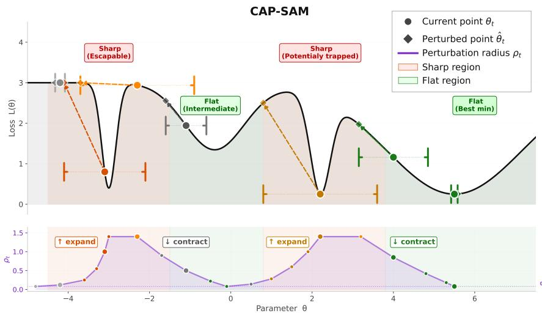  
Figure 1: Curvature-aware perturbation radius scheduling. The top panel illustrates how our method adjusts the perturbation radius based on the sharpness characteristics of the loss landscape. The bottom panel shows how $\rho _ { t }$ evolves: when in a sharp region, $\rho _ { t }$ expands by a factor of $\gamma$ to look further ahead and escape the sharp basin; when in a flat region, $\rho _ { t }$ contracts by the same factor, so the optimizer stops perturbing aggressively and settles into the local minimum.

## 2. Methodology

We introduce a dynamically adaptive perturbation radius that addresses the fundamental limitations of the standard SAM formulation, based on a novel reinterpretation of the perturbation radius $\rho$ as the magnitude of the perturbation signal applied to the parameter vector. Vanilla SAM Foret et al. (2020) employs a fixed perturbation $\rho$ which remains constant throughout the optimization procedure. In contrast, our formulation modulates this intensity at each step in response to the local sharpness changes observed during training. The method is seamlessly incorporated into any SAM variant, augmenting its capabilities at negligible additional computational cost.

## 2.1. Sharpness-Aware Minimization

SAM is an optimization approach focusing on robust learning to enhance the generalisation ability of deep neural networks by solving the min-max problem

$$
\operatorname* { m i n } _ { w } \ f ^ { \mathrm { S A M } } ( w ) \quad \mathrm { w h e r e } \quad f ^ { \mathrm { S A M } } ( w ) \triangleq \operatorname* { m a x } _ { \| \epsilon \| \leq \rho } f ( w + \epsilon ) ;
$$

where $\epsilon$ denotes the perturbation applied to the weights w, $\rho$ is the fixed perturbation radius that controls the size of the adversarial neighborhood.

The perturbation at iteration t is computed as

$$
\epsilon _ { t } = \arg \operatorname* { m a x } _ { \| \epsilon \| \leq \rho } f ( w _ { t } + \epsilon ) \approx \arg \operatorname* { m a x } _ { \| \epsilon \| \leq \rho } f ( w _ { t } ) + \epsilon \nabla f ( w _ { t } ) \approx \rho \frac { g _ { t } ( w _ { t } ) } { \| g _ { t } ( w _ { t } ) \| } ,\tag{1}
$$

SAM minimises the local worst-case loss by perturbing the parameter space, encouraging convergence to flat minima.

Interpretation of SAM. Notice that SAM formulates the perturbation as $\begin{array} { r } { \epsilon _ { t } = \rho \frac { g _ { t } ( w _ { t } ) } { \left\| g _ { t } ( w _ { t } ) \right\| } } \end{array}$ Foret et al. (2020) where ρ denotes the radius of the perturbation neighborhood and $\rho$ $\frac { g _ { t } ( w _ { t } ) } { \| g _ { t } ( w _ { t } ) \| }$ is the direction of steepest ascent. However, we observe that $\rho$ can equivalently be interpreted as a multiplicative scalar controlling the magnitude of the ascent step, i.e., how far the parameters are displaced along the steepest ascent direction. This perspective exposes a formal limitation of using a fixed radius, which constrains the perturbation to a fixed magnitude regardless of the local sharpness of the loss landscape. In very sharp regions, a fixed $\rho$ may be insuficient to escape the basin, while in flat regions the same $\rho$ may applies an unnecessary perturbation.

## 2.2. Dynamic Radius Formulation

The proposed method modifies the ascent step of SAM by introducing a dynamically adaptive perturbation radius $\rho _ { t } .$ , adjusted at each optimization step based on local sharpness changes observed during training. The core of our strategy is centred around the sharpness ratio, defined as

$$
r _ { t } = \frac { | f ( w _ { t } + \epsilon _ { w _ { t } } ) - f ( w _ { t } ) | } { \left| f ( w _ { t - 1 } + \epsilon _ { w _ { t - 1 } } ) - f ( w _ { t - 1 } ) \right| } \approx \frac { | \langle g ( w _ { t } ) , \epsilon _ { w _ { t } } \rangle | } { \left| \langle g ( w _ { t - 1 } ) , \epsilon _ { w _ { t - 1 } } \rangle \right| } \approx \frac { \| g ( w _ { t } ) \| } { \| g ( w _ { t - 1 } ) \| } .\tag{2}
$$

capturing the relative change in local sharpness between consecutive optimization steps (Appendix D.1 for a theoretical explanation). The perturbation radius is then updated according to

$$
\rho _ { t } = \left\{ \begin{array} { l l } { \operatorname* { m i n } ( \gamma \rho _ { t - 1 } , \rho _ { \operatorname* { m a x } } ) , } & { r _ { t } \geq 1 } \\ { \operatorname* { m a x } \left( \frac { \rho _ { t - 1 } } { \gamma } , \rho _ { \operatorname* { m i n } } \right) , } & { \mathrm { o t h e r w i s e } } \end{array} \right.\tag{3}
$$

When $r _ { t } \ge 1$ the optimization has moved into a sharper region of the loss surface and $\rho _ { t }$ grows geometrically by a factor of $\gamma ,$ until it is large enough to expose the optimizer to flatter regions. On the other hand, when $r _ { t } \ \leq \ 1$ the optimizer has entered a flatter region and $\rho _ { t }$ contracts by the same factor, preserving the quality of the minimum found and preventing over perturbation. The bounds $\rho _ { \mathrm { m i n } }$ and $\rho _ { \mathrm { m a x } }$ constrains the range of $\rho _ { t }$ to $[ \rho _ { \mathrm { m i n } } , \rho _ { \mathrm { m a x } } ]$

Figure 1 depicts the resulting radius dynamics across diferent regions of the loss surface. Our method treats $\rho _ { t }$ as a quantity that stretches and shrinks in response to the local geometry of the loss landscape.

## 3. Theoretical Analysis

## 3.1. Convergence analysis

In this section, we analyze the convergence properties of CAP-SAM in nonconvex settings. Based on standard assumptions in nonconvex stochastic optimization (stated formally in Appendix D.2), we can now define Theorem 1.

Theorem 1 Suppose that Assumptions 1, 2, and 3 hold, and that the perturbation radius satisfies the D.2, $e . g . , \rho _ { t } = \rho _ { \mathrm { m a x } } / \sqrt { t }$ (Appendix D.2). Let $\eta _ { t } = \eta _ { 0 } / \sqrt { t }$ . For $\rho _ { \mathrm { m a x } } \leq \eta _ { 0 } G$ and $\eta _ { 0 } \leq 1 ~ / ~ L ,$ we have:

$$
\frac { 1 } { T } \sum _ { t = 1 } ^ { T } \mathbb { E } [ \| \nabla f ( w _ { t } ) \| ^ { 2 } ] \ \leq \ \frac { C _ { 1 } + C _ { 2 } \log T } { \sqrt { T } } ,
$$

where $\begin{array} { r } { C _ { 1 } \ = \ \frac { 2 } { \eta _ { 0 } } \left( f ( w _ { 0 } ) - \mathbb { E } \left[ f ( w _ { T } ) \right] \right) , \qquad C _ { 2 } \ = \ 2 L \left( \sigma ^ { 2 } \eta _ { 0 } + \rho _ { \mathrm { m a x } } G \right) . } \end{array}$

For non-convex stochastic optimization, Theorem 1 implies that the dynamic radius formulation has the same convergence rate as $\mathrm { S A M }$ , i.e., $\mathcal { O } \left( \log T / \sqrt { T } \right)$ . Detailed proofs are in Appendix D.3.

## 3.2. CAP-SAM reduces noise impact around the optimum

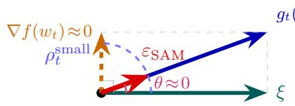

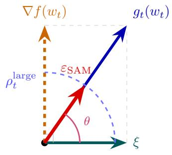  
(a) Flat region  
(b) Sharp region  
Figure 2: Illustration of SAM perturbation directions in flat and sharp regions of the loss landscape.

Given the stochastic gradient decomposition $g _ { t } ( w _ { t } ) = \nabla f ( w _ { t } ) + \xi$ , in the near-optimal regime where $\lVert \nabla f ( w _ { t } ) \rVert \to 0$ , the gradient becomes dominated by noise, i.e., $g _ { t } ( w _ { t } ) \approx \xi$ . The SAM perturbation thus collapses to: $\epsilon _ { t } \approx \rho \xi / \left\| \xi \right\|$ . For Gaussian noise, $\epsilon _ { t }$ is uniformly distributed on the sphere $S _ { \rho } ( 0 )$ , no longer reflecting directions of high curvature or sharpness, afecting the ability of SAM to accurately estimate local flatness. The dynamic $\rho _ { t }$ mitigates the efect of directional misalignment. By construction, $\rho _ { t }$ tends to increase in sharp regions where $\| \nabla f ( w _ { t } ) \|$ is large, and reduce in flat regions where $\lVert \nabla f ( w _ { t } ) \rVert \approx 0$ , naturally scaling the magnitude of the perturbation to the local geometry, limiting the influence of noninformative, noise-driven perturbations, as illustrated in Figure 2. A formal geometric analysis of the gradient misalignment and its implications are provided in Appendix B.

## 4. Experimental Results

We evaluate the proposed CAP-SAM through extensive experiments on standard benchmark datasets across diverse model architectures. We compare each method in two configurations: using a fixed perturbation radius $\rho$ and using our proposed dynamic $\rho .$

Experimental Settings. We adopt CIFAR-10 Krizhevsky et al. (2009), CIFAR-100 Krizhevsky et al. (2009) and ImageNet-1K Deng et al. (2009) as benchmark datasets to evaluate the proposed method. For CIFAR-10 and CIFAR-100, we compare against SAM and three of its variants: ASAM Kwon et al. (2021), Fisher SAM Kim et al. (2022), and VASSO Li and Giannakis (2023), across four neural network architectures: VGG-11 Simonyan and Zisserman (2015), ResNet-18 He et al. (2016), WRN-28-10 Zagoruyko and Komodakis (2016) and PyramidNet-110 Han et al. (2016). For ImageNet-1K Deng et al. (2009), we train ResNet-50 from scratch and evaluate on the ImageNet validation set as well as four additional out-of-distribution test sets: ImageNet-Real/V2/R/Sketch Beyer et al. (2020); Recht et al. (2019); Hendrycks et al. (2021); Wang et al. (2019). We evaluate the proposed dynamic formulation applied to SAM, ASAM Kwon et al. (2021), and GSAM Zhuang et al. (2022). A comprehensive description of the experimental setup, including hyperparameters and a detailed description of the statistical tests, is provided in the Appendix E.

Results. Tables 1 and 2 report the results of our method across CIFAR-10 and CIFAR-100, respectively. For CIFAR-10 our approach improves over the fixed radius baselines in 15 of 16 combinations. Gains are consistently more prominent for CIFAR-100 (Table 2), where even for VaSSO, the strongest fixed-radius baseline on PyramidNet-110, we outperform the baselines. The mean gains observed for the dynamic $\rho$ over the constant radius are statistically significant at the 95% level (CIFAR10: $p = 0 . 0 0 0 2$ $C I _ { 9 5 } = 0 . 2 3 \pm 0 . 1 1$ ; CIFAR100: $p = 0 . 0 0 1 3 , C I _ { 9 5 } = 1 . 1 4 \pm 0 . 6 4 )$

Table 3 reports results on ImageNet-1K and four out-of-distribution test sets. On ImageNet we significantly outperform the fixed-radius baselines $( p ~ = ~ 0 . 0 0 1 2$ $C I _ { 9 5 } =$ $0 . 3 1 \pm 0 . 1 7 )$ , with positive gains observed in 14 of 15 combinations, the sole exception being SAM on ImageNet-Sketch. All configurations surpass the vanilla SGD baseline (MHTcorrected $p < 1 0 ^ { - 4 }$ in all cases), confirming that curvature-aware adaptation is additive to the general benefit of sharpness-aware training rather than a substitute for it.

Generalisation Efect. Figure 3 shows that CAP-SAM achieves a lower training loss than SAM

(a) Training Loss  
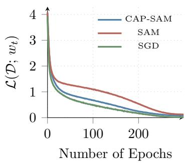

(b) Test Accuracy  
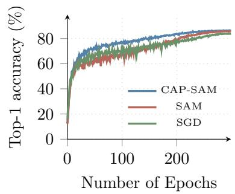  
Figure 3: PyramidNet-110 on CIFAR-100. (a) Training loss $\mathcal { L } ( \mathcal { D } ; w _ { t } )$ and (b) test accuracy (top-1) for CAP-SAM, SAM, and SGD.

while reaching better test accuracy than both baselines. SGD prioritises data fitting at the cost of overfitting, SAM prioritises robustness but may underfit, and CAP-SAM balances the two, fitting the data efectively without sacrificing generalisation, converging to flatter minima with stronger generalisation properties, a pattern consistent with

Keskar et al. (2016); Neyshabur et al. (2017). CAP-SAM also exhibits faster convergence than SAM and SGD (Figure 3 (b)), suggesting a more eficient progress along the optimization trajectory.
<table><tr><td></td><td colspan="2">SAM</td><td colspan="2">ASAM</td><td colspan="2">Fisher SAM</td><td colspan="2">VaSSO</td></tr><tr><td>Model</td><td>Const.</td><td>Dynam.</td><td>Const.</td><td>Dynam.</td><td> $\mathrm { C o n s t . }$ </td><td>Dynam.</td><td> $\mathrm { C o n s t . }$ </td><td> $\mathrm { D y n a m . }$ </td></tr><tr><td>VGG-11-BN</td><td> $9 3 . 8 2 _ { \pm 0 . 0 5 }$ </td><td> $\mathbf { 9 4 . 1 4 { \scriptstyle \pm 0 . 0 9 } }$ </td><td> $9 3 . 4 7 { \scriptstyle \pm 0 . 0 4 }$ </td><td> $\mathbf { 9 4 . 1 3 _ { \pm 0 . 2 7 } }$ </td><td> $9 3 . 6 0 { \scriptstyle \pm 0 . 0 9 }$ </td><td> $\mathbf { 9 4 . 1 4 { \scriptstyle \pm 0 . 1 5 } }$ </td><td> $9 3 . 9 3 { \scriptstyle \pm 0 . 1 3 }$ </td><td> $\mathbf { 9 4 . 1 7 { \scriptstyle \pm 0 . 1 4 } }$ </td></tr><tr><td>ResNet-18</td><td> $9 6 . 5 8 _ { \pm 0 . 1 0 }$ </td><td> $\mathbf { 9 6 . 6 6 _ { \pm 0 . 0 3 } }$ </td><td> $9 6 . 3 3 { \scriptstyle \pm 0 . 0 9 }$ </td><td> $\mathbf { 9 6 . 9 1 _ { \pm 0 . 0 8 } }$ </td><td> $9 6 . 6 2 _ { \pm 0 . 0 7 }$ </td><td> $\mathbf { 9 6 . 7 9 _ { \pm 0 . 0 6 } }$ </td><td> $9 6 . 6 0 { \scriptstyle \pm 0 . 0 8 }$ </td><td> $\mathbf { 9 6 . 7 4 _ { \pm 0 . 2 3 } }$ </td></tr><tr><td>WRN-28-10</td><td> $9 7 . 3 2 _ { \pm 0 . 1 1 }$ </td><td> $\mathbf { 9 7 . 4 7 _ { \pm 0 . 0 6 } }$ </td><td> $9 7 . 1 5 _ { \pm 0 . 0 5 }$ </td><td> $\mathbf { 9 7 . 5 6 _ { \pm 0 . 0 7 } }$ </td><td> $9 7 . 4 6 _ { \pm 0 . 0 6 }$ </td><td> $\mathbf { 9 7 . 4 8 _ { \pm 0 . 1 0 } }$ </td><td> $9 7 . 4 6 _ { \pm 0 . 0 9 }$ </td><td> $9 7 . 1 6 _ { \pm 0 . 0 8 }$ </td></tr><tr><td>PyramidNet-110</td><td> $9 7 . 5 8 { \scriptstyle \pm 0 . 0 2 }$ </td><td> $\mathbf { 9 7 . 7 0 { \scriptstyle \pm 0 . 0 5 } }$ </td><td> $9 7 . 5 6 { \scriptstyle \pm 0 . 1 1 }$ </td><td> $\mathbf { 9 7 . 7 6 { \scriptstyle \pm 0 . 0 3 } }$ </td><td> $9 7 . 5 9 { \scriptstyle \pm 0 . 0 7 }$ </td><td> $\mathbf { 9 7 . 7 7 { \scriptstyle \pm 0 . 0 6 } }$ </td><td> $9 7 . 6 4 { \scriptstyle \pm 0 . 0 9 }$ </td><td> $\mathbf { 9 7 . 7 6 { \scriptstyle \pm 0 . 0 5 } }$ </td></tr><tr><td>Model</td><td> $\mathrm { C o n s t . }$ </td><td> $\mathrm { D y n a m . }$ </td><td> $\mathrm { C o n s t . }$ </td><td>Dynam.</td><td>Const.</td><td>Dynam.</td><td> $\mathrm { C o n s t . }$ </td><td>Dynam.</td></tr><tr><td>VGG-11-BN</td><td> $7 3 . 5 9 _ { \pm 0 . 1 0 }$ </td><td> ${ \bf 7 4 . 1 5 _ { \pm 0 . 1 4 } }$ </td><td> $6 8 . 5 3 _ { \pm 0 . 1 5 }$ </td><td> ${ \bf 7 3 . 4 6 _ { \pm 0 . 0 9 } }$ </td><td> $7 3 . 8 2 _ { \pm 0 . 3 1 }$ </td><td> $\mathbf { 7 4 . 3 8 _ { \pm 0 . 1 3 } }$ </td><td> $7 4 . 0 2 _ { \pm 0 . 0 7 }$ </td><td> $\mathbf { 7 4 . 2 3 _ { \pm 0 . 1 9 } }$ </td></tr><tr><td>ResNet-18</td><td> $8 0 . 5 2 _ { \pm 0 . 3 7 }$ </td><td> $\mathbf { 8 1 . 1 0 _ { \pm 0 . 0 8 } }$ </td><td> $7 8 . 9 1 _ { \pm 0 . 2 7 }$ </td><td> $\mathbf { 8 1 . 0 3 _ { \pm 0 . 1 2 } }$ </td><td> $8 0 . 8 2 _ { \pm 0 . 1 4 }$ </td><td> $\mathbf { 8 1 . 1 2 _ { \pm 0 . 1 4 } }$ </td><td> $8 0 . 7 0 { \scriptstyle \pm 0 . 2 1 }$ </td><td> $\mathbf { 8 1 . 2 9 _ { \pm 0 . 2 4 } }$ </td></tr><tr><td>WRN-28-10</td><td> $8 4 . 6 4 { \scriptstyle \pm 0 . 1 0 }$ </td><td> $\mathbf { 8 5 . 1 0 { \scriptstyle \pm 0 . 1 6 } }$ </td><td> $8 3 . 8 8 { \scriptstyle \pm 0 . 2 7 }$ </td><td> $\mathbf { 8 5 . 0 3 _ { \pm 0 . 2 1 } }$ </td><td> $8 4 . 4 7 { \scriptstyle \pm 0 . 0 6 }$ </td><td> $\mathbf { 8 4 . 9 4 { \scriptstyle \pm 0 . 1 6 } }$ </td><td> $8 4 . 7 7 { \scriptstyle \pm 0 . 0 7 }$ </td><td> $\mathbf { 8 4 . 8 7 { \scriptstyle \pm 0 . 2 8 } }$ </td></tr><tr><td>PyramidNet-110</td><td> $8 5 . 6 0 { \scriptstyle \pm 0 . 1 1 }$ </td><td> $\mathbf { 8 6 . 4 9 { \scriptstyle \pm 0 . 1 1 } }$ </td><td> $8 3 . 7 2 _ { \pm 0 . 0 9 }$ </td><td> $\mathbf { 8 6 . 9 0 { \scriptstyle \pm 0 . 1 8 } }$ </td><td> $8 5 . 5 5 { \scriptstyle \pm 0 . 1 4 }$ </td><td> $\mathbf { 8 6 . 6 4 _ { \pm 0 . 2 3 } }$ </td><td> $8 5 . 8 5 { \scriptstyle \pm 0 . 0 9 }$ </td><td> $\mathbf { 8 6 . 8 9 _ { \pm 0 . 3 5 } }$ </td></tr></table>

Table 1: Top-1 test accuracy (%) on CIFAR-10 with Cutout augmentation.

Table 2: Top-1 test accuracy (%) on CIFAR-100 with Cutout augmentation.

Hyperparameter sensitivity. We analyze the impact of the hyperparameters of CAP-SAM.

(a) Perturbation radius ρ0

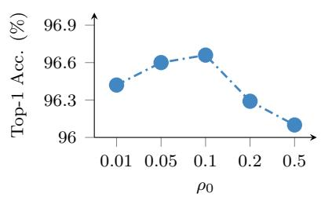

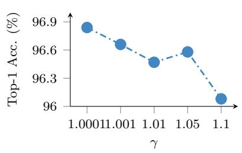

As shown in Figure 4, the parameters that meaningfully influence performance are the initial radius $\rho _ { 0 }$ and the growth factor $\gamma ,$ which benefit from light tuning, consistent with standard practice for SAM and

Figure 4: Efect of hyperparameters with ResNet-18 on CIFAR-10.  
its variants. The lower and upper bounds, $\rho _ { m i n }$ and $\rho _ { \mathrm { m a x } } .$ , have negligible impact on performance (Figures 7 (c) and (d) in Appendix F), as they serve primarily to clip the updated radius within a safe interval.
<table><tr><td rowspan="2">Method</td><td rowspan="2"></td><td colspan="5">IMAGENET-</td></tr><tr><td>1K</td><td>Real</td><td>V2</td><td>R</td><td>Sketch</td></tr><tr><td>SGD</td><td>一</td><td> $7 6 . 7 2 _ { \pm 0 . 0 9 }$ </td><td> $8 3 . 0 2 _ { \pm 0 . 0 2 }$ </td><td> $6 4 . 4 0 _ { \pm 0 . 0 7 }$ </td><td> $1 9 . 9 5 _ { \pm 0 . 1 2 }$ </td><td> $2 0 . 5 6 _ { \pm 0 . 2 0 }$ </td></tr><tr><td rowspan="2">SAM</td><td>Const.</td><td> $7 7 . 4 5 _ { \pm 0 . 0 8 8 }$ </td><td> $8 3 . 8 4 _ { \pm 0 . 0 8 }$ </td><td> $6 5 . 3 4 { \scriptstyle \pm 0 . 1 6 }$ </td><td> $2 0 . 8 1 _ { \pm 0 . 3 4 }$ </td><td> $2 2 . 1 2 _ { \pm 0 . 1 7 }$ </td></tr><tr><td>Dynam.</td><td> $\mathbf { 7 7 . 6 5 _ { \pm 0 . 1 1 } }$ </td><td> $\mathbf { 8 4 . 0 3 _ { \pm 0 . 0 7 } }$ </td><td> ${ \bf 6 5 . 5 3 _ { \pm 0 . 1 8 } }$ </td><td> ${ \bf 2 0 . 9 5 _ { \pm 0 . 0 7 } }$ </td><td> $2 1 . 9 0 _ { \pm 0 . 1 8 }$ </td></tr><tr><td rowspan="2">GSAM</td><td>Const.</td><td> $7 7 . 3 7 _ { \pm 0 . 0 7 }$ </td><td> $8 3 . 8 3 _ { \pm 0 . 0 7 }$ </td><td> $6 5 . 4 2 _ { \pm 0 . 1 8 }$ </td><td> $2 0 . 9 3 _ { \pm 0 . 2 5 }$ </td><td> $2 1 . 2 6 _ { \pm 0 . 5 1 }$ </td></tr><tr><td>Dynam.</td><td> $\mathbf { 7 7 . 6 5 _ { \pm 0 . 1 5 } }$ </td><td> $\mathbf { 8 3 . 9 8 _ { \pm 0 . 0 9 } }$ </td><td> ${ \bf 6 5 . 5 4 { _ { \pm 0 . 2 2 } } }$ </td><td> $\mathbf { 2 1 . 1 4 _ { \pm 0 . 0 9 } }$ </td><td> $\mathbf { 2 2 . 2 4 _ { \pm 0 . 1 6 } }$ </td></tr><tr><td rowspan="2">ASAM</td><td>Const.</td><td> $7 7 . 1 1 _ { \pm 0 . 0 8 }$ </td><td> $8 4 . 0 7 _ { \pm 0 . 1 2 }$ </td><td> $6 5 . 0 6 _ { \pm 0 . 1 8 }$ </td><td> $2 1 . 3 8 _ { \pm 0 . 1 8 }$ </td><td> $2 1 . 6 7 _ { \pm 0 . 1 9 }$ </td></tr><tr><td>Dynam.</td><td> $\mathbf { 7 7 . 6 4 _ { \pm 0 . 1 7 } }$ </td><td> $\mathbf { 8 4 . 1 7 _ { \pm 0 . 1 9 } }$ </td><td> ${ \bf 6 5 . 8 6 _ { \pm 0 . 0 9 } }$ </td><td> $\mathbf { 2 1 . 5 7 _ { \pm 0 . 4 1 } }$ </td><td> $\mathbf { 2 2 . 4 2 _ { \pm 0 . 6 8 } }$ </td></tr></table>

Table 3: Top-1 accuracy (%) on ImageNet and robustness datasets for ResNet-50.

## 5. Conclusion

In this paper, we investigated SAM and provided a new interpretation of the perturbation radius ρ as a signal of the perturbation magnitude. Based on this finding, we proposed CAP-SAM, which modifies the ascent step of SAM by adjusting the perturbation radius based on local sharpness estimates across steps. We theoretically investigated the impact of stochastic gradient noise on SAM’s perturbation direction, showing that it becomes increasingly uninformative about local curvature near convergence, and demonstrated that

CAP-SAM mitigates this undesirable efect. We validated CAP-SAM across several baselines as a plug-in for SAM and its variants, achieving consistent improvements in accuracy.

## References

Maksym Andriushchenko, Francesco Croce, Maximilian M¨uller, Matthias Hein, and Nicolas Flammarion. A modern look at the relationship between sharpness and generalization. arXiv preprint arXiv:2302.07011, 2023.

Lucas Beyer, Olivier J H´enaf, Alexander Kolesnikov, Xiaohua Zhai, and A¨aron van den Oord. Are we done with imagenet? arXiv preprint arXiv:2006.07159, 2020.

Debora Caldarola, Pietro Cagnasso, Barbara Caputo, and Marco Ciccone. Beyond local sharpness: Communication-eficient global sharpness-aware minimization for federated learning. In CVPR, 2025.

Pratik Chaudhari, Anna Choromanska, Stefano Soatto, Yann LeCun, Carlo Baldassi, Christian Borgs, Jennifer Chayes, Levent Sagun, and Riccardo Zecchina. Entropy-SGD: Biasing Gradient Descent Into Wide Valleys, April 2017. URL http://arxiv.org/abs/1611. 01838. arXiv:1611.01838 [cs.LG].

Xiangning Chen, Cho-Jui Hsieh, and Boqing Gong. When vision transformers outperform resnets without pre-training or strong data augmentations. arXiv preprint arXiv:2106.01548, 2021.

Jia Deng, Wei Dong, Richard Socher, Li-Jia Li, Kai Li, and Li Fei-Fei. Imagenet: A largescale hierarchical image database. In CVPR, pages 248–255, 2009.

Terrance Devries and Graham W. Taylor. Improved regularization of convolutional neural networks with cutout. CoRR, abs/1708.04552, 2017. URL http://arxiv.org/abs/ 1708.04552.

Laurent Dinh, Razvan Pascanu, Samy Bengio, and Yoshua Bengio. Sharp minima can generalize for deep nets. CoRR, abs/1703.04933, 2017. URL http://arxiv.org/abs/ 1703.04933.

Jiawei Du, Hanshu Yan, Jiashi Feng, Joey Tianyi Zhou, Liangli Zhen, Rick Siow Mong Goh, and Vincent Y. F. Tan. Eficient sharpness-aware minimization for improved training of neural networks. CoRR, abs/2110.03141, 2021. URL https://arxiv.org/abs/2110. 03141.

Pierre Foret, Ariel Kleiner, Hossein Mobahi, and Behnam Neyshabur. Sharpness-aware minimization for eficiently improving generalization. CoRR, abs/2010.01412, 2020. URL https://arxiv.org/abs/2010.01412.

Dongyoon Han, Jiwhan Kim, and Junmo Kim. Deep pyramidal residual networks. CoRR, abs/1610.02915, 2016. URL http://arxiv.org/abs/1610.02915.

Kaiming He, Xiangyu Zhang, Shaoqing Ren, and Jian Sun. Deep residual learning for image recognition. In Proceedings of the IEEE conference on computer vision and pattern recognition, pages 770–778, 2016.

Dan Hendrycks, Steven Basart, Norman Mu, Saurav Kadavath, Frank Wang, Evan Dorundo, Rahul Desai, Tyler Zhu, Samyak Parajuli, Mike Guo, et al. The many faces of robustness: A critical analysis of out-of-distribution generalization. In Proceedings of the IEEE/CVF International Conference on Computer Vision, pages 8340–8349, 2021.

Sepp Hochreiter and J¨urgen Schmidhuber. Simplifying neural nets by discovering flat minima. In Proceedings of the 8th International Conference on Neural Information Processing Systems, NIPS’94, page 529–536, Cambridge, MA, USA, 1994. MIT Press.

Sepp Hochreiter and J¨urgen Schmidhuber. Flat minima. Neural Computation, 9(1):1–42, 1997. doi: 10.1162/neco.1997.9.1.1.

Yiding Jiang, Behnam Neyshabur, Hossein Mobahi, Dilip Krishnan, and Samy Bengio. Fantastic generalization measures and where to find them. arXiv preprint, 12 2019. doi: 10.48550/arXiv.1912.02178.

Nitish Shirish Keskar, Dheevatsa Mudigere, Jorge Nocedal, Mikhail Smelyanskiy, and Ping Tak Peter Tang. On large-batch training for deep learning: Generalization gap and sharp minima. CoRR, abs/1609.04836, 2016. URL http://arxiv.org/abs/1609.04836.

Hoki Kim, Jinseong Park, Yujin Choi, and Jaewook Lee. Fantastic robustness measures: The secrets of robust generalization. In Thirty-seventh Conference on Neural Information Processing Systems, 2023.

Minyoung Kim, Da Li, Shell Xu Hu, and Timothy M. Hospedales. Fisher SAM: Information geometry and sharpness aware minimisation. In International Conference on Machine Learning, pages 11145–11161, 2022.

Alex Krizhevsky, Geofrey Hinton, et al. Learning multiple layers of features from tiny images. Technical report, 2009.

Jungmin Kwon, Jeongseop Kim, Hyunseo Park, and In Kwon Choi. Asam: Adaptive sharpness-aware minimization for scale-invariant learning of deep neural networks. In International Conference on Machine Learning, pages 5905–5914. PMLR, 2021.

Bingcong Li and Georgios B Giannakis. Enhancing sharpness-aware optimization through variance suppression. In Proc. of Neural Information Processing Systems, 2023.

Tao Li, Pan Zhou, Zhengbao He, Xinwen Cheng, and Xiaolin Huang. Friendly sharpnessaware minimization, 2024. URL https://arxiv.org/abs/2403.12350.

Peng Mi, Li Shen, Tianhe Ren, Yiyi Zhou, Xiaoshuai Sun, Rongrong Ji, and Dacheng Tao. Make sharpness-aware minimization stronger: A sparsified perturbation approach, 2022. URL https://arxiv.org/abs/2210.05177.

Behnam Neyshabur, Srinadh Bhojanapalli, David McAllester, and Nathan Srebro. Exploring generalization in deep learning. CoRR, abs/1706.08947, 2017. URL http: //arxiv.org/abs/1706.08947.

Benjamin Recht, Rebecca Roelofs, Ludwig Schmidt, and Vaishaal Shankar. Do imagenet classifiers generalize to imagenet? In International conference on machine learning, pages 5389–5400. PMLR, 2019.

A. L. Samuel. Some studies in machine learning using the game of checkers. IBM Journal of Research and Development, 3(3):211–229, 1959.

Karen Simonyan and Andrew Zisserman. Very deep convolutional networks for large-scale image recognition. In Yoshua Bengio and Yann LeCun, editors, ICLR, 2015. URL http://arxiv.org/abs/1409.1556.

Ashish Vaswani, Noam Shazeer, Niki Parmar, Jakob Uszkoreit, Llion Jones, Aidan N Gomez, Lukasz Kaiser, and Illia Polosukhin. Attention is all you need. Advances in neural information processing systems, 30, 2017.

Haohan Wang, Songwei Ge, Zachary Lipton, and Eric P Xing. Learning robust global representations by penalizing local predictive power. In Advances in Neural Information Processing Systems, pages 10506–10518, 2019.

Pengfei Wang, Zhaoxiang Zhang, Zhen Lei, and Lei Zhang. Sharpness-aware gradient matching for domain generalization, 2023. URL https://arxiv.org/abs/2303.10353.

Sergey Zagoruyko and Nikos Komodakis. Wide residual networks. CoRR, abs/1605.07146, 2016. URL http://arxiv.org/abs/1605.07146.

Chiyuan Zhang, Samy Bengio, Moritz Hardt, Benjamin Recht, and Oriol Vinyals. Understanding deep learning requires rethinking generalization. CoRR, abs/1611.03530, 2016. URL http://arxiv.org/abs/1611.03530.

Yaowei Zheng, Richong Zhang, and Yongyi Mao. Regularizing neural networks via adversarial model perturbation. CoRR, abs/2010.04925, 2020. URL https://arxiv.org/abs/ 2010.04925.

Juntang Zhuang, Boqing Gong, Liangzhe Yuan, Yin Cui, Hartwig Adam, Nicha Dvornek, Sekhar Tatikonda, James Duncan, and Ting Liu. Surrogate gap minimization improves sharpness-aware training. arXiv preprint arXiv:2203.08065, 2022.

Jinping Zou, Xiaoge Deng, and Tao Sun. Sharpness-aware minimization with adaptive regularization for training deep neural networks, 2024. URL https://arxiv.org/abs/ 2412.16854.

## Appendix A. Related Works

Several works have investigated the correlation between the generalization ability of a mode and the sharpness of the minimum it converges to Dinh et al. (2017); Keskar et al. (2016); Wang et al. (2023).

Following this line of work, subsequent studies have examined the connection between batch size and generalization, showing that the choice of batch size influences the tendency of a model to converge to a sharp or flat minimum Keskar et al. (2016). Diferent measures have also been proposed to evaluate the geometric characteristics of the loss landscape and their connection to sharpness Jiang et al. (2019); Kim et al. (2023); Zhuang et al. (2022). These works justify the goal of seeking flatter valleys in the loss landscape to enhance generalization. Inspired by this, Sharpness-Aware Minimization (SAM) Foret et al. (2020) was proposed as a strategy that targets flatter minima by minimizing the worst-case loss within a local neighborhood. SAM has been shown to achieve generalization improvements across a variety of tasks and benchmarks Caldarola et al. (2025); Kwon et al. (2021); Zheng et al. (2020).

A series of SAM variants have since been proposed, addressing SAM’s limitations from diferent perspectives. From the perspective of the neighborhood’s geometric measure, ASAM Kwon et al. (2021) introduce scale invariance to address SAM’s sensitivity to weight re-scaling, while Fisher SAM Kim et al. (2022) replace SAM’s Euclidean balls with ellipsoids induced by the Fisher information metric. From the perspective of the optimization stability, GSAM Zhuang et al. (2022) jointly minimizes the perturbed loss and a surrogate gap, while the friendly-adversary approach of VaSSO Li and Giannakis (2023) stabilizes the adversarial perturbation through variance suppression. To reduce computational cost, a further line of work seeks to alleviate SAM’s characteristic doubling of forward–backward passes. For instance, ESAM Du et al. (2021) reduces this overhead through stochastic weight perturbation and sharpness-sensitive data selection, and Sparse SAM Mi et al. (2022) perturbs only a sparse subset of parameters via a learned binary mask.

Despite their improvements over the vanilla formulation, these variants all operate within the original min-max framework, refining either the perturbation direction or the regularization term while treating the radius as a fixed hyperparameter shared across all iterations and regions of the landscape. The strategy proposed in this work, CAP-SAM, instead adapts the size of the perturbation radius itself based on local sharpness estimates, bridging the geometric and stability perspectives in a direction largely unexplored by existing SAM variants.

## Appendix B. Gradient misalignment

We analyze the behavior of the SAM perturbation near convergence by decomposing the stochastic gradient on a mini-batch B as:

$$
\begin{array} { r } { g ( w _ { t } ) = \nabla f ( w _ { t } ) + \xi , } \end{array}
$$

where $\xi$ is a zero-mean Gaussian random variable representing the batch-specific noise . Assuming $g ( w _ { t } )$ is an unbiased estimator of the full gradient, we have $\mathbb { E } _ { B } [ \xi ] = 0$ . Moreover,

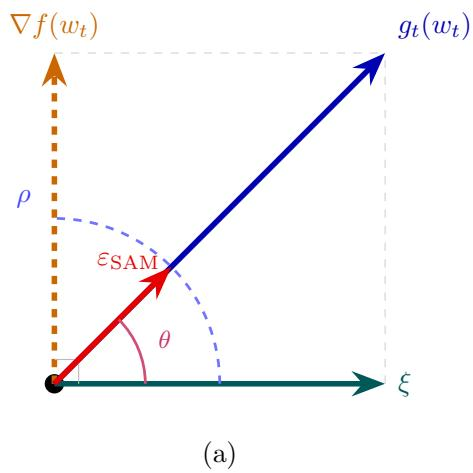

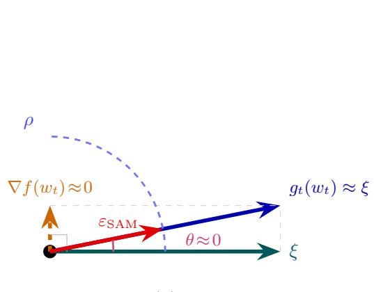  
(b)  
Figure 5: Investigation of the SAM perturbation direction near convergence. (a) Away from convergence, $\nabla f ( w _ { t } )$ dominates and the perturbation $\varepsilon _ { \mathrm { S A M } }$ remains reasonably aligned with the true gradient direction. (b) Near a stationary point, $\nabla f ( w _ { t } ) \approx 0$ and $g _ { t } ( w _ { t } ) \approx \xi ,$ , the perturbation direction becomes increasingly dominated by stochastic gradient noise making the perturbation uninformative about the local loss curvature Li et al. (2024).

as $\nabla f ( w _ { t } )$ is deterministic with respect to batch sampling,

$$
\begin{array} { r } { \mathbb { E } _ { B } \langle \nabla f ( w _ { t } ) , \xi \rangle = \langle \nabla f ( w _ { t } ) , \mathbb { E } [ \xi ] \rangle = 0 . } \end{array}
$$

Consequently, the stochastic noise has zero mean and zero expected projection onto the true gradient: on average it carries no systematic descent or curvature information. Figure $\mathrm { 5 ( a ) }$ illustrates this expected decomposition, where the stochastic gradient is expressed as the sum of the deterministic gradient and a zero-mean noise component.

The SAM perturbation at step t is

$$
\epsilon _ { t } = \rho \frac { g ( w _ { t } ) } { \| g ( w _ { t } ) \| } = \rho \frac { \nabla f ( w _ { t } ) + \xi } { \| \nabla f ( w _ { t } ) + \xi \| } .
$$

As optimization approaches minimum, where $\lVert \nabla f ( w _ { t } ) \rVert \to 0$ , the deterministic gradient is dominated by the noise and the perturbation collapses to

$$
\epsilon _ { t } \approx \rho \frac { \xi } { \| \xi \| } ,
$$

The perturbation direction becomes increasingly governed by stochastic gradient noise rather than by the deterministic descent direction, making the perturbation uninformative about the loss curvature .

## B.1. Geometric characterization of the misalignment

To quantify this behavior, we measure the alignment between $\epsilon _ { t }$ and the noise direction $\begin{array} { r } { \epsilon _ { n o i s e } = \rho \frac { \xi } { \left\| \xi \right\| } } \end{array}$ . The alignment angle $\theta$ is given as the inverse cosine of

$$
\cos \theta = \langle \epsilon _ { t } , \epsilon _ { n o i s e } \rangle = \left. \frac { g ( w _ { t } ) } { \| g ( w _ { t } ) \| } , \frac { \xi } { \| \xi \| } \right. ,
$$

where cos $\theta = 1$ indicates $\theta = 0$ , i.e., perfect alignment.

Near a minimum, $\lVert \nabla f ( w _ { t } ) \rVert \approx 0$ , so the gradient component vanishes and the expression simplifies to

$$
\cos \theta \approx \left. { \frac { \xi } { \| \xi \| } } , { \frac { \xi } { \| \xi \| } } \right. \approx { \frac { \| \xi \| ^ { 2 } } { \| \xi \| ^ { 2 } } } = 1 \qquad \Longrightarrow \qquad \theta = 0 .
$$

Therefore, the stochastic gradient becomes increasingly aligned with the noise component, causing the SAM perturbation to converge to the normalized noise direction. Consequently, the ascent step is driven primarily by stochastic fluctuations rather than by the underlying loss geometry, reducing its efectiveness as an estimator of local sharpness, as illustrated in Figure 5 (b).

## Appendix C. Algorithm

Algorithm 1 CAP-SAM   
1: Input: Training set $D = \{ ( x _ { i } , y _ { i } ) \} _ { i = 1 } ^ { n }$ , loss $L ,$ learning rate $\lambda ,$ growth factor $\gamma ,$ bounds   
$\rho _ { \mathrm { m i n } } \le \rho _ { \mathrm { m a x } } .$ initial radius $\rho _ { 0 } .$   
2: Initialise weights $w  w _ { 0 }$   
3: Initialise perturbation radius $\rho  \rho _ { 0 }$   
4: while not converged do   
5: Sample a mini-batch B data form D   
6: Compute stochastic gradient $g _ { t }$   
7: Compute $\begin{array} { r } { r _ { t } = \frac { \| g ( w _ { t } ) \| } { \| g ( w _ { t - 1 } ) \| } } \end{array}$   
(min(γ ρt−1, ρmax), if $r _ { t } \ge 1$   
8: Compute $\rho _ { t } = { \bigg \{ \operatorname* { m a x } } _ { \gamma } { \rho _ { t - 1 } \operatorname* { m i n } }  \bigg )$   
, otherwise   
9: Compute $\epsilon _ { t } = \dot { \rho _ { t } } \dot { g } ( x _ { k } ) { \bf \dot { \Omega } } / \parallel g ( x _ { k } ) \parallel _ { 2 }$   
10: Update weights $w _ { t + 1 }  w _ { t } - \lambda g ( w _ { t } + \epsilon _ { t } )$   
11: end while   
12: Return w, $g ( w _ { t - 1 } )$

## Appendix D. Theoretical Analysis

## D.1. $r _ { t }$ as a measure of local sharpness

We provide a formal justification for $r _ { t }$ as a principled measure of how local sharpness evolves along the optimization trajectory. Following Zhuang et al. (2022), we define the surrogate gap at a point w as:

$$
h ( w ) = \operatorname* { m a x } _ { \| \delta \| \leq \rho } f ( w + \delta ) - f ( w ) \approx f ^ { S A M } ( w ) - f ( w ) .
$$

The surrogate gap measures the diference between the maximum loss within the neighborhood and the loss at the center point.

Theorem 2 Let $w ^ { * }$ be a local minimum of $f ,$ and $l e t \sigma _ { \mathrm { m a x } } ^ { ( t ) }$ denote the dominant eigenvalue of the Hessian as a measure of sharpness. Assuming the iterates $w _ { t - 1 }$ and $w _ { t }$ lie near $w ^ { * }$ the ratio $r _ { t }$ defined in $E q . ( 3 )$ approximates the change in sharpness between consecutive steps: $\sigma _ { \mathrm { m a x } } ^ { ( t ) } / \sigma _ { \mathrm { m a x } } ^ { ( t - 1 ) } \approx r _ { t } / \alpha ^ { 2 }$ where $\alpha = \rho _ { t } \mathrm { ~ / ~ } \rho _ { t - 1 }$ is the ratio of perturbation radii between iterations.

Proof We follow the argument of Zhuang et al. (2022), adapting it to the ratio of surrogate gaps at consecutive iterates. Since $\rho _ { t }$ is small, consider the second-order Taylor expansion of $f$ around $w _ { t } .$

$$
f ^ { S A M } ( w _ { t } ) = f ( w _ { t } + \delta ) = f ( w _ { t } ) + \nabla f ( w _ { t } ) ^ { \top } \delta + \frac { 1 } { 2 } \delta ^ { \top } H _ { t } \delta + { \mathcal O } ( \| \rho \| ^ { 3 } ) ,
$$

where $H _ { t } = \nabla ^ { 2 } f ( w _ { t } )$ is the Hessian at $w _ { t } .$ , assumed to be positive semidefinite near local minima. Since $w _ { t }$ lies near the local minimum, the gradient can be assumed to be negligible, $\nabla f ( w _ { t } ) \approx 0$ , so the first-order term vanishes. Normalizing $\delta$ such that $\| \delta \| = \rho _ { t }$ , we obtain

$$
f ^ { S A M } ( w _ { t } ) - f ( w _ { t } ) = \operatorname* { m a x } _ { \| \delta \| \leq \rho _ { t } } f ( w _ { t } + \delta ) - f ( w _ { t } ) = \frac { 1 } { 2 } \sigma _ { \operatorname* { m a x } } ^ { ( t ) } \rho _ { t } ^ { 2 } + \mathcal { O } ( \rho _ { t } ^ { 3 } ) .
$$

where $\lambda _ { \operatorname* { m a x } } ^ { ( t ) }$ is the largest eigenvalue of the hessian $H _ { t }$ . Applying the same expansion at step $t - 1$ and substituting into $r _ { t } = h ( w _ { t } ) / h ( w _ { t - 1 } )$ :

$$
r _ { t } = \frac { f ^ { S A M } ( w _ { t } ) - f ( w _ { t } ) } { f ^ { S A M } ( w _ { t - 1 } ) - f ( w _ { t - 1 } ) } = \frac { \frac { 1 } { 2 } \lambda _ { \operatorname* { m a x } } ^ { ( t ) } \rho _ { t } ^ { 2 } + \mathcal { O } ( \rho _ { t } ^ { 3 } ) } { \frac { 1 } { 2 } \lambda _ { \operatorname* { m a x } } ^ { ( t - 1 ) } \rho _ { t - 1 } ^ { 2 } + \mathcal { O } ( \rho _ { t - 1 } ^ { 3 } ) }
$$

Defining $\begin{array} { r } { \alpha = \frac { \rho _ { t } } { \rho _ { t - 1 } } } \end{array}$ and rearranging gives $\frac { \lambda _ { \operatorname* { m a x } } ^ { ( t ) } } { \lambda _ { \operatorname* { m a x } } ^ { ( t - 1 ) } } \approx r _ { t } / \alpha ^ { 2 }$

Remark 3 (First-order interpretation and computational cost) The Theorem above establishes $r _ { t }$ as a sharpness measure via a second-order argument. Under the adaptive update rule, however, $r _ { t }$ also admits a simpler interpretation that makes it cheap to compute in practice. Using a first-order Taylor expansion

$$
| f ( w _ { t } + \epsilon _ { t } ) - f ( w _ { t } ) | \approx | \langle g ( w _ { t } ) , \epsilon _ { t } \rangle | = \rho _ { t } \| g ( w _ { t } ) \| ,
$$

where $g ( w _ { t } ) = \nabla f ( w _ { t } )$ and the SAM perturbation is $\epsilon _ { t } = \rho _ { t } g ( w _ { t } ) / \| g ( w _ { t } ) \|$ . Therefore:

$$
r _ { t } \approx \frac { \rho _ { t } \| g ( w _ { t } ) \| } { \rho _ { t - 1 } \| g ( w _ { t - 1 } ) \| } = \frac { \rho _ { t } } { \rho _ { t - 1 } } \cdot \frac { \| g ( w _ { t } ) \| } { \| g ( w _ { t - 1 } ) \| } .
$$

Since the adaptive update rule adjusts $\rho$ by a factor of $\gamma = 1 . 0 0 1$ , consecutive radii satisfy $\rho _ { t } / \rho _ { t - 1 } \in \{ \gamma , \gamma ^ { - 1 } \} = 1 + \mathcal { O } ( 1 0 ^ { - 3 } )$ , and thus:

$$
r _ { t } \approx \frac { \| g ( w _ { t } ) \| } { \| g ( w _ { t - 1 } ) \| } .
$$

Hence $r _ { t }$ is well approximated by the ratio of consecutive gradient norms Zou et al. (2024), a quantity already available during training at no additional computational cost.

## D.2. Assumptions

Our analysis relies on the following assumptions, which are standard in nonconvex stochastic optimization.

Assumption 1 (Bounded Gradient) $\exists ~ G \geq 0$ such that $\| \nabla f ( w ) \| \leq G$

Assumption 2 (Bounded Variance) $\exists \sigma \geq 0$ such that E $\left[ \lVert g ( w ) - \nabla f ( w ) \rVert ^ { 2 } \right] \leq \sigma ^ { 2 }$

Assumption 3 (L-smoothness) $\exists L > 0$ such that $\| \nabla f ( w ) - \nabla f ( v ) \| \leq L \| w - v \| , \forall w , v \in$ $\mathbb { R } ^ { d }$

Decaying-radius assumption. Following existing convergence analyses of SAM and its variants Zhuang et al. (2022); Mi et al. (2022), we assume that the perturbation radius vanishes asymptotically, i.e., $\rho _ { t } = \rho _ { \mathrm { m a x } } / \sqrt { t }$ . As in prior work, the assumption is made for analytical tractability and does not reflect how the method is used in practice. In our experiments (Section 4), $\rho _ { t }$ follows Eq. (3) within the fixed interval $[ \rho _ { \mathrm { m i n } } , \rho _ { \mathrm { m a x } } ]$ and is not forced to decay.

## D.3. Proof of Theorem 1

We adapt the standard SAM convergence proof Foret et al. (2020) to the CAP-SAM formulation. We can write the algorithm 1 :

$$
\left\{ \begin{array} { l l } { w _ { t + \frac { 1 } { 2 } } = w _ { t } + \epsilon _ { t } } \\ { \qquad } \\ { w _ { t + 1 } = w _ { t } - \eta \cdot g \Bigl ( w _ { t + \frac { 1 } { 2 } } \Bigr ) } \end{array} \right.\tag{4}
$$

where for SAM $\begin{array} { r } { \epsilon _ { t } = \rho \cdot \frac { g ( w _ { t } ) } { \| g ( w _ { t } ) \| } } \end{array}$ and for CAP-SAM $\epsilon _ { t } = \rho _ { t } \cdot \frac { g ( w _ { t } ) } { | | g ( w _ { t } ) | | }$ with $\rho _ { t }$ as defined in $\operatorname { E q }$ (3)

We first present useful lemmas that will be used to support the proof of the main result. Lemma 4 For any $\rho > 0 , L > 0$ , and diferentiable function $f ,$ we have:

$$
\left. \nabla f ( w _ { t } ) , \nabla f \bigg ( w _ { t } + \rho \frac { \nabla f ( w _ { t } ) } { \| \nabla f ( w _ { t } ) \| } \bigg ) \right. \geq \| \nabla f ( w _ { t } ) \| ^ { 2 } - \rho L G .\tag{5}
$$

Proof Adding and subtracting $\| \nabla f ( w _ { t } ) \|$ inside the inner product and factoring out $\| \nabla f ( w _ { t } ) \| / \rho$ :

$$
\mathrm { L H S } = \frac { \Vert \nabla f ( w _ { t } ) \Vert } { \rho }  \frac { \rho \nabla f ( w _ { t } ) } { \Vert \nabla f ( w _ { t } ) \Vert } , \nabla f \middle ( w _ { t } + \rho \frac { \nabla f ( w _ { t } ) } { \Vert \nabla f ( w _ { t } ) \Vert } ) - \nabla f ( w _ { t } )  + \Vert \nabla f ( w _ { t } ) \Vert ^ { 2 } .\tag{6}
$$

$$
\begin{array} { r l } & { \mathrm { L H S } \geq - L \frac { \| \nabla f ( w _ { t } ) \| } { \rho } \left\| \frac { \rho } { \| \nabla f ( w _ { t } ) \| } \nabla f ( w _ { t } ) \right\| ^ { 2 } + \| \nabla f ( w _ { t } ) \| ^ { 2 } . } \\ & { \qquad \geq - L \frac { \| \nabla f ( w _ { t } ) \| } { \rho } \cdot \rho ^ { 2 } + \| \nabla f ( w _ { t } ) \| ^ { 2 } } \\ & { \qquad = - \| \nabla f ( w _ { t } ) \| \rho L + \| \nabla f ( w _ { t } ) \| ^ { 2 } . } \end{array}
$$

Applying the bounded gradient Assumption 1

$$
\| \nabla f ( w _ { t } ) \| ^ { 2 } - \rho L \| \nabla f ( w _ { t } ) \| \geq \| \nabla f ( w _ { t } ) \| ^ { 2 } - \rho L G ,\tag{7}
$$

Lemma 5 For $\rho > 0 , L > 0$ , the iteration 4 satisfies the following inequality:

$$
\mathbb { E } \left. \nabla f ( w _ { t } ) , g \Big ( w _ { t + \frac { 1 } { 2 } } \Big ) \right. \geq \frac { 1 } { 2 } \| \nabla f ( w _ { t } ) \| ^ { 2 } - L ^ { 2 } \rho ^ { 2 } - L \rho G .
$$

Proof We denote the deterministic value of $w _ { t + \frac { 1 } { 2 } }$ as defined in 4. Adding and subtracting $g \left( \hat { w } _ { t + \frac { 1 } { 2 } } \right)$ decomposes the inner product into two terms:

$$
\begin{array} { r l } & { \Big \langle \nabla f ( w _ { t } ) , g \Big ( w _ { t + \frac { 1 } { 2 } } \Big ) \Big \rangle = \underbrace { \Big \langle \nabla f ( w _ { t } ) , g \Big ( w _ { t } + \rho \frac { g ( w _ { t } ) } { \| g ( w _ { t } ) \| } \Big ) - g \Big ( \hat { w } _ { t + \frac { 1 } { 2 } } \Big ) \Big \rangle } _ { \mathrm { T e r m ~ I : ~ p e r t u r b a t i o n ~ d i r e c t i o n ~ e r r o r } } } \\ & { \qquad + \underbrace { \Big \langle g \Big ( \hat { w } _ { t + \frac { 1 } { 2 } } \Big ) , \nabla f ( w _ { t } ) \Big \rangle } _ { \mathrm { T e r m ~ I I : ~ t r u e ~ g r a d i e n t ~ a l i g n m e n t } } . } \end{array}
$$

Bounding Term I from below by applying Young’s inequality, followed by L-smoothness:

$$
- \left. \nabla f ( w _ { t } ) , g \left( w _ { t } + \rho \frac { g ( w _ { t } ) } { \| g ( w _ { t } ) \| } \right) - g \left( \hat { w } _ { t + \frac { 1 } { 2 } } \right) \right. \leq \frac { 1 } { 2 } \left\| g \left( w _ { t } + \rho \frac { g ( w _ { t } ) } { \| g ( w _ { t } ) \| } \right) - g \left( \hat { w } _ { t + \frac { 1 } { 2 } } \right) \right\| ^ { 2 } + \frac { 1 } { 2 } \| \nabla f ( w _ { t } ) \| ^ { 2 } .
$$

$$
\leq \frac { L ^ { 2 } } { 2 } \left\| w _ { t } + \rho \frac { g ( w _ { t } ) } { \| g ( w _ { t } ) \| } - \hat { w } _ { t + \frac { 1 } { 2 } } \right\| ^ { 2 } + \frac { 1 } { 2 } \| \nabla f ( w _ { t } ) \| ^ { 2 } .
$$

$$
\begin{array} { r l } & { = \displaystyle \frac { L ^ { 2 } } { 2 } \left\| w _ { t } + \rho \frac { g ( w _ { t } ) } { \| g ( w _ { t } ) \| } - \left( w _ { t } + \rho \frac { \nabla f ( w _ { t } ) } { \| \nabla f ( w _ { t } ) \| } \right) \right\| ^ { 2 } + \frac { 1 } { 2 } \| \nabla f ( w _ { t } ) \| ^ { 2 } } \\ & { = \displaystyle \frac { L ^ { 2 } \rho ^ { 2 } } { 2 } \left\| \frac { g ( w _ { t } ) } { \| g ( w _ { t } ) \| } - \frac { \nabla f ( w _ { t } ) } { \| \nabla f ( w _ { t } ) \| } \right\| ^ { 2 } + \frac { 1 } { 2 } \| \nabla f ( w _ { t } ) \| ^ { 2 } . } \end{array}
$$

$$
\geq - L ^ { 2 } \rho ^ { 2 } - \frac { 1 } { 2 } \| \nabla f ( w _ { t } ) \| ^ { 2 } .
$$

For the second term applying Lemma 4 directly, we have

$$
\mathrm { T e r m ~ I I } \geq \Vert \nabla f ( w _ { t } ) \Vert ^ { 2 } - \rho L G .
$$

Combining the two terms:

$$
\begin{array} { r l r } {  { \mathbb { E }  \nabla f ( w _ { t } ) , g \Big ( w _ { t + \frac { 1 } { 2 } } \Big )  = \operatorname { T e r m } \mathrm { I } + \operatorname { T e r m } \mathrm { I I } } } \\ & { } & \\ & { } & { \geq ( - L ^ { 2 } \rho ^ { 2 } - \frac { 1 } { 2 } \| \nabla f ( w _ { t } ) \| ^ { 2 } ) + \big ( \| \nabla f ( w _ { t } ) \| ^ { 2 } - \rho L G \big ) } \\ & { } & \\ & { } & { = \frac { 1 } { 2 } \| \nabla f ( w _ { t } ) \| ^ { 2 } - L ^ { 2 } \rho ^ { 2 } - L \rho G , } \end{array}
$$

Lemma 6 For $\begin{array} { r } { \eta \le \frac { 1 } { L } } \end{array}$ , the iteration $\it 4$ satisfies for all $t > 0 .$

$$
\mathbb { E } f ( w _ { t + 1 } ) \ \leq \ \mathbb { E } f ( w _ { t } ) - \frac { \eta } { 2 } \mathbb { E } \| \nabla f ( w _ { t } ) \| ^ { 2 } + L \eta ^ { 2 } \sigma ^ { 2 } + \eta L ^ { 2 } \rho ^ { 2 } + ( 1 - L \eta ) \eta L G \rho .
$$

Proof By the L-smoothness of $f$ and the update rule 4:

$$
f ( w _ { t + 1 } ) \leq f ( w _ { t } ) - \eta \left. \nabla f ( w _ { t } ) , g \Big ( w _ { t + \frac { 1 } { 2 } } \Big ) \right. + \frac { L \eta ^ { 2 } } { 2 } \left. g \Big ( w _ { t + \frac { 1 } { 2 } } \Big ) \right. ^ { 2 } .\tag{8}
$$

Substituting the identity $\begin{array} { r } { \left\| g \Big ( w _ { t + \frac { 1 } { 2 } } \Big ) \right\| ^ { 2 } = \left\| \nabla f ( w _ { t } ) - g \Big ( w _ { t + \frac { 1 } { 2 } } \Big ) \right\| ^ { 2 } - \| \nabla f ( w _ { t } ) \| ^ { 2 } + 2 \left. \nabla f ( w _ { t } ) , g \Big ( w _ { t + \frac { 1 } { 2 } } \Big ) \right. } \end{array}$ into $8$ and rearranging:

$$
\begin{array} { r l } & { f ( w _ { t + 1 } ) \le f ( w _ { t } ) - \displaystyle \frac { L \eta ^ { 2 } } { 2 } \| \nabla f ( w _ { t } ) \| ^ { 2 } + \displaystyle \frac { L \eta ^ { 2 } } { 2 } \left\| \nabla f ( w _ { t } ) - g \Big ( w _ { t + \frac { 1 } { 2 } } \Big ) \right\| ^ { 2 } - \big ( 1 - L \eta \big ) \eta \left. \nabla f ( w _ { t } ) , g \Big ( w _ { t + \frac { 1 } { 2 } } \Big ) \right. } \\ & { \qquad \le f ( w _ { t } ) - \displaystyle \frac { L \eta ^ { 2 } } { 2 } \| \nabla f ( w _ { t } ) \| ^ { 2 } + L \eta ^ { 2 } \| \nabla f ( w _ { t } ) - g ( w _ { t } ) \| ^ { 2 } + L \eta ^ { 2 } \left\| g ( w _ { t } ) - g \Big ( w _ { t + \frac { 1 } { 2 } } \Big ) \right\| ^ { 2 } } \\ & { \qquad - \left( 1 - L \eta \right) \eta \left. \nabla f ( w _ { t } ) , g \Big ( w _ { t + \frac { 1 } { 2 } } \Big ) \right. . } \end{array}
$$

Taking expectation and applying Lemma 5:

$$
\begin{array} { r l } & { \mathbb { E } f ( w _ { t + 1 } ) \le \mathbb { E } f ( w _ { t } ) - \displaystyle \frac { L \eta ^ { 2 } } { 2 } \mathbb { E } \| \nabla f ( w _ { t } ) \| ^ { 2 } + L \eta ^ { 2 } \sigma ^ { 2 } + \eta ^ { 2 } L ^ { 3 } \rho ^ { 2 } - ( 1 - L \eta ) \eta \mathbb { E } \Big \langle \nabla f ( w _ { t } ) , g \Big ( w _ { t + \frac { 1 } { 2 } } \Big ) \Big \rangle . } \\ & { \qquad \le \mathbb { E } f ( w _ { t } ) - \displaystyle \frac { L \eta ^ { 2 } } { 2 } \mathbb { E } \| \nabla f ( w _ { t } ) \| ^ { 2 } + L \eta ^ { 2 } \sigma ^ { 2 } + \eta ^ { 2 } L ^ { 3 } \rho ^ { 2 } - ( 1 - L \eta ) \eta \left[ \frac { 1 } { 2 } \mathbb { E } \| \nabla f ( w _ { t } ) \| ^ { 2 } - L ^ { 2 } \rho ^ { 2 } - L \rho G \right] . } \end{array}
$$

Collecting terms in $\mathbb { E } \| \nabla f ( w _ { t } ) \| ^ { 2 }$ and $\rho ^ { 2 }$ yields:

$$
\mathbb { E } f ( w _ { t + 1 } ) \leq \mathbb { E } f ( w _ { t } ) - \frac { \eta } { 2 } \mathbb { E } \| \nabla f ( w _ { t } ) \| ^ { 2 } + L \eta ^ { 2 } \sigma ^ { 2 } + \eta L ^ { 2 } \rho ^ { 2 } + ( 1 - L \eta ) \eta L G \rho .
$$

which completes the proof.

Proposition 7 Let $\eta _ { t } = \eta _ { 0 } / \sqrt { t }$ and perturbation amplitude $\rho$ decay with the square root of $t , \ e . g . , \ \rho _ { t } = \rho _ { \mathrm { m a x } } / \sqrt { t }$ . For $\rho _ { \mathrm { m a x } } \leq G \eta _ { 0 }$ and $\begin{array} { r } { \eta _ { 0 } \le \frac { 1 } { L } } \end{array}$ , we have:

$$
\frac { 1 } { T } \sum _ { t = 1 } ^ { T } \mathbb { E } \| \nabla f ( w _ { t } ) \| ^ { 2 } \leq C _ { 1 } \frac { 1 } { \sqrt { T } } + C _ { 2 } \frac { \log T } { \sqrt { T } } ,
$$

where

$$
C _ { 1 } = \frac { 2 } { \eta _ { 0 } } \Big ( f ( w _ { 0 } ) - \mathbb { E } f ( w _ { T } ) \Big ) , \qquad C _ { 2 } = 2 \big ( L \sigma ^ { 2 } \eta _ { 0 } + L G \rho _ { \operatorname* { m a x } } \big ) .
$$

Proof Under the decaying-radius assumption D.2, $\rho _ { t } = \rho _ { \mathrm { m a x } } / \sqrt { t } .$ Since all three lemmas hold for any $\rho > 0$ , they apply with $\rho$ replaced by $\rho _ { t }$ at each step. As $\rho _ { t } \leq \rho _ { \operatorname* { m a x } } / \sqrt { t }$ for all t, we set $\rho _ { 0 } = \rho _ { \mathrm { m a x } } .$ , corresponding to the worst case in which $\rho _ { t }$ always attains its upper bound. Replacing $\eta _ { t } = \eta _ { 0 } / \sqrt { t }$ and $\rho _ { t } = \rho _ { \mathrm { m a x } } / \sqrt { t }$ into Lemma 6:

$$
\mathbb { E } f ( w _ { t + 1 } ) \le \mathbb { E } f ( w _ { t } ) - \frac { \eta _ { t } } { 2 } \mathbb { E } \| \nabla f ( w _ { t } ) \| ^ { 2 } + L \eta _ { t } ^ { 2 } \sigma ^ { 2 } + \eta _ { t } L ^ { 2 } \rho _ { t } ^ { 2 } + ( 1 - L \eta _ { t } ) \eta _ { t } L G \rho _ { t } .
$$

Summing the per-step inequality from $t ~ = ~ 1$ to $T$ and rearranging, the left-hand side telescopes to $\mathbb { E } f ( w _ { T } ) - f ( w _ { 0 } )$ :

$$
\begin{array} { l } { \displaystyle \mathbb { E } f ( w _ { T } ) - f ( w _ { 0 } ) \leq - \sum _ { t = 1 } ^ { T } \frac { \eta _ { t } } { 2 } \mathbb { E } \| \nabla f ( w _ { t } ) \| ^ { 2 } + \big ( L \sigma ^ { 2 } \eta _ { 0 } ^ { 2 } + L G \rho _ { \operatorname* { m a x } } \eta _ { 0 } \big ) \sum _ { t = 1 } ^ { T } \frac { 1 } { t } } \\ { \displaystyle + \left( L ^ { 2 } \eta _ { 0 } \rho _ { \operatorname* { m a x } } ^ { 2 } - L ^ { 2 } G \eta _ { 0 } ^ { 2 } \rho _ { \operatorname* { m a x } } \right) \sum _ { t = 1 } ^ { T } \frac { 1 } { t ^ { 3 / 2 } } . } \end{array}
$$

Drop the last term using $\rho _ { \mathrm { m a x } } \leq G \eta _ { 0 }$

$$
\mathbb { E } f ( w _ { T } ) - f ( w _ { 0 } ) \le - \sum _ { t = 1 } ^ { T } \frac { \eta _ { t } } { 2 } \mathbb { E } \| \nabla f ( w _ { t } ) \| ^ { 2 } + \big ( L \sigma ^ { 2 } \eta _ { 0 } ^ { 2 } + L G \rho _ { \operatorname* { m a x } } \eta _ { 0 } \big ) \sum _ { t = 1 } ^ { T } \frac { 1 } { t } .
$$

With

$$
\frac { \eta _ { T } } { 2 } \sum _ { t = 1 } ^ { T } \mathbb { E } \| \nabla f ( w _ { t } ) \| ^ { 2 } \leq \sum _ { t = 1 } ^ { T } \frac { \eta _ { t } } { 2 } \mathbb { E } \| \nabla f ( w _ { t } ) \| ^ { 2 }
$$

where replacing $\begin{array} { r } { \eta _ { T } = \frac { \eta _ { 0 } } { \sqrt { T } } } \end{array}$ yields:

$$
\begin{array} { r } { \frac { \eta _ { 0 } } { 2 \sqrt { T } } \displaystyle \sum _ { t = 1 } ^ { T } \mathbb { E } \| \nabla f ( w _ { t } ) \| ^ { 2 } \leq f ( w _ { 0 } ) - \mathbb { E } f ( w _ { T } ) + \big ( L \sigma ^ { 2 } \eta _ { 0 } ^ { 2 } + L G \rho _ { \operatorname* { m a x } } \eta _ { 0 } \big ) \displaystyle \sum _ { t = 1 } ^ { T } \frac { 1 } { t } } \\ { \leq f ( w _ { 0 } ) - \mathbb { E } f ( w _ { T } ) + \big ( L \sigma ^ { 2 } \eta _ { 0 } ^ { 2 } + L G \rho _ { \operatorname* { m a x } } \eta _ { 0 } \big ) \log T . } \end{array}\tag{9}
$$

Finally, we archive the result:

$$
\begin{array} { r l } & { \cfrac { 1 } { T } \displaystyle \sum _ { t = 1 } ^ { T } \mathbb { E } \| \nabla f ( w _ { t } ) \| ^ { 2 } \leq \frac { 2 \left( f ( w _ { 0 } ) - \mathbb { E } f ( w _ { T } ) \right) } { \eta _ { 0 } } \frac { 1 } { \sqrt { T } } + 2 \left( L \sigma ^ { 2 } \eta _ { 0 } + L G \rho _ { \operatorname* { m a x } } \right) \frac { \log T } { \sqrt { T } } } \\ & { \qquad = C _ { 1 } \displaystyle \frac { 1 } { \sqrt { T } } + C _ { 2 } \frac { \log T } { \sqrt { T } } , } \end{array}
$$

This shows that,under the decaying-radius assumption standard in SAM analyses, $\mathrm { C A P } .$ SAM converges at the rate of $\mathcal { O } ( \log T / \sqrt { T } )$ ■

## Appendix E. Experimental setup

We report the averaged results and standard deviation results over 3 independent runs.

## E.1. CIFAR

For CIFAR-10 and CIFAR-100 Krizhevsky et al. (2009), we compare test accuracy against SAM and three variants ASAM Kwon et al. (2021), Fisher SAMKim et al. (2022), and VASSO Li and Giannakis (2023) across four neural network architectures VGG-11 Simonyan and Zisserman (2015), ResNet-18 He et al. (2016), WRN-28-10 Zagoruyko and Komodakis (2016) and PyramidNet-110 Han et al. (2016). Standard data augmentation is applied, including random crop, random horizontal flip, normalization, and Cutout Devries and Taylor (2017). The first three models are trained for 200 epochs with a batchsize of 128, and PyramidNet-110 is trained for 300 epochs. A cosine learning rate schedule is used across all settings, with an initial learning rate of 0.05 and weight decay of 0.001 . For CIFAR-10, we set $\rho = 0 . 1$ for SAM, Fisher SAM, and VASSO, and $\rho = 0 . 0 5$ for ASAM, following the original papers. For our adaptive formulation, we use a initial radius $\rho _ { 0 } = 0 . 0 5$ across all architectures, with the exception of ResNet-18 where $\rho _ { 0 } = 0 . 1$ , and growth factor $\gamma = 1 . 0 0 1$ For CIFAR-100,we set $\rho = 0 . 2$ for SAM, Fisher $\mathrm { S A M } .$ , and VASSO, and $\rho = 1$ for ASAM. For our adaptive formulation, we use a initial radius $\rho _ { 0 } = 0 . 2$ across all architectures, and growth factor $\gamma = 1 . 0 0 1$

## E.2. ImageNet

For ImageNet-1K , we train ResNet-50 from scratch and evaluate on the ImageNet validation set as well as four additional out-of-distribution test sets: ImageNet-Real Beyer et al. (2020), ImageNet-V2Recht et al. (2019), ImageNet-R Hendrycks et al. (2021), and ImageNet-Sketch Wang et al. (2019). Following the setup of GSAM Zhuang et al. (2022) and Chen et al. (2021), without strong data augmentation. Models are trained with a global batch size of 4096, a perturbation batch size of $m = 6 4$ . A linear learning rate schedule with warmup is used, with an initial learning rate of 0.016 and weight decay of 0.001. We evaluate the proposed CAP-SAM formulation applied to SAM, ASAM Kwon et al. (2021), and GSAM Zhuang et al. (2022). Following hyperparameter tuning, we set $\rho = 0 . 0 4$ for SAM, $\rho = 0 . 0 5$ for GSAM and $\rho = 0 . 5$ for ASAM. The same values are used as the initial radius for the corresponding adaptive formulations, with growth factor $\gamma = 1 . 0 0 1$

## E.3. Statistical analysis

Statistical analysis for each test case (CIFAR-10, CIFAR-100 and ImageNet) was performed using an analysis of variance (ANOVA) model, with the perturbation type (constant $\rho ,$ dynamic $\rho )$ as the experimental factor of interest. In the case of CIFAR-10 and CIFAR-100, the Method (SAM, ASAM, FSAM, VaSSO) and the Model (VGG-11-BN, ResNet-18, WRN-28-10, PyramidNet-110) were used as blocking variables, so that their marginal efects on the accuracy are accounted for when estimating the efect of deploying the dynamic $\rho$ perturbation. For ImageNet, two comparisons were performed: the first used the Method (SAM, GSAM and ASAM) and the ImageNet Version (1K, Real, V2, R, Sketch) as blocking variables, to directly estimate the efects of the dynamic $\rho .$ The second compared all combinations of method + perturbation strategy directly against the SGD baseline, with Version as a blocking variable.

All statistical analyses were performed in R version 4.6.0. The p-values for the comparisons between constant and dynamic $\rho$ were estimated using function aov. Post-ANOVA

tests used Tukey contrasts as implemented in function glht from package multcomp. Effect size and confidence interval estimation were obtained applying function confint to the Tukey comparison models. The ANOVA tables for the three comparisons are presented below.
<table><tr><td>Factor</td><td>degrees-of-freedom F-value</td><td></td><td>p-value</td><td>Mean acc. gain (%)  $\mathrm { ( d y n a m . \textrm { - } c o n s t . ) }$ </td><td> $C I _ { 9 5 }$ </td></tr><tr><td>Variant</td><td>1</td><td>19.51</td><td> $\mathbf { 1 . 8 3 \times 1 0 ^ { - 4 } }$ </td><td>0.23</td><td>[0.12,0.33]</td></tr><tr><td>Method</td><td>3</td><td>0.451</td><td>0.72</td><td></td><td></td></tr><tr><td>Model</td><td>3</td><td>1107.6</td><td> $\mathbf { 7 . 4 2 \times 1 0 ^ { - 2 6 } }$ </td><td></td><td></td></tr><tr><td>Residuals</td><td>24</td><td></td><td></td><td></td><td></td></tr></table>

Table 4: ANOVA table and efect size estimation for the CIFAR-10 test. Statistically significant efects at the 95% confidence level are shown in boldface

<table><tr><td>Factor</td><td>degrees-of-freedom F-value</td><td></td><td>p-value</td><td>Mean acc. gain (%)  $\mathrm { ( d y n a m . \textrm { - } c o n s t . ) }$ </td><td> $C I _ { 9 5 }$ </td></tr><tr><td>Variant</td><td>1</td><td>13.32</td><td> $\mathbf { 1 . 2 7 \times 1 0 ^ { - 3 } }$ </td><td>1.14</td><td>[0.50, 1.78]</td></tr><tr><td>Method</td><td>3</td><td>4.38</td><td>0.013</td><td></td><td></td></tr><tr><td>Model</td><td>3</td><td>335.3</td><td> $\mathbf { 1 . 0 2 \times 1 0 ^ { - 1 9 } }$ </td><td></td><td></td></tr><tr><td>Residuals</td><td>24</td><td></td><td></td><td></td><td></td></tr></table>

Table 5: ANOVA table and efect size estimation for the CIFAR-100 test. Statistically significant efects at the 95% confidence level are shown in boldface

<table><tr><td>Factor</td><td>degrees-of-freedom F-value</td><td></td><td>p-value</td><td>Mean acc. gain (%)  $\mathrm { ( d y n a m . \textrm { - } c o n s t . ) }$ </td><td> $C I _ { 9 5 }$ </td></tr><tr><td>Variant</td><td>1</td><td>13.72</td><td> $\mathbf { 1 . 2 4 \times 1 0 ^ { - 3 } }$ </td><td>0.31</td><td>[0.14, 0.48]</td></tr><tr><td>Method</td><td>2</td><td>1.41</td><td>0.27</td><td></td><td></td></tr><tr><td>Version</td><td>4</td><td> $1 . 1 \times 1 0 ^ { 5 }$ </td><td> $\mathbf { 7 . 7 6 \times 1 0 ^ { - 4 7 } }$ </td><td></td><td></td></tr><tr><td>Residuals</td><td>24</td><td></td><td></td><td></td><td></td></tr></table>

Table 6: ANOVA table and efect size estimation for the first ImageNet test (Variant × Method × Version). Statistically significant efects at the 95% confidence level are shown in boldface

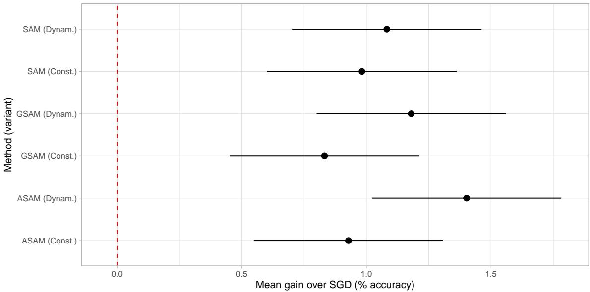  
Figure 6: Mean accuracy gains of diferent Method-variant combinations against the SGD baseline, after removing the dataset Version efects. Using SAM-based approaches result in gains over the SGD baseline in all cases. Moreover, dynamic $\rho$ results in higher gains when compared to constant $\rho$ across all three methods tested.

## Appendix F. Ablation Study

Figure 7 reports the sensitivity/top-1 accuracy of CAP-SAM to its four hyperparameters, varying one at a time while holding the remaining three at their default values. Panels (a) and (b) report the initial radius $\rho _ { 0 }$ and the growth factor $\gamma ;$ panels (c) and (d) report the bounds $\rho _ { \mathrm { m i n } }$ and $\rho _ { \mathrm { m a x } }$

CAP-SAM is therefore robust to $\rho _ { \mathrm { m i n } }$ and $\rho _ { \mathrm { m a x } } .$ , which serve only to clip the updated radius within a safe interval and have no efect unless the clip becomes active. In contrast, $\rho _ { 0 }$ and $\gamma$ meaningfully influence performance and benefit from light tuning, as they act throughout training and shape how the radius changes.

(a) Perturbation radius $\rho _ { 0 }$  
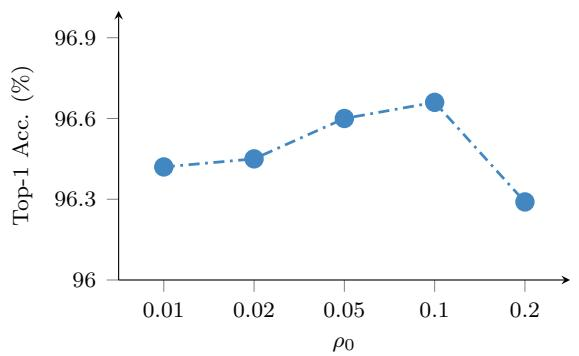

(b) Growth factor γ  
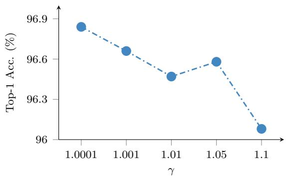

(c) Minimum radius $\rho _ { \mathrm { m i n } }$  
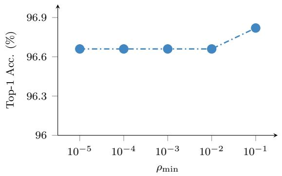

(d) Maximum radius $\rho _ { \mathrm { m a x } }$  
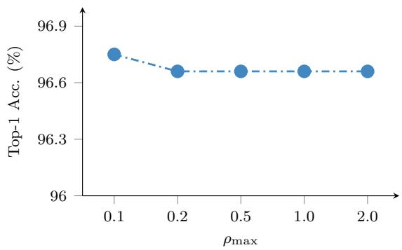  
Figure 7: Efect of hyperparameters on top-1 accuracy of CAP-SAM with ResNet-18 on CIFAR-10.

## Appendix G. Additional Convergence Results

Figure 8 shows convergence of CAP-SAM training loss on the CIFAR-10 and CIFAR-100 datasets. Figure 9 and 10 shows the training loss and Test top-1 accuracy as a function of the number of epochs for CAP-SAM, SAM, and SGD on CIFAR-100 across all network architectures. CAP-SAM consistently converges faster than both SAM and SGD.

CAP-SAM attains a consistently lower training loss than SAM while remaining above SGD, and reaches higher test accuracy than both baselines throughout training. This phenomenon clearly shows how SGD descends fastest on the training objective but generalises worst, SAM sacrifices training progress for robustness, and CAP-SAM, by perturbing only as much as the local curvature requires, is able to fit the data quickly while exceeding SAM’s generalisation ability.

(a) ResNet-18  
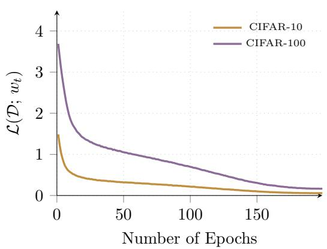

(b) WRN-28-10  
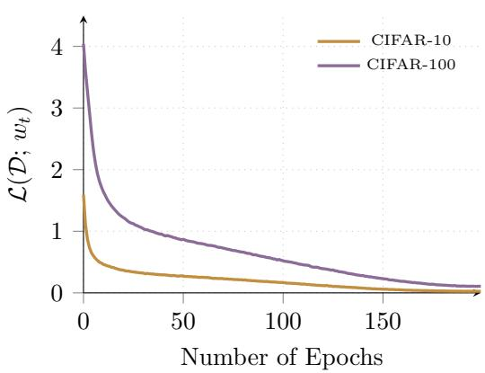  
(d) PyramidNet-110

(c) VGG-11-BN  
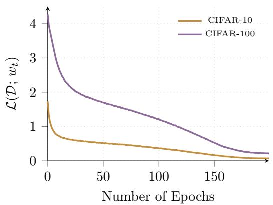

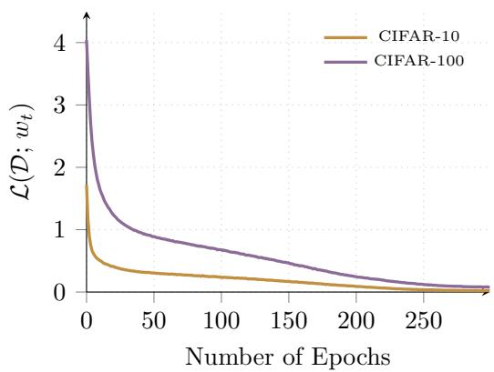  
Figure 8: Training loss $\mathcal { L } ( \mathcal { D } ; w _ { t } )$ of CAP-SAM as a function of the number of epochs, comparing CIFAR-10 and CIFAR-100 across four architectures: (a) ResNet-18,(b)WRN-28-10,(c) VGG-11-BN and (d) PyramidNet-110.

(a) ResNet-18  
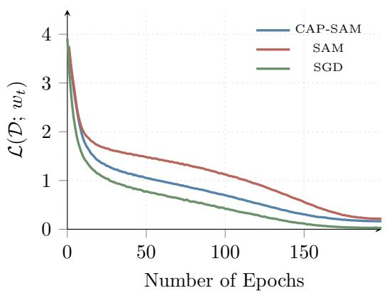

(b) WRN-28-10  
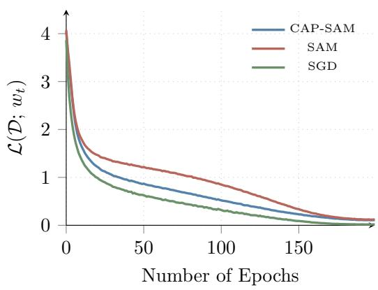  
(d) PyramidNet-110

(c) VGG-11-BN  
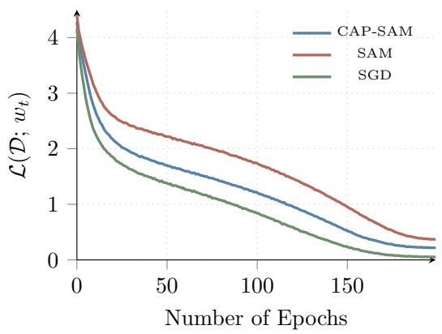

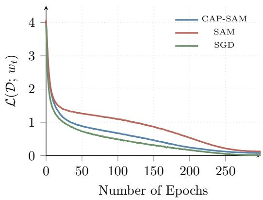  
Figure 9: Training loss $\mathcal { L } ( \mathcal { D } ; w _ { t } )$ as a function of the number of epochs on CIFAR-100, comparing CAP-SAM, SAM, and SGD across four architectures: (a) ResNet-18, (b) WRN-28-10, (c) VGG-11-BN and (d) PyramidNet-110.

(a) ResNet-18  
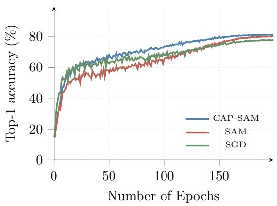

(b) WRN-28-10  
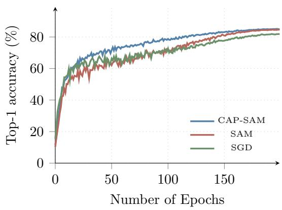  
(d) PyramidNet-110

(c) VGG-11-BN  
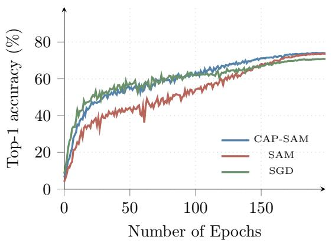

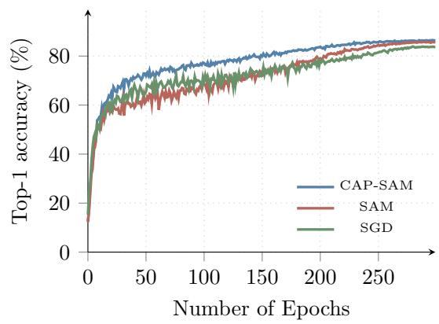  
Figure 10: Test top-1 accuracy as a function of the number of epochs on CIFAR-100, comparing CAP-SAM, SAM, and SGD across four architectures: (a) ResNet-18, (b) WRN-28-10, (c) VGG-11-BN and (d) PyramidNet-110.