# OrionMoE-v1.0: A Mixture-of-Experts Foundation Model for Tabular In-Context Learning

Mohamed Bouadi∗, Nassim Bouarour∗, Aditya Tanna, Vinay Kumar Sankarapu

Lexsi Labs

∗Equal contribution

## Abstract

Tabular foundation models enable in-context learning by predicting unseen observations from a labeled support table without task-specific parameter updates. Despite recent advances, most existing approaches rely on dense architectures that apply the same transformations across features and datasets. We introduce ORIONMOE-SMALL, a compact tabular foundation model that combines distribution-aware representations with dataset-conditioned sparse mixture-of-experts computation. Built on a dual-axis Transformer architecture, ORIONMOE-SMALL selectively activates experts along the feature axis, with routing decisions informed by both individual feature representations and the broader dataset context. This design enables adaptive allocation of computation across heterogeneous tabular problems while retaining a shared computational pathway across tasks. ORIONMOE-SMALL is pretrained entirely on synthetic classification tasks generated from a structured causal prior and performs downstream prediction without gradient-based adaptation. Experiments across multiple tabular benchmarks demonstrate competitive performance against substantially larger foundation models, with particularly strong results on small-context and high-dimensional datasets. Further analysis reveals favorable relative performance under class imbalance and highlights the importance of feature composition.

Keywords: Tabular Foundation Model, Mixture-of-Experts, In-Context Learning, Tabular Classification LICENSE: Lexsi Labs Source Available License (LSAL) v1.2, OrionMoE Edition (see Section 4)

## 1 Introduction

Tabular data remains one of the most prevalent forms of structured information in machine learning, underpinning applications in healthcare, finance, scientific discovery, and industrial systems [1, 2, 3, 4]. Unlike images or natural language, however, tabular datasets exhibit substantial heterogeneity in their statistical structure. Features may represent continuous measurements, categorical attributes, counts, or ordinal quantities, with widely varying distributions, scales, and predictive relationships. Dataset sizes, dimensionality, missingness, and label distributions also differ considerably across applications. This diversity has historically favored specialized learning algorithms, particularly gradient-boosted decision trees, over neural architectures that must be trained separately for each task [5, 6, 7, 8, 9].

Recent advances in tabular foundation models (TFMs) have begun to reshape this landscape. Models such as TabPFN [10, 11, 12, 13], TabICL [14, 15], OrionMSP [16], OrionBix [17], LimiX [18, 19], TabDPT [20], EXAONE Tabular [21] and TabFM [22] demonstrate that a single pretrained network can transfer predictive capabilities across diverse tabular datasets. A central paradigm underlying these models is in-context learning: given a labeled support table, the model predicts unseen observations through a forward pass, without task-specific parameter updates. By pretraining on large collections of synthetic prediction problems, TFMs amortize the cost of learning across tasks, replacing repeated optimization with contextual adaptation at inference time. Recent evaluations, including TabTune [23] and TabArena [24], highlight the increasing competitiveness of this approach against conventional tabular learning methods.

Table 1 Model capacity and predictive performance of recent tabular foundation models. Models are grouped into three capacity regimes: small (< 50M parameters), medium (50–150M), and large (> 150M). We report Elo ratings on TabArena (N = 38), BeyondArena (N = 98), OpenML-CC18 (N = 48), and TALENT (N = 158). Higher Elo indicates better predictive performance. Ratings are computed independently within each benchmark and are not directly comparable across benchmarks. A dash indicates unavailable results.
<table><tr><td>Model</td><td>Params (M)</td><td>TabArena</td><td>BeyondArena</td><td>OpenML-CC18</td><td>TALENT</td></tr><tr><td colspan="6">Small models (&lt; 50M)</td></tr><tr><td>OrionMoE-Small</td><td>37.7</td><td>1343</td><td>1149</td><td>1216</td><td>1081</td></tr><tr><td>Causilo</td><td>36.1</td><td>1558</td><td>1268</td><td>1295</td><td>1196</td></tr><tr><td>TabICLv2</td><td>27.6</td><td>1299</td><td>1089</td><td>1228</td><td>1106</td></tr><tr><td colspan="6">Medium models (50–150M)</td></tr><tr><td>TabPFN-3</td><td>53</td><td>1375</td><td>1166</td><td>1113</td><td>1077</td></tr><tr><td>TabDPT-1.3</td><td>63</td><td>1236</td><td>1041</td><td>1136</td><td>1016</td></tr><tr><td>Xiaomi-TabLDM</td><td>70</td><td>1311</td><td></td><td>1183</td><td>1056</td></tr><tr><td colspan="6">Large models (&gt; 150M)</td></tr><tr><td>TabPFN-3.5</td><td>220</td><td>1707</td><td>1348</td><td>1331</td><td>1274</td></tr><tr><td>LimiX-2</td><td>400</td><td>1775</td><td>1188</td><td></td><td></td></tr><tr><td>TabFM</td><td>408.7</td><td>1590</td><td>1222</td><td></td><td></td></tr></table>

Despite this progress, an important architectural question remains relatively unexplored: should every feature and dataset be processed by the same computational pathway? Existing in-context TFMs predominantly rely on dense Transformer-style architectures, where feed-forward transformations are shared across feature representations and datasets. Although attention mechanisms allow these models to adapt their representations to the observed context, the underlying feed-forward computation remains dense and uniformly applied. Yet the statistical mechanisms governing tabular features can differ substantially, even within a single dataset. A continuous measurement, a high-cardinality categorical attribute, and a discrete variable may require different transformations to extract predictive information. Moreover, the relevance of a particular transformation may depend on the broader dataset context rather than on the individual feature alone. This raises the possibility that adapting the allocation of computation, in addition to the representations themselves, could provide a useful inductive bias for tabular foundation models.

Mixture-of-Experts (MoE) architectures offer a natural framework for conditional computation. By selecting a subset of specialized networks for each input, sparse MoE models increase the diversity of available transformations without requiring every expert to be evaluated at every step [25, 26]. This principle has proved effective in scaling neural models, particularly in language modeling, where learned routing mechanisms allocate computation across different input representations. Its application to tabular in-context learning, however, raises a distinct challenge. Unlike language tokens, tabular feature representations have no universal semantics across datasets: the same numerical value may correspond to entirely different quantities, distributions, and predictive relationships. Consequently, expert selection should account not only for the local representation of a feature but also for the statistical context of the dataset in which it appears.

In this report, we introduce OrionMoE-Small, a compact tabular foundation model that combines in-context learning with dataset-conditioned sparse computation. OrionMoE-Small retains the two-dimensional structure of tabular data through a dual-axis backbone that separates information exchange across observations from interactions among features. Its central innovation is to replace dense feed-forward computation along the feature axis with a sparse mixture of experts. Each feature token is processed by an always-active shared expert and a small subset of routed experts, allowing the model to select among multiple learned feature transformations while preserving a common computational pathway.

OrionMoE-Small is pretrained entirely on synthetic prediction problems generated using an extended version of O’PRIOR [27], our synthetic task generator. The prior combines diverse structural causal mechanisms with heterogeneous feature distributions and controlled variations in dataset characteristics. This provides a broad family of learning problems in which different features and datasets may exhibit distinct statistical relationships, offering a natural setting for learning conditional feature transformations and dataset-aware routing.

We evaluate OrionMoE-Small against recent tabular foundation models across multiple benchmark suites, including TabArena [24], OpenML-CC18 [28], TALENT [29], and BCCO [18]. Table 1 provides an overview of the relationship between model capacity and predictive performance across recent tabular foundation models. To contextualize ORIONMOE-SMALL, we distinguish three parameter count regimes: small (< 50M), medium (50–150M), and large (> 150M). With only 37.7 million parameters, ORIONMOE-SMALL belongs to the small-model category, alongside Causilo and TabICLv2. Despite its compact size, ORIONMOE-SMALL achieves competitive performance across all four benchmarks, outperforming TabICLv2 on TabArena and BeyondArena and remaining close to the larger TabPFN-3 model. It also surpasses the medium-sized TabDPT-1.3 across all four benchmarks. Although the strongest large-scale models, particularly TabPFN-3.5 and LimiX-2, generally achieve higher predictive performance, their parameter budgets are substantially larger. At the same time, Causilo’s strong performance within the small-model category indicates that model size alone does not explain predictive competitiveness.

The main contributions of this report are:

• We introduce OrionMoE-Small, a compact tabular foundation model that incorporates sparse mixture-ofexperts computation along the feature axis within a dual-axis in-context learning architecture.

• We propose dataset-conditioned expert routing, in which a learned support-derived dataset representation modulates expert selection, enabling computational pathways to adapt jointly to feature content and dataset context.

• We present an extensive empirical evaluation against recent tabular foundation models and analyze the dataset regimes in which OrionMoE-Small is most competitive, highlighting the relationship between feature dimensionality, dataset characteristics, and predictive performance.

## 2 Model Architecture and Inference

ORIONMOE-SMALL is a tabular foundation model that combines in-context learning with dataset-conditioned sparse computation. Given a labeled support set $\begin{array} { r } { { \cal { S } } = \{ ( { \bf x } _ { i } , y _ { i } ) \} _ { i = 1 } ^ { N } } \end{array}$ and a set of unlabeled query observations $\mathcal { Q } = \{ \mathbf { x } _ { j } ^ { * } \} _ { j = 1 } ^ { M } ,$ the model predicts the query targets by conditioning on S, without task-specific parameter updates. Adaptation to a new dataset therefore occurs entirely through the forward pass.

The architecture is motivated by two properties of tabular data. First, the meaning of an individual feature value depends on the empirical distribution and predictive relationships of the dataset in which it appears. Second, different features and datasets may require distinct computations to extract predictive information. As shown in Figure 1, ORIONMOE-SMALL addresses these properties through a distribution-aware column encoder introduced in TabICLv2 [15], a dual-axis Transformer backbone, and a sparse mixture-of-experts (MoE) layer whose routing decisions are conditioned on a learned dataset representation. An in-context prediction head subsequently aggregates the learned representations to produce task-conditioned predictions.

## 2.1 Model Architecture

Distribution-aware column embedding. ORIONMOE-SMALL represents a table as a grid of cell embeddings, retaining a separate representation for each observation–feature pair. Following TabICLv2 [15], a shared column encoder contextualizes each value using the support observations in its column. This provides a data-dependent representation of each feature without relying on fixed column identities.

Specifically, scalar values are first projected into the model’s latent space and processed by a sequence of induced self-attention blocks. In each block, learned inducing vectors aggregate information from the support observations, and both support and query cells attend to the resulting column summaries. A cell’s representation therefore depends on its value and on the statistical context supplied by the support column: the same numerical value can receive different embeddings in different datasets.

The column encoder is also target-aware. Support-target embeddings are added to the corresponding support representations before induced attention, allowing the column summaries to capture information relevant to the prediction task. Query targets are never provided, and query observations do not contribute to the construction of the support summaries. We adapt this encoding scheme by processing columns individually, leaving cross-feature interactions to the subsequent dual-axis backbone. The contextual cell embeddings are combined with a learned missingness signal, preserving the distinction between absent entries and observed numerical values.

In addition to the original feature tokens, ORIONMOE-SMALL introduces learned feature registers. These registers participate in within-row computation and serve as dedicated representations for collecting information across the features of each observation.

Dual-axis representation learning. A central design principle of ORIONMOE-SMALL is to preserve the twodimensional structure of tabular data. Each backbone block combines computation along the sample and feature axes, allowing representations to capture complementary dependencies.

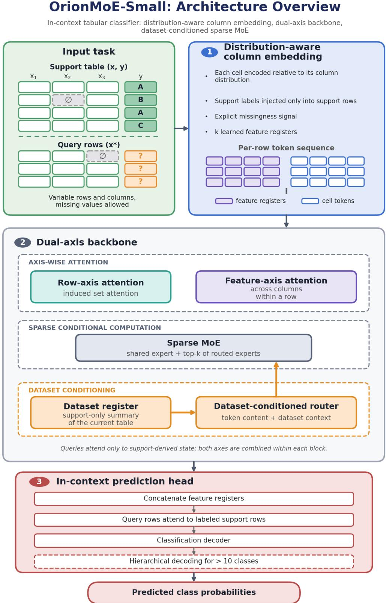  
Figure 1 Overview of the OrionMoE-Small architecture. Given a labeled support table and unlabeled query observations, OrionMoE first constructs distribution-aware cell embeddings using column-level statistics derived from the support set. A dual-axis backbone combines attention across observations and features, with sparse mixture-of-experts (MoE) computation. A learned dataset register conditions the expert routing so that expert selection depends on both token content and dataset context. The resulting representations feed the in-context prediction head, which produces query predictions without task-specific parameter updates. At inference, predictions from eight transformed and permuted views are aggregated in logit space.

Along the row axis, attention operates across observations within each feature. This enables a cell representation to incorporate information from other observations belonging to the same dataset. Along the feature axis, attention operates across feature tokens within each observation, modeling dependencies among its attributes. This structure allows statistical information aggregated across observations and interactions among features to inform one another. Repeating these operations progressively integrates information across both axes while preserving individual feature representations.

To support large in-context datasets, row-axis attention uses an induced set attention mechanism. A fixed number of learned inducing vectors first aggregate information from the support observations, and individual observations then attend to the resulting latent summaries. With a fixed number of inducing vectors, the row-axis attention cost scales linearly with the number of observations, rather than quadratically as in conventional full self-attention.

The attention mechanism also enforces the in-context information boundary: support representations are computed exclusively from the labeled support set, while query representations attend only to support-derived information. Consequently, query observations cannot alter the support state used to predict other queries.

Feature-axis attention, by contrast, operates directly over the feature tokens and learned registers. Together, the two attention mechanisms separate the aggregation of evidence across observations from the modeling of interactions among features.

Sparse mixture-of-experts computation. The principal architectural contribution of ORIONMOE-SMALL is the introduction of sparse conditional computation. Conventional dense tabular Transformers apply the same feed forward transformation to every feature token, irrespective of the statistical properties of the feature or the dataset. ORIONMOE-SMALL instead equips each block with a collection of expert networks and dynamically selects which transformations to apply.

For a representation h and a dataset representation r, the MoE transformation is defined as

$$
\mathrm { M o E } ( \mathbf { h } , \mathbf { r } ) = E _ { \mathrm { s h a r e d } } ( \mathbf { h } ) + \sum _ { e \in \mathcal { T } _ { k } ( \mathbf { h } , \mathbf { r } ) } \alpha _ { e } ( \mathbf { h } , \mathbf { r } ) E _ { e } ( \mathbf { h } ) ,\tag{1}
$$

where $E _ { \mathrm { s h a r e d } }$ denotes the shared expert, $E _ { e }$ represents routed expert $e ,$ and $\mathcal { T } _ { k }$ contains the indices of the $k$ experts with the highest routing scores. The corresponding routing weights are normalized over the selected experts.

Dataset-conditioned expert routing. Beyond token-dependent expert selection, ORIONMOE-SMALL introduces dataset-conditioned routing. The underlying motivation is that the appropriate transformation of a token may depend not only on its local representation, but also on the broader statistical structure of the table.

To capture this information, the model maintains a learned dataset register r, which is progressively updated through attention-based aggregation over support representations. The register summarizes information about the current dataset and influences expert selection throughout the backbone.

For expert $e ,$ the routing score can be expressed as

$$
s _ { e } ( \mathbf { h } , \mathbf { r } ) = \mathbf { w } _ { e } ^ { \top } \operatorname { M o d } ( \mathbf { h } , \mathbf { r } ) + g _ { e } ( \mathbf { r } ) + b _ { e } ,\tag{2}
$$

where Mod denotes a learned dataset-conditioned transformation of the token representation, $g _ { e }$ captures an additional dataset-level routing preference, and $b _ { e }$ is an expert-selection bias.

The modulation operates through learned scaling and shifting of token representations, allowing the dataset register to influence how individual tokens are evaluated by the router. The dataset-dependent contributions are initialized conservatively so that routing initially depends primarily on token content, with dataset-level preferences emerging during pretraining.

This mechanism distinguishes ORIONMOE-SMALL from conventional token-only sparse routing. Two tokens with similar local representations may be assigned to different experts when they occur in different datasets. Conversely, the router may identify common computational requirements across different datasets and direct them to the same experts.

Importantly, expert specialization is learned rather than prescribed: every routed expert remains eligible for every token, and routing is not constrained by feature type, dataset identity, or application domain. An adaptive expert-selection bias regulates expert utilization during training without introducing an auxiliary load-balancing term into the prediction objective.

In-context prediction head. Following the dual-axis backbone, the feature registers are concatenated to obtain a fixed-width representation of each observation, which is combined with a projected representation of the dataset register.

A stack of in-context attention layers then processes the resulting support and query representations. Support targets are incorporated into the context, allowing query predictions to depend on the relationships inferred from the labeled observations.

For classification, a decoder maps the resulting query representations to class logits. The released classifier supports a native budget of ten classes and extends to larger label spaces through a hierarchical classification procedure. Rather than requiring a separate output dimension for every possible class count, the model recursively resolves groups of classes until the final predictions are obtained.

The resulting architecture combines distribution-aware cell representations, structured information exchange across the two axes of a table, and dataset-conditioned conditional computation within a single in-context prediction framework.

Inference. At inference time, ORIONMOE-SMALL adapts to a new dataset solely by conditioning on its labeled support table. The pretrained parameters remain fixed, and no task-specific optimization is required.

The released inference procedure evaluates multiple complementary views of the same prediction task. Numerical features are represented through different transformations, while feature order, support-row order, categorical encodings, and class encodings are varied across the views. These transformations encourage predictions to be less sensitive to arbitrary choices of representation and ordering.

The default configuration uses eight views, combining four numerical preprocessing strategies with two class-encoding orientations. Predictions from the different views are aligned to the original class ordering and aggregated in logit space:

$$
\hat { \mathbf { p } } ( y \mid \mathbf { x } , \mathcal { S } ) = \mathrm { s o f t m a x } \left( \frac { 1 } { K } \sum _ { k = 1 } ^ { K } \mathbf { z } ^ { ( k ) } ( \mathbf { x } , \mathcal { S } ) \right) , \qquad K = 8 ,\tag{3}
$$

where $\mathbf { z } ^ { ( k ) }$ denotes the class logits obtained from inference view k.

The support/query separation also enables efficient reuse of support-derived representations across successive query batches. Since query observations cannot modify the support state, queries may be processed in chunks against a cached context without changing the resulting predictions, provided the support set and inference configuration are unchanged.

By default, ORIONMOE-SMALL uses the full available support table. When memory constraints prevent evaluation with the complete input, the inference procedure can adaptively reduce the number of features or support observations These reductions are applied only when necessary. Overall, inference preserves the same fundamental learning problem encountered during pretraining: infer the predictive relationships of a dataset from labeled observations and apply them to unseen queries without gradient-based adaptation.

## 2.2 Synthetic Prior Generation

ORIONMOE-SMALL is pretrained on synthetic in-context learning episodes generated using O’PRIOR [30], our previously released synthetic task generator. O’PRIOR provides a diverse collection of structural causal model families, including multilayer perceptrons, tree-based mechanisms, one-dimensional convolutions, Gaussian processes, time-lagged models, linear functions, and hybrid compositions. Together, these mechanisms capture a broad range of statistical relationships, from smooth nonlinear dependencies to discontinuous decision boundaries and temporal interactions. By varying the underlying structures, functional mechanisms, and sampling parameters, the prior generates prediction tasks spanning different dimensionalities, sample sizes, and levels of predictive complexity.

For ORIONMOE-SMALL, we extend O’PRIOR with a graph-based prior inspired by TabICL-v2 [15], in which heterogeneous functional mechanisms can coexist within randomly sampled dependency graphs. Unlike priors that instantiate an entire dataset from a single family of structural equations, this extension allows different variables within the same dataset to arise from distinct generative mechanisms. To ensure that the resulting tasks contain meaningful predictive information, we apply two complementary filtering stages. Structural filtering requires a directed predictive path from the observed features to the target, while dataset-level filtering uses a lightweight predictive probe to discard episodes whose predictive signal is insufficiently strong.

Beyond the underlying causal mechanisms, O’PRIOR supports composable transformations that introduce heterogeneous feature distributions, redundant attributes, outliers, different target distributions, and structured missingness. The generator also provides optional mechanisms for latent confounding, spurious correlations, and support–query distribution shifts. Transformations requiring fitted statistics are estimated exclusively from support observations, preserving the information boundary between support and query sets. For ORIONMOE-SMALL, we additionally introduce controlled count-, ordinal-, and proportion-valued features, together with stage-dependent missingness patterns, to broaden the statistical conditions encountered during pretraining.

The resulting prior exposes ORIONMOE-SMALL to variation both within and across datasets. Heterogeneous generative mechanisms create opportunities for distinct feature-level transformations, while variations in dataset structure and statistical properties provide contextual information that can influence expert routing. This diversity is aligned with ORIONMOE-SMALL’s dataset-conditioned mixture-of-experts architecture, which learns to allocate computation based on both individual feature representations and the broader dataset context.

## 3 Experimental Results

## 3.1 TabArena

TabArena [24] provides a competitive evaluation of tabular learning methods across diverse classification tasks, including recent foundation models, conventional machine learning algorithms, and tuned or ensembled systems. We evaluate OrionMoE-Small on 38 classification datasets, considering both overall predictive performance and its relationship with computational cost. We further examine performance across task types, dataset sizes, and target-class distributions to characterize the regimes in which OrionMoE-Small is most competitive.

● Default ■ Tuned × Tuned + Ensembled End-to-end --- Pareto front (always shown  partially imputed

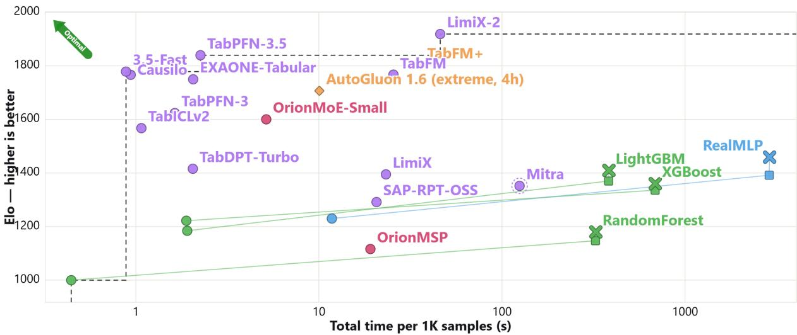  
Figure 2 Elo against total runtime per 1K samples on 38 TabArena classification tasks. Total time is the fit time per 1,000 training rows plus the prediction time per 1,000 test rows, median over the 38 classification datasets.

Figure 2 presents the trade-off between Elo rating and total runtime, including support-set processing and prediction time. OrionMoE-Small obtains an Elo rating of 1343, placing it ahead of several established tabular foundation models, including TabICLv2 (1299) [15], Xiaomi-TabLDM (1311) [31], and TabDPT-1.3 (1236) [20]. OrionMoE-Small remains relatively close to TabPFN-3 (1375) [12], although a performance gap persists relative to the strongest recent models, particularly TabPFN-3.5 [13] and LimiX-2 [19]. In terms of computational cost, OrionMoE-Small occupies an intermediate position among foundation models, without reaching the overall Pareto frontier. These results establish OrionMoE-Small as a competitive compact alternative to several existing tabular foundation models, while leaving room for improvement in both predictive accuracy and inference efficiency.

Table 2 provides a more detailed view of performance across dataset regimes. OrionMoE-Small achieves an Elo rating of 1364 on binary classification and 1303 on multiclass classification, outperforming TabPFN-3 on the latter (1282) The distinction between dataset sizes is more pronounced. On small datasets, OrionMoE-Small obtains an Elo of 1404, exceeding TabPFN-3 (1392), TabICLv2 (1337), and Xiaomi-TabLDM (1351). Its relative position deteriorates on medium-sized datasets, where the strongest foundation models obtain substantially higher ratings.

Target-class imbalance reveals another informative pattern. OrionMoE-Small reaches an Elo of 1501 on imbalanced datasets, surpassing TabPFN-3 (1477), TabICLv2 (1391), and Xiaomi-TabLDM (1420). However, this advantage does not extend to the most extreme imbalance regime, where OrionMoE-Small obtains a lower rating of 1191. The results therefore indicate favorable relative performance under moderate class imbalance, rather than uniform robustness to increasingly skewed class distributions.

Table 2 TabArena Elo scores across task and dataset regimes. Elo is recomputed independently within each subset. Higher is better. N is the number of datasets used to compute each score. T+E means Tuned + Ensemble.
<table><tr><td></td><td>Overall</td><td colspan="2">By Task</td><td colspan="2">By Dataset Size</td><td colspan="3">By Target</td></tr><tr><td>Model</td><td>Elo (N = 38)</td><td>Binary (N = 30)</td><td>Multiclass (N = 8)</td><td>Small (N = 28)</td><td>Medium (N = 10)</td><td>Balanced (N = 10)</td><td>Imbalanced (N = 16)</td><td>Extreme (N = 12)</td></tr><tr><td>LimiX-2</td><td>1775</td><td>1774</td><td>1836</td><td>1768</td><td>1963</td><td>1796</td><td>1862</td><td>1757</td></tr><tr><td>TabPFN-3.5</td><td>1707</td><td>1723</td><td>1700</td><td>1671</td><td>2035</td><td>1717</td><td>1772</td><td>1717</td></tr><tr><td>TabFM+</td><td>1615</td><td>1613</td><td>1671</td><td>1650</td><td>1659</td><td>1558</td><td>1790</td><td>1569</td></tr><tr><td>TabFM</td><td>1590</td><td>1659</td><td>1443</td><td>1610</td><td>1673</td><td>1602</td><td>1815</td><td>1461</td></tr><tr><td>TabPFN-3.5-Fast</td><td>1582</td><td>1598</td><td>1571</td><td>1559</td><td>1824</td><td>1655</td><td>1624</td><td>1559</td></tr><tr><td>Causilo</td><td>1558</td><td>1535</td><td>1705</td><td>1578</td><td>1634</td><td>1514</td><td>1652</td><td>1569</td></tr><tr><td>Mitra_V2</td><td>1556</td><td>1549</td><td>1624</td><td>1552</td><td>1712</td><td>1492</td><td>1682</td><td>1552</td></tr><tr><td>AutoGluon 1.6 (noncommercial, 4h)</td><td>1555</td><td>1571</td><td>1542</td><td>1539</td><td>1760</td><td>1614</td><td>1593</td><td>1543</td></tr><tr><td>EXAONE-Tabular</td><td>1539</td><td>1534</td><td>1600</td><td>1525</td><td>1730</td><td>1443</td><td>1602</td><td>1646</td></tr><tr><td>AutoGluon 1.6 (extreme, 4h)</td><td>1489</td><td>1496</td><td>1499</td><td>1471</td><td>1692</td><td>1555</td><td>1508</td><td>1483</td></tr><tr><td>TabPFN-3</td><td>1375</td><td>1414</td><td>1282</td><td>1392</td><td>1433</td><td>1458</td><td>1477</td><td>1271</td></tr><tr><td>OrionMoE-Small</td><td>1343</td><td>1364</td><td>1303</td><td>1404</td><td>1282</td><td>1443</td><td>1501</td><td>1191</td></tr><tr><td>Xiaomi-TabLDM</td><td>1311</td><td>1319</td><td>1308</td><td>1351</td><td>1291</td><td>1305</td><td>1420</td><td>1251</td></tr><tr><td>TabICL-v2</td><td>1299</td><td>1321</td><td>1249</td><td>1337</td><td>1282</td><td>1315</td><td>1391</td><td>1236</td></tr><tr><td>RealTabPFN-V2.5 (T+E)</td><td>1268</td><td>1238</td><td>1418</td><td>1323</td><td>1201</td><td>1315</td><td>1316</td><td>1220</td></tr><tr><td>TabDPT-1.3</td><td>1236</td><td>1254</td><td>1196</td><td>1259</td><td>1244</td><td>1301</td><td>1358</td><td>1111</td></tr><tr><td>RealMLP (T+E)</td><td>1162</td><td>1160</td><td>1188</td><td>1160</td><td>1228</td><td>1242</td><td>1100</td><td>1204</td></tr><tr><td>TabM (T+E)</td><td>1133</td><td>1131</td><td>1153</td><td>1125</td><td>1206</td><td>1148</td><td>1080</td><td>1208</td></tr><tr><td>TabDPT_TURBO</td><td>1112</td><td>1121</td><td>1092</td><td>1140</td><td>1062</td><td>1212</td><td>1197</td><td>966</td></tr><tr><td>TabICL-v1</td><td>1095</td><td>1130</td><td>981</td><td>1103</td><td>1102</td><td>1205</td><td>1083</td><td>1045</td></tr><tr><td>LimiX</td><td>1078</td><td>1040</td><td>1252</td><td>1172</td><td>809</td><td>1128</td><td>1108</td><td>1017</td></tr><tr><td>CatBoost (T+E)</td><td>1070</td><td>1060</td><td>1121</td><td>1016</td><td>1296</td><td>1027</td><td>1029</td><td>1173</td></tr><tr><td>CatBoost</td><td>1053</td><td>1070</td><td>998</td><td>991</td><td>1303</td><td>988</td><td>1011</td><td>1175</td></tr><tr><td>Mitra-v1</td><td>1041</td><td>1023</td><td>1120</td><td>1198</td><td>508</td><td>1109</td><td>1077</td><td>952</td></tr><tr><td>XGBoost (T+E)</td><td>1027</td><td>1022</td><td>1059</td><td>967</td><td>1260</td><td>964</td><td>990</td><td>1136</td></tr><tr><td>TabSwift</td><td>1017</td><td>1042</td><td>929</td><td>1037</td><td>957</td><td>1057</td><td>1098</td><td>890</td></tr><tr><td>SAP-RPT-OSS</td><td>969</td><td>952</td><td>1040</td><td>1014</td><td>795</td><td>1011</td><td>898</td><td>1026</td></tr><tr><td>RealMLP</td><td>871</td><td>888</td><td>793</td><td>850</td><td>896</td><td>908</td><td>837</td><td>872</td></tr><tr><td>XGBoost</td><td>856</td><td>844</td><td>905</td><td>800</td><td>997</td><td>802</td><td>837</td><td>912</td></tr><tr><td>Random Forest (T+E)</td><td>812</td><td>761</td><td>1000</td><td>780</td><td>858</td><td>813</td><td>723</td><td>906</td></tr><tr><td>TabSTAR (T+E)</td><td>781</td><td>809</td><td>624</td><td>808</td><td>594</td><td>814</td><td>822</td><td>649</td></tr><tr><td>OrionMSP</td><td>755</td><td>780</td><td>611</td><td>804</td><td>456</td><td>838</td><td>671</td><td>760</td></tr><tr><td>TabSTAR</td><td>667</td><td>702</td><td>432</td><td>697</td><td>436</td><td>709</td><td>722</td><td>444</td></tr><tr><td>TabFLEX</td><td>648</td><td>676</td><td>462</td><td>684</td><td>383</td><td>691</td><td>625</td><td>586</td></tr></table>

Overall, TabArena shows that OrionMoE-Small achieves competitive performance against several established foundation models while remaining below the strongest models in absolute Elo. Its relative performance is particularly encouraging on smaller classification problems and moderately imbalanced targets. These patterns motivate a broader evaluation of whether the same behavior persists across alternative benchmark distributions and more challenging generalization settings.

## 3.2 BeyondArena

BeyondArena [32] evaluates tabular learning methods beyond conventional small-scale IID settings, incorporating grouped and temporal distribution shifts, larger datasets, and varying feature dimensionalities. Grouped evaluation measures generalization to previously unseen subpopulations, while temporal evaluation tests predictions on observations collected after the training period. These settings provide a complementary perspective on the generalization capabilities of tabular foundation models, particularly when compared with conventional methods that can be optimized independently for each downstream task.

Figure 3 presents the relationship between predictive performance and total runtime across BeyondArena classification tasks. OrionMoE-Small obtains an overall Elo rating of 1149 on the 98 evaluated datasets, ranking eighth among the compared methods. It outperforms several tabular foundation models, including TabICLv2 (1089), TabDPT-1.3 (1041), and RealTabPFN-V2.5 (1048), while approaching TabPFN-3 (1166). A larger gap remains relative to TabPFN-3.5 (1348) and Causilo [33] (1268). OrionMoE-Small also exceeds the overall Elo ratings of several tuned conventional baselines, including RealMLP, TabM, CatBoost, and LightGBM.

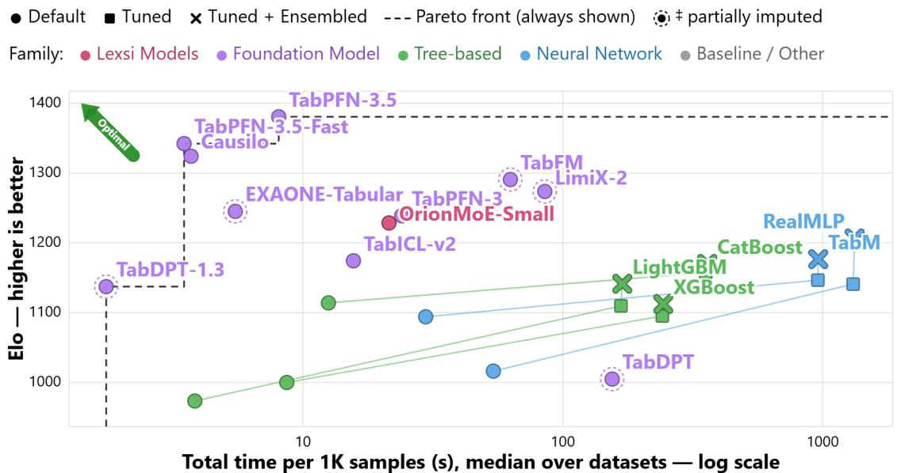  
Figure 3 Pareto frontier of Elo rating versus total runtime per 1K samples on BeyondArena classification tasks. Higher Elo indicates stronger predictive performance and lower runtime indicates greater efficiency. The frontier summarizes the trade-off between predictive quality and computational cost under more challenging IID, grouped, temporal, large-scale, and high-dimensional evaluation settings.

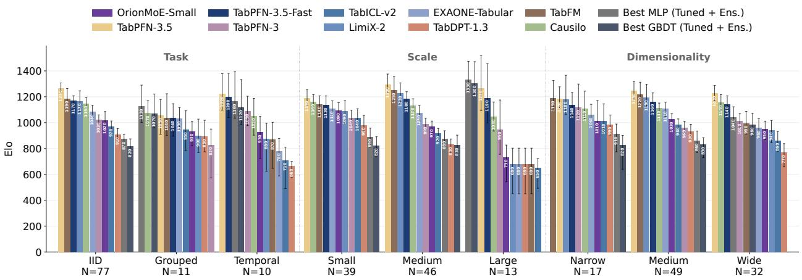  
Figure 4 Elo ratings on BeyondArena across evaluation regime, dataset scale, and dimensionality. Results are reported separately for IID, grouped, and temporal splits, as well as for different dataset-size and feature-dimensionality regimes. The decomposition highlights how the relative ranking of tabular models changes across distribution shifts and dataset characteristics.

The aggregate results conceal substantial differences between evaluation regimes. Figure 4 and Table 3 decompose performance by task type, distribution shift, dataset size, and dimensionality. On IID datasets, OrionMoE-Small reaches an Elo rating of 1210, outperforming several recent foundation models and conventional baselines, although remaining behind TabPFN-3.5 (1444), Causilo (1342), and TabPFN-3 (1224). Under grouped and temporal splits, its relative position becomes less favorable, with Elo ratings of 979 and 1009, respectively. In these regimes, tuned conventional methods become particularly competitive: RealMLP with tuning and ensembling achieves the highest Elo on both grouped (1220) and temporal (1325) evaluations. This contrasts with the IID regime, where foundation models occupy the leading positions, illustrating the challenge of transferring strong in-context prediction capabilities to shifted test distributions.

Table 3 BeyondArena Elo scores across task, split-regime, dataset-size, and dimensionality regimes. Elo is recomputed independently within each subset using datasets evaluated by all participating methods. Higher is better. N is the number of datasets used to compute each score. T+E means Tuned + Ensemble.
<table><tr><td></td><td>Overall</td><td colspan="2">By Task</td><td colspan="3">By Regime</td><td colspan="3">By Dataset Size</td><td colspan="3">By Dimensionality</td></tr><tr><td>Model</td><td>Elo (N = 98)</td><td>Binary (N = 73)</td><td>Multiclass (N = 25)</td><td>IID (N = 77)</td><td>Grouped (N = 11)</td><td>Temporal (N = 10)</td><td>Small (N = 38)</td><td>Medium (N = 47)</td><td>Large (N = 13)</td><td>Narrow (N = 13)</td><td>Medium (N = 58)</td><td>Wide (N = 27)</td></tr><tr><td>TabPFN-3.5</td><td>1348</td><td>1350</td><td>1349</td><td>1444</td><td>1095</td><td>1319</td><td>1326</td><td>1482</td><td>1294</td><td>1304</td><td>1404</td><td>1303</td></tr><tr><td>TabPFN-3.5-Fast</td><td>1287</td><td>1272</td><td>1343</td><td>1354</td><td>1083</td><td>1285</td><td>1275</td><td>1396</td><td>1219</td><td>1274</td><td>1333</td><td>1240</td></tr><tr><td>Causilo</td><td>1268</td><td>1275</td><td>1255</td><td>1342</td><td>1126</td><td>1123</td><td>1304</td><td>1356</td><td>1106</td><td>1241</td><td>1300</td><td>1248</td></tr><tr><td>TabFM</td><td>1222</td><td>1202</td><td>1295</td><td>1318</td><td>1076</td><td>924</td><td>1258</td><td>1412</td><td>727</td><td>1286</td><td>1302</td><td>1088</td></tr><tr><td>LimiX-2</td><td>1188</td><td>1171</td><td>1246</td><td>1286</td><td>973</td><td>924</td><td>1195</td><td>1374</td><td>727</td><td>1269</td><td>1292</td><td>1008</td></tr><tr><td>EXAONE-Tabular</td><td>1176</td><td>1168</td><td>1207</td><td>1253</td><td>1085</td><td>855</td><td>1242</td><td>1290</td><td>727</td><td>1234</td><td>1236</td><td>1067</td></tr><tr><td>TabPFN-3</td><td>1166</td><td>1168</td><td>1163</td><td>1224</td><td>899</td><td>1204</td><td>1185</td><td>1229</td><td>1017</td><td>1245</td><td>1185</td><td>1113</td></tr><tr><td>OrionMoE-Small</td><td>1149</td><td>1148</td><td>1157</td><td>1210</td><td>979</td><td>1009</td><td>1225</td><td>1206</td><td>821</td><td>1128</td><td>1201</td><td>1079</td></tr><tr><td>RealMLP (T+E)</td><td>1117</td><td>1106</td><td>1153</td><td>1084</td><td>1220</td><td>1325</td><td>1061</td><td>1128</td><td>1449</td><td>1082</td><td>1098</td><td>1185</td></tr><tr><td>TabICL-v2</td><td>1089</td><td>1075</td><td>1137</td><td>1148</td><td>966</td><td>822</td><td>1156</td><td>1133</td><td>748</td><td>1153</td><td>1159</td><td>940</td></tr><tr><td>TabM (T=E)</td><td>1076</td><td>1070</td><td>1098</td><td>1039</td><td>1198</td><td>1263</td><td>1012</td><td>1081</td><td>1429</td><td>967</td><td>1065</td><td>1161</td></tr><tr><td>Catboost (T+E)</td><td>1062</td><td>1069</td><td>1044</td><td>1037</td><td>1079</td><td>1270</td><td>996</td><td>1074</td><td>1365</td><td>1022</td><td>1060</td><td>1091</td></tr><tr><td>Catboost (T)</td><td>1049</td><td>1054</td><td>1034</td><td>1019</td><td>1070</td><td>1276</td><td>986</td><td>1053</td><td>1354</td><td>1031</td><td>1034</td><td>1090</td></tr><tr><td>RealTabPFN-V2.5</td><td>1048</td><td>1031</td><td>1106</td><td>1086</td><td>979</td><td>833</td><td>1107</td><td>1081</td><td>727</td><td>1134</td><td>1055</td><td>1002</td></tr><tr><td>LightGBM (T+E)</td><td>1044</td><td>1053</td><td>1017</td><td>1005</td><td>1126</td><td>1260</td><td>951</td><td>1067</td><td>1393</td><td>983</td><td>1029</td><td>1106</td></tr><tr><td>TabDPT-1.3</td><td>1041</td><td>1026</td><td>1089</td><td>1086</td><td>970</td><td>749</td><td>1122</td><td>1050</td><td>727</td><td>1201</td><td>1095</td><td>867</td></tr><tr><td>TabM (T)</td><td>1034</td><td>1027</td><td>1058</td><td>993</td><td>1184</td><td>1168</td><td>986</td><td>1020</td><td>1333</td><td>905</td><td>1021</td><td>1121</td></tr><tr><td>RealMLP (T)</td><td>1028</td><td>1016</td><td>1066</td><td>986</td><td>1141</td><td>1219</td><td>976</td><td>1021</td><td>1302</td><td>1031</td><td>1002</td><td>1080</td></tr><tr><td>XGBoost (T+E)</td><td>1003</td><td>1031</td><td>919</td><td>973</td><td>982</td><td>1266</td><td>853</td><td>1054</td><td>1406</td><td>846</td><td>991</td><td>1095</td></tr><tr><td>LightGBM (T)</td><td>1002</td><td>1013</td><td>968</td><td>966</td><td>1093</td><td>1139</td><td>923</td><td>1003</td><td>1322</td><td>965</td><td>975</td><td>1069</td></tr><tr><td>CatBoost</td><td>1001</td><td>1027</td><td>922</td><td>976</td><td>1009</td><td>1168</td><td>915</td><td>1020</td><td>1264</td><td>953</td><td>986</td><td>1050</td></tr><tr><td>XGBoost (T)</td><td>979</td><td>1006</td><td>895</td><td>946</td><td>975</td><td>1207</td><td>844</td><td>1008</td><td>1371</td><td>855</td><td>953</td><td>1080</td></tr><tr><td>TabM</td><td>978</td><td>976</td><td>985</td><td>941</td><td>1068</td><td>1117</td><td>975</td><td>940</td><td>1116</td><td>896</td><td>961</td><td>1044</td></tr><tr><td>TabSwift</td><td>935</td><td>954</td><td>877</td><td>953</td><td>885</td><td>764</td><td>984</td><td>918</td><td>727</td><td>967</td><td>952</td><td>875</td></tr><tr><td>RealMLP</td><td>877</td><td>894</td><td>819</td><td>829</td><td>914</td><td>1096</td><td>815</td><td>859</td><td>1024</td><td>878</td><td>835</td><td>941</td></tr><tr><td>TabDPT</td><td>876</td><td>880</td><td>863</td><td>886</td><td>861</td><td>678</td><td>967</td><td>781</td><td>736</td><td>1057</td><td>864</td><td>790</td></tr><tr><td>XGBoost</td><td>862</td><td>894</td><td>751</td><td>822</td><td>825</td><td>1104</td><td>672</td><td>904</td><td>1128</td><td>714</td><td>824</td><td>974</td></tr><tr><td>LightGBM</td><td>837</td><td>858</td><td>767</td><td>797</td><td>847</td><td>1011</td><td>739</td><td>819</td><td>1052</td><td>775</td><td>796</td><td>922</td></tr><tr><td>RF (T+E)</td><td>835</td><td>821</td><td>874</td><td>806</td><td>955</td><td>773</td><td>868</td><td>747</td><td>857</td><td>856</td><td>818</td><td>839</td></tr><tr><td>RF</td><td>761</td><td>756</td><td>772</td><td>713</td><td>960</td><td>688</td><td>843</td><td>613</td><td>727</td><td>727</td><td>753</td><td>766</td></tr></table>

Dataset scale introduces a further distinction. OrionMoE-Small obtains an Elo rating of 1225 on small datasets, remaining competitive with several stronger overall models, including EXAONE-Tabular (1242) and Causilo (1304). On medium-sized datasets, it achieves 1206, but on large datasets its Elo drops to 821, substantially below the strongest tuned conventional systems. These results suggest that dataset scale is an important factor in the observed performance differences across BeyondArena regimes. The decomposition by feature dimensionality likewise shows that OrionMoE Small remains competitive with several established foundation models, although it does not consistently improve its relative ranking as dimensionality increases.

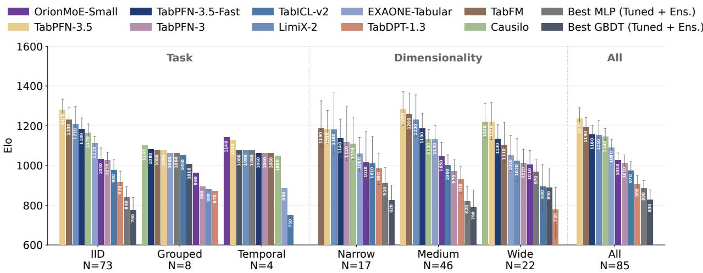  
Figure 5 Elo ratings on BeyondArena after restricting the analysis to datasets with fewer than 100K samples. Results are decomposed by IID, grouped, and temporal evaluation regimes and by feature dimensionality. Removing large-scale datasets isolates the effect of distribution shift and dimensionality from the additional difficulty introduced by dataset scale.

Importantly, dataset scale and evaluation regime are not independent. To examine whether the apparent distribution-shift disadvantage is partly associated with the presence of very large datasets, we repeat the analysis after excluding datasets with more than 100,000 samples. Figure 5 reports the resulting evaluation over 85 datasets. Restricting the analysis reduces the influence of large-scale problems and provides a complementary view of the relative rankings under IID, grouped, and temporal splits.

In this restricted setting, OrionMoE-Small remains within the competitive foundation-model group on IID tasks. Its relative behavior on grouped and temporal tasks is more nuanced: the ranking varies across the smaller subsets, and the reduced number of shifted datasets limits the strength of any general conclusion. The results indicate that the difficulties observed on the full BeyondArena suite cannot be attributed exclusively to the presence of large datasets. Rather, performance depends jointly on the evaluation regime, dataset scale, and feature characteristics.

Taken together, BeyondArena highlights both the strengths and current limitations of OrionMoE-Small. The model maintains competitive predictive performance against several established foundation models on standard classification problems, but does not yet consistently match the strongest methods under grouped and temporal distribution shifts or on very large datasets. These findings also illustrate why aggregate benchmark rankings alone are insufficient to characterize the generalization behavior of tabular foundation models.

## 3.3 OpenML-CC18

OpenML-CC18 [28] is a widely used benchmark suite comprising 72 classification tasks spanning diverse dataset sizes, feature dimensionalities, and class distributions. We follow the standard evaluation protocol provided by the benchmark library, retaining its predefined train–test splits, cross-validation folds, and default evaluation settings without modification. This ensures consistency with the established OpenML-CC18 evaluation procedure. To enable a fair comparison across the broadest set of participating foundation models, we first report results on the 48 tasks successfully completed by all compared methods, ensuring that Elo ratings and model rankings are computed over identical benchmark instances. The complete list of the 48 datasets is provided in Appendix B.1.

Figure 6 reports the corresponding Elo ratings. OrionMoE-Small achieves an Elo of 1216, ranking fourth among the evaluated models, behind TabPFN-3.5 (1331), Causilo (1295), and TabICLv2 (1228). In particular, OrionMoE-Small is within 12 Elo points of TabICLv2 and outperforms a broad set of recent foundation models, including TabLDM (1183), EXAONE-Tabular (1169), TabDPT-1.3 (1136), and TabPFN-3 (1113). These results place OrionMoE-Small among the strongest models on this common-task evaluation, demonstrating that its compact, dataset-conditioned architecture can achieve competitive predictive performance against recent dense tabular foundation models.

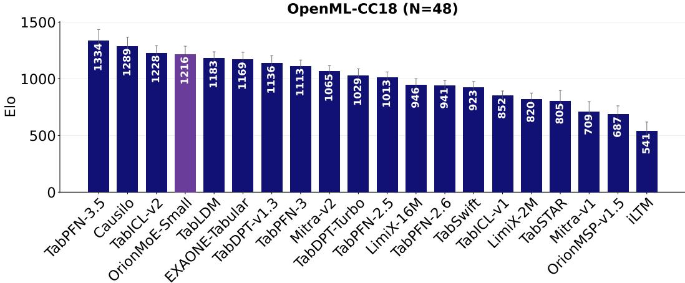  
Figure 6 Elo ratings on the subset of OpenML-CC18 tasks completed by all compared models. Restricting the evaluation to common tasks ensures that pairwise comparisons and model rankings are computed over the same benchmark instances.

## 3.4 TALENT

TALENT [29] provides a comprehensive collection of tabular learning datasets covering diverse classification problems, dataset scales, feature types, and statistical characteristics. We adopt the benchmark’s original experimental protocol as implemented in the TALENT library, using its predefined training, validation, and test partitions and default evaluation settings. No additional dataset resplitting is performed. For the common-task comparison, we retain the

158 classification datasets successfully evaluated by all participating models, ensuring consistent Elo computation and direct comparisons across methods. We provide in Appendix B.2 the list of these datasets.

As shown in Figure 7a, OrionMoE-Small obtains an Elo rating of 1081, ranking fifth among the compared methods. It remains close to EXAONE-Tabular (1099) and TabICLv2 (1106), while outperforming TabPFN-3 (1077), TabLDM (1056), TabDPT-v1.3 (1016), and several other recent foundation models. The strongest ratings are achieved by TabPFN-3.5 (1274) and Causilo (1196), indicating that a performance gap remains relative to the leading methods. Nevertheless, OrionMoE-Small’s position across this considerably broader dataset collection reinforces its competitiveness beyond the more constrained OpenML-CC18 evaluation.

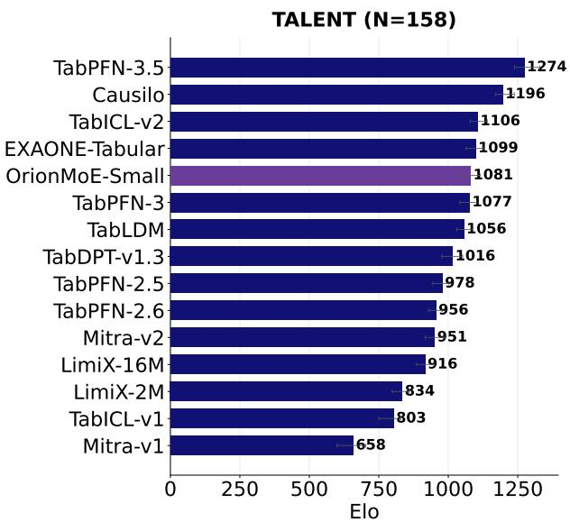  
(a) Elo ratings on common TALENT tasks.

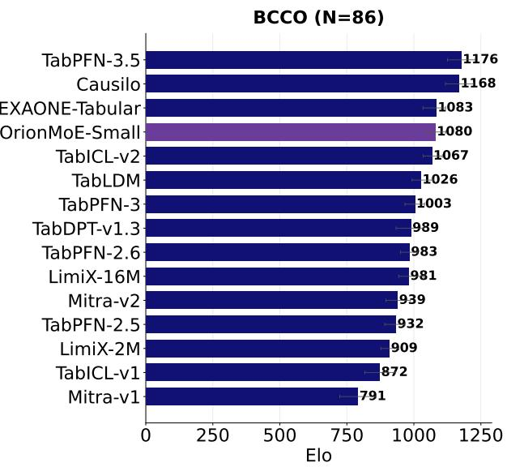  
(b) Elo ratings on common BCCO tasks.  
Figure 7 Elo ratings on the common-task subsets of TALENT and BCCO. (a) TALENT and (b) BCCO. For each benchmark, only tasks completed by all compared models are retained, ensuring that the reported Elo rankings are based on a consistent set of evaluation tasks.

## 3.5 BCCO

BCCO [18] provides a complementary evaluation suite of tabular classification problems spanning heterogeneous dataset characteristics and predictive settings. We follow the default experimental protocol of the BCCO benchmark, preserving its predefined data partitions, evaluation folds where applicable, and standard evaluation settings. This avoids introducing additional variation from custom data splitting or protocol modifications. We initially evaluate the 86 datasets shared by all participating models as described in Appendix B.3, allowing Elo ratings and model rankings to be computed over a common set of benchmark instances.

Figure 7b shows that OrionMoE-Small obtains an Elo rating of 1080, ranking fourth among the evaluated models. Its performance is particularly close to EXAONE-Tabular (1083), while exceeding TabICLv2 (1067), TabLDM (1026), TabPFN-3 (1003), and TabDPT-v1.3 (989). The leading methods remain TabPFN-3.5 (1176) and Causilo (1168). Importantly, OrionMoE-Small maintains a strong relative position on this additional benchmark, suggesting that its competitive performance is not confined to a single benchmark collection.

Taken together, the common-task evaluations demonstrate that OrionMoE-Small consistently ranks among the stronger recent tabular foundation models. While it does not surpass the leading TabPFN-3.5 and Causilo models, it remains competitive with TabICLv2, EXAONE-Tabular, and other recent alternatives across three independently constructed benchmark suites.

## 3.6 Evaluation on the Full Benchmark Suites

The common-task evaluations allow comparisons against a broad collection of tabular foundation models, but necessarily exclude datasets that some methods cannot successfully process. To complement these results, we conduct a fullbenchmark evaluation restricted to models with complete coverage of each benchmark suite. This enables assessment over all 72 OpenML-CC18 tasks, 181 TALENT datasets, and 106 BCCO datasets, respectively. The two evaluation settings are complementary: common-task comparisons maximize model coverage, while full-benchmark comparisons maximize dataset coverage.

Figures 9 and 8 present the Elo ratings of models completing the full evaluation suites. On OpenML-CC18 (Figure 8a), OrionMoE-Small achieves an Elo rating of 1022, ranking third behind TabPFN-3.5 (1163) and TabICLv2 (1042). It outperforms EXAONE-Tabular (988), TabDPT-v1.3 (963), and TabDPT-Turbo (822). Notably, its position remains competitive when the evaluation is expanded from the common 48-task subset to all 72 tasks.

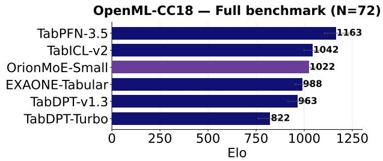  
(a) OpenML-CC18: models completing the full benchmark (72 datasets).

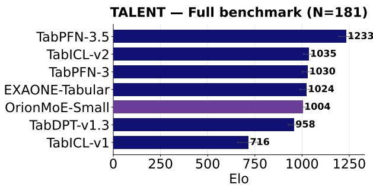  
(b) TALENT: models completing the full benchmark (181 datasets).  
Figure 8 Elo ratings for models that completed the full benchmark suite. (a) OpenML-CC18 and (b) TALENT. By restricting the comparison to models with complete benchmark coverage, the resulting rankings avoid differences caused by missing evaluations or partial task completion.  
BCCO Full benchmark (N=106)

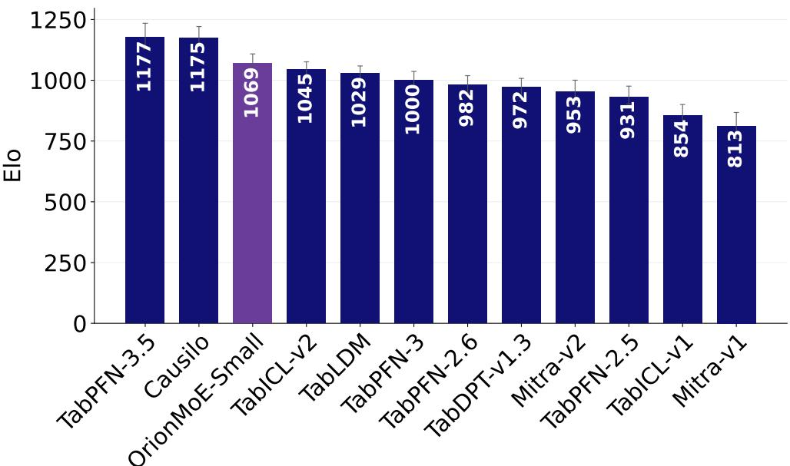  
Figure 9 Elo ratings on BCCO for models that completed the full benchmark suite (106 datasets). Restricting the comparison to fully evaluated models provides a direct ranking without relying on partially observed benchmark results.

On TALENT, OrionMoE-Small obtains an Elo rating of 1004 across all 181 datasets. It remains close to EXAONE-Tabular (1024), while exceeding TabDPT-v1.3 (958) and TabICLv1 (716). The leading foundation models, particularly TabPFN-3.5 (1233), retain an advantage, indicating that the broader dataset coverage does not eliminate the performance gap observed in the common-task comparison.

The full BCCO evaluation provides another encouraging result. Across all 106 datasets, OrionMoE-Small achieves an Elo rating of 1069, ranking third among the evaluated models. It trails TabPFN-3.5 (1177) and Causilo (1175), while outperforming TabICLv2 (1045), TabLDM (1029), TabPFN-3 (1000), and the remaining baselines. This result is consistent with the strong relative position observed on the common BCCO subset.

Table 4 Comparison of small tabular foundation models (< 50M parameters) across four classification benchmarks. Elo ratings are computed independently for each benchmark; higher is better. The strongest result within each benchmark is highlighted in bold.
<table><tr><td>Model</td><td>Params (M)</td><td>TabArena</td><td>BeyondArena</td><td>OpenML-CC18</td><td>TALENT</td></tr><tr><td>Causilo</td><td>36.1</td><td>1558</td><td>1268</td><td>1295</td><td>1196</td></tr><tr><td>OrionMoE-Small</td><td>37.7</td><td>1343</td><td>1149</td><td>1216</td><td>1081</td></tr><tr><td>TabICLv2</td><td>28</td><td>1299</td><td>1089</td><td>1228</td><td>1106</td></tr><tr><td>TabICLv1</td><td>25</td><td>1095</td><td>一</td><td>852</td><td>803</td></tr><tr><td>Limix-16M</td><td>16</td><td>1078</td><td></td><td>946</td><td>916</td></tr><tr><td>EXAONE-Tabular</td><td>20.8</td><td>1538</td><td>1176</td><td>1169</td><td>1099</td></tr></table>

Overall, these results show that OrionMoE-Small maintains competitive predictive performance when evaluation is extended to complete benchmark collections. Although the participating models differ across the common-task and full-benchmark settings, the full-suite results demonstrate that OrionMoE-Small can operate across the complete range of datasets considered in these three benchmarks while remaining competitive with recent tabular foundation models.

## 3.7 Performance Across Model Capacity Regimes

To better understand the relationship between model capacity and predictive performance, we stratify the evaluated tabular foundation models into three parameter-count regimes: small (< 50M), medium (50–150M), and large (> 150M). This analysis complements the aggregate benchmark comparisons by distinguishing performance against similarly sized architectures from performance against models with substantially larger parameter budgets. We use parameter count as a measure of model capacity, while recognizing that it does not directly capture active computation, pretraining cost, or inference efficiency.

Comparison with small models. Table 4 compares ORIONMOE-SMALL with foundation models containing fewer than 50 million parameters. With 37.7M parameters, ORIONMOE-SMALL achieves Elo ratings of 1343 on TabArena, 1149 on BeyondArena, 1216 on OpenML-CC18, and 1081 on TALENT. Among the small models, Causilo (36.1M) consistently achieves the strongest Elo ratings, indicating that substantial performance differences remain even at comparable model capacities.

Relative to TabICLv2 (28M), ORIONMOE-SMALL obtains higher ratings on TabArena and BeyondArena, while TabICLv2 retains a modest advantage on OpenML-CC18 and TALENT. ORIONMOE-SMALL also outperforms the smaller EXAONE-Tabular (20.8M) on OpenML-CC18, although EXAONE achieves higher ratings on the other three benchmarks. Compared with earlier small-scale models, including TabICLv1 and LimiX-16M, ORIONMOE-SMALL achieves higher ratings across all benchmarks for which results are available. Overall, these comparisons place ORIONMOE-SMALL among the competitive compact tabular foundation models, while highlighting the importance of architectural and training differences beyond parameter count alone.

Comparison with medium-sized models. Table 5 positions ORIONMOE-SMALL against models containing between 50 and 150 million parameters. Despite having approximately 29% fewer parameters than TabPFN-3 (53M), ORIONMOE-SMALL remains close on TabArena (1343 versus 1375) and BeyondArena (1149 versus 1166), while achieving higher Elo ratings on OpenML-CC18 (1216 versus 1113) and TALENT (1081 versus 1077).

ORIONMOE-SMALL also outperforms TabDPT-1.3 (63M) across all four benchmarks, despite containing approximately 40% fewer parameters. A similar pattern emerges against several other medium-sized foundation models: ORIONMOE SMALL outperforms Xiaomi-TabLDM (70M) on TabArena, OpenML-CC18, and TALENT, and obtains higher ratings than Mitra-v1 and Mitra-v2 on the available OpenML-CC18 and TALENT evaluations. However, Mitra-v2 achieves a substantially higher rating on TabArena (1556 versus 1343), demonstrating that the relative advantages are benchmark dependent.

These results indicate that ORIONMOE-SMALL can achieve competitive performance against models with substantially larger parameter budgets, although the magnitude and direction of the differences depend on the evaluation distribution.

Comparison with large models. The largest models in our comparison include TabPFN-3.5 (220M), LimiX-2 (400M), and TabFM (408.7M), representing approximately 5.8–10.8× the parameter count of OrionMoE. These models generally achieve stronger predictive performance, particularly on TabArena and BeyondArena. TabPFN-3.5 obtains the highest Elo ratings on BeyondArena, OpenML-CC18, and TALENT, while LimiX-2 leads the TabArena comparison.

Table 5 Comparison of ORIONMOE-SMALL with medium-sized (50–150M parameters) and large (> 150M parameters) tabular foundation models. Elo ratings are reported on TabArena (N = 38), BeyondArena (N = 98), OpenML-CC18 (N = 48), and TALENT (N = 158). Higher is better. Ratings are computed independently within each benchmark and are not directly comparable across benchmarks. A dash indicates unavailable results.
<table><tr><td>Model</td><td>Params (M)</td><td>TabArena</td><td>BeyondArena</td><td>OpenML-CC18</td><td>TALENT</td></tr><tr><td>ORIONMOE-SMALL</td><td>37.7</td><td>1343</td><td>1149</td><td>1216</td><td>1081</td></tr><tr><td>Medium models (50–150M)</td><td></td><td></td><td></td><td></td><td></td></tr><tr><td>TabPFN-3</td><td>53</td><td>1375</td><td>1166</td><td>1113</td><td>1077</td></tr><tr><td>TabDPT-1.3</td><td>63</td><td>1236</td><td>1041</td><td>1136</td><td>1016</td></tr><tr><td>TabDPT-Turbo</td><td>63</td><td>1112</td><td></td><td>1069</td><td></td></tr><tr><td>Mitra-v1</td><td>63</td><td>1041</td><td></td><td>709</td><td>658</td></tr><tr><td>Mitra-v2</td><td>63</td><td>1556</td><td></td><td>1065</td><td>951</td></tr><tr><td>Xiaomi-TabLDM</td><td>70</td><td>1311</td><td></td><td>1183</td><td>1056</td></tr><tr><td>Large models (&gt; 150M)</td><td></td><td></td><td></td><td></td><td></td></tr><tr><td>TabPFN-3.5</td><td>220</td><td>1707</td><td>1348</td><td>1331</td><td>1274</td></tr><tr><td>LimiX-2</td><td>400</td><td>1775</td><td>1188</td><td></td><td></td></tr><tr><td>TabFM</td><td>408.7</td><td>1590</td><td>1222</td><td></td><td></td></tr></table>

Nevertheless, the relationship between parameter count and performance is not monotonic. For example, TabPFN-3.5 achieves higher Elo ratings than the larger LimiX-2 and TabFM models on BeyondArena, despite having substantially fewer parameters. Thus, increased capacity alone does not fully explain the relative performance of recent tabular foundation models.

Discussion. Overall, the capacity-stratified evaluation shows that OrionMoE remains competitive within the smallmodel category and can match or outperform several medium-sized foundation models across multiple benchmarks. At the same time, Causilo’s stronger results at a comparable parameter count, together with the persistent advantage of the leading large models, indicate that substantial opportunities for improvement remain. The results support the practical viability of compact, dataset-conditioned sparse architectures, but do not establish that sparse routing itself is responsible for the observed performance differences. A controlled comparison with parameter-matched dense architectures would be required to isolate that contribution.

## 4 License and Availability

We release ORIONMOE inference code and model weights under a single license: the Lexsi Labs Source Available License (LSAL) v1.2, OrionMoE Edition. The license covers both artifacts across model sizes and versions expressly released under its terms. It is a source-available license, not an OSI-approved open-source license. The full OrionMoE License v.12 text is available at https://huggingface.co/Lexsi/OrionMoE/blob/main/LICENSE.

Code. The inference implementation is distributed through the orionmoe Python package and includes the model architecture, preprocessing, and scikit-learn-compatible interface. Documentation and usage examples are available at https://github.com/Lexsi-Labs/OrionMoE. Training code and synthetic-data generation are not included in this release.

Model weights. Checkpoints are available at https://huggingface.co/Lexsi/OrionMoE. The license permits personal noncommercial research, academic research, teaching, and scholarly publication, including modification and redistribution, provided the required notices, license text, and responsible-use conditions are retained. Modified releases must be identified as such and may not be redistributed under different terms. No patent rights are granted.

Organizational and commercial use. Organizational activities—including internal evaluation, benchmarking, and use in developing or evaluating an organization’s models, products, or services—are subject to Section 1A . Before such use, organizations must obtain prior written permission or submit a written acknowledgement identifying the organization and intended use and undertaking to provide attribution, which Lexsi Labs may accept in place of negotiated permission. These provisions do not independently authorize commercial use. Commercial exploitation requires a separate commercial license, and production or user-facing deployment requires express written authorization

The complete terms are provided in the OrionMoE license. For organizational acknowledgements, permissions, or commercial licensing enquiries, contact support@lexsi.ai.

## 5 Conclusion

We introduced ORIONMOE-SMALL, a compact tabular foundation model that combines in-context learning with dataset-conditioned sparse mixture-of-experts computation. Built on a dual-axis Transformer, ORIONMOE-SMALL introduces conditional expert routing along the feature axis, enabling the model to adapt not only its representations but also the computational pathways applied to different features and datasets. A support-derived dataset register informs expert selection, allowing routing decisions to incorporate both feature-level information and the broader dataset context.

Across TabArena, BeyondArena, OpenML-CC18, TALENT, and BCCO, ORIONMOE-SMALL achieves competitive predictive performance against a diverse range of tabular foundation models without task-specific parameter updates. Our capacity-stratified evaluation further shows that, with only 37.7 million parameters, ORIONMOE-SMALL remains competitive with several medium-sized models and outperforms larger alternatives on selected benchmarks. Nevertheless, the strongest models retain an advantage in overall predictive performance, particularly under challenging distribution shifts and on large-scale datasets.

These findings establish ORIONMOE-SMALL as a promising exploration of dataset-conditioned sparse computation for tabular in-context learning, while highlighting opportunities for further improvement. Future work will investigate the functional specialization of experts, the contribution of dataset-conditioned routing under controlled architectural comparisons, and strategies for improving scalability and robustness to distribution shifts. By releasing ORIONMOE-SMALL and its implementation for research use, we aim to facilitate further investigation into conditional computation as a complementary direction to increasing model scale in tabular foundation models.

## References

[1] Katharine E Henry, David N Hager, Peter J Pronovost, and Suchi Saria. A targeted real-time early warning score (trewscore) for septic shock. Science translational medicine, 7(299):299ra122–299ra122, 2015.

[2] Amir E Khandani, Adlar J Kim, and Andrew W Lo. Consumer credit-risk models via machine-learning algorithms. Journal ofBanking & Finance, 34(11):2767–2787, 2010.

[3] Thyago P Carvalho, Fabrízzio AAMN Soares, Roberto Vita, Roberto da P Francisco, João P Basto, and Symone GS Alcalá. A systematic literature review of machine learning methods applied to predictive maintenance. Computers & industrial engineering, 137:106024, 2019.

[4] Pierre Baldi, Peter Sadowski, and Daniel Whiteson. Searching for exotic particles in high-energy physics with deep learning. Nature communications, 5(1):4308, 2014.

[5] Yury Gorishniy, Ivan Rubachev, Valentin Khrulkov, and Artem Babenko. Revisiting deep learning models for tabular data. Advances in neural information processing systems, 34:18932–18943, 2021.

[6] Léo Grinsztajn, Edouard Oyallon, and Gaël Varoquaux. Why do tree-based models still outperform deep learning on typical tabular data? Advances in neural information processing systems, 35:507–520, 2022.

[7] Markus Reichstein, Gustau Camps-Valls, Bjorn Stevens, Martin Jung, Joachim Denzler, Nuno Carvalhais, and F Prabhat. Deep learning and process understanding for data-driven earth system science. Nature, 566(7743):195– 204, 2019.

[8] Hanchen Wang, Tianfan Fu, Yuanqi Du, Wenhao Gao, Kexin Huang, Ziming Liu, Payal Chandak, Shengchao Liu, Peter Van Katwyk, Andreea Deac, et al. Scientific discovery in the age of artificial intelligence. Nature, 620(7972):47–60, 2023.

[9] Ravid Shwartz-Ziv and Amitai Armon. Tabular data: Deep learning is not all you need. Information fusion, 81:84–90, 2022.

[10] Noah Hollmann, Samuel Müller, Katharina Eggensperger, and Frank Hutter. Tabpfn: A transformer that solves small tabular classification problems in a second. In The Eleventh International Conference on Learning Representations, ICLR 2023, Kigali, Rwanda, May 1-5, 2023. OpenReview.net, 2023.

[11] Noah Hollmann, Samuel Müller, Lennart Purucker, Arjun Krishnakumar, Max Körfer, Shi Bin Hoo, Robin Tibor Schirrmeister, and Frank Hutter. Accurate predictions on small data with a tabular foundation model. Nature, 637(8045):319–326, 2025.

[12] Léo Grinsztajn, Klemens Flöge, Oscar Key, Felix Birkel, Philipp Jund, Brendan Roof, Mihir Manium, Shi Bin Hoo, Magnus Bühler, Anurag Garg, et al. Tabpfn-3: Technical report. arXiv preprint arXiv:2605.13986, 2026.

[13] Benjamin Jäger, Nick Erickson, Léo Grinsztajn, Felix Birkel, Klemens Flöge, Oscar Key, Kür¸sat Kaya, Jonas Kübler, Adèle Frankel, Tobias Schröder, et al. Tabpfn-3.5: Technical report. arXiv preprint arXiv:2609.17895, 2026.

[14] Jingang Qu, David Holzmüller, Gaël Varoquaux, and Marine Le Morvan. Tabicl: A tabular foundation model for in-context learning on large data. In Aarti Singh, Maryam Fazel, Daniel Hsu, Simon Lacoste-Julien, Felix Berkenkamp, Tegan Maharaj, Kiri Wagstaff, and Jerry Zhu, editors, Forty-second International Conference on Machine Learning, ICML 2025, Vancouver, BC, Canada, July 13-19, 2025, Proceedings of Machine Learning Research. PMLR / OpenReview.net, 2025.

[15] Jingang Qu, David Holzmüller, Gaël Varoquaux, and Marine Le Morvan. Tabiclv2: A better, faster, scalable, and open tabular foundation model. CoRR, abs/2602.11139, 2026.

[16] Mohamed Bouadi, Pratinav Seth, Aditya Tanna, and Vinay Kumar Sankarapu. Orion-msp: Multi-scale sparse attention for tabular in-context learning. CoRR, abs/2511.02818, 2025.

[17] Mohamed Bouadi, Pratinav Seth, Aditya Tanna, and Vinay Kumar Sankarapu. Orion-bix: Bi-axial attention for tabular in-context learning. CoRR, abs/2512.00181, 2025.

[18] Xingxuan Zhang, Gang Ren, Han Yu, Hao Yuan, Hui Wang, Jiansheng Li, Jiayun Wu, Lang Mo, Li Mao, Mingchao Hao, et al. Limix: Unleashing structured-data modeling capability for generalist intelligence. arXiv preprint arXiv:2509.03505, 2025.

[19] Xingxuan Zhang, Gang Ren, Hao Yuan, Hao Zou, Hongze Tan, Hui Wang, Jianhao Song, Jiansheng Li, Jiayao Zhang, Jinghan Zhang, et al. Limix-2: A contextual mechanism network towards general structured-data intelligence. arXiv preprint arXiv:2609.17488, 2026.

[20] Junwei Ma, Valentin Thomas, Rasa Hosseinzadeh, Alex Labach, Jesse Cresswell, Keyvan Golestan, Guangwei Yu, Anthony L Caterini, and Maks Volkovs. Tabdpt: Scaling tabular foundation models on real data. Advances in Neural Information Processing Systems, 38:172692–172722, 2026.

[21] Moonjung Eo, Min-Kook Suh, Hye-Seung Cho, Jiwon Kim, Seoyoon Kim, Sangjun Nam, and Soonyoung Lee. Exaone tabular 1.0: Technical report. arXiv preprint arXiv:2608.25774, 2026.

[22] Weihao Kong and Abhimanyu Das. Introducing tabfm: A zero-shot foundation model for tabular data. Google Research Blog, 30, 2026.

[23] Aditya Tanna, Pratinav Seth, Mohamed Bouadi, Utsav Avaiya, and Vinay Kumar Sankarapu. TabTune: A unified library for inference and fine-tuning tabular foundation models. arXiv preprint arXiv:2511.02802, 2025.

[24] Nick Erickson, Lennart Purucker, Andrej Tschalzev, David Holzmüller, Prateek Mutalik Desai, David Salinas, and Frank Hutter. Tabarena: A living benchmark for machine learning on tabular data. arXiv preprint arXiv:2506.16791, 2025.

[25] Noam Shazeer, Azalia Mirhoseini, Krzysztof Maziarz, Andy Davis, Quoc Le, Geoffrey Hinton, and Jeff Dean. Out rageously large neural networks: The sparsely-gated mixture-of-experts layer. arXiv preprint arXiv:1701.06538, 2017.

[26] William Fedus, Barret Zoph, and Noam Shazeer. Switch transformers: Scaling to trillion parameter models with simple and efficient sparsity. Journal ofMachine Learning Research, 23(120):1–39, 2022.

[27] Mohamed Bouadi, Nassim Bouarour, Varun Kulkarni, Shivam Dubey, Aditya Tanna, and Vinay Kumar Sankarapu. Shaping the prior: How synthetic task distributions determine tabular foundation model quality. arXiv preprint arXiv:2605.18971, 2026.

[28] Bernd Bischl, Giuseppe Casalicchio, Matthias Feurer, Pieter Gijsbers, Frank Hutter, Michel Lang, Rafael G Mantovani, Jan N van Rijn, and Joaquin Vanschoren. Openml benchmarking suites. arXiv preprint arXiv:1708.03731, 2017.

[29] Si-Yang Liu, Hao-Run Cai, Qi-Le Zhou, Huai-Hong Yin, Tao Zhou, Jun-Peng Jiang, and Han-Jia Ye. Talent: A tabular analytics and learning toolbox. Journal ofMachine Learning Research, 26(226):1–16, 2025.

[30] Mohamed Bouadi, Nassim Bouarour, Shivam Dubey, Varun Kulkarni, Aditya Tanna, and Vinay kumar Sankarapu. What you pretrain on matters: Synthetic task distributions determine tabular foundation model quality. In 2nd ICML Workshop on Foundation Modelsfor Structured Data, 2026.

[31] TabLDM Team, Penghui Wang, Wei Liu, Hong Wang, Chengyue Huang, Yuxi Sun, Zirui Wang, Hongming Huang, Quan Wang, Chunxiao Liu, et al. Xiaomi-tabldm: A tabular foundation model technical report. arXiv preprint arXiv:2609.03880, 2026.

[32] Lennart Purucker, Andrej Tschalzev, Nick Erickson, Gioia Blayer, David HolzmÃ1/4ller, Alan Arazi, Alexander Pfefferle, Mustafa Tajjar, Gaà Varoquaux, Frank Hutter, et al. Beyond iid: How general are tabular foundation models, really? arXiv preprint arXiv:2606.30410, 2026.

[33] Minyong Cho, Minho Jeong, Dooho Lee, Jinmo Lee, and Jaemin Yoo. Causilo technical report. arXiv preprint arXiv:2609.22866, 2026.

## A Additional Results

## A.1 TabArena

We complement the main TabArena [24] evaluation with an analysis of improvability, pairwise win rates, and computational cost. Figure 10 presents improvability as a function of total runtime and the pairwise win-rate matrix, while Table 6 reports the corresponding evaluation metrics for all methods.

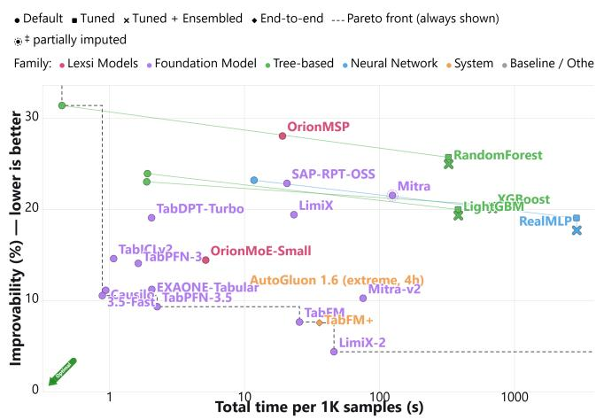  
(a) Improvability versus total runtime per 1K samples.

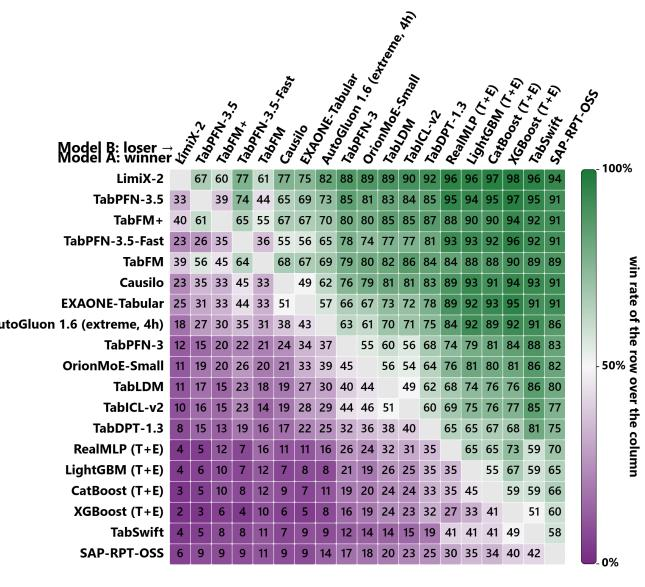  
(b) Pairwise win-rate matrix.  
Figure 10 Complementary performance analysis on TabArena classification tasks. (a) Improvability as a function of total runtime per 1K samples, illustrating the trade-off between remaining performance headroom and computational cost. (b) Pairwise win-rate matrix showing how frequently each method outperforms the others across the evaluated tasks.

Improvability and computational cost. Improvability measures the remaining performance gap relative to the best result obtained on each task. OrionMoE-Small achieves an improvability of 12.48%, compared with 11.97% for TabPFN-3, 12.63% for TabICLv2, and 12.64% for Xiaomi-TabLDM. Its improvability is therefore close to that of these competing foundation models, while the strongest models, such as LimiX-2 (2.06%) and TabPFN-3.5 (6.91%), leave substantially less room for improvement.

In terms of computational cost, OrionMoE-Small requires 4.23 seconds of support-set processing and 0.94 second of inference per 1,000 samples. Although these costs are substantially lower than those of several computationally intensive foundation models and tuned systems, OrionMoE-Small does not offer the lowest latency among comparable methods. In particular, TabPFN-3, TabICLv2, and several other foundation models achieve lower inference times Consequently, the current advantage of OrionMoE-Small lies primarily in its predictive competitiveness relative to several established models, rather than in absolute inference speed.

Pairwise performance and ranking consistency. The pairwise win-rate matrix in Figure 10 provides a complementary perspective on the Elo ranking by reporting how frequently each method outperforms another across the evaluated datasets.

OrionMoE-Small achieves an average rank of 19.89, compared with 18.16 for TabPFN-3, 21.84 for Xiaomi-TabLDM, and 22.58 for TabICLv2. This ordering is consistent with its overall Elo position and indicates that its performance is not solely an artifact of the Elo aggregation. However, OrionMoE-Small does not attain the best result on any of the 38 evaluated datasets, yielding zero individual dataset wins. This distinction is important: competitive aggregate performance does not necessarily imply state-of-the-art performance on individual tasks. Rather, OrionMoE-Small achieves a relatively consistent position among the competing methods without dominating the strongest specialized or larger foundation models.

Table 6 TabArena classification results. Higher is better for Elo, number of wins, and win rate; lower is better for average rank, improvability, and runtime. Training and inference times are normalized per 1,000 samples.
<table><tr><td>Model</td><td>Elo</td><td>#Wins</td><td>Avg. Rank ↓</td><td>Improvability ↓</td><td>Train / 1K [s] ↓</td><td>Inference / 1K [s] ↓</td><td>Win Rate [%]</td></tr><tr><td>LimiX-2</td><td>1775</td><td>12</td><td>4.53</td><td>2.06</td><td>36.96</td><td>10.08</td><td>31.6</td></tr><tr><td>TabPFN-3.5</td><td>1707</td><td>4</td><td>5.92</td><td>6.91</td><td>1.85</td><td>0.52</td><td>10.5</td></tr><tr><td>TabFM+</td><td>1615</td><td>5</td><td>8.32</td><td>5.37</td><td>20.91</td><td>7.79</td><td>13.2</td></tr><tr><td>TabFM</td><td>1590</td><td>6</td><td>9.08</td><td>5.46</td><td>18.45</td><td>6.81</td><td>15.8</td></tr><tr><td>TabPFN-3.5-Fast</td><td>1582</td><td>0</td><td>9.34</td><td>8.24</td><td>0.72</td><td>0.17</td><td>0.0</td></tr><tr><td>Causilo</td><td>1558</td><td>1</td><td>10.16</td><td>8.90</td><td>0.84</td><td>0.11</td><td>2.6</td></tr><tr><td>Mitra-v2</td><td>1556</td><td>0</td><td>10.24</td><td>8.24</td><td>72.59</td><td>1.06</td><td>0.0</td></tr><tr><td>AutoGluon 1.6 (noncommercial, 4h)</td><td>1555</td><td>1.5</td><td>10.25</td><td>8.54</td><td>12.89</td><td>0.79</td><td>3.9</td></tr><tr><td>EXAONE-Tabular</td><td>1539</td><td>2</td><td>10.84</td><td>9.06</td><td>1.53</td><td>0.49</td><td>5.3</td></tr><tr><td>AutoGluon 1.6 (extreme, 4h)</td><td>1489</td><td>0.5</td><td>12.78</td><td>9.31</td><td>9.70</td><td>0.57</td><td>1.3</td></tr><tr><td>TabPFN-3</td><td>1375</td><td>0</td><td>18.16</td><td>11.97</td><td>1.28</td><td>0.38</td><td>0.0</td></tr><tr><td>OrionMoE-Small</td><td>1343</td><td>0</td><td>19.89</td><td>12.48</td><td>4.23</td><td>0.94</td><td>0.0</td></tr><tr><td>Xiaomi-TabLDM</td><td>1311</td><td>0</td><td>21.84</td><td>12.64</td><td>1.30</td><td>0.27</td><td>0.0</td></tr><tr><td>TabICLv2</td><td>1299</td><td>0</td><td>22.58</td><td>12.63</td><td>0.93</td><td>0.14</td><td>0.0</td></tr><tr><td>RealTabPFN-V2.5 (T+E)</td><td>1268</td><td>0</td><td>24.61</td><td>13.32</td><td>2046.25</td><td>8.97</td><td>0.0</td></tr><tr><td>TabDPT-1.3</td><td>1236</td><td>0</td><td>26.82</td><td>15.03</td><td>0.62</td><td>0.17</td><td>0.0</td></tr><tr><td>RealMLP (T+E)</td><td>1162</td><td>0</td><td>32.47</td><td>15.92</td><td>2879.46</td><td>12.48</td><td>0.0</td></tr><tr><td>TabM (T+E)</td><td>1133</td><td>0</td><td>34.95</td><td>16.96</td><td>2168.86</td><td>2.35</td><td>0.0</td></tr><tr><td>TabDPT-Turbo</td><td>1112</td><td>0</td><td>36.74</td><td>17.46</td><td>1.94</td><td>0.19</td><td>0.0</td></tr><tr><td>TabICLv1</td><td>1095</td><td>0</td><td>38.24</td><td>17.91</td><td>8.68</td><td>1.74</td><td>0.0</td></tr><tr><td>LightGBM (T+E)</td><td>1094</td><td>0</td><td>38.32</td><td>17.83</td><td>382.09</td><td>1.49</td><td>0.0</td></tr><tr><td>LimiX</td><td>1078</td><td>0</td><td>39.76</td><td>17.53</td><td>18.41</td><td>4.67</td><td>0.0</td></tr><tr><td>TabDPT (T+E)</td><td>1072</td><td>0</td><td>40.29</td><td>17.49</td><td>4941.98</td><td>307.74</td><td>0.0</td></tr><tr><td>CatBoost (T+E)</td><td>1070</td><td>0</td><td>40.50</td><td>17.35</td><td>1107.00</td><td>0.33</td><td>0.0</td></tr><tr><td>TaM (T)</td><td>1069</td><td>0</td><td>40.55</td><td>17.85</td><td>2168.86</td><td>0.26</td><td>0.0</td></tr><tr><td>RealMLP (T)</td><td>1057</td><td>0</td><td>41.66</td><td>17.46</td><td>2879.46</td><td>0.60</td><td>0.0</td></tr><tr><td>CatBoost (T)</td><td>1054</td><td>0</td><td>41.95</td><td>17.66</td><td>1107.00</td><td>0.04</td><td>0.0</td></tr><tr><td>CatBoost</td><td>1053</td><td>0</td><td>42.05</td><td>18.13</td><td>5.41</td><td>0.03</td><td>0.0</td></tr><tr><td>Mitra-v1</td><td>1041</td><td>0</td><td>43.21</td><td>19.89</td><td>121.93</td><td>2.77</td><td>0.0</td></tr><tr><td>LightGBM (T)</td><td>1036</td><td>0</td><td>43.63</td><td>18.51</td><td>382.09</td><td>0.25</td><td>0.0</td></tr><tr><td>XGBoost (T+E)</td><td>1027</td><td>0</td><td>44.47</td><td>18.61</td><td>685.87</td><td>1.45</td><td>0.0</td></tr><tr><td>TabSwift</td><td>1017</td><td>0</td><td>45.42</td><td>19.54</td><td>0.63</td><td>0.06</td><td>0.0</td></tr><tr><td>XGBoost (T)</td><td>991</td><td>0</td><td>47.89</td><td>18.99</td><td>685.87</td><td>0.21</td><td>0.0</td></tr><tr><td>TabM</td><td>970</td><td>0</td><td>49.95</td><td>20.09</td><td>6.85</td><td>0.25</td><td>0.0</td></tr><tr><td>SAP-RPT-OSS</td><td>969</td><td>2</td><td>50.08</td><td>20.70</td><td>13.70</td><td>2.03</td><td>5.3</td></tr><tr><td>TabDPT</td><td>923</td><td>0</td><td>54.53</td><td>21.75</td><td>49.21</td><td>43.82</td><td>0.0</td></tr><tr><td>RealMLP</td><td>871</td><td>0</td><td>59.42</td><td>21.83</td><td>10.48</td><td>1.71</td><td>0.0</td></tr><tr><td>XGBoost</td><td>856</td><td>0</td><td>60.79</td><td>21.65</td><td>1.77</td><td>0.12</td><td>0.0</td></tr><tr><td>RF (T+E)</td><td>812</td><td>0</td><td>64.79</td><td>23.55</td><td>323.80</td><td>0.74</td><td>0.0</td></tr><tr><td>LightGBM</td><td>809</td><td>0</td><td>65.08</td><td>22.68</td><td>1.79</td><td>0.12</td><td>0.0</td></tr><tr><td>TabSTAR (T)</td><td>791</td><td>0</td><td>66.64</td><td>26.68</td><td>29479.47</td><td>4.09</td><td>0.0</td></tr><tr><td>iLTM</td><td>788</td><td>0</td><td>66.95</td><td>25.11</td><td>262.93</td><td>64.51</td><td>0.0</td></tr><tr><td>TabSTAR (T+E)</td><td>781</td><td>1</td><td>67.54</td><td>26.75</td><td>29479.47</td><td>18.31</td><td>2.6</td></tr><tr><td>RF (T)</td><td>769</td><td>1</td><td>68.53</td><td>24.51</td><td>323.80</td><td>0.08</td><td>2.6</td></tr><tr><td>OrionMSP</td><td>755</td><td>0</td><td>69.71</td><td>26.80</td><td>16.32</td><td>2.86</td><td>0.0</td></tr><tr><td>TabSTAR</td><td>667</td><td>0</td><td>76.39</td><td>32.27</td><td>439.45</td><td>5.88</td><td>0.0</td></tr><tr><td>TabFlex</td><td>648</td><td>0</td><td>77.68</td><td>32.05</td><td>1.11</td><td>0.19</td><td>0.0</td></tr><tr><td>RF</td><td>608</td><td>0</td><td>80.18</td><td>30.28</td><td>0.38</td><td>0.04</td><td>0.0</td></tr></table>

## A.2 BeyondArena

We further analyze BeyondArena [32] using complementary measures of improvability, pairwise performance, and computational cost. These results are reported in Figure 11 and Table 7.

Improvability and runtime. OrionMoE-Small achieves an improvability of 13.72%, closely matching TabPFN-3 (13.82%) and improving upon several competing foundation models, including TabICLv2 (15.08%) and TabDPT-1.3 (18.06%). The strongest methods, notably TabPFN-3.5 and TabFM, obtain substantially lower improvability values of 8.66% and 8.64%, respectively.

OrionMoE-Small requires 13.69 seconds of support-set processing and 2.76 seconds of inference per 1,000 samples. This places its computational cost below several larger or more expensive foundation models, including TabFM, LimiX-2, and several tuned conventional systems. However, faster alternatives remain available, particularly Causilo,

Table 7 BeyondArena classification results over 98 datasets shared by all evaluated methods. Higher is better for Elo, number of wins, and win rate; lower is better for average rank, improvability, and runtime. Training and inference times are normalized per 1,000 samples.
<table><tr><td>Model</td><td>Elo</td><td>#Wins</td><td>Avg. Rank↓</td><td>Improvability [%] ↓</td><td>Train / 1K [s] ↓</td><td>Inference / 1K [s] ↓</td><td>Win Rate [%]</td></tr><tr><td>TabPFN-3.5</td><td>1348</td><td>19</td><td>6.23</td><td>8.66</td><td>5.31</td><td>1.31</td><td>19.4</td></tr><tr><td>TabPFN-3.5-Fast</td><td>1287</td><td>6</td><td>7.93</td><td>9.66</td><td>2.49</td><td>0.49</td><td>6.1</td></tr><tr><td>Causilo</td><td>1268</td><td>4</td><td>8.52</td><td>10.27</td><td>3.20</td><td>0.24</td><td>4.1</td></tr><tr><td>TabFM</td><td>1222</td><td>22.5</td><td>10.09</td><td>8.64</td><td>41.89</td><td>9.50</td><td>23.0</td></tr><tr><td>LimiX-2</td><td>1188</td><td>18.5</td><td>11.35</td><td>8.75</td><td>62.33</td><td>18.46</td><td>18.9</td></tr><tr><td>EXAONE-Tabular</td><td>1176</td><td>2</td><td>11.79</td><td>12.81</td><td>4.14</td><td>0.72</td><td>2.0</td></tr><tr><td>TabPFN-3</td><td>1166</td><td>1</td><td>12.21</td><td>13.82</td><td>18.11</td><td>2.98</td><td>1.0</td></tr><tr><td>OrionMoE-Small</td><td>1149</td><td>2</td><td>12.89</td><td>13.72</td><td>13.69</td><td>2.76</td><td>2.0</td></tr><tr><td>RealMLP (T+E)</td><td>1117</td><td>1</td><td>14.24</td><td>16.14</td><td>1308.75</td><td>15.42</td><td>1.0</td></tr><tr><td>TabICLv2</td><td>1089</td><td>2</td><td>15.44</td><td>15.08</td><td>11.86</td><td>2.24</td><td>2.0</td></tr><tr><td>TabM (T+E)</td><td>1076</td><td>0</td><td>16.01</td><td>17.20</td><td>958.33</td><td>7.34</td><td>0.0</td></tr><tr><td>CatBoost (T+E)</td><td>1062</td><td>1</td><td>16.62</td><td>17.51</td><td>354.47</td><td>1.14</td><td>1.0</td></tr><tr><td>CatBoost (T)</td><td>1049</td><td>1</td><td>17.24</td><td>17.53</td><td>354.47</td><td>0.21</td><td>1.0</td></tr><tr><td>RealTabPFN-v2.5</td><td>1048</td><td>2</td><td>17.26</td><td>17.52</td><td>4.24</td><td>0.72</td><td>2.0</td></tr><tr><td>LightGBM (T+E)</td><td>1044</td><td>2</td><td>17.46</td><td>18.30</td><td>166.76</td><td>2.19</td><td>2.0</td></tr><tr><td>TabDPT-1.3</td><td>1041</td><td>2</td><td>17.60</td><td>18.06</td><td>1.20</td><td>0.29</td><td>2.0</td></tr><tr><td>TabM (T)</td><td>1034</td><td>1</td><td>17.91</td><td>17.99</td><td>958.33</td><td>1.00</td><td>1.0</td></tr><tr><td>RealMLP (T)</td><td>1028</td><td>2</td><td>18.18</td><td>18.24</td><td>1308.75</td><td>1.72</td><td>2.0</td></tr><tr><td>XGBoost (T+E)</td><td>1003</td><td>2</td><td>19.33</td><td>19.62</td><td>240.99</td><td>6.55</td><td>2.0</td></tr><tr><td>LightGBM (T)</td><td>1002</td><td>1</td><td>19.38</td><td>18.94</td><td>166.76</td><td>0.49</td><td>1.0</td></tr><tr><td>Catboost</td><td>1001</td><td>1</td><td>19.41</td><td>18.80</td><td>12.42</td><td>0.17</td><td>1.0</td></tr><tr><td>XGBoost (T)</td><td>979</td><td>0</td><td>20.44</td><td>19.88</td><td>240.99</td><td>2.07</td><td>0.0</td></tr><tr><td>TabM</td><td>978</td><td>1</td><td>20.46</td><td>18.78</td><td>27.38</td><td>0.91</td><td>1.0</td></tr><tr><td>TabSwift</td><td>935</td><td>0</td><td>22.41</td><td>21.61</td><td>1.34</td><td>0.16</td><td>0.0</td></tr><tr><td>RealMLP</td><td>877</td><td>1</td><td>24.99</td><td>22.34</td><td>52.60</td><td>1.57</td><td>1.0</td></tr><tr><td>TabDPT</td><td>876</td><td>1</td><td>25.01</td><td>23.37</td><td>116.96</td><td>10.77</td><td>1.0</td></tr><tr><td>XGBoost</td><td>862</td><td>0</td><td>25.62</td><td>22.97</td><td>6.69</td><td>1.62</td><td>0.0</td></tr><tr><td>LightGBM</td><td>837</td><td>0</td><td>26.62</td><td>23.82</td><td>3.60</td><td>0.19</td><td>0.0</td></tr><tr><td>Random Forest (T+E)</td><td>835</td><td>0</td><td>26.70</td><td>24.32</td><td>143.10</td><td>1.60</td><td>0.0</td></tr><tr><td>Random Forest (T)</td><td>795</td><td>0</td><td>28.27</td><td>25.15</td><td>143.10</td><td>0.45</td><td>0.0</td></tr><tr><td>Random Forest</td><td>761</td><td>0</td><td>29.48</td><td>27.10</td><td>5.31</td><td>0.74</td><td>0.0</td></tr></table>

EXAONE-Tabular, and TabICLv2. Accordingly, OrionMoE-Small occupies an intermediate region of the performance– runtime trade-off rather than defining its Pareto frontier.

Pairwise comparisons and dataset wins. The pairwise win-rate matrix provides additional information about the consistency of the aggregate Elo ranking. OrionMoE-Small obtains an average rank of 12.89, close to TabPFN-3 (12.21), and ahead of RealMLP with tuning and ensembling (14.24), TabICLv2 (15.44), and several conventional learning methods.

Unlike the TabArena evaluation, OrionMoE-Small achieves the highest predictive performance on two BeyondArena datasets, corresponding to a dataset win rate of approximately 2.0%. Although this remains below the number of wins attained by the leading models, it indicates that OrionMoE-Small can outperform the complete comparison set on individual tasks outside the conventional IID setting.

The pairwise analysis also highlights the diversity of the benchmark. No single method dominates all evaluation regimes, and the relative strength of tuned conventional models increases on grouped, temporal, and large-scale datasets. In this context, OrionMoE-Small remains competitive with several foundation-model baselines but does not consistently displace the strongest task-specific systems.

Overall, these complementary metrics support the conclusions of the main BeyondArena analysis. OrionMoE-Small achieves competitive aggregate performance and a moderate improvability gap, while the remaining differences to the leading methods reflect both predictive limitations and computational trade-offs that vary substantially across dataset regimes.

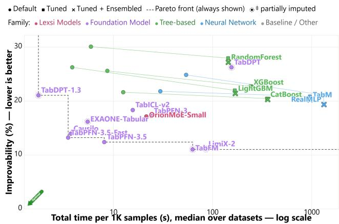  
(a) Improvability versus total runtime per 1K samples.

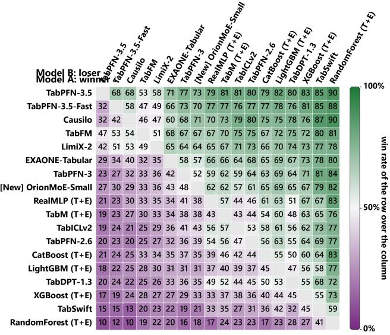  
(b) Pairwise win-rate matrix.  
Figure 11 Complementary performance analysis on BeyondArena classification tasks. (a) Improvability versus total runtime per 1K samples, capturing the trade-off between additional attainable performance and computational cost. (b) Pairwise win-rate matrix summarizing how consistently each method outperforms competing models across BeyondArena tasks and split regimes.

## A.3 Common-Task Benchmark Results

We complement the Elo-based comparisons in the main report with mean classification accuracy and average model rank. All metrics are computed over the common-task subsets used in the corresponding Elo evaluations, ensuring that participating models are evaluated on identical datasets.

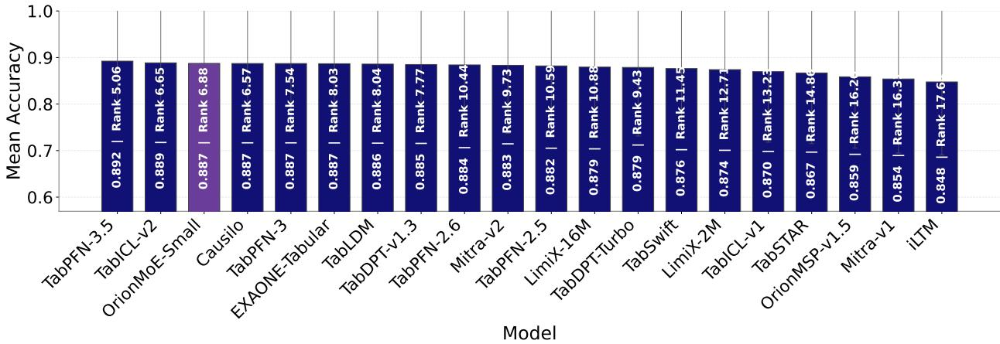  
Figure 12 Mean accuracy on the common-task subset of OpenML-CC18. Each bar reports the average accuracy of a model across the shared set of tasks, with the corresponding overall rank shown inside the bar.

OpenML-CC18. Figure 12 reports mean accuracy and average rank across 48 common OpenML-CC18 tasks. OrionMoE-Small achieves a mean accuracy of 0.887 and an average rank of 6.88, placing it among the leading models in this evaluation. Its accuracy is close to TabPFN-3.5 (0.892) and TabICLv2 (0.889), and matches the displayed mean accuracy of Causilo, TabPFN-3, EXAONE-Tabular, and TabLDM. The average-rank comparison provides additional context: OrionMoE-Small remains competitive across datasets, although TabPFN-3.5, Causilo, and TabICLv2 obtain somewhat stronger average ranks. Together, these results complement the Elo ranking and show that the differences among several leading models are small in absolute mean accuracy.

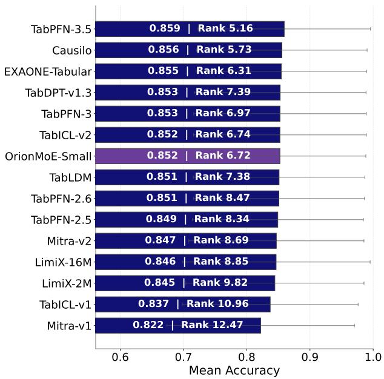  
(a) Mean accuracy on common TALENT tasks.

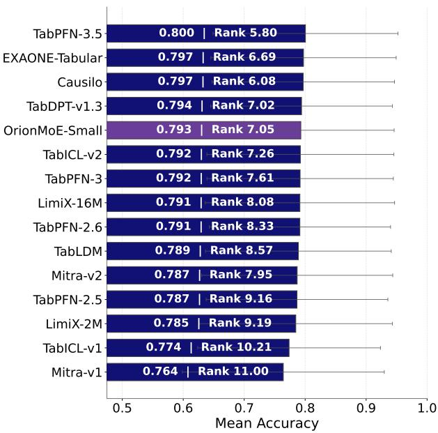  
(b) Mean accuracy on common BCCO tasks.  
Figure 13 Mean accuracy on the common-task subsets of TALENT and BCCO. (a) TALENT and (b) BCCO. Bars report the average accuracy over the shared task set, with the corresponding model rank shown inside each bar.

TALENT. Across the 158 common TALENT datasets, OrionMoE-Small obtains a mean accuracy of 0.852 and an average rank of 6.72, as shown in Figure 13a. Its mean accuracy matches TabPFN-3 and TabICLv2 at the displayed precision, while its average rank is slightly better than both methods (6.97 and 6.74, respectively). OrionMoE-Small also exceeds TabLDM (0.851) and several earlier foundation models in mean accuracy. Although TabPFN-3.5 remains the strongest method with 0.859 accuracy, the difference is less than one percentage point. These results indicate that OrionMoE-Small maintains competitive accuracy across a heterogeneous collection of tabular classification problems.

BCCO. Figure 13b shows that OrionMoE-Small achieves a mean accuracy of 0.793 and an average rank of 7.05 over the 86 common BCCO datasets. Its mean accuracy is close to TabDPT-v1.3 (0.794), Causilo (0.797), and EXAONE-Tabular (0.797), while remaining within 0.007 absolute accuracy of the leading TabPFN-3.5 model (0.800). OrionMoE-Small also outperforms TabICLv2, TabPFN-3, TabLDM, and several other foundation models in mean accuracy. This provides additional evidence that its competitive position persists across the different benchmark collections.

Overall, the mean-accuracy results are consistent with the Elo-based evaluation: OrionMoE-Small remains within a relatively narrow accuracy range of the leading methods, while its average rank confirms competitive performance across the shared evaluation tasks.

## A.4 Full-Benchmark Accuracy and Ranking

We additionally report mean accuracy and average rank for models completing the entire OpenML-CC18, TALENT, and BCCO benchmark suites. These results complement the full-benchmark Elo comparisons presented in Section 3.6.

Figure 15 summarizes performance on OpenML-CC18 and TALENT, while Figure 15b reports the corresponding BCCO results.

On the complete OpenML-CC18 benchmark, OrionMoE-Small achieves a mean accuracy of 0.892 with an average rank of 3.10. Its accuracy is close to TabPFN-3.5 (0.898) and TabICLv2 (0.894), while matching or slightly exceeding EXAONE-Tabular and TabDPT-v1.3 at the reported precision. Importantly, the average-rank results place OrionMoE-Small close to the strongest participating models, indicating competitive performance across the complete 72-task collection.

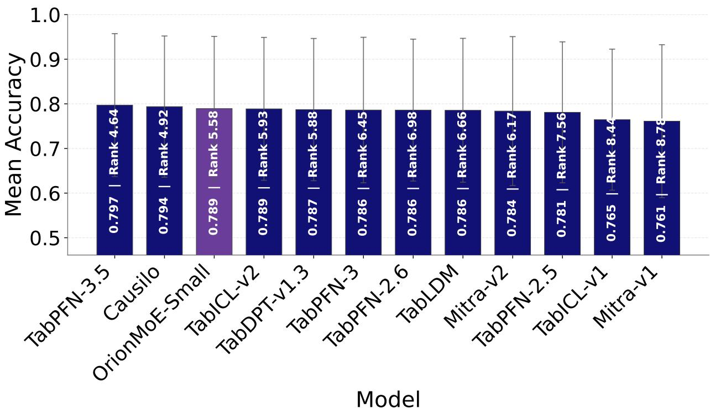  
Figure 14 Mean accuracy on the full BCCO benchmark for models that completed all tasks. Each bar reports the average accuracy over the complete benchmark, with the corresponding model rank shown inside the bar.

On TALENT, OrionMoE-Small obtains a mean accuracy of 0.847 and an average rank of 3.36 across all 181 datasets. Its mean accuracy matches TabICLv2 at the reported precision and is within 0.001 of TabPFN-3 and TabDPT-v1.3. The leading model, TabPFN-3.5, reaches 0.856, leaving an absolute difference of 0.009.

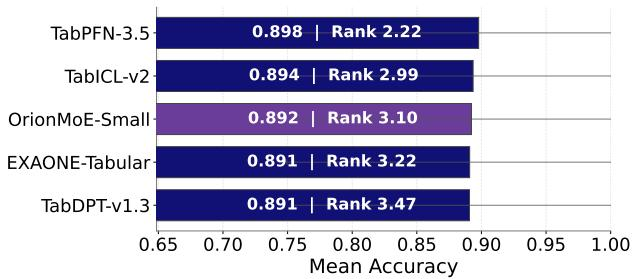  
(a) OpenML-CC18: models completing the full benchmark

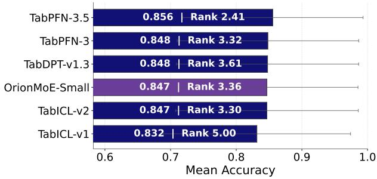  
(b) TALENT: models completing the full benchmark.  
Figure 15 Mean accuracy for models that completed the full benchmark suite. (a) OpenML-CC18 and (b) TALENT. Bars report the average accuracy across all benchmark tasks completed by every included model, with the corresponding rank shown inside each bar.

Finally, OrionMoE-Small achieves 0.789 mean accuracy and an average rank of 5.58 on the full BCCO benchmark. While TabPFN-3.5 (0.797) and Causilo (0.794) obtain higher accuracy, OrionMoE-Small matches TabICLv2 at the displayed precision and exceeds TabDPT-v1.3, TabPFN-3, TabLDM, and several other models. Its average rank is also slightly better than that of TabICLv2 (5.93).

These complementary metrics confirm that OrionMoE-Small remains competitive across the full benchmark suites. In particular, the relatively small differences in mean accuracy between several of the leading methods indicate that their Elo orderings should be interpreted alongside average ranks and dataset-level performance rather than as absolute measures of predictive superiority.

## A.5 Performance Across Class Imbalance Regimes

To further characterize OrionMoE-Small across dataset properties, we analyze its performance as a function of class imbalance using datasets from OpenML-CC18, TALENT, and BCCO. We consider three categories: near-balanced datasets, moderately imbalanced datasets, and severely imbalanced datasets, with the latter defined by a class imbalance ratio of at least 10.

Figure 16 compares mean accuracy across eight recent tabular foundation models. The lower panel reports the mean per-dataset accuracy difference between OrionMoE-Small and the strongest competing baseline.

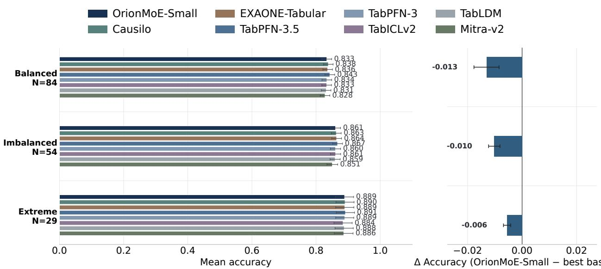  
Figure 16 Performance across datasets grouped by class imbalance ratio, after merging OpenML-CC18, TALENT, and BCCO. The top panel reports mean accuracy for each model within three imbalance regimes: near-balanced, moderate imbalance, and severe imbalance $( \geq 1 0 \times )$ . The bottom panel reports the accuracy difference between OrionMoE-Small and the strongest competing baseline within each regime, where values closer to zero indicate stronger relative performance. Overall, OrionMoE-Small remains competitive across all imbalance levels, with the smallest gap observed in the most severely imbalanced regime.

An interesting trend emerges in the relative performance of OrionMoE-Small. Its mean accuracy gap to the strongest competing model decreases from −0.013 on near-balanced datasets to −0.010 under moderate imbalance and only −0.006 under severe imbalance. Thus, OrionMoE-Small becomes progressively closer to the strongest competing methods as the class distribution becomes more skewed.

This pattern complements the TabArena regime-specific evaluation, where OrionMoE-Small also demonstrates competitive performance on imbalanced classification tasks. However, the two analyses are not directly equivalent: TabArena uses independently computed Elo ratings, whereas the present comparison measures paired accuracy differences across datasets.

The decreasing relative gap suggests that class imbalance does not systematically disadvantage OrionMoE-Small relative to the evaluated foundation models. Nevertheless, accuracy alone does not establish improved recognition of minority classes, and the smaller number of severely imbalanced datasets limits the strength of this conclusion. Additional class-sensitive metrics would be necessary to determine whether the observed competitiveness extends to minority-class predictive performance.

## B Datasets

## B.1 OpenML-CC18

Table 8 OpenML-CC18 datasets used in the common 48-task evaluation. For each dataset, we report the OpenML task ID, context size, query size, number of input features, and number of classes. Context and query sizes are reported as averages across evaluation folds and can therefore be non-integer
<table><tr><td>Dataset</td><td>Task ID</td><td>Context Size</td><td>Query Size</td><td># Features</td><td># Classes</td></tr><tr><td>kr-vs-kp</td><td>3</td><td>2876.4</td><td>319.6</td><td>36</td><td>2</td></tr><tr><td>balance-scale</td><td>11</td><td>562.5</td><td>62.5</td><td>4</td><td>3</td></tr><tr><td>mfeat-factors</td><td>12</td><td>1800.0</td><td>200.0</td><td>216</td><td>10</td></tr><tr><td>mfeat-fourier</td><td>14</td><td>1800.0</td><td>200.0</td><td>76</td><td>10</td></tr><tr><td>mfeat-karhunen</td><td>16</td><td>1800.0</td><td>200.0</td><td>64</td><td>10</td></tr><tr><td>mfeat-morphological</td><td>18</td><td>1800.0</td><td>200.0</td><td>6</td><td>10</td></tr><tr><td>mfeat-zernike</td><td>22</td><td>1800.0</td><td>200.0</td><td>47</td><td>10</td></tr><tr><td>cmc</td><td>23</td><td>1325.7</td><td>147.3</td><td>9</td><td>3</td></tr><tr><td>optdigits</td><td>28</td><td>5058.0</td><td>562.0</td><td>64</td><td>10</td></tr><tr><td>credit-g</td><td>31</td><td>900.0</td><td>100.0</td><td>20</td><td>2</td></tr><tr><td>pendigits</td><td>32</td><td>9892.8</td><td>1099.2</td><td>16</td><td>10</td></tr><tr><td>diabetes</td><td>37</td><td>691.2</td><td>76.8</td><td>8</td><td>2</td></tr><tr><td>spambase</td><td>43</td><td>4140.9</td><td>460.1</td><td>57</td><td>2</td></tr><tr><td>splice</td><td>45</td><td>2871.0</td><td>319.0</td><td>60</td><td>3</td></tr><tr><td>tic-tac-toe</td><td>49</td><td>862.2</td><td>95.8</td><td>9</td><td>2</td></tr><tr><td>vehicle</td><td>53</td><td>761.4</td><td>84.6</td><td>18</td><td>4</td></tr><tr><td>electricity</td><td>219</td><td>40780.8</td><td>4531.2</td><td>8</td><td>2</td></tr><tr><td>satimage</td><td>2074</td><td>5787.0</td><td>643.0</td><td>36</td><td>6</td></tr><tr><td>analcatdata_authorship</td><td>3549</td><td>756.9</td><td>84.1</td><td>70</td><td>4</td></tr><tr><td>analcatdata_dmft</td><td>3560</td><td>717.3</td><td>79.7</td><td>4</td><td>6</td></tr><tr><td>pc4</td><td>3902</td><td>1312.2</td><td>145.8</td><td>37</td><td>2</td></tr><tr><td>pc3</td><td>3903</td><td>1406.7</td><td>156.3</td><td>37</td><td>2</td></tr><tr><td>kc2</td><td>3913</td><td>469.8</td><td>52.2</td><td>21</td><td>2</td></tr><tr><td>kc1</td><td>3917</td><td>1898.1</td><td>210.9</td><td>21</td><td>2</td></tr><tr><td>pc1</td><td>3918</td><td>998.1</td><td>110.9</td><td>21</td><td>2</td></tr><tr><td>adult</td><td>7592</td><td>43957.8</td><td>4884.2</td><td>14</td><td>2</td></tr><tr><td>wdbc</td><td>9946</td><td>512.1</td><td>56.9</td><td>30</td><td>2</td></tr><tr><td>phoneme</td><td>9952</td><td>4863.6</td><td>540.4</td><td>5</td><td>2</td></tr><tr><td>qsar-biodeg</td><td>9957</td><td>949.5</td><td>105.5</td><td>41</td><td>2</td></tr><tr><td>wall-robot-navigation</td><td>9960</td><td>4910.4</td><td>545.6</td><td>24</td><td>4</td></tr><tr><td>semeion</td><td>9964</td><td>1433.7</td><td>159.3</td><td>256</td><td>10</td></tr><tr><td>ilpd</td><td>9971</td><td>524.7</td><td>58.3</td><td>10</td><td>2</td></tr><tr><td>madelon</td><td>9976</td><td>2340.0</td><td>260.0</td><td>500</td><td>2</td></tr><tr><td>ozone-level-8hr</td><td>9978</td><td>2280.6</td><td>253.4</td><td>72</td><td>2</td></tr><tr><td>first-order-theorem-proving</td><td>9985</td><td>5506.2</td><td>611.8</td><td>51</td><td>6</td></tr><tr><td>banknote-authentication</td><td>10093</td><td>1234.8</td><td>137.2</td><td>4</td><td>2</td></tr><tr><td>blood-transfusion-service-center</td><td>10101</td><td>673.2</td><td>74.8</td><td>4</td><td>2</td></tr><tr><td>PhishingWebsites</td><td>14952</td><td>9949.5</td><td>1105.5</td><td>30</td><td>2</td></tr><tr><td>bank-marketing</td><td>14965</td><td>40689.9</td><td>4521.1</td><td>16</td><td>2</td></tr><tr><td>GesturePhaseSegmentationProcessed</td><td>14969</td><td>8885.7</td><td>987.3</td><td>32</td><td>5</td></tr><tr><td>dresses-sales</td><td>125920</td><td>450.0</td><td>50.0</td><td>12</td><td>2</td></tr><tr><td>steel-plates-fault</td><td>146817</td><td>1746.9</td><td>194.1</td><td>27</td><td>7</td></tr><tr><td>climate-model-simulation-crashes</td><td>146819</td><td>486.0</td><td>54.0</td><td>18</td><td>2</td></tr><tr><td>wilt</td><td>146820</td><td>4355.1</td><td>483.9</td><td>5</td><td>2</td></tr><tr><td>car</td><td>146821</td><td>1555.2</td><td>172.8</td><td>6</td><td>4</td></tr><tr><td>segment</td><td>146822</td><td>2079.0</td><td>231.0</td><td>16</td><td>7</td></tr><tr><td>mfeat-pixel</td><td>146824</td><td>1800.0</td><td>200.0</td><td>240</td><td>10</td></tr><tr><td>jungle_chess_2pcs_raw_endgame_complete</td><td>167119</td><td>40337.1</td><td>4481.9</td><td>6</td><td>3</td></tr></table>

## B.2 TALENT

Table 9 TALENT datasets used in the common 152-dataset evaluation. Context size denotes the number of training examples available to the model at inference time, while query size corresponds to the held-out test set size.
<table><tr><td>Dataset</td><td>Context Size</td><td>Query Size</td><td># Features</td><td># Classes</td></tr><tr><td>Amazon_employee_access</td><td>26215</td><td>6554</td><td>7</td><td>2</td></tr><tr><td>BLE_RSSI_dataset_for_Indoor_localization</td><td>7987</td><td>1997</td><td>3</td><td>3</td></tr><tr><td>BNG(breast-w)</td><td>31492</td><td>7874</td><td>9</td><td>2</td></tr><tr><td>BNG(cmc)</td><td>44236</td><td>11060</td><td>9</td><td>3</td></tr><tr><td>BNG(tic-tac-toe)</td><td>31492</td><td>7874</td><td>9</td><td>2</td></tr><tr><td>Bank_Customer_Churn_Dataset</td><td>8000</td><td>2000</td><td>10</td><td>2</td></tr><tr><td>Basketball c</td><td>1072</td><td>268</td><td>11</td><td>2</td></tr><tr><td>California-Housing-Classification</td><td>16512</td><td>4128</td><td>8</td><td>2</td></tr><tr><td>Click_prediction_small</td><td>31958</td><td>7990</td><td>3</td><td>2</td></tr><tr><td>Customer_Personality_Analysis</td><td>1792</td><td>448</td><td>24</td><td>2</td></tr><tr><td>Diabetic_Retinopathy_Debrecen</td><td>920</td><td>231</td><td>19</td><td>2</td></tr><tr><td>E-CommereShippingData</td><td>8799</td><td>2200</td><td>10</td><td>2</td></tr><tr><td>Employee</td><td>3722</td><td>931</td><td>8</td><td>2</td></tr><tr><td>FICO-HELOC-cleaned FOREX_audcad-day-High</td><td>7896</td><td>1975</td><td>23</td><td>2</td></tr><tr><td></td><td>1467</td><td>367</td><td>10</td><td>2</td></tr><tr><td>FOREX_audchf-day-High</td><td>1466</td><td>367</td><td>10</td><td>2</td></tr><tr><td>FOREX_audjpy-day-High</td><td>1465</td><td>367</td><td>10</td><td>2</td></tr><tr><td>FOREX_audjpy-hour-High</td><td>35060</td><td>8765</td><td>10</td><td>2</td></tr><tr><td>FOREX_audsgd-hour-High FOREX_audusd-hour-High</td><td>35060</td><td>8765</td><td>10</td><td>2</td></tr><tr><td>FOREX_cadjpy-day-High</td><td>35060</td><td>8765</td><td>10</td><td>2</td></tr><tr><td>FOREX_cadjpy-hour-High</td><td>1467</td><td>367</td><td>10</td><td>2</td></tr><tr><td></td><td>35060</td><td>8765</td><td>10</td><td>2</td></tr><tr><td>Firm-Teacher_Clave-Direction_Classification</td><td>8640</td><td>2160</td><td>16</td><td>4</td></tr><tr><td>Fitness_Club_c GAMETES_Epistasis_2-Way_20atts_0.1H_EDM-1_1</td><td>1200</td><td>300</td><td>6</td><td>2</td></tr><tr><td>GAMETES_Heterogeneity_20atts_1600_Het_0.4_0.2_50_EDM-</td><td>1280</td><td>320</td><td>20</td><td>2</td></tr><tr><td>2_001</td><td>1280</td><td>320</td><td>20</td><td>2</td></tr><tr><td>Gender_Gap_in_Spanish_WP</td><td>3796</td><td>950</td><td>13</td><td>3</td></tr><tr><td>GesturePhaseSegmentationProcessed</td><td>7898</td><td>1975</td><td>32</td><td>5</td></tr><tr><td>HR_Analytics_Job_Change_of_Data_Scientists</td><td>15326</td><td>3832</td><td>13</td><td>2</td></tr><tr><td>IBM_HR_Analytics_Employee_Attrition_and_Performance</td><td>1176</td><td>294</td><td>31</td><td>2</td></tr><tr><td>INNHotelsGroup</td><td>29020</td><td>7255</td><td>17</td><td>2</td></tr><tr><td>Indian_pines</td><td>7315</td><td>1829</td><td>220</td><td>8</td></tr><tr><td>JapaneseVowels</td><td>7968</td><td>1993</td><td>14</td><td>9</td></tr><tr><td>KDDCup09_upselling</td><td>4102</td><td>1026</td><td>49</td><td>2</td></tr><tr><td>MIC</td><td>1319</td><td>330</td><td>104</td><td>2</td></tr><tr><td>MagicTelescope</td><td>15216</td><td>3804</td><td>9</td><td>2</td></tr><tr><td>Marketing_Campaign</td><td>1792</td><td>448</td><td>27</td><td>2</td></tr><tr><td>Mobile_Price_Classification</td><td>1600</td><td>400</td><td>20</td><td>4</td></tr><tr><td>National_Health_and_Nutrition_Health_Survey</td><td>1822</td><td>456</td><td>7</td><td>2</td></tr><tr><td>PhishingWebsites</td><td>8844</td><td>2211</td><td>30</td><td>2</td></tr><tr><td>PieChart3</td><td>861</td><td>216</td><td>37</td><td>2</td></tr><tr><td>Pima_Indians_Diabetes_Database</td><td>614</td><td>154</td><td>8</td><td>2</td></tr><tr><td>PizzaCutter3</td><td>834</td><td>209</td><td>37</td><td>2</td></tr><tr><td>Pumpkin_Seeds</td><td>2000</td><td>500</td><td>12</td><td>2</td></tr><tr><td>QSAR_biodegradation</td><td>843</td><td>211</td><td>41</td><td>2</td></tr><tr><td>Satellite</td><td>4080</td><td>1020</td><td>36</td><td>2</td></tr><tr><td>Telecom_Churn_Dataset</td><td>2666</td><td>667</td><td>17</td><td>2</td></tr><tr><td>Water_Quality_and_Potability</td><td>2620</td><td>656</td><td>8</td><td>2</td></tr><tr><td>Wilt</td><td>3856</td><td>965</td><td>5</td><td>2</td></tr><tr><td>abalone</td><td>3341</td><td>836</td><td>8</td><td>3</td></tr><tr><td>ada</td><td>3317</td><td>830</td><td>48</td><td>2</td></tr><tr><td>ada_agnostic</td><td>3649</td><td>913</td><td>48</td><td>2</td></tr></table>

Continued on next page

Table 9 – continued from previous page
<table><tr><td>Dataset</td><td>Context Size</td><td>Query Size</td><td># Features</td><td># Classes</td></tr><tr><td>ada_prior</td><td>3649</td><td>913</td><td>14</td><td>2２</td></tr><tr><td>airlines_seed_0_nrows_2000_nclasses_10_ncols_100_stratify_True</td><td>1600</td><td>400</td><td>7</td><td></td></tr><tr><td>allbp</td><td>3017</td><td>755</td><td>29</td><td>3</td></tr><tr><td>allrep</td><td>3017</td><td>755</td><td>29</td><td>4</td></tr><tr><td>analcatdata_authorship</td><td>672</td><td>169</td><td>69</td><td>4</td></tr><tr><td>artificial-characters</td><td>8174</td><td>2044</td><td>7</td><td>10</td></tr><tr><td>autoUniv-au4-2500</td><td>2000</td><td>500</td><td>100</td><td>3</td></tr><tr><td>autoUniv-au7-1100</td><td>880</td><td>220</td><td>12</td><td>5</td></tr><tr><td>bank</td><td>36168</td><td>9043</td><td>16</td><td>2</td></tr><tr><td>banknote_authentication</td><td>1097</td><td>275</td><td>4</td><td>2</td></tr><tr><td>baseball</td><td>1072</td><td>268</td><td>16</td><td>3</td></tr><tr><td>car-evaluation</td><td>1382</td><td>346</td><td>21</td><td>4</td></tr><tr><td>churn</td><td>4000</td><td>1000</td><td>20</td><td>2</td></tr><tr><td>cmc</td><td>1178</td><td>295</td><td>9</td><td>3</td></tr><tr><td>company_bankruptcy_prediction</td><td>5455</td><td>1364</td><td>95</td><td>2</td></tr><tr><td>compass</td><td>13315</td><td>3329</td><td>17</td><td>2</td></tr><tr><td>contraceptive_method_choice</td><td>1178</td><td>295</td><td>9</td><td>3</td></tr><tr><td>credit</td><td>13371</td><td>3343</td><td>10</td><td>2</td></tr><tr><td>delta_ailerons</td><td>5703</td><td>1426</td><td>5</td><td>2</td></tr><tr><td>dis</td><td>3017</td><td>755</td><td>29</td><td>2</td></tr><tr><td>dna</td><td>2548</td><td>638</td><td>180</td><td>3</td></tr><tr><td>drug_consumption</td><td>1507</td><td>377</td><td>12</td><td>7</td></tr><tr><td>dry_bean_dataset</td><td>10888</td><td>2723</td><td>16</td><td>7</td></tr><tr><td>eeg-eye-state</td><td>11984</td><td>2996</td><td>14</td><td>2</td></tr><tr><td>electricity</td><td>36249</td><td>9063</td><td>8</td><td>2</td></tr><tr><td>estimation_of_obesity_levels</td><td>1688</td><td>423</td><td>16</td><td>7</td></tr><tr><td>eye_movements</td><td>8748</td><td>2188</td><td>27</td><td>3</td></tr><tr><td>eye_movements_bin</td><td>6086</td><td>1522</td><td>20</td><td>2</td></tr><tr><td>first-order-theorem-proving</td><td>4894</td><td>1224</td><td>51</td><td>6</td></tr><tr><td>gas-drift</td><td>11128</td><td>2782</td><td>128</td><td>6</td></tr><tr><td>gina_agnostic</td><td>2774</td><td>694</td><td>970</td><td>2</td></tr><tr><td>golf_play_dataset_extended</td><td>876</td><td>219</td><td>9</td><td>2</td></tr><tr><td>heloc</td><td>8000</td><td>2000</td><td>22</td><td>2</td></tr><tr><td>hill-valley</td><td>969</td><td>243</td><td>100</td><td>2</td></tr><tr><td>house_16H</td><td>10790</td><td>2698</td><td>16</td><td>2</td></tr><tr><td>htru</td><td>14318</td><td>3580</td><td>8</td><td>2</td></tr><tr><td>ibm-employee-performance</td><td>1176</td><td>294</td><td>30</td><td>2</td></tr><tr><td>in_vehicle_coupon_recommendation</td><td>10147</td><td>2537</td><td>21</td><td>2</td></tr><tr><td>jm1</td><td>8708</td><td>2177</td><td>21</td><td>2</td></tr><tr><td>jungle_chess_2pcs_raw_endgame_complete</td><td>35855</td><td>8964</td><td>6</td><td>3</td></tr><tr><td>kc1</td><td>1687</td><td>422</td><td>21</td><td>2</td></tr><tr><td>kdd_ipums_la_97-small led24</td><td>4150</td><td>1038</td><td>20</td><td>2</td></tr><tr><td>led7</td><td>2560</td><td>640</td><td>24</td><td>10</td></tr><tr><td>mammography</td><td>2560</td><td>640</td><td>7</td><td>10</td></tr><tr><td>maternal_health_risk</td><td>8946</td><td>2237</td><td>6</td><td>2</td></tr><tr><td>mfeat-factors</td><td>811</td><td>203</td><td>6</td><td>3</td></tr><tr><td>mfeat-fourier</td><td>1600</td><td>400</td><td>216</td><td>10</td></tr><tr><td></td><td>1600</td><td>400</td><td>76</td><td>10</td></tr><tr><td>mfeat-karhunen</td><td>1600</td><td>400</td><td>64</td><td>10</td></tr><tr><td>mfeat-morphological</td><td>1600</td><td>400</td><td>6</td><td>10</td></tr><tr><td>mfeat-pixel</td><td>1600</td><td>400</td><td>240</td><td>10</td></tr><tr><td>mfeat-zernike</td><td>1600</td><td>400</td><td>47</td><td>10</td></tr><tr><td>mice_protein_expression</td><td>864</td><td>216</td><td>75</td><td>8</td></tr><tr><td>microaggregation2</td><td>16000</td><td>4000</td><td>20</td><td>5</td></tr><tr><td>mobile_c36_oversampling</td><td>41408</td><td>10352</td><td>6</td><td>2</td></tr></table>

Continued on next page

Table 9 – continued from previous page
<table><tr><td>Dataset</td><td>Context Size</td><td>Query Size</td><td># Features</td><td># Classes</td></tr><tr><td>mozilla4</td><td>12436</td><td>3109</td><td>4</td><td>2</td></tr><tr><td>national-longitudinal-survey-binary</td><td>3926</td><td>982</td><td>16</td><td>2</td></tr><tr><td>online_shoppers</td><td>9864</td><td>2466</td><td>14</td><td>2</td></tr><tr><td>optdigits</td><td>4496</td><td>1124</td><td>64</td><td>10</td></tr><tr><td>ozone-level-8hr</td><td>2027</td><td>507</td><td>72</td><td>2</td></tr><tr><td>page-blocks</td><td>4378</td><td>1095</td><td>10</td><td>5</td></tr><tr><td>pci</td><td>887</td><td>222</td><td>21</td><td>2</td></tr><tr><td>pc3</td><td>1250</td><td>313</td><td>37</td><td>2</td></tr><tr><td>pc4</td><td>1166</td><td>292</td><td>37</td><td>2</td></tr><tr><td>pendigits</td><td>8793</td><td>2199</td><td>16</td><td>10</td></tr><tr><td>phoneme</td><td>4323</td><td>1081</td><td>5</td><td>2</td></tr><tr><td>pol</td><td>8065</td><td>2017</td><td>26</td><td>2</td></tr><tr><td>predict_students_dropout_and_academic_success</td><td>3539</td><td>885</td><td>34</td><td>3</td></tr><tr><td>qsar</td><td>844</td><td>211</td><td>40</td><td>2</td></tr><tr><td>rice_cammeo_and_osmancik</td><td>3048</td><td>762</td><td>7</td><td>2</td></tr><tr><td>ringnorm</td><td>5920</td><td>1480</td><td>20</td><td>2</td></tr><tr><td>rl</td><td>3976</td><td>994</td><td>12</td><td>2</td></tr><tr><td>satimage</td><td>5144</td><td>1286</td><td>36</td><td>6</td></tr><tr><td>segment</td><td>1848</td><td>462</td><td>17</td><td>7</td></tr><tr><td>seismic+bumps</td><td>2067</td><td>517</td><td>18</td><td>2</td></tr><tr><td>shuttle</td><td>46400</td><td>11600</td><td>9</td><td>7</td></tr><tr><td>spambase splice</td><td>3680</td><td>921</td><td>57</td><td>2</td></tr><tr><td></td><td>2552</td><td>638</td><td>60</td><td>3</td></tr><tr><td>sports_articles_for_objectivity_analysis</td><td>800</td><td>200</td><td>59</td><td>2</td></tr><tr><td>statlog</td><td>800</td><td>200</td><td>20</td><td>2</td></tr><tr><td>steel_plates_faults sylvine</td><td>1552</td><td>389</td><td>27</td><td>7</td></tr><tr><td>taiwanese_bankruptcy_prediction</td><td>4099</td><td>1025</td><td>20</td><td>2</td></tr><tr><td>telco-customer-churn</td><td>5455</td><td>1364</td><td>95</td><td>2</td></tr><tr><td>thyroid</td><td>5634</td><td>1409</td><td>18</td><td>2</td></tr><tr><td>thyroid-ann</td><td>5760</td><td>1440</td><td>21</td><td>3</td></tr><tr><td>thyroid-dis</td><td>3017</td><td>755</td><td>21</td><td>3</td></tr><tr><td>turiye_student_evaluation</td><td>2240</td><td>560</td><td>26</td><td>5</td></tr><tr><td></td><td>4656</td><td>1164</td><td>32</td><td>5</td></tr><tr><td>twonorm vehicle</td><td>5920</td><td>1480</td><td>20</td><td>2</td></tr><tr><td>wall-robot-navigation</td><td>676</td><td>170</td><td>18</td><td>4</td></tr><tr><td>water_quality</td><td>4364</td><td>1092</td><td>24</td><td>4</td></tr><tr><td>waveform-5000</td><td>6396</td><td>1600</td><td>20</td><td>2</td></tr><tr><td>waveform_database_generator</td><td>4000</td><td>1000</td><td>40</td><td>3</td></tr><tr><td></td><td>3999</td><td>1000</td><td>21</td><td>3</td></tr><tr><td>waveform_database_generator_version_1</td><td>4000</td><td>1000</td><td>21</td><td>3</td></tr><tr><td>website_phishing</td><td>1082</td><td>271</td><td>9</td><td>3</td></tr><tr><td>wine</td><td>2043</td><td>511</td><td>4</td><td>2</td></tr><tr><td>wine-quality-red</td><td>1279</td><td>320</td><td>4</td><td>6</td></tr><tr><td>wine-quality-white</td><td>3918</td><td>980</td><td>11</td><td>7</td></tr><tr><td>yeast</td><td>1187</td><td>297</td><td>8</td><td>10</td></tr></table>

## B.3 BCCO

Table 10 BCCO datasets used in the common 86-dataset evaluation. For each dataset, we report the effective context size, query size, number of input features, and number of classes.

<table><tr><td>Dataset</td><td>Context Size</td><td>Query Size</td><td># Features</td><td># Classes</td></tr><tr><td>BNG(cmc)</td><td>44236</td><td>11060</td><td>9</td><td>3</td></tr></table>

Continued on next page

Table 10 – continued from previous page
<table><tr><td>Dataset</td><td>Context Size</td><td>Query Size</td><td># Features</td><td># Classes</td></tr><tr><td>CPMP-2015-runtime-classification</td><td>368</td><td>159</td><td>22</td><td>4</td></tr><tr><td>CostaMadre1</td><td>207</td><td>89</td><td>37</td><td></td></tr><tr><td>Fitness_Club_c</td><td>1200</td><td>300</td><td>6</td><td>222</td></tr><tr><td>GAMETES_Epistasis_2-Way_20atts_0.1H_EDM-1_1</td><td>1120</td><td>480</td><td>20</td><td></td></tr><tr><td>Gender_Gap_in_Spanish_WP</td><td>3796</td><td>950</td><td>13</td><td>3</td></tr><tr><td>GesturePhaseSegmentationProcessed</td><td>6911</td><td>2962</td><td>32</td><td>5</td></tr><tr><td>KDD</td><td>4025</td><td>1007</td><td>45</td><td>2</td></tr><tr><td>LED-display-domain-7digit</td><td>350</td><td>150</td><td>7</td><td>10</td></tr><tr><td>MIC</td><td>1319</td><td>330</td><td>104</td><td>2</td></tr><tr><td>Marketing_Campaign</td><td>1792</td><td>448</td><td>27</td><td>2</td></tr><tr><td>National_Health_and_Nutrition_Health_Survey</td><td>1822</td><td>456</td><td>7</td><td>2</td></tr><tr><td>PieChart1</td><td>493</td><td>212</td><td>37</td><td></td></tr><tr><td>SPECTF</td><td>244</td><td>105</td><td>44</td><td>22</td></tr><tr><td>ad-click-data</td><td>700</td><td>300</td><td>3</td><td></td></tr><tr><td>ad-click-prediction-dataset</td><td>7000</td><td>3000</td><td>7</td><td></td></tr><tr><td>ada</td><td>2902</td><td>1245</td><td>48</td><td></td></tr><tr><td>airlines_seed_0_nrows_2000_nclasses_10_ncols_100_stratify_True</td><td>1600</td><td>400</td><td>7</td><td>２２２２</td></tr><tr><td>amazon-survey-coupon-recommendation-dataset</td><td>8878</td><td>3806</td><td>25</td><td>2</td></tr><tr><td>analcatdata_draft</td><td>256</td><td>110</td><td>4</td><td>2</td></tr><tr><td>arsenic-female-bladder</td><td>391</td><td>168</td><td>4</td><td>2</td></tr><tr><td>autoMpg</td><td>278</td><td>120</td><td>7</td><td></td></tr><tr><td>autoUniv-au4-2500</td><td>2000</td><td>500</td><td>100</td><td>23</td></tr><tr><td>autoUniv-au7-1100</td><td>880</td><td>220</td><td>12</td><td>5</td></tr><tr><td>balance-scale</td><td>437</td><td>188</td><td>4</td><td>3</td></tr><tr><td>bankadditionalfullcsv</td><td>28831</td><td>12357</td><td>20</td><td></td></tr><tr><td>baseball</td><td>1072</td><td>268</td><td>16</td><td>23</td></tr><tr><td>chemical-x</td><td>1231</td><td>528</td><td>10</td><td>2</td></tr><tr><td>chscase_funds</td><td>129</td><td>56</td><td>2</td><td>2</td></tr><tr><td>chscase_vine2</td><td>327</td><td>141</td><td>2</td><td></td></tr><tr><td>classification-in-asteroseismology</td><td>700</td><td>301</td><td>1</td><td>22</td></tr><tr><td>colic</td><td>257</td><td>111</td><td>26</td><td></td></tr><tr><td>companion-plants</td><td>696</td><td>299</td><td>3</td><td>24</td></tr><tr><td>company_bankruptcy_prediction compass</td><td>5455</td><td>1364</td><td>95</td><td>2</td></tr><tr><td></td><td>13315</td><td>3329</td><td>17</td><td></td></tr><tr><td>consultant-job-placement-data-2023</td><td>307</td><td>132</td><td>8</td><td></td></tr><tr><td>coupons</td><td>105</td><td>45</td><td>5</td><td>223</td></tr><tr><td>customer-segmentation</td><td>8068</td><td>2627</td><td>9</td><td>4</td></tr><tr><td>dis</td><td>3017</td><td>755</td><td>29</td><td>2</td></tr><tr><td>disclosure_x_noise</td><td>463</td><td>199</td><td>3</td><td></td></tr><tr><td>employees-attrition-analysis</td><td>3087</td><td>1323</td><td>27</td><td></td></tr><tr><td>eye_movements_bin</td><td>6086</td><td>1522</td><td>20</td><td>222</td></tr><tr><td>fictional-character-battle-outcome-prediction</td><td>1645</td><td>706</td><td>7</td><td>2</td></tr><tr><td>first-order-theorem-proving</td><td>4282</td><td>1836</td><td>51</td><td>6</td></tr><tr><td>glioma_grading_clinical_and_mutation_features_dataset</td><td>587</td><td>252</td><td>23</td><td>2</td></tr><tr><td>golf_play_dataset_extended</td><td>876</td><td>219</td><td>9</td><td>2</td></tr><tr><td>guitar-chord-finger-positioning</td><td>205</td><td>89</td><td>9</td><td>7</td></tr><tr><td>hcc-survival-data-set</td><td>115</td><td>50</td><td>30</td><td>2</td></tr><tr><td>heart-long-beach</td><td>140</td><td>60</td><td>13</td><td>5</td></tr><tr><td>hill-valley</td><td>969</td><td>243</td><td>100</td><td>2</td></tr><tr><td>income</td><td>22384</td><td>9594</td><td>12</td><td>2</td></tr><tr><td>jasmine</td><td>2088</td><td>896</td><td>144</td><td>2</td></tr><tr><td>jm1</td><td>8708</td><td>2177</td><td>21</td><td></td></tr><tr><td>liver-disorders</td><td>408</td><td>175</td><td>10</td><td></td></tr><tr><td>loan-application-data</td><td>350</td><td>150</td><td>11</td><td>２２２２</td></tr><tr><td>machine-learning</td><td>14000</td><td>6000</td><td>12</td><td></td></tr></table>

Continued on next page

Table 10 – continued from previous page
<table><tr><td>Dataset</td><td>Context Size</td><td>Query Size</td><td># Features</td><td># Classes</td></tr><tr><td>malware-analysis-datasets-pe-section-headers</td><td>30305</td><td>12988</td><td>4</td><td>2</td></tr><tr><td>maternal-health-risk</td><td>709</td><td>305</td><td>6</td><td>3</td></tr><tr><td>medium-app-reviews-from-google-play-store</td><td>42886</td><td>18380</td><td>7</td><td>4</td></tr><tr><td>mfeat-morphological</td><td>1600</td><td>400</td><td>6</td><td>10</td></tr><tr><td>mfeat-zernike</td><td>1600</td><td>400</td><td>47</td><td>10</td></tr><tr><td>microaggregation2</td><td>16000</td><td>4000</td><td>20</td><td>5</td></tr><tr><td>nfl-combine-performance-data-2009-2019</td><td>2433</td><td>1044</td><td>15</td><td>2</td></tr><tr><td>orange-quality</td><td>168</td><td>73</td><td>10</td><td>8</td></tr><tr><td>pbc</td><td>292</td><td>126</td><td>18</td><td>2</td></tr><tr><td>pc1</td><td>887</td><td>222</td><td>21</td><td>2</td></tr><tr><td>phoneme</td><td>3782</td><td>1622</td><td>5</td><td>2</td></tr><tr><td>pm10</td><td>350</td><td>150</td><td>7</td><td>2</td></tr><tr><td>predict-customer-purchase-behavior-dataset</td><td>1050</td><td>450</td><td>6</td><td>2</td></tr><tr><td>predict_students_dropout_and_academic_success</td><td>3539</td><td>885</td><td>34</td><td>3</td></tr><tr><td>prnn_synth</td><td>175</td><td>75</td><td>2</td><td>2</td></tr><tr><td>qsar-bioconcentration-classes-data-set</td><td>545</td><td>234</td><td>11</td><td>3</td></tr><tr><td>retail-chain-salespeople-engagement</td><td>1466</td><td>629</td><td>64</td><td>2</td></tr><tr><td>sentiment-analysis</td><td>349</td><td>150</td><td>5</td><td>3</td></tr><tr><td>simple-diabetes-dataset</td><td>537</td><td>231</td><td>8</td><td>2</td></tr><tr><td>sonar</td><td>145</td><td>63</td><td>60</td><td>2</td></tr><tr><td>spambase</td><td>3680</td><td>921</td><td>57</td><td>2</td></tr><tr><td>statlog</td><td>800</td><td>200</td><td>20</td><td>2</td></tr><tr><td>tabletpc-priceclassification</td><td>1400</td><td>600</td><td>19</td><td>4</td></tr><tr><td>tokyo1</td><td>671</td><td>288</td><td>44</td><td>2</td></tr><tr><td>turiye_student_evaluation</td><td>4656</td><td>1164</td><td>32</td><td>5</td></tr><tr><td>user-knowledge</td><td>282</td><td>121</td><td>5</td><td>5</td></tr><tr><td>waveform-5000</td><td>4000</td><td>1000</td><td>40</td><td>3</td></tr><tr><td>wholesale-customers</td><td>308</td><td>132</td><td>8</td><td>2</td></tr><tr><td>wine-quality-dataset-balanced-classification</td><td>14700</td><td>6300</td><td>11</td><td>7</td></tr><tr><td>wine-quality-red</td><td>1279</td><td>320</td><td>4</td><td>6</td></tr></table>