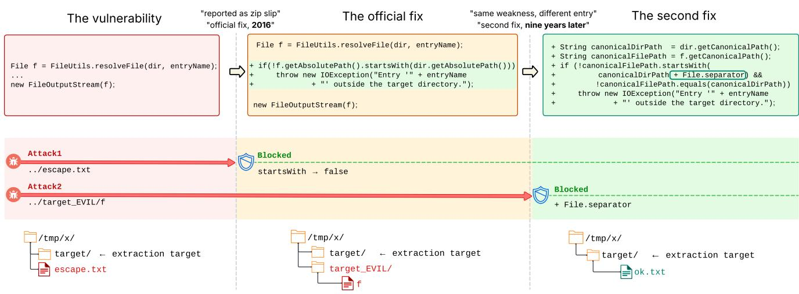
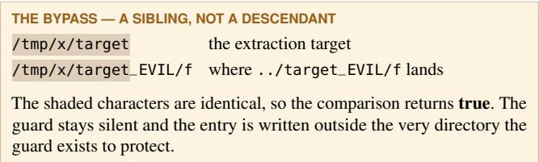
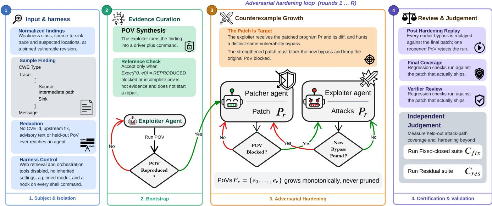
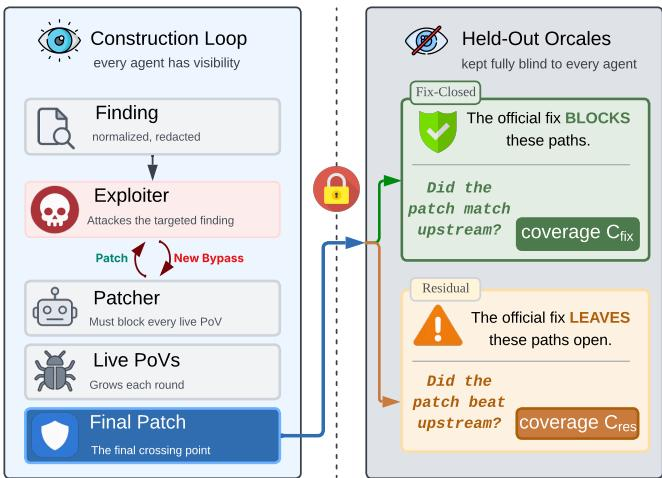
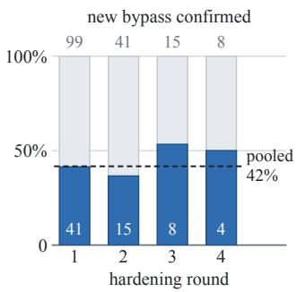
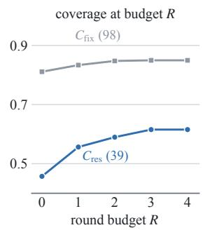
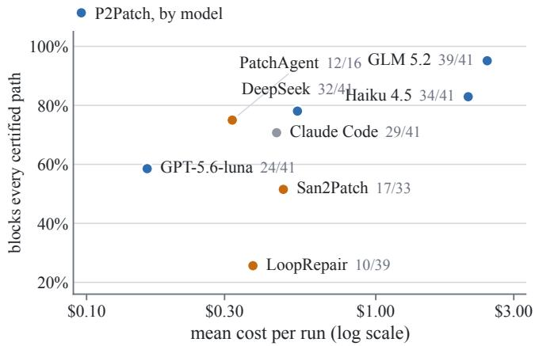
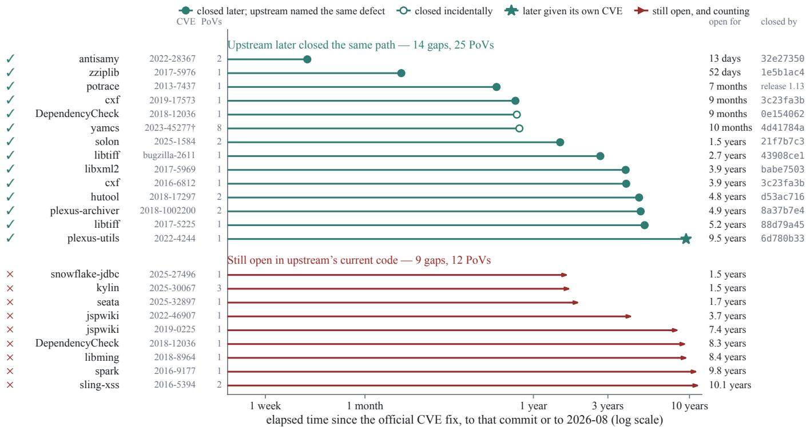

# P2PATCH: Exploit-Guided Vulnerability Repair

Mohsen Iranmanesh1∗, Sina Moradi Sabet2∗, Sina Marefat3, Ali Javidi Ghasr4, Maxime Newman Nereyabagabo1, Kousha Amouzesh1, Jaivir Malhi1, Vinci Velasco1, Alex Chung1, Mohammad A. Tayebi1

1Simon Fraser University, Canada 2Amirkabir University of Technology, Iran 3K. N. Toosi University of Technology, Iran 4Ferdowsi University of Mashhad, Iran

mia32@sfu.ca, sina.moradi@aut.ac.ir, sina.marefat@email.kntu.ac.ir, alijavidighasr@mail.um.ac.ir, mnn6@sfu.ca, kousha\_amouzesh@sfu.ca, jai\_malhi@sfu.ca, vvv@sfu.ca, alex\_chung@sfu.ca, tayebi@sfu.ca

## Abstract

Large language models are increasingly deployed as autonomous agents for automated program repair, patching software vulnerabilities through multi-step reasoning and tool use. Yet these systems typically validate a patch against the same evidence used to construct it—a static alert, sanitizer trace, published exploit, or test suite. A patch that blocks that one piece of evidence can therefore look successful while remaining vulnerable to the same vulnerability with some variation. We present P2PATCH, a generative adversarial repair system that treats each patch as a new attack target. Starting from a normalized vulnerability finding, an exploitation agent constructs a reproducing proof of vulnerability (PoV), a patching agent repairs the program, and the exploitation agent then attacks the patched program for a distinct same-vulnerability exploit. Every successful exploit becomes a permanent repair requirement, and the final patch must block all PoVs accumulated during patching process, with construction-time PoVs kept strictly separate from held-out evaluation oracles. Across 101 C/C++ and Java CVE subjects, this adversarial loop surfaces a distinct confirmed exploit in 41% of runs after the patch has already blocked its original construction-time PoV. Against single-pass repair from the same finding using Claude Code, P2PATCH raises held-out fix-closed coverage from 78.1% to 84.7% and beyond-upstream coverage from 42.1% to 62.5%. Under the same held-out oracles, it also certifies more attack paths as blocked than recent state-of-the-art agentic repair systems on overlapping subjects. These results show that adversarial testing and independent security oracles expose repair gaps that one-shot validation misses.

## 1 Introduction

Automated vulnerability repair is only as reliable as the evidence used to guide and judge it. A static-analysis alert identifies a suspicious flow, but not necessarily the runtime conditions that make it exploitable [25, 27]. A sanitizer trace or proof of concept—an input that triggers a specific bug or flaw within a program—demonstrates one failing execution, but not every similar payload, encoding, entry point, or sibling path that should be blocked. A project test suite may preserve intended functionality, but it rarely defines the full security boundary. These signals are valuable but partial: they can explain why a revision merits repair without specifying what a complete repair must cover [21, 36].

These partial signals create an oracle-reuse problem. Automated repair systems often use one piece of evidence twice: first to guide patch construction, and then to decide whether the patch succeeded. A patch that blocks the supplied PoV, crashing input, sanitizer trace, or available test may therefore be accepted even if it only specializes to that evidence. This risk is well known in general program repair, where testguided repair can overfit its construction suite [15, 33, 52, 66]. It is especially consequential for security repair: blocking one observed attack can be mistaken for resolving the underlying security issue. Recent vulnerability-repair evaluations likewise show that proof-of-concept plus functional-test validation can overestimate repair correctness [58, 60, 72].

Existing vulnerability-repair systems occupy several points in this design space. Some patch from vulnerable code, weakness semantics, and suspected locations, while others use crashing inputs, sanitizer reports, proofs of concept, or trace-derived triggers for localization, repair, and validation [13, 26, 29, 45, 51, 55, 71, 74, 76]. LoopRepair further iterates on vulnerable locations and taint-trace feedback [68]. These systems show that dynamic evidence and LLM agents can improve vulnerability repair, but their repair objective is typically fixed before patching begins: the system attempts to satisfy the same alert, crash, trace, or PoV after each repair attempt. The target does not adapt to the patched program.

We argue that vulnerability repair should be exploit-guided. Once a patch changes the program, the relevant question is not only whether the original PoV is blocked, but whether a distinct exploit can falsify the security claim that accepting the current patch implies. A path-traversal patch that rejects one relative path may still accept an absolute path; an injection patch that blocks one payload may miss an alternate encoding; a repair at one sink may leave a sibling sink reachable. In these cases, the next useful evidence is not another explanation of the original bug, but a working same-vulnerability exploit against the current patch. This framing resembles counterexample-guided synthesis, but our verifier is an incomplete, budgeted exploiter rather than a complete decision procedure [54].

This paper presents P2PATCH, an execution-refereed exploit–patch repair system. We call this exploit-guided repair: a security instantiation of counterexample-guided synthesis in which the counterexample is an executable exploit against the current patch rather than a logical model [11, 54]. P2PATCH starts from a normalized vulnerability finding and a pinned project revision. The protocol is evidence-source independent: the finding may come from a static alert or source-to-sink trace [3], a vulnerability description, a sanitizer report, or a successful exploitation. Our evaluation uses source-to-sink traces, with all findings redacted so that agents do not receive the CVE identifier, upstream fix, advisory exploit text, or held-out proofs of vulnerability (PoVs). Existing work has studied LLM-assisted static analysis and PoV gen eration as upstream capabilities [14, 35, 37, 44, 56]. P2PATCH uses such evidence differently: an exploitation agent (the exploiter) turns the finding into a reproducing PoV, a patching agent (the patcher) modifies the program until that PoV is blocked, and the exploiter then attacks the patched program for a new distinct same-vulnerability PoV that bypasses the patch. Every execution-confirmed bypassing PoV becomes a permanent repair requirement.

The design is execution-mediated. Agents may propose PoVs and patches, but they do not certify success [77]. The orchestrator executes PoVs in the project container, distinguishes reproduction, blocking, and inconclusive infrastructure outcomes, runs differential regression checks, protects role-specific artifacts, and replays accumulated hardening PoVs after the adversarial rounds. Thus, the interaction is a bounded repair process over a changing executable program, not a natural-language debate between agents.

P2PATCH separates construction-time evidence from evaluation-time evidence. Live PoVs drive repair, but we do not treat them as an independent measure of completeness to avoid the oracle-reuse problem. We instead evaluate final patches with independently certified and held-out PoV suites. Fix-closed PoVs reproduce on the vulnerable revision and are blocked by the recorded official fix, measuring held-out attack-path coverage. Residual PoVs reproduce both before and after the official fix, measuring beyond-upstream hardening. This distinction matters because released security patches can themselves be incomplete [34, 69].

We evaluate P2PATCH on 101 project-level CVE subjects spanning C/C++ and Java. The exploiter finds a distinct execution-confirmed bypass in 41% of runs after the patch blocks its original PoV. Against single-pass repair from the same finding, P2PATCH raises held-out fix-closed coverage from 78.1% to 84.7% and beyond-upstream coverage from 42.1% to 62.5%. Fourteen certified residual gaps were later closed upstream, up to nine and a half years after the original fix. Under the same held-out oracles, P2PATCH covers more certified attack paths than published repair systems on overlapping subjects and exposes patches that passed their validation while leaving certified paths open.

This paper makes the following contributions:

• We introduce a counterexample-guided exploit–patch protocol in which each execution-confirmed bypass of the current patch becomes a permanent repair requirement.

• We design an execution-mediated orchestrator that separates exploiter and patcher roles, protects role-specific artifacts, distinguishes blocked exploits from inconclusive outcomes, performs differential regression checks, and replays accumulated PoVs.

• We release VULNREPAIRBENCH, a benchmark of 101 project–CVE subjects whose independently certified fixclosed and residual PoV suites separate held-out attack-path coverage from beyond-upstream hardening.

• We evaluate P2PATCH across C/C++ and Java CVE subjects against a single-pass baseline, loop ablations, model variants, and published repair systems, showing that adaptive counterexample growth improves security coverage and exposes gaps missed by conventional validation.

## 2 Motivation and Problem Setting

P2PATCH studies repair after a vulnerability has already been reported. Given a pinned vulnerable revision P , a normalized finding f, and a project execution contract C, the task is to produce either a source patch π or a structured failure. A patch is construction-valid only if the patched program P0 ⊕ π (the pinned revision with π applied) blocks all live PoVs accumulated during the protocol and does not introduce a differential regression under C. Final security coverage is measured later by held-out PoV suites; P2PATCH is blind to these during repair.

We study repair, not triage [18]. Each subject corresponds to a reported CVE, and the normalized finding is assumed to describe the target vulnerability. The system receives the weakness class, relevant source locations, suspected sourceto-sink or trigger context when available, and build/execution metadata. It does not receive the CVE identifier, upstream patch, advisory exploit text, or curated evaluation PoVs. This setup evaluates whether a repair protocol can turn partial vulnerability evidence into executable repair requirements, not whether an agent can retrieve or copy the recorded fix.

  
Figure 1: Motivating plexus-utils example. The 2016 containment check is bypassed by a sibling path; the later fix closes the gap by canonicalizing paths and enforcing a separator boundary.

## 2.1 One Vulnerability, Two Fixes

Figure 1 gives the motivating example. plexus-utils, a utility library used throughout the Maven build ecosystem, extracts archives through Expand.extractFile. It resolved an entry name against the extraction directory and opened the result for writing, with no containment check in between:

THE VULNERABILITY   
File f = FileUtils.resolveFile(dir, entryName);   
new FileOutputStream(f);

An archive entry named ../escape.txt therefore resolves above the extraction directory and is written there—the archive-extraction path traversal known as zip slip [53]. This is the reported vulnerability, and the project’s 2016 fix inserts a containment check immediately after the entry is resolved: reject the entry unless its absolute path startsWith the extraction directory’s absolute path. Against the reported entry the fix works, and it works against every deeper ../ chain that lands above the target, since each of those resolves somewhere that does not begin with the target’s path at all.

The check is nevertheless incomplete, and the reason is one line of it. String.startsWith compares characters, not filesystem path components, and dir contributes no trailing separator. An entry that resolves into a sibling of the extraction directory—one whose name merely extends the target’s— therefore walks straight through the guard:

The patched program remains vulnerable to the weakness it was patched for, through a directory name that merely extends the one it protects. More than nine years later, upstream replaced the check with one that canonicalizes both operands and compares against the target path plus a separator:

THE SECOND FIX, 2025   
if (!canonicalFilePath.startsWith(   
canonicalDirPath + File.separator)   
&& !canonicalFilePath.equals(canonicalDirPath))

The separator moves the comparison onto a path boundary: /tmp/x/target/ is not a prefix of /tmp/x/target\_EVIL/f, so the sibling is rejected while real descendants still pass. The second fix does not correct a misunderstanding about the weakness or the sink; the first fix had both right. It corrects the boundary. The same boundary-less check appears in other projects’ official fixes in our benchmark; Appendix G measures how long those gaps survived.

The example shows a gap between two questions a repair system can confuse: whether a patch stops the attack it was shown, and whether it repairs the boundary that attack crossed. Re-running the reported entry answers the first. Nothing used to construct the patch answers the second—closing that gap requires evidence independent of the repair process.

## 2.2 From Findings to Repair Requirements

The evidence available for a vulnerability determines what a repair system can be asked to do. A sanitizer report plus a crashing input is precise and executable, but it exists only for failures a sanitizer or crash oracle can observe. A static finding is broader, covering injection, traversal, authorization, deserialization, and other non-crashing weaknesses. On its own, though, it neither proves reachability nor defines the observable security effect [65]. P2PATCH consumes the latter form and turns it into live PoVs.

A proofofvulnerability (PoV) is an input or test driver plus an execution command whose outcome is one of three values: reproduced, blocked, or inconclusive. A PoV is live when the exploiter produces it during a run, so that it becomes a repair requirement; it is held-out when it is authored outside the loop and used only to score the final patch. A valid PoV must exercise a real product entry point and observe the relevant security effect. Source inspection, attacker-controlled assertions, missing harnesses, timeouts, and build failures are not evidence that a vulnerability is blocked. The inconclusive outcome is therefore essential: without it, broken infrastructure can be mistaken for successful repair.

A PoV is both narrower and stronger than the original finding. It is narrower because it demonstrates one path, payload, and environment. It is stronger because it converts a suspected vulnerability into an executable predicate that can be replayed before and after patching. The repair objective starts from such predicates and grows only when execution confirms another in-scope bypass.

## 2.3 Growing Objective and Scope

The repair objective is not fixed to the first PoV. When execution confirms a new bypass of the current patch, that bypass becomes an additional repair requirement that later patches must continue to block. New requirements must exercise the same reported weakness and security boundary, although they may use different payloads, encodings, entry points, or sibling paths.

This structure resembles counterexample-guided synthesis, but the analogy is methodological rather than formal [1]. The verifier is a bounded exploiter, not a complete decision procedure over all inputs [8, 22]. “No counterexample found” therefore means only that the configured search failed to find another reproducing same-vulnerability bypass. Independent held-out suites in Section 4 measure the final patch after repair terminates.

## 2.4 Threat Model and Non-Goals

P2PATCH targets known vulnerabilities in pinned C/C++ and Java project revisions. The attacker controls inputs relevant to the finding, such as archive entries, files, buffers, request parameters, serialized objects, command-line arguments, or network messages. We assume the revision can be built and exercised in its container and that the vulnerable effect is observable under the project contract. Regression checks are bounded behavioral oracles: passing them establishes compatibility only for the behaviors they exercise.

The agents receive the normalized finding, source tree, and build metadata, but not the CVE identifier, upstream fix, advisory exploit text, or held-out suites, and web retrieval is disabled. These controls reduce direct leakage, but they do not remove knowledge acquired during pretraining. Each run uses a dedicated Git worktree and project container. The prototype does not claim host containment against a malicious repository. We treat the evaluation host and benchmark repositories as trusted infrastructure, and agent-produced edits, commands, and claims as untrusted inputs.

## 3 Counterexample-Guided Repair Protocol

P2PATCH turns the problem setting above into an executionrefereed repair protocol (Figure 2). The protocol is intentionally simple: make the reported finding executable, patch the current requirement set, attack the patched program for a same-vulnerability bypass, and repeat only when execution confirms a new bypass. The full pseudocode is in Appendix C and the agent prompt templates ship with the artifact (Appendix B); this section describes the design invariants and runtime semantics needed to understand the evaluation.

## 3.1 Protocol State and Invariants

A run maintains three pieces of state: the pinned vulnerable revision $P _ { 0 } ,$ , the current candidate program $P _ { r }$ , and an appendonly requirement set

$$
E _ { r } = \{ e _ { 0 } , \ldots , e _ { r } \} .
$$

Each $e _ { i } \in E _ { r }$ is an execution-confirmed live PoV that remains a repair obligation. Initially, $E _ { - 1 } = \emptyset$ . During adversarial hardening, whenever execution confirms a new same-vulnerability bypass $e _ { r + 1 }$ , the orchestrator extends the requirement set as

$$
E _ { r + 1 } = E _ { r } \cup \{ e _ { r + 1 } \} .
$$

We write $b = \left| E \right| - 1$ for the number of execution-confirmed bypasses a run appends beyond the bootstrap PoV $_ { e _ { 0 } ; }$ Tables 12 and 13 report b per subject.

This state enforces three invariants. First, requirements are executable: a finding becomes a repair requirement only after its PoV reproduces in the project container. Second, requirements are persistent: once a PoV enters $E _ { r } ,$ , it remains a repair obligation for the rest of the run. Third, agents do not certify their own success: the orchestrator decides PoV reproduction, patch blocking, regression outcomes, and final replay through execution.

  
Figure 2: P2PATCH workflow: bootstrap a live PoV, patch accumulated requirements, attack the patched program for bypasses, then score the final patch with held-out suites.

The requirement set is a construction-time object. Satisfy ing every live requirement does not establish patch completeness; final security coverage is measured separately using the held-out oracle suites of Section 4.

## 3.2 Bootstrap: Making the Finding Executable

Bootstrap is the bridge from partial vulnerability evidence to an executable repair task. The exploiter receives the normalized finding, source tree, and project execution contract, and tries to produce a PoV $e _ { 0 }$ that demonstrates the reported behavior on $P _ { 0 } .$ . This PoV is not an evaluation oracle. It is construction evidence: it establishes reachability, fixes the runtime environment, and creates a concrete predicate that can be replayed while the patcher edits code.

A candidate PoV is accepted only when EXEC $: ( P _ { 0 } , e _ { 0 } )$ returns REPRO. If the candidate times out, fails to build, depends on a missing harness, or does not observe the vulnerable behavior, it is inconclusive or blocked and does not enter the requirement set. If no reproducing PoV is found within the bootstrap budget, P2PATCH returns a structured failure rather than asking the patcher to repair an unexecuted claim. This conservative rule is important: a non-reproducing PoV can make a broken harness look like a successful patch, and a patch derived from an unexecuted claim cannot be scored as construction-valid.

Once $e _ { 0 }$ is accepted, it grounds the reported vulnerability in a reproducible execution. The repair objective is to address the vulnerability while preserving the project’s intended behavior, not merely to block this PoV. The accepted PoV initializes ${ \cal E } _ { 0 } = \{ e _ { 0 } \}$ , and the patcher receives the current source tree, the normalized finding, the PoV, and execution feedback from the orchestrator. The CVE identifier, upstream patch, advisory exploit text, and held-out evaluation PoVs remain unavailable.

## 3.3 Patching Current Requirements

Given a requirement set $E _ { r }$ , the patcher edits product code and proposes a candidate program $P _ { r } ^ { \prime } .$ . The orchestrator then applies a security-first gate. Regression checks are considered only after every PoV the gate protects executes as BLOCKED. The first patch is gated on $e _ { 0 } ;$ each hardening round is gated on that round’s new bypass together with $e _ { 0 } ;$ earlier confirmed bypasses are replayed once after the hardening loop, and the differential regression check runs afterward. If an earlier bypass fails this replay, the patch is rejected without another correction attempt. If a PoV protected by a convergence gate still reproduces, the patcher receives execution feedback for another correction attempt. If the patch breaks behavior that passed on the comparison revision, it is also rejected. The inner loop continues until the gate passes or the correction budget is exhausted. Patches that pass the automated gates are subsequently subjected to the standardized manual-review protocol of Section 5.

The per-round gate is deliberately stronger than checking the most recent PoV: it checks the newest bypass together with $e _ { 0 }$ . Because $E _ { r }$ is append-only, earlier bypasses remain repair obligations and are replayed after hardening. This prevents a candidate from blocking $e _ { r }$ by reopening $e _ { 0 } .$ , while the posthardening replay rejects a candidate that reopens another earlier PoV. The predicate sequence of each convergence gate is re-evaluated from the beginning after every revision, so a regression fix cannot silently reintroduce $e _ { 0 }$

Patch convergence operates over the current requirement set; adversarial hardening instead expands that set by searching the accepted patch for a new same-vulnerability bypass. Section 3.4 describes this outer loop.

## 3.4 Adversarial Hardening

After a candidate patch passes the current gate, P2PATCH gives the patched program to the exploiter. The exploiter’s task is no longer to reproduce the vulnerable revision. It must find a distinct same-vulnerability bypass against the current patch. In other words, the patch becomes the next attack target. If the exploiter produces a candidate $e _ { r + 1 }$ and execution confirms EXEC $( P _ { r } , e _ { r + 1 } ) = \mathrm { R E P R O }$ , the candidate is appended to the requirement set, $E _ { r + 1 } = E _ { r } \cup \{ e _ { r + 1 } \}$ , and the patcher must strengthen the repair against the expanded set.

The outer loop is bounded. The main configuration uses a fixed maximum number of hardening rounds, and a stable exit means only that no additional confirmed bypass was found before the budget expired. The final patch is therefore a bounded hardening result, not a proof of vulnerability absence. Its security is measured later by held-out oracle suites that were not used to construct the patch.

## 3.5 Execution Referee

The orchestrator, not either agent, is the referee. For a program P and PoV $e ,$

$$
\operatorname { E X E C } ( P , e ) \in \{ \operatorname { R E P R O } , \operatorname { B L O C K E D } , \operatorname { I N C O N } \} .
$$

REPRO means the PoV executes and observes the vulnerable behavior. BLOCKED means the PoV executes but the vulnerable behavior is not observed under the PoV exit contract. INCON means execution does not establish either result because of a timeout, build failure, missing harness, harness error, or other infrastructure failure.

The three-valued outcome avoids unsafe shortcuts. Bootstrap accepts a PoV only on REPRO; patch convergence accepts a transition only when all protected PoVs are BLOCKED and regression checks pass. INCON helps neither agent. Treating inconclusive execution as “blocked” would reward deleted harnesses, stale builds, and infrastructure failures. Treating it as “reproduced” would turn tool failures into false secu rity findings. P2PATCH therefore gives no security credit for inconclusive runs.

Regression checks are differential. A nonzero test result after patching counts against the patch only when a fresh comparison against the pristine revision supports that attribution. This matters because injected PoV files may be discovered by project test runners, projects may have flaky or environmentspecific failures, and a stale build can fail for reasons unrelated to the proposed repair. The same execution semantics are used for live gates and final replay, while held-out evaluation suites are mounted only after repair terminates.

## 3.6 Artifact Integrity and Implementation

The exploiter and patcher operate on the same changing program, but their permissions are asymmetric. The exploiter may create attack artifacts but must not weaken product code. The patcher may edit product code but must not delete, rewrite, or neuter protected PoVs. The orchestrator enforces this separation with two role-specific guards: before exploiter calls, it snapshots product sources and restores edits outside the PoV tree; before patcher calls, it snapshots the PoV tree and restores edits, deletions, additions, or symlink changes to protected PoVs.

These guards are not a cosmetic implementation detail. Without them, the exploiter could manufacture an easy bypass by weakening the program, and the patcher could pass the gate by deleting or changing PoVs instead of fixing code. The guards make the requirement set meaningful: each PoV remains a protected executable requirement across patch revisions, and each patch is judged on product-code behavior rather than artifact tampering.

The prototype is a Python orchestrator whose configurations are typed stage lists. Each stage declares required and produced artifacts, so configurations are dependency-checked before execution. Build metadata records project-specific toolchains and commands as ecosystem adapters rather than language-specific repair logic. Each run persists agent inputs and outputs, container logs, retry histories, diffs, and verdict files. The runner disables web retrieval and inherited agent settings so that experimental arms change repair evidence and loop structure, not the surrounding machinery. Full pseudocode and implementation details are in Appendix C.

## 4 Independent Security Oracles

Tests used during repair are insufficient as independent evidence of patch correctness [67]. Similarly, live PoVs are necessary for construction but cannot independently measure final security because the patcher has seen them. P2PATCH therefore scores every patch with two held-out oracle families whose certification rules are opposites, while keeping both separate from the requirement set that drives repair (Figure 3). Evidence used to construct the patch is never reused as the final measure of security coverage. This separation is the central methodological constraint in the paper: a patch may pass every live gate and still fail held-out paths that were not available during repair.

The held-out suites are manually authored outside the repair loop, finalized before scoring, and never shown to agents. They follow the same three-valued execution contract as live PoVs: a PoV can reproduce the vulnerability, be blocked by the program under test, or be inconclusive because execution does not establish either result. Inconclusive outcomes are excluded from the coverage denominator and provide no security credit. These checks establish behavior under the project execution contract; they are not complete semantic proofs.

  
Figure 3: Construction and held-out evaluation are strictly separated. During repair, agents see only the normalized finding and accumulated live PoVs. After repair terminates, only the final patch crosses into held-out evaluation: fix-closed oracles measure whether it blocks paths closed by the official fix $( C _ { \mathrm { f i x } } )$ , while residual oracles measure whether it blocks paths the official fix leaves open $( C _ { \mathrm { r e s } } )$

## 4.1 Fix-Closed Oracles

A fix-closed PoV is a held-out PoV that reproduces on the buggy revision $P _ { \mathrm { v u l n } }$ and is blocked by the officially patched revision $P _ { \mathrm { u p } } { \mathrm { : } }$

$$
\operatorname { E X E C } ( P _ { \mathrm { v u l n } } , e ) = \operatorname { R E P R O } \quad { \mathrm { a n d } } \quad \operatorname { E X E C } ( P _ { \mathrm { u p } } , e ) = \operatorname { B L O C K E D } .
$$

Fix-closed suites measure coverage of independently constructed attack paths that the recorded fix closes. They are not given to the exploiter as starting points and are not given to the patcher as tests. They are mounted only after a configuration ships a final patch. If a subject has five fix-closed PoVs and a generated patch blocks all five, then its fix-closed coverage for that subject is 100%; if it blocks only the path its live PoV drives, the held-out suite exposes that specialization.

This oracle type gives the official fix an operational role without treating it as source text to imitate. The generated patch is not compared syntactically with the upstream diff. It is evaluated behaviorally: does it block the same independently certified paths that the official fix blocks? This matters for LLM repair because two patches can look very different while providing similar coverage, and two superficially similar patches can differ on untested paths [64].

## 4.2 Residual Oracles

A residual PoV is a held-out PoV that reproduces on both the buggy revision and the official fixed revision:

$$
\operatorname { E X E C } ( P _ { \mathrm { v u l n } } , e ) = \operatorname { R E P R O } \quad { \mathrm { a n d } } \quad \operatorname { E X E C } ( P _ { \mathrm { u p } } , e ) = \operatorname { R E P R O } .
$$

Residual suites measure candidate gaps that appear to survive the recorded fix. Because the official fix does not block them, they are certified by an inverted rule rather than the fix-closed one. We therefore treat them as manually curated candidate gaps in the official patch, and report them separately as $C _ { \mathrm { r e s } }$ Later upstream commits that close the same behavior provide additional evidence that a residual path was security-relevant, but they are not required for inclusion.

Reporting fix-closed and residual suites separately avoids overclaiming. A patch can match official-patch behavior by covering fix-closed paths while still leaving nearby behaviors open; conversely, a patch that blocks residual paths may be stronger than the recorded fix on those paths.

## 4.3 Coverage and Leakage Control

For both oracle types, coverage is computed only over conclusive executions. The main metric, defined in Section 5, counts the fraction of held-out PoVs blocked by the generated patch and reports inconclusive outcomes separately. The same execution referee decides live PoVs, final replay, fix-closed suites, and residual suites. No configuration can therefore receive credit under a different acceptance rule than the one used during construction.

Oracle leakage is controlled by separation in time and interface. Agents do not receive CVE identifiers, upstream patches, advisory exploit text, or held-out oracle files; web retrieval is disabled; and held-out suites are mounted only after repair terminates. These controls cannot eliminate knowledge present in a model’s pretraining data, so our claim is not that agents are uninformed about the world. The claim is narrower and operational: the repair loop cannot inspect or execute the evaluation suites that determine the reported coverage.

## 5 Experimental Setup

Our evaluation tests whether counterexample-guided hardening improves security coverage beyond one-shot repair from that finding. We vary only whether the patcher sees no executable PoV, a bootstrap PoV, or a growing set of executionconfirmed bypasses. All configurations share subjects, normalized findings, execution contracts, model pinning, artifact guards, regression policy, and held-out oracle suites.

Benchmark. We evaluate on VULNREPAIRBENCH, the benchmark we assemble for this work (Appendix D). A subject is a project–CVE instance at a pinned vulnerable revision, with a source tree, normalized finding, container definition, and project-specific build, PoV-execution, and regression commands [24]. C/C++ subjects are derived from VulnLoc+ [50, 68], restricted to those whose required contracts could be reproduced. Java subjects are curated from GitHub Security Advisories and the NVD; each uses a manually checked CodeQL-derived taint finding consistent with the advisory and vulnerable revision [2, 5]. The leakage controls of Section 4.3 apply to every subject and configuration. VULNREPAIRBENCH contains 101 CVEs (60 Java and 41 C/C++) over 61 distinct repositories (51 Java and 10 C/C++), and spans 20 weakness classes with no overlap between the two ecosystems. Every CVE has a certified fix-closed suite with 1–14 PoVs; residual suites exist only where the official fix leaves a demonstrated gap, with 1–5 PoVs each. Table 1 summarizes these totals.

Fairness controls. All agents run through the same harness: Claude Code (v2.1.241), a coding agent with file, shell, and search tools. Every invocation is restricted to a per-run Git worktree, with web retrieval and orchestration tools disabled, no inherited settings, a pinned model, and a pre-execution command hook. This includes P2PATCH itself, so the arms differ only in the evidence and loop structure the orchestrator imposes on that harness, not in the agent driving it. Configurations receive identical inputs apart from the experimental variable, use the same applicable per-stage budgets, and are scored by identical held-out suites. The main comparison gives the exploiter three attempts when an exploitation stage is present, each convergence gate three evaluations (hence at most two corrective patches), and the hardening loop four rounds. Deviations from these budgets that never became binding are reported with the results.

Patch acceptance and manual review. Manual review is performed only after a candidate patch passes the automated execution and regression gates. Two reviewers independently assess each candidate using a fixed rubric covering unintended functional changes, removal or weakening of security-relevant logic, build-system modifications, deletion or circumvention of tests or harnesses, and introduction of new security risks. Reviewers are blinded to the model and experimental configu ration and base their decisions only on the patch diff, relevant program context, and execution evidence. Disagreements are resolved through joint adjudication. The same procedure is applied across all configurations. Held-out security oracles are not available during this review and do not influence patch acceptance.

Internal configurations. We compare configurations expressible as parameter settings of Algorithm 1.

• SINGLEPASS. The patcher repairs the normalized finding in one pass on the same Claude Code harness, with no

Table 1: VULNREPAIRBENCH summary: 101 CVEs, 61 repositories, and 20 weakness classes. All subjects have fixclosed suites; 40 also have residual suites.
<table><tr><td></td><td>Java</td><td>C/C++</td><td>All</td></tr><tr><td>CVEs</td><td>60</td><td>41</td><td>101</td></tr><tr><td>CVEs with a fix-closed suite</td><td>60</td><td>41</td><td>101</td></tr><tr><td>CVEs with a residual suite</td><td>28</td><td>12</td><td>40</td></tr><tr><td>Fix-closed PoVs</td><td>213</td><td>111</td><td>324</td></tr><tr><td>Residual PoVs</td><td>51</td><td>15</td><td>66</td></tr></table>

Attack(), no live PoV, and no post-patch bypass search.   
This measures repair from static evidence alone.

• PoV-only. This configuration keeps the bootstrap Attack() and Converge() gate but disables adversarial hardening.

• P2PATCH. The full protocol obtains a reproducing PoV e0, requires the patcher to block it, and then attacks the patched program for distinct same-vulnerability bypasses. Each confirmed bypass becomes a permanent repair requirement, and the final patch must also pass differential regression checks. The main configuration uses R=4 hardening rounds.

• Loop-depth variants. These vary only the maximum number of adversarial rounds while keeping the same bootstrap, patching, execution-referee, and oracle machinery.

The arms therefore differ only in repair evidence and loop structure. Stage prompts, model settings, execution contracts, and per-stage budgets are identical wherever the corresponding stage is present.

Published baselines. We compare against published repair systems on shared subjects when patches or reproduction artifacts are available. We reconstruct each patched tree from the vulnerable revision and recorded diff, then score it under our held-out fix-closed and residual suites. This does not claim prior systems failed under their original criteria; it measures what their validation may not have tested.

• SAN2PATCH [29]. SAN2PATCH is driven from the benchmark’s own crashing input, never from our certified PoVs, to avoid oracle leakage.

• PATCHAGENT [71]. PATCHAGENT is evaluated under the same non-leakage rule, using the benchmark’s available reproduction artifact rather than held-out PoVs.

• LoopRepair [68]. LoopRepair is re-run end to end on VulnLoc+ subjects using the same model as our runs, holding subject and agent capability fixed where possible.

Models and cost. The main comparison holds model capability fixed: all runs in Sections 6.1–6.3 use Claude Haiku 4.5. We additionally run the full configuration on three unrelated model families to test model dependence (Section 6.4). Reported cost is provider-billed where available and otherwise estimated from the harness; we flag cases where fallback pricing overstates third-party model costs.

Metrics and tests. Coverage is defined only for a patch. Paired comparisons therefore follow an intention-to-treat policy: every subject carrying a certified suite is scored, and a configuration that shipped no accepted patch there is credited zero. For a certified suite $S ,$ coverage is the fraction of conclusive PoVs blocked by the generated patched program $P _ { \mathrm { g e n } }$

$$
C ( S , P _ { \mathrm { g e n } } ) = \frac { \left| \left\{ e \in S : \operatorname { E X E C } ( P _ { \mathrm { g e n } } , e ) = \operatorname { B L O C K E D } \right\} \right| } { \left| \left\{ e \in S : \operatorname { E X E C } ( P _ { \mathrm { g e n } } , e ) \in \left\{ \operatorname { B L O C K E D } , \operatorname { R E P R O } \right\} \right\} \right| } .
$$

We report $C _ { \mathrm { f i x } }$ for fix-closed suites and $C _ { \mathrm { r e s } }$ for residual suites; inconclusive executions are excluded from the denominator. Certified suite sizes vary from 1 to 14 PoVs, so the primary metric is macro coverage, the average of per-subject coverage; micro coverage pools all certified PoVs as a path-level diagnostic. Primary tests are exact Wilcoxon signed-rank tests on per-subject deltas for $C _ { \mathrm { f i x } }$ and $C _ { \mathrm { r e s } }$ , with Holm adjustment within primary and language-family groups [61]. Language splits, Section 6.3 stratification, published-baseline re-evaluation, and the model sweep are exploratory.

## 6 Evaluation

We evaluate whether adversarial hardening exposes bypasses that one-shot repair misses, whether those bypasses translate into higher held-out security coverage, and whether the effect generalizes across models and published repair systems.

We ask five questions. RQ1 tests whether accepted repairs can still be bypassed after blocking their construction PoV. RQ2 measures held-out coverage and cost relative to singlepass repair from the same finding. RQ3 attributes the gains to the bootstrap PoV and adversarial hardening loop. RQ4 tests model dependence. RQ5 compares published baselines under the same independent security oracles.

## 6.1 Bypasses After Accepted Repair (RQ1)

Unless otherwise noted, all experiments use the setup of Section 5.

If blocking the PoV that triggered a patch were sufficient evidence of repair, an attacker targeting that patched program would find no further same-vulnerability path. We test this directly by turning the exploitation agent against the patch produced from its own bootstrap PoV.

Table 2: Primary held-out macro coverage under intentionto-treat scoring. Paired columns report non-tied pairs (k), wins/ties/losses, and Holm-adjusted exact Wilcoxon signedrank p-values.
<table><tr><td>Oracle</td><td>n</td><td colspan="2">Macro coverage</td><td colspan="5">Paired comparison</td></tr><tr><td></td><td></td><td>SINGLEPASS</td><td>P2PATCH</td><td>k</td><td>Δ</td><td> $+ / { = } / { - }$ </td><td>PHolm</td></tr><tr><td> $C _ { \mathrm { f i x } }$ </td><td>101</td><td>0.781</td><td>0.847</td><td>20</td><td>+0.065</td><td>17/81/3</td><td>0.0286</td></tr><tr><td> $C _ { \mathrm { r e s } }$ </td><td>40</td><td>0.421</td><td>0.625</td><td>13</td><td>+0.204</td><td>11/27/2</td><td>0.0254</td></tr></table>

Two runs in five expose a bypass after the patch has passed its own gate. In 41 of 101 runs (41%), the exploiter produced a distinct, execution-confirmed bypass of a patch that had already blocked the PoV it was built from. Across those runs, the exploiter found 68 bypasses in total. Ninetynine runs reached the adversarial phase, so the rate over attackable runs is also 41%. The per-run distribution is 60 runs with no bypass, 26 with one, 7 with two, 4 with three, and 4 with four. A system that stopped after the first blocked PoV would have accepted all 41 bypassed patches without any signal that the repair remained incomplete.

The bypass rate does not decay with depth. Conditioned on reaching each hardening round, the probability of finding another confirmed bypass is 41%, 37%, 53%, and 50% over cohorts of 99, 41, 15, and 8 runs, respectively (Figure 4). We do not interpret the later rates precisely because the cohorts are small; the important point is that the rate does not collapse after the first bypass. Four runs reached the four-round budget while still confirming a new bypass in the final round, so search was truncated rather than exhausted on those subjects.

The orchestrator enforces execution, not semantic novelty. A candidate bypass counts only if execution reproduces the vulnerable behavior against the current patch. The new bypass and $e _ { 0 }$ are protected by the per-round gate; earlier bypasses are replayed by the post-hardening gate described in Section 3.4. The orchestrator rejects candidates that merely replay a previous PoV command. However, we prompt for semantic distinctness beyond that—whether a candidate uses a genuinely different sink rather than a re-encoding of the same path, for example—but do not machine-check it. The 41% rate is therefore an upper bound on semantically distinct bypasses. The key result is still execution-grounded: patches that had passed their own construction-time checks often remained vulnerable to additional same-vulnerability PoVs.

Takeaway. Reusing construction evidence as the only validation signal is insufficient: 41% of runs produce a patch that blocks its bootstrap PoV but is later bypassed by an execution-confirmed same-vulnerability PoV.

## 6.2 Held-Out Coverage and Cost (RQ2)

RQ1 shows that accepted PoV-blocking patches can still be bypassed. RQ2 asks whether adversarial hardening improves final coverage on independent oracles, and whether the im provement is large enough to justify its additional cost.

P2PATCH produces accepted repairs on 98 of 101 subjects. A patch is accepted only after it builds, blocks every live PoV in the requirement set, passes differential regression checks, and survives the standardized manual-review protocol of Section 5. Two failures occur before repair: on CVE-2016-1833 the agent did not produce a working PoV, and on libtiff bugzilla-2611 it produced a candidate PoV that did not trigger the vulnerability within three attempts. The third failure is a patch rejected by manual review. No run was lost at a post-patch execution gate: failed gates returned to the responsible agent, and the correction loop converged within the configured budget for every run that entered repair.

Held-out coverage improves on both oracle families. Table 2 reports the primary comparison: macro-averaged coverage over every subject carrying a certified suite, with any subject that a configuration left unrepaired credited zero. Fixclosed coverage rises from 0.781 to 0.847 over all 101 subjects, while beyond-upstream coverage rises from 0.421 to 0.625 over all 40 residual subjects. Both primary tests survive Holm adjustment [19].

At the path level, micro coverage also increases: over the 324 certified fix-closed paths, $C _ { \mathrm { f i x } }$ rises from 0.710 to 0.781, and over the 66 certified residual paths, $C _ { \mathrm { r e s } }$ rises from 0.409 to 0.712. Perfect coverage increases from 65 to 76 subjects for fix-closed suites and from 15 to 24 subjects for residual suites. The distribution is sparse but directional. 81 of 101 subjects tie on $C _ { \mathrm { f i x } } ,$ , so 20 discordant pairs drive the fix-closed test. Among those pairs, the matched-pairs rank-biserial correlation is 0.55 for $C _ { \mathrm { f i x } }$ and 0.76 for $C _ { \mathrm { r e s } }$ [12, 28]. The number needed to treat—the number of subjects run through P2PATCH per net improved subject—is 7.2 for fix-closed coverage and 4.4 for residual coverage [31]. Twenty-four of the 101 subjects improve on at least one oracle and three regress on at least one. Thus, the gain is not universal, but when the oracle distinguishes the two patches, the direction is strongly favorable to P2PATCH.

The full protocol is more expensive than single-pass repair, with a mean per-subject cost of \$2.09 versus \$0.45 for SIN-GLEPASS, reflecting the additional exploitation and correction stages.

Takeaway. P2PATCH improves held-out coverage on both oracle families: $C _ { \mathrm { f i x } }$ rises by 0.065 over all 101 subjects and $C _ { \mathrm { r e s } }$ by 0.204 over all 40 residual subjects, and both primary tests survive Holm adjustment.

## 6.3 Attributing the Gains (RQ3)

P2PATCH differs from SINGLEPASS in two ways: the patcher first sees a live PoV, and the patched program is then attacked for bypasses. RQ3 separates these effects using the PoV-only configuration, in which bootstrap PoV generation and patch convergence are enabled but adversarial hardening is disabled, and the loop-depth variants, which vary the number of hardening rounds.

The loop, not the PoV, carries the detectable gain. Table 3 decomposes the total gain from Table 2. On fix-closed paths, the live PoV contributes +0.027 and the adversarial loop a further +0.038; on residual paths, the PoV contributes $+ 0 . 0 5 0$ and the loop +0.154. The loop step is statistically detectable on both oracles $( p = 0 . 0 0 2 0$ and $p = 0 . 0 1 5 6 )$ whereas the PoV step is detectable on neither $( p = 0 . 2 9 4 4$ and $p = 0 . 5 0 0 0 )$

The asymmetry reflects the intention-to-treat scoring policy. Requiring a live PoV before patching makes the loop possible, but it also accounts for the three subjects on which P2PATCH ships no accepted patch: two runs never produce a reproducing PoV, and a third ships a patch that manual review rejects. None of the three reaches a hardening patcher, so the yield cost is charged to the PoV step. The loop then improves 10 subjects on $C _ { \mathrm { f i x } }$ and 7 on $C _ { \mathrm { r e s } }$ without lowering coverage on any subject. Residual paths separate the two steps most strongly: fix-closed paths are aligned with the official fix and often with the reported finding, whereas residual paths are precisely those the official patch leaves open.

Every coverage regression predates the loop. The hardening loop is $1 0 / 9 1 / 0$ on $C _ { \mathrm { f i x } }$ and $7 / 3 3 / 0$ on $C _ { \mathrm { r e s } } \mathrm { : }$ it never lowered a score. All three negative pairs in Table 2 arise before it. Two are the unrepaired subjects credited zero. The third is a genuine coverage regression attributable to PoV anchoring: on CVE-2018-17297, the bootstrap PoV led the patcher to repair one zip-slip path, while the SINGLEPASS patch repaired a broader trace set. The exploiter found no bypass on that subject, so the loop did not run and could not widen the repair.

Most residual benefit arrives early. The round-budget sweep, reported in Table 9 and plotted in Figure 4 (right), shows diminishing returns after the first two hardening rounds. Moving from PoV-only to one adversarial round yields the largest residual gain; later rounds add smaller increments. This supports using bounded hardening as a practical repair protocol rather than treating the loop as an unbounded search for completeness.

Takeaway. Priced end to end, the bootstrap PoV pays for the loop rather than for coverage: its own contribution is not statistically detectable on either oracle once the runs it costs are charged to it. The loop is where the detectable gain is — +0.038 on $C _ { \mathrm { f i x } }$ and +0.154 on $C _ { \mathrm { r e s } } ,$ with no oracle regressions.

## 6.4 Model Dependence (RQ4)

An agentic repair protocol can easily become a report about one model. We therefore run the full protocol with one model from each of four unrelated families on the same 101 subjects, budgets, and held-out suites.

Bypass discovery replicates across models. The exploiter falsifies an already-blocking patch in 47%, 41%, 35%, and

Table 3: Attribution of the coverage gain to the bootstrap PoV and adversarial loop. Each ∆ is relative to the preceding row; p is an exact Wilcoxon signed-rank test.
<table><tr><td>Step</td><td>Mean</td><td>Δ</td><td> $+ / { = } / { - }$ </td><td>p</td></tr><tr><td colspan="5">Fix-closed coverage  $C _ { \mathrm { f i x } } , n = 1 0 1$ </td></tr><tr><td>SINGLEPASS</td><td>0.781</td><td></td><td></td><td></td></tr><tr><td>+ live PoV</td><td>0.809</td><td>+0.027</td><td>10/88/3</td><td>0.2944</td></tr><tr><td>+ adversarial loop</td><td>0.847</td><td>+0.038</td><td>10/91/0</td><td>0.0020</td></tr><tr><td colspan="5">Beyond-upstream coverage  $C _ { \mathrm { r e s } } , n = 4 0$ </td></tr><tr><td>SINGLEPASS</td><td>0.421</td><td></td><td></td><td></td></tr><tr><td>+ live PoV</td><td>0.471</td><td>+0.050</td><td>4/34/2</td><td>0.5000</td></tr><tr><td>+ adversarial loop</td><td>0.625</td><td>+0.154</td><td>7/33/0</td><td>0.0156</td></tr></table>

31% of runs across the four models (Table 4). The RQ1 result is therefore not specific to any one of the four tested model families. Because each arm uses the same model as both exploiter and patcher, these rates characterize the full repair trajectory rather than exploiter capability alone.

The protocol transfers across models, while performance varies. All four models produce accepted repairs on a majority of subjects. Under intention-to-treat scoring, the arms differ in both accepted-repair rate and held-out coverage. Claude Haiku 4.5, the model held fixed in Sections 6.1–6.3, produces an accepted repair on 98 of 101 subjects and reaches $C _ { \mathrm { f i x } } = 0 . 8 4 7$ and $C _ { \mathrm { r e s } } = 0 . 6 2 5$ ; we use it as the reference within the model sweep.

GLM 5.2 leads the sweep. It produces an accepted repair on 100 of 101 subjects and reaches $C _ { \mathrm { f i x } } = 0 . 9 2 1$ and $C _ { \mathrm { r e s } } = 0 . 7 9 5 .$ respectively 0.074 and 0.170 higher than Haiku despite producing only two additional accepted repairs. The difference is not solely an acceptance effect. On the 62 subjects for which every model produces an accepted repair with a conclusive fix-closed score, GLM remains highest at $C _ { \mathrm { f i x } } = 0 . 9 5 3$ ; over the 22 of those subjects with a residual suite, it also leads at $C _ { \mathrm { r e s } } = 0 . 7 8 6$ . GLM produces the most execution-confirmed bypasses—102 across 47% of runs, compared with 68 across 41% for Haiku. Twelve GLM runs exhaust the four-round budget, compared with four Haiku runs, and seven GLM subjects cost more than $\$ 9;$ no Haiku subject does. Its \$2.43 mean cost is therefore the largest in the table even though its median subject (\$1.66) is cheaper than Haiku’s \$1.85. DeepSeek V4 Flash produces an accepted repair on 94 subjects and reaches $C _ { \mathrm { f i x } } = 0 . 8 2 1$ and $C _ { \mathrm { r e s } } = 0 . 6 0 8$ , within three points of Haiku on both oracles, at roughly a quarter of its cost.

Strong accepted repairs do not compensate for unrepaired subjects. GPT-5.6-luna produces an accepted repair on only 66 subjects, giving it the lowest intention-to-treat coverage in the sweep: $C _ { \mathrm { f i x } } = 0 . 5 9 4$ and $C _ { \mathrm { r e s } } = 0 . 4 0 0$ . Across those 66 accepted repairs, mean fix-closed coverage is $C _ { \mathrm { f i x } } = 0 . 9 0 9 \mathrm { ; }$ over the 24 accepted repairs on subjects with a residual suite, mean residual coverage is $C _ { \mathrm { r e s } } = 0 . 6 6 7$ . Both are second only to GLM. That accepted-only result does not compensate for leaving a third of the benchmark unrepaired under intention-to-treat scoring. The shortfall is late rather than at the bootstrap: of the 35 unrepaired subjects, 26 have completed patches rejected under the manual-review protocol of Section 5, five exhaust an execution gate’s correction budget, and four never produce a working PoV.

Table 4: Full P2PATCH protocol across four model families under intention-to-treat scoring. “acc.” reports accepted repairs; $ { \mathbf { \hat { \rho } } } _ { \mathrm { { b y p . } } }  { \mathbf { \vec { \rho } } } _ { \mathrm { { } } } ^ { \mathrm { { s } } }$ reports the share of runs with an executionconfirmed bypass. Cost is the mean per subject and wall time the median. $C _ { \mathrm { f i x } }$ and $C _ { \mathrm { r e s } }$ use all 101 and all 40 subjects for every arm.
<table><tr><td>Model</td><td>acc.</td><td>byp.</td><td> $C _ { \mathrm { f i x } }$ </td><td> $C _ { \mathrm { r e s } }$ </td><td>$/subj. min.</td><td></td></tr><tr><td>Claude Haiku 4.5</td><td>98</td><td>41%</td><td>0.847</td><td>0.625</td><td>2.09</td><td>25.8</td></tr><tr><td>GLM 5.2</td><td>100</td><td>47%</td><td>0.921</td><td>0.795</td><td>2.43</td><td>37.1</td></tr><tr><td>DeepSeek V4 Flash</td><td>94</td><td>35%</td><td>0.821</td><td>0.608</td><td>0.54</td><td>37.5</td></tr><tr><td>GPT-5.6-luna</td><td>66</td><td>31%</td><td>0.594</td><td>0.400</td><td>0.16</td><td>11.8</td></tr></table>

Takeaway. Bypass discovery replicates across all four tested model families, and every arm produces accepted repairs on a majority of subjects. End-to-end performance nonetheless differs: GLM 5.2 produces the most accepted repairs and the highest held-out coverage, but also has the highest mean cost and 12 runs that exhaust the four-round budget. GPT-5.6-luna produces high coverage among its accepted repairs, but leaves 35 of 101 subjects unrepaired.

## 6.5 Published Baselines (RQ5)

The certified suites do not depend on P2PATCH, so they can also score patches produced by other repair systems. We compare P2PATCH with SINGLEPASS on the full benchmark, and with SAN2PATCH, LoopRepair, and PATCHAGENT on pairwise shared subjects. Within each comparison, both systems are scored on the same CVEs, under the same oracle suites and the same intention-to-treat policy used everywhere else in this section. A system that reported no patch, or whose own pipeline rejected one, is credited zero on that subject rather than dropped. These comparisons are still not a global ranking: the subject set, input representation, and available artifacts differ by system.

The SINGLEPASS comparator is the single-pass arm from Sections 6.2–6.4: the same patching agent receives the normalized finding but no live PoV and no post-patch bypass search. All five systems evaluated in this section—SINGLEPASS, P2PATCH, SAN2PATCH, LoopRepair, and PATCHAGENT— use Claude Haiku 4.5.

P2PATCH has higher held-out coverage in every pairwise comparison. Table 5 shows higher $C _ { \mathrm { f i x } }$ and $C _ { \mathrm { r e s } }$ on every shared subject set. The largest fix-closed separation is against LoopRepair (+0.605), while residual gains range from +0.454 to +0.500 across the published systems.

Independent oracles expose gaps that original validation did not test. LoopRepair reports a patch on 30 of 40 subjects, each accepted by its own single-crashing-input verification. Under our certified suites only 10 of 39 measurable shared subjects block every fix-closed path. SAN2PATCH and PATCHAGENT also improve some subjects but leave residual and fix-closed paths open under independent oracles. This does not contradict their original evaluations; it shows their validation criteria did not measure the same held-out attack-path coverage.

Table 5: Pairwise held-out coverage on shared subjects under identical certified suites and intention-to-treat scoring. n is the number of shared subjects with a measurable suite; “Comp.” denotes the comparison system.
<table><tr><td>System</td><td>Oracle</td><td>n</td><td>Comp.</td><td>P2PATCH</td><td>Δ</td></tr><tr><td rowspan="2">SINGLEPASS</td><td> $C _ { \mathrm { f i x } }$ </td><td>101</td><td>0.781</td><td>0.847</td><td>+0.065</td></tr><tr><td> $C _ { \mathrm { r e s } }$ </td><td>40</td><td>0.421</td><td>0.625</td><td>+0.204</td></tr><tr><td rowspan="2">SAN2PATCH</td><td> $C _ { \mathrm { f i x } }$ </td><td>33</td><td>0.608</td><td>0.922</td><td>+0.314</td></tr><tr><td> $C _ { \mathrm { r e s } }$ </td><td>10</td><td>0.100</td><td>0.600</td><td>+0.500</td></tr><tr><td rowspan="2">LoopRepair</td><td> $C _ { \mathrm { f i x } }$ </td><td>39</td><td>0.325</td><td>0.930</td><td>+0.605</td></tr><tr><td> $C _ { \mathrm { r e s } }$ </td><td>11</td><td>0.182</td><td>0.636</td><td>+0.454</td></tr><tr><td rowspan="2">PATCHAGENT</td><td> $C _ { \mathrm { f i x } }$ </td><td>16</td><td>0.836</td><td>0.929</td><td>+0.093</td></tr><tr><td> $C _ { \mathrm { r e s } }$ </td><td>6</td><td>0.167</td><td>0.667</td><td>+0.500</td></tr></table>

Table 6 reports mean operational cost per run. P2PATCH is consistently more expensive because it performs additional exploitation and correction stages after the initial repair. Accordingly, these comparisons should be interpreted as an endto-end coverage–cost tradeoff rather than an efficiency ranking: the systems differ in their inputs, repair protocols, and validation policies.

Takeaway. On each shared subject set, P2PATCH scores higher under the same independent oracle suites than the evaluated comparator. The comparison is end-to-end: it reflects differences in inputs, protocol, and validation, not only the adversarial loop.

## 7 Discussion and Limitations

Bounded hardening, not proof. P2PATCH does not prove that a generated patch is complete. The exploiter is a budgeted agent, the live PoV set is finite, and the held-out suites contain human-authored attack paths rather than the full input space. A stable run therefore means only that the configured exploiter failed to find another execution-confirmed same-vulnerability bypass and that the final patch covered the certified suites to the reported degree [30]. This is stronger than reusing the construction PoV as the sole validation oracle, but it remains a testing claim rather than a formal proof [32].

Oracle curation. Oracle certification is execution-based: a PoV enters a suite only by reproducing on the recorded vulnerable tree and then satisfying the fix-closed or residual certification rule. Because all configurations are scored by identical held-out suites, oracle curation does not differentially favor one arm within a paired comparison. The remaining risk is coverage bias: the suites contain human-authored paths, not all relevant paths. Residual PoVs require particular care. They demonstrate same-vulnerability paths that survive the official fix, but the official fix itself does not certify them as fixed. Later upstream fixes corroborate 14 residual gaps (Appendix $_ \mathrm { G ) ; }$ for 8 of them we confirmed by execution that the PoV is blocked on the later tree, and extending that to every row remains future work.

Published-system comparison. The published-system comparison is an end-to-end oracle comparison, not a claim that prior systems failed under their original criteria. Section 6.5 scores available patches on shared subjects using the same certified suites, which measures held-out attack-path coverage that the original validations may not have tested. The comparison therefore reflects differences in input modality, repair protocol, repair budget, implementation maturity, and validation policy, not only the adversarial loop. Its purpose is to show that independent security oracles expose gaps missed by conventional validation, not to produce a universal ranking of repair systems.

Model memorization. Pretraining exposure to public CVEs, advisories, fixes, or exploit examples cannot be excluded [48]. Such exposure may inflate absolute coverage for every configuration. It is less able to explain paired differences between configurations that use the same model and differ only in the repair-time evidence constructed during the run. It remains, however, a limitation of evaluating LLM-based repair on public vulnerabilities. Redacting CVE identifiers, upstream patches, advisory exploit text, and held-out PoVs reduces direct leakage through the prompt, but cannot remove knowledge already encoded in the model [38].

## 8 Related Work

Automated vulnerability repair. Automated vulnerability repair spans learning-based, analysis-based, and LLMbased systems [20]. Recent systematizations organize the area around localization, patch generation, and validation, and identify correctness assessment as a persistent bottleneck [21, 36]. Learning-based approaches often translate vulnerable code into fixed code under an assumed edit location [10, 23, 62, 68]. Analysis-based systems such as Extract-Fix and VulnFix derive repair constraints from concrete failures or vulnerability witnesses [13, 40, 43, 74]. Recent agentic systems, including APPATCH, PATCHAGENT, SAN2PATCH, CODECUREAGENT, the OSS-Fuzz repair agent, and LoopRepair, use LLMs with vulnerable code, warnings, traces, or reproduction artifacts and iterate on compiler, test, sanitizer, or reviewer feedback [26, 29, 45, 68, 71, 73, 76].

Table 6: Operational repair cost over every actual run, including failed-run spend. All five methods were executed in our evaluation with Claude Haiku 4.5. PatchAgent cost is reconstructed from execution traces and is therefore a lower bound.
<table><tr><td>Method</td><td>Runs</td><td>Total ($)</td><td>Mean/run ($)</td></tr><tr><td>SINGLEPASS</td><td>101</td><td>45.90</td><td>0.45</td></tr><tr><td>SAN2PATCH</td><td>38</td><td>18.22</td><td>0.48</td></tr><tr><td>LoopRepair</td><td>40</td><td>15.03</td><td>0.38</td></tr><tr><td>PATCHAGENT</td><td>15</td><td>4.79</td><td>0.32</td></tr><tr><td>P2PATCH</td><td>101</td><td>210.76</td><td>2.09</td></tr></table>

What repair loops optimize. Most recent systems iterate, but the iteration usually searches for a patch against a fixed target: a warning, crash, sanitizer trace, supplied PoV, or reviewer failure [75]. SAN2PATCH explores reasoning paths, PATCHAGENT iterates over tool actions and rejected patches, LoopRepair ranks candidate patches using taint-trace feedback, and CODECUREAGENT iterates through tool calls and approver feedback [26, 29, 68, 71]. P2PATCH changes a different object: the repair objective. Once a patch blocks the current PoVs, the patched program becomes the next attack target, and each execution-confirmed same-vulnerability bypass becomes a new repair requirement. This resembles counterexample-guided synthesis [11,54], but uses a budgeted exploiter rather than a complete verifier.

Exploit and PoV generation. A complementary line of work generates proof-of-vulnerability artifacts rather than patches [4, 9]. SemFuzz generates Linux-kernel exploits from vulnerability text and code semantics [70]; FaultLine generates language-agnostic PoV tests [44]; PoC-Gym studies static-trace guidance for Java PoVs [14]; and CVE-Genie reconstructs environments and verifiable exploits from public CVE material [56]. These systems focus on making a vulnerability executable [59]. P2PATCH uses that capability as a repair primitive: the first PoV bootstraps repair, while later PoVs test whether the current patch can be bypassed.

Patch validation and overfitting. Patch validation is a longstanding weakness of automated repair [16, 42, 57]. Test-suite overfitting can produce plausible patches that pass available tests but miss the intended repair [47, 52], and generated tests can expose such patches [63, 66]. Security repair inherits this problem: blocking one PoV, sanitizer trace, or functional test does not imply that the security boundary is enforced. PVBench shows that PoV-plus-functionaltest validation can overestimate vulnerability-repair success [72], while VulnRepairEval and PatchEval move toward executable, containerized security tests for LLM patch assessment [58, 60]. P2PATCH adopts executable validation but separates construction-time PoVs from held-out evaluation suites.

Benchmarks, official fixes, and residual risk. Many repair evaluations use the developer or official fix as the target behavior, through syntactic matching, supplied tests, or paths known to be closed by the recorded fix [6, 7, 13, 41, 60, 72, 74]. This is useful, but it can make the official fix a ceiling: paths the official fix leaves open are not measured. Prior work shows that security patches can be incomplete or require later correction [17, 34, 39, 46], and that vulnerable code propagates across projects through reuse [49]. P2PATCH therefore reports fix-closed PoVs, which are blocked by the official fix, separately from residual PoVs, which remain reproducible after the official fix and measure beyond-upstream hardening.

## 9 Conclusion

This paper presented P2PATCH, an exploit-guided vulnerability-repair protocol that treats each accepted patch as a new attack target. Rather than validating a repair only against the evidence that produced it, P2PATCH grows the repair objective whenever execution confirms a new same-vulnerability bypass and evaluates the final patch with independent held-out security oracles. Across 101 C/C++ and Java CVE subjects, the exploiter bypassed already-accepted patches in 41% of runs. Relative to single-pass repair from the same finding, P2PATCH increased held-out fix-closed coverage from 0.781 to 0.847 and residual coverage from 0.421 to 0.625. Re-scoring published repair systems under the same certified oracles further showed that patches accepted by their original validation can leave attack paths unblocked. These results suggest that adaptive counterexample growth and independent evaluation provide a stronger basis for assessing automated vulnerability repair, while remaining a bounded testing methodology rather than a proof of patch completeness.

## References

[1] Rajeev Alur, Rastislav Bodík, Garvit Juniwal, Milo M. K. Martin, Mukund Raghothaman, Sanjit A. Seshia, Rishabh Singh, Armando Solar-Lezama, Emina Torlak, and Abhishek Udupa. Syntax-guided synthesis. In Formal Methods in Computer-Aided Design (FMCAD), pages 1–8. IEEE, 2013. https://ieeexplore.ieee. org/document/6679385/.

[2] Afsah Anwar, Ahmed Abusnaina, Songqing Chen, Frank Li, and David Mohaisen. Cleaning the NVD: Comprehensive quality assessment, improvements, and analyses. IEEE Transactions on Dependable and Secure Computing, 19(6):4255–4269, 2022.

[3] Steven Arzt, Siegfried Rasthofer, Christian Fritz, Eric Bodden, Alexandre Bartel, Jacques Klein, Yves Le Traon, Damien Octeau, and Patrick D. McDaniel. Flow-Droid: Precise context, flow, field, object-sensitive and lifecycle-aware taint analysis for Android apps. In 35th ACM SIGPLAN Conference on Programming Language Design and Implementation (PLDI 2014), pages 259– 269. ACM, 2014. https://doi.org/10.1145/2594 291.2594299.

[4] Thanassis Avgerinos, Sang Kil Cha, Brent Lim Tze Hao, and David Brumley. AEG: Automatic exploit generation. In Proceedings of the 18th Annual Network and Distributed System Security Symposium (NDSS). Internet Society, 2011. https://www.ndss-symposium.org /ndss2011/aeg-automatic-exploit-generation.

[5] Pavel Avgustinov, Oege de Moor, Michael Peyton Jones, and Max Schäfer. QL: Object-oriented queries on relational data. In 30th European Conference on Object-Oriented Programming (ECOOP 2016), volume 56 of Leibniz International Proceedings in Informatics (LIPIcs), pages 2:1–2:25. Schloss Dagstuhl – Leibniz-Zentrum für Informatik, 2016. https://doi.org/10 .4230/LIPIcs.ECOOP.2016.2.

[6] Masudul Hasan Masud Bhuiyan, Adithya Srinivas Parthasarathy, Nikos Vasilakis, Michael Pradel, and Cristian-Alexandru Staicu. SecBench.js: An executable security benchmark suite for server-side JavaScript. In Proceedings ofthe 45th IEEE/ACM International Conference on Software Engineering (ICSE), pages 1059– 1070. IEEE, 2023. https://doi.org/10.1109/ICSE 48619.2023.00096.

[7] Quang-Cuong Bui, Riccardo Scandariato, and Nicolás E. Díaz Ferreyra. Vul4J: A dataset of reproducible java vulnerabilities geared towards the study of program repair techniques. In Proceedings of the 19th

International Conference on Mining Software Repositories (MSR), pages 464–468. ACM, 2022. https: //doi.org/10.1145/3524842.3528482.

[8] Cristian Cadar, Daniel Dunbar, and Dawson R. Engler. KLEE: Unassisted and automatic generation of highcoverage tests for complex systems programs. In Proceedings of the 8th USENIX Symposium on Operating Systems Design and Implementation (OSDI 08), pages 209–224. USENIX Association, 2008. https: //www.usenix.org/legacy/events/osdi08/tech /full\_papers/cadar/cadar.pdf.

[9] Sang Kil Cha, Thanassis Avgerinos, Alexandre Rebert, and David Brumley. Unleashing mayhem on binary code. In Proceedings of the 2012 IEEE Symposium on Security and Privacy, pages 380–394. IEEE, 2012. https://doi.org/10.1109/SP.2012.31.

[10] Zimin Chen, Steve Kommrusch, Michele Tufano, Louis-Noël Pouchet, Denys Poshyvanyk, and Martin Monperrus. SequenceR: Sequence-to-sequence learning for end-to-end program repair. IEEE Transactions on Software Engineering, 47(9):1943–1959, 2021. https: //doi.org/10.1109/TSE.2019.2940179.

[11] Edmund M. Clarke, Orna Grumberg, Somesh Jha, Yuan Lu, and Helmut Veith. Counterexample-guided abstraction refinement. In Computer Aided Verification (CAV), volume 1855 of Lecture Notes in Computer Science, pages 154–169. Springer, 2000. https://doi.org/10 .1007/10722167\_15.

[12] Edward E. Cureton. Rank-biserial correlation. Psychometrika, 21(3):287–290, 1956.

[13] Xiang Gao, Bo Wang, Gregory J. Duck, Ruyi Ji, Yingfei Xiong, and Abhik Roychoudhury. Beyond tests: Program vulnerability repair via crash constraint extraction. ACM Transactions on Software Engineering and Methodology, 30(2), 2021. https://doi.org/10.114 5/3418461.

[14] Derin Gezgin, Amartya Das, Shinhae Kim, Zhengdong Huang, Nevena Stojkovic, and Claire Wang. Poc-gym: Towards more reliable llm-assisted proof-of-concept exploit generation. arXivpreprint arXiv:2602.04165, 2026. https://arxiv.org/abs/2602.04165.

[15] Claire Le Goues, ThanhVu Nguyen, Stephanie Forrest, and Westley Weimer. GenProg: A generic method for automatic software repair. IEEE Transactions on Software Engineering, 38(1):54–72, 2012. https: //doi.org/10.1109/TSE.2011.104.

[16] Claire Le Goues, Michael Pradel, and Abhik Roychoudhury. Automated program repair. Communications of

the ACM, 62(12):56–65, 2019. https://doi.org/10 .1145/3318162.

[17] Zhongxian Gu, Earl T. Barr, David J. Hamilton, and Zhendong Su. Has the bug really been fixed? In Proceedings ofthe 32nd ACM/IEEE International Conference on Software Engineering (ICSE), pages 55–64. ACM, 2010.

[18] Sarah Smith Heckman and Laurie A. Williams. A systematic literature review of actionable alert identification techniques for automated static code analysis. Informa tion and Software Technology, 53(4):363–387, 2011. ht tps://doi.org/10.1016/j.infsof.2010.12.007.

[19] Sture Holm. A simple sequentially rejective multiple test procedure. Scandinavian Journal of Statistics, 6(2):65–70, 1979.

[20] Xinyi Hou, Yanjie Zhao, Yue Liu, Zhou Yang, Kailong Wang, Li Li, Xiapu Luo, David Lo, John Grundy, and Haoyu Wang. Large language models for software engineering: A systematic literature review. ACM Transactions on Software Engineering and Methodology, 33(8):220:1–220:79, 2024. https://doi.org/10.114 5/3695988.

[21] Yiwei Hu, Zhen Liu, Kedie Shu, Shenghua Guan, Deqing Zou, Shouhuai Xu, Bin Yuan, and Hai Jin. SoK: Automated vulnerability repair: Methods, tools, and assessments. In 34th USENIX Security Symposium (USENIX Security 25), pages 4421–4440. USENIX Association, 2025. https://www.usenix.org/conference/usen ixsecurity25/presentation/hu-yiwei.

[22] Susmit Jha, Sumit Gulwani, Sanjit A. Seshia, and Ashish Tiwari. Oracle-guided component-based program synthesis. In Proceedings of the 32nd ACM/IEEE Inter national Conference on Software Engineering, pages 215–224. ACM, 2010. https://doi.org/10.1145/ 1806799.1806833.

[23] Nan Jiang, Thibaud Lutellier, and Lin Tan. CURE: Codeaware neural machine translation for automatic program repair. In 43rd IEEE/ACM International Conference on Software Engineering (ICSE), pages 1161–1173. IEEE, 2021. https://doi.org/10.1109/ICSE43902.2021 .00107.

[24] Carlos E. Jimenez, John Yang, Alexander Wettig, Shunyu Yao, Kexin Pei, Ofir Press, and Karthik R. Narasimhan. SWE-bench: Can language models resolve real-world GitHub issues? In The Twelfth International Conference on Learning Representations, ICLR 2024, Vienna,Austria, May 7–11, 2024. OpenReview.net, 2024. https://openreview.net/forum?id=VTF8yNQM66.

[25] Brittany Johnson, Yoonki Song, Emerson R. Murphy-Hill, and Robert W. Bowdidge. Why don’t software developers use static analysis tools to find bugs? In 35th International Conference on Software Engineering (ICSE 2013), pages 672–681. IEEE, 2013. https://do i.org/10.1109/ICSE.2013.6606613.

[26] Pascal Joos, Islem Bouzenia, and Michael Pradel. Code-CureAgent: Automatic classification and repair of static analysis warnings. arXiv preprint arXiv:2509.11787, 2025. https://arxiv.org/abs/2509.11787.

[27] Hong Jin Kang, Khai Loong Aw, and David Lo. Detecting false alarms from automatic static analysis tools: How far are we? In 44th IEEE/ACM International Conference on Software Engineering (ICSE 2022), pages 698–709. ACM, 2022. https://doi.org/10.1145/ 3510003.3510214.

[28] Dave S. Kerby. The simple difference formula: An approach to teaching nonparametric correlation. Comprehensive Psychology, 3:11.IT.3.1, 2014.

[29] Youngjoon Kim, Sunguk Shin, Hyoungshick Kim, and Jiwon Yoon. Logs in, patches out: Automated vulnerability repair via Tree-of-Thought LLM analysis. In 34th USENIX Security Symposium (USENIX Security 25), pages 4401–4419. USENIX Association, 2025. https://www.usenix.org/conference/usenixse curity25/presentation/kim-youngjoon.

[30] George Klees, Andrew Ruef, Benji Cooper, Shiyi Wei, and Michael Hicks. Evaluating fuzz testing. In Proceedings of the 2018 ACM SIGSAC Conference on Computer and Communications Security, pages 2123–2138. ACM, 2018. https://doi.org/10.1145/3243734.324380 4.

[31] Andreas Laupacis, David L. Sackett, and Robin S. Roberts. An assessment of clinically useful measures of the consequences of treatment. New England Journal ofMedicine, 318(26):1728–1733, 1988.

[32] Xuan-Bach Dinh Le, Lingfeng Bao, David Lo, Xin Xia, Shanping Li, and Corina S. Pasareanu. On reliability of patch correctness assessment. In Proceedings ofthe 41st International Conference on Software Engineering, ICSE 2019, Montreal, QC, Canada, May 25-31, 2019, pages 524–535. IEEE / ACM, 2019.

[33] Xuan-Bach Dinh Le, Ferdian Thung, David Lo, and Claire Le Goues. Overfitting in semantics-based automated program repair. Empir. Softw. Eng., 23(5):3007– 3033, 2018.

[34] Frank Li and Vern Paxson. A large-scale empirical study of security patches. In Proceedings of the 2017 ACM

SIGSAC Conference on Computer and Communications Security, pages 2201–2215. ACM, 2017. https://do i.org/10.1145/3133956.3134072.

[35] Haonan Li, Yu Hao, Yizhuo Zhai, and Zhiyun Qian. Enhancing static analysis for practical bug detection: An LLM-integrated approach. Proceedings of the ACM on Programming Languages, 8(OOPSLA1):474–499, 2024. https://doi.org/10.1145/3649828.

[36] Ying Li, Faysal Hossain Shezan, Bomin Wei, Gang Wang, and Yuan Tian. SoK: Towards effective automated vulnerability repair. In 34th USENIX Security Symposium (USENIX Security 25), pages 4441–4462. USENIX Association, 2025. https://www.usenix.o rg/conference/usenixsecurity25/presentatio n/li-ying.

[37] Ziyang Li, Saikat Dutta, and Mayur Naik. IRIS: LLMassisted static analysis for detecting security vulnerabilities. In International Conference on Learning Representations, 2025. https://openreview.net/forum ?id=9LdJDU7E91.

[38] Shanchao Liang, Spandan Garg, and Roshanak Zilouchian Moghaddam. The SWE-Bench illusion: When stateof-the-art LLMs remember instead of reason. In Proceedings ofthe IEEE/ACM 48th International Conference on Software Engineering: Software Engineering in Practice, ICSE-SEIP 2026, Rio de Janeiro, Brazil, April 12–18, 2026, pages 395–405. ACM, 2026. https: //doi.org/10.1145/3786583.3786882.

[39] Qiang Liu, Wenlong Zhang, Muhui Jiang, Lei Wu, and Yajin Zhou. Characteristics, root causes, and detection of incomplete security bug fixes in the linux kernel. CoRR, abs/2511.17799, 2025.

[40] Sergey Mechtaev, Jooyong Yi, and Abhik Roychoudhury. Angelix: Scalable multiline program patch synthesis via symbolic analysis. In 38th International Conference on Software Engineering (ICSE), pages 691–701. ACM, 2016. https://doi.org/10.1145/2884781.288480 7.

[41] Xiang Mei, Jordi Del Castillo, Pulkit Singh Singaria, Haoran Xi, Abdelouahab Benchikh, Tiffany Bao, Ruoyu Wang, Yan Shoshitaishvili, Adam Doupé, Hammond Pearce, and Brendan Dolan-Gavitt. ARVO: Atlas of reproducible vulnerabilities for open-source software. In 2026 IEEE 11th European Symposium on Security and Privacy (EuroS&P), pages 860–873. IEEE, 2026. https://doi.org/10.1109/EuroSP68448.2026.0 0060.

[42] Martin Monperrus. Automatic software repair: A bibliography. ACM Computing Surveys, 51(1):17:1–17:24, 2018. https://doi.org/10.1145/3105906.

[43] Hoang Duong Thien Nguyen, Dawei Qi, Abhik Roychoudhury, and Satish Chandra. SemFix: Program repair via semantic analysis. In 35th International Conference on Software Engineering (ICSE), pages 772–781. IEEE, 2013. https://doi.org/10.1109/ICSE.2013.6606 623.

[44] Vikram Nitin, Baishakhi Ray, and Roshanak Zilouchian Moghaddam. FaultLine: Automated proof-ofvulnerability generation using LLM agents. arXiv preprint arXiv:2507.15241, 2025. https://arxiv. org/abs/2507.15241.

[45] Yu Nong, Haoran Yang, Long Cheng, Hongxin Hu, and Haipeng Cai. APPATCH: Automated adaptive prompting large language models for real-world software vulnerability patching. In 34th USENIX Security Symposium (USENIX Security 25), pages 4481–4500. USENIX Association, 2025. https://www.usenix.org/confe rence/usenixsecurity25/presentation/nong.

[46] Jihun Park, Miryung Kim, Baishakhi Ray, and Doo-Hwan Bae. An empirical study of supplementary bug fixes. In Proceedings of the 9th IEEE Working Conference on Mining Software Repositories (MSR), pages 40–49. IEEE, 2012.

[47] Zichao Qi, Fan Long, Sara Achour, and Martin C. Rinard. An analysis of patch plausibility and correctness for generate-and-validate patch generation systems. In Proceedings of the 2015 International Symposium on Software Testing and Analysis (ISSTA), pages 24–36. ACM, 2015. https://doi.org/10.1145/2771783. 2771791.

[48] Daniel Ramos, Cláudia Mamede, Kush Jain, Paulo Canelas, Catarina Gamboa, and Claire Le Goues. Are large language models memorizing bug benchmarks? In IEEE/ACM International Workshop on Large Language Modelsfor Code, LLM4Code@ICSE 2025, Ottawa, ON, Canada, May 3, 2025, pages 1–8. IEEE, 2025. https: //doi.org/10.1109/LLM4Code66737.2025.00005.

[49] David Reid, Mahmoud Jahanshahi, and Audris Mockus. The extent of orphan vulnerabilities from code reuse in open source software. In Proceedings of the 44th IEEE/ACM International Conference on Software Engineering (ICSE), pages 2104–2115. ACM, 2022.

[50] Ridwan Shariffdeen, Yannic Noller, Lars Grunske, and Abhik Roychoudhury. Concolic program repair. In Proceedings of the 42nd ACM SIGPLAN International Conference on Programming Language Design and Implementation (PLDI), pages 390–405, 2021.

[51] Yan Shoshitaishvili, Antonio Bianchi, Kevin Borgolte, Amat Cama, Jacopo Corbetta, Francesco Disperati,

Audrey Dutcher, John Grosen, Paul Grosen, Aravind Machiry, Chris Salls, Nick Stephens, Ruoyu Wang, and Giovanni Vigna. Mechanical phish: Resilient autonomous hacking. IEEE Security & Privacy, 16(2):12– 22, 2018. https://doi.org/10.1109/MSP.2018.1 870858.

[52] Edward K. Smith, Earl T. Barr, Claire Le Goues, and Yuriy Brun. Is the cure worse than the disease? overfitting in automated program repair. In Proceedings of the 10th Joint Meeting on Foundations of Software Engineering, pages 532–543. ACM, 2015. https: //doi.org/10.1145/2786805.2786825.

[53] Snyk Security Research Team. Zip Slip Vulnerability. https://security.snyk.io/research/zip-sli p-vulnerability, 2018. Accessed: 2026-08-23.

[54] Armando Solar-Lezama, Liviu Tancau, Rastislav Bodík, Sanjit A. Seshia, and Vijay A. Saraswat. Combinatorial sketching for finite programs. In Proceedings of the 12th International Conference on Architectural Support for Programming Languages and Operating Systems, pages 404–415. ACM, 2006. https://doi.org/10.1 145/1168857.1168907.

[55] Jia Song and Jim Alves-Foss. The DARPA cyber grand challenge: A competitor’s perspective. IEEE Security & Privacy, 13(6):72–76, 2015. https://doi.org/10.1 109/MSP.2015.132.

[56] Saad Ullah, Praneeth Balasubramanian, Wenbo Guo, Amanda Burnett, Hammond Pearce, Christopher Kruegel, Giovanni Vigna, and Gianluca Stringhini. From CVE entries to verifiable exploits: An automated multi-agent framework for reproducing CVEs. arXiv preprint arXiv:2509.01835, 2025. https://arxiv.org/abs/2509.01835.

[57] Shangwen Wang, Ming Wen, Bo Lin, Hongjun Wu, Yihao Qin, Deqing Zou, Xiaoguang Mao, and Hai Jin. Automated patch correctness assessment: How far are we? In 35th IEEE/ACM International Conference on Automated Software Engineering, ASE 2020, Melbourne, Australia, September 21-25, 2020, pages 968–980. IEEE, 2020.

[58] Weizhe Wang, Wei Ma, Qiang Hu, Yao Zhang, Jianfei Sun, Bin Wu, Yang Liu, Guangquan Xu, and Lingxiao Jiang. VulnRepairEval: An exploit-based evaluation framework for assessing large language model vulnerability repair capabilities. arXiv preprint arXiv:2509.03331, 2025. https://arxiv.org/abs/ 2509.03331.

[59] Yan Wang, Chao Zhang, Xiaobo Xiang, Zixuan Zhao, Wenjie Li, Xiaorui Gong, Bingchang Liu, Kaixiang

Chen, and Wei Zou. Revery: From proof-of-concept to exploitable. In Proceedings ofthe 2018 ACM SIGSAC Conference on Computer and Communications Security, pages 1914–1927. ACM, 2018. https://doi.org/10 .1145/3243734.3243847.

[60] Zichao Wei, Jun Zeng, Ming Wen, Zeliang Yu, Kai Cheng, Yiding Zhu, Jingyi Guo, Shiqi Zhou, Le Yin, Xiaodong Su, and Zhechao Ma. PATCHEVAL: A new benchmark for evaluating LLMs on patching real-world vulnerabilities. arXiv preprint arXiv:2511.11019, 2025. https://arxiv.org/abs/2511.11019.

[61] Frank Wilcoxon. Individual comparisons by ranking methods. Biometrics Bulletin, 1(6):80–83, 1945.

[62] Yi Wu, Nan Jiang, Hung Viet Pham, Thibaud Lutellier, Jordan Davis, Lin Tan, Petr Babkin, and Sameena Shah. How effective are neural networks for fixing security vulnerabilities. In Proceedings ofthe 32nd ACM SIG-SOFT International Symposium on Software Testing and Analysis (ISSTA), pages 1282–1294. ACM, 2023. https://doi.org/10.1145/3597926.3598135.

[63] Qi Xin and Steven P. Reiss. Identifying test-suiteoverfitted patches through test case generation. In Proceedings of the 26th ACM SIGSOFT International Symposium on Software Testing and Analysis, Santa Barbara, CA, USA, July 10 - 14, 2017, pages 226–236. ACM, 2017.

[64] Yingfei Xiong, Xinyuan Liu, Muhan Zeng, Lu Zhang, and Gang Huang. Identifying patch correctness in testbased program repair. In Proceedings of the 40th International Conference on Software Engineering, ICSE 2018, Gothenburg, Sweden, May 27 - June 03, 2018, pages 789–799. ACM, 2018.

[65] Fabian Yamaguchi, Nico Golde, Daniel Arp, and Konrad Rieck. Modeling and discovering vulnerabilities with code property graphs. In 2014 IEEE Symposium on Security and Privacy (S&P 2014), pages 590–604. IEEE Computer Society, 2014. https://doi.org/10.110 9/SP.2014.44.

[66] Jinqiu Yang, Alexey Zhikhartsev, Yuefei Liu, and Lin Tan. Better test cases for better automated program repair. In Proceedings ofthe 2017 11th Joint Meeting on Foundations of Software Engineering, pages 831– 841. ACM, 2017. https://doi.org/10.1145/3106 237.3106274.

[67] He Ye, Matias Martinez, and Martin Monperrus. Automated patch assessment for program repair at scale. Empir. Softw. Eng., 26(2):20, 2021.

[68] Zhenlei Ye, Xiaobing Sun, Sicong Cao, Lili Bo, and Bin Li. Well begun is half done: Location-aware and trace-guided iterative automated vulnerability repair. In Proceedings of the 48th IEEE/ACM International Conference on Software Engineering. ACM, 2026. https://doi.org/10.1145/3744916.3773218.

[69] Zuoning Yin, Ding Yuan, Yuanyuan Zhou, Shankar Pasupathy, and Lakshmi N. Bairavasundaram. How do fixes become bugs? In Proceedings of the 19th ACM SIGSOFT Symposium on the Foundations ofSoftware Engineering and the 13th European Software Engineering Conference (ESEC/FSE), pages 26–36. ACM, 2011.

[70] Wei You, Peiyuan Zong, Kai Chen, XiaoFeng Wang, Xiaojing Liao, Pan Bian, and Bin Liang. SemFuzz: Semantics-based automatic generation of proof-ofconcept exploits. In Proceedings of the 2017 ACM SIGSAC Conference on Computer and Communications Security, pages 2139–2154. ACM, 2017. https: //doi.org/10.1145/3133956.3134085.

[71] Zheng Yu, Ziyi Guo, Yuhang Wu, Jiahao Yu, Meng Xu, Dongliang Mu, Yan Chen, and Xinyu Xing. PATCHA-GENT: A practical program repair agent mimicking human expertise. In 34th USENIX Security Symposium (USENIX Security 25), pages 4381–4400. USENIX Association, 2025. https://www.usenix.org/confere nce/usenixsecurity25/presentation/yu-zheng.

[72] Zheng Yu, Wenxuan Shi, Xinqian Sun, Zheyun Feng, Meng Xu, and Xinyu Xing. Patch validation in automated vulnerability repair. arXiv preprint arXiv:2603.06858, 2026. https://arxiv.org/ab s/2603.06858.

[73] Cen Zhang, Younggi Park, Fabian Fleischer, Yu-Fu Fu, Jiho Kim, Dongkwan Kim, Youngjoon Kim, Qingxiao Xu, Andrew Chin, Ze Sheng, Hanqing Zhao, Michael Pelican, David J. Musliner, Jeff Huang, Jon Silliman, Mikel Mcdaniel, Jefferson Casavant, Isaac Goldthwaite, Nicholas Vidovich, Matthew Lehman, and Taesoo Kim. SoK: DARPA’s AI cyber challenge (AIxCC): Competition design, architectures, and lessons learned. In 35th USENIX Security Symposium (USENIX Security 26), Baltimore, MD, August 2026. USENIX Association. https://www.usenix.org/conference/usenixse curity26/presentation/zhang-cen.

[74] Yuntong Zhang, Xiang Gao, Gregory J. Duck, and Abhik Roychoudhury. Program vulnerability repair via inductive inference. In Proceedings of the 31st ACM SIGSOFT International Symposium on Software Testing and Analysis, pages 691–702. ACM, 2022. https: //doi.org/10.1145/3533767.3534387.

[75] Yuntong Zhang, Haifeng Ruan, Zhiyu Fan, and Abhik Roychoudhury. AutoCodeRover: Autonomous program improvement. In Proceedings of the 33rd ACM SIG-SOFT International Symposium on Software Testing and Analysis, ISSTA 2024, Vienna, Austria, September 16–20, 2024, pages 1592–1604. ACM, 2024. https: //doi.org/10.1145/3650212.3680384.

[76] Yuntong Zhang, Jiawei Wang, Dominic Berzin, Martin Mirchev, and Abhik Roychoudhury. Fixing security vulnerabilities with agentic AI in OSS-Fuzz. In Proceedings ofthe 48th IEEE/ACM International Conference on Software Engineering: Software Engineering in Practice, pages 374–384. ACM, 2026. https: //doi.org/10.1145/3786583.3786880.

[77] Lianmin Zheng, Wei-Lin Chiang, Ying Sheng, Siyuan Zhuang, Zhanghao Wu, Yonghao Zhuang, Zi Lin, Zhuohan Li, Dacheng Li, Eric P. Xing, Hao Zhang, Joseph E. Gonzalez, and Ion Stoica. Judging LLM-as-a-Judge with MT-Bench and chatbot arena. In Advances in Neu ral Information Processing Systems 36: Annual Conference on Neural Information Processing Systems 2023, NeurIPS 2023, New Orleans, LA, USA, December 10– 16, 2023, 2023. http://papers.nips.cc/paper\_f iles/paper/2023/hash/91f18a1287b398d378ef2 2505bf41832-Abstract-Datasets\_and\_Benchmar ks.html.

## A Ethical Considerations

This work studies automated repair for already reported vulnerabilities, but it has dual-use risk. The same mechanism that tests whether a patch is incomplete can generate executable proof-of-vulnerability artifacts. We therefore designed the evaluation to reduce harm while preserving scientific auditability. All experiments run on pinned historical revisions inside project containers or per-run worktrees. Agents do not scan live services, interact with third-party deployments, or retrieve web content during repair. Their inputs exclude CVE identifiers, upstream patches, advisory exploit text, and heldout evaluation PoVs, and all generated commands, edits, and model outputs are treated as untrusted artifacts.

The most sensitive cases are residual PoVs: PoVs that reproduce both before and after the recorded official fix. Such artifacts can indicate that a released fix left a same-vulnerability path open, and in some cases our upstream-history analysis found that maintainers later closed the same behavior. We therefore do not treat residual PoVs as ordinary benchmark tests. For residual paths that remain open in maintained projects, we follow coordinated disclosure and withhold the executable artifacts (payload, harness, and command) until the affected project ships a fix; public materials describe only the weakness class, certification rule, and aggregate outcome.

Responsible disclosure and reporting. We have reported all 9 gaps that remain open at upstream’s current head (Appendix G) to the 8 affected projects, each through its stated security channel: the ASF security team for the Apache subjects, a private GitHub advisory or a vendor security address otherwise. Each report carries the minimum needed to triage: affected component and revision, weakness class, certification rule, and a summary of the surviving path; full reproduction details are available to each project on request. Two of the repositories have been dormant for more than two years, so those notifications are best-effort.

Historical residual paths that are already fixed in current upstream releases are released with the artifact. They serve as evidence that the residual oracle can identify security-relevant gaps.

Our claims are bounded accordingly. P2PATCH is a repairevaluation method, not a tool for attacking deployed systems. A residual PoV shows that a particular behavior remains reproducible under our benchmark contract; it does not by itself prove exploitability in every deployment or replace maintainer review. Conversely, withholding sensitive PoVs limits immediate reproducibility for those cases, but avoids increasing risk to users of projects whose fixes may still be incomplete.

## B Open Science and Artifact Release

Artifact availability. The artifact is publicly available at https://github.com/P2Patch/P2patch. It contains the orchestration code, configuration files, agent prompt templates, and scoring scripts, together with VULNREPAIR-BENCH: each subject’s pinned revision, container definition, and certified PoV suites, as well as the harness used to rescore the published baselines. The pipeline runs behind the reported numbers are distributed separately and linked from the repository.

Withheld artifacts. Following the disclosure policy of Appendix A, we withhold the executable PoVs for residual gaps that are not confirmed closed upstream: 18 of the 40 residual suites (30 of 66 PoVs), together with 4 fix-closed suites whose harnesses also exercise a withheld path (16 of 324 PoVs). All other suites are released. A withheld suite is published once the affected project ships a fix, or once its maintainers agree that release poses no risk to users; until then, maintainers and researchers can request access. Per-subject scores for every subject, including the withheld ones, are reported in Tables 12 and 13.

## C Protocol and Orchestration Details

This appendix gives the stage-level protocol used by the orchestrator. The main paper describes the design invariants; Algorithm 1 records the exact control flow used in the evaluation, including bootstrap attempts, patch-convergence attempts, adversarial hardening rounds, and post-hardening replay.

A run returns a patch only if all construction-time gates succeed. Any bootstrap failure, exhausted correction budget, failed post-hardening replay, or inconclusive protected PoV produces a rejected repair, which receives no coverage credit under the intention-to-treat policy. The evaluation uses $\kappa _ { \mathrm { a t t } } = 3$ attacker attempts, $\kappa _ { \mathrm { g a t e } } = 3$ gate evaluations per convergence call, and R=4 adversarial rounds unless otherwise stated.

## D Benchmark and Oracle Construction

This appendix section describes how subjects, findings, execution contracts, and held-out oracle suites are assembled. The main text reports the compact benchmark summary; here we make the construction process auditable.

Subject construction. Each subject consists of a pinned vulnerable revision, a normalized finding, a container definition, project build commands, PoV-execution commands, and regression commands when available. C/C++ subjects are derived from VulnLoc+ subjects whose required contracts could be reproduced. Java subjects are curated from GitHub Security Advisories and NVD entries and paired with manually checked CodeQL-derived taint findings.

Oracle construction. Held-out PoVs are authored outside the repair loop and finalized before scoring. Agents never receive the oracle source files, commands, expected outcomes, certification results, CVE identifier, advisory exploit text, or

Algorithm 1: Bounded exploit–patch protocol used in the evaluation. The orchestrator decides every transition through execution; neither agent certifies its own success. Any ⊥, crashed agent, or refusal stops the run and is recorded as a rejected repair.

Input: pinned vulnerable revision $P _ { 0 } ;$ normalized finding f; budgets   
$\kappa _ { \mathrm { a t t } }$ (attacker attempts), $\boldsymbol \kappa _ { \mathrm { g a t e } }$ (gate evaluations), R (hardening   
rounds)   
Output: hardened program P with requirement set $E ,$ or ⊥   
Data: EXEC(P,e) ∈ {REPRO, BLOCKED, INCON} is the referee of   
Section $3 . 5 ;$ blocked(e) abbreviates EXEC $( P , e ) = \mathbf { B } \mathbf { I }$ LOCKED   
on the current $P ;$ noRegression holds when no command in   
the append-only set T regresses against the pristine baseline.   
isolate a worktree at $P _ { 0 } ;$ build the container   
// Bootstrap: make the finding executable   
2 for $a \gets 1$ to $\kappa _ { \mathrm { a t t } }$ do   
3 e0 ← Attack(f, P0, 0/)   
4 if EXE ${ \bf \nabla } \cdot ( P _ { 0 } , e _ { 0 } ) = { \bf R }$ EPRO then break   
5 i $\mathrm { : } a = \kappa _ { \mathrm { a t t } }$ then return ⊥   
6 E ← {e0}   
// First patch: the patcher sees the PoV   
7 $P $ Patch(P0, f, e0)   
8 P ← Converge(P, [blocked(e0)])   
// Hardening: the attacker sees the diff   
9 for r ← 1 to R do   
10 e ← Attack(f, P, e )   
11 if no candidate is proposed then break   
12 if EXEC $\left( P , e _ { r } \right) \neq$ REPRO then break   
13 $E  E \cup \{ e _ { r } \}$ // monotone   
14 P ← Patch(P, er)   
15 P ← Converge(P, [blocked(er),blocked(e0)])   
// Terminal replay: no correction attempt   
16 foreach e ∈ E \ {e } do   
17 if EXEC $( P , e ) \neq$ BLOCKED then return ⊥   
// Regression gate: may revise P   
18 P ← Converge(P, [blocked(e0),noRegression])   
19 return (P,E) // held-out suites score P   
20 Function Converge(P, predicate list Φ):   
21 for c ← 1 to ${ \bf { K } } _ { \mathrm { { g a t e } } }$ do   
22 ϕ ← first predicate in Φ failing on $P$   
23 if there is no such ϕ then return P   
24 if $c = \kappa _ { \mathrm { g a t e } }$ then return ⊥   
25 P ← Patch(P, ϕ, evidencefor ϕ)

upstream patch. A fix-closed PoV is retained only if it reproduces on the vulnerable revision and is blocked by the official fix. A residual PoV is retained only if it reproduces on both the vulnerable revision and the official fixed revision.

Benchmark flow. VULNREPAIRBENCH is assembled from 138 authored findings, of which 101 reached a reproducible subject and a certified fix-closed suite. Those 101 are the scored subject set of Table 1; the remaining 37 are not scored. Residual suites exist only where the official fix leaves a demonstrated path open, so 40 of the 101 carry one.

## E Comparison with Prior Repair Systems

This appendix collects the empirical and conceptual comparisons with prior repair systems. Section E.1 gives the empirical re-scoring details: Table 10 reports per-case held-out outcomes on the shared C/C++ benchmark, and Figure 5 relates those outcomes to repair cost for the same four systems. Section E.2 gives the conceptual comparison: Table 11 summarizes what each repair loop ranges over, what feedback it receives, and whether the repair target can move.

## E.1 Empirical Re-Scoring Details

The main text reports aggregate pairwise comparisons against SINGLEPASS, SAN2PATCH, LoopRepair, and PATCHAGENT. This subsection makes the published-system comparison auditable at the case level. For each of the 41 C/C++ subjects, Table 10 reports whether each system blocks all, some, or none of the certified paths in each oracle family, $C _ { \mathrm { f i x } }$ and $C _ { \mathrm { r e s } } .$ . The table uses the same symbolic grammar throughout: $\checkmark$ denotes full blocking, △ denotes partial blocking, × denotes no blocking, ∅ denotes no reported patch, — denotes no applicable certified suite or a subject outside that system’s benchmark, and ? denotes a subject that was not measured. Its subject set is the ${ \mathrm { p a p e r } } ^ { \prime } \mathbf { s } ,$ so an unrepaired subject is a ∅ row rather than an absent one — including the two P2PATCH itself left unrepaired — and its “blocks every certified path” totals are the same counts that Table 5 averages.

The comparator columns are sparse by construction: each published system is scored only on the subjects its own benchmark contains — 33 for SAN2PATCH, 40 for LoopRepair, and 17 for PATCHAGENT — so most of a comparator’s column is not applicable at all, because the subject lies outside that benchmark rather than because it carries no certified suite. One PATCHAGENT cell is ? rather than ∅: on coreutils gnu19784 its own functional gate is unusable, because the gate’s test.sh hard-codes an expected failure count that the unpatched tree does not reproduce in our environment, so its validator would reject every candidate regardless of correctness. That subject was never attempted and produced no PATCHAGENT patch, so it is excluded from the denominator rather than scored as a repair failure — which is why Table 5 reports n = 16 for PATCHAGENT under $C _ { \mathrm { f i x } }$ , and $n = 6$ under $C _ { \mathrm { r e s } } ,$ , the six of those subjects that carry a certified residual suite.

Table 10 should be read as a shared-oracle re-scoring, not as a reproduction of each paper’s original evaluation. Prior systems used different inputs and validation criteria: some were driven by crashing inputs or sanitizer traces, while our main configuration starts from a normalized finding and grows repair requirements through execution-confirmed bypasses. We therefore score available patches or rerun artifacts under the same held-out suites to measure what their original validation may not have tested.

Table 7: All 101 VULNREPAIRBENCH subjects (60 Java and 41 C/C++) with CWE and certified PoV-suite sizes. $\left| S _ { \mathrm { f i x } } \right|$ and $\left| S _ { \mathrm { r e s } } \right|$ are the fix-closed and residual suite sizes; — denotes no certified residual suite.
<table><tr><td rowspan="2">CVE</td><td rowspan="2">Project</td><td rowspan="2">CWE</td><td colspan="2">Certified PoVs</td></tr><tr><td> $\left| S _ { \mathrm { f i x } } \right|$ </td><td> $\left| S _ { \mathrm { r e s } } \right|$ </td></tr><tr><td>2014-7816</td><td>undertow</td><td>CWE-22</td><td>3</td><td></td></tr><tr><td>2016-5394</td><td>sling-xss</td><td>CWE-79</td><td>3</td><td>2</td></tr><tr><td>2016-6812</td><td>cxf</td><td>CWE-79</td><td>2</td><td>1</td></tr><tr><td>2016-9177</td><td>spark</td><td>CWE-22</td><td>2</td><td>2</td></tr><tr><td>2017-1000487</td><td>plexus-utils</td><td>CWE-78</td><td>8</td><td></td></tr><tr><td>2018-1000129</td><td>jolokia</td><td>CWE-79</td><td>6</td><td></td></tr><tr><td>2018-1002200</td><td>plexus-archiver</td><td>CWE-22</td><td>4</td><td>2</td></tr><tr><td>2018-1002201</td><td>zt-zip</td><td>CWE-22</td><td>4</td><td></td></tr><tr><td>2018-1002202</td><td>zip4j</td><td>CWE-22</td><td>3</td><td>2</td></tr><tr><td>2018-1047</td><td>wildfly</td><td>CWE-22</td><td>3</td><td>2</td></tr><tr><td>2018-12036</td><td>DependencyCheck</td><td>CWE-22</td><td>6</td><td>2</td></tr><tr><td>2018-12542</td><td>vertx-web</td><td>CWE-22</td><td>3</td><td></td></tr><tr><td>2018-1260</td><td>spring-security-oauth</td><td>CWE-94</td><td>2</td><td></td></tr><tr><td>2018-17297</td><td>hutool</td><td>CWE-22</td><td>5</td><td>2</td></tr><tr><td>2018-9159</td><td>spark</td><td>CWE-22</td><td>5</td><td></td></tr><tr><td>2019-0207</td><td>tapestry-5</td><td>CWE-22</td><td>2</td><td></td></tr><tr><td>2019-0225</td><td>jspwiki</td><td>CWE-22</td><td>1</td><td>1</td></tr><tr><td>2019-10077</td><td>jspwiki</td><td>CWE-79</td><td>3</td><td></td></tr><tr><td>2019-17573</td><td>cxf</td><td>CWE-79</td><td>6</td><td>1</td></tr><tr><td>2020-2261</td><td>perfecto-plugin</td><td>CWE-78</td><td>1</td><td>1</td></tr><tr><td>2020-35460</td><td>mpxj</td><td>CWE-22</td><td>4</td><td></td></tr><tr><td>2020-8570</td><td>kubernetes-java</td><td>CWE-22</td><td>2</td><td></td></tr><tr><td>2021-29425</td><td>commons-io</td><td>CWE-22</td><td>4</td><td></td></tr><tr><td>2021-41269</td><td>cron-utils</td><td>CWE-94</td><td>2</td><td></td></tr><tr><td>2022-22932</td><td>karaf</td><td>CWE-22</td><td>3</td><td></td></tr><tr><td>2022-22947</td><td>spring-cloud-gateway</td><td>CWE-94</td><td>3</td><td></td></tr><tr><td>2022-23082</td><td>curekit</td><td>CWE-22</td><td>2</td><td></td></tr><tr><td>2022-25842</td><td>one-java-agent</td><td>CWE-22</td><td>3</td><td></td></tr><tr><td>2022-26049</td><td>goomph</td><td>CWE-22</td><td>2</td><td></td></tr><tr><td>2022-26884</td><td>dolphinscheduler</td><td>CWE-22</td><td>7</td><td>1</td></tr><tr><td>2022-28367</td><td>antisamy</td><td>CWE-79</td><td>2</td><td>2</td></tr><tr><td>2022-32287</td><td>uima-uimaj</td><td>CWE-22</td><td>3</td><td></td></tr><tr><td>2022-4244</td><td>plexus-utils</td><td>CWE-22</td><td>3</td><td>1</td></tr><tr><td>2022-42889</td><td>commons-text</td><td>CWE-94</td><td>12</td><td></td></tr><tr><td>2022-44262</td><td>ff4j</td><td>CWE-94</td><td>10</td><td></td></tr><tr><td>2022-46166</td><td>spring-boot-admin</td><td>CWE-94</td><td>14</td><td></td></tr><tr><td>2022-46907</td><td>jspwiki</td><td>CWE-79</td><td>7</td><td>1</td></tr><tr><td>2022-4963</td><td>spring-module-core</td><td>CWE-89</td><td>3</td><td></td></tr><tr><td>2023-24422</td><td>script-security-plugin</td><td>CWE-78</td><td>3</td><td></td></tr><tr><td>2023-37460</td><td>plexus-archiver</td><td>CWE-22</td><td>2</td><td></td></tr><tr><td>2023-37908</td><td>xwiki-rendering</td><td>CWE-79</td><td>3</td><td>2</td></tr><tr><td>2023-45277 2023-45278</td><td>yamcs</td><td>CWE-22</td><td>6</td><td>5</td></tr><tr><td>2025-0851</td><td>yamcs</td><td>CWE-22</td><td>5</td><td>5</td></tr><tr><td></td><td>djl</td><td>CWE-22</td><td>2</td><td>2</td></tr><tr><td>2025-1391</td><td>keycloak</td><td>CWE-284</td><td>3</td><td></td></tr><tr><td>2025-1584</td><td>solon</td><td>CWE-23</td><td>1</td><td>2</td></tr><tr><td>2025-23026</td><td>jte</td><td>CWE-79</td><td>4</td><td>2</td></tr><tr><td>2025-26795</td><td>iotdb</td><td>CWE-200</td><td>3</td><td></td></tr><tr><td>2025-26864</td><td>iotdb</td><td>CWE-200</td><td>1</td><td></td></tr><tr><td>2025-27496</td><td>snowflake-jdbc</td><td>CWE-532</td><td>1</td><td>1</td></tr><tr><td>2025-27508</td><td>emissary</td><td>CWE-327</td><td>4</td><td>2</td></tr></table>

Figure 5 provides the corresponding cost–coverage diagnostic on the same shared C/C++ benchmark. It uses a strict coverage reading: the fraction of subjects whose patch blocks every certified fix-closed path, counting a subject the system left unrepaired against it. This view separates two questions that are otherwise easy to conflate: whether a method can ship a patch cheaply, and whether that patch covers all certified paths under the independent oracle suite.

The cost view is diagnostic rather than primary. Our main claim is not that counterexample-guided repair is cheaper than one-shot repair; the protocol runs additional exploitation and correction stages by design. Instead, Figure 5 shows the coverage obtained for that extra work under a common oracle. The comparison is therefore end-to-end: it reflects differences in input modality, repair protocol, implementation maturity, and validation policy, not only the adversarial hardening loop.

<table><tr><td rowspan=1 colspan=8>CVE          Project              CWE          Certified PoVs</td></tr><tr><td rowspan=1 colspan=8> $\left| S _ { \mathrm { f i x } } \right|$          $\left| S _ { \mathrm { r e s } } \right|$ </td></tr><tr><td rowspan=1 colspan=8>2025-30067     kylin                CWE-94         2          3</td></tr><tr><td rowspan=1 colspan=3>2025-32897     incubator-seata</td><td rowspan=1 colspan=5>CWE-502        2           1</td></tr><tr><td rowspan=1 colspan=3>2025-32960     restapi</td><td rowspan=1 colspan=5>CWE-79         2           1</td></tr><tr><td rowspan=1 colspan=3>2025-32961     jpawebapi</td><td rowspan=1 colspan=5>CWE-79         1</td></tr><tr><td rowspan=1 colspan=3>2025-46096     solon</td><td rowspan=1 colspan=5>CWE-22         3</td></tr><tr><td rowspan=1 colspan=2>2025-4641</td><td rowspan=1 colspan=1>webdrivermanager</td><td rowspan=1 colspan=5>CWE-611        1</td></tr><tr><td rowspan=1 colspan=2>2025-47771</td><td rowspan=1 colspan=1>powsybl-core</td><td rowspan=1 colspan=5>CWE-502        1</td></tr><tr><td rowspan=1 colspan=2>2025-52888</td><td rowspan=1 colspan=1>allure2</td><td rowspan=1 colspan=5>CWE-611        3</td></tr><tr><td rowspan=1 colspan=1>2025-53689</td><td rowspan=1 colspan=1></td><td rowspan=1 colspan=1>jackrabbit</td><td rowspan=1 colspan=5>CWE-611        2</td></tr><tr><td rowspan=1 colspan=1>2012-2806</td><td rowspan=1 colspan=1></td><td rowspan=1 colspan=1>libjpeg-turbo</td><td rowspan=1 colspan=5>CWE-787        1</td></tr><tr><td rowspan=1 colspan=1>2012-5134</td><td rowspan=1 colspan=1></td><td rowspan=1 colspan=1>libxml2</td><td rowspan=1 colspan=2>CWE-119</td><td rowspan=1 colspan=3>1</td></tr><tr><td rowspan=1 colspan=1>2013-7437</td><td rowspan=1 colspan=1></td><td rowspan=1 colspan=1>potrace</td><td rowspan=1 colspan=2>CWE-190</td><td rowspan=1 colspan=3>6</td></tr><tr><td rowspan=1 colspan=1>2016-10092</td><td rowspan=1 colspan=1></td><td rowspan=1 colspan=1>libtiff</td><td rowspan=1 colspan=2>CWE-119</td><td rowspan=1 colspan=3>1</td></tr><tr><td rowspan=1 colspan=1>2016-10272</td><td rowspan=1 colspan=1></td><td rowspan=1 colspan=1>libtiff</td><td rowspan=1 colspan=2>CWE-119</td><td rowspan=1 colspan=3>1</td></tr><tr><td rowspan=1 colspan=2>2016-1833</td><td rowspan=1 colspan=1>libxml2</td><td rowspan=1 colspan=2>CWE-125</td><td rowspan=1 colspan=3>4</td></tr><tr><td rowspan=1 colspan=2>2016-1838</td><td rowspan=1 colspan=1>libxml2</td><td rowspan=1 colspan=2>CWE-125</td><td rowspan=1 colspan=3>1</td></tr><tr><td rowspan=1 colspan=2>2016-1839</td><td rowspan=1 colspan=1>libxml2</td><td rowspan=1 colspan=2>CWE-125</td><td rowspan=1 colspan=3>4</td></tr><tr><td rowspan=1 colspan=2>2016-3186</td><td rowspan=1 colspan=1>libtiff</td><td rowspan=1 colspan=2>CWE-119</td><td rowspan=1 colspan=3>2</td></tr><tr><td rowspan=1 colspan=2>2016-5314</td><td rowspan=1 colspan=1>libtiff</td><td rowspan=1 colspan=2>CWE-787</td><td rowspan=1 colspan=1>2</td><td rowspan=1 colspan=2>1</td></tr><tr><td rowspan=1 colspan=2>2016-5321</td><td rowspan=1 colspan=1>libtiff</td><td rowspan=1 colspan=2>CWE-119</td><td rowspan=1 colspan=1>2</td><td rowspan=1 colspan=2></td></tr><tr><td rowspan=1 colspan=2>2016-5844</td><td rowspan=1 colspan=1>libarchive</td><td rowspan=1 colspan=2>CWE-190</td><td rowspan=1 colspan=1>2</td><td rowspan=1 colspan=2></td></tr><tr><td rowspan=1 colspan=2>2016-8691</td><td rowspan=1 colspan=1>jasper</td><td rowspan=1 colspan=2>CWE-369</td><td rowspan=1 colspan=1>2</td><td rowspan=1 colspan=2></td></tr><tr><td rowspan=1 colspan=2>2016-9264</td><td rowspan=1 colspan=1>libming</td><td rowspan=1 colspan=2>CWE-119</td><td rowspan=1 colspan=1>3</td><td rowspan=1 colspan=2>1</td></tr><tr><td rowspan=1 colspan=2>2016-9532</td><td rowspan=1 colspan=1>libtiff</td><td rowspan=1 colspan=2>CWE-125</td><td rowspan=1 colspan=1>1</td><td rowspan=1 colspan=2></td></tr><tr><td rowspan=1 colspan=1>2016-9557</td><td rowspan=1 colspan=1></td><td rowspan=1 colspan=1>jasper</td><td rowspan=1 colspan=2>CWE-190</td><td rowspan=1 colspan=1>1</td><td rowspan=1 colspan=2></td></tr><tr><td rowspan=1 colspan=1>2017-14745</td><td rowspan=1 colspan=1></td><td rowspan=1 colspan=1>binutils-gdb</td><td rowspan=1 colspan=2>CWE-190</td><td rowspan=1 colspan=1>2</td><td rowspan=1 colspan=2></td></tr><tr><td rowspan=1 colspan=1>2017-15020</td><td rowspan=1 colspan=1></td><td rowspan=1 colspan=1>binutils-gdb</td><td rowspan=1 colspan=2>CWE-125</td><td rowspan=1 colspan=1>3</td><td rowspan=1 colspan=1></td><td rowspan=1 colspan=1></td></tr><tr><td rowspan=1 colspan=1>2017-15025</td><td rowspan=1 colspan=1></td><td rowspan=1 colspan=1>binutils-gdb</td><td rowspan=1 colspan=2>CWE-369</td><td rowspan=1 colspan=1>1</td><td rowspan=1 colspan=1></td><td rowspan=1 colspan=1></td></tr><tr><td rowspan=1 colspan=1>2017-15232</td><td rowspan=1 colspan=1></td><td rowspan=1 colspan=1>libjpeg-turbo</td><td rowspan=1 colspan=1>CWE-476</td><td rowspan=1 colspan=1></td><td rowspan=1 colspan=1>7</td><td rowspan=1 colspan=1></td><td rowspan=1 colspan=1></td></tr><tr><td rowspan=1 colspan=2>2017-5225</td><td rowspan=1 colspan=1>libtiff</td><td rowspan=1 colspan=1>CWE-119</td><td rowspan=1 colspan=1></td><td rowspan=1 colspan=1>2</td><td rowspan=1 colspan=1></td><td rowspan=1 colspan=1></td></tr><tr><td rowspan=1 colspan=2>2017-5969</td><td rowspan=1 colspan=1>libxml2</td><td rowspan=1 colspan=1>CWE-476</td><td rowspan=1 colspan=1></td><td rowspan=1 colspan=1>1</td><td rowspan=1 colspan=1></td><td rowspan=1 colspan=1></td></tr><tr><td rowspan=1 colspan=2>2017-5974</td><td rowspan=1 colspan=1>zziplib</td><td rowspan=1 colspan=1>CWE-119</td><td rowspan=1 colspan=1></td><td rowspan=1 colspan=1>1</td><td rowspan=1 colspan=2></td></tr><tr><td rowspan=1 colspan=2>2017-5975</td><td rowspan=1 colspan=1>zziplib</td><td rowspan=1 colspan=1>CWE-787</td><td rowspan=1 colspan=1></td><td rowspan=1 colspan=1>2</td><td rowspan=1 colspan=1></td><td rowspan=1 colspan=1></td></tr><tr><td rowspan=1 colspan=2>2017-5976</td><td rowspan=1 colspan=1>zziplib</td><td rowspan=1 colspan=1>CWE-787</td><td rowspan=1 colspan=1></td><td rowspan=1 colspan=1>2</td><td rowspan=1 colspan=1></td><td rowspan=1 colspan=1></td></tr><tr><td rowspan=1 colspan=2>2017-6965</td><td rowspan=1 colspan=1>binutils-gdb</td><td rowspan=1 colspan=2>CWE-119</td><td rowspan=1 colspan=1>4</td><td rowspan=1 colspan=1></td><td rowspan=1 colspan=1></td></tr><tr><td rowspan=1 colspan=2>2017-7595</td><td rowspan=1 colspan=1>libtiff</td><td rowspan=1 colspan=2>CWE-369</td><td rowspan=1 colspan=1>3</td><td rowspan=1 colspan=1></td><td rowspan=1 colspan=1></td></tr><tr><td rowspan=1 colspan=2>2017-7599</td><td rowspan=1 colspan=1>libtiff</td><td rowspan=1 colspan=2>CWE-20</td><td rowspan=1 colspan=1>8</td><td rowspan=1 colspan=2></td></tr><tr><td rowspan=1 colspan=2>2017-7600</td><td rowspan=1 colspan=1>libtiff</td><td rowspan=1 colspan=2>CWE-20</td><td rowspan=1 colspan=1>8</td><td rowspan=1 colspan=2></td></tr><tr><td rowspan=1 colspan=2>2017-7601</td><td rowspan=1 colspan=1>libtiff</td><td rowspan=1 colspan=2>CWE-20</td><td rowspan=1 colspan=1>5</td><td rowspan=1 colspan=2></td></tr><tr><td rowspan=1 colspan=2>2018-18557</td><td rowspan=1 colspan=1>libtiff</td><td rowspan=1 colspan=2>CWE-787</td><td rowspan=1 colspan=1>1</td><td rowspan=1 colspan=2></td></tr><tr><td rowspan=1 colspan=2>2018-8806</td><td rowspan=1 colspan=1>libming</td><td rowspan=1 colspan=2>CWE-416</td><td rowspan=1 colspan=1>6</td><td rowspan=1 colspan=2></td></tr><tr><td rowspan=1 colspan=1>2018-8964</td><td rowspan=1 colspan=1></td><td rowspan=1 colspan=1>libming</td><td rowspan=1 colspan=2>CWE-416</td><td rowspan=1 colspan=1>5</td><td rowspan=1 colspan=2>4</td></tr><tr><td rowspan=1 colspan=1>2020-27828</td><td rowspan=1 colspan=1></td><td rowspan=1 colspan=1>jasper</td><td rowspan=1 colspan=2>CWE-787</td><td rowspan=1 colspan=1>2</td><td rowspan=1 colspan=2></td></tr><tr><td rowspan=1 colspan=1>2021-3272</td><td rowspan=1 colspan=1></td><td rowspan=1 colspan=1>jasper</td><td rowspan=1 colspan=2>CWE-125</td><td rowspan=1 colspan=1>2</td><td rowspan=1 colspan=2></td></tr><tr><td rowspan=1 colspan=1>2022-4645</td><td rowspan=1 colspan=1></td><td rowspan=1 colspan=1>libtiff</td><td rowspan=1 colspan=2>CWE-125</td><td rowspan=1 colspan=1>3</td><td rowspan=1 colspan=2></td></tr><tr><td rowspan=1 colspan=1>2022-48281</td><td rowspan=1 colspan=1></td><td rowspan=1 colspan=1>libtiff</td><td rowspan=1 colspan=2>CWE-787</td><td rowspan=1 colspan=1>1</td><td rowspan=1 colspan=2></td></tr><tr><td rowspan=1 colspan=1>bz2611</td><td rowspan=1 colspan=1></td><td rowspan=1 colspan=1>libtiff</td><td rowspan=1 colspan=2>CWE-369</td><td rowspan=1 colspan=1>2</td><td rowspan=1 colspan=1></td><td rowspan=1 colspan=1></td></tr><tr><td rowspan=1 colspan=1>bz2633</td><td rowspan=1 colspan=1></td><td rowspan=1 colspan=1>libtiff</td><td rowspan=1 colspan=2>CWE-125</td><td rowspan=1 colspan=1>1</td><td rowspan=1 colspan=1></td><td rowspan=1 colspan=1></td></tr><tr><td rowspan=1 colspan=3>gnu19784      coreutils</td><td rowspan=1 colspan=2>CWE-125</td><td rowspan=1 colspan=1>3</td><td rowspan=1 colspan=1></td><td rowspan=1 colspan=1></td></tr><tr><td rowspan=1 colspan=8>gnu25023       coreutils             CWE-125        2</td></tr></table>

## E.2 Conceptual Comparison

Table 11 summarizes the conceptual distinction between P2PATCH and recent iterative repair systems. The key question is not whether a system iterates—all recent agentic systems do—but what the loop ranges over and whether the target can change after a patch is accepted. Prior systems iterate over reasoning paths, agent actions, candidate patches, or failed patches while the success target remains fixed. P2PATCH instead changes the repair objective: each execution-confirmed bypass of the current patch becomes a new repair requirement.

Table 8: Exploratory language breakdown of Table 2 under the same intention-to-treat scoring. Coverage is macro-averaged per subject; these rows are descriptive diagnostics, not sepa rate inferential results.
<table><tr><td>Oracle</td><td>Subset</td><td>n</td><td>SINGLEPASS</td><td>P2PATCH</td><td>Δ</td></tr><tr><td rowspan="2"> $C _ { \mathrm { f i x } }$ </td><td>Java</td><td>60</td><td>0.730</td><td>0.801</td><td>+0.071</td></tr><tr><td>C/C++</td><td>41</td><td>0.857</td><td>0.913</td><td>+0.057</td></tr><tr><td rowspan="2"> $C _ { \mathrm { r e s } }$ </td><td>Java</td><td>28</td><td>0.494</td><td>0.643</td><td>+0.149</td></tr><tr><td> $\mathrm { C / C } { + + }$ </td><td>12</td><td>0.250</td><td>0.583</td><td>+0.333</td></tr></table>

  
Figure 4: Hardening-round dynamics. Left: executionconfirmed bypass rate among runs entering each round; the pooled round-level rate is 42% (68/163), distinct from the 41% run-level rate in Section 6.1. Right: held-out coverage versus round budget, with R = 0 denoting PoV-only repair. Later-round cohorts are small; exact values are in Table 9.

This distinction also explains why the empirical and con ceptual comparisons are both needed. The empirical rescoring asks how prior patches behave under our held-out certified oracles. The conceptual comparison explains why

Table 9: Round-budget sweep. Each row reports held-out coverage at the given maximum number of adversarial rounds. The analysis includes subjects measured at every budget: 98 for $C _ { \mathrm { f i x } }$ and 39 for $C _ { \mathrm { r e s } }$ . Within this set, the intention-to-treat policy applies, so a run that shipped nothing is scored as zero. The different denominators are why R = 4 here sits marginally under Table 2’s 0.847 and 0.625.
<table><tr><td>Budget</td><td> $C _ { \mathrm { f i x } }$ </td><td>Δ</td><td> $C _ { \mathrm { r e s } }$ </td><td>Δ</td></tr><tr><td> $R = 0 ~ \mathrm { ( P o V \ o n l y ) }$ </td><td>0.811</td><td></td><td>0.457</td><td></td></tr><tr><td>R = 1</td><td>0.833</td><td>+0.022</td><td>0.556</td><td>+0.099</td></tr><tr><td>R=2</td><td>0.848</td><td>+0.014</td><td>0.590</td><td>+0.033</td></tr><tr><td>R=3</td><td>0.850</td><td>+0.002</td><td>0.615</td><td>+0.026</td></tr><tr><td>R = 4 (default)</td><td>0.850</td><td>+0.000</td><td>0.615</td><td>+0.000</td></tr></table>

  
Figure 5: Operational cost versus strict fix-closed coverage on the shared C/C++ benchmark. Coverage is the fraction of subjects blocking every certified fix-closed path under intentionto-treat scoring. P2PATCH model points use all 41 subjects; published systems use their measurable shared-subject sets. Cost is mean spend per actual run.

P2PATCH may produce different patches in the first place: the target is not fixed to the initial alert, trace, crash, or PoV, but can expand whenever the current patch is execution-falsified.

## F Per-Subject Outcomes

Tables 12 and 13 report all 101 subjects individually (60 Java, 41 C/C++), so the aggregates of Section 6 can be checked against the underlying distribution. The three subjects P2PATCH left unrepaired are marked ∅ and carry zero coverage in every aggregate, so the two tables sum to Table 2.

## G Residual Gaps and Upstream History

A residual PoV certifies that a path remains exploitable after the official fix, which makes it a valid measuring instrument but does not by itself establish that the gap mattered. We therefore manually reviewed every certified residual gap against upstream’s current code and history. Figure 6 plots the outcome, restricted to the gaps whose disposition we could settle with confidence and whose claim falls inside the CVE’s own scope — 37 PoVs over 23 gaps in 19 projects; gaps that no released tree ever carried, and those we could not settle, are left out.

For 14 of those gaps — 25 PoVs — upstream later closed exactly the path our PoV drives. The interval from the official fix to that commit is a detection lead: our suites flag at $t =$ 0 what upstream removed a median of just over two years later, and in one case nine and a half years later. Twelve of the fourteen closing commits, or the issues they close, name the same defect, so upstream itself agrees the path was a defect rather than a refactor. One went further: the plexusutils gap was independently rediscovered and assigned CVE-2025-67030, nine and a half years after the fix that left it open.

Table 10: Per-case held-out outcomes on the 41 C/C++ subjects under intention-to-treat scoring. $\checkmark , \bigtriangleup$ , and × denote full, partial, and zero blocking; ∅ denotes no produced patch, — no applicable suite or out-of-benchmark subject, and ? an unmeasured subject. A residual × matches upstream behavior and is not a repair failure. Shaded columns are P2PATCH.
<table><tr><td></td><td></td><td></td><td colspan="2">Claude Code</td><td colspan="2">SAN2PATCH</td><td colspan="2">LoopRepair</td><td colspan="2">PATCHAGENT</td><td colspan="2">P2PATCH</td></tr><tr><td>Project</td><td>CVE</td><td>Type</td><td> $C _ { \mathrm { f i x } }$ </td><td> $C _ { \mathrm { r e s } }$ </td><td> $C _ { \mathrm { f i x } }$ </td><td> $C _ { \mathrm { r e s } }$ </td><td> $C _ { \mathrm { f i x } }$ </td><td> $C _ { \mathrm { r e s } }$ </td><td> $C _ { \mathrm { f i x } }$ </td><td> $C _ { \mathrm { r e s } }$ </td><td> $C _ { \mathrm { f i x } }$ </td><td> $C _ { \mathrm { r e s } }$ </td></tr><tr><td>libjpeg-turbo</td><td>2012-2806 2017-15232</td><td>OOB-W NPD</td><td>√ △</td><td></td><td>√ △</td><td></td><td>√ ∅</td><td>∅</td><td>5 △</td><td></td><td>△</td><td></td></tr><tr><td>libxml2</td><td>2012-5134 2016-1833</td><td>BOF OOB-R</td><td></td><td></td><td></td><td></td><td>× ×</td><td></td><td></td><td></td><td></td><td></td></tr><tr><td></td><td>2016-1838 2016-1839 2017-5969</td><td>OOB-R OOB-R NPD</td><td></td><td></td><td></td><td>×</td><td>× X</td><td>X</td><td></td><td></td><td></td><td></td></tr><tr><td>potrace</td><td>2013-7437 2016-10092</td><td>IOF</td><td>△</td><td>×</td><td>∅</td><td>∅</td><td>×</td><td>×</td><td></td><td></td><td></td><td>×</td></tr><tr><td></td><td>2016-10272 2016-3186 2016-5314 2016-5321</td><td>BOF BOF OOB-W</td><td></td><td>×</td><td>∅</td><td>∅</td><td>∅ × ×</td><td>∅ ×</td><td>×</td><td></td><td></td><td></td></tr><tr><td>libtiff</td><td>2016-9532 2017-5225 2017-7595</td><td>BOF OOB-R BOF DZ</td><td></td><td>×</td><td>× △</td><td>X</td><td>∅ △</td><td>∅ ×</td><td></td><td></td><td></td><td></td></tr><tr><td></td><td>2017-7599</td><td>IV</td><td>△ △</td><td></td><td>△</td><td></td><td>△ △</td><td></td><td></td><td></td><td></td><td></td></tr><tr><td></td><td>2017-7600 2017-7601</td><td>IV</td><td></td><td></td><td>△</td><td></td><td>△</td><td></td><td></td><td></td><td></td><td></td></tr><tr><td></td><td></td><td>IV</td><td></td><td>×</td><td></td><td></td><td>△</td><td>X</td><td>△</td><td>×</td><td></td><td></td></tr><tr><td></td><td></td><td></td><td></td><td></td><td>△</td><td>×</td><td></td><td></td><td></td><td></td><td></td><td></td></tr><tr><td></td><td></td><td></td><td></td><td></td><td></td><td></td><td></td><td></td><td></td><td></td><td></td><td></td></tr><tr><td></td><td>2018-18557</td><td>OOB-W</td><td></td><td></td><td></td><td></td><td></td><td></td><td></td><td></td><td></td><td></td></tr><tr><td></td><td></td><td></td><td></td><td></td><td></td><td></td><td>」</td><td></td><td></td><td></td><td></td><td></td></tr><tr><td></td><td>2022-4645</td><td>OOB-R</td><td>X</td><td></td><td></td><td></td><td></td><td></td><td></td><td></td><td></td><td></td></tr><tr><td></td><td>2022-48281</td><td></td><td></td><td></td><td></td><td></td><td>△</td><td></td><td></td><td></td><td></td><td></td></tr><tr><td></td><td></td><td>OOB-W</td><td></td><td></td><td></td><td></td><td></td><td></td><td></td><td></td><td></td><td></td></tr><tr><td></td><td>bz2611</td><td>DZ</td><td></td><td>×</td><td></td><td></td><td></td><td></td><td></td><td></td><td>√</td><td></td></tr><tr><td></td><td>bz2633</td><td></td><td></td><td></td><td></td><td>×</td><td>V</td><td>×</td><td></td><td>×</td><td>∅</td><td>∅</td></tr><tr><td></td><td></td><td>OOB-R</td><td>V</td><td></td><td>∅</td><td>∅</td><td>×</td><td></td><td></td><td></td><td></td><td></td></tr><tr><td>libarchive</td><td>2016-5844</td><td>IOF</td><td>V</td><td></td><td></td><td></td><td>X</td><td></td><td></td><td></td><td></td><td></td></tr><tr><td></td><td>2016-8691</td><td></td><td></td><td></td><td></td><td></td><td></td><td></td><td></td><td></td><td></td><td></td></tr><tr><td>jasper</td><td>2016-9557</td><td>DZ</td><td></td><td></td><td></td><td></td><td>√</td><td></td><td></td><td></td><td></td><td></td></tr><tr><td></td><td>2020-27828</td><td>IOF OOB-W</td><td>V</td><td></td><td></td><td></td><td>√</td><td></td><td></td><td></td><td></td><td></td></tr><tr><td></td><td>2021-3272</td><td>OOB-R</td><td>V</td><td></td><td></td><td></td><td>∅</td><td>∅</td><td></td><td></td><td></td><td></td></tr><tr><td></td><td></td><td></td><td></td><td></td><td></td><td></td><td>∅</td><td>∅</td><td></td><td></td><td></td><td></td></tr><tr><td>libming</td><td>2016-9264</td><td>BOF</td><td>L</td><td>×</td><td>△</td><td>×</td><td>√</td><td>√</td><td></td><td></td><td></td><td></td></tr><tr><td></td><td>2018-8806</td><td>UAF</td><td>△</td><td></td><td>V</td><td></td><td>∅</td><td>∅</td><td></td><td></td><td></td><td>V</td></tr><tr><td></td><td>2018-8964</td><td>UAF</td><td>△</td><td>V</td><td>∅</td><td>∅</td><td>∅</td><td></td><td></td><td></td><td>△</td><td></td></tr><tr><td></td><td></td><td></td><td></td><td></td><td></td><td></td><td></td><td>∅</td><td></td><td></td><td></td><td></td></tr><tr><td></td><td>2017-14745</td><td>IOF</td><td>△</td><td></td><td>∅</td><td>∅</td><td>∅</td><td>∅</td><td></td><td></td><td>V</td><td></td></tr><tr><td>binutils-gdb</td><td>2017-15020 2017-15025</td><td>OOB-R</td><td>△</td><td></td><td>△</td><td></td></table>

The remaining 9 gaps — 12 PoVs — are still present at upstream’s head, between a year and a half and ten years after the fix meant to close them, one in a maintained and widely deployed dependency-scanning tool. All 9 have been reported to their projects (Section A).

Two caveats apply. Open at head is not the same as exploitable: several of these gaps drive a library API or command-line tool rather than a product entry point, and reachability from attacker-controlled input must be established case by case before any one is a finding. And intervals are measured commit to commit, not as a user experiences them; release-to-release exposure can differ sharply, as the antisamy row shows, where 13 days between commits still let two releases ship carrying the gap.

Figure 6: Residual gaps against upstream history. Each row is one gap the official CVE fix left open, and its length is how long that gap survived in upstream’s own code: up to the commit that later closed the same path (✓, green), or up to August 2026 with the path still there (×, red). A hollow marker is a commit that closed the path without recording that a defect existed. The PoVs column counts the certified residual PoVs driving that one gap, and the last column is the upstream commit that closed it. † the same gap is certified under CVE-2023-45278 as well; those two suites share one official fix and one closing commit. potrace has no public repository, so its row is dated release to release.

Table 11: Recent systems all iterate. What differs is what the loop ranges over, what feedback it receives, and whether the repair target can move.
<table><tr><td>System</td><td>Loop ranges over</td><td>Feedback</td><td>Objective moves?</td></tr><tr><td>SAN2PATCH</td><td>reasoning paths (ToT)</td><td>compiler, PoC result</td><td>no</td></tr><tr><td>PATCHAGENT</td><td>agent actions</td><td>test failure, rejected patches</td><td>no</td></tr><tr><td>LoopRepair</td><td>candidate patches</td><td>ranked failing patch</td><td>no</td></tr><tr><td>P2PATCH</td><td>the objective</td><td>a new working exploit</td><td>yes</td></tr></table>

Table 12: Per-subject held-out coverage for 60 Java subjects. $\lvert S _ { \mathrm { f i x } } \rvert$ is the fix-closed suite size and $b = | E | - 1$ the number of appended execution-confirmed bypasses. “base” is SINGLEPASS and “ours” is P2PATCH; bold marks improvement, ↓ regression, — no residual suite, and ∅ no accepted P2PATCH patch. Residual suite sizes are in Table 7.
<table><tr><td rowspan="2">CVE</td><td rowspan="2">Project</td><td rowspan="2"> $\left| S _ { \mathrm { f i x } } \right|$ </td><td colspan="2"> $C _ { \mathrm { f i x } }$ </td><td colspan="2"> $C _ { \mathrm { r e s } }$ </td><td rowspan="2">b</td></tr><tr><td>base</td><td>ours</td><td>base</td><td>ours</td></tr><tr><td>2014-7816</td><td>undertow</td><td>3</td><td>1.00</td><td>1.00</td><td></td><td></td><td>0</td></tr><tr><td>2016-5394</td><td>sling-xss</td><td>3</td><td>1.00</td><td>1.00</td><td>0.00</td><td>0.00</td><td>0</td></tr><tr><td>2016-6812</td><td>cxf</td><td>2</td><td>0.50</td><td>0.50</td><td>1.00</td><td>1.00</td><td>4</td></tr><tr><td>2016-9177</td><td>spark</td><td></td><td>2 0.50</td><td>1.00</td><td>1.00</td><td>1.00</td><td>0</td></tr><tr><td>2017-1000487</td><td>plexus-utils</td><td>8</td><td>0.50</td><td>1.00</td><td></td><td></td><td>1</td></tr><tr><td>2018-1000129</td><td>jolokia</td><td></td><td>6 0.67</td><td>0.67</td><td></td><td></td><td>0</td></tr><tr><td>2018-1002200</td><td>plexus-archiver</td><td>4</td><td>1.00</td><td>1.00</td><td>1.00</td><td>1.00</td><td>1</td></tr><tr><td>2018-1002201</td><td>zt-zip</td><td>4</td><td>1.00</td><td>1.00</td><td></td><td></td><td>1</td></tr><tr><td>2018-1002202</td><td>zip4j</td><td>3</td><td>0.67</td><td>1.00</td><td>0.50</td><td>1.00</td><td>0</td></tr><tr><td>2018-1047</td><td>wildfly</td><td></td><td>3 1.00</td><td>1.00</td><td>1.00</td><td>1.00</td><td>0</td></tr><tr><td>2018-12036</td><td>DependencyCheck</td><td></td><td>6 0.33</td><td>0.33</td><td>0.50</td><td>0.50</td><td>0</td></tr><tr><td>2018-12542</td><td>vertx-web</td><td></td><td>3 1.00</td><td>1.00</td><td></td><td></td><td>1</td></tr><tr><td>2018-1260</td><td>spring-security-oauth</td><td>2</td><td>1.00</td><td>1.00</td><td></td><td></td><td>0</td></tr><tr><td>2018-17297</td><td>hutool</td><td></td><td>5 0.80</td><td>0.20↓</td><td>1.00</td><td>0.50↓</td><td>0</td></tr><tr><td>2018-9159</td><td>spark</td><td>5</td><td>0.00</td><td>1.00</td><td></td><td></td><td>2</td></tr><tr><td>2019-0207</td><td>tapestry-5</td><td></td><td>2 1.00</td><td>1.00</td><td></td><td></td><td>0</td></tr><tr><td>2019-0225</td><td>jspwiki</td><td></td><td>0.00</td><td>1.00</td><td>0.00</td><td>0.00</td><td>0</td></tr><tr><td>2019-10077</td><td>jspwiki</td><td></td><td>3 1.00</td><td>1.00</td><td></td><td></td><td>1</td></tr><tr><td>2019-17573</td><td>cxf</td><td></td><td>6 1.00</td><td>1.00</td><td>0.00</td><td>0.00</td><td>1</td></tr><tr><td>2020-2261</td><td>perfecto-plugin</td><td>1</td><td>1.00</td><td>1.00</td><td>1.00</td><td>1.00</td><td>1</td></tr><tr><td>2020-35460</td><td>mpxj</td><td>4</td><td>1.00</td><td>1.00</td><td></td><td></td><td>0</td></tr><tr><td>2020-8570</td><td>kubernetes-java</td><td></td><td>2 1.00</td><td>1.00</td><td></td><td>1</td><td>0</td></tr><tr><td>2021-29425</td><td>commons-io</td><td>4</td><td>0.00</td><td>0.00</td><td></td><td></td><td>1</td></tr><tr><td>2021-41269</td><td>cron-utils</td><td>2</td><td>1.00</td><td>1.00</td><td></td><td></td><td>1</td></tr><tr><td>2022-22932</td><td>karaf</td><td></td><td>0.67</td><td>0.67</td><td></td><td></td><td>0</td></tr><tr><td>2022-22947</td><td>spring-cloud-gateway</td><td></td><td>1.00</td><td>1.00</td><td></td><td></td><td>0</td></tr><tr><td>2022-23082</td><td>curekit</td><td></td><td>2 1.00</td><td>1.00</td><td></td><td></td><td>1</td></tr><tr><td>2022-25842</td><td>one-java-agent</td><td>3</td><td>1.00</td><td>1.00</td><td></td><td></td><td>0</td></tr><tr><td>2022-26049</td><td>goomph</td><td>2</td><td>1.00</td><td>1.00</td><td></td><td></td><td>0</td></tr><tr><td>2022-26884</td><td>dolphinscheduler</td><td>7</td><td>1.00</td><td>∅</td><td>1.00</td><td>∅</td><td>0</td></tr></table>

<table><tr><td>CVE</td><td>Project</td><td> $\left| S _ { \mathrm { f i x } } \right|$ </td><td colspan="2"> $C _ { \mathrm { f i x } }$ </td><td colspan="2"> $C _ { \mathrm { r e s } }$ </td><td>b</td></tr><tr><td></td><td></td><td></td><td>base</td><td>ours</td><td>base</td><td>ours</td><td></td></tr><tr><td>2022-28367</td><td>antisamy</td><td>2</td><td>0.00</td><td>1.00</td><td>0.00</td><td>1.00</td><td>1</td></tr><tr><td>2022-32287</td><td>uima-uimaj</td><td>3</td><td>1.00</td><td>1.00</td><td></td><td></td><td>0</td></tr><tr><td>2022-4244</td><td>plexus-utils</td><td>3</td><td>1.00</td><td>1.00</td><td>1.00</td><td>1.00</td><td>0</td></tr><tr><td>2022-42889</td><td>commons-text</td><td>12</td><td>0.33</td><td>0.33</td><td></td><td></td><td>2</td></tr><tr><td>2022-44262</td><td>ff4j</td><td>10</td><td>0.70</td><td>1.00</td><td></td><td></td><td>3</td></tr><tr><td>2022-46166</td><td>spring-boot-admin</td><td>14</td><td>0.00</td><td>0.50</td><td></td><td></td><td>2</td></tr><tr><td>2022-46907</td><td>jspwiki</td><td>7</td><td>0.29</td><td>0.29</td><td>0.00</td><td>0.00</td><td>0</td></tr><tr><td>2022-4963</td><td>spring-module-core</td><td>3</td><td>1.00</td><td>1.00</td><td></td><td></td><td>1</td></tr><tr><td>2023-24422</td><td>script-security-plugin</td><td>3</td><td>0.00</td><td>0.00</td><td></td><td></td><td>0</td></tr><tr><td>2023-37460</td><td>plexus-archiver</td><td>2</td><td>1.00</td><td>1.00</td><td></td><td></td><td>0</td></tr><tr><td>2023-37908</td><td>xwiki-rendering</td><td>3</td><td>0.00</td><td>0.00</td><td>0.00</td><td>0.00</td><td>4</td></tr><tr><td>2023-45277</td><td>yamcs</td><td>6</td><td>1.00</td><td>1.00</td><td>0.00</td><td>1.00</td><td>2</td></tr><tr><td>2023-45278</td><td>yamcs</td><td>5</td><td>1.00</td><td>1.00</td><td>0.00</td><td>1.00</td><td>3</td></tr><tr><td>2025-0851</td><td>djl</td><td>2</td><td>0.00</td><td>0.00</td><td>0.00</td><td>0.00</td><td>0</td></tr><tr><td>2025-1391</td><td>keycloak</td><td>3</td><td>0.33 1.00</td><td>0.33</td><td>0.50</td><td>1.00</td><td>1</td></tr><tr><td>2025-1584</td><td>solon</td><td>1</td><td>0.25</td><td>1.00 0.50</td><td>0.00</td><td>1.00</td><td>3</td></tr><tr><td>2025-23026 2025-26795</td><td>jte</td><td>4</td><td>1.00</td><td>1.00</td><td></td><td></td><td>3 0</td></tr><tr><td></td><td>iotdb</td><td>3</td><td>1.00</td><td>1.00</td><td></td><td></td><td>1</td></tr><tr><td>2025-26864 2025-27496</td><td>iotdb</td><td>1</td><td>1.00</td><td>1.00</td><td>0.00</td><td>0.00</td><td>4</td></tr><tr><td>2025-27508</td><td>snowflake-jdbc</td><td>1 4</td><td>0.75</td><td>0.75</td><td>1.00</td><td>1.00</td><td>2</td></tr><tr><td>2025-30067</td><td>emissary</td><td>2</td><td>0.00</td><td>0.50</td><td>0.33</td><td>1.00</td><td>1</td></tr><tr><td>2025-32897</td><td>kylin incubator-seata</td><td>2</td><td>1.00</td><td>1.00</td><td>1.00</td><td>1.00</td><td>0</td></tr><tr><td>2025-32960</td><td></td><td>2</td><td>1.00</td><td>1.00</td><td>1.00</td><td>1.00</td><td>0</td></tr><tr><td>2025-32961</td><td>restapi jpawebapi</td><td>1</td><td>1.00</td><td>1.00</td><td>1.00</td><td>1.00</td><td>4</td></tr><tr><td>2025-46096</td><td>solon</td><td>3</td><td>1.00</td><td>1.00</td><td></td><td></td><td>0</td></tr><tr><td>2025-4641</td><td></td><td>1</td><td>1.00</td><td>1.00</td><td></td><td></td><td>1</td></tr><tr><td>2025-47771</td><td>webdrivermanager</td><td>1</td><td>1.00</td><td>1.00</td><td></td><td></td><td>0</td></tr><tr><td>2025-52888</td><td>powsybl-core allure2</td><td>3</td><td>1.00</td><td>1.00</td><td></td><td></td><td>0</td></tr><tr><td></td><td></td><td>2</td><td></td><td></td><td></td><td></td><td></td></tr><tr><td>2025-53689</td><td>jackrabbit</td><td></td><td>0.50</td><td>0.50</td><td>0.00</td><td>0.00</td><td>0</td></tr></table>

Table 13: Per-subject held-out coverage for 41 C/C++ subjects; notation follows Table 12.
<table><tr><td rowspan=1 colspan=8>CVE        Project        $\left| S _ { \mathrm { f i x } } \right|$         $C _ { \mathrm { f i x } }$             $C _ { \mathrm { r e s } }$        bbase   ours   base   ours</td></tr><tr><td rowspan=1 colspan=1>2012-2806</td><td rowspan=1 colspan=1>libjpeg-turbo</td><td rowspan=1 colspan=1>1</td><td rowspan=1 colspan=1>1.00</td><td rowspan=1 colspan=1>1.00</td><td rowspan=1 colspan=1></td><td rowspan=1 colspan=1></td><td rowspan=1 colspan=1>0</td></tr><tr><td rowspan=1 colspan=1>2012-5134</td><td rowspan=1 colspan=1>libxml2</td><td rowspan=1 colspan=1>1</td><td rowspan=1 colspan=1>0.00</td><td rowspan=1 colspan=1>1.00</td><td rowspan=1 colspan=1></td><td rowspan=1 colspan=1></td><td rowspan=1 colspan=1>0</td></tr><tr><td rowspan=1 colspan=1>2013-7437</td><td rowspan=1 colspan=1>potrace</td><td rowspan=1 colspan=1>6</td><td rowspan=1 colspan=1>0.83</td><td rowspan=1 colspan=1>1.00</td><td rowspan=1 colspan=1>0.00</td><td rowspan=1 colspan=1>0.00</td><td rowspan=1 colspan=1>1</td></tr><tr><td rowspan=1 colspan=1>2016-10092</td><td rowspan=1 colspan=1>libtiff</td><td rowspan=1 colspan=1>1</td><td rowspan=1 colspan=1>1.00</td><td rowspan=1 colspan=1>1.00</td><td rowspan=1 colspan=1></td><td rowspan=1 colspan=1></td><td rowspan=1 colspan=1>0</td></tr><tr><td rowspan=1 colspan=1>2016-10272</td><td rowspan=1 colspan=1>libtiff</td><td rowspan=1 colspan=1>1</td><td rowspan=1 colspan=1>1.00</td><td rowspan=1 colspan=1>1.00</td><td rowspan=1 colspan=1></td><td rowspan=1 colspan=1></td><td rowspan=1 colspan=1>0</td></tr><tr><td rowspan=1 colspan=1>2016-1833</td><td rowspan=1 colspan=1>libxml2</td><td rowspan=1 colspan=1>4</td><td rowspan=1 colspan=1>0.00</td><td rowspan=1 colspan=1>∅</td><td rowspan=1 colspan=1>一</td><td rowspan=1 colspan=1></td><td rowspan=1 colspan=1>0</td></tr><tr><td rowspan=1 colspan=1>2016-1838</td><td rowspan=1 colspan=1>libxml2</td><td rowspan=1 colspan=1>1</td><td rowspan=1 colspan=1>1.00</td><td rowspan=1 colspan=1>1.00</td><td rowspan=1 colspan=1></td><td rowspan=1 colspan=1></td><td rowspan=1 colspan=1>1</td></tr><tr><td rowspan=1 colspan=1>2016-1839</td><td rowspan=1 colspan=1>libxml2</td><td rowspan=1 colspan=1>4</td><td rowspan=1 colspan=1>1.00</td><td rowspan=1 colspan=1>1.00</td><td rowspan=1 colspan=1></td><td rowspan=1 colspan=1></td><td rowspan=1 colspan=1>0</td></tr><tr><td rowspan=1 colspan=1>2016-3186</td><td rowspan=1 colspan=1>libtiff</td><td rowspan=1 colspan=1>2</td><td rowspan=1 colspan=1>1.00</td><td rowspan=1 colspan=1>1.00</td><td rowspan=1 colspan=1></td><td rowspan=1 colspan=1></td><td rowspan=1 colspan=1>0</td></tr><tr><td rowspan=1 colspan=1>2016-5314</td><td rowspan=1 colspan=1>libtiff</td><td rowspan=1 colspan=1>2</td><td rowspan=1 colspan=1>1.00</td><td rowspan=1 colspan=1>1.00</td><td rowspan=1 colspan=1>0.00</td><td rowspan=1 colspan=1>1.00</td><td rowspan=1 colspan=1>0</td></tr><tr><td rowspan=1 colspan=1>2016-5321</td><td rowspan=1 colspan=1>libtiff</td><td rowspan=1 colspan=1>2</td><td rowspan=1 colspan=1>1.00</td><td rowspan=1 colspan=1>1.00</td><td rowspan=1 colspan=1>1.00</td><td rowspan=1 colspan=1>1.00</td><td rowspan=1 colspan=1>0</td></tr><tr><td rowspan=1 colspan=1>2016-5844</td><td rowspan=1 colspan=1>libarchive</td><td rowspan=1 colspan=1>2</td><td rowspan=1 colspan=1>1.00</td><td rowspan=1 colspan=1>1.00</td><td rowspan=1 colspan=1></td><td rowspan=1 colspan=1></td><td rowspan=1 colspan=1>0</td></tr><tr><td rowspan=1 colspan=1>2016-8691</td><td rowspan=1 colspan=1>jasper</td><td rowspan=1 colspan=1>2</td><td rowspan=1 colspan=1>1.00</td><td rowspan=1 colspan=1>1.00</td><td rowspan=1 colspan=1></td><td rowspan=1 colspan=1></td><td rowspan=1 colspan=1>0</td></tr><tr><td rowspan=1 colspan=1>2016-9264</td><td rowspan=1 colspan=1>libming</td><td rowspan=1 colspan=1>3</td><td rowspan=1 colspan=1>1.00</td><td rowspan=1 colspan=1>1.00</td><td rowspan=1 colspan=1>0.00</td><td rowspan=1 colspan=1>1.00</td><td rowspan=1 colspan=1>1</td></tr><tr><td rowspan=1 colspan=1>2016-9532</td><td rowspan=1 colspan=1>libtiff</td><td rowspan=1 colspan=1>1</td><td rowspan=1 colspan=1>1.00</td><td rowspan=1 colspan=1>1.00</td><td rowspan=1 colspan=1></td><td rowspan=1 colspan=1></td><td rowspan=1 colspan=1>0</td></tr><tr><td rowspan=1 colspan=1>2016-9557</td><td rowspan=1 colspan=1>jasper</td><td rowspan=1 colspan=1>1</td><td rowspan=1 colspan=1>1.00</td><td rowspan=1 colspan=1>1.00</td><td rowspan=1 colspan=1></td><td rowspan=1 colspan=1></td><td rowspan=1 colspan=1>0</td></tr><tr><td rowspan=1 colspan=1>2017-14745</td><td rowspan=1 colspan=1>binutils-gdb</td><td rowspan=1 colspan=1>2</td><td rowspan=1 colspan=1>0.50</td><td rowspan=1 colspan=1>1.00</td><td rowspan=1 colspan=1></td><td rowspan=1 colspan=1></td><td rowspan=1 colspan=1>0</td></tr><tr><td rowspan=1 colspan=1>2017-15020</td><td rowspan=1 colspan=1>binutils-gdb</td><td rowspan=1 colspan=1>3</td><td rowspan=1 colspan=1>0.33</td><td rowspan=1 colspan=1>0.67</td><td rowspan=1 colspan=1></td><td rowspan=1 colspan=1></td><td rowspan=1 colspan=1>1</td></tr><tr><td rowspan=1 colspan=1>2017-15025</td><td rowspan=1 colspan=1>binutils-gdb</td><td rowspan=1 colspan=1>1</td><td rowspan=1 colspan=1>1.00</td><td rowspan=1 colspan=1>1.00</td><td rowspan=1 colspan=1>0.00</td><td rowspan=1 colspan=1>0.00</td><td rowspan=1 colspan=1>0</td></tr><tr><td rowspan=1 colspan=1>2017-15232</td><td rowspan=1 colspan=1>libjpeg-turbo</td><td rowspan=1 colspan=1>7</td><td rowspan=1 colspan=1>0.86</td><td rowspan=1 colspan=1>0.86</td><td rowspan=1 colspan=1></td><td rowspan=1 colspan=1></td><td rowspan=1 colspan=1>1</td></tr><tr><td rowspan=1 colspan=1>2017-5225</td><td rowspan=1 colspan=1>libtiff</td><td rowspan=1 colspan=1>2</td><td rowspan=1 colspan=1>1.00</td><td rowspan=1 colspan=1>1.00</td><td rowspan=1 colspan=1>0.00</td><td rowspan=1 colspan=1>1.00</td><td rowspan=1 colspan=1>0</td></tr></table>

<table><tr><td rowspan=1 colspan=8>CVE        Project        $\left| S _ { \mathrm { f i x } } \right|$         $C _ { \mathrm { f i x } }$             $C _ { \mathrm { r e s } }$        bbase   ours   base   ours</td></tr><tr><td rowspan=1 colspan=1>2017-5969</td><td rowspan=1 colspan=1>libxml2</td><td rowspan=1 colspan=1>1</td><td rowspan=1 colspan=1>1.00</td><td rowspan=1 colspan=1>1.00</td><td rowspan=1 colspan=1>1.00</td><td rowspan=1 colspan=1>1.00</td><td rowspan=1 colspan=1>1</td></tr><tr><td rowspan=1 colspan=1>2017-5974</td><td rowspan=1 colspan=1>zziplib</td><td rowspan=1 colspan=1>1</td><td rowspan=1 colspan=1>1.00</td><td rowspan=1 colspan=1>1.00</td><td rowspan=1 colspan=1></td><td rowspan=1 colspan=1></td><td rowspan=1 colspan=1>0</td></tr><tr><td rowspan=1 colspan=1>2017-5975</td><td rowspan=1 colspan=1>zziplib</td><td rowspan=1 colspan=1>2</td><td rowspan=1 colspan=1>0.50</td><td rowspan=1 colspan=1>0.50</td><td rowspan=1 colspan=1>0.00</td><td rowspan=1 colspan=1>0.00</td><td rowspan=1 colspan=1>0</td></tr><tr><td rowspan=1 colspan=1>2017-5976</td><td rowspan=1 colspan=1>zziplib</td><td rowspan=1 colspan=1>2</td><td rowspan=1 colspan=1>1.00</td><td rowspan=1 colspan=1>1.00</td><td rowspan=1 colspan=1>0.00</td><td rowspan=1 colspan=1>0.00</td><td rowspan=1 colspan=1>0</td></tr><tr><td rowspan=1 colspan=1>2017-6965</td><td rowspan=1 colspan=1>binutils-gdb</td><td rowspan=1 colspan=1>4</td><td rowspan=1 colspan=1>1.00</td><td rowspan=1 colspan=1>1.00</td><td rowspan=1 colspan=1></td><td rowspan=1 colspan=1></td><td rowspan=1 colspan=1>0</td></tr><tr><td rowspan=1 colspan=1>2017-7595</td><td rowspan=1 colspan=1>libtiff</td><td rowspan=1 colspan=1>3</td><td rowspan=1 colspan=1>1.00</td><td rowspan=1 colspan=1>1.00</td><td rowspan=1 colspan=1>一</td><td rowspan=1 colspan=1>一</td><td rowspan=1 colspan=1>0</td></tr><tr><td rowspan=1 colspan=1>2017-7599</td><td rowspan=1 colspan=1>libtiff</td><td rowspan=1 colspan=1>8</td><td rowspan=1 colspan=1>0.88</td><td rowspan=1 colspan=1>1.00</td><td rowspan=1 colspan=1></td><td rowspan=1 colspan=1>一</td><td rowspan=1 colspan=1>1</td></tr><tr><td rowspan=1 colspan=1>2017-7600</td><td rowspan=1 colspan=1>libtiff</td><td rowspan=1 colspan=1>8</td><td rowspan=1 colspan=1>0.75</td><td rowspan=1 colspan=1>0.75</td><td rowspan=1 colspan=1></td><td rowspan=1 colspan=1></td><td rowspan=1 colspan=1>1</td></tr><tr><td rowspan=1 colspan=1>2017-7601</td><td rowspan=1 colspan=1>libtiff</td><td rowspan=1 colspan=1>5</td><td rowspan=1 colspan=1>1.00</td><td rowspan=1 colspan=1>1.00</td><td rowspan=1 colspan=1>0.00</td><td rowspan=1 colspan=1>1.00</td><td rowspan=1 colspan=1>2</td></tr><tr><td rowspan=1 colspan=1>2018-18557</td><td rowspan=1 colspan=1>libtiff</td><td rowspan=1 colspan=1>1</td><td rowspan=1 colspan=1>1.00</td><td rowspan=1 colspan=1>1.00</td><td rowspan=1 colspan=1></td><td rowspan=1 colspan=1></td><td rowspan=1 colspan=1>0</td></tr><tr><td rowspan=1 colspan=1>2018-8806</td><td rowspan=1 colspan=1>libming</td><td rowspan=1 colspan=1>6</td><td rowspan=1 colspan=1>0.67</td><td rowspan=1 colspan=1>0.67</td><td rowspan=1 colspan=1></td><td rowspan=1 colspan=1></td><td rowspan=1 colspan=1>0</td></tr><tr><td rowspan=1 colspan=1>2018-8964</td><td rowspan=1 colspan=1>libming</td><td rowspan=1 colspan=1>5</td><td rowspan=1 colspan=1>0.80</td><td rowspan=1 colspan=1>1.00</td><td rowspan=1 colspan=1>1.00</td><td rowspan=1 colspan=1>1.00</td><td rowspan=1 colspan=1>1</td></tr><tr><td rowspan=1 colspan=1>2020-27828</td><td rowspan=1 colspan=1>jasper</td><td rowspan=1 colspan=1>2</td><td rowspan=1 colspan=1>1.00</td><td rowspan=1 colspan=1>1.00</td><td rowspan=1 colspan=1>一</td><td rowspan=1 colspan=1>一</td><td rowspan=1 colspan=1>0</td></tr><tr><td rowspan=1 colspan=1>2021-3272</td><td rowspan=1 colspan=1>jasper</td><td rowspan=1 colspan=1>2</td><td rowspan=1 colspan=1>1.00</td><td rowspan=1 colspan=1>1.00</td><td rowspan=1 colspan=1></td><td rowspan=1 colspan=1></td><td rowspan=1 colspan=1>0</td></tr><tr><td rowspan=1 colspan=1>2022-4645</td><td rowspan=1 colspan=1>libtiff</td><td rowspan=1 colspan=1>3</td><td rowspan=1 colspan=1>0.00</td><td rowspan=1 colspan=1>1.00</td><td rowspan=1 colspan=1>一</td><td rowspan=1 colspan=1>一</td><td rowspan=1 colspan=1>2</td></tr><tr><td rowspan=1 colspan=1>2022-48281</td><td rowspan=1 colspan=1>libtiff</td><td rowspan=1 colspan=1>1</td><td rowspan=1 colspan=1>1.00</td><td rowspan=1 colspan=1>1.00</td><td rowspan=1 colspan=1></td><td rowspan=1 colspan=1></td><td rowspan=1 colspan=1>0</td></tr><tr><td rowspan=1 colspan=1>bz2611</td><td rowspan=1 colspan=1>libtiff</td><td rowspan=1 colspan=1>2</td><td rowspan=1 colspan=1>1.00</td><td rowspan=1 colspan=1>∅</td><td rowspan=1 colspan=1>0.00</td><td rowspan=1 colspan=1>∅</td><td rowspan=1 colspan=1>0</td></tr><tr><td rowspan=1 colspan=1>bz2633</td><td rowspan=1 colspan=1>libtiff</td><td rowspan=1 colspan=1>1</td><td rowspan=1 colspan=1>1.00</td><td rowspan=1 colspan=1>1.00</td><td rowspan=1 colspan=1></td><td rowspan=1 colspan=1></td><td rowspan=1 colspan=1>1</td></tr><tr><td rowspan=1 colspan=1>gnu19784</td><td rowspan=1 colspan=1>coreutils</td><td rowspan=1 colspan=1>3</td><td rowspan=1 colspan=1>1.00</td><td rowspan=1 colspan=1>1.00</td><td rowspan=1 colspan=1></td><td rowspan=1 colspan=1>一</td><td rowspan=1 colspan=1>0</td></tr><tr><td rowspan=1 colspan=1>gnu25023</td><td rowspan=1 colspan=1>coreutils</td><td rowspan=1 colspan=1>2</td><td rowspan=1 colspan=1>1.00</td><td></td><td></td><td></td><td></td></tr></table>