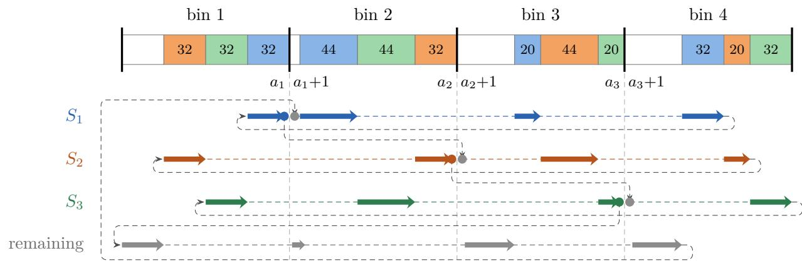
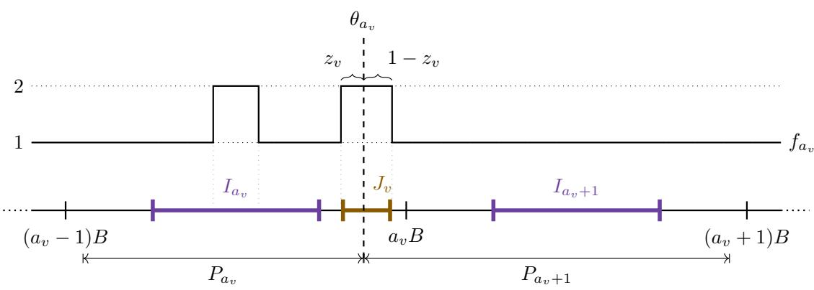

# PPAD-Completeness of Contiguous Envy-Free Cake Cutting with Additive Valuations

Yasushi Kawase∗ Bodhayan Roy† Mohammad Azharuddin Sanpui‡

## Abstract

We prove that computing a complete contiguous ε-envy-free cake allocation is PPAD-complete for normalized rational piecewise-constant additive valuations. The hardness holds even when ε is given in unary, and even when every density takes only two values, which are the same for all agents, and is piecewise constant with at most six breakpoints. As a consequence, computing an exact contiguous envy-free allocation is also PPAD-complete, and the hardness holds under the same restrictions on the densities. Our key ingredient is to assign prices to the pieces so that, in every approximately envy-free allocation, all prices are nearly equal, regardless of how the pieces are assigned to the agents. We further show that, for every fixed integer $c \geq 1 ,$ computing a contiguous EFc allocation of indivisible goods on a path is PPAD-complete for additive valuations, and the hardness holds even for binary valuations in which each good is valued by exactly one agent and all agents value the same number of goods.

## 1 Introduction

Fair division asks how to allocate a heterogeneous resource among agents with diferent preferences. Envy-freeness is a natural fairness requirement: each agent should value its own share at least as much as any other agent’s share. In applications such as dividing land or assigning time slots, a share consisting of scattered parts may be of little use, and thus it is natural to require every agent to receive one connected piece.

In cake cutting, the resource is the interval [0, 1], and each of n agents has a normalized additive valuation $V _ { i } .$ given here by an explicit rational piecewise-constant density. A complete contiguous allocation partitions the cake into n intervals and assigns them to the agents in an arbitrary order. It is ε-envy-free if

$$
V _ { i } ( X _ { i } ) \geq V _ { i } ( X _ { j } ) - \varepsilon \qquad { \mathrm { f o r ~ a l l ~ } } i , j \in [ n ] ,
$$

where $X _ { i }$ is the piece of agent i. Contiguous envy-free allocations always exist [21, 23], but no finite protocol in the Robertson–Webb model finds one for three or more agents [22]. For explicitly given valuations, computing an ε-envy-free allocation lies in PPAD [8]. PPAD-hardness, however, was known only for non-additive preferences [8, 14], and it remained open for additive valuations, even for explicit piecewise-constant densities [13, 14].

A closely related question arises for indivisible goods arranged on a path. An envy-free allocation need not exist, and thus one asks for envy-freeness up to c goods (EFc): removing at most c goods from any envied bundle eliminates the envy. Bilò et al. [3, Section 8] posed the complexity of computing contiguous EF1 or EF2 allocations on a path as an open problem.

## 1.1 Our Results

We answer both questions.

Theorem 1. Computing a contiguous ε-envy-free allocation for normalized rational piecewiseconstant additive valuations is PPAD-complete. The hardness holds even when ε is given in unary, and even when every density takes only two values, which are the same for all agents, and is piecewise constant with at most six breakpoints.

Unary-precision hardness implies binary-precision hardness, and membership holds in both cases by Lemma 3. In the hard instances of Theorem 1, the number n of agents is part of the input, and $\varepsilon = \Theta ( n ^ { - 4 } )$ . Thus, unless $\operatorname { P P A D } \subseteq \operatorname { F P }$ , no algorithm computes such allocations in time polynomial in the input length and $1 / \varepsilon ,$ , even under the stated density restrictions. These restricted instances nevertheless admit an eficient polynomial-time approximation scheme for additive envy, as explained in Section 5. Combined with a reduction of Goldberg, Hollender, and Suksompong [13, Lemma 6.2] from exact to approximate envy-freeness, Theorem 1 also shows that computing an exact contiguous envy-free allocation is PPAD-complete (Corollary 10).

We reduce from finding an approximate equilibrium of a threshold game [7], in which each player chooses a value in [0, 1] and prefers 1 if the total value of its in-neighbors is below $1 / 2$ and 0 if it is above $1 / 2$ . We represent each player’s value by the position of a cut. Before normalization, every density is 1 plus bonuses of small total value, which make some pieces of every approximately envy-free allocation shorter by the players’ values, and hence each cut shifts according to the values of the in-neighbors of the corresponding player. A central challenge in our reduction is to enforce the encoded constraints using additive valuations while allowing an arbitrary assignment of pieces to agents. Our key ingredient is to give each piece a price such that, at these prices, every agent with quasi-linear utility weakly prefers the piece in its own slot and the piece in the next slot of a cyclic order to every other piece. Summing the resulting envy inequalities eliminates the assignment permutation and forces all prices to be nearly equal (Lemma 7).

Placing goods at the quantiles of each agent’s valuation, similarly to Goldberg, Hollender, and Suksompong [13] for exact envy-freeness, transfers this hardness to indivisible goods. Membership follows from the existence proof of Igarashi [16], whose construction can be carried out in PPAD. We write $\mathrm { E F } c _ { \mathrm { o u t e r } }$ for the stronger notion of Bilò et al. [3], which requires the removed goods to leave the envied bundle connected or empty.

Theorem 2. For every fixed integer $c \geq 1$ , computing a contiguous EFc allocation of explicitly given, linearly ordered goods is PPAD-complete for nonnegative rational additive valuations. The hardness holds even for binary valuations in which every good is valued by exactly one agent and all agents value the same number of goods. Both statements also hold for $E F c _ { \mathrm { o u t e r } }$ in place of EFc.

## 1.2 Related Work

PPAD [19] captures computational versions of Sperner’s lemma and Brouwer’s fixed-point theorem, as well as two-player Nash equilibria [6].

Deng, Qi, and Saberi [8] proved PPAD membership for approximate contiguous cake cutting and PPAD-hardness for general preferences. Their preference functions may depend on the entire partition, whereas a valuation of an interval depends only on that interval, and an additive valuation is further determined by the integral of a density. Gao, Roghani, Rubinstein, and Saberi [12] proved PPAD-completeness for general continuous valuations even with a constant number of agents, when only three agents need to be envy-free and each agent may receive a constant number of pieces. Goldberg, Hollender, and Suksompong [13] proved NP-hardness of several decision variants, including the one with a fixed agent order, and showed that the unary-precision problem with piecewise-constant valuations is equivalent to exact envy-freeness for disjoint binary goods. They also computed a contiguous $1 / 3 \AA$ -envy-free allocation in polynomial time. Barman and Kulkarni [2] improved the additive guarantee to $1 / 4 + o ( 1 )$ and gave an algorithm polynomial in n and $1 / \varepsilon$ when the number of distinct valuations is at most $\varepsilon n - 1$ . Hollender and Rubinstein [14] gave an eficient algorithm for four monotone agents and showed PPAD-hardness for non-monotone valuations, whereas the case of five monotone agents remains open [14, 15]. For explicit piecewise-constant additive valuations, the exact problem is polynomial-time solvable for every fixed number of agents [1, Theorem 5].

Threshold games were introduced by Papadimitriou and Peng [20] for public goods games in directed networks and were also used for the Hylland–Zeckhauser scheme [5]. Consensus halving, another fair-division problem with a topological existence proof, is PPA-complete [9], even for piecewise-uniform valuations with two blocks per agent [10].

For goods on a path, Suksompong [24] proved that contiguous EF1 allocations exist for binary valuations, Bilò et al. [3] proved the existence of contiguous EF2 allocations, and Igarashi [16] proved it for EF1 with monotone valuations. Kawase, Roy, and Sanpui [17] proved that deciding the existence of an EF1 allocation is NP-complete for a fixed agent order, whereas Theorem 2 shows that computing one is PPAD-complete for a flexible order.

## 2 Preliminaries

We write $[ k ] = \{ 1 , \dots , k \}$ and $| J |$ for the length of an interval J. For a real number $t ,$ let $\mathrm { c l i p } ( t ) = \operatorname* { m i n } \{ 1 , \operatorname* { m a x } \{ 0 , t \} \}$ , and for a vector, let clip act on each coordinate.

## 2.1 Contiguous cake cutting

An instance of our problem consists of n agents and a positive rational ε. Each agent i has a normalized additive valuation $V _ { i }$ on the cake [0, 1] given by a piecewise-constant density $\rho _ { i }$ via

$$
V _ { i } ( [ a , b ] ) = \int _ { a } ^ { b } \rho _ { i } ( t ) d t ,
$$

where $\rho _ { i }$ is given by finitely many rational breakpoints in [0, 1] and nonnegative rational values on the intervals between them, all encoded in binary, and $V _ { i } ( [ 0 , 1 ] ) = 1$ . The precision ε is encoded in binary unless we explicitly restrict it to unary encoding. In the unary encoding, both its numerator and denominator are written in unary, and hence $1 / \varepsilon$ is at most the input length.

A contiguous allocation of an interval $[ 0 , \Lambda ]$ to n agents consists of cuts $0 = \theta _ { 0 } \leq \theta _ { 1 } \leq \cdot \cdot \cdot \leq \theta _ { n } = \Lambda$ and a bijection $\sigma \colon [ n ]  [ n ]$ . The cuts divide [0, Λ] into the pieces $[ \theta _ { j - 1 } , \theta _ { j } ]$ for $j \in [ n ]$ , and agent i receives the $\sigma ( i )$ th piece

$$
X _ { i } = [ \theta _ { \sigma ( i ) - 1 } , \theta _ { \sigma ( i ) } ] .
$$

Pieces may have length zero, and adjacent pieces share only an endpoint, which has zero value. The allocation is ε-envy-free if $V _ { i } ( X _ { i } ) \geq V _ { i } ( X _ { j } ) - \varepsilon$ for all $i , j$ . We use these definitions also for the unnormalized valuations on [0, Λ] that appear in our reduction.

We call the problem of finding an ε-envy-free contiguous allocation of [0, 1] with rational cuts the Contiguous-EF problem.1 Every instance of this problem has a polynomial-size solution. Indeed,

if $M \geq 1$ is the largest density value, then

$$
| V _ { i } ( [ a , b ] ) - V _ { i } ( [ a ^ { \prime } , b ^ { \prime } ] ) | \leq M ( | a - a ^ { \prime } | + | b - b ^ { \prime } | ) ,
$$

and hence rounding the cuts of a contiguous envy-free allocation [21, 23] down to multiples of $1 / \lceil 8 M / \varepsilon \rceil$ changes every envy diference by at most $\varepsilon / 2$ . The rounded cuts have bit length $O ( 1 +$ log $M + \operatorname* { m a x } \{ 0 , \log ( 1 / \varepsilon ) \} )$ , which is polynomial in the input length. Moreover, values at rational cuts are computable exactly, and hence solutions can be verified in polynomial time.

A search reduction maps each source instance to a target instance, and every target solution back to a source solution, in polynomial time. PPAD is a class of total search problems, that is, problems in which every instance has a polynomial-size solution that can be verified in polynomial time. It consists of the problems that reduce to End-of-Line [19]. For valuations that are given explicitly and are Lipschitz continuous, computing an ε-envy-free contiguous allocation lies in PPAD even when ε is given in binary, by the work of Deng, Qi, and Saberi [8], as explained by Hollender and Rubinstein [14, Section 3]. Explicit piecewise-constant valuations are Lipschitz continuous and can be evaluated exactly in polynomial time, and hence we obtain the following.

Lemma 3 ([8, 14]). Computing a contiguous ε-envy-free allocation for explicit rational piecewiseconstant valuations belongs to $P P A D ,$ even when ε is given in binary. In particular, the Contiguous-EF problem belongs to PPAD.

## 2.2 Threshold games

We reduce from threshold games, which were introduced by Papadimitriou and Peng [20]. A threshold game is given by a directed graph with vertex set [s], whose vertices are players. Each player v chooses a strategy $z _ { v } \in [ 0 , 1 ]$ . Let $A \in \{ 0 , 1 \} ^ { s \times s }$ be the matrix with $A _ { v u } = 1$ if and only if $( u , v )$ is an arc. Then, $( A z ) _ { \imath }$ is the sum of the strategies of the in-neighbors of $v ,$ and player v prefers strategy 1 if $( A z ) _ { v } < 1 / 2$ and strategy 0 if $( A z ) _ { v } > 1 / 2$ . For $\delta \geq 0$ , a vector $z \in [ 0 , 1 ] ^ { s }$ is a δ-approximate equilibrium if, for every $v \in [ s ]$

$$
\begin{array} { r } { ( A z ) _ { v } < \frac { 1 } { 2 } - \delta \implies z _ { v } \geq 1 - \delta , \qquad ( A z ) _ { v } > \frac { 1 } { 2 } + \delta \implies z _ { v } \leq \delta . } \end{array}
$$

We call the problem of finding a δ-approximate equilibrium the δ-ThresholdGameNE problem. Deligkas, Fearnley, Hollender, and Melissourgos [7] showed that this problem is PPAD-complete below the threshold $1 / 6$ and solvable in polynomial time at $1 / 6$

Theorem 4 ([7, Theorem 4.23]). For every constant $0 \leq \delta < 1 / 6$ , the δ-ThresholdGameNE problem is PPAD-complete, even when every vertex has indegree and outdegree at most two.

## 3 PPAD-hardness for additive cake valuations

In this section, we prove Theorem 1 by a search reduction from the 1/12-ThresholdGameNE problem with indegrees at most two, which is PPAD-hard by Theorem 4. Fix such a game with vertex set [s], and let $A \in \{ 0 , 1 \} ^ { s \times s }$ be its matrix as in Section 2.2. Since every indegree is at most two, every row of A has at most two ones.

We represent the strategy $z _ { v }$ of each player v by the position of one cut. Ignoring approximation errors, our construction enforces

$$
\begin{array} { r } { z _ { v } = \mathrm { c l i p } \big ( \frac { 1 3 } { 2 } - 1 2 ( A z ) _ { v } \big ) \qquad ( v \in [ s ] ) , } \end{array}
$$

which is 1 if $( A z ) _ { v } \leq 1 1 / 2 4$ and 0 if $( A z ) _ { v } \geq 1 3 / 2 4$ , and hence z is an approximate equilibrium. To this end, the cut of player v lies about $1 2 ( A z ) .$ to the left of a reference point, and $z _ { v }$ is the length of the part to the left of the cut of a unit interval centered 6 to the left of this point. The factor 12 stretches the window $[ 1 1 / 2 4 , 1 3 / 2 4 ]$ , which lies well inside $[ 5 / 1 2 , 7 / 1 2 ]$ and thus leaves room for errors, to the length 1 of this interval, whose center is the position of the cut when $( A z ) _ { v } = 1 / 2$ . Section 3.1 gives the construction, and Section 3.2 shows how to construct an approximate equilibrium from every approximately envy-free allocation and completes the proof.

## 3.1 The construction

From the game, we construct a cake-cutting instance with $N = 3 2 ( s + 1 ) ^ { 2 }$ agents, identified with $[ N ]$ , and additive valuations $U _ { 1 } , \dots , U _ { N }$ on the cake [0, L], which are not normalized. The cake consists of N consecutive slots of length $B = 4 0 N$ , where the jth slot is $[ ( j - 1 ) B , j B ]$ , and hence $L = N B$ . We use the same index set for agents, slots, and pieces, and the jth piece from the left need not be assigned to agent $j$ . We first define the sets $S _ { v }$ and a cyclic order on the agents, then the valuations, and finally the target instance of the Contiguous-EF problem, which is obtained by normalizing the valuations. We use two orders on the indices: the spatial order, in which the numbers of indices of each set $S _ { v }$ in prefixes of [N] encode $A _ { i }$ , and a cyclic order, which visits the indices of each $S _ { v }$ consecutively and handles arbitrary assignments in Section 3.2.

The sets $S _ { v }$ and the cyclic order. We construct pairwise disjoint sets $S _ { 1 } , \ldots , S _ { s } \subseteq [ N ]$ , each of size $R = 3 2 ( s + 1 )$ , and hence $N = ( s + 1 ) R$ . The cut of player v is the cut after the $a _ { v }$ th piece, where $a _ { v } = v R$ . The sets encode A: among the first $a _ { u }$ indices, player v will have twelve more indices than the average 32u exactly when v is an in-neighbor of $u .$ . The baseline 32 per bin exceeds 12, so that every block below remains nonempty. In Section 3.2, we show that each piece indexed by $S _ { v }$ is shorter by approximately $z _ { v }$ than a piece in no set, and hence these twelve extra pieces move the cut of player u to the left by approximately $1 2 z _ { v }$ . We construct the sets as follows. Partition [N] into $s + 1$ consecutive bins of R indices, where the uth bin is $\{ ( u - 1 ) R + 1 , \ldots , u R \}$ , and let $A _ { 0 v } = A _ { s + 1 , v } = 0$ . Start with a block of 32 indices for each $S _ { v }$ in each bin, and for every arc $( v , u )$ transfer twelve indices of $S _ { v }$ from the (u + 1)st bin to the uth bin. For each $u \in [ s + 1 ]$ , we fill the right end of the uth bin with consecutive blocks, one for each $v \in [ s ]$ , where the block for $S _ { v }$ consists of $3 2 + 1 2 A _ { u v } - 1 2 A _ { u - 1 , v }$ indices. For $u \in [ s ]$ , the block for $S _ { u }$ comes last, and the other blocks appear in increasing order of $v .$ . In the last bin, all blocks appear in increasing order of $v .$ . The remaining indices at the left end of the bin lie in no set. Every block has at least 20 indices, and since every indegree is at most two, the blocks in each bin have at most $3 2 s + 2 4 = R - 8$ indices in total. Hence, for $u \in [ s ]$ , the last index $a _ { u }$ of the uth bin lies in $S _ { u }$ , and for $u \in [ s + 1 ]$ , the first index $a _ { u - 1 }$ + 1 of the uth bin lies in no set, where $a _ { 0 } = 0$ . Figure 1 illustrates the sets on a small example.

We also use a cyclic order of the indices. Consider the list of all indices that starts with $a _ { 1 } + 1$ followed by the indices of $S _ { 1 }$ above $a _ { 1 }$ and then those up to $a _ { 1 }$ , both in increasing order, so that $a _ { 1 }$ comes last, continues in the same way with $a _ { 2 } + 1$ and $S _ { 2 } .$ , and so on up to $S _ { s } .$ , and ends with the remaining indices, that is, those not listed so far, in increasing order. Let $\pi \colon [ N ] \to [ N ]$ map each index to the next index in this list, and the last index to $a _ { 1 } + 1$ . Thus, π is a permutation consisting of a single cycle. For an agent $i ,$ we call the $\pi ( i )$ th slot its next slot. Here, $a _ { v } + 1$ is the index immediately after $a _ { v }$ in spatial order, whereas $\pi ( i )$ is the successor of i in cyclic order. Both the sets and $\pi$ can be computed in polynomial time.

The sets and the cyclic order have the following properties for all $u , v \in [ s ]$ (S2) along π, the indices of $S _ { v }$ are visited consecutively, ending at $a _ { v } ;$ the index $a _ { v } + 1$ visited just before them and the index $\pi ( { a } _ { v } )$ visited just after them lie in no set, and $\pi ( a _ { v } ) \neq a _ { v } + 1$ and $\pi ( a _ { v } + 1 ) \neq a _ { v }$

  
Figure 1: The sets $S _ { v }$ for the game with arcs (1, 2), (2, 3), and $( 3 , 2 )$ , where $s = 3 ,$ $R = 1 2 8$ , and $N = 5 1 2$ . Here, $A _ { 2 1 } = A _ { 2 3 } = A _ { 3 2 } = 1$ , and all other entries of A are 0. Blue, orange, and green blocks consist of the indices of $S _ { 1 } , S _ { 2 }$ , and $S _ { 3 } .$ , respectively, and are labeled with their sizes. White blocks consist of indices in no set. The rows below trace the cyclic order $\pi ,$ starting from $a _ { 1 } + 1$ thick arrows run through the indices of a set, and dashed arrows lead to the next index along π.  
(S1) $| S _ { v } | = R \mathrm { a n d } | S _ { v } \cap [ a _ { u } ] | = 3 2 u + 1 2 A _ { u v } ;$

Property (S1) follows by summing the block sizes over all bins and over the first u bins, respectively. Property (S2) follows from the definition of π: the index $\pi ( a _ { v } )$ is $a _ { v + 1 } + 1$ if $v < s$ and the first remaining index if $v = s ,$ which exists since the index 1 lies in no set and difers from every $a _ { w } + 1 \geq R + 1$ , and $\pi ( a _ { v } + 1 )$ is an index of $S _ { v }$ other than $a _ { v }$ , which exists since $| S _ { v } | = R \ge 2$

Valuations. The valuation $U _ { i }$ of each agent i has a density $f _ { i } ,$ , which is 1 everywhere, plus bonuses of height 1 on at most three short intervals. The core of the jth slot and the boundary interval of player v are

$$
\begin{array} { r } { I _ { j } = [ ( j - 1 ) B + 1 0 N , ~ j B - 1 0 N ] \quad ( j \in [ N ] ) , \qquad J _ { v } = [ a _ { v } B - \frac { 1 3 } { 2 } , ~ a _ { v } B - \frac { 1 1 } { 2 } ] \quad ( v \in [ s ] ) . } \end{array}
$$

Each core lies in the middle of its slot and has length 20N. The boundary interval $J _ { v }$ has length 1 and lies in the $\boldsymbol { a } _ { v }$ th slot, near its right end $a _ { v } B$ (Figure 2).

By (S2), the cycle π enters $S _ { v }$ at agent $a _ { v } + 1$ and leaves it at agent ${ { a } _ { v } } ,$ the two agents whose slots lie on either side of the cut of player v. On top of density 1, agent i has additional density 1 on an interval centered in the core $I _ { i }$ of its own slot, on an interval centered in the core $I _ { \pi ( i ) }$ of its next slot, and, if $i \in \{ a _ { v } , a _ { v } + 1 \}$ , on the boundary interval $J _ { v } .$ . These bonuses have the following lengths:

<table><tr><td>agent i</td><td>in  $I _ { i }$ </td><td>in  $I _ { \pi ( i ) }$ </td><td>on  $J _ { v }$ </td></tr><tr><td> $a _ { v } + 1$ </td><td>2</td><td>3</td><td>1</td></tr><tr><td> $a _ { v }$ </td><td> $5 / 2$ </td><td> $5 / 2$ </td><td>1</td></tr><tr><td>otherwise</td><td>3</td><td>3</td><td>0</td></tr></table>

Thus, every agent slightly prefers its own slot and its next slot, the two agents next to the cut of player v also value $J _ { v } ,$ and every agent has total bonus 6. Since the pairs $\{ a _ { v } , a _ { v } + 1 \}$ are pairwise disjoint, each agent has at most one boundary bonus.

  
Figure 2: The cake around the cut $\theta _ { a _ { v } }$ (not to scale). The interval $J _ { v }$ is valued by the agents $a _ { v }$ and $a _ { v } + 1$ . Above the cake, we draw the density $f _ { a _ { v } }$ of agent $a _ { v } ,$ , whose next core lies elsewhere; it has bonuses in the middle of its own core $I _ { a _ { v } }$ and on $J _ { v }$ . The lengths $z _ { v }$ and $1 - z _ { v }$ of the two parts of $J _ { v }$ and the pieces $P _ { a _ { v } }$ and $P _ { a _ { v } + 1 }$ below the cake are used in Section 3.2. The figure shows a cut inside $J _ { v }$

Lemma 5. Every $f _ { i }$ takes only the values 1 and 2 and is piecewise constant with at most six breakpoints. Every interval J satisfies

$$
0 \leq U _ { i } ( J ) - | J | \leq 6 , \qquad a n d \qquad U _ { i } ( [ 0 , L ] ) = L + 6 .\tag{1}
$$

Proof. The bonuses of agent i lie in $I _ { i } .$ , in $I _ { \pi ( i ) }$ , and possibly on one boundary interval. The first two have length at most 3 and hence fit in the cores, and the three intervals are disjoint, since $\pi ( i ) \neq i$ and every boundary interval lies outside all cores. Hence, $f _ { i }$ takes only the values 1 and 2, and its only breakpoints are the at most six endpoints of these intervals. The total bonus is 6, which gives (1). □

The target instance. Let $T _ { i } = U _ { i } ( [ 0 , L ] )$ . The target instance of the Contiguous-EF problem consists of the normalized valuations and the unary-encoded precision

$$
V _ { i } ( [ a , b ] ) = \frac { U _ { i } ( [ L a , L b ] ) } { T _ { i } } \quad ( i \in [ N ] ) , \qquad \varepsilon = \frac { 1 } { 8 0 0 0 N ^ { 4 } } .
$$

The density of $V _ { i }$ is $\rho _ { i } ( t ) = L f _ { i } ( L t ) / T _ { i }$ . By Lemma 5 and $T _ { i } = L + 6$ , it takes only the two values $L / ( L + 6 )$ and $2 L / ( L + 6 )$ , which are the same for all agents, and it is piecewise constant with at most six breakpoints.

Let $( X _ { 1 } , \ldots , X _ { N } )$ be any ε-envy-free contiguous allocation for $V _ { 1 } , \dots , V _ { N }$ , where $X _ { i }$ is the piece of agent i. Multiplying its cuts by L gives the allocation $( L X _ { 1 } , \ldots , L X _ { N } )$ of $[ 0 , L ]$ , where $L X = \{ L t : t \in X \}$ . Since $T _ { i } = L + 6 \leq 2 L$ and $L = 4 0 N ^ { 2 }$ , it satisfies

$$
U _ { i } ( L X _ { j } ) - U _ { i } ( L X _ { i } ) = T _ { i } { \big ( } V _ { i } ( X _ { j } ) - V _ { i } ( X _ { i } ) { \big ) } \leq 2 L \varepsilon = { \frac { 1 } { 1 0 0 N ^ { 2 } } } \qquad ( i , j \in [ N ] ) .
$$

Hence, it is η-envy-free for $U _ { 1 } , \dots , U _ { N }$ , where $\eta = 1 / ( 1 0 0 N ^ { 2 } )$

## 3.2 From allocations to equilibria

We now show how to construct a solution of the source instance from any solution of the target instance. By Section 3.1, it sufices to construct a 1/12-approximate equilibrium from every η-envyfree allocation of $[ 0 , L ]$ for $U _ { 1 } , \dots , U _ { N }$ , where $\eta = 1 / ( 1 0 0 N ^ { 2 } )$ . Throughout this subsection, we fix

such an allocation, given by cuts $0 = \theta _ { 0 } \le \theta _ { 1 } \le \dots \le \theta _ { N } = L$ and a bijection $\sigma \colon [ N ]  [ N ]$ . Let $P _ { j } = [ \theta _ { j - 1 } , \theta _ { j } ]$ be the jth piece from the left, so that agent i receives $P _ { \sigma ( i ) }$ . Let $\ell _ { j } = | P _ { j } |$ | be its length. Then, η-envy-freeness means that

$$
U _ { i } ( P _ { \sigma ( i ) } ) \geq U _ { i } ( P _ { j } ) - \eta \qquad ( i , j \in [ N ] ) .
$$

We show that the vector

$$
\begin{array} { r } { z _ { v } = \mathrm { c l i p } \left( \theta _ { a _ { v } } - a _ { v } B + \frac { 1 3 } { 2 } \right) \qquad ( v \in [ s ] ) } \end{array}\tag{2}
$$

is a $1 / 1 2 \cdot$ -approximate equilibrium. We proceed in three steps. First, for every $j ,$ the jth piece lies close to the jth slot (localization). Second, whichever agent receives which piece, the length of every piece is determined by z up to a small error (prices). Third, the cut of each player v lies at a position determined by the strategies of its in-neighbors, and hence z is an approximate equilibrium (decoding).

Localization. Every agent values each interval at its length plus at most 6. Hence, approximate envy-freeness forces all piece lengths to be close to B and each cut $\theta _ { j }$ to be close to $j B$

Lemma 6. Every cut satisfies $| \theta _ { j } - j B | < 7 N$ . Consequently:

(a) $I _ { j } \subseteq P _ { j }$ and $P _ { j } \cap I _ { k } = \emptyset$ for every $k \neq j ;$

(b) $J _ { v } \subseteq P _ { a _ { v } } \cup P _ { a _ { v } + 1 }$ and $| J _ { v } \cap P _ { a v } | = z _ { v }$ for every v.

Proof. Let agent i receive a shortest piece, and let $P _ { j ^ { \prime } }$ be a longest piece. By (1) and η-envy-freeness,

$$
\ell _ { j ^ { \prime } } \leq U _ { i } ( P _ { j ^ { \prime } } ) \leq U _ { i } ( P _ { \sigma ( i ) } ) + \eta \leq \ell _ { \sigma ( i ) } + 6 + \eta .
$$

As the average length is $B ,$ every $\ell _ { j }$ lies in $( B - 7 , B + 7 )$ . Since $\begin{array} { r } { \theta _ { j } - j B = \sum _ { k \in [ j ] } ( \ell _ { k } - B ) } \end{array}$ , we obtain $| \theta _ { j } - j B | < 7 N$ . Thus, $\theta _ { j - 1 } < ( j - 1 ) B + 1 0 N$ and $\theta _ { j } > j B - 1 0 N$ , which gives $I _ { j } \subseteq P _ { j }$ Similarly, $P _ { j }$ meets no neighboring core, and hence no other core. Since $\begin{array} { r } { B - 7 N > { \frac { 1 3 } { 2 } } } \end{array}$ , we also have $\begin{array} { r } { \theta _ { a _ { v } - 1 } < a _ { v } \bar { B } - \frac { 1 3 } { 2 } } \end{array}$ and $\theta _ { a _ { v } + 1 } > a _ { v } B$ . Thus, $\begin{array} { r } { J _ { v } = [ a _ { v } B - \frac { 1 3 } { 2 } , a _ { v } B - \frac { 1 1 } { 2 } ] } \end{array}$ lies in $P _ { a _ { v } } \cup P _ { a _ { v } + 1 }$ , and the part in $P _ { a _ { v } }$ has length cli $\begin{array} { r } { \mathrm { p } ( \theta _ { a _ { v } } - a _ { v } B + \frac { 1 3 } { 2 } ) = z _ { v } } \end{array}$ . Figure 2 shows these two parts of $J _ { v }$ □

Prices. Localization determines where each piece lies, but not which agent receives it. We assign prices so that approximate envy-freeness forces the piece received by agent i to cost almost as much as both $P _ { i }$ and $P _ { \pi ( i ) }$ . Summing over agents removes the assignment permutation, and the single cycle connects all prices. The following combinatorial lemma makes this precise.

Lemma 7. Let π and σ be permutations $o f \left[ N \right]$ such that π consists of a single cycle, and let $\eta \geq 0$ If reals $q _ { 1 } , \ldots , q _ { N }$ satisfy $q _ { \sigma ( i ) } \geq \operatorname* { m a x } \{ q _ { i } , q _ { \pi ( i ) } \} - \eta$ for every $i \in [ N ]$ , then maxj qj − minj $q _ { j } \leq N \eta$

Proof. Summing the assumption over $i \in [ N ]$ and using $\begin{array} { r } { \sum _ { i \in [ N ] } q _ { \sigma ( i ) } = \sum _ { i \in [ N ] } q _ { i } } \end{array}$ gives

$$
\sum _ { i \in [ N ] } \operatorname* { m a x } \{ 0 , q _ { \pi ( i ) } - q _ { i } \} = \sum _ { i \in [ N ] } \left( \operatorname* { m a x } \{ q _ { i } , q _ { \pi ( i ) } \} - q _ { i } \right) \leq N \eta .
$$

The ith term on the left is the increase of $q$ at the step from i to $\pi ( i )$ . Since $\pi$ is a single cycle, it leads from an index minimizing $q$ to an index maximizing $q .$ The increases along this path sum to at least max ${ \it \Delta } _ { j } q _ { j } - \operatorname* { m i n } _ { j } q _ { j }$ , which is therefore at most $N \eta$ □

In our setting, the assumption of Lemma 7 follows from a bound on value diferences that is tight for the next piece. Suppose that reals $q _ { j }$ satisfy

$$
U _ { i } ( P _ { j } ) - U _ { i } ( P _ { i } ) \leq q _ { j } - q _ { i } \quad { \mathrm { f o r ~ a l l ~ } } i , j \in [ N ] , \qquad { \mathrm { w i t h ~ e q u a l i t y ~ i f ~ } } j = \pi ( i ) .\tag{3}
$$

In other words, every agent i with quasi-linear utility $U _ { i } ( P _ { j } ) - q _ { j }$ weakly prefers both $P _ { i }$ and $P _ { \pi ( i ) }$ to every other piece, and we call $q _ { j }$ the price of $P _ { j }$ , although no money is involved. By η-envy-freeness towards $P _ { i }$ and $P _ { \pi ( i ) }$ and the equality case of (3), we have

$$
\begin{array} { r } { q _ { \sigma ( i ) } - q _ { i } \geq U _ { i } ( P _ { \sigma ( i ) } ) - U _ { i } ( P _ { i } ) \geq \operatorname* { m a x } \{ 0 , \ U _ { i } ( P _ { \pi ( i ) } ) - U _ { i } ( P _ { i } ) \} - \eta = \operatorname* { m a x } \{ q _ { i } , q _ { \pi ( i ) } \} - q _ { i } - \eta , } \end{array}
$$

where the first inequality is (3) for $j = \sigma ( i )$ . Hence, Lemma 7 gives maxj $q _ { j } - \operatorname* { m i n } _ { j } q _ { j } \le N \eta$

It remains to choose the prices. Since agent i values $P _ { j }$ at its length $\ell _ { j }$ plus bonuses, we take as the price of $P _ { j }$ its length plus the decoded value of its set,

$$
q _ { j } = { \left\{ \begin{array} { l l } { \ell _ { j } + z _ { v } } & { { \mathrm { i f ~ } } j \in S _ { v } , } \\ { \ell _ { j } } & { { \mathrm { i f ~ } } j { \mathrm { ~ i s ~ i n ~ n o ~ s e t . } } } \end{array} \right. }
$$

The term $z _ { v }$ absorbs the boundary bonuses, which difer between the two pieces in the slots of an agent. The next lemma shows that these prices satisfy (3), and hence they are all nearly equal.

Lemma 8. The pieces $P _ { 1 } , \ldots , P _ { N }$ satisfy (3) with these prices.

Proof. By Lemma $6 ( \mathrm { a } )$ , the piece $P _ { j }$ contains $I _ { j }$ and is disjoint from every other core. Thus, agent i values $P _ { j }$ at $\ell _ { j }$ plus a core bonus and a boundary bonus, and the core bonus is 0 unless $j \in \{ i , \pi ( i ) \}$ If $i \in \{ a _ { v } , a _ { v } + 1 \}$ , then its boundary bonus on $P _ { j }$ is $| J _ { v } \cap P _ { j } |$ , which is $z _ { v }$ for $j = a _ { v } , 1 - z _ { v }$ for $j = a _ { v } + 1$ , and 0 otherwise by Lemma $6 ( \mathrm { b } )$ . In particular, the boundary bonus is at most 1, and it is 0 on $P _ { \pi ( i ) }$ by (S2). Also by (S2), the cycle never moves directly from one set $S _ { v }$ to another, and hence $q _ { j } - \ell _ { j }$ changes along $\pi$ only at the step from $a _ { v } + 1$ , from 0 to $z _ { v } ,$ and at the step from ${ { a } _ { v } } ,$ from $z _ { v }$ to 0. Therefore, the bonuses of agent i on $P _ { i }$ and $P _ { \pi ( i ) }$ are as follows:

<table><tr><td>agent i</td><td>bonus on  $P _ { i }$ </td><td>bonus on  $\begin{array} { r l } { P _ { \pi ( i ) } } & { { } ( q _ { \pi ( i ) } - \ell _ { \pi ( i ) } ) - ( q _ { i } - \ell _ { i } ) } \end{array}$ </td></tr><tr><td> $a _ { v } + 1$ </td><td> $2 + \left( 1 - z _ { v } \right)$ </td><td>3  $z _ { v }$ </td></tr><tr><td> $a _ { v }$ </td><td> $5 / 2 + z _ { v }$ </td><td> $5 / 2$   $- z _ { v }$ </td></tr><tr><td>otherwise</td><td>3</td><td>3 0</td></tr></table>

In each case, the bonus on $P _ { \pi ( i ) }$ exceeds that on $P _ { i }$ by the last column, and hence $U _ { i } ( P _ { \pi ( i ) } ) - U _ { i } ( P _ { i } ) =$ $q _ { \pi ( i ) } - q _ { i }$ . The shorter own interval of agent $a _ { v } + 1$ accounts for the constant 1 in its boundary bonus $1 - z _ { v }$ . For every other $j ,$ the bonus on $P _ { j }$ is at most 1, whereas that on $P _ { i }$ is at least 2. Since $0 \leq q _ { k } - \ell _ { k } \leq 1$ for every k, we obtain

$$
U _ { i } ( P _ { j } ) - U _ { i } ( P _ { i } ) \leq \ell _ { j } - \ell _ { i } - 1 \leq q _ { j } - q _ { i } .
$$

Decoding. By the previous step, every piece associated with player v is shorter by about $z _ { v }$ than a piece in no set. Property (S1) places twelve extra such pieces before the cut of player u for each arc $( v , u )$ , shifting the cut to the left by about $1 2 ( A z ) _ { u }$

Lemma 9. For every $u \in [ s ]$ , we have $\begin{array} { r } { | \theta _ { a _ { u } } - a _ { u } B + 1 2 ( A z ) _ { u } | \le \frac { 1 } { 1 0 0 } } \end{array}$

Proof. Let $\begin{array} { r } { \bar { q } = \frac { 1 } { N } \sum _ { j \in [ N ] } q _ { j } } \end{array}$ be the average price. By Lemmas 7 and 8, we have maxj $q _ { j } - \operatorname* { m i n } _ { j } q _ { j } \leq$ $N \eta$ , and hence $\begin{array} { r } { \big | \sum _ { j \in [ a _ { u } ] } \bigl ( \dot { q } _ { j } - \bar { q } \bigr ) \big | \le a _ { u } N \eta \le N ^ { 2 } \eta = \frac { 1 } { 1 0 0 } } \end{array}$ . Since $\begin{array} { r } { \sum _ { j \in [ N ] } \ell _ { j } = N B } \end{array}$ and $\begin{array} { r l } { \sum _ { j \in [ N ] } ( q _ { j } - \ell _ { j } ) = } \end{array}$ $R \sum v \in [ s ] z _ { v }$ , we have $\begin{array} { r } { \bar { q } = B + \frac { R } { N } \sum _ { v \in [ s ] } z _ { v } } \end{array}$ . Since $\begin{array} { r } { \sum _ { j \in [ a _ { u } ] } ( q _ { j } - \ell _ { j } ) = \sum _ { v \in [ s ] } \left| S _ { v } \cap [ a _ { u } ] \right| z _ { v } } \end{array}$ , property (S1) and $\dot { a _ { u } R } / N = 3 2 u$ give

$$
\theta _ { a _ { u } } - a _ { u } B = \sum _ { j \in [ a _ { u } ] } ( q _ { j } - \bar { q } ) - \sum _ { v \in [ s ] } \Big ( | S _ { v } \cap [ a _ { u } ] | - \frac { a _ { u } R } { N } \Big ) z _ { v } = \sum _ { j \in [ a _ { u } ] } ( q _ { j } - \bar { q } ) - 1 2 ( A z ) _ { u } .\tag{□}
$$

We are now ready to prove Theorem 1.

Proof of Theorem 1. Membership is Lemma 3. For hardness, consider the search reduction that maps a game to the target instance of Section 3.1. Since $N = 3 2 ( s + 1 ) ^ { 2 }$ and $L = 4 0 N ^ { 2 }$ , the target instance can be computed in polynomial time, and the unary encoding of ε has length $O ( s ^ { 8 } )$ . Given any ε-envy-free allocation for $V _ { 1 } , \ldots , V _ { N }$ , multiplying its cuts by L gives an η-envy-free allocation for $U _ { 1 } , \dots , U _ { N }$ by Section 3.1. Let $\theta _ { 0 } , \ldots , \theta _ { N }$ be the cuts of this allocation, and output the vector z given by (2). We show that z is a $1 / 1 2$ -approximate equilibrium, whatever the assignment. Fix $v \in [ s ]$ . By Lemma 9, we have $\begin{array} { r } { | \theta _ { a _ { v } } - a _ { v } B + 1 2 ( A z ) _ { v } | \le \frac { 1 } { 1 0 0 } . \mathrm { ~ I f ~ } ( A z ) _ { v } < 5 / 1 2 } \end{array}$ , then $\theta _ { a _ { v } } - a _ { v } B + { \textstyle \frac { 1 3 } { 2 } } > { \textstyle \frac { 1 3 } { 2 } } - 5 - { \textstyle \frac { \textstyle { \bar { 1 } } } { 1 0 0 } } > 1$ and hence $z _ { v } = 1 . \mathrm { ~ I f ~ } ( A z ) _ { v } > 7 / 1 2$ , then $\theta _ { a _ { v } } ^ { - \infty } - a _ { v } B + \textstyle { \frac { 1 3 } { 2 } } < \textstyle { \frac { 1 3 } { 2 } } - 7 + \textstyle { \frac { 1 } { 1 0 0 } } < 0$ , and hence $z _ { v } = 0$ . Thus, z is a 1/12-approximate equilibrium. By Theorem 4, this proves PPAD-hardness. □

Theorem 1 also determines the complexity of exact envy-freeness.

Corollary 10. Computing a contiguous envy-free allocation for normalized rational piecewiseconstant additive valuations is PPAD-complete. The hardness holds even when every density takes only two values, which are the same for all agents, and is piecewise constant with at most six breakpoints.

Proof. Since an envy-free allocation is ε-envy-free for every $\varepsilon > 0$ , the hardness follows from Theorem 1. For membership, choose integers $M \geq 3$ and $K \geq 1$ bounding, respectively, the numerators and denominators in the description of the valuations and the number of intervals on which each density is constant. Goldberg, Hollender, and Suksompong [13, Lemma 6.2] showed that an envy-free allocation can be computed in polynomial time from any $\bar { M } ^ { - \mathrm { 2 0 } K n } \mathrm { - e n v y \mathrm { - f r e e } }$ allocation. Since $M ^ { - 2 0 K n }$ has polynomial bit length in binary, finding such an approximate allocation lies in PPAD by Lemma 3. In particular, every instance has an envy-free allocation whose cuts have polynomial bit length, and hence the exact problem is a total search problem in PPAD. □

## 4 Indivisible goods

In this section, we prove Theorem 2. An instance of our problem consists of goods $g _ { 1 } , \ldots , g _ { m }$ on a path, in this order, and n agents with additive valuations $\nu _ { 1 } , \ldots , \nu _ { n }$ , where agent i values each good at a nonnegative rational number. The valuations are binary if every good is valued at 0 or 1. A contiguous allocation is given by indices and a bijection $\sigma \colon [ n ]  [ n ]$ 2

$$
0 = \beta _ { 0 } \leq \beta _ { 1 } \leq \cdots \leq \beta _ { n } = m , \qquad X _ { i } = \{ g _ { k } : \beta _ { \sigma ( i ) - 1 } < k \leq \beta _ { \sigma ( i ) } \} ,
$$

where $X _ { i }$ is the bundle of agent i. For an integer $c \geq 0$ , the allocation is $E F c$ if for all $i , j \in [ n ]$ there is a set $G \subseteq X _ { j }$ with

$$
| G | \leq c \qquad { \mathrm { a n d } } \qquad \nu _ { i } ( X _ { i } ) \geq \nu _ { i } ( X _ { j } \setminus G ) .
$$

The allocation is $E F c _ { \mathrm { o u t e r } } { \mathrm { i f } } ,$ in addition, $X _ { j } ~ \backslash$ G can be chosen to be connected or empty [3, 16]. For binary valuations, since each removed good lowers $\nu _ { i } ( X _ { j } )$ by at most 1, every EFc allocation, and in particular every $\mathrm { E F } c _ { \mathrm { o u t e r } }$ allocation, satisfies

$$
\nu _ { i } ( X _ { j } ) \leq \nu _ { i } ( X _ { i } ) + c \qquad ( i , j \in [ n ] ) .\tag{4}
$$

We prove hardness by discretizing the hard instances of Theorem 1, and membership by implementing the existence proof of Igarashi [16] in PPAD.

## 4.1 Hardness

The reduction places goods at the quantiles of the valuations, similarly to Goldberg, Hollender, and Suksompong [13, Proposition 6.7] for envy-freeness.

Lemma 11. For every fixed integer $c \geq 0$ , computing a contiguous EFc allocation is PPAD-hard for binary valuations in which every good is valued by exactly one agent and all agents value the same number of goods. The same holds for $E F c _ { \mathrm { o u t e r } }$

Proof. Such allocations always exist, for $c = 0$ by Marenco and Tetzlaf [18] since every good is valued by exactly one agent, and for $c \geq 1$ by Igarashi [16]. By Theorem 1, the Contiguous-EF problem is PPAD-hard even when ε is encoded in unary and every density is positive. We give a polynomial-time search reduction from such instances. Consider an instance with valuations $V _ { 1 } , \ldots , V _ { n }$ and precision ε, and let $k = \lceil ( c + 2 ) / \varepsilon \rceil$ . Let $F _ { i } ( t ) = V _ { i } ( [ 0 , t ] )$ be the cumulative valuation of agent i. For each $i \in [ n ]$ and $r \in [ k ]$ , we place a good at the unique point $t _ { i r }$ satisfying

$$
F _ { i } ( t _ { i r } ) = \frac { r - 1 / 2 } { k } ,
$$

and let agent i value this good at 1 and all other agents at 0. Since the densities are positive and piecewise constant, all positions are rational and can be computed in polynomial time. The instance consists of the nk goods sorted by position, with ties broken arbitrarily. Since ε is given in unary and c is fixed, nk is polynomial in the input length.

Since every $\mathrm { E F } c _ { \mathrm { o u t e r } }$ allocation is EFc, it sufices to map EFc allocations. For $0 < \beta < n k$ , let $\tau ( \beta )$ be the midpoint of the positions of the $\beta \mathrm { t h }$ and the $( \beta + 1 ) \mathrm { s t }$ good, and let $\tau ( 0 ) = 0$ and $\tau ( n k ) = 1$ . Write $D _ { i } ( \beta )$ for the number of goods valued by agent i among the first $\beta$ goods. The key estimate is

$$
\left| F _ { i } ( \tau ( \beta ) ) - \frac { D _ { i } ( \beta ) } { k } \right| \le \frac { 1 } { 2 k } \qquad ( 0 \le \beta \le n k ) .
$$

Indeed, $\tau ( \beta )$ lies weakly between agent $i \mathrm { \ ' } _ { \mathrm { S } }$ last quantile point preceding the discrete cut and its first quantile point following it, using 0 and 1 when either point is absent. If the discrete cut splits goods at the same position, agent i has at most one good there. If it has one, its inclusion or exclusion gives an error of exactly $1 / ( 2 k )$

Given a contiguous EFc allocation with indices $\beta _ { 0 } , \ldots , \beta _ { n }$ and a bijection $\sigma ,$ use the cake cuts $\tau ( \beta _ { 0 } ) , \ldots , \tau ( \beta _ { n } )$ and the same $\sigma _ { : }$ , and let $Y _ { j }$ be the piece of agent $j$ . Subtracting the cumulative estimates at the two ends gives

$$
\left| V _ { i } ( Y _ { j } ) - \frac { \nu _ { i } ( X _ { j } ) } { k } \right| \leq \frac { 1 } { k } .
$$

Therefore, by (4),

$$
V _ { i } ( Y _ { j } ) - V _ { i } ( Y _ { i } ) \leq \frac { \nu _ { i } ( X _ { j } ) - \nu _ { i } ( X _ { i } ) + 2 } { k } \leq \frac { c + 2 } { k } \leq \varepsilon .
$$

## 4.2 Membership

Membership follows from the existence proof of Igarashi [16] for $\mathrm { E F 1 _ { o u t e r } }$ , which we briefly recall for $n \geq 2$ and $m \geq n$ , identifying the goods with $1 , \ldots , m$ . Igarashi considers the simplex

$$
S _ { m } = \{ x \in \mathbb { R } ^ { n - 1 } : { \frac { 1 } { 2 } } \leq x _ { 1 } \leq \cdots \leq x _ { n - 1 } \leq m + { \frac { 1 } { 2 } } \} ,
$$

whose points represent the positions of $n - 1$ knives, and its Kuhn triangulation, whose vertices are the points of $S _ { m }$ with coordinates in ${ \frac { 1 } { 2 } } \mathbb { Z } .$ A knife at an integer position lies on the good at that position, and each vertex x induces a partial allocation, in which the jth bundle $I _ { j } ( x )$ consists of the goods strictly between the $( j - 1 )$ st and the jth knife, where $\begin{array} { r } { x _ { 0 } = \frac { 1 } { 2 } } \end{array}$ and $\begin{array} { r } { x _ { n } = m + \frac { 1 } { 2 } } \end{array}$ . As in the owner-labeling technique of Su [23], each vertex is assigned an owner so that the owners difer within every elementary simplex. It is colored with the index of a nonempty bundle that maximizes a virtual value for its owner, which evaluates the bundle after adding or deleting goods on the neighboring knives. This coloring satisfies Sperner’s boundary condition, and hence some elementary simplex is fully colored by Sperner’s lemma. Igarashi’s Algorithm 1 rounds such a simplex to an $\mathrm { E F 1 _ { o u t e r } }$ allocation [16, Lemma 3.2 and the proof of Theorem 3.1]. The following lemma shows that these steps can be carried out in PPAD, as Deng, Qi, and Saberi [8] did for Su’s argument for cake cutting.

Lemma 12. For nonnegative rational additive valuations, computing a contiguous $E F 1 _ { \mathrm { o u t e r } }$ allocation lies in PPAD.

Proof. The cases $n = 1$ and $m < n$ are immediate, by giving all goods to the sole agent or at most one good to each agent, respectively. Otherwise, we use the fact that finding a fully colored elementary simplex of a triangulated simplex lies in PPAD when the coloring satisfies Sperner’s boundary condition and is computable in polynomial time [19], as Deng, Qi, and Saberi [8] did for the Kuhn triangulation in cake cutting. Here, each elementary simplex is encoded by its coordinatewise smallest vertex and a permutation of the coordinates, and its neighbors are computable in polynomial time. It thus sufices to compute the owners and colors in polynomial time.

The owner labeling $\begin{array} { r } { a ( x ) = 1 + \left( \sum _ { r \in [ n - 1 ] } 2 x _ { r } \ \mathrm { m o d } \ n \right) } \end{array}$ assigns distinct owners to the n vertices of each elementary simplex, since $\textstyle \sum _ { r } 2 x _ { r }$ takes n consecutive integer values on these vertices. For the color, we take the smallest index of a nonempty bundle maximizing the virtual value of its owner, which is one of the colors allowed by Igarashi [16, Section 3.2]; such a bundle exists since at most $n - 1$ goods lie on knives and $m \geq n$ . Each virtual value is the value of at most two explicitly specified sets of goods, and hence the coloring is computable in polynomial time for rational additive valuations. Finally, Igarashi’s Algorithm 1 runs in polynomial time. □

Proof of Theorem 2. Fix an integer $c \geq 1$ . Every $\mathrm { E F 1 _ { o u t e r } }$ allocation is both EFc and $\mathrm { E F } c _ { \mathrm { o u t e r } } .$ and hence Lemma 12 gives totality and a search reduction to a problem in PPAD. Both solution predicates are polynomial-time verifiable: for each pair of agents, remove up to c goods of largest value from the envied bundle for EFc, or enumerate the prefixes and sufixes of total size at most c for $\mathrm { E F } c _ { \mathrm { o u t e r } }$ . Thus, both problems belong to PPAD. Lemma 11 gives hardness under the stated restrictions on binary valuations. □

## 5 Concluding remarks

We begin with two extensions of our results.

First, our hardness extends to piecewise-uniform valuations, whose densities are a positive constant on a finite union of intervals and zero elsewhere. Take a hard instance of Lemma 11 for $c = 0 .$ , replace the jth of its m goods by the interval $[ ( j - 1 ) / m , j / m ]$ , and let each agent have a uniform density on the intervals of the goods it values. By Goldberg, Hollender, and Suksompong [13, Proposition 6.8], every contiguous $1 / m$ -envy-free allocation of this cake can be rounded in polynomial time to an envy-free allocation of the goods. Hence, the problem remains PPAD-complete for piecewise-uniform valuations with pairwise disjoint supports, even when $\varepsilon$ is given in unary. It would be interesting to determine the complexity when each agent’s support consists of at most two intervals, the bound under which consensus halving is PPA-complete [10].

Second, our reduction adapts to chores, where each agent prefers pieces of small cost. We take the cost density 2 minus the bonuses of Section 3.1, and for every arc $( v , u )$ , we move 24 indices of $S _ { v }$ from the uth to the $( u + 1 ) \mathrm { s t }$ bin, using bins of $3 2 ( s + 2 )$ indices. Then the prices $2 \ell _ { j } - z _ { v }$ for $j \in S _ { v }$ and $2 \ell _ { j }$ for the other j satisfy the reversed form of (3) for the costs, and the argument of Section 3.2 again gives $\begin{array} { r } { | \theta _ { a _ { u } } - a _ { u } B + 1 2 ( A z ) _ { u } | \le \frac { 1 } { 1 0 0 } } \end{array}$ . Hence, computing a contiguous ε-envy-free division of a chore is PPAD-hard for additive costs, and it is PPAD-complete, also for exact envy-freeness, by Filos-Ratsikas, Hansen, Høgh, and Hollender [11] (see Theorem 8.3 of arXiv:2312.01237). The quantile transfer of Lemma 11 then gives PPAD-hardness of contiguous EFc divisions of indivisible chores on a path. $\mathrm { E F 1 _ { o u t e r } }$ divisions of chores exist [4, 25], and Bilò, Loebl, and Vinci [4] conjectured that computing them is PPAD-complete. Our reduction gives the hardness for additive costs, and membership remains open.

Several further questions remain open. In the hard instances of Theorem 1, $\varepsilon = \Theta ( n ^ { - 4 } )$ , whereas Barman and Kulkarni [2] computed a contiguous $( 1 / 4 + o ( 1 ) )$ )-envy-free allocation in polynomial time. For general normalized rational piecewise-constant additive valuations, the complexity for fixed $0 < \varepsilon \le 1 / 4$ remains open.

Under a density bound $\rho _ { i } \leq M$ , a contiguous ε-envy-free allocation can be computed in time $2 ^ { O ( M / \varepsilon ) }$ times a polynomial in the input length, and hence there is an eficient polynomial-time approximation scheme for additive envy when M is a constant. If $n \geq M / \varepsilon$ , dividing the cake into n equal-length pieces gives every piece value at most $\varepsilon$ to every agent, and hence any assignment is ε-envy-free. Otherwise, let $Q = \lceil 4 M / \varepsilon \rceil$ , and enumerate the at most $( { \overset { Q + n - 1 } { n - 1 } } ) \leq { \dot { 2 } } ^ { Q + n }$ partitions into n pieces whose cuts lie in $\{ 0 , { \frac { 1 } { Q } } , \dots , 1 \}$ . For each partition, search for a perfect matching in the bipartite graph that joins agent i to piece $j$ if agent i values piece $j$ within $\varepsilon$ of its favorite piece. Every such matching gives an ε-envy-free allocation, and some partition has one, since rounding down the cuts of a contiguous envy-free allocation changes every envy diference by at most $4 M / Q \leq \varepsilon$ . Theorem 1 rules out a fully polynomial-time approximation scheme unless $\operatorname { P P A D } \subseteq \operatorname { F P }$ even with two density values and at most six breakpoints. Determining the dependence on n between hardness at $\varepsilon = \Theta ( n ^ { - 4 } )$ and the guarantee $\varepsilon = M / n$ of equal division remains open.

For general monotone valuations, the complexity remains open already for five agents [14, 15].

## Acknowledgments

This work was supported by JSPS KAKENHI Grant Number JP25K00137 and JST ERATO Grant Number JPMJER2301.

An initial version of the reduction in Section 3 was obtained with OpenAI’s ChatGPT. The authors then verified, corrected, and simplified the construction and the proofs, using OpenAI’s Codex and Anthropic’s Claude to assist with developing research ideas, constructing and checking proofs, and drafting and revising the manuscript. The authors take full responsibility for the content of this paper, including all mathematical claims and proofs.

## References

[1] Reza Alijani, Majid Farhadi, Mohammad Ghodsi, Masoud Seddighin, and Ahmad S. Tajik. Envy-free mechanisms with minimum number of cuts. In Proceedings of the 31st AAAI Conference on Artificial Intelligence (AAAI 2017), volume 31, pages 312–318. AAAI Press, 2017. doi: 10.1609/aaai.v31i1.10584.

[2] Siddharth Barman and Pooja Kulkarni. Approximation algorithms for envy-free cake division with connected pieces. In Proceedings of the 50th International Colloquium on Automata, Languages, and Programming (ICALP 2023), volume 261 of LIPIcs, pages 16:1–16:19, 2023. doi: 10.4230/LIPIcs.ICALP .2023.16.

[3] Vittorio Bilò, Ioannis Caragiannis, Michele Flammini, Ayumi Igarashi, Gianpiero Monaco, Dominik Peters, Cosimo Vinci, and William S. Zwicker. Almost envy-free allocations with connected bundles. In Proceedings of the 10th Innovations in Theoretical Computer Science Conference (ITCS 2019), volume 124 of LIPIcs, pages 14:1–14:21, 2019. doi: 10.4230/LIPIcs.ITCS.2019.14.

[4] Vittorio Bilò, Martin Loebl, and Cosimo Vinci. Approximately envy-free and equitable allocations of indivisible items for non-monotone valuations. In Proceedings of the 40th AAAI Conference on Artificial Intelligence (AAAI 2026), volume 40, pages 16700–16708. AAAI Press, 2026. doi: 10.1609/aaai.v40i20. 38712.

[5] Thomas Chen, Xi Chen, Binghui Peng, and Mihalis Yannakakis. Computational hardness of the Hylland– Zeckhauser scheme. In Proceedings of the 33rd Annual ACM-SIAM Symposium on Discrete Algorithms (SODA 2022), pages 2253–2268. SIAM, 2022. doi: 10.1137/1.9781611977073.90.

[6] Xi Chen, Xiaotie Deng, and Shang-Hua Teng. Settling the complexity of computing two-player Nash equilibria. Journal of the ACM, 56(3):14:1–14:57, 2009. doi: 10.1145/1516512.1516516.

[7] Argyrios Deligkas, John Fearnley, Alexandros Hollender, and Themistoklis Melissourgos. Pure-circuit: Tight inapproximability for PPAD. Journal of the ACM, 71(5):31:1–31:48, 2024. doi: 10.1145/3678166.

[8] Xiaotie Deng, Qi Qi, and Amin Saberi. Algorithmic solutions for envy-free cake cutting. Operations Research, 60(6):1461–1476, 2012. doi: 10.1287/opre.1120.1116.

[9] Aris Filos-Ratsikas and Paul W. Goldberg. Consensus halving is PPA-complete. In Proceedings of the 50th Annual ACM Symposium on Theory of Computing (STOC 2018), pages 51–64. ACM, 2018. doi: 10.1145/3188745.3188880.

[10] Aris Filos-Ratsikas, Alexandros Hollender, Katerina Sotiraki, and Manolis Zampetakis. Consensushalving: Does it ever get easier? SIAM Journal on Computing, 52(2):563–602, 2023. doi: 10.1137/20M1 387493.

[11] Aris Filos-Ratsikas, Kristofer Arnsfelt Hansen, Kasper Høgh, and Alexandros Hollender. PPADmembership for problems with exact rational solutions: A general approach via convex optimization. SIAM Journal on Computing, pages STOC24–297–STOC24–421, 2026. doi: 10.1137/24M1689089. Preliminary version in STOC 2024. Full version: arXiv:2312.01237.

[12] Ruiquan Gao, Mohammad Roghani, Aviad Rubinstein, and Amin Saberi. Hardness of approximate Sperner and applications to envy-free cake cutting. In Proceedings of the 65th IEEE Annual Symposium on Foundations of Computer Science (FOCS 2024), pages 1294–1331. IEEE, 2024. doi: 10.1109/FOCS 61266.2024.00085.

[13] Paul W. Goldberg, Alexandros Hollender, and Warut Suksompong. Contiguous cake cutting: Hardness results and approximation algorithms. Journal of Artificial Intelligence Research, 69:109–141, 2020. doi: 10.1613/jair.1.12222.

[14] Alexandros Hollender and Aviad Rubinstein. Envy-free cake-cutting for four agents. Journal of the ACM, 72(5):34:1–34:54, 2025. doi: 10.1145/3765615.

[15] Alexandros Hollender, Gilbert Maystre, and Kilian Risse. On cutting cakes and crossing curves, 2026. arXiv:2606.13980. Accepted at EC 2026.

[16] Ayumi Igarashi. How to cut a discrete cake fairly. In Proceedings of the 37th AAAI Conference on Artificial Intelligence (AAAI 2023), volume 37, pages 5681–5688. AAAI Press, 2023. doi: 10.1609/aaai.v37i5.25705.

[17] Yasushi Kawase, Bodhayan Roy, and Mohammad Azharuddin Sanpui. Contiguous allocation of indivisible items on a path. Autonomous Agents and Multi-Agent Systems, 40:44, 2026. doi: 10.1007/s10458-026-0 9773-5.

[18] Javier Marenco and Tomás Tetzlaf. Envy-free division of discrete cakes. Discrete Applied Mathematics, 164:527–531, 2014.

[19] Christos H. Papadimitriou. On the complexity of the parity argument and other ineficient proofs of existence. Journal of Computer and System Sciences, 48(3):498–532, 1994. doi: 10.1016/S0022-0000(05 )80063-7.

[20] Christos H. Papadimitriou and Binghui Peng. Public goods games in directed networks. In Proceedings of the 22nd ACM Conference on Economics and Computation (EC 2021), pages 745–762. ACM, 2021. doi: 10.1145/3465456.3467616.

[21] Walter Stromquist. How to cut a cake fairly. The American Mathematical Monthly, 87(8):640–644, 1980.

[22] Walter Stromquist. Envy-free cake divisions cannot be found by finite protocols. The Electronic Journal of Combinatorics, 15:#R11, 2008.

[23] Francis Edward Su. Rental harmony: Sperner’s lemma in fair division. The American Mathematical Monthly, 106(10):930–942, 1999. doi: 10.2307/2589747.

[24] Warut Suksompong. Fairly allocating contiguous blocks of indivisible items. Discrete Applied Mathematics, 260:227–236, 2019. doi: 10.1016/j.dam.2019.01.036.

[25] Ankang Sun and Bo Li. Connected EF1 allocations exist in discrete chore cutting. In Proceedings of the 35th International Joint Conference on Artificial Intelligence (IJCAI-ECAI 2026), pages 3532–3540, 2026. doi: 10.24963/ijcai.2026/393.