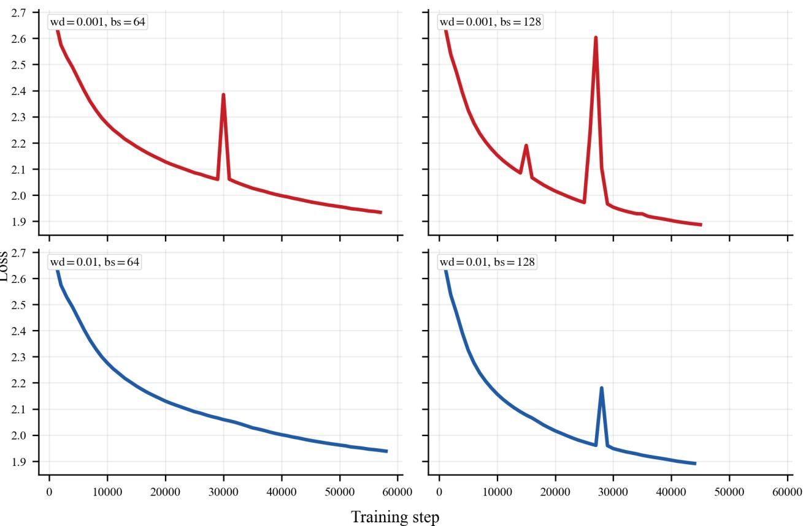
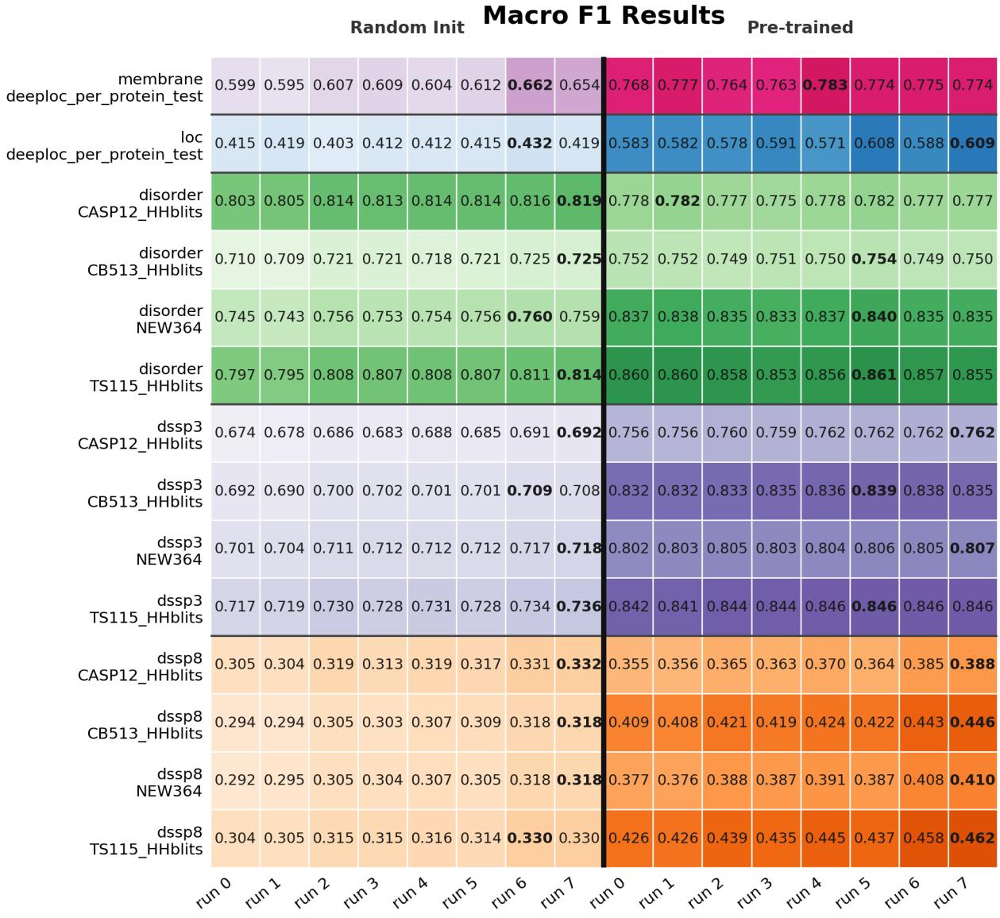

# PROTMODERNBERT: Compute-Efficient Protein Language Modeling

Alberto Mart´ınez1,†, Natalia Flechas Manrique1,†, Llorenc¸ Espinosa-Portales´ 1,∗, and Luc Andrea2

Abstract—Large protein language models provide a powerful framework for learning sequence–function relationships and guiding experimental design. However, architectural improvements are underexplored, especially in low-compute regimes of relevance for resource-constrained research laboratories. We show that the training cost for encoder-only transformer architectures can be reduced by leveraging modern architectural refinements, offering an encouraging performance / compute-efficiency trade-off. We introduce PROTMODERNBERT, a modernized BERT-style model pre-trained on amino acid sequences, and compare it with PROTBERT, AMPLIFY, and ESM2 across a set of supervised structural tasks — encompassing secondary structure prediction, disorder prediction, and subcellular localization — and ProteinGym’s zero-shot functional benchmark. We find that PROTMODERNBERT matches or closely tracks the performance of AMPLIFY-120M and PROTBERT with up to 80-90% reduction in pre-training FLOPs, and narrows the gap to ESM2 when controlling for pre-training. Our analysis using a cluster-based validation protocol for hyperparameter selection and randomly initialized models disentangles the contributions of architecture and data, showing that modern components provide stronger inductive biases that are more consequential than parameter count in low-compute regimes.

Index Terms—protein language models, computational biology, efficient pre-training

## I. INTRODUCTION

Transformer-based architectures [1], [2] have been a crucial innovation for both predictive and generative modeling across multiple disciplines (e.g. [3]–[5]). The similarity between protein sequences and natural language —where amino acids function as a finite vocabulary forming higher-order functional structures [6], [7]— suggests that both domains are amenable to similar modeling techniques. Consequently, models such as PROTBERT [8], ESM2 [9], and AMPLIFY [10] have successfully repurposed transformer designs for sequencefunction prediction. We extend this trajectory by introducing ProtModernBERT, investigating whether recent architectural refinements can further reduce pre-training compute without degrading downstream performance.

Architectural innovations for language models have been the focus of intensive research aimed at improving both performance and efficiency. Notable examples include rotary positional embeddings as an alternative to absolute positional encodings [11], improvements to the attention mechanism such as FlashAttention [12], as well as revised normalization strategies and activation functions. While these advances have been critical for scaling modern LLMs, earlier architectures such as BERT [2], which remains widely used in industrial settings, have also been revisited and updated to incorporate these improvements, most notably in ModernBERT [13]. Importantly, recent work on genomic foundation models has suggested that downstream performance is not determined by pre-training scale alone, and that architectural choices can provide strong inductive biases even in randomly initialized models [14]. In this spirit, we seek to update PROTBERT [8] into a modernized variant, PROTMODERNBERT.

By introducing PROTMODERNBERT, which is a ModernBERT-derived encoder pre-trained on the UR100P corpus, we investigate whether recent architectural refinements can reduce pre-training compute for protein language models (PLMs) without degrading downstream performance. To this end, we compare it against PROTBERT, AMPLIFY, and ESM2 under both pre-trained and randomly initialized (randinit) conditions. These models span different architectural and training choices while remaining widely adopted benchmarks in the field. PROTBERT represents the adaptation of the BERT-style masked language modeling paradigm to protein sequences; ESM2 is a state-of-the-art transformer model extensively validated across diverse downstream biological tasks; and AMPLIFY emphasizes training efficiency and modern architectural refinements. Together, they provide a meaningful basis for comparison in terms of architectural design, computational efficiency, and downstream performance.

In our findings, we observe that across DeepLoc and secondary-structure benchmarks, PROTMODERNBERT matches or closely tracks the performance of PROTBERT and AMPLIFY-120M despite using substantially fewer pre-training FLOPs, and narrows the gap to ESM2 once we control for pre-training. In addition, we adopt a more principled dataset partitioning strategy for pre-training, which reduces information leakage and better reflects realistic generalization scenarios. As part of this comparison, we also examine the role of rotary positional embeddings and other ModernBERT-style components in protein sequence modeling. As we will discuss later on, we do not observe consistent accuracy improvements from RoPE under our pre-training budget.

Finally, our experiments highlight that secondary structure prediction remains a challenging task for current PLMs. Despite architectural and training improvements, performance gains on secondary structure datasets are limited, suggesting that additional inductive biases or task-specific supervision may be necessary to better capture structural information. At the same time, tasks such as disorder prediction appear closer to saturation, with comparatively smaller gains from pre-training and modest separation between architectures, underscoring the task-dependent impact of both architecture and pre-training compute.

## II. METHODS

This section is organized into three parts. In Section II-A, we describe the tokenizer, pre-training dataset, architectural choices, and optimization hyperparameters used to train PROT-MODERNBERT, and summarize the final pre-training run. In Section II-B, we present the fine-tuning and evaluation protocols for both pre-trained and randomly initialized models across DeepLoc and secondary-structure benchmarks, and detail how we compare PROTMODERNBERT against PROT-BERT, AMPLIFY, and ESM2. Finally, in Section II-C, we report the hardware configuration used for pre-training and fine-tuning.

## A. Model Pre-Training

1) Tokenizer: We use a tokenizer that assigns one token per amino acid, following PROTBERT [8], ESM2 and AMPLIFY. The vocabulary contains 30 tokens: the 20 canonical amino acids, the special tokens [PAD], [UNK], [CLS], [SEP], and [MASK], following BERT [2], and the additional residue symbols ‘X’, ‘U’, ‘B’, ‘Z’, and ‘O’. Although these noncanonical amino acids are not present in the pre-training data, these tokens are retained to ensure compatibility with downstream datasets, where ambiguous or rare residues (e.g., ‘X’ or selenocysteine ‘U’) may occur, avoiding the need for vocabulary changes during fine-tuning.

We adopt a one-token-per-amino-acid representation. This approach provides explicit control over sequence length for design tasks, facilitates the learning of residue-level embeddings aligned with physicochemical properties, and remains computationally feasible given the manageable length of most protein sequences.

2) Pre-Training Dataset: For PROTMODERNBERT we adopt the UR100P dataset, described in [10] and originally used to train AMPLIFY. It aggregates sequences from UniProt/UniRef100 [15], the Observed Antibody Space (OAS) [16], and SCOP 2 [17] (December 2023 release). Unlike aggressively clustered corpora (e.g., UniRef50), UR100P preserves naturally occurring sequence redundancy, treating repeated observations as a signal of biological confidence while reducing the relative weight of singleton or low-quality sequences. Sequences shorter than five residues or containing ambiguous or non-canonical amino acids were excluded.

To ensure consistency with existing efficiency benchmarks, we utilize the UniProt validation set established by AMPLIFY [10] rather than constructing a new reference corpus. This validation data was designed to support targeted evaluation across distinct regions of protein sequence space and consists of three subsets: (i) 10,000 reference proteome sequences from high-quality assemblies (BUSCO completeness > 80%) spanning bacteria, archaea, and eukaryotes; (ii) 10,000 paired OAS antibody heavy–light chain sequences clustered at 90% sequence identity; and (iii) 10,000 SCOP family-representative domain sequences clustered at 30% identity.

Next, training sequences were drawn from the remaining UniProt, UniRef, SCOP, and OAS data after removing any sequence with greater than 90% identity to validation entries. Paired antibody sequences were included in both heavy|light and light|heavy orientations. The resulting training corpus contains approximately 364M sequences and provides broad coverage while minimizing information leakage into validation sets.

This dataset choice for PROTMODERNBERT sets a clear difference with PROTBERT, originally pre-trained directly on UniRef100 [18]. In contrast, we pre-trained PROTMODERN-BERT on UR100P, motivated both by the considerations discussed above and by empirical evidence reported [10], showing that models trained on UniRef100 augmented with OAS antibody sequences and SCOP domains (UR100P) exhibit faster learning dynamics than those trained on UniRef50 (used by e.g. ESM2 and ProtGPT2), likely due to the increased scale and diversity of the training corpus.

3) Model Implementations and Architectural Context: As previously stated, the primary objective of this work is to train and evaluate PROTMODERNBERT, a protein language model derived from the MODERNBERT architecture. Existing models were studied throughout this work with two distinct roles: (i) guiding architectural and hyperparameter decisions during pre-training, and (ii) providing representative baselines for downstream evaluation.

To guide architectural design and hyperparameter selection, we focused on MODERNBERT and AMPLIFY. ModernBERT serves as the direct architectural precursor to PROTMODERN-BERT, while AMPLIFY represents the closest existing proteinspecific BERT-style model trained on the same underlying dataset (UR100P). Together, these models provide a principled reference for adapting a modern language architecture to the protein domain.

For downstream evaluation, we additionally included PROT-BERT and ESM2. PROTBERT represents an earlier generation of protein BERT models trained on UniRef, while ESM2 is a strong, widely adopted baseline trained on a large and diverse protein corpus. These models were included to contextualize performance rather than to inform architectural or optimization choices.

All models were evaluated using publicly released, reference implementations to ensure reproducibility and to avoid confounding effects arising from implementation-specific optimizations. Specifically, we used the official HuggingFace [19] implementations of PROTBERT, AMPLIFY, MODERNBERT, and ESM2.

PROTMODERNBERT integrates modern transformer elements detailed in Table I, including bias-free linear layers, FlashAttention, and Rotary Positional Embeddings (RoPE). While we follow the MODERNBERT template for depth, hidden size, and local attention windows, we adopt AMPLIFY’s higher weight decay (0.01) and include mild attention dropout (p=0.1) to stabilize training on the repetitive UR100P corpus. Detailed parameter comparisons are provided in Table I.

4) Hyperparameter Selection: To inform the final hyperparameter configuration of PROTMODERNBERT, we conducted four short preliminary experiments focusing on the behavior of batch size and weight decay during pre-training, analyzing training stability and loss dynamics. These experiments were designed to complement architectural guidance from closely related models. In particular, we compared against AMPLIFY, which shares the same pre-training dataset UR100P, and MODERNBERT, which serves as the direct architectural basis for our model. Leveraging these two reference points, we explored which optimization settings are best suited for a modern BERT-style protein language model trained at moderate compute scale.

TABLE I  
KEY ARCHITECTURAL AND OPTIMIZATION HYPERPARAMETERS FOR MODERNBERT (BASE), AMPLIFY (BASE), AND PROTMODERNBERT. THESE MODELS ARE SHOWN BECAUSE THEY DIRECTLY INFORM THE ARCHITECTURAL DESIGN AND HYPERPARAMETER SELECTION OF PROTMODERNBERT.
<table><tr><td>Hyperparameter</td><td>ModernBERT (Base, 140M)</td><td>AMPLIFY (Base, 120M)</td><td>ProtModernBERT</td></tr><tr><td>Optimizer</td><td>StableAdamW (β=(0.90, 0.98), ε=1e-6)</td><td>AdamW (β=(0.90, 0.95), ∈=1e-8)</td><td>AdamW (β=(0.90, 0.99), ∈=1e-8)</td></tr><tr><td>Learning rate</td><td>8e-4 (pretrain), 3e-4 (context)</td><td>0.001</td><td>8e-4</td></tr><tr><td>Weight decay</td><td>1e-5</td><td>0.01</td><td>0.01</td></tr><tr><td>LR schedule</td><td>Trapezoidal</td><td>Cosine decay (Stage 1), none (Stage 2)</td><td>Trapezoidal</td></tr><tr><td>Global Batch size</td><td>4,608 (pretrain), 72 (context)</td><td>4,096</td><td>12288</td></tr><tr><td>Precision</td><td>fp16/bf16 (via FlashAttention)</td><td>bf16 (mixed precision)</td><td>bf16 (via FlashAttention)</td></tr><tr><td>Gradient clipping</td><td></td><td>1.0</td><td></td></tr><tr><td>Training strategy</td><td>DDP</td><td>DeepSpeed ZeRO Stage 3</td><td>DDP 96×A100 GPUs</td></tr><tr><td>Hardware Vocabulary size</td><td>8×H100 GPUs</td><td> $- \mathrm { ( D e e p s p e e d ~ s e t u p ) }$ </td><td>30</td></tr><tr><td>Unused tokens</td><td>50,368</td><td>27</td><td></td></tr><tr><td></td><td>83</td><td>一</td><td>22</td></tr><tr><td>Layers</td><td>22</td><td>24</td><td></td></tr><tr><td>Hidden size</td><td>768</td><td>640</td><td>768</td></tr><tr><td>Intermediate (FFN) size</td><td>1,152</td><td>2,560</td><td>1152</td></tr><tr><td>GLU expansion</td><td>2,304</td><td></td><td></td></tr><tr><td>Attention heads</td><td>12</td><td>10</td><td>12</td></tr><tr><td>Activation</td><td>GeGLU</td><td>SwiGLU</td><td>GeGLU</td></tr><tr><td>Norm €</td><td>1e-5</td><td>1e-5</td><td>1e-5</td></tr><tr><td>Dropout (attn out)</td><td>0.1</td><td>0</td><td>0.1</td></tr><tr><td>Dropout (other)</td><td>0.0</td><td></td><td></td></tr><tr><td>Max seq. length</td><td>1,024 (pretrain), 8,192 (context)</td><td>512 (Stage 1), 2,048 (Stage 2)</td><td>1,024 (pretrain)</td></tr><tr><td>RoPE θ</td><td>160,000 (1ocal: 10,000)</td><td>10,000</td><td>160,000 (local: 10,000)</td></tr><tr><td>Local attn. window</td><td>128</td><td></td><td>128</td></tr><tr><td>Global attention</td><td>Every 3 layers</td><td></td><td>Every 3 layers</td></tr><tr><td>Sequences</td><td></td><td>364M</td><td>364M</td></tr><tr><td>Tokens</td><td>2T</td><td>137B</td><td>137B</td></tr></table>

Preliminary experiments (see Appendix A) informed our optimization strategy. We selected a weight decay of 0.01 to ensure training stability and a trapezoidal learning rate schedule for its checkpoint continuation benefits. A local batch size of 128 was used to maximize hardware utilization without compromising generalization.

5) Final Pre-Training Run: Based on the preliminary experiments, we selected the best-performing checkpoint and hyperparameter configuration to carry out a longer pre-training run (see A for further information). This final experiment was trained for 20 hours using 96 NVIDIA A100 GPUs. During this run, PROTMODERNBERT achieved an average hardware utilization efficiency of 48%, measured as the ratio between achieved and theoretical peak FLOPs. The model exhibits stable training dynamics and consistent loss reduction throughout the run. Specifically, PROTMODERNBERT was trained for 10,887 gradient steps with a global batch size of 12,288 sequences (1024 context), totaling 137B tokens

## B. Model Fine-tuning and Evaluation

1) Fine-Tuning Datasets: In this section, we describe the datasets that were used to train, validate and evaluate our models. Table II summarizes dataset sizes and labels.

We evaluate performance across three standard benchmarks summarized in Table II: DeepLoc [20] for 10-class subcellular localization and binary membrane classification; the HHblitsbased suite - CASP12 [21], TS115 [22], CB513 [23] - for 3- state and 8-state secondary structure and disorder prediction; and NEW364 [8] to assess generalization on non-redundant proteins released after 2019.

TABLE II  
OVERVIEW OF BENCHMARK DATASETS.
<table><tr><td>Dataset</td><td>Task</td><td>Train</td><td>Test</td></tr><tr><td>DeepLoc</td><td>Localization (10-class)</td><td>6,622</td><td>1,842</td></tr><tr><td></td><td>Membrane (binary)</td><td>6,622</td><td>1,842</td></tr><tr><td>Train_HHblits</td><td>Sec. structure</td><td>10,792</td><td></td></tr><tr><td>CASP12 TS115</td><td>Sec. structure</td><td></td><td>20</td></tr><tr><td>CB513</td><td>Sec. structure</td><td></td><td>115</td></tr><tr><td></td><td>Sec. structure</td><td></td><td>511</td></tr><tr><td>NEW364</td><td>Sec. structure</td><td></td><td>364</td></tr></table>

2) Fine-Tuning Experiments: We conduct two families of fine-tuning experiments: one using pre-trained checkpoints and one starting from randomly initialized parameters (randinit). The randinit setting allows us both to isolate the contribution of pre-training for PROTMODERNBERT and to compare architectures on a more equal footing, without confounding differences in pre-training data or FLOPs. Downstream performance across both pre-trained and randomly initialized (randinit) conditions is summarized in Figure 1 (Accuracy) and Figure 2 (Macro F1). We will further comment these results in Section III

For each model–task pair and initialization condition, we perform a grid search over learning rate [3e-5, 5e-5], warmup epochs [4, 6], and weight decay [0.02, 0.1]. All runs use batch size = 16, warmup $\mathrm { r a t e } = 0 . 0 5$ , and a maximum sequence length of 512 tokens. More information about the final choice of parameters can be found in the Appendix (B).

3) Functional validation: ProteinGym: While ProteinGym [24] is a comprehensive benchmark encompassing a wide range of tasks—including clinical variant prioritization and indel effect prediction—we focus our evaluation on the zeroshot substitution benchmark. This task specifically assesses a model’s ability to capture sequence–function relationships without further task-specific supervision. We measure the model’s performance by calculating the Spearman correlation between the model-assigned log-likelihoods—specifically the likelihood of the mutated sequence relative to the wildtype—and experimental fitness scores derived from deep mutational scanning (DMS) assays. This targeted evaluation provides a direct measure of the model’s functional ”semantics” across diverse categories such as organismal fitness, binding, and protein stability.

## C. Hardware Specifications

During pre-training we used the following hardware specifications: 12 eight-GPU accelerated compute nodes, each with 2 AMD Milan EPYC 7543 processors (32 cores at 2.80 GHz, totaling 64 cores per node), 512 GB of memory, and 8 Nvidia A100 SXM4 80 GB GPUs. For fine-tuning, we used only one NVIDIA A10G Tensor Core.

## III. RESULTS AND DISCUSSION

We evaluate PROTMODERNBERT against AMPLIFY-120M, AMPLIFY-350M, ESM2-150M, and PROTBERT 420M. In addition, we report results from an earlier PROT-MODERNBERT checkpoint trained to assess early-stage learning behavior. All models are evaluated under both pre-trained and randomly initialized (randinit) conditions. Table III shows a model comparison in terms of parameters and FLOPs.

Overall, our results indicate that PROTMODERNBERT is competitive with larger and more computationally expensive baselines, despite requiring substantially less pre-training compute. This suggests that modern architectural choices can yield strong representations even under constrained training regimes.

TABLE III  
COMPARISON OF MODEL SIZE AND PRE-TRAINING COMPUTE.
<table><tr><td>Model</td><td>Parameters</td><td>FLOPs</td></tr><tr><td>PROTBERT</td><td>420M</td><td> $6 . 0 \times 1 0 ^ { 2 1 }$ </td></tr><tr><td>ESM2-150M</td><td>150M</td><td> $9 \times 1 0 ^ { 2 0 ~ \ast }$ </td></tr><tr><td>AMPLIFY-120M</td><td>120M</td><td> $1 . 6 \times 1 0 ^ { 2 1 }$ </td></tr><tr><td>AMPLIFY-350M</td><td>350M</td><td> $4 . 6 \times 1 0 ^ { 2 1 }$ </td></tr><tr><td>PROTMODERNBERT</td><td>140M</td><td> $5 . 8 \times 1 0 ^ { 2 0 }$ </td></tr><tr><td>Early PROTMODERNBERT</td><td>140M</td><td> $1 . 3 \times 1 0 ^ { 2 0 }$ </td></tr></table>

\*Training FLOPs for ESM2-150M are not reported in original ESM2 publications. ESM2-150M does not seem to be the most computationally expensive model in our comparison: based on our estimates, its total pretraining budget lies in the range $9 \times 1 0 ^ { 2 0 } – 1 \times 1 0 ^ { 2 1 }$ FLOPs, we report the most conservative estimate and further discuss this in the Appendix (D).

a) Compute Efficiency and Aggregate Performance: Across benchmarks, PROTMODERNBERT consistently matches or closely tracks the performance of AMPLIFY-120M and PROTBERT while using the smallest pre-training budget among the evaluated models. Within the AMPLIFY family, the 350M model offers only modest gains over the 120M variant, even under pre-training, whereas the difference between pre-trained and randinit variants is much larger. ESM2 typically achieves the strongest absolute performance, despite being trained with a total pre-training FLOP budget that is lower than that of AMPLIFY-120M and PROTBERT. This efficiency is particularly notable given that PROTBERT and AMPLIFY-350M benefit from roughly an order of magnitude more compute, yet ESM2 often performs best. We hypothesize that this reflects advantages in corpus design and curation, masking strategy and training setup, rather than simply having the largest model or the largest compute budget. Interestingly, ESM2 advantage over PROTMODERNBERT narrows considerably once we control for pre-training (i.e., in the randinit setting).

Together, these observations suggest that, in the low- to moderate-compute regime, architectural refinements and pretraining quality are more consequential than further increases in parameter count or training budget.

b) Task-Dependent Impact of Pre-Training: The benefit of pre-training is strongly task dependent. For multi-class, structurally demanding tasks such as secondary structure prediction and subcellular localization, the gap between pretrained and randinit models is substantial in both accuracy and macro F1. By contrast, for disorder prediction, randominitialized models already achieve strong performance and pre-training yields comparatively smaller gains, particularly in accuracy. This pattern suggests that pre-training is most valuable for tasks that require richer, long-range sequence features or that rely on underrepresented classes, whereas simpler or more locally determined tasks may be closer to saturation. For all datasets, the dummy majority-class baseline (integrated into the left-most column of Figures 1 and 2) performs as expected: it attains moderate accuracy on highly imbalanced tasks like disorder prediction but fails to provide meaningful macro-averaged F1 in multi-class settings. This highlights that non-trivial sequence information is required to achieve our reported downstream results, and that improvements over this baseline reflect genuine gains beyond class imbalance effects. Appendix C further explains how the dummy baseline is calculated.

c) Disorder Prediction: On the Disorder benchmarks, differences across models are modest: all pre-trained models reach high accuracy and macro F1. Accuracy changes little between pre-trained and randinit settings, but macro F1 improves with pre-training across architectures, suggesting better calibration and class balance. The relative gain is smaller for PROTMODERNBERT, whose randinit variant is already competitive, consistent with useful inductive biases for this largely local task.

d) Secondary Structure Prediction (DSSP3 / DSSP8): Unlike disorder prediction, DSSP3—and especially DSSP8—remain challenging with clear headroom. When pre-trained, ESM2 performs best, underscoring the value of large-scale pre-training for structurally demanding tasks. PROTBERT is competitive when pre-trained but collapses under randinit, with macro F1 near chance, indicating limited inductive bias for secondary structure without pre-training.

<table><tr><td rowspan=1 colspan=1>0.410</td><td rowspan=1 colspan=1>0.410</td><td rowspan=1 colspan=1>0.607</td><td rowspan=1 colspan=2>0.618</td><td rowspan=1 colspan=1>0.605</td><td rowspan=1 colspan=1>0.653</td><td rowspan=1 colspan=1>0.786</td><td rowspan=1 colspan=1>0.765</td><td rowspan=1 colspan=1>0.795</td><td rowspan=1 colspan=1>0.780</td><td rowspan=1 colspan=1>0.762</td><td rowspan=1 colspan=1>0.759</td></tr><tr><td rowspan=1 colspan=1>0.330</td><td rowspan=1 colspan=1>0.331</td><td rowspan=1 colspan=1>0.589</td><td rowspan=1 colspan=2>0.602</td><td rowspan=1 colspan=1>0.584</td><td rowspan=1 colspan=1>0.590</td><td rowspan=1 colspan=1>0.761</td><td rowspan=1 colspan=1>0.766</td><td rowspan=1 colspan=1>0.775</td><td rowspan=1 colspan=1>0.790</td><td rowspan=1 colspan=1>0.736</td><td rowspan=1 colspan=1>0.754</td></tr><tr><td rowspan=1 colspan=1>0.880</td><td rowspan=1 colspan=1>0.905</td><td rowspan=1 colspan=1>0.920</td><td rowspan=1 colspan=2>0.928</td><td rowspan=1 colspan=1>0.920</td><td rowspan=1 colspan=1>0.928</td><td rowspan=1 colspan=1>0.915</td><td rowspan=1 colspan=1>0.910</td><td rowspan=1 colspan=1>0.910</td><td rowspan=1 colspan=1>0.922</td><td rowspan=1 colspan=1>0.914</td><td rowspan=1 colspan=1>0.907</td></tr><tr><td rowspan=1 colspan=1>0.980</td><td rowspan=1 colspan=1>0.977</td><td rowspan=1 colspan=1>0.979</td><td rowspan=1 colspan=2>0.978</td><td rowspan=1 colspan=1>0.977</td><td rowspan=1 colspan=1>0.977</td><td rowspan=1 colspan=1>0.978</td><td rowspan=1 colspan=1>0.977</td><td rowspan=1 colspan=1>0.979</td><td rowspan=1 colspan=1>0.975</td><td rowspan=1 colspan=1>0.976</td><td rowspan=1 colspan=1>0.976</td></tr><tr><td rowspan=1 colspan=1>0.890</td><td rowspan=1 colspan=1>0.918</td><td rowspan=1 colspan=1>0.925</td><td rowspan=1 colspan=2>0.923</td><td rowspan=1 colspan=1>0.921</td><td rowspan=1 colspan=1>0.924</td><td rowspan=1 colspan=1>0.933</td><td rowspan=1 colspan=1>0.927</td><td rowspan=1 colspan=1>0.932</td><td rowspan=1 colspan=1>0.933</td><td rowspan=1 colspan=1>0.931</td><td rowspan=1 colspan=1>0.934</td></tr><tr><td rowspan=1 colspan=1>0.930</td><td rowspan=1 colspan=1>0.944</td><td rowspan=1 colspan=1>0.952</td><td rowspan=1 colspan=2>0.950</td><td rowspan=1 colspan=1>0.949</td><td rowspan=1 colspan=1>0.950</td><td rowspan=1 colspan=1>0.956</td><td rowspan=1 colspan=1>0.952</td><td rowspan=1 colspan=1>0.958</td><td rowspan=1 colspan=1>0.952</td><td rowspan=1 colspan=1>0.947</td><td rowspan=1 colspan=1>0.953</td></tr><tr><td rowspan=1 colspan=1>0.490</td><td rowspan=1 colspan=1>0.542</td><td rowspan=1 colspan=1>0.696</td><td rowspan=1 colspan=2>0.704</td><td rowspan=1 colspan=1>0.705</td><td rowspan=1 colspan=1>0.700</td><td rowspan=1 colspan=1>0.756</td><td rowspan=1 colspan=1>0.755</td><td rowspan=1 colspan=1>0.769</td><td rowspan=1 colspan=1>0.777</td><td rowspan=1 colspan=1>0.738</td><td rowspan=1 colspan=1>0.742</td></tr><tr><td rowspan=1 colspan=1>0.440</td><td rowspan=1 colspan=1>0.502</td><td rowspan=1 colspan=1>0.717</td><td rowspan=1 colspan=2>0.719</td><td rowspan=1 colspan=1>0.717</td><td rowspan=1 colspan=1>0.716</td><td rowspan=1 colspan=1>0.824</td><td rowspan=1 colspan=1>0.812</td><td rowspan=1 colspan=1>0.838</td><td rowspan=1 colspan=1>0.844</td><td rowspan=1 colspan=1>0.800</td><td rowspan=1 colspan=1>0.813</td></tr><tr><td rowspan=1 colspan=1>0.450</td><td rowspan=1 colspan=1>0.540</td><td rowspan=1 colspan=1>0.730</td><td rowspan=1 colspan=2>0.731</td><td rowspan=1 colspan=1>0.730</td><td rowspan=1 colspan=1>0.728</td><td rowspan=1 colspan=1>0.795</td><td rowspan=1 colspan=1>0.781</td><td rowspan=1 colspan=1>0.806</td><td rowspan=1 colspan=1>0.821</td><td rowspan=1 colspan=1>0.777</td><td rowspan=1 colspan=1>0.788</td></tr><tr><td rowspan=1 colspan=1>0.430</td><td rowspan=1 colspan=1>0.550</td><td rowspan=1 colspan=1>0.749</td><td rowspan=1 colspan=2>0.747</td><td rowspan=1 colspan=1>0.745</td><td rowspan=1 colspan=1>0.747</td><td rowspan=1 colspan=1>0.826</td><td rowspan=1 colspan=1>0.823</td><td rowspan=1 colspan=1>0.841</td><td rowspan=1 colspan=1>0.850</td><td rowspan=1 colspan=1>0.807</td><td rowspan=1 colspan=1>0.824</td></tr><tr><td rowspan=1 colspan=1>0.310</td><td rowspan=1 colspan=1>0.432</td><td rowspan=1 colspan=1>0.575</td><td rowspan=1 colspan=2>0.568</td><td rowspan=1 colspan=1>0.576</td><td rowspan=1 colspan=1>0.576</td><td rowspan=1 colspan=1>0.630</td><td rowspan=1 colspan=1>0.633</td><td rowspan=1 colspan=1>0.654</td><td rowspan=1 colspan=1>0.666</td><td rowspan=1 colspan=1>0.624</td><td rowspan=1 colspan=1>0.621</td></tr><tr><td rowspan=1 colspan=1>0.300</td><td rowspan=1 colspan=1>0.384</td><td rowspan=1 colspan=1>0.575</td><td rowspan=1 colspan=2>0.575</td><td rowspan=1 colspan=1>0.575</td><td rowspan=1 colspan=1>0.576</td><td rowspan=1 colspan=1>0.678</td><td rowspan=1 colspan=1>0.673</td><td rowspan=1 colspan=1>0.705</td><td rowspan=1 colspan=1>0.718</td><td rowspan=1 colspan=1>0.657</td><td rowspan=1 colspan=1>0.668</td></tr><tr><td rowspan=1 colspan=1>0.310</td><td rowspan=1 colspan=1>0.444</td><td rowspan=1 colspan=1>0.615</td><td rowspan=1 colspan=2>0.615</td><td rowspan=1 colspan=1>0.614</td><td rowspan=1 colspan=1>0.615</td><td rowspan=1 colspan=1>0.666</td><td rowspan=1 colspan=1>0.666</td><td rowspan=1 colspan=1>0.693</td><td rowspan=1 colspan=1>0.710</td><td rowspan=1 colspan=1>0.662</td><td rowspan=1 colspan=1>0.673</td></tr><tr><td rowspan=1 colspan=1>0.350</td><td rowspan=1 colspan=1>0.457</td><td rowspan=1 colspan=1>0.629</td><td rowspan=1 colspan=2>0.631</td><td rowspan=1 colspan=1>0.628</td><td rowspan=1 colspan=1>0.629</td><td rowspan=1 colspan=1>0.711</td><td rowspan=1 colspan=1>0.706</td><td rowspan=1 colspan=1>0.729</td><td rowspan=1 colspan=1>0.744</td><td rowspan=1 colspan=1>0.692</td><td rowspan=1 colspan=1>0.708</td></tr></table>

Fig. 1. Accuracy benchmark results under the pre-trained and random initialization conditions for PROTBERT, AMPLIFY-120M, AMPLIFY-350M, and PROTMODERNBERT. The dummy majority-class baseline is shown on the far left for scale.

By comparison, PROTMODERNBERT, AMPLIFY, and ESM2 generalize substantially better in the randinit setting, maintaining non-trivial accuracy and macro F1 across CASP12, CB513, NEW364, and TS115. Notably, without pretraining the gap between ESM2 and PROTMODERNBERT largely disappears, pointing to architectural comparability when data scale and compute are controlled. AMPLIFY-120M and AMPLIFY-350M perform similarly on DSSP3/8 despite the parameter gap, suggesting diminishing returns from added size within this family for secondary structure tasks.

e) Subcellular Localization (DeepLoc): On the DeepLoc benchmarks, PROTBERT degrades sharply under randinit—especially in macro F1—while its pretrained variant remains strong. This sensitivity may reflect reliance on absolute positional embeddings and earlier normalization choices that provide weaker inductive bias for learning global sequence properties from scratch. In contrast, architectures with rotary embeddings and more modern attention/normalization (AMPLIFY, ESM2, and PROTMODERNBERT) retain substantially better randinit performance, highlighting stronger architectural priors.

<table><tr><td rowspan=1 colspan=1>0.190</td><td rowspan=1 colspan=1>0.194</td><td rowspan=1 colspan=1>0.596</td><td rowspan=1 colspan=1>0.606</td><td rowspan=1 colspan=1>0.594</td><td rowspan=1 colspan=1>0.653</td><td rowspan=1 colspan=1>0.791</td><td rowspan=1 colspan=1>0.772</td><td rowspan=1 colspan=1>0.800</td><td rowspan=1 colspan=1>0.781</td><td rowspan=1 colspan=1>0.768</td><td rowspan=1 colspan=1>0.764</td></tr><tr><td rowspan=1 colspan=1>0.050</td><td rowspan=1 colspan=1>0.050</td><td rowspan=1 colspan=1>0.410</td><td rowspan=1 colspan=1>0.413</td><td rowspan=1 colspan=1>0.400</td><td rowspan=1 colspan=1>0.428</td><td rowspan=1 colspan=1>0.578</td><td rowspan=1 colspan=1>0.638</td><td rowspan=1 colspan=1>0.653</td><td rowspan=1 colspan=1>0.661</td><td rowspan=1 colspan=1>0.601</td><td rowspan=1 colspan=1>0.632</td></tr><tr><td rowspan=1 colspan=1>0.470</td><td rowspan=1 colspan=1>0.685</td><td rowspan=1 colspan=1>0.759</td><td rowspan=1 colspan=1>0.781</td><td rowspan=1 colspan=1>0.749</td><td rowspan=1 colspan=1>0.794</td><td rowspan=1 colspan=1>0.766</td><td rowspan=1 colspan=1>0.744</td><td rowspan=1 colspan=1>0.742</td><td rowspan=1 colspan=1>0.783</td><td rowspan=1 colspan=1>0.753</td><td rowspan=1 colspan=1>0.744</td></tr><tr><td rowspan=1 colspan=1>0.490</td><td rowspan=1 colspan=1>0.685</td><td rowspan=1 colspan=1>0.702</td><td rowspan=1 colspan=1>0.693</td><td rowspan=1 colspan=1>0.709</td><td rowspan=1 colspan=1>0.703</td><td rowspan=1 colspan=1>0.731</td><td rowspan=1 colspan=1>0.706</td><td rowspan=1 colspan=1>0.724</td><td rowspan=1 colspan=1>0.722</td><td rowspan=1 colspan=1>0.712</td><td rowspan=1 colspan=1>0.718</td></tr><tr><td rowspan=1 colspan=1>0.470</td><td rowspan=1 colspan=1>0.704</td><td rowspan=1 colspan=1>0.733</td><td rowspan=1 colspan=1>0.727</td><td rowspan=1 colspan=1>0.722</td><td rowspan=1 colspan=1>0.736</td><td rowspan=1 colspan=1>0.783</td><td rowspan=1 colspan=1>0.761</td><td rowspan=1 colspan=1>0.775</td><td rowspan=1 colspan=1>0.796</td><td rowspan=1 colspan=1>0.790</td><td rowspan=1 colspan=1>0.799</td></tr><tr><td rowspan=1 colspan=1>0.480</td><td rowspan=1 colspan=1>0.731</td><td rowspan=1 colspan=1>0.785</td><td rowspan=1 colspan=1>0.774</td><td rowspan=1 colspan=1>0.772</td><td rowspan=1 colspan=1>0.787</td><td rowspan=1 colspan=1>0.826</td><td rowspan=1 colspan=1>0.802</td><td rowspan=1 colspan=1>0.825</td><td rowspan=1 colspan=1>0.822</td><td rowspan=1 colspan=1>0.794</td><td rowspan=1 colspan=1>0.820</td></tr><tr><td rowspan=1 colspan=1>0.220</td><td rowspan=1 colspan=1>0.495</td><td rowspan=1 colspan=1>0.680</td><td rowspan=1 colspan=1>0.691</td><td rowspan=1 colspan=1>0.689</td><td rowspan=1 colspan=1>0.685</td><td rowspan=1 colspan=1>0.745</td><td rowspan=1 colspan=1>0.746</td><td rowspan=1 colspan=1>0.763</td><td rowspan=1 colspan=1>0.772</td><td rowspan=1 colspan=1>0.729</td><td rowspan=1 colspan=1>0.736</td></tr><tr><td rowspan=1 colspan=1>0.200</td><td rowspan=1 colspan=1>0.463</td><td rowspan=1 colspan=1>0.704</td><td rowspan=1 colspan=1>0.705</td><td rowspan=1 colspan=1>0.703</td><td rowspan=1 colspan=1>0.702</td><td rowspan=1 colspan=1>0.820</td><td rowspan=1 colspan=1>0.808</td><td rowspan=1 colspan=1>0.835</td><td rowspan=1 colspan=1>0.842</td><td rowspan=1 colspan=1>0.794</td><td rowspan=1 colspan=1>0.808</td></tr><tr><td rowspan=1 colspan=1>0.210</td><td rowspan=1 colspan=1>0.497</td><td rowspan=1 colspan=1>0.714</td><td rowspan=1 colspan=1>0.714</td><td rowspan=1 colspan=1>0.714</td><td rowspan=1 colspan=1>0.712</td><td rowspan=1 colspan=1>0.787</td><td rowspan=1 colspan=1>0.773</td><td rowspan=1 colspan=1>0.799</td><td rowspan=1 colspan=1>0.816</td><td rowspan=1 colspan=1>0.767</td><td rowspan=1 colspan=1>0.779</td></tr><tr><td rowspan=1 colspan=1>0.200</td><td rowspan=1 colspan=1>0.496</td><td rowspan=1 colspan=1>0.732</td><td rowspan=1 colspan=1>0.729</td><td rowspan=1 colspan=1>0.727</td><td rowspan=1 colspan=1>0.728</td><td rowspan=1 colspan=1>0.820</td><td rowspan=1 colspan=1>0.817</td><td rowspan=1 colspan=1>0.838</td><td rowspan=1 colspan=1>0.846</td><td rowspan=1 colspan=1>0.799</td><td rowspan=1 colspan=1>0.818</td></tr><tr><td rowspan=1 colspan=1>0.060</td><td rowspan=1 colspan=1>0.176</td><td rowspan=1 colspan=1>0.347</td><td rowspan=1 colspan=1>0.316</td><td rowspan=1 colspan=1>0.336</td><td rowspan=1 colspan=1>0.339</td><td rowspan=1 colspan=1>0.413</td><td rowspan=1 colspan=1>0.377</td><td rowspan=1 colspan=1>0.421</td><td rowspan=1 colspan=1>0.467</td><td rowspan=1 colspan=1>0.356</td><td rowspan=1 colspan=1>0.359</td></tr><tr><td rowspan=1 colspan=1>0.060</td><td rowspan=1 colspan=1>0.158</td><td rowspan=1 colspan=1>0.334</td><td rowspan=1 colspan=1>0.349</td><td rowspan=1 colspan=1>0.321</td><td rowspan=1 colspan=1>0.326</td><td rowspan=1 colspan=1>0.487</td><td rowspan=1 colspan=1>0.462</td><td rowspan=1 colspan=1>0.506</td><td rowspan=1 colspan=1>0.531</td><td rowspan=1 colspan=1>0.418</td><td rowspan=1 colspan=1>0.413</td></tr><tr><td rowspan=1 colspan=1>0.060</td><td rowspan=1 colspan=1>0.178</td><td rowspan=1 colspan=1>0.330</td><td rowspan=1 colspan=1>0.338</td><td rowspan=1 colspan=1>0.326</td><td rowspan=1 colspan=1>0.326</td><td rowspan=1 colspan=1>0.409</td><td rowspan=1 colspan=1>0.395</td><td rowspan=1 colspan=1>0.423</td><td rowspan=1 colspan=1>0.453</td><td rowspan=1 colspan=1>0.375</td><td rowspan=1 colspan=1>0.380</td></tr><tr><td rowspan=1 colspan=1>0.070</td><td rowspan=1 colspan=1>0.178</td><td rowspan=1 colspan=1>0.346</td><td rowspan=1 colspan=1>0.365</td><td rowspan=1 colspan=1>0.344</td><td rowspan=1 colspan=1>0.337</td><td rowspan=1 colspan=1>0.507</td><td rowspan=1 colspan=1>0.467</td><td rowspan=1 colspan=1>0.510</td><td rowspan=1 colspan=1>0.541</td><td rowspan=1 colspan=1>0.429</td><td rowspan=1 colspan=1>0.428</td></tr></table>

Fig. 2. F1 benchmark results under the pre-trained and random initialization conditions for PROTBERT, AMPLIFY-120M, AMPLIFY-350M, and PROTMODERNBERT. As in the previous figure, the dummy majority-class baseline is shown on the far left for scale.

In the pre-trained setting, ESM2 and AMPLIFY-350M achieve the best overall DeepLoc accuracy and macro F1. PROTMODERNBERT remains competitive but underperforms on some subtasks, particularly membrane classification where AMPLIFY and ESM2 achieve higher macro F1. Fully closing this gap may require more pre-training compute, more targeted pre-training data, or task-specific adaptation (for example, multi-task training or localization-aware objectives).

f) Mutational Effect Prediction on ProteinGym: In line with our functional validation protocol, we report the results for the ProteinGym zero-shot substitution task. As shown in Table IV, PROTMODERNBERT (0.373) matches the functional predictive power of PROTBERT (0.376), while trailing the more computationally expensive ESM2-150M (0.387) baseline on the aggregate benchmark.

The results highlight that despite ESM2’s advantage—driven by its 7.5× larger pre-training data volume (1.024T vs. 137B tokens) —PROTMODERNBERT remains highly efficient. Notably, it outperforms ESM2 on Organismal Fitness (0.379 vs. 0.305). The measurable gap observed for the Early PROTMODERNBERT checkpoint (0.327) further indicates that the full pre-training duration was necessary to capture these complex functional signals. These findings reinforce the conclusion that architectural modernization enables the model to effectively learn functional landscapes with 80–90% fewer pre-training FLOPs.

TABLE IV  
PROTEINGYM ZERO-SHOT SUBSTITUTION RESULTS (SPEARMAN CORRELATION). PROTMODERNBERT DEMONSTRATES COMPETITIVE FUNCTIONAL MODELING ACROSS CATEGORIES, NOTABLY ACHIEVING THE HIGHEST SCORE IN ORGANISMAL FITNESS DESPITE SIGNIFICANTLY LOWER PRE-TRAINING COMPUTE.
<table><tr><td>Model</td><td>Total (Overall)</td><td>Org. Fitness</td><td>Binding</td><td>Expression</td><td>Activity</td><td>Stability</td></tr><tr><td>PROTBERT</td><td>0.376</td><td>0.357</td><td>0.211</td><td>0.338</td><td>0.363</td><td>0.448</td></tr><tr><td>PROTMODERNBERT</td><td>0.373</td><td>0.379</td><td>0.282</td><td>0.385</td><td>0.342</td><td>0.400</td></tr><tr><td>Early PROTMODERNBERT</td><td>0.327</td><td>0.331</td><td>0.288</td><td>0.354</td><td>0.316</td><td>0.331</td></tr><tr><td>ESM2-150M</td><td>0.387</td><td>0.305</td><td>0.326</td><td>0.402</td><td>0.391</td><td>0.510</td></tr></table>

g) Effect of rotary positional embeddings.: Because RoPE has been proposed as a mechanism to better capture long-range dependencies [11], we examined its impact in the context of PROTMODERNBERT. Within our experimental setting and pre-training budget, we do not observe consistent accuracy/F1 gains from RoPE compared to architectures relying on absolute positional encodings. Instead, its benefits appear to manifest primarily in terms of training stability and computational efficiency, particularly when combined with modern attention implementations such as FlashAttention. We emphasize that this should be interpreted as an empirical observation under a specific training regime and moderate compute budgets rather than a definitive assessment of RoPE for protein sequences, as we did not conduct exhaustive ablation experiments over positional encoding schemes or training budgets.

## IV. CONCLUSION

We present PROTMODERNBERT, a compute-efficient protein language model that matches the performance of benchmarks like AMPLIFY-120M and PROTBERT while reducing pre-training compute by 80–90%. Our results demonstrate that modern architectural components enable custom model training to be feasible even for resource-constrained laboratories.

By jointly analyzing pre-trained and randinit settings, we disentangle the contributions of architecture, data, and compute. Across structural tasks, pre-training consistently yields the largest gains, yet PROTMODERNBERT exhibits markedly better performance than PROTBERT under random initialization. This suggests that modern architectural refinements provide stronger inductive biases for structural prediction, narrowing the performance gap to state-of-the-art models like ESM2 once data scale and compute are controlled.

Evaluation on the PROTEINGYM zero-shot benchmark confirms that PROTMODERNBERT effectively captures functional landscapes, notably outperforming ESM2 on the Organismal Fitness subtask despite using an order of magnitude less compute. These findings indicate that principled architectural design—incorporating modern attention and normalization—can drive progress even under realistic data constraints.

## V. LIMITATIONS

Since comparisons occur at early pre-training stages, relative rankings might shift under longer training schedules. Differences in tokenization and optimization choices influence the attribution of gains, and the current lack of variance estimates limits the assessment of statistical significance. Additionally, some benchmarks like disorder prediction appear closer to saturation, while observations regarding specific components like ROPE are restricted to our current compute regime. PROT-MODERNBERT’s reliance on the redundant UR100P corpus may bias the model toward a “consensus grammar,” potentially limiting reliability for rare or evolutionarily divergent proteins. Finally, we acknowledge the methodological challenge of fully disentangling architectural gains from the specific influence of pre-training data quality.

## DATA ACCESS

The data used in this study is available online under the following license terms: UR100P, under CC-BY-4.0; ProteinGym, under MIT license; the fine-tuning datasets (DeepLoc, CASP12, TS115, CB513, and NEW364), under MIT license. The models used in this study for benchmarking against PROTMODERNBERT (PROTBERT, ESM2, and AMPLIFY) are released under MIT license. The training and evaluation code and trained model weights for PROTMODERNBERT are not publicly available at this time.

## ACKNOWLEDGEMENTS

This work was granted access to the HPC resources of IDRIS under the allocation 2024-A0171015266 made by GENCI.

## REFERENCES

[1] A. Vaswani, N. Shazeer, N. Parmar et al., “Attention is all you need,” Advances in Neural Information Processing Systems, 2017.

[2] J. Devlin, M.-W. Chang, K. Lee, and K. Toutanova, “Bert: Pre-training of deep bidirectional transformers for language understanding,” in Proceedings of NAACL-HLT, 2019, pp. 4171–4186.

[3] A. Dosovitskiy, L. Beyer, A. Kolesnikov, D. Weissenborn, X. Zhai, T. Unterthiner, M. Dehghani, M. Minderer, G. Heigold, S. Gelly, J. Uszkoreit, and N. Houlsby, “An image is worth 16x16 words: Transformers for image recognition at scale,” in International Conference on Learning Representations, 2021.

[4] A. Radford, J. W. Kim, C. Hallacy, A. Ramesh, G. Goh, S. Agarwal, G. Sastry, A. Askell, P. Mishkin, J. Clark, G. Krueger, and I. Sutskever, “Learning transferable visual models from natural language supervision,” in Proceedings of the 38th International Conference on Machine Learning, ser. Proceedings of Machine Learning Research, vol. 139, 2021, pp. 8748–8763.

[5] A. Jaegle, F. Gimeno, A. Brock, A. Zisserman, O. Vinyals, and J. Carreira, “Perceiver: General perception with iterative attention,” 2021.

[6] E. Asgari and M. R. Mofrad, “Continuous distributed representation of biological sequences for deep proteomics and genomics,” PLOS ONE, 2015.

[7] M. Heinzinger, A. Elnaggar, Y. Wang, C. Dallago, D. Nechaev, F. Matthes, and B. Rost, “Modeling aspects of the language of life through transfer-learning protein sequences,” BMC Bioinformatics, vol. 20, no. 1, p. 723, 2019. [Online]. Available: https://doi.org/10. 1186/s12859-019-3220-8

[8] A. Elnaggar, M. Heinzinger, C. Dallago, G. Rehawi, Y. Wang, L. Jones, T. Gibbs, T. Feher, C. Angerer, M. Steinegger, D. Bhowmik, and B. Rost, “Prottrans: Toward understanding the language of life through self-supervised learning,” IEEE Transactions on Pattern Analysis and Machine Intelligence, vol. 44, no. 10, pp. 7112–7127, 2022.

[9] Z. Lin et al., “Evolutionary-scale prediction of atomic-level protein structure with a language model,” Science, 2023.

[10] Q. Fournier, R. M. Vernon, A. van der Sloot, B. Schulz, S. Chandar, and C. J. Langmead, “Protein language models: Is scaling necessary?” bioRxiv, 2024. [Online]. Available: https: //www.biorxiv.org/content/early/2024/09/23/2024.09.23.614603

[11] J. Su, Y. Lu, S. Pan, B. Wen, and Y. Liu, “Roformer: Enhanced transformer with rotary position embedding,” arXiv preprint arXiv:2104.09864, 2021.

[12] T. Dao et al., “Flashattention: Fast and memory-efficient exact attention with io-awareness,” Advances in Neural Information Processing Systems, 2022.

[13] B. Warner, A. Chaffin, B. Clavie, O. Weller, O. Hallstr´ om,¨ S. Taghadouini, A. Gallagher, R. Biswas, F. Ladhak, T. Aarsen, N. Cooper, G. Adams, J. Howard, and I. Poli, “Smarter, better, faster, longer: A modern bidirectional encoder for fast, memory efficient, and long context finetuning and inference,” 2024. [Online]. Available: https://arxiv.org/abs/2412.13663

[14] K. Vishniakov, K. Viswanathan, A. Medvedev, P. K. Kanithi, M. A. Pimentel, R. Rajan, and S. Khan, “Genomic foundationless models: Pretraining does not promise performance,” bioRxiv, 2024. [Online]. Available: https://www.biorxiv.org/content/early/2024/12/20/2024.12.18. 628606

[15] T. U. Consortium, “Uniprot: the universal protein knowledgebase in 2023,” Nucleic acids research, vol. 51, no. D1, pp. D523–D531, 2023.

[16] A. Kovaltsuk, J. Leem, S. Kelm, J. Snowden, and C. M. Deane, “Observed antibody space: a resource for data mining next-generation sequencing of antibody repertoires,” Journal of Immunology, vol. 201, no. 8, pp. 2502–2509, 2018.

[17] J.-M. Chandonia, L. Guan, S. Lin, C. Yu, N. Fox, and S. Brenner, “Scope: improvements to the structural classification of proteins – extended database to facilitate variant interpretation and machine learning,” Nucleic Acids Research, vol. 50, no. D1, pp. D553–D559, 01 2022. [Online]. Available: https://doi.org/10.1093/nar/gkab1054

[18] B. E. Suzek, H. Huang, P. McGarvey, R. Mazumder, and C. H. Wu, “Uniref: comprehensive and non-redundant uniprot reference clusters,” Bioinformatics, vol. 23, no. 10, pp. 1282–1288, 03 2007.

[19] T. Wolf, L. Debut, V. Sanh, J. Chaumond, C. Delangue, A. Moi, P. Cistac, T. Rault, R. Louf, M. Funtowicz et al., “Transformers: Stateof-the-art natural language processing,” in Proceedings of the 2020 conference on empirical methods in natural language processing: system demonstrations, 2020, pp. 38–45.

[20] J. J. Almagro Armenteros, C. K. Sønderby, S. K. Sønderby, H. Nielsen, and O. Winther, “Deeploc: prediction of protein subcellular localization using deep learning,” Bioinformatics, vol. 33, no. 21, pp. 3387–3395, 2017.

[21] L. A. Abriata, G. E. Tamo et al., “Assessment of hard target modeling in casp12 reveals an emerging role of alignment-based contact prediction methods,” Proteins: Structure, Function, and Bioinformatics, vol. 86, pp. 97–112, 2018.

[22] J. A. Cuff and G. J. Barton, “Evaluation and improvement of multiple sequence methods for protein secondary structure prediction,” Proteins: Structure, Function, and Bioinformatics, vol. 34, no. 4, pp. 508–519, 1999.

[23] Y. Yang, J. Gao et al., “Sixty-five years of the long march in protein secondary structure prediction: The final stretch?” Briefings in Bioinformatics, vol. 19, no. 3, pp. 482–494, 2018.

[24] P. Notin, A. W. Kollasch, D. Ritter, L. van Niekerk, S. Paul, H. Spinner, N. Rollins, A. Shaw, R. Weitzman, J. Frazer, M. Dias, D. Franceschi, R. Orenbuch, Y. Gal, and D. S. Marks, “Proteingym: Large-scale benchmarks for protein design and fitness prediction,” bioRxiv, 2023.

[25] J. Kaplan, S. McCandlish, T. J. Henighan, T. B. Brown, B. Chess, R. Child, S. Gray, A. Radford, J. Wu, and D. Amodei, “Scaling laws for neural language models,” ArXiv, vol. abs/2001.08361, 2020. [Online]. Available: https://arxiv.org/pdf/2001.08361

  
Fig. 3. Training loss during the four preliminary pre-training runs varying weight decay (wd) and local batch size (bs). Lower weight decay exhibits occasional loss spikes, while weight decay = 0.01 is more stable.

Before running the pre-training, we conducted 4 preliminary experiments. We used the same hyperparameters as described in Table I, except for local batch size and weight decay. We performed a grid search over weight decay values [0.01,0.001] and local batch sizes [64,128]. Each configuration was trained for 5 hours using 48 GPUs. We wanted to see how the training evolved with different weight decay values and batch sizes.

In these experiments, we observed in Figure 3 that with low weight decay values, there were steps where the model had loss spikes, while with 0.01, these steps were fewer and smaller. For training stability we chose 0.01.

Regarding the batch size, we selected 128 sequences per GPU, the largest value that our hardware could handle. One of the reasons is that in all the experiments we conducted, the training loss was greater than the evaluation loss, so we are far from overfitting. In other words, our model is generalizing well. Assuming that we are not overfitting, the experiment that made the most use of GPU resources was with a batch size of 128.

## B. Fine-tuning results

We fine-tune PROTMODERNBERT with different hyperparameters. We report the results on 8 different runs in Figures 4 and 5. We present in Table VI a mapping between the experiment’s label and its corresponding set of hyperparameters.

To ensure a rigorous and unbiased evaluation for the HHblits and DeepLoc benchmarks, we employ a validation protocol based on an internal partition of the training data. Specifically, we apply a cluster-based 80/20 split using MMseqs2, grouping sequences by identity to ensure that no close homologs appear in both the training and validation partitions. Hyperparameter tuning is performed over a grid including learning rates [3e-5, 5e-5], weight decay [0.02, 0.1], and an updated search range for training epochs. The configuration yielding the best performance on the validation partition is selected as the final setting All benchmark results reported in the main text are obtained by evaluating these optimized configurations on the held-out test sets. As shown in Table V, this protocol confirms that our architectural inductive biases and pre-training gains remain robust across different validation splits. Performance deltas under this cluster-based partitioning remain stable, with gains of +0.02 to +0.08 observed on DSSP8 tasks under the updated hyperparameter grid.

Additionally, as described in Section II-B2, we present the final choice of hyperparameters not only for PROTMODERNBERT but for the rest of the models in Table V. For each model, hyperparameters were selected based on downstream performance across all evaluated tasks. Specifically, for every candidate hyperparameter configuration explored during fine-tuning, we computed the average macro F1 score across all benchmarks. The configuration achieving the highest average macro F1 for a given model was selected as the final hyperparameter setting. This procedure was applied independently for each model and for both the pre-trained and random-initialization (randinit) conditions.

BEST HYPERPARAMETERS USED FOR EACH MODEL WHEN THE MODEL WAS FINE-TUNED UNDER THE CLUSTER-BASED VALIDATION PROTOCOL.  
TABLE V
<table><tr><td>Model</td><td>LR</td><td>Epochs</td><td>Weight Decay</td></tr><tr><td>AMPLIFY 120M</td><td>3e-5</td><td>4</td><td>0.02</td></tr><tr><td>AMPLIFY 120M RandInit</td><td>3e-5</td><td>4</td><td>0.02</td></tr><tr><td>AMPLIFY 350M</td><td>3e-5</td><td>4</td><td>0.02</td></tr><tr><td>AMPLIFY 350M RandInit</td><td>3e-5</td><td>4</td><td>0.02</td></tr><tr><td>ESM150M</td><td>5e-5</td><td>4</td><td>0.10</td></tr><tr><td>ESM150M RandInit</td><td>5e-5</td><td>4</td><td>0.10</td></tr><tr><td>PROTMODERNBERT</td><td>5e-5</td><td>4</td><td>0.10</td></tr><tr><td>PROTMODERNBERT RandInit</td><td>5e-5</td><td>4</td><td>0.02</td></tr><tr><td>Early PROTMODERNBERT</td><td>5e-5</td><td>4</td><td>0.02</td></tr><tr><td>PROTBERT</td><td>3e-5</td><td>4</td><td>0.02</td></tr><tr><td>PROTBERT RandInit</td><td>3e-5</td><td>4</td><td>0.02</td></tr></table>

TABLE VI  
MAPPING OF LABELS AND HYPERPARAMETERS.
<table><tr><td>Label</td><td>Learning Rate</td><td>Epochs</td><td>Weight Decay</td></tr><tr><td>Fine-tune 0</td><td>3e-5</td><td>4</td><td>0.02</td></tr><tr><td>Fine-tune 1</td><td>3e-5</td><td>4</td><td>0.10</td></tr><tr><td>Fine-tune 2</td><td>3e-5</td><td>6</td><td>0.02</td></tr><tr><td>Fine-tune 3</td><td>3e-5</td><td>6</td><td>0.10</td></tr><tr><td>Fine-tune 4</td><td>5e-5</td><td>4</td><td>0.02</td></tr><tr><td>Fine-tune 5</td><td>5e-5</td><td>4</td><td>0.10</td></tr><tr><td>Fine-tune 6</td><td>5e-5</td><td>6</td><td>0.02</td></tr><tr><td>Fine-tune 7</td><td>5e-5</td><td>6</td><td>0.10</td></tr></table>

## C. Dummy majority-class baseline

To contextualize the downstream results, we report a simple “dummy” baseline that predicts the most frequent label in the training set for every example in a given task. Concretely, for each dataset and task, we estimate the empirical label distribution on the training split and construct a classifier that always outputs the single most frequent label. We then evaluate this classifier on the corresponding test set using the same metrics as for our models, namely accuracy and macro-averaged F1.

This baseline captures the performance that can be achieved by exploiting only global class imbalance, without learning any sequence-dependent signal. As such, it provides a sanity check that the reported gains are not driven solely by skewed label distributions and yields a lower bound for meaningful performance on each dataset.

The dummy majority-class baseline results have been integrated into the left-most column of Figures 1 and 2 for ease of comparison.

## D. ESM2-150M Training Compute Estimation

The original ESM2 publications [9] do not explicitly report training FLOPs for the 150M parameter variant, introducing uncertainty into direct compute comparisons. We provide two complementary estimates to bound the training cost.

a) Theoretical Lower Bound.: We apply the standard 6NT approximation commonly used to estimate transformer training compute [25]:

$$
\mathrm { F L O P s } \approx 6 \times N \times D\tag{1}
$$

where N is the number of model parameters and D is the total number of tokens processed during training. For ESM2-150M, we have $N = 1 . 5 \times 1 0 ^ { 8 }$ parameters. According to the original paper, the model was trained for 500,000 steps with a batch size of 2,048,000 tokens per step, yielding:

$$
D = 5 0 0 , 0 0 0 \times 2 , 0 4 8 , 0 0 0 = 1 . 0 2 4 \times 1 0 ^ { 1 2 } \ \mathrm { t o k e n s }\tag{2}
$$

<table><tr><td rowspan=1 colspan=2>0.614</td><td rowspan=1 colspan=2>0.611</td><td rowspan=1 colspan=2>0.623</td><td rowspan=1 colspan=2>0.622</td><td rowspan=1 colspan=2>0.617</td><td rowspan=1 colspan=2>0.625</td><td rowspan=1 colspan=2>0.662</td><td rowspan=1 colspan=2>0.656</td><td rowspan=2 colspan=2>0.762</td><td rowspan=2 colspan=2>0.769</td><td rowspan=2 colspan=2>0.759</td><td rowspan=2 colspan=2>0.756</td><td rowspan=2 colspan=2>0.777</td><td rowspan=2 colspan=2>0.767</td><td rowspan=2 colspan=2>0.769</td><td rowspan=2 colspan=1>0.767</td></tr><tr><td rowspan=1 colspan=2></td><td rowspan=1 colspan=2></td><td rowspan=1 colspan=2></td><td rowspan=1 colspan=2></td><td rowspan=1 colspan=2></td><td rowspan=1 colspan=2></td><td rowspan=1 colspan=2></td><td rowspan=1 colspan=2></td></tr><tr><td rowspan=1 colspan=2>0.597</td><td rowspan=1 colspan=2>0.604</td><td rowspan=1 colspan=2>0.592</td><td rowspan=1 colspan=2>0.597</td><td rowspan=1 colspan=2>0.597</td><td rowspan=1 colspan=2>0.601</td><td rowspan=1 colspan=2>0.612</td><td rowspan=1 colspan=2>0.592</td><td rowspan=1 colspan=2>0.736</td><td rowspan=1 colspan=2>0.747</td><td rowspan=1 colspan=2>0.749</td><td rowspan=1 colspan=2>0.752</td><td rowspan=1 colspan=2>0.746</td><td rowspan=1 colspan=2>0.764</td><td rowspan=1 colspan=2>0.749</td><td rowspan=1 colspan=1>0.764</td></tr><tr><td rowspan=5 colspan=2>0.938</td><td rowspan=5 colspan=2>0.937</td><td rowspan=5 colspan=2>0.939</td><td rowspan=5 colspan=2>0.939</td><td rowspan=5 colspan=2>0.939</td><td rowspan=5 colspan=2>0.939</td><td rowspan=5 colspan=2>0.940</td><td rowspan=5 colspan=2>0.939</td><td rowspan=1 colspan=2></td><td rowspan=1 colspan=2></td><td rowspan=1 colspan=2></td><td></td><td></td><td></td><td></td><td></td><td></td><td></td><td></td><td></td></tr><tr><td></td><td></td><td></td><td></td><td rowspan=4 colspan=2>0.921</td><td></td><td></td><td></td><td></td><td></td><td></td><td></td><td></td><td></td></tr><tr><td></td><td></td><td></td><td></td><td rowspan=3 colspan=2>0.920</td><td></td><td></td><td></td><td></td><td></td><td></td><td></td></tr><tr><td rowspan=2 colspan=2>0.922</td><td rowspan=2 colspan=2>0.922</td><td></td><td></td><td></td><td></td><td></td><td></td><td></td></tr><tr><td rowspan=1 colspan=2>0.922</td><td rowspan=1 colspan=2>0.922</td><td rowspan=1 colspan=2>0.921</td><td rowspan=1 colspan=1>0.920</td></tr><tr><td rowspan=1 colspan=2>0.986</td><td rowspan=1 colspan=2>0.988</td><td rowspan=1 colspan=2>0.988</td><td rowspan=1 colspan=2>0.988</td><td rowspan=1 colspan=2>0.988</td><td rowspan=1 colspan=2>0.988</td><td rowspan=1 colspan=2>0.989</td><td rowspan=1 colspan=2>0.989</td><td rowspan=1 colspan=2>0.994</td><td rowspan=1 colspan=2>0.993</td><td rowspan=1 colspan=2>0.991</td><td rowspan=1 colspan=2>0.991</td><td rowspan=1 colspan=2>0.992</td><td rowspan=1 colspan=2>0.994</td><td rowspan=1 colspan=2>0.990</td><td rowspan=1 colspan=1>0.991</td></tr><tr><td rowspan=1 colspan=2>0.934</td><td rowspan=1 colspan=2>0.933</td><td rowspan=1 colspan=2>0.935</td><td rowspan=1 colspan=2>0.934</td><td rowspan=1 colspan=2>0.933</td><td rowspan=1 colspan=2>0.935</td><td rowspan=1 colspan=2>0.935</td><td rowspan=1 colspan=2>0.935</td><td rowspan=1 colspan=2>0.951</td><td rowspan=1 colspan=2>0.949</td><td rowspan=1 colspan=2>0.948</td><td rowspan=1 colspan=2>0.948</td><td rowspan=1 colspan=2>0.949</td><td rowspan=1 colspan=2>0.949</td><td rowspan=1 colspan=2>0.948</td><td rowspan=1 colspan=1>0.947</td></tr><tr><td rowspan=1 colspan=2>0.960</td><td rowspan=1 colspan=2>0.960</td><td rowspan=1 colspan=2>0.961</td><td rowspan=1 colspan=2>0.961</td><td rowspan=1 colspan=2>0.962</td><td rowspan=1 colspan=2>0.961</td><td rowspan=1 colspan=2>0.960</td><td rowspan=1 colspan=2>0.962</td><td rowspan=1 colspan=2>0.969</td><td rowspan=1 colspan=2>0.970</td><td rowspan=1 colspan=2>0.968</td><td rowspan=1 colspan=2>0.966</td><td rowspan=1 colspan=2>0.968</td><td rowspan=1 colspan=2>0.969</td><td rowspan=1 colspan=2>0.967</td><td rowspan=1 colspan=1>0.967</td></tr><tr><td rowspan=3 colspan=2>0.688</td><td rowspan=3 colspan=2>0.690</td><td rowspan=3 colspan=2>0.697</td><td rowspan=3 colspan=2>0.698</td><td rowspan=3 colspan=2>0.699</td><td rowspan=3 colspan=2>0.698</td><td rowspan=3 colspan=2>0.704</td><td rowspan=3 colspan=2>0.703</td><td rowspan=3 colspan=2>0.761</td><td rowspan=1 colspan=2></td><td rowspan=3 colspan=2>0.763</td><td rowspan=3 colspan=2>0.762</td><td></td><td></td><td></td><td></td><td></td><td></td><td></td></tr><tr><td rowspan=2 colspan=2>0.762</td><td></td><td></td><td></td><td></td><td></td><td></td><td></td></tr><tr><td rowspan=1 colspan=2>0.764</td><td rowspan=1 colspan=2>0.765</td><td rowspan=1 colspan=2>0.766</td><td rowspan=1 colspan=1>0.766</td></tr><tr><td rowspan=1 colspan=2>0.704</td><td rowspan=1 colspan=2>0.705</td><td rowspan=1 colspan=2>0.713</td><td rowspan=1 colspan=2>0.713</td><td rowspan=1 colspan=2>0.715</td><td rowspan=1 colspan=2>0.713</td><td rowspan=1 colspan=2>0.720</td><td rowspan=1 colspan=2>0.720</td><td rowspan=1 colspan=2>0.834</td><td rowspan=1 colspan=2>0.835</td><td rowspan=1 colspan=2>0.837</td><td rowspan=1 colspan=2>0.836</td><td rowspan=1 colspan=2>0.838</td><td rowspan=1 colspan=2>0.839</td><td rowspan=1 colspan=2>0.838</td><td rowspan=1 colspan=1>0.839</td></tr><tr><td rowspan=1 colspan=2>0.716</td><td rowspan=1 colspan=2>0.718</td><td rowspan=1 colspan=2>0.725</td><td rowspan=1 colspan=2>0.725</td><td rowspan=1 colspan=2>0.727</td><td rowspan=1 colspan=2>0.727</td><td rowspan=1 colspan=2>0.730</td><td rowspan=1 colspan=2>0.731</td><td rowspan=1 colspan=2>0.809</td><td rowspan=1 colspan=2>0.808</td><td rowspan=1 colspan=2>0.811</td><td rowspan=1 colspan=2>0.811</td><td rowspan=1 colspan=2>0.812</td><td rowspan=1 colspan=2>0.813</td><td rowspan=1 colspan=2>0.813</td><td rowspan=1 colspan=1>0.812</td></tr><tr><td rowspan=1 colspan=2>0.734</td><td rowspan=1 colspan=2>0.734</td><td rowspan=1 colspan=2>0.744</td><td rowspan=1 colspan=2>0.744</td><td rowspan=1 colspan=2>0.746</td><td rowspan=1 colspan=2>0.745</td><td rowspan=1 colspan=2>0.751</td><td rowspan=1 colspan=2>0.751</td><td rowspan=1 colspan=2>0.846</td><td rowspan=1 colspan=2>0.846</td><td rowspan=1 colspan=2>0.848</td><td rowspan=1 colspan=2>0.847</td><td rowspan=1 colspan=2>0.849</td><td rowspan=1 colspan=2>0.851</td><td rowspan=1 colspan=2>0.851</td><td rowspan=1 colspan=1>0.849</td></tr><tr><td rowspan=1 colspan=2>0.565</td><td rowspan=1 colspan=2>0.564</td><td rowspan=1 colspan=2>0.575</td><td rowspan=1 colspan=2>0.574</td><td rowspan=1 colspan=2>0.575</td><td rowspan=1 colspan=2>0.576</td><td rowspan=1 colspan=2>0.582</td><td rowspan=1 colspan=2>0.583</td><td rowspan=1 colspan=2>0.640</td><td rowspan=2 colspan=2>0.639</td><td rowspan=2 colspan=2>0.644</td><td rowspan=2 colspan=2>0.644</td><td rowspan=2 colspan=2>0.646</td><td rowspan=2 colspan=2>0.642</td><td rowspan=2 colspan=2>0.647</td><td rowspan=2 colspan=1>0.647</td></tr><tr><td rowspan=1 colspan=2></td><td rowspan=1 colspan=2></td><td rowspan=1 colspan=2></td><td rowspan=1 colspan=2></td><td rowspan=1 colspan=2></td><td rowspan=1 colspan=2></td><td rowspan=1 colspan=2></td><td rowspan=1 colspan=2></td><td rowspan=1 colspan=2></td></tr><tr><td rowspan=1 colspan=2>0.564</td><td rowspan=1 colspan=2>0.564</td><td rowspan=1 colspan=2>0.574</td><td rowspan=1 colspan=2>0.575</td><td rowspan=1 colspan=2>0.574</td><td rowspan=1 colspan=2>0.574</td><td rowspan=1 colspan=2>0.582</td><td rowspan=1 colspan=2>0.583</td><td rowspan=1 colspan=2>0.688</td><td rowspan=1 colspan=2>0.689</td><td rowspan=1 colspan=2>0.693</td><td rowspan=1 colspan=2>0.690</td><td rowspan=1 colspan=2>0.694</td><td rowspan=1 colspan=2>0.692</td><td rowspan=1 colspan=2>0.696</td><td rowspan=1 colspan=1>0.696</td></tr><tr><td rowspan=1 colspan=2>0.603</td><td rowspan=1 colspan=2>0.603</td><td rowspan=1 colspan=2>0.615</td><td rowspan=1 colspan=2>0.614</td><td rowspan=1 colspan=2>0.616</td><td rowspan=1 colspan=2>0.614</td><td rowspan=1 colspan=2>0.623</td><td rowspan=1 colspan=2>0.623</td><td rowspan=1 colspan=2>0.693</td><td rowspan=1 colspan=2>0.693</td><td rowspan=1 colspan=2>0.697</td><td rowspan=1 colspan=2>0.696</td><td rowspan=1 colspan=2>0.700</td><td rowspan=1 colspan=2>0.698</td><td rowspan=1 colspan=2>0.702</td><td rowspan=1 colspan=1>0.702</td></tr><tr><td rowspan=1 colspan=2>0.617</td><td rowspan=1 colspan=2>0.616</td><td rowspan=1 colspan=2>0.627</td><td rowspan=1 colspan=2>0.627</td><td rowspan=1 colspan=2>0.629</td><td rowspan=1 colspan=2>0.628</td><td rowspan=1 colspan=2>0.635</td><td rowspan=1 colspan=2>0.635</td><td rowspan=1 colspan=2>0.729</td><td rowspan=1 colspan=2>0.728</td><td rowspan=1 colspan=2>0.735</td><td rowspan=1 colspan=2>0.732</td><td rowspan=1 colspan=2>0.736</td><td rowspan=1 colspan=2>0.734</td><td rowspan=1 colspan=2>0.739</td><td rowspan=1 colspan=1>0.738</td></tr></table>

Fig. 4. PROTMODERNBERT fine-tuning accuracy results.

Substituting into the 6NT formula:

$$
\mathrm { F L O P s } \approx 6 \times 1 . 5 \times 1 0 ^ { 8 } \times 1 . 0 2 4 \times 1 0 ^ { 1 2 } \approx 9 . 2 \times 1 0 ^ { 2 0 }\tag{3}
$$

This estimate reflects the core forward and backward pass computations but excludes several sources of overhead, including optimizer state updates, embedding and output layer operations, attention masking mechanics, data loading, inter-GPU communication, and padding inefficiencies. As a result, this value should be interpreted as a theoretical lower bound on actual training cost.

b) Empirical Upper Bound from AMPLIFY.: The AMPLIFY paper [10] provides data that allows us to derive an empirical upper bound for ESM2-150M training cost. The authors report that AMPLIFY-120M required $1 . 6 \times 1 0 ^ { 2 1 }$ FLOPs to train for 1 million steps, and note that ESM2-150M is more computationally expensive, requiring 1.25× more FLOPs per training step. Thus, at 1 million steps, ESM2-150M would require approximately $\mathrm { { \bar { 2 . 0 } } \times 1 0 ^ { 2 1 } }$ FLOPs $( 1 . 2 5 \times 1 . 6 \times 1 0 ^ { 2 1 } )$ . Since we assume the ESM2-150M control was trained for only 500,000 steps (half the duration), as is the case in the original paper [9], the total compute is $1 . 0 \times 1 0 ^ { 2 1 }$ FLOPs. This higher estimate likely accounts for practical overheads omitted in the 6NT approximation, providing a more realistic upper bound.

Based on these two approaches, we estimate that ESM2-150M was trained with a total compute budget in the range of $9 \times 1 0 ^ { 2 0 } – 1 . 0 \times 1 0 ^ { 2 1 }$ FLOPs. This range places ESM2-150M’s training cost below that of AMPLIFY-120M $( \mathrm { 1 . 6 \times 1 0 ^ { 2 1 } }$ FLOPs)

  
Fig. 5. PROTMODERNBERT fine-tuning macro-F1 results.

and substantially below that of PROTBERT $( 6 . 0 \times 1 0 ^ { 2 1 }$ FLOPs), underscoring the efficiency gains achieved through improved pre-training data curation and training recipes.

While ESM2 typically achieves the strongest absolute performance, we calculate that the 150M parameter variant was trained on approximately 1.024 trillion tokens. This represents a data scale roughly 7.5 times larger than that of PROTMODERNBERT, which was pre-trained on 137B tokens. This observation is consistent with ESM2’s advantage being attributable, at least in part, to differences in pre-training scale and training recipe rather than architecture alone. This conclusion is further supported by our random-initialization (randinit) benchmarks, where the performance gap between ESM2 and PROTMODERNBERT narrows considerably, demonstrating that their architectures exhibit comparable inductive biases when the benefit of extensive transfer learning is removed.