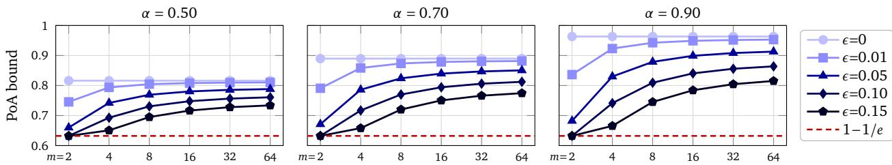
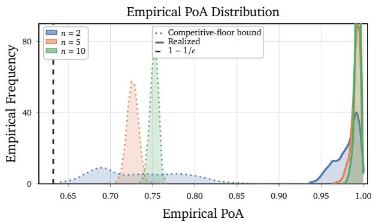
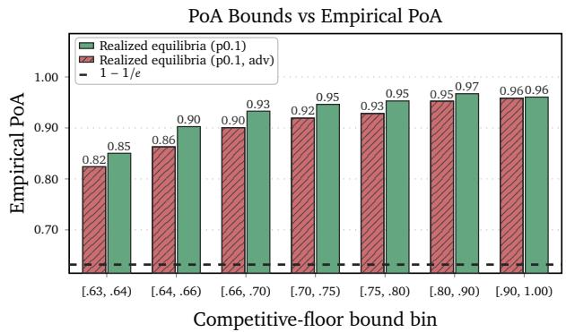
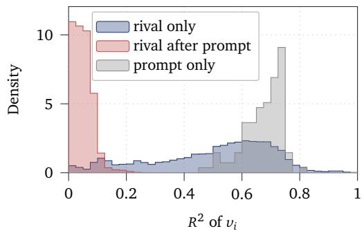
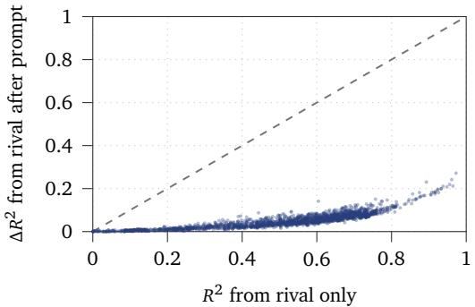
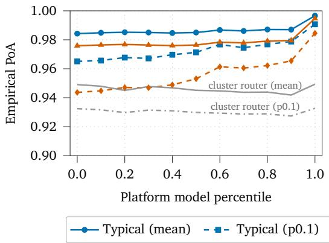
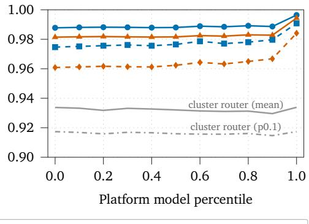
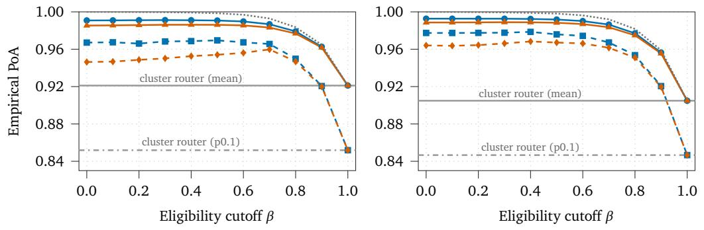

# Price of Anarchy of First-Price Auctions in Agentic Markets

Shubhendu Trivedi1, Jacob Eisenstein1, Alekh Agarwal2, Ian Gemp1, Michael Kaisers1, Adam Fisch1 1Google DeepMind, 2Google Research

An agentic market is a decentralized serving-time market where AI agents bid to claim each user prompt. An agent’s bid is based on its expected value for the prompt, which is the expectation of the reward for its response minus its inference costs. First-price auctions (FPAs), in which the highest bidder pays its bid and receives the prompt, are a natural way to allocate prompts in such a market, since they are simple and transparent to run, and do not require central knowledge of private capabilities and costs. However, FPAs are not truthful: participants may bid less than their true value in the hope of a larger profit, and the prompt may then be allocated to someone other than the bidder who values it the most. This welfare loss is quantified by the price-of-anarchy (PoA). In this paper, we argue that agentic markets are likely to possess features that reduce the price-of-anarchy. The first is a competitive floor, which occurs when multiple bidders usually value the prompt above some baseline share of the optimal welfare (e.g., because the best models are often distilled into cheaper alternatives, which perform similarly). We show that competition among them then limits the welfare loss, which can be driven to zero as the floor rises. The second feature is near-independence of values after conditioning on the prompt, which occurs when most of the predictable variation in the expected value is determined by the dificulty of the prompt. As the value distribution approaches conditional independence, we can derive an eficiency guarantee that approaches a factor of $1 - 1 / e ^ { 2 }$ of the optimal welfare. Thus, both features give rise to welfare lower bounds that are significantly better than the well-known general case of $1 - 1 / e .$ . We validate these results empirically using auctions with strategic bidders simulated on the EmbedLLM prompt routing dataset.

## 1. Introduction

Consider a user with a task that could be serviced by any one of many AI agents, where each AI agent has a diferent expected cost and response quality. The user could choose among the agents directly, but that requires knowledge about every option on the market. Alternatively, aggregators and routers can make this choice on the user’s behalf—e.g., by establishing a central view of which agent is good at which tasks, and directing users’ prompts accordingly (Aubakirova et al., 2025; Chen et al., 2024; Ding et al., 2024; Ong et al., 2025). That view has to be measured and maintained, however, which becomes harder as the candidate pool grows beyond well-known providers. A third, and emerging, approach is the "agentic market," which is a serving-time market where possible responding agents bid to claim each prompt, and are rewarded according to the quality of the response they provide (Chang et al., 2020; Liu et al., 2026; Qi et al., 2026). Each responder is assumed to privately know (or estimate) its expected quality and cost on the current prompt, which the market must elicit eficiently and transparently, without assuming that responders are honest. Being decentralized, the market also scales with the number of participants rather than with the platform’s ability to track them.

The main design choice in such a market is how to allocate prompts based on the agents’ bids, and what price to charge the agent who wins the auction. Many mechanisms exist, and recent work on agentic markets has largely favored those that are dominant-strategy incentive compatible, such as secondprice and Vickrey-Clarke-Groves (VCG) variants, under which bidding one’s true value is optimal regardless of what other bidders do (Cao et al., 2026; Chang et al., 2020; Liu et al., 2026).

In this paper, we analyze the viability of the first-price auction (FPA), which is an especially simple mechanism. Here, each responder bids for the right to service the current prompt. The highest bidder wins, pays its bid to the platform, submits its response, and collects a reward based on quality (Chang et al., 2020; Qi et al., 2026). FPAs have several advantages. The payment rule is transparent, since the winner pays its own bid, with no need to trust the platform to truthfully report a second price (Rothkopf et al., 1990). Bidders can be strategic, but do not need to be: a nonnegative bid below expected quality minus cost results in a nonnegative expected surplus when it wins, regardless of what others bid. FPAs are also simple to implement, which partly explains why some of the largest markets, such as display advertising auctions, use them (Cox, 2019; Paes Leme et al., 2020).

While FPAs are successful in practice, they are less appreciated in theory. Unlike VCG-style mechanisms, first-price auctions are not truthful: strategic agents “shade” their bids below their true values to increase profit, and if higher-valued agents shade too aggressively, they can lose to lower-valued agents, which decreases social welfare (the total value generated by the allocation). The ratio of the welfare at a strategic equilibrium to the best achievable welfare is called the price of anarchy (Roughgarden et al., 2017), and for FPAs it can be as low as $1 - 1 / e$ ≈ 63% (Syrgkanis and Tardos, 2013).

A potential $1 / e \approx 3 7 \%$ loss in eficiency may seem severe, but it is a worst case bound over arbitrary value distributions. We empirically show that in representative agentic markets simulated on the large-scale EmbedLLM dataset (Zhuang et al., 2025), realized welfare losses are often much smaller. To understand this gap between theory and practice, we derive new bounds that show that the worst case improves substantially under structural conditions that are natural in agentic markets. The primary condition is a competitive floor, which occurs when several bidders usually value the query above a certain baseline. Competition among these bidders then keeps the winning bid high and limits how much welfare can be lost. Competitive floor conditions can arise when agents have comparable substitutes, e.g., due to distillation or similar training data and capabilities (Aubakirova et al., 2025; Cao et al., 2026). Our bounds depend on how many bidders are competitive, how high the floor is, and how reliably it holds. As a secondary result, we show that the PoA bound can also improve through near-independence, even when no such floor exists. When bidder values are independent, Jin and Lu (2023a) show that the price of anarchy improves to $1 - 1 / e ^ { 2 } \approx 8 6 . 5 \%$ . We prove that this guarantee still holds approximately under small perturbations from independence in terms of total-variation distance. This is practically relevant because shared query features (such as prompt dificulty or type) account for much of the co-movement across models; the idea being that once this information is conditioned out, the residual dependence may be much weaker.

These results show that when models (1) compete closely on capability or (2) share task dificulty that can be conditioned out, the equilibrium allocation preserves substantially more welfare than worst-case theory predicts. Much of the motivation for more complex mechanisms then falls away—the simple and transparent FPA can already capture most of the available welfare under conditions that agentic markets tend to satisfy. A market platform also does not have to treat these conditions as purely exogenous. In retail, for example, operators often stock “private labels” alongside third-party sellers to discipline markups (Ding et al., 2025; Shopova, 2023). In the same spirit, we examine how a platform can steer market conditions, either by introducing its own model to increase competition (acting like a reserve price) or by filtering out low-performing responders before bidding begins.

Contributions of this work. In summary, this paper provides theoretical and empirical tools to analyze first-price auctions under what practitioners may expect from typical agentic market structure:

1. Competitive floors (§3): We derive price-of-anarchy bounds that improve when several bidders usually value the query above a certain baseline, a fixed fraction of the optimal welfare.

2. Near-independence (§4): We show the $1 - 1 / e ^ { 2 }$ bound for independent values (Jin and Lu, 2023a) still holds approximately when values are nearly independent after conditioning on the query.

3. Platform design (§5): We show that platforms can create these conditions, by filtering out weak

responders before bidding or by entering in-house models that act as reserve prices.

4. Empirical analysis (§6): On EmbedLLM (Zhuang et al., 2025), we find that competitive floors and conditional independence emerge and yield high eficiency, even in adversarial equilibria.

## 2. Preliminaries

We begin by briefly reviewing the first-price auction (FPA). Consider a single user prompt that is to be serviced by one of � bidders (also called “providers” or “agents”) for some user-provided reward.1 Each bidder � has a value $\nu _ { i }$ for the request, defined as its expected reward minus its cost of service:

$$
\nu _ { i } \ = \ \mathbb { E } [ \mathrm { r e w a r d } ( \mathrm { r e s p o n s e } _ { i } ) - \mathrm { c o s t } _ { i } \ | \ \mathrm { q u e r y } ] .\tag{1}
$$

In a standard auction, the item for sale is the only source of randomness: each bidder knows its own value, which is random only from the perspective of others. But in agentic markets, the reward and cost of a response is typically not known until it is produced. Simply letting bidder � take the expectation of the response reward minus cost reduces the setting to the standard one. If bidder � wins the request and pays a price $p _ { i . }$ , its expected payof (or surplus) is then simply $\upsilon _ { i } - p _ { i }$

In a sealed-bid FPA, every bidder � submits a bid $b _ { i } .$ . The bidder with the highest bid wins, and pays its own bid. We write $i ^ { * } ( { \bf { b } } )$ for the index of the winning bidder where b $\mathbf { \Psi } = \left( b _ { 1 } , \ldots , b _ { n } \right)$ , with ties broken by an announced measurable bid-only rule, possibly randomized. A rational bidder, however, may prefer not to bid its true value, as doing so guarantees zero expected surplus. Bidders may therefore strategically shade their bids below their values to gain positive surplus. We model this strategic interaction as a Bayesian game of incomplete information (Roughgarden et al., 2017). Specifically, we model bidder values $\mathbf { v } = ( \nu _ { 1 } , \ldots , \nu _ { n } )$ as draws from a joint value prior $\mu ,$ and a strategy for bidder � is a possibly randomized function $s _ { i }$ mapping a value $\nu _ { i }$ to a bid $b _ { i } = s _ { i } ( \nu _ { i } )$ . A strategy profile $\pmb { \mathscr { s } } = ( \mathscr { s } _ { 1 } , \dots , \mathscr { s } _ { n } )$ is a Bayes-Nash equilibrium (BNE) ${ \mathrm { i f } } ,$ for every bidder � and almost every value $\nu _ { i , }$ the bid $s _ { i } ( \upsilon _ { i } )$ maximizes bidder �’s expected surplus given the strategies of the other bidders $( \pmb { \mathscr { s } } _ { - i } )$ and the value prior (�).

On a technical level, we assume throughout that bidders never bid more than their value at equilibrium, $\mathrm { i . e . , } 0 \leq s _ { i } ( \nu _ { i } ) \leq \nu _ { i }$ almost surely for each $i \in [ n ]$ and almost every $\upsilon _ { i } \geq 0$ . This is standard in the literature, since overbidding risks negative surplus (Jin and Lu, 2023a; Syrgkanis and Tardos, 2013).

Throughout the rest of this paper, expectations and probabilities are taken over the joint randomness in values, private bidding randomization, and tie-breaking. We write $\mathbb { E } _ { \mu }$ and $\mathbb { P } _ { \mu }$ only when more than one value distribution is in play, as in the PoA (2); when the prior is fixed, we write � and ℙ.

## 2.1. Social welfare and the price of anarchy

It is natural to measure an auction’s performance by the total social welfare (which we will just refer to as the welfare) it generates, which is the sum of the bidder utilities, plus the revenue of the auctioneer.2 In the simple single-item setting we consider for agentic markets, the welfare reduces to the value of the winning bidder, $W ( { \bf b } , { \bf v } ) : = \nu _ { i ^ { * } ( { \bf b } ) }$ . The optimal welfare is then $\operatorname { O P T } ( \mathbf { v } ) : = \operatorname* { m a x } _ { i } { \nu _ { i } . ^ { 3 } }$

Since FPAs allocate to the highest bidder rather than the highest-value provider, shading can cause the auction to select a suboptimal provider. The price of anarchy (PoA) quantifies the worst-case welfare loss due to strategic behavior. Formally, the PoA is the infimum, over all settings (number of bidders, joint value distribution $\mu )$ and BNE, of the ratio of the expected welfare to the optimal welfare, i.e.,

$$
\mathrm { P o A } : = \operatorname* { i n f } _ { \mu } \operatorname* { i n f } _ { \mathbf { \mu } \mathbf { \nu } \mathbf { s } \in \mathrm { B N E } ( \mu ) } \frac { \mathbb { E } _ { \mu } \left[ W ( \mathbf { \vec { s } } ( \mathbf { V } ) , \mathbf { \vec { v } } ) \right] } { \mathbb { E } _ { \mu } \left[ \mathrm { O P T } ( \mathbf { \vec { V } } ) \right] } .\tag{2}
$$

The infimum is restricted to priors with $0 < \mathbb { E } _ { \mu } [ \mathrm { O P T } ( \mathbf { V } ) ] < \infty$ and a nonempty set of equilibria (that, recall, we assume are non-overbidding). In symmetric settings (where all bidders draw values from the same distribution), the BNE of a first-price auction is unique and fully eficient (Chawla and Hartline, 2013), and the PoA is 1. In asymmetric settings, which arise when bidders have diferent expected values, as expected in agentic markets, equilibria are generally ineficient.

A foundational result establishes that every BNE of a first-price single-item auction achieves $\geq$ $( 1 - 1 / e ) \approx 6 3 . 2 \%$ of optimal welfare (Roughgarden et al., 2017; Syrgkanis and Tardos, 2013). Under the stronger assumption that bidders’ values are drawn independently (but not identically), Jin and Lu (2023a) obtain the tight bound of $( 1 - 1 / e ^ { 2 } ) \approx 8 6 . 5 \%$ . These bounds are important, though they do paint a pessimistic picture of first-price auctions. A potential welfare loss of 37% (or even 13.5%) is large enough to make a platform hesitant to deploy first-price orchestration at all. These bounds, however, are worst-case lower bounds over all possible value distributions. As we will see, agentic markets often possess structural features that push their realized welfare higher.

## 3. First-price auctions with competitive floors

The price of anarchy fundamentally depends on what is at stake. If all bidders value an item identically, then any allocation achieves full eficiency. More generally, no matter which bidder wins, welfare is at least the lowest bidder value, which therefore acts as a "floor" on the welfare. Write $V _ { ( 1 ) } \geq \cdots \geq V _ { ( n ) }$ for the bidder values in decreasing order. Then for any given value prior $\mu ,$ we must have

$$
\operatorname* { i n f } _ { \pmb { s } \in \mathrm { B N E } ( \mu ) } \frac { \mathbb { E } [ W ( \pmb { s } ( \mathbf { V } ) , \mathbf { V } ) ] } { \mathbb { E } [ \mathrm { O P T } ( \mathbf { V } ) ] } \geq \frac { \mathbb { E } [ V _ { ( n ) } ] } { \mathbb { E } [ V _ { ( 1 ) } ] } ,\tag{3}
$$

which does not require strategic analysis. Note that Equation (3), as well as the other bounds we will present here, are specific to the prior $\mu .$ Section B.1 then shows how these bounds are uniform over any family of priors that satisfy the same minimal conditions. Looking at Equation (3), when $\mathbb { E } [ V _ { ( n ) } ]$ is close to $\mathbb { E } [ V _ { ( 1 ) } ]$ (e.g., when all models perform similarly on user queries), the bound is close to 1. A single weak bidder, however, might pull it far below 1. The rest of this section analyzes competition in the auction to obtain a bound that depends only on the strongest few bidders.

Intuitively, markets only require competition at the top (that is, just between the highest-valued bidders) to be eficient. In other words, it should be enough for more than one, but not all, bidders to usually value the query highly. We formalize this via a notion of a "competitive floor" for the market.

Definition 1 (Competitive floor). Fix afraction $\alpha \in [ 0 , 1 ]$ of the optimal welfare, a number of bidders $m \in \{ 2 , \ldots , n \}$ , and a failure rate $\epsilon \in [ 0 , 1 ]$ . A market has an (�, �, �)-competitive floor $i f$ at least � bidders value the query at �� $\left[ V _ { ( 1 ) } \right]$ or higher with probability at least $\begin{array} { r } { 1 - \epsilon , i . e . , \mathbb { P } \big ( V _ { ( m ) } \geq \alpha \mathbb { E } [ V _ { ( 1 ) } ] \big ) \geq 1 - \epsilon . } \end{array}$

## 3.1. Deterministic competitive floors

As a warmup, suppose two bidders always clear �� $\left[ V _ { ( 1 ) } \right]$ . The PoA bound then rises with $\alpha .$

Proposition 2. Suppose $0 < \mathbb { E } [ V _ { ( 1 ) } ] < \infty$ and $V _ { ( 2 ) } \geq \alpha \mathbb { E } [ V _ { ( 1 ) } ]$ almost surely for $\alpha \in [ 0 , 1 ]$ . Then

$$
\operatorname* { i n f } _ { \pmb { s } \in \mathrm { B N E } ( \mu ) } \frac { \mathbb { E } [ W ( \pmb { s } ( \mathbf { V } ) , \mathbf { V } ) ] } { \mathbb { E } [ \mathrm { O P T } ( \mathbf { V } ) ] } \geq \left( 1 - \frac { 1 } { e } \right) + \frac { \alpha } { e } .\tag{4}
$$

  
Figure 1 | Price-of-anarchy bounds under competitive floors, for various settings of $( \alpha , m , \epsilon )$ . Each entry represents the bound for any distribution with $\begin{array} { r } { \mathbb { P } ( V _ { ( m ) } < \alpha \mathbb { E } [ V _ { ( 1 ) } ] ) \le \epsilon . \mathrm { A t } \epsilon = 0 } \end{array}$ , we recover the deterministic floor bound from Equation (4); higher � start to degrade the eficiency. Larger numbers of credible competitors $\left( m \geq 4 \right)$ stabilize the market, and preserve eficiency even under high �.

All proofs are in the appendix. At a high level, we first prove that deterministic competition from the runner-up ensures that the equilibrium winning bid is at least �� $\left[ V _ { ( 1 ) } \right]$ , which also guarantees that the welfare is at least �� $\left[ V _ { ( 1 ) } \right]$ . Any equilibrium then further recovers at least a $( 1 - 1 / e )$ -fraction of the optimal welfare remaining above the floor, i.e., $\left( 1 - \alpha \right) \mathbb { E } [ V _ { ( 1 ) } ]$ . As an example, suppose a rival always values the query at least half the expected top value $( \alpha = 0 . 5 0 )$ . The bound rises from $\approx 6 3 \% \mathrm { t } 0 \approx 8 2 \%$

## 3.2. Probabilistic competitive floors

Proposition 2 corresponds to a competitive floor with � = 2 and $\epsilon = 0$ . That is, it requires at least two bidders to clear the floor on every query. This is not realistic: on unusual queries for instance, only one model may be able to do well, even if several models usually compete closely on most queries. When bidders know that a second credible competitor is sometimes lacking, they can shade more, and the winning bid may fall below the floor. Combining a bound on how far it can fall (Section E.2) with a similar argument to that of Proposition 2 gives the following bound.

Theorem 3. Suppose $0 < \mathbb { E } [ V _ { ( 1 ) } ] <$ ∞ and the market has an $( \alpha , m , \epsilon )$ -competitive floor. Then

$$
\operatorname* { i n f } _ { s \in \mathrm { B N E } ( \mu ) } \frac { \mathbb { E } [ W ( \mathbf { s } ( \mathbf { V } ) , \mathbf { V } ) ] } { \mathbb { E } [ \mathrm { O P T } ( \mathbf { V } ) ] } \geq \left( 1 - \frac { 1 } { e } \right) + \alpha \left[ \frac { 1 } { e } - S _ { m } ( \epsilon ) \right] _ { + } ,\tag{5}
$$

where $S _ { m } ( \epsilon ) : = I _ { \epsilon } ( m - 1 , 2 ) ^ { 1 / m } , I _ { \epsilon }$ is the regularized incomplete beta function, and $[ \mathbf { \partial } \cdot \mathbf { \partial } ] _ { + } = \operatorname* { m a x } ( 0 , \mathbf { \partial } \cdot \mathbf { \partial } )$

Remark 4. $S _ { m } ( \epsilon )$ is a penalty that increases from 0 to 1 as � goes from 0 to 1, and decreases toward � as � grows. It also satisfies the simple bound $S _ { m } ( \epsilon ) \le m ^ { 1 / m } \epsilon ^ { 1 - 1 / m }$ . For example, it is at most $\sqrt { 2 \epsilon }$ when $m = 2$

Compared to Proposition 2, the bound in Theorem 3 subtracts a penalty $\alpha S _ { m } ( \epsilon )$ that depends, in a sense, on how reliably the competition holds. The penalty is zero when $\epsilon = 0 .$ , in which case Theorem 3 recovers Proposition 2, and it shrinks when more bidders (�) clear the floor (at the same rate, $1 - \epsilon )$

To further illustrate how the bound in Equation (5) behaves, in Figure 1 we plot its value while varying $m , \alpha ,$ and a hypothetical failure rate �. We see that even if the failure rate � is high $( \mathrm { e } . g . , \approx 0 . 1 0 )$ , we can still guarantee a stronger PoA if the floor holds for several competitors. For example, suppose � models achieve 90% of the mean best value at least 90% of the time. If only two models clear this threshold $\left( m = 2 \right)$ , the bound stays $\mathrm { a t } \approx 6 3 \%$ . With $m = 4$ it rises $t 0 \approx 7 4 \%$ , and with $m = 1 6 ~ { \mathrm { t o } } \approx 8 4 \%$

For a given $\mu ,$ Theorem 3 holds for all $\alpha \in [ 0 , 1 ]$ and $m \in \{ 2 , \ldots , n \}$ , so we can take the supremum over both.4 For each $( \alpha , m )$ , the smallest valid failure rate is $\epsilon _ { \alpha , m } ^ { * } = \mathbb { P } _ { \mu } \bigl ( V _ { ( m ) } < \alpha \mathbb { E } _ { \mu } \bigl [ V _ { ( 1 ) } \bigr ] \bigr )$ , which gives

$$
\operatorname* { i n f } _ { s \in \mathrm { B N E } ( \mu ) } \frac { \mathbb { E } [ W ( s ( \mathbf { V } ) , \mathbf { V } ) ] } { \mathbb { E } [ \mathrm { O P T } ( \mathbf { V } ) ] } \geq \left( 1 - \frac { 1 } { e } \right) + \operatorname* { s u p } _ { \alpha , m } \alpha \left[ \frac { 1 } { e } - S _ { m } ( \epsilon _ { \alpha , m } ^ { * } ) \right] _ { + } .\tag{6}
$$

Section B contains additional results on competitive floors. Section B.3 conditions Theorem 3 on public information � about the query, such as the prompt text. The floor $\alpha \mathbb { E } [ V _ { ( 1 ) } \mid X = x ]$ then adapts to how hard each query is, and the resulting bound is never weaker than the pooled one. Section B.2 also explores a related setting in which positively dependent $( \mathrm { e . g . }$ , afiliated) values always raise the bound in Equation (3) compared to independent values with the same marginal bidder distributions.

## 4. First-price auctions with near-independent values

In the previous section we showed that competitive floors on the values limit welfare loss. A separate question is how the dependence structure among values (or lack thereof) afects strategic behavior. More specifically, under independent private values $\mathrm { ( I P V , }$ where $V _ { 1 } \perp \cdots \perp V _ { n } )$ , Jin and Lu (2023a) show that the PoA improves from $1 - 1 / e \approx 0 . 6 3 2 \mathrm { t o } 1 - 1 / e ^ { 2 } \approx 0 . 8 6 5$ . In practice, bidder values are rarely strictly independent—yet they may be nearly independent. In agentic markets, values co-vary across queries due to shared task dificulty and similar model costs, but we conjecture that much of this common variation can be explained by observable query metadata. If so, once query metadata � is observed (e.g., the prompt text, its topic, how response quality is measured, the model tiers of the other bidders, etc.), agent values may be approximately independent, where $\mu ( \nu _ { 1 } , \dots , \nu _ { n } \mid X ) \ \approx \ \prod _ { i = 1 } ^ { n } \mu _ { i } ( \nu _ { i } \mid X )$

Whether this holds in practice is an empirical question that we examine in Section C.1. But first we must ask whether we can approach the $ 1 - 1 / e ^ { 2 }$ guarantee with approximate conditional independence. We prove that we can. Specifically, for each realization of the public state $X = x _ { \mathrm { . } }$ , let $\mu _ { x } : = \mu ( \cdot \mid X = x )$ and $\textstyle \nu _ { x } : = \prod _ { i = 1 } ^ { n } \mu _ { i } ( \cdot \mid X = x )$ , and write $\tau ( x ) \ : = \ \| \mu _ { x } - \nu _ { x } \| _ { \mathrm { T V } }$ for the total variation distance between the conditional joint distribution and the product of its marginals. We use $\Vert \mu - \nu \Vert _ { \mathrm { T V } } : = \operatorname* { s u p } _ { A } | \mu ( A ) - \nu ( A ) |$ When the conditional total variation distance $\tau ( x ) = 0$ , values are conditionally independent given $X = x$ . We then can show the following qualitative result.

Theorem 5. For every fixed $n \geq 2 ,$ there is a nondecreasing function $\eta _ { n } ^ { \mathrm { c o n t } } \colon [ 0 , 1 ] \ \to \ [ 0 , \infty )$ with $\eta _ { n } ^ { \mathrm { c o n t } } ( 0 ) = 0$ and $\eta _ { n } ^ { \mathrm { c o n t } } ( t ) \to 0$ as $t \downarrow 0$ such that the following holds. Suppose $0 \le V _ { i } \le \overline { { \nu } } ( X ) < \infty$ almost surely. Then every $\mathbf { s } \in \mathrm { B N E } ( \mu )$ satisfies, for almost every $x ,$

$$
\mathbb { E } [ W ( \mathbf { s } ( \mathbf { V } ) , \mathbf { V } ) \mid X = x ] \ \geq \ \left( 1 - \frac { 1 } { e ^ { 2 } } \right) \mathbb { E } [ V _ { ( 1 ) } \mid X = x ] \ - \ \overline { { \nu } } ( x ) \eta _ { n } ^ { \mathrm { { c o n t } } } ( \tau ( x ) ) .\tag{7}
$$

When $\tau ( x ) = 0 .$ , the error term vanishes and we recover the $1 - 1 / e ^ { 2 }$ bound exactly, even if values are arbitrarily correlated across queries. Small departures from conditional independence incur an additive penalty scaled by the conditional value bound ${ \overline { { \nu } } } ( x )$ . Converting to a ratio bound requires that ${ \overline { { \nu } } } ( x )$ is not too large relative to $\mathbb { E } [ V _ { ( 1 ) } \mid X = x ]$ ; integrating over � gives the unconditional guarantee. The proof accounts for changes in both welfare expectations and bidding incentives when the joint law is replaced by the product law. Appendix F gives the full argument, with additional refinements.

Note that competitive floors and near-independence are not mutually exclusive, despite perhaps seeming so. For instance, suppose $V _ { i } = a ( X ) + \theta Z _ { i } .$ , where $a ( X ) \geq \theta$ and, conditional on $X , Z _ { i }$ are zero-mean, independent random variables in $[ - 1 , 1 ]$ . Then $V _ { i }$ are conditionally independent and lie in an interval of width 2�. When � is small relative to �(�), they also share a high competitive floor.

## 5. On implications for agentic market platform design

The market structure supporting our bounds is partly under the platform’s control, leading to some very simple design recommendations to protect market eficiency. In this section we explore what happens if the platform restricts which models bid on a query, or if it honestly enters its own in-house model (e.g., if it has privately developed one, or hosts an open-weight model) into the auction.

Pre-auction filtering. Many platforms already run a lightweight router that picks a subset $S ( X ) \subseteq [ n ]$ of models based on the public query information � (Hu et al., 2024; Ong et al., 2025, inter alia). Let $W _ { S }$ be the welfare at an equilibrium of the auction in which only models in $S ( X )$ bid (note that the randomness in $W _ { S }$ also depends on $S ( X ) )$ . The winner of this auction is always in S(�) by definition, so simply applying the naive bound of Equation (3) within it, and marginalizing over �, gives

$$
\frac { { \mathbb E } [ \operatorname* { m i n } _ { i \in { \cal S } ( { \cal X } ) } V _ { i } ] } { { \mathbb E } [ V _ { ( 1 ) } ] } \ \le \ \frac { { \mathbb E } [ W _ { \cal S } ] } { { \mathbb E } [ V _ { ( 1 ) } ] } \ \le \ \frac { { \mathbb E } [ \operatorname* { m a x } _ { i \in { \cal S } ( { \cal X } ) } V _ { i } ] } { { \mathbb E } [ V _ { ( 1 ) } ] } .\tag{8}
$$

While this bound might be weak for a market with open participation (where a single poor model can drag the welfare bound down, as discussed at the start of Section 3), a platform that controls who competes can make it stronger by removing weak models, which raises the lower bound. Removing the best model $( \mathrm { i . e . , i f } V _ { ( 1 ) } \notin S ( X ) )$ , however, also lowers the upper bound; thus filtering does incur some risk. Still, that risk can be mitigated by being more conservative in filtering, and as long as the router keeps the strongest models, the bounds of Section B.3 still apply to the filtered market S (�).

Platform participation. A platform can also enter its own in-house model into the auction. We study a simple version of this, in which the platform publicly announces its model’s value $V _ { 0 }$ for each query and then bids exactly $V _ { 0 }$ . Since $V _ { 0 }$ is then part of the public state $X ,$ every model can condition on it, and the platform’s model acts as a query-specific reserve price. This mirrors private-label strategies from retail economics (see, e.g., Ding et al., 2025; Shopova, 2023). Similar to the deterministic competitive floor in Section 3.1, the platform’s bid keeps the winning bid, and hence the welfare, at least $V _ { 0 }$ On top of this, any equilibrium recovers at least a $( 1 - 1 / e )$ -fraction of the optimal welfare above $V _ { 0 } .$ Write $\mathbf { V } = \left( V _ { 0 } , V _ { 1 } , \ldots , V _ { n } \right)$ and $\pmb { \mathscr { s } } = \left( \mathscr { s } _ { 0 } , \mathscr { s } _ { 1 } , \ldots \mathscr { s } _ { n } \right)$ with $s _ { 0 } ( V _ { 0 } ) = V _ { 0 } .$ , so that $V _ { ( 1 ) } = \mathrm { m a x } _ { i \geq 0 } V _ { i }$ includes the platform’s model. Then every $\mathbf { s } \in \mathrm { B N E } ( \mu )$ satisfies (see Section E.3 for the derivation):

$$
\frac { { \mathbb E } [ W ( { \pmb s } ( { \pmb V } ) , { \bf V } ) ] } { { \mathbb E } [ V _ { ( 1 ) } ] } \ \ge \ \left( 1 - \frac { 1 } { e } \right) + \frac { 1 } { e } \frac { { \mathbb E } [ V _ { 0 } ] } { { \mathbb E } [ V _ { ( 1 ) } ] } .\tag{9}
$$

Notice that if $\mathbb { E } [ V _ { 0 } ] \ : \ge \ : \alpha \mathbb { E } [ V _ { ( 1 ) } ]$ , this bound is at least that of Proposition 2. The assumptions of Proposition 2, however, require a rival $V _ { ( 2 ) } \geq \alpha \mathbb { E } [ V _ { ( 1 ) } ]$ almost surely (i.e., on every query), whereas the platform model’s value (which is efectively a rival) only needs to exceed $\alpha \mathbb { E } [ V _ { ( 1 ) } ]$ on average.

## 6. Experiments

We now test how well our bounds describe welfare in a realistic LLM market. We run one auction with all models on the full EmbedLLM dataset (Zhuang et al., 2025), compare the competitive-floor bound to realized welfare over many random sub-markets, and then also study hand-picked, illustrative cohorts that fix optimal welfare while varying market structure. The appendix contains additional results that analyze, empirically, how weakly dependent values are after conditioning on the query (Section C.1), as well as results with platform-owned bidders and pre-auction filtering (Sections C.2 and C.3).

## 6.1. Setting

Dataset. We simulate auctions with strategic bidders on the EmbedLLM routing dataset (Zhuang et al., 2025), which aggregates over 30� prompts across math, code, question answering, and reasoning benchmarks, along with the scored responses from 112 models of various sizes. To align with our convention that a model’s value is its expected reward minus its cost, we set $\nu _ { i } ( q ) = \operatorname* { m a x } ( 0 , \hat { \mathbb { E } } [ \mathsf { a c c } _ { i } \mid$ $q ] - c _ { i } )$ , where $\hat { \mathbb { E } } [ \mathsf { a c c } _ { i } \mid$ �] estimates the probability that model � answers query � correctly, computed by �-nearest neighbors $\left( k = 1 6 \right)$ over Gemini prompt embeddings (Shanbhogue et al., 2026), excluding �. Following Jitkrittum et al. (2025), we set $c _ { i }$ to be linear in parameter count, at 1 per trillion parameters, so that, e.g., Qwen-1.5-7B-Chat has a cost of .00772 and Qwen-1.5-32B-Chat has a cost of .0325. Two models were excluded because their parameter count could not be determined, leaving 110 total.

<table><tr><td colspan="2"></td><td>Oracle</td><td>Random</td><td>Best single</td><td>Best per cluster</td><td>FPA</td><td>FPA (adv)</td></tr><tr><td rowspan="2">Full dataset</td><td>Empirical welfare</td><td>0.768</td><td>0.416</td><td>0.600</td><td>0.686</td><td>0.762</td><td>0.758</td></tr><tr><td>Empirical PoA</td><td>1.000</td><td>0.542</td><td>0.781</td><td>0.894</td><td>0.992</td><td>0.988</td></tr><tr><td>Worst cluster</td><td>Empirical PoA</td><td>1.000</td><td>0.083</td><td>0.060</td><td>0.640</td><td>0.960</td><td>0.930</td></tr></table>

Table 1 | Realized welfare on the full EmbedLLM market under diferent allocation rules, raw and as a fraction of the optimal welfare. As baselines, Random allocates queries randomly, while Best single and Best per cluster use the model with the highest average value overall or within each cluster, respectively; the latter is a router that sees only the prompt’s cluster, the same public state the bidders condition on. FPA and FPA (adv) use a typical and an adversarially chosen (approximate) equilibrium (§6.1). Worst-cluster welfare is averaged on each rule’s lowest-welfare prompt cluster (out of 20).

Strategic bidding. Each model submits a sealed bid $b _ { i } ( q ) \leq \nu _ { i } ( q )$ for each query �, and the highest bidder wins and pays its bid. We partition the prompts into 20 �-means clusters using their embeddings, and bidders condition their strategies on the cluster and their own value $\upsilon _ { i } ( q )$ . A bidder therefore knows the approximate type of prompt it is bidding on and its own estimated value, but knows its rivals’ values only through the prior distribution, conditioned on the cluster. Within each cluster we solve for (approximate) Bayes–Nash equilibria by fictitious play using a discretized grid over both values and possible bids (see Section D for details). Equilibria are not necessarily unique, and certain equilibria might have substantially worse welfare than others. We therefore solve every market twice: once for a typical equilibrium, where at each iteration bidders update their strategy to the best (surplus maximizing) response nearest its current bid until convergence, and once for an (also approximate) adversarial equilibrium, where at each iteration each bidder takes the welfare-minimizing response that still retains at most 5% relative regret of its best possible individual surplus until convergence.

Metrics. Welfare within a market is pooled over all prompts and reported as a fraction of the first-best oracle, $\mathrm { O P T } = \mathbb { E } [ \operatorname* { m a x } _ { i } \nu _ { i } ( q ) ]$ , which we call the “realized $\mathrm { P o A } ^ { \prime \prime }$ to distinguish it from the worst-case bounds of Section 3. By a “market” we mean a subset of the 110 models bidding against each other, and most of our experiments draw many such subsets at random, with the sampling scheme stated in each case. Every number we report is therefore computed over prompts and over sampled markets. Since the bounds we are testing are worst-case statements, we report both the mean and the 0.1-percentile $( \mathrm { p } 0 . 1 )$ of realized PoA across markets,5 and we compare both against the competitive-floor bound of Theorem 3 evaluated on the same market (where like the equilibrium strategies, the bound is computed using the empirical distribution of the bidder values). We also track how much the winner shades, $1 - \mathbb { E } [ B _ { \mathrm { w i n n e r } } / V _ { \mathrm { w i n n e r } } ]$ . Note, however, that shading $( \mathrm { i . e . , }$ low winning bids) on its own does not cost welfare, since queries are misallocated only when bidders shade by (problematically) diferent amounts. Finally, as bidders condition on the cluster (see "Strategic bidding" above), each of the 20 clusters is efectively its own auction, and the pooled welfare averages over them. As a robustness measure, we also report welfare on the worst cluster, i.e., the cluster where a given allocation rule does worst.

## 6.2. Results

Results on the full EmbedLLM market. Table 1 reports a single auction run on the full dataset with all 110 models bidding against each other. The auction at equilibrium is nearly perfectly eficient, reaching 99.2% of oracle welfare at the typical equilibrium and 98.8% at the adversarial one. Both exceed the baseline of routing each cluster to its own best model (89.4%), and are well above the baseline of committing to one model everywhere (78.1%). The gap widens on each rule’s worst cluster, where the single best model retains only 6.0% of first-best and per-cluster routing 64.0%, while the auction holds 96.0% and 93.0%. Bidders see their own value $\upsilon _ { i } ( q )$ before bidding, so a specialist can outbid the cluster leader on exactly the prompts where the leader is weak, which is what a fixed rule cannot do. On the full market and prompt distribution, Theorem 3 guarantees a welfare ratio ≥ 79.9% (and a minimum bound of 67.6% on the worst cluster). Both are substantially above the naive $1 - 1 / e$ bound, though still below what the market achieves. The $1 - 1 / e$ bound holds for every market and so cannot indicate anything more specific about this one, whereas 79.9% is computed from the empirical value prior of this market, and correctly signals that welfare will be high. Note that we do not expect it to be tight, since the bound only uses the competitive floor and treats everything else as worst case, while near-independence (Section 4) is a second and separate reason this market can be eficient.

  
Figure 2 | Left: Empirical distributions of the Theorem 3 bound (dotted) and the empirical PoA (solid) across 100� random �-model subsets of EmbedLLM, for � ∈ {2, 5, 10}. Both distributions tighten as � grows, and are well above the distribution-free baseline (dashed). Right: Bottom 0.1% of empirical PoA across sub-markets grouped by bound bin (100� samples per bin), for both typical equilibria (solid green) and approximate, adversarial equilibria (hatched red).

Results on randomly sampled EmbedLLM sub-markets. Moving beyond the full EmbedLLM market setting, we next look at welfare in thousands of auctions among subsets of EmbedLLM models. Figure 2 (left) plots the empirical distributions of both (a) the competitive-floor bound of Theorem 3, and (b) the realized welfare ratio at a typical equilibrium over 100� randomly sampled model subsets of market size $n \in \{ 2 , 5 , 1 0 \}$ . Both distributions concentrate as � grows, and their lower tails move up. Realized welfare is much higher than $1 - 1 / e _ { \mathrm { : } }$ , as are our bounds (though while the competitive-floor bounds are tighter, they are still conservative). In practice, the realized welfare ratio of the vast majority of sampled auctions falls above 95%. That said, unlike the worst-case $1 - 1 / e$ bound, which is the same for every market, the competitive-floor bounds are sensitive to the market they are computed for. Figure 2 (right) groups randomly sampled model subsets for market sizes $n \in \{ 2 , \ldots , 2 5 \}$ into bins according to their competitive-floor bound, where the bins span $[ 1 - 1 / e , 1 . 0 0 )$ . We sample 100� subsets per bin, and report the bottom 0.1% of realized welfare ratios within each bin, for both the typical and the adversarial strategy solver. The realized welfare at an adversarial equilibrium rises with the bins, from 0.82 in the [0.63, 0.64) bin to 0.96 in the [0.90, 1.00) bin. At a typical equilibrium it rises from 0.85 in the lowest bin to 0.97 in the [0.80, 0.90) bin, and is 0.96 in the top bin.

Results on illustrative EmbedLLM cohorts. Random sub-markets vary in both how good their best model is and how much competition it faces. To separate the two, Table 2 shows results for four handpicked cohorts of � = 4 models with nearly identical first-best welfare $\left( \mathbb { E } [ \operatorname* { m a x } _ { i } V _ { i } ] \approx 0 . 5 5 \right)$ but diferent market structure. In the similar cohort, the four models are comparable 7B chat models (Starling-LM-7B-beta, OpenChat-3.5-0106, Zephyr-7B-beta, and Mistral-7B-Instruct-v0.1) with average values between 0.43 and 0.51. In the diverse cohort (Qwen-1.5-7B-Chat, BioMistral-7B-DARE, ANIMA-Nectar-v2, and Zephyr-beta-math), the models have an even tighter range of average values (0.42 to 0.46), but they are good at diferent things, so on a given prompt the runner-up tends to trail the winner by more (17.1% versus 7.7%). For both cohorts the competitive-floor bound limits the welfare loss to well below the worst case of $1 / e \approx 3 6 . 8 \% ,$ and the limit is lower for the similar cohort (24.2% versus 27.4%). Actual losses are small in both, but the winner shades much more in the diverse cohort (19.8% versus 12.3%), so the similar cohort loses slightly less welfare (0.4% versus 1.2%). Nevertheless, the bidder diversity here is only mild, as every model is still a credible rival on many prompts. When a "generalist" (Yi-34B-Chat) is paired with three weaker, "niche" models (Qwen-1.5-0.5B-Chat, DeepSeek-Coder-6.7B-Instruct, and Gemma-2B-it), the runner-up trails by 35.6% on average, the winner shades by 29.1%, the loss bound rises to 29.9%, and the welfare loss rises to 5.1%. Swapping one niche model for a second generalist is enough to bring the welfare loss back down to 0.8%, even though half the cohort is still weak (here the generalists are SOLAR-10.7B-Instruct and Neural-Chat-7B-v3-3, paired with Qwen-1.5-0.5B-Chat and Gemma-2B-it). These results support our core intuition that value concentration limits shading and thereby reduces overall welfare loss.

<table><tr><td>Cohort</td><td> $\mathbb { E } [ \operatorname* { m a x } _ { i } V _ { i } ]$ </td><td> $1 - \mathbb { E } [ V _ { ( 2 ) } ] / \mathbb { E } [ V _ { ( 1 ) } ]$ </td><td>Loss bound |</td><td>Shading</td><td>Welfare loss (adv)</td></tr><tr><td>Generalists (similar)</td><td>0.557</td><td>7.7%</td><td>24.2%</td><td>12.3%</td><td>0.4%</td></tr><tr><td>Generalists (diverse)</td><td>0.553</td><td>17.1%</td><td>27.4%</td><td>19.8%</td><td>1.2%</td></tr><tr><td>Generalists (1) + niche (3)</td><td>0.552</td><td>35.6%</td><td>29.9%</td><td>29.1%</td><td>5.1%</td></tr><tr><td>Generalists  $( 2 ) + { \mathrm { n i c h e } }$  (2)</td><td>0.555</td><td>15.9%</td><td>27.9%</td><td>22.3%</td><td>0.8%</td></tr></table>

Table 2 | Four cohorts constructed to have comparable �[ � ], but diferent value structure. We report welfare as a loss, i.e., as the fraction of optimal welfare that is lost. Loss bound is one minus the competitive-floor bound of Theorem 3 (worst case is $1 / e \approx 3 6 . 8 \% )$ , and Welfare loss is one minus the realized PoA (at the adversarially-chosen equilibrium). Shading is $1 - \mathbb { E } [ B _ { \mathrm { w i n n e r } } / V _ { \mathrm { w i n n e r } } ]$

## 7. Related work

Prior work on agentic markets has focused on dominant strategy incentive-compatible (DSIC) mechanisms, where bidding one’s true value (or cost, in a procurement auction) is optimal. Chang et al. (2020) first used second-price auctions to solve general, sequential Markov decision problems (though not with modern AI agents), while more recent work has used Vickrey-Clarke-Groves (VCG) auctions to orchestrate LLM agents (Liu et al., 2026) and reverse second-price auctions to allocate test-time compute (Velasco et al., 2026). These mechanisms, however, do have significant weaknesses—such as being susceptible to collusion (Robinson, 1985) and requiring bidders to trust the auctioneer (Ausubel and Milgrom, 2004; Rothkopf et al., 1990). In this paper we study the viability of the first-price auction, and argue that its lack of truthfulness is less of a concern under value structures we expect agentic markets to have, such as competitive floors and weakly dependent values.

The price of anarchy (PoA) of first-price auctions is well studied. Smoothness arguments (Roughgarden et al., 2017) give a universal $1 - 1 / e \approx 0 . 6 3 2$ bound under arbitrary correlation (Christodoulou et al., 2016; Syrgkanis and Tardos, 2013). For independent private values, the bound was later raised to 0.743 (Hoy et al., 2018), and then to $1 - 1 / e ^ { 2 } \approx 0 . 8 6 5$ , which is tight (Jin and Lu, 2023a). All of these bounds are worst case over the value distribution, and they remain tight even for the best equilibrium (Jin and Lu, 2023b). We show how these bounds can improve under additional structure on the values. Related settings have their own beyond-worst-case results. For example, when a bidder’s value depends on what others privately know, the PoA of simple auctions can be poor, but improves when information is spread evenly (Eden et al., 2021). Revenue guarantees can also be shown to be robust to small changes in the prior (Brustle et al., 2020), similar in spirit to our weak dependence result (Section 4), where the $1 - 1 / e ^ { 2 }$ bound degrades smoothly with distance from independence even as equilibrium strategies shift. Finally, our experiments connect to empirical approaches to the PoA (Hartline, 2026; Hoy et al., 2017), and to average-case analyses that weight equilibria by how likely learning dynamics are to reach them (Panageas and Piliouras, 2016).

## 8. Conclusion

This paper analyzes the welfare of first-price auctions (FPAs) among AI agents, where the main objection to non-truthful mechanisms like the FPA is that they are vulnerable to welfare loss from bid shading. Worst-case price of anarchy bounds are pessimistic, but agentic markets often have structure that narrows the gap. We prove that the welfare guarantee rises toward full eficiency when the strongest few bidders have similar values, and that the $1 - 1 / e ^ { 2 }$ bound for independent values degrades smoothly when values are only weakly dependent (e.g., given the query). Finally, we show that platforms themselves can take simple steps to protect the eficiency of their markets, such as filtering out weak bidders with routing rules, or entering their own models to set competitive reserve prices.

## References

O. Armantier, J.-P. Florens, and J.-F. Richard. Approximation of nash equilibria in bayesian games. Journal ofApplied Econometrics, 23(7):965–981, 2008. doi: https://doi.org/10.1002/jae.1040. URL https://onlinelibrary.wiley.com/doi/abs/10.1002/jae.1040.

M. Aubakirova, A. Atallah, C. Clark, J. Summerville, and A. Midha. State of AI: An empirical 100 trillion token study with OpenRouter. https://openrouter.ai/state-of-ai, December 2025. a16z and OpenRouter Inc.

L. M. Ausubel and P. Milgrom. The lovely but lonely vickrey auction. Discussion Papers 03-036, Stanford Institute for Economic Policy Research, 2004. URL https://EconPapers.repec.org/RePEc: sip:dpaper:03-036.

V. Bosshard, B. Bünz, B. Lubin, and S. Seuken. Computing bayes-nash equilibria in combinatorial auctions with verification. Journal ofArtificial Intelligence Research, 69:531–570, 2020.

G. W. Brown. Iterative solution of games by fictitious play. In T. C. Koopmans, editor, Activity Analysis of Production and Allocation, pages 374–376. Wiley, New York, 1951.

J. Brustle, Y. Cai, and C. Daskalakis. Multi-item mechanisms without item-independence: Learnability via robustness. In Proceedings of the 21st ACM Conference on Economics and Computation (EC), 2020.

Y. Cao, Y. Wang, S. Liu, M. Li, Y. Tao, and T. He. Pay for the second-best service: A game-theoretic approach against dishonest llm providers. In Proceedings of the ACM Web Conference 2026, WWW ’26, page 249–260, New York, NY, USA, 2026. Association for Computing Machinery. ISBN 9798400723070. doi: 10.1145/3774904.3792446. URL https://doi.org/10.1145/3774904. 3792446.

M. Chang, S. Kaushik, S. M. Weinberg, T. Grifiths, and S. Levine. Decentralized reinforcement learning: Global decision-making via local economic transactions. In International Conference on Machine Learning, pages 1437–1447. PMLR, 2020.

S. Chawla and J. D. Hartline. Auctions with unique equilibria. In Proceedings of the Fourteenth ACM Conference on Electronic Commerce, EC ’13, page 181–196, New York, NY, USA, 2013. Association for Computing Machinery. ISBN 9781450319621. doi: 10.1145/2492002.2483188. URL https: //doi.org/10.1145/2492002.2483188.

L. Chen, M. Zaharia, and J. Zou. FrugalGPT: How to use large language models while reducing cost and improving performance. Transactions on Machine Learning Research, 2024. ISSN 2835-8856. URL https://openreview.net/forum?id=cSimKw5p6R. Featured Certification.

G. Christodoulou, A. Kovács, A. Sgouritsa, and B. Tang. Tight bounds for the price of anarchy of simultaneous first-price auctions. ACM Trans. Econ. Comput., 4(2), Jan. 2016. ISSN 2167-8375. doi: 10.1145/2847520. URL https://doi.org/10.1145/2847520.

T. C. Christofides and E. Vaggelatou. A connection between supermodular ordering and positive/negative association. Journal of Multivariate Analysis, 88(1):138–151, 2004. ISSN 0047-259X. doi: https://doi.org/10.1016/S0047-259X(03)00064-2. URL https://www.sciencedirect.com/science article/pii/S0047259X03000642.

S. Cox. Simplifying programmatic: First price auctions for Google Ad Manager. https://blog.google/ products/admanager/simplifying-programmatic-first-price-auctions-google-ad-manager/, March 2019. Google Ad Manager Blog.

D. Ding, A. Mallick, C. Wang, R. Sim, S. Mukherjee, V. Rühle, L. V. S. Lakshmanan, and A. H. Awadallah. Hybrid LLM: Cost-eficient and quality-aware query routing. In The Twelfth International Conference on Learning Representations, 2024. URL https://openreview.net/forum?id=02f3mUtqnM.

T. Ding, D. Perrault-Joncas, O. Ronen, M. I. Jordan, D. Bergemann, D. Foster, and O. Gottesman. Marketplace operators can induce competitive pricing, 2025. URL https://arxiv.org/abs/2503. 06582.

A. Eden, M. Feldman, I. Talgam-Cohen, and O. Zviran. Poa of simple auctions with interdependent values. In Proceedings of the AAAI Conference on Artificial Intelligence, 2021.

A. Fisch, J. Maynez, R. A. Hofer, B. Dhingra, A. Globerson, and W. W. Cohen. Stratified predictionpowered inference for efective hybrid evaluation of language models. In Advances in Neural Information Processing Systems, 2024.

J. Hartline. The economics of no-regret learning algorithms, 2026. URL https://arxiv.org/abs/2601. 22079.

J. Hartline, D. Hoy, and S. Taggart. Price of anarchy for auction revenue. In Proceedings of the Fifteenth ACM Conference on Economics and Computation, EC ’14, page 693–710, New York, NY, USA, 2014. Association for Computing Machinery. ISBN 9781450325653. doi: 10.1145/2600057.2602878. URL https://doi.org/10.1145/2600057.2602878.

B. Heymann and P. Mertikopoulos. An empirical study of fictitious play for estimating nash equilibria in first-price auctions with correlated values. arXiv preprint arXiv:2606.16389, 2026. URL https: //arxiv.org/abs/2606.16389.

V. Hofmann, D. Heineman, I. Magnusson, K. Lo, J. Dodge, M. Sap, P. W. Koh, C. Wang, H. Hajishirzi, and N. A. Smith. Fluid language model benchmarking. arXiv preprint arXiv:2509.11106, 2025.

D. Hoy, D. Nekipelov, and V. Syrgkanis. Welfare guarantees from data. In I. Guyon, U. V. Luxburg, S. Bengio, H. Wallach, R. Fergus, S. Vishwanathan, and R. Garnett, editors, Advances in Neural Information Processing Systems, volume 30. Curran Associates, Inc., 2017. URL https://proceedings. neurips.cc/paper\_files/paper/2017/file/d3a7f48c12e697d50c8a7ae7684644ef-Paper.pdf.

D. Hoy, S. Taggart, and Z. Wang. A tighter welfare guarantee for first-price auctions. In Proceedings of the 50th Annual ACM SIGACT Symposium on Theory of Computing, STOC 2018, page 132–137, New York, NY, USA, 2018. Association for Computing Machinery. ISBN 9781450355599. doi: 10.1145/3188745.3188944. URL https://doi.org/10.1145/3188745.3188944.

Q. J. Hu, J. Bieker, X. Li, N. Jiang, B. Keigwin, G. Ranganath, K. Keutzer, and S. K. Upadhyay. Routerbench: A benchmark for multi-llm routing system. arXiv preprint arXiv: 2403.12031, 2024.

Y. Jin and P. Lu. First price auction is $1 - 1 / e ^ { 2 }$ eficient. J. ACM, 70(5), Oct. 2023a. ISSN 0004-5411. doi: 10.1145/3617902. URL https://doi.org/10.1145/3617902.

Y. Jin and P. Lu. The price of stability for first price auction. In Proceedings of the 2023 Annual ACM-SIAM Symposium on Discrete Algorithms (SODA), pages 332–352, 2023b. doi: 10.1137/1. 9781611977554.ch14. URL https://epubs.siam.org/doi/abs/10.1137/1.9781611977554.ch14.

W. Jitkrittum, H. Narasimhan, A. S. Rawat, J. Juneja, C. Wang, Z. Wang, A. Go, C.-Y. Lee, P. Shenoy, R. Panigrahy, et al. Universal model routing for eficient LLM inference. arXiv preprint arXiv:2502.08773, 2025.

X. Liu, H. Li, S. Li, H. Fang, F. Xu, F. Shi, and J. Evans. Markets, not planners: Decentralized orchestration of llm agents with private information. arXiv preprint arXiv:2608.23867, 2026.

A. Maimon, A. D. N. Cohen, G. Vishne, S. Ravfogel, and R. Tsarfaty. From benchmarks to skills: Low-rank factors for LLM evaluation. Transactions of the Association for Computational Linguistics, 14:1660–1684, 2026. doi: 10.1162/tacl.a.745. URL https://aclanthology.org/2026.tacl-1.75/.

P. R. Milgrom and R. J. Weber. A theory of auctions and competitive bidding. Econometrica: Journal of the Econometric Society, pages 1089–1122, 1982.

I. Ong, A. Almahairi, V. Wu, W.-L. Chiang, T. Wu, J. E. Gonzalez, M. W. Kadous, and I. Stoica. RouteLLM: Learning to route LLMs from preference data. In The Thirteenth International Conference on Learning Representations, 2025. URL https://openreview.net/forum?id=8sSqNntaMr.

R. Paes Leme, B. Sivan, and Y. Teng. Why do competitive markets converge to first-price auctions? In Proceedings of The Web Conference 2020, WWW ’20, page 596–605, New York, NY, USA, 2020. Association for Computing Machinery. ISBN 9781450370233. doi: 10.1145/3366423.3380142. URL https://doi.org/10.1145/3366423.3380142.

I. Panageas and G. Piliouras. Average case performance of replicator dynamics in potential games via computing regions of attraction. In Proceedings of the 2016 ACM Conference on Economics and Computation, EC ’16, page 703–720, New York, NY, USA, 2016. Association for Computing Machinery. ISBN 9781450339360. doi: 10.1145/2940716.2940784. URL https://doi.org/10. 1145/2940716.2940784.

Z. Qi, H. Su, A. Qu, C. Wang, Y. Yao, H. Zheng, K. Chattopadhyay, G. Xu, Z. Wang, W. Ye, V. J. Reddi, J. Li, P. P. Liang, H. Lakkaraju, S. Kakade, and Y. Du. Economy of minds: Emerging multi-agent intelligence with economic interactions. ArXiv preprint: 2606.02859, 2026. URL https://arxiv.org/abs/2606.02859.

Z. Rabinovich, V. Naroditskiy, E. H. Gerding, and N. R. Jennings. Computing pure bayesian-nash equilibria in games with finite actions and continuous types. Artificial Intelligence, 195:106– 139, 2013. ISSN 0004-3702. doi: https://doi.org/10.1016/j.artint.2012.09.007. URL https: //www.sciencedirect.com/science/article/pii/S0004370212001191.

M. S. Robinson. Collusion and the choice of auction. The RAND Journal of Economics, pages 141–145, 1985.

M. H. Rothkopf, T. J. Teisberg, and E. P. Kahn. Why are vickrey auctions rare? Journal of Political Economy, 98(1):94–109, 1990.

T. Roughgarden, V. Syrgkanis, and E. Tardos. The price of anarchy in auctions. J. Artif. Int. Res., 59 (1):59–101, May 2017. ISSN 1076-9757.

M. Shanbhogue, Z. Li, S. Zhang, G. H. Ábrego, S.-C. Huang, A. Jain, D. Salz, S. Goenka, C. Hegde, J. Ma, F. Chen, J. Wu, T. Dabral, B. Samari, K. Poulet, D. Cer, K. Chen, P. Suganathan, H. Hui, J. Andonov, P. Schlattner, J. Han, I. Naim, W. Lowe, V. Pchelin, A. Yang, Y.-T. Chen, Z. Ding, G. Zhang, G. Heigold, Y. Chen, A. Reveillon, B. Mccloskey, W. Zhou, D. Kim, R. Meng, E. Wang, J. Zheng, H. Fede, Z. Yang, K. Mosley, B. Potetz, S. Dua, H. S. Vera, S. Gao, H. Zhang, A. Hess, H. Ying, A. Montes, K. Gill, M. Choi, S. Russo, A. Hauth, J. Lee, M. Boratko, M. Barnes, V. Rao, C. Musat, C. Allauzen, E. Variani, S. Kumar, T. Bagby, J. Jiao, Y. Gu, T. Li, A. Agrawal, R. Santana, D. Nath, S. Karukas, S. Han, L. Loher, A. Twu, N. Vyas, S. Bhai, F. P. Gomez, W. Zhang, C. Liu, J. Yang, S. Qiu, S. Zhang, S. Kulkarni, S. Rothe, S. Nakamoto, R. Hofmann, Z. Gleicher, Y. Sung, Q. Yin, T. Duerig, and M. Seyedhosseini. Gemini embedding 2: A native multimodal embedding model from gemini. arXiv preprint: arXiv 2605.27295, 2026. URL https://arxiv.org/abs/2605.27295.

R. Shopova. Private labels in marketplaces. International Journal of Industrial Organization, 89: 102949, 2023. ISSN 0167-7187. doi: https://doi.org/10.1016/j.ijindorg.2023.102949. URL https://www.sciencedirect.com/science/article/pii/S0167718723000309.

V. Syrgkanis and E. Tardos. Composable and eficient mechanisms. In Proceedings of the Forty-Fifth AnnualACM Symposium on Theory ofComputing, STOC ’13, page 211–220, New York, NY, USA, 2013. Association for Computing Machinery. ISBN 9781450320290. doi: 10.1145/2488608.2488635. URL https://doi.org/10.1145/2488608.2488635.

A. A. Velasco, D. Rontogiannis, S. Tsirtsis, and M. Gomez-Rodriguez. Test-time compute games. arXiv preprint arXiv:2601.21839, 2026.

R. Zhuang, T. Wu, Z. Wen, A. Li, J. Jiao, and K. Ramchandran. Embedllm: Learning compact representations of large language models. In International Conference on Learning Representations, volume 2025, pages 76913–76926, 2025.

## Contents

A Limitations and future work 16   
B Additional theoretical results 16   
B.1 Bounds that hold over a family of priors 16   
B.2 Positively dependent values 16   
B.3 Query-conditional competitive floors 17   
B.4 Example: Competitive floors from specialist models 17   
C Additional experimental results 18   
C.1 Near-independence given the prompt . 18   
C.2 Platform-owned bidder 19   
C.3 Pre-auction filtering 20   
D Equilibrium solver 20   
E Proofs for competitive floors 22   
E.1 Deterministic competitive floor 23   
E.2 Probabilistic competitive floor 24   
E.3 Welfare with a committed platform bidder 26   
F Proofs and additional results for weak dependence 26   
F.1 Warmup: Robustness of the 1 − 1 bound 26   
F.2 Proof overview 26   
F.3 Welfare shortfall under small regret 26   
F.4 Proof of the main qualitative theorem (Theorem 5). 31   
F.5 A quantitative bound for weakly-dependent values 31

## A. Limitations and future work

We assume that models and users are aligned in the sense that positive utility derives only from providing value to the user; external sources of utility, such as advertising placement, would obviously require additional analysis. Second, like all price of anarchy results, our bounds only describe bidders who play equilibrium strategies. Auctions composed of agents that are still learning how to bid, or that bid by simple heuristics, could result in realized welfare that is quite a bit worse (or better!) than the welfare at any equilibrium bidding strategy. Extending our analysis to include realistic learning dynamics for first-price auctions in agentic markets is a valuable next step. Third, we analyze competitive floors and near-independence separately, and in experiments we only compute the competitive-floor bound. Real markets like EmbedLLM appear to have both properties (Section 6 and Section C.1). Taking the larger of the two guarantees is immediate, but a bound that uses both properties together could be stronger, but is non-trivial. We leave this to future work.

Finally, we focus on welfare in this paper. Revenue matters to the platform and its price of anarchy can behave quite diferently (Hartline et al., 2014); we leave revenue guarantees to future work.

## B. Additional theoretical results

## B.1. Bounds that hold over a family of priors

Each bound in Sections 3 and 4 holds for every equilibrium under a single prior $\mu .$ . Write $L ( \mu )$ for that bound, where each prior can satisfy the assumptions with its own parameters $( \mathrm { e . g . }$ , its own $\alpha , m ,$ and � in Theorem 3). For a family of priors $M ,$ , the PoA is then at least the smallest of these bounds:

$$
\operatorname* { i n f } _ { \mu \in { \mathcal { M } } } \operatorname* { i n f } _ { s \in \mathrm { B N E } ( \mu ) } \frac { \mathbb { E } _ { \mu } [ W ( s ( \mathbf { V } ) , \mathbf { V } ) ] } { \mathbb { E } _ { \mu } [ V _ { ( 1 ) } ] } \geq \operatorname* { i n f } _ { \mu \in { \mathcal { M } } } L ( \mu ) .\tag{10}
$$

For example, fix $m _ { : }$ , a bound $\bar { \nu } > 0$ , and a distribution function $G ,$ and let M contain every prior with $0 < \mathbb { E } _ { \mu } [ V _ { ( 1 ) } ] \leq \bar { \nu }$ under which $V _ { ( m ) }$ stochastically dominates �, i.e., $\mathbb { P } _ { \mu } ( V _ { ( m ) } < t ) \le G ( t )$ for all �. Then for every $\alpha \in [ 0 , 1 ]$ and $\mu \in { \mathcal { M } }$

$$
\mathbb { P } _ { \mu } \bigl ( V _ { ( m ) } < \alpha \mathbb { E } _ { \mu } [ V _ { ( 1 ) } ] \bigr ) \le \mathbb { P } _ { \mu } \bigl ( V _ { ( m ) } < \alpha \bar { \nu } \bigr ) \le G ( \alpha \bar { \nu } ) ,
$$

so every $\mu \in { \mathcal { M } }$ has an (�, �, �(��¯))-competitive floor, and applying Theorem 3 gives:

$$
\operatorname* { i n f } _ { \mu \in { \mathcal { M } } } \operatorname* { i n f } _ { s \in \mathrm { B N E } ( \mu ) } \frac { \mathbb { E } _ { \mu } [ W ( \mathbf { s } ( \mathbf { V } ) , \mathbf { V } ) ] } { \mathbb { E } _ { \mu } [ V _ { ( 1 ) } ] } \geq \left( 1 - \frac { 1 } { e } \right) + \operatorname* { s u p } _ { \alpha \in [ 0 , 1 ] } \alpha \Big [ \frac { 1 } { e } - S _ { m } \big ( G ( \alpha \bar { \nu } ) \big ) \Big ] _ { + } .\tag{11}
$$

## B.2. Positively dependent values

In auction theory, positive dependence between bidder values is usually modeled by afiliation (Milgrom and Weber, 1982). It is interesting to consider what this implies with respect to our bounds in Section 3. Informally, values are afiliated if learning that some bidders value a query highly makes it more likely that the others do too, as when all models tend to do well on easy queries and poorly on hard ones. Afiliated values are associated, meaning that any two functions of V that are nondecreasing in every coordinate are nonnegatively correlated. For associated values, it is straightforward to show that the floor in Equation (3) is always at least as high as it would be if the same values were independent. Let $\mathbf { V } ^ { * }$ have independent coordinates with $V _ { i } ^ { * }$ distributed as $V _ { i ; }$ , and write $V _ { ( 1 ) } ^ { * }$ and $V _ { ( n ) } ^ { * }$ for its largest and smallest coordinates. Then the following result holds.

Proposition B.1. If V is associated and $0 < \mathbb { E } [ V _ { ( 1 ) } ] < \infty .$ , then $\mathbb { E } [ V _ { ( n ) } ] \ge \mathbb { E } [ V _ { ( n ) } ^ { * } ]$ and $\mathbb { E } [ V _ { ( 1 ) } ] \le \mathbb { E } [ V _ { ( 1 ) } ^ { * } ]$ In particular, $\mathbb { E } [ V _ { ( n ) } ] / \mathbb { E } [ V _ { ( 1 ) } ] \geq \mathbb { E } [ V _ { ( n ) } ^ { * } ] / \mathbb { E } [ V _ { ( 1 ) } ^ { * } ]$

Proof. Christofides and Vaggelatou (2004) show that $\mathbb { E } [ f ( \mathbf { V } ) ] \geq \mathbb { E } [ f ( \mathbf { V } ^ { * } ) ]$ for every supermodular $f ,$ i.e., every � with $f ( \mathbf { x } \lor \mathbf { y } ) + f ( \mathbf { x } \land \mathbf { y } ) \geq f ( \mathbf { x } ) + f ( \mathbf { y } )$ , where ∨ and $\wedge$ are the coordinatewise maximum and minimum. Both $\operatorname* { m i n } _ { i } { x } _ { i }$ and $- \operatorname* { m a x } _ { i } x _ { i }$ are supermodular, since $\begin{array} { r } { \operatorname* { m i n } _ { i } ( x _ { i } \wedge y _ { i } ) = \operatorname* { m i n } \{ \operatorname* { m i n } _ { i } x _ { i } , \operatorname* { m i n } _ { i } y _ { i } \} } \end{array}$ and min� $( x _ { i } \lor y _ { i } ) \ge$ max{min� $x _ { i } ,$ min� $y _ { i } \big \}$ , while a symmetric argument applies for the maximum. Applying the result to both functions gives the two inequalities. □

Note, however, that a similar straightforward connection cannot be made to Theorem 3! In fact, the bound in Theorem 3 can get worse, since positive dependence can make bidders fall below the floor on the same queries, which raises � relative to independent values with the same marginals. We leave a closer study of how dependence between values afects competitive floors to future work.

## B.3. Query-conditional competitive floors

The results in the main text apply to a fixed value prior $\mu .$ However, as in Section 4, it is reasonable to assume that each query in an agentic market comes with public information � that all bidders see before they bid (such as the prompt text), which induces a conditional prior $\mu _ { x } : = \mu ( \cdot \mid X = x )$ . As with �, we assume each $\mu _ { x }$ is common knowledge among the bidders. We can then apply Theorem 3 conditionally to each query, with its own $\alpha _ { x } , m _ { x } $ and $\epsilon _ { x } .$ and subsequently average over �.

Corollary B.2. Suppose $0 < \mathbb { E } [ V _ { ( 1 ) } ] < \infty$ and that for almost every $x , \ \mu _ { x }$ has an $( \alpha _ { x } , m _ { x } , \epsilon _ { x } )$ -competitive floor, i.e., $\begin{array} { r } { \mathbb { P } \big ( V _ { ( m _ { x } ) } \geq \alpha _ { x } \mathbb { E } [ V _ { ( 1 ) } \mid X = x ] \mid X = x \big ) \geq 1 - \epsilon _ { x } } \end{array}$ . Then every $\mathbf { s } \in \mathrm { B N E } ( \mu )$ satisfies

$$
\mathbb { E } [ W ( \pmb { s } ( \mathbf { V } ) , \mathbf { V } ) ] \geq \mathbb { E } _ { X } \Big [ \Big ( \Big ( 1 - \frac { 1 } { e } \Big ) + \alpha _ { X } \Big [ \frac { 1 } { e } - S _ { m _ { X } } \Big ( \epsilon _ { X } \Big ) \Big ] _ { + } \Big ) \mathbb { E } \big [ V _ { ( 1 ) } \mid X \big ] \Big ] .\tag{12}
$$

Proof. Fix � with $\mathbb { E } [ V _ { ( 1 ) } \mid X = x ] > 0$ . Applying Theorem 3 under $\mu _ { x }$ gives

$$
\mathbb { E } [ W ( \mathbf { s } ( \mathbf { V } ) , \mathbf { V } ) \mid X = x ] \geq { \Big ( } { \Big ( } 1 - { \frac { 1 } { e } } { \Big ) } + \alpha _ { x } { \Big [ } { \frac { 1 } { e } } - S _ { m _ { x } } ( \epsilon _ { x } ) { \Big ] } _ { + } { \Big ) } \mathbb { E } [ V _ { ( 1 ) } \mid X = x ] .
$$

If � $[ V _ { ( 1 ) } \mid X = x ] = 0$ , both sides are 0. Taking expectations over � proves the claim.

The conditional bound improves on applying Theorem 3 to $\mu$ directly because the floor $\alpha _ { x } \mathbb { E } [ V _ { ( 1 ) } \mid X =$ �] adapts to each query. A single floor �� $\left[ V _ { ( 1 ) } \right]$ is too high for hard queries, which inflates �, and too low for easy ones.

## B.4. Example: Competitive floors from specialist models

We give a stylized example that illustrates a competitive floor in a (toy) agentic market. Suppose there are � "capabilities" that models in the market may posses; write model � as having a capability set $A _ { i } \subseteq [ d ]$ . Further suppose that each query requires a set of capabilities $Y \subseteq [ d ]$ to solve it. A model can "handle" the query if it has every required capability, $Y \subseteq A _ { i }$ . Normalize values to [0, 1]. Then suppose any model that can "handle" the query has value at least � for some $0 < \alpha \leq 1$ , and a model that cannot has value 0. The values of the models that can handle the query may be arbitrarily dependent.

For a given requirement set ${ \cal Y } ,$ let $N _ { Y } : = | \{ i : Y \subseteq A _ { i } \} |$ be the number of models that can handle it. Since $\mathbb { E } [ V _ { ( 1 ) } ] \le 1$ , on the event $N _ { Y } \geq$ � we have $V _ { ( m ) } \geq \alpha \geq \alpha \mathbb { E } [ V _ { ( 1 ) } ]$ . The market therefore has an $( \alpha , m , \epsilon )$ -competitive floor with $\epsilon = \mathbb { P } ( N _ { Y } < m ) { \mathrm { - i . e . } }$ ., the probability that a random query drawn from the market’s query distribution requires a capability combination that fewer than � models have.

To see when � is small, suppose each model has each capability independently with probability �, and group queries by the number $T : = | Y |$ of capabilities they require. A query requiring � capabilities can be handled by each model with probability $p ^ { t }$ , so it has $N _ { Y } \sim \mathrm { B i n } ( n , p ^ { t } )$ capable models and fails to have � of them with probability $\epsilon _ { t } : = \mathbb { P } ( \mathrm { B i n } ( n , p ^ { t } ) < m )$ . Then $\begin{array} { r } { \epsilon = \sum _ { t } \mathbb { P } ( T = t ) \epsilon _ { t } } \end{array}$

  
(a) Variance of $\nu _ { i }$ explained  
(b) Rival information left after prompt  
Figure 3 | How well the prompt and a rival predict each model’s value $\nu _ { i } .$ . (a) Distribution of $R ^ { 2 }$ from the held-out ridge prediction $g _ { i } ( q )$ alone (one value per model), and from a rival’s value $\nu _ { j }$ alone and the gain from adding the rival once the prompt is known (one value per ordered model pair $( i , j ) )$ . (b) Each point is one of 2,000 randomly sampled model pairs $( i , j )$ , plotting the rival’s $R ^ { 2 }$ on its own against the gain it adds once the prompt is known. The dashed line is $y = x$ . For points far below it, most of what the rival’s value predicts about $\nu _ { i }$ is already captured by the prompt.

As a further simplification, we can write a loose upper bound for � as follows. Pick a cutof $t _ { 0 } \geq 0 .$ , and assume that any query requiring $t > t _ { 0 }$ capabilities always has fewer than $m$ models that can handle it $( \mathrm { i } . \mathrm { e } . , \epsilon _ { t } = 1$ for $t > t _ { 0 } )$ . Then, since $\epsilon _ { t }$ increases in $t ,$ we can write

$$
\begin{array} { l } { \displaystyle \epsilon = \sum _ { t } \mathbb { P } \left( T = t \right) \epsilon _ { t } \leq \sum _ { t = 0 } ^ { t _ { 0 } } \mathbb { P } \left( T = t \right) \epsilon _ { t } + \mathbb { P } \left( T > t _ { 0 } \right) } \\ { \displaystyle \qquad \leq \sum _ { t = 0 } ^ { t _ { 0 } } \mathbb { P } \left( T = t \right) \epsilon _ { t _ { 0 } } + \mathbb { P } \left( T > t _ { 0 } \right) } \\ { \displaystyle \qquad \leq \epsilon _ { t _ { 0 } } + \mathbb { P } \left( T > t _ { 0 } \right) . } \end{array}
$$

For example, with $n = 1 0 0$ models, $m = 8 ,$ and $p = 0 . 8 .$ , a query requiring $t _ { 0 } = 9$ capabilities has 13.4 capable models on average and $\epsilon _ { 9 } = 0 . 0 3$ . So if at most 3% of queries require more than 9 capabilities, then $\epsilon \leq 0 . 0 6$ . Finally, suppose the reward for a "handled" query is always 1 (i.e., the response is either right or wrong), so $\alpha = 1$ . Then Theorem 3 guarantees at least $( 1 - 1 / e ) + [ 1 / e - S _ { 8 } ( 0 . 0 6 ) ] \approx 0 . 8 9$ of the optimal welfare, compared with $\approx 0 . 6 3$ from the $1 - 1 / e$ bound alone. This holds even though the values are dependent through the shared query.

A similar argument applies when model � has capability � with probability $p _ { i j }$ , with $\begin{array} { r } { \mu _ { Y } = \sum _ { i } \prod _ { j \in Y } p _ { i j } } \end{array}$ The floor then fails on queries that require a rare capability or many capabilities, where $\mu _ { Y }$ is small, and it holds on everything else as long as several models have high $p _ { i j }$ on the required capabilities.

## C. Additional experimental results

This section gives additional results for the EmbedLLM market experiments described in Section 6. Specifically, Section C.1 tests the conjecture from Section 4 that bidder values are close to independent once the prompt is known. Sections C.2 and C.3 then empirically evaluate the two platform design choices from Section 5: a platform-owned bidder and pre-auction filtering of weak models.

## C.1. Near-independence given the prompt

Section 4 conjectures that most of the dependence between bidder values in agentic markets can be eliminated by conditioning on the query, so that values are close to independent once the query is known. Recall from Section 6 that $\nu _ { i } ( q ) = \operatorname* { m a x } ( 0 , \hat { \mathbb { E } } [ \operatorname { a c c } _ { i } \mid q ] - c _ { i } )$ , where the accuracy estimate averages over the $k = 1 6$ nearest neighbors of $q .$ These estimates follow the intuition that a model performs similarly on similar queries. In our construction this holds exactly by design, since every model’s value on a prompt is averaged over the same neighbors, which favors the prompt as a predictor here. The general idea still holds more broadly. Much of what makes models succeed or fail together is a property of the query itself, such as its dificulty, its topic, or how clearly it is specified (Fisch et al., 2024; Hofmann et al., 2025; Maimon et al., 2026)—and routers already estimate per-query model performance from the prompt (Hu et al., 2024; Ong et al., 2025; Zhuang et al., 2025).

To test how much of this the prompt alone can predict, we fit a ridge regression $f _ { i }$ from the prompt embedding to $\nu _ { i }$ for each model, using 5-fold cross-validation. For every ordered pair $( i , j )$ of the 110 models, we then compare how well $\nu _ { i }$ is predicted by $f _ { i } ( q )$ alone, by the rival’s value $\nu _ { j }$ alone, and by both. We measure each fit by its $R ^ { 2 }$ , the proportion of the variance of $\nu _ { i }$ across prompts that the predictors explain in a linear regression. The gain from adding $\nu _ { j }$ as a feature, i.e., taking $f _ { i } ( q ) \to f _ { i } ^ { \prime } ( q , \nu _ { j } )$ , is what rival $j \dag s$ value still tells us about $\nu _ { i }$ once the prompt is known.

Results are in Figure 3. Averaged over all ordered pairs $( i , j )$ , the prompt alone gives $R ^ { 2 } = 0 . 6 7$ , the rival’s value alone gives $R ^ { 2 } = 0 . 5 0$ , and adding the rival once the prompt is known raises $R ^ { 2 }$ by only 0.05 (0.09 at the 90th percentile across pairs). The prompt therefore accounts for 90% of what a rival’s value explains, and is already the better predictor in 84% of pairs. The pairs with the most dependence left over are near-duplicate models whose values are almost perfectly correlated to begin with.

To be clear, these results support, but do not imply, the condition behind Theorem 5. If values were independent given the prompt, a rival’s value would add no information about $\nu _ { i }$ once the prompt is known, and this is roughly what we see. However, small gains in $R ^ { 2 }$ do not bound the total variation distance $\tau ( x )$ , which we do not attempt to directly estimate. That said, it is still informative. For example, if we make a simplifying assumption that the remaining dependence is roughly Gaussian, $\tau ( x )$ is at most of the order of the correlations between values given $X = x$ , which scale with the square root of the gains in $R ^ { 2 }$ , up to a factor of at most $\sqrt { n ( n - 1 ) / 2 }$ from summing over pairs.6

## C.2. Platform-owned bidder

Next, we test the platform participation strategy of Section 5 on randomly sampled markets from EmbedLLM. Each market contains the strongest EmbedLLM model, � rivals drawn at random, and a platform model that bids its own value on every prompt. The platform model is the EmbedLLM model at a given percentile of the ranking by average value, where 0 is the weakest model and 1 is the strongest (so at 1 the platform runs a copy of the best model). Rivals are never drawn from the platform models used at any percentile. This lets us reuse the same random draws of rivals at every percentile, so each curve compares the same markets. For each percentile and $n \in \{ 5 , 1 0 \}$ we draw 10,000 random markets and solve for typical and adversarial equilibria as in Section 6.

6To see this, suppose $\mathbf { V } = \mathbf { f } ( q ) + \pmb { \varepsilon }$ with $\pmb { \varepsilon } \sim \mathcal { N } ( 0 , \Sigma )$ independent of the prompt, with correlation matrix $\rho = [ \rho _ { i j } ]$ . Then

$$
\Delta R _ { i j } ^ { 2 } = { \frac { \operatorname { V a r } ( V _ { i } \mid X ) - \operatorname { V a r } ( V _ { i } \mid X , V _ { j } ) } { \operatorname { V a r } ( V _ { i } ) } } = \rho _ { i j } ^ { 2 } ( 1 - R _ { \mathrm { p r o m p t } } ^ { 2 } ) .
$$

Write $P = N ( \mathbf { f } ( q ) , \Sigma )$ for this joint distribution and $Q = N ( \mathbf { f } ( q ) , \Sigma _ { 0 } )$ for the product of its marginals, where $\Sigma _ { 0 }$ is the diagonal of Σ (corresponding to the conditionally independent distribution). Since $\operatorname { t r } ( \Sigma _ { 0 } ^ { - 1 } \Sigma ) = n$ and det $\Sigma = { \operatorname* { d e t } } \Sigma _ { 0 }$ det $\rho ,$ we have

$$
D _ { \mathrm { K L } } ( P \parallel Q ) = \frac { 1 } { 2 } \biggl [ \operatorname { t r } ( \Sigma _ { 0 } ^ { - 1 } \Sigma ) - n + \ln \frac { \operatorname { d e t } \Sigma _ { 0 } } { \operatorname { d e t } \Sigma } \biggr ] = - \frac { 1 } { 2 } \ln \operatorname * { d e t } \rho \approx \frac { 1 } { 2 } \sum _ { i < j } \rho _ { i j } ^ { 2 }
$$

for small correlations, so Pinsker’s inequality bounds their total variation distance by about $\textstyle { \frac { 1 } { 2 } } { \bigl ( } \sum _ { i < j } \rho _ { i j } ^ { 2 } { \bigr ) } ^ { 1 / 2 }$ . Hence $\tau ( x )$ is at most of order $\begin{array} { r } { ( \sum _ { i < j } \rho _ { i j } ^ { 2 } ) ^ { 1 / 2 } \le \sqrt { n ( n - 1 ) / 2 } \operatorname* { m a x } _ { i < j } | \rho _ { i j } | , } \end{array}$ where $| \rho _ { i j } | = \sqrt { \Delta R _ { i j } ^ { 2 } / ( 1 - R _ { \mathrm { p r o m p t } } ^ { 2 } ) }$

  
(a) � = 5

  
(b) � = 10  
Figure 4 | Empirical PoA with a platform-owned bidder, as a function of where the platform model sits in the ranking of EmbedLLM models by average value. Each point averages 10,000 markets made of the strongest model, � random rivals, and the platform model. Solid lines are means and dashed lines are the 0.1 percentile across markets, for typical (blue) and adversarial (orange) equilibria. Gray lines mark the cluster router on the same markets (mean solid, 0.1 percentile dash-dotted).

Results are shown in Figure 4. These markets always include the strongest model and are already eficient, with a mean PoA of about 0.98, so a weak or average platform model changes welfare very little. The adversarial lower tail, however, improves noticeably as the platform model moves into the top half, from 0.94 to 0.96 at � = 5, and a platform model that matches the best model lifts every curve to about 0.98–0.99 (note that the best single model is not the same as the optimal composite model that yields $\mathbb { E } [ \operatorname* { m a x } _ { i } V _ { i } ]$ welfare). As expected, the larger markets at $n = 1 0$ are already inherently more eficient, and depend less on the platform model to keep bids competitive.

## C.3. Pre-auction filtering

Finally, we test pre-auction filtering with a router that admits a model to a prompt’s auction only if the model is close to the strongest model on the prompt’s cluster. Specifically, model � may bid on cluster $c \ \operatorname { i f } \ \mathbb { E } [ V _ { i } \mid c ] \geq \beta \ \operatorname { m a x } _ { j } \ \mathbb { E } [ V _ { j } \mid c ] .$ , where the maximum runs over the models in the market. Setting $\beta = 0$ admits everyone, and $\beta = 1$ admits only the cluster leader. Because the rule works at the cluster level, it can drop the model with the highest value on a particular prompt. We therefore measure welfare against the first-best of the unfiltered market, and also report the filtered oracle, which is the upper bound of Equation (8). For each � and $n \in \{ 5 , 1 0 \}$ we draw 10,000 random markets.

Results are shown in Figure 5. For $\beta \leq 0 . 6$ the router removes only weak models, and the filtered oracle stays near 1 while mean welfare is unchanged at about 0.99. The adversarial lower tail, however, does improve slightly over this range, from 0.947 to 0.960 at � = 5 and from 0.964 to 0.968 at $n = 1 0$ . Past $\beta = 0 . 7$ the router starts dropping models that would have been best on some prompts. Consequently, the filtered oracle falls, and realized welfare falls with it, down to about 0.91 when only the cluster leader bids. As expected, filtering with a router helps only while it keeps the strongest models. At $\beta = 1$ the auction reduces to a cluster router that sends every prompt to its cluster’s best model, and this baseline (gray lines) is below the auction at every $\beta < 1$ , in both the mean and the 0.1 percentile.

## D. Equilibrium solver

We compute approximate Bayes–Nash equilibria with a damped form of fictitious play (Heymann and Mertikopoulos, 2026; Rabinovich et al., 2013), implemented directly on the empirical distribution of values. Fictitious play goes back to Brown (1951), and approximating Bayes–Nash equilibria numerically by iterating best responses over a restricted family of strategies is standard for auctions without closed-form solutions (Armantier et al., 2008; Bosshard et al., 2020). Each cluster of prompts is solved on its own. Within a cluster, every prompt is one draw from the joint distribution of the bidders’ values, so the solver keeps whatever correlation the data has and never replaces it with a product of marginals or a smoothed prior. Fictitious play has no general convergence guarantee in first-price auctions, but Heymann and Mertikopoulos (2026) find that it converges numerically to approximate equilibria across a wide range of first-price auctions with correlated values, which is our setting.

Typical (mean) Typical (p0.1) Adversarial (mean) Adversarial (p0.1) Filtered oracle  
  
(a) � = 5  
(b) � = 10  
Figure 5 | Empirical PoA under pre-auction filtering, as a function of the eligibility cutof $\beta .$ Each point averages 10,000 random markets of � models. Solid lines are means and dashed lines are the 0.1 percentile across markets, for typical (blue) and adversarial (orange) equilibria. The dotted line is the filtered oracle, the welfare of always allocating to the best admitted model. Gray lines mark the cluster router, which sends every prompt to its cluster’s best model (mean solid, 0.1 percentile dash-dotted).

Strategies. Let $\textstyle { \mathcal { Q } } _ { c }$ be the set of prompts in cluster �. For each bidder $i ,$ we split its values on $\textstyle { \mathcal { Q } } _ { c }$ into $K = 5$ bins of equal mass, and write $k _ { i } ( q ) \in \{ 1 , \ldots , K \}$ for the bin that contains $\upsilon _ { i } ( q )$ . We define a bidder’s strategy to be one shading factor per bin, so on prompt $q \in \mathcal { Q } _ { c }$ bidder � bids $b _ { i } ( q ) = \gamma _ { i , c , k _ { i } ( q ) } \upsilon _ { i } ( q )$ Such bids never result in over-bidding. The bidder knows the prompt’s cluster and its own value, and it knows its rivals only through the empirical distribution of their values and bids within the cluster.

Best responses. Fix bidder $i ,$ cluster $c ,$ and bin �, and let $Q _ { c } ^ { k } = \{ q \in Q _ { c } : k _ { i } ( q ) = k \}$ . For every prompt $q \in Q _ { c } ^ { k }$ we record the highest rival bid $r ( q )$ , the number $t ( q )$ of rivals that bid it, and their average value. When the platform enters its own model (Section C.2), it bids its value $\upsilon _ { 0 } ( q )$ , and this bid counts as one more rival bid. The platform’s bid is public (Section 5), and any bid below it loses, so a bidder that values the prompt above the platform’s bid never bids below it. Writing $\nu _ { \upsilon } ( q ) = \nu _ { 0 } ( q ) + 2 \cdot 1 0 ^ { - 6 }$ , the bid of factor � on prompt � is

$$
b _ { i } ^ { \gamma } ( q ) = { \left\{ \begin{array} { l l } { \operatorname* { m a x } \{ \gamma \nu _ { i } ( q ) , { \underline { { \nu } } } _ { 0 } ( q ) \} } & { { \mathrm { i f } } \nu _ { i } ( q ) > \underline { { \nu } } _ { 0 } ( q ) , } \\ { \gamma \nu _ { i } ( q ) } & { { \mathrm { o t h e r w i s e } } , } \end{array} \right. }
$$

which never exceeds $\upsilon _ { i } ( q )$ . Without the platform, $b _ { i } ^ { \gamma } ( q ) = \gamma \nu _ { i } ( q )$ . If bidder � bids � on prompt $q ,$ it wins when $b > r ( q )$ . Ties are split randomly among the $t ( q ) + 1$ tied bidders. As the winner pays its bid, bidder �’s utility is

$$
u _ { q } ( b ) = \left( \nu _ { i } ( q ) - b \right) \left( { \bf 1 } [ b > r ( q ) ] + \frac { { \bf 1 } [ b = r ( q ) ] } { t ( q ) + 1 } \right) .\tag{13}
$$

Bidder �’s average utility over $Q _ { c } ^ { k }$ from factor $\gamma$ is

$$
U ( \gamma ) = \frac { 1 } { | Q _ { c } ^ { k } | } \sum _ { q \in Q _ { c } ^ { k } } u _ { q } ( b _ { i } ^ { \gamma } ( q ) ) .
$$

The welfare $W ( \gamma )$ , meanwhile, is the average over $Q _ { c } ^ { k }$ of the winner’s expected value, which is bidder �’s value when it wins and the average value of the top rivals when it loses. We search over the grid $\gamma \in \{ 0 , 0 . 0 1 , \ldots , 1 \}$ together with the factors $\gamma = ( r ( q ) + 1 0 ^ { - 6 } ) / \nu _ { i } ( q ) \leq 1$ that just outbid the rivals on some prompt $q \in Q _ { c } ^ { k }$ . For the typical equilibrium, the best response is the factor with the highest utility, and ties go to the factor closest to the current one. For the adversarial equilibrium, the best response is the factor with the lowest welfare among those whose utility is positive and at least 95% of the highest utility. If no factor meets both conditions, the bidder keeps its current bids.

Updates. All bidders start by bidding their values. In each round, we visit the bidders in turn, and for each of its bins a bidder moves its bids toward its best response to the current bids of the others,

$$
b _ { i } ( q )  ( 1 - \eta ) b _ { i } ( q ) + \eta b _ { i } ^ { \hat { \gamma } } ( q ) , \qquad q \in Q _ { c } ^ { k } ,\tag{14}
$$

where $\hat { \gamma }$ is the best response. Bids start at values, so when the platform’s floor applies both terms are at least $\underline { { \nu } } _ { 0 } ( q )$ and the damped bid stays above the platform’s bid. We use $\eta = 1$ in the first round and $\eta = 0 . 2 5$ afterwards; bids are then an exponentially weighted average of the bidder’s past best responses. This averaging is what makes the procedure a form of fictitious play, and it helps avoid the cycling that undamped best responses can produce. The solver stops once no bid has moved by more than $1 0 ^ { - 3 }$ for 10 consecutive rounds, or after 100 rounds. Note that starting from truthful bids means the dynamics mostly shade down, so the solver finds equilibria reachable by lowering bids from truthful bidding and may miss others.

Checks. The typical and adversarial runs share everything except the choice among best responses, so an adversarial equilibrium should never have higher welfare than a typical one on the same market. When it does, the solver has not settled, and we drop the market (for example, this removes at most 9% of markets in the filtering experiment of Section C.3). The check compares welfare over all of a market’s prompts, not cluster by cluster. We also report the 0.1 percentile of welfare across markets in place of the minimum, so that a few unsettled markets do not drive the results.

## E. Proofs for competitive floors

In this section, we prove results for general mixed (randomized) equilibria s, representing each bid as $B _ { i } = s _ { i } ( V _ { i } , Z _ { i } )$ for private seeds $Z _ { i }$ that are independent across bidders and of the values.

Our first lemma establishes a lower bound on welfare anchored at an arbitrary threshold $c \geq 0$ Specifically, let $R = { \mathrm { m a x } } _ { i } B _ { i } ,$ , which is the amount the winning bidder pays and is the revenue of the platform. For any constant $c \ \geq \ 0$ , we can bound welfare by the sum of �[min $\{ R , c \} ]$ and $( 1 - 1 / e ) \mathbb { E } [ ( V _ { ( 1 ) } - c ) _ { + } ]$ . The first is the expected revenue, capped at $c .$ The second is a $( 1 - 1 / e )$ -fraction of the expected amount by which the top value $( V _ { ( 1 ) } )$ exceeds �. When $c = 0$ , the first term is zero and the lemma recovers the standard $1 - 1 / e$ guarantee (Roughgarden et al., 2017).

Lemma E.1. For every constant $c \geq 0$ and any prior $\mu ,$ every $\mathbf { s } \in \mathrm { B N E } ( \mu )$ satisfies

$$
\mathbb { E } [ W ( \mathbf { s } ( \mathbf { V } ) , \mathbf { V } ) ] \geq ( 1 - 1 / e ) \mathbb { E } [ ( V _ { ( 1 ) } - c ) _ { + } ] + \mathbb { E } [ \operatorname* { m i n } \{ R , c \} ] .\tag{15}
$$

Proof. In equilibrium, no bidder can increase its expected utility (i.e., surplus) by a unilateral deviation. That is, for each � and each alternative strategy $s _ { i } ^ { \prime } , \mathbb { E } [ U _ { i } ] \geq \mathbb { E } [ U _ { i } ^ { \prime } ]$ , where $U _ { i }$ is bidder �’s utility under s and $U _ { i } ^ { \prime }$ is its utility under $( s _ { i } ^ { \prime } , { \pmb s } _ { - i } )$ , i.e., when � alone switches to $s _ { i } ^ { \prime }$ and its rivals keep playing s. We

exploit this fact by constructing a deviation $s _ { i } ^ { \prime }$ for each bidder and summing the resulting � inequalities.   
Each inequality is evaluated against the equilibrium rivals; the bidders do not deviate together.

The deviation $s _ { i } ^ { \prime }$ is as follows. If $V _ { i } \leq c ,$ bidder � bids zero. If $V _ { i } > c ,$ it bids $b _ { i } ^ { \prime } = c + T _ { i }$ , where $T _ { i }$ is drawn independently of everything else with density

$$
f _ { i } ( t ) = { \frac { 1 } { V _ { i } - c - t } } , \qquad 0 \leq t \leq L _ { i } : = ( 1 - 1 / e ) ( V _ { i } - c ) .
$$

This density integrates to one because log $\big ( ( V _ { i } - c ) / ( V _ { i } - c - L _ { i } ) \big ) = \log e = 1$ . The deviation also never exceeds $V _ { i } ,$ so it is never over-bidding.

Let $P _ { i } : = \operatorname* { m a x } _ { j \neq i } B _ { j }$ be the highest rival bid, where the $B _ { j }$ are the equilibrium bids. Condition on $V _ { i } = \nu _ { i }$ and $P _ { i } = p _ { i } . \mathrm { ~ I f ~ } \nu _ { i } > c .$ , the deviation wins when $T _ { i } > p _ { i } - c ,$ and then earns $\nu _ { i } - c - T _ { i }$ . If $\nu _ { i } \leq c ,$ the deviation bids zero and its utility is zero. Integrating gives

$$
\begin{array} { l } { \displaystyle \mathbb { E } [ U _ { i } ^ { \prime } \mid V _ { i } = \nu _ { i } , P _ { i } = p _ { i } ] \geq \int _ { ( p _ { i } - c ) _ { + } } ^ { ( 1 - 1 / e ) ( \nu _ { i } - c ) } ( \nu _ { i } - c - t ) f _ { i } ( t ) d t } \\ { \geq ( 1 - 1 / e ) ( \nu _ { i } - c ) _ { + } - ( p _ { i } - c ) _ { + } . } \end{array}
$$

The integral is read as zero when $( p _ { i } - c ) _ { + } > ( 1 - 1 / e ) ( \nu _ { i } - c )$

Now sum over bidders. Let $i ^ { * }$ be a (measurably chosen) highest-value bidder. Every term is nonnegative and $P _ { i ^ { * } } \leq R$ , so conditional on the values and rival bids,

$$
\sum _ { i } \mathbb { E } [ U _ { i } ^ { \prime } \mid V _ { i } , P _ { i } ] \ge ( 1 - 1 / e ) ( V _ { ( 1 ) } - c ) _ { + } - ( P _ { i ^ { * } } - c ) _ { + } \ge ( 1 - 1 / e ) ( V _ { ( 1 ) } - c ) _ { + } - ( R - c ) _ { + } .
$$

Taking expectations and summing the equilibrium inequalities,

$$
\sum _ { i } \mathbb { E } [ U _ { i } ] \geq \sum _ { i } \mathbb { E } [ U _ { i } ^ { \prime } ] = \sum _ { i } \mathbb { E } [ \mathbb { E } [ U _ { i } ^ { \prime } \mid V _ { i } , P _ { i } ] ] \geq ( 1 - 1 / e ) \mathbb { E } [ ( V _ { ( 1 ) } - c ) _ { + } ] - \mathbb { E } [ ( R - c ) _ { + } ] .\tag{16}
$$

By definition, $\begin{array} { r } { \mathbb E [ W ] = \sum _ { i } \mathbb E [ U _ { i } ] + \mathbb E [ R ] } \end{array}$ . Adding expected revenue $\mathbb { E } [ R ]$ to Equation (16) and using the identity $R - ( R - c ) _ { + } = \operatorname* { m i n } \{ R , c \}$ then proves the result. □

## E.1. Deterministic competitive floor

We now prove Proposition 2, starting with a lower bound on � when competition is deterministic.

Lemma E.2. Let $\mu$ be a prior under which $V _ { ( 2 ) } \ \geq \ c$ almost surely for a constant $c \geq 0$ . Then every Bayes–Nash equilibrium $\mathbf { s } \in \mathrm { B N E } ( \mu )$ satisfies max� $B _ { i } \geq c$ almost surely.

Proof. Fix any Bayes–Nash equilibrium s, and let $r _ { \mathrm { m i n } } : = \mathrm { e s s }$ inf � be the largest constant such that $R \geq r _ { \operatorname* { m i n } }$ almost surely. Suppose $r _ { \operatorname* { m i n } } < c$ . As in Lemma E.1, write $U _ { i }$ for bidder $i ^ { \prime } s$ utility under s and $U _ { i } ^ { \prime }$ for its utility under $( s _ { i } ^ { \prime } , { \pmb s } _ { - i } )$ . We now construct a unilateral deviation $s _ { i } ^ { \prime }$ for each bidder such that the gains $\mathbb { E } [ U _ { i } ^ { \prime } ] - \mathbb { E } [ U _ { i } ]$ sum to a strictly positive number. Then at least one gain is positive, which contradicts the equilibrium conditions.

Choose a constant $b _ { \mathrm { d e v } }$ with $r _ { \mathrm { m i n } } < b _ { \mathrm { d e v } } < ( c + r _ { \mathrm { m i n } } ) / 2$ . Then $\mathbb { P } ( R < b _ { \mathrm { d e v } } ) > 0$ by the definition of $r _ { \mathrm { m i n } } ,$ and $\delta : = c + r _ { \operatorname* { m i n } } - 2 b _ { \mathrm { d e v } } > 0$ . Under $s _ { i } ^ { \prime } ,$ bidder � bids max $\{ B _ { i } , b _ { \mathrm { d e v } } \}$ when $V _ { i } \geq c$ and keeps $B _ { i }$ otherwise. Note that this deviation is admissible, as it uses only the bidder’s own value and equilibrium bid. It also never overbids, since $B _ { i } \leq V _ { i } ,$ and the bid is raised only when $V _ { i } \geq c > b _ { \mathrm { d e v } }$

We compare $U _ { i } ^ { \prime }$ with $U _ { i }$ for each bidder on each realized value profile $\mathbf { v } = \mathbf { v }$ and equilibrium winning bid $R = r$ . When $r \geq b _ { \mathrm { d e v } }$ , the deviation never lowers the bidder’s utility, so $U _ { i } ^ { \prime } \geq U _ { i }$ . When $r < b _ { \mathrm { d e v } }$ , let

$A : = \{ i : \nu _ { i } \geq c \}$ be the index set of all bidders with value at least $c ,$ which has at least two members by assumption. Let $a _ { i }$ be bidder �’s probability of winning in equilibrium under the tie rule given $\mathbf { v } = \mathbf { v }$ and $\begin{array} { r } { R = r , \mathtt { s o } \sum _ { i \in A } a _ { i } \le 1 } \end{array}$ . Each $i \in A$ that unilaterally deviates wins at price $b _ { \mathrm { d e v } }$ and earns $\nu _ { i } - b _ { \mathrm { d e v } } ,$ compared with $a _ { i } ( \nu _ { i } - r )$ in equilibrium. Summing these gains over $A ,$

$$
\begin{array} { r l } { \displaystyle \sum _ { i \in A } \mathbb { E } [ U _ { i } ^ { \prime } - U _ { i } \mid \mathbf { V } = \mathbf { v } , R = r ] = \displaystyle \sum _ { i \in A } \big [ ( \nu _ { i } - b _ { \mathrm { d e v } } ) - a _ { i } ( \nu _ { i } - r ) \big ] } & { } \\ { = \displaystyle \sum _ { i \in A } \big [ ( 1 - a _ { i } ) \nu _ { i } + a _ { i } r - b _ { \mathrm { d e v } } \big ] } & { } \\ { \geq | A | ( c - b _ { \mathrm { d e v } } ) - ( c - r ) } & { } \\ { \geq c + r - 2 b _ { \mathrm { d e v } } } & { } \\ { \geq c + r _ { \mathrm { m i n } } - 2 b _ { \mathrm { d e v } } = \delta > 0 , } & { } \end{array}
$$

using $r \geq r _ { \mathrm { m i n } }$ in the last step. Bidders outside � keep their equilibrium bids, so their gains are zero. Let $\begin{array} { r } { D : = \sum _ { i } ( U _ { i } ^ { \prime } - U _ { i } ) } \end{array}$ be the total gain. We have shown $\mathbb { E } [ D \mid \mathbf { V } , R ] \geq \delta$ on $\{ R \ : < \ : b _ { \mathrm { d e v } } \}$ and $\mathbb { E } [ D \mid \mathbf { V } , R ] \geq 0$ otherwise, so

$$
\sum _ { i } \bigl ( \mathbb { E } [ U _ { i } ^ { \prime } ] - \mathbb { E } [ U _ { i } ] \bigr ) = \mathbb { E } \bigl [ \mathbb { E } [ D \mid \mathbf { V } , R ] \bigr ] \geq \delta \mathbb { P } ( R < b _ { \mathrm { d e v } } ) > 0 .
$$

Hence some bidder’s expected utility rises by deviating alone. This contradicts the equilibrium conditions of $\mathbf { s } ,$ so $r _ { \mathrm { m i n } } \geq c , \mathrm { i } . \mathbf { e } . , R \geq c$ almost surely. □

Proof of Proposition 2. Recall that $M : = \mathbb { E } [ V _ { ( 1 ) } ]$ . Then set $c : = \alpha M$ . Lemma E.2 gives $R \geq c$ almost surely, and the hypothesis also gives $V _ { ( 1 ) } \geq c$ almost surely. Therefore Lemma E.1 yields

$$
\mathbb { E } [ W ] \geq ( 1 - 1 / e ) \big ( M - c \big ) + c = ( 1 - 1 / e ) M + c / e .
$$

Divide by �.

## E.2. Probabilistic competitive floor

We now prove Theorem 3. When the competitive floor can fail, the winning bid � can fall below $c ,$ so Lemma E.2 no longer applies. Instead, the next lemma bounds the expected shortfall $\mathbb { E } [ ( c - R ) _ { + } ]$ when at least � bidders clear � with probability at least $1 - \epsilon$ . The deviation is the same as in Lemma E.2, where each bidder with value at least � raises its bid to a constant $b _ { \mathrm { d e v } }$ . There, a single $b _ { \mathrm { d e v } }$ just above $r _ { \mathrm { m i n } }$ suficed. Here the deviation can lose when fewer than � bidders clear $c ,$ so we apply it at every $b _ { \mathrm { d e v } } \in ( 0 , c )$ and obtain a diferential inequality for $\mathbb { E } [ ( b _ { \mathrm { d e v } } - R ) _ { + } ]$

Lemma E.3. Let � be a prior under which $\mathbb { P } ( V _ { ( m ) } \geq c ) \geq 1 - \epsilon$ for a constant $c > 0 ,$ , some $2 \leq m \leq n ,$ and $\epsilon \in [ 0 , 1 ]$ . Then every Bayes–Nash equilibrium $\mathbf { s } \in \mathrm { B N E } ( \mu )$ satisfies

$$
\frac { \mathbb { E } [ ( c - R ) _ { + } ] } { c } \leq S _ { m } ( \epsilon ) .
$$

Proof of Lemma E.3. Fix any Bayes–Nash equilibrium s and a constant $b _ { \mathrm { d e v } } \in ( 0 , c )$ . As before, write $U _ { i }$ for bidder �’s utility under s and $U _ { i } ^ { \prime }$ for its utility under $( s _ { i } ^ { \prime } , { \pmb s } _ { - i } )$ , where under $s _ { i } ^ { \prime }$ bidder � bids max $\{ B _ { i } , b _ { \mathrm { d e v } } \}$ when $V _ { i } \geq c$ and keeps $B _ { i }$ otherwise. This deviation is admissible and never overbids, by the same argument as in Lemma E.2. Let $\begin{array} { r } { D : = \sum _ { i } \mathopen { } \mathclose \bgroup \left( U _ { i } ^ { \prime } - U _ { i } \aftergroup \egroup \right) } \end{array}$ be the total gain. In equilibrium, $\mathbb { E } [ D ] \le 0$

We lower bound $\mathbb { E } [ D \mid \mathbf { V } = \mathbf { v } , R = r ]$ on each realization, as in Lemma E.2. Let $A : = \{ i : \nu _ { i } \geq c \}$ and $a _ { i }$ be bidder �’s probability of winning in equilibrium under the tie rule given $\mathbf { v } = \mathbf { v }$ and $R = r ,$ so $\textstyle \sum _ { i \in A } a _ { i } \leq 1$ . When $r \geq b _ { \mathrm { d e v } }$ , the deviation never lowers any bidder’s utility, so the conditional gain is nonnegative. When $r < b _ { \mathrm { d e v } } .$ , the same computation as in Lemma E.2 gives

$$
\begin{array} { l } { \displaystyle \mathbb { E } [ D \mid \mathbf { V } = \mathbf { v } , R = r ] = \sum _ { i \in A } \left[ ( \upsilon _ { i } - b _ { \mathrm { d e v } } ) - a _ { i } ( \upsilon _ { i } - r ) \right] } \\ { \displaystyle \geq \left| A \right| ( c - b _ { \mathrm { d e v } } ) - ( c - r ) } \\ { = ( \left| A \right| - 1 ) ( c - b _ { \mathrm { d e v } } ) - ( b _ { \mathrm { d e v } } - r ) . } \end{array}
$$

Let $G : = \{ V _ { ( m ) } \geq c \}$ , so $\mathbb { P } ( G ^ { c } ) \leq \epsilon$ . On � and $\{ R < b _ { \mathrm { d e v } } \}$ we have $| A | \geq m ,$ , so the conditional gain is at least $( m - 1 ) ( c - b _ { \mathrm { d e v } } ) - ( b _ { \mathrm { d e v } } - R )$ . On $G ^ { c }$ and $\{ R < b _ { \mathrm { d e v } } \}$ , it is at least $- ( b _ { \mathrm { d e v } } - R )$ , since $| { \cal A } | \geq 1$ gives this from the display above and $| { \cal A } | = 0$ gives zero gain, as there is no deviation. Finally, as mentioned above, on $\{ R \ge b _ { \mathrm { d e v } } \}$ the gain is non-negative. The three conditional bounds combine into

$$
\mathbb { E } [ D \mid \mathbf { V } , R ] \geq ( m - 1 ) ( c - b _ { \mathrm { d e v } } ) \ \mathbf { 1 } \{ R < b _ { \mathrm { d e v } } \} \mathbf { 1 } _ { G } - ( b _ { \mathrm { d e v } } - R ) _ { + } .
$$

Let $F ( b ) : = \mathbb { P } ( R < b ) , Q ( b ) : = \mathbb { P } ( \{ R < b \} \cap G ^ { c } ) \leq \mathbb { P } ( G ^ { c } ) \leq \epsilon ,$ and $\begin{array} { r } { H ( b ) : = \mathbb { E } [ ( b - R ) _ { + } ] = \int _ { 0 } ^ { b } F ( t ) d t _ { \cdot } } \end{array}$ where $R \geq 0$ by no overbidding, so $H ( 0 ) = 0 , H ^ { \prime } = F$ almost everywhere, and $H ( c ) = \mathbb { E } [ \bar { ( c - R ) _ { + } } ]$ Taking expectations and using $\mathbb { P } ( \{ R < b _ { \mathrm { d e v } } \} \cap G ) = F ( b _ { \mathrm { d e v } } ) - Q ( b _ { \mathrm { d e v } } )$ gives

$$
0 \geq \mathbb { E } [ D ] \geq ( m - 1 ) ( c - b _ { \mathrm { d e v } } ) \left[ F ( b _ { \mathrm { d e v } } ) - Q ( b _ { \mathrm { d e v } } ) \right] - H ( b _ { \mathrm { d e v } } ) .
$$

Since $b _ { \mathrm { d e v } } \in ( 0 , c )$ was arbitrary and $Q \leq \epsilon ,$ this gives

$$
H ^ { \prime } ( b ) \leq \epsilon + \frac { H ( b ) } { ( m - 1 ) ( c - b ) } \quad \mathrm { f o r ~ a l m o s t ~ e v e r y ~ } b \in ( 0 , c ) , \qquad H ( 0 ) = 0 .
$$

Multiplying by $( c - b ) ^ { 1 / ( m - 1 ) }$ and integrating gives

$$
H ( b ) \leq \frac { ( m - 1 ) \epsilon } { m } \Bigl [ c ^ { m / ( m - 1 ) } ( c - b ) ^ { - 1 / ( m - 1 ) } - ( c - b ) \Bigr ] .
$$

Also, $F \leq 1$ implies $H ( c ) \leq H ( b ) + c - b$ . Setting $z : = ( c - b ) / c$ , we obtain

$$
\frac { \mathbb { E } [ ( c - R ) _ { + } ] } { c } = \frac { H ( c ) } { c } \leq \frac { ( m - 1 ) \epsilon } { m } z ^ { - 1 / ( m - 1 ) } + \Bigl ( 1 - \frac { ( m - 1 ) \epsilon } { m } \Bigr ) z , \qquad 0 < z \leq 1 .
$$

For $0 < \epsilon < 1$ , this expression is minimized at

$$
z _ { * } = \left[ \frac { \epsilon } { m - ( m - 1 ) \epsilon } \right] ^ { ( m - 1 ) / m } \in ( 0 , 1 ] ,
$$

and substitution gives $\begin{array} { r } { \mathbb { E } [ ( c - R ) _ { + } ] / c \le \left[ \epsilon ^ { m - 1 } ( m - ( m - 1 ) \epsilon ) \right] ^ { 1 / m } = S _ { m } ( \epsilon ) } \end{array}$ . When $\epsilon = 0$ , the integrated inequality gives $H ( b ) = 0$ for every $b < c$ , and continuity gives $H ( c ) = 0$ . When $\epsilon = 1$ , the bound follows from $\begin{array} { r } { ( c - R ) _ { + } \le c . } \end{array}$ □

Proof of Remark 4. Note that the properties in Remark 4 follow from the closed form $I _ { \epsilon } ( m - 1 , 2 ) =$ $\epsilon ^ { m - 1 } ( m - ( m - 1 ) \epsilon )$ . It equals 0 at $\epsilon = 0$ and 1 at $\epsilon = 1$ . Using $m - ( m - 1 ) \epsilon \leq m$ gives the simple bound. Finally, for $\epsilon \in ( 0 , 1 )$ , write $u : = ( 1 - \epsilon ) / \epsilon$ . Then $\epsilon ^ { m - 1 } ( m - ( m - 1 ) \epsilon ) = \epsilon ^ { m } ( 1 + u m )$ , so $S _ { m } ( \epsilon ) = \epsilon ( 1 + u m ) ^ { 1 / m }$ . The factor $( 1 + u m ) ^ { 1 / m }$ decreases strictly in �, because $\log ( 1 + x ) > x / ( 1 + x )$ for $x > 0$ , and tends to 1 as $m \to \infty$ . Hence $S _ { m } ( \epsilon )$ decreases strictly to �. □

Proof of Theorem 3. Set $c : = \alpha M$ . If $\alpha = 0$ or $S _ { m } ( \epsilon ) \ge 1 / e$ , Lemma E.1 with $c = 0$ gives $\mathbb { E } [ W ] ~ \geq$ $( 1 - 1 / e ) M$ , which is the claim. Otherwise $c > 0 .$ and Lemma E.3 gives

$$
\begin{array} { r } { \mathbb { E } [ \operatorname* { m i n } \{ R , c \} ] = c - \mathbb { E } [ ( c - R ) _ { + } ] \ge c \big ( 1 - S _ { m } ( \epsilon ) \big ) . } \end{array}
$$

Since $\mathbb { E } [ ( V _ { ( 1 ) } - c ) _ { + } ] \geq M - c _ { : }$ , Lemma E.1 gives

$$
\begin{array} { r } { \mathbb { E } [ W ] \geq ( 1 - 1 / e ) ( M - c ) + c \big ( 1 - S _ { m } ( \epsilon ) \big ) = ( 1 - 1 / e ) M + \alpha M \big ( 1 / e - S _ { m } ( \epsilon ) \big ) . } \end{array}
$$

Divide by �.

## E.3. Welfare with a committed platform bidder

We prove Equation (9) for a platform model that publicly announces its value $V _ { 0 } = \nu _ { 0 } ( X )$ and commits to bidding it. The other bidders play a no-overbidding Bayes–Nash equilibrium of the induced auction. Write $V _ { ( 1 ) } = \operatorname* { m a x } \{ V _ { 0 } , V _ { 1 } , \ldots , V _ { n } \}$ .

Proof. Fix $X = x$ and write $\nu _ { 0 } = \nu _ { 0 } ( x )$ . Since the platform bids $\upsilon _ { 0 : }$ , the winning bid satisfies $R \geq \nu _ { 0 }$ Run the argument of Lemma E.1 under the conditional law given $X = x$ with $c = \nu _ { 0 }$ , using deviations only for the strategic bidders; these deviations may depend on � because � is public. On profiles where a strategic bidder has the top value, the argument is unchanged, since the highest rival bid is still at most �. On profiles where the platform has the top value, $( V _ { ( 1 ) } - c ) _ { + } = 0$ , and the required inequality holds because deviation utilities are nonnegative. The platform’s utility is always zero, so welfare still equals total bidder utility plus revenue. Hence, using $V _ { ( 1 ) } \geq \nu _ { 0 }$ and $R \geq \nu _ { 0 }$

$$
\begin{array} { r } { \mathbb { E } \left[ W \mid X = x \right] \geq ( 1 - 1 / e ) \left( \mathbb { E } \left[ V _ { ( 1 ) } \mid X = x \right] - v _ { 0 } \right) + v _ { 0 } = ( 1 - 1 / e ) \mathbb { E } \left[ V _ { ( 1 ) } \mid X = x \right] + \frac { 1 } { e } v _ { 0 } . } \end{array}
$$

Taking expectations over � and dividing by $\mathbb { E } [ V _ { ( 1 ) } ]$ gives Equation (9).

## F. Proofs and additional results for weak dependence

We prove the qualitative Theorem 5 by comparing an equilibrium under the conditional joint distribution $\mu _ { x }$ with the same strategies under the product of its marginals, $\nu _ { x }$ . Changing the distribution mildly can destroy exact optimality, but it creates only small regret. The main step is to show that small regret under independence also leaves only a small shortfall from the Jin–Lu welfare guarantee. We then transfer this bound back to $\mu _ { x }$ . Before moving to the proof of the weak dependence result (Theorem 5), we first record the simpler robustness argument for the $1 - 1 / e$ guarantee, which allows arbitrary correlation (Roughgarden et al., 2017).

## F.1. Warmup: Robustness of the $\textstyle { \left( 1 - { \frac { 1 } { e } } \right) }$ bound

Fix a public state $X = x$ and a value distribution �. Suppose no bidder can improve its ex ante expected utility by more than � through a unilateral change of strategy. The proof of Lemma E.1 with $c = 0$ gives

$$
{ \mathbb E } _ { \lambda } [ W ] \ge ( 1 - 1 / e ) { \mathbb E } _ { \lambda } [ V _ { ( 1 ) } ] - n r .
$$

Each of the � best-response inequalities incurs at most $r ;$ summing them and adding revenue proves the bound. The deviations depend only on each bidder’s own value, so the argument allows arbitrary correlation (Roughgarden et al., 2017, Definition 4.5, Eq. (18), and Theorem 4.6). At exact equilibrium, the $1 - 1 / e$ guarantee therefore holds under every joint distribution. The sharper $1 - 1 / e ^ { 2 }$ guarantee requires a separate argument exploiting independence.

## F.2. Proof overview

The proof of Theorem 5 has three steps. First, an equilibrium under $\mu _ { x }$ has regret at most $2 \bar { \nu } ( x ) \tau ( x )$ when evaluated under $\nu _ { x }$ . Second, Proposition F.1 shows that, for a fixed number of bidders, independent-values auctions with vanishing regret cannot retain a positive welfare shortfall below the Jin–Lu guarantee. In its proof, Lemma F.2 takes a convergent subsequence of auctions and recovers an exact equilibrium with the same limiting welfare. Finally, using Lemma F.3 we transfer welfare and optimal welfare from $\nu _ { x }$ back to $\mu _ { x }$ . Ties require care in the second step because the winning bidder need not be determined by the limiting bids alone.

## F.3. Welfare shortfall under small regret

Write $c _ { \mathrm { J L } } : = 1 - 1 / e ^ { 2 }$ . For a value distribution $\nu ,$ define bidder $i \gamma _ { s }$ ex ante regret by

$$
\mathrm { R e g } _ { i } ^ { \nu } ( s ) : = \operatorname* { s u p } _ { \widehat { s } _ { i } } \mathbb { E } _ { \nu } \left[ u _ { i } ( V _ { i } , \widehat { s } _ { i } ( V _ { i } ) , s _ { - i } ( V _ { - i } ) ) - u _ { i } ( V _ { i } , s _ { i } ( V _ { i } ) , s _ { - i } ( V _ { - i } ) ) \right] .
$$

Here $u _ { i }$ is value minus bid on winning and zero otherwise. The alternative strategy may choose a diferent bid for each own value and may be mixed, but never overbids. Regret measures the average gain available from such a change, with rivals’ strategies held fixed.

For values in [0, 1], let $\delta _ { n } ( r )$ be the supremum additive shortfall below the Jin–Lu guarantee among independent-values auctions with each bidder’s regret at most $r { : }$

$$
\delta _ { n } ( r ) : = \operatorname* { s u p } _ { \nu , s \in S _ { \nu } ( r ) , \pi } \left[ c _ { \mathrm { J L } } \mathbb { E } _ { \nu } [ V _ { ( 1 ) } ] - \mathbb { E } _ { \nu } [ W ( s ) ] \right] _ { + } .
$$

The supremum ranges over product distributions on $[ 0 , 1 ] ^ { n }$ , mixed no-overbidding profiles satisfying max� $\mathrm { R e g } _ { i } ^ { \nu } ( s ) \leq r ,$ and announced measurable bid-only tie rules $\pi _ { \mathfrak { i } }$ , possibly randomized. All utilities are evaluated using the auction’s announced tie rule.

Proposition F.1. For each fixed $n \geq 2 , \delta _ { n }$ is nondecreasing, $0 \leq \delta _ { n } ( r ) \leq 1$ , and $\delta _ { n } ( 0 ) = 0$ . Moreover,

$$
\delta _ { n } ( r ) \longrightarrow 0 \qquad a s r \downarrow 0 .\tag{17}
$$

Thus suficiently small regret guarantees a small welfare shortfall uniformly over all the auctions in the definition. For Theorem $^ { 5 , }$ set

$$
\eta _ { n } ^ { \mathrm { c o n t } } ( t ) : = ( 1 + c _ { \mathrm { J L } } ) t + \delta _ { n } ( 2 t ) .\tag{18}
$$

The term $\delta _ { n } ( 2 t )$ accounts for the regret created by changing the distribution; $( 1 + c _ { \mathrm { J L } } ) t$ � accounts for the two welfare expectations. The proposition implies that $\eta _ { n } ^ { \mathrm { c o n t } }$ is nondecreasing, $\eta _ { n } ^ { \mathrm { c o n t } } ( 0 ) = 0$ , and $\eta _ { n } ^ { \mathrm { c o n t } } ( t )  0 \mathrm { a s } t \downarrow 0$

## F.3.1. Proof of Proposition F.1

For a high-level overview of the proof, suppose small regret could coexist with a fixed positive welfare shortfall. Choose a sequence of such independent-values auctions with regret tending to zero. Compactness gives limiting value–bid distributions, and recording the winner preserves the limiting utilities and welfare. Lemma F.2 ensures that feasible deviations still attain nearly the best limiting utility. Lemma F.3 then shows that the limit can be represented as an exact equilibrium, including a bid-only rule for newly formed ties. The positive shortfall would contradict the Jin–Lu bound.

Let ⇒ denote weak convergence of probability measures. A bid just above � beats all rivals bidding at most �, regardless of how ties are resolved. We can choose such bids away from atoms of the limiting rival distributions, where winning probabilities converge. A finite partition of the value interval makes these choices into one measurable deviation that never overbids. This is encapsulated in the following Lemma about approximating limiting deviation utility.

Lemma F.2. Fix bidder �. Suppose $F ^ { k } \Rightarrow F$ are its value distributions on [0, 1] and $H _ { j } ^ { k } \Rightarrow H _ { j }$ are its rivals’ bid distributions. In each auction, the value and rival bids are mutually independent. Let $y _ { i } ^ { k } ( t )$ be its winning probabilityfrom bidding � under that auction’s announced bid-only tie rule, and put

$$
G _ { i } ( t ) : = \prod _ { j \neq i } H _ { j } ( t ) , \qquad M _ { i } ( \upsilon ) : = \operatorname* { s u p } _ { 0 \leq t \leq \upsilon } ( \upsilon - t ) G _ { i } ( t ) .
$$

For every $\epsilon > 0 ,$ , there is a measurable deviation $0 \leq d ( \nu ) \leq \nu ,$ , the same for every $k ,$ such that

$$
\operatorname* { l i m i n f } _ { k \to \infty } \int ( \nu - d ( \nu ) ) y _ { i } ^ { k } ( d ( \nu ) ) d F ^ { k } ( \nu ) \geq \int M _ { i } ( \nu ) d F ( \nu ) - \varepsilon .\tag{19}
$$

Proof. For $0 \leq w \leq \nu ,$ bids $t \leq w$ increase utility by at most $\nu - w ,$ while bids $w < t \leq \nu$ yield at most $\nu - w$ . Hence $0 \le M _ { i } ( \nu ) - M _ { i } ( w ) \le \nu - w$ , and $M _ { i } ( 0 ) = 0$ . Choose a partition

$$
0 = a _ { 0 } < a _ { 1 } < \cdots < a _ { m } = 1
$$

with mesh at most $\zeta ,$ where every interior endpoint is a continuity point of �. Such a partition exists because � has only countably many atoms.

Fix $\ell \geq 2$ . The union of the atoms of the finitely many limiting rival bid distributions $H _ { j }$ is countable. Right continuity permits us to choose $t _ { \ell } < a _ { \ell - 1 }$ outside that union such that

$$
\begin{array} { r } { ( a _ { \ell - 1 } - t _ { \ell } ) G _ { i } ( t _ { \ell } ) \geq M _ { i } ( a _ { \ell - 1 } ) - \zeta . } \end{array}\tag{20}
$$

If $M _ { i } ( a _ { \ell - 1 } ) > \zeta .$ , choose a nearly optimal bid strictly below $a _ { \ell - 1 }$ and move it slightly upward to a common continuity point of the $H _ { j } ,$ still below $a _ { \ell - 1 }$ . Right continuity gives the desired approximation. If $M _ { i } ( a _ { \ell - 1 } ) \le \zeta$ , any such continuity point in $[ 0 , a _ { \ell - 1 } )$ sufices because its utility is nonnegative.

Define $d ( \nu ) = 0 \mathrm { o n } [ 0 , a _ { 1 } ]$ and $d ( \nu ) = t _ { \ell }$ on $( a _ { \ell - 1 } , a _ { \ell } ]$ . Values at partition endpoints may be assigned to either adjacent interval. This deviation never overbids. A bid $t _ { \ell }$ wins whenever every rival bid is strictly below it, regardless of the tie rule, so

$$
y _ { i } ^ { k } ( t _ { \ell } ) \geq \prod _ { j \neq i } H _ { j } ^ { k } ( t _ { \ell } - ) .
$$

For a distribution function $H ,$ write $\begin{array} { r } { H ( t - ) : = \operatorname* { l i m } _ { z \uparrow t } H ( z ) } \end{array}$ . At each selected $t _ { \ell } ,$ weak convergence gives $H _ { i } ^ { k } ( t _ { \ell } - ) \to H _ { j } ( t _ { \ell } )$ . Each partition interval has value-atom-free interior boundaries, so its weighted integral also converges under $F ^ { k } \Rightarrow F$ . The endpoint 1 is a boundary of the underlying space [0, 1], so an atom there causes no problem.

For $\nu \in ( a _ { \ell - 1 } , a _ { \ell } ]$ , Equation (20) and the Lipschitz property imply

$$
\begin{array} { r } { ( \nu - t _ { \ell } ) G _ { i } ( t _ { \ell } ) \geq M _ { i } ( \nu ) - 2 \zeta . } \end{array}
$$

On the first interval, $0 \leq M _ { i } (  { \boldsymbol \nu } ) \leq \zeta$ , while the zero bid has nonnegative utility. The left side of (19) is therefore at least $\int M _ { i } d F - 3 \zeta$ . Choose $\zeta < \varepsilon / 3$ □

Lemma F.3. Fix �. Consider a sequence of independent-values first-price auctions on $[ 0 , 1 ] ^ { n }$ . In auction $k ,$ let $s ^ { k }$ be a mixed no-overbidding profile, let $\pi ^ { k }$ be a publicly announced randomized bid-only tie rule, and suppose

$$
\displaystyle \operatorname* { m a x } _ { i } \mathrm { R e g } _ { i } ^ { \nu ^ { k } } ( s ^ { k } ) \longrightarrow 0 .
$$

There are a subsequence, an independent prior $\nu ,$ a mixed no-overbidding profile $s ,$ and a publicly announced randomized bid-only tie rule � such that $s \in \mathsf { B N E } ( \nu )$ and, along the subsequence,

$$
\mathbb { E } _ { \nu ^ { k } } [ V _ { ( 1 ) } ] \longrightarrow \mathbb { E } _ { \nu } [ V _ { ( 1 ) } ] , \qquad \mathbb { E } _ { \nu ^ { k } } [ W ( s ^ { k } ) ] \longrightarrow \mathbb { E } _ { \nu } [ W ( s ) ] .\tag{21}
$$

For the limit of the auction itself, we keep each bidder’s joint distribution of value and bid, rather than take pointwise limits of bidding functions. These distributions lie in the compact set $\{ ( \nu , b )$ $0 \leq b \leq \nu \leq 1 \}$ . We also record the winner, so utility and welfare pass to the limit even if distinct bids become tied. The remaining issue is to realize that limiting outcome with a rule depending only on bids. We will show that vanishing regret forces any bidder tied at the top with positive surplus to win. Independence then implies that at most one bidder can require this priority at each positive-probability tie level. This allows a bid-only rule that preserves welfare.

Proof. Let $D : = \{ ( \nu , b ) \in [ 0 , 1 ] ^ { 2 } : 0 \leq b \leq \nu \}$ . For bidder � in auction $k ,$ let $q _ { i } ^ { k }$ be the distribution of $( V _ { i } ^ { k } , B _ { i } ^ { k } )$ on �. Independence of values and private randomizations implies that the distribution of all value–bid pairs is $q ^ { k } : = \bigotimes _ { i } q _ { i } ^ { k }$ . Probability measures on the compact metric space � are weakly compact. After taking a common subsequence,

$$
q _ { i } ^ { k } \Rightarrow q _ { i } , \qquad q ^ { k } \Rightarrow q : = \bigotimes _ { i } q _ { i } .\tag{22}
$$

Write $F _ { i }$ and $H _ { i }$ for the value and bid marginals of $q _ { i } .$ . Disintegrate $q _ { i } ( d \nu , d b ) = F _ { i } ( d \nu ) s _ { i } ( d b \mid \nu )$ . The product of the value marginals is the limiting independent prior $\nu : = \bigotimes _ { i } F _ { i } ,$ , and closedness of $D$ preserves no overbidding.

Let $I ^ { k } \in [ n ]$ be the winner, including the randomization in $\pi ^ { k } { _ { \perp } }$ , and let $\lambda ^ { k }$ be the distribution of all value–bid pairs together with $I ^ { k } .$ . Pass to a further subsequence for which $\lambda ^ { k } \Rightarrow \lambda$ . Its marginal on $D ^ { n }$ is $q ,$ and

$$
\lambda \{ b _ { I } = \operatorname* { m a x } _ { j } b _ { j } \} = 1 ,\tag{23}
$$

because the displayed event is closed. With [�] carrying the discrete topology, the functions

$$
( \nu , b , I ) \longmapsto ( \nu _ { i } - b _ { i } ) \mathbf { 1 } _ { \{ I = i \} } , \qquad ( \nu , b , I ) \longmapsto \nu _ { I }
$$

are continuous. Hence, writing

$$
U _ { i } ^ { * } : = \int ( \nu _ { i } - b _ { i } ) { \mathbf 1 } _ { \{ I = i \} } d \lambda , \qquad W ^ { * } : = \int \nu _ { I } d \lambda ,
$$

the utilities converge to $U _ { i } ^ { * }$ and auction welfare converges to $W ^ { * }$ . Also,

$$
\mathbb { E } _ { \nu ^ { k } } [ V _ { ( 1 ) } ] \longrightarrow \int \operatorname* { m a x } _ { i } \nu _ { i } d q = \mathbb { E } _ { \nu } [ V _ { ( 1 ) } ] ,\tag{24}
$$

because the maximum is continuous.

For the limiting bid marginals, put

$$
G _ { i } ( t ) : = \prod _ { j \neq i } H _ { j } ( t ) , \qquad M _ { i } ( \upsilon ) : = \operatorname* { s u p } _ { 0 \leq t \leq \upsilon } ( \upsilon - t ) G _ { i } ( t ) .
$$

Apply Lemma F.2 to bidder �. For every $\epsilon > 0$ , the regret inequality in auction $k ,$ followed by the lemma and vanishing regret, gives

$$
U _ { i } ^ { * } \geq \int M _ { i } ( \nu ) d F _ { i } ( \nu ) .\tag{25}
$$

There is a matching upper bound that uses only feasibility of the limiting winner. On the event $I = i ,$ every rival bid is at most $b _ { i }$ . Since $\nu _ { i } - b _ { i } \geq 0$ and � has marginal $q ,$

$$
\begin{array} { l } { { \displaystyle U _ { i } ^ { * } \le \int ( \nu _ { i } - b _ { i } ) \mathbf { 1 } _ { \{ b _ { j } \le b _ { i } \forall j \neq i \} } d q } } \\ { { \displaystyle \ = \int ( \nu - b ) G _ { i } ( b ) d q _ { i } ( \nu , b ) \le \int M _ { i } ( \nu ) d F _ { i } ( \nu ) . } } \end{array}\tag{26}
$$

Every inequality in (25)– (26) is therefore an equality. In particular,

$$
( \nu - b ) G _ { i } ( b ) = M _ { i } ( \nu ) \quad \mathrm { f o r } q _ { i } – \mathrm { a l m o s t } \mathrm { e v e r y } ( \nu , b ) ,\tag{27}
$$

and

$$
( \nu _ { i } - b _ { i } ) \left( { \bf 1 } _ { \{ b _ { j } \leq b _ { i } \forall j \neq i \} } - { \bf 1 } _ { \{ I = i \} } \right) = 0 \quad \lambda \mathrm { - a l m o s t } \ s u r e l y .\tag{28}
$$

Thus, whenever bidder � has a highest bid and $V _ { i } > B _ { i }$ , the limiting outcome must select �, and that f it lost with positive probability, bidding just above the tie would improve its utility, contrary to vanishing regret.

We now construct an ordinary bid-only tie rule. A positive-probability tie at a level � under a product bid distribution requires at least two bid marginals to have atoms at �; there are only countably many such levels. At any level that can be the top bid with positive probability, at most one bidder � can satisfy

$$
q _ { i } \{ B _ { i } = t , \ V _ { i } > t \} > 0 .\tag{29}
$$

Otherwise two such bidders � and �, and the positive-probability event that all remaining bids are at most �, would with positive probability both tie at the top and both have positive surplus. Equation (28) would require both � = � and $I = j$ , an impossibility.

At any level � that can be the top bid with positive probability, call the unique bidder in (29), if it exists, ℎ(�). At a tie for the highest bid �, let the new rule � award the item to $h ( t )$ if that bidder is among those tied; otherwise award it to the lowest-index tied bidder. Away from ties, award it to the unique highest bidder. The exceptional levels are countable, so this is a Borel bid-only rule.

This repair preserves welfare. At a top tie, every tied bidder other than ℎ(�) has value exactly � almost surely. If ℎ(�) is tied and has value above �, Equation (28) says that � already selects ℎ(�). In every remaining case all tied bidders have value �. Consequently,

$$
\mathbb { E } _ { \boldsymbol { \nu } } \left[ W ( s ) \right] = W ^ { * } .\tag{30}
$$

Finally, under $\pi ,$ a bidder with a bid � and positive surplus wins every positive-probability tie at �. Its interim allocation is therefore $G _ { i } ( b )$ for ��-almost every $( \nu , b )$ with $\nu > b$ . When $\upsilon = b _ { ; }$ , its payof is zero and (27) gives $M _ { i } ( \nu ) = 0$ . Thus the on-path expected utility of almost every type � is $M _ { i } ( \nu )$ . Any deviation to � has interim allocation at most $G _ { i } ( t )$ and utility at most

$$
\begin{array} { r } { \bigl ( \nu - t \bigr ) _ { + } G _ { i } ( t ) \leq M _ { i } ( \nu ) . } \end{array}
$$

The same holds for mixed deviations. Therefore $s \in \mathsf { B N E } ( \nu )$ under �. Equations (24) and (30) give (21). □

The argument is uniform over the auctions in the definition, but gives no explicit rate and does not require equilibrium strategies to vary continuously with the value distribution.

With all the ingredients in place, we can finally state the main proof of this section.

## Proof of Proposition F.1

Proof. Monotonicity and $0 \leq \delta _ { n } ( r ) \leq 1$ are immediate, and the Jin–Lu theorem gives $\delta _ { n } ( 0 ) = 0$ . If $\delta _ { n } ( r ) \nrightarrow 0$ , choose $\epsilon > 0$ and $r _ { k } \downarrow 0$ with $\delta _ { n } ( r _ { k } ) > 2 \epsilon$ . By the definition of the supremum, there are auctions with maximal regret at most $r _ { k }$ and welfare shortfall at least �.

$$
c _ { \mathrm { J L } } \mathbb { E } [ V _ { ( 1 ) } ] - \mathbb { E } [ W ] \geq \varepsilon .
$$

Lemma F.3 produces an exact mixed Bayes–Nash equilibrium of an independent-values first-price auction to which both welfare terms converge. The limiting defect remains at least $\varepsilon ,$ contrary to the Jin–Lu bound. Hence (17) holds. □

## F.4. Proof of the main qualitative theorem (Theorem 5).

Proof of Theorem 5. Fix a public state � where the hypotheses hold, and abbreviate $\mu : = \mu _ { x } , \nu : = \nu _ { x } ,$ $\tau : = \tau ( x )$ , and $\bar { \nu } : = \bar { \nu } ( x )$ . If $\bar { \nu } = 0$ , the claim is immediate. Otherwise evaluate the equilibrium strategies under � without changing them. The own-value marginals are unchanged, so the same no-overbidding deviations remain available.

For any fixed deviation, its utility and the utility lie in [0, �¯]. Changing the value distribution by TV distance � changes each expectation by at most ��¯ . Equilibrium under � therefore implies

$$
\operatorname* { m a x } _ { i } \mathrm { R e g } _ { i } ^ { \nu } ( s ) \leq 2 { \bar { \nu } } \tau .
$$

After dividing values and bids by $\bar { \upsilon } ,$ Proposition F.1 gives

$$
\mathbb { E } _ { \nu } [ W ] \geq c _ { \mathrm { J L } } \mathbb { E } _ { \nu } [ V _ { ( 1 ) } ] - \bar { \nu } \delta _ { n } ( 2 \tau ) .
$$

Since $W , V _ { ( 1 ) } \in [ 0 , \bar { \nu } ]$ , transferring both expectations back to � yields

$$
\begin{array} { r l } & { \mathbb { E } _ { \mu } [ W ] \geq \mathbb { E } _ { \nu } [ W ] - \bar { \nu } \tau } \\ & { \phantom { \mathbb { E } _ { \mu } [ W ] } \geq c _ { \mathrm { J L } } \mathbb { E } _ { \mu } [ V _ { ( 1 ) } ] - \bar { \nu } \big [ \delta _ { n } ( 2 \tau ) + ( 1 + c _ { \mathrm { J L } } ) \tau \big ] . } \end{array}
$$

This proves (7) with the error $\eta _ { n } ^ { \mathrm { c o n t } }$ as defined in (18). Applying the argument for almost every public state proves the theorem. □

## F.5. A quantitative bound for weakly-dependent values

Theorem 5 gives qualitative stability for arbitrary bounded value distributions. Under additional regularity of the conditional value distribution, its error can be bounded linearly in the total variation distance from independence. The marginals may difer, and the result applies to every no-overbidding Bayes–Nash equilibrium, including mixed equilibria.

Fix $n \geq 2$ and a public state, and normalize the value bound to one. Let $F _ { i }$ be the marginal distribution of $V _ { i , }$ put $\nu = \bigotimes _ { i } F _ { i } ,$ , and write $r = d \mu / d \nu$ and $\varepsilon = \| r - 1 \| _ { \infty }$ . Assume that each $F _ { i }$ has a continuous density on [0, 1] and that

$$
0 < \ell \leq f _ { i } ( \nu ) \leq u < \infty , \qquad r \in C ^ { 1 } ( [ 0 , 1 ] ^ { n } ) ,\tag{31}
$$

$$
\operatorname* { m a x } _ { i } \| \partial _ { i } r \| _ { \infty } \leq L \varepsilon , \qquad 0 \leq \varepsilon \leq \frac { 1 } { 4 L + 1 } , \qquad L \geq 1 .\tag{32}
$$

The derivative bound scales with the departure from independence. It prevents $r - 1$ from being confined to an arbitrarily small region; at the end of the proof, this allows us to bound � by a constant times �. No derivative bounds on the marginal densities are needed.

Theorem F.4 (A quantitative refinement of Theorem 5). Under (31)–(32), there is a constant $C =$ $C ( n , \ell , u , L )$ , given explicitly at the end ofthe proof, such that every no-overbidding Bayes–Nash equilibrium satisfies

$$
\begin{array} { r } { \mathbb { E } _ { \mu } [ W ] \geq c _ { \mathrm { J L } } \mathbb { E } _ { \mu } [ V _ { ( 1 ) } ] - C \tau , \qquad \tau : = \| \mu - \nu \| _ { \mathrm { T V } } . } \end{array}
$$

For the public-state setting of Theorem 5, suppose the conditional distributions of $( V _ { i } / \bar { \nu } ( x ) ) _ { i = 1 } ^ { n }$ satisfy these assumptions whenever $\bar { \nu } ( x ) > 0$ , with ℓ, �, � uniform in �. Rescaling does not change total variation, so for almost every �,

$$
\mathbb { E } \left[ W \mid X = x \right] \geq c _ { \mathrm { J L } } \mathbb { E } \left[ V _ { ( 1 ) } \mid X = x \right] - \bar { \nu } ( x ) C \tau ( x ) .
$$

The case $\bar { \nu } ( x ) = 0$ is immediate. $\mathrm { I f } ~ \mathbb { E } [ \bar { \nu } ( X ) ] < \infty .$ , averaging gives

$$
\mathbb { E } [ W ] \geq c _ { \mathrm { J L } } \mathbb { E } [ V _ { ( 1 ) } ] - C \mathbb { E } [ \bar { \nu } ( X ) \tau ( X ) ] .
$$

The proof first derives regularity of equilibrium bids, then constructs a nearby exact equilibrium with independent values. We transfer the Jin–Lu welfare guarantee from this equilibrium and express the error in terms of total variation.

Conditional probabilities. Put

$$
\rho = \frac { 1 + \varepsilon } { 1 - \varepsilon } \leq \frac { 3 } { 2 } , \qquad \kappa = \frac { L \varepsilon } { 1 - \varepsilon } \leq \frac { 1 } { 4 } .
$$

Since $F _ { i }$ is the actual marginal of $\mu , \int r ( \nu , \nu _ { - i } ) d \nu _ { - i } ( \nu _ { - i } ) = 1$ , diferentiating its explicit integral representation is legitimate under the $C ^ { 1 }$ assumption. Thus every nonnegative function � of rival values and private random seeds satisfies, for almost every �

$$
( 1 - \varepsilon ) \mathbb { E } _ { \nu } [ k ] \leq \mathbb { E } _ { \mu } [ k \mid V _ { i } = \nu ] \leq ( 1 + \varepsilon ) \mathbb { E } _ { \nu } [ k ] .\tag{33}
$$

If � is fixed as � varies and this expectation is positive, its logarithmic derivative has absolute value at most �: the derivative is a weighted average of $\partial _ { i }$ log �.

## F.5.1. Proof Overview

Lemma F.5 first shows that higher values lead to higher bids and that no single bid amount has positive probability. Lemma F.6 then bounds the value associated with each bid and the surplus retained by the bidder. These bounds allow Lemma F.7 to compare how raising a bid changes the chance of winning under the dependent prior and under independence. Lemma F.8 uses these facts to construct a nearby equlibrium with independent values in three steps. First, it determines the required changes in the bidder’ bid distributions jointly, accounting for intervals in which a bidder originally places no bids. Second, it bounds the size of these changes using the preceding optimality comparisons. Third, it proves that the constructed bids are globally optimal for their assigned values and controls the resulting change in bid distributions in total variation. In the proof of Theorem F.4, we apply the Jin–Lu guarantee to this equilibrium and transfer the welfare bound back to the original auction. Finally, the derivative assumption bounds the uniform departure from independence by a constant times the total variation distance, giving the claimed linear error.

## F.5.2. Proof of Theorem F.4

We state and prove four auxiliary lemmas that will be used for a proof of theorem F.4.

Lemma F.5. Under the stated prior assumptions, every equilibrium has atomless marginal bid distributions and is outcome-equivalent to a profile of pure nondecreasing strategies, up to null sets of values. Let $H _ { i }$ be its marginal bid CDF, for $0 \leq b \leq \beta ,$ , define

$$
\nu _ { i } ( b ) : = F _ { i } ^ { - 1 } ( H _ { i } ( b ) ) , \qquad K _ { i } : = \operatorname { s u p p } ( d H _ { i } ) , \qquad \beta : = \operatorname * { m a x } _ { i } \operatorname { s u p } K _ { i } .\tag{34}
$$

Then $\nu _ { i }$ is continuous and nondecreasing, $V _ { i } = \nu _ { i } ( B _ { i } )$ almost surely, and $H _ { i } ( b ) \geq F _ { i } ( b ) > 0 f o r \ b > 0$ . The union of the $K _ { i }$ is $[ 0 , \beta ]$ , and every $b \in ( 0 , \beta )$ belongs to at least two of them. For $b \in K _ { i } ,$ � is a best response for the cutof type $\nu _ { i } ( b )$ , including support endpoints interpreted by continuity.

Individual supports may have gaps or end below $\beta$ . Accordingly, we use a bidder’s first-order condition only on its support in $K _ { i }$

Proof. Positive utility and atoms. A type $\nu > 0$ can bid $\nu / 2$ and win whenever all rival values are below $\nu / 2$ . No overbidding and (33) imply

$$
U _ { i } ( \nu ) \geq ( 1 - \varepsilon ) \ell ^ { n - 1 } \nu ^ { n } / 2 ^ { n } > 0 .\tag{35}
$$

Consequently, every sampled equilibrium bid of a positive type has positive surplus. Suppose two or more bidders have atoms at the same positive bid �. The event that both bid � and all other values are below � has positive probability. For each bidder with such an atom, consider the unilateral deviation that raises � to $t + \eta$ whenever $\upsilon > t + \eta$ . As $\eta \downarrow 0 ,$ the sum of these deviations’ gains has a strictly positive limit on this top-tie event and a nonnegative limit elsewhere. Bounded convergence contradicts the equilibrium inequalities.

If every bidder has an atom at zero, the same argument applies to the all-zero tie: all values are positive almost surely, and raising a zero bid breaks the tie at a vanishing cost. If some bidder has no zero atom, any other bidder’s zero bid wins with probability zero, contrary to (35). Hence there are no atoms at zero.

Suppose only bidder � has an atom at a positive bid �. Put

$$
u _ { 0 } = ( 1 - \varepsilon ) \ell ^ { n - 1 } ( t / 4 ) ^ { n } , \qquad p _ { 0 } = ( 1 - \varepsilon ) \operatorname* { P r } ( B _ { i } = t ) ( \ell t / 2 ) ^ { n - 2 } > 0 .
$$

Choose $0 < \delta < t / 2$ and $\eta > 0$ so that $\delta + \eta < p _ { 0 } u _ { 0 } / 4$ . Any rival equilibrium bid in $( t - \delta , t )$ has value at least $t / 2$ and surplus at least $u _ { 0 }$ , by the half-value deviation. Raising it to $t + \eta$ is therefore feasible. Conditional on the rival’s own value, the event that � bids � and all remaining bidders have values below $t / 2$ has probability at least $p _ { 0 }$ . The deviation gains at least $u _ { 0 } / 2$ on this event and loses at most $\delta + \eta$ elsewhere. Its conditional expected gain is strictly positive. Hence no rival places positive mass in $( t - \delta , t )$

By the preceding argument, no rival can have an atom at �. The profitable upward deviations show that rivals also place no mass immediately below �. Bidder � can therefore lower its bid at the atom without changing its winning probability. This probability is positive, so the lower payment gives a strict gain, a contradiction.

Ordering best responses. Once atoms have been excluded, conditional winning probabilities $p _ { b } ( \nu )$ are continuous in $b$ and $\nu .$ Fix $a > b > 0$ and let $p _ { D } ( \nu ) = p _ { a } ( \nu ) - p _ { b } ( \nu )$ . If the higher bid can be optimal then $p _ { D } > 0 ;$ otherwise it only increases the payment. Both $p _ { b }$ and a positive $p _ { D }$ are expectations of nonnegative rival-event indicators, so their logarithmic derivatives are bounded in absolute value by �. For $\nu > a ,$

$$
\frac { d } { d \nu } \log \frac { ( \nu - a ) p _ { D } ( \nu ) } { ( a - b ) p _ { b } ( \nu ) } \geq \frac { 1 } { \nu - a } - 2 \kappa \geq \frac { 1 } { 2 } .\tag{36}
$$

The higher bid is preferred precisely when this ratio is at least one. Thus, if a lower type weakly prefers � to $b ,$ every higher type strictly prefers �. Bid zero cannot be optimal for a positive type. It follows that the sets of optimal bids are ordered across types. For each type with more than one optimal bid, choose two such bids and the open interval between them. The ordering of optimal bids makes these intervals disjoint across types. Each contains a rational number, so there are at most countably many such types. The value distributions have densities, and hence the equilibrium is pure and nondecreasing outside a null set of values.

Cutofs and supports. Monotone quantile coupling gives $V _ { i } = \nu _ { i } ( B _ { i } )$ almost surely. Continuity of $F _ { i } ^ { - 1 }$ and $H _ { i }$ gives continuity of $\nu _ { i } ;$ no overbidding gives $H _ { i } ( b ) \geq F _ { i } ( b )$ . At a support point, approximate $( \nu _ { i } ( b ) , b )$ by value–bid pairs from the equilibrium. Conditional payof continuity passes their optimality inequalities to this pair. In particular the cutof type is strictly above a positive support bid, by (35).

There can be no open gap in the union of bid supports: a bidder at its right endpoint could lower its bid into the gap and save money without changing its winning probability. The union begins at zero because $H _ { i } ( b ) \geq F _ { i } ( b ) > 0$ for every $b > 0$ . Nor can a positive support point belong to just one bidder’s support. All of that bidder’s rivals would then have constant bid CDFs in a neighborhood, again permitting a profitable small reduction. This proves the remaining assertions. □

The next lemma bounds value cutofs and surplus uniformly over equilibria.

Lemma F.6. There are constants $Q \geq 4$ and $\sigma > 0 ,$ , depending only on $n , \ell , u ,$ such that

$$
( 1 + \sigma ) b \leq \nu _ { i } ( b ) \leq \operatorname * { m i n } \{ 1 , Q b \} \quad ( 0 < b \leq \beta ) , \qquad \beta \leq \frac { 1 } { 1 + \sigma } .\tag{37}
$$

In particular, $H _ { i } ( b ) \leq u Q b$

Proof. Fix $0 < a \leq 1 / 4$ and write $y _ { i } = \nu _ { i } ( a ) , y _ { \operatorname* { m i n } } = \operatorname* { m i n } _ { i } y _ { i }$ , and $y _ { \operatorname* { m a x } } = \operatorname* { m a x } _ { i } y _ { i }$ . The event {max� $\boldsymbol { B } _ { i } \le a \}$ is, up to null sets, the value rectangle $E \equiv \{ V _ { i } \leq y _ { i } \forall i \}$ . Write $R _ { 0 } = u / \ell$ . Under the product distribution conditioned on that rectangle, each of two fixed bidders has probability at least $\ell / ( 2 u ) = 1 / ( 2 R _ { 0 } )$ of having value at least $y _ { \mathrm { m i n } } / 2$ . Conditional on the rectangle under $\mu ,$ the probability of both such values is therefore at least $1 / ( 4 \rho R _ { 0 } ^ { 2 } ) \geq 1 / ( 6 R _ { 0 } ^ { 2 } )$ . Put $d = y _ { \mathrm { m i n } } / 2$ . If $d > 2 a$ , let every bidder with value at least � and bid at most � raise that bid to 2�. These are separate feasible unilateral deviations. Let $E = \left\{ \operatorname* { m a x } _ { i } B _ { i } \leq a \right\}$ and let � count bidders with $V _ { i } \geq d$ and $B _ { i } \leq a$ . For any event � inside the rectangle �, the density bounds give $\operatorname* { P r } _ { \mu } ( A \mid E ) \geq \rho ^ { - 1 } \operatorname* { P r } _ { \nu } ( A \mid E )$ . Write $\Delta _ { i }$ for bidder �’s gain from its unilateral deviation. On �,

$$
\sum _ { i } \Delta _ { i } \geq ( d - 2 a ) \mathbf { 1 } _ { \{ N \geq 2 \} } - 2 a .
$$

Indeed, if $N \geq 2$ , each selected bidder wins when it deviates, whereas the original allocation has only one winner. Outside $E ,$ any changed bidder originally lost, so its gain is nonnegative. The equilibrium inequalities consequently give

$$
( d - 2 a ) \operatorname* { P r } ( \mathrm { a t } \operatorname* { l e a s t } \operatorname { t w o } \ \mathrm { s u c h } \ \mathrm { v a l u e s } , \ \operatorname* { m a x } _ { i } B _ { i } \leq a ) \leq 2 a \operatorname* { P r } ( \operatorname* { m a x } _ { i } B _ { i } \leq a ) .
$$

Using the conditional probability just bounded yields $y _ { \mathrm { m i n } } \le 4 a ( 1 + 6 R _ { 0 } ^ { 2 } ) \le 2 8 R _ { 0 } ^ { 2 } a$ . When $d \leq 2 a$ , this bound is immediate as well.

Choose � with $y _ { i } = y _ { \mathrm { { m a x } } } = : t$ . Choose equilibrium types $\mathbf { v } < \mathbf { t }$ tending to �; their bids are at most �. Their equilibrium utility is at most $\begin{array} { r } { \nu ( 1 + \varepsilon ) \prod _ { j \neq i } H _ { j } ( a ) } \end{array}$ ; their deviation to $\nu / 2$ gives (35). Letting � ↑ �,

$$
\prod _ { j \neq i } H _ { j } ( a ) \geq { \frac { \ell ^ { n - 1 } t ^ { n - 1 } } { \rho 2 ^ { n } } } .
$$

At least one of the other cutofs equals $y _ { \mathrm { { m i n } } }$ , unless all are equal, in which case any other one does. Therefore

$$
\prod _ { j \ne i } H _ { j } ( a ) \le u ^ { n - 1 } y _ { \operatorname* { m i n } } t ^ { n - 2 } , \qquad t \le \rho 2 ^ { n } R _ { 0 } ^ { n - 1 } y _ { \operatorname* { m i n } } \le 4 2 \cdot 2 ^ { n } R _ { 0 } ^ { n + 1 } a .
$$

For $a > 1 / 4 _ { \scriptscriptstyle \mathrm { : } }$ , the bound $t \leq 1$ gives $t \leq 4 a$ . We may therefore take

$$
Q : = 2 ^ { n + 6 } R _ { 0 } ^ { n + 1 } ,
$$

which proves $\upsilon _ { i } ( b ) \leq Q b$ for every positive bid.

For a used positive bid � of type $\nu ,$ compare (35) with the upper bound $( \nu - b ) ( 1 + \varepsilon ) ( u Q b ) ^ { n - 1 }$ on its utility. Since $\nu \geq b$ and $\rho \leq 2$

$$
\nu - b \geq \frac { \nu ^ { n } } { \rho 2 ^ { n } ( R _ { 0 } Q ) ^ { n - 1 } b ^ { n - 1 } } \geq \frac { b } { 2 ^ { n + 1 } ( R _ { 0 } Q ) ^ { n - 1 } } .
$$

Set

$$
\sigma : = 2 ^ { - ( n + 1 ) } ( R _ { 0 } Q ) ^ { - ( n - 1 ) } .
$$

Continuity extends this bound to every point of the bidder’s support. Taking support bids tending to $\beta$ gives $\beta \leq 1 / ( 1 + \sigma )$ . Inside a gap of bidder �’s support, $\nu _ { i }$ is constant. If the gap has a right endpoint in its support, the surplus bound at that endpoint proves the bound throughout the gap. If its support has already ended, $\nu _ { i } = 1$ and the bound follows from $b \leq \beta \leq 1 / ( 1 + \sigma )$ . This establishes (37) everywhere on the stated interval. □

Lemma F.7 (Bid densities and first-order conditions). The functions $H _ { i }$ and $\nu _ { i }$ are locally Lipschitz on $( 0 , \beta ]$ . At their common diferentiability points put

$$
h _ { i } = H _ { i } ^ { \prime } / H _ { i } , \quad S = \sum _ { i } h _ { i } , \quad g _ { i } = S - h _ { i } , \qquad \omega _ { i } = \frac { 1 } { \nu _ { i } - b } , \quad A ( b ) = \{ i : b \in K _ { i } \} .
$$

For almost every $b \in ( 0 , \beta ) , S > 0 , h _ { i } = 0$ outside $A ( b ) _ { \cdot }$ , and

$$
\rho ^ { - 1 } g _ { i } \le \omega _ { i } \le \rho g _ { i } \quad ( i \in A ( b ) ) , \qquad S \le \frac { 2 \rho } { \sigma b } .\tag{38}
$$

At least two $h _ { i }$ are positive almost everywhere.

Proof. Write

$$
P _ { i } ( t , \nu ) = \operatorname* { P r } _ { \mu } ( \operatorname* { m a x } _ { j \neq i } B _ { j } \leq t \mid V _ { i } = \nu ) , \qquad G _ { i } ( t ) = \prod _ { j \neq i } H _ { j } ( t ) .
$$

Fix $0 < a < \beta$ and a support point $b \geq a$ for bidder �. Its cutof value $\nu = \nu _ { i } ( b )$ has surplus at least ��. Optimality against $t \in [ b , b + \sigma a / 2 ]$ gives

$$
P _ { i } ( t , \nu ) - P _ { i } ( b , \nu ) \leq \frac { t - b } { \nu - t } P _ { i } ( b , \nu ) \leq \frac { 2 ( 1 + \varepsilon ) } { \sigma a } ( t - b ) .
$$

The nonnegative interval-event comparison in (33) implies $G _ { i } ( t ) - G _ { i } ( b ) \leq 2 \rho ( t - b ) / ( \sigma a )$ . For $j \neq i ,$ positivity of the other factors gives

$$
H _ { j } ( t ) - H _ { j } ( b ) \leq { \frac { 2 \rho } { \sigma a ( \ell a ) ^ { n - 2 } } } ( t - b ) .
$$

Put $M _ { a } : = 2 \rho / [ \sigma a ( \ell a ) ^ { n - 2 } ]$ and $\Delta _ { a } : = \sigma a / 2$ . Fix $a \leq x < y \leq \beta$ with $y - x \le \Delta _ { a } . { \mathrm { ~ I f ~ } } K _ { j } \cap [ x , y )$ is empty, continuity gives $H _ { j } ( y ) = H _ { j } ( x )$ . Otherwise, let � be the first point of $K _ { j } \cap$ [�, �]. Then $b < y$ and $H _ { j } ( b ) = H _ { j } ( x )$ . Another bidder’s support contains �, so the preceding increment estimate gives

$$
H _ { j } ( y ) - H _ { j } ( x ) = H _ { j } ( y ) - H _ { j } ( b ) \leq M _ { a } ( y - b ) \leq M _ { a } ( y - x ) .
$$

Partitioning any longer interval into pieces of length at most $\Delta _ { a }$ proves that $H _ { j }$ is Lipschitz on $[ a , \beta ]$ In particular, it has no singular continuous part there. Since $F _ { i } ^ { - 1 }$ is 1/ℓ-Lipschitz, each $\nu _ { i }$ is locally Lipschitz on $( 0 , \beta ]$

We have

$$
P _ { i } ( t , \nu ) = \int _ { \{ z _ { j } \leq \nu _ { j } ( t ) , \ j \neq i \} } r ( \nu , z _ { - i } ) \prod _ { j \neq i } f _ { j } ( z _ { j } ) d z _ { - i } .
$$

At a common diferentiability point of the cutof functions, this expression is diferentiable in � for every fixed �. If $b \in K _ { i } \cap ( 0 , \beta )$ , optimality of � for type $\nu _ { i } ( b )$ gives

$$
\partial _ { t } \log P _ { i } ( t , \nu ) | _ { t = b , \ \nu = \nu _ { i } ( b ) } = \frac { 1 } { \nu _ { i } ( b ) - b } = \omega _ { i } ( b ) .
$$

The derivative holds the own value fixed. Boundary diferentiation and the bounds on � give

$$
( 1 - \varepsilon ) G _ { i } ^ { \prime } ( b ) \leq \partial _ { t } P _ { i } ( b , \upsilon _ { i } ( b ) ) \leq ( 1 + \varepsilon ) G _ { i } ^ { \prime } ( b ) ,
$$

as well as $( 1 - \varepsilon ) G _ { i } ( b ) \leq P _ { i } ( b , \nu _ { i } ( b ) ) \leq ( 1 + \varepsilon ) G _ { i } ( b ) . \mathrm { ~ I f ~ } G _ { i } ^ { \prime } ( b ) = 0$ , the first-order condition is impossible. Otherwise, dividing these inequalities proves the first bound in (38). Outside $K _ { i } , h _ { i } = 0$ . Since $\begin{array} { r } { | A ( b ) | = m \ge 2 , \sum _ { i \in A } g _ { i } = ( m - 1 ) S } \end{array}$ . Summing the lower bounds for $\omega _ { i }$ and using $\omega _ { i } \leq 1 / ( \sigma b )$ gives $S \leq 2 \rho / ( \sigma b )$ . If just one $h _ { i }$ were positive, that bidder would have $g _ { i } = 0 ;$ if all were zero, every support bidder would have $g _ { i } = 0$ . Both possibilities contradict the same first-order condition. All statements hold of a common null set. □

The next lemma uses these facts to write an independent comparison equilibrium.

Lemma F.8. There is $\varepsilon _ { 0 } = \varepsilon _ { 0 } ( n , \ell , u ) > 0$ such that, for $\varepsilon \leq \varepsilon _ { 0 } ,$ there are atomless bid distributions $H _ { i } ^ { * }$ with the following properties. Independent draws $B _ { i } ^ { * } \sim H _ { i } ^ { * }$ , assigned values $V _ { i } ^ { * } = \nu _ { i } ( B _ { i } ^ { * } )$ , induce an exact no-overbidding Bayes–Nash equilibrium with independent values. Moreover,

$$
\sum _ { i } \| H _ { i } - H _ { i } ^ { * } \| _ { \mathrm { T V } } \leq \frac { 6 4 u n ( n + 1 ) Q ^ { 2 } } { \sigma ^ { 2 } } \varepsilon .\tag{39}
$$

Here total variation is between probability distributions. The independent value marginals in this comparison auction may difer from the original $F _ { i }$

Proof. We keep the value cutofs $\nu _ { i }$ and choose new logarithmic bid derivatives. For a bidder placing positive bid density at �, the independent first-order condition requires $\textstyle \sum _ { j \neq i } h _ { i } ^ { * } = 1 / ( \nu _ { i } ( b ) - b ) = \omega _ { i } ( b )$ The following construction satisfies these equalities while allowing a bidder to have zero density. For $b \in ( 0 , \beta ]$ , order the $\omega _ { i } ( b )$ increasingly and define

$$
S _ { * } ( b ) = \operatorname* { m i n } _ { 2 \leq k \leq n } \frac { \sum _ { j = 1 } ^ { k } \omega _ { ( j ) } ( b ) } { k - 1 } , \qquad h _ { i } ^ { * } ( b ) = [ S _ { * } ( b ) - \omega _ { i } ( b ) ] _ { + } , \qquad z ( b ) = b + \frac { 1 } { S _ { * } ( b ) } .\tag{40}
$$

The functions in (40) satisfy the following properties of the construction, which we will verify in what follows:

$$
\sum _ { i } h _ { i } ^ { * } = S _ { * } , \qquad g _ { i } ^ { * } : = \sum _ { j \ne i } h _ { j } ^ { * } = \operatorname* { m i n } \{ S _ { * } , \omega _ { i } \} , \qquad \frac { 1 } { Q b } \le S _ { * } \le \frac { 2 } { \sigma b } .\tag{41}
$$

The function � is continuous and nondecreasing. Almost everywhere, $S _ { * } \leq \rho S$ . On every open interval disjoint from $K _ { i : }$

$$
[ \nu _ { i } ( b ) - z ( b ) ] _ { + } \leq q Q b , \qquad q : = 1 - \rho ^ { - 2 } \leq 4 \varepsilon .\tag{42}
$$

For positive $\omega _ { 1 } , \ldots , \omega _ { n }$ , put $F ( s ) : = \sum _ { i } ( s - \omega _ { i } ) _ { + } - s . \mathrm { ~ A t ~ } s = \omega _ { ( 2 ) } , F ( s ) = - \omega _ { ( 1 ) } < 0$ . Above $\omega _ { ( 2 ) }$ , � is strictly increasing and tends to infinity, so it has a unique root � there. For every $k \geq 2$

$$
( k - 1 ) s - \sum _ { j = 1 } ^ { k } \omega _ { ( j ) } = \sum _ { j = 1 } ^ { k } ( s - \omega _ { ( j ) } ) - s \le F ( s ) = 0 .
$$

Equality holds when � is the number of coordinates strictly below $s ,$ which is at least two. Hence $\begin{array} { r } { s = \operatorname* { m i n } _ { 2 \leq k \leq n } \sum _ { j = 1 } ^ { k } \omega _ { ( j ) } / ( k - 1 ) } \end{array}$ , as in (40). Scaling the coordinates scales the root, and increasing any

coordinate decreases � at a fixed $s ,$ so the root is homogeneous and nondecreasing in each coordinate. It follows that $\textstyle \sum _ { i } h _ { i } ^ { * } = S ^ { * }$ and $g _ { i } ^ { * } = \operatorname* { m i n } \{ S ^ { * } , \omega _ { i } \}$ . The bounds in (41) follow from $1 / ( Q b ) \leq \omega _ { i } \leq 1 / ( \sigma b )$ The equation for the common value level is

$$
\sum _ { i } \frac { [ \nu _ { i } ( b ) - z ( b ) ] _ { + } } { \nu _ { i } ( b ) - b } = 1 .\tag{43}
$$

For fixed $z > b ,$ , the left side increases with � and with each $\nu _ { i } ,$ and decreases with � near its unique solution. Since each $\nu _ { i } ( b )$ is nondecreasing, $z ( b )$ is nondecreasing as well. If the old solution lies below the new bid, the conclusion is immediate. Continuity follows from (41) and the positive surplus bounds.

At a common diferentiability point take $A = A ( b )$ , of size $m \geq 2$ . The minimum over all bidders is at most the ratio formed from these � coordinates. Thus (38) gives

$$
S _ { * } \leq \frac { \sum _ { i \in A } \omega _ { i } } { m - 1 } \leq \rho S .
$$

Now let $( l , r )$ be a component of the complement of $K _ { i }$ in $( 0 , \beta )$ , allowing $r = \beta$ for a terminal interval. Necessarily $l > 0 \colon$ an initial gap would contradict $H _ { i } ( b ) \geq F _ { i } ( b ) > 0$ and $H _ { i } ( 0 ) = 0$ . The cutof $\nu _ { i }$ is constant there, say $w ,$ , and � is an optimal bid for type �. By Lemma F.5, � is an optimal bid for the cutof type �. For $l < t < r _ { : }$ , optimality implies

$$
\log P _ { i } ( t , w ) - \log P _ { i } ( l , w ) \leq \log \frac { w - l } { w - t } = \int _ { l } ^ { t } \frac { d b } { w - b } .
$$

On this interval $h _ { i } = 0 .$ , so $g _ { i } = S$ . The density comparisons in the proof of Lemma $\mathrm { F } . 7$ apply at every fixed own value, including $w ;$ they do not require the bid to lie in $K _ { i }$ . Together with $S ^ { * } \leq \rho S _ { \mathrm { { ; } } }$ , they give $\partial _ { b }$ log $P _ { i } ( b , w ) \geq S ^ { * } ( b ) / \rho ^ { 2 }$ almost everywhere. Integrate this inequality, divide by $t - l ,$ , and let $t \downarrow l .$ By continuity,

$$
S _ { * } ( l ) \leq \frac { \rho ^ { 2 } } { w - l } , \qquad z ( l ) \geq w - ( 1 - \rho ^ { - 2 } ) ( w - l ) .
$$

Since � is nondecreasing and $w \leq Q l$ , it follows that $[ w - z ( b ) ] _ { + } \leq q ( w - l ) \leq q Q b$ . This proves the gap estimate, including a bidder’s terminal interval, where $w = 1$

Next, we need to establish a uniform comparison of the logarithmic derivatives.

Comparison of derivatives. At a common diferentiability point, write $A = A ( b )$ and $\begin{array} { r } { \eta = \sum _ { i \notin A } h _ { i } ^ { * } } \end{array}$ . If $h _ { i } ^ { * } > 0$ , the identity $z = b + 1 / S ^ { * }$ gives $h _ { i } ^ { * } \leq ( S ^ { * } ) ^ { 2 } [ \nu _ { i } - z ] _ { + }$

For $i \not \in A _ { : }$ , the unused-interval estimate gives

$$
\eta \leq \frac { 4 n q Q } { \sigma ^ { 2 } b } \leq \frac { 1 6 n Q \varepsilon } { \sigma ^ { 2 } b } .\tag{44}
$$

We choose $\epsilon _ { 0 } : = \sigma ^ { 2 } / ( 3 2 n Q ^ { 2 } )$ , so that $\epsilon \leq \epsilon _ { 0 }$ ensures $\eta \leq 1 / ( 2 Q b )$ . That is,

$$
\varepsilon \leq \varepsilon _ { 0 } : = { \frac { \sigma ^ { 2 } } { 3 2 n Q ^ { 2 } } } .
$$

Let $S _ { A }$ be the scalar root formed using just the coordinates $\omega _ { i }$ with $i \in A .$ . Applying the same root to the coordinates $g _ { i } = S - h _ { i }$ gives $S ,$ since $\textstyle \sum _ { i \in A } h _ { i } = S$ and at least two of those $h _ { i }$ are positive, so � is the root above the second-smallest $g _ { i }$ . Homogeneity, monotonicity, and (38) imply $S / \rho \le S _ { A } \le \rho S$ , while adding the other coordinates gives $S _ { * } \leq S _ { A }$

$\operatorname { A t } t = S _ { * }$ , the function $\begin{array} { r } { F _ { A } ( t ) = \sum _ { i \in A } ( t - \omega _ { i } ) _ { + } - t \mathrm { e q u a l s } - \eta } \end{array}$ . There must be at least two $\omega _ { i } , i \in A$ , strictly below $S _ { * }$ . Otherwise $F _ { A } ( S _ { * } )$ would be $- S _ { * } \operatorname { o r } - \omega _ { i } .$ at most $- 1 / ( Q b )$ , contradicting (44). Consequently $F _ { A }$ has slope at least one for $t \geq S _ { * }$ . Since $F _ { A } ( S _ { A } ) = 0 .$ , we obtain

$$
0 \leq S _ { A } - S _ { * } \leq \eta , \qquad \vert S _ { * } - S \vert \leq ( \rho - 1 ) S + \eta .
$$

For $i \in A .$ , the positive-part map is 1-Lipschitz, so

$$
\begin{array} { r } { | h _ { i } ^ { * } - h _ { i } | \leq | S _ { * } - S | + | \omega _ { i } - g _ { i } | \leq 2 ( \rho - 1 ) S + \eta . } \end{array}
$$

Adding the inactive coordinates gives

$$
\sum _ { i } \left| h _ { i } ^ { * } - h _ { i } \right| \leq 2 n ( \rho - 1 ) S + ( n + 1 ) \eta\tag{45}
$$

$$
\leq \left[ \frac { 1 5 n } { \sigma } + \frac { 1 6 n ( n + 1 ) Q } { \sigma ^ { 2 } } \right] \frac { \varepsilon } { b } \leq \frac { K \varepsilon } { b } ,\tag{46}
$$

where we take

$$
K : = \frac { 3 2 n ( n + 1 ) Q } { \sigma ^ { 2 } } .
$$

Here $\rho - 1 \leq 5 \varepsilon / 2$ and $S \leq 2 \rho / ( \sigma b )$ . Our choice of $\varepsilon _ { 0 }$ also gives

$$
K \varepsilon \leq \frac { n + 1 } { Q } \leq \frac { 1 } { 2 } .
$$

The factor $1 / b$ will be ofset by the small-bid probability $H _ { i } ( b ) \leq u Q b$ in the coupling below.

As a last step, we need to do an exact independent comparison and calculate its total-variation error.

Exact independent comparison and TV error. For $\varepsilon \leq \varepsilon _ { 0 }$ define

$$
H _ { i } ^ { * } ( b ) = \exp \left( - \int _ { b } ^ { \beta } h _ { i } ^ { * } ( t ) d t \right) \quad ( 0 < b \leq \beta ) , \quad \quad H _ { i } ^ { * } ( 0 ) = 0 .\tag{47}
$$

Nonnegativity of $h _ { i } ^ { * }$ makes (47) nondecreasing, with value one at $\beta .$ . It is locally absolutely continuous away from zero. Write $d = K \varepsilon \leq 1 / 2$ . The original distributions also satisfy $\begin{array} { r } { H _ { i } ( b ) = \exp ( - \int _ { b } ^ { \beta } h _ { i } ) } \end{array}$ , and hence

$$
H _ { i } ^ { * } ( b ) \leq H _ { i } ( b ) ( \beta / b ) ^ { d } \leq u Q b ( \beta / b ) ^ { d } \longrightarrow 0 \quad ( b \downarrow 0 ) .\tag{48}
$$

Thus there is no missing mass or atom at zero. Both the original and new distributions have densities on the positive bid interval.

Global best responses and distintegration. The new competing distribution $\begin{array} { r } { G _ { i } ^ { * } = \prod _ { j \neq i } H _ { j } ^ { * } } \end{array}$ has logarithmic derivative $g _ { i } ^ { * } = \operatorname* { m i n } \{ S _ { * } , \omega _ { i } \}$ . Put

$$
\phi _ { i } ^ { * } ( b ) = b + 1 / g _ { i } ^ { * } ( b ) = \operatorname* { m a x } \{ \nu _ { i } ( b ) , z ( b ) \} .
$$

This function is nondecreasing. Where $h _ { i } ^ { * } > 0 , \omega _ { i } < S _ { * } , s 0 \phi _ { i } ^ { * } = \nu _ { i }$ . For a fixed value $\nu ,$ expected utility from a positive bid � is $( \nu - t ) G _ { i } ^ { * } ( t )$ , whose derivative is

$$
G _ { i } ^ { * } ( t ) g _ { i } ^ { * } ( t ) [ \nu - \phi _ { i } ^ { * } ( t ) ]
$$

almost everywhere. At $\nu = \phi _ { i } ^ { * } ( b )$ it is nonnegative before � and nonpositive afterward. Thus � is a global best response, not just a stationary bid. Bid zero wins with probability zero, and bids above $\beta$ pay more for the same certain allocation. Since a new sampled bid lies where $h _ { i } ^ { * } > 0$ almost surely, its assigned value is $\nu _ { i } ( b ) = \phi _ { i } ^ { * } ( b )$ . Let $\boldsymbol { F } _ { i } ^ { * }$ be the distribution of $\nu _ { i } ( B _ { i } ^ { * } )$ , and let $s _ { i } ^ { * } ( \nu )$ be a regular conditional distribution of $B _ { i } ^ { * }$ given $\upsilon _ { i } \big ( B _ { i } ^ { * } \big ) = \upsilon$ . The independent value–bid pairs induce independent values with distribution $\nu ^ { * } = \bigotimes _ { i } F _ { i } ^ { * }$ . Almost every sampled bid is a global best response for its assigned value, so the kernels $s _ { i } ^ { * }$ form a Bayes–Nash equilibrium under $\nu ^ { * }$ . Flat parts of $\nu _ { i }$ may produce value atoms and mixed conditional bids. The surplus bound ensures no overbidding, and all constructed values lie in [0, 1].

Total Variation. For a fixed bidder put $m _ { i } = \operatorname* { m i n } \{ h _ { i } , h _ { i } ^ { * } \}$ and define

$$
J _ { i } ( b ) = \exp \left( - \int _ { b } \sp \beta m _ { i } ( t ) d t \right) , \qquad E _ { i } ( b ) = \exp \left( - \int _ { b } \sp \beta ( h _ { i } - m _ { i } ) ( t ) d t \right) ,
$$

and define $E _ { i } ^ { * }$ similarly with $h _ { i } ^ { * } - m _ { i }$ . Extend these CDFs by their limits at zero and by one above $\beta .$ . Draw independent $C _ { i } , D _ { i } , D _ { i } ^ { * }$ with these distributions. Then max $\{ C _ { i } , D _ { i } \}$ has distribution $H _ { i } = J _ { i } E _ { i } ,$ and max $\{ C _ { i } , D _ { i } ^ { * } \}$ has distribution $H _ { i } ^ { * } = J _ { i } E _ { i } ^ { * }$ . The two bids agree unless an excess draw exceeds the common draw. Since $E _ { i } ^ { \prime } = ( h _ { i } - m _ { i } ) E _ { i } \leq h _ { i } - m _ { i }$ on $( 0 , \beta )$ 2

$$
\begin{array} { r l } & { \| H _ { i } - H _ { i } ^ { * } \| _ { \mathrm { T V } } \leq \operatorname* { P r } ( D _ { i } > C _ { i } ) + \operatorname* { P r } ( D _ { i } ^ { * } > C _ { i } ) } \\ & { \qquad = \displaystyle \int _ { 0 } ^ { \beta } J _ { i } ( b ) \left[ E _ { i } ^ { \prime } ( b ) + ( E _ { i } ^ { * } ) ^ { \prime } ( b ) \right] d b } \\ & { \qquad \leq \displaystyle \int _ { 0 } ^ { \beta } J _ { i } ( b ) \left| h _ { i } ( b ) - h _ { i } ^ { * } ( b ) \right| d b . } \end{array}
$$

Atoms of the component distributions at zero contribute nothing to the strict exceedance events. Also,

$$
J _ { i } ( b ) \leq H _ { i } ( b ) \exp \left( \int _ { b } ^ { \beta } | h _ { i } - h _ { i } ^ { * } | \right) \leq u Q b ( \beta / b ) ^ { d } .
$$

Summing over bidders and using $\begin{array} { r } { \sum _ { i } | h _ { i } - h _ { i } ^ { * } | \leq d / b } \end{array}$ gives:

$$
\sum _ { i } { \| { \boldsymbol { H } } _ { i } - { \boldsymbol { H } } _ { i } ^ { * } \| _ { \mathrm { T V } } } \leq u Q d \beta ^ { d } \int _ { 0 } ^ { \beta } { b ^ { - d } d b } = { \frac { u Q d \beta } { 1 - d } } \leq 2 u Q K \varepsilon = { \frac { 6 4 u n ( n + 1 ) Q ^ { 2 } } { \sigma ^ { 2 } } } \varepsilon .
$$

This proves (39).

□

Proof of Theorem F.4

Proof. Write

$$
B : = \frac { 6 4 u n ( n + 1 ) Q ^ { 2 } } { \sigma ^ { 2 } } ,
$$

the coeficient obtained in Lemma F.8. Suppose first that $\varepsilon \leq \varepsilon _ { 0 }$ . Evaluate the original strategies under $\nu ,$ so their bids have product distribution $\bigotimes _ { i } H _ { i } ,$ and use the independent comparison equilibrium from that lemma. Let $i ^ { * } ( b )$ be the winning bidder. Under the original product prior $\nu ,$ Lemma F.5 gives independent bids $B _ { i } \sim H _ { i }$ with values $\nu _ { i } ( B _ { i } )$ . The comparison equilibrium has independent bids $B _ { i } ^ { * } \sim H _ { i } ^ { * }$ with the same value cutofs. Thus the same function

$$
D ( b ) : = c _ { \mathrm { J L } } \operatorname* { m a x } _ { i } \nu _ { i } ( b _ { i } ) - \nu _ { i ^ { * } ( b ) } ( b _ { i ^ { * } ( b ) } )
$$

represents the welfare shortfall in both auctions. Both product bid distributions are atomless. The function � takes values in $[ c _ { \mathrm { J L } } - 1 , c _ { \mathrm { J L } } ]$ , an interval of length one. The Jin–Lu theorem gives $\mathbb { E } [ D ( B ^ { * } ) ] \leq$ 0. Coupling the bids independently across bidders gives

$$
\left\| \bigotimes _ { i } H _ { i } - \bigotimes _ { i } H _ { i } ^ { * } \right\| _ { \mathrm { T V } } \leq \sum _ { i } \| H _ { i } - H _ { i } ^ { * } \| _ { \mathrm { T V } } \leq B \epsilon .
$$

The product bid distributions difer in total variation by at most $B \varepsilon .$ so

$$
c _ { \mathrm { J L } } \mathbb { E } _ { \nu } [ V _ { ( 1 ) } ] - \mathbb { E } _ { \nu } [ W ] \leq B \varepsilon .
$$

Changing the value distribution from � to $\mu$ changes the expectation of this signed shortfall by at most �. Consequently,

$$
\mathbb { E } _ { \mu } [ W ] \geq c _ { \mathrm { J L } } \mathbb { E } _ { \mu } [ V _ { ( 1 ) } ] - \tau - B \varepsilon .\tag{49}
$$

For $\varepsilon > \varepsilon _ { 0 }$ , the same inequality is immediate: $B \varepsilon > B \varepsilon _ { 0 } = 2 u ( n + 1 ) > c _ { \mathrm { J L } }$ , while the signed shortfall is at most $c _ { \mathrm { { J L } } }$ . Evaluated at the original strategies, $D ( s ( V ) )$ is a bounded function of values with range of length 1. Changing the prior from � to � therefore changes its expectation by at most �.

It remains to bound � by �. Since $\begin{array} { r } { \tau = \frac { 1 } { 2 } \int \left| \boldsymbol { r } - 1 \right| d \nu . } \end{array}$ , take a point where $| r - 1 | = \varepsilon > 0$ . The derivative bound ensures $| r - 1 | \geq \varepsilon / 2$ within within sup-norm distance $1 / ( 2 n L )$ of this point. The intersection of this cube with $[ 0 , 1 ] ^ { n }$ has volume at least $( 2 n L ) ^ { - n }$ and product density at least $\ell ^ { n }$ . Thus

$$
\tau \geq { \frac { \ell ^ { n } \varepsilon } { 4 ( 2 n L ) ^ { n } } } , \qquad \varepsilon \leq 4 \left( { \frac { 2 n L } { \ell } } \right) ^ { n } \tau .
$$

Substituting in (49) proves the claim with

$$
C = 1 + 4 B \left( \frac { 2 n L } { \ell } \right) ^ { n } .
$$

At $\varepsilon = 0$ , the independent-values theorem applies directly.

The universal $1 - 1 / e$ bound leaves shortfall at most $( e ^ { - 1 } - e ^ { - 2 } ) \mathbb { E } [ V _ { ( 1 ) } ] \leq e ^ { - 1 } - e ^ { - 2 }$ after normalization. Thus on this class of priors we may take

$$
\eta _ { n } ^ { \mathrm { r e g } } ( t ) : = \operatorname* { m i n } \{ e ^ { - 1 } - e ^ { - 2 } , C t \} .
$$

as the additive-error function in Theorem 5 on this class of priors. Importantly, we note that we have not attempted to optimize for the constant.

An example. Let $f _ { i } ( \nu ) = 1 + \alpha _ { i } ( 2 \nu - 1 )$ , with $\begin{array} { r } { | \alpha _ { i } | \le \frac { 1 } { 2 } } \end{array}$ , and define the joint density relative to the product of these marginals by

$$
r ( \nu ) = 1 + \varepsilon ( 2 F _ { 1 } ( \nu _ { 1 } ) - 1 ) ( 2 F _ { 2 } ( \nu _ { 2 } ) - 1 ) , \qquad 0 \le \varepsilon \le \frac { 1 } { 1 3 } .
$$

The centered factors preserve the marginals. These priors satisfy the assumptions with $\ell = 1 / 2$ $u = 3 / 2$ , and $L = 3 .$ , even when the marginals difer. Since $F _ { i } ( V _ { i } )$ is uniform under $F _ { i } , \| r - 1 \| _ { \infty } = \varepsilon$ and $\tau = \varepsilon / 8$ . To see this, observe $\begin{array} { r } { \frac { \epsilon } { 2 } \mathbb { E } _ { \nu } [ | 2 F _ { 1 } ( V _ { 1 } ) - 1 | | 2 F _ { 2 } ( V _ { 2 } ) - 1 | ] = \frac { \epsilon } { 8 } } \end{array}$