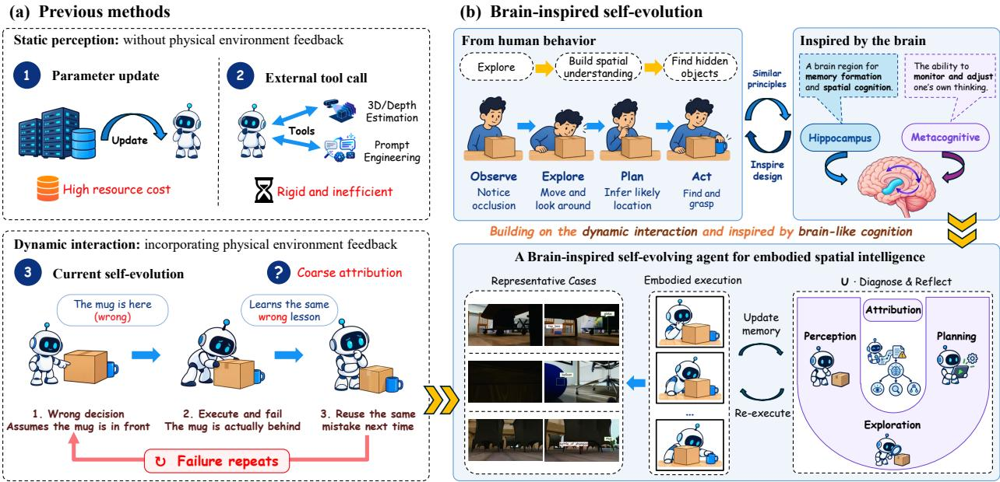
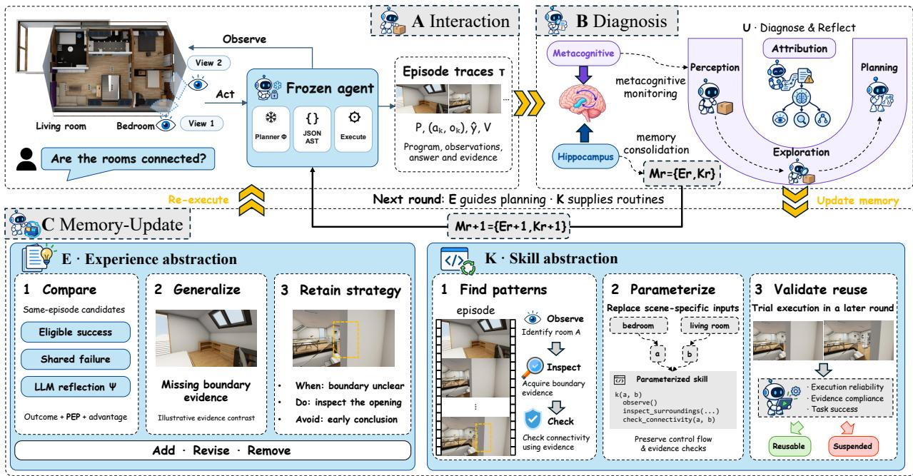
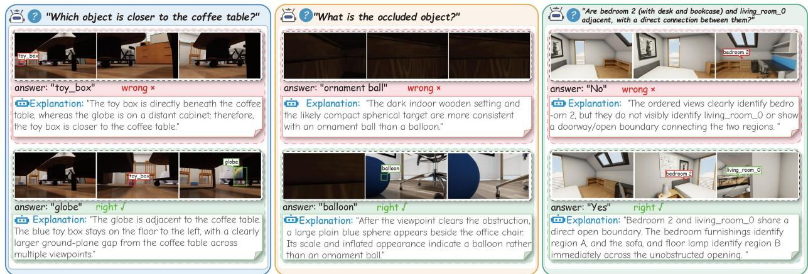
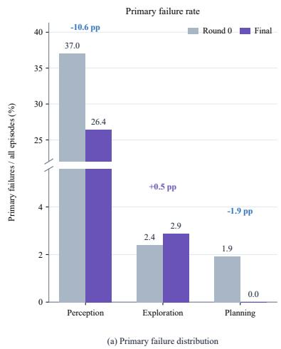
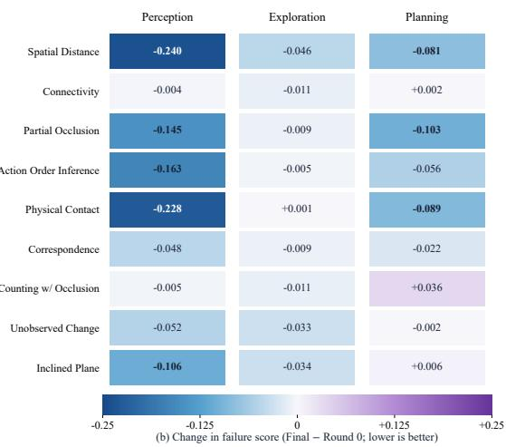
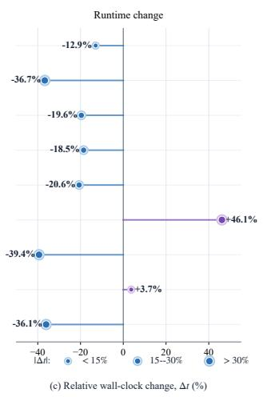
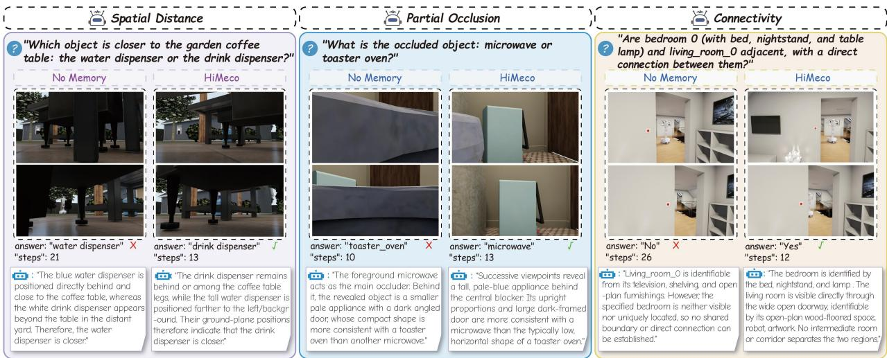
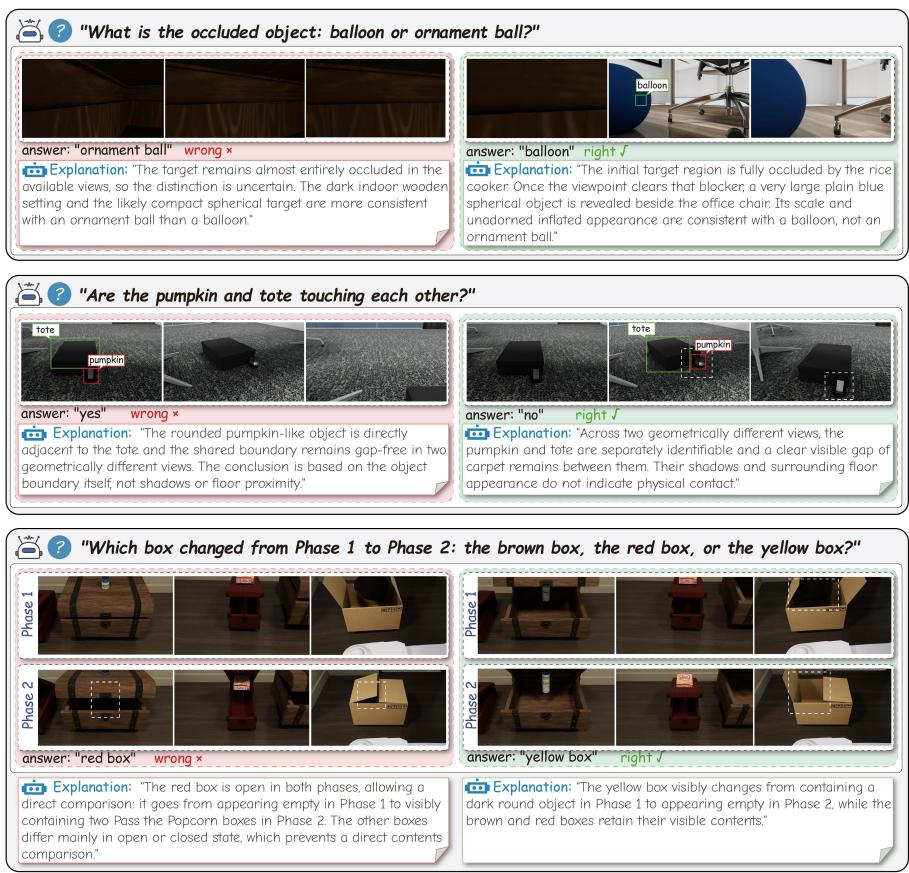

# Reflect After Failure: Brain-Inspired Self-Evolving Agents for Embodied Spatial Intelligence

Xin Li1,\* Xiaohuan Gu2,\* Yifan Wang3 Shaobin Ling4 Tianli Shi1 Jingao Xu5

Zhimeng Yin1 Dapeng Wu1 Yun Wang1,†

1City University of Hong Kong 2East China Normal University

3University of Electronic Science and Technology of China

4The Chinese University of Hong Kong, Shenzhen 5The University of Hong Kong \*Equal contribution. †Corresponding author.

October 2026

## Abstract

Vision-Language Models (VLMs) have made substantial progress in spatial reasoning, and selfevolving agents further extend these capabilities to embodied environments by learning from interactions. However, current self-evolution remains particularly challenging in embodied spatial tasks, complex and multi-step decisions from partial visual evidence making it difficult to determine why an execution fails. The failure may stem from misperception, insufficient exploration, or incorrect planning, yet execution feedback alone rarely reveals which component is responsible. As a result, simply accumulating interaction experience can reinforce ineffective strategies. To address this, we propose HiMeco, a brain-inspired self-evolving agent for embodied spatial intelligence, inspired by metacognitive monitoring and hippocampal memory consolidation. Through Hippocampal-Metacognitive Reflection, HiMeco diagnoses failures in perception-exploration-planning (PEP), then compares execution attempts to derive reusable strategies and guidance for avoiding recurring errors. It also abstracts interaction programs into parameterized skills, using evidence contracts and execution-based validation to determine their retention and reuse. These strategies and skills guide subsequent interactions, with memory updated only between rounds and model parameters kept frozen. HiMeco achieves state-of-the-art performance on ESI-Bench, and it also improves accuracy on EmbSpatial-Bench by 3.94 percentage points without evolution.

## 1 Introduction

Embodied agents operating in complex physical environments require robust spatial intelligence, the ability to not only perceive visible geometry but also reason about hidden structures and topologies [Majumdar et al., 2024, Yang et al., 2025, Gong et al., 2026, Feng et al., 2026]. While Vision-Language Models (VLMs) have demonstrated remarkable zero-shot reasoning capabilities, their spatial understanding remains fundamentally constrained by passive observation [Yang et al., 2025, Gong et al., 2026, Hong et al., 2026]. In real-world scenarios riddled with non-line-of-sight (NLOS) occlusions and unobservable physical dynamics, passive VLMs struggle to perform deep spatial reasoning without actively interacting with the environment to uncover latent topologies [Feng et al., 2026, Majumdar et al., 2024, Hong et al., 2026].

Existing research on enhancing spatial reasoning in VLMs broadly falls into two paradigms based on physical feedback availability: static perception [Cheng et al., 2024, Song et al., 2025, Zhu et al., 2025] and dynamic interaction [Ziliotto et al., 2025, Hong et al., 2026]. The former, whether through offline optimization (e.g., SFT or RL) or static prior injection from expert modules (e.g., 3D/depth estimation and prompt engineering), treats the environment as a passive and fixed observation space. Lacking closedloop interaction, it relies heavily on explicit in-view visual cues, suffering from cognitive blind spots under NLOS occlusions and hidden topologies [Feng et al., 2026, Hong et al., 2026]. In contrast, the dynamic interaction paradigm incorporates physical environment feedback into planning, enabling agents to actively resolve local ambiguities [Ziliotto et al., 2025, Kim et al., 2025]. However, extending self-evolving agent to embodied spatial tasks introduces a critical bottleneck. Prior work on self-evolving agent often focused on tasks where the causes of failure are relatively easy to identify. While in embodied spatial tasks, agents must make complex multi-step decisions based on partial and dynamically acquired visual evidence in continuous 3D environments subject to physical noise. These conditions make failures difficult to diagnose, while feedback across interaction rounds offers limited guidance on how to revise the underlying strategies [Li et al., 2024, Duan et al., 2025, Qi et al., 2026, Ju et al., 2026]. This ambiguity hinders agents from reliably assessing which strategies are effective and identifying productive directions for further adaptation. As a result, agents may reinforce flawed experiences and update strategies in the wrong direction, causing errors to accumulate over successive evolution rounds [Ju et al., 2026].

Remarkably, animals can efficiently distill effective strategies from experience to solve embodied spatial tasks in unfamiliar environments. This adaptive ability of biological brains is supported in part by interactions between the hippocampus and prefrontal metacognitive circuits [Liao and Losonczy, 2024, Jensen et al., 2024, Fleming, 2026]. In contrast, existing embodied spatial intelligence, whether static (e.g., via parameter updates or external tools) or dynamic self-evolving systems, struggle to deliver accurate spa tial reasoning during active exploration [Yang et al., 2025, Feng et al., 2026, Hong et al., 2026]. Because they cannot determine whether failures stem from noisy perception, suboptimal exploration, or improper planning [Li et al., 2024, Ju et al., 2026]. This makes it difficult to translate interaction feedback and accumulated experience into consistent behavioral improvements, leaving errors unresolved across successive interactions [Ju et al., 2026, Zhang et al., 2026b, Tian et al., 2026]. These limitations motivate Hippocampal-Metacognitive Reflection, which couples failure diagnosis with memory consolidation to guide future interactions. Inspired by these neurobiological functions, we hope to achieve a brain-inspired self-evolving agent equipped with multi-turn Hippocampal-Metacognitive reflection for resource-efficient and adaptive embodied spatial intelligence.

Translating this brain-inspired concept into practice presents two challenges. The first is adaptive semantic abstraction: deciding what to retain from repeated interactions and how broadly it should apply [Zhang et al., 2026b, Shu et al., 2026, Xu et al., 2026]. Across interaction and evolution rounds, a parameter-frozen agent must turn individual attempts into reusable strategies and executable skills. Overly specific knowledge transfers poorly, while overly general knowledge loses the detail needed for reliable execution [Wang et al., 2025e, Zhang et al., 2026b]. The second is reliable failure attribution [Li et al., 2024, Ju et al., 2026]. An incorrect answer alone does not reveal whether the agent misinterpreted its observations, explored insuffi ciently, or executed a flawed plan. Without this distinction, the agent may retain unreliable procedures or reinforce ineffective strategies.

To address these challenges, we propose HIMECO, a brain-inspired self-evolving agent for embodied spatial reasoning. It consolidates interaction experience into a strategy bank E and a library of parameterized executable skills K. Evidence contracts and invocation-based validation govern which skills are retained, promoted, or suspended across evolution rounds. A perception-exploration-planning (PEP) diagnostic module U uses execution traces, task outcomes, and privileged simulator metadata to assess failures across these three dimensions after execution. These diagnostics guide candidate comparison and reflection, yielding reusable strategies and negative constraints for subsequent interactions. Model parameters remain frozen, and both memories are updated only between rounds.

HIMECO alternates between online inference and offline evolution. During inference, the frozen VLM generates programs conditioned on retrieved experiences and skills, while evidence contracts check the observations and intermediate outputs used for reasoning. Memory remains fixed throughout each interaction round. At the round boundary, diagnostic feedback guides comparative reflection and experience consoli dation, while execution outcomes support skill abstraction and lifecycle updates. The resulting memories guide subsequent interactions without modifying model parameters. This separation allows the agent to accumulate experience across rounds while evaluating each attempt against a fixed memory snapshot.

  
Figure 1: Motivation of our method. (a) Previous methods risk reinforcing errors through inaccurate failure attribution. (b) Inspired by metacognitive monitoring and hippocampal consolidation, our method diagnoses failures to guide future interactions.

Our contributions are summarized as follows:

• We propose HIMECO, a brain-inspired self-evolving agent for embodied spatial reasoning, which repeats interaction and memory evolution without updating model parameters.

• We develop a Hippocampal-Metacognitive Reflection mechanism that couples PEP diagnostic module with the consolidation of reusable strategies and parameterized skills.

• We comprehensively evaluate on ESI-Bench for active embodied spatial reasoning, HIMECO demonstrating state-of-the-art performance. It also improves accuracy on EmbSpatial-Bench without evolution, showing its effectiveness in passive settings.

## 2 Related Work

Embodied Spatial Intelligence. Benchmarks span static visual reasoning, such as EmbSpatial-Bench [Du et al., 2024], and interactive evaluation, such as ESI-Bench [Hong et al., 2026], which requires acquiring evidence through actions. Existing approaches use task-specific fine-tuning [Song et al., 2025, Wang et al., 2025a], explicit 3D memory [Zeng et al., 2026, Zheng et al., 2025], or interactive exploration [Ziliotto et al., 2025, Hong et al., 2026] to improve spatial understanding. Training-free alternatives organize frozen models within external structure: TANGO composes navigation and perception primitives into task-specific programs without additional training [Ziliotto et al., 2025], NeSy-Spatial abstracts tool interactions into typed and composable spatial skills that self-evolve with use [Tian et al., 2026], and Spatial Memory Agent consolidates verified spatial experience into transferable procedural lessons [Zhang et al., 2026b]. However, effective interaction alone does not ensure that agents can diagnose failures and consolidate experience into reusable strategies and skills [Hong et al., 2026, Ju et al., 2026, Zhang et al., 2026b].

  
Figure 2: Overview of HIMECO. (A) The frozen planner interacts with the environment and collects evidence. (B) The PEP diagnostic module identifies perception, exploration, and planning failures. (C) Strategies E and skills K are updated between rounds and used in later interactions.

Experience-to-Skill Abstraction. Self-evolving agents adapt by storing and reusing interaction experience, often without updating model parameters [Wang et al., 2025e, Liu et al., 2025, Xu et al., 2025, Zhang et al., 2026a]. VOYAGER accumulates an ever-growing library of executable code skills under an automatic curriculum [Wang et al., 2023], and later work evolves increasingly broader portions of the agent system: SHAPER co-evolves reusable skills and a context-code harness around a frozen planner [Wang et al., 2026a], MetaSkill-Evolve makes skill improvement itself recursive by evolving meta-skills on a slower timescale [Wang et al., 2026d], and the Darwin Gödel Machine applies open-ended evolution to an archive of self-modifying agents [Zhang et al., 2026c]. Complementarily, Training-Free GRPO distills group-relative feedback into experiential token priors rather than parameter updates [Youtu-Agent Team, 2025]. These frameworks refine textual guidance or execution programs through reflection, with applications in code generation and web navigation.In embodied environments, this process is complicated by perceptual errors,insufficient exploration, and planning failures, and skill-aware reflectionhas begun to separate flawed skill content from execution lapses[Ju et al., 2026].Without reliable attribution and execution-based validation, agents risk retaining ineffective strategies or unreliable skills.Existing skill-evolution frameworks rarely distinguish these causes before updating memory.

Brain-Inspired Cognitive Evolution. Brain-inspired approaches draw on mechanisms such as metacognitive monitoring and hippocampal memory consolidation to support adaptive behavior [Fleming, 2026, Huang et al., 2024]. Related work explores dual-system reasoning [Shi et al., 2026], cognitive maps [Liao and Losonczy, 2024], episodic memory [Shu et al., 2026, Zheng et al., 2025], and predictive world models [Jensen et al., 2024]. Maintaining an expanding archive of agent versions [Zhang et al., 2026c] or curating procedure memory from verified experience [Zhang et al., 2026b] echoes such complementary memory systems, yet these designs select what to retain mainly by task success rather than by diagnosed failure type. These perspectives motivate linking retrospective evaluation with selective memory updates. Our framework draws on this functional analogy to couple perception, exploration, and planning diagnostics with strategy and skill consolidation.

## 3 Method

## 3.1 Problem Setup

Figure 2 summarizes the interaction, diagnosis, and memory-update process of HIMECO. In round r, a frozen planner generates programs from input x and memory $\mathcal { M } _ { r } = ( \mathcal { E } _ { r } , \mathcal { K } _ { r } )$ , comprising a strategy bank and a skill library. The diagnostic module U evaluates their execution trajectories $\mathcal { T } _ { r }$ to guide the round-end update $\mathscr { M } _ { r + 1 } \gets \mathrm { U p d a t e } ( \mathscr { M } _ { r } , \mathscr { T } _ { r } , \mathscr { U } )$

Each episode has input $x = \left( o _ { 0 } , q \right)$ , where $o _ { 0 }$ contains the initial RGB image and pose, and q is a spatial query. The frozen VLM planner Φ generates $\textstyle P \sim \Phi ( \cdot \mid x , \mathcal { A } , \mathcal { M } _ { r } )$ using observation, navigation, and reasoning primitives A. The program, a JSON abstract syntax tree (AST), calls primitives and branches on new observations; episode-local working memory stores observations, intermediate states, and evidence.

Execution yields $\tau = ( P , \{ ( a _ { k } , o _ { k } ) \} _ { k = 1 } ^ { K } , \hat { y } , V )$ , where $a _ { k } , o _ { k }$ denote the k-th action and resulting observation, K counts actions within budget $T _ { \mathrm { m a x } } , \hat { y }$ is the answer, and $V$ records evidence checks. Given ground truth $y ,$ correctness $r _ { \mathrm { t a s k } }$ , evidence eligibility $\ell ,$ and learning success s are

$$
r _ { \mathrm { t a s k } } ( \tau ) = \mathbb { 1 } [ \hat { y } = y ] , \quad \ell ( \tau ) = \left\{ \begin{array} { l l } { \mathbb { I } [ \mathrm { C o n t r a c t V a l i d } ( \tau , q ) ] , } & { \quad s ( \tau ) = r _ { \mathrm { t a s k } } ( \tau ) \ell ( \tau ) . } \end{array} \right.\tag{1}
$$

Here, 1[·] is the indicator function, equal to one when its condition holds and zero otherwise. ContractValid(τ, q) indicates whether the recorded evidence passes the final contract for query $q . r _ { \mathrm { t a s k } } ( \tau )$ measures answer correctness, $\ell ( \tau )$ indicates evidence eligibility, and $s ( \tau )$ indicates eligibility as a successful memory example.

## 3.2 Metacognitive Diagnosis

After execution, U uses task outcomes, traces, and privileged simulator metadata to produce diagnostic scores:

$$
{ \bf u } ( \tau ) = \left( u _ { \mathrm { p e r } } ( \tau ) , u _ { \mathrm { e x p } } ( \tau ) , u _ { \mathrm { p l a } } ( \tau ) \right) \in [ 0 , 1 ] ^ { 3 } .\tag{2}
$$

The subscripts per, exp, and pla denote perception, exploration, and planning, respectively. Scores reflect failure evidence rather than calibrated probabilities. Labels and privileged metadata are unavailable to the online planner.

PEP diagnosis. An incorrect answer alone cannot distinguish faulty perception, insufficient exploration, and flawed planning, which require different corrective strategies. Perception checks visual-output validity and discrepancies between symbolic results and simulator evidence, accounting for observation coverage. Exploration assesses reference-viewpoint proximity, pose diversity, and missing observations. Planning checks program validity, primitive execution, termination, answer return, and budget compliance; a frozen LLM auditor additionally reviews action selection and control flow.Let $\mathcal { D } = \{ \mathrm { { p e r } , \mathrm { { e x p } , \mathrm { { p l a } } } \} }$ denote the diagnostic dimensions. The primary label is

$$
\begin{array} { r } { f ^ { \ast } ( \tau ) = \left\{ \begin{array} { l l } { \mathrm { n o n e , ~ } } & { \mathrm { i f ~ c o r r e c t ~ w i t h ~ n o ~ p l a n n i n g ~ a n o m a l y , } } \\ { \mathrm { a r g ~ m a x \it _ { d \in \mathcal { D } } ~ \it { u } _ { d } ( \tau ) , } } & { \mathrm { o t h e r w i s e . } } \end{array} \right. } \end{array}\tag{3}
$$

Reflection retains all three scores to account for co-occurring failures.

Candidate comparison. We compare candidates for the same episode under different memory conditions, including an experience-only reference and a trial-skill condition when available. We score each trajectory by

$$
R ( \tau ) = 2 r _ { \mathrm { t a s k } } ( \tau ) - 0 . 7 5 \bar { u } ( \tau ) + 0 . 1 \eta ( \tau ) ,\tag{4}
$$

where $\begin{array} { r } { \bar { u } ( \tau ) \ : = \ : \frac { 1 } { 3 } \sum _ { d \in \mathcal { D } } u _ { d } ( \tau ) } \end{array}$ and $\eta ( \tau ) = 1 - \operatorname* { m i n } ( 1 , n _ { \mathrm { a c t } } ( \tau ) / T _ { \mathrm { m a x } } )$ with $n _ { \mathrm { a c t } } ( \tau )$ denoting the number of executed low-level actions. Correct trajectories score at least 1.25 while incorrect ones score at most 0.1, prioritizing correctness while using diagnostics and efficiency to distinguish candidates with the same correctness outcome. For the candidate group C of a given episode, the relative advantage

$$
\mathrm { A d v } ( \tau ) = R ( \tau ) - { \frac { 1 } { | { \mathcal { C } } | } } \sum _ { \tau ^ { \prime } \in { \mathcal { C } } } R ( \tau ^ { \prime } )\tag{5}
$$

guides comparative reflection alongside diagnostic feedback, without gradient updates. Positive-example admission separately requires $s ( \tau ) = r _ { \mathrm { t a s k } } ( \tau ) \ell ( \tau ) = 1$ , preventing favorable scores from bypassing evidence contracts.

## 3.3 Strategy Experience Bank

Individual trajectories contain instance-specific details that transfer poorly across tasks. The strategy bank ${ \mathcal { E } } _ { r }$ records when a strategy applies, how to acquire evidence, and which failures to avoid. Let $ { \mathcal { C } } _ { r } ( x )$ denote the candidates for episode x in round $^ { r } \cdot$ Their diagnostic information forms $B _ { r } ( x ) = \{ z ( \tau ) : \tau \in \mathcal { C } _ { r } ( x ) \}$ , where $z ( \tau )$ summarizes execution, PEP scores, the primary diagnostic label, relative advantage, evidence eligibility, and learning success. Updates come from three sources. When the eligible-success set ${ \mathcal { C } } _ { r } ^ { + } ( x ) =$ $\{ \tau \in \mathcal { C } _ { r } ( x ) : s ( \tau ) = 1 \}$ is nonempty, we select the candidate with the highest advantage, breaking ties by fewer actions. We abstract its use of primitives into a reusable strategy, excluding answer values and episode-specific coordinates.

Relative advantages provide limited guidance when candidates share the same failure. We therefore flag candidate collapse when $\begin{array} { r } { | \mathcal { C } _ { r } ( x ) | \ge 2 , \quad \sum _ { \tau \in \mathcal { C } _ { r } ( x ) } s ( \tau ) = 0 } \end{array}$ , and all candidates return the same answer. Deterministic rules produce corrective guidance, such as acquiring another viewpoint or adding a visual check, annotated with the primary diagnostic label.

An LLM reflector Ψ compares candidates within each bundle to identify useful strategies and lessons from failures. Its updates, $\Delta \mathcal { E } _ { r } ^ { \mathrm { r e f } } = \Psi \big ( \{ B _ { r } ( x ) \} _ { x } \big )$ , are combined with updates from selected successful candidates $\Delta \mathcal { E } _ { r } ^ { \mathrm { c h a m p } }$ and shared failures $\Delta \mathcal { E } _ { r } ^ { \mathrm { f a i l } }$

$$
\mathcal { E } _ { r + 1 } = \mathrm { A p p l y } \left( \mathcal { E } _ { r } , \Delta \mathcal { E } _ { r } ^ { \mathrm { c h a m p } } , \Delta \mathcal { E } _ { r } ^ { \mathrm { f a i l } } , \Delta \mathcal { E } _ { r } ^ { \mathrm { r e f l } } \right) .\tag{6}
$$

Here, Apply adds, revises, or removes entries at the round boundary under the memory capacity limit. The strategy bank may retain episode-specific entries during adaptation, while final-round strategy retrieval uses only task-level guidance.

## 3.4 Composite Skills

The skill library $\kappa$ stores reusable routines for acquiring evidence. Since recurring patterns may still be unreliable, abstraction is followed by execution-based validation. Skills replace object-specific inputs with parameters, retain control flow and evidence checks, and exclude answer submission. For a program pattern $p ,$ let $\mathcal { X } _ { p }$ contain episodes with occurrences eligible for abstraction, and $\mathcal { X } _ { p } ^ { + } ~ \subseteq ~ \mathcal { X } _ { p }$ those with eligible occurrences in successful trajectories $( s ( \tau ) = 1 )$ . To become a candidate skill, a pattern must satisfy

$$
| { \mathcal X } _ { p } | \ge m , \qquad \frac { | { \mathcal X } _ { p } ^ { + } | } { | { \mathcal X } _ { p } | } \ge \theta _ { \mathrm { s y n } } ,\tag{7}
$$

where $m \geq 1$ is the minimum episode count and $\theta _ { \mathrm { s y n } } \in [ 0 , 1 ]$ the required success rate. Each episode counts once per set. Systematic failures also yield corrective routines, such as entity verification and viewpoint changes.

Candidate skills undergo trial execution before regular reuse; unreliable skills can be suspended. For each skill k, let $N _ { \mathrm { u s e } } , N _ { \mathrm { e x e c } } , N _ { \mathrm { v a l i d } } , N _ { \mathrm { s u c c } }$ count episodes with invocation, valid execution, contract-valid execution, and successful contract-valid execution, respectively. We smooth these rates using $\rho ( a , b ) =$ $( a + \lambda \mu ) / ( b + \lambda )$ to reduce sensitivity to sparse data, where $\mu \in [ 0 , 1 ]$ is the prior mean and $\lambda > 0$ is the prior strength. Skill quality is

$$
\begin{array} { r l r } & { } & { Q ( k ) = w _ { s } \rho ( N _ { \mathrm { s u c c } } , N _ { \mathrm { v a l i d } } ) + w _ { c } \rho ( N _ { \mathrm { v a l i d } } , N _ { \mathrm { e x e c } } ) } \\ & { } & { + w _ { e } \rho ( N _ { \mathrm { e x e c } } , N _ { \mathrm { u s e } } ) + w _ { a } \tilde { \eta } ( k ) , } \end{array}\tag{8}
$$

where the nonnegative weights sum to one and $\widetilde { \eta } ( k )$ is the prior-smoothed median action efficiency over successful contract-valid invocations. Validation checks execution reliability, evidence compliance, and task success to determine reuse eligibility; retrieval prioritizes lifecycle status, empirical success, and episode support.

## 3.5 Interaction and Evolution Protocol

Each round uses a fixed memory snapshot. For each episode, candidates are evaluated under an experienceonly condition and, when available, a trial-skill condition. After all candidates finish, PEP diagnostics guide strategy updates, while execution outcomes update skill support and reuse eligibility. The updates take effect in the next round, allowing experience from one episode to guide other episodes in the same subtask. After R rounds, the memory is frozen, and only validated skills are reused.

## 4 Experiments

## 4.1 Experimental Setup

Datasets. We evaluate active and passive embodied spatial reasoning on ESI-Bench [Hong et al., 2026] and EmbSpatial-Bench [Du et al., 2024], respectively. ESI-Bench, built on OmniGibson, assesses spatial reasoning through interaction with the environment. We evaluate repeated-episode adaptation on 208 fixed episodes spanning nine tasks, with identical episodes and initial scenes across our settings. Cross-episode transfer is examined separately through disjoint source-target examples. For EmbSpatial-Bench, we randomly sample 300 questions per spatial relation category, totaling 1,800 questions across six categories. Its fixed visual inputs lack the interaction feedback required for PEP failure attribution. We therefore evaluate HIMECO without evolution against API inference using the same backbone and inputs. Sampling details are provided in the appendix.

Models. We use GPT-5.6-Terra and Gemini-3-Flash with frozen parameters and shared task inputs, tool interfaces, and scoring criteria. On ESI-Bench, we also evaluate a Passive Single-View baseline using only the initial image. Experiments run on a server with eight NVIDIA RTX A6000 GPUs, accessing VLMs through APIs. We retain execution traces for analysis and provide prompts, tool configurations, and hyperparameters in the appendix.

Table 1: Accuracy (%) on ESI-Bench.
<table><tr><td colspan="2">Backbone / Method</td><td>Metric Comparison</td><td>Cognitive Mapping</td><td>Perceptual Grounding</td><td>Action Sequencing</td><td>Spatial Relations</td><td>Specular Reflection</td><td>Enumerative Perception</td><td>Temporal Understanding</td><td>Physical Dynamics</td><td>Avg.</td></tr><tr><td colspan="2">Our evaluation</td><td></td><td></td><td></td><td></td><td></td><td></td><td></td><td></td><td></td><td></td></tr><tr><td colspan="2">Selected subtask</td><td>Spatial Distance</td><td>Connectivity Occlusion</td><td>Partial</td><td>Action Order Inference</td><td>Physical Contact</td><td>Correspondence</td><td>Counting w/ Occlusion</td><td>Unobserved Change</td><td>Inclined Plane</td><td></td></tr><tr><td colspan="2">n</td><td>20</td><td>27</td><td>20</td><td>20</td><td>25</td><td>20</td><td>20</td><td>29</td><td>27</td><td></td></tr><tr><td></td><td>Passive</td><td>45.0</td><td>59.3</td><td>45.0</td><td>35.0</td><td>68.0</td><td>65.0</td><td>10.0</td><td>34.5</td><td>37.0</td><td>44.31</td></tr><tr><td>GPT-5.6</td><td>Active</td><td>60.0</td><td>70.4</td><td>50.0</td><td>40.0</td><td>64.0</td><td>75.0</td><td>10.0</td><td>75.9</td><td>66.7</td><td>56.89</td></tr><tr><td></td><td>HIMECO</td><td>85.0</td><td>74.1</td><td>65.0</td><td>55.0</td><td>88.0</td><td>80.0</td><td>15.0</td><td>82.8</td><td>77.8</td><td>69.19</td></tr><tr><td></td><td>Passive</td><td>70.0</td><td>59.3</td><td>35.0</td><td>5.0</td><td>68.0</td><td>20.0</td><td>5.0</td><td>41.4</td><td>51.9</td><td>39.51</td></tr><tr><td>Gemini-3-Flash Active</td><td></td><td>75.0</td><td>66.7</td><td>65.0</td><td>25.0</td><td>76.0</td><td>30.0</td><td>5.0</td><td>75.9</td><td>74.1</td><td>54.74</td></tr><tr><td></td><td>HIMECO</td><td>90.0</td><td>77.8</td><td>65.0</td><td>35.0</td><td>84.0</td><td>40.0</td><td>10.0</td><td>79.3</td><td>81.5</td><td>62.51</td></tr><tr><td></td><td>Passive</td><td>53.9</td><td>68.3</td><td>32.6</td><td>36.4</td><td>40.0</td><td>39.8</td><td>3.3</td><td>40.5</td><td>57.4</td><td>41.36</td></tr><tr><td>GPT-5*</td><td>Active</td><td>58.6</td><td>68.3</td><td>47.4</td><td>41.6</td><td>64.2</td><td>52.3</td><td>13.3</td><td>51.4</td><td>77.0</td><td>52.68</td></tr><tr><td></td><td>Passive</td><td>52.6</td><td>51.7</td><td>30.5</td><td>44.2</td><td>60.8</td><td>37.5</td><td>3.3</td><td>37.2</td><td>65.6</td><td>42.60</td></tr><tr><td>Gemini-3.1*</td><td>Active</td><td>59.9</td><td>60.0</td><td>70.5</td><td>54.5</td><td>70.0</td><td>42.0</td><td>10.0</td><td>47.3</td><td>83.6</td><td>55.31</td></tr><tr><td>ParallelWorld†</td><td></td><td>67.11</td><td>60.00</td><td>77.89</td><td>61.04</td><td>71.43</td><td>48.86</td><td>30.00</td><td>89.86</td><td>85.25</td><td>65.72</td></tr><tr><td></td><td></td><td></td><td></td><td></td><td></td><td></td><td></td><td></td><td></td><td></td><td></td></tr><tr><td>n SHAPER‡</td><td></td><td>21 47.6</td><td>17 23.5</td><td>49 69.4</td><td>5 20.0</td><td>51 54.9</td><td>20 60.0</td><td>18 27.8</td><td>19 47.4</td><td>10 40.0</td><td>42.9</td></tr></table>

Evaluation Metrics. We report answer accuracy (%), averaged equally across the nine ESI-Bench tasks and across all questions on EmbSpatial-Bench. On ESI-Bench, we additionally report mean perepisode wall-clock time, including diagnosis but excluding between-round reflection and memory updates. Diagnostic analysis uses mean perception, exploration, and planning failure scores in [0, 1] (lower is better) and primary failure-label counts normalized by all evaluated episodes. We report absolute score changes and relative runtime changes from Round-0 to the final round, alongside action counts in cross-episode generalization examples.

## 4.2 Results

Results on ESI-Bench. Table 1 compares HIMECO with existing methods reporting ESI-Bench results, covering VLM baselines, interactive agents like ParallelWorld [Chen et al., 2026], and self-evolving agents such as SHAPER [Wang et al., 2026a]. HIMECO achieves state-of-the-art average accuracy of 69.19% on the evaluated ESI-Bench tasks. Relative to the corresponding active baselines, accuracy improves from 56.89% to 69.19% with GPT-5.6 and from 54.74% to 62.51% with Gemini-3-Flash, yielding gains of 12.30 and 7.77 percentage points without task-level degradation. The largest gains occur on Spatial Distance (+25.0 points) and Physical Contact (+24.0) with GPT-5.6, and Spatial Distance (+15.0) and Connectivity (+11.1) with Gemini-3-Flash. These improvements demonstrate the effectiveness of diagnosis-guided evolution for active embodied spatial reasoning, although Counting w/ Occlusion remains challenging.

Qualitative Analysis. Figure 3 presents three representative cases. In Spatial Distance, the agent without memory selects the toy box from incomplete cross-view evidence, while HIMECO tracks both objects across viewpoints and correctly selects the globe. In Partial Occlusion, it changes the viewpoint to reveal the hidden object, correcting ornament ball to balloon. In Connectivity, it explores the room boundary and finds the direct opening between bedroom-2 and living room-0, correcting No to Yes. These examples show that diagnosis-guided memory helps resolve spatial ambiguity, occlusion, and incomplete exploration.

  
Figure 3: Qualitative examples of embodied spatial reasoning. Incorrect and correct predictions are shown with their observations and explanations.

Table 2: Component ablations. The diagnostic ablation replaces structured PEP-guided reflection with generic reflection while retaining general execution reflection and program-change suggestions.
<table><tr><td></td><td></td><td></td><td></td><td></td><td>ε K U Evol. Spatial Distance Action Order Inference Physical Contact Inclined Plane</td><td></td><td></td></tr><tr><td></td><td></td><td></td><td></td><td>60</td><td>40</td><td>64</td><td>66.7</td></tr><tr><td>√</td><td></td><td>√</td><td>√</td><td>65</td><td>55</td><td>80</td><td>74.1</td></tr><tr><td></td><td></td><td>√ √</td><td>√</td><td>70</td><td>45</td><td>76</td><td>70.4</td></tr><tr><td>√</td><td>√</td><td></td><td>√</td><td>65</td><td>45</td><td>80</td><td>74.1</td></tr><tr><td>√</td><td>√</td><td>√</td><td>√</td><td>85</td><td>55</td><td>88</td><td>77.8</td></tr></table>

Failure Diagnosis and Efficiency. Figure 4 shows that HIMECO improves accuracy while reducing diagnostic failure scores and execution time. From Round-0 to the final round, perception scores decrease across all nine tasks, with the largest reductions on Spatial Distance (−0.240) and Physical Contact (−0.228), accompanying accuracy gains of 25 and 24 percentage points. Exploration scores decrease on eight tasks, while planning scores decrease on six. Across all evaluation episodes, perception-primary failures fall from 37.0% to 26.4%, and planning-primary failures fall from 1.9% to zero. The latter indicates a change in dominant failure attribution, rather than the absence of all planning anomalies. These improvements generally require less execution time. Mean wall-clock time decreases on seven of nine tasks by 12.9–39.4%, with a 14.9% reduction when averaged equally across tasks. Correspondence and Unobserved Change instead take 46.1% and 3.7% longer, respectively. Overall, the results support the value of consolidated strategies and skills in improving execution reliability and efficiency.

Cross-Episode Generalization. The main results evaluate adaptation on repeated episodes. To examine transfer, each case here applies a single learned experience to an unseen episode within the same subtask. Source and target episodes are disjoint, and memory remains frozen during evaluation. Figure 5 shows HIMECO succeeding where the memory-free agent fails. Comparing ground-plane positions across views in Spatial Distance, revealing an occluded microwave in Partial Occlusion, and verifying a direct doorway connection in Connectivity. Action counts change from 21 to 13, 10 to 13, and 26 to 12, respectively, illustrating both more efficient exploration and additional evidence gathering when needed. These cases provide qualitative evidence that individual learned experiences can support evidence acquisition and spatial reasoning on unseen episodes.

  
Figure 4: Failure diagnosis and execution efficiency on ESI-Bench. Round-0 versus the final evolution round: (a) Primary failure counts normalized by all evaluation episodes. (b) Changes in mean diagnostic scores. (c) Relative changes in mean wall-clock time per episode. Negative values in (b) and (c) indicate reductions.

Table 3: Accuracy (%) on EmbSpatial-Bench.
<table><tr><td>Relation</td><td>HiMeco Gemini-3-Flash w/o Evolution</td></tr><tr><td>Left</td><td>92.33</td></tr><tr><td>Right</td><td>84.67 82.67</td></tr><tr><td>Above</td><td>88.00</td></tr><tr><td>Under</td><td>85.00</td></tr><tr><td>Far</td><td>65.00</td></tr><tr><td>Close</td><td>64.33</td></tr><tr><td>Overall 75.61</td><td>79.56</td></tr></table>

Ablation Study. Table 2 shows that full HIMECO achieves the best or tied-best accuracy across all four tasks. Removing the strategy bank E decreases accuracy by 7.4–15.0 percentage points, while removing the skill library K reduces accuracy on three tasks, with the largest drop on Spatial Distance (20.0 points). Replacing structured PEP-guided reflection with generic reflection reduces accuracy by 3.7–20.0 percentage points across the four tasks. The generic reflector uses execution outcomes to propose general lessons and program changes, without explicit perception, exploration, or planning labels or scores as reflection inputs.

Results on EmbSpatial-Bench. We further evaluate HIMECO on passive embodied spatial reasoning, where fixed observations preclude active evidence acquisition and the interaction feedback needed for full PEP failure attribution is unavailable. Without evolution, HIMECO improves accuracy from 75.61% to 79.56% over direct Gemini-3-Flash API inference, a gain of 3.94 percentage points (Table 3). Gains are largest on Above (+12.67 points), Under (+11.33), and Far (+7.67), while Left, Right, and Close decrease by 2.0–3.0 points. These results show that the static reasoning configuration remains effective when diagnosisguided evolution is unavailable.

  
Figure 5: Cross-episode generalization.

## 5 Conclusion

This paper presented HIMECO, a brain-inspired self-evolving agent for embodied spatial intelligence. Its Reflection mechanism couples PEP failure diagnosis module with the consolidation of reusable strategies and executable skills. Evidence contracts and execution-based validation govern skill retention and reuse, enabling adaptation without updating model parameters. HIMECO achieves SOTA performance on ESI-Bench and improves accuracy on EmbSpatial-Bench by 3.94 percentage points without evolution.

## AI Use Statement

In this paper, we used generative AI tools to polish the manuscript’s language refinement, grammar checking, little coding editing, and improve style figures. All AI-assisted text was reviewed by the authors.

## Reproducibility Statement

The main text describes our framework and evolution procedure. The appendix provides detailed method specifications, dataset preprocessing and sampling procedures, prompts, tool configurations, and hyperparameters. We will publicly release the implementation and evaluation code to support reproduction of all proposed components and experiments.

## Author Contributions

The author team jointly contributed to the conceptualization, development, and evaluation of this work. Contributions included methodology development, experimental design and execution, analysis of results, preparation of methodological illustrations and experimental figures, manuscript drafting and revision, reference curation, and manuscript consistency checks. The team also contributed research supervision, scientific advice, project management, and overall coordination. Equal-contribution designations and correspondingauthor information are indicated in the author list above.

## References

Min Chen, Shengjun Zhang, Yuxin Li, Zhang Zhang, Xin Fei, Chong Xia, and Yueqi Duan. Parallelworld: Test-time scaling for embodied reasoning. arXiv preprint arXiv:2608.22971, 2026.

An-Chieh Cheng, Hongxu Yin, Yang Fu, Qiushan Guo, Ruihan Yang, Jan Kautz, Xiaolong Wang, and Sifei Liu. SpatialRGPT: Grounded spatial reasoning in vision-language models. In Advances in Neural Information Processing Systems, volume 37, 2024.

Mengfei Du, Binhao Wu, Zejun Li, Xuanjing Huang, and Zhongyu Wei. EmbSpatial-Bench: Benchmarking spatial understanding for embodied tasks with large vision-language models. In Proceedings ofthe 62nd Annual Meeting of the Association for Computational Linguistics (Volume 2: Short Papers), pages 346– 355, 2024.

Jiafei Duan, Wilbert Pumacay, Nishanth Kumar, Yi Ru Wang, Shulin Tian, Wentao Yuan, Ranjay Krishna, Dieter Fox, Ajay Mandlekar, and Yijie Guo. AHA: A vision-language-model for detecting and reasoning over failures in robotic manipulation. In International Conference on Learning Representations, 2025.

Zhiyuan Feng, Zhaolu Kang, Qijie Wang, Zhiying Du, Jiongrui Yan, Shubin Shi, Chengbo Yuan, Huizhi Liang, Yu Deng, Qixiu Li, Rushuai Yang, Ruichuan An, Leqi Zheng, Weijie Wang, Shuang Chen, Sicheng Xu, Yaobo Liang, Jiaolong Yang, and Baining Guo. Seeing across views: Benchmarking spatial reasoning of vision-language models in robotic scenes. In International Conference on Learning Representations, 2026.

Stephen M. Fleming. Towards an integrative neuroscience of metacognition. Nature Reviews Neuroscience, 2026.

Ziyang Gong, Wenhao Li, Xianzheng Ma, Songyuan Li, Zhaokai Wang, Songze Li, Jiayi Ji, Xue Yang, Gen Luo, Junchi Yan, and Rongrong Ji. SpaCE-10: A comprehensive benchmark for multimodal large language models in compositional spatial intelligence. In International Conference on Learning Representations, 2026.

Yining Hong, Jiageng Liu, Han Yin, Manling Li, Leonidas Guibas, Li Fei-Fei, Jiajun Wu, and Yejin Choi. ESI-BENCH: Towards embodied spatial intelligence that closes the perception-action loop. arXiv preprint arXiv:2605.18746, 2026.

Qi Huang, Zhibing Xiao, Qianqian Yu, Yuejia Luo, Jiahua Xu, Yukun Qu, Raymond J. Dolan, Timothy E. J. Behrens, and Yunzhe Liu. Replay-triggered brain-wide activation in humans. Nature Communications, 15:7185, 2024.

Kristopher T. Jensen, Guillaume Hennequin, and Marcelo G. Mattar. A recurrent network model of planning explains hippocampal replay and human behavior. Nature Neuroscience, 27(7):1340–1348, 2024.

Ruofei Ju, Xinrui Wang, Xin Ding, Yifan Yang, Hao Wu, Shiqi Jiang, Qianxi Zhang, Hao Wen, Xiangyu Li, Weijun Wang, Kun Li, Yunxin Liu, Haipeng Dai, Wei Wang, and Ting Cao. EmbodiSkill: Skill-aware reflection for self-evolving embodied agents. arXiv preprint arXiv:2605.10332, 2026.

Taewoong Kim, Byeonghwi Kim, and Jonghyun Choi. Multi-modal grounded planning and efficient replanning for learning embodied agents with a few examples. In Proceedings of the AAAI Conference on Artificial Intelligence, volume 39, pages 4329–4337, 2025.

Manling Li, Shiyu Zhao, Qineng Wang, Kangrui Wang, Yu Zhou, Sanjana Srivastava, Cem Gokmen, Tony Lee, Li Erran Li, Ruohan Zhang, Weiyu Liu, Percy Liang, Li Fei-Fei, Jiayuan Mao, and Jiajun Wu. Embodied agent interface: Benchmarking LLMs for embodied decision making. In Advances in Neural Information Processing Systems, volume 37, 2024.

Zhenrui Liao and Attila Losonczy. Learning, fast and slow: Single- and many-shot learning in the hippocampus. Annual Review of Neuroscience, 47:187–209, 2024.

Yitao Liu, Chenglei Si, Karthik R. Narasimhan, and Shunyu Yao. Contextual experience replay for self improvement of language agents. In Proceedings of the 63rd Annual Meeting of the Association for Computational Linguistics (Volume 1: Long Papers), pages 14179–14198. Association for Computational Linguistics, 2025.

Arjun Majumdar, Anurag Ajay, Xiaohan Zhang, Pranav Putta, Sriram Yenamandra, Mikael Henaff, Sneha Silwal, Paul Mcvay, Oleksandr Maksymets, Sergio Arnaud, Karmesh Yadav, Qiyang Li, Ben Newman, Mohit Sharma, Vincent Berges, Shiqi Zhang, Pulkit Agrawal, Yonatan Bisk, Dhruv Batra, Mrinal Kalakrishnan, Franziska Meier, Chris Paxton, Alexander Sax, and Aravind Rajeswaran. OpenEQA: Embodied question answering in the era of foundation models. In Proceedings of the IEEE/CVF Conference on Computer Vision and Pattern Recognition, pages 16488–16498, 2024.

Carl Qi, Xiaojie Wang, Silong Yong, Stephen Sheng, Huitan Mao, Sriram Srinivasan, Mani Nambi, Amy Zhang, and Yesh Dattatreya. Self-refining vision language model for robotic failure detection and reasoning. In International Conference on Learning Representations, 2026.

Hao Shi, Bin Xie, Yingfei Liu, Lin Sun, Fengrong Liu, Tiancai Wang, Erjin Zhou, Haoqiang Fan, Xiangyu Zhang, and Gao Huang. MemoryVLA: Perceptual-cognitive memory in vision-language-action models for robotic manipulation. In International Conference on Learning Representations, 2026.

Yiheng Shu, Padmaja Jonnalagedda, Xiang Gao, Bernal Jimenez Gutierrez, Weijian Qi, Kamalika Das, Huan Sun, and Yu Su. REMem: Reasoning with episodic memory in language agent. In International Conference on Learning Representations, 2026.

Chan Hee Song, Valts Blukis, Jonathan Tremblay, Stephen Tyree, Yu Su, and Stan Birchfield. RoboSpatial: Teaching spatial understanding to 2D and 3D vision-language models for robotics. In Proceedings of the IEEE/CVF Conference on Computer Vision and Pattern Recognition, 2025.

Shi-Yu Tian, Zhuo-Xia Wang, Xuan-Yi Zhu, Zhi Zhou, Xinwei Yang, Kun-Yang Yu, Ming Yang, Yang Chen, and Yu-Feng Li. Self-evolving neuro-symbolic skills for tool-augmented spatial reasoning. arXiv preprint arXiv:2608.07955, 2026.

Guanzhi Wang, Yuqi Xie, Yunfan Jiang, Ajay Mandlekar, Chaowei Xiao, Yuke Zhu, Linxi Fan, and Anima Anandkumar. VOYAGER: An open-ended embodied agent with large language models. arXiv preprint arXiv:2305.16291, 2023.

Peidong Wang, Zhiming Ma, Ying Chang, Xufang Luo, Xiaocui Yang, Shi Feng, Yuqing Yang, and Dongsheng Li. Self-evolving embodied agents via skill-harness evolution. arXiv preprint arXiv:2608.11350, 2026a.

Weizhen Wang, Chenda Duan, Zhenghao Peng, Yuxin Liu, and Bolei Zhou. Embodied scene understanding for vision language models via MetaVQA. In Proceedings of the IEEE/CVF Conference on Computer Vision and Pattern Recognition, 2025a.

Yun Wang, Longguang Wang, Hanyun Wang, and Yulan Guo. SPNet: Learning stereo matching with slanted plane aggregation. IEEE Robotics and Automation Letters, 7(3):6258–6265, 2022. doi: 10.1109/LRA. 2022.3164755.

Yun Wang, Longguang Wang, Kunhong Li, Yongjian Zhang, Dapeng Oliver Wu, and Yulan Guo. Cost volume aggregation in stereo matching revisited: A disparity classification perspective. IEEE Transactions on Image Processing, 33:6425–6438, 2024. doi: 10.1109/TIP.2024.3484251.

Yun Wang, Kunhong Li, Longguang Wang, Junjie Hu, Dapeng Oliver Wu, and Yulan Guo. ADStereo: Efficient stereo matching with adaptive downsampling and disparity alignment. IEEE Transactions on Image Processing, 34:1204–1218, 2025b. doi: 10.1109/TIP.2025.3540282.

Yun Wang, Longguang Wang, Chenghao Zhang, Yongjian Zhang, Zhanjie Zhang, Ao Ma, Chenyou Fan, Tin Lun Lam, and Junjie Hu. Learning robust stereo matching in the wild with selective mixture-ofexperts. In Proceedings of the IEEE/CVF International Conference on Computer Vision, pages 21276– 21287, 2025c. doi: 10.1109/ICCV51701.2025.01976.

Yun Wang, Jiahao Zheng, Chenghao Zhang, Zhanjie Zhang, Kunhong Li, Yongjian Zhang, and Junjie Hu. DualNet: Robust self-supervised stereo matching with pseudo-label supervision. In Proceedings of the AAAI Conference on Artificial Intelligence, volume 39, pages 8178–8186, 2025d. doi: 10.1609/aaai. v39i8.32882.

Yun Wang, Junbin Xiao, Han Lyu, Yifan Wang, Jing Zuo, Zhanjie Zhang, Hong Huang, Dapeng Wu, and Angela Yao. Keep It in Mind: User centric continual spatial intelligence reasoning in egocentric video streams. In Proceedings of the 43rd International Conference on Machine Learning, volume 306 of Proceedings of Machine Learning Research, pages 131373–131417. PMLR, 2026b. URL https:// proceedings.mlr.press/v306/wang26je.html.

Yun Wang, Zhengjie Yang, Jiahao Zheng, Zhanjie Zhang, Dapeng Oliver Wu, and Yulan Guo. SMFormer: Empowering self-supervised stereo matching via foundation models and data augmentation. IEEE Transactions on Image Processing, 35:4494–4508, 2026c. doi: 10.1109/TIP.2026.3684415.

Zefeng Wang, Minxi Yan, Jinhe Bi, Sikuan Yan, Volker Tresp, and Yunpu Ma. MetaSkill-Evolve: Recursive self-improvement of LLM agents via two-timescale meta-skill evolution. arXiv preprint arXiv:2607.05297, 2026d.

Zora Zhiruo Wang, Jiayuan Mao, Daniel Fried, and Graham Neubig. Agent workflow memory. In Proceedings ofthe 42nd International Conference on Machine Learning, volume 267 of Proceedings ofMachine Learning Research, pages 63897–63911. PMLR, 2025e.

Derong Xu, Yi Wen, Pengyue Jia, Yingyi Zhang, Wenlin Zhang, Yichao Wang, Huifeng Guo, Ruiming Tang, Xiangyu Zhao, Enhong Chen, and Tong Xu. From single to multi-granularity: Toward long-term memory association and selection of conversational agents. In International Conference on Learning Representations, 2026.

Wujiang Xu, Zujie Liang, Kai Mei, Hang Gao, Juntao Tan, and Yongfeng Zhang. A-Mem: Agentic memory for LLM agents. In Advances in Neural Information Processing Systems, volume 38, 2025.

Jihan Yang, Shusheng Yang, Anjali W. Gupta, Rilyn Han, Li Fei-Fei, and Saining Xie. Thinking in space: How multimodal large language models see, remember, and recall spaces. In Proceedings of the IEEE/CVF Conference on Computer Vision and Pattern Recognition, 2025.

Youtu-Agent Team. Training-free group relative policy optimization. arXiv preprint arXiv:2510.08191, 2025.

Shuang Zeng, Dekang Qi, Xinyuan Chang, Feng Xiong, Shichao Xie, Xiaolong Wu, Shiyi Liang, Mu Xu, and Xing Wei. JanusVLN: Decoupling semantics and spatiality with dual implicit memory for visionlanguage navigation. In International Conference on Learning Representations, 2026.

Guibin Zhang, Muxin Fu, and Shuicheng Yan. MemGen: Weaving generative latent memory for selfevolving agents. In International Conference on Learning Representations, 2026a.

Haokai Zhang, Yuhang Ding, Yunshu Zhou, Xinze Du, Shengtao Zhang, Zhiyue Zhao, Yuling Xi, and Hao Chen. Spatial memory agent: Experience-grounded procedure memory for spatial intelligence. arXiv preprint arXiv:2608.12743, 2026b.

Jenny Zhang, Shengran Hu, Cong Lu, Robert Lange, and Jeff Clune. Darwin Gödel machine: Open-ended evolution of self-improving agents. In International Conference on Learning Representations (ICLR), 2026c.

Yongjian Zhang, Longguang Wang, Kunhong Li, Yun Wang, and Yulan Guo. Learning representations from foundation models for domain generalized stereo matching. In European Conference on Computer Vision, 2024. doi: 10.1007/978-3-031-72946-1\_9.

Qi Zheng, Daqing Liu, Chaoyue Wang, Jing Zhang, Dadong Wang, and Dacheng Tao. ESceme: Visionand-language navigation with episodic scene memory. International Journal of Computer Vision, 133: 254–274, 2025. doi: 10.1007/s11263-024-02159-8.

Chenming Zhu, Tai Wang, Wenwei Zhang, Jiangmiao Pang, and Xihui Liu. LLaVA-3D: A simple yet effective pathway to empowering LMMs with 3D capabilities. In Proceedings of the IEEE/CVF International Conference on Computer Vision, 2025.

Filippo Ziliotto, Tommaso Campari, Luciano Serafini, and Lamberto Ballan. TANGO: Training-free embodied AI agents for open-world tasks. In Proceedings ofthe IEEE/CVF Conference on Computer Vision and Pattern Recognition (CVPR), 2025.

## Appendix contents

This appendix supplements the main-text experiments with evaluation protocols, evidence checks, PEP   
diagnosis, memory updates, and prompts.   
A Additional qualitative examples . . . 16   
B Algorithm overview (E, K, and U) . . . 17   
C Evaluation protocol and candidate comparison . 19   
D Datasets, sampling, and episode lists . . . 20   
E Program execution and evidence checks . 22   
F Perception, exploration, and planning diagnosis . . 23   
G Strategy and skill updates . . . 25   
I Implementation settings . 27   
J Prompt templates . . 30

## A Additional Qualitative Examples

Figure 6 provides additional examples with observations, predictions, and explanations. The examples show how observations support the returned answers.

  
Figure 6: Additional qualitative examples of embodied spatial reasoning. Incorrect and correct predictions are presented with their observations and explanations.

## B Algorithm Overview

Algorithm 1 gives the four-round schedule. Algorithms 2 and 3 update the strategy bank E and skill library K. Section F defines diagnosis U, which runs once per completed trajectory.

We use the main-text notation $\mathcal { M } _ { r } = ( \mathcal { E } _ { r } , \mathcal { K } _ { r } ) , \mathcal { C } _ { r } ( x )$ for candidate trajectories, $\mathcal { T } _ { r }$ for their union, and $B _ { r } ( x )$ for a diagnostic bundle. For the reported schedule, $r = t + 1$ , where $t = 0 , 1 , 2 , 3$ is the displayed execution round. Thus, $\mathcal { M } _ { 1 }$ is empty and $\mathcal { M } _ { 4 }$ is frozen for Round 3. Here $c _ { r }$ is the candidate count. In the reported evaluation, the planner generates each candidate from the round’s memory snapshot.

Algorithm 1 Four-round execution and memory updates   
Require: Episodes D; frozen planner Φ and reflector Ψ; diagnosis U; task budgets $T _ { \mathrm { m a x } } ( q )$   
Ensure: Round-0 and Round-3 results; frozen memory $\mathcal { M } _ { 4 }$   
1: $\mathcal { M } _ { 1 }  ( \emptyset , \emptyset )$   
2: for $r = 1 , 2 , 3 ,$ 4 do   
3: Fix $\mathcal { M } _ { r }$ for this round; $\mathcal { T } _ { r } \gets \emptyset$   
4: $c _ { r } \gets 1 \operatorname { i f } r \in \{ 1 , 4 \}$ , otherwise 3   
5: for episode $x = ( o _ { 0 } , q ) \in \mathcal { D }$ do   
6: $\mathcal { C } _ { r } ( x )  \emptyset$   
7: for $i = 0 , \ldots , c _ { r } - 1$ do   
8: Select candidate memory and eligible skills (Section C.3)   
9: Generate and validate $P$ using Φ and the selected memory   
10: Reset $x ;$ execute P within $T _ { \mathrm { m a x } } ( q )$ to obtain τ   
11: Evaluate $r _ { \mathrm { t a s k } } ( \tau ) , \ell ( \tau ) .$ , and $s ( \tau )$ (Section E.2)   
12: Compute diagnostic scores and $f ^ { * } ( \tau )$ with U (Section F)   
13: $\mathcal { C } _ { r } ( x )  \mathcal { C } _ { r } ( x ) \cup \{ \tau \}$   
14: end for   
15: Compute $R ( \tau )$ and $\mathrm { A d v } ( \tau )$ within $ { \mathcal { C } } _ { r } ( x )$ (Section F.4)   
16: Form $B _ { r } ( x ) ; T _ { r } \gets T _ { r } \cup \mathcal { C } _ { r } ( x )$   
17: end for   
18: if the round is incomplete then   
19: Stop without advancing the memory checkpoint   
20: end if   
21: if $r < 4$ then   
22: Update ${ \mathcal { E } } _ { r }$ using Algorithm 2   
23: Update ${ \boldsymbol { \kappa } } _ { r }$ using Algorithm 3   
24: Save $\mathcal { M } _ { r + 1 }  ( \mathcal { E } _ { r + 1 } , \mathcal { K } _ { r + 1 } )$   
25: end if   
26: end for

## B.1 Strategy-bank update (E)

This update combines a successful candidate’s procedure, a correction for shared failures, and the reflector’s suggestions. It uses the diagnostic bundles already collected in the round; it does not rerun diagnosis.

Algorithm 2 Strategy-bank update (E)   
Require: $\mathcal { E } _ { r } ;$ candidate groups $ { \mathcal { C } } _ { r } ( x )$ and bundles $\boldsymbol { B } _ { r } ( \boldsymbol { x } )$ ; frozen reflector Ψ   
1: $\Delta \mathcal { E } _ { r } ^ { \mathrm { c h a m p } } \gets \emptyset ; \Delta \mathcal { E } _ { r } ^ { \mathrm { f a i l } } \gets \emptyset$   
2: for each episode x do   
3: ${ \mathcal { C } } _ { r } ^ { + } ( x ) \gets \{ \tau \in { \mathcal { C } } _ { r } ( x ) : s ( \tau ) = 1 \}$   
4: if ${ \mathrm { \Sigma } } ^ { \cdot } { \mathcal { C } } _ { r } ^ { + } ( x )$ ̸= ∅ then   
5: Select the highest-advantage success; break ties by fewer actions   
6: Add its evidence-acquisition strategy to $\Delta \mathcal { E } _ { r } ^ { \mathrm { c h a m p } }$   
7: else if $| { \mathcal { C } } _ { r } ( x ) | \geq 2$ and all candidates return the same answer then   
8: Add a diagnosis-guided correction to $\Delta \mathcal { E } _ { r } ^ { \mathrm { f a i l } }$   
9: end if   
10: end for   
11: $\Delta \mathcal { E } _ { r } ^ { \mathrm { r e f } } \gets \Psi \big ( \{ B _ { r } ( x ) \} _ { x } \big )$   
12: Normalize update fields and supporting candidate references   
13: Apply the three sets of updates to ${ \mathcal { E } } _ { r }$ to obtain ${ \mathcal { E } } _ { r + 1 }$   
14: Compact entries and enforce the task capacity (Section G.1)   
15: return ${ \mathcal E } _ { r + 1 }$

## B.2 Skill-library update (K)

Existing skills are assessed from actual calls. New skills enter a trial state for later rounds. The sets $\mathcal { X } _ { p }$ and $\mathcal { X } _ { p } ^ { + }$ contain episodes with a structurally eligible occurrence of pattern p and with at least one such occurrence in a learning-success trajectory, respectively. Each episode counts once per set in an update.

Algorithm 3 Skill-library update (K)   
Require: $\displaystyle \kappa _ { r } $ ; completed trajectories $\mathcal { T } _ { r } \mathrm { : }$ ; minimum support m; success threshold $\theta _ { \mathrm { s y n } }$   
1: ${ \boldsymbol { \mathcal { K } } } _ { r + 1 } \gets \mathbf { a }$ working copy of ${ \boldsymbol { \kappa } } _ { r }$   
2: for each skill k called in $\mathcal { T } _ { r }$ do   
3: Update $N _ { \mathrm { u s e } } , N _ { \mathrm { e x e c } } , N _ { \mathrm { v a l i d } } , N _ { \mathrm { s u c c } }$ from episode-level sets   
4: Update its status using current-round outcomes (Section G.3)   
5: Recompute Q(k) from accumulated counts (Section G.4)   
6: end for   
7: for each normalized program pattern p in $\mathcal { T } _ { r }$ do   
8: Form the episode sets $\mathcal { X } _ { p }$ and $\mathcal { X } _ { p } ^ { + }$   
9: $\mathbf { i f } \ | \mathcal { X } _ { p } | \geq \bar { m }$ and $| \mathcal { X } _ { p } ^ { + } | / | \dot { \mathcal { X } } _ { p } | \geq \dot { \theta _ { \mathrm { s y n } } }$ then   
10: Parameterize inputs, keep dependencies, and remove answer submission   
11: Add the routine as a trial skill if its static checks pass   
12: end if   
13: end for   
14: Add eligible navigation patterns and corrective routines (Section G.2)   
15: Merge admitted routines and enforce the library capacity   
16: return $\ K _ { r + 1 } ;$ new skills become available in the next round

## C Evaluation Protocol and Candidate Comparison

## C.1 Comparison settings

Our ESI-Bench settings use the same episode list, initial scene specifications, and answer-scoring rules, with frozen model parameters. Passive Single-View answers from the initial image and question. Active Exploration is the program agent at Round 0, before memory updates. HIMECO updates strategies and skills between rounds and generates programs using the resulting memory.

The main-text SOTA comparison refers to the nine ESI-Bench task categories in Table 1, where HIMECO with GPT-5.6 has the highest listed average accuracy, 69.19%. The standalone GPT-5 and Gemini-3.1 reference rows use full-dataset results from Hong et al. [2026]. ParallelWorld and SHAPER are the comparison methods identified in the main text; the SHAPER row reports its task-wise sample counts. Our settings use the episode lists in Table 5.

## C.2 Evaluation episodes and round schedule

The main ESI-Bench experiment measures adaptation on the same selected episodes across four rounds. Each candidate is one complete program execution from the initial scene state; strategy and skill memories carry over between rounds. Cross-episode generalization uses the separate procedure in Section C.5.

We report execution rounds as $t = 0 , 1 , 2 , :$ 3 and use the main-text memory index $r = t + 1$ . The snapshot before execution is therefore $\mathcal { M } _ { t + 1 }$ . Updates follow rounds 0, 1, and 2; Round 3 uses the frozen $\mathcal { M } _ { 4 }$ without an update:

$$
\mathcal { M } _ { r + 1 } = \mathrm { U p d a t e } ( \mathcal { M } _ { r } , \mathcal { T } _ { r } , \mathcal { U } ) , \qquad r \in \{ 1 , 2 , 3 \} .\tag{9}
$$

Table 4: Execution schedule of the full repeated-instance method. Every candidate in a row uses the same memory fixed before the round.
<table><tr><td>Round</td><td>Candidates per episode</td><td>Update afterward</td><td>Purpose</td></tr><tr><td>0</td><td>1</td><td>Yes</td><td>Initial active baseline and first consolidation</td></tr><tr><td>1</td><td>3</td><td>Yes</td><td>Candidate comparison and skill trials</td></tr><tr><td>2</td><td>3</td><td>Yes</td><td>Candidate comparison and skill validation</td></tr><tr><td>3</td><td>1</td><td>No</td><td>Final execution with frozen memory</td></tr></table>

The schedule uses eight executions per episode, or 1,664 planned executions for 208 episodes, excluding retries caused by simulator failures. Final accuracy is measured from one execution per episode after adaptation. All workers use the same memory snapshot, and updates begin only after the round is complete.

## C.3 Candidate programs for comparison

In Rounds 1 and 2, the agent generates three programs for the same question under different memory conditions. They explore alternative strategies and execution paths, giving the reflector concrete attempts to compare. In the two intermediate rounds, candidate 0 receives retrieved strategies and base primitives, candidate 1 receives strategies plus one trial skill when available, and candidate 2 receives base primitives without either memory. Candidate-specific instructions encourage different ways to gather evidence; distinct paths are encouraged but not guaranteed. If no skill is eligible, candidate 1 uses the strategy bank without a skill. These candidates support reflection and skill validation. The final score uses one fresh execution per episode, with a newly generated program conditioned on the frozen memory.

Trial selection first chooses the highest-ranked active or validated skill. If none is available, it uses a deterministic assignment from the trial catalog. The planner either invokes the supplied skill or records why it is not applicable; logs track actual invocations.

## C.4 Information available at each stage

Program generation and execution. The planner receives the question, answer options, permitted RGB evidence, the public primitive catalog, and the memory selected for that candidate. Observation records may include the agent’s own camera pose and action history. The interpreter passes tool outputs through named variables. Ground-truth answer labels and the verifier’s hidden simulator snapshot are not supplied as online planning inputs.

Unobserved Change provides reference images from two phases and box identities. Its reference-only mode can answer without additional movement. Inclined Plane uses frames captured during the physical action.

Retrospective evaluation and diagnosis. After execution, the benchmark scorer evaluates the submitted answer. The verifier uses the completed trace and a simulator snapshot containing reference camera poses, observed camera poses, task postprocessing metadata, and scoring information. The diagnostic rules use reference camera positions and the number of target objects spawned by the simulator, among other fields. The snapshot is not itself an online observation.

Memory consolidation. The updater receives candidate outcomes, their predicted answers, diagnostic scores, execution summaries, and relative advantages. Reflection is instructed to retain evidence-acquisition procedures and corrective lessons, and to avoid copying ground-truth answers or episode-specific coordinates. Answer feedback is used for memory updates, while model parameters remain frozen.

## C.5 Cross-episode generalization

Following the main-text experiment, each case transfers a single learned experience to an unseen episode within the same subtask. Source and target episodes are disjoint, and memory is frozen during target eval uation. Figure 5 presents examples for Spatial Distance, Partial Occlusion, and Connectivity, with action counts changing from 21 to 13, 10 to 13, and 26 to 12, respectively. These cases illustrate how learned experiences guide evidence acquisition and spatial reasoning on unseen episodes.

## D Datasets, Sampling, and Episode Lists

## D.1 ESI-Bench subset and sampling

ESI-Bench evaluation uses the same fixed subset of 208 episodes across nine tasks for our compared settings.   
Table 5 lists the four-digit episode IDs within each task.

Table 5: Reported ESI-Bench episode subset. IDs are listed within each subtask.
<table><tr><td>Task</td><td>n Episode IDs</td><td></td></tr><tr><td>Spatial Distance</td><td>20</td><td>0781, 0787, 0788, 0822, 0835, 0838, 0841, 0844, 0851, 0856, 0857,</td></tr><tr><td></td><td></td><td>0866, 0867, 0869, 0871, 0874, 0877, 0894, 0907, 0910</td></tr><tr><td></td><td></td><td></td></tr><tr><td>Task</td><td>n</td><td>Episode IDs</td></tr><tr><td>Connectivity</td><td>27</td><td>0078, 0081, 0086, 0087, 0089, 0090, 0092, 0096, 0098, 0100, 0101, 0102, 0103, 0107, 0108, 0109, 0115, 0120, 0122, 0123, 0125, 0126,</td></tr><tr><td>Partial Occlusion</td><td>20</td><td>0128, 0131, 0132, 0133, 0134 1146, 1155, 1160, 1164, 1171, 1175, 1178, 1186, 1194, 1196, 1197, 1204, 1205, 1206, 1207, 1212, 1215, 1218, 1221, 1233</td></tr><tr><td>Action Order</td><td>20</td><td>0004, 0005, 0008, 0009, 0012, 0013, 0015, 0029, 0033, 0034, 0035,</td></tr><tr><td>Inference</td><td></td><td>0037, 0041, 0044, 0045, 0048, 0056, 0061, 0062, 0068</td></tr><tr><td>Physical Contact</td><td>25</td><td>2804, 2810, 2812, 2819, 2824, 2829, 2833, 2835, 2837, 2841, 2850, 2854, 2855, 2862, 2868, 2873, 2877, 2881, 2890, 2895, 2896, 2898,</td></tr><tr><td>Correspondence</td><td>20</td><td>2899, 2916, 2921 2923, 2937, 2941, 2948, 2952, 2955, 2958, 2959, 2964, 2967, 2968, 2974, 2978, 2981, 2982, 2985, 2988, 2989, 2990, 2998</td></tr><tr><td>Counting w/</td><td>20</td><td>0398, 0402, 0403, 0404, 0405, 0407, 0408, 0410, 0411, 0412, 0413,</td></tr><tr><td>Occlusion</td><td></td><td>0414, 0415, 0417, 0418, 0419, 0420, 0421, 0425, 0427</td></tr><tr><td>Unobserved Change</td><td>29</td><td>3357, 3362, 3366, 3372, 3379, 3382, 3384, 3386, 3391, 3395, 3401, 3402, 3407, 3413, 3414, 3419, 3427, 3437, 3442, 3444, 3448, 3457,</td></tr><tr><td>Inclined Plane</td><td>27</td><td>3460, 3464, 3471, 3480, 3499, 3500, 3501 1677, 1679, 1680, 1683, 1686, 1689, 1690, 1695, 1697, 1698, 1701, 1702, 1708, 1710, 1712, 1713, 1714, 1715, 1717, 1721, 1725, 1726,</td></tr></table>

Subset selection. All nine ESI-Bench tasks use sampling seed 42. All our compared settings use the same fixed episode lists in Table 5.

## D.2 EmbSpatial-Bench

We sample 300 questions per relation with seed 42: Left, Right, Above, Under, Far, and Close, giving 1,800 questions. As in the main text, HIMECO without evolution is compared with direct Gemini-3-Flash API inference using the same questions and fixed visual inputs. Neither setting uses active exploration or memory evolution. Equal category sizes make macro and question-weighted accuracy equivalent before rounding.

## D.3 Metrics

Answer accuracy uses the benchmark’s task-dependent answer normalization and scoring rule. It is distinct from learning success, which additionally requires evidence eligibility. For task j with $n _ { j }$ episodes,

$$
\operatorname { A c c } _ { j } = { \frac { 1 } { n _ { j } } } \sum _ { i = 1 } ^ { n _ { j } } \mathbb { 1 } [ { \hat { y } } _ { j i } = y _ { j i } ] , \qquad \operatorname { A c c } _ { \operatorname { m a c r o } } = { \frac { 1 } { 9 } } \sum _ { j = 1 } ^ { 9 } \operatorname { A c c } _ { j } .\tag{10}
$$

The main ESI-Bench table reports the unweighted mean of the nine task accuracies. Mean diagnostic scores cover all evaluated episodes. Primary failure-label rates in Figure 4(a) are normalized by the total number of evaluated episodes. A correct trajectory may still receive a failure label when a planning anomaly is detected (Section F.3).

Rounds 0 and 3 each use one candidate per episode. Intermediate-round mean accuracy and best-of-k accuracy are recorded separately. The sources and sample counts of the comparison rows are described in Section C.1 and Table 1.

## E Program Execution and Evidence Checks

## E.1 Program representation and execution

The planner emits a complete JSON AST before execution. Primitive calls assign outputs to named variables, and conditional statements branch on tool outputs. Program structure is fixed before execution, while acquired evidence determines the executed path.

Validation checks primitive names, references, output fields, selected semantic types, statement count, branch depth, and an explicit return\_answer on every path. One model repair attempt is allowed, alongside deterministic normalization of evidence returns. Programs are limited to 48 statements and branch depth 4.

Semantic primitives cover observation, navigation, visual and symbolic reasoning, task interaction, and answer submission. Low-level camera actions are executor internals; primitive calls can consume multiple actions. Composite skills share the episode budget with the caller. Captured physics frames are observations, not separate planner actions. Skills return intermediate evidence; the outer program submits the answer.

## E.2 Evidence checks and answer consistency

An evidence contract is a set of rules that checks the format and consistency of evidence returned by a visual primitive. A structured result can include an answer, confidence, indices of the supporting views, visibility statements, per-view explanations, and task-specific fields. A parsing or output-contract failure can trigger one visual repair attempt. Valid JSON alone does not establish sufficient evidence.

The final answer is checked against the corresponding visual output using its answer, evidence-view references, and contract fields. Programs return the complete structured result to preserve this link.

For tasks that check the final evidence contract, a trajectory can serve as a successful memory example only when

$$
\ell ( \tau ) = 1 [ \mathrm { { f i n a l } ~ e v i d e n c e ~ c o n t r a c t ~ p a s s e s } ] , \qquad s ( \tau ) = r _ { \mathrm { { t a s k } } } ( \tau ) \ell ( \tau ) .\tag{11}
$$

This final gate applies to all evaluated tasks except Action Order Inference and Physical Contact. Those two tasks retain visual-output checks and use $\ell ( \tau ) = 1$ when selecting successful memory examples.

Table 6: Task-specific visual evidence checks. Semantic fields are reported by the visual model; checks assess their format and consistency.
<table><tr><td>Task</td><td>Evidence checked by the visual module</td></tr><tr><td>Spatial Distance</td><td>A canonical candidate answer, visibility of the reference and both candidates, at least two cited views with per-view geometry, geometric viewpoint diversity, and no recorded contradictions.</td></tr><tr><td>Connectivity</td><td>Identified regions and supporting cues; either evidence of a direct shared passage or explicit negative boundary/separation evidence. An intermediate region must not be mistaken for direct adjacency.</td></tr><tr><td>Partial Occlusion</td><td>At least two cited views, tracking of the same target region, distinction between target and foreground blocker, an observed reduction in occlusion, identity cues from a revealing view, and geometric diversity.</td></tr><tr><td>Action Order</td><td>An ordered direction pair, a cited reference view, explicit selection of the</td></tr><tr><td>Inference</td><td>correctly sized A/C candidates, and direction evidence consistent with the returned pair.</td></tr><tr><td>Physical Contact</td><td>Evidence bound to the two named objects, a visible boundary or gap across views, rejection of ambiguous occlusion and misleading shadow/floor cues, and geometric diversity.</td></tr><tr><td>Correspondence</td><td>A canonical answer among the allowed positions and structured evidence associating the reflected target with a real candidate while rejecting alternatives and contradictions.</td></tr><tr><td>Counting w/ Occlusion</td><td>Structured object-instance evidence for the selected count, including identity association across views and occlusion-related evidence, rather than an</td></tr><tr><td></td><td>unsupported scalar count.</td></tr><tr><td>Unobserved Change</td><td>Evidence covering both temporal phases and nonempty box-specific evidence associated with the final answer.</td></tr><tr><td>Inclined Plane</td><td>A canonical yes/no answer, nonempty evidence-view references, and motion evidence from frame observations; the record also carries stability, sliding, falling, and visibility fields.</td></tr></table>

For the geometric diversity check used by Spatial Distance, Partial Occlusion, and Physical Contact, at least two distinct evidence positions (rounded to three decimal places) are required and either the maximum horizontal or vertical position separation must be at least 0.08 m. This is computed from solver-visible camera poses. The check measures viewpoint separation.

Evidence repair and conflicting answers. The implementation can recover the final evidence record from an accepted visual output. It also uses task-specific rules to resolve conflicting answers. These operations occur before final benchmark scoring and do not update persistent memory. They should be distinguished from reflection between rounds. For Spatial Distance, conflicting accepted estimates are compared using confidence, view/pose support, translation baseline, elevation, and recorded contradictions. A conflicting estimate replaces an already supported conclusion only if its evidence score exceeds that conclusion by the configured margin 0.05. These are heuristic evidence checks; they do not query the ground-truth answer.

Contracts check evidence format, linkage, and internal consistency rather than independently verifying scene geometry. Optional fields may be filled from an accepted answer or frame description during normalization.

## F Perception, Exploration, and Planning Diagnosis

The diagnostic module returns three scores in [0, 1]. Higher scores indicate stronger evidence of failure. They need not sum to one and are not calibrated probabilities. The rules below define each score. Reflection uses all three scores, even when a figure shows only the primary failure label.

## F.1 Exploration score

Let $\mathcal { P }$ be the observed solver camera poses and $\mathcal { G }$ the available reference camera positions. For each reference position $g _ { j }$ , define its nearest observed position distance $\begin{array} { r } { d _ { j } = \operatorname* { m i n } _ { p \in \mathcal { P } } \| g _ { j } - p \| _ { 2 } } \end{array}$ . When reference

distances are available, the position-coverage penalty is

$$
c _ { \mathrm { p o s e } } = \frac { 1 } { | \mathcal { G } | } \sum _ { j } \mathrm { c l i p } \bigg ( \frac { d _ { j } - 1 . 0 } { 1 . 5 } , 0 , 1 \bigg ) .\tag{12}
$$

Thus, distances at most 1 m incur no position penalty and distances at least 2.5 m incur the maximum penalty. If no reference distances can be computed, the fallback is 0 when at least three distinct positions were observed, and 0.7 otherwise.

For diversity, positions and quaternion components are rounded to two decimal places and distinct position–orientation pairs are counted as $n _ { \mathrm { p o s e } }$ . Define

$$
c _ { \mathrm { d i v } } = \operatorname* { m a x } ( 0 , 1 - n _ { \mathrm { p o s e } } / 6 ) , \qquad c _ { \mathrm { o b s } } = 1 [ | \mathcal { P } | \leq 1 ~ \land ~ n _ { \mathrm { a c t } } > 0 ] .\tag{13}
$$

The exploration score is

$$
u _ { \mathrm { e x p } } = \mathrm { m i n } ( 1 , 0 . 6 c _ { \mathrm { p o s e } } + 0 . 3 c _ { \mathrm { d i v } } + 0 . 1 c _ { \mathrm { o b s } } ) ,\tag{14}
$$

rounded to four decimal places. Reference-view coverage compares camera positions only; pose diversity also counts camera orientations.

## F.2 Perception score

A correct benchmark answer receives $u _ { \mathrm { p e r } } = 0 .$ . For an incorrect answer, the verifier considers successfully executed visual calls, their contract flags, any output from the symbolic count\_unique primitive, and the exploration score. Table 7 lists the rules in evaluation order; the first applicable rule is used.

Table 7: Ordered rules for perception diagnosis after an incorrect answer.
<table><tr><td>Condition</td><td> $u _ { \mathrm { p e r } }$ </td></tr><tr><td>A successful visual call reports an invalid output contract</td><td>1.00</td></tr><tr><td>Visual evidence is explicitly invalid and a symbolic count was returned</td><td>0.95</td></tr><tr><td>The last symbolic count disagrees with an available simulator-spawned target count</td><td>1.00</td></tr><tr><td> $u _ { \mathrm { e x p } } \leq 0 . 3 5 ,$  a visual call executed, and the answer is not unknown</td><td>0.95</td></tr><tr><td> $u _ { \mathrm { e x p } } \leq 0 . 3 5 ,$  a visual call executed, and the answer is unknown</td><td>0.80</td></tr><tr><td>A visual call executed, but the preceding rules do not apply</td><td>0.55</td></tr><tr><td>No successful visual call provides auditable evidence</td><td>0.35</td></tr></table>

Unknown answers include empty outputs, not sure, unknown, unsure, and none. The count rule requires both simulator target metadata and a symbolic count. Since correctness enters the score, its mean summarizes internal diagnosis rather than an independent measure of perception accuracy.

## F.3 Planning score and primary label

The rule-based planning score $u _ { \mathrm { p l a } } ^ { \mathrm { r u l e } }$ is determined in the following order: program errors, a failed primitive, or incomplete execution yield 1; otherwise, a missing explicit return, terminal recovery, or an invalid answer format yields 0.85; otherwise, exceeding the action budget yields 1; an execution with none of these conditions receives 0.

When enabled, a frozen language-model auditor examines the question, AST, compact execution log, and branch log. It reviews primitive choice and ordering, variable use, control flow, and supporting annotations. Its score is clipped to [0, 1] and combined conservatively:

$$
u _ { \mathrm { p l a } } = \mathrm { m a x } \Big ( u _ { \mathrm { p l a } } ^ { \mathrm { r u l e } } , u _ { \mathrm { p l a } } ^ { \mathrm { a u d i t } } \Big ) .\tag{15}
$$

The auditor cannot modify or continue the executed program. It uses temperature 0, top $\mathbf { \nabla } \cdot p = 1$ , and a configured output limit of 512 tokens; an unparsable audit falls back to the rule score.

The primary label is none when the answer is correct and the planning score is zero. Otherwise, the largest rounded score determines the label, with ties resolved in the order perception, exploration, planning. All three scores remain available to the reflector.

## F.4 Candidate rewards and relative advantages

Candidate rewards use benchmark correctness, the mean of all three diagnostic scores, and action efficiency:

$$
R ( \tau ) = 2 r _ { \mathrm { t a s k } } ( \tau ) - \frac { 0 . 7 5 } { 3 } \big ( u _ { \mathrm { p e r } } + u _ { \mathrm { e x p } } + u _ { \mathrm { p l a } } \big ) + 0 . 1 \left( 1 - \mathrm { m i n } \Bigg ( 1 , \frac { n _ { \mathrm { a c t } } } { T _ { \mathrm { m a x } } ( q ) } \Bigg ) \right) .\tag{16}
$$

The reward uses the episode’s task-specific budget $T _ { \mathrm { m a x } } ( q )$ . Subtracting the candidate-group mean gives $\operatorname { A d v } ( \tau ) ;$ ; it is zero for a single-candidate group. Positive consolidation separately requires $s ( \tau ) = 1$ , so reward ordering does not bypass evidence eligibility.

## G Strategy and Skill Updates

## G.1 Strategy records and update operations

Strategy records contain applicability conditions, lessons, recommended program changes and primitive patterns, required actions, avoidance constraints, and supporting candidate references. They also carry task, diagnostic, creation-round, and optional episode identifiers. Updates support addition, modification, deletion, and retention.

Consolidation combines three sources: the highest-advantage eligible success per episode (ties favor fewer actions), a deterministic correction when at least two candidates agree but none achieves learning success, and updates proposed by the frozen reflector. Compact reflection inputs include episode identifiers, candidate answers and outcomes, action counts, advantages, all PEP scores, primary labels, and primitive sequences; they omit images and the full simulator snapshot. Reflection processes all selected episodes in batches of at most 20.

Automatic capacity is $\operatorname* { m a x } ( 2 0 , 2 n _ { q } )$ records per task, where $n _ { q }$ is the number of selected episode bun dles. Compaction retains recent and supported representatives by episode, experience type, and diagnostic dimension. During adaptation, retrieval prefers matching episodes, task specificity, recency, and support, with a diversity pass; at most five strategies are provided. Final-round retrieval uses task-level entries.

## G.2 Creating and checking skills

A composite skill stores its name, input types, program body, output, conditions for use, source trajectories, and validation results. To create a skill, the system renames local variables and replaces eligible fixed arguments with \$input.field parameters. It preserves variable dependencies and branches. Fixed strategies, directions, and relations may remain in the skill body. Answer-return statements are removed.

The main extraction method groups programs that have the same body and input types after parameterization. Each episode counts once toward a pattern’s support per update, even if several candidates contain it. An episode counts as a success if at least one eligible occurrence succeeds. By default, a pattern needs support from $m = 2$ episodes and a success ratio of at least $\theta _ { \mathrm { s y n } } = 0 . 6$

The system also extracts broader navigation and evidence patterns from traces that pass evidence checks. It converts up to two executed explore\_scene strategies into a standard form and adds a visual primitive for the task. Connectivity has a separate extraction rule that produces structured connectivity evidence.

Repeated failures can also produce trial routines that check object identities and change the exploration strategy. Thus, skill extraction does not require an exact match between program ASTs.

New skills start in a trial state: either shadow skills or experimental corrective routines. Before trial execution, the system checks each skill’s name, primitives, variable references, structure, and task contract. Each skill is limited to 12 statements and branch depth 2. New skills become available in the next round. They still require validation through actual calls, even when their source trajectories succeeded.

## G.3 Skill usage and status updates

For each skill, the updater records which episodes called it, executed it successfully, passed the evidence checks, and returned a correct answer with passing evidence. Each episode counts at most once in each group per update, even if the skill was called several times. Counts accumulate across updates, so the same episode can count again in a later round. Accumulated support therefore counts episode–round observations, not necessarily distinct episodes.

Let the resulting counts be $N _ { \mathrm { u s e } } , N _ { \mathrm { e x e c } } , N _ { \mathrm { v a l i d } } , N _ { \mathrm { s u c c } }$ . Their conditional rates are

$$
p _ { e } = { \frac { N _ { \mathrm { e x e c } } } { N _ { \mathrm { u s e } } } } , \qquad p _ { c } = { \frac { N _ { \mathrm { v a l i d } } } { N _ { \mathrm { e x e c } } } } , \qquad p _ { s } = { \frac { N _ { \mathrm { s u c c } } } { N _ { \mathrm { v a l i d } } } } ,\tag{17}
$$

with zero used when a denominator is zero. Valid execution requires a completed program, no execution error, and an answer in a valid format.

Skill status is updated using the rates and supporting episodes from the current update. A skill is suspended if it fails to meet the task contract, its execution success rate is below 0.9, or its evidence pass rate is below the task threshold. If too few episodes pass the evidence checks in the current update, the previous status is kept. With sufficient support, task success below 0.6 also causes suspension; otherwise the skill can become or remain active, subject to configured comparison gates. A skill that was not called keeps its previous status. Suspension changes eligibility without rewriting the validated body, and an older trusted version may remain available.

## G.4 Skill quality and retrieval

Quality statistics use

$$
\rho ( a , b ) = \frac { a + \lambda \mu } { b + \lambda } , \qquad \mu = 0 . 5 , \quad \lambda = 4 .\tag{18}
$$

For successful calls that pass the evidence checks, let $v _ { i }$ be the recorded action ratio and n the number of these recorded ratios. The raw efficiency is $\eta _ { \mathrm { r a w } } = \mathrm { c l i p } ( 1 - \mathrm { m e d i a n } _ { i } v _ { i } , 0 , 1 )$ , and the smoothed efficiency is

$$
\widetilde { \eta } = \frac { n \eta _ { \mathrm { r a w } } + \lambda \mu } { n + \lambda } ,\tag{19}
$$

or $\mu$ when no successful invocation is available. The quality score is

$$
Q ( k ) = w _ { s } \rho ( N _ { \mathrm { s u c c } } , N _ { \mathrm { v a l i d } } ) + w _ { c } \rho ( N _ { \mathrm { v a l i d } } , N _ { \mathrm { e x e c } } ) + w _ { e } \rho ( N _ { \mathrm { e x e c } } , N _ { \mathrm { u s e } } ) + w _ { a } \tilde { \eta } .\tag{20}
$$

Skill efficiency uses an action-budget denominator of 30 in the current synthesis path; trajectory rewards use the task-specific budget. Default weights are (0.65, 0.20, 0.10, 0.05), with task overrides listed in Section I.1.

The score $Q$ summarizes observed skill quality and supports candidate selection and rollback. Retrieval first considers lifecycle status, then empirical success and support. Final routing also checks execution reliability, evidence validity, and task compatibility.

## G.5 Skill selection in the final round

Final-round skill selection uses calls recorded before that round. It checks the number of supporting episodes, execution and evidence pass rates, task success, and whether the skill matches the task. A newly synthesized skill without execution evidence is excluded. Eligible skills can guide evidence collection or be invoked when applicable; a retrieved skill need not be called. These decisions use stored outcomes, without access to the current episode’s answer label.

## H Connections to Geometric Perception and Continual Spatial Memory

Reliable embodied spatial reasoning depends on both geometric evidence acquisition and the ability to retain useful information across observations. At the perception level, stereo matching has explored slanted-plane cost aggregation Wang et al. [2022], disparity-classification-aware context aggregation Wang et al. [2024], and adaptive downsampling with disparity alignment Wang et al. [2025b]. Robust geometric correspondence has also benefited from self-supervised pseudo-labeling Wang et al. [2025d] and the adaptation of visual foundation models Zhang et al. [2024], Wang et al. [2025c, 2026c]. At the memory level, Keep It in Mind Wang et al. [2026b] studies continual user-centric spatial reasoning by maintaining structured memory from streaming egocentric observations. These approaches address complementary aspects of spatial intelligence: the stereo methods focus on recovering geometry from image pairs, whereas the memory-based approach supports object-location reasoning over time. HiMeco targets a different challenge: rather than introducing a stereo estimator or maintaining an explicit object-location memory, it diagnoses perception, exploration, and planning failures from embodied execution traces and consolidates their lessons into reusable strategies and executable skills.

## I Implementation Settings

## I.1 Model and program settings

The backbones are GPT-5.6-Terra and Gemini-3-Flash, accessed through APIs with frozen parameters. Simulation runs on a server with eight NVIDIA RTX A6000 GPUs. Table 8 lists reference settings; task-specific values and decoding behavior are given below.

Table 8: Common reference-configuration settings. Task-dependent exceptions are given below.
<table><tr><td>Setting</td><td>Value</td></tr><tr><td>Round-0 planner temperature / top-p</td><td>0/1</td></tr><tr><td>Intermediate planner temperature / top-p</td><td>0.7 / 0.9</td></tr><tr><td>Final-generation temperature / top-p</td><td>0.7 / 0.9 in the reference runner</td></tr><tr><td>Planner output limit</td><td>1,800 tokens</td></tr><tr><td>Program repair attempts after initial generation</td><td>1</td></tr><tr><td>Program statement limit / branch depth</td><td>48/4</td></tr><tr><td>Prompt demonstration limit</td><td>15</td></tr><tr><td>Visual output repair attempts</td><td>1</td></tr><tr><td>Planning auditor enabled</td><td>Yes</td></tr><tr><td>Planning auditor output limit</td><td>512 tokens</td></tr><tr><td>Reflector output limit</td><td>1,200 tokens</td></tr><tr><td>Reflector temperature / top-p</td><td>0/1</td></tr><tr><td>Reflection episodes / batch size</td><td>All / 20</td></tr><tr><td>Strategy retrieval limit</td><td>5</td></tr><tr><td>Skill retrieval limit</td><td>5</td></tr><tr><td>Automatic strategy capacity per task</td><td>max(20, 2nq)</td></tr><tr><td>Automatic skill capacity per task</td><td>max(10, nq)</td></tr><tr><td>New skills per update / generic-skill limit</td><td>5/3</td></tr><tr><td>Skill statement limit / branch depth</td><td>12/2</td></tr><tr><td>Synthesis support / success threshold</td><td>2 / 0.6</td></tr><tr><td>Skill execution-reliability threshold</td><td>0.9</td></tr><tr><td>Quality prior mean / strength</td><td>0.5 / 4</td></tr></table>

Task-dependent settings. The task configurations set $T _ { \mathrm { m a x } } = 3 0$ for Spatial Distance, Connectivity, Partial Occlusion, Action Order Inference, Physical Contact, Correspondence, Counting w/ Occlusion, and Unobserved Change, and $T _ { \mathrm { m a x } } = 1 2$ for Inclined Plane. The last task also uses four simulator settling steps before its physical action in the current configuration. Skill evidence validity is normally thresholded at 0.6, with 0.7 for Spatial Distance. The current-update eligible-support threshold is normally 2, with 6 for Spatial Distance.

The quality-weight override (0.70, 0.20, 0.08, 0.02) is present for Spatial Distance, Action Order Inference, Physical Contact, Correspondence, and Counting w/ Occlusion. Connectivity, Partial Occlusion, Unobserved Change, and Inclined Plane use the default weights.

Decoding. Final-round generation uses temperature 0.7 in the reference runner. Internal candidate seeds depend on task, episode, round, and candidate index, while API requests omit the seed. Provider-specific output limits can override the common token limits in the table.

## I.2 Ablation settings

All evolved variants in Table 2 use the same episode lists and four-round candidate schedule (1, 3, 3, 1); none uses same-episode program replay in the reported evaluation. Each comparison changes the specified memory component or reflection input. The first row reports the initial Round-0 baseline.

Memory ablations. The strategy-only variant disables skill use and updates; the skill-only variant disables strategy use and updates.

Reflection-input ablation. The generic reflector reviews execution outcomes and suggests lessons and program changes with PEP scores and failure-type labels removed from its inputs. Reflection remains enabled. The intervention tests the contribution of structured PEP feedback to reflection; it does not denote removal of every diagnostic use elsewhere in the system. The U column in Table 2 denotes this structured reflection input.

## I.3 Execution records and timing

Execution records include generated programs and distinguish retrieved from invoked skills. Simulator retries are bounded, and executions skipped after a crash are excluded from memory updates.

Trajectory time includes episode opening/reset, generation when needed, execution, and diagnosis. It excludes round-level reflection and memory updates, so it measures per-trajectory runtime rather than total adaptation cost.

## J Prompt Templates

The following templates show how the planner, reflector, and planning auditor are prompted. Instruction text is reproduced from the reference implementation; line breaks and spacing are adjusted for readability. Colored placeholders stand for runtime values. The planner payload is summarized below, and Spatial Distance illustrates the task-specific instructions.

All boxes use the same headings: System instruction, Input fields, and Instruction, with only the applicable parts shown.

## Prompt 1: Program Planner

System instruction   
You are the frozen Planner in a TANGO-style neuro-symbolic embodied agent.   
Generate one COMPLETE executable JSON-AST program before execution begins.   
Each executable line must call exactly one listed semantic primitive. Bind outputs with id   
and reference them as \$id or \$id.field.   
Use if/then/else branches when later behavior depends on evidence. Low-level move\_\*/turn\_\*   
actions are executor internals and are forbidden in the program.   
Respect every primitive output contract. Never compare whole structured outputs as numbers   
and never reference fields absent from output\_fields.   
is\_found returns structured evidence (found, confidence, evidence\_valid), so it may be used as   
a branch condition or passed to is\_uncertain. Never replace that evidence object with a bare   
boolean before uncertainty testing.   
For spatial distance and dimensional size, call one task-specific comparison primitive with   
all candidates and return its structured result.   
If a retrieved learned\_composite skill matches the task and its input signature can be filled   
from the question, prefer invoking that skill instead of manually repeating its primitive   
body. If you choose not to invoke an available matching skill, the program metadata must   
include skill\_nonuse\_reason.   
Treat retrieved\_strategy\_experiences as a wrong-problem notebook. Convert must\_do and   
recommended\_program\_pattern into executable primitive calls whenever they apply.   
For any task affected by occlusion or viewpoint ambiguity, acquire geometrically different   
evidence before committing; an empty initial detection is uncertain evidence, not proof of   
absence.   
Every control-flow path must execute return\_answer. Answers must be compatible with the   
listed task options.   
Never use hidden simulator state, ground truth, oracle poses, or verifier data. Return one   
JSON object only.

The planner receives the task description and options, primitive signatures and available skills, retrieved strategies, fixed demonstrations, candidate index and strategy, and the initial and permitted reference images. Requirements specify statement and action limits, answer-return coverage, semantic type and evidence rules, memory-use policies, candidate diversity, task-specific instructions, and an output-shape example. An invalid program gets one repair attempt using the same prompt, the validation error, and the instruction: Return a corrected complete program; do not explain the error.

Prompt 2: Strategy Reflection  
System instruction   
You update external strategy memory for a frozen neuro-symbolic Planner. Return JSON only.   
Input fields   
task\_key: <TASK\_KEY>   
stage: <ROUND\_INDEX>   
mode: <REFLECTION\_MODE>   
candidates: <CANDIDATE\_BUNDLES>   
Instruction   
Compare same-episode programs and return JSON with experiences. Treat the experience memory   
as a wrong-problem notebook: write reusable semantic advantage about how to use existing   
primitives better, not episode-specific answers. Each experience must contain operation   
(add/modify/delete/keep), optional target\_id, failure\_dimension, when\_to\_apply, lesson,   
recommended\_program\_change, recommended\_program\_pattern, must\_do, avoid, and evidence\_   
candidate\_indices. If group\_pattern.all\_candidates\_learning\_failed (or legacy all\_candidates\_   
failed) and group\_pattern.identical\_final\_answer are true, create a systematic\_failure   
experience only when candidate\_count is at least two; a one-candidate baseline is not   
candidate collapse. Derive task-compatible recommendations from semantic\_primitive\_sequence   
and the observed failure bucket rather than assuming a hard-coded task template. Do not   
reveal ground-truth answers or episode-specific coordinates.

For the full method, candidate bundles contain outcomes, primitive sequences, diagnostic scores, and relative advantages (Section G.1). The generic-reflection ablation removes the PEP scores and labels as specified in Section I.2.

## Prompt 3: Planning Auditor

System instruction   
You are an independent planning verifier. You cannot change or continue the Solver program.   
Return JSON only.   
Input fields   
question: <QUESTION>   
program\_ast: <EXECUTED\_PROGRAM>   
executed\_primitive\_logs: <COMPACT\_PRIMITIVE\_LOGS>   
branch\_logs: <BRANCH\_LOGS>   
Instruction   
Audit primitive choice/order, variable use, branch logic, and whether the annotations support   
the plan. Return planning\_score in [0,1] where 1 means severe planning failure, plus issues   
and reasoning.

Prompt 4: Spatial Distance Policy  
Instruction   
Spatial Distance asks which candidate has the smaller physical ground-plane distance to the   
named reference object, not which candidate appears closer to the camera.   
Perspective from one image is unreliable. Identify the reference and both candidates, then   
collect evidence from at least two genuinely different camera positions before committing.   
Use lateral or depth parallax first; when the candidates remain at unfair image depths, move   
backward or sideways and compare again.   
A modest real elevation change followed by downward pitch is an official task strategy for   
approximating a top-down layout view.   
Call estimate\_distance once with both official answer options. Never compare two independent   
visual-assessment dictionaries or substitute apparent image size for object-to-object   
distance.   
If visibility, geometric baseline, per-view evidence, or confidence is insufficient, branch to   
a geometrically different recovery view and call estimate\_distance again.   
The final answer must be one exact official option; do not expose obj\_near/obj\_far metadata   
names in the program or reasoning.

This policy is supplied as part of the planner’s task-specific instructions. Other tasks use their own evidence and action rules. These fixed instructions are present before memory evolution and are separate from learned strategies and skills. The examples above cover program generation and retrospective reflection; task-specific visual modules have separate prompts.