# Robust Counterfactuals for Markov Decision Processes under Statistical and Causal Uncertainties

Jessica Lally King’s College London London, United Kingdom jessica.lally@kcl.ac.uk

Milad Kazemi Durham University Durham, United Kingdom milad.kazemi@durham.ac.uk

Nicola Paoletti King’s College London London, United Kingdom nicola.paoletti@kcl.ac.uk

## Abstract

Counterfactual reasoning (asking what would have happened, had a decision been diferent) is a powerful tool for identifying causes of failure and explaining the behaviour of AI systems in sequential decision-making tasks. In Markov Decision Processes (MDPs), two sources of uncertainty complicate counterfactual inference: statistical uncertainty in the MDP transitions when the MDP is es- timated from trajectory data, and uncertainty about the unknown causal model, as there are multiple structural causal models (SCMs) compatible with each MDP. Existing work addresses these two chal- lenges in isolation. We address both simultaneously by introducing a framework for partial counterfactual inference in MDPs that is robust to both statistical and causal uncertainty. Our approach provides: 1) closed-form analytical bounds for the counterfactual probabilities that are valid across all SCMs entailed by a given interval MDP (IMDP); 2) a method to compute minimal robust interventions to achieve a desired counterfactual outcome via pessimistic value iteration on the induced counterfactual IMDP. Since the latter is constructed using our analytical bounds, our approach remains eficient and scalable to realistic MDP environments. Experiments across multiple case studies demonstrate our method’s robustness and practical utility for identifying minimal sets of actions that, if changed, would have led to improved outcomes.

## Keywords

Counterfactual Inference, Interval Markov Decision Processes

## 1 Introduction

Markov Decision Processes (MDPs) are a fundamental model for describing sequential decision-making processes under uncertainty, including reinforcement learning (RL) problems. Counterfactual reasoning for MDPs is central to policy evaluation, explanation, and accountability. Given an observed MDP path, i.e., a state-action se- quence, one may ask: Would a diferent sequence of actions have led to a diferent outcome? Such questions arise in numerous applications, such as generating counterfactual explanations [23, 29, 30], facilitating policy transfer [15], data augmentation with counterfactual paths [18, 28], as well as LLM counterfactuals [4, 25].

However, two distinct sources of uncertainty complicate counterfactual reasoning for MDPs. First, counterfactuals in MDPs are generally not point-identified: many structural causal models (SCMs) can be compatible with the MDP, each yielding diferent counterfactual outcomes. We call this causal uncertainty. Yet, many approaches assume a fixed SCM, typically a Gumbel-max SCM [2, 14, 15, 22, 29, 33], potentially leading to invalid counterfactual conclusions. Second, the transition probabilities of an MDP are often estimated from finite trajectory data. Yet, most counterfactual analyses treat these point estimates as precise probabilities, ignoring statistical uncertainty in the learned MDP.

Recent work by Lally et al. [17] addresses the causal uncertainty problem by bounding counterfactual probabilities across all SCMs consistent with the MDP. Also, there is a well-established line of research (e.g., [21, 26, 27]) on capturing statistical uncertainty by using uncertain MDPs, where each transition probability lies within a data-derived confidence set, most often an interval (yielding interval MDPs).

However, there is no work to date that addresses both kinds of uncertainty, even though both matter for identifying robust interventions and explanations. Consider a learned model for sep- sis treatment. Suppose that, under a nominal transition estimate, changing the dosage at step � prevents an adverse outcome. So we would conclude that action $a _ { t }$ is a suficient intervention to prevent that outcome, but only if the transition probabilities were precise. Since these are learned from data and subject to sampling variabil- ity, there could be alternative models supported by the data where the adverse outcome would have occurred regardless of the dosage at �, i.e., where intervening on $a _ { t }$ alone is not enough. Thus, we seek counterfactual interventions that are robust to statistical uncertain- ties, i.e., valid across all MDP models entailed by some data-derived confidence set. For a similar reason, since there are many SCM models compatible with an MDP, we want such interventions to be robust to causal uncertainty, because each SCM can yield difer- ent counterfactual probabilities and thus diferent counterfactual policies that would have led to the patient’s recovery.

In this paper, we develop a framework for robust counterfactual reasoning in uncertain MDPs. Our contributions span two main areas:

1) Counterfactual bounds for uncertain MDPs. We derive analyti-cal bounds for the counterfactual transition probabilities of a given interval MDP (IMDP). Our bounds are robust to both sources of uncertainty in this setting: they are guaranteed to include the true (unknown) counterfactual probabilities for every MDP M entailed by the IMDP, and every SCM compatible with M. To achieve this, we build on the work of Lally et al. [17], who derived bounds on counterfactual probabilities for standard (certain) MDPs, and extend it – for the first time – to the uncertain MDP setting. Crucially, without our analytical characterisation, computing robust counterfactual probabilities becomes prohibitive, as it entails solving an optimisation problem with a number of constraints exponential in the size of the MDP [7, 31, 32]. Finally, we prove that our analytical bounds are exact (i.e., tight) in all but one case. For this remaining case, we provide conservative (i.e., sound) bounds that remain empirically eficient. As a contribution of independent interest, we further derive conservative bounds for the special (parametric) case of Gumbel-max causal models.

2) Minimal robust counterfactual interventions. Building on these bounds, we define the notion of a minimal robust counterfactual intervention as an MDP policy that performs the smallest set of action changes to induce a desired counterfactual outcome across all the causal models induced by statistical and causal uncertainty. In our MDP setting, w.l.o.g., we define outcomes as constraints over the (counter)factual path’s expected return. Given an IMDP estimated from data and an observed path, to derive such robust interventions, our method first constructs a counterfactual IMDP by computing bounds for all its transitions; then, interventions are found as solutions to a robust value iteration procedure [20] modified so that its value function keeps track of the allowed number of action changes. Finally, we evaluate our approach on a variety of MDP environments to investigate sources of failure in suboptimal RL policies, demonstrating that our method remains accurate and robust to uncertainty in both the MDP transitions and the causal model.

## 2 Background

In this section, we outline the background connecting Markov Decision Processes (MDPs), structural causal models (SCMs), and counterfactual inference.

## 2.1 Markov Decision Processes

MDPs model sequential decision-making under uncertainty: at each time �, an agent in state $s _ { t }$ selects an action $a _ { t }$ via a policy $\pi ,$ transitions to $s _ { t + 1 } \sim P ( \cdot \mid s _ { t } , a _ { t } )$ , and receives reward $R ( s _ { t } , a _ { t } )$ . Formally, an MDP is a tuple $\boldsymbol { \mathcal { M } } = ( S , \mathcal { A } , P , P _ { I } , R )$ , where S is the discrete state space, A the set of actions, $P : ( S \times { \mathcal { A } } ) \to \Delta ( S )$ the transition probability function, $P _ { I } \in \Delta ( S )$ the initial state distribution, and $R : ( S \times \mathcal { A } )  \mathbb { R }$ the reward function.

A (deterministic) policy � for M is a function � : $S  \mathcal { A } . \mathrm { A }$ path � ofM under policy � is a sequence $\tau = ( s _ { 0 } , a _ { 0 } , s _ { 1 } , a _ { 1 } , \dots , s _ { T - 1 } , a _ { T - 1 } , s _ { T } )$ where $T = | \tau |$ is the path length, $P _ { I } ( s _ { 0 } ) > 0 , a _ { t } = \pi ( s _ { t } )$ for all $t = 0 , . . . , T - 1$ , and $P ( s _ { t + 1 } \mid s _ { t } , a _ { t } ) > 0$ for all $t = 0 , . . . , T - 1$

While MDPs can model a wide range of real-world decision making problems [8], it is often challenging to determine the transition probability function � exactly. To address this, uncertain MDPs allow us to explicitly account for uncertainty in the transition dynamics. In particular, interval MDPs represent this uncertainty through lower and upper bounds on the transition probabilities.

Definition 2.1 (Interval MDP [6]). An Interval Markov Decision Process (IMDP) is a tuple $M _ { \updownarrow } = ( S , \mathcal { A } , P _ { \updownarrow } , P _ { I } , R )$ , where $s , \mathcal { R } , P _ { I }$ and � are as in a standard MDP, and $P _ { \updownarrow }$ is an uncertain transition function: for all $s , s ^ { \prime } \in S$ and � $\in \mathcal { A }$ there exist bounds $0 \leq P _ { { \mathcal M } _ { \uparrow } } ^ { L B } ( s ^ { \prime } \ |$ $s , a ) ~ \le ~ P _ { \mathcal { M } _ { \uparrow } } ^ { U B } ( s ^ { \prime } ~ | ~ s , a ) ~ \le ~ 1$ such that $P _ { \updownarrow } ( s ^ { \prime } \mid s , a ) = [ P _ { M _ { \updownarrow } } ^ { L B } \acute { ( } s ^ { \prime } \mid$ ↕   
$s , a ) , P _ { M _ { \uparrow } } ^ { U B } ( s ^ { ' } \mid s , a ) ]$

## 2.2 Counterfactual Inference

Structural causal models (SCMs) [12, 24] provide a mathematical framework for reasoning about causality and counterfactual in- ference. Formally, a SCM is a tuple $C = ( { \bf U } , { \bf V } , \mathcal { F } , P ( { \bf U } ) )$ , where

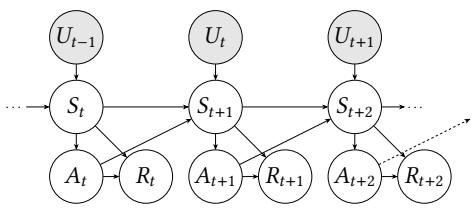  
Figure 1: MDP causal graph. White nodes are the endogenous variables; grey nodes are the exogenous variables.

V is the set of endogenous (observed) variables, U is a set of exogenous (unobserved) variables, � (U) is a joint distribution over each $U \in \mathbf { U } ,$ , and $\mathcal { F }$ is a set of structural equations such that each $f _ { V } \in \mathcal { F }$ determines the value of variable $V \in \mathbf { V }$ as a function of $U _ { V } \in \mathbf { U }$ and of $V ' s$ endogenous parents $\mathbf { P A } _ { V } \subseteq \mathbf { V } .$ . An intervention (denoted $d o ( \mathbf { X } = \mathbf { x } ) )$ ) modifies the SCM by fixing one or more vari-ables $\mathbf { X } \subseteq \mathbf { V }$ to specific values x and severing their dependence on their respective parents $\mathbf { P A } _ { \mathbf { X } }$ in the causal graph; combined with the original �(U) this yields an interventional distribution over the remaining variables. Counterfactual inference follows the same procedure, except it infers a posterior $P ( \mathbf { U } \mid \mathbf { v } )$ over the values of the exogenous variables consistent with a given observation $\mathbf { v } ,$ and then applies the intervention $d o ( \mathbf { X } = \mathbf { x } )$ using $P ( \mathbf { U } \mid \mathbf { v } )$ in place of $P ( \mathbf { U } )$ , yielding a distribution over the counterfactual outcomes.

## 2.3 Counterfactual Inference in MDPs

An MDP can be represented as an SCM with the causal graph of Figure 1 and the following structural equations:

$$
\begin{array} { r l r } & { } & { S _ { t + 1 } = f ( S _ { t } , A _ { t } , U _ { t } ) ; \quad A _ { t } = \pi ( S _ { t } ) ; } \\ & { } & { S _ { 0 } = f _ { I } ( U _ { I } ) ; \quad R _ { t } = f _ { R } ( S _ { t } , A _ { t } ) . } \end{array}\tag{1}
$$

The exogenous variables $U _ { t }$ capture all sources ofrandomness in the MDP, rendering the structural equations deterministic (given $U _ { t } )$ . In this setting, the interventional distribution $P ( S _ { t + 1 ( S _ { t }  s , A _ { t }  a ) } = s ^ { \prime } )$ corresponds to the MDP’s transition probabilities $\textstyle P ( \cdot \mid s , a )$ and observations are paths $\tau = ( s _ { 0 } , a _ { 0 } , \ldots , s _ { T - 1 } , a _ { T - 1 } , s _ { T } )$ of length $T .$

Counterfactual inference is applied at the level of the individual timesteps: given the observed transition $s _ { t } , a _ { t } \to s _ { t + 1 }$ at time $t ,$ we first infer the posterior distribution over the exogenous variable $U _ { t }$ consistent with this observation, $P ( U _ { t } \mid S _ { t } = s _ { t } , A _ { t } = a _ { t } , S _ { t + 1 } =$ $s _ { t + 1 } )$ ). We then use this posterior to evaluate the counterfactual probability of reaching outcome $S _ { t + 1 } = \tilde { s } ^ { \prime }$ , had we been in state $S _ { t } = \tilde { s } _ { z }$ , and instead performed action $A _ { t } = { \tilde { a } } .$ Formally, we define this counterfactual probability as $\tilde { P } _ { t } ( \tilde { s } ^ { \prime } \mid \tilde { s } , \tilde { a } ) = P ( S _ { t + 1 ( S _ { t }  \tilde { s } , A _ { t }  \tilde { a } ) } =$ $\tilde { s } ^ { \prime } \mid S _ { t } = s _ { t } , A _ { t } = a _ { t } , S _ { t + 1 } = s _ { t + 1 } )$ ) where $S _ { t + 1 ( S _ { t }  \tilde { s } , A _ { t }  \tilde { a } ) }$ denotes variable $S _ { t + 1 }$ in the SCM after the intervention $S _ { t } \gets \tilde { s }$ and $A _ { t } \gets \tilde { a }$

These single-timestep counterfactual probabilities can be combined across all timesteps to construct a non-stationary counterfactual MDP [29], allowing us to reason about counterfactual outcomes over an entire trajectory.

Definition 2.2 (Counterfactual MDP (CFMDP)). Given an MDP $M ,$ , a corresponding SCM C of the form $( 1 ) \ : ( \mathrm { i . e . }$ , one whose inter- ventional distribution matches the transition probabilities of M), and an observed path $\tau = ( s _ { 0 } , a _ { 0 } , s _ { 1 } , a _ { 1 } , \ldots , s _ { T - 1 } , a _ { T - 1 } , s _ { T } )$ , the cor- responding counterfactual MDP is a non-stationary MDP $\tilde { \mathcal { M } } _ { \tau } =$ $( S , \mathcal { A } , \tilde { P } , \tilde { P } _ { I } , R )$ where $\tilde { P } _ { I } ( s _ { 0 } ) = 1$ and the time-dependent transi- tion kernel is given, for any $t \in \{ 0 , . . . , | \tau | - 1 \}$ , by $\tilde { P } _ { t } ( \tilde { s } ^ { \prime } \mid \tilde { s } , \tilde { a } ) =$ $P ( S _ { t + 1 ( S _ { t } = \tilde { s } , A _ { t } = \tilde { a } ) } = \tilde { s } ^ { \prime } \mid S _ { t } = s _ { t } , A _ { t } = a _ { t } , S _ { t + 1 } = s _ { t + 1 } ) .$

In addition to enabling predictions under hypothetical scenarios, counterfactual inference lets us identify the factors that were causally responsible for an observed outcome. In an MDP, an RL agent controls the outcome through its actions, so these factors cor- respond to the actions selected by the agent’s policy. The CFMDP $\tilde { \mathcal { M } } _ { \tau }$ lets us evaluate how the outcome would have changed under diferent actions, and therefore identify the fewest changes to the observed actions that would have led to a better outcome. How- ever, constructing $\tilde { \mathcal { M } } _ { \tau }$ requires knowing both the MDP M and its corresponding SCM $C _ { : }$ which is rarely the case; most often we face both statistical and causal uncertainty, which we address in the following sections.

## 3 Counterfactual Inference in Uncertain MDPs

We first review how Zhang et al. [32]’s partial counterfactual inference approach applies to MDPs, and how Lally et al. [17] build on this to derive closed-form bounds on counterfactual MDP probabil ities. We then extend these bounds to IMDPs, forming the basis of our robust counterfactual inference framework.

## 3.1 Canonical SCMs

To address the problem ofcausal model unidentifiability, Zhang et al. [32] introduce a family of canonical SCMs that can simultaneously capture all possible counterfactual probability distributions across all compatible causal models. They show how to optimise over these canonical SCMs to find the SCMs that minimise and maximise counterfactual probabilities, yielding tight bounds.

Lally et al. [17] construct canonical SCMs for MDPs. Specifically, given a known MDP M (with a known transition function $P _ { M } )$ , the first step is to associate each value of the exogenous variable $u _ { t } \in U _ { t }$ with a unique deterministic mapping $f : S \times \mathcal { A } \times \mathcal { U }  S$ that de- fines the next state for every state-action pair. Since there are finitely many such mappings1, this gives $| U _ { t } | = | S | ^ { | S | \times | \mathcal { A } }$ |. This mapping is represented by an indicator variable $\dot { \mu } \in \{ 0 , 1 \} ^ { | S | \times | \mathcal { A } | \times | \hat { U _ { t } } | \times | S | }$ such that, for any $s , a , u _ { t } , s ^ { \prime } \colon$

$$
\mu _ { s , a , u _ { t } , s ^ { \prime } } = { \left\{ \begin{array} { l l } { 1 } & { { \mathrm { i f } } f ( s , a , u _ { t } ) = s ^ { \prime } } \\ { 0 } & { { \mathrm { o t h e r w i s e } } . } \end{array} \right. }
$$

That is, $\mu _ { s , a , u _ { t } , s ^ { \prime } } = 1$ when the mapping associated with $u _ { t }$ leads to the next state $s ^ { \prime }$ from state-action pair $( s , a )$ . Next, we define a vec- tor $\theta \in \mathbb { R } ^ { | U _ { t } | }$ , where each $\theta _ { u _ { t } }$ represents the probability $P ( U _ { t } = u _ { t } )$ Each instantiation of � defines a unique SCM. Given an observed transition $s _ { t } , a _ { t } \to s _ { t + 1 }$ , we can express the counterfactual proba- bility $\tilde { P } _ { M , t } ( s ^ { \prime } \mid s , a )$ of any transition $s , a \to s ^ { \prime }$ in terms of $\dot { \mu }$ and � as follows:

$$
\tilde { P } _ { M , t } ( s ^ { ' } \mid s , a ) = \frac { \sum _ { u _ { t } = 1 } ^ { | U _ { t } | } \mu _ { s , a , u _ { t } , s ^ { \prime } } \cdot \mu _ { s _ { t } , a _ { t } , u _ { t } , s _ { t + 1 } } \cdot \theta _ { u _ { t } } } { P _ { M } ( s _ { t + 1 } \mid s _ { t } , a _ { t } ) } .\tag{2}
$$

To obtain bounds $[ \tilde { P } _ { M , t } ^ { L B } ( s ^ { \prime } \mid s , a ) , \tilde { P } _ { M , t } ^ { U B } ( s ^ { \prime } \mid s , a ) ]$ on the counter- factual transition probabilities, we optimise over all values of $\theta$ (note that $\mu$ is fixed and is not optimised over) consistent with the observed transition and interventional data (i.e., the MDP transition probabilities). This results in the following optimisation problem (omitting the constant denominator in (2) from the objective):

$$
\begin{array} { r } { \underset { \theta } { \operatorname* { m i n } } / \underset { \theta } { \operatorname* { m a x } } \sum _ { u _ { t } = 1 } ^ { | U _ { t } | } \mu _ { s , a , u _ { t } , s ^ { \prime } } \cdot \mu _ { s _ { t } , a _ { t } , u _ { t } , s _ { t + 1 } } \cdot \theta _ { u _ { t } } , } \end{array}\tag{3}
$$

$$
\begin{array} { r } { \mathrm { s . t . ~ } \sum _ { u _ { t } = 1 } ^ { \vert U _ { t } \vert } \mu _ { \hat { s } , \hat { a } , u _ { t } , \hat { s } ^ { \prime } } \cdot \theta _ { u _ { t } } = P _ { \mathcal M } ( \hat { s } ^ { \prime } \mid \hat { s } , \hat { a } ) , \ \forall \hat { s } , \hat { a } , \hat { s } ^ { \prime } , } \end{array}\tag{4}
$$

$$
\begin{array} { r } { \forall u _ { t } , 0 \leq \theta _ { u _ { t } } \leq 1 \mathrm { ~ a n d ~ } \sum _ { u _ { t } = 1 } ^ { | U _ { t } | } \theta _ { u _ { t } } = 1 . } \end{array}\tag{5}
$$

## 3.2 Closed-form Bounds for MDPs

Lally et al. [17] prove that, in MDP settings, this optimisation problem reduces to exact, closed-form expressions. These bounds also incorporate two key assumptions, counterfactual stability and counterfactual monotonicity, to avoid unintuitive counterfactual prob-abilities. Without these assumptions, the optimisation in $_ { ( 3 ) - ( 5 ) }$ tends to produce loose or trivial [0, 1] bounds, which compound over multiple transitions in sequential decision-making and reduce the usefulness of counterfactual inference.

Counterfactual stability is a standard assumption in the literature [23, 29] and states that the outcome under an intervention changes only if the relative probability of some other outcome increases relative to the observed outcome. Counterfactual monotonicity ensures that observing an outcome cannot make it less likely in the counterfactual setting, and that unobserved (but possible) outcomes cannot become more likely. Formal definitions and the resulting bounds are in Appendix A.

## 3.3 Extending the Bounds to IMDPs

To extend these counterfactual probability bounds to $\mathrm { I M D P s } ,$ we generalise the optimisation problem in (3)-(5) as follows. Let $M _ { \updownarrow }$ denote an arbitrary IMDP. For a given counterfactual transition $s , a \to s ^ { \prime }$ and observed transition $s _ { t } , a _ { t } \to s _ { t + 1 }$ , the upper and lower bounds $\tilde { P } _ { M _ { \updownarrow } , t } ^ { U B } ( s ^ { \prime } \mid s , a )$ and $\tilde { P } _ { M _ { \mathrm { 2 } } , t } ^ { L B } ( s ^ { \prime } \mid s , a )$ are obtained by solving

$$
\operatorname* { m i n } _ { \mathcal { M } \in { \mathcal { M } } _ { \mathfrak { T } } , \theta } \left( \frac { \sum _ { u _ { t } = 1 } ^ { | U _ { t } | } \mu _ { s , a , u _ { t } , s ^ { \prime } } \cdot \mu _ { s _ { t } , a _ { t } , u _ { t } , s _ { t + 1 } } \cdot \theta _ { u _ { t } } } { P _ { \mathcal { M } } ( s _ { t + 1 } \mid s _ { t } , a _ { t } ) } \right)\tag{6}
$$

subject to constraints (4) and (5), and crucially ensuring that M is a valid MDP within the IMDP’s uncertainty set, i.e., ∀�, �, $\begin{array} { r } { \sum _ { s ^ { \prime } \in S } P _ { M } ( s ^ { \prime } \mid } \end{array}$ $s , a ) \ = \ 1$ . Since closed-form expressions for the counterfactual bounds are already available for a fixed MDP M, the optimisation over the IMDP reduces to optimising these bounds over all admissible MDPs:

$$
\begin{array} { r } { \tilde { P } _ { \mathcal { M } _ { \mathfrak { T } } , t } ^ { U B } ( s ^ { \prime } \mid s , a ) = \operatorname* { m a x } _ { \mathcal { M } \in \mathcal { M } _ { \mathfrak { T } } } \left( \tilde { P } _ { \mathcal { M } , t } ^ { U B } ( s ^ { \prime } \mid s , a ) \right) , } \end{array}\tag{7}
$$

$$
\begin{array} { r } { \tilde { P } _ { \mathcal { M } _ { \mathfrak { T } } , t } ^ { L B } ( s ^ { \prime } \mid s , a ) = \operatorname* { m i n } _ { \substack { \mathcal { M } \in \mathcal { M } _ { \mathfrak { T } } } } \left( \tilde { P } _ { \mathcal { M } , t } ^ { L B } ( s ^ { \prime } \mid s , a ) \right) . } \end{array}\tag{8}
$$

This formulation enables us to derive closed-form expressions for the counterfactual probability bounds. Without it, computing these bounds would require solving (6) directly: a joint optimisation over admissible MDPs $\mathcal { M } \in \mathcal { M } _ { \updownarrow } ,$ and over $\theta$ (whose cardinality is exponential in the size of the state and action spaces). However, deriving these closed-form expressions requires more than simply optimising the closed-form MDP bounds of Lally et al. [17] independently over each probability interval: the resulting extremal values must also be simultaneously achievable by a single, valid MDP $\boldsymbol { \mathscr { M } } \in \boldsymbol { \mathscr { M } } _ { \updownarrow }$ which makes extending their bounds to IMDPs non-trivial.

The exact closed-form expression depends on whether the coun- terfactual state-action pair $( s , a )$ and the observed state-action pair have disjoint or overlapping support: in the IMDP setting, we say $( s , a )$ has disjoint support from the observed $\left( { { s _ { t } } , { a _ { t } } } \right)$ if their supports are disjoint for every admissible MDP $\boldsymbol { \mathscr { M } } \in \boldsymbol { \mathscr { M } } _ { \updownarrow } ;$ otherwise, they have overlapping support. The resulting closed-form bounds are summarised in Table 1, using $p _ { s , a } ^ { L B } ( s ^ { \prime } )$ as shorthand for $P _ { M _ { \widehat { \mathrm { I } } } } ^ { L B } ( s ^ { \prime } \mid s , a )$ and $p _ { s , a } ^ { U B } ( s ^ { \prime } )$ for $P _ { M _ { \widehat { \mathrm { I } } } } ^ { U B } ( s ^ { \prime } \mid s , a )$ , for all � $, a , s ^ { \prime } ;$ full theorem statements and proofs are given in Appendix B.

ProofSketch. Consider an observed transition $s _ { t } , a _ { t } \to s _ { t + 1 }$ and counterfactual transition $s , a \to s ^ { \prime }$ . From (2), for a fixed MDP M and exogenous distribution $\theta ,$ we see that the counterfactual probability $\tilde { P } _ { M , t } ( s ^ { \prime } \mid s , a )$ depends only on the subset of exogenous values $u _ { t }$ consistent with both transitions, since $P _ { M } ( s _ { t + 1 } \mid s _ { t } , a _ { t } )$ , the denominator in $( 2 )$ , is fixed. Therefore, the optimisation involves identifying the � that maximises/minimises the following sum:

$$
\sum _ { u _ { t } = 1 } ^ { | U _ { t } | } \mu _ { s , a , u _ { t } , s ^ { \prime } } \cdot \mu _ { s _ { t } , a _ { t } , u _ { t } , s _ { t + 1 } } \cdot \theta _ { u _ { t } } = \sum _ { u _ { t } \in U _ { t } \atop f ( s _ { t } , a _ { t } , u _ { t } ) = s _ { t + 1 } } \theta _ { u _ { t } } .
$$

Importantly, Lally et al. [17] prove that the bounds for each (�, �) depend only on the probability distribution of this state-action pair and the observed state-action pair $\left( { { s _ { t } } , { a _ { t } } } \right)$ , so we can decompose the optimisation problem. Since the bounds proven by Lally et al. [17] are tight, extending these bounds from MDPs to IMDPs (6) reduces to (7) and (8), where we aim to identify, for each transition, the max/min possible counterfactual upper/lower bound across all admissible MDPs within the IMDP. In the proofs, we search over the interval probabilities for (�, �) and $\left( { { s _ { t } } , { a _ { t } } } \right)$ to obtain these bounds, while ensuring that a valid MDP exists (i.e., where the probability distribution for each state-action pair sums to 1) that results in these bounds. Intuitively, each case reflects a diferent way probability mass can be distributed between the transitions from (�, �) and $\left( { { s _ { t } } , { a _ { t } } } \right)$ under this constraint: when $( s , a ) = ( s _ { t } , a _ { t } )$ the bounds are immediate (the same $\left( { { s _ { t } } , { a _ { t } } } \right)$ under the same context $u _ { t }$ must yield the same outcome); when the supports are disjoint, the counterfactual stability and counterfactual monotonicity as- sumptions are vacuously satisfied, and do not constrain how (�, �) and $\left( { { s _ { t } } , { a _ { t } } } \right)$ behave under the same $u _ { t } ,$ , so the bound depends only on their marginal probabilities; and when the supports are overlapping, these assumptions constrain how probability mass can be distributed across the shared support of $( s , a )$ and $\left( { { s _ { t } } , { a _ { t } } } \right)$

Proposition 3.1 (Tightness of the Counterfactual IMDP Bounds). The upper bounds $\ddot { P } _ { M _ { \uparrow } , t } ^ { U B } ( s ^ { \prime } \mid$ �, �) are tight for all $s , a , s ^ { \prime } .$ . The lower bounds $\tilde { P } _ { M _ { \mathrm { 1 } } , t } ^ { L B } ( s ^ { \prime } \mid s , a )$ are tight for all �, �, �′, except when $( s , a ) \neq$ $\left( { { s _ { t } } , { a _ { t } } } \right)$ , the counterfactual and observed transitions have overlapping support, and the counterfactual stability constraint does not force the bound to 0 for all admissible MDPs $\boldsymbol { M } \in \mathcal { M } _ { \updownarrow } , i . e . ,$ , Cases 1 and 3 of Theorem B.7.

Remark. In every case where a tight bound can be obtained (The-orems B.3, B.4, B.5, B.6, and Case 2 of B.7, each closed-form bound can be expressed as a function of a small, fixed set of individual transition probabilities. This lets us explicitly construct a single ad-missible MDP that sets each of these probabilities to its IMDP-level extremal (upper or lower) value, thereby minimising or maximising the overall expression. However, Cases 1 and 3 of B.7 difer struc- turally, as the bound depends on the sum of the upper-bound prob- abilities of alternative outcomes $\textstyle \sum _ { s ^ { \prime \prime } \in S \backslash \{ s ^ { \prime } \} } \tilde { P } _ { M , t } ^ { U B } ( s ^ { \prime \prime } \mid s , a )$ , each term of which is itself the result of a separate optimisation over $M _ { \updownarrow }$ This leaves us with two options: (i) solving the nested optimisation when necessary to obtain the true maximum of $\textstyle \sum _ { s ^ { \prime \prime } \in S \backslash \{ s ^ { \prime } \} } \tilde { P } _ { M . t } ^ { U B } ( s ^ { \prime \prime } \mid s , a )$ achievable by a single admissible MDP, giving a tight bound, or (ii) computing a conservative lower bound by replacing this sum with the sum of the individually-optimised IMDP-level upper bounds $\begin{array} { r } { \sum _ { s ^ { \prime \prime } \in S \backslash \{ s ^ { \prime } \} } \tilde { P } _ { M _ { \uparrow } , t } ^ { U B } ( s ^ { \prime \prime } \mid s , a ) } \end{array}$ , which need not be jointly achievable. We compare these two approaches in our experiments.

Bounds for Gumbel-max SCMs. While this is not the main focus of our work, we also extend the Gumbel-max SCM counterfactual inference approach [15, 23, 29] from MDPs to IMDPs and, to our knowledge, provide the first bounds on Gumbel-max counterfactual probabilities for IMDPs. Although these bounds are not tight in general, they may be of independent interest given the popularity of Gumbel-max SCMs; we also use them in our experimental evaluation (Section 5) as a baseline to assess the robustness of our approach. The bounds and their proof are given in Appendix C.

## 4 Methodology

We first describe how to derive an IMDP from paths sampled from the unknown MDP, and how to construct a counterfactual IMDP (CFIMDP) for a given observed path. We then formalise the notion of minimal robust counterfactual interventions and show how to compute them via robust value iteration over the CFIMDP.

## 4.1 Learning IMDPs from Data

We begin by collecting observed trajectories of length |� | (an environment-specific hyperparameter) from either the initial state, if defined, or any non-sink state. Following the standard approach [21, 26, 27], we estimate the IMDP by computing a confidence interval for each transition probability from these observations, assuming that the $\textstyle \mathrm { M D P } ^ { \prime } s$ topology is known (the so-called grey-box setting)2. We use the Clopper-Pearson method [5], with an overall confidence level 1 −� distributed evenly across all nondeterministic transitions (see Appendix D for more details). We assign a minimum probability � to all possible transitions $( \epsilon = 0 . 0 1 , \mathrm { o r } 1 0 ^ { - 4 }$ for Sepsis, whose smallest transition probability is approximately 10−4) to en-sure that observed transitions have strictly positive lower bounds, as required for valid counterfactual inference. We note our frame- work is agnostic to the estimation method: more sample-eficient methods than Clopper-Pearson may yield tighter IMDP bounds from the same data, and hence tighter CFIMDP bounds.

Table 1: Closed-form counterfactual probability upper and lower bounds. For $s ^ { \prime } \neq s _ { t + 1 }$ in the overlapping case, the upper and lower bound conditions are each applied in order, where CS always holds if $\rho _ { s _ { t } , a _ { t } } ^ { L B } ( s ^ { \prime } ) > 0$ and $\begin{array} { r } { \frac { p _ { s , a } ^ { L \widehat { B } } \left( s _ { t + 1 } \right) } { p _ { s _ { t } , a _ { t } } ^ { U B } \left( s _ { t + 1 } \right) } \geq \frac { p _ { s , a } ^ { U B } \left( s ^ { \prime } \right) } { p _ { s _ { t } , a _ { t } } ^ { L B } \left( s ^ { \prime } \right) } } \end{array}$ , and CS sometimes holds if $\dot { } p _ { s _ { t } , a _ { t } } ^ { U B } ( s ^ { \prime } ) > 0$ and $\begin{array} { r } { \frac { \boldsymbol { \hat { p } } _ { s , a } ^ { U B } \left( \boldsymbol { s } _ { t + 1 } \right) } { \boldsymbol { \hat { p } } _ { s _ { t } , a _ { t } } ^ { L B } \left( \boldsymbol { s } _ { t + 1 } \right) } \ge \frac { \boldsymbol { \hat { p } } _ { s , a } ^ { L B } \left( \boldsymbol { s } ^ { \prime } \right) } { \boldsymbol { \hat { p } } _ { s _ { t } , a _ { t } } ^ { U B } \left( \boldsymbol { s } ^ { \prime } \right) } . \boldsymbol { \mathcal { P } } _ { s u m } = \sum _ { \boldsymbol { s } ^ { \prime } \ne \boldsymbol { s } _ { t + 1 } } \boldsymbol { \tilde { P } } _ { \mathcal { M } _ { \mathfrak { T } } , t } ^ { U B } \left( \boldsymbol { s } ^ { \prime } \mid \boldsymbol { s } , \boldsymbol { a } \right) } \end{array}$ for the closed-form but conservative lower bound; for the tight, optimisation-based bound, $\begin{array} { r } { \mathcal { P } _ { s u m } = \operatorname* { m a x } _ { M \in \mathcal { M } _ { \widehat { \mathbb { T } } } } \sum _ { s ^ { \prime \prime } \in S \backslash \{ s ^ { \prime } \} } \tilde { P } _ { \mathcal { M } , t } ^ { U B } ( s ^ { \prime \prime } \mid s , a ) } \end{array}$
<table><tr><td>Theorem</td><td>UB condition</td><td>Upper bound  $\tilde { P } _ { M _ { \updownarrow } , t } ^ { U B } ( s ^ { \prime } \mid s , a )$ </td><td>LB condition</td><td>Lower bound  $\tilde { P } _ { M _ { \updownarrow } , t } ^ { L B } ( s ^ { \prime } \mid s , a )$ </td></tr><tr><td>Thm  $\mathrm { B } . 3 \colon ( s , a ) \ = \ \mathrm { n } / \mathrm { a }$   $\left( { { s _ { t } } , { a _ { t } } } \right)$ </td><td></td><td> $1 \mathrm { i f } s ^ { \prime } = s _ { t + 1 } ,$  0 otherwise</td><td>n/a</td><td> $1 \mathrm { i f } s ^ { \prime } = s _ { t + 1 } , 0$  otherwise</td></tr><tr><td>Thms B.4, B.5: n/a  $\begin{array} { r c l } { ( s , a ) } & { \neq } & { ( s _ { t } , a _ { t } ) , } \end{array}$  supports disjoint</td><td></td><td> $\operatorname* { m i n } \bigg \{ 1 , \frac { {  { \mathcal P } } _ { s , a } ^ { U B } ( s ^ { \prime } ) } { p _ { s _ { t } , a _ { t } } ^ { L B } ( s _ { t + 1 } ) } \bigg \}$ </td><td>n/a</td><td> $\left\{ 0 , \ \frac { \mathcal { P } _ { s , a } ^ { L B } ( s ^ { \prime } ) - \left( 1 - \mathcal { P } _ { s _ { t } , a _ { t } } ^ { L B } \left( s _ { t + 1 } \right) \right) } { \mathcal { P } _ { s _ { t } , a _ { t } } ^ { L B } \left( s _ { t + 1 } \right) } \right\}$  max</td></tr><tr><td>Thms  $_ { \mathrm { B } . 6 , \mathrm { B } . 7 : }$ </td><td> $s ^ { \prime } = s _ { t + 1 }$ </td><td> $\Big \{ 1 , \frac { p _ { s , a } ^ { U B } ( s _ { t + 1 } ) } { p _ { s _ { t } , a _ { t } } ^ { L B } ( s _ { t + 1 } ) } \Big \}$  min</td><td> $s ^ { \prime } = s _ { t + 1 }$ </td><td>max  $\big ( \rho _ { s , a } ^ { L B } ( s ^ { \prime } ) , 1 - \mathcal { P } _ { s u m } \big )$ </td></tr><tr><td rowspan="5"> $( s , a ) \neq ( s _ { t } , a _ { t } ) ,$  supports overlap</td><td>CS always holds</td><td>0</td><td>CS sometimes 0 holds</td><td></td></tr><tr><td> $\begin{array} { r } { p _ { s _ { t } , a _ { t } } ^ { L B } ( s ^ { \prime } ) > 0 } \end{array}$ </td><td>min  $\left( p _ { s , a } ^ { U B } ( s ^ { \prime } ) , 1 - p _ { s , a } ^ { L B } ( s _ { t + 1 } ) \right)$ </td><td>otherwise</td><td>max  $\left( 0 , 1 - \mathcal { P } _ { s u m } \right)$ </td></tr><tr><td> $p _ { s t , a _ { t } } ^ { U B } ( s ^ { \prime } ) = 0$ </td><td> $\operatorname* { m i n } \bigg ( 1 - p _ { s , a } ^ { L B } ( s _ { t + 1 } ) , \frac { p _ { s , a } ^ { U B } ( s ^ { \prime } ) } { p _ { s _ { t } , a _ { t } } ^ { L B } ( s _ { t + 1 } ) } \bigg )$ </td><td></td><td></td></tr><tr><td>otherwise</td><td>min  $\Big ( 1 - p _ { s , a } ^ { L B } ( s _ { t + 1 } ) ,$ </td><td></td><td></td></tr><tr><td></td><td> $\begin{array} { r l } &  \frac { \mathcal { P } _ { s , \alpha } ^ { U B } \left( s ^ { \prime } \right) } { \operatorname* { m a x } \binom { 1 - \sum _ { s ^ { \prime \prime } \neq s ^ { \prime } , s _ { t + 1 } } { \mathcal { P } _ { s _ { t } , \alpha _ { t } } ^ { U B } \left( s ^ { \prime \prime } \right) , } } { \mathcal { P } _ { s _ { t } , \alpha _ { t } } ^ { L B } \left( s _ { t + 1 } \right) } } \end{array}$ </td><td></td><td></td></tr></table>

## 4.2 Constructing the CFIMDP

Given the counterfactual probability bounds in Table 1, we can compute a non-stationary counterfactual interval MDP (CFIMDP) for any given IMDP $M _ { \updownarrow }$ and observed path �. For each transition observed in �, we compute the counterfactual probability bounds for all possible transitions in the IMDP. These bounds are then combined to form a non-stationary CFIMDP by concatenating the time-dependent counterfactual transition probability bounds across time steps. Formally, a CFIMDP is defined as follows:

Definition 4.1 (Counterfactual Interval MDP (CFIMDP) [17]). Given an observed path � and IMDP $M _ { \updownarrow } .$ , the counterfactual probability for each transition in the CFIMDP $\tilde { \mathcal { M } } _ { \tau } ^ { \updownarrow }$ is defined, for $t = 0 , \ldots , | \tau | - 1$ as $\tilde { P } _ { t } ^ { \updownarrow } ( s ^ { \prime } \mid s , a ) = [ \tilde { P } _ { t } ^ { L B } ( s ^ { \prime } \mid s , a ) , \tilde { P } _ { t } ^ { U B } ( s ^ { \prime } \mid s , a ) ]$

Proposition 4.2 (Confidence propagation). Let $M _ { \updownarrow }$ be a datadriven IMDP, which contains the true MDP with probability at least 1 − �. Then the CFIMDP derived from $M _ { \updownarrow }$ contains the true CFMDP with probability at least 1 − � (proof in Appendix D).

## 4.3 Minimal Robust Counterfactual Interventions

The CFIMDP we just introduced allows us to systematically rea-son about counterfactual outcomes. Specifically, given an observed trajectory whose cumulative reward falls below a threshold �, we seek an intervention that guarantees an expected counterfactual cumulative reward $\geq \lambda$ . Using the CFIMDP, we can identify inter-ventions that would have improved on the factual outcome in a robust way w.r.t. all models induced by statistical and causal uncertainties. Moreover, we are interested in minimal interventions, i.e., policies that require the fewest action changes to achieve this. Given our RL context, we focus on the expected cumulative reward. Properties like reach-avoid can be captured this way via a suitable Bellman recursion [1]; more complex temporal logic properties can be encoded as reachability by taking the product of the CFIMDP with a reward machine [13], which we leave for future work.

Let $\tau = \left( s _ { 0 } , a _ { 0 } , \ldots , s _ { | \tau | - 1 } , a _ { | \tau | - 1 } , s _ { | \tau | } \right)$ be an observed path, and let $\begin{array} { r } { G ( \tau ) = \sum _ { t = 0 } ^ { | \tau | - 1 } R ( s _ { t } , a _ { t } ) } \end{array}$ denote its cumulative reward. A counterfactual policy � chooses an action �(�, �) for each time step � and state �. We write $\tilde { M } _ { \tau } \in \tilde { M } _ { \tau } ^ { \updownarrow }$ for any CFMDP within the CFIMDP, i.e., any non-stationary MDP whose transition probabilities satisfy $\tilde { P } _ { t } ^ { L B } ( s ^ { \prime } \mid s , a ) \le \tilde { P } _ { t } ( s ^ { \prime } \mid s , a ) \le \tilde { P } _ { t } ^ { U B } ( s ^ { \prime } \mid s , a )$ for all $t , s ,$ � and $s ^ { \prime } .$ Fol- lowing � in $\tilde { \mathcal { M } } _ { \tau }$ induces a distribution $\tilde { \mathcal { M } } _ { \tau } ( \pi )$ over counterfactual paths $\tilde { \tau } = ( \tilde { s } _ { 0 } , \tilde { a } _ { 0 } , \ldots . . . , \tilde { s } _ { | \tau | } )$ , and we define the worst-case expected counterfactual cumulative reward of � from the initial state �0 as

$$
V ^ { \perp , \pi } ( s _ { 0 } ) = \operatorname* { m i n } _ { \tilde { \mathcal { M } } _ { \tau } \in \tilde { \mathcal { M } } _ { \tau } ^ { \updownarrow } } \mathbb { E } _ { \tilde { \tau } \sim \tilde { \mathcal { M } } _ { \tau } ( \pi ) } \left[ G ( \tilde { \tau } ) \mid \tilde { s } _ { 0 } = s _ { 0 } \right] .\tag{9}
$$

The set $\tilde { \mathcal { M } } _ { \tau } ^ { \updownarrow }$ contains the CFMDP of every MDP in the IMDP under every corresponding SCM. Since the CFIMDP bounds each counterfactual transition probability separately, it may also contain CFMDPs that combine probabilities induced by diferent MDPs or SCMs, and so do not correspond to any single causal model com- patible with the IMDP. As is standard for IMDPs [9], taking the worst case over this larger set yields conservative, but eficiently computable, guarantees.

For $k \in \{ 0 , . . . , | \tau | \}$ , we denote with $\Pi _ { \tau , k }$ the set ofcounterfactual policies that change no more than � actions from �, i.e.,

$$
\Pi _ { \tau , k } = \left\{ \pi \left| \begin{array} { l } { | \tau | - 1 } \\ { \displaystyle \sum _ { t = 0 } ^ { \lfloor \tau \rfloor - 1 } \mathbb { 1 } \left( \tilde { a } _ { t } \neq a _ { t } \right) \leq k , \forall \tilde { M } _ { \tau } \in \tilde { M } _ { \tau } ^ { \updownarrow } \mathrm { a n d } \tilde { \tau } \in \mathrm { s u p p } ( \tilde { M } _ { \tau } ( \pi ) ) \right\} } \end{array} \right.
$$

where $\mathbb { 1 } \{ \cdot \}$ denotes the indicator function, $\tilde { \boldsymbol { a } } _ { t } = \pi ( t , \tilde { \boldsymbol { s } } _ { t } )$ is the action taken by � at time � along �˜ and supp( $\dot { { \cal M } } _ { \tau } ( \pi ) )$ denotes the set of admissible paths of $\tilde { \ b { M } } _ { \tau } ( \pi )$

Definition 4.3 (Minimal Robust Counterfactual Intervention). A counterfactual policy $\pi ^ { * }$ is a minimal robust counterfactual intervention for a path � and threshold � if, for some $k ^ { * } \in \{ 0 , \ldots , | \tau | \}$

(1) $\pi ^ { * } \in \Pi _ { \tau , k ^ { * } }$ and $V ^ { \perp , \pi ^ { * } } ( s _ { 0 } ) \geq \lambda .$ , and

(2) for all $k < k ^ { * } , \operatorname* { m a x } _ { \pi \in \Pi _ { \tau , k } } V ^ { \perp , \pi } ( s _ { 0 } ) < \lambda .$

Conversely, if the observed cumulative reward is at least $\lambda ,$ we can identify the minimal interventions that would have robustly led to a cumulative reward below �, i.e., the observed actions responsible for the success, by reversing the inequalities and replacing the $V ^ { \bot , \pi }$ with the corresponding best-case (optimistic) value $V ^ { \top , \pi }$

Computing minimal robust counterfactual interventions. We com-pute minimal robust counterfactual interventions via pessimistic value iteration [20], which maximises the expected cumulative re-ward under the worst-case CFMDP within the CFIMDP. To restrict the search to $\pi \in \Pi _ { \tau , k }$ , we augment the state with a counter � that tracks the remaining allowed number of action changes, and define

$$
\begin{array} { r l } & { V ^ { * } ( s , t , k ) = \underset { \pi } { \mathrm { m a x ~ } } \underset { \tilde { P } _ { t } \in \tilde { P } _ { t } ^ { \updownarrow } } { \mathrm { m i n ~ } } \mathbb { E } _ { s ^ { \prime } \sim \tilde { P } _ { t } ( \cdot | s , \pi ( t , s ) ) } \Big [ R \big ( s , \pi ( t , s ) \big ) } \\ & { \qquad + V ^ { * } \big ( s ^ { \prime } , t + 1 , k - \mathbb { 1 } \left\{ \pi ( t , s ) \neq a _ { t } \right\} \big ) \Big ] , } \end{array}\tag{10}
$$

where $V ^ { * } ( s , \vert \tau \vert , k ) = 0$ for all � and $k ,$ and, for $k = 0 ,$ , the maximum is restricted to $\pi ( t , s ) = a _ { t }$ . Since the CFIMDP selects transition prob-abilities independently for each $( t , s , a )$ , the worst case can be com- puted one step at a time [9], so $V ^ { * } ( s _ { 0 } , 0 , k ) = \operatorname* { m a x } _ { \pi \in \Pi _ { \tau , k } } V ^ { \perp , \pi } ( s _ { 0 } )$ Let $k ^ { * }$ be the smallest � with $V ^ { \ast } ( s _ { 0 } , 0 , k ) \geq \lambda$ , and $\pi _ { k ^ { * } } ^ { * }$ the corre- sponding maximising policy. Then $\pi _ { k ^ { * } } ^ { * } \in \Pi _ { \tau , k ^ { * } }$ achieves $V ^ { \perp , \pi _ { k ^ { * } } ^ { * } } \left( s _ { 0 } \right) \geq$ �, and no policy that changes fewer actions does, so $\pi _ { k ^ { * } } ^ { * }$ is a minimal robust counterfactual intervention (see Appendix E for the full algorithm). With the conservative lower bounds, $\pi _ { k ^ { * } } ^ { * }$ is still guaranteed to achieve $V ^ { \perp , \pi _ { k ^ { * } } ^ { * } } ( s _ { 0 } ) \geq \lambda .$ , but $k ^ { * }$ may be larger than with the tight bounds.

Relation to actual causation. Minimal robust counterfactual interventions are closely related to the notion of actual causes [11]. Informally, a set ofobserved actions is an actual cause ofan outcome if changing those actions, while keeping all other actions at their observed values, would have changed the counterfactual outcome, and no strict subset of these actions has this property. Identifying an actual cause requires knowing the SCM and the context (the exogenous noise values), which together determine a single counterfactual path. In our setting, neither is known: we only know that the true CFMDP lies within the CFIMDP, and each CFMDP induces a distribution over counterfactual paths. We therefore require the change in outcome to hold robustly and in expectation, making our interventions a robust, policy-based analogue of actual causes.

Table 2: Average lower $\left( V ^ { \perp , \pi ^ { * } } \left( s _ { 0 } \right) \right)$ and upper $( V ^ { \top , \pi ^ { * } } ( s _ { 0 } ) )$ bounds on the counterfactual value of $\pi ^ { * }$ over 100 randomly sampled observed paths, under the exact CFIMDP and datadriven CFIMDPs whose IMDPs are learnt from � simulated paths. The true interventional value is $V ^ { \pi ^ { * } } ( s _ { 0 } ) = 3 3 3$
<table><tr><td colspan="2"></td><td>Lower Bound Upper Bound</td></tr><tr><td>Exact Bounds</td><td> $2 4 9 \pm 1 1 8$ </td><td> $3 8 7 \pm 3 9$ </td></tr><tr><td>Data-driven Bounds</td><td></td><td></td></tr><tr><td> $N = 1 0 { , } 0 0 0$ </td><td> $1 8 3 \pm 1 0 4$ </td><td> $3 9 8 \pm 3 6$ </td></tr><tr><td> $N = 1 0 0 { , } 0 0 0$ </td><td> $2 2 8 \pm 1 1 4$ </td><td> $3 9 2 \pm 3 7$ </td></tr><tr><td> $N = 1 , 0 0 0 , 0 0 0$ </td><td> $2 4 1 \pm 1 1 7$ </td><td> $3 8 9 \pm 3 8$ </td></tr></table>

Table 3: Average worst-case counterfactual value $V ^ { \perp , \pi _ { k } ^ { * } } ( s _ { 0 } )$ on the exact CFIMDP of policies derived from data-driven CFIMDPs $( N = 1 0 0 , 0 0 0 , \alpha = 0 . 1 )$ and of the exact CFIMDP’s pessimistic optimal policy, over 100 observed trajectories � with $k = \left| \tau \right| - 1$ . Values are mean ± standard deviation.
<table><tr><td>Environment</td><td>Exact CFIMDP</td><td>Data-driven CFIMDP (Cons. LB)</td><td>Data-driven CFIMDP (Gumbel-max)</td></tr><tr><td>GridWorld  $( \pmb { \mathscr { p } } = 0 . 9 )$ </td><td> $2 8 3 \pm 1 0 4$ </td><td> $2 8 3 \pm 1 0 4$ </td><td> $2 2 7 \pm 2 3 3$ </td></tr><tr><td>GridWorld  $( p = 0 . 4 )$ </td><td> $- 2 1 . 1 \pm 1 3 8$ </td><td> $- 2 1 . 9 \pm 1 3 9$ </td><td> $- 5 6 . 6 \pm 1 6 5$ </td></tr><tr><td>Frozen Lake</td><td> $3 4 . 7 \pm 1 8 . 5$ </td><td> $3 4 . 6 \pm 1 8 . 5$ </td><td> $- 4 . 8 0 \pm 4 9 . 5$ </td></tr><tr><td>Aircraft</td><td> $- 1 1 . 1 \pm 3 2 6$ </td><td> $- 2 4 . 6 \pm 3 4 4$ </td><td> $- 7 8 . 3 \pm 4 0 8$ </td></tr></table>

## 5 Evaluation

We evaluate our approach along five axes: (1) its accuracy in of-policy evaluation tasks; (2) how its policies compare against those obtained from the exact CFIMDP $( { \mathrm { i . e . } }$ , the CFIMDP derived from the true MDP); (3) its robustness relative to the Gumbel-max approach; (4) how well it identifies minimal action changes to achieve a desired counterfactual value; and (5) the trade-of of using conservative vs. tight lower bounds. We evaluate our approach on a range of MDP tasks, ranging from simple models (GridWorld and Frozen Lake) to more complex clinical and navigation tasks (Sepsis and Aircraft). Full descriptions of the MDP environments and system details can be found in the Appendix F. The code is available at: https://github.com/jessicalally/robust-cf -inference-beyond- mdps.

## 5.1 Of-Policy Evaluation

We first check the correctness of our counterfactual inference method for IMDPs in an of-policy evaluation (OPE) setting [3, 23], estimating the expected return of an optimal target policy $\pi ^ { * }$ using trajectories generated by a suboptimal behavioural policy �. We construct a data-driven IMDP given a fixed number � of observed trajectories and confidence $\alpha = 0 . 1$ , sample 100 trajectories from the true MDP under �, build a CFIMDP for each, and compute upper and lower bounds on the expected counterfactual return from the initial state. The counterfactual value averaged over observed trajectories should equal the interventional value. Hence, if the method is unbiased, the average bounds should contain the true interven- tional value $V ^ { \pi ^ { * } } ( s _ { 0 } )$ . Table 2 shows the results for the GridWorld $( p = 0 . 9 )$ MDP (similar results for GridWorld $( p = 0 . 4 )$ can be found in Appendix G), alongside the exact bounds from the true MDP following Lally et al. [17]. The results confirm that our approach is valid and unbiased: the data-driven CFIMDP bounds consistently contain the true expected return, and converge towards the exact bounds as the number � of trajectories increases.

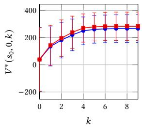  
(a) GridWorld (� = 0.9)

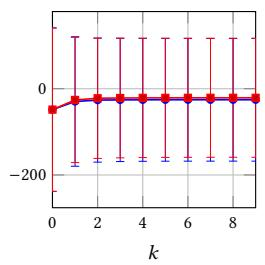  
(b) GridWorld (� = 0.4)

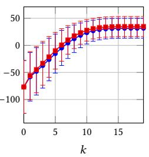  
(c) Frozen Lake

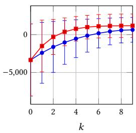  
(d) Sepsis

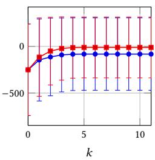  
(e) Aircraft  
Figure 2: Average pessimistic counterfactual value $V ^ { * } ( s _ { 0 } , 0 , k )$ over 100 randomly sampled observed trajectories, on the data driven CFIMDP $( N = 1 0 0 , 0 0 0 , \alpha = 0 . 1 )$ (•) vs. the exact CFIMDP (■), for each �. The data-driven value is a certified lower bound, so the gap to the exact curve is the price of learning the model from data. Error bars show standard deviation.

## 5.2 Evaluating Performance

Next, we evaluate the impact of learning the model from data by comparing the performance of the counterfactual policies de- rived from our data-driven IMDP (with conservative lower bounds) against those derived from the exact CFIMDP. We use a subopti mal observational policy � that selects a random action over the optimal action with probability 0.5, construct an IMDP with hyperparameters $( N = 1 0 0 , 0 0 0 , \alpha = 0 . 1 )$ , and derive CFIMDPs for 100 paths sampled under � using both approaches. We then compare the average values $V ^ { * } ( s _ { 0 } , 0 , k )$ of the resulting pessimistic optimal policies, where $s _ { 0 }$ is the $\textstyle \mathrm { M D P } ^ { * } s$ initial state, for each maximum number of action changes �.

For GridWorld and Frozen Lake (Figures 2a-2c), our approach yields estimates of $V ^ { * } ( s _ { 0 } , 0 , k )$ close to those obtained from the exact CFIMDP, showing that the statistical uncertainty in the MDP has little impact on the robust counterfactual policies. For Sepsis and Aircraft (Figures 2d and 2e), $V ^ { * } ( s _ { 0 } , 0 , k )$ is slightly lower, as the larger state spaces require wider bounds in the IMDP to maintain an overall significance level of $\alpha = 0 . 1 ;$ with more data, these estimates would tighten. The resulting policies may therefore identify more conservative interventions, i.e., change more actions than strictly necessary. However, since the statistical guarantees on the IMDP carry over to the CFIMDP, these interventions remain valid at the stated confidence level. Finally, as shown in Section 5.3, policies derived from data-driven IMDPs tend to exceed their estimated performance when evaluated on the true CFIMDP, suggesting that these policies are generally accurate and close to the optimal policy obtained without statistical uncertainty.

## 5.3 Evaluating Robustness

To evaluate robustness, we compare the counterfactual policies generated by our approach (with conservative lower bounds) and from the data-driven Gumbel-max approach on the exact CFIMDP, i.e., by their worst-case counterfactual value across all causal mod- els compatible with the true MDP (Table $3 ) ^ { 3 }$ . Our policies perform close to the optimal policies learned from the true CFIMDP, show- ing little impact from statistical uncertainty in these examples. In contrast, the Gumbel-max CFIMDP policies perform suboptimally, suggesting that committing to a specific causal model (even when accounting for uncertainty in the transition dynamics) can be unreliable if the assumed model is misspecified.

## 5.4 Computing Robust Interventions

We now evaluate how well our approach identifies minimal action chan es that achieve a counterfactual value $\geq \lambda$ . To do so, we use the same 100 observed trajectories as before. For each trajectory and $k \in \{ 0 , \ldots , | \tau | - 1 \}$ , we compute the pessimistic policy $\pi _ { k } ^ { * }$ and its value $V ^ { * } ( s _ { 0 } , 0 , k )$ under the exact CFIMDP, our data-driven CFIMDPs (conservative and tight lower bounds), and the Gumbelmax CFIMDP, and report the smallest $k ^ { * }$ such that $V ^ { \ast } ( s _ { 0 } , 0 , k ) \geq \lambda .$ Figure 3 shows that both data-driven approaches identify interventions involving similar numbers of action changes to the exact CFIMDP, being only slightly more conservative, whereas Gumbel-max often underestimates $k ^ { * }$ , particularly in GridWorld $\left( \mathinner { p \mathopen { \left/ { \vphantom { \left( p \Theta \left. \kern - delimiterspace  \right\right.} p. }  \right.}  } = 0 . 9 \right)$ and Aircraft, so its interventions may be unreliable. Figure 4 visu- alises the identified interventions for one catastrophic trajectory. In GridWorld, with $k = 1$ the policy changes the second action to move back towards the start, so most counterfactual paths avoid the fire, but none reach the goal; with $k = 2 ,$ , it instead changes the action that led into the fire, allowing over 60% of counterfactual paths to reach the goal. The size of a robust intervention thus depends on the outcome compared against: avoiding catastrophe requires one change, while reaching the goal requires two. Similarly, in Sepsis, mortality falls, and recovery rises as � grows. Appendix G shows these counterfactual paths in more detail, plotting each vital sign and treatment over time for every �.

## 5.5 Execution Times and Bound Widths

Finally, we assess the impact of using conservative lower bounds (closed-form, eficient) instead of tight lower bounds (optimisationbased, expensive). For the same 100 paths, we derive the CFIMDPs

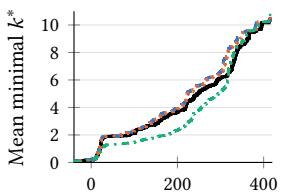  
Threshold �  
(a) GridWorld (� = 0.9)

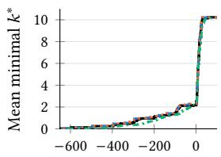  
Threshold �  
(b) GridWorld (� = 0.4)

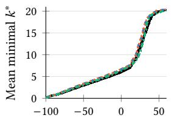  
Threshold �  
(c) Frozen Lake

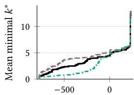  
Threshold �  
(d) Aircraft

Figure 3: Minimum number of action changes �∗ needed for $V ^ { * } ( s _ { 0 } , 0 , k )$ to reach a threshold �, averaged over 100 randomly sampled observed trajectories. We compare the exact CFIMDP (black, solid) with data-driven CFIMDPs using conservative lower bounds (dashed), tight lower bounds (dotted), and the Gumbel-max model (dash-dot).3

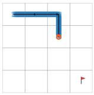  
(i) � = 0

  
(ii) � = 1

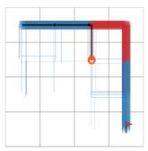  
(iii) � = 2

  
(iv) � = 5

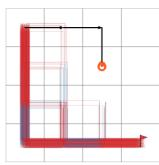  
(v) � = 8

(a) GridWorld: distribution of counterfactual trajectories. The observed path is shown in black, and counterfactual paths in blue where the observed action is taken and in red where the action has been changed.  
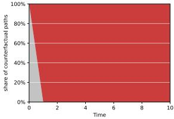  
(i) � = 0

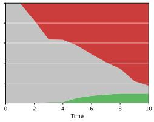  
(ii) � = 1

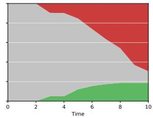  
(iii) � = 2

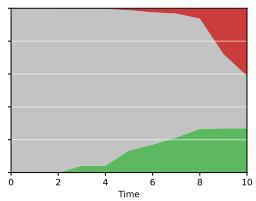  
(iv) � = 5

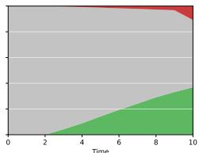  
(v) � = 8  
(b) Sepsis: share of counterfactual paths at each time step where the patient has recovered (green), remains in treatment (grey), or has died (red)

Figure 4: Behaviour of the data-driven counterfactual policy for a single observed catastrophic path, with varying �, under a CFMDP adversarially chosen from the exact CFIMDP.

with both approaches and measure the percentage of transitions whose lower bound changes when the tight bound is used, both across all transitions and across non-zero probability transitions only, together with the average change in bound width. The full results are reported in Table 5 in Appendix G. The overall efect is small: at most 4.4% of all transitions change, and among non-zero probability transitions, at most 21% in GridWorld $( \wp = 0 . 9 )$ and at most 6% elsewhere, with an average width change of at most 0.06 for the transitions that change. As the previous experiments show, this has little impact on the derived policies, and since tight lower bounds require solving an additional optimisation problem and are slower to compute, the conservative approach is preferable in practice. While comparable in the smaller environments, the Gumbel-max approach scales poorly with the MDP state space, taking 293s on average for Aircraft compared with 10s for our conservative bounds, and is computationally prohibitive for Sepsis.

## 6 Conclusion

We have presented a counterfactual inference approach for MDPs that is robust to both uncertainty in the underlying transition dy- namics and the unknown causal model. We derived closed-form bounds on counterfactual transition probabilities, enabling scalable inference in larger MDPs. Building on these bounds, we introduced minimal robust counterfactual interventions: non-stationary poli-cies that guarantee a desired expected return under all admissible counterfactual dynamics, while minimising the maximum number of action changes. Experiments across diverse MDP environments demonstrate the robustness and scalability of our approach, with counterfactual interventions closely tracking those of the exact counterfactual MDP. Future work will address unobserved con- founding in ofline trajectory datasets and extend our approach to continuous and partially-observable environments.

## References

[1] Alessandro Abate, Maria Prandini, John Lygeros, and Shankar Sastry. 2008. Probabilistic reachability and safety for controlled discrete time stochastic hybrid systems. Automatica 44, 11 (2008), 2724–2734. doi:10.1016/j.automatica.2008.03 .027

[2] Nina L Corvelo Benz and Manuel Gomez Rodriguez. 2022. Counterfactual inference of second opinions. In Uncertainty in Artificial Intelligence. PMLR, 453–463.

[3] Lars Buesing, Theophane Weber, Yori Zwols, Sébastien Racanière, Arthur Guez, Jean-Baptiste Lespiau, and Nicolas Heess. 2019. Woulda, coulda, shoulda: Counterfactually-guided policy search. In International Conference on Learning Representations (ICLR).

[4] Ivi Chatzi, Nina Corvelo Benz, Eleni Straitouri, Stratis Tsirtsis, and Manuel Gomez Rodriguez. 2025. Counterfactual token generation in large language models. In Proceedings ofthe Fourth Conference on Causal Learning and Reasoning (Proceedings ofMachine Learning Research, Vol. 275). PMLR, 1291–1315.

[5] Charles J Clopper and Egon S Pearson. 1934. The use of confidence or fiducial limits illustrated in the case of the binomial. Biometrika 26, 4 (1934), 404–413.

[6] Rudi Coppola, Andrea Perufo, Licio Romao, Alessandro Abate, and Manuel Mazo Jr. 2024. Data-driven interval MDP for robust control s nthesis. arXiv preprint arXiv:2404.08344 (2024).

[7] Guilherme Duarte, Noam Finkelstein, Dean Knox, Jonathan Mummolo, and Ilya Shpitser. 2024. An automated approach to causal inference in discrete settings. J. Amer. Statist. Assoc. 119, 547 (2024), 1778–1793. doi:10.1080/01621459.2023.22 16909

[8] Eugene A Feinberg and Adam Shwartz. 2012. Handbook of Markov decision processes: methods and applications. Vol. 40. Springer Science & Business Media.

[9] Robert Givan, Sonia Leach, and Thomas Dean. 2000. Bounded-parameter Markov decision processes. Artificial Intelligence 122, 1 (2000), 71–109. doi:10.1016/S0004- 3702(00)00047-3

[10] Dennis Gross, Nils Jansen, Sebastian Junges, and Guillermo A Pérez. 2022. COOL-MC: a comprehensive tool for reinforcement learning and model checking. In Dependable Software Engineering. Theories, Tools, and Applications: 8th International Symposium, SETTA 2022, Beijing, China, October 27-29, 2022, Proceedings. Springer, 41–49.

[11] Joseph Y Halpern. 2016. Actual causality. MIT Press.

[12] Joseph Y. Halpern and Judea Pearl. 2005. Causes and explanations: A structuralmodel approach. Part I: Causes. The British Journal for the Philosophy of Science 56, 4 (2005), 843–887.

[13] Rodrigo Toro Icarte, Toryn Q Klassen, Richard Valenzano, and Sheila A McIlraith. 2022. Reward machines: Exploiting reward function structure in reinforcement learning. Journal ofArtificial Intelligence Research 73 (2022), 173–208.

[14] Milad Kazemi, Jessica Lally, Ekaterina Tishchenko, Hana Chockler, and Nicola Paoletti. 2025. Counterfactual influence in Markov decision processes. In Proceedings ofthe Fourth Conference on Causal Learning and Reasoning (Proceedings ofMachine Learning Research, Vol. 275), Biwei Huang and Mathias Drton (Eds.). PMLR, 792–817. https://proceedings.mlr.press/v275/kazemi25a.html

[15] Taylor W Killian, Marzyeh Ghassemi, and Shalmali Joshi. 2022. Counterfactually guided policy transfer in clinical settings. In Conference on Health, Inference, and Learning. PMLR, 5–31.

[16] M. Kwiatkowska, G. Norman, and D. Parker. 2011. PRISM 4.0: Verification of probabilistic real-time systems. In Proc. 23rd International Conference on Computer Aided Verification (CAV’11) (LNCS, Vol. 6806), G. Gopalakrishnan and S. Qadeer (Eds.). S rin er, 585–591.

[17] Jessica Lally, Milad Kazemi, and Nicola Paoletti. 2026. Robust counterfactual inference in Markov decision processes. In Proceedings ofthe 25th International Conference on Autonomous Agents and Multiagent Systems (Paphos, Cyprus) (AAMAS ’26). International Foundation for Autonomous Agents and Multiagent Systems, Richland, SC, 1527–1535. doi:10.65109/TXUQ4572

[18] Chaochao Lu, Biwei Huang, Ke Wang, José Miguel Hernández-Lobato, Kun Zhang, and Bernhard Schölkopf. 2020. Sample-eficient reinforcement learning via counterfactual-based data augmentation. arXiv preprint arXiv:2012.09092 (2020).

[19] Chris J Maddison, Daniel Tarlow, and Tom Minka. 2014. A\* sampling. Advances in Neural Information Processing Systems 27 (2014).

[20] Frederik Baymler Mathiesen, Morteza Lahijanian, and Luca Laurenti. 2024. IntervalMDP.jl: Accelerated value iteration for interval Markov decision processes. IFAC-PapersOnLine 58, 11 (2024), 1–6. 8th IFAC Conference on Analysis and Design of Hybrid Systems (ADHS 2024). doi:10.1016/j.ifacol.2024.07.416

[21] Tobias Meggendorfer, Maximilian Weininger, and Patrick Wienhöft. 2024. What are the odds? Improving the foundations of statistical model checking. arXiv preprint arXiv:2404.05424 (2024).

[22] Kimia Noorbakhsh and Manuel Gomez Rodriguez. 2022. Counterfactual temporal point processes. Advances in Neural Information Processing Systems 35 (2022), 24810–24823.

[23] Michael Oberst and David Sontag. 2019. Counterfactual of-policy evaluation with Gumbel-max structural causal models. In Proceedings ofthe 36th International Conference on Machine Learning (Proceedings ofMachine Learning Research, Vol. 97), Kamalika Chaudhuri and Ruslan Salakhutdinov (Eds.). PMLR, 4881–4890. https://proceedings.mlr.press/v97/oberst19a.html

[24] Judea Pearl. 2009. Causality (2nd ed.). Cambridge University Press. doi:10.1017/ CBO9780511803161

[25] Edoardo Pona, Milad Kazemi, Yali Du, David Watson, and Nicola Paoletti. 2025. Abstract counterfactuals for language model agents. In Advances in Neural Information Processing Systems, D. Belgrave, C. Zhang, H. Lin, R. Pascanu, P. Koniusz, M. Ghassemi, and N. Chen (Eds.), Vol. 38, Main Conference. Curran Associates, Inc., 87484–87509. doi:10.52202/085713-2925

[26] Yannik Schnitzer, Alessandro Abate, and David Parker. 2025. Certifiabl robust policies for uncertain parametric environments. In Tools and Algorithms for the Construction and Analysis ofSystems, Arie Gurfinkel and Marijn Heule (Eds.). Springer Nature Switzerland, Cham, 63–83.

[27] Marnix Suilen, Thiago D Simão, David Parker, and Nils Jansen. 2022. Robust anytime learning of Markov decision processes. Advances in Neural Information Processing Systems 35 (2022), 28790–28802.

[28] Yuewen Sun, Erli Wang, Biwei Huang, Chaochao Lu, Lu Feng, Changyin Sun, and Kun Zhang. 2024. ACAMDA: improving data eficiency in reinforcement learning through guided counterfactual data augmentation. In Proceedings of the AAAI Conference on Artificial Intelligence, Vol. 38. 15193–15201.

[29] Stratis Tsirtsis, Abir De, and Manuel Gomez Rodriguez. 2021. Counterfactual explanations in sequential decision making under uncertainty. Advances in Neural Information Processing Systems 34 (2021), 30127–30139.

[30] Stratis Tsirtsis and Manuel Gomez Rodriguez. 2023. Finding counterfactually optimal action sequences in continuous state spaces. In Advances in Neural Information Processing Systems, A. Oh, T. Naumann, A. Globerson, K. Saenko, M. Hardt and S. Levine (Eds.) Vol. 36. Curran Associates Inc. 3220–3247.

[31] Marco Zafalon, Alessandro Antonucci, Rafael Cabañas, David Huber, and Dario Azzimonti. 2024. Eficient computation of counterfactual bounds. International Journal of Approximate Reasoning 171 (2024), 109111. Synergies between Machine Learning and Reasoning. doi:10.1016/j.ijar.2023.109111

[32] Junzhe Zhang, Jin Tian, and Elias Bareinboim. 2022. Partial counterfactual identification from observational and experimental data. In Proceedings ofthe 39th International Conference on Machine Learning (Proceedings ofMachine Learning Research, Vol. 162), Kamalika Chaudhuri, Stefanie Jegelka, Le Song, Csaba Sze esvari, Gan Niu, and Sivan Sabato (Eds.). PMLR, 26548–26558.

[33] Qingfu Zhu, Weinan Zhang, Ting Liu, and William Yang Wang. 2020. Counterfactual of-policy training for neural dialogue generation. In Proceedings of the 2020 Conference on Empirical Methods in Natural Language Processing (EMNLP). 3438–3448.

# Robust Counterfactuals for Markov Decision Processes under Statistical and Causal Uncertainties (Supplementary Material)

## A Counterfactual Probability Bounds for MDPs

We copy the counterfactual probability bounds proven by Lally et al. [17] below, under the assumptions of counterfactual stability and counterfactual monotonicity:

Definition A.1 (Counterfactual stability). An MDP SCM (1) satisfies counterfactual stability if, given we observed the transition $s _ { t } , a _ { t } \to s _ { t + 1 }$ at time �, the counterfactual outcome under a diferent state-action pair $( s , a )$ will not change to some $S _ { t + 1 } = s ^ { \prime } \neq s _ { t + 1 }$ unless $\frac { P ( s _ { t + 1 } \mid s , a ) } { P ( s _ { t + 1 } \mid s _ { t } , a _ { t } ) } <$ $\frac { P ( s ^ { \prime } \mid s , a ) } { P ( s ^ { \prime } \mid s _ { t } , a _ { t } ) } .$

Definition A.2 (Counterfactual monotonicity). An MDP SCM (1) satisfies counterfactual monotonicity if, upon observing the transition $s _ { t } , a _ { t } \to s _ { t + 1 } .$ then, $\forall s \in S , a \in { \mathcal { A } } :$

(Mon1) $\tilde { P } _ { t } ( s _ { t + 1 } \mid s , a ) \geq P ( s _ { t + 1 } \mid s , a ) \mathrm { ( i . e . }$ ., observing an outcome cannot make it less likely in the counterfactual world), and

(Mon2) $\forall s ^ { \prime } \neq s _ { t + 1 }$ with $P ( s ^ { \prime } \mid s _ { t } , a _ { t } ) > 0 , \tilde { P } _ { t } ( s ^ { \prime } \mid s , a ) \le P ( s ^ { \prime } \mid s , a )$ (i.e., not observing a possible outcome cannot make it more likely in the counterfactual world).

For any MDP M and observed transition $s _ { t } , a _ { t } \to s _ { t + 1 } ,$ , we can bound the counterfactual probability of any transition $s , a \to s ^ { \prime }$ as follows.

Theorem A.3. When the counterfactual state-action pair is the observed state-action pair, $( s , a ) = ( s _ { t } , a _ { t } )$ , the counterfactual probability bounds are as follows:

$$
\begin{array} { r } { \tilde { P } _ { t } ^ { L B } ( s _ { t + 1 } \mid s _ { t } , a _ { t } ) = \tilde { P } _ { t } ^ { U B } ( s _ { t + 1 } \mid s _ { t } , a _ { t } ) = 1 } \end{array}
$$

$$
\forall s ^ { \prime } \in S \ \backslash \ \{ s _ { t + 1 } \} , \tilde { P } _ { t } ^ { L B } ( s ^ { \prime } \mid s _ { t } , a _ { t } ) = \tilde { P } _ { t } ^ { U B } ( s ^ { \prime } \mid s _ { t } , a _ { t } ) = 0
$$

Theorem A.4. When the counterfactual state-action pair $( s , a ) \neq ( s _ { t } , a _ { t } )$ and has disjoint supportfrom the observed $\left( { { s _ { t } } , { a _ { t } } } \right)$ , the counterfactual probability bounds are as follows, $\forall s ^ { \prime } \in S .$

$$
\tilde { P } _ { t } ^ { U B } ( s ^ { \prime } \mid s , a ) = \left\{ \begin{array} { l l } { \frac { P ( s ^ { \prime } \mid s , a ) } { P ( s _ { t + 1 } \mid s _ { t } , a _ { t } ) } ~ } & { \mathrm { i f } ~ P ( s ^ { \prime } \mid s , a ) < P ( s _ { t + 1 } \mid s _ { t } , a _ { t } ) } \\ { 1 ~ } & { \mathrm { o t h e r w i s e } } \end{array} \right.
$$

$$
\tilde { P } _ { t } ^ { L B } ( s ^ { \prime } \mid s , a ) = \left\{ \begin{array} { l l } { \frac { P ( s ^ { \prime } \mid s , a ) - \big ( 1 - P ( s _ { t + 1 } \mid s _ { t } , a _ { t } ) \big ) } { P ( s _ { t + 1 } \mid s _ { t } , a _ { t } ) } } & { \mathrm { i f ~ } P ( s ^ { \prime } \mid s , a ) > } \\ { 0 } & { 1 - P ( s _ { t + 1 } \mid s _ { t } , a _ { t } ) } \\ { 0 } & { \mathrm { o t h e r w i s e . } } \end{array} \right.
$$

Theorem A.5. When the counterfactual state-action pair $( s , a ) \neq ( s _ { t } , a _ { t } )$ and has overlapping support with the observed $\left( { { s _ { t } } , { a _ { t } } } \right)$ , the counterfactual probability bounds are as follows, $\forall s ^ { \prime } \in S .$

$$
\tilde { P } _ { t } ^ { U B } ( s ^ { \prime } \mid s , a ) = \left\{ \begin{array} { l l } { \frac { \operatorname* { m i n } \Big ( P ( s _ { t + 1 } \mid s , a _ { t } ) , P ( s _ { t + 1 } \mid s , a ) \Big ) } { P ( s _ { t + 1 } \mid s _ { t } , a _ { t } ) } } & { i f s ^ { \prime } = s _ { t + 1 } } \\ { 0 } & { \mathrm { i f ~ C S ~ c o n d i t i o n s ~ h o l d } } \\ { \operatorname* { m i n } \Big ( P ( s ^ { \prime } \mid s , a ) , 1 - P ( s _ { t + 1 } \mid s , a ) \Big ) } & { \mathrm { i f ~ } P ( s ^ { \prime } \mid s _ { t } , a _ { t } ) > 0 } \\ { \operatorname* { m i n } \left( 1 - P ( s _ { t + 1 } \mid s , a ) , \frac { P ( s ^ { \prime } \mid s , a ) } { P ( s _ { t + 1 } \mid s _ { t } , a _ { t } ) } \right) } & { \mathrm { o t h e r w i s e } } \end{array} \right.
$$

$$
\tilde { P } _ { t } ^ { L B } ( s ^ { \prime } \mid s , a ) = \left\{ \begin{array} { l l } { \mathrm { m a x } \left( P ( s ^ { \prime } \mid s , a ) , 1 - \sum _ { s ^ { \prime \prime } \in S \backslash \{ s ^ { \prime \prime } \} } \tilde { P } _ { t } ^ { U B } ( s ^ { \prime \prime } \mid s , a ) \right) } & { \mathrm { ~ i f ~ } s ^ { \prime } = s _ { t + 1 } } \\ { 0 } & { \mathrm { ~ i f ~ } \mathrm { C S } \mathrm { ~ c o n d i t i o n s ~ h o l d } } \\  \operatorname* { m a x } \left( 0 , 1 - \sum _ { s ^ { \prime \prime } \in S \backslash \{ s ^ { \prime \} \} } \tilde { P } _ { t } ^ { U B } ( s ^ { \prime \prime } \mid s , a ) \right) } & { \mathrm { ~ o t h e r w i s e } } \end{array} \right.
$$

where the counterfactual stability (CS) conditions are $P ( s ^ { \prime } \mid s _ { t } , a _ { t } ) > 0$ and $\frac { P ( s _ { t + 1 } \mid s , a ) } { P ( s _ { t + 1 } \mid s _ { t } , a _ { t } ) } \geq \frac { P ( s ^ { \prime } \mid s , a ) } { P ( s ^ { \prime } \mid s _ { t } , a _ { t } ) }$

## B Proofs

Let $M _ { \updownarrow }$ be an arbitrary IMDP. For a given counterfactual transition $s , a \to s ^ { \prime }$ and observed transition $s _ { t } , a _ { t } \to s _ { t + 1 }$ , the optimisation problems defined in (7) and (8) yield the upper and lower bounds on the counterfactual probability of $s , a \to s ^ { \prime }$ respectively, under the following assumptions.

Assumption B.1 (Normalisation). For any IMDP $M _ { \updownarrow }$ , we assume the transition bounds have been normalised in the sense that, $\forall s , a , s ^ { \prime } \colon$

$$
P _ { \mathcal { M } _ { \updownarrow } } ^ { L B } ( s ^ { \prime } \mid s , a ) \ge 1 - \sum _ { s ^ { \prime \prime } \in S \backslash \{ s ^ { \prime } \} } P _ { \mathcal { M } _ { \updownarrow } } ^ { U B } ( s ^ { \prime \prime } \mid s , a )
$$

$$
P _ { \mathcal { M } _ { \updownarrow } } ^ { U B } ( s ^ { \prime } \mid s , a ) \le 1 - \sum _ { s ^ { \prime \prime } \in S \backslash \{ s ^ { \prime } \} } P _ { \mathcal { M } _ { \updownarrow } } ^ { L B } ( s ^ { \prime \prime } \mid s , a )
$$

This is not a stron assum tion, because an feasible MDP $\boldsymbol { \mathscr { M } } \in \boldsymbol { \mathscr { M } } _ { \updownarrow }$ must have transition robabilities that sum to 1, so an IMDP can be tightened to meet the above conditions without altering the set of compatible MDPs.

Assumption B.2 (Non-zero Lower Bounds of Observed Transitions). Given any arbitrary IMDP $M _ { \updownarrow }$ , we assume that, for any feasible $\mathcal { M } \in \mathcal { M } _ { \updownarrow } , P _ { \mathcal { M } } ( s _ { t + 1 } \mid s _ { t } , a _ { t } ) > 0 ,$ , i.e., we assume $P _ { \mathcal { M } _ { \widehat { \updownarrow } } } ^ { L B } ( s _ { t + 1 } \mid s _ { t } , a _ { t } ) > 0$

This assumption must hold, because we observed the transition $s _ { t } , a _ { t } \to s _ { t + 1 }$ , hence the true MDP must have $P _ { M } ( s _ { t + 1 } \mid s _ { t } , a _ { t } ) > 0 .$

## B.1 Observed $\left( { { s _ { t } } , { a _ { t } } } \right)$

Theorem B.3. Assume $\mathbf { \xi } ( s , a ) = ( s _ { t } , a _ { t } )$ . For outgoing transitions from the observed state-action pair $\left( { { s _ { t } } , { a _ { t } } } \right)$ , the optimisation problem in (7) will produce an upper bound of:

$$
\tilde { P } _ { M _ { \updownarrow } } ^ { U B } ( s ^ { \prime } \mid s , a ) = \left\{ 1 \ \begin{array} { l l } { { i f s ^ { \prime } = s _ { t + 1 } } } \\ { { 0 } } & { { o t h e r w i s e } } \end{array} \right.
$$

and the optimisation problem in (8) will produce a lower bound of:

$$
\tilde { P } _ { M _ { \updownarrow } } ^ { L B } ( s ^ { \prime } \mid s , a ) = \left\{ 1 \ \begin{array} { l l } { { i f s ^ { \prime } = s _ { t + 1 } } } \\ { { 0 } } & { { o t h e r w i s e } } \end{array} \right.
$$

across all $M \in M _ { \updownarrow }$

Proof. For all MDPs $M \in M _ { \updownarrow }$ , we know that the counterfactual probability for all transitions from the observed state-action pair $\left( { { s _ { t } } , { a _ { t } } } \right)$ will be:

$$
\begin{array} { r l r } & { } & { \tilde { P } _ { , M , t } ^ { L B } ( s _ { t + 1 } \mid s _ { t } , a _ { t } ) = \tilde { P } _ { , M , t } ^ { U B } ( s _ { t + 1 } \mid s _ { t } , a _ { t } ) = 1 ~ } \\ & { } & { \forall s ^ { \prime } \in S \setminus \{ s _ { t + 1 } \} , \tilde { P } _ { , M , t } ^ { L B } ( s ^ { \prime } \mid s _ { t } , a _ { t } ) = \tilde { P } _ { , M , t } ^ { U B } ( s ^ { \prime } \mid s _ { t } , a _ { t } ) = 0 ~ } \end{array}
$$

Therefore, if $s ^ { \prime } = s _ { t + 1 } { : }$

$$
\begin{array} { r } { \tilde { P } _ { M _ { \updownarrow } , t } ^ { U B } ( s ^ { \prime } \mid s , a ) = \operatorname* { m a x } _ { M \in \mathcal { M } _ { \updownarrow } } \left( \tilde { P } _ { M , t } ^ { U B } ( s _ { t + 1 } \mid s _ { t } , a _ { t } ) \right) = \operatorname* { m a x } _ { \mathcal { M } \in \mathcal { M } _ { \updownarrow } } 1 = 1 } \end{array}
$$

$$
\begin{array} { r } { \tilde { P } _ { M _ { \updownarrow } , t } ^ { L B } ( s ^ { \prime } \mid s , a ) = \operatorname* { m i n } _ { \mathcal { M } \in \mathcal { M } _ { \updownarrow } } \left( \tilde { P } _ { M , t } ^ { L B } ( s _ { t + 1 } \mid s _ { t } , a _ { t } ) \right) = \operatorname* { m i n } _ { \mathcal { M } \in \mathcal { M } _ { \updownarrow } } 1 = 1 } \end{array}
$$

and ${ \mathrm { i f ~ } } s ^ { \prime } \in S \setminus \left\{ s _ { t + 1 } \right\}$

$$
\begin{array} { r } { \tilde { P } _ { \mathcal { M } _ { \mathfrak { T } } , t } ^ { U B } ( s ^ { \prime } \mid s , a ) = \operatorname* { m a x } _ { \mathcal { M } \in \mathcal { M } _ { \mathfrak { T } } } \left( \tilde { P } _ { \mathcal { M } , t } ^ { U B } ( s ^ { \prime } \mid s _ { t } , a _ { t } ) \right) = \operatorname* { m a x } _ { \mathcal { M } \in \mathcal { M } _ { \mathfrak { T } } } 0 = 0 } \end{array}
$$

$$
\begin{array} { r } { \tilde { P } _ { \mathcal { M } _ { \mathfrak { T } } , t } ^ { L B } ( s ^ { \prime } \mid s , a ) = \operatorname* { m i n } _ { \mathcal { M } \in \mathcal { M } _ { \mathfrak { T } } } \left( \tilde { P } _ { \mathcal { M } , t } ^ { L B } ( s ^ { \prime } \mid s _ { t } , a _ { t } ) \right) = \operatorname* { m i n } _ { \mathcal { M } \in \mathcal { M } _ { \mathfrak { T } } } 0 = 0 } \end{array}
$$

□

## B.2 Disjoint $( s , a )$

## B.2.1 Upper Bound.

Theorem B.4. Assume $\left( s , a \right) \neq \left( s _ { t } , a _ { t } \right)$ , and assume that the support $o f ( s , a )$ is disjoint from the support $o f ( s _ { t } , a _ { t } )$ in the IMDP $M _ { \updownarrow }$ . In this case, the optimisation problem in (7) will produce an upper bound of:

$$
\tilde { P } _ { M _ { \updownarrow } , t } ^ { U B } ( s ^ { \prime } \mid s , a ) = \left\{ \begin{array} { l l } { P _ { M _ { \updownarrow } } ^ { U B } ( s ^ { \prime } \mid s , a ) } & \\ { \overline { { P _ { M _ { \updownarrow } } ^ { L B } ( s _ { t + 1 } \mid s _ { t } , a _ { t } ) } } } & { i f P _ { M _ { \updownarrow } } ^ { U B } ( s ^ { \prime } \mid s , a ) < P _ { M _ { \updownarrow } } ^ { L B } ( s _ { t + 1 } \mid s _ { t } , a _ { t } ) } \\ { 1 } & { o t h e r w i s e } \end{array} \right.
$$

Proof. Because the supports of $( s , a )$ and $\left( { { s _ { t } } , { a _ { t } } } \right)$ are disjoint in the IMDP $M _ { \updownarrow }$ , this means that $\forall s ^ { \prime } \in S , P _ { M _ { \widehat { \mathbb { T } } } } ^ { U B } ( s ^ { \prime } \mid s , a ) > 0 \Rightarrow P _ { M _ { \widehat { \mathbb { T } } } } ^ { U B } ( s ^ { \prime } \mid$ $s _ { t } , a _ { t } ) = 0$ , and $\forall s ^ { \prime } \in S , P _ { M _ { \uparrow } } ^ { U B } ( s ^ { \prime } \mid s _ { t } , a _ { t } ) > 0 \Rightarrow P _ { M _ { \uparrow } } ^ { U B } ( s ^ { \prime } \mid s , a ) = 0$ . Therefore, in any MDP $\boldsymbol { \mathscr { M } } \in \boldsymbol { \mathscr { M } } _ { \updownarrow }$ , the supports of $( s , a )$ and $\left( { { s _ { t } } , { a _ { t } } } \right)$ are guaranteed to be disjoint as well.

For any MDP $\boldsymbol { \mathscr { M } } \in \boldsymbol { \mathscr { M } } _ { \updownarrow }$ , the proven closed-form solution to the upper bound $\tilde { P } _ { M , t } ^ { U B } ( s ^ { \prime } \mid s , a )$ is:

$$
\tilde { P } _ { M , t } ^ { U B } ( s ^ { \prime } \mid s , a ) = \left\{ \begin{array} { l l } { \frac { P _ { M } ( s ^ { \prime } \mid s , a ) } { P _ { M } ( s _ { t + 1 } \mid s _ { t } , a _ { t } ) } } & { \mathrm { i f } \ P _ { M } ( s ^ { \prime } \mid s , a ) < P _ { M } ( s _ { t + 1 } \mid s _ { t } , a _ { t } ) } \\ { 1 } & { \mathrm { o t h e r w i s e } } \end{array} \right.
$$

Therefore, to identify the upper bound, we need to maximise this over all MDPs $\boldsymbol { \mathscr { M } } \in \boldsymbol { \mathscr { M } } _ { \updownarrow }$ . Clearly, if there exist MDPs $M \in M _ { \updownarrow }$ where $P _ { M } ( s ^ { \prime } \mid s , a ) < P _ { M } ( s _ { t + 1 } \mid s _ { t } , a _ { t } )$ , then $\frac { P _ { M } ( s ^ { \prime } \mid s , a ) } { P _ { M } ( s _ { t + 1 } \mid s _ { t } , a _ { t } ) } < 1$ , so the absolute maximum value of $\tilde { P } _ { M , t } ^ { U B } ( s ^ { \prime } \mid s , a )$ across all MDPs cannot be greater than 1.

Consider whether $P _ { { M _ { \mathrm { { \widehat { \cal 1 } } } } } } ^ { U B } ( s ^ { \prime } \mid s , a ) < P _ { { M _ { \mathrm { { \widehat { \cal 1 } } } } } } ^ { L B } ( s _ { t + 1 } \mid s _ { t } , a _ { t } ) ;$

(1) If $P _ { \mathcal { M } _ { \uparrow } } ^ { U B } ( s ^ { \prime } \mid s , a ) \ge P _ { \mathcal { M } _ { \uparrow } } ^ { L B } ( s _ { t + 1 } \mid s _ { t } , a _ { t } )$ , then, because of Assum tion B.1, there must exist an MDP $M \in M _ { \updownarrow }$ where $P _ { M } ( s _ { t + 1 } \mid s _ { t } , a _ { t } ) =$ $P _ { M _ { \uparrow } } ^ { L B } ( s _ { t + 1 } \mid s _ { t } , a _ { t } )$ and $\dot { P } _ { M } ( s ^ { \prime } \mid s , a ) = P _ { M _ { \uparrow } } ^ { U B } ( s ^ { \prime } \mid s , a )$ . Because $P _ { { M _ { \uparrow } } } ^ { U B } ( s ^ { \prime } \mid s , a ) \ge P _ { { M _ { \uparrow } } } ^ { L B } ( s _ { t + 1 } \mid s _ { t } , a _ { t } )$ , we know that in MDP M, the upper bound counterfactual probability $\tilde { P } _ { M , t } ^ { U B } ( s ^ { ' } \mid s , a ) = 1$ . Since this is the maximum possible counterfactual probability, this means that $\tilde { P } _ { M _ { \uparrow } , t } ^ { U B } ( s ^ { \prime } \mid s , a ) = 1$

(2) Otherwise, if $P _ { { M _ { \widehat { \updownarrow } } } } ^ { U B } ( s ^ { \prime } \mid s , a ) < P _ { { M _ { \widehat { \updownarrow } } } } ^ { L B } ( s _ { t + 1 } \mid s _ { t } , a _ { t } )$ , then, for every MDP $\mathcal { M } \in M _ { \updownarrow } , P _ { \mathcal { M } } ( s ^ { \prime } \mid s , a ) < P _ { \mathcal { M } } ( s _ { t + 1 } \mid s _ { t } , a _ { t } )$ . Therefore, for every MDP, the upper bound counterfactual probability for the transition will be $\tilde { P } _ { M , t } ^ { U B } ( s ^ { \prime } \mid s , a ) = \frac { P _ { M } ( s ^ { \prime } \mid s , a ) } { P _ { M } ( s _ { t + 1 } \mid s _ { t } , a _ { t } ) }$ . Therefore, the maximum upper bound counterfactual probability is:

$$
\begin{array} { r l } & { \tilde { P } _ { \mathcal M _ { \mathfrak L } } ^ { U B } ( s ^ { \prime } \mid s , a ) = \operatorname* { m a x } _ { M \in \mathcal M _ { \mathfrak L } } \left( \tilde { P } _ { \mathcal M , t } ^ { U B } ( s ^ { \prime } \mid s , a ) \right) } \\ & { \qquad = \operatorname* { m a x } _ { M \in \mathcal M _ { \mathfrak L } } \left( \frac { P _ { \mathcal M } ( s ^ { \prime } \mid s , a ) } { P _ { \mathcal M } ( s _ { t + 1 } \mid s _ { t } , a _ { t } ) } \right) } \\ & { \qquad = \frac { P _ { \mathcal M _ { \mathfrak L } } ^ { U B } ( s ^ { \prime } \mid s , a ) } { P _ { \mathcal M _ { \mathfrak L } } ^ { L B } ( s _ { t + 1 } \mid s _ { t } , a _ { t } ) } } \end{array}
$$

Because of Assumption B.1, there must exist an MDP M where $P _ { \cal M } ( s _ { t + 1 } \mid s _ { t } , a _ { t } ) = P _ { \cal M _ { \uparrow } } ^ { L B } ( s _ { t + 1 } \mid s _ { t } , a _ { t } ) \mathrm { a n d } P _ { \cal M } ( s ^ { \prime } \mid s , a ) = P _ { { \cal M } _ { \uparrow } } ^ { U B } ( s ^ { \prime } \mid s , a )$ Also, note that because of Assumption B.2, $P _ { \mathcal { M } _ { \uparrow } } ^ { L B } ( s _ { t + 1 } \mid s _ { t } , a _ { t } ) > 0$

Therefore, the maximum upper bound counterfactual probability in this case is

$$
\tilde { P } _ { { M _ { \updownarrow } } } ^ { U B } ( s ^ { \prime } \mid s , a ) = \frac { P _ { { M _ { \updownarrow } } } ^ { U B } ( s ^ { \prime } \mid s , a ) } { P _ { { M _ { \updownarrow } } } ^ { L B } ( s _ { t + 1 } \mid s _ { t } , a _ { t } ) }
$$

Also, note that because of Assumption B.2, $P _ { M _ { \uparrow } } ^ { L B } ( s _ { t + 1 } \mid s _ { t } , a _ { t } ) > 0 .$

We can combine these cases as follows:

$$
\tilde { P } _ { M _ { \updownarrow } , t } ^ { U B } ( s ^ { \prime } \mid s , a ) = \left\{ \begin{array} { l l } { P _ { M _ { \updownarrow } } ^ { U B } ( s ^ { \prime } \mid s , a ) } & { \mathrm { ~ i f ~ } P _ { M _ { \updownarrow } } ^ { U B } ( s ^ { \prime } \mid s , a ) < P _ { M _ { \updownarrow } } ^ { L B } ( s _ { t + 1 } \mid s _ { t } , a _ { t } ) } \\ { P _ { M _ { \updownarrow } } ^ { L B } ( s _ { t + 1 } \mid s _ { t } , a _ { t } ) } & { \mathrm { ~ o t h e r w i s e ~ } } \end{array} \right.
$$

## B.2.2 Lower Bound.

Theorem B.5. Assume $\left( s , a \right) \neq \left( s _ { t } , a _ { t } \right)$ , and assume that the support $o f ( s , a )$ is disjoint from the support $o f ( s _ { t } , a _ { t } )$ in the IMDP $M _ { \updownarrow } .$ . In this case, the optimisation problem in (8) will produce a lower bound of:

$$
\tilde { P } _ { M _ { \uparrow } , t } ^ { L B } ( s ^ { \prime } \mid s , a ) = \left\{ \begin{array} { l l } { P _ { M _ { \uparrow } } ^ { L B } ( s ^ { \prime } \mid s , a ) - ( 1 - P _ { M _ { \uparrow } } ^ { L B } ( s _ { t + 1 } \mid s _ { t } , a _ { t } ) ) } & { i f P _ { M _ { \uparrow } } ^ { L B } ( s ^ { \prime } \mid s , a ) > 1 - P _ { M _ { \uparrow } } ^ { L B } ( s _ { t + 1 } \mid s _ { t } , a _ { t } ) } \\ { P _ { M _ { \downarrow } } ^ { L B } ( s _ { t + 1 } \mid s _ { t } , a _ { t } ) } & { o t h e r w i s e } \end{array} \right.
$$

Proof. Because the supports of $( s , a )$ and $\left( { { s _ { t } } , { a _ { t } } } \right)$ are disjoint in the IMDP $M _ { \updownarrow }$ , this means that ∀�′ $\in S , P _ { M _ { \uparrow } } ^ { U B } ( s ^ { \prime } \mid s , a ) > 0 \Rightarrow P _ { M _ { \uparrow } } ^ { U B } ( s ^ { \prime } \mid$ $s _ { t } , a _ { t } ) = 0$ , and $\forall s ^ { \prime } \in S , P _ { M _ { \uparrow } } ^ { U B } ( s ^ { \prime } \mid s _ { t } , a _ { t } ) > 0 \Longrightarrow P _ { M _ { \uparrow } } ^ { U B } ( s ^ { \prime } \mid s , a ) = 0$ . Therefore, in any MDP $\boldsymbol { \mathscr { M } } \in \boldsymbol { \mathscr { M } } _ { \updownarrow }$ , the supports of $( s , a )$ and $\left( { { s _ { t } } , { a _ { t } } } \right)$ are guaranteed to be disjoint as well.

For any MDP $\boldsymbol { \mathscr { M } } \in \boldsymbol { \mathscr { M } } _ { \updownarrow } ,$ , the proven closed-form solution to the lower bound $\tilde { P } _ { M , t } ^ { L B } ( s ^ { \prime } \mid s , a )$ is:

$$
\tilde { P } _ { M , t } ^ { L B } ( s ^ { \prime } \mid s , a ) = \left\{ \begin{array} { l l } { \frac { P _ { M } ( s ^ { \prime } \mid s , a ) - \left( 1 - P _ { M } ( s _ { t + 1 } \mid s _ { t } , a _ { t } ) \right) } { P _ { M } ( s _ { t + 1 } \mid s _ { t } , a _ { t } ) } } & { \mathrm { i f } \ P _ { M } ( s ^ { \prime } \mid s , a ) > 1 - P _ { M } ( s _ { t + 1 } \mid s _ { t } , a _ { t } ) } \\ { 0 } & { \mathrm { o t h e r w i s e } } \end{array} \right.
$$

Therefore, to identif the lower bound, we need to minimise this over all MDPs $M \in M _ { \updownarrow }$ . Clearly, for any MDP M where $P _ { M } ( s ^ { \prime } \mid s , a ) >$ $1 - P _ { \cal M } ( s _ { t + 1 } \mid s _ { t } , a _ { t } )$

$$
\frac { P _ { \ M } ( s ^ { \prime } \mid s , a ) - ( 1 - P _ { \ M } ( s _ { t + 1 } \mid s _ { t } , a _ { t } ) ) } { P _ { \ M } ( s _ { t + 1 } \mid s _ { t } , a _ { t } ) } > 0
$$

Therefore, the absolute minimum value of $\tilde { P } _ { M , t } ^ { L B } ( s ^ { \prime } \mid s , a )$ across all MDPs cannot be less than 0. Consider whether $P _ { M _ { \widehat { \updownarrow } } } ^ { L B } ( s ^ { \prime } \mid s , a ) >$ $1 - P _ { { M } _ { \uparrow } } ^ { L B } ( s _ { t + 1 } \mid s _ { t } , a _ { t } )$

(1) If $\cdot P _ { \mathcal { M } _ { \uparrow } } ^ { L B } ( s ^ { \prime } \mid s , a ) \leq 1 - P _ { \mathcal { M } _ { \uparrow } } ^ { L B } ( s _ { t + 1 } \mid s _ { t } , a _ { t } )$ , then, because of Assumption B.1, there must exist an MDP M where $P _ { M } ( s _ { t + 1 } \mid s _ { t } , a _ { t } ) =$ $P _ { M _ { \uparrow } } ^ { L B } ( s _ { t + 1 } \mid s _ { t } , a _ { t } )$ and $P _ { M } \left( s ^ { \prime } \mid s , a \right) = P _ { M _ { \uparrow } } ^ { L B } \left( s ^ { \prime } \mid s , a \right)$ . Because $P _ { \mathcal { M } _ { \widehat { 1 } } } ^ { L B } ( s ^ { \prime } \mid s , a ) \leq 1 - P _ { \mathcal { M } _ { \widehat { 1 } } } ^ { L B } ( s _ { t + 1 } \mid s _ { t } , a _ { t } )$ , we know that in this MDP M, the lower bound counterfactual probability $\tilde { P } _ { M , t } ^ { L B } ( s ^ { \prime } \mid s , a ) = 0$ . Since this is the minimum ossible counterfactual robabilit across all MDPs, this means that $\tilde { P } _ { M _ { \uparrow } , t } ^ { L B } ( s ^ { \prime } \mid s , a ) = 0 .$

(2) Otherwise, $\mathrm { i f } P _ { M _ { \updownarrow } } ^ { L B } ( s ^ { \prime } \mid s , a ) > \breve { 1 } - P _ { M _ { \updownarrow } } ^ { L B } ( s _ { t + 1 } \mid s _ { t } , a _ { t } )$ , then, for every MDP $\mathcal { M } \in \mathcal { M } _ { \updownarrow } , P _ { \mathcal { M } } ( s ^ { \prime } \mid s , a ) > 1 - P _ { \mathcal { M } } ( s _ { t + 1 } \mid s _ { t } , a _ { t } )$ . Therefore, for every MDP, the lower bound counterfactual probability for the transition will be $\tilde { P } _ { \mathcal M , t } ( s ^ { \prime } \mid s , a ) = \frac { P _ { \mathcal M } ( s ^ { \prime } \mid s , a ) - ( 1 - P _ { \mathcal M } ( s _ { t + 1 } \mid s _ { t } , a _ { t } ) ) } { P _ { \mathcal M } ( s _ { t + 1 } \mid s _ { t } , a _ { t } ) }$ Therefore, the minimum lower bound counterfactual probability will be:

$$
\begin{array} { r l } & { \tilde { P } _ { M _ { \updownarrow } } ^ { L B } ( s ^ { \prime } \mid s , a ) = \operatorname* { m i n } _ { M \in \mathcal { M } _ { \updownarrow } } \Big ( \tilde { P } _ { M , t } ^ { L B } ( s ^ { \prime } \mid s , a ) \Big ) } \\ & { \qquad = \operatorname* { m i n } _ { M \in \mathcal { M } _ { \updownarrow } } \Bigg ( \frac { P _ { M } ( s ^ { \prime } \mid s , a ) - \big ( 1 - P _ { M } ( s _ { t + 1 } \mid s , a _ { t } ) \big ) } { P _ { M } ( s _ { t + 1 } \mid s _ { t } , a _ { t } ) } \Bigg ) } \\ & { \qquad = \operatorname* { m i n } _ { M \in \mathcal { M } _ { \updownarrow } } \Bigg ( \frac { P _ { M } ( s ^ { \prime } \mid s , a ) - 1 + P _ { M } ( s _ { t + 1 } \mid s _ { t } , a _ { t } ) } { P _ { M } ( s _ { t + 1 } \mid s _ { t } , a _ { t } ) } \Bigg ) } \\ & { \qquad = \operatorname* { m i n } _ { M \in \mathcal { M } _ { \updownarrow } } \Bigg ( 1 - \bigg ( \frac { 1 - P _ { M } ( s ^ { \prime } \mid s , a ) } { P _ { M } ( s _ { t + 1 } \mid s _ { t } , a _ { t } ) } \bigg ) \Bigg ) } \end{array}
$$

Clearly, this formula will be minimal when $P _ { M } ( s ^ { \prime } \mid s , a ) = P _ { M _ { \uparrow } } ^ { L B } ( s ^ { \prime } \mid s , a )$ and $P _ { M } ( s _ { t + 1 } \mid s _ { t } , a _ { t } ) = P _ { M _ { \uparrow } } ^ { L B } ( s _ { t + 1 } \mid s _ { t } , a _ { t } )$ . Because of Assumption B.1, there must exist an MDP M where $P _ { M } ( s ^ { \prime } \mid s , \dot { a } ) = P _ { M _ { \widehat { \scriptstyle \mathrm { 1 } } } } ^ { L B } ( s ^ { \prime } \mid s , a )$ and $P _ { M } ( s _ { t + 1 } \mid s _ { t } , a _ { t } ) = P _ { M _ { \scriptstyle \frac { 1 } { 2 } } } ^ { L B } ( s _ { t + 1 } \mid s _ { t } , a _ { t } )$ . Also, note that because of Assumption $\mathrm { B } . 2 , P _ { M _ { \uparrow } } ^ { L B } ( s _ { t + 1 } \mid s _ { t } , a _ { t } ) > 0$

Therefore, the minimum lower bound counterfactual probability in this case is:

$$
\tilde { P } _ { \mathcal { M } _ { \updownarrow } } ^ { L B } ( s ^ { \prime } \mid s , a ) = \frac { P _ { \mathcal { M } _ { \updownarrow } } ^ { L B } ( s ^ { \prime } \mid s , a ) - ( 1 - P _ { \mathcal { M } _ { \updownarrow } } ^ { L B } ( s _ { t + 1 } \mid s _ { t } , a _ { t } ) ) } { P _ { \mathcal { M } _ { \updownarrow } } ^ { L B } ( s _ { t + 1 } \mid s _ { t } , a _ { t } ) }
$$

We can combine these cases as follows:

$$
\tilde { P } _ { M _ { \uparrow } , t } ^ { L B } ( s ^ { \prime } \mid s , a ) = \left\{ \begin{array} { l l } { P _ { M _ { \uparrow } } ^ { L B } ( s ^ { \prime } \mid s , a ) - ( 1 - P _ { M _ { \uparrow } } ^ { L B } ( s _ { t + 1 } \mid s _ { t } , a _ { t } ) ) } & { \mathrm { i f } P _ { M _ { \uparrow } } ^ { L B } ( s ^ { \prime } \mid s , a ) > 1 - P _ { M _ { \uparrow } } ^ { L B } ( s _ { t + 1 } \mid s _ { t } , a _ { t } ) } \\ { P _ { M _ { \downarrow } } ^ { L B } ( s _ { t + 1 } \mid s _ { t } , a _ { t } ) } & { \mathrm { o t h e r w i s e } } \end{array} \right.
$$

## B.3 Overlapping Support $( s , a )$

## B.3.1 Upper Bound.

Theorem B.6. Assume $\left( s , a \right) \neq \left( s _ { t } , a _ { t } \right)$ , and assume that the support $o f ( s , a )$ overlaps with the support $o f ( s _ { t } , a _ { t } )$ in the $I M D P { \cal { M } } _ { \updownarrow } .$ . In this case, the optimisation problem in (7) will produce an upper bound of:

$$
\tilde { P } _ { M _ { \updownarrow } , t } ^ { U B } ( s ^ { \prime } \mid s , a ) =
$$

$$
\begin{array} { r l } & { | \operatorname* { m i n } ( P _ { M _ { 1 } ^ { ( k ) } } ^ { \operatorname* { m i n } } ( s _ { t + 1 } \mid s , a ) )  } \\ & { | 0 | \quad } \\ & { | 0 | \quad } \\ & { | \operatorname* { m i n } ( P _ { M _ { 1 } ^ { ( k ) } } ^ { \operatorname* { m a x } } ( s _ { t + 1 } \mid s , a ) )  } \\ & {  | \operatorname* { m i n } ( P _ { M _ { 1 } ^ { ( k ) } } ^ { \operatorname* { m a x } } ( s _ { t + 1 } \mid s , a ) ) - P _ { M _ { 1 } ^ { ( k ) } } ^ { \operatorname* { m i n } } ( s _ { t + 1 } \mid s , a ) )  } \\ & {  \sqrt { \frac { M _ { 1 } ^ { ( k ) } } { M _ { 1 } ^ { ( k ) } } ( s _ { t + 1 } \mid s , s , a ) }   \frac { P _ { M _ { 1 } ^ { ( k ) } } ^ { \operatorname* { m a x } } ( s ^ { \prime } \mid s , a ) } { P _ { M _ { 1 } ^ { ( k ) } } ^ { \operatorname* { m i n } } ( s _ { t + 1 } \mid s , a ) }  } \\ & {  | \operatorname* { m i n } ( P _ { M _ { 1 } ^ { ( k ) } } ^ { \operatorname* { m a x } } ( s ^ { \prime } \mid s , a ) ) - P _ { M _ { 1 } ^ { ( k ) } } ^ { \operatorname* { m i n } } ( s ^ { \prime } \mid s , a ) )  } \\ & { | \operatorname* { m i n } ( 1 - P _ { M _ { 1 } ^ { ( k ) } } ^ { \operatorname* { m i n } } ( s _ { t + 1 } \mid s , a ) ) \frac { P _ { M _ { 1 } ^ { ( k ) } } ^ { \operatorname* { m a x } } ( s ^ { \prime } \mid s , a ) } { P _ { M _ { 1 } ^ { ( k ) } } ^ { \operatorname* { m i n } } ( s _ { t + 1 } \mid s , a ) } )  } \\ &   | \operatorname* { m i n } ( 1 - P _  M _ { 1 } ^  \end{array}
$$

Proof. For any MDP $\boldsymbol { \mathcal { M } } \in \boldsymbol { \mathcal { M } } _ { \updownarrow }$ , the proven closed-form solution to the upper bound $\tilde { P } _ { M , t } ( s ^ { \prime } \mid s , a )$ is as follows:

$$
\tilde { P } _ { M , t } ( s ^ { \prime } \mid s , a ) = \left\{ \begin{array} { l l } { \frac { \operatorname* { m i n } ( P _ { M } ( s _ { t + 1 } \mid s _ { t } , a _ { t } ) , P _ { M } ( s _ { t + 1 } \mid s , a ) ) } { P _ { M } ( s _ { t + 1 } \mid s _ { t } , a _ { t } ) } } & { \mathrm { i f ~ } s ^ { \prime } = s _ { t + 1 } } \\ { 0 } & { \mathrm { i f ~ } P _ { M } ( s ^ { \prime } \mid s _ { t } , a _ { t } ) > 0 } \\ & { \mathrm { ~ a n d ~ } \frac { P _ { M } ( s _ { t + 1 } \mid s , a ) } { P _ { M } ( s _ { t + 1 } \mid s _ { t } , a _ { t } ) } \geq \frac { P _ { M } ( s ^ { \prime } \mid s , a ) } { P _ { M } ( s ^ { \prime } \mid s _ { t } , a _ { t } ) } } \\ { \operatorname* { m i n } ( P _ { M } ( s ^ { \prime } \mid s , a ) , 1 - P _ { M } ( s _ { t + 1 } \mid s , a ) ) } & { \mathrm { i f ~ } P _ { M } ( s ^ { \prime } \mid s _ { t } , a _ { t } ) > 0 } \\ { \operatorname* { m i n } \left( 1 - P _ { M } ( s _ { t + 1 } \mid s , a ) , \frac { P _ { M } ( s ^ { \prime } \mid s , a ) } { P _ { M } ( s _ { t + 1 } \mid s _ { t } , a _ { t } ) } \right) } & { \mathrm { o t h e r w i s e } } \end{array} \right.
$$

Consider the following disjoint cases.

Case $1 \colon s ^ { \prime } = s _ { t + 1 }$ . In this case, for any MDP $M \in M _ { \updownarrow }$ , the closed-form solution is:

$$
\tilde { P } _ { \mathcal { M } , t } ^ { U B } ( s _ { t + 1 } \mid s , a ) = \frac { \operatorname* { m i n } ( P _ { \mathcal { M } } ( s _ { t + 1 } \mid s _ { t } , a _ { t } ) , P _ { \mathcal { M } } ( s _ { t + 1 } \mid s , a ) ) } { P _ { \mathcal { M } } ( s _ { t + 1 } \mid s _ { t } , a _ { t } ) }
$$

Therefore, we need to maximise this over all MDPs $M \in M _ { \updownarrow }$ . Clearly, for any MDP M where $P _ { M } ( s _ { t + 1 } \ | \ s , a ) \ < \ P _ { M } ( s _ { t + 1 } \ | \ s _ { t } , a _ { t } )$ $\begin{array} { r l } & { \frac { P _ { M } ( s _ { t + 1 } \mid s , a ) } { P _ { M } ( s _ { t + 1 } \mid s _ { t } , a _ { t } ) } < 1 } \\ & { P _ { \mathcal { M } _ { \mathfrak { T } } } ^ { L B } ( s _ { t + 1 } \mid s _ { t } , a _ { t } ) \colon } \end{array}$ , so the maximum possible value o $\tilde { P } _ { M , t } ^ { U B } ( s ^ { \prime } \mid s , a )$ across all MDPs is 1. Consider now whether $P _ { M _ { \widehat { \mathbb { T } } } } ^ { U B } ( s _ { t + 1 } \mid s , a ) <$

(1) If $P _ { M _ { \uparrow } } ^ { U B } ( s _ { t + 1 } \mid s , a ) \geq P _ { M _ { \uparrow } } ^ { L B } ( s _ { t + 1 } \mid s _ { t } , a _ { t } )$ , then, because of Assum tion B.1, we know there exists an MDP $\boldsymbol { \mathscr { M } } \in \boldsymbol { \mathscr { M } } _ { \mathbb { 1 } }$ where $P _ { \mathrm { \it M } } ( s _ { t + 1 } \ |$ $\boldsymbol { s } , \boldsymbol { a } ) \doteq P _ { \mathcal { M } _ { \mathfrak { T } } } ^ { U B } ( s _ { t + 1 } \mid s , \boldsymbol { a } )$ and $P _ { M } ( s _ { t + 1 } \mid s _ { t } , a _ { t } ) = P _ { M _ { \uparrow } } ^ { L B } ( s _ { t + 1 } \mid s _ { t } , a _ { t } )$ . Also, note that because of Assumption B.2, $P _ { \mathcal { M } _ { \widehat { \updownarrow } } } ^ { L B } ( s _ { t + 1 } \mid s _ { t } , a _ { t } ) > 0 ,$ . In this MDP M, we know $P _ { M } ( s _ { t + 1 } \mid s , a ) \geq P _ { M } ( s _ { t + 1 } \mid s _ { t } , a _ { t } )$ , therefore, the upper bound counterfactual probability $\tilde { P } _ { M , t } ( s ^ { \prime } \mid s , a ) =$ $\frac { P _ { M } ( s _ { t + 1 } \mid s _ { t } , a _ { t } ) } { P _ { M } ( s _ { t + 1 } \mid s _ { t } , a _ { t } ) } = 1$ , and since this is the maximum possible counterfactual probability, $\tilde { P } _ { M _ { \updownarrow } , t } ^ { U B } ( s _ { t + 1 } \mid s , a ) = 1$

(2) Otherwise, i $\cdot \dot { P } _ { M _ { \updownarrow } } ^ { U B } ( s _ { t + 1 } \mid s , a ) < P _ { M _ { \updownarrow } } ^ { L B } ( s _ { t + 1 } \mid s _ { t } , a _ { t } )$ , then, for every MDP $\mathcal { M } \in \mathcal { M } _ { \updownarrow } , P _ { \mathcal { M } } ( s _ { t + 1 } \mid s , a ) < P _ { \mathcal { M } } ( s _ { t + 1 } \mid s _ { t } , a _ { t } )$ . Therefore, for every MDP, the upper bound counterfactual probability for the transition will be $\tilde { P } _ { M , t } ^ { U B } ( s ^ { \prime } \mid s , a ) = \frac { P _ { M } ( s _ { t + 1 } \mid s , a ) } { P _ { M } ( s _ { t + 1 } \mid s _ { t } , a _ { t } ) }$ . The maximum upper bound counterfactual probability, therefore, will be:

$$
\begin{array} { r l } & { \tilde { P } _ { \mathcal { M } _ { \updownarrow } } ^ { U B } ( s _ { t + 1 } \mid s , a ) = \operatorname* { m a x } _ { \mathcal { M } \in \mathcal { M } _ { \updownarrow } } \left( \tilde { P } _ { \mathcal { M } , t } ^ { U B } ( s _ { t + 1 } \mid s , a ) \right) } \\ & { \qquad = \operatorname* { m a x } _ { \mathcal { M } \in \mathcal { M } _ { \updownarrow } } \left( \frac { P _ { \mathcal { M } } ( s _ { t + 1 } \mid s , a ) } { P _ { \mathcal { M } } ( s _ { t + 1 } \mid s _ { t } , a _ { t } ) } \right) } \\ & { \qquad = \frac { P _ { \mathcal { M } _ { \updownarrow } } ^ { U B } ( s _ { t + 1 } \mid s , a ) } { P _ { \mathcal { M } _ { \updownarrow } } ^ { L B } ( s _ { t + 1 } \mid s _ { t } , a _ { t } ) } } \end{array}
$$

Because of Assumption B.1, there must exist an MDP M where $P _ { \cal M } ( s _ { t + 1 }  { \mid { } s _ { t } , a _ { t } ) = P _ { \cal M _ { \uparrow } } ^ { L B } ( s _ { t + 1 }  { \mid { } s _ { t } , a _ { t } ) \mathrm { a n d } P _ { \cal M } ( s ^ { \prime }  { \mid { } s , a ) = P _ { \cal M _ { \uparrow } } ^ { U B } ( s ^ { \prime }  { \mid { } s , a ) } } } }$ Also, note that because of Assumption B.2, $P _ { \mathcal { M } _ { \uparrow } } ^ { L B } ( s _ { t + 1 } \mid s _ { t } , a _ { t } ) > 0 .$

Therefore, the maximum upper bound counterfactual probability in this case is

$$
\tilde { P } _ { { M _ { \updownarrow } } } ^ { U B } ( s ^ { \prime } \mid s , a ) = \frac { P _ { { M _ { \updownarrow } } } ^ { U B } ( s ^ { \prime } \mid s , a ) } { P _ { { M _ { \updownarrow } } } ^ { L B } ( s _ { t + 1 } \mid s _ { t } , a _ { t } ) }
$$

We can combine these cases as follows:

$$
\tilde { P } _ { \mathcal { M } _ { \mathfrak { T } } , t } ^ { U B } ( s _ { t + 1 } \mid s , a ) = \operatorname* { m i n } ( 1 , \frac { P _ { \mathcal { M } _ { \mathfrak { T } } } ^ { U B } ( s _ { t + 1 } \mid s , a ) ) } { P _ { \mathcal { M } _ { \mathfrak { T } } } ^ { L B } ( s _ { t + 1 } \mid s _ { t } , a _ { t } ) }
$$

Case $: P _ { \mathcal { M } _ { \updownarrow } } ^ { L B } ( s ^ { \prime } \mid s _ { t } , a _ { t } ) > 0 \ a n d \ \frac { P _ { \mathcal { M } _ { \updownarrow } } ^ { L B } ( s _ { t + 1 } \mid s , a ) } { P _ { \mathcal { M } _ { \updownarrow } } ^ { U B } ( s _ { t + 1 } \mid s _ { t } , a _ { t } ) } \geq \frac { P _ { \mathcal { M } _ { \updownarrow } } ^ { U B } ( s ^ { \prime } \mid s , a ) } { P _ { \mathcal { M } _ { \updownarrow } } ^ { L B } ( s ^ { \prime } \mid s _ { t } , a _ { t } ) }$ . This is a valid condition, because, by assumption $P ^ { L B } ( s ^ { \prime } \mid s _ { t } , a _ { t } ) > 0 .$ and since this was the observed trai ti B 2)

and $P ^ { L B } ( s _ { t + 1 } \mid s _ { t } , a _ { t } ) > 0$ since t is was t e o serve transition (Assump on . .

If this condition holds, then, for every $\mathcal { M } \in \mathcal { M } _ { \updownarrow } , \frac { P _ { \mathcal { M } } ( s _ { t + 1 } \mid s , a ) } { P _ { \mathcal { M } } ( s _ { t + 1 } \mid s _ { t } , a _ { t } ) } \geq \frac { P _ { \mathcal { M } } ( s ^ { \prime } \mid s , a ) } { P _ { \mathcal { M } } ( s ^ { \prime } \mid s _ { t } , a _ { t } ) }$ , and so, for every $M \in M _ { \updownarrow }$ the upper bound counterfactual probability must be 0, to satisfy the counterfactual stability constraint. Therefore, we know the maximum upper bound counterfactual probability $\tilde { P } _ { \updownarrow } ^ { U B } ( s ^ { \prime } \mid s , a )$ will be:

$$
\begin{array} { r l } & { \tilde { P } _ { \mathcal { M } _ { \updownarrow } } ^ { U B } ( s ^ { \prime } \mid s , a ) = \operatorname* { m a x } _ { M \in \mathcal { M } _ { \updownarrow } } \left( \tilde { P } _ { \mathcal { M } } ^ { U B } ( s ^ { \prime } \mid s , a ) \right) } \\ & { \qquad = \operatorname* { m a x } _ { M \in \mathcal { M } _ { \updownarrow } } ( 0 ) } \\ & { \qquad = 0 } \end{array}
$$

Case 3: ${ \cal P } _ { { \mathcal M } _ { \uparrow } } ^ { L B } ( s ^ { \prime } \mid s _ { t } , a _ { t } ) > 0 . \mathrm { ~ I f ~ } { \cal P } ^ { L B } ( s ^ { \prime } \mid s _ { t } , a _ { t } ) > 0 ,$ , then, for all MDPs $\mathcal { M } \in \mathcal { M } _ { \updownarrow }$ , the counterfactual probability of the transition $\tilde { P } _ { M , t } ( s ^ { \prime } \mid s , a ) \stackrel { \cdot } { \le } P _ { M } ( s ^ { \prime } \mid s , a )$ , due to the counterfactual monotonicity constraints.

For every MDP $M \in M _ { \updownarrow }$ , the counterfactual probability $\tilde { P } _ { M , t } ^ { U B } ( s ^ { \prime } \mid s , a ) \ = \ \operatorname * { m i n } ( P _ { M } ( s ^ { \prime } \mid s , a ) , 1 - P _ { M } ( s _ { t + 1 } \mid s , a ) )$ , as long as the counterfactual stability constraint does not constrain the counterfactual probability to 0. This leads to the following optimisation problem:

$$
\begin{array} { r l } & { \tilde { P } _ { \mathcal { M } _ { \mathfrak { T } } , t } ^ { U B } ( s ^ { \prime } \mid s , a ) = \operatorname* { m a x } _ { \mathcal { M } \in \mathcal { M } _ { \mathfrak { T } } } \left( \tilde { P } _ { \mathcal { M } , t } ^ { U B } ( s ^ { \prime } \mid s , a ) \right) } \\ & { \qquad = \operatorname* { m a x } _ { \mathcal { M } \in \mathcal { M } _ { \mathfrak { T } } } \left( \operatorname* { m i n } ( P _ { \mathcal { M } } ( s ^ { \prime } \mid s , a ) , 1 - P _ { \mathcal { M } } ( s _ { t + 1 } \mid s , a ) ) \right) } \end{array}
$$

Because of Assumption B.1, there must exist an MDP $M \in M _ { \updownarrow }$ with

$P _ { M } ( s ^ { \prime } \mid s , a ) = P _ { M _ { \uparrow } } ^ { U B } ( s ^ { \prime } \mid s , a )$

• �M (��+1 | �, �) = �LB M (��+1 | �, �)

$P _ { \mathcal M } ( s ^ { \prime } \mid s _ { t } , a _ { t } ) = P _ { \mathcal M _ { \uparrow } } ^ { L B } ( s ^ { \prime } \mid s _ { t } , a _ { t } )$

• �M (��+1 | ��, �� ) = � UBM (��+1 | ��, �� )

This MDP results in the maximum possible values of $P _ { M } ( s ^ { \prime } \mid s , a )$ and $1 - P _ { M } ( s _ { t + 1 } \mid s , a ) )$ , therefore, this also produces the maximum possible value of min $( P _ { M } ( s ^ { \prime } \mid s , a ) , 1 - P _ { M } ( s _ { t + 1 } \mid s , a ) )$

In this case, we know $\frac { P _ { \mathcal { M } _ { \widehat { \updownarrow } } } ^ { L B } ( s _ { t + 1 } \mid s , a ) } { P _ { \mathcal { M } _ { \widehat { \updownarrow } } } ^ { U B } ( s _ { t + 1 } \mid s _ { t } , a _ { t } ) } < \frac { P _ { \mathcal { M } _ { \widehat { \updownarrow } } } ^ { U B } ( s ^ { \prime } \mid s , a ) } { P _ { \mathcal { M } _ { \widehat { \updownarrow } } } ^ { L B } ( s ^ { \prime } \mid s _ { t } , a _ { t } ) }$ (otherwise, we would be in Case 2), therefore for this MDP M, the counterfactual

stability constraint will not constrain the counterfactual transition probability $\tilde { P } _ { M , t } ( s ^ { \prime } \mid s , a )$ . Therefore, the maximum counterfactual probability across all MDPs $M \in M _ { \updownarrow }$ will be:

$$
\tilde { P } _ { \mathcal M _ { \updownarrow } , t } ^ { U B } ( s ^ { \prime } \mid s , a ) = \mathrm { m i n } ( P _ { \mathcal M _ { \updownarrow } } ^ { U B } ( s ^ { \prime } \mid s , a ) , 1 - P _ { \mathcal M _ { \updownarrow } } ^ { L B } ( s _ { t + 1 } \mid s , a ) )
$$

Case 4: $P _ { \mathcal { M } _ { \uparrow } } ^ { U B } ( s ^ { \prime } \mid s _ { t } , a _ { t } ) = 0 . \mathrm { ~ I f ~ } P _ { \mathcal { M } _ { \uparrow } } ^ { U B } ( s ^ { \prime } \mid s _ { t } , a _ { t } ) = 0 ,$ , then, for all MDPs $\mathcal { M } \in \mathcal { M } _ { \updownarrow } , P _ { \mathcal { M } } ^ { U B } ( s ^ { \prime } \mid s _ { t } , a _ { t } ) = 0$ . Therefore, the upper bound counterfactual probability of the transition for all MDPs $\boldsymbol { \mathscr { M } } \in \boldsymbol { \mathscr { M } } _ { \updownarrow }$ is as follows:

$$
\tilde { P } _ { { \mathcal M } , t } ^ { U B } ( s ^ { \prime } \mid s , a ) = \operatorname* { m i n } \left( 1 - P _ { { \mathcal M } } ( s _ { t + 1 } \mid s , a ) , \frac { P _ { { \mathcal M } } ( s ^ { \prime } \mid s , a ) } { P _ { { \mathcal M } } ( s _ { t + 1 } \mid s _ { t } , a _ { t } ) } \right)
$$

This results in the following optimisation problem:

$$
\begin{array} { r l } & { \tilde { P } _ { M _ { \updownarrow } , t } ^ { U B } ( s ^ { \prime } \mid s , a ) = \operatorname* { m a x } _ { M \in \mathcal { M } _ { \updownarrow } } \left( \tilde { P } _ { M , t } ^ { U B } ( s ^ { \prime } \mid s , a ) \right) } \\ & { \qquad = \operatorname* { m a x } _ { M \in \mathcal { M } _ { \updownarrow } } \left( \operatorname* { m i n } \left( 1 - P _ { \mathcal { M } } ( s _ { t + 1 } \mid s , a ) , \frac { P _ { \mathcal { M } } ( s ^ { \prime } \mid s , a ) } { P _ { \mathcal { M } } ( s _ { t + 1 } \mid s _ { t } , a _ { t } ) } \right) \right) } \end{array}
$$

Because of Assumption B.1, there must exist an MDP $M \in M _ { \updownarrow }$ where:

$P _ { \cal M } ( s _ { t + 1 } \mid s , a ) = P _ { \cal M _ { \uparrow } } ^ { L B } ( s _ { t + 1 } \mid s , a )$

$P _ { M } ( s ^ { \prime } \mid s , a ) = P _ { M _ { \uparrow } } ^ { U B } ( s ^ { \prime } \mid s , a )$

• �M (��+1 | ��, �� ) = ���M (��+1 | ��, �� )

Also, note that because of Assumption B.2, $P _ { { M } _ { \uparrow } } ^ { L B } ( s _ { t + 1 } \mid s _ { t } , a _ { t } ) > 0 .$

This MDP results in the maximum possible values of $1 - P _ { M } ( s _ { t + 1 } \mid s , a )$ and $\frac { P _ { M } ( s ^ { \prime } \mid s , a ) } { P _ { M } ( s _ { t + 1 } \mid s _ { t } , a _ { t } ) }$ , and therefore produces the maximum possible value of min $\left( 1 - P _ { M } ( s _ { t + 1 } \mid s , a ) , \frac { P _ { M } ( s ^ { \prime } \mid s , a ) } { P _ { M } ( s _ { t + 1 } \mid s _ { t } , a _ { t } ) } \right)$

Therefore, the maximum counterfactual probability across all MDPs $M \in M _ { \updownarrow }$ will be:

$$
\tilde { P } _ { { \mathcal M } _ { \updownarrow } , t } ^ { U B } ( s ^ { \prime } \mid s , a ) = \operatorname* { m i n } \left( 1 - P _ { { \mathcal M } _ { \updownarrow } } ^ { L B } ( s _ { t + 1 } \mid s , a ) , \frac { P _ { { \mathcal M } _ { \updownarrow } } ^ { U B } ( s ^ { \prime } \mid s , a ) } { P _ { { \mathcal M } _ { \updownarrow } } ^ { L B } ( s _ { t + 1 } \mid s _ { t } , a _ { t } ) } \right)
$$

Case 5: $P _ { \mathcal { M } _ { \uparrow } } ^ { L B } ( s ^ { \prime } \mid s _ { t } , a _ { t } ) = 0$ and $P _ { M _ { \widehat { \Sigma } } } ^ { U B } ( s ^ { \prime } \mid s _ { t } , a _ { t } ) > 0$ . For every MDP $M \in M _ { \updownarrow }$ , the counterfactual probability of $\tilde { P } _ { M , t } ( s ^ { \prime } \mid s , a )$ depends on the value of $\vec { P } _ { M } ( s ^ { \prime } \mid s _ { t } , a _ { t } )$

• I $\mathrm { ~ \textbar { ~ } } P _ { M } ( s ^ { \prime } \mid s _ { t } , a _ { t } ) > 0$ , then the counterfactual probability of the transition will either be $\tilde { P } _ { \mathcal M , t } ( s ^ { \prime } \mid s , a ) = \operatorname* { m i n } ( P _ { \mathcal M } ( s ^ { \prime } \mid s , a ) , 1 -$ $P _ { M } ( s _ { t + 1 } \mid s , a ) )$ , because of the counterfactual monotonicity constraint, or 0 if the counterfactual stability constraint holds.

• Otherwise, $\mathrm { i f } P _ { \mathcal { M } } ( s ^ { \prime } \mid s _ { t } , a _ { t } ) = 0 ,$ , then the counterfactual probability ofthe transition $\tilde { P } _ { \mathcal M , t } ( s ^ { \prime } \mid s , a ) = \operatorname* { m i n } \Bigg ( 1 - P _ { \mathcal M } ( s _ { t + 1 } \mid s , a ) , \frac { P _ { \mathcal M } ( s ^ { \prime } \mid s , a ) } { P _ { \mathcal M } ( s _ { t + 1 } \mid s _ { t } , a _ { t } ) } \Bigg ) .$

Because $\forall M \in M _ { \updownarrow } , 0 < P _ { \mathcal { M } } ( s _ { t + 1 } \mid s _ { t } , a _ { t } ) \le 1$ we have, for all MDPs $\boldsymbol { \mathscr { M } } \in \boldsymbol { \mathscr { M } } _ { \updownarrow } ;$

$$
\operatorname* { m i n } \left( 1 - P _ { M } ( s _ { t + 1 } \mid s , a ) , \frac { P _ { M } ( s ^ { \prime } \mid s , a ) } { P _ { M } ( s _ { t + 1 } \mid s _ { t } , a _ { t } ) } \right) \geq \operatorname* { m i n } ( P _ { M } ( s ^ { \prime } \mid s , a ) , 1 - P _ { M } ( s _ { t + 1 } \mid s , a ) )
$$

and, trivially,

$$
\operatorname* { m i n } \left( 1 - P _ { \cal { M } } ( s _ { t + 1 } \mid s , a ) , \frac { P _ { \cal { M } } ( s ^ { \prime } \mid s , a ) } { P _ { \cal { M } } ( s _ { t + 1 } \mid s _ { t } , a _ { t } ) } \right) \ge 0
$$

Therefore, the counterfactual transition probability for MDPs where $P _ { M } ( s ^ { \prime } \mid s _ { t } , a _ { t } ) = 0$ will always be greater than or equal to the counterfactual transition probability when $P _ { \mathcal { M } } ( s ^ { \prime } \mid s _ { t } , a _ { t } ) > 0$ . Because of Assumption B.1, and since $P _ { M _ { \widehat { \Sigma } } } ^ { L B } ( s ^ { \prime } \mid s _ { t } , a _ { t } ) = 0$ , there must exist an MDP $M \in M _ { \updownarrow }$ where:

$$
\bullet P _ { \mathrm { \tiny \mathscr { M } } } ( s ^ { \prime } \mid s _ { t } , a _ { t } ) = P _ { \mathrm { \tiny \mathscr { M } } _ { \widehat { \mathbb { T } } } } ^ { L B } ( s ^ { \prime } \mid s _ { t } , a _ { t } ) = 0
$$

$$
\begin{array} { r } { \bullet  { P } _ {  { M } } ( s _ { t + 1 } \mid s _ { t } , a _ { t } ) = \operatorname* { m a x } \left( 1 - \sum _ { s ^ { \prime \prime } \in S \backslash \{ s ^ { \prime } , s _ { t + 1 } \} } P _ {  { M } _ { \uparrow } } ^ { U B } ( s ^ { \prime \prime } \mid s _ { t } , a _ { t } ) , P ^ { L B } ( s _ { t + 1 } \mid s _ { t } , a _ { t } ) \right) } \end{array}
$$

$P _ { M } ( s ^ { \prime } \mid s , a ) = P _ { M _ { \uparrow } } ^ { U B } ( s ^ { \prime } \mid s , a )$

$$
P _ { \cal M } ( s _ { t + 1 } \mid s , a ) = P _ { \cal M _ { \widehat I } } ^ { \cal L B } ( s _ { t + 1 } \mid s , a )
$$

This assignment leads to the maximum possible value of min $\left( 1 - P _ { M } ( s _ { t + 1 } \mid s , a ) , \frac { P _ { M } ( s ^ { \prime } \mid s , a ) } { P _ { M } ( s _ { t + 1 } \mid s _ { t } , a _ { t } ) } \right)$ . Therefore, the maximum upper bound counterfactual probability is:

$$
\tilde { P } _ { M , t } ^ { U B } ( s _ { t + 1 } \mid s , a ) = \operatorname* { m i n } \left( 1 - P _ { M _ { \ P } } ^ { L B } ( s _ { t + 1 } \mid s , a ) , \frac { P _ { M _ { \ P } } ^ { U B } ( s ^ { \prime } \mid s , a ) } { \operatorname* { m a x } \left( 1 - \sum _ { s ^ { \prime \prime } \in S \backslash \{ s ^ { \prime } , s _ { t + 1 } \} } P _ { M _ { \ P } } ^ { U B } ( s ^ { \prime \prime } | s _ { t } , a _ { t } ) , \right) } \right)
$$

B.3.2 Lower Bound. Because the lower bound closed-form solutions for each MDP M contain $\begin{array} { r } { \sum _ { s ^ { \prime } \in S \backslash \{ s ^ { \prime } \} } \tilde { P } _ { M , t } ^ { U B } ( s ^ { \prime } \mid s , a ) } \end{array}$ , this makes it challenging to identify the minimum lower bound counterfactual probability across all MDPs $M \in M _ { \updownarrow }$ . Because of this, we provide two solutions: a closed-form solution for a non-tight lower bound, and a reduced optimisation problem that solves for the exact lower bound as eficiently as possible.

Solution 1: Non-tight Lower Bound.

Theorem B.7. Assume $\left( s , a \right) \neq \left( s _ { t } , a _ { t } \right)$ , and assume that the support $o f ( s , a )$ overlaps with the support o $\dot { \mathbf { \rho } } ( s _ { t } , a _ { t } )$ in the $I M D P { \mathcal { M } } _ { \updownarrow }$ . In this case, the optimisation problem in (8) will produce a lower bound that is guaranteed to be no smaller than:

$$
\tilde { P } _ { \mathcal { M } _ { \updownarrow } , t } ^ { L B } ( s ^ { \prime } \mid s , a ) = \left\{ \begin{array} { l l } { \operatorname* { m a x } \left( P _ { \mathcal { M } _ { \updownarrow } } ^ { L B } ( s ^ { \prime } \mid s , a ) , 1 - \sum _ { s ^ { \prime } \in S \backslash \{ s _ { t + 1 } \} } \tilde { P } _ { \mathcal { M } _ { \updownarrow } , t } ^ { U B } ( s ^ { \prime } \mid s , a ) \right) \ i f s ^ { \prime } = s _ { t + 1 } } \\ { 0 \ i f P _ { \mathcal { M } _ { \updownarrow } } ^ { U B } ( s ^ { \prime } \mid s _ { t } , a _ { t } ) > 0 \ a n d \displaystyle \frac { P _ { \mathcal { M } _ { \updownarrow } } ^ { U B } ( s _ { t + 1 } \mid s , a ) } { P _ { \mathcal { M } _ { \updownarrow } } ^ { L B } ( s _ { t + 1 } \mid s _ { t } , a _ { t } ) } \geq \displaystyle \frac { P _ { \mathcal { M } _ { \updownarrow } } ^ { L B } ( s ^ { \prime } \mid s , a ) } { P _ { \mathcal { M } _ { \updownarrow } } ^ { U B } ( s ^ { \prime } \mid s _ { t } , a _ { t } ) } } \\ { \operatorname* { m a x } \left( 0 , 1 - \sum _ { s ^ { \prime } \in S \backslash \{ s ^ { \prime } \} } \tilde { P } _ { \mathcal { M } _ { \updownarrow } , t } ^ { U B } ( s ^ { \prime } \mid s , a ) \right) \ o t h e r w i s e } \end{array} \right.
$$

Consider the following disjoint cases.

Case $\boldsymbol { \mathit { 1 } } \colon \boldsymbol { s } ^ { \prime } = s _ { t + 1 }$ . Because of Assumption B.2, for any MDP $M \in \mathcal { M } _ { \updownarrow } , P _ { M } ( s _ { t + 1 } \mid s _ { t } , a _ { t } ) >$ 0 since this was the observed transition. Therefore, for any MDP $\boldsymbol { \mathscr { M } } \in \boldsymbol { \mathscr { M } } _ { \updownarrow }$ , the monotonicity assumption ensures that $\tilde { P } _ { M , t } ( s _ { t + 1 } \mid s , a ) \geq P _ { M } ( s _ { t + 1 } \mid s , a )$ , and the closed-form solution is:

$$
\tilde { P } _ { M , t } ^ { L B } ( s _ { t + 1 } \mid s , a ) = \operatorname* { m a x } \left( P _ { M } ( s _ { t + 1 } \mid s , a ) , 1 - \sum _ { s ^ { \prime \prime } \in S \backslash \{ s _ { t + 1 } \} } \tilde { P } _ { M , t } ^ { U B } ( s ^ { \prime \prime } \mid s , a ) \right)
$$

We need to minimise this condition over all MDPs $\mathcal { M } \in \mathcal { M } _ { \updownarrow }$ . We can immediately see that the minimum values of each part of the closed-form solution, i.e., $P _ { \ M } ( s _ { t + 1 } \ | \ s , a )$ and

$\begin{array} { r } { 1 - \sum _ { s ^ { \prime \prime } \in S \backslash \{ s _ { t + 1 } \} } \tilde { P } _ { M , t } ^ { U B } ( s ^ { \prime \prime } \mid s , a ) } \end{array}$ will occur in the same MDP M. This is because, to minimise $\begin{array} { r } { 1 - \sum _ { s ^ { \prime \prime } \in S \backslash \{ s _ { t + 1 } \} } \tilde { P } _ { M , t } ^ { U B } ( s ^ { \prime \prime } \mid s , a ) } \end{array}$ , we need to identify an MDP M which maximises the value of $\sum _ { s ^ { \prime \prime } \in S \backslash \{ s _ { t + 1 } \} } P _ { M , t } ( s ^ { \prime \prime } \mid s , a )$ . Clearly, the maximum value of $\begin{array} { r } { \sum _ { s ^ { \prime \prime } \in S \backslash \{ s _ { t + 1 } \} } \tilde { P } _ { M , t } ( s ^ { \prime \prime } \mid s , a ) } \end{array}$ is $1 - P _ { \mathcal { M } _ { \uparrow } } ^ { L B } \left( s _ { t + 1 } ~ | ~ s , a \right)$ , and the minimum value of $P _ { \ M } ( s _ { t + 1 } \ | \ s , a )$ across all MDPs M $\in { \mathcal { M } } _ { \updownarrow }$ is $P _ { M _ { \widehat { \mathfrak { T } } } } ^ { L B } ( s _ { t + 1 } \mid s , a )$ . Therefore, we can consider each part of this closed-form solution separately.

Now, consider the minimum value of $\begin{array} { r } { 1 - \sum _ { s ^ { \prime \prime } \in S \backslash \{ s _ { t + 1 } \} } \tilde { P } _ { M . t } ^ { U B } ( s ^ { \prime \prime } \mid s , a ) } \end{array}$ across all MDPs $M \in M _ { \updownarrow }$ . In any MDP $\boldsymbol { \mathscr { M } } \in \boldsymbol { \mathscr { M } } _ { \updownarrow }$ , we require the transition probabilities from every state-action pair to sum to 1. Because of this, it is challenging to determine the MDP with the greatest value of $\textstyle \sum _ { s ^ { \prime \prime } \in S \backslash \{ s _ { t + 1 } \} } \tilde { P } _ { M . t } ^ { U B } ( s ^ { \prime \prime } \mid s , a )$ . However, to identify a non-tight lower bound, we can ignore this constraint, and instead find the value of $\begin{array} { r } { \dot { \sum } _ { s ^ { \prime \prime } \in S \backslash \{ s _ { t + 1 } \} } \tilde { P } _ { M _ { \uparrow } , t } ^ { U B } ( s ^ { \prime \prime } \mid s , a ) } \end{array}$ across the whole IMDP $M _ { \updownarrow } .$ Clearly, $\begin{array} { r } { \sum _ { s ^ { \prime \prime } \in S \backslash \{ s _ { t + 1 } \} } \tilde { P } _ { M _ { \uparrow } , t } ^ { U B } ( s ^ { \prime \prime } \mid s , a ) \ge \sum _ { s ^ { \prime \prime } \in S \backslash \{ s _ { t + 1 } \} } \tilde { P } _ { M , t } ^ { U B } ( s ^ { \prime \prime } \mid s , a ) } \end{array}$ for any MDP $\displaystyle M \in { \cal M } _ { \updownarrow } ,$ , so $\begin{array} { r } { 1 - \sum _ { s ^ { \prime \prime } \in S \backslash \{ s _ { t + 1 } \} } \tilde { P } _ { { \mathcal M } _ { \uparrow } , t } ^ { U B } ( s ^ { \prime \prime } \mid s , a ) } \end{array}$ results in a lower bound.

Therefore, a minimum (but not necessarily tight) lower bound would be:

$$
\operatorname* { m a x } \left( P _ { \mathcal { M } _ { \updownarrow } } ^ { L B } ( s ^ { \prime } \mid s , a ) , 1 - \sum _ { s ^ { \prime } \in S \backslash \{ s _ { t + 1 } \} } \tilde { P } _ { \mathcal { M } _ { \updownarrow } , t } ^ { U B } ( s ^ { \prime } \mid s , a ) \right)
$$

Case 2: $P _ { M _ { \uparrow } } ^ { U B } ( s ^ { \prime } \mid s _ { t } , a _ { t } ) > 0$ and $\frac { P _ { { M } _ { \widehat { \updownarrow } } } ^ { U B } ( s _ { t + 1 } \mid s , a ) } { P _ { { M } _ { \widehat { \updownarrow } } } ^ { L B } ( s _ { t + 1 } \mid s _ { t } , a _ { t } ) } \geq \frac { P _ { { M } _ { \widehat { \updownarrow } } } ^ { L B } ( s ^ { \prime } \mid s , a ) } { P _ { { M } _ { \widehat { \updownarrow } } } ^ { U B } ( s ^ { \prime } \mid s _ { t } , a _ { t } ) }$ . This is a valid condition, because, by assumption, $P _ { \mathcal { M } _ { \mathfrak { T } } } ^ { U B } ( s ^ { \prime } \mid s _ { t } , a _ { t } ) > 0$ and $P _ { \mathcal { M } _ { \uparrow } } ^ { U B } ( s _ { t + 1 } \mid s _ { t } , a _ { t } ) \geq P _ { \mathcal { M } _ { \uparrow } } ^ { L B } ( s _ { t + 1 } \mid s _ { t } , a _ { t } ) > 0$ since this was the observed transition (Assumption B.2).

Because of Assumption B.1, there must exist an MDP $M \in M _ { \updownarrow }$ with:

$$
\bullet P _ { M } ( s ^ { \prime } \mid s , a ) = P _ { M _ { \uparrow } } ^ { L B } ( s ^ { \prime } \mid s , a )
$$

$P _ { \cal M } ( s _ { t + 1 } \mid s , a ) = P _ { \cal M _ { \uparrow } } ^ { \dot { U } B } ( s _ { t + 1 } \mid s , a )$

$$
P _ { \mathcal M } ( s ^ { \prime } \mid s _ { t } , a _ { t } ) = P _ { \mathcal M _ { \uparrow } } ^ { U B ^ { \prime } } ( s ^ { \prime } \mid s _ { t } , a _ { t } )
$$

$$
\bullet P _ { \mathcal M } ( s _ { t + 1 } \mid s _ { t } , a _ { t } ) = P _ { \mathcal M _ { \widehat T } } ^ { \bar { L } B } ( s _ { t + 1 } \mid s _ { t } , a _ { t } )
$$

Therefore, for this MDP M, $\frac { P _ { M } ( s _ { t + 1 } \mid s , a ) } { P _ { M } ( s _ { t + 1 } \mid s _ { t } , a _ { t } ) } \geq \frac { P _ { M } ( s ^ { \prime } \mid s , a ) } { P _ { M } ( s ^ { \prime } \mid s _ { t } , a _ { t } ) }$ , and so the lower bound counterfactual probability for $\tilde { P } _ { M , t } ^ { L B } = 0 ;$ , to satisfy the counterfactual stability constraint. Since the counterfactual probability of any transition cannot be smaller than 0, we know the minimum lower bound counterfactual probability across all MDPs $\boldsymbol { M } \in \mathbf { \bar { \mathcal { M } } } _ { \updownarrow } , \tilde { P } _ { \boldsymbol { M } _ { \uparrow } , t } ^ { L B } ( s ^ { \prime } \mid s , a )$ will be:

$$
\begin{array} { r l } & { \tilde { P } _ { \mathcal { M } _ { \mathfrak { T } } , t } ^ { L B } ( s ^ { \prime } \mid s , a ) = \operatorname* { m i n } _ { M \in \mathcal { M } _ { \mathfrak { T } } } \left( \tilde { P } _ { \mathcal { M } , t } ^ { L B } ( s ^ { \prime } \mid s , a ) \right) } \\ & { \qquad = \operatorname* { m i n } _ { M \in \mathcal { M } _ { \mathfrak { T } } } ( 0 ) } \\ & { \qquad = 0 } \end{array}
$$

Case 3: $P _ { { \cal M } _ { \sharp } } ^ { U B } ( s ^ { \prime } \ \vert \ s _ { t } , a _ { t } ) \ > \ 0 \ a n d \ \frac { P _ { { \cal M } _ { \sharp } } ^ { U B } ( s _ { t + 1 } \ \vert \ s , a ) } { P _ { { \cal M } _ { \sharp } } ^ { L B } ( s _ { t + 1 } \ \vert \ s _ { t } , a _ { t } ) } \ < \ \frac { P _ { { \cal M } _ { \sharp } } ^ { L B } ( s ^ { \prime } \ \vert \ s , a ) } { P _ { { \cal M } _ { \sharp } } ^ { U B } ( s ^ { \prime } \ \vert \ s _ { t } , a _ { t } ) } \ , \ o r \ P _ { { \cal M } _ { \sharp } } ^ { U B } ( s ^ { \prime } \ \vert \ s _ { t } , a _ { t } ) \ = 0 .$ In this case, because either $P _ { M _ { \widehat { \tau } } } ^ { U B } ( s ^ { \prime } \mid$ $s _ { t } , a _ { t } ) > 0 \mathrm { a n d } \frac { P _ { { M _ { \uparrow } } } ^ { L B } \left( s _ { t + 1 } ~ \middle \vert ~ s , a \right) } { P _ { { M _ { \uparrow } } } ^ { L B } \left( s _ { t + 1 } ~ \middle \vert ~ s _ { t } , a _ { t } \right) } < \frac { P _ { { M _ { \uparrow } } } ^ { L B ^ { * } } \left( s ^ { \prime } ~ \middle \vert ~ s , a \right) } { P _ { { M _ { \uparrow } } } ^ { U B } \left( s ^ { \prime } ~ \middle \vert ~ s _ { t } , a _ { t } \right) } , \mathrm { o r } ~ P _ { { M _ { \uparrow } } } ^ { U B } \left( s ^ { \prime } ~ \middle \vert ~ s _ { t } , a _ { t } \right) = 0$ , then, for every MDP $\boldsymbol { \mathcal { M } } \in \boldsymbol { \mathcal { M } } _ { \updownarrow }$ , either $P _ { \mathcal { M } } ( s ^ { \prime } \mid s _ { t } , a _ { t } ) > 0$ and $\frac { P _ { M } ( s _ { t + 1 } \mid s , a ) } { P _ { M } ( s _ { t + 1 } \mid s _ { t } , a _ { t } ) } < \frac { P _ { M } ( s ^ { \prime } \mid s , a ) } { P _ { M } ( s ^ { \prime } \mid s _ { t } , a _ { t } ) } , \mathrm { o r } P _ { M } ( s ^ { \prime } \mid s _ { t } , a _ { t } ) = 0$ . Therefore, the closed-form solution for every MDP $M \in M _ { \updownarrow }$ will be:

$$
\tilde { P } _ { \mathcal { M } , t } ^ { L B } ( s ^ { \prime } \mid s , a ) = \operatorname* { m a x } \left( 0 , 1 - \sum _ { s ^ { \prime \prime } \in S \backslash \{ s ^ { \prime } \} } \tilde { P } _ { \mathcal { M } , t } ^ { U B } ( s ^ { \prime \prime } \mid s , a ) \right)
$$

We need to minimise this condition over all MDPs $\mathcal { M } \in \mathcal { M } _ { \updownarrow }$ . Clearly, the counterfactual probability of any transition cannot be any smaller than 0. Therefore, if there exists an MDP $\boldsymbol { \mathscr { M } } \in \boldsymbol { \mathscr { M } } _ { \updownarrow }$ where $\tilde { P } _ { M , t } ^ { L B } ( s ^ { \prime } \mid s , a ) = 0 $ , then the absolute minimum value of $\tilde { P } _ { M _ { \updownarrow } , t } ^ { L B } ( s ^ { \prime } \mid s , a ) = 0$ as well. The minimum lower bound counterfactual probability $\tilde { P } _ { M _ { \updownarrow } , t } ^ { L B } ( s ^ { \prime } \mid s , a )$ will only be greater than 0 if for every MDP $M \in M _ { \updownarrow }$ $\begin{array} { r } { 1 - \sum _ { s ^ { \prime \prime } \in S \backslash \{ s ^ { \prime } \} } \tilde { P } _ { \mathcal { M } , t } ^ { U B } ( s ^ { \prime \prime } \mid s , a ) > 0 . } \end{array}$

Now, consider the minimum value of $\begin{array} { r } { 1 - \sum _ { s ^ { \prime \prime } \in S \backslash \{ s _ { t + 1 } \} } \tilde { P } _ { { \mathcal M } , t } ^ { U B } ( s ^ { \prime \prime } \mid s , a ) } \end{array}$ . In any MDP ${ \mathcal { M } } \in { \mathcal { M } } _ { \updownarrow } ,$ , we require the transition probabilities from every state-action pair to sum to 1. Because of this, it is challenging to determine the MDP with the greatest value of $\begin{array} { r } { \sum _ { s ^ { \prime \prime } \in S \backslash \{ s _ { t + 1 } \} } \tilde { P } _ { M , t } ^ { U B } ( s ^ { \prime \prime } \mid s , a ) } \end{array}$ . However, to identify a non-tight lower bound, we can ignore this constraint, and instead find the value of $\begin{array} { r } { \sum _ { s ^ { \prime \prime } \in S \backslash \{ s _ { t + 1 } \} } \tilde { P } _ { M _ { \uparrow } , t } ^ { U B } ( s ^ { \prime \prime } \mid s , a ) } \end{array}$ across the whole IMDP $\displaystyle { \mathcal { M } } _ { \updownarrow }$ Clearly, $\begin{array} { r } { \sum _ { s ^ { \prime \prime } \in S \backslash \{ s _ { t + 1 } \} } \tilde { P } _ { M _ { \uparrow } , t } ^ { U B } ( s ^ { \prime \prime } \mid s , a ) \ge \sum _ { s ^ { \prime \prime } \in S \backslash \{ s _ { t + 1 } \} } \tilde { P } _ { M , t } ^ { U B } ( s ^ { \prime \prime } \mid s , a ) } \end{array}$ for any MDP $\begin{array} { r } { M \in { \cal M } _ { \widehat { \updownarrow } } , { \sf s o } 1 - \sum _ { s ^ { \prime \prime } \in { \cal S } \backslash \{ s _ { t + 1 } \} } \tilde { P } _ { M _ { \uparrow } , t } ^ { U B } ( s ^ { \prime \prime } \mid s , a ) } \end{array}$ results in a lower bound.

Therefore, a minimum (but not necessarily tight) lower bound would be:

$$
\operatorname* { m a x } \left( 0 , 1 - \sum _ { s ^ { \prime } \in S \backslash \{ s ^ { \prime } \} } \tilde { P } _ { M _ { \widehat { \updownarrow } } , t } ^ { U B } ( s ^ { \prime } \mid s , a ) \right)
$$

Solution 2: Reducing the Optimisation Problem. Alternatively, if it is computationally feasible, we can calculate the exact lower bound for the counterfactual probability of any transition by calculating the true minimum value of $\begin{array} { r } { 1 - \sum _ { s ^ { \prime \prime } \in S \backslash \{ s ^ { \prime } \} } \tilde { P } _ { M _ { \uparrow } , t } ^ { U B } ( s ^ { \prime \prime } \mid s , a ) } \end{array}$ , for Cases 1 and 3 in Solution 1. This can be solved by maximising the value of $\begin{array} { r } { \sum _ { s ^ { \prime \prime } \in S \backslash \{ s ^ { \prime } \} } \tilde { P } _ { M _ { \uparrow } , t } ^ { U B } ( s ^ { \prime \prime } \mid s , a ) } \end{array}$ , in a nested o timisation roblem, as follows:

$$
\begin{array} { r l } & { \qquad \displaystyle { P _ { M } ( \cdot | s , t , a ) e P _ { M _ { 1 } } ( \cdot | s , a , t ) } \sum _ { s ^ { \prime } \in S \backslash \{ s ^ { \prime } \} } \hat { P } _ { t } ^ { D B } ( s ^ { \prime \prime } \mid s , a ) } \\ & { \qquad \displaystyle P _ { M \backslash \{ \cdot | s , a \} \in P _ { M _ { 1 } } } ( \cdot | s , a ) \leq s ^ { \prime \prime } \in S \backslash \{ s ^ { \prime } \} } \\ & { \mathrm { s . t . } \displaystyle { \sum _ { s ^ { \prime } \in S } P _ { M } ( s ^ { \prime } \mid s , a _ { t } ) = 1 } } \\ & { \qquad \displaystyle { \sum _ { s ^ { \prime } \in S } P _ { M } ( s ^ { \prime } \mid s , a ) = 1 } } \\ & { \qquad \displaystyle { P _ { M _ { 1 } } ^ { D M } ( s ^ { \prime } \mid s , a _ { t } ) \leq P _ { M } ( s ^ { \prime } \mid s , a _ { t } ) \leq P _ { M _ { 1 } } ^ { D B } ( s ^ { \prime } \mid s , a _ { t } ) , \quad \forall s ^ { \prime } \in S } } \\ & { \qquad \displaystyle { P _ { M _ { 1 } } ^ { D B } ( s ^ { \prime } \mid s , a ) \leq P _ { M } ( s ^ { \prime } \mid s , a ) \leq P _ { M _ { 1 } } ^ { D B } ( s ^ { \prime } \mid s , a ) , \quad \forall s ^ { \prime } \in S } } \\ & { \qquad \displaystyle { P _ { M _ { 1 } } ^ { D B } ( s ^ { \prime } \mid s , a ) \leq P _ { M } ( s ^ { \prime } \mid s , a ) \leq P _ { M _ { 1 } } ^ { D B } ( s ^ { \prime } \mid s , a ) , \quad \forall s ^ { \prime } \in S } } \end{array}
$$

where

$$
\tilde { P } _ { t } ^ { U B } ( s ^ { \prime } \mid s , a ) = \left\{ \begin{array} { l l } { \displaystyle \frac { \operatorname* { m i n } ( P ( s _ { t + 1 } \mid s _ { t } , a _ { t } ) , P ( s _ { t + 1 } \mid s , a ) ) } { P ( s _ { t + 1 } \mid s _ { t } , a _ { t } ) } \qquad } & { \mathrm { i f } s ^ { \prime } = s _ { t + 1 } } \\ { 0 } & { \mathrm { i f } P ( s ^ { \prime } \mid s _ { t } , a _ { t } ) > 0 } \\ & { \mathrm { a n d } \displaystyle \frac { P ( s _ { t + 1 } \mid s , a ) } { P ( s _ { t + 1 } \mid s _ { t } , a _ { t } ) } \geq \displaystyle \frac { P ( s ^ { \prime } \mid s , a ) } { P ( s ^ { \prime } \mid s _ { t } , a _ { t } ) } } \\ { \displaystyle \operatorname* { m i n } ( P ( s ^ { \prime } \mid s , a ) , 1 - P ( s _ { t + 1 } \mid s , a ) ) } & { \mathrm { i f } P ( s ^ { \prime } \mid s _ { t } , a _ { t } ) > 0 } \\ { \displaystyle \operatorname* { m i n } \left( 1 - P ( s _ { t + 1 } \mid s , a ) , \frac { P ( s ^ { \prime } \mid s , a ) } { P ( s _ { t + 1 } \mid s _ { t } , a _ { t } ) } \right) } & { \mathrm { o t h e r w i s e } } \end{array} \right.
$$

This works, because we have proven in existing work that the counterfactual probability of any given transition depends only on the interventional distributions from the observed state-action pair $\left( { { s _ { t } } , { a _ { t } } } \right)$ and the counterfactual state-action pair (�, �) (hence the closed form solution for $\tilde { P } _ { t } ^ { U B } ( s ^ { \prime } \mid s , a )$ de ends onl on these two distributions), so we don’t need to consider an other state-action air in our optimisation.

Given this nested optimisation, we can correctly calculate the lower bounds in Cases 1 and 3 as follows:

$$
\begin{array} { r } { \tilde { P } _ { M _ { \updownarrow } } ^ { L B } ( s _ { t + \textrm { l } } \mid s , a ) = \operatorname* { m a x } \left( P _ { \mathcal { M } _ { \updownarrow } } ^ { L B } ( s _ { t + \textrm { l } } \mid s , a ) , 1 - \operatorname* { m a x } _ { P _ { M } ( \cdot \mid s _ { t } , a _ { t } ) \in P _ { M _ { \updownarrow } } ( \cdot \mid s _ { t } , a _ { t } ) } \sum _ { s ^ { \prime } \in S \backslash \{ s + 1 \} } \tilde { P } _ { t } ^ { U B } ( s ^ { \prime \prime } \mid s , a ) \right) } \\ { P _ { M } ( \cdot \mid s , a ) \in P _ { M _ { \updownarrow } } ( \cdot \mid s , a ) } \\ { \tilde { P } _ { M _ { \updownarrow } } ^ { L B } ( s ^ { \prime } \mid s , a ) = \operatorname* { m a x } \left( 0 , 1 - \operatorname* { m a x } _ { P _ { M } ( \cdot \mid s , a _ { t } ) \in P _ { M _ { \updownarrow } } ( \cdot \mid s _ { t } , a _ { t } ) } \sum _ { s ^ { \prime \prime } \in S \backslash \{ s ^ { \prime \prime } \} } \tilde { P } _ { t } ^ { U B } ( s ^ { \prime \prime } \mid s , a ) \right) } \end{array}
$$

## C Gumbel-max SCMs

The Gumbel-max SCM for an MDP is expressed as:

$$
S _ { t + 1 } = f ( S _ { t } , A _ { t } , U _ { t } = ( G _ { s , t } ) _ { s \in { \cal S } } ) = \underset { s \in { \cal S } } { \operatorname { a r g m a x } } \left\{ \log \left( P _ { M } ( s \mid S _ { t } , A _ { t } ) \right) + G _ { s , t } \right\}\tag{11}
$$

where $P _ { \mathcal { M } }$ is the $\mathrm { M D P } ^ { \prime } s$ transition probabilities, $S _ { t } , A _ { t }$ and $S _ { t + 1 }$ are endogenous variables representing the state, action and next state, and the values of the exogenous variable $U _ { t } = ( G _ { s , t } ) _ { s \in \mathcal { S } }$ are sampled from the standard Gumbel distribution4.

Algorithm 1 Gumbel-max Topdown Sampling   
Input: ������, observed $s _ { t + 1 }$ , number of samples ����� = 1   
Output: �������   
��������� ← sample ����� values from Gumbel(0,1)   
������� ← zero matrix of shape (�����, |S|)   
for � = 0 to |S| − 1 do   
if $i = s _ { t + 1 }$ then   
�������[:, �] ← ��������� − ������[�] {Observed outcome}   
else if ������ [�] ≠ −∞ then   
� ← sample ����� values from Gumbel(0,1) + logits[i]   
�������[:, �] ← − log(exp(−�) + exp(−���������)) − ������ [�] {Truncated Gumbel}   
else   
�������[:, �] ← sample ����� values from Gumbel(0,1) {Unconstrained state}   
end if   
end for   
return �������

We can erform (a roximate) osterior inference of $P ( ( G _ { s , t } ) _ { s \in { \cal S } } \mid s _ { t } , a _ { t } , s _ { t + 1 } )$ through rejection sampling [23], or the top-down Gumbel sampling [19] algorithm, given in Algorithm 1. This algorithm returns a finite sample of values from the posterior Gumbel distribution, $G _ { s , t } ^ { \prime }$ The counterfactual transition probabilities can then be calculated as follows:

$$
P _ { M , t } ( s ^ { \prime } \mathrm { ~  ~ \lambda ~ } | \mathrm { ~  ~ \lambda ~ } _ { s , a } ) = \mathrm { ~  ~ \lambda ~ } P \left( s ^ { \prime } = \underset { q \in S } { \mathrm { a r g ~ m a x ~ } } \left\{ \log \left( P _ { M } ( q \mid s , a ) \right) + G _ { q , t } ^ { \prime } \right\} \right) \approx \mathrm { ~ \ } \frac { 1 } { N } \sum _ { j = 1 } ^ { N } 1 \left( s ^ { \prime } = \underset { q \in S } { \mathrm { a r g ~ m a x ~ } } \left\{ \log \left( P _ { M } ( q \mid s , a ) \right) + G _ { q , t } ^ { \prime ( j ) } \right\} \right)\tag{12}
$$

Given an IMDP $M _ { \updownarrow }$ , we can derive conservative bounds for counterfactual transition probabilities as follows;

Theorem C.1. Given an arbitrary IMDP $M _ { \updownarrow }$ , observed transition $s _ { t } , a _ { t } \to s _ { t + 1 }$ , and counterfactual transition �, $a  s ^ { \prime } .$ , under the Gumbelmax SCM the counterfactual transition probabilities ofthe observed state-action pair are exact for all $\mathcal { M } \in \mathcal { M } _ { \updownarrow } \colon \tilde { P } _ { t } ( s _ { t + 1 } \mid s _ { t } , a _ { t } ) = 1$ and $\tilde { P } _ { t } ( s ^ { \prime } \mid s _ { t } , a _ { t } ) = 0$ for all $s ^ { \prime } \neq s _ { t + 1 }$

For $\left( s , a \right) \neq \left( s _ { t } , a _ { t } \right)$ , a lower bound for the counterfactual transition probability across all MDPs $M \in M _ { \updownarrow }$ , produced by the Gumbel-max SCM, is given by:

$$
\begin{array} { r l } & { \tilde { P } _ { t } ^ { L B } ( s ^ { \prime } \mid s , a ) = P \left( s ^ { \prime } = \underset { q \in S } { \arg \operatorname* { m a x } } \left\{ \log \left( \hat { P } ^ { L B } ( q \mid s , a ) \right) + G _ { q , t } ^ { \prime } \right\} \right) , } \\ & { w h e r e \quad \hat { P } ^ { L B } ( q \mid s , a ) = \left\{ \begin{array} { l l } { P _ { \mathcal { M } _ { \updownarrow } } ^ { L B } ( s ^ { \prime } \mid s , a ) } & { i f q = s ^ { \prime } , } \\ { P _ { \mathcal { M } _ { \updownarrow } } ^ { U B } ( q \mid s , a ) } & { o t h e r w i s e , } \end{array} \right. } \end{array}
$$

and $G _ { q , t } ^ { \prime }$ is derived given $P _ { M } ( s ^ { \prime } \mid s _ { t } , a _ { t } ) = P _ { M _ { \uparrow } } ^ { U B } ( s ^ { \prime } \mid s _ { t } , a _ { t } )$ , and $\forall s ^ { \prime \prime } \neq s ^ { \prime } , P _ { M } ( s ^ { \prime \prime } \mid s _ { t } , a _ { t } ) = P _ { M _ { \uparrow } } ^ { L B } ( s ^ { \prime \prime } \mid s _ { t } , a _ { t } )$

An upper boundfor the counterfactual transition probability across all MDPs $\boldsymbol { \mathscr { M } } \in \boldsymbol { \mathscr { M } } _ { \updownarrow }$ , produced by the Gumbel-max SCM, is given by:

$$
\tilde { P } _ { t } ^ { U B } ( s ^ { \prime } \mid s , a ) = P \left( s ^ { \prime } = \underset { q \in S } { \arg \operatorname* { m a x } } \left\{ \log \left( \hat { P } ^ { U B } ( q \mid s , a ) \right) + G _ { q , t } ^ { \prime } \right\} \right) ,
$$

$$
\begin{array} { r } { w h e r e \quad \hat { P } ^ { U B } ( q \mid s , a ) = \left\{ { P } _ { \mathcal { M } _ { \ddag } } ^ { U B } ( s ^ { \prime } \mid s , a ) \quad i f q = s ^ { \prime } , \right. } \end{array}
$$

and $G _ { q , t } ^ { \prime }$ is derived given $P _ { \cal M } ( s ^ { \prime } \mid s _ { t } , a _ { t } ) = P _ { \cal M _ { \widehat I } } ^ { L B } ( s ^ { \prime } \mid s _ { t } , a _ { t } )$ , and $\forall s ^ { \prime \prime } \neq s ^ { \prime } , P _ { M } ( s ^ { \prime \prime } \mid s _ { t } , a _ { t } ) = P _ { M _ { \uparrow } } ^ { U B } ( s ^ { \prime \prime } \mid s _ { t } , a _ { t } )$

4This formulation relies on the Gumbel-max trick [19] by which sampling from a categorical distribution with � categories is equivalent to sampling � values $g _ { 1 } , \ldots , g _ { n }$ from the standard Gumbel distribution and evaluating arg max log $\left( P ( Y = j ) \right) + g _ { j } \}$ over all the categories, where � is the output.

Proof. We first consider the observed state-action pair $\left( { { s _ { t } } , { a _ { t } } } \right)$ . For any $\mathcal { M } \in \mathcal { M } _ { \mathbb { 1 } }$ , its corresponding Gumbel-max SCM produces counterfactual probabilities $\tilde { P } _ { M , t } ( s _ { t + 1 } \mid s _ { t } , a _ { t } ) = 1$ and $\tilde { P } _ { M , t } ( s ^ { \prime } \mid s _ { t } , a _ { t } ) = 0$ for all $s ^ { \prime } \neq s _ { t + 1 }$ , since the posterior Gumbel values are, by construction, those for which $s _ { t + 1 }$ is the arg max under the same logits. These bounds are therefore exact.

For the remaining state-action pairs $\left( s , a \right) \neq \left( s _ { t } , a _ { t } \right)$ , let us consider the lower counterfactual probability bound (the proof for the upper counterfactual probability bound follows similarly by reversing all bounds throughout). To derive the lower counterfactual probability bound, we need to consider how we can minimise $\tilde { P } _ { M , t } ( s ^ { \prime } \mid s , a )$ across all $M \in M _ { \updownarrow }$

$$
\begin{array} { r } { \operatorname* { m i n } / \operatorname* { m a x } _ { M \in \mathcal { M } _ { \sharp } } \tilde { P } _ { M , t } ( s ^ { \prime } \mid s , a ) = \operatorname* { m i n } / \operatorname* { m a x } _ { M \in \mathcal { M } _ { \sharp } } P \left( s ^ { \prime } = \underset { q \in S } { \operatorname { a r g m a x } } \left\{ \log \left( P _ { M } ( q \mid s , a ) \right) + G _ { q , t } ^ { \prime } \right\} \right) } \end{array}\tag{13}
$$

First, we assume the IMDP satisfies the normalisation assumption (Assumption B.1).

Next, from (13), we can see that the counterfactual transition probabilities depend only on the logits of the observed state-action pair $\left( { { s _ { t } } , { a _ { t } } } \right)$ and the counterfactual state-action pair $( s , a )$ . This means we only need to consider these logits within their bounds to determine the upper and lower bounds of the counterfactual transition probability for any transition. Also, from (13), we can see that to minimise the counterfactual transition probability $P _ { M , t } ( s ^ { \prime } \mid s , a )$ , we must minimise the number of samples where $s ^ { \prime }$ is the arg max over all states $q \in S$ (and vice versa for maximising the counterfactual probability). To achieve this, we need to minimise both log $P _ { M } ( s ^ { \prime } \mid s , a )$ and $G _ { s ^ { \prime } , t } ^ { \prime } ;$ , while maximising the corresponding quantities log $P _ { M } ( q \mid s , a )$ and $G _ { q , t } ^ { \prime }$ of all other states $q \neq s ^ { \prime } .$

Clearly, we can minimise log $P _ { M } ( s ^ { \prime } \mid s , a )$ by setting $P _ { M } ( s ^ { \prime } \mid s , a ) = P _ { M _ { \uparrow } } ^ { L B } ( s ^ { \prime } \mid s , a )$ , and maximise log $P _ { \cal M } ( \boldsymbol { q } \mid s , \boldsymbol { a } )$ for each $q \neq s ^ { \prime }$ by setting $P _ { M } ( q \mid s , a ) = P _ { M _ { \uparrow } } ^ { U B } ( q \mid s , a )$ . Note that we take these extremal values for each next state individually, so together they need not form a valid probability distribution $( { \mathrm { i . e . } }$ , they need not correspond to any admissible MDP $\boldsymbol { \mathcal { M } } \in \boldsymbol { \mathcal { M } } _ { \updownarrow } ) ;$ as we show below, this still yields a valid, though possibly not tight, lower bound.

Now, we need to consider how to minimise the posterior Gumbel distribution $G _ { s ^ { \prime } , t ^ { \prime } } ^ { \prime }$ , which is derived from the top-down sampling algorithm in Algorithm 1. Note that the Gumbel values are determined entirely by the logits of the observed state-action pair, log $\boldsymbol { P } _ { M } ( \cdot \mid s _ { t } , \boldsymbol { a } _ { t } )$ . We will examine the following disjoint cases separately.

Case $\boldsymbol { 1 } \colon \boldsymbol { s } ^ { \prime } = \boldsymbol { s } _ { t + 1 }$ . In this case, the Gumbel values are given by

$$
t o p g u m b e l - \log P _ { \cal M } ( s _ { t + 1 } \mid s _ { t } , a _ { t } ) ,
$$

where topgumbel is sampled from the standard Gumbel distribution. Therefore, to minimise the Gumbel values, we need to maximise log $\boldsymbol { P } _ { \boldsymbol { M } } ( s _ { t + 1 } \mid s _ { t } , \boldsymbol { a } _ { t } )$ . Since log $P _ { M } ( s _ { t + 1 } \mid s _ { t } , a _ { t } ) \leq 0$ (because $0 \leq P _ { M } ( s _ { t + 1 } \mid s _ { t } , a _ { t } ) \leq 1 )$ ), this maximum is achieved when

$$
P _ { M } ( s _ { t + 1 } \mid s _ { t } , a _ { t } ) = P _ { M _ { \widehat { \tau } } } ^ { U B } ( s _ { t + 1 } \mid s _ { t } , a _ { t } ) .
$$

Case 2: $s ^ { \prime } \neq s _ { t + 1 }$ and $P _ { M _ { \uparrow } } ^ { L B } ( s ^ { \prime } \mid s _ { t } , a _ { t } ) > 0 .$ . If �′ ≠ $s _ { t + 1 }$ and $P _ { M _ { \uparrow } } ^ { L B } ( s ^ { \prime } \mid s _ { t } , a _ { t } ) > 0$ , then the top-down sampling algorithm produces the following Gumbel values, across all MDPs $\boldsymbol { \mathscr { M } } \in \boldsymbol { \mathscr { M } } _ { \updownarrow } ;$

$$
G _ { s ^ { \prime } , t } ^ { \prime } = - \log \bigl ( \exp ( - ( g + \log P _ { M } ( s ^ { \prime } \mid s _ { t } , a _ { t } ) ) ) + \exp ( - t o p g u m b e l ) \bigr ) - \log P _ { M } ( s ^ { \prime } \mid s _ { t } , a _ { t } ) ,
$$

where � and topgumbel are sampled from the standard Gumbel distribution.

Let us analyse how this depends on $P _ { \cal M } ( s ^ { \prime } \mid s _ { t } , a _ { t } )$ . Set log $P _ { M } ( s ^ { \prime } \mid s _ { t } , a _ { t } ) = L$ , and define

$$
Z = \exp ( - ( g + L ) ) + \exp ( - t o p g u m b e l ) .
$$

Then

$$
G _ { s ^ { \prime } , t } ^ { \prime } = - \log Z - L .
$$

We compute

$$
\begin{array} { c } { { \displaystyle \frac { d } { d L } [ - \log Z - L ] = \frac { d } { d L } [ - \log Z ] - 1 } } \\ { { = - \displaystyle \frac { 1 } { Z } \frac { d Z } { d L } - 1 , } } \end{array}
$$

where

$$
Z = \exp ( - ( g + L ) ) + \exp ( - t o p g u m b e l ) ,
$$

$$
\frac { d Z } { d L } = - \exp ( - ( g + L ) ) .
$$

Thus

$$
\begin{array} { l } { \displaystyle \frac { d } { d L } = - \frac { 1 } { Z } \cdot \displaystyle - \exp ( - ( g + L ) ) - 1 } \\ { = \frac { \exp ( - ( g + L ) ) } { \exp ( - ( g + L ) ) + \exp ( - t o p g u m b e l ) } - 1 } \\ { = \frac { - \exp ( - t o p g u m b e l ) } { \exp ( - ( g + L ) ) + \exp ( - t o p g u m b e l ) } } \end{array}\tag{14}
$$

which is strictly negative, since $\exp ( x ) > 0$ for all real �.

Therefore, the minimum Gumbel value $G _ { s ^ { \prime } , t } ^ { \prime }$ occurs when � is maximised, $\mathrm { i . e . , }$

$$
P _ { \cal M } ( s ^ { \prime } \mid s _ { t } , a _ { t } ) = P _ { \cal M _ { \widehat { \tau } } } ^ { U B } ( s ^ { \prime } \mid s _ { t } , a _ { t } )
$$

Case 3: $\cdot s ^ { \prime } \neq s _ { t + 1 }$ and $P _ { { M _ { \widehat { \mathrm { \scriptsize ~ \{ \ . } } } } }  ^ { U B } ( s ^ { \prime } \mid s _ { t } , a _ { t } ) = 0 . \mathrm { ~ I f ~ } P _ { { M _ { \widehat { \mathrm { \scriptsize ~ { \ . } } } } } } ^ { U B } ( s ^ { \prime } \mid s _ { t } , a _ { t } ) = 0 , \mathrm { i . e . , } s ^ { \prime }$ is not in the support of $\left( { { s _ { t } } , { a _ { t } } } \right)$ , then the Gumbel values for $s ^ { \prime }$ are drawn from the standard Gumbel distribution. In this case, adjusting the logits for $\boldsymbol { P } _ { M } ( \cdot \mid s _ { t } , \boldsymbol { a } _ { t } )$ has no impact on the posterior Gumbel distribution, and therefore no efect on the counterfactual transition probability.

Case 4: $\begin{array} { r } { s ^ { \prime } \ne s _ { t + 1 } , P _ { M _ { \uparrow } } ^ { L B } ( s ^ { \prime } \mid s _ { t } , a _ { t } ) = 0 , a n d P _ { M _ { \uparrow } } ^ { U B } ( s ^ { \prime } \mid s _ { t } , a _ { t } ) > 0 . \mathbb { I f } P _ { M _ { \uparrow } } ^ { L B } ( s ^ { \prime } \mid s _ { t } , a _ { t } ) = 0 \mathrm { a n d } P _ { M _ { \uparrow } } ^ { U B } ( s ^ { \prime } \mid s _ { t } , a _ { t } ) > 0 , } \end{array}$ then depending on the choice of MDP $\boldsymbol { \mathcal { M } } \in \boldsymbol { \mathcal { M } } _ { \mathbb { 1 } }$ , the top-down sampling algorithm could fall into diferent cases. However, the truncated Gumbel values (which occur when $P _ { M } ( s ^ { \prime } \mid s _ { t } , a _ { t } ) > 0 )$ are always smaller than Gumbel values sampled from the standard Gumbel distribution (which occur when $P _ { \cal M } ( s ^ { \prime } \mid s _ { t } , a _ { t } ) = 0 )$ . Therefore, to minimise the lower counterfactual probability, we should select an MDP where $P ( s ^ { \prime } \mid s _ { t } , a _ { t } ) > 0 .$ . Moreover, as shown in Case 2, the minimum Gumbel values for such an MDP occur when

$$
P _ { \cal M } ( s ^ { \prime } \mid s _ { t } , a _ { t } ) = P _ { \cal M _ { \widehat { 1 } } } ^ { U B } ( s ^ { \prime } \mid s _ { t } , a _ { t } ) .
$$

Therefore, in all cases, we should derive $G _ { s ^ { \prime } , t } ^ { \prime }$ given $P _ { \cal M } ( s ^ { \prime } \mid s _ { t } , a _ { t } ) = P _ { \cal M _ { \uparrow } } ^ { U B } ( s ^ { \prime } \mid s _ { t } , a _ { t } )$ to minimise $G _ { s ^ { \prime } , t } ^ { \prime } ;$ by the same argument (Case 2), the remaining posterior Gumbel values $G _ { q , t } ^ { \prime } , q \neq s ^ { \prime }$ , are maximised by setting $\dot { P } _ { M } ( q \mid s _ { t } , a _ { t } ) = P _ { M _ { \uparrow } } ^ { L B } ( q \mid s _ { t } , a _ { t } )$ . As before, these extremal values are chosen for each next state individually and need not form a valid distribution.

However, since the derivation depends on the realised Gumbel samples, we cannot deterministically specify which state will be the arg max sample for a given choice of transition probabilities. But, for any fixed realisation of the Gumbel samples � and topgumbel, whether $s ^ { \prime }$ is the arg max is monotone increasing in its interventional logit log $P _ { M } ( s ^ { \prime } \mid s , a )$ and posterior Gumbel value $G _ { s ^ { \prime } , t } ^ { \prime } { : }$ , and monotone decreasing in those of every other state $q \neq s ^ { \prime } ;$ hence so is the probability that $s ^ { \prime }$ is the arg max. Therefore, although the arg max outcome itself is random, we can minimise the probability that $s ^ { \prime }$ is selected by minimising the former and maximising the latter.

Take the following assignment of interventional probabilities:

$$
\begin{array} { r l } & { \bullet P _ { \mathcal M } ( { s } ^ { \prime } \mid { s } , { a } ) = P _ { \mathcal M _ { \mathfrak I } } ^ { L B } ( { s } ^ { \prime } \mid { s } , { a } ) , \mathrm { a n d } \forall { s } ^ { \prime \prime } \neq { s } ^ { \prime } , P _ { \mathcal M } ( { s } ^ { \prime \prime } \mid { s } , { a } ) = P _ { \mathcal M _ { \mathfrak I } } ^ { U B } ( { s } ^ { \prime \prime } \mid { s } , { a } ) } \\ & { \bullet P _ { \mathcal M } ( { s } ^ { \prime } \mid { s } _ { t } , { a } _ { t } ) = P _ { \mathcal M _ { \mathfrak I } } ^ { U B } ( { s } ^ { \prime } \mid { s } _ { t } , { a } _ { t } ) , \mathrm { a n d } \forall { s } ^ { \prime \prime } \neq { s } ^ { \prime } , P _ { \mathcal M } ( { s } ^ { \prime \prime } \mid { s } _ { t } , { a } _ { t } ) = P _ { \mathcal M _ { \mathfrak I } } ^ { L B } ( { s } ^ { \prime \prime } \mid { s } _ { t } , { a } _ { t } ) } \end{array}
$$

If there exists an MDP $M \in M _ { \updownarrow }$ with this assignment of probabilities, this assignment simultaneously minimises $P _ { M } ( s ^ { \prime } \mid s , a )$ and $G _ { s ^ { \prime } , t } ^ { \prime }$ and maximises those of all other states, and therefore minimises the probability that $s ^ { \prime }$ will be the arg max, leading to a tight lower bound. If no admissible MDP satisfies this assignment exactly, we may still evaluate the Gumbel-max expression at these extremal logits. Since the probability of the arg max event is monotone in each logit (increasing in those of $\mathit { \Pi } _ { \overline { { s } } ^ { \prime } }$ and decreasing in those of all other states), evaluating it at these extremal (possibly infeasible) logits yields a conservative lower bound.

This proves that a conservative lower bound is:

$$
\tilde { P } _ { t } ^ { L B } ( s ^ { \prime } \mid s , a ) = P \left( s ^ { \prime } = \underset { q \in S } { \arg \operatorname* { m a x } } \left\{ \log \left( \hat { P } ^ { L B } ( q \mid s , a ) \right) + G _ { q , t } ^ { \prime } \right\} \right) ,
$$

where $\hat { P } ^ { L B } ( q \mid s , a ) = P _ { { \cal M } _ { \uparrow } } ^ { L B } ( s ^ { \prime } \mid s , a ) \mathrm { i f } q = s ^ { \prime }$ and $P _ { \mathcal { M } _ { \mathfrak { T } } } ^ { U B } ( q \mid s , a )$ otherwise, and $G _ { q , t } ^ { \prime }$ is derived given $P _ { \cal M } ( s ^ { \prime } \mid s _ { t } , a _ { t } ) = P _ { \cal M _ { \widehat { \tau } } } ^ { U B } ( s ^ { \prime } \mid s _ { t } , a _ { t } )$ and $\forall s ^ { \prime \prime } \neq s ^ { \prime } , P _ { M } ( s ^ { \prime \prime } \mid s _ { t } , a _ { t } ) \stackrel { \cdot } { = } P _ { M _ { \uparrow } } ^ { L B } ( s ^ { \prime \prime } \mid s _ { t } , a _ { t } )$

The proof for the upper bound follows similarly, by taking the opposite IMDP bounds throughout.

In our experiments, we estimate these bounds using (12) with $N = 1 0 { , } 0 0 0$ samples from the posterior Gumbel distribution per transition. For the observed state-action pair $\left( { { s _ { t } } , { a _ { t } } } \right)$ , we fix the counterfactual transition probabilities to 1 for the observed next state $s _ { t + 1 }$ and 0 for all other states, since under the Gumbel-max SCM the counterfactual of the observed state-action pair always reproduces $s _ { t + 1 }$ (as in Theorem B.3). Because the remaining bounds are estimated by sampling, we clip them to [0, 1] and, where sampling error places the lower bound above the upper bound, set the two equal. Finally, we rescale the lower bounds of each distribution to sum to at most 1 and the upper bounds to sum to at least 1, to ensure we have a valid CFIMDP.

## D Confidence Intervals over Counterfactual IMDP

Given a finite set of observed transitions in an MDP, we can build an interval MDP where transition probabilities are represented as intervals, capturing uncertainty in the transition probabilities due to limited data. For a given state-action pair, $( s , a )$ , we can simulate a large number of transitions and calculate:

• �(�, �): number of times action � was taken in state �.

$n ( s , a , s ^ { \prime } )$ : number of times the system transitioned to state $s ^ { \prime }$ after being in state � and taking action �.

• Empirical probability $\begin{array} { r } { \hat { P } ( s ^ { \prime } \mid s , a ) = \frac { n ( s , a , s ^ { \prime } ) } { m ( s , a ) } } \end{array}$

## D.1 Confidence Intervals

There are several methods we could use to produce confidence intervals over the probability of each transition. We require all transition probabilities to lie within their intervals simultaneously with probability at least $1 - \alpha .$ To achieve this, we distribute the overall confidence evenly across all nondeterministic transitions: by a union bound, it sufices to compute each interval at confidence level $1 - \alpha ^ { \prime }$ , where $\alpha ^ { \prime } = \alpha / | \mathcal { T } ^ { \prime } |$ and ${ \mathcal { T } } ^ { \prime }$ is the set of nondeterministic transitions . There are several methods we could use to produce confidence intervals over the probability of each transition:

• Hoefding’s inequality provides a high-probability bound on the deviation between the true transition probability $P ( s ^ { \prime } \mid s , a )$ and $\hat { P } ( s ^ { \prime } \mid s , a )$ . For a confidence level of $1 - \alpha ^ { \prime }$

$$
P r ( | P ( s ^ { \prime } \mid s , a ) - \hat { P } ( s ^ { \prime } \mid s , a ) | \ge \eta ) \le 2 e ^ { ( - 2 \cdot m ( s , a ) \cdot \eta ^ { 2 } ) }
$$

where

$$
\eta = { \sqrt { \frac { \ln ( 2 / \alpha ^ { \prime } ) } { 2 \cdot m ( s , a ) } } }
$$

is chosen so that the right-hand side equals $\alpha ^ { \prime }$ . We can then construct an interval MDP as follows. For each transition $s , a  s ^ { \prime } ,$ , we estimate its interval transition probability as:

$$
\begin{array} { r } { P _ { \mathcal { M } _ { \widehat { \mathbf { \xi } } } } ( s ^ { \prime } \mid s , a ) = [ \operatorname* { m a x } ( 0 , \hat { P } ( s ^ { \prime } \mid s , a ) - \eta ) , \operatorname* { m i n } ( 1 , \hat { P } ( s ^ { \prime } \mid s , a ) + \eta ) ] } \end{array}
$$

• The Clopper–Pearson method provides an exact $( 1 - \alpha ^ { \prime } )$ confidence interval for a binomial proportion based on the cumulative distribution function of the binomial distribution. For a confidence level of $1 - \alpha ^ { \prime }$ , the Clopper-Pearson interval is given by:

$$
P ( s ^ { \prime } \mid s , a ) \in \left[ \mathrm { B e t a } ^ { - 1 } \left( \frac { \alpha ^ { \prime } } { 2 } ; n ( s , a , s ^ { \prime } ) , m ( s , a ) - n ( s , a , s ^ { \prime } ) + 1 \right) , \mathrm { ~ B e t a } ^ { - 1 } \left( 1 - \frac { \alpha ^ { \prime } } { 2 } ; n ( s , a , s ^ { \prime } ) + 1 , m ( s , a ) - n ( s , a , s ^ { \prime } ) \right) \right]
$$

where $\mathsf { B e t a } ^ { - 1 } ( q ; a , b )$ denotes the �-quantile of the $\mathrm { B e t a } ( a , b )$ distribution. These intervals are typically tighter than those from Hoefding’s inequality, so we use the Clopper–Pearson method in all our experiments.

## D.2 Construction and Normalisation of the IMDP

In our approach, we use the Clopper–Pearson method to estimate the IMDP. The resulting intervals are then normalised to satisfy Assumptions B.1 and B.2, which ensure that counterfactual probabilities can be computed over the IMDP.

We have constructed the IMDP such that for any transition $s , a \to s ^ { \prime }$ in the MDP,

$$
P r ( P ( s ^ { \prime } \mid s , a ) \notin P _ { M _ { \widehat { \mathbb { Z } } } } ( s ^ { \prime } \mid s , a ) ) \le \alpha
$$

where $P _ { M _ { \uparrow } } ( s ^ { \prime } \mid s , a )$ is the true transition probability.

## D.3 Propagation of Confidence to the CFIMDP

Proof of Proposition 4.2. For now, assume the derived counterfactual probability bounds are tight (we will consider what happens if we apply our non-tight lower bound later). Take our IMDP $M _ { \updownarrow }$ derived from observational data using the Clopper–Pearson bounds. By construction, the chance of any true transition probability lying outside the IMDP is at most $\alpha , \mathrm { i . e . , } P r ( \exists s , a , s ^ { \prime } : P ( s ^ { \prime } \mid s , a ) \not \in P _ { M _ { \uparrow } } ( s ^ { \prime } \mid$ $s , a ) ) \leq \alpha .$

Take an arbitrar transition $s , a \to s ^ { \prime }$ . In the worst case, where the true transition robabilit for this transition is not contained in the bound $\big [ P _ { \mathcal { M } _ { \widehat { 1 } } } ^ { L B } ( s ^ { \prime } \mid s , a ) , P _ { \mathcal { M } _ { \widehat { 1 } } } ^ { U B } ( s ^ { \prime } \mid s , a ) \big ]$ , the corresponding counterfactual probability bounds could be entirely disjoint from those in our CFIMDP (though in practice, some overlap is likely). However, the counterfactual bounds are exact given the true transition (interventional) probabilities, and, by construction, all true transition probabilities lie within the estimated IMDP with probability at least $1 - \alpha .$ . Hence, with probability at least $1 - \alpha ,$ all true counterfactual transition probabilities lie within their CFIMDP intervals simultaneously. Therefore, we can propagate the confidence bound through to the CFIMDP: the CFIMDP will contain the true counterfactual MDP (CFMDP) with probability at least $1 - \alpha$

Finally, when we use a non-tight lower bound for the CFIMDP, this will be an over-approximation (which includes all valid CFMDPs and possibly some invalid ones). Therefore, this only increases our confidence that the computed counterfactual probability bounds contain the true counterfactual transition probability. □

## E IMDP Value Iteration with Max Changes

Algorithm 2 IMDP Value Iteration with Max Changes   
Input: CFIMDP $\tilde { \mathcal { M } } _ { \tau } ^ { \updownarrow }$ with bounds $\tilde { P } _ { t } ^ { \updownarrow } ,$ , observed path $\tau ,$ maximum number of changes �   
Output: values $V ^ { * }$ , policies $\pi _ { k } ^ { * }$ for $k = 0 , \ldots , K$   
for � ${ \mathrm { : } } \in S , k = 0$ to � do   
$V ^ { * } ( s , | \tau | , k ) \gets 0$   
end for   
for $t = | \tau | - 1$ down to 0 do   
for $k = 0$ to � do   
for $s \in S$ do   
���� ← −∞   
for � ∈ A do   
if � = 0 and $a \neq a _ { t }$ then   
continue {no changes remaining}   
end if   
$k ^ { \prime } \gets k - \mathbb { 1 } \{ a \neq a _ { t } \}$   
$\begin{array} { r } { Q \gets R ( s , a ) + \operatorname* { m i n } _ { \tilde { P } _ { t } \in \tilde { P } _ { \star } ^ { \updownarrow } } \sum _ { s ^ { \prime } } \tilde { P } _ { t } ( s ^ { \prime } \mid s , a ) V ^ { * } ( s ^ { \prime } , t + 1 , k ^ { \prime } ) } \end{array}$   
if $Q >$ ���� then   
���� $ Q ; \quad \pi _ { k } ^ { * } ( t , s )  a$   
end if   
end for   
$V ^ { * } ( s , t , k ) \gets$ ����   
end for   
end for   
end for   
return $V ^ { * } , \{ \pi _ { k } ^ { * } \} _ { k = 0 } ^ { K }$

## F Environment Descriptions and System Details

Below, we provide brief descriptions of the MDP environments and system specifications used in our experiments. The same environments as Lally et al. [17] are used to allow for comparison.

## F.1 GridWorld

In the GridWorld MDP, an agent navigates a 4 × 4 grid starting from the top-left corner with the objective of reaching the goal state in the bottom-right corner. At each time step, the agent can choose to move up, down, left, or right; however, it moves only in the chosen direction with probability �, otherwise moving in a random direction. Reaching the goal state yields a reward of 100, and intermediate transitions provide shaped rewards proportional to the agent’s proximity to the goal. The grid also contains a hazardous, terminal state in the centre, and entering it incurs a penalty of −100. In our experiments, we use two variants of the environment with diferent values of $p , p = 0 . 9 \ : ( \mathrm { i . e . }$ 90% chance of movin in the chosen direction) and $ p = 0 . 4$

## F.2 Frozen Lake

The Frozen Lake MDP is adapted from PRISM [10, 16]. In this environment, the agent navigates a 4×4 grid to retrieve a frisbee, while avoiding a set of holes scattered across the grid. Since the original PRISM environment is formulated as a reachability problem, the environment has been converted to a reward-based settin which ields a reward of 100 for successfull reachin the frisbee and a enalt of −100 for fallin into a hole. Both the goal state and states with holes are terminal.

## F.3 Sepsis

The Sepsis MDP [23] simulates patient trajectories in a sepsis treatment setting. At each time step, the patient’s state is defined by four vita signs (heart rate, blood pressure, oxygen concentration, and glucose levels), each categorised as low, in normal range, or high. The RL agent controls three treatments (which can be switched on or of), with the goal of discharging the patient (which occurs when at least three of the vital signs are in normal range, and all three treatments are switched of). The patient dies if at least three vital signs are out of normal range at any time step. Rewards are shaped by the number of vital signs that are out of normal range, ranging from −1000 for patient death to +1000 for patient discharge.

## F.4 Aircraft

The Aircraft MDP is a navigation task, also adapted from PRISM [10, 16]. In this environment, the RL agent controls an aircraft that advances forward by one unit at each time step, and must choose to increase, decrease, or maintain its altitude, with a fixed probability of success. The goal is to successfully reach the right-hand side of the grid without colliding with another aircraft, which independently increases, decreases, or maintains its current altitude at each time step. Since the original PRISM environment is formulated as a reachability problem, it has been converted to a reward-based setting, which yields a reward of +100 for reaching the goal or a penalty $\mathrm { o f } - 1 0 0$ for colliding with the other aircraft. Intermediate transitions receive a shaped reward inversely proportional to the proximity of the two aircraft.

## F.5 System Specification

Our experiments were run in parallel using 32 threads on a 128-core machine with an Intel Xeon CPU and 512 GB RAM. Simulation of IMDPs and construction of the corresponding CFIMDPs were implemented in Python 3.10, while our extended value iteration algorithm was im lemented b extendin the Julia Interval MDP acka e (v0.6.0) with the al orithm described in A endix E.

## G Additional Experiments

G.1 Correctness for Of-policy Evaluation Experiment: GridWorld $( p = 0 . 4 )$

Table 4: Given 100 randomly sampled observed trajectories, we compare the average lower and upper bounds, $V ^ { \perp , \pi ^ { * } } \left( s _ { 0 } \right)$ and $V ^ { \top , \pi ^ { * } } ( s _ { 0 } )$ , on the counterfactual value under the exact CFIMDP with those under data-driven CFIMDPs, whose IMDPs are learnt from � simulated trajectories. Averaged over observed trajectories, the counterfactual value equals the interventional value, so every pair of bounds should contain the true interventional value $V ^ { \pi ^ { * } } ( s _ { 0 } ) = - 4 0 . 1$
<table><tr><td></td><td>Lower Bound Upper Bound</td><td></td></tr><tr><td>Exact Bounds</td><td> $- 1 9 2 \pm 1 6 3$ </td><td> $1 0 2 \pm 1 5 4$ </td></tr><tr><td>Data-driven Bounds</td><td></td><td></td></tr><tr><td> $N = 1 0 { , } 0 0 0$ </td><td> $- 2 8 4 \pm 1 6 8$ </td><td> $1 4 4 \pm 1 4 3$ </td></tr><tr><td> $N = 1 0 0 { , } 0 0 0$ </td><td> $- 2 3 2 \pm 1 6 4$ </td><td> $1 2 5 \pm 1 3 6$ </td></tr><tr><td> $N = 1 , 0 0 0 , 0 0 0$ </td><td> $- 2 2 1 \pm 1 6 2$ </td><td> $1 1 9 \pm 1 3 8$ </td></tr></table>

The results for the GridWorld $( p = 0 . 4 )$ experiment closely mirror those of the GridWorld $( \wp = 0 . 9 )$ experiment in Section 5.1, further confirming that our approach is valid and unbiased, as the data-driven CFIMDP bounds again consistently contain the true expected return, and conver e towards the exact bounds as the number of trajectories increases.

## G.2 Computing Minimal Robust Counterfactual Interventions: Sepsis

Figure 5 gives a more detailed view of the Sepsis counterfactual paths summarised in Figure 4. For the same catastrophic observed trajectory and each �, we plot 200 counterfactual paths sampled under the policy $\pi _ { k } ^ { * }$ and an adversarially chosen CFMDP within the exact CFIMDP. Each row shows one component of the patient’s state over time: heart rate, systolic blood pressure, oxygen saturation and glucose, followed by the three treatments (antibiotics, vasopressors and ventilation). With $k = 0 ;$ , the counterfactual paths follow the observed treatments and the patient’s vital signs deteriorate as observed. As � increases, $\pi _ { k } ^ { * }$ may change more of the observed treatments, and the vital signs of more counterfactual patients return to the normal range (dotted lines), consistent with the rise in recovery shown in Figure 4.

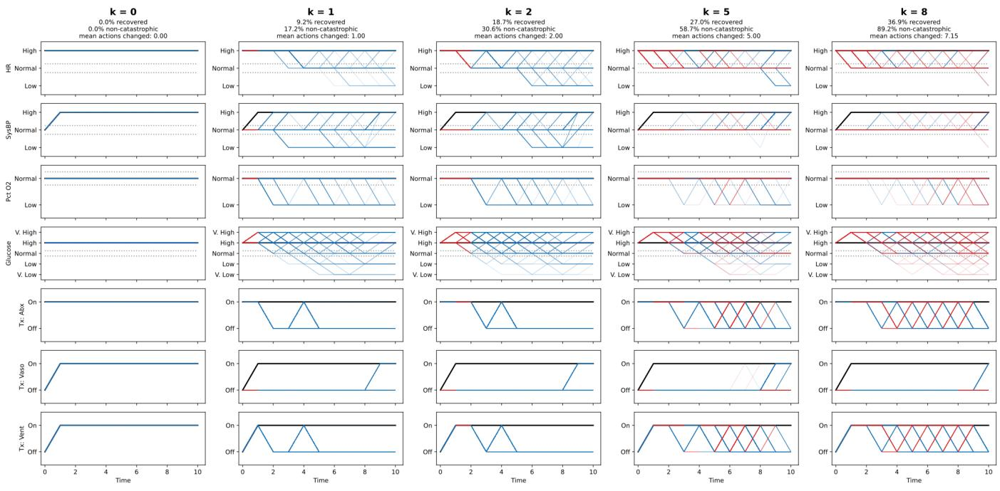  
Figure 5: Counterfactual Sepsis trajectories for one catastrophic observed trajectory, under $\pi _ { k } ^ { * }$ for varying numbers of allowed action changes �. Rows show the patient’s vital signs and applied treatments over time. The observed path is shown in black, and the 200 sampled counterfactual paths in blue, or red at steps where an action difers from the observed one (in the treatment rows, where that treatment was changed). Dotted lines mark the normal range of each vital sign.

## G.3 Execution Times and Bound Widths

Table 5: Left: efect on CFIMDP transitions of using tight (but more expensive) bounds in place of conservative closed-form bounds. Right: comparison of runtimes for constructing the CFIMDP (using $N = 1 0 0 , 0 0 0 , \alpha = 0 . 1$ and averaging over 100 randomly generated suboptimal paths).
<table><tr><td rowspan="3">Environment</td><td colspan="4">Bound Width Statistics</td><td colspan="4">Execution Time (s)</td></tr><tr><td colspan="2">Transitions Affected (%)</td><td colspan="2">Avg Difference in Width</td><td rowspan="2">Exact CFIMDP</td><td rowspan="2">Data-driven CFIMDP Data-driven CFIMDP (Cons. LB)</td><td rowspan="2">(Exact LB)</td><td rowspan="2">Data-driven CFIMDP (Gumbel-max)</td></tr><tr><td>All</td><td>Non-zero</td><td>All</td><td>Non-zero</td></tr><tr><td>GridWorld (p = 0.9)</td><td> $4 . 3 7 \pm 0 . 4 6$ </td><td> $2 0 . 6 \pm 2 . 1$ </td><td> $4 . 8 9 \times { 1 0 } ^ { - 4 } \pm 7 . 6 \times { 1 0 } ^ { - 5 }$ </td><td> $0 . 0 1 1 2 \pm 0 . 0 0 1 3$ </td><td> $1 . 6 7 \pm 0 . 0 8$ </td><td></td><td> $2 . 6 4 \pm 0 . 1 3$ </td><td></td></tr><tr><td>GridWorld (p = 0.4)</td><td> $1 . 1 4 \pm 0 . 7 4$ </td><td> $5 . 5 \pm 3 . 5$ </td><td> $2 . 8 \times 1 0 ^ { - 4 } \pm 3 . 9 \times 1 0 ^ { - 4 }$ </td><td> $0 . 0 1 8 \pm 0 . 0 1 4$ </td><td> $1 . 6 2 \pm 0 . 1 2$ </td><td>1.71 ± 0.09 1.65 ± 0.06</td><td> $2 . 4 0 \pm 0 . 1 1$ </td><td> $1 . 5 5 \pm 0 . 0 7$   $1 . 5 5 \pm 0 . 1 0$ </td></tr><tr><td>Sepsis</td><td> $0 . 0 0 4 1 \pm 0 . 0 0 5 0$ </td><td> $1 . 0 \pm 1 . 2$ </td><td> $3 . 9 \times 1 0 ^ { - 7 } \pm 3 . 3 \times 1 0 ^ { - 7 }$ </td><td> $0 . 0 2 4 \pm 0 . 0 1 3$ </td><td> $5 7 . 2 \pm 3 . 9$ </td><td> $1 4 1 \pm 3 1$ </td><td> $1 4 3 0 \pm 5 8 0$ </td><td>-†</td></tr><tr><td>Frozen Lake</td><td> $0 . 1 9 \pm 0 . 1 2$ </td><td> $1 . 4 9 \pm 0 . 9 1$ </td><td> $1 . 5 \times { 1 0 } ^ { - 5 } \pm 1 . 2 \times { 1 0 } ^ { - 5 }$ </td><td> $0 . 0 0 7 0 \pm 0 . 0 0 2 9$ </td><td> $2 . 2 4 \pm 0 . 1 1$ </td><td> $2 . 3 4 \pm 0 . 1 1$ </td><td> $3 . 7 5 \pm 0 . 3 0$ </td><td>2.03 ± 0.10</td></tr><tr><td>Aircraft</td><td> $0 . 0 0 9 7 \pm 0 . 0 0 5 2$ </td><td> $0 . 9 0 \pm 0 . 4 8$ </td><td> $5 . 7 \times 1 0 ^ { - 6 } \pm 3 . 3 \times 1 0 ^ { - 6 }$ </td><td>0.059 ± 0.011</td><td> $7 . 9 \pm 1 . 8$ </td><td>10.0 ± 1.9</td><td> $8 5 \pm 1 3$ </td><td>293 ± 7</td></tr></table>

†We omit Sepsis, as generating its Gumbel-max CFIMDPs is computationally prohibitive.