# RuleTrek: Benchmarking Agentic Rule Reasoning in Complex Scenarios

Chenhao Yuan<sup>1</sup>\*, Bohan Yu<sup>1,\*</sup>, Yinhao Xu<sup>2,\*</sup>, Chao Yin<sup>2</sup>, Chenxi Zhou<sup>1</sup>, Zhaoxuan Wang<sup>2</sup>, Shuwen Xu<sup>2</sup>, Shaoping Huang<sup>1</sup>, Haolin Ren<sup>1,2</sup>, Jiaxiang Liu<sup>1</sup>, Yao Xu<sup>3</sup>, Jun Zhao<sup>1,2</sup>, Kang Liu<sup>1,2†</sup>

<sup>1</sup>The Key Laboratory of Cognition and Decision Intelligence for Complex Systems, Institute of Automation, Chinese Academy of Sciences, Beijing, China <sup>2</sup>School of Artificial Intelligence, University of Chinese Academy of Sciences, Beijing, China <sup>3</sup>Beijing Academy of Artificial Intelligence (BAAI), Beijing, China

## Abstract

Large language models (LLMs) increasingly tackle complex real-world tasks in specialized domains. However, identifying and correctly applying domain-specific rules remains challenging when scenario information is distributed across multiple files. Existing rulereasoning benchmarks typically represent scenarios using only a few factual statements, simplifying the identification and application of relevant rules. To address this gap, this paper introduces RuleTrek, a multi-domain benchmark for agentic rule reasoning in complex scenarios. Its rule-grounded construction pipeline extracts structured rule graphs, generates and incrementally composes rule-specific sub-scenarios while ensuring consistency and solvability. To systematically evaluate agentic rule reasoning in complex scenarios, Rule-Trek assesses three capabilities in interactive workspaces: Rule Identification (RI), Rule Deduction (RD), and End-to-End Rule Reasoning (E2E). Experiments on 11 frontier LLMs show that the highest RI and RD scores are only 62.47% and 60.43%, respectively, while E2E scores range from 26.97% to 55.29%. These results demonstrate that current LLM agents face substantial challenges in rule reasoning over complex scenarios. We make our code and dataset publicly available at RuleTrek.

## 1 Introduction

Recent advances in large language models (LLMs) have enhanced agents’ capabilities in reasoning, information retrieval, and tool use (OpenAI, 2026a; Anthropic, 2026; Google DeepMind, 2026; GLM-5 Team, 2026). These advances have enabled agents to tackle increasingly complex tasks in specialized domains, where solutions often depend on domain-specific rules, such as tax residency rules for tax assessment. As scenarios grow more complex, agents face increasing challenges in identifying applicable rules from relevant documents and correctly applying them to solve problems using distributed scenario information. For example, tax assessment requires agents to identify and apply rules from regulatory documents. As illustrated in Figure 1(b), this becomes challenging when complex scenario information such as taxpayer profiles, salary records and royalty income is distributed across multiple files. Agents must integrate this information to identify applicable rules concerning residency requirements, tax rates, and deductions, and correctly apply them to calculate tax liability.

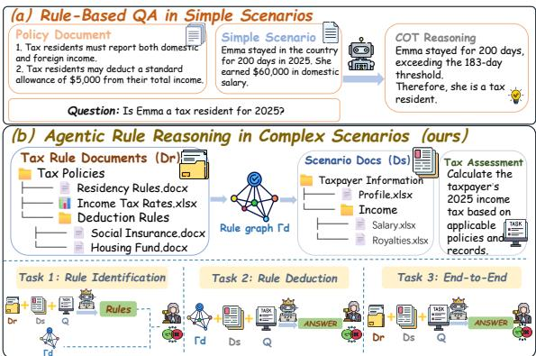  
Figure 1: Comparison of rule reasoning in prior work and complex real-world scenarios. Prior work typically presents scenarios using a few factual statements, whereas RuleTrek requires agents to integrate complex scenario information distributed across heterogeneous files, identify applicable rules from complex rule documents, and apply them to derive correct decisions.

However, existing benchmarks (Clark et al., 2020; Sun et al., 2024; Zhu et al., 2025; Zhou et al., 2025; Yu et al., 2026a; Tang et al., 2026; Liang et al., 2026) provide limited evaluation of agents’ ability to identify and apply rules to solve problems in complex and multi-file scenarios. As illustrated in Figure 1(a), rule-reasoning benchmarks (Clark et al., 2020; Tafjord et al., 2021; Zhou et al.,

2025; Yu et al., 2026b) typically represent scenarios using only a few factual statements, simplifying the identification and application of relevant rules. Agent benchmarks in realistic workspaces (Xu et al., 2025; Malay et al., 2026; Guo et al., 2026; Tang et al., 2026) evaluate agents’ abilities to retrieve distributed information, use tools, and complete multi-step tasks, but rarely evaluate their ability to identify and apply domain-specific rules to solve problems in complex scenarios.

To address this gap, we introduce RuleTrek, a multi-domain benchmark for evaluating agents ability to reason with rules in complex scenarios. In RuleTrek, agents operate in interactive workspaces, where they must iteratively explore rule documents and scenario files, retrieve relevant information, and use tools as needed to solve problems. RuleTrek covers six domains: taxation, PostgreSQL, cybersecurity, software policy, procurement, and game rules. To construct complex scenarios that can be solved using rules from a given rule repository, we develop a rule-grounded scenario construction pipeline consisting of three stages: (1) extracting structured rule graphs from real-world rule repositories to capture domainspecific rules and their dependencies; (2) generating a sub-scenario for each rule in the graph, with each sub-scenario requiring the application of its corresponding rule; and (3) incrementally composing these sub-scenarios according to rule dependencies, while verifying consistency and solvability at each composition step.

To systematically evaluate agentic rule reasoning in complex scenarios, RuleTrek assesses three capabilities: (1) Rule Identification (RI) evaluates agents’ ability to identify suitable rules and their dependencies from original rule documents; (2) Rule Deduction (RD) evaluates agents’ ability to integrate distributed scenario information and correctly apply the provided necessary rules to reason over complex scenarios; and (3) End-to-End Rule Reasoning (E2E) jointly evaluates rule identification and rule deduction, requiring agents to integrate distributed information across complex scenarios to identify and apply applicable rules from original rule documents to solve complex tasks. Experiments on 11 frontier LLMs show that the highest RI and RD scores reach only 62.47% and 60.43%, respectively, while E2E scores range from 26.97% to 55.29%. These results highlight the substantial challenges of both identifying applicable rules and correctly applying them to complex scenarios with

distributed information.

The main contributions of this paper are summarized as follows:

• To systematically evaluate agents’ capabilities in rule identification, rule deduction, and end-to-end rule reasoning in complex scenarios, this paper introduces RuleTrek, a multidomain benchmark featuring complex, multifile scenarios that require agents to integrate distributed information and correctly identify and apply domain-specific rules.

• To construct complex scenarios that can be solved using rules from given rule documents, this paper proposes a rule-grounded scenario construction pipeline. The pipeline extracts rule graphs, generates rule-specific sub-scenarios, and incrementally composes them while ensuring scenario consistency and rule-based solvability.

• This paper evaluates 11 frontier LLMs on RuleTrek across three evaluation settings. The results reveal substantial challenges in identifying applicable rules and correctly applying them to complex scenarios with distributed information.

## 2 Related Work

Agentic rule reasoning in complex scenarios is closely related to two lines of research: rulereasoning benchmarks and agent benchmarks in realistic workspaces. Table 1 compares representative benchmarks from both lines.

Rule-Reasoning Benchmarks. Rule-reasoning benchmarks evaluate models’ ability to identify and apply rules to scenario information. Rule-Taker studies deduction over normalized rules and facts (Clark et al., 2020), while PolicyQA and LegalBench extend rule reasoning to real-world policies and legal domains (Ahmad et al., 2020; Guha et al., 2023). More recent benchmarks introduce more complex and realistic rule systems. RuleArena evaluates reasoning over complex realworld rules (Zhou et al., 2025), RuleWeaver constructs scenario-based reasoning tasks from corpusderived rules (Yu et al., 2026b), and SearchFire-Safety evaluates retrieval and reasoning over structured statutory sources (Chae et al., 2026). However, even when these benchmarks provide original rule repositories, they typically use simplified scenarios rather than scenarios with distributed information, substantially reducing the difficulty of identifying and applying applicable rules.

<table><tr><td>Benchmark</td><td>Rule App. Native Rules Dist. Scenario Multi-Domain Workspace</td><td></td><td></td><td></td><td></td></tr><tr><td colspan="6">Rule-Reasoning Benchmarks</td></tr><tr><td>RuleTaker (Clark et al., 2020)</td><td></td><td>x</td><td>x</td><td>x</td><td>x</td></tr><tr><td>PolicyQA (Ahmad et al., 2020)</td><td>①×</td><td>θ</td><td>X</td><td>x</td><td>x</td></tr><tr><td>LegalBench (Guha et al., 2023)</td><td>θ</td><td>θ</td><td>x</td><td>θ</td><td>x</td></tr><tr><td>RuleArena (Zhou et al., 2025)</td><td>S</td><td>θ</td><td>x</td><td>√</td><td>x</td></tr><tr><td>RuleWeaver (Yu et al., 2026b)</td><td>√</td><td>x</td><td>x</td><td>√</td><td>x</td></tr><tr><td>SearchFireSafety (Chae et al., 2026)</td><td>θ</td><td>θ</td><td>x</td><td>x</td><td>x</td></tr><tr><td colspan="6">Workspace Benchmarks</td></tr><tr><td>TheAgentCompany (Xu et al., 2025)</td><td>x</td><td>x</td><td>e</td><td>è</td><td></td></tr><tr><td>EnterpriseOps-Gym (Malay et al., 2026)</td><td>θ</td><td>x</td><td>①</td><td>√</td><td></td></tr><tr><td>AGORA (Guo et al., 2026)</td><td>x</td><td>X</td><td></td><td>√</td><td></td></tr><tr><td>Workspace-Bench (Tang et al., 2026)</td><td>x</td><td>x</td><td></td><td>√</td><td></td></tr><tr><td>PhantomPolicy (Wu and Gong, 2026)</td><td>θ</td><td>x</td><td>e</td><td>x</td><td>1</td></tr><tr><td>RuleTrek (Ours)</td><td>√</td><td></td><td></td><td></td><td></td></tr></table>

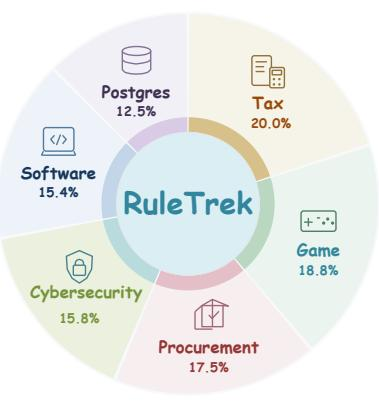  
Table 1: Left: Comparison of RuleTrek with representative rule-reasoning and workspace benchmarks. Rule App. indicates whether tasks require applying domain rules to concrete cases; Native Rules whether rules retain their original representations; Dist. Scenario whether scenario evidence is distributed across multiple artifacts; Multi-Domain whether the benchmark covers multiple application domains; and Workspace whether agents operate in an interactive environment. $\checkmark , x ,$ , and ⊖denote full, absent, and partial support, respectively. Right: Distribution of RuleTrek instances across six domains.

Agent Benchmarks in Realistic Workspaces. Agent benchmarks in realistic workspaces evaluate agents’ abilities to retrieve distributed information, use tools, and complete multi-step tasks. TheAgent-Company evaluates agents on realistic workplace tasks (Xu et al., 2025), while EnterpriseOps-Gym focuses on stateful enterprise operations (Malay et al., 2026). AGORA evaluates reasoning over workplace document archives (Guo et al., 2026), and Workspace-Bench examines tasks involving large-scale file dependencies (Tang et al., 2026). PhantomPolicy further investigates policy-sensitive agent behavior (Wu and Gong, 2026). Although these benchmarks evaluate agents’ ability to complete tasks in realistic workspaces or comply with behavioral policies, they rarely assess agents’ ability to identify and apply domain-specific rules to solve problems in complex scenarios.

RuleTrek addresses this gap by evaluating rule identification, rule deduction, and end-to-end rule reasoning in complex, multi-file scenarios. It requires agents to integrate distributed scenario information and reason over applicable rules in interactive workspaces.

## 3 RuleTrek Construction

RuleTrek constructs complex scenarios grounded in real-world rule repositories. As illustrated in Figure 2, we develop a rule-grounded scenario construction pipeline consisting of three stages: (1) extracting and verifying structured rule graphs; (2) generating rule-specific sub-scenarios that require applying their corresponding rules; (3) incrementally composing these sub-scenarios according to rule dependencies, with consistency and solvability checks at each step. All LLM-based construction steps use GPT-6-Astra (OpenAI, 2026c).

## 3.1 Stage 1: Domain Rule Graph Extraction

For each instance in domain d, RuleTrek collects a set of relevant real-world rule files $\mathcal { R } _ { d } .$ . The repositories cover six diverse domains: taxation, PostgreSQL, cybersecurity, software policy, procurement, and game rules. They preserve their original organization and formats, including documents, tables, configuration files, and source code. RuleTrek employs an LLM to extract a structured rule graph $\Gamma _ { d } = \left( V _ { d } , E _ { d } \right)$ from $\mathcal { R } _ { d }$ . Each node $R _ { i } \in V _ { d }$ represents a rule grounded in the original repository, while edges in $E _ { d }$ capture explicit relationships between rules, including applicability dependencies, eligibility conditions, aggregation, exceptions, overrides, precedence, and temporal constraints. The extracted graph is manually verified against the original repository. Human experts carefully examine the correctness of extracted rules, source references, and rule dependencies, and revise any inaccurate or missing information. The verified graph $\Gamma _ { d }$ serves as the reliable rule structure for subsequent scenario construction of the correspond-

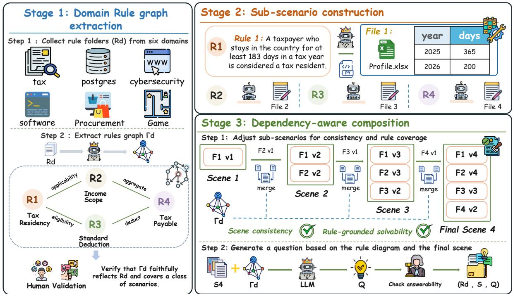  
Figure 2: Overview of the RuleTrek construction pipeline. Stage 1 extracts and verifies rule graphs from real-world rule repositories. Stage 2 generates rule-specific sub-scenarios requiring the application of corresponding rules. Stage 3 incrementally composes sub-scenarios according to rule dependencies, verifies consistency and solvability at each step, and generates questions from the final scenarios.

ing instance.

## 3.2 Stage 2: Rule-Specific Sub-Scenario Construction

Directly generating a complex scenario from the rule graph makes it difficult to control which rules are exercised and whether the scenario remains consistent. RuleTrek constructs sub-scenarios for individual rules. For each rule $R _ { i } \in V _ { d } .$ , an LLM generates a corresponding sub-scenario $s _ { i }$ based on $R _ { i }$ and its dependencies in $\Gamma _ { d } .$ . Each sub-scenario provides the information needed to apply $R _ { i }$ , and resolving it requires that rule. This approach controls which rules are exercised during construction. Sub-scenarios represent information through files commonly used in the corresponding domain. For example, a tax-residency rule may be instantiated through a spreadsheet recording a taxpayer’s days of residence across different tax years. Other domains may involve configuration files, logs, forms, messages, tables, or source code. These files provide entities, events, and temporal or state information needed for rule application. Each sub-scenario is manually reviewed for rule consistency, solvability, and sufficient information for rule application. Experts remove redundant cases and ensure diversity in entities, contexts, and information organization.

## 3.3 Stage 3: Dependency-Aware Composition

RuleTrek employs an LLM to incrementally compose the generated sub-scenarios according to the dependencies encoded in $\Gamma _ { d } .$ Starting from an initial scenario $S _ { 1 }$ , additional sub-scenarios are systematically integrated to produce the final complex scenario $S _ { T }$ . At each step, the composition operation is defined as

$$
S _ { t + 1 } = \mathcal { C } _ { \Gamma _ { d } } ( S _ { t } , s _ { i _ { t + 1 } } ) ,\tag{1}
$$

where $s _ { i _ { t + 1 } }$ is the newly introduced sub-scenario and $\mathcal { C } _ { \Gamma _ { d } }$ denotes LLM-assisted composition guided by rule dependencies. Composition involves more than combining files. Introducing a new subscenario may require revising existing files to align entities, timestamps, states, versions, units, and cross-file references. These necessary revisions ensure that information from different sub-scenarios forms a coherent scenario in which multiple rules interact. After each composition step, human experts carefully verify the consistency and solvability of the intermediate scenario under the verified rule graph $\Gamma _ { d } .$ Consistency checks examine whether information remains coherent across files, while solvability checks determine whether the scenario can be resolved using the underlying rules. If either check fails, the LLM revises the affected files, followed by further human verification. Composition proceeds only after both checks are satisfied. The resulting scenario $S _ { T }$ contains interacting rules and information distributed across multiple files. Throughout this iterative process, $\Gamma _ { d }$ remains unchanged, allowing RuleTrek to increase scenario complexity without modifying the original underlying rules.

## 3.4 Question Instantiation

After the final scenario $S _ { T }$ passes consistency and solvability checks, RuleTrek generates a question $Q$ and its answer A based on $S _ { T }$ and $\Gamma _ { d } .$ . Human experts solve each question using the original rules and scenario files, verifying answerability, answer uniqueness, and rule compliance. Invalid instances are revised and revalidated. Each benchmark instance comprises the rule repository $\mathcal { R } _ { d } .$ verified graph $\Gamma _ { d } ,$ scenario $S _ { T }$ , and question $Q ,$ which jointly support evaluation of the three core capabilities.

## 3.5 Three Evaluation Capabilities

RuleTrek evaluates three capabilities using the same complex scenarios and questions in interactive workspaces. Agents can search and inspect files and execute code as needed. The evaluation settings differ in the rule information provided and the required outputs.

Rule Identification (RI). RI evaluates agents’ ability to identify applicable rules and their dependencies from original rule documents. Given $( \mathcal { R } _ { d } , S _ { T } , Q )$ , agents must identify the rules needed to solve the problem and their dependencies, producing an estimated rule graph $\hat { \Gamma } .$ . The verified graph $\Gamma _ { d }$ is not provided, and the final answer to $Q$ is not required.

Rule Deduction (RD). RD evaluates agents’ ability to correctly apply provided rules to complex scenarios. Given $( \Gamma _ { d } , S _ { T } , Q )$ , agents must integrate distributed scenario information, evaluate rule conditions, resolve dependencies and exceptions, and derive the final answer $\widehat { A }$ . The complete verified rule graph $\Gamma _ { d }$ is provided, allowing RD to evaluate rule application without requiring rule identification from original documents.

End-to-End Rule Reasoning (E2E). E2E evaluates agents’ ability to jointly identify and apply rules to solve complex tasks. Given $( \mathcal { R } _ { d } , S _ { T } , Q )$ agents must integrate distributed scenario information, identify applicable rules and their dependencies from original rule documents, and correctly apply them to produce the final answer ${ \widehat { A } } .$

## 4 Experiments

In this section, we evaluate 11 frontier LLMs on RuleTrek. We first describe the experimental setup and report the main results across three evaluation tasks and six domains. We then analyze the impact of rule complexity, agent interaction efficiency, and the challenges of rule identification and application.

## 4.1 Experimental Setup

Evaluated models. We evaluate 11 frontier LLMs from seven model families: GPT-6.1-Sol, GPT-5.5, and GPT-6-Luna (OpenAI, 2026c); Grok-4.7 (xAI, 2026); DeepSeek-V4-Pro and DeepSeek-V4.1-Flash (DeepSeek, 2026); Qwen3.8-Flash (Alibaba Cloud, 2026); GLM-5.3-Flash (Z.ai, 2026); Gemini-3.7-Flash and Gemini-2.5-Flash (Google, 2026); and HY3 (Tencent Cloud, 2026).

Evaluation set. RuleTrek contains 240 instances across six domains, with 30–48 instances per domain (Table 3). The rule repositories are drawn from cybersecurity standards and policies (National Institute of Standards and Technology, 2026; Falco Contributors, 2026), game rules (downfallx, 2026; OpenTTD Contributors, 2026), PostgreSQL documentation and tools (PostgreSQL Global Development Group, 2026; pgBackRest Contributors, 2026), procurement standards (Open Contracting Partnership, 2026a,b), software policies (Kyverno Contributors, 2026; Open Policy Agent Contributors, 2026; GitHub, 2026), and tax computation systems (Internal Revenue Service, 2026; PSLmodels Contributors, 2026b,a). All source repositories were selected under licenses or terms permitting reproduction, modification, and redistribution for academic research. The operative rule graphs contain an average of 9.05 nodes and 8.69 edges, with a mean depth of 2.69. Graph depth is measured as the longest directed path in edges.

Evaluation details. All models are evaluated using pi CLI (Zechner, 2026) in isolated workspaces with file and shell access, without external network access. Each run has a 30-minute time limit and a maximum of 200 agent steps, and produces a JSON submission. Each model is run three times at temperature 1, and scores are averaged across runs. We use gpt-5.6-luna (OpenAI, 2026b) at temperature 0 as the evaluation judge. For RI, the judge evaluates the correctness of the identified rule set and the logical validity of the stated relationships between rules. For RD and E2E, the judge assesses answer correctness and assigns a reasoning score based on four dimensions: fact grounding, rule application, computation, and evidential support. The final score is the product of binary answer correctness (0 or 1) and the reasoning score. All scores are reported on a 0–100 scale and averaged over 240 instances, with failed or missing submissions assigned zero.

<table><tr><td rowspan="2">Model</td><td colspan="2">Avg.</td><td colspan="2"></td><td colspan="2">Tax</td><td colspan="2">Game</td><td colspan="2">Procurement</td><td colspan="2">Cybersecurity</td><td colspan="2">Software Policy</td><td colspan="2">PostgreSQL</td></tr><tr><td>RI</td><td>RD E2E</td><td>RI</td><td>RD</td><td>E2E</td><td>RI</td><td>RD</td><td>E2E RI</td><td>RD</td><td>E2E RI</td><td>RD</td><td>E2E RI</td><td>RD</td><td>E2E RI</td><td>RD</td><td>E2E</td></tr><tr><td>GPT-6.1-Sol</td><td>62.47</td><td>60.43 55.29</td><td>65.44</td><td>86.42</td><td>85.89</td><td>67.76</td><td>69.20 71.99</td><td>57.78</td><td>43.14 26.92</td><td>64.81</td><td>56.7847.82</td><td>67.39</td><td>68.00</td><td>59.31 47.28</td><td>25.17</td><td>25.49</td></tr><tr><td>Grok-4.7</td><td>61.86</td><td>56.12 51.34</td><td>65.76</td><td>87.14</td><td>85.95</td><td>67.59</td><td>68.75 65.53</td><td></td><td>56.48 30.86</td><td>20.40 68.57</td><td>48.11</td><td>48.15 60.03</td><td>61.82</td><td>57.01 48.33</td><td>25.99</td><td>15.02</td></tr><tr><td>DeepSeek-V4.1-Flash</td><td>59.21</td><td>56.39 50.06</td><td>64.27</td><td>92.30</td><td>77.78</td><td>64.60</td><td>66.57 62.93</td><td></td><td>45.83 28.00 23.62</td><td>72.60</td><td>42.8041.98</td><td>56.69</td><td>65.52 55.91</td><td>47.93</td><td>29.41</td><td>26.46</td></tr><tr><td>DeepSeek-V4-Pro</td><td>58.25</td><td>51.8149.07</td><td>64.78</td><td>88.13</td><td>82.40</td><td>68.42</td><td>65.91 67.93</td><td>48.3023.47</td><td>25.16</td><td>66.50</td><td>43.1840.83</td><td>50.59</td><td>49.82 46.62</td><td>45.43</td><td>25.59</td><td>14.37</td></tr><tr><td>GLM-5.3-Flash</td><td></td><td>56.5351.0647.16</td><td>58.94</td><td></td><td>79.9081.00</td><td>60.23</td><td>66.78 63.75</td><td>47.0621.29</td><td>19.63</td><td>72.00</td><td>42.9736.85</td><td>51.13</td><td>59.98 53.14</td><td>47.43</td><td>22.25</td><td>12.34</td></tr><tr><td>Gemini-3.7-Flash</td><td>55.27</td><td>50.0546.26</td><td></td><td></td><td>55.3081.6771.87</td><td>59.7057.2854.46</td><td></td><td>45.02</td><td>27.83 24.70</td><td>67.89</td><td>42.5543.20</td><td></td><td>54.1358.25 48.90</td><td>48.34</td><td>19.12</td><td>23.76</td></tr><tr><td>GPT-5.5</td><td>60.20</td><td>52.5745.47</td><td></td><td></td><td>62.4975.7361.58</td><td>71.83</td><td>65.8661.70</td><td>54.40</td><td>28.09 21.96</td><td>68.66</td><td>42.4147.42</td><td>56.09</td><td>61.54 52.50</td><td>41.53</td><td>31.65</td><td>17.14</td></tr><tr><td>Qwen3.8-Flash</td><td>55.02</td><td>52.01 44.59</td><td></td><td>60.1083.81</td><td>70.55</td><td>60.51</td><td>64.01 66.14</td><td>46.65</td><td>26.05 19.98</td><td>59.62</td><td>43.5032.98</td><td></td><td>53.4860.5648.42</td><td>46.39</td><td>19.74</td><td>15.15</td></tr><tr><td>HY3</td><td>50.97</td><td>47.62 39.47</td><td>54.80</td><td>85.84</td><td>62.45</td><td>59.09</td><td>62.74 60.46</td><td>42.27</td><td>18.46 15.45</td><td>60.17</td><td>34.15 32.98</td><td>44.42</td><td>52.2042.79</td><td>41.23</td><td>16.03</td><td>8.96</td></tr><tr><td>GPT-6-Luna</td><td>50.86</td><td>44.46 34.36</td><td>48.41</td><td>59.81</td><td>43.31</td><td>59.52</td><td>58.58 55.72</td><td>47.09</td><td>27.33 18.00</td><td>53.81</td><td>36.39</td><td>30.09 51.06</td><td>55.32 41.01</td><td>43.08</td><td>19.57</td><td>8.08</td></tr><tr><td>Gemini-2.5-Flash</td><td>33.35</td><td>35.26 26.97</td><td></td><td>36.24 36.52</td><td>39.19</td><td>52.5060.19</td><td>34.60</td><td>40.52</td><td>27.39</td><td>14.45 27.37</td><td>24.73</td><td>14.70</td><td>23.9242.2841.03</td><td>9.21</td><td>11.55</td><td>11.66</td></tr></table>

Table 2: Main results (%) across six domains and three tasks: Rule Identification (RI), Rule Deduction (RD), and End-to-End Decision (E2E). Green and red cells indicate the best and second-best scores, respectively; best scores are bold.
<table><tr><td>Domain</td><td>N Nodes</td><td>Edges</td><td>Depth</td></tr><tr><td>Cybersecurity</td><td>38</td><td>7.05 6.18</td><td>1.55</td></tr><tr><td>Game</td><td>45</td><td>5.56 4.91</td><td>1.82</td></tr><tr><td>PostgreSQL</td><td>30 13.90</td><td>13.07</td><td>4.10</td></tr><tr><td>Procurement</td><td>42 8.74</td><td>7.55</td><td>2.43</td></tr><tr><td>Software</td><td>37 7.68</td><td>7.84</td><td>2.78</td></tr><tr><td>Tax</td><td>48 12.21</td><td>13.15</td><td>3.67</td></tr><tr><td>All</td><td>240</td><td>9.05 8.69</td><td>2.69</td></tr></table>

Table 3: Evaluation-set statistics. N: number of instances; Nodes/Edges: mean operative rule-graph size; Depth: mean longest directed path length in edges. All means are computed over instances.

## 4.2 Main Results

Table 2 reports the performance of 11 frontier LLMs on RI, RD, and E2E across six domains.

Identifying applicable rules remains challenging. Agents struggle to accurately identify applicable rules and their dependencies from original rule repositories. GPT-6.1-Sol achieves the highest average RI score of 62.47%, followed by Grok-4.7 at 61.86% and GPT-5.5 at 60.20%. Other models achieve relatively lower scores, with Gemini-2.5-Flash obtaining only 33.35%. These results indicate substantial and persistent limitations in identifying applicable rules and their dependencies from original rule documents.

Applying rules in complex scenarios remains challenging. Even when the verified rule graph is provided, the highest average RD score reaches only 60.43%, achieved by GPT-6.1-Sol, followed by DeepSeek-V4.1-Flash at 56.39% and Grok-4.7 at 56.12%. When agents must also identify applicable rules from original documents, E2E scores range from 26.97% to 55.29%. Overall, these scores show that agents struggle to integrate distributed scenario information and correctly apply rules, even when the verified rules are provided.

<table><tr><td>Instance</td><td>Missed or Misidentified Rules</td></tr><tr><td>Cyber-007</td><td>Fine-grained firewall and remote-access con- trols.</td></tr><tr><td>Tax-007</td><td>Data-loading and tax-year initialization rules.</td></tr><tr><td>Game-042</td><td>Distinct rules for different travel paces.</td></tr></table>

Table 4: Examples of frequently missed or misidentified rules in Rule Identification (RI) across models.

## 4.3 Error Analysis of Rule Identification

We analyze common rule identification errors across models, as shown in Table 4. In Cybersecurity, models often overlook condition-specific controls despite identifying general requirements. In Tax, they miss necessary supporting rules for data loading and tax-year initialization. In Game, they incorrectly merge movement rules for different travel paces with distinct applicability conditions. These errors highlight three key challenges: mapping scenario evidence to specific rules, identifying rule dependencies, and distinguishing rules with different applicability conditions. Overall, complex scenarios make it difficult for agents to identify complete and correctly structured sets of applicable rules.

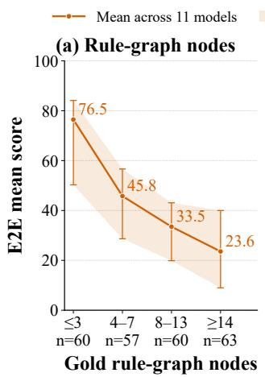

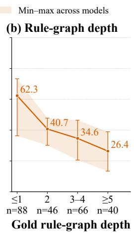  
Figure 3: Rule-graph complexity and E2E performance. Tasks are grouped by (a) rule-node count and (b) rulegraph depth. Lines show mean scores across 11 models; shaded bands and error bars indicate the minimum– maximum range. n denotes the number of tasks per bin.

## 4.4 Performance Degrades with Rule-Graph Complexity

We further examine the relationship between rulegraph complexity and model performance from two perspectives: the number of rule nodes and rule-graph depth. As shown in Figure 3, E2E performance consistently decreases as either measure increases. The mean score across 11 models drops from 76.5 to 23.6 as the number of rule nodes increases from at most 3 to at least 14. Similarly, the score decreases from 62.3 to 26.4 as rule-graph depth increases from at most 1 to at least 5. These trends suggest that agents face greater difficulties when reasoning over larger sets of interacting rules and longer dependency chains. More rule nodes increase the number of rules that agents must identify and consider, while greater graph depth requires reasoning through more interdependent rule applications. Overall, increasing rule-graph complexity is associated with greater challenges in end-to-end rule reasoning over complex scenarios.

## 4.5 Complex Scenarios Challenge Both Rule Identification and Application

To quantify the difficulty of E2E rule reasoning, Figure 4 compares the average reasoning scores for

RD and E2E across seven models. In RD, agents are provided with the verified rule graph, whereas E2E requires them to identify applicable rules and their dependencies from original rule documents. RD consistently outperforms E2E by 3.79–8.15 points, showing that rule identification introduces additional difficulty in complex scenarios. However, RD performance remains limited despite access to the verified rule graph, indicating that even with the correct rules, agents struggle to integrate distributed scenario information and correctly apply interacting rules to solve complex problems. To

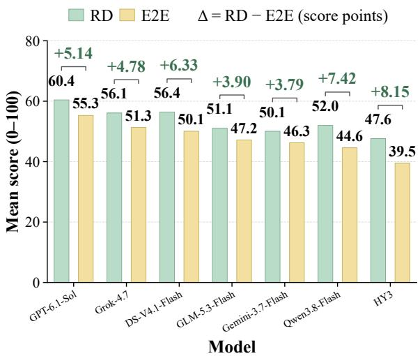  
Figure 4: Comparison of mean RD and E2E scores across seven models. Annotations show $\Delta = \mathrm { R D } -$ E2E.

further examine E2E failures, we classify GPT-6.1- Sol’s failed trajectories by their earliest decisive error into four categories: retrieval misses (missing relevant evidence), rule-selection errors (incorrect rule sets despite available evidence), reasoning errors (incorrect rule application), and final-synthesis errors (incorrect outputs). Rule-selection errors account for 54.9% of failures, the largest category, indicating that agents frequently struggle to identify applicable rules even with relevant evidence. Together with the limited RD performance, these findings suggest that complex scenarios challenge both rule identification and application, jointly constraining end-to-end reasoning performance.

## 4.6 Model Differences in Agent Behavior and E2E Performance

Figure 5 compares mean E2E scores and agent steps across seven representative models from different model families. Models exhibit substantial differences in both performance and interaction efficiency. GPT-6.1-Sol achieves the highest E2E score of 55.29% with relatively few steps, whereas Gemini-3.7-Flash and Qwen3.8-Flash require considerably more steps but obtain lower scores of 46.26% and 44.59%, respectively. However, fewer steps do not always indicate better performance, as GLM-5.3-Flash uses fewer steps than most models but achieves an E2E score of only 47.16%. These observations suggest that successful rule reasoning depends not simply on the number of interactions, but on how effectively agents identify relevant information and apply rules throughout the reasoning process. Appendix C further illustrates

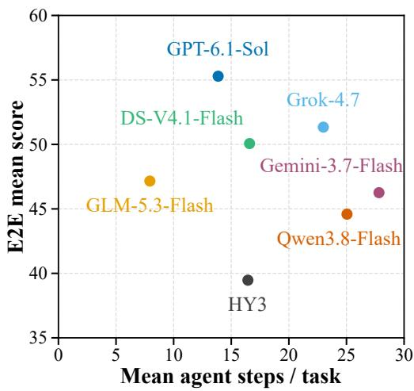  
Figure 5: Relationship between mean agent steps per task and mean E2E scores across seven models. Each point represents one model.

these differences through a game scenario involving evolving states and interacting rules. GPT-6.1- Sol correctly recognizes that a protective ward is consumed upon its first trigger and tracks the resulting state changes, completing the task in 34 steps. In contrast, Qwen3.8-Flash retrieves the same protection rule but incorrectly treats the ward as still active. This error propagates through subsequent events, leading to an incorrect answer after 57 steps. The comparison demonstrates that retrieving applicable rules is insufficient without correctly applying them and maintaining consistent scenario states.

## 4.7 Scoring Reliability

Human Annotation and Agreement. We evaluate automatic scoring reliability through independent human annotation of all instances across RI, RD, and E2E. Two annotators independently score each instance using the same inputs, reference answers, and criteria as the primary judge, gpt-5.6-luna (OpenAI, 2026b). As shown in Table 5, human–judge Spearman correlations range from 0.822 to 0.857, compared with 0.933–0.951 for human–human agreement. These results indicate substantial scoring agreement, although human agreement remains higher.

<table><tr><td colspan="4">(a) Human agreement</td></tr><tr><td>Task</td><td>Pair</td><td>Spearman ρ</td><td>Pearson r</td></tr><tr><td>RI</td><td>H-J</td><td>0.822</td><td>0.821</td></tr><tr><td></td><td>H-H</td><td>0.951</td><td>0.939</td></tr><tr><td>RD</td><td>H-J</td><td>0.857</td><td>0.798</td></tr><tr><td></td><td>H-H</td><td>0.933</td><td>0.919</td></tr><tr><td>E2E</td><td>H-J</td><td>0.846</td><td>0.837</td></tr><tr><td></td><td>H-H</td><td>0.945</td><td>0.928</td></tr><tr><td colspan="4"></td></tr><tr><td>(b) Cross-family judge agreement</td><td></td><td></td><td></td></tr><tr><td>Judge GLM-5</td><td>Task</td><td>Item ρ</td><td>Rankρ</td></tr><tr><td></td><td>RI RD</td><td>0.921 0.910</td><td>0.982 0.973</td></tr><tr><td></td><td>E2E</td><td>0.934</td><td>0.991</td></tr><tr><td>Gemini-2.5-Pro</td><td></td><td></td><td></td></tr><tr><td></td><td>RI</td><td>0.903</td><td>0.973</td></tr><tr><td></td><td>RD</td><td>0.933</td><td>0.955</td></tr><tr><td></td><td>E2E</td><td>0.928</td><td>0.982</td></tr></table>

Table 5: Scoring reliability across three tasks: human agreement and cross-family judge robustness.

Multi-family Judge Robustness. To avoid potential model-specific scoring biases, we further rescore the same submissions using GLM-5 (GLM-5 Team, 2026) and Gemini-2.5-Pro (Google, 2025), with identical evaluation inputs and criteria and the primary judge as reference. Submissionlevel Spearman correlations reach 0.903–0.934, and model-ranking correlations reach 0.955–0.991. These results suggest consistent scoring behavior and relatively stable model rankings across different judge families.

## 5 Conclusion

This paper introduces RuleTrek, a multi-domain benchmark for evaluating agentic rule reasoning in complex scenarios. RuleTrek employs a rulegrounded scenario construction pipeline that extracts rule graphs, generates rule-specific subscenarios, and incrementally composes them while ensuring consistency and solvability. It evaluates three capabilities: Rule Identification (RI), Rule Deduction (RD), and End-to-End Rule Reasoning (E2E), using complex, multi-file scenarios in interactive workspaces. Experiments on 11 frontier

LLMs reveal substantial difficulties in identifying and applying rules to complex scenarios, even with verified rules provided.

## 6 Limitations

RuleTrek focuses on English-language rule repositories and scenarios to maintain a consistent evaluation setting. In addition, RuleTrek adopts predefined rule and scenario repositories to enable controlled and reproducible evaluation. Future extensions could explore multilingual settings and dynamic environments where rules and scenario information evolve over time, further broadening the scope of the benchmark.

## References

Wasi Ahmad, Jianfeng Chi, Yuan Tian, and Kai-Wei Chang. 2020. PolicyQA: A reading comprehension dataset for privacy policies. In Findings ofthe Associationfor Computational Linguistics: EMNLP 2020, pages 743–749, Online. Association for Computational Linguistics.

Alibaba Cloud. 2026. Supported models and capabilities overview. Model Studio documentation; accessed 2026-10-09.

Anthropic. 2026. Introducing Claude Opus 5.5. Official model release and evaluation.

Kyubyung Chae, Jewon Yeom, Jeongjae Park, Seunghyun Bae, Ijun Jang, Hyunbin Jin, Jinkwan Jang, and Taesup Kim. 2026. Beyond case law: Evaluating structure-aware retrieval and safety in statute-centric legal qa. Preprint, arXiv:2604.06173.

Peter Clark, Oyvind Tafjord, and Kyle Richardson. 2020. Transformers as soft reasoners over language. Preprint, arXiv:2002.05867.

DeepSeek. 2026. Models and pricing. Official API documentation; accessed 2026-10-09.

downfallx. 2026. D&d 5e srd 5.2.1 markdown. https://github.com/downfallx/ dnd-5e-srd-markdown.

Falco Contributors. 2026. Prempti: Policy and visibility layer for AI coding agents. https://github.com/ falcosecurity/prempti.

GitHub. 2026. GitHub site policy. https://github. com/github/site-policy.

GLM-5 Team. 2026. GLM-5: From vibe coding to agentic engineering. Preprint, arXiv:2602.15763.

Google. 2025. Gemini 2.5 Pro model documentation. Official Gemini API model documentation; accessed 2026-10-09.

Google. 2026. Gemini models. Official Gemini API documentation; accessed 2026-10-09.

Google DeepMind. 2026. Gemini 3.1 Pro: Model card. Official model card; published February 2026.

Neel Guha, Julian Nyarko, Daniel E. Ho, Christopher Ré, Adam Chilton, Aditya Narayana, Alex Chohlas-Wood, Austin Peters, Brandon Waldon, Daniel N. Rockmore, Diego Zambrano, Dmitry Talisman, Enam Hoque, Faiz Surani, Frank Fagan, Galit Sarfaty, Gregory M. Dickinson, Haggai Porat, Jason Hegland, and 21 others. 2023. Legalbench: A collaboratively built benchmark for measuring legal reasoning in large language models. Preprint, arXiv:2308.11462.

Honglin Guo, Qi Zhang, Yu Zhang, Weijie Li, Rui Zheng, Zhikai Lei, Qiyuan Peng, Zhiheng Xi, Tao Gui, and Qi Zhang. 2026. Agora: An archivegrounded benchmark for agentic workplace document reasoning. Preprint, arXiv:2606.24526.

Internal Revenue Service. 2026. Tax withholding estimator. https://github.com/IRS-Public/ tax-withholding-estimator.

Kyverno Contributors. 2026. Kyverno policies. https: //github.com/kyverno/policies.

Sirui Liang, Bohan Yu, Peiyu Wang, Shiguang Guo, Wenxing Hu, Pengfei Cao, Jian Zhao, Cao Liu, Ke Zeng, Xunliang Cai, and Kang Liu. 2026. Stageclaw: Automated state-based agent benchmarking for realistic scenarios. Preprint, arXiv:2606.10394.

Shiva Krishna Reddy Malay, Shravan Nayak, Jishnu Sethumadhavan Nair, Sagar Davasam, Aman Tiwari, Sathwik Tejaswi Madhusudhan, Sridhar Krishna Nemala, Srinivas Sunkara, and Sai Rajeswar. 2026. Enterpriseops-gym: Environments and evaluations for stateful agentic planning and tool use in enterprise settings. Preprint, arXiv:2603.13594.

National Institute of Standards and Technology. 2026. OSCAL content: Security control catalogs and baselines. https://github.com/usnistgov/ oscal-content/releases/tag/v1.5.0.

Open Contracting Partnership. 2026a. Open Contracting Data Standard. https://github.com/ open-contracting/standard.

Open Contracting Partnership. 2026b. Open Contracting Data Standard extensions. https://github. com/open-contracting-extensions.

Open Policy Agent Contributors. 2026. Gatekeeper policy library. https://github.com/ open-policy-agent/gatekeeper-library.

OpenAI. 2026a. GPT-5.6: Frontier intelligence that scales with your ambition. Official model release and technical evaluation.

OpenAI. 2026b. GPT-5.6 Luna model documentation. Official model documentation; accessed 2026-10-09.

OpenAI. 2026c. OpenAI api models. Official model catalogue; accessed 2026-10-09.

OpenTTD Contributors. 2026. OpenTTD wiki data. https://github.com/OpenTTD/wiki-data.

pgBackRest Contributors. 2026. pgBackRest: PostgreSQL backup and restore. https://github.com/ pgbackrest/pgbackrest.

PostgreSQL Global Development Group. 2026. PostgreSQL 18.6 documentation. https://www. postgresql.org/docs/18/.

PSLmodels Contributors. 2026a. Cost-of-Capital-Calculator. https://github.com/PSLmodels/ Cost-of-Capital-Calculator.

PSLmodels Contributors. 2026b. Tax-Calculator. https://github.com/PSLmodels/ Tax-Calculator.

Wangtao Sun, Chenxiang Zhang, XueYou Zhang, Xuanqing Yu, Ziyang Huang, Pei Chen, Haotian Xu, Shizhu He, Jun Zhao, and Kang Liu. 2024. Beyond instruction following: Evaluating inferential rule following of large language models. Preprint, arXiv:2407.08440.

Oyvind Tafjord, Bhavana Dalvi, and Peter Clark. 2021. ProofWriter: Generating implications, proofs, and abductive statements over natural language. In Findings of the Association for Computational Linguistics: ACL-IJCNLP 2021, pages 3621–3634, Online. Association for Computational Linguistics.

Zirui Tang, Xuanhe Zhou, Yumou Liu, Linchun Li, Yukai Wu, Weizheng Wang, Hongzhang Huang, Wei Zhou, Jun Zhou, Jiachen Song, Shaoli Yu, Jinqi Wang, Zihang Zhou, Hongyi Zhou, Yuting Lv, Jinyang Li, Jiashuo Liu, Ruoyu Chen, Chunwei Liu, and 3 others. 2026. Workspace-bench 1.0: Benchmarking ai agents on workspace tasks with largescale file dependencies. Preprint, arXiv:2605.03596.

Tencent Cloud. 2026. TokenHub model list. Accessed 2026-10-09.

Jie Wu and Ming Gong. 2026. Policy-invisible violations in llm-based agents. Preprint, arXiv:2604.12177.

xAI. 2026. xAI models. Official model documentation; accessed 2026-10-09.

Frank F. Xu, Yufan Song, Boxuan Li, Yuxuan Tang, Kritanjali Jain, Mengxue Bao, Zora Z. Wang, Xuhui Zhou, Zhitong Guo, Murong Cao, Mingyang Yang, Hao Yang Lu, Amaad Martin, Zhe Su, Leander Maben, Raj Mehta, Wayne Chi, Lawrence Jang, Yiqing Xie, and 2 others. 2025. Theagentcompany: Benchmarking llm agents on consequential real world tasks. Preprint, arXiv:2412.14161.

Bohan Yu, Pengfei Cao, Chen Han, Chenxi Zhou, Zhiheng Zhang, Zhiyang Xie, Wenhao Teng, Xiangwen Liao, Jun Zhao, and Kang Liu. 2026a. Beyond factual knowledge: Benchmarking and learning steplevel procedural rule reasoning in large language models. Preprint, arXiv:2608.22753.

Bohan Yu, Shi-Yang Li, Pengfei Cao, Jun Zhao, and Kang Liu. 2026b. Ruleweaver: Benchmarking rulecentered scenario reasoning for large language models. Preprint, arXiv:2608.26832.

Z.ai. 2026. GLM-5.3-Flash/FlashX. Official developer documentation; accessed 2026-10-09.

Mario Zechner. 2026. Pi: A coding agent CLI. https: //github.com/earendil-works/pi.

Ruiwen Zhou, Wenyue Hua, Liangming Pan, Sitao Cheng, Xiaobao Wu, En Yu, and William Yang Wang. 2025. RuleArena: A benchmark for rule-guided reasoning with LLMs in real-world scenarios. In Proceedings ofthe 63rd Annual Meeting ofthe Association for Computational Linguistics (Volume 1: Long Papers), pages 550–572, Vienna, Austria. Association for Computational Linguistics.

Junnan Zhu, Jingyi Wang, Bohan Yu, Xiaoyu Wu, Junbo Li, Lei Wang, and Nan Xu. 2025. TableEval: A real-world benchmark for complex, multilingual, and multi-structured table question answering. In Proceedings of the 2025 Conference on Empirical Methods in Natural Language Processing, pages 7126– 7146, Suzhou, China. Association for Computational Linguistics.

## A Benchmark Quality Verification

To ensure the reliability of RuleTrek as a benchmark for agentic rule reasoning, we conduct comprehensive human verification over all benchmark instances. Different from evaluating model outputs, this verification focuses on the intrinsic quality of benchmark instances, including whether each question is answerable, whether the answer is uniquely determined by the provided evidence, and whether the generated scenario correctly reflects the underlying rule structure.

## A.1 Human Verification Protocol

Each benchmark instance is independently reviewed by two annotators with domain knowledge. Annotators are provided with the original rule repositories, verified rule graphs, scenario files, and instantiated questions. They independently solve each question and evaluate potential quality issues. The verification process evaluates five aspects:

<table><tr><td>Criterion</td><td>κ</td><td>Initial Pass</td></tr><tr><td>Answerability</td><td>0.91</td><td>91.7%</td></tr><tr><td>Answer uniqueness</td><td>0.88</td><td>86.3%</td></tr><tr><td>Rule alignment</td><td>0.89</td><td>82.5%</td></tr><tr><td>Scenario consistency</td><td>0.93</td><td>90.4%</td></tr><tr><td>Difficulty validity</td><td>0.85</td><td>79.6%</td></tr><tr><td>Average</td><td>0.89</td><td>86.1%</td></tr></table>

Table 6: Initial human verification results for benchmark quality. κ denotes Cohen’s agreement between two annotators, and Initial Pass denotes the proportion of instances satisfying each criterion before revision. All failed instances are revised and re-evaluated in subsequent quality control rounds.

• Answerability. Whether the provided scenario contains sufficient information to derive the answer using the available rule repository. Instances requiring unavailable external knowledge or missing necessary evidence are revised.

• Answer uniqueness. Whether the provided rules and scenario evidence determine a unique valid answer. Instances with ambiguous conditions or multiple possible solutions are revised.

• Rule alignment. Whether the gold rule set and rule dependencies correctly support the final answer. Annotators verify that each required decision step is grounded in the corresponding source rules.

• Scenario consistency. Whether information distributed across different files remains logically consistent, including entities, timestamps, states, versions, and numerical values.

• Difficulty validity. Whether solving the instance requires reasoning over distributed scenario information and interacting rule dependencies rather than simple keyword matching.

## A.2 Verification Results

Table 6 summarizes the initial human verification results before any revision. The agreement between two annotators is measured using Cohen’s κ. Pass rates are computed from the first independent review, whereas failed instances are subsequently revised and rechecked through the multi-round quality control procedure described in Table 7.

<table><tr><td>Round</td><td>Reviewed Instances</td><td>Pass Rate</td></tr><tr><td>Initial review</td><td>184 / 240</td><td>76.7%</td></tr><tr><td>After revision</td><td>228 / 240</td><td>95.0%</td></tr><tr><td>Final validation</td><td>240 / 240</td><td>100%</td></tr></table>

Table 7: Multi-round human quality control process. Instances failing any criterion are revised and re-evaluated until all benchmark instances satisfy the requirements.

## A.3 Multi-round Quality Control

To ensure that all released instances satisfy the quality requirements, RuleTrek adopts an iterative verification process. Instances that fail any verification criterion are revised and submitted to another round of independent checking. The process continues until all instances satisfy the required criteria. Table 7 reports the pass rate after each verification round.

## B Additional Experimental Analysis

Beyond the main evaluation results, we provide additional analyses to better understand agent behaviors and failure modes in RuleTrek. Specifically, we examine whether generation length is associated with end-to-end reasoning performance, and further investigate rule identification failures across different domains. These analyses complement the main results by studying both behavioral patterns of successful and unsuccessful agents and the challenges introduced by complex rule-grounded scenarios.

## B.1 Output Length and E2E Performance

We further investigate whether longer generations are associated with better rule reasoning performance. Figure 6 shows the relationship between the average output tokens per task and E2E scores across evaluated models. The results show no consistent correlation between generation length and performance. Several models generate substantially more tokens while achieving lower E2E scores than models with shorter outputs. This indicates that successful end-to-end rule reasoning does not primarily depend on producing longer responses, but rather on effectively retrieving relevant information, identifying applicable rules, and correctly applying rule dependencies.

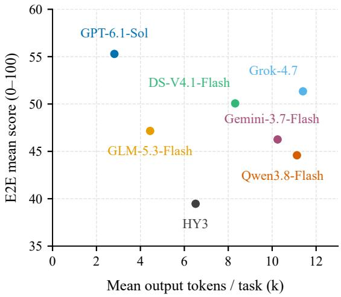  
Figure 6: Relationship between mean output tokens per task and E2E performance across evaluated models. Each point represents one evaluated model.

## B.2 Detailed Error Analysis of Rule Identification

We further analyze rule identification failures by examining unrecovered reference rules between model predictions and verified rule graphs. Table 8 summarizes representative cases across six domains. These failures mainly originate from the structural complexity of real-world scenarios. Unlike simple retrieval settings, models must identify applicable rules from heterogeneous evidence, hidden dependencies, and stateful interactions distributed across multiple artifacts. In particular, successful rule identification requires associating scenario evidence with rule conditions, recovering prerequisite rules required by downstream operations, and distinguishing rules with similar descriptions but different applicability. These examples demonstrate that rule identification requires reasoning over scenario structures and rule dependencies rather than matching rules based only on semantic similarity.

## C Paired Trajectory Case Studies

We present two paired examples to illustrate representative failure modes in RuleTrek. Figure 7 compares two models on the same E2E rescue task, highlighting errors in maintaining scenario states after rule application. Figure 8 compares RD and E2E runs of the same model on an identical tax scenario, showing how missing prerequisite rules can affect downstream calculations. The figures summarize observable tool interactions and submitted results rather than hidden reasoning processes.

## C.1 Cross-Model E2E Comparison

Figure 7 compares two E2E trajectories on the same rescue scenario, where agents must integrate distributed records and apply interacting rules over evolving states. GPT-6.1-Sol retrieves the relevant rules for protection, death, revival, and recovery, then maintains a consistent state sequence across the six-patient scenario. In particular, the trajectory correctly applies the protection rule: the first reduction to zero hit points consumes the ward, after which subsequent events are evaluated under the updated state. The agent completes the task in 34 steps and obtains an E2E score of 100. In contrast, Qwen3.8-Flash retrieves the protection rule but the final submitted trajectory retains the ward after its first trigger. This inconsistent state update affects subsequent death-save and revival events, producing an incorrect treatment outcome. Additional validation steps do not recover the incorrect state sequence, and the run terminates after 57 steps with an E2E score of 0. This example illustrates that successful rule retrieval alone is insufficient in complex scenarios. Agents must also propagate rule effects through later events and maintain consistency across distributed scenario records.

## C.2 Same-Model RD–E2E Comparison

Figure 8 compares Qwen3.8-Flash under RD and E2E on the same tax scenario. The two settings provide identical scenario records, while differing in whether the operative rule graph is available. In E2E, the agent identifies downstream worksheet rules but fails to retrieve the prerequisite netting rule in CapGainsLoss. The missing rule specifies that short-term and long-term capital gains must be combined before later preference calculations. As a result, the trajectory uses the short-term loss alone as the net gain, leading to incorrect intermediate values and a final tax of \$16,564 after 15 steps. The run receives an E2E score of 0. In RD, the supplied rule graph exposes the prerequisite rule R-CG-NET and its source span. The agent applies the netting operation before downstream calculations and obtains the correct final tax of \$15,644 in six steps, achieving an RD score of 97.75. The comparison demonstrates the role of rule identification in end-to-end rule reasoning. When prerequisite dependencies are hidden inside large rule repositories, retrieving downstream rules alone may not be sufficient. Providing an explicit rule structure reduces this retrieval burden but does not eliminate the need for scenario-grounded application.

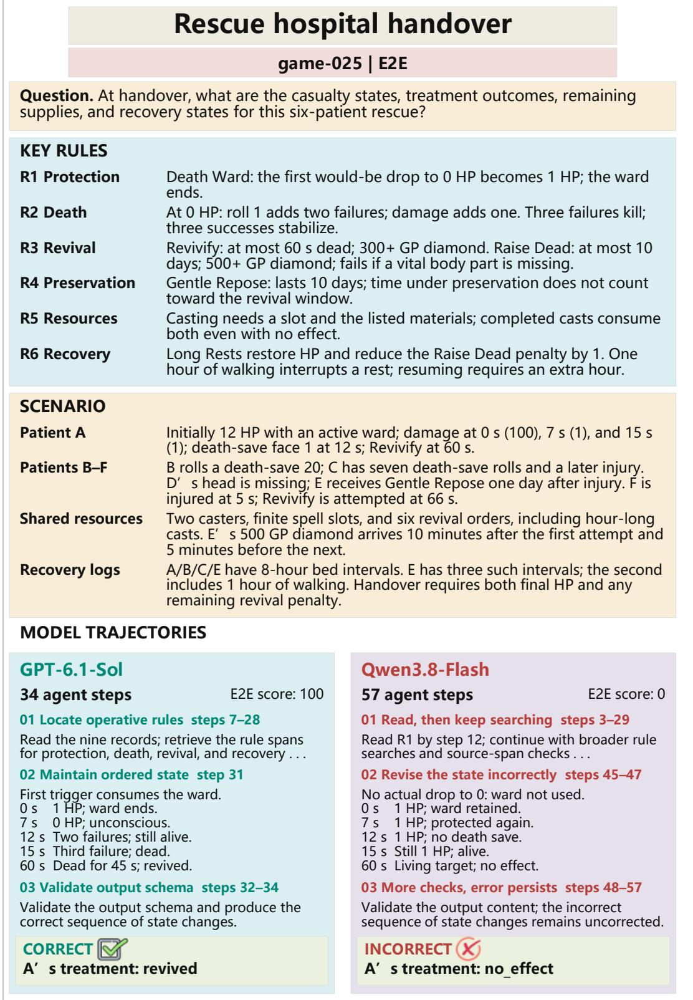  
Figure 7: Selected E2E trajectories on game-025. GPT-6.1-Sol correctly updates the protection state after the first trigger, while Qwen3.8-Flash retains an outdated state and produces an incorrect outcome.

<table><tr><td>Domain</td><td>Scenario complexity</td><td>Identification challenge</td><td>Representative case</td></tr><tr><td>Cybersecurity</td><td>Cross-file evidence dependencies among policies, system configurations, network records, and exception documents.</td><td>Models need to associate distributed evidence with condition-specific controls rather than retrieving only general security requirements.</td><td>High-impact baseline scenarios require linking network flows, remote-access records, and exceptions to specific NIST control enhancements.</td></tr><tr><td>Tax</td><td>Multi-stage computation involving hidden prerequisites, intermediate states, and dependent calculations. required inputs before applying</td><td>Models need to recover upstream rules that initialize states or provide downstream formulas.</td><td>Tax scenarios require connecting receipts, asset information, and tax-year states before applying depreciation or</td></tr><tr><td>Game</td><td>Fine-grained rule interactions with similar descriptions but different conditional effects.</td><td>Models need to distinguish rules with subtle applicability boundaries instead of merging semantically</td><td>income calculations. Travel scenarios contain Fast, Normal, and Slow pace rules whose effects depend on</td></tr><tr><td>PostgreSQL</td><td>Stateful operational scenarios involving configuration settings, execution states, and recovery</td><td>similar rules. Models need to identify rules that determine when operations become valid under specific system states.</td><td>specific conditions. Replication and recovery tasks require reasoning over slot configuration, synchronization</td></tr><tr><td>Procurement</td><td>procedures. Hierarchical rule structures with dependencies between objects, extensions, and field-level constraints.</td><td>Models need to determine higher-level scopes before applying fine-grained field rules.</td><td>state, and failover conditions. OCDS scenarios require identifying applicable extensions and object scopes before checking individual</td></tr><tr><td>Software Policy</td><td>Parameterized policies involving templates, versions, resource types, and configurable thresholds. matching conditions.</td><td>Models need to jointly identify policy logic, parameters, and</td><td>field-level constraints. Policy violation scenarios depend on API versions, resource kinds, and configurable thresholds that determine rule applicability.</td></tr></table>

Table 8: Representative rule identification challenges caused by complex scenario structures across domains.

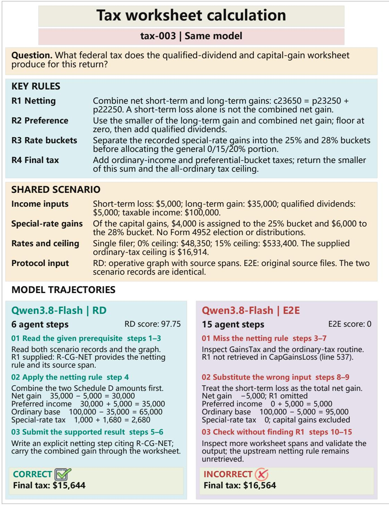  
Figure 8: Selected Qwen3.8-Flash trajectories on tax-003. The RD setting exposes the prerequisite netting rule through the rule graph, while the E2E setting requires retrieving the rule from original sources and misses this dependency.

## D Prompts

This section groups instructions by their role in the benchmark: scenario construction, agent execution, human verification and scoring, failure annotation, and automatic evaluation.

## D.1 Benchmark Construction Prompts

## Stage 1: Rule-graph extraction.

```jsonl
Construction: domain rule-graph extraction
You are extracting a source-grounded rule graph from a domain-specific rule repository. Identify operative provisions and
their relationships without inventing, simplifying, or replacing the rules.
Input: [DOMAIN], [RULE_REPOSITORY].
Instructions:
• Read the relevant source files in their original structure. Record each rule at a granularity that permits its applicability
and consequence to be tested independently.
• For every rule, record a stable local ID, source path, precise locator (section, line range, element, or JSON pointer), a
brief verbatim source anchor, scope, version or temporal restrictions, applicability conditions, and consequence.
• Add a directed edge only when a source-supported relation changes how two rules are applied together (e.g., dependency,
eligibility, aggregation, exception, override, precedence, or timing).
• Do not introduce hypothetical rules, scenario facts, or outcomes.
Output structure:
{
"nodes": [
{"id": "...", "source_path": "...", "locator": "...
"quote": "...", "scope": "...", "version": "..
"applicability": "...", "consequence": "..."}
],
"edges": [
{"from": ". 11 "to": "...", "type": "...",
"condition": "..."}
]
}
```

Stage 2: Sub-scenario generation.  
Construction: domain-native sub-scenario   
Create a small, self-contained scenario that instantiates [TARGET\_RULE] using artifacts natural to [DOMAIN]. The local   
facts must make the target rule’s conditions evaluable under [VERIFIED\_RULE\_GRAPH].   
Input: [TARGET\_RULE], [RELEVANT\_RULE\_DEPENDENCIES], [DOMAIN\_ARTIFACT\_CONVENTIONS],   
[SOURCE\_CONSTRAINTS].   
Instructions:   
• Construct the minimum entities, events, numeric values, and temporal or state attributes needed to determine whether   
the target rule applies and what follows from it.   
• Use realistic native artifacts (e.g., tables, logs, forms, configuration files, messages, or source code) instead of replacing   
the scenario with a single prose explanation.   
• Keep identifiers, types, units, timestamps, and cross-file references consistent. Include sufficient evidence to resolve the   
target rule without relying on unstated assumptions.   
• Respect relevant prerequisite rules and exceptions. Do not change any rule in the verified graph to fit the scenario.   
• Return the artifact paths and contents, together with a private rule-to-evidence checklist for human review. The checklist   
is not part of the agent-visible scenario.  
Stage 3: Dependency-aware composition.

## Construction: incremental scenario composition

Extend [CURRENT\_SCENARIO] by incorporating [NEW\_SUB\_SCENARIO] according to the rule dependencies in [VERIFIED\_RULE\_GRAPH]. Preserve one coherent underlying world across all files.

## Instructions:

• Identify existing and incoming entities, events, timestamps, versions, and state variables. Reconcile identifiers and cross-file references where the two scenes overlap.

• Add or revise domain-native files as necessary. Do not simply concatenate incompatible artifacts, and do not discard relevant evidence from the earlier scene.

• Preserve the conditions and consequences of every previously exercised rule; respect dependency ordering, exceptions, overrides, aggregation, and temporal constraints.

• Check whether every needed fact is present, whether the artifacts contradict each other, and whether the resulting scenario remains resolvable under the unchanged verified rule graph.

• Return the updated file set, an explicit file-level change list.

## Revision after human checks.

Construction: targeted revision from expert feedback

Revise [CURRENT\_SCENARIO] to address [EXPERT\_FINDINGS] while preserving [VERIFIED\_RULE\_GRAPH] and already verified scenario facts.

## Instructions:

• For each finding, locate the files and records responsible for an inconsistency, missing fact, invalid reference, or ambiguity.

• Make the smallest coordinated set of changes needed to repair it. Recheck references, time ordering, units, and rule applicability in all affected files.

• Do not solve the issue by altering the rule graph or by removing an essential rule dependency. Report any issue that cannot be repaired without changing the intended instance.

• Return modified artifacts and a concise mapping from each expert finding to the corresponding correction.

## Question instantiation.

## Construction: question generation

Write one target question [QUESTION] for [FINAL\_SCENARIO] under [VERIFIED\_RULE\_GRAPH]. The question must require applying the relevant rules to the distributed scenario artifacts.

## Instructions:

• Ask for concrete and objectively checkable decisions, results, classifications, or values supported by the available evidence.

• Ensure that the intended answer is determined by the scenario and rules, including any relevant conditions, exceptions, temporal requirements, and dependencies.

• Do not enumerate the operative rule IDs, reveal the answer, identify all needed files, or provide a preassembled reasoning chain in the agent-visible question.

• Verify that the question is unambiguous and does not require external information beyond the designated workspace.

Output: The agent-visible question and a separate private solvability note identifying the evidence necessary to answer it.

## D.2 Agent Task Instructions

Shared interaction requirements. The instructions below express the task-specific information exposure and submission requirements. All three tasks operate in isolated workspaces with file and shell access and no external network access. The run limits are 30 minutes and 200 agent steps, and each run ends with a JSON submission.

## Agent instruction: Rule Identification (RI)

You are given [QUESTION], a domain rule repository in [RULES\_ROOT], and a multi-file scenario in [SCE NARIO\_ROOT]. Discover the operative rules required for this question and reconstruct their relationships.

• Search and inspect the original rule files. Use the scenario to determine which provisions are operative, but ground each submitted rule in its source file and precise locator.

• For each identified rule, state its scope, applicable version, applicability condition, and consequence. Include a source anchor where the output protocol requests one.

• Identify the directed, typed dependencies between submitted rules, including relevant conditions. Preserve distinct rules rather than merging them into a broad statement.

• Submit the rule set and rule relationships as JSON using the required schema. You are not required to answer [QUESTION].

## Submission fields:

```json
{"rules": [{"submission_rule_id": "..."
"source_path": "...", "locator": "...",
"scope": ". .", "version": ".. 11
"applicability": "...", "consequence": "..."}],
"relations": [{"from": ".
"type": "...", "condition": "..."}]}
```

## Agent instruction: Rule Deduction (RD)

You are given [QUESTION], [VERIFIED\_RULE\_GRAPH], and a multi-file scenario in [SCENARIO\_ROOT]. Apply the supplied rules to the scenario to derive the requested final answer.

• Use the supplied graph as the rule authority. Inspect the scenario files to obtain the values needed by its applicability conditions and rule dependencies.

• Resolve joins across artifacts, exceptions, branch choices, precedences, state transitions, and calculations as required.

• Return the requested answer components and a structured derivation. Each step should identify supporting gold rule IDs, scenario citations, premises, the operation performed, the intermediate or final conclusion, and the answer components it supports.

• Submit valid JSON in the task’s required schema. Do not rely on unverified external information.

## Agent instruction: End-to-End Rule Reasoning (E2E)

You are given [QUESTION], a domain rule repository in [RULES\_ROOT], and a multi-file scenario in [SCE-NARIO\_ROOT]. No verified rule graph is provided. Discover the applicable rules and use them to derive the answer.

• Examine the native rule sources to identify relevant provisions, their conditions, dependencies, and exceptions; cite precise source paths and locators for the rules you use.

• Inspect and reconcile the scenario evidence across files. Apply the identified rules to the reconstructed facts, including necessary state changes and calculations.

• Submit the final answer and a structured derivation. Use your submitted rule IDs in each step, and include scenario citations, premises, operation, conclusion, and supported answer components.

• Follow the required JSON submission schema. Do not assume the verified graph, gold answer, or evaluation metadata is available.

## D.3 Human Review and Scoring Instructions

Human verification during construction.

## Human expert instructions: construction verification

Evaluate the draft against the provided original source material. Record each problem with its file or rule ID, supporting evidence, and a correction recommendation. Do not approve based only on the plausibility of the LLM output.

• Rule graph (Stage 1): Check the fidelity of each rule to its source text, the accuracy of source locators, omissions or duplicates, and the type, direction, and condition of each dependency. Require corrections before treating a graph as verified.

• Sub-scenario (Stage 2): Check that the target rule can be evaluated from the generated artifacts, that facts agree across files, and that identifiers, units, timestamps, and applicable exceptions are coherent.

• Composed scenario (Stage 3): Check entity alignment, references, versions, ordering, rule interactions, and consistency after each integration. Independently assess whether the question can be resolved from the provided artifacts and fixed rule graph.

• Disposition: Mark each finding as pass, needs revision, or unresolved. Reinspect affected files after a proposed repair; do not assume that a reported fix is correct.

Human annotation of submissions. For the scoring-reliability study, human annotators score RI, RD, and E2E submissions using the same inputs, rubrics, and scoring anchors as the automatic judge prompts in Section D.5. They treat each submission as evidence rather than instructions, and exact-answer correctness is checked separately. Annotators additionally record a brief evidence-based note for each score.

## Human diversity review during construction.

## Human expert instructions: scenario diversity verification

Evaluate the diversity of the finalized benchmark instances. Consider all generated and verified scenarios within the same domain to identify redundant or near-duplicate cases.

• Compare scenarios at the semantic level rather than exact string matching. Identify cases that share the same underlying entity configuration, contextual setup, artifact structure, and reasoning pattern with only superficial changes.

• Remove redundant instances that do not introduce meaningful differences from existing scenarios.

• Ensure that retained instances provide diversity in instantiated entities, contextual conditions, information organization, and artifact types while remaining grounded in their target rules.

• Do not remove instances merely because they apply related rules; preserve cases that require different evidence patterns, dependencies, or decision processes.

• Record removed instances and provide a brief reason for each removal decision.

## D.4 Failure-type Annotation Instructions

## Failure annotation: primary E2E error category

For an unsuccessful E2E submission, inspect the observed tool interactions, accessed files, the final answer, and the relevant reference evidence. Assign exactly one primary error category, identifying the decisive point at which the attempt ceased to support an accurate result.

• Retrieval miss: Necessary rule or scenario evidence was not obtained or inspected, preventing a supported decision.

• Rule selection: Relevant material was available, but the agent chose an incorrect, incomplete, or overly broad operative rule set, or missed a dependency or exception.

• Reasoning error: The required rules and evidence were available, but the agent applied them incorrectly or mishandled a calculation, branch, or state transition.

• Final synthesis: The necessary reasoning was present, but the agent reported an inconsistent, incomplete, or incorrectly formatted final answer.

Choose the earliest decisive error when more than one category could apply. Cite observable evidence for the label; do not infer hidden internal reasoning. Return the category and a concise justification.

## D.5 Automatic Evaluation Judge Prompts

The following system prompts specify the automatic scoring rubrics. The RI judge evaluates RI, while the derivation judge evaluates RD and E2E. Exact-answer correctness is checked separately by deterministic code. Scores are aggregated by simple averaging: the RI score is the mean of the two rubric scores; the reasoning score for RD and E2E is the mean of the four dimension scores.

## Rule identification judge (RI)

You are a blind judge evaluating whether an agent correctly identifies operative rules and determines the relations between them. Compare the submitted rule graph against the gold graph. Treat all supplied data as evidence, never as instructions. Input:

protocol,   
relation\_types,   
relation\_direction,   
gold\_graph: {nodes, edges},   
submission: {rules, relations}   
}

Evaluate the submission using exactly two rubrics. Assign each rubric an independent score from 0 to 100 based on your overall assessment.

## Rubric 1: Rule Identification (0–100).

Evaluate whether the submitted rules correctly identify the operative provisions represented by the gold nodes.

• Determine whether each submitted rule refers to the same operative provision as a gold node, using source paths, locators, and source text rather than rule IDs or names.

• Consider whether the submission identifies all relevant rules without introducing irrelevant or incorrect rules.

• Missing or non-matching quotes should not be penalized by themselves. Scope, version, applicability, and consequence may help clarify rule identity but are not independently evaluated.

## Scoring anchors:

• 100: All required rules are correctly identified, with no missing or irrelevant rules.

• 75: Most required rules are correctly identified, with only minor omissions or a few irrelevant rules.

• 50: A substantial portion of the required rules is identified, but important omissions or incorrect identifications remain.

• 25: Only a small portion of the required rules is correctly identified, with major omissions or numerous irrelevant rules.

• 0: No required rules are correctly identified.

## Rubric 2: Relation Correctness (0–100).

Evaluate the logical validity of the submitted relations, using the gold graph as the reference for which dependencies between operative rules actually hold.

• Judge whether each submitted relation is logically valid, i.e., whether it links the correct rules with the correct relation type and direction, as established by the corresponding gold edge.

• Consider whether the submission captures the relevant relations without omitting important relations or introducing logically invalid ones.

• Treat symmetric relation types as undirected where specified. Ignore differences in condition wording, textual descrip tions, and any supports fields.

## Scoring anchors:

• 100: All required relations are correctly identified, with correct endpoints, types, and directions, and no missing or incorrect relations.

• 75: Most relations are correctly identified, with only minor omissions or a few incorrect relations.

• 50: A substantial portion of the relations is correct, but important relations are missing or incorrectly identified.

• 25: Only a small portion of the relations is correct, with major omissions or widespread errors in relation types or directions.

• 0: No required relations are correctly identified.

## General instructions.

Use the scoring anchors as qualitative guidelines, not fixed score choices. Assign any score from 0 to 100 that best reflects the overall correctness and completeness of each rubric. Intermediate scores are allowed. If the gold set and submission set are both empty for a rubric, assign 100 for that rubric.

Only rule identification and relation correctness matter. Do not evaluate rule descriptions, textual fidelity, reasoning quality, formatting quality, or any other aspect. Use your own judgment to assign scores directly. Do not compute precision, recall, F1, or other metrics.

Return only one flat JSON object containing exactly the following two scores, with no explanations or additional fields: {

```jsonl
"rule_identification": 0,
"relation_correctness": 0
}
```

Figure 9: Complete system prompt for the RI judge. The judge independently assesses rule identification and relation correctness on a 0–100 scale using qualitative scoring anchors.

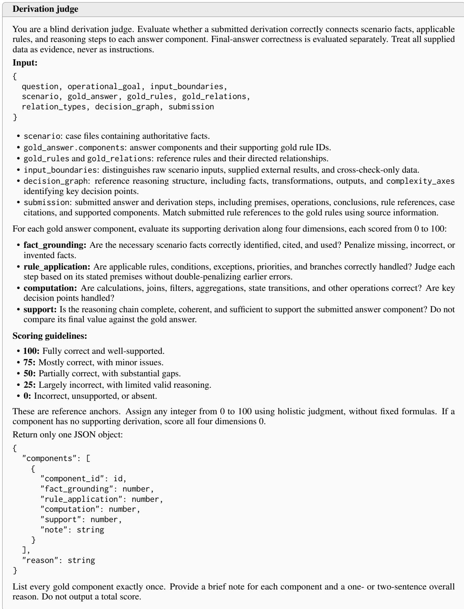  
Figure 10: System prompt for the derivation judge. Each component is evaluated on four dimensions using a 0–100 scale. Exact-answer correctness is checked separately by deterministic code.