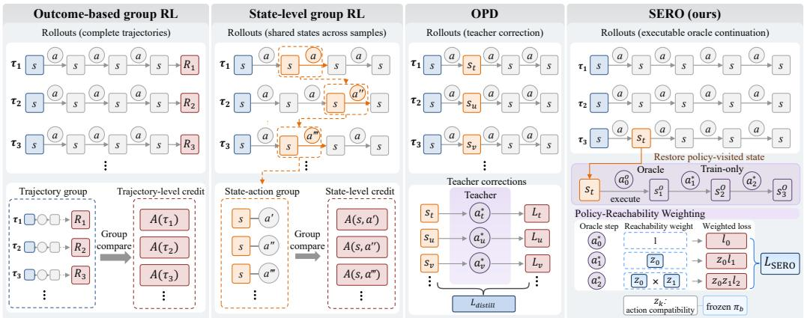
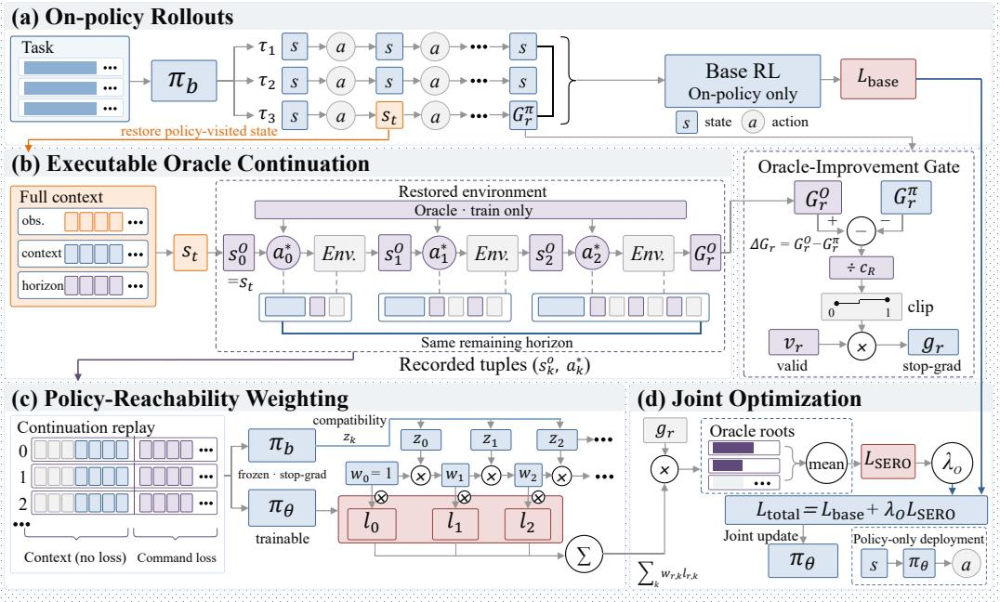
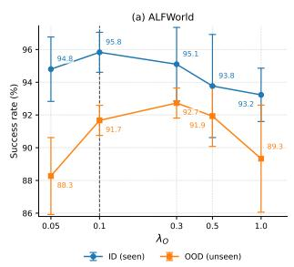
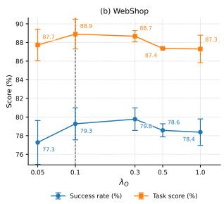
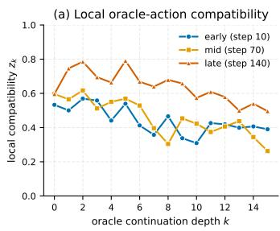
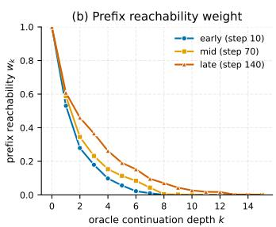
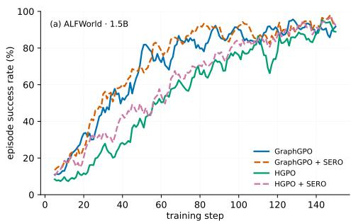
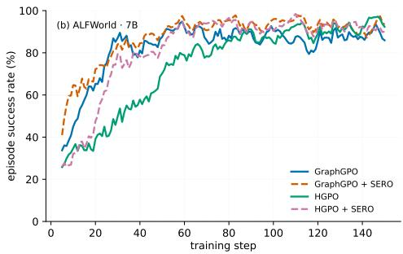
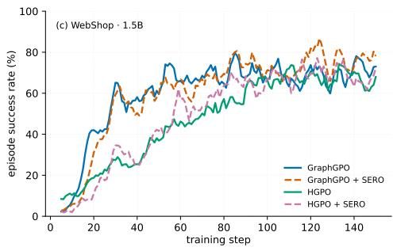
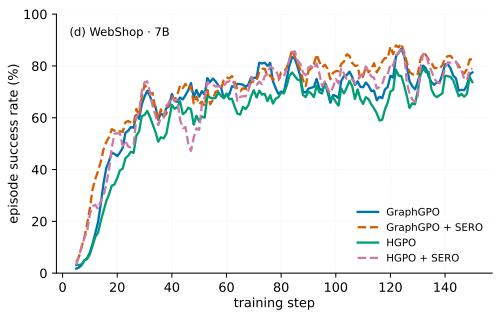

# SERO: LEARNING FROM EXECUTABLE ORACLE CON-TINUATIONS FOR LONG-HORIZON AGENTIC REIN-FORCEMENT LEARNING

Dingyi Rong1,2, Yue Shi1,†, Chaofan Ma2,†, Zongrui Wang1, Jiezhang Cao2, Yixin Cao2, Liang He3, Ning Liu2,†

1Shanghai Artificial Intelligence Laboratory

2Shanghai Jiao Tong University

3Tongji University

†Corresponding authors

## ABSTRACT

Long-horizon agentic RL is constrained by the futures visited by the current policy. When rollouts fail to reach useful behaviors, improved credit assignment cannot provide supervision for states and actions that were never encountered. Onpolicy distillation (OPD) introduces teacher guidance on policy-induced states, and recent multi-turn variants improve how this guidance is scheduled, replayed, refined, or validated. However, they do not directly use the oracle-controlled future itself as the training trajectory. We introduce State-Rooted Executable Rollout Optimization (SERO), which augments on-policy agentic RL with executable oracle continuations. SERO restores a state actually reached by the current policy and lets a training-only oracle continue interacting with the real environment, making the downstream observations and oracle actions themselves available for learning. It then applies policy-reachability weighting, which weights each oracle step by the frozen behavior policy’s compatibility with the preceding oracle actions. This allows deeper supervision to become effective as the policy becomes more compatible with the oracle branch. The oracle loss is optimized separately from the base RL estimator and no oracle is used at inference time. We evaluate SERO on two challenging interactive-agent benchmarks, ALFWorld and WebShop, using Qwen2.5-1.5B-Instruct and Qwen2.5-7B-Instruct. On ALF-World, learning the full executable continuation is substantially more effective than supervising only the root oracle action, while policy-reachability weighting further improves out-of-distribution performance.

## 1 INTRODUCTION

Large language models and vision-language models are increasingly used as the decision-making backbones of interactive agents for embodied control, web navigation, tool use, and software tasks (Yao et al., 2022b; Shinn et al., 2023; Schick et al., 2023; Brohan et al., 2023; Wang et al., 2023; Xie et al., 2024; Zhang et al., 2026; Hong et al., 2024; Gur et al., 2024; Xia et al., 2026; Gou et al., 2025; Wei et al., 2026; Rong et al., 2026). Unlike single-turn reasoning, an agent must repeatedly observe the environment, choose an action, receive a new observation, and continue until the task is finished (Ma et al., 2026). This sequential decision-making setting provides a natural opportunity for reinforcement learning (RL), where policies can be improved directly from environment feedback (Sutton & Barto, 2018; Schulman et al., 2017; Ouyang et al., 2022; Guo et al., 2025; Tan et al., 2024; Zhai et al., 2024; Bai et al., 2024). In particular, critic-free group-based methods such as RLOO (Ahmadian et al., 2024), GRPO (Shao et al., 2024), and their recent variants are attractive for large-scale agent training, because they avoid training a separate value model and reduce the overhead associated with critic-based optimization (Yu et al., 2026; Liu et al., 2025; Lin et al., 2026; Zheng et al., 2025).

  
Figure 1: Comparison of training paradigms and learning signals. Outcome-based group RL assigns trajectory-level credit, state-level group RL compares sampled actions at shared states, and OPD distills a single corrective action. In contrast, SERO restores a state reached by the current policy, executes a multi-step oracle continuation, and applies policy-reachability weighting to downstream action losses.

However, these methods typically assign a single outcome-based advantage to all actions in a trajectory, which makes credit assignment a central difficulty as interaction horizons grow. An episode may contain many decisions, while reward is often sparse or delayed (Peng et al., 2019; Wen et al., 2024; Chen et al., 2025; Song et al., 2024; Wang et al., 2025b; Jin et al., 2025). Recent work therefore seeks more precise feedback for the trajectories collected by the current policy (Feng et al., 2026; He et al., 2026; Cheng et al., 2026). These methods substantially improve how sampled experience is credited. Nevertheless, the learning signal is still bounded by what appears in the rollout group. If every rollout misses a useful action sequence, finer attribution can rank the sampled behav iors more accurately, but it cannot provide the missing behavior as a positive target. This limitation is particularly important early in training and on difficult tasks, where successful branches may be absent from an entire group.

In such cases, the missing targets must be supplied from outside the rollout group, which motivates teacher guidance. Interactive imitation and off-policy guidance learn from expert behavior on learner-induced inputs (Ross et al., 2011; Sun et al., 2017; Yan et al., 2026). OraRL shows that privileged supervision can be optimized directly, while on-policy distillation (OPD) queries a teacher on states reached by the current policy (Li et al., 2026b; Agarwal et al., 2024; Sun et al., 2026). Recent multi-turn OPD methods extend teacher guidance over multiple steps or use subsequent policy rollouts to validate an intervention (Wang et al., 2026f; Liao et al., 2026; Chen et al., 2026). However, their supervision is still centered on a corrective action, a teacher prefix, or the outcome of the intervention, rather than the full missing branch. In interactive environments, executing a correction changes the next observation and therefore the decisions that follow (Ross et al., 2011; Ma et al., 2021; Liu et al., 2022). When these downstream transitions are not directly learned, the training signal captures only part of the benefit of the correction and leaves its long-horizon consequences under-supervised.

We propose State-Rooted Executable Rollout Optimization (SERO) to learn from executable multi-step oracle continuations rooted at policy-visited states. As shown in Figure 1, SERO first collects the ordinary on-policy trajectories required by the base RL algorithm. It then selects a state actually reached by the current policy, restores the environment at that state, and lets a training-only oracle continue interacting for multiple steps. Every oracle action is executed in the environment, so each later target is conditioned on the real observation produced by the preceding oracle actions. The resulting continuation therefore shows not only what action should be taken at the root state, but also the sequence of decisions that follows once that correction is actually carried out.

Deeper states in an oracle continuation are increasingly off-policy, since reaching them requires the current policy to follow the preceding oracle actions. We therefore introduce policy-reachability weighting. A frozen behavior policy scores each oracle action, and the supervision weight at step k is determined by the compatibility of the preceding oracle prefix under the behavior policy. Within a branch admitted by the improvement gate, the root target receives unit prefix weight, while deeper targets receive larger weights as the policy becomes more compatible with the oracle prefix. This down-weights supervision on poorly supported oracle prefixes and allows the effective supervision horizon to extend as compatibility improves. The oracle objective is added as an auxiliary loss, leaving the rewards, advantages, and policy ratios of the base RL algorithm unchanged, and the oracle is used only during training.

We evaluate SERO on ALFWorld (Shridhar et al., 2020b) and WebShop (Yao et al., 2022a) with Qwen2.5-1.5B-Instruct and Qwen2.5-7B-Instruct. Adding SERO to GraphGPO or HGPO improves ALFWorld success and WebShop task success at both scales. We also compare against prompting and strong RL baselines, and ablate root-only oracle targets, uniformly weighted full oracle continuations, and policy-reachability weighting. On ALFWorld, full executable continuations outperform root corrections, with reachability weighting adding further gains, especially on unseen tasks.

Our contributions are summarized as follows:

• We propose State-Rooted Executable Rollout Optimization (SERO), which turns an oracle correction into a multi-step source of executable training experience. Starting from a state reached by the current policy, SERO executes the oracle in the environment and learns the downstream oracle actions under the observations created by that intervention.

• We introduce policy-reachability weighting as a reachability-aware way to learn from oracle-induced states. By tying each downstream target to the behavior-policy compatibility of the preceding oracle prefix, SERO suppresses supervision on poorly supported oracle-induced states and lets deeper guidance become effective as the policy improves.

• We design SERO as an auxiliary objective that complements existing on-policy credit assignment while leaving the base RL credit estimator unchanged. Experiments at both model scales show improvements in ALFWorld success and WebShop strict success for both GraphGPO and HGPO, while controlled ablations isolate the effects of executable continuation learning and reachability weighting.

## 2 RELATED WORK

Group-based RL for long-horizon agents. Group-based RL has become a practical alternative to actor–critic training for large language models by replacing a learned value function with relative comparisons among sampled rollouts (Ahmadian et al., 2024; Shao et al., 2024; Yu et al., 2026; Liu et al., 2025; Lin et al., 2026; Zheng et al., 2025). In interactive tasks, however, sparse and delayed rewards make it difficult to determine which decisions actually helped. Recent work has also extended online RL to self-evolving web curricula and end-to-end multi-turn interaction, while newer meth ods study hindsight credit assignment and uncertainty-guided exploration in long-horizon agents (Qi et al., 2025; Wei et al., 2025; Tan et al., 2026; Wang et al., 2026d). Recent agentic RL therefore moves from one advantage per trajectory toward finer signals recovered from the collected experi ence, using repeated states, interaction history, or cross-trajectory transition structure to refine credit assignment (Zhou et al., 2024; Luo et al., 2025; Feng et al., 2026; He et al., 2026; Cheng et al., 2026; Wang et al., 2026a). These methods improve how the policy learns from its own rollouts, but they share a structural limit: supervision is still extracted from behavior already present in the sampled group. If every rollout misses a useful branch, a better estimator can re-rank the observed decisions but cannot provide that missing branch as a positive target.

Teacher guidance on learner-induced states. Imitation and distillation address the same difficulty from another direction by querying an expert on states induced by the learner rather than only replaying fixed demonstrations (Ross et al., 2011; Sun et al., 2017; Agarwal et al., 2024; Gu et al., 2024; Yan et al., 2026). Related approaches also construct corrective supervision from failed trajectories or expert interaction experience (Yuan et al., 2025; Lu et al., 2026). OPD and recent multi-turn extensions bring this principle to language-model post-training, aligning teacher supervision with the current policy and extending it through prefixes, refined trajectories, or short teacher interventions (Li et al., 2026a; Sun et al., 2026; Wang et al., 2026f; Liao et al., 2026; Jiang et al., 2026; Chen et al., 2026). Their common goal is to align teacher guidance with the learner’s current behavior. SERO instead learns the executable future induced by the correction: after restoring a policy-visited state, the oracle continues the branch, and the resulting observations and downstream actions are used directly for training.

Oracle-guided optimization. Privileged information can also enter RL directly as an optimization signal. OraRL shows that an annotation can serve as a positive target rather than only a reward reference, while CAST uses solver information to refine turn-level credit (Li et al., 2026b; Wang et al., 2026g). SERO shares the motivation that finite on-policy samples can benefit from reliable privileged supervision, but interactive dynamics make the target fundamentally sequential: executing an oracle action changes the environment and creates new states. SERO therefore keeps the original on-policy estimator unchanged and learns a separate executable oracle continuation rooted at on-policy experience. Policy-reachability weighting then controls the influence of deeper oracleinduced states according to the behavior-policy compatibility of the preceding oracle prefix.

## 3 PRELIMINARIES

## 3.1 LONG-HORIZON AGENTIC REINFORCEMENT LEARNING

We consider the standard sequential decision-making setting (Sutton & Barto, 2018) used in longhorizon agentic RL (Feng et al., 2026; He et al., 2026; Cheng et al., 2026). At step $t ,$ the policy observes an agent state $s _ { t } \in S .$ , which contains the current environment observation and the interaction context exposed by the agent interface, and samples an action $a _ { t } \sim \pi _ { \theta } ( \cdot \mid s _ { t } )$ . The environment executes $a _ { t }$ and returns reward $r _ { t }$ and the next state $s _ { t + 1 } . \mathrm { A }$ trajectory is $\tau = \{ ( s _ { t } , a _ { t } , r _ { t } ) \} _ { t = 0 } ^ { T - 1 }$ with return $R ( \tau )$ . In long-horizon tasks such as ALFWorld (Shridhar et al., 2020b) and WebShop (Yao et al., 2022a), rewards are sparse or delayed, so the contribution of an individual action is difficult to infer from the final outcome alone (Wang et al., 2026e). During training, we additionally save the simulator snapshot corresponding to each visited state $s _ { t }$ so that the same decision point can be restored for oracle continuation. This snapshot is used only for training and is never included in the policy input.

## 3.2 GROUP-BASED POLICY OPTIMIZATION AND ORACLE SUPERVISION

Group-based RL replaces an explicit learned critic with statistics computed from sampled groups (Ahmadian et al., 2024; Shao et al., 2024). Following clipped policy optimization (Schulman et al., 2015; 2017), it samples N trajectories for the same task using a frozen behavior policy $\pi _ { b } = \pi _ { \theta _ { \mathrm { o l d } } }$ . For example, GRPO assigns

$$
\widehat { A } _ { i } ^ { \mathrm { G R P O } } = \frac { R ( \tau _ { i } ) - \mu _ { R } } { \sigma _ { R } + \epsilon _ { \mathrm { n u m } } } , \qquad \mu _ { R } = \frac { 1 } { N } \sum _ { j = 1 } ^ { N } R ( \tau _ { j } ) ,\tag{1}
$$

where $\sigma _ { R }$ is the group reward standard deviation and $\epsilon _ { \mathrm { { n u m } } } > 0$ is a small constant for numerica stability. Recent agentic variants provide finer credit by comparing repeated states, conditioning on history, or using the transition structure of sampled trajectories (Feng et al., 2026; He et al., 2026; Cheng et al., 2026). We denote the advantage supplied by the chosen base method as $\widehat { A } _ { i , t } ^ { \mathrm { b a s e } }$ and schematically write its clipped objective as

$$
\mathcal { L } _ { \mathrm { b a s e } } = - \frac { 1 } { M } \sum _ { i , t } \operatorname* { m i n } \Bigl ( \rho _ { i , t } \widehat { A } _ { i , t } ^ { \mathrm { b a s e } } , \bar { \rho } _ { i , t } \widehat { A } _ { i , t } ^ { \mathrm { b a s e } } \Bigr ) + \beta \mathcal { L } _ { \mathrm { r e g } } ,\tag{2}
$$

where $T _ { i }$ is the number of valid decision steps in trajectory $\begin{array} { r } { i , M = \sum _ { i } T _ { i } } \end{array}$ is the number of valid decision steps in the batch, $\rho _ { i , t } = \pi _ { \theta } ( a _ { i , t } \mid s _ { i , t } ) / \pi _ { b } ( a _ { i , t } \mid s _ { i , t } )$ , and $\bar { \rho } _ { i , t } \doteq \mathrm { c l i p } ( \rho _ { i , t } , 1 - \epsilon _ { c } , 1 + \epsilon _ { c } )$ for clipping threshold $\epsilon _ { c } > 0$ . The optional term $\beta \mathcal { L } _ { \mathrm { r e g } }$ , with $\beta \geq 0$ , denotes any regularization used by the base learner (e.g., a KL penalty).

These methods assign credit using trajectories generated by the policy itself. A different source of supervision is a training-time oracle. At a policy-visited state $s _ { t } ,$ , the oracle can provide a corrective action $a _ { t } ^ { \star } = \mathcal { O } ( s _ { t } )$ . In an interactive environment, this correction changes the next observation and the rest of the trajectory. Training only on the first oracle action therefore ignores the usefu decisions that follow. Our method uses the resulting oracle continuation as multi-step supervision.

  
Figure 2: Overview of SERO. (a) The behavior policy collects on-policy rollouts for the base RL objective. (b) From a selected policy-visited state, SERO restores the environment, executes an oracle continuation under the same remaining horizon, and computes a detached improvement gate. (c) The frozen behavior policy provides compatibility scores used to form policy-reachability weights for downstream oracle-action losses. (d) The root-averaged auxiliary loss is combined with the base RL loss in one policy update. The oracle and environment restoration are used only during training, and only the learned policy is used at inference.

## 4 PROPOSED METHOD

## 4.1 OVERVIEW

SERO is a modular, oracle-augmentation framework that can be integrated with different on-policy RL objectives without modifying their underlying credit-assignment mechanisms. As is shown in Figure 2, each training iteration has three stages. First, the base RL method collects ordinary onpolicy rollouts and computes its original RL objectives. Second, SERO selects a state from an onpolicy trajectory, restores the environment to that decision point, and lets an oracle execute a fresh multi-step continuation. Third, the oracle actions are optimized with weights that reflect policy support for the oracle prefix leading to each downstream state. Oracle data are used only by the auxiliary branch and never enter the reward statistics, advantages, or importance ratios of the base method.

## 4.2 EXECUTABLE ORACLE CONTINUATION

To obtain downstream oracle targets that remain valid after an intervention, SERO constructs a fresh oracle continuation from a state reached by the current policy. Let $s _ { t }$ be a selected pre-action state from an on-policy rollout. We restore the corresponding simulator snapshot in a separate environment copy, preserving the same decision point and remaining horizon. The restored state initializes the oracle branch as $s _ { 0 } ^ { O } = s _ { t } ,$ where $s _ { k } ^ { O }$ denotes the state at oracle step k.

$$
a _ { k } ^ { \star } = \mathcal { O } ( s _ { k } ^ { O } ) , \qquad ( s _ { k + 1 } ^ { O } , r _ { k } ^ { O } ) = \mathcal { E } ( s _ { k } ^ { O } , a _ { k } ^ { \star } ) ,\tag{3}
$$

where $\mathcal { E }$ denotes one environment transition. Repeating this process until task completion or exhaustion of the remaining interaction budget gives

$$
\begin{array} { r } { \tau _ { r } ^ { O } = \left\{ ( s _ { k } ^ { O } , a _ { k } ^ { \star } , r _ { k } ^ { O } ) \right\} _ { k = 0 } ^ { L _ { r } - 1 } , } \end{array}\tag{4}
$$

where $L _ { r }$ is the realized continuation length. The oracle continuation is generated step by step from the states actually reached in the restored environment. The oracle may use privileged training information for action selection, while the trainable policy is optimized only from the policy-visible state $s _ { k } ^ { O }$ . The on-policy suffix and oracle continuation share the same restored root and remaining horizon, allowing their returns to be compared from the same decision point.

## 4.3 POLICY-REACHABILITY WEIGHTING

Executing the oracle makes each downstream target valid in the environment, but does not make it equally relevant to the current policy. The restored root $s _ { 0 } ^ { O }$ comes directly from an on-policy trajectory, whereas reaching a deeper state $s _ { k } ^ { O }$ requires the current policy to follow the preceding oracle actions. SERO captures this with a prefix-reachability weight.

Let the oracle command at step k be $a _ { k } ^ { \star } = ( y _ { k , 1 } ^ { \star } , \ldots , y _ { k , m _ { k } } ^ { \star } )$ . Given the frozen behavior policy $\pi _ { b } .$ we measure the local compatibility of this command by its length-normalized likelihood:

$$
z _ { k } = \exp \left( \frac { 1 } { m _ { k } } \sum _ { j = 1 } ^ { m _ { k } } \log \pi _ { b } \left( y _ { k , j } ^ { \star } \mid s _ { k } ^ { O } , c _ { k } , y _ { k , < j } ^ { \star } \right) \right) ,\tag{5}
$$

where $c _ { k }$ is the reasoning prefix produced by $\pi _ { b }$ at $s _ { k } ^ { O }$ and used as replay context; $z _ { k }$ is therefore a length-normalized compatibility score rather than a marginal action probability.

The weight for the k-th oracle target is then

$$
w _ { 0 } = 1 , \qquad w _ { k } = \prod _ { j = 0 } ^ { k - 1 } z _ { j } , \qquad w _ { k + 1 } = w _ { k } z _ { k } .\tag{6}
$$

Thus, $w _ { k }$ measures how well the current policy supports the oracle prefix leading to the k-th target. The root action always receives unit prefix weight, while deeper supervision is reduced when earlier oracle actions have low compatibility under the behavior policy. As the policy becomes more compatible with the oracle prefix, the weights decay more slowly and supervision can extend further along the continuation. The corresponding discrete-action formulation is given in Appendix B.2.

## 4.4 ORACLE CONTINUATION OBJECTIVE

Reachability determines how strongly each oracle target is supervised, but not whether the oracle continuation improves upon the policy’s own future from the same root. SERO therefore uses a branch-level improvement gate to control its contribution to the auxiliary objective.

Index attempted oracle roots by $r = 1 , \ldots , N _ { \mathrm { r o o t } }$ . Let $G _ { r } ^ { \pi }$ and $G _ { r } ^ { O }$ denote the realized returns of the on-policy suffix and oracle continuation, respectively, over the same remaining horizon. We define

$$
\Delta G _ { r } = G _ { r } ^ { O } - G _ { r } ^ { \pi } , \qquad g _ { r } = v _ { r } \mathrm { c l i p } \biggl ( \frac { \Delta G _ { r } } { c _ { R } } , 0 , 1 \biggr ) ,\tag{7}
$$

where $v _ { r } \in \{ 0 , 1 \}$ indicates a valid restored branch and $c _ { R } > 0$ is a reward-normalization scale, with $c _ { R } = 1$ for binary success returns.

For a contributing oracle branch, SERO trains the policy to reproduce each oracle action using a supervised likelihood loss. For a language command,

$$
\ell _ { k } ( \theta ) = - \frac { 1 } { m _ { k } } \sum _ { j = 1 } ^ { m _ { k } } \log \pi _ { \theta } ( y _ { k , j } ^ { \star } \mid s _ { k } ^ { O } , c _ { k } , y _ { k , < j } ^ { \star } ) ,\tag{8}
$$

which reduces $\mathrm { t o } - \log \pi _ { \theta } \big ( a _ { k } ^ { \star } \mid s _ { k } ^ { O } \big )$ for a categorical action.

Let $L _ { r }$ be the continuation length of root $r , w _ { r , k }$ and $\ell _ { r , k }$ its step-k reachability weight and oracleaction loss, and sg[·] the stop-gradient operator. Combining branch-level improvement, prefix reachability, and oracle supervision gives

$$
\mathcal { L } _ { \mathrm { S E R O } } ( \theta ) = \frac { 1 } { \operatorname* { m a x } ( N _ { \mathrm { r o o t } } , 1 ) } \sum _ { r = 1 } ^ { N _ { \mathrm { r o o t } } } \underbrace { \mathrm { s g } [ g _ { r } ] } _ { \mathrm { b r a n c h i m p r o v e m e n t } } \sum _ { k = 0 } ^ { L _ { r } - 1 } \underbrace { \mathrm { s g } [ w _ { r , k } ] } _ { \mathrm { p r e f i x ~ r e a c h a b i l i t y } } \cdot \underbrace { \ell _ { r , k } ( \theta ) } _ { \mathrm { o r a c l e s u p e r s i s i o n } } .\tag{9}
$$

The local compatibility score $z _ { k }$ enters through the construction of $w _ { r , k }$ . Both branch and reachability weights are computed from pre-update quantities and detached from the gradient.

SERO thus adds a decoupled oracle-supervision objective alongside the base RL loss, without altering the on-policy advantages or requiring importance-ratio correction.

$$
\mathcal { L } _ { \mathrm { t o t a l } } ( \theta ) = \mathcal { L } _ { \mathrm { b a s e } } ( \theta ) + \lambda _ { O } \mathcal { L } _ { \mathrm { S E R O } } ( \theta ) ,\tag{10}
$$

where $\lambda _ { O } \geq 0$ controls the strength of oracle-continuation supervision. On-policy trajectories alone determine the base learner’s rewards, group statistics, advantages, and policy ratios. This makes SERO compatible with different credit estimators, including GRPO (Shao et al., 2024), GiGPO (Feng et al., 2026), HGPO (He et al., 2026), and GraphGPO (Cheng et al., 2026). The oracle and environment-restoration machinery are used only during training and are removed at inference time.

## 5 EXPERIMENTS

We evaluate SERO on long-horizon interactive decision making with two complementary goals. First, we ask whether learning an executable oracle continuation improves the policy beyond outcome-based RL and single-step oracle supervision. Second, we isolate whether the gain comes from the executable oracle continuation or from policy-reachability weighting.

## 5.1 EXPERIMENTAL SETUP

Benchmarks and baselines. ALFWorld evaluates multi-step household instruction following in an interactive text environment (Shridhar et al., 2020b). We report success on the in-distribution and out-of-distribution splits (In-Success and Out-Success). WebShop requires an agent to search, navigate product pages, select attributes, and purchase an item (Yao et al., 2022a); following prior work, we report both task score and strict task success rate. We compare against prompting baselines (Qwen2.5, ReAct (Yao et al., 2022b), and Reflexion (Shinn et al., 2023)), critic-based PPO (Schulman et al., 2017), group-based RLOO (Ahmadian et al., 2024) and GRPO (Shao et al., 2024), and recent long-horizon agentic RL methods GiGPO (Feng et al., 2026), GraphGPO (Cheng et al., 2026) and HGPO (He et al., 2026).

Models and training. Our main experiments use Qwen2.5-1.5B-Instruct and Qwen2.5-7B-Instruct. We use the ALFWorld expert planner and a goal-metadata oracle for WebShop as trainingtime oracles. An eligible group contains at least one failed rollout, from which one pre-action state is sampled as the oracle root. Unless otherwise noted, SERO uses one root per eligible group and $\lambda _ { O } = 0 . 1$ . Detailed settings are given in Appendix E.

## 5.2 MAIN RESULTS

Table 1 summarizes results on ALFWorld and WebShop. Across both model scales, SERO improves ALFWorld and WebShop success on both RL backbones, with the largest gains on outof-distribution metrics. At 1.5B, GraphGPO+SERO improves ALFWorld seen/unseen success from 90.63/88.02 to 95.83/91.67 and WebShop score/success from 87.27/77.93 to 88.90/79.27; HGPO+SERO improves ALFWorld from 92.19/87.24 to 94.53/90.10 and WebShop success from 73.70 to 77.47. At 7B, GraphGPO+SERO improves ALFWorld from 91.67/76.30 to 95.57/87.50 and WebShop from 89.77/80.47 to 91.93/83.67, while HGPO+SERO improves ALFWorld from 94.01/90.89 to 94.53/91.41 and WebShop success from 74.47 to 79.63. The largest gain is 11.20 points on ALFWorld unseen with 7B GraphGPO, showing a particularly large benefit on out-ofdistribution evaluation for this backbone.

## 5.3 ABLATION OF ORACLE SUPERVISION

We ablate two components of SERO: whether supervision extends beyond the root oracle action, and whether downstream oracle actions are weighted by prefix reachability. All variants use Qwen2.5- 1.5B-Instruct with GraphGPO.

Table 1: Main results on ALFWorld and WebShop. ALFWorld reports in-distribution and out-ofdistribution success rates (%); WebShop reports task score and task success rate (%). Results are averaged over 3 random seeds during testing. The best and second-best performances are highlighted in bold and underlined, respectively.
<table><tr><td rowspan="2">Model</td><td rowspan="2">Type</td><td rowspan="2">Method</td><td colspan="2">ALFWorld</td><td colspan="2">WebShop</td></tr><tr><td>In-Success</td><td>Out-Success</td><td>Task Score</td><td>Task Success</td></tr><tr><td rowspan="2">Closed-source</td><td>Prompting</td><td>GPT-40</td><td>48.0</td><td>46.0</td><td>31.8</td><td>23.7</td></tr><tr><td>Prompting</td><td>Gemini-2.5-Pro</td><td>60.3</td><td>50.5</td><td>42.5</td><td>35.9</td></tr><tr><td rowspan="9">Qwen2.5-1.5B-Instruct</td><td>Prompting</td><td>Qwen2.5</td><td>4.1</td><td></td><td>23.1</td><td>5.2</td></tr><tr><td>Prompting</td><td>ReAct</td><td>12.8</td><td></td><td>40.1</td><td>11.3</td></tr><tr><td>Prompting</td><td>Reflexion</td><td>21.8</td><td></td><td>55.8</td><td>21.9</td></tr><tr><td>RL Training</td><td>PPO (with critic)</td><td>54.4 ±3.1</td><td></td><td>73.8 ±3.0</td><td>51.5 ±2.9</td></tr><tr><td>RL Training</td><td>RLOO</td><td> $6 9 . 7 \pm 2 . 5$ </td><td> $6 8 . 7 \pm 1 0 . 7 $ </td><td>73.9 ±5.6</td><td>52.1 ±6.7</td></tr><tr><td>RL Training</td><td>GRPO</td><td> $7 2 . 8 \pm 3 . 6$ </td><td> $7 0 . 1 \pm 2 . 5$ </td><td>75.8 ±3.5</td><td>56.8 ±3.8</td></tr><tr><td>RL Training</td><td>GiGPO</td><td> $8 8 . 2 7 \pm 1 . 0 8 $ </td><td> $8 6 . 4 7 \pm 2 . 2 5$ </td><td> $8 3 . 1 0 \pm 1 . 6$ </td><td>65.00 ±3.21</td></tr><tr><td>RL Training</td><td>GraphGPO</td><td> $9 0 . 6 3 \pm 3 . 4 0$ </td><td> $8 8 . 0 2 \pm 3 . 2 3 $ </td><td> $8 7 . 2 7 \pm 2 . 8 3 $ </td><td>77.93 ±2.90</td></tr><tr><td>RL Training</td><td>GraphGPO + SERO</td><td> $\mathbf { 9 5 . 8 3 \pm 1 . 2 2 }$ </td><td> $\mathbf { 9 1 . 6 7 \pm 0 . 9 2 }$ </td><td> $\mathbf { 8 8 . 9 0 \pm 1 . 5 9 }$ </td><td> $\mathbf { 7 9 . 2 7 \pm 1 . 7 2 }$ </td></tr><tr><td></td><td>RL Training</td><td>HGPO</td><td> $9 2 . 1 9 \pm 0 . 8 0$ </td><td> $8 7 . 2 4 \pm 4 . 0 1$ </td><td> $8 7 . 8 0 \pm 1 . 6 7$ </td><td> $7 3 . 7 0 \pm 2 . 9 5$ </td></tr><tr><td></td><td>RL Training</td><td>HGPO + SERO</td><td>94.53 ±1.33</td><td> $9 0 . 1 0 \pm 1 . 6 1 $ </td><td>88.43 ±0.93</td><td>77.47 ±1.88</td></tr><tr><td rowspan="9">Qwen2.5-7B-Instruct</td><td>Prompting</td><td>Qwen2.5</td><td>14.8</td><td></td><td>26.4</td><td>7.8</td></tr><tr><td>Prompting</td><td>ReAct</td><td>31.2</td><td></td><td>46.2</td><td>19.5</td></tr><tr><td>Prompting</td><td>Reflexion</td><td>42.7</td><td></td><td>58.1</td><td>28.8</td></tr><tr><td>RL Training</td><td>PPO (with critic)</td><td>77.08 ±1.12</td><td> $7 6 . 2 3 \pm 1 . 4 6$ </td><td> $8 1 . 4 \pm 3 . 1 $ </td><td>68.7 ±5.1</td></tr><tr><td>RL Training</td><td>RLOO</td><td>77.86 ±0.03</td><td> $7 3 . 9 5 \pm 0 . 0 5$ </td><td>80.3 ±3.2</td><td>65.7 ±4.0</td></tr><tr><td>RL Training</td><td>GRPO</td><td>78.64±0.73</td><td> $7 6 . 8 2 \pm 1 . 4 7$ </td><td>79.3 ±2.8</td><td>66.1 ±3.7</td></tr><tr><td>RL Training</td><td>GiGPO</td><td>92.29 ±1.56</td><td> $8 6 . 9 4 \pm 2 . 0 8$ </td><td> $7 9 . 3 1 \pm 2 . 8 0$ </td><td>66.10 ±3.71</td></tr><tr><td>RL Training</td><td>GraphGPO</td><td>91.67 ±0.92</td><td> $7 6 . 3 0 { \scriptstyle \pm 2 . 7 6 }$ </td><td> $\underline { { 8 9 . 7 7 \pm 0 . 8 1 } }$ </td><td> $8 0 . 4 7 \pm 1 . 5 3 $ </td></tr><tr><td>RL Training</td><td>GraphGPO + SERO</td><td>95.57 ±0.46</td><td> $8 7 . 5 0 \pm 2 . 0 6$ </td><td>91.93 ±0.42 83.67 ±0.95</td><td></td></tr><tr><td></td><td>RL Training</td><td>HGPO</td><td>94.01 ±2.05</td><td> $9 0 . 8 9 \pm 1 . 9 7 $ </td><td> $8 7 . 8 3 \pm 2 . 0 0$ </td><td> $7 4 . 4 7 \pm 3 . 1 0$ </td></tr><tr><td></td><td>RL Training</td><td> $\mathrm { H G P O } + \mathrm { S E R O }$ </td><td> $9 4 . 5 3 \pm 3 . 1 5$ </td><td> $\mathbf { 9 1 . 4 1 \pm 2 . 1 2 }$ </td><td> $8 7 . 6 3 \pm 1 . 1 6$ </td><td> $7 9 . 6 3 \pm 0 . 5 0$ </td></tr></table>

Table 2: Ablation of oracle supervision design on ALFWorld and WebShop. Results use Qwen2.5- 1.5B-Instruct with GraphGPO. Root-only supervises only the first oracle action, Full-Flat uses the full oracle continuation with a shared branch-level weight, and SERO applies exclusive-prefix reachability weighting along the continuation.
<table><tr><td rowspan="2">Variant</td><td rowspan="2">Oracle target</td><td rowspan="2">Weighting</td><td colspan="2">ALFWorld</td><td colspan="2">WebShop</td></tr><tr><td>Seen SR</td><td>Unseen SR</td><td>Task Score</td><td>Task Success</td></tr><tr><td> $\mathrm { B a s e ^ { \dagger } }$ </td><td>None</td><td></td><td> $9 0 . 6 3 \pm 3 . 4 0 $ </td><td> $8 8 . 0 2 \pm 3 . 2 3 $ </td><td> $8 7 . 2 7 \pm 2 . 8 3 $ </td><td>77.93 ±2.90</td></tr><tr><td>+ Root-only</td><td>Root action</td><td></td><td> $8 7 . 7 6 \pm 1 . 6 7$ </td><td> $8 3 . 8 5 \pm 2 . 7 6$ </td><td> $8 7 . 3 0 \pm 1 . 5 4$ </td><td>77.73 ±2.38</td></tr><tr><td>+ Full-Flat</td><td>Full continuation</td><td>Branch mean</td><td> $9 4 . 7 9 \pm 0 . 4 6 $ </td><td> $8 8 . 2 8 \pm 2 . 3 5$ </td><td> $8 7 . 6 3 \pm 1 . 9 1$ </td><td>78.33 ±2.75</td></tr><tr><td>+ SERO</td><td>Full continuation</td><td>Exclusive prefix</td><td> $9 5 . 8 3 \pm 1 . 2 2 $ </td><td> $9 1 . 6 7 \pm 0 . 9 2 $ </td><td> $8 8 . 9 0 \pm 1 . 5 9 $ </td><td>79.27 ±1.72</td></tr></table>

Root-only uses only the first oracle action and discards the remaining continuation. Full-Flat instead trains the complete oracle continuation, but assigns every step in a branch the same average weight,

$$
\bar { w } _ { r } = \frac { 1 } { L _ { r } } \sum _ { k = 0 } ^ { L _ { r } - 1 } w _ { r , k } , \qquad \mathcal { L } _ { \mathrm { { f l a t } } , r } ^ { \mathrm { b r a n c h } } = g _ { r } \bar { w } _ { r } \sum _ { k = 0 } ^ { L _ { r } - 1 } \ell _ { r , k } .\tag{11}
$$

This construction preserves the total branch-level weight, $\begin{array} { r } { L _ { r } \bar { w } _ { r } = \sum _ { k = 0 } ^ { L _ { r } - 1 } w _ { r , k } } \end{array}$ , while removing its step-wise allocation across oracle depth. Full-Flat retains a policy-dependent branch scale through $\bar { w } _ { r } ;$ this control tests how that weight is distributed across oracle steps. The full SERO trains the same multi-step oracle continuation while retaining the exclusive-prefix reachability weight $w _ { r , k }$ for each downstream action.

Effect of the oracle continuation. Root-only does not improve over GraphGPO and instead decreases ALFWorld seen/unseen success by 2.87/4.17 points. It also yields little change on WebShop. In contrast, Full-Flat substantially improves the results, reaching 94.79 seen success on ALFWorld and 78.33 task success on WebShop. Relative to Root-only, using the full executable continuation improves ALFWorld seen/unseen success by 7.03/4.43 points and WebShop task score/success by $0 . 3 \bar { 3 } / 0 . 6 0$ points. These results indicate that useful oracle supervision extends beyond the first corrective action.

Effect of prefix reachability weighting. Replacing the shared branch weight with the exclusiveprefix weights further improves all four metrics. Compared with Full-Flat, SERO gains 1.04 points on ALFWorld seen success and 3.39 points on unseen success, while WebShop task score and task success improve by 1.27 and 0.94 points. The larger gain on ALFWorld unseen suggests that selectively down-weighting deep oracle actions whose preceding prefix is poorly supported by the current policy may be particularly beneficial for out-of-distribution generalization. To isolate the weighting rule from differences in collected trajectories, we further replay all weighting variants on the same frozen oracle bank (Appendix A.1). Under identical roots and oracle continuations, SERO achieves 88.02/85.94 seen/unseen success, compared with 85.42/84.64 for flat within-branch weighting and 87.24/82.55 for a depth-decay baseline, supporting the benefit of policy-dependent prefix reachability beyond depth decay alone.

Sensitivity to $\lambda _ { O } .$ Figure 3 shows that SERO is relatively stable over a moderate range of oracle-loss weights. On ALFWorld, both seen and unseen performance remain strong for $\lambda _ { O } ~ \in ~ [ 0 . 1 , 0 . 5 ]$ , while WebShop shows a similar pattern for task score and success rate. Performance drops when the oracle loss is too strong at $\lambda _ { O } ~ = ~ 1 . 0 .$ whereas $\lambda _ { O } = 0 . 0 5$ yields weaker results, particularly on unseen ALFWorld tasks. We therefore use $\lambda _ { O } = 0 . 1$ as the default setting in the main experiments.

  
Figure 3: Sensitivity to $\lambda _ { O }$ on ALFWorld and WebShop. Performance is stable over moderate oracle-loss weights, with $\lambda _ { O } = 0 . 1$ used as the default.

## 5.4 POLICY REACHABILITY ACROSS ORACLE DEPTH

  
Figure 4: Policy compatibility along oracle continuations. Local compatibility $z _ { k }$ and prefix reachability weight $w _ { k }$ for the Qwen2.5-1.5B GraphGPO+SERO model on ALFWorld at training steps 10, 70, and 140.

Figure 4 shows why local compatibility alone is insufficient for weighting a long oracle continuation. In Figure 4(a), $z _ { k }$ fluctuates with depth and often remains relatively high even for later oracle actions. This is because $z _ { k }$ only measures whether the action at the current oracle state is compatible with the behavior policy; it does not account for whether the policy could follow the preceding oracle actions to reach that state. Figure 4(b) captures this missing information through the pre-

fix weight $\begin{array} { r } { w _ { k } = \prod _ { j < k } z _ { j } } \end{array}$ . Once an earlier oracle action has low compatibility, the weights of all subsequent actions are reduced accordingly. As a result, $w _ { k }$ drops quickly at the early checkpoint, while the later checkpoint maintains larger weights over a longer portion of the continuation. As training progresses, SERO therefore makes use of increasingly deeper oracle supervision, while avoiding assigning the same weight to every downstream oracle action.

## 6 CONCLUSION

We presented SERO, a framework that incorporates executable oracle continuations into multi-turn agentic RL. Starting from states visited by the current policy, SERO restores the environment, executes oracle continuations, and uses the resulting action sequences as auxiliary supervision. To better utilize long-horizon guidance, we introduce policy-reachability weighting, which adjusts oracle supervision based on the compatibility between oracle prefixes and the current policy. With Qwen2.5-1.5B and 7B models, adding SERO improves ALFWorld success and WebShop strict success for both GraphGPO and HGPO. Ablations show that learning from full executable continuations provides substantially stronger gains than isolated corrective actions, while reachability weighting further improves generalization. These results highlight the value of executable multi-step oracle experience and the importance of accounting for policy reachability when extending supervision beyond immediate actions.

## REFERENCES

Rishabh Agarwal, Nino Vieillard, Yongchao Zhou, Piotr Stanczyk, Sabela Ramos Garea, Matthieu Geist, and Olivier Bachem. On-policy distillation of language models: Learning from selfgenerated mistakes. In International Conference on Learning Representations, volume 2024, pp. 21246–21263, 2024.

Arash Ahmadian, Chris Cremer, Matthias Gallé, Marzieh Fadaee, Julia Kreutzer, Olivier Pietquin, Ahmet Üstün, and Sara Hooker. Back to basics: Revisiting reinforce-style optimization for learning from human feedback in llms. In Proceedings ofthe 62nd Annual Meeting ofthe Association for Computational Linguistics (Volume 1: Long Papers), pp. 12248–12267, 2024.

Hao Bai, Yifei Zhou, Mert Cemri, Jiayi Pan, Alane Suhr, Sergey Levine, and Aviral Kumar. Digirl: Training in-the-wild device-control agents with autonomous reinforcement learning. Advances in Neural Information Processing Systems, 37:12461–12495, 2024.

Anthony Brohan, Noah Brown, Justice Carbajal, Yevgen Chebotar, Xi Chen, Krzysztof Choromanski, Tianli Ding, Danny Driess, Avinava Dubey, Chelsea Finn, et al. Rt-2: Vision-language-action models transfer web knowledge to robotic control. arXiv preprint arXiv:2307.15818, 2023.

Jake Bruce, Michael Dennis, Ashley Edwards, Jack Parker-Holder, Yuge Shi, Edward Hughes, Matthew Lai, Aditi Mavalankar, Richie Steigerwald, Chris Apps, et al. Genie: Generative interactive environments. In Proceedings of the 41st International Conference on Machine Learning (ICML), 2024.

Chishui Chen, Yaoyou Fan, Te Sun, Yi Yang, Chenghao Sun, Delin Mao, Hongbo Qiao, Zuowei Zhang, Junxi Wang, Chenxing Sun, et al. Look ahead before you distill: Future trajectory validation of teacher guidance for agentic on-policy distillation. arXiv preprint arXiv:2608.01953, 2026.

Kevin Chen, Marco Cusumano-Towner, Brody Huval, Aleksei Petrenko, Jackson Hamburger, Vladlen Koltun, and Philipp Krähenbühl. Reinforcement learning for long-horizon interactive llm agents. arXiv preprint arXiv:2502.01600, 2025.

Xin Cheng, Shuo He, Lang Feng, HaiYang Xu, Ming Yan, Lei Feng, and Bo An. Beyond trajectory-level attribution: Graph-based credit assignment for agentic reinforcement learning. arXiv preprint arXiv:2605.26684, 2026.

Yin Cui, Menglin Jia, Tsung-Yi Lin, Yang Song, and Serge Belongie. Class-balanced loss based on effective number of samples. In Proceedings of the IEEE/CVF Conference on Computer Vision and Pattern Recognition (CVPR), 2019.

Lang Feng, Zhenghai Xue, Tingcong Liu, and Bo An. Group-in-group policy optimization for llm agent training. Advances in Neural Information Processing Systems, 38:46375–46408, 2026.

Yaroslav Ganin, Evgeniya Ustinova, Hana Ajakan, Pascal Germain, Hugo Larochelle, François Laviolette, Mario Marchand, and Victor Lempitsky. Domain-adversarial training of neural networks. Journal ofMachine Learning Research, 17(59):1–35, 2016.

Jiyang Gao, Chen Sun, Zhenheng Yang, and Ram Nevatia. TALL: Temporal activity localization via language query. In Proceedings of the IEEE International Conference on Computer Vision (ICCV), 2017.

Boyu Gou, Demi Ruohan Wang, Boyuan Zheng, Yanan Xie, Cheng Chang, Yiheng Shu, Huan Sun, and Yu Su. Navigating the digital world as humans do: Universal visual grounding for gui agents. In International Conference on Learning Representations, volume 2025, pp. 30851–30883, 2025.

Yuxian Gu, Li Dong, Furu Wei, and Minlie Huang. Minillm: Knowledge distillation of large language models. In International Conference on Learning Representations, volume 2024, pp. 32694–32717, 2024.

Daya Guo, Dejian Yang, Haowei Zhang, Junxiao Song, Peiyi Wang, Qihao Zhu, Runxin Xu, Ruoyu Zhang, Shirong Ma, Xiao Bi, et al. Deepseek-r1: Incentivizing reasoning capability in llms via reinforcement learning. arXiv preprint arXiv:2501.12948, 2025.

Izzeddin Gur, Hiroki Furuta, Austin Huang, Mustafa Safdari, Yutaka Matsuo, Douglas Eck, and Aleksandra Faust. A real-world webagent with planning, long context understanding, and program synthesis. In International Conference on Learning Representations, volume 2024, pp. 52690–52717, 2024.

David Ha and Jürgen Schmidhuber. Recurrent world models facilitate policy evolution. In Advances in Neural Information Processing Systems (NeurIPS), 2018.

Danijar Hafner, Jurgis Pasukonis, Jimmy Ba, and Timothy Lillicrap. Mastering diverse control tasks through world models. Nature, 2025.

Shuo He, Lang Feng, Qi Wei, Xin Cheng, Lei Feng, and Bo An. Hierarchy-of-groups policy optimization for long-horizon agentic tasks. In International Conference on Learning Representations, volume 2026, pp. 27572–27593, 2026.

Jonathan Ho, Ajay Jain, and Pieter Abbeel. Denoising diffusion probabilistic models. In Advances in Neural Information Processing Systems (NeurIPS), 2020.

Wenyi Hong, Weihan Wang, Qingsong Lv, Jiazheng Xu, Wenmeng Yu, Junhui Ji, Yan Wang, Zihan Wang, Yuxiao Dong, Ming Ding, et al. Cogagent: A visual language model for gui agents. In 2024 IEEE/CVF Conference on Computer Vision and Pattern Recognition (CVPR), pp. 14281–14290. IEEE, 2024.

Li Jiang, Haoran Xu, Yichuan Ding, and Amy Zhang. Trajectory-refined distillation. arXiv preprint arXiv:2606.08432, 2026.

Bowen Jin, Hansi Zeng, Zhenrui Yue, Jinsung Yoon, Sercan Arik, Dong Wang, Hamed Zamani, and Jiawei Han. Search-r1: Training llms to reason and leverage search engines with reinforcement learning. arXiv preprint arXiv:2503.09516, 2025.

Chen Ju, Haicheng Wang, Jinxiang Liu, Chaofan Ma, Ya Zhang, Peisen Zhao, Jianlong Chang, and Qi Tian. Constraint and union for partially-supervised temporal sentence grounding. arXiv preprint arXiv:2302.09850, 2023.

Bernhard Kerbl, Georgios Kopanas, Thomas Leimkühler, and George Drettakis. 3D gaussian splatting for real-time radiance field rendering. ACM Transactions on Graphics, 42(4), 2023.

Alexander Kirillov, Eric Mintun, Nikhila Ravi, Hanzi Mao, Chloe Rolland, Laura Gustafson, Tete Xiao, Spencer Whitehead, Alexander C. Berg, Wan-Yen Lo, Piotr Dollar, and Ross Girshick. Segment anything. In Proceedings of the IEEE/CVF International Conference on Computer Vision (ICCV), 2023.

Boyi Li, Kilian Q. Weinberger, Serge Belongie, Vladlen Koltun, and René Ranftl. Language-driven semantic segmentation. In International Conference on Learning Representations (ICLR), 2022a.

Jiaze Li, Hao Yin, Haoran Xu, Boshen Xu, Wenhui Tan, Zewen He, Jianzhong Ju, Zhenbo Luo, and Jian Luan. Video-opd: Efficient post-training of multimodal large language models for temporal video grounding via on-policy distillation. arXiv preprint arXiv:2602.02994, 2026a.

Liunian Harold Li, Pengchuan Zhang, Haotian Zhang, Jianwei Yang, Chunyuan Li, Yiwu Zhong, Lijuan Wang, Lu Yuan, Lei Zhang, Jenq-Neng Hwang, Kai-Wei Chang, and Jianfeng Gao. Grounded language-image pre-training. In Proceedings of the IEEE/CVF Conference on Computer Vision and Pattern Recognition (CVPR), 2022b.

Yunheng Li, Guohong Mu, Hao Li, Shengsheng Qian, Dingwen Zhang, Qibin Hou, and Ming-Ming Cheng. Annotations as rollouts: Efficient and scalable reinforcement learning for video mllms. arXiv preprint arXiv:2608.20492, 2026b.

Baohao Liao, Hanze Dong, Christof Monz, Xinxing Xu, Li Dong, and Furu Wei. Multi-turn onpolicy distillation with prefix replay. arXiv preprint arXiv:2607.04763, 2026.

Zhihang Lin, Mingbao Lin, Yuan Xie, and Rongrong Ji. Cppo: Accelerating the training of group relative policy optimization-based reasoning models. Advances in Neural Information Processing Systems, 38:61043–61068, 2026.

Jinxiang Liu, Chen Ju, Chaofan Ma, Yanfeng Wang, Yu Wang, and Ya Zhang. Audio-aware queryenhanced transformer for audio-visual segmentation. arXiv preprint arXiv:2307.13236, 2023.

Jinxiang Liu, Yu Wang, Chen Ju, Chaofan Ma, Ya Zhang, and Weidi Xie. Annotation-free audiovisual segmentation. In Proceedings of the IEEE/CVF Winter Conference on Applications of Computer Vision (WACV), 2024.

Wentao Liu, Chaofan Ma, Yuhuan Yang, Weidi Xie, and Ya Zhang. Transforming the interactive segmentation for medical imaging. In Medical Image Computing and Computer Assisted Inter vention (MICCAI), 2022.

Zichen Liu, Changyu Chen, Wenjun Li, Penghui Qi, Tianyu Pang, Chao Du, Wee Sun Lee, and Min Lin. Understanding r1-zero-like training: A critical perspective. arXiv preprint arXiv:2503.20783, 2025.

Zhengxi Lu, Jiabo Ye, Fei Tang, Yongliang Shen, Haiyang Xu, Ziwei Zheng, Weiming Lu, Ming Yan, Fei Huang, Jun Xiao, et al. Experience-driven multi-turn reinforcement learning for gui agents. In Proceedings ofthe 64th Annual Meeting ofthe Associationfor Computational Linguistics (Volume 1: Long Papers), pp. 9474–9496, 2026.

Xufang Luo, Yuge Zhang, Zhiyuan He, Zilong Wang, Siyun Zhao, Dongsheng Li, Luna K Qiu, and Yuqing Yang. Agent lightning: Train any ai agents with reinforcement learning. arXiv preprint arXiv:2508.03680, 2025.

Chaofan Ma, Qisen Xu, Xiangfeng Wang, Bo Jin, Xiaoyun Zhang, Yanfeng Wang, and Ya Zhang. Boundary-aware supervoxel-level iteratively refined interactive 3d image segmentation with multi-agent reinforcement learning. IEEE Transactions on Medical Imaging, 2021.

Chaofan Ma, Yuhuan Yang, Yanfeng Wang, Ya Zhang, and Weidi Xie. Open-vocabulary semantic segmentation with frozen vision-language models. In British Machine Vision Conference (BMVC), 2022.

Chaofan Ma, Yuhuan Yang, Chen Ju, Fei Zhang, Jinxiang Liu, Yu Wang, Ya Zhang, and Yanfeng Wang. Diffusionseg: Adapting diffusion towards unsupervised object discovery. arXiv preprint arXiv:2303.09813, 2023a.

Chaofan Ma, Yuhuan Yang, Chen Ju, Fei Zhang, Ya Zhang, and Yanfeng Wang. Attrseg: Openvocabulary semantic segmentation via attribute decomposition-aggregation. In Advances in Neural Information Processing Systems (NeurIPS), 2023b.

Chaofan Ma, Yuhuan Yang, Chen Ju, Yue Shi, Ya Zhang, and Yanfeng Wang. Freesegdiff: Annotation-free saliency segmentation with diffusion models. In IEEE International Conference on Acoustics, Speech and Signal Processing (ICASSP), 2025.

Chaofan Ma, Zhenjie Mao, Yuhuan Yang, Fanqin Zeng, Yue Shi, Yingjie Zhou, Xiaofeng Cao, and Jiangchao Yao. Reason, then re-reason: Cross-view revisiting improves spatial reasoning. In Proceedings of the 43rd International Conference on Machine Learning (ICML), volume 306, pp. 84766–84779, 2026.

Zhenjie Mao, Yuhuan Yang, Chaofan Ma, Dongsheng Jiang, Jiangchao Yao, Ya Zhang, and Yanfeng Wang. Safire: Saccade-fixation reiteration with mamba for referring image segmentation. In Advances in Neural Information Processing Systems (NeurIPS), 2025.

Ben Mildenhall, Pratul P. Srinivasan, Matthew Tancik, Jonathan T. Barron, Ravi Ramamoorthi, and Ren Ng. Nerf: Representing scenes as neural radiance fields for view synthesis. In European Conference on Computer Vision (ECCV), 2020.

Long Ouyang, Jeffrey Wu, Xu Jiang, Diogo Almeida, Carroll Wainwright, Pamela Mishkin, Chong Zhang, Sandhini Agarwal, Katarina Slama, Alex Ray, et al. Training language models to follow instructions with human feedback. Advances in neural information processing systems, 35: 27730–27744, 2022.

Xue Bin Peng, Aviral Kumar, Grace Zhang, and Sergey Levine. Advantage-weighted regression: Simple and scalable off-policy reinforcement learning. arXiv preprint arXiv:1910.00177, 2019.

Zehan Qi, Xiao Liu, Iat Long Iong, Hanyu Lai, Xueqiao Sun, Jiadai Sun, Xinyue Yang, Yu Yang, Shuntian Yao, Wei Xu, et al. Webrl: Training llm web agents via self-evolving online curriculum reinforcement learning. In International Conference on Learning Representations, volume 2025, pp. 79791–79821, 2025.

Alec Radford, Jong Wook Kim, Chris Hallacy, Aditya Ramesh, Gabriel Goh, Sandhini Agarwal, Girish Sastry, Amanda Askell, Pamela Mishkin, Jack Clark, Gretchen Krueger, and Ilya Sutskever. Learning transferable visual models from natural language supervision. In Proceedings ofthe 38th International Conference on Machine Learning (ICML), 2021.

Robin Rombach, Andreas Blattmann, Dominik Lorenz, Patrick Esser, and Björn Ommer. Highresolution image synthesis with latent diffusion models. In Proceedings of the IEEE/CVF Conference on Computer Vision and Pattern Recognition (CVPR), 2022.

Dingyi Rong, Yue Shi, Chaofan Ma, Jiezhang Cao, Zongrui Wang, Zeyu Zhang, Yao Mu, Guangtao Zhai, and Ning Liu. H2r-bench: Benchmarking human-to-robot manipulation video generation in world models. arXiv preprint arXiv:2608.13049, 2026.

Stéphane Ross, Geoffrey Gordon, and Drew Bagnell. A reduction of imitation learning and structured prediction to no-regret online learning. In Proceedings of the fourteenth international conference on artificial intelligence and statistics, pp. 627–635. JMLR Workshop and Conference Proceedings, 2011.

Tom Schaul, John Quan, Ioannis Antonoglou, and David Silver. Prioritized experience replay. In International Conference on Learning Representations (ICLR), 2016.

Timo Schick, Jane Dwivedi-Yu, Roberto Dessì, Roberta Raileanu, Maria Lomeli, Eric Hambro, Luke Zettlemoyer, Nicola Cancedda, and Thomas Scialom. Toolformer: Language models can teach themselves to use tools. Advances in neural information processing systems, 36:68539– 68551, 2023.

John Schulman, Sergey Levine, Pieter Abbeel, Michael Jordan, and Philipp Moritz. Trust region policy optimization. In International conference on machine learning, pp. 1889–1897. Pmlr, 2015.

John Schulman, Filip Wolski, Prafulla Dhariwal, Alec Radford, and Oleg Klimov. Proximal policy optimization algorithms. arXiv preprint arXiv:1707.06347, 2017.

Zhihong Shao, Peiyi Wang, Qihao Zhu, Runxin Xu, Junxiao Song, Xiao Bi, Haowei Zhang, Mingchuan Zhang, YK Li, Yang Wu, et al. Deepseekmath: Pushing the limits of mathematical reasoning in open language models. arXiv preprint arXiv:2402.03300, 2024.

Yue Shi, Dingyi Rong, Chang Chen, Chaofan Ma, Bingbing Ni, and Wenjun Zhang. Darf: Depthaware generalizable neural radiance field. Displays, 2025.

Noah Shinn, Federico Cassano, Ashwin Gopinath, Karthik Narasimhan, and Shunyu Yao. Reflexion: Language agents with verbal reinforcement learning. Advances in neural information processing systems, 36:8634–8652, 2023.

Mohit Shridhar, Jesse Thomason, Daniel Gordon, Yonatan Bisk, Winson Han, Roozbeh Mottaghi, Luke Zettlemoyer, and Dieter Fox. ALFRED: A benchmark for interpreting grounded instructions for everyday tasks. In Proceedings ofthe IEEE/CVF Conference on Computer Vision and Pattern Recognition (CVPR), 2020a.

Mohit Shridhar, Xingdi Yuan, Marc-Alexandre Côté, Yonatan Bisk, Adam Trischler, and Matthew Hausknecht. Alfworld: Aligning text and embodied environments for interactive learning. arXiv preprint arXiv:2010.03768, 2020b.

Yifan Song, Da Yin, Xiang Yue, Jie Huang, Sujian Li, and Bill Yuchen Lin. Trial and error: Exploration-based trajectory optimization of llm agents. In Proceedings ofthe 62nd Annual Meeting of the Association for Computational Linguistics (Volume 1: Long Papers), pp. 7584–7600, 2024.

Wen Sun, Arun Venkatraman, Geoffrey J Gordon, Byron Boots, and J Andrew Bagnell. Deeply aggrevated: Differentiable imitation learning for sequential prediction. In International conference on machine learning, pp. 3309–3318. PMLR, 2017.

Xin Sun, Jianan Xie, Zhongqi Chen, Qiang Liu, Shu Wu, Bowen Song, Weiqiang Wang, Zilei Wang, and Liang Wang. Gapd: Gold-action policy distillation for agentic reinforcement learning in knowledge base question answering. arXiv preprint arXiv:2605.29584, 2026.

Richard S Sutton and Andrew G Barto. Reinforcement Learning: An Introduction. MIT Press, 2nd edition, 2018.

Hui-Ze Tan, Xiao-Wen Yang, Hao Chen, Jie-Jing Shao, Yi Wen, Yuteng Shen, Weihong Luo, Xiku Du, Lan-Zhe Guo, and Yu-Feng Li. Hindsight credit assignment for long-horizon llm agents. arXiv preprint arXiv:2603.08754, 2026.

Weihao Tan, Wentao Zhang, Shanqi Liu, Longtao Zheng, Xinrun Wang, and Bo An. True knowledge comes from practice: Aligning large language models with embodied environments via reinforcement learning. In International Conference on Learning Representations, volume 2024, pp. 54281–54328, 2024.

Daoyu Wang, Qingchuan Li, Mingyue Cheng, Jie Ouyang, Shuo Yu, Qi Liu, and Enhong Chen. CAPO: Critic-guided action-aligned policy optimization for advancing LLM agent capabilities. arXiv preprint arXiv:2604.18401, 2026a.

Dianyi Wang, Ruihang Li, Feng Han, Chaofan Ma, Wei Song, Siyuan Wang, Yibin Wang, Yi Xin, Hongjian Liu, Zhixiong Zhang, Shengyuan Ding, Tianhang Wang, Zhenglin Cheng, Tao Lin, Cheng Jin, Kaicheng Yu, Jingjing Chen, Wenjie Wang, Zhongyu Wei, and Jiaqi Wang. Deepgen 1.0: A lightweight unified multimodal model for advancing image generation and editing. arXiv preprint arXiv:2602.12205, 2026b.

Dianyi Wang, Chaofan Ma, Feng Han, Size Wu, Wei Song, Yibin Wang, Zhixiong Zhang, Tianhang Wang, Siyuan Wang, Zhongyu Wei, and Jiaqi Wang. Unireason 1.0: A unified reasoning framework for world knowledge aligned image generation and editing. arXiv preprint arXiv:2602.02437, 2026c.

Guanzhi Wang, Yuqi Xie, Yunfan Jiang, Ajay Mandlekar, Chaowei Xiao, Yuke Zhu, Linxi Fan, and Anima Anandkumar. Voyager: An open-ended embodied agent with large language models. arXiv preprint arXiv:2305.16291, 2023.

Haicheng Wang, Chen Ju, Weixiong Lin, Chaofan Ma, Shuai Xiao, Ya Zhang, and Yanfeng Wang. Contrast-unity for partially-supervised temporal sentence grounding. In IEEE International Conference on Acoustics, Speech and Signal Processing (ICASSP), pp. 1–5, 2025a.

Haixin Wang, Hejie Cui, Chenwei Zhang, Xin Liu, Shuowei Jin, Shijie Geng, Xinyang Zhang, Nasser Zalmout, Zhenyu Shi, and Yizhou Sun. T2po: Uncertainty-guided exploration control for stable multi-turn agentic reinforcement learning. arXiv preprint arXiv:2605.02178, 2026d.

Haoran Wang, Chaofan Ma, Ran Yi, and Lizhuang Ma. TRACE-Bench: Decomposing and diagnosing multi-reference image generation. arXiv preprint arXiv:2608.16765, 2026e.

Jiaqi Wang, Wenhao Zhang, Weijie Shi, Yaliang Li, and James Cheng. Tcod: Exploring temporal curriculum in on-policy distillation for multi-turn autonomous agents. arXiv preprint arXiv:2604.24005, 2026f.

Yu Wang, Yi-Kai Zhang, Wentao Shi, Ziang Ye, Yuchun Miao, Yueqing Sun, Qi Gu, Xunliang Cai, Lan-Zhe Guo, Han-Jia Ye, et al. Cast: Game solvers as turn-level teachers for llm agents. arXiv preprint arXiv:2607.25308, 2026g.

Zihan Wang, Kangrui Wang, Qineng Wang, Pingyue Zhang, Linjie Li, Zhengyuan Yang, Xing Jin, Kefan Yu, Minh Nhat Nguyen, Licheng Liu, et al. Ragen: Understanding self-evolution in llm agents via multi-turn reinforcement learning. arXiv preprint arXiv:2504.20073, 2025b.

Yuxiang Wei, Olivier Duchenne, Jade Copet, Quentin Carbonneaux, Lingming Zhang, Daniel Fried, Gabriel Synnaeve, Rishabh Singh, and Sida Wang. Swe-rl: Advancing llm reasoning via reinforcement learning on open software evolution. Advances in Neural Information Processing Systems, 38:78500–78525, 2026.

Zhepei Wei, Wenlin Yao, Yao Liu, Weizhi Zhang, Qin Lu, Liang Qiu, Changlong Yu, Puyang Xu, Chao Zhang, Bing Yin, et al. Webagent-r1: Training web agents via end-to-end multi-turn reinforcement learning. In Proceedings of the 2025 Conference on Empirical Methods in Natural Language Processing, pp. 7920–7939, 2025.

Muning Wen, Ziyu Wan, Jun Wang, Weinan Zhang, and Ying Wen. Reinforcing llm agents via policy optimization with action decomposition. Advances in Neural Information Processing Systems, 37: 103774–103805, 2024.

Dayu Xia, Yue Shi, Yao Mu, Huiting Ji, Chaofan Ma, Yingjie Zhou, Hua Chen, Yang Liu, Jiezhang Cao, and Guangtao Zhai. Roboprocessbench: Benchmarking process-aware understanding in vision-language robotic manipulation. arXiv preprint arXiv:2606.13040, 2026.

Tianbao Xie, Danyang Zhang, Jixuan Chen, Xiaochuan Li, Siheng Zhao, Ruisheng Cao, Toh J Hua, Zhoujun Cheng, Dongchan Shin, Fangyu Lei, et al. Osworld: Benchmarking multimodal agents for open-ended tasks in real computer environments. Advances in Neural Information Processing Systems, 37:52040–52094, 2024.

Jiarui Xu, Sifei Liu, Arash Vahdat, Wonmin Byeon, Xiaolong Wang, and Shalini De Mello. Openvocabulary panoptic segmentation with text-to-image diffusion models. In Proceedings of the IEEE/CVF Conference on Computer Vision and Pattern Recognition (CVPR), 2023.

Jianhao Yan, Yafu Li, Zican Hu, Zhi Wang, Ganqu Cui, Xiaoye Qu, Yu Cheng, and Yue Zhang. Learning to reason under off-policy guidance. Advances in Neural Information Processing Systems, 38:117157–117186, 2026.

Sherry Yang, Yilun Du, Kamyar Ghasemipour, Jonathan Tompson, Leslie Kaelbling, Dale Schuurmans, and Pieter Abbeel. Learning interactive real-world simulators. In International Conference on Learning Representations (ICLR), 2024a.

Yuhuan Yang, Chaofan Ma, Chen Ju, Fei Zhang, Jiangchao Yao, Ya Zhang, and Yanfeng Wang. Multi-modal prototypes for open-world semantic segmentation. International Journal of Com puter Vision (IJCV), 2024b.

Yuhuan Yang, Chaofan Ma, Jiangchao Yao, Zhun Zhong, Ya Zhang, and Yanfeng Wang. Remamber: Referring image segmentation with mamba twister. In European Conference on Computer Vision (ECCV), 2024c.

Yuhuan Yang, Chaofan Ma, Zhenjie Mao, Jiangchao Yao, Ya Zhang, and Yanfeng Wang. Moma: Modulating mamba for adapting image foundation models to video recognition. In Proceedings of the International Conference on Machine Learning (ICML), 2025.

Yuhuan Yang, Xianwei Zhuang, Yuxuan Cai, Chaofan Ma, Shuai Bai, Jiangchao Yao, Ya Zhang, Junyang Lin, and Yanfeng Wang. Genmask: Adapting dit for segmentation via direct mask generation. In Proceedings of the IEEE/CVF Conference on Computer Vision and Pattern Recognition (CVPR), 2026.

Zhao Yang, Jiaqi Wang, Yansong Tang, Kai Chen, Hengshuang Zhao, and Philip H. S. Torr. LAVT: Language-aware vision transformer for referring image segmentation. In Proceedings of the IEEE/CVF Conference on Computer Vision and Pattern Recognition (CVPR), 2022.

Shunyu Yao, Howard Chen, John Yang, and Karthik Narasimhan. Webshop: Towards scalable real-world web interaction with grounded language agents. Advances in Neural Information Processing Systems, 35:20744–20757, 2022a.

Shunyu Yao, Jeffrey Zhao, Dian Yu, Nan Du, Izhak Shafran, Karthik Narasimhan, and Yuan Cao. React: Synergizing reasoning and acting in language models. arXiv preprint arXiv:2210.03629, 2022b.

Ziyu Ye, Chen Ju, Chaofan Ma, and Xiaoyun Zhang. Unsupervised domain adaption via similaritybased prototypes for cross-modality segmentation. In MICCAI Workshop on Domain Adaptation and Representation Transfer (DART), 2021.

Qiying Yu, Zheng Zhang, Ruofei Zhu, Yufeng Yuan, Xiaochen Zuo, Yu Yue, Weinan Dai, Tiantian Fan, Gaohong Liu, Lingjun Liu, et al. Dapo: An open-source llm reinforcement learning system at scale. Advances in Neural Information Processing Systems, 38:113222–113244, 2026.

Siyu Yuan, Zehui Chen, Zhiheng Xi, Junjie Ye, Zhengyin Du, and Jiecao Chen. Agent-r: Training language model agents to reflect via iterative self-training. arXiv preprint arXiv:2501.11425, 2025.

Yuexiang Zhai, Hao Bai, Zipeng Lin, Jiayi Pan, Shengbang Tong, Yifei Zhou, Alane Suhr, Saining Xie, Yann LeCun, Yi Ma, et al. Fine-tuning large vision-language models as decisionmaking agents via reinforcement learning. Advances in neural information processing systems, 37:110935–110971, 2024.

Fei Zhang, Tianfei Zhou, Boyang Li, Hao He, Chaofan Ma, Tianjiao Zhang, Jiangchao Yao, Ya Zhang, and Yanfeng Wang. Uncovering prototypical knowledge for weakly open-vocabulary semantic segmentation. In Advances in Neural Information Processing Systems (NeurIPS), 2023.

Tianjiao Zhang, Chaofan Ma, and Yanfeng Wang. Tracking the rareness of diseases: Improving long-tail medical detection with a calibrated diffusion model. Electronics, 2024.

Yuhao Zhang, Wanxi Dong, Yue Shi, Yi Liang, Jingnan Gao, Qiaochu Yang, Yaxing Lyu, Zhixuan Liang, Yibin Liu, Congsheng Xu, Xianda Guo, Wei Sui, Yaohui Jin, Xiaokang Yang, Yanyan Xu, and Yao Mu. R3dp: Real-time 3d-aware policy for embodied manipulation. In European Conference on Computer Vision (ECCV), 2026.

Chujie Zheng, Shixuan Liu, Mingze Li, Xiong-Hui Chen, Bowen Yu, Chang Gao, Kai Dang, Yuqiong Liu, Rui Men, An Yang, et al. Group sequence policy optimization. arXiv preprint arXiv:2507.18071, 2025.

Jinxing Zhou, Jianyuan Wang, Jiayi Zhang, Weixuan Sun, Jing Zhang, Stan Birchfield, Dan Guo, Lingpeng Kong, Meng Wang, and Yiran Zhong. Audio-visual segmentation. In European Conference on Computer Vision (ECCV), 2022.

Yifei Zhou, Andrea Zanette, Jiayi Pan, Sergey Levine, and Aviral Kumar. Archer: Training language model agents via hierarchical multi-turn rl. arXiv preprint arXiv:2402.19446, 2024.

## A ADDITIONAL CONTROLLED RESULTS

## A.1 FIXED-BANK WEIGHTING CONTROL

The online ablation in Table 2 compares variants that continue to collect their own training trajectories. We therefore construct a frozen oracle bank from the Qwen2.5-1.5B GraphGPO checkpoint at step 50 and replay all weighting variants on exactly the same supervision data. The bank contains 271 valid roots and 5,002 oracle-continuation steps, and all variants use the same roots, continuations, optimizer settings, and step-50-to-80 replay schedule. The stored reasoning contexts, token masks, compatibility scores, prefix weights, and branch gates remain fixed throughout replay. All variants share the auxiliary sampling schedule while continuing ordinary on-policy GraphGPO updates.

The Flat variant distributes each branch’s total supervision mass uniformly across its oracle steps. Depth decay replaces policy reachability with a fixed geometric decay, using $0 < \alpha _ { \mathrm { d e p t h } } \le 1$

$$
\widetilde { w } _ { r , k } = \kappa _ { r } \alpha _ { \mathrm { d e p t h } } ^ { k } , \qquad \kappa _ { r } = \frac { \sum _ { j = 0 } ^ { L _ { r } - 1 } w _ { r , j } } { \sum _ { j = 0 } ^ { L _ { r } - 1 } \alpha _ { \mathrm { d e p t h } } ^ { j } } ,\tag{12}
$$

while preserving the same total branch weight as SERO. Before replay, we fit log $\alpha _ { \mathrm { d e p t h } }$ once by least squares through the origin to $\log w _ { r , k }$ versus $k ,$ using valid positive-gate branches with $k \geq 1$ and $w _ { r , k } > 0 ; \alpha _ { \mathrm { d e p t h } }$ is clipped to $[ 1 0 ^ { - 4 }$ , 1] and then held fixed. Shuffled keeps the same set of SERO weights within each branch but permutes their positions using a fixed, reproducible permutation for that branch, breaking the correspondence between prefix compatibility and the supervised oracle step.

Table 3 shows that SERO performs best under this controlled replay setting, reaching 88.02/85.94 seen/unseen success. It improves over Flat by 2.60/1.30 points and over Depth decay by 0.78/3.39 points. More importantly, shuffling the SERO weights reduces performance to 85.16/80.73, a drop of 2.86 points on seen tasks and 5.21 points on unseen tasks. This shows that the benefit does not come only from the overall amount of supervision or from assigning smaller weights to deeper steps; the weight needs to remain aligned with the reachability of the corresponding oracle prefix.

## A.2 MATCHED EXTRA-EXPLORATION CONTROL

We further test whether the gain of SERO can be explained by its additional environment interactions. The baseline trains GraphGPO for 15 extra steps without oracle supervision, targeting the estimated environment-transition budget of GraphGPO+SERO. The estimate includes primary rollouts, prefix replay for restoration, and oracle continuations, using calibration windows from early, middle, and late training; the match is approximate. As shown in Table 4, the extra exploration improves GraphGPO from 90.63/88.02 to 93.49/90.36 seen/unseen success. However, SERO still reaches 95.83/91.67, outperforming the matched baseline by 2.34 and 1.31 points, respectively. The extended GraphGPO run narrows the gap but does not match SERO in this control.

Table 3: Fixed-bank weighting control on ALFWorld. All variants replay the same frozen roots and oracle continuations from the GraphGPO step-50 checkpoint and are evaluated at step 80. Shuffled preserves the SERO weights within each branch but permutes their positions along the continuation.
<table><tr><td>Weighting</td><td>Seen SR</td><td>Unseen SR</td></tr><tr><td>Flat</td><td> $8 5 . 4 2 \pm 2 . 3 9$ </td><td> $8 4 . 6 4 \pm 1 . 7 9 $ </td></tr><tr><td>Depth decay</td><td> $8 7 . 2 4 \pm 2 . 9 4$ </td><td> $8 2 . 5 5 \pm 0 . 4 6$ </td></tr><tr><td>SERO</td><td> $\mathbf { 8 8 . 0 2 \pm 1 . 2 2 }$ </td><td> $\mathbf { 8 5 . 9 4 \pm 0 . 7 5 }$ </td></tr><tr><td>Shuffled</td><td> $8 5 . 1 6 \pm 3 . 4 3$ </td><td> $8 0 . 7 3 { \scriptstyle \pm 1 . 7 9 }$ </td></tr></table>

Table 4: Matched-interaction control on ALF-World. Extra denotes GraphGPO trained for 15 additional steps to approximately match the estimated environment-transition budget of GraphGPO+SERO, including prefix restoration and oracle execution.
<table><tr><td>Method</td><td>Seen SR</td><td>Unseen SR</td></tr><tr><td>GraphGPO</td><td>90.63 ±3.40</td><td>88.02 ±3.23</td></tr><tr><td> $\mathrm { G r a p h G P O + E x t r a }$ </td><td> $9 3 . 4 9 \pm 1 . 2 2 $ </td><td>90.36 ±3.43</td></tr><tr><td> $\mathrm { G r a p h G P O } + \mathrm { S E R O }$ </td><td> $9 5 . 8 3 \pm 1 . 2 2 $ </td><td>91.67 ±0.92</td></tr></table>

## A.3 EMPIRICAL CHECK OF THE REACHABILITY PROXY

We test whether $w _ { k }$ tracks the frozen policy’s ability to reproduce an oracle prefix. Using the GraphGPO step-50 checkpoint and the 271-root bank of Appendix A.1, we sample 16 commands at each recorded oracle state and run eight independent prefix trials per root. A trial proceeds along the recorded branch only while its sampled commands exactly match the oracle commands; it does not execute a new environment trajectory. The single-step compatibility $z _ { k }$ correlates with the sampled action-match frequency (Spearman $\rho = 0 . 7 6 3 )$ . Table 5 groups the observed prefix-match frequency by $w _ { k }$ across root–depth pairs. The observed match frequency rises across the $w _ { k }$ bins. Since $z _ { k }$ is a geometric mean over command-token probabilities, $w _ { k }$ ranks prefix compatibility but is not the probability of reproducing the full command prefix.

Table 5: Empirical oracle-prefix reproduction under the frozen GraphGPO step-50 policy. Bins pool 2,869 root–depth pairs from 271 roots; each root has eight sampled prefix trials. The final column gives the fraction of trials that reproduce the full oracle prefix.
<table><tr><td>wk interval</td><td>Root-depth pairs</td><td>Prefix match (%)</td></tr><tr><td>[0, 0.05)</td><td>2,449</td><td>0.00</td></tr><tr><td>[0.05, 0.10)</td><td>75</td><td>1.00</td></tr><tr><td>[0.10, 0.25)</td><td>127</td><td>1.08</td></tr><tr><td>[0.25, 0.50)</td><td>92</td><td>6.66</td></tr><tr><td>[0.50, 1]</td><td>126</td><td>40.97</td></tr></table>

## A.4 CURRENT-POLICY ROOT CONTROL

We also compare the source of the restored oracle root under a fixed-bank replay from the GraphGPO step-50 checkpoint. The reference bank selects failed-rollout states visited by that checkpoint; the alternative selects states visited by a step-10 policy. Both matched banks contain 271 roots and 78 positive-gate branches, with 5,002 and 4,961 oracle steps, respectively; 242 of 271 paired roots have the same task family. After the same 30-update replay, the step-50 roots reach 88.0/85.9 seen/unseen success, compared with 84.4/83.9 for step-10 roots. The more recent roots perform better in this replay, although the task instances and root horizons are not exactly matched.

## A.5 ALFWORLD TASK-TYPE BREAKDOWN

Table 6 breaks ALFWorld success into the six task families used by the benchmark. We report GraphGPO and HGPO at both 1.5B and 7B under the same 128-game final-checkpoint protocol as the main table. Improvements with SERO appear across several task families on both backbones and model scales, showing that the aggregate gains are not driven by a single category.

Table 6: ALFWorld success rate by task type. Pick2 denotes tasks requiring two objects to be placed. All reports the overall success rate on the corresponding split.
<table><tr><td>Model Split</td><td></td><td>Method</td><td>Pick</td><td>Clean</td><td>Cool</td><td>Look</td><td>Heat</td><td>Pick2</td><td>All</td></tr><tr><td rowspan="9">1.5B</td><td>Seen Seen</td><td>GraphGPO</td><td>92.57 ±3.65</td><td>100.00 ±0.00</td><td> $8 1 . 2 7 \pm 4 . 4 1$ </td><td> $8 1 . 7 3 \pm 8 . 5 5$ </td><td>87.17 ±8.04</td><td>87.27 ±8.49</td><td>90.63 ±3.40</td></tr><tr><td></td><td>GraphGPO + SERO</td><td>99.17 ±1.44</td><td> $9 6 . 0 0 \pm 1 . 1 3$ </td><td> $8 7 . 3 3 \pm 4 . 1 8$ </td><td>95.23 ±8.26</td><td>98.13 ±3.23</td><td>96.47 ±3.07</td><td>95.83 ±1.22</td></tr><tr><td>Seen</td><td>HGPO</td><td>93.27 ±1.00</td><td> $9 7 . 1 0 \pm 2 . 6 9$ </td><td> $8 3 . 7 7 \pm 3 . 0 3 $ </td><td> $7 7 . 1 3 \pm 4 . 9 7$ </td><td>98.33 ±2.89</td><td>92.77 ±8.57</td><td>92.19 ±0.80</td></tr><tr><td>Seen</td><td>HGPO + SERO</td><td>100.00 ±0.00</td><td>97.10 ±2.69</td><td>85.33 ±1.88</td><td>91.90 ±7.34</td><td>96.50 ±6.06</td><td>89.23 ±5.59</td><td>94.53 ±1.33</td></tr><tr><td>Unseen</td><td>GraphGPO</td><td>79.77 ±9.08</td><td>85.33 ±5.47</td><td>96.03 ±3.86</td><td>100.00 ±0.00</td><td>85.03 ±6.66</td><td>87.70 ±14.71</td><td>88.02 ±3.23</td></tr><tr><td>Unseen</td><td>GraphGPO + SERO</td><td>83.73 ±1.70</td><td>88.60 ±7.85</td><td>100.00 ±0.00</td><td>100.00 ±0.00</td><td>94.60 ±0.35</td><td>85.87 ±5.34</td><td>91.67 ±0.92</td></tr><tr><td>Unseen</td><td>HGPO</td><td>79.63 ±6.30</td><td>84.40 ±9.26</td><td>84.87 ±4.51</td><td>100.00 ±0.00</td><td>94.60 ±0.35</td><td>94.07 ±5.59</td><td>87.24 ±4.01</td></tr><tr><td>Unseen</td><td>HGPO + SERO</td><td>87.07 ±9.35</td><td>93.83 ±4.27</td><td>92.43 ±2.24</td><td>96.83 ±5.48</td><td>85.90 ±7.54</td><td>88.07 ±5.38</td><td>90.10±1.61</td></tr><tr><td>Seen</td><td>GraphGPO</td><td>99.17 ±1.44</td><td>97.10 ±2.69</td><td>77.57 ±3.56</td><td>100.00 ±0.00</td><td>86.20 ±7.41</td><td>87.57 ±5.98</td><td>91.67 ±0.92</td></tr><tr><td rowspan="9">7B</td><td>Seen</td><td>GraphGPO + SERO</td><td>100.00 ±0.00</td><td>100.00 ±0.00</td><td>85.73 ±3.15</td><td>83.80 ±10.74</td><td>93.17 ±5.92</td><td>100.00 ±0.00</td><td>95.57 ±0.46</td></tr><tr><td>Seen</td><td>HGPO</td><td>99.17 ±1.44</td><td>100.00 ±0.00</td><td>85.90 ±6.63</td><td>84.67 ±5.77</td><td>87.70 ±3.08</td><td>98.13 ±3.23</td><td>94.01 ±2.05</td></tr><tr><td>Seen</td><td>HGPO + SERO</td><td>100.00 ±0.00</td><td>95.37 ±5.36</td><td>91.03 ±8.71</td><td>84.90 ±7.53</td><td>96.57 ±2.98</td><td>91.10 ±2.91</td><td>94.53 ±3.15</td></tr><tr><td>Unseen</td><td>GraphGPO</td><td>72.87 ±8.41</td><td>76.87 ±8.95</td><td>83.60 ±5.16</td><td>96.53 ±3.03</td><td></td><td>68.00 ±8.63</td><td></td></tr><tr><td>Unseen</td><td>GraphGPO + SERO</td><td>68.50 ±4.35</td><td>83.03 ±7.20</td><td>100.00 ±0.00</td><td>100.00 ±0.00</td><td>69.47 ±4.79 92.77±3.36</td><td>89.97 ±9.65</td><td>76.30 ±2.76 87.50 ±2.06</td></tr><tr><td>Unseen</td><td>HGPO</td><td>84.43 ±8.17</td><td>93.83 ±4.27</td><td>92.43 ±2.24</td><td>98.13 ±3.23</td><td>80.37 ±8.36</td><td>100.00 ±0.00</td><td>90.89 ±1.97</td></tr><tr><td>Unseen</td><td>HGPO + SERO</td><td>85.23 ±5.50</td><td>93.83 ±4.27</td><td>92.43 ±2.24</td><td>100.00 ±0.00</td><td>90.90 ±6.59</td><td>94.43 ±5.10</td><td></td></tr><tr><td></td><td></td><td></td><td></td><td></td><td></td><td></td><td></td><td>91.41 ±2.12</td></tr></table>

  
Figure 5: Training success rate on ALFWorld and WebShop. We compare GraphGPO and HGPO with and without SERO for Qwen2.5-1.5B-Instruct and Qwen2.5-7B-Instruct. Each curve reports the episode success rate of the primary training rollouts over training steps.

For GraphGPO, the largest 1.5B seen gains appear on Look, Heat, and Pick2, while unseen gains are strongest on Heat; at 7B, the largest unseen gains occur on Clean, Cool, Heat, and Pick2. Its few category-level regressions are not consistent across model scales. HGPO likewise shows gains across multiple categories, with some task-specific trade-offs.

## A.6 TRAINING DYNAMICS

Figure 5 compares the training success rates of GraphGPO and HGPO with and without SERO across both model scales and benchmarks. On ALFWorld, adding SERO generally leads to faster improvement during the early and middle stages of training, with the difference particularly clear for HGPO at 1.5B and for both backbones at 7B. The WebShop curves show more crossings: for example, the 1.5B GraphGPO baseline improves earlier during part of the initial training period, while the advantage of GraphGPO+SERO is clearer later. The curves therefore show gains before the final evaluation checkpoint, with their timing and magnitude varying across settings.

## A.7 SHORT-BRIDGE CONTROL

The short-bridge control executes one oracle action from the restored root and then returns control to the frozen behavior policy for the remaining horizon. Its gate is computed from the resulting bridge return, $g _ { r } ^ { \mathrm { b r i d g e } } = v _ { r } [ G _ { r } ^ { \mathrm { b r i d g e } } - G _ { r } ^ { \pi } ] _ { + }$ , but only the root oracle action is distilled:

$$
\mathcal { L } _ { \mathrm { b r i d g e } } = \frac { 1 } { \operatorname* { m a x } ( N _ { \mathrm { r o o t } } , 1 ) } \sum _ { r = 1 } ^ { N _ { \mathrm { r o o t } } } \mathrm { s g } [ g _ { r } ^ { \mathrm { b r i d g e } } ] \ell _ { r , 0 } ( \theta ) .\tag{13}
$$

The behavior-policy continuation provides no auxiliary target and does not enter the base RL statistics. This isolates whether a single corrective action followed by the current policy is sufficient, or whether learning the full oracle continuation provides additional value.

Table 7: Short-bridge control on ALFWorld and WebShop. Root-only supervises only the first oracle target, Short Bridge supervises that root action while using a frozen-policy continuation only to evaluate its outcome, and SERO learns the full executable oracle continuation.
<table><tr><td rowspan="2">Variant</td><td colspan="2">ALFWorld</td><td colspan="2">WebShop</td></tr><tr><td>Seen SR</td><td>Unseen SR</td><td></td><td>Task Score Task Success</td></tr><tr><td>GraphGPO</td><td> $9 0 . 6 3 \pm 3 . 4 0$ </td><td> $8 8 . 0 2 \pm 3 . 2 3 $ </td><td> $8 7 . 2 7 \pm 2 . 8 3 $ </td><td> $7 7 . 9 3 \pm 2 . 9 0$ </td></tr><tr><td> $\mathbf { + R o o t { \mathrm { - o n l y } } }$ </td><td> $8 7 . 7 6 \pm 1 . 6 7$ </td><td> $8 3 . 8 5 \pm 2 . 7 6$ </td><td> $8 7 . 3 0 \pm 1 . 5 4$ </td><td> $7 7 . 7 3 \pm 2 . 3 8$ </td></tr><tr><td> $+ \ S \mathrm { h o r t \ B r i d g e }$ </td><td> $9 1 . 6 7 \pm 5 . 8 3 $ </td><td> $8 6 . 7 2 \pm 2 . 3 5$ </td><td> $8 7 . 6 0 \pm 1 . 4 7 $ </td><td> $7 8 . 7 7 { \scriptstyle \pm 1 . 7 5 }$ </td></tr><tr><td> $+ { \mathrm { ~ S E R O } }$ </td><td> $9 5 . 8 3 \pm 1 . 2 2 $ </td><td> $9 1 . 6 7 \pm 0 . 9 2 $ </td><td> $8 8 . 9 0 \pm 1 . 5 9 $ </td><td> $7 9 . 2 7 \pm 1 . 7 2$ </td></tr></table>

As shown in Table 7, Short Bridge consistently improves over Root-only on both benchmarks. On ALFWorld, it raises seen/unseen success from $8 7 . 7 6 / 8 3 . 8 5$ to 91.67/86.72, but still trails the full SERO by 4.16/4.95 points. On WebShop, Short Bridge improves task score/success from 87.30/77.73 to 87.60/78.77, while full SERO further reaches $8 8 . 9 0 / 7 9 . 2 7 $ These results show that a one-step oracle intervention is helpful, but learning the full executable continuation provides a stronger training signal.

## A.8 HORIZON-STRATIFIED EVALUATION

We further group ALFWorld episodes by expert-plan length to examine how the effect of SERO changes with task horizon. Table 8 reports results for short $( \leq 5 )$ , medium (6), and long $\left( \geq 7 \right)$ plans using the same final checkpoints as the main evaluation.

Table 8: ALFWorld success stratified by expert-plan length. Short, medium, and long correspond to expert-plan lengths $\leq 5 , 6 ,$ and $\geq 7 ,$ respectively.
<table><tr><td>Method</td><td>Split</td><td>Short  $( \leq 5 )$ </td><td>Medium (6)</td><td>Long  $\left( \geq 7 \right)$ </td></tr><tr><td>GraphGPO</td><td>Seen</td><td> $9 0 . 3 7 \pm 1 . 5 9$ </td><td> $9 1 . 6 5 \pm 4 . 3 4$ </td><td> $9 0 . 0 2 \pm 7 . 1 4$ </td></tr><tr><td> $\mathrm { G r a p h G P O } + \mathrm { S E R O }$ </td><td>Seen</td><td> $9 8 . 6 5 \pm 1 . 1 8 $ </td><td> $9 8 . 3 7 \pm 1 . 4 2 $ </td><td> $9 0 . 1 4 \pm 5 . 1 3 $ </td></tr><tr><td> $\mathrm { G r a p h G P O }$ </td><td>Unseen</td><td> $8 8 . 9 5 \pm 3 . 1 4 $ </td><td> $9 1 . 8 9 \pm 3 . 6 3 $ </td><td> $8 3 . 5 0 \pm 6 . 1 6$ </td></tr><tr><td> $\mathrm { G r a \hat { p h G P O } + S E R O }$ </td><td>Unseen</td><td> $9 5 . 1 8 \pm 2 . 1 7$ </td><td> $9 1 . 6 0 \pm 1 . 5 1 $ </td><td> $8 7 . 3 2 \pm 1 . 3 9$ </td></tr></table>

On the seen split, SERO improves short- and medium-horizon success by 8.28 and 6.72 points, while the long-horizon bucket remains nearly unchanged. On the unseen split, success improves by 6.23 points for short plans and 3.82 points for long plans, with similar performance on the medium bucket. These results show that the gains are not limited to short episodes: SERO also improves the more challenging long-horizon unseen tasks, where GraphGPO increases from 83.50 to 87.32.

## B NOTATION AND ACTION SUPERVISION

We use $s _ { t }$ for the information available to the policy at decision step t: the current observation together with the interaction context exposed by the agent interface. Exact restoration may additionally use simulator state kept by the environment wrapper. Table 9 collects the notation used below.

## B.1 LANGUAGE COMMANDS

At oracle step k, let the planner command contain tokens $y _ { k , 1 } ^ { \star } , \ldots , y _ { k , m _ { k } } ^ { \star }$ . If the actor produces a reasoning prefix before the command, we denote the prefix sampled from the frozen behavior policy by $c _ { k }$ . Both behavior-policy scoring and the auxiliary loss use the same replay context $( s _ { k } ^ { O } , \bar { c _ { k } } )$ ; for

Table 9: Notation used in the method and experiments.
<table><tr><td>Symbol</td><td>Meaning</td></tr><tr><td> $s _ { t }$ </td><td>Policy-visible state at step t, including the current observation and interaction con- text.</td></tr><tr><td> $s _ { k } ^ { O }$ </td><td>State on the oracle branch at step k;  $s _ { 0 } ^ { O }$  is the recorded on-policy root.</td></tr><tr><td> $\pi _ { b } , \pi _ { \theta }$ </td><td>Frozen behavior policy and trainable policy.</td></tr><tr><td> $a _ { k } ^ { \star }$ </td><td>Executed oracle action at oracle step  $k .$ </td></tr><tr><td> $\ell _ { k } , z _ { k }$ </td><td>Trainable action loss and detached behavior-policy compatibility.</td></tr><tr><td> $w _ { k }$ </td><td>Policy-reachability proxy,  $\prod _ { j < k } z _ { j } .$ </td></tr><tr><td> $G _ { r } ^ { \pi } , G _ { r } ^ { O }$ </td><td>Policy and oracle returns from the same restored root and remaining horizon.</td></tr><tr><td> $g _ { r } , v _ { r }$ </td><td>Detached branch gate and branch-validity indicator.</td></tr><tr><td> $L _ { r } , N _ { \mathrm { r o o t } }$ </td><td>Continuation length and number of attempted roots.</td></tr><tr><td> $c _ { R }$ </td><td>Reward scale used to normalize the branch-return gap.</td></tr><tr><td> $\lambda _ { O }$ </td><td>Weight of the auxiliary objective relative to the base RL loss.</td></tr><tr><td> $\mathrm { s g } [ \cdot ]$ </td><td>Stop-gradient operator.</td></tr></table>

an action-only policy, $c _ { k }$ is empty. We compute

$$
\ell _ { k } ( \theta ) = - \frac { 1 } { m _ { k } } \sum _ { j = 1 } ^ { m _ { k } } \log \pi _ { \theta } ( y _ { k , j } ^ { \star } \mid s _ { k } ^ { O } , c _ { k } , y _ { k , < j } ^ { \star } ) ,\tag{14}
$$

$$
z _ { k } = \exp \left( \frac { 1 } { m _ { k } } \sum _ { j = 1 } ^ { m _ { k } } \log \pi _ { b } ( y _ { k , j } ^ { \star } \mid s _ { k } ^ { O } , c _ { k } , y _ { k , < j } ^ { \star } ) \right) .\tag{15}
$$

The same serialization and command-token mask are used for both terms. The sampled $c _ { k }$ is detached replay context, and no marginalization over reasoning prefixes is attempted. The geometric mean in Equation 15 therefore defines a length-normalized compatibility score rather than a calibrated marginal action probability or the probability of emitting the entire command string.

## B.2 POLICY-REACHABILITY INTERPRETATION

For categorical actions in a deterministic environment, $\textstyle \prod _ { j < k } \pi _ { b } ( a _ { j } ^ { \star } \mid s _ { j } ^ { O } )$ equals the probability of reproducing that oracle action prefix. More generally, it is an action-compatibility score along the realized oracle state sequence. For tokenized commands, $\begin{array} { r } { w _ { k } = \prod _ { j < k } z _ { j } } \end{array}$ is the analogous lengthnormalized compatibility proxy, not the probability of emitting the full command prefix. The exclusive prefix is important: $w _ { 0 } = 1$ , and low compatibility at step k reduces supervision only for later oracle actions through $w _ { k + 1 } = w _ { k } z _ { k }$

## C TRAINING ALGORITHM AND RESTORATION

## C.1 ROOT RECORDS AND RESTORATION

A root record contains the task instance, action prefix, current observation, remaining interaction budget, legal-action interface, agent-side history, and the realized return of the original trajectory from that root. Environments with serializable state are restored directly; otherwise the adapter resets the task and replays the recorded prefix. After restoration, the policy-visible prompt and admissible-action interface must match the original pre-action record before the oracle branch is executed; otherwise the branch is marked invalid.

The oracle continuation maintains its own environment history after the restored root. Later observations are produced by the oracle branch itself rather than copied from the original on-policy suffix.

## C.2 DATA AND GRADIENT SEPARATION

Primary RL data determine reward normalization, group statistics, graph construction, advantages, and policy ratios. Each backbone retains its native token-level policy-ratio computation; oracle examples are replayed only through the command-token loss $\ell _ { r , k } ( \theta )$ , while $g _ { r } , z _ { r , k } ,$ , and $w _ { r , k }$ are detached. We normalize by attempted roots rather than total oracle steps so each root is one branching unit while longer valid continuations can contribute additional supervised decisions. The behavior snapshot is fixed while roots are collected and oracle actions are scored, and $N _ { \mathrm { r o o t } }$ is preserved across optimizer microbatches.

Algorithm 1 One training iteration of SERO. Primary on-policy rollouts define the base RL update;   
selected roots then seed executable oracle continuations used by the auxiliary objective.   
Require: Policy $\pi _ { \theta } ,$ base RL learner, task batch, oracle, coefficient $\lambda _ { O } .$ , reward scale $c _ { R } > 0$   
1: Freeze behavior snapshot $\pi _ { b }  \pi _ { \theta }$   
2: Collect primary on-policy rollouts $\mathcal { D } _ { \pi }$ and exact pre-action root records   
3: Compute base advantages and statistics using only $\mathcal { D } _ { \pi }$   
4: Select eligible roots $\mathcal { R } ;$ set $N _ { \mathrm { r o o t } }  | \mathcal { R } |$ and $S \gets 0$   
5: for each attempted root $r \in \mathcal { R }$ do   
6: Restore the environment and policy-visible context in an isolated copy   
7: if restoration fails then   
8: Record the failed attempt and continue   
9: end if   
10: Set $G _ { r } ^ { \pi }$ to the realized return of the original on-policy suffix from this root   
11: Execute one oracle continuation under the original remaining horizon   
12: Record policy-visible states $s _ { r , k } ^ { O }$ , executed oracle actions $a _ { r , k } ^ { \star }$ , and branch outcome   
13: Compute detached branch gate $g _ { r }$ using Equation 7   
14: Set $w \gets 1$   
15: for $k = 0 , \ldots , L _ { r } - 1$ do   
16: Sample $c _ { r , k }$ once from $\pi _ { b }$ at $s _ { r , k } ^ { O } ;$ ; use an empty prefix for action-only policies   
17: Store $( s _ { r , k } ^ { O } , c _ { r , k } , a _ { r , k } ^ { \star } )$ , its serialization, and the command-token mask   
18: Compute detached $\scriptstyle z _ { r , k }$ from the stored context and mask using Equation 15   
19: Compute $\ell _ { r , k } ( \theta )$ from the same stored context and mask using Equation 14   
20: $S \gets \mathsf { \bar { S } } + \operatorname { s g } [ \dot { g } _ { r } ] \operatorname { s g } [ w ] \ell _ { r , k } ( \theta )$   
21: $w  w z _ { r , k }$   
22: end for   
23: end for   
24: LSERO $ S /$ max $( N _ { \mathrm { r o o t } } , 1 )$   
25: Update θ with $\mathcal { L } _ { \mathrm { b a s e } } ( \mathcal { D } _ { \pi } ) + \lambda _ { O } \mathcal { L } _ { \mathrm { S E R O } }$

Implementation tests cover base-only parity at $\lambda _ { \cal O } = 0 ,$ , isolation between primary and oracle environments, exact root reconstruction, legal-action and horizon preservation, exclusive-prefix ordering, command-only masking, attempted-root normalization, and zero oracle access during evalua tion.

## D TASK PROTOCOLS AND ORACLE BACKENDS

## D.1 ALFWORLD

We use the text interface of ALFWorld (Shridhar et al., 2020b). For an oracle branch, the adapter reconstructs the selected on-policy prefix and verifies the reconstructed prompt and admissible actions. It then obtains commands from the environment’s expert-plan interface (extra.expert\_plan), checks each command against the current admissible actions, and executes it through the ordinary environment interface. For each task group containing at least one failure, one failed rollout is selected and one of its pre-action turns is sampled uniformly as the root; all-success groups are skipped.

ALFWorld uses binary task success for the oracle gate, so Equation 7 becomes

$$
g _ { r } = v _ { r } [ \mathrm { s u c c e s s } ( \tau _ { r } ^ { O } ) - \mathrm { s u c c e s s } ( \tau _ { r } ^ { \pi } ) ] _ { + } , \qquad [ x ] _ { + } = \mathrm { m a x } ( x , 0 ) .\tag{16}
$$

A valid oracle branch therefore receives a positive gate only when it improves the failed policy rollout from the same restored root. GraphGPO and HGPO retain their original ALFWorld wrappers;

within each backbone, the base and SERO variants share the same task manifest, prompt construction, action interface, and evaluation protocol.

## D.2 WEBSHOP

WebShop (Yao et al., 2022a) requires search, navigation, option selection, and purchase actions. Root selection follows the ALFWorld rule: from each group with at least one failure, we sample one failed rollout and then one of its pre-action turns uniformly; all-success groups are skipped, and eligibility uses strict success rather than the dense task score. The training-time oracle is a deterministic rule-based policy using the target product identifier and required options from goal metadata. When search is needed, it tries the sanitized retrieval query, full product name, and its first eight words in order; it navigates to the target, selects the required options, and purchases it through the same legal search/click interface as the policy. Restoration reproduces the page/session state, navigation history, selected options, task identity, and observation renderer. We report both task score and strict success, while the oracle gate uses strict task success.

## E EXPERIMENTAL CONFIGURATION

## E.1 ALFWORLD TRAINING CONFIGURATION

Table 10 lists the ALFWorld settings used in the matched GraphGPO/SERO and HGPO/SERO comparisons. Within each backbone, the base and +SERO runs use the same task manifests, action interface, and decoding settings.

Table 10: ALFWorld training and evaluation configuration. Backbone-specific settings are shown explicitly; all base/+SERO comparisons are matched within backbone.
<table><tr><td>Item</td><td>Setting</td></tr><tr><td>Models</td><td>Qwen2.5-1.5B-Instruct and Qwen2.5-7B-Instruct.</td></tr><tr><td>Rollout batch</td><td>16 task groups × 8 rollouts per group.</td></tr><tr><td>GraphGPO prompt / response limit</td><td>2,048 / 512 tokens.</td></tr><tr><td>HGPO prompt / response limit</td><td>4,096 / 512 tokens.</td></tr><tr><td>Environment horizon</td><td>50 interaction steps.</td></tr><tr><td>Training / evaluation temperature</td><td>1.0 / 0.4.</td></tr><tr><td>Actor learning rate</td><td>10−6.</td></tr><tr><td>Reference KL coefficient</td><td>0.01.</td></tr><tr><td>Invalid-action penalty</td><td>Coefficient 0.1.</td></tr><tr><td>GraphGPO credit settings</td><td>Graph discount 0.10; episode and step weights 1; mean/std normal- ization.</td></tr><tr><td>HGPO credit settings</td><td>Discount 0.95; length weighting with αHGPo = 1.0; mean/std nor- malization; base-group disabled.</td></tr><tr><td>Default SERO coefficient</td><td>λo = 0.1.</td></tr><tr><td>Oracle roots Compatibility score</td><td>One root per eligible task group. Geometric mean of frozen behavior-policy probabilities over oracle</td></tr><tr><td></td><td>command tokens.</td></tr><tr><td>Auxiliary target</td><td>Command-token NLL.</td></tr><tr><td>Final checkpoints</td><td>GraphGPO step 150; HGPO step 150.</td></tr><tr><td>Training hardware</td><td>2 GPUs for 1.5B and 4 GPUs for 7B.</td></tr></table>

## E.2 WEBSHOP TRAINING CONFIGURATION

Table 11 summarizes the backbone-specific WebShop settings. Within each backbone, the base and +SERO runs keep the same horizon, prompt format, action interface, and final-checkpoint evaluation protocol.

Table 11: Backbone-specific WebShop settings used in the controlled comparisons.
<table><tr><td>Setting</td><td>GraphGPO</td><td>HGPO</td></tr><tr><td>Task groups × rollouts</td><td>16 × 8</td><td>16 × 8</td></tr><tr><td>Environment horizon</td><td>15</td><td>30</td></tr><tr><td>Prompt / response limit</td><td>5,120 / 512</td><td>4,096 / 512</td></tr><tr><td>PPO minibatch size</td><td>64</td><td>64</td></tr><tr><td>Backbone discount</td><td>0.20</td><td>0.95</td></tr><tr><td>Backbone normalization</td><td>mean/std</td><td>mean</td></tr><tr><td>HGPO length coefficient</td><td></td><td>αHGPO = 1.0</td></tr><tr><td>Observation mode</td><td>text-rich</td><td>text</td></tr><tr><td>Final checkpoint</td><td>step 150</td><td>step 150</td></tr><tr><td>Evaluation temperature</td><td>0.4</td><td>0.4</td></tr></table>

## F ABLATION DEFINITIONS

## F.1 ROOT-ONLY AND FULL-FLAT

The online mechanism ablation uses GraphGPO with Qwen2.5-1.5B-Instruct. Root-only keeps only the first oracle target, giving the per-root term $g _ { r } \ell _ { r , 0 }$ . Full-Flat trains the full continuation but uses one shared branch weight,

$$
\bar { w } _ { r } = \frac { 1 } { L _ { r } } \sum _ { k = 0 } ^ { L _ { r } - 1 } w _ { r , k } , \qquad \mathscr { L } _ { \mathrm { \tiny { H a t } } , r } = g _ { r } \bar { w } _ { r } \sum _ { k = 0 } ^ { L _ { r } - 1 } \ell _ { r , k } .\tag{17}
$$

SERO uses the same oracle branch but keeps the step-specific exclusive-prefix weights $w _ { r , k }$ . These three variants correspond directly to the ablation reported in Table 2.

## F.2 FIXED-BANK CONTROLS

The fixed-bank experiment in Appendix A.1 removes differences in collected oracle roots by replaying the same cached oracle branches from the same starting checkpoint. Flat, Depth decay, and SERO match the total supervision mass on every branch; their auxiliary objectives differ only in where that mass is assigned along the continuation.

## G LIMITATIONS AND FUTURE WORK

SERO assumes that the training environment can be restored to a policy-visited state and that an executable oracle is available during training, and our experiments are limited to ALFWorld and WebShop. When exact restoration is unavailable, learned world models and diffusion-based generators could synthesize the observations along an oracle continuation (Ha & Schmidhuber, 2018; Hafner et al., 2025; Yang et al., 2024a; Bruce et al., 2024; Ho et al., 2020; Rombach et al., 2022; Wang et al., 2026c;b). Extending SERO to visually grounded embodied settings (Shridhar et al., 2020a) would require grounding the objects named in oracle commands across successive observations. Vision-language pretraining and grounding (Radford et al., 2021; Li et al., 2022b; Kirillov et al., 2023; Yang et al., 2025), multimodally guided segmentation and localization in images and videos (Li et al., 2022a; Yang et al., 2022; 2024b;c; Zhou et al., 2022; Gao et al., 2017; Ma et al., 2022; 2023b; Zhang et al., 2023; Mao et al., 2025; Liu et al., 2023; 2024; Ju et al., 2023; Wang et al., 2025a), and diffusion-based dense prediction (Xu et al., 2023; Ma et al., 2023a; 2025; Yang et al., 2026) are natural tools for this, together with 3D scene representations (Mildenhall et al., 2020; Kerbl et al., 2023; Shi et al., 2025). Finally, oracle roots are sampled uniformly from failed rollouts, so rare failure types may be under-supervised; prioritized sampling (Schaul et al., 2016) and techniques for domain shift and long-tailed data (Ganin et al., 2016; Cui et al., 2019; Ye et al., 2021; Zhang et al., 2024) may help prioritize such roots, and scaling beyond 7B models and two benchmarks is left for future work.