# STRATA: Self-Maintaining Structured Experience Graphs for Self-Evolving Language Agents

Guanhua Zhu<sup>1</sup>, Hanwen Li<sup>1</sup>, Zhi Wei<sup>2</sup>, Mengnan Du<sup>3,\*</sup>, Chenxi Yuan<sup>1,\*</sup>

<sup>1</sup>D<sub>epa</sub>rtm<sub>e</sub>nt <sub>o</sub>f Inf<sub>o</sub>rm<sub>a</sub>ti<sub>cs,</sub> N<sub>ew</sub> J<sub>e</sub>r<sub>sey</sub> In<sub>s</sub>tit<sub>u</sub>t<sub>e</sub> <sub>o</sub>f T<sub>ec</sub>hn<sub>o</sub>l<sub>ogy</sub>

<sup>2</sup>D<sub>epa</sub>rtm<sub>e</sub>nt <sub>o</sub>f C<sub>o</sub>m<sub>pu</sub>t<sub>e</sub>r S<sub>c</sub>i<sub>e</sub>n<sub>ce,</sub> N<sub>ew</sub> J<sub>e</sub>r<sub>sey</sub> In<sub>s</sub>tit<sub>u</sub>t<sub>e</sub> <sub>o</sub>f T<sub>ec</sub>hn<sub>o</sub>l<sub>ogy</sub>

<sup>3</sup>S<sub>c</sub>h<sub>oo</sub>l <sub>o</sub>f A<sub>r</sub>tifi<sub>c</sub>i<sub>a</sub>l I<sub>n</sub>t<sub>e</sub>lli<sub>gence,</sub> Th<sub>e</sub> Chi<sub>nese</sub> U<sub>n</sub>i<sub>vers</sub>it<sub>y o</sub>f H<sub>ong</sub> K<sub>ong,</sub> Sh<sub>enz</sub>h<sub>en</sub>

gz72@njit.edu, hl544@njit.edu, zhi.wei@njit.edu, mengnandu@cuhk.edu.cn, chenxi.yuan@njit.edu <sup>\*</sup>C<sub>orrespon</sub>di<sub>ng</sub> <sub>au</sub>th<sub>ors</sub>

## Abstract

Large language model (LLM) agents can self-evolve at test ti<sub>me</sub> b<sub>y accumu</sub>l<sub>a</sub>ti<sub>ng exper</sub>i<sub>ence: re</sub>t<sub>r</sub>i<sub>ev</sub>i<sub>ng re</sub>l<sub>evan</sub>t <sub>memo-</sub> <sub>r</sub>i<sub>es</sub> b<sub>e</sub>f<sub>ore ac</sub>ti<sub>ng an</sub>d <sub>wr</sub>iti<sub>ng new</sub> l<sub>essons</sub> b<sub>ac</sub>k <sub>a</sub>ft<sub>erwar</sub>d<sub>s.</sub> Yet most are single-level: trajectories, distilled workflows and <sub>reason</sub>i<sub>ng</sub> it<sub>ems a</sub>ll l<sub>an</sub>d i<sub>n one un</sub>dif<sub>eren</sub>ti<sub>a</sub>t<sub>e</sub>d <sub>poo</sub>l i<sub>n</sub>d<sub>exe</sub>d b<sub>y</sub> <sub>em</sub>b<sub>e</sub>ddi<sub>ng</sub> <sub>s</sub>i<sub>m</sub>il<sub>ar</sub>it<sub>y,</sub> <sub>w</sub>ith <sub>no</sub> t<sub>ype</sub>d <sub>a</sub>b<sub>s</sub>t<sub>rac</sub>ti<sub>on</sub> hi<sub>erarc</sub>h<sub>y.</sub> They never forget or deduplicate, and are prone to negative transfer, where a superficially similar but directionally oppo-<sub>s</sub>it<sub>e exper</sub>i<sub>ence</sub> i<sub>s reca</sub>ll<sub>e</sub>d <sub>an</sub>d it<sub>s concre</sub>t<sub>e s</sub>t<sub>eps are cop</sub>i<sub>e</sub>d <sub>ver</sub>b<sub>a</sub>ti<sub>m,</sub> <sub>ac</sub>ti<sub>ve</sub>l<sub>y</sub> h<sub>arm</sub>i<sub>ng</sub> th<sub>e</sub> <sub>agen</sub>t<sub>.</sub> W<sub>e</sub> i<sub>n</sub>t<sub>ro</sub>d<sub>uce</sub> STRATA<sub>,</sub> <sub>a</sub> <sub>s</sub>t<sub>ruc</sub>t<sub>ure</sub>d<sub>,</sub> <sub>ou</sub>t<sub>come-groun</sub>d<sub>e</sub>d<sub>,</sub> <sub>se</sub>lf<sub>-ma</sub>i<sub>n</sub>t<sub>a</sub>i<sub>n</sub>i<sub>ng</sub> <sub>memory</sub> th<sub>a</sub>t <sub>organ</sub>i<sub>zes exper</sub>i<sub>ence</sub> i<sub>n</sub>t<sub>o a</sub> th<sub>ree-</sub>l<sub>ayer grap</sub>h <sub>o</sub>f <sub>a</sub>t<sub>om</sub>i<sub>c</sub> <sub>s</sub>kill<sub>s an</sub>d <sub>co</sub>d<sub>e sn</sub>i<sub>ppe</sub>t<sub>s,</sub> t<sub>as</sub>k <sub>wor</sub>kfl<sub>ows an</sub>d <sub>genera</sub>li<sub>ze</sub>d <sub>me</sub>t<sub>a-</sub> f<sub>ramewor</sub>k<sub>s, connec</sub>t<sub>e</sub>d b<sub>y</sub> t<sub>ype</sub>d <sub>e</sub>d<sub>ges.</sub> STRATA <sub>ma</sub>i<sub>n</sub>t<sub>a</sub>i<sub>ns</sub> it<sub>-</sub> <sub>se</sub>lf th<sub>roug</sub>h fi<sub>ve mec</sub>h<sub>an</sub>i<sub>sms s</sub>h<sub>ar</sub>i<sub>ng one s</sub>i<sub>m</sub>il<sub>ar</sub>it<sub>y geome</sub>t<sub>ry:</sub> <sub>a mu</sub>lti<sub>-</sub>di<sub>mens</sub>i<sub>ona</sub>l <sub>s</sub>i<sub>m</sub>il<sub>ar</sub>it<sub>y</sub> th<sub>a</sub>t <sub>scores re</sub>t<sub>r</sub>i<sub>eva</sub>l b<sub>y opera-</sub> ti<sub>on an</sub>d t<sub>arge</sub>t<sub>; a</sub> t<sub>ype</sub>d <sub>re</sub>fl<sub>ec</sub>t<sub>or crys</sub>t<sub>a</sub>lli<sub>z</sub>i<sub>ng proce</sub>d<sub>ures</sub> f<sub>rom</sub> <sub>successes an</sub>d <sub>p</sub>itf<sub>a</sub>ll<sub>s</sub> f<sub>rom</sub> f<sub>a</sub>il<sub>ures; commun</sub>it<sub>y</sub> d<sub>e</sub>t<sub>ec</sub>ti<sub>on</sub> th<sub>a</sub>t i<sub>n</sub>d<sub>uces me</sub>t<sub>a-</sub>f<sub>ramewor</sub>k<sub>s; pressure-</sub>t<sub>r</sub>i<sub>ggere</sub>d <sub>gar</sub>b<sub>age co</sub>ll<sub>ec-</sub> tion with articulation-point protection; and contrast edges that fl<sub>ag con</sub>f<sub>usa</sub>bl<sub>e,</sub> di<sub>rec</sub>ti<sub>on-oppos</sub>it<sub>e exper</sub>i<sub>ences.</sub> A<sub>cross</sub> f<sub>our</sub> interactive benchmarks (A<sub>pp</sub>World, WebArena, ALFWorld, ScienceWorld), two frozen backbones and seven baselines, STRATA <sub>a</sub>tt<sub>a</sub>i<sub>ns</sub> th<sub>e</sub> b<sub>es</sub>t <sub>average score w</sub>hil<sub>e s</sub>i<sub>mu</sub>lt<sub>aneous</sub>l<sub>y</sub> <sub>us</sub>i<sub>ng</sub> th<sub>e</sub> l<sub>owes</sub>t l<sub>a</sub>t<sub>ency an</sub>d f<sub>ewes</sub>t <sub>env</sub>i<sub>ronmen</sub>t <sub>s</sub>t<sub>eps o</sub>f <sub>any</sub> memory-augmented method, and 44% fewer lines of injected <sub>memory</sub> th<sub>an</sub> th<sub>e mos</sub>t <sub>con</sub>t<sub>ex</sub>t<sub>-</sub>h<sub>ungry</sub> b<sub>ase</sub>li<sub>ne.</sub> W<sub>e</sub> i<sub>so</sub>l<sub>a</sub>t<sub>e</sub> t<sub>wo</sub> f<sub>a</sub>il<sub>ure mo</sub>d<sub>es o</sub>f <sub>pr</sub>i<sub>or memor</sub>i<sub>es: s</sub>i<sub>ng</sub>l<sub>e-</sub>l<sub>eve</sub>l <sub>memory</sub> d<sub>egra</sub>d<sub>es</sub> <sub>s</sub>h<sub>arp</sub>l<sub>y</sub> <sub>as</sub> th<sub>e</sub> t<sub>as</sub>k <sub>se</sub>t <sub>grows,</sub> <sub>an</sub>d <sub>s</sub>i<sub>ng</sub>l<sub>e-</sub>l<sub>eve</sub>l <sub>con-</sub> <sub>cre</sub>t<sub>e memor</sub>i<sub>es su</sub>f<sub>er ca</sub>t<sub>as</sub>t<sub>rop</sub>hi<sub>c nega</sub>ti<sub>ve</sub> t<sub>rans</sub>f<sub>er, w</sub>hi<sub>c</sub>h contrast edges repair, lifting ScienceWorld from 78.7 to 96.7 <sub>w</sub>ithi<sub>n</sub> th<sub>e same sys</sub>t<sub>em.</sub>

## Introduction

L<sub>anguage-mo</sub>d<sub>e</sub>l <sub>agen</sub>t<sub>s</sub> i<sub>ncreas</sub>i<sub>ng</sub>l<sub>y</sub> <sub>so</sub>l<sub>ve</sub> l<sub>ong-</sub>h<sub>or</sub>i<sub>zon</sub> i<sub>n-</sub> t<sub>erac</sub>ti<sub>ve</sub> t<sub>as</sub>k<sub>s suc</sub>h <sub>as nav</sub>i<sub>ga</sub>ti<sub>ng we</sub>b<sub>s</sub>it<sub>es, orc</sub>h<sub>es</sub>t<sub>ra</sub>ti<sub>ng</sub> API<sub>s across app</sub>li<sub>ca</sub>ti<sub>ons, an</sub>d <sub>ac</sub>ti<sub>ng</sub> i<sub>n s</sub>i<sub>mu</sub>l<sub>a</sub>t<sub>e</sub>d <sub>env</sub>i<sub>ron-</sub> ments (Yao et al. 2023b; Trivedi et al. 2024; Zhou et al. 2024; Shridhar et al. 2020; Wan<sub>g</sub> et al. 2022), buildin<sub>g</sub> on <sub>promp</sub>ti<sub>ng</sub> <sub>an</sub>d t<sub>oo</sub>l<sub>-use</sub> t<sub>ec</sub>h<sub>n</sub>i<sub>ques</sub> th<sub>a</sub>t <sub>s</sub>t<sub>ruc</sub>t<sub>ure</sub> <sub>a</sub> <sub>s</sub>i<sub>ng</sub>l<sub>e</sub> e<sub>p</sub>isode (Wei et al. 2022; Yao et al. 2023a; Schick et al. 2023; Wan<sub>g</sub> et al. 2024a). A <sub>p</sub>romisin<sub>g</sub> route to im<sub>p</sub>roving such agents without weight updates is experience-driven self-evolution: the agent keeps a memory of its past episodes, <sub>re</sub>t<sub>r</sub>i<sub>eves re</sub>l<sub>evan</sub>t <sub>exper</sub>i<sub>ence</sub> b<sub>e</sub>f<sub>ore eac</sub>h <sub>new</sub> t<sub>as</sub>k<sub>, an</sub>d f<sub>o</sub>ld<sub>s</sub> f<sub>res</sub>h l<sub>essons</sub> b<sub>ac</sub>k i<sub>n</sub>t<sub>o memory a</sub>ft<sub>erwar</sub>d<sub>s,</sub> b<sub>ecom</sub>i<sub>ng more</sub> ca<sub>p</sub>able over time (Ou<sub>y</sub>an<sub>g</sub> et al. 2025; Xu et al. 2026; Shinn et al. 2023). Because this loo<sub>p</sub> runs <sub>p</sub>urel<sub>y</sub> at test time, its <sub>e</sub>f<sub>ec</sub>ti<sub>veness</sub> hi<sub>nges a</sub>l<sub>mos</sub>t <sub>en</sub>ti<sub>re</sub>l<sub>y on</sub> h<sub>ow exper</sub>i<sub>ence</sub> i<sub>s</sub> re<sub>p</sub>resented, retrieved and maintained (Snell et al. 2024).

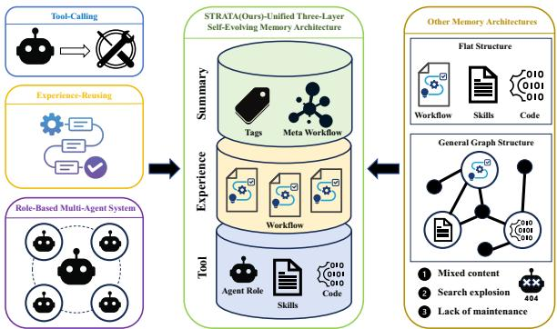  
Fi<sub>gure</sub> 1<sub>:</sub> A<sub>gen</sub>t <sub>memor</sub>i<sub>es are as</sub>k<sub>e</sub>d t<sub>o serve</sub> t<sub>oo</sub>l <sub>ca</sub>lli<sub>ng,</sub> ex<sub>p</sub>erience reuse and role-based decom<sub>p</sub>osition at once (left). E<sub>x</sub>i<sub>s</sub>ti<sub>ng</sub> <sub>memor</sub>i<sub>es</sub> <sub>are</sub> <sub>e</sub>ith<sub>er</sub> fl<sub>a</sub>t li<sub>s</sub>t<sub>s</sub> <sub>or</sub> <sub>gener</sub>i<sub>c</sub> <sub>grap</sub>h<sub>s,</sub> <sub>w</sub>hi<sub>c</sub>h <sub>m</sub>i<sub>x con</sub>t<sub>en</sub>t <sub>o</sub>f dif<sub>eren</sub>t <sub>granu</sub>l<sub>ar</sub>it<sub>y,</sub> dil<sub>u</sub>t<sub>e re</sub>t<sub>r</sub>i<sub>eva</sub>l <sub>as</sub> the<sub>y</sub> <sub>g</sub>row, and are never maintained (ri<sub>g</sub>ht). STRATA unifies the three in a sin<sub>g</sub>le three-la<sub>y</sub>er self-evolvin<sub>g g</sub>ra<sub>p</sub>h (middle).

D<sub>esp</sub>it<sub>e rap</sub>id <sub>progress, preva</sub>ili<sub>ng agen</sub>t <sub>memor</sub>i<sub>es s</sub>h<sub>are</sub> th<sub>ree</sub> li<sub>m</sub>it<sub>a</sub>ti<sub>ons.</sub>

(1) They lack a typed abstraction hierarchy. Several do or<sub>g</sub>anize what the<sub>y</sub> store (AWM distils workflows from trajectories (Wan<sub>g</sub> et al. 2024b), A-Mem links notes into a network (Xu et al. 2026)), but within one undiferentiated level: <sub>no</sub>thi<sub>ng separa</sub>t<sub>es a one-o</sub>f t<sub>oo</sub>l <sub>ca</sub>ll f<sub>rom a reusa</sub>bl<sub>e pro-</sub> <sub>ce</sub>d<sub>ure</sub> f<sub>rom a cross-</sub>t<sub>as</sub>k <sub>pr</sub>i<sub>nc</sub>i<sub>p</sub>l<sub>e, an</sub>d <sub>no opera</sub>ti<sub>on</sub> f<sub>o</sub>ld<sub>s</sub> <sub>proce</sub>d<sub>ures</sub> i<sub>n</sub>t<sub>o</sub> <sub>a</sub> <sub>pr</sub>i<sub>nc</sub>i<sub>p</sub>l<sub>e.</sub> R<sub>e</sub>t<sub>r</sub>i<sub>eva</sub>l <sub>s</sub>t<sub>ays</sub> <sub>a</sub> <sub>s</sub>i<sub>ng</sub>l<sub>e</sub> <sub>s</sub>i<sub>m</sub>i<sub>-</sub> l<sub>ar</sub>it<sub>y</sub> <sub>searc</sub>h d<sub>om</sub>i<sub>na</sub>t<sub>e</sub>d b<sub>y</sub> <sub>sur</sub>f<sub>ace</sub> <sub>over</sub>l<sub>ap,</sub> <sub>merg</sub>i<sub>ng</sub> <sub>same-</sub> <sub>ma</sub>t<sub>er</sub>i<sub>a</sub>l<sub>,</sub> dif<sub>eren</sub>t<sub>-opera</sub>ti<sub>on pa</sub>i<sub>rs</sub> lik<sub>e</sub> “<sub>crea</sub>t<sub>e a p</sub>l<sub>ay</sub>li<sub>s</sub>t” <sub>an</sub>d “<sub>a</sub>dd <sub>mon</sub>th<sub>s</sub> t<sub>o a no</sub>t<sub>e</sub>”<sub>.</sub>

(2) They are not self-maintaining. Memory grows monot<sub>on</sub>i<sub>ca</sub>ll<sub>y, w</sub>ith <sub>no</sub> f<sub>orge</sub>tti<sub>ng, no</sub> d<sub>e</sub>d<sub>up</sub>li<sub>ca</sub>ti<sub>on an</sub>d <sub>no conso</sub>l<sub>-</sub> id<sub>a</sub>ti<sub>on, so s</sub>t<sub>a</sub>l<sub>e en</sub>t<sub>r</sub>i<sub>es crow</sub>d <sub>ou</sub>t <sub>use</sub>f<sub>u</sub>l <sub>ones.</sub> W<sub>e measure</sub> this: with forgetting disabled the workflow store grows to 269 nodes injecting 48.7 lines of memory per task, yet scores lower than a bounded 201-node memory injecting less than

h<sub>a</sub>lf <sub>as</sub> <sub>muc</sub>h<sub>.</sub>

(3) They are vulnerable to negative transfer. When two <sub>exper</sub>i<sub>ences</sub> <sub>are</sub> <sub>super</sub>fi<sub>c</sub>i<sub>a</sub>ll<sub>y</sub> <sub>s</sub>i<sub>m</sub>il<sub>ar</sub> b<sub>u</sub>t di<sub>rec</sub>ti<sub>ona</sub>ll<sub>y</sub> <sub>oppo-</sub> <sub>s</sub>it<sub>e, as</sub> i<sub>n</sub> “h<sub>ea</sub>t th<sub>e su</sub>b<sub>s</sub>t<sub>ance</sub>” <sub>versus</sub> “<sub>coo</sub>l th<sub>e su</sub>b<sub>s</sub>t<sub>ance</sub>”<sub>,</sub> <sub>s</sub>i<sub>m</sub>il<sub>ar</sub>it<sub>y reca</sub>ll <sub>sur</sub>f<sub>aces</sub> th<sub>e wrong one, an</sub>d if th<sub>e memory</sub> <sub>s</sub>t<sub>ores concre</sub>t<sub>e execu</sub>t<sub>a</sub>bl<sub>e s</sub>t<sub>eps</sub> th<sub>e agen</sub>t <sub>cop</sub>i<sub>es</sub> th<sub>em an</sub>d <sub>ac</sub>t<sub>s ca</sub>t<sub>as</sub>t<sub>rop</sub>hi<sub>ca</sub>ll<sub>y.</sub> Thi<sub>s</sub> i<sub>s no</sub>t h<sub>ypo</sub>th<sub>e</sub>ti<sub>ca</sub>l<sub>: on</sub> S<sub>c</sub>i<sub>ence-</sub> World a production agent’s native flat memory scores −100 <sub>on a</sub> t<sub>as</sub>k f<sub>am</sub>il<sub>y</sub> th<sub>a</sub>t <sub>a memory</sub>l<sub>ess agen</sub>t <sub>so</sub>l<sub>ves ou</sub>t<sub>r</sub>i<sub>g</sub>ht<sub>.</sub>

W<sub>e a</sub>dd<sub>ress</sub> th<sub>ese</sub> li<sub>m</sub>it<sub>a</sub>ti<sub>ons w</sub>ith STRATA<sub>, a memory</sub> th<sub>a</sub>t i<sub>s s</sub>t<sub>ruc</sub>t<sub>ure</sub>d<sub>, ou</sub>t<sub>come-groun</sub>d<sub>e</sub>d <sub>an</sub>d <sub>se</sub>lf<sub>-ma</sub>i<sub>n</sub>t<sub>a</sub>i<sub>n</sub>i<sub>ng.</sub> STRATA <sub>organ</sub>i<sub>zes exper</sub>i<sub>ence</sub> i<sub>n</sub>t<sub>o a</sub> th<sub>ree-</sub>l<sub>ayer</sub> di<sub>rec</sub>t<sub>e</sub>d graph: atomic nodes (reusable skills, code snippets, or specialized sub-roles), workflow nodes (generalized task procedures), and meta-framework nodes (task families abstracted from recurrin<sub>g</sub> workflows), linked b<sub>y</sub> t<sub>yp</sub>ed call, <sub>g</sub>enerali<sub>za</sub>ti<sub>on, merge an</sub>d <sub>con</sub>t<sub>ras</sub>t <sub>e</sub>d<sub>ges.</sub> Th<sub>e grap</sub>h i<sub>s grown an</sub>d <sub>prune</sub>d b<sub>y</sub> fi<sub>ve mec</sub>h<sub>an</sub>i<sub>sms</sub> th<sub>a</sub>t <sub>a</sub>ll <sub>opera</sub>t<sub>e</sub> i<sub>n one s</sub>i<sub>m</sub>il<sub>ar</sub>it<sub>y</sub> geometry: (i) a multi-dimensional similarity combining cont<sub>en</sub>t <sub>an</sub>d <sub>goa</sub>l <sub>em</sub>b<sub>e</sub>ddi<sub>ngs w</sub>ith <sub>an exp</sub>li<sub>c</sub>it <sub>opera</sub>ti<sub>on</sub>/t<sub>arge</sub>t t<sub>ag</sub> term; (ii) a typed reflector that crystallizes a reusable proced<sub>ure on</sub>l<sub>y</sub> f<sub>rom so</sub>l<sub>ve</sub>d <sub>ep</sub>i<sub>so</sub>d<sub>es an</sub>d <sub>a</sub>tt<sub>ac</sub>h<sub>es a p</sub>itf<sub>a</sub>ll b<sub>u</sub>ll<sub>e</sub>t <sub>on</sub> f<sub>a</sub>il<sub>ure,</sub> <sub>w</sub>ith <sub>a</sub> <sub>per-group</sub> <sub>a</sub>d<sub>ap</sub>ti<sub>ve</sub> th<sub>res</sub>h<sub>o</sub>ld d<sub>ec</sub>idi<sub>ng</sub> <sub>w</sub>h<sub>e</sub>th<sub>er</sub> to create, extend, or skip a workflow; (iii) community detecti<sub>on</sub> th<sub>a</sub>t i<sub>n</sub>d<sub>uces a me</sub>t<sub>a-</sub>f<sub>ramewor</sub>k <sub>w</sub>h<sub>enever a commun</sub>it<sub>y</sub> is large, tight, and novel; (iv) pressure-triggered garbage coll<sub>ec</sub>ti<sub>on</sub> th<sub>a</sub>t <sub>ran</sub>k<sub>s</sub> <sub>wor</sub>kfl<sub>ows</sub> b<sub>y</sub> <sub>a</sub> <sub>compe</sub>titi<sub>on-aware</sub> <sub>qua</sub>lit<sub>y</sub> <sub>score</sub> <sub>an</sub>d f<sub>orge</sub>t<sub>s</sub> th<sub>e</sub> l<sub>owes</sub>t <sub>w</sub>hil<sub>e</sub> <sub>pro</sub>t<sub>ec</sub>ti<sub>ng</sub> <sub>ar</sub>ti<sub>cu</sub>l<sub>a</sub>ti<sub>on</sub> points of the similarity graph; and (v) contrast edges that <sub>connec</sub>t <sub>con</sub>f<sub>usa</sub>bl<sub>e,</sub> di<sub>rec</sub>ti<sub>on-oppos</sub>it<sub>e exper</sub>i<sub>ences so</sub> th<sub>a</sub>t retrieving one injects an explicit “do not confuse” warning <sub>a</sub>b<sub>ou</sub>t th<sub>e o</sub>th<sub>er.</sub>

O<sub>ur con</sub>t<sub>r</sub>ib<sub>u</sub>ti<sub>ons are as</sub> f<sub>o</sub>ll<sub>ows.</sub>

• We <sub>p</sub>ro<sub>p</sub>ose STRATA<sub>,</sub> a three-la<sub>y</sub>er structured ex<sub>p</sub>eri-<sub>ence grap</sub>h f<sub>or se</sub>lf<sub>-evo</sub>l<sub>v</sub>i<sub>ng</sub> LLM <sub>agen</sub>t<sub>s,</sub> t<sub>oge</sub>th<sub>er w</sub>ith fi<sub>ve</sub> <sub>ma</sub>i<sub>n</sub>t<sub>enance</sub> <sub>mec</sub>h<sub>an</sub>i<sub>sms</sub> th<sub>a</sub>t <sub>grow,</sub> <sub>genera</sub>li<sub>ze,</sub> <sub>an</sub>d f<sub>orge</sub>t it<sub>,</sub> f<sub>ormu</sub>l<sub>a</sub>t<sub>e</sub>d <sub>prec</sub>i<sub>se</sub>l<sub>y an</sub>d <sub>repro</sub>d<sub>uc</sub>ibl<sub>y.</sub>

• We evaluate STRATA on four interactive benchmarks <sub>across</sub> t<sub>wo</sub> f<sub>rozen</sub> b<sub>ac</sub>kb<sub>ones, seven</sub> b<sub>ase</sub>li<sub>nes an</sub>d th<sub>ree</sub> <sub>see</sub>d<sub>s, w</sub>ith <sub>a componen</sub>t<sub>-w</sub>i<sub>se a</sub>bl<sub>a</sub>ti<sub>on o</sub>f <sub>every mec</sub>h<sub>a-</sub> <sub>n</sub>i<sub>sm.</sub> STRATA <sub>o</sub>bt<sub>a</sub>i<sub>ns</sub> th<sub>e</sub> b<sub>es</sub>t <sub>average score a</sub>t th<sub>e</sub> l<sub>ow-</sub> <sub>es</sub>t l<sub>a</sub>t<sub>ency</sub> <sub>an</sub>d f<sub>ewes</sub>t <sub>env</sub>i<sub>ronmen</sub>t <sub>s</sub>t<sub>eps</sub> <sub>o</sub>f <sub>any</sub> <sub>memory</sub> b<sub>ase</sub>li<sub>ne.</sub>

• We identif<sub>y</sub> two failure modes of <sub>p</sub>rior memories: a scale f<sub>a</sub>il<sub>ure o</sub>f <sub>s</sub>i<sub>ng</sub>l<sub>e-</sub>l<sub>eve</sub>l <sub>memory</sub> th<sub>a</sub>t <sub>ne</sub>ith<sub>er a</sub>b<sub>s</sub>t<sub>rac</sub>t<sub>s nor</sub> forgets (on Flash the strongest baseline ranks first at 168 tasks and seventh at 812), and negative transfer in singlel<sub>eve</sub>l <sub>concre</sub>t<sub>e</sub> <sub>memor</sub>i<sub>es,</sub> <sub>w</sub>hi<sub>c</sub>h <sub>con</sub>t<sub>ras</sub>t <sub>e</sub>d<sub>ges</sub> <sub>repa</sub>i<sub>r,</sub> <sub>ex-</sub> <sub>pos</sub>i<sub>ng</sub> <sub>a</sub> <sub>s</sub>t<sub>ruc</sub>t<sub>ure-versus-a</sub>b<sub>s</sub>t<sub>rac</sub>ti<sub>on</sub> t<sub>ra</sub>d<sub>e-o</sub>f<sub>.</sub>

## Related Work

Memory for LLM agents. A growing line of work equips LLM <sub>age</sub>nt<sub>s</sub> <sub>w</sub>ith <sub>a</sub>n <sub>ex</sub>t<sub>e</sub>rn<sub>a</sub>l m<sub>e</sub>m<sub>o</sub>r<sub>y</sub> th<sub>a</sub>t <sub>pe</sub>r<sub>s</sub>i<sub>s</sub>t<sub>s</sub> <sub>ac</sub>r<sub>oss</sub> <sub>ep</sub>i<sub>so</sub>d<sub>es.</sub> E<sub>ar</sub>l<sub>y sys</sub>t<sub>ems s</sub>t<sub>ore an</sub>d <sub>summar</sub>i<sub>ze raw</sub> i<sub>n</sub>t<sub>erac-</sub> tion histor<sub>y</sub> (Packer et al. 2023; Chhikara et al. 2025; Zhon<sub>g</sub> et al. 2024); A<sub>g</sub>ent Workflow Memor<sub>y</sub> extracts reusable action workflows from <sub>p</sub>ast trajectories (Wan<sub>g</sub> et al. 2024b); A<sub>g</sub>entic Context En<sub>g</sub>ineerin<sub>g</sub> (ACE) maintains an evolvin<sub>g</sub>, <sub>p</sub>er-a<sub>pp</sub>lication <sub>p</sub>la<sub>y</sub>book of bullet-<sub>p</sub>oint strate<sub>g</sub>ies (Zhan<sub>g</sub> et al. 2025b); Reasonin<sub>g</sub>Bank distills <sub>g</sub>eneralizable reasoning strategies from both successful and failed trajectories (Ou<sub>y</sub>an<sub>g</sub> et al. 2025). A-Mem or<sub>g</sub>anizes memories in a Zettelkasten-st<sub>y</sub>le linked note network (Xu et al. 2026), M<sub>em</sub>G<sub>en weaves a genera</sub>ti<sub>ve</sub> l<sub>a</sub>t<sub>en</sub>t <sub>memory</sub> i<sub>n</sub>t<sub>o</sub> th<sub>e agen</sub>t’<sub>s</sub> own reasonin<sub>g</sub> (Zhan<sub>g</sub>, Fu, and Yan 2025), MemEvolve meta-evolves the memor<sub>y</sub> architecture itself (Zhan<sub>g</sub> et al. 2025a), and MemInsi<sub>g</sub>ht autonomousl<sub>y</sub> au<sub>g</sub>ments stored items (Salama et al. 2025). These methods difer in what th<sub>ey s</sub>t<sub>ore</sub> b<sub>u</sub>t <sub>s</sub>h<sub>are a common s</sub>t<sub>ruc</sub>t<sub>ure: a s</sub>i<sub>ng</sub>l<sub>e-</sub>l<sub>eve</sub>l <sub>co</sub>l<sub>-</sub> l<sub>ec</sub>ti<sub>on re</sub>t<sub>r</sub>i<sub>eve</sub>d b<sub>y s</sub>i<sub>m</sub>il<sub>ar</sub>it<sub>y, w</sub>ith <sub>no</sub> t<sub>ype</sub>d hi<sub>erarc</sub>h<sub>y an</sub>d<sub>,</sub> t<sub>yp</sub>i<sub>ca</sub>ll<sub>y,</sub> <sub>no</sub> <sub>exp</sub>li<sub>c</sub>it f<sub>orge</sub>tti<sub>ng</sub> <sub>or</sub> <sub>an</sub>ti<sub>-con</sub>f<sub>us</sub>i<sub>on</sub> <sub>mec</sub>h<sub>an</sub>i<sub>sm.</sub> A<sub>-</sub>M<sub>em</sub> i<sub>s</sub> th<sub>e mos</sub>t <sub>s</sub>t<sub>ruc</sub>t<sub>ure</sub>d <sub>o</sub>f th<sub>em an</sub>d<sub>, w</sub>ith M<sub>em</sub>E<sub>vo</sub>l<sub>ve,</sub> <sub>our s</sub>t<sub>ronges</sub>t b<sub>ase</sub>li<sub>ne:</sub> it li<sub>n</sub>k<sub>s no</sub>t<sub>es</sub> i<sub>n</sub>t<sub>o a ne</sub>t<sub>wor</sub>k <sub>an</sub>d l<sub>e</sub>t<sub>s</sub> <sub>new memor</sub>i<sub>es rev</sub>i<sub>se o</sub>ld <sub>ones,</sub> b<sub>u</sub>t th<sub>e ne</sub>t<sub>wor</sub>k i<sub>s s</sub>i<sub>ng</sub>l<sub>e-</sub> l<sub>eve</sub>l<sub>, one no</sub>t<sub>e per memory</sub> li<sub>n</sub>k<sub>e</sub>d t<sub>o</sub> it<sub>s ne</sub>i<sub>g</sub>hb<sub>ours, so</sub> it <sub>ne</sub>ith<sub>er a</sub>b<sub>s</sub>t<sub>rac</sub>t<sub>s a</sub> f<sub>am</sub>il<sub>y o</sub>f <sub>no</sub>t<sub>es</sub> i<sub>n</sub>t<sub>o a reusa</sub>bl<sub>e pr</sub>i<sub>nc</sub>i<sub>-</sub> <sub>p</sub>l<sub>e</sub> <sub>nor</sub> <sub>removes</sub> <sub>any</sub> <sub>no</sub>t<sub>e</sub> <sub>once</sub> <sub>wr</sub>itt<sub>en.</sub> W<sub>e</sub> <sub>s</sub>h<sub>ow</sub> th<sub>a</sub>t thi<sub>s</sub> <sub>pro</sub>d<sub>uces a s</sub>h<sub>arp sca</sub>l<sub>e</sub> d<sub>epen</sub>d<sub>ence.</sub> STRATA d<sub>epar</sub>t<sub>s</sub> f<sub>rom</sub> this line by making the memory a typed, layered graph that i<sub>s ac</sub>ti<sub>ve</sub>l<sub>y ma</sub>i<sub>n</sub>t<sub>a</sub>i<sub>ne</sub>d<sub>, conso</sub>lid<sub>a</sub>t<sub>e</sub>d i<sub>n</sub>t<sub>o me</sub>t<sub>a-</sub>f<sub>ramewor</sub>k<sub>s,</sub> <sub>gar</sub>b<sub>age-co</sub>ll<sub>ec</sub>t<sub>e</sub>d <sub>un</sub>d<sub>er pressure an</sub>d <sub>w</sub>i<sub>re</sub>d <sub>w</sub>ith <sub>con</sub>t<sub>ras</sub>t <sub>e</sub>d<sub>ges aga</sub>i<sub>ns</sub>t <sub>nega</sub>ti<sub>ve</sub> t<sub>rans</sub>f<sub>er.</sub>

Self-evolving and experience-based agents. Reflexion converts e<sub>p</sub>isodic failures into verbal self-feedback (Shinn et al. 2023) and Self-Refine iterates on its own out<sub>p</sub>ut within an e<sub>p</sub>isode (Madaan et al. 2023); Vo<sub>y</sub>a<sub>g</sub>er accumulates a skill librar<sub>y</sub> of executable code (Wan<sub>g</sub> et al. 2023); Ex<sub>p</sub>eL <sub>g</sub>athers cross-task insi<sub>g</sub>hts for in-context reuse (Zhao et al. 2024); S<sub>y</sub>na<sub>p</sub>se retrieves trajector<sub>y</sub> exem<sub>p</sub>lars (Zhen<sub>g</sub> et al. 2024); CoALA frames such desi<sub>g</sub>ns as co<sub>g</sub>nitive architectures (Sumers et al. 2023), alon<sub>g</sub>side simulacra s<sub>y</sub>stems that <sub>p</sub>ersist state across e<sub>p</sub>isodes (Park et al. 2023). STRATA i<sub>s comp</sub>l<sub>emen</sub>t<sub>ary an</sub>d <sub>mec</sub>h<sub>an</sub>i<sub>sm-</sub>l<sub>eve</sub>l<sub>: ra</sub>th<sub>er</sub> th<sub>an a new</sub> learning signal, it contributes the data structure and maintenance policy governing how experiences are typed, con-<sub>nec</sub>t<sub>e</sub>d<sub>, genera</sub>li<sub>ze</sub>d <sub>an</sub>d f<sub>orgo</sub>tt<sub>en, so accumu</sub>l<sub>a</sub>t<sub>e</sub>d <sub>exper</sub>i<sub>ence</sub> <sub>s</sub>t<sub>ays organ</sub>i<sub>ze</sub>d <sub>as</sub> it <sub>sca</sub>l<sub>es.</sub>

Structured retrieval, forgetting, and negative transfer. O<sub>u</sub>t<sub>s</sub>id<sub>e</sub> th<sub>e agen</sub>t <sub>se</sub>tti<sub>ng, grap</sub>h<sub>-s</sub>t<sub>ruc</sub>t<sub>ure</sub>d <sub>an</sub>d hi<sub>erarc</sub>hi<sub>-</sub> cal memories (Ed<sub>g</sub>e et al. 2024; Gutiérrez et al. 2024, 2025) im<sub>p</sub>rove retrieval <sub>p</sub>recision over flat retrieve-then-<sub>g</sub>enerate (Lewis et al. 2020; Kar<sub>p</sub>ukhin et al. 2020; Izacard et al. 2021) and its refinements (Gao et al. 2023; Asai et al. 2024), while unstructured stores sufer the classical catastro<sub>p</sub>hic-for<sub>g</sub>ettin<sub>g</sub> and ne<sub>g</sub>ative-transfer <sub>p</sub>roblems (Mc-Cl<sub>os</sub>k<sub>ey an</sub>d C<sub>o</sub>h<sub>en</sub> 1989<sub>;</sub> Ki<sub>r</sub>k<sub>pa</sub>t<sub>r</sub>i<sub>c</sub>k <sub>e</sub>t <sub>a</sub>l<sub>.</sub> 2017<sub>;</sub> P<sub>ar</sub>i<sub>s</sub>i et al. 2018; Zhan<sub>g</sub> et al. 2022). Our maintenance machiner<sub>y</sub> b<sub>orrows s</sub>t<sub>an</sub>d<sub>ar</sub>d <sub>grap</sub>h t<sub>oo</sub>l<sub>s:</sub> L<sub>ouva</sub>i<sub>n commun</sub>it<sub>y</sub> d<sub>e</sub>t<sub>ec-</sub> tion (Blondel et al. 2008; Newman and Girvan 2004), conductance as a cut qualit<sub>y</sub> measure (Shi 2000), and Tarjan’s articulation-<sub>p</sub>oint al<sub>g</sub>orithm (Tarjan 1972); the three-la<sub>y</sub>er <sub>sp</sub>lit <sub>m</sub>i<sub>rrors</sub> th<sub>e</sub> <sub>ep</sub>i<sub>so</sub>di<sub>c</sub>/<sub>seman</sub>ti<sub>c</sub> di<sub>s</sub>ti<sub>nc</sub>ti<sub>on</sub> <sub>an</sub>d <sub>comp</sub>l<sub>e-</sub> mentar<sub>y</sub> learnin<sub>g</sub> s<sub>y</sub>stems (Tulvin<sub>g</sub> 1972; McClelland, Mc-Nau<sub>g</sub>hton, and O’Reill<sub>y</sub> 1995). In the a<sub>g</sub>ent settin<sub>g</sub> the risk is sharper: because retrieved experience is executed, an in-<sub>correc</sub>tl<sub>y</sub> <sub>reca</sub>ll<sub>e</sub>d <sub>proce</sub>d<sub>ure</sub> d<sub>oes</sub> <sub>no</sub>t <sub>mere</sub>l<sub>y</sub> <sub>m</sub>i<sub>s</sub>l<sub>ea</sub>d b<sub>u</sub>t <sub>ac</sub>ti<sub>ve</sub>l<sub>y</sub> h<sub>arms.</sub> STRATA <sub>a</sub>dd<sub>s</sub> <sub>an</sub> <sub>exp</sub>li<sub>c</sub>it <sub>opera</sub>ti<sub>on</sub>/t<sub>arge</sub>t <sub>ga</sub>t<sub>e</sub> <sub>an</sub>d <sub>sur</sub>f<sub>aces</sub> th<sub>e</sub> <sub>oppos</sub>i<sub>ng</sub> <sub>exper</sub>i<sub>ence</sub> <sub>as</sub> <sub>a</sub> <sub>re</sub>t<sub>r</sub>i<sub>eva</sub>l<sub>-</sub>ti<sub>me</sub> <sub>warn</sub>i<sub>ng, a mec</sub>h<sub>an</sub>i<sub>sm we are no</sub>t <sub>aware o</sub>f i<sub>n pr</sub>i<sub>or agen</sub>t <sup>memor</sup>y<sup>.</sup>

## Method

## The Three-Layer Experience Graph

STRATA <sub>ma</sub>i<sub>n</sub>t<sub>a</sub>i<sub>ns a grap</sub>h $G = ( V , E )$ <sub>w</sub>h<sub>ose no</sub>d<sub>es carry</sub> <sup>a</sup> <sup>t</sup>yp<sup>e</sup> $\tau ( n ) \in \{ \mathbf { A T O M I C } $ , workflow, meta}: atomic nodes are the smallest reusable units (one tool/API, a <sub>p</sub>arameterized code sni<sub>pp</sub>et, or a s<sub>p</sub>ecialized sub-role); workflow nodes <sub>are genera</sub>li<sub>ze</sub>d <sub>proce</sub>d<sub>ures</sub> f<sub>or a w</sub>h<sub>o</sub>l<sub>e</sub> t<sub>as</sub>k<sub>; meta no</sub>d<sub>es are</sub> <sub>para</sub>di<sub>gms a</sub>b<sub>s</sub>t<sub>rac</sub>t<sub>e</sub>d f<sub>rom a</sub> f<sub>am</sub>il<sub>y o</sub>f<sub>s</sub>i<sub>m</sub>il<sub>ar wor</sub>kfl<sub>ows.</sub> Th<sub>e</sub> <sub>s</sub>t<sub>ore</sub>d <sub>e</sub>d<sub>ge se</sub>t i<sub>s</sub> t<sub>ype</sub>d<sub>,</sub> $E = E _ { \mathrm { { c a l l } } } ^ { \bullet } \cup E _ { \mathrm { { g e n } } } \cup E _ { \mathrm { { m e r g e } } } \cup E _ { \mathrm { { c o n } } } \colon$ call edges (workflow → atomic, ordered) and three evolution relations (sources → target) labelled generalizes, merged\_from and contrasts. Maintenance uses a $d e \mathrm { - }$ rived graph $W \ = \ ( V _ { \mathrm { w o R K F L O W } } , E _ { \mathrm { s i m } } )$ <sub>: an un</sub>di<sub>rec</sub>t<sub>e</sub>d <sub>un</sub>i<sub>on-</sub> kNN <sub>grap</sub>h <sub>over</sub> <sub>wor</sub>kfl<sub>ows</sub> <sub>we</sub>i<sub>g</sub>ht<sub>e</sub>d b<sub>y</sub> $s _ { \mathrm { n n } }$ , recom<sub>p</sub>ute<sup>d</sup> f<sub>rom</sub> $G$ <sub>every roun</sub>d <sub>an</sub>d <sub>never s</sub>t<sub>ore</sub>d<sub>.</sub> C<sub>ommun</sub>it<sub>y</sub> d<sub>e</sub>t<sub>ec</sub>ti<sub>on</sub> <sub>an</sub>d <sub>ar</sub>ti<sub>cu</sub>l<sub>a</sub>ti<sub>on-po</sub>i<sub>n</sub>t <sub>pro</sub>t<sub>ec</sub>ti<sub>on opera</sub>t<sub>e on</sub> $W ;$ ever<sub>y</sub>t<sup>hi</sup>n<sub>g</sub> e<sup>l</sup>se o<sub>p</sub>erates on $G .$

E<sub>ac</sub>h <sub>no</sub>d<sub>e exposes severa</sub>l t<sub>ex</sub>t<sub>ua</sub>l <sub>v</sub>i<sub>ews use</sub>d b<sub>y</sub> dif<sub>eren</sub>t similarity dimensions: a content view (what it does), an index view (a<sub>pp</sub>licabilit<sub>y</sub> and <sub>g</sub>oal), and a set of structured ta<sub>g</sub>s $T ( n ) \ \subseteq \ \{ { \mathrm { a p p } } \colon * , \mathrm { o p }  \colon * , \mathrm { o b j } \colon * \}$ , a node attribute rather th<sub>an</sub> <sub>a</sub> <sub>no</sub>d<sub>e,</sub> <sub>nam</sub>i<sub>ng</sub> th<sub>e</sub> <sub>app</sub>li<sub>ca</sub>ti<sub>on,</sub> <sub>opera</sub>ti<sub>on</sub> <sub>an</sub>d t<sub>arge</sub>t object. Queries are parsed into the same tag space, so query <sub>an</sub>d <sub>no</sub>d<sub>e</sub> li<sub>ve</sub> i<sub>n</sub> <sub>one</sub> <sub>geome</sub>t<sub>ry.</sub> A<sub>ppen</sub>di<sub>x</sub> I <sub>repro</sub>d<sub>uces</sub> <sub>a</sub> <sub>rea</sub>l <sub>wor</sub>kfl<sub>ow no</sub>d<sub>e an</sub>d th<sub>e me</sub>t<sub>a no</sub>d<sub>e</sub> th<sub>a</sub>t <sub>genera</sub>li<sub>zes</sub> it<sub>,</sub> <sub>ver</sub>b<sub>a</sub>ti<sub>m.</sub>

## Multi-Dimensional Similarity and Retrieval

A single content-embedding cosine conflates same material, diferent operation experiences. STRATA instead scores a query q against a node n with four complementary signals,

$$
\begin{array} { r l } & { s ( \boldsymbol { q } , n ) = W _ { \mathrm { c } } \cos \bigl ( \mathbf { e } ( \boldsymbol { q } ) , \mathbf { e } _ { \mathrm { c } } ( n ) \bigr ) + W _ { \mathrm { i } } \cos \bigl ( \mathbf { e } ( \boldsymbol { q } ) , \mathbf { e } _ { \mathrm { i } } ( n ) \bigr ) } \\ & { \phantom { s s } + W _ { \mathrm { t } } J \bigl ( T ( \boldsymbol { q } ) , T ( n ) \bigr ) + W _ { \mathrm { l } } \ell ( \boldsymbol { q } , n ) , } \end{array}\tag{1}
$$

<sub>w</sub>h<sub>ere</sub> $\mathbf { e } _ { \mathrm { c } }$ <sub>an</sub>d $\mathbf { e _ { i } }$ <sub>em</sub>b<sub>e</sub>d th<sub>e</sub> <sub>con</sub>t<sub>en</sub>t <sub>an</sub>d i<sub>n</sub>d<sub>ex</sub> <sub>v</sub>i<sub>ews,</sub> $J$ i<sub>s</sub> Jaccard overlap of the structured tags, and ℓ is a lexical token overla<sub>p</sub> in the s<sub>p</sub>irit of classical term matchin<sub>g</sub> (Robertson and Zara<sub>g</sub>oza 2009). We use $W _ { \mathrm { c } } { = } 0 . 4 0 , W _ { \mathrm { i } } { = } 0 . { \overset { \vartriangle } { 2 } } 5 , W _ { \mathrm { t } } { = } 0 . 3 0$ $W _ { \mathrm { l } } { = } 0 . 0 \bar { 5 }$ <sub>.</sub> Th<sub>e</sub> t<sub>ag</sub> t<sub>erm</sub> i<sub>s an a</sub>dditi<sub>ve we</sub>i<sub>g</sub>ht<sub>, no</sub>t <sub>a mu</sub>lti<sub>-</sub> <sub>p</sub>li<sub>ca</sub>ti<sub>ve</sub> <sub>ga</sub>t<sub>e;</sub> <sub>a</sub>t $W _ { \mathrm { t } } { = } 0 . 3 0$ it i<sub>s</sub> th<sub>e</sub> l<sub>arges</sub>t <sub>non-con</sub>t<sub>en</sub>t <sub>we</sub>i<sub>g</sub>ht <sub>an</sub>d th<sub>e</sub> <sub>on</sub>l<sub>y</sub> t<sub>erm</sub> th<sub>a</sub>t <sub>separa</sub>t<sub>es</sub> <sub>exper</sub>i<sub>ences</sub> <sub>w</sub>h<sub>ose</sub> <sub>con</sub>t<sub>en</sub>t embeddings nearly coincide because they act on one object <sub>w</sub>ith <sub>oppos</sub>it<sub>e</sub> <sub>opera</sub>ti<sub>ons.</sub> Th<sub>e</sub> <sub>same</sub> f<sub>orm,</sub> <sub>w</sub>ith b<sub>o</sub>th <sub>s</sub>id<sub>es</sub> <sub>us</sub>i<sub>ng</sub> <sub>no</sub>d<sub>e</sub> <sub>v</sub>i<sub>ews,</sub> <sub>g</sub>i<sub>ves</sub> <sub>a</sub> <sub>no</sub>d<sub>e–no</sub>d<sub>e</sub> <sub>s</sub>i<sub>m</sub>il<sub>ar</sub>it<sub>y</sub> $s _ { \mathrm { n n } } ( a , b )$ th<sub>a</sub>t l<sub>a</sub>t<sub>er serves as</sub> th<sub>e e</sub>d<sub>ge we</sub>i<sub>g</sub>ht <sub>o</sub>f th<sub>e wor</sub>kfl<sub>ow s</sub>i<sub>m</sub>il<sub>ar</sub>it<sub>y</sub> g<sup>ra</sup>p<sup>h</sup>.

Retrieval returns a subgraph, not isolated items. Nodes <sub>are</sub> <sub>ran</sub>k<sub>e</sub>d b<sub>y</sub> $\tilde { s } ( n ) ~ = ~ s ( q , n ) + \beta _ { \mathrm { l a y e r } } { \frac { 2 - \mathrm { o r d } ( \tau ( n ) ) } { \it \Omega ^ { 2 } } }$ <sub>w</sub>ith $\beta _ { \mathrm { l a y e r } } { = } 0 . 1 5$ <sub>an</sub>d $\mathrm { \partial \ o r d ( \mathbf { M E T A } ) { = } 0 } ~ < ~ \mathrm { \ o r d ( \mathbf { w o } { R K F L O W } ) { = } 1 } ~ <$ ord $\scriptstyle \left( \mathbf { A T O M I C } \right) = 2 ,$ <sub>,</sub> bi<sub>as</sub>i<sub>ng</sub> t<sub>owar</sub>d<sub>s</sub> <sub>genera</sub>l <sub>no</sub>d<sub>es.</sub> O<sub>n</sub>l<sub>y</sub> <sub>see</sub>d<sub>s</sub> <sub>w</sub>ith <sub>raw score</sub> $s ( q , n ) \stackrel { \textstyle \cdot } { \geq } \theta _ { \mathrm { m i n } } = 0 . 3 5$ <sub>are a</sub>d<sub>m</sub>itt<sub>e</sub>d<sub>;</sub> if <sub>no</sub>th<sub>-</sub> ing clears the gate, no memory is injected at all, since running without memory beats being misled. Around the top-k seeds we <sub>p</sub>ull in their meta <sub>p</sub>arents (which must themselves <sub>c</sub>l<sub>ear</sub> $\theta _ { \mathrm { m i n } }$ , so catch-all hubs cannot leak into ever<sub>y</sub> task), the <sub>a</sub>t<sub>om</sub>i<sub>c no</sub>d<sub>es</sub> th<sub>ey ca</sub>ll<sub>, an</sub>d th<sub>e</sub>i<sub>r con</sub>t<sub>ras</sub>t <sub>ne</sub>i<sub>g</sub>hb<sub>ours, ren-</sub> dered meta→workflow→atomic so the a<sub>g</sub>ent reads <sub>p</sub>rin-<sub>c</sub>i<sub>p</sub>l<sub>es</sub> fi<sub>rs</sub>t <sub>an</sub>d <sub>ca</sub>ll<sub>a</sub>bl<sub>e s</sub>kill<sub>s</sub> l<sub>as</sub>t<sub>.</sub>

## Typed Reflection with Adaptive Thresholds

Aft<sub>er</sub> <sub>eac</sub>h <sub>ep</sub>i<sub>so</sub>d<sub>e</sub> <sub>a</sub> <sub>mas</sub>t<sub>er</sub> <sub>rou</sub>t<sub>er</sub> i<sub>nspec</sub>t<sub>s</sub> th<sub>e</sub> t<sub>as</sub>k<sub>,</sub> <sub>ou</sub>t<sub>come</sub> and trajectory and dispatches to typed sub-reflectors for skill, <sub>co</sub>d<sub>e, ro</sub>l<sub>e an</sub>d <sub>wor</sub>kfl<sub>ow.</sub> At<sub>om</sub>i<sub>c su</sub>b<sub>-re</sub>fl<sub>ec</sub>t<sub>ors crys</sub>t<sub>a</sub>lli<sub>ze</sub> <sub>on</sub>l<sub>y</sub> f<sub>rom so</sub>l<sub>ve</sub>d <sub>ep</sub>i<sub>so</sub>d<sub>es,</sub> l<sub>e</sub>tti<sub>ng</sub> th<sub>e</sub> LLM d<sub>ec</sub>id<sub>e re</sub>fi<sub>ne-or-</sub> <sub>crea</sub>t<sub>e.</sub> Th<sub>e</sub> <sub>wor</sub>kfl<sub>ow</sub> <sub>su</sub>b<sub>-re</sub>fl<sub>ec</sub>t<sub>or</sub> i<sub>s</sub> th<sub>res</sub>h<sub>o</sub>ld<sub>-</sub>d<sub>r</sub>i<sub>ven,</sub> <sub>an</sub>d the thresholds must adapt: equivalent task pairs score ≈ 0.4– 0.5 in one application and $\approx 0 . 8$ i<sub>n ano</sub>th<sub>er, so one g</sub>l<sub>o</sub>b<sub>a</sub>l b<sub>an</sub>d <sub>e</sub>ith<sub>er over-merges or over-</sub>f<sub>ragmen</sub>t<sub>s.</sub>

W<sub>e</sub> th<sub>ere</sub>f<sub>ore</sub> <sub>group</sub> <sub>no</sub>d<sub>es</sub> b<sub>y</sub> th<sub>e</sub>i<sub>r</sub> l<sub>ea</sub>di<sub>ng</sub> t<sub>ag</sub> <sub>an</sub>d <sub>s</sub>h<sub>r</sub>i<sub>n</sub>k <sub>a</sub> <sub>per-group</sub> <sub>quan</sub>til<sub>e</sub> t<sub>owar</sub>d<sub>s</sub> <sub>a</sub> <sub>g</sub>l<sub>o</sub>b<sub>a</sub>l <sub>pr</sub>i<sub>or</sub> i<sub>n</sub> <sub>emp</sub>i<sub>r</sub>i<sub>ca</sub>l<sub>-</sub>B<sub>ayes</sub> fashion (Efron and Morris 1973):

$$
\tau _ { \bullet } = \lambda Q _ { p _ { \bullet } } ( S _ { g } ) + ( 1 - \lambda ) G _ { \bullet } , \qquad \lambda = { \frac { n _ { g } } { n _ { g } + \kappa } } ,\tag{2}
$$

<sub>w</sub>ith $\kappa { = } 3 0 , \quad p _ { \mathrm { l o } } { = } 0 . 2 5 , \quad p _ { \mathrm { h i } } { = } 0 . 9 2$ <sub>an</sub>d <sub>g</sub>l<sub>o</sub>b<sub>a</sub>l <sub>pr</sub>i<sub>ors</sub> $G _ { \mathrm { l o w } } { = } 0 . 3 3 , ~ G _ { \mathrm { h i g h } } { = } 0 . 6 2$ <sub>.</sub> G<sub>roups w</sub>ith <sub>many o</sub>b<sub>serva</sub>ti<sub>ons</sub> t<sub>rus</sub>t th<sub>e</sub>i<sub>r</sub> <sub>own</sub> di<sub>s</sub>t<sub>r</sub>ib<sub>u</sub>ti<sub>on;</sub> <sub>sparse</sub> <sub>groups</sub> f<sub>a</sub>ll b<sub>ac</sub>k t<sub>o</sub> th<sub>e</sub> prior. Letting s be the similarity to the nearest existing workfl<sub>ow,</sub> th<sub>e</sub> d<sub>ec</sub>i<sub>s</sub>i<sub>on</sub> i<sub>s noop</sub> if $s > \tau _ { \mathrm { h i g h } }$ (a near-du<sub>p</sub>licate), <sub>add\_bullet</sub> if $\tau _ { \mathrm { l o w } } \leq s \leq \tau _ { \mathrm { h i g h } }$ (record onl<sub>y</sub> the diference as one bullet), and create otherwise. The current score is <sub>recor</sub>d<sub>e</sub>d i<sub>n</sub>t<sub>o</sub> th<sub>e group a</sub>ft<sub>er</sub> th<sub>e</sub> d<sub>ec</sub>i<sub>s</sub>i<sub>on, so a</sub> d<sub>ec</sub>i<sub>s</sub>i<sub>on never</sub> contaminates itself. Crucially, failed episodes never crystalli<sub>ze a</sub> “d<sub>o</sub> thi<sub>s</sub>” <sub>proce</sub>d<sub>ure; a</sub>t <sub>mos</sub>t th<sub>ey a</sub>tt<sub>ac</sub>h <sub>a pitfall</sub> b<sub>u</sub>ll<sub>e</sub>t t<sub>o</sub> th<sub>e neares</sub>t <sub>wor</sub>kfl<sub>ow, ren</sub>d<sub>ere</sub>d t<sub>o</sub> th<sub>e agen</sub>t <sub>as some</sub>thi<sub>ng</sub> t<sub>o avo</sub>id<sub>.</sub>

## Pressure-Triggered Forgetting with Bridge Protection

F<sub>orge</sub>tti<sub>ng</sub> i<sub>s app</sub>li<sub>e</sub>d <sub>on</sub>l<sub>y a</sub>t th<sub>e wor</sub>kfl<sub>ow</sub> l<sub>ayer.</sub> E<sub>ac</sub>h <sub>wor</sub>k<sub>-</sub> fl<sub>ow ge</sub>t<sub>s a qua</sub>lit<sub>y score com</sub>bi<sub>n</sub>i<sub>ng an ac</sub>ti<sub>va</sub>ti<sub>on</sub> t<sub>erm</sub> $A _ { i }$ (its <sub>s</sub>i<sub>m</sub>il<sub>ar</sub>it<sub>y-we</sub>i<sub>g</sub>ht<sub>e</sub>d d<sub>egree</sub> <sub>among</sub> <sub>surv</sub>i<sub>v</sub>i<sub>ng</sub> <sub>ne</sub>i<sub>g</sub>hb<sub>ours,</sub> <sub>so</sub> central workflows are ke<sub>p</sub>t) and a com<sub>p</sub>etitive a<sub>g</sub>e $G _ { i } { \mathrm { : } }$

$$
Q _ { i } = w _ { A } z \big ( \mathrm { r a n k } ( A _ { i } ) \big ) - w _ { G } z \big ( \mathrm { r a n k } ( G _ { i } ) \big ) ,\tag{3}
$$

<sub>w</sub>ith $v _ { A } = 0 . 3 5 , w _ { G } = 0 . 6 5 ;$ <sub>ran</sub>k<sub>s ra</sub>th<sub>er</sub> th<sub>an raw va</sub>l<sub>ues ma</sub>k<sub>e</sub> th<sub>e</sub> t<sub>wo</sub> i<sub>ncommensura</sub>bl<sub>e</sub> <sub>s</sub>i<sub>gna</sub>l<sub>s</sub> <sub>compara</sub>bl<sub>e.</sub> A<sub>ge</sub> <sub>up</sub>d<sub>a</sub>t<sub>es</sub> <sub>on</sub>li<sub>ne a</sub>t <sub>every re</sub>t<sub>r</sub>i<sub>eva</sub>l<sub>: a</sub>ll <sub>can</sub>did<sub>a</sub>t<sub>es age</sub> b<sub>y</sub> $\alpha { = } 0 . 0 2$ , a <sub>re</sub>t<sub>r</sub>i<sub>eve</sub>d<sub>-</sub>b<sub>u</sub>t<sub>-unse</sub>l<sub>ec</sub>t<sub>e</sub>d <sub>can</sub>did<sub>a</sub>t<sub>e</sub> i<sub>s pena</sub>li<sub>se</sub>d b<sub>y</sub> $\beta w _ { i } ( 1 -$ margin) so close-but-losing competitors age fastest, and the winner is rejuvenated by $\bar { G } _ { u } \gets \gamma G _ { u } , \bar { \gamma } { = } 0 . 5$ <sub>.</sub> O<sub>nce</sub> li<sub>ve</sub> workflows exceed a cap, lowest-Q nodes are deleted down to cap · $\left( 1 - 0 . 1 5 \right)$ <sub>,</sub> h<sub>ys</sub>t<sub>eres</sub>i<sub>s</sub> <sub>preven</sub>ti<sub>ng</sub> th<sub>ras</sub>hi<sub>ng;</sub> <sub>orp</sub>h<sub>ane</sub>d <sub>a</sub>t<sub>om</sub>i<sub>cs an</sub>d <sub>unsuppor</sub>t<sub>e</sub>d <sub>me</sub>t<sub>as casca</sub>d<sub>e away.</sub>

This has a failure mode: if the lowest-Q node is an articulation point of $W$ <sub>,</sub> <sub>remov</sub>i<sub>ng</sub> it <sub>sp</sub>lit<sub>s</sub> <sub>a</sub> <sub>c</sub>l<sub>us</sub>t<sub>er</sub> th<sub>a</sub>t <sub>s</sub>h<sub>ou</sub>ld <sub>s</sub>t<sub>ay connec</sub>t<sub>e</sub>d<sub>, an</sub>d th<sub>e nex</sub>t <sub>roun</sub>d <sub>o</sub>f <sub>commun</sub>it<sub>y</sub> d<sub>e</sub>t<sub>ec</sub>ti<sub>on</sub> f<sub>rac</sub>t<sub>ures one</sub> t<sub>as</sub>k f<sub>am</sub>il<sub>y</sub> i<sub>n</sub>t<sub>o</sub> t<sub>wo me</sub>t<sub>as.</sub> STRATA th<sub>ere</sub>f<sub>ore</sub> deletes the lowest-Q non-cut vertex,

$$
j ^ { * } = \arg \operatorname* { m i n } _ { i \in \mathrm { a l i v e } } \{ Q _ { i } \mid i \notin \mathrm { C u t } ( W ) \} ,\tag{4}
$$

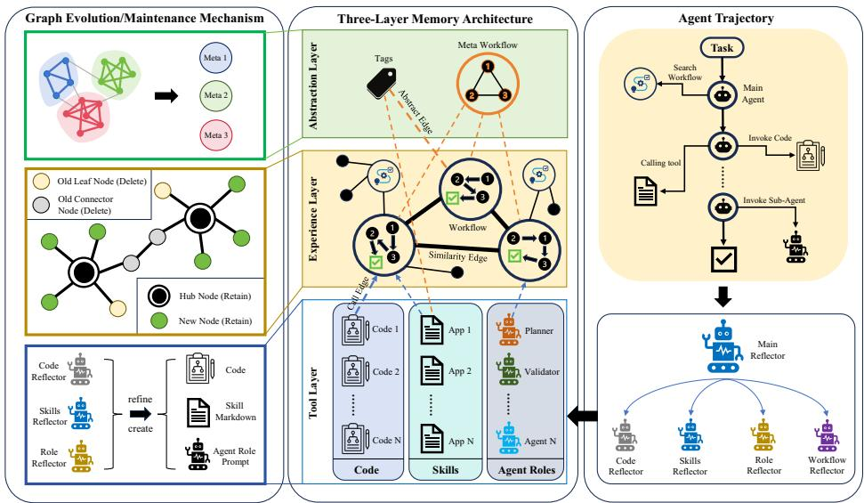  
Figure 2: Overview of STRATA. Middle: the three-layer memory, comprising a tool layer (code, skills, agent roles), an ex<sub>p</sub>erience la<sub>y</sub>er (workflows and their call ed<sub>g</sub>es; similarit<sub>y</sub> links belon<sub>g</sub> to the derived <sub>g</sub>ra<sub>p</sub>h W and are not stored), and an abstraction layer (meta-workflows over the tag vocabulary; tags are node attributes, not nodes). Right: one episode, in which the main agent retrieves a subgraph, acts, and a master reflector dispatches to typed sub-reflectors. Left: graph evolution, where <sub>commun</sub>it<sub>y</sub> d<sub>e</sub>t<sub>ec</sub>ti<sub>on</sub> i<sub>n</sub>d<sub>uces me</sub>t<sub>a no</sub>d<sub>es an</sub>d <sub>pressure-</sub>t<sub>r</sub>i<sub>ggere</sub>d <sub>co</sub>ll<sub>ec</sub>ti<sub>on</sub> d<sub>e</sub>l<sub>e</sub>t<sub>es s</sub>t<sub>a</sub>l<sub>e</sub> l<sub>eaves w</sub>hil<sub>e pro</sub>t<sub>ec</sub>ti<sub>ng</sub> b<sub>r</sub>id<sub>ge no</sub>d<sub>es.</sub>

recomputing Cut(W) each round with Tarjan’s algorithm in $O ( { \left| V \right| } ^ { * } + { \left| E \right| } )$ (Tarjan 1972), and fallin<sub>g</sub> back to the uncon-<sub>s</sub>t<sub>ra</sub>i<sub>ne</sub>d <sub>m</sub>i<sub>n</sub>i<sub>mum</sub> <sub>on</sub>l<sub>y</sub> if <sub>every</sub> <sub>can</sub>did<sub>a</sub>t<sub>e</sub> i<sub>s</sub> <sub>a</sub> <sub>cu</sub>t <sub>ver</sub>t<sub>ex,</sub> <sub>so</sub> <sub>co</sub>ll<sub>ec</sub>ti<sub>on a</sub>l<sub>ways ma</sub>k<sub>es progress.</sub>

## Inducing Meta-Frameworks by Community Detection

M<sub>e</sub>t<sub>a</sub> <sub>no</sub>d<sub>es</sub> <sub>are</sub> t<sub>r</sub>i<sub>ggere</sub>d <sub>no</sub>t b<sub>y</sub> <sub>coun</sub>ti<sub>ng</sub> <sub>c</sub>hild<sub>ren</sub> b<sub>u</sub>t b<sub>y</sub> community structure. We build W by joining a workflow <sub>pa</sub>i<sub>r w</sub>h<sub>en</sub> $s _ { \mathrm { n n } }$ exceeds a <sub>p</sub>er-<sub>g</sub>rou<sub>p</sub> ada<sub>p</sub>tive threshold (shrunk <sub>as a</sub>b<sub>ove,</sub> $\kappa _ { E } { = } 6$ , intra-group default 0.40) or a fixed crossgroup threshold 0.55, then keeping each node’s 6 strongest edges (an edge survives if either endpoint ranks it that high). A <sub>s</sub>i<sub>ng</sub>l<sub>e</sub> fi<sub>xe</sub>d th<sub>res</sub>h<sub>o</sub>ld f<sub>a</sub>il<sub>s</sub> b<sub>a</sub>dl<sub>y:</sub> i<sub>n an ear</sub>l<sub>y con</sub>fi<sub>gura</sub>ti<sub>on</sub> only 3 of 153 candidate pairs cleared it and no meta formed. Louvain (Blondel et al. 2008) at resolution 1.5 yields communities (the Leiden refinement (Traa<sub>g</sub>, Waltman, and van Eck 2019) would also serve), and a communit<sub>y</sub> is <sub>p</sub>romoted onl<sub>y</sub> if it is large $( | C | \geq N _ { \operatorname* { m i n } } )$ , tight (conductance $\phi ( C ) < 0 . { \dot { 6 } } ;$ dense inside, sparse outside (Shi 2000)), and novel. Letting $\mathbf { c } ( C )$ b<sub>e</sub> it<sub>s cen</sub>t<sub>ro</sub>id <sub>an</sub>d $d ^ { * }$ it<sub>s</sub> di<sub>s</sub>t<sub>ance</sub> t<sub>o</sub> th<sub>e neares</sub>t <sub>ex</sub>i<sub>s</sub>ti<sub>ng</sub> <sub>me</sub>t<sub>a, we create</sub> if $d ^ { * } \geq R _ { \mathrm { m e t a } } { = } 0 . 6$ <sub>an</sub>d <sub>o</sub>th<sub>erw</sub>i<sub>se update</sub> th<sub>e ma</sub>t<sub>c</sub>h<sub>e</sub>d <sub>me</sub>t<sub>a</sub> b<sub>y a</sub>b<sub>sor</sub>bi<sub>ng</sub> it<sub>s un</sub>li<sub>n</sub>k<sub>e</sub>d <sub>mem</sub>b<sub>ers.</sub> Thi<sub>s</sub> <sub>nove</sub>lt<sub>y ga</sub>t<sub>e suppresses c</sub>h<sub>urn: w</sub>ith<sub>ou</sub>t it th<sub>e sys</sub>t<sub>em re</sub>b<sub>u</sub>ild<sub>s</sub> <sub>near-</sub>d<sub>up</sub>li<sub>ca</sub>t<sub>e me</sub>t<sub>as</sub> i<sub>ns</sub>t<sub>ea</sub>d <sub>o</sub>f <sub>ex</sub>t<sub>en</sub>di<sub>ng ex</sub>i<sub>s</sub>ti<sub>ng ones.</sub>

## Contrast Edges against Negative Transfer

The content dimension rates same object, opposite direction experiences as highly similar, such as “heat tin until it <sub>me</sub>lt<sub>s</sub>” <sub>versus</sub> “<sub>coo</sub>l ti<sub>n</sub> <sub>un</sub>til it <sub>so</sub>lidifi<sub>es</sub>”<sub>.</sub> Th<sub>e</sub> t<sub>ag</sub> t<sub>erm</sub> l<sub>owers</sub> <sub>suc</sub>h <sub>scores</sub> b<sub>u</sub>t <sub>canno</sub>t <sub>a</sub>l<sub>ways</sub> <sub>preven</sub>t <sub>reca</sub>ll<sub>,</sub> <sub>an</sub>d <sub>a</sub> <sub>reca</sub>ll<sub>e</sub>d <sub>concre</sub>t<sub>e proce</sub>d<sub>ure may</sub> b<sub>e execu</sub>t<sub>e</sub>d<sub>.</sub> A <sub>con</sub>t<sub>ras</sub>t <sub>e</sub>d<sub>ge</sub> i<sub>s a</sub> bidi<sub>rec</sub>ti<sub>ona</sub>l <sub>evo</sub>l<sub>u</sub>ti<sub>on</sub> <sub>e</sub>d<sub>ge</sub> li<sub>n</sub>ki<sub>ng</sub> t<sub>wo</sub> <sub>suc</sub>h <sub>no</sub>d<sub>es,</sub>

$$
\mathrm { c o n t r a s t } ( a , b ) \longleftrightarrow \mathrm { o p } ( a ) \mathrm { o p p o s e s } \mathrm { o p } ( b ) ,\tag{5}
$$

i<sub>ns</sub>t<sub>an</sub>ti<sub>a</sub>t<sub>e</sub>d b<sub>y ru</sub>l<sub>e over a</sub> fi<sub>xe</sub>d l<sub>ex</sub>i<sub>con o</sub>f <sub>oppos</sub>it<sub>e opera</sub>t<sub>or</sub> <sub>p</sub>a<sup>i</sup>rs, $\{ h e a t , \dot { c } o o l \}$ and {create, delete}. We do not require $\mathrm { o b j } ( a ) = \mathrm { o b j } ( b )$ <sub>,</sub> b<sub>ecause nega</sub>ti<sub>ve</sub> t<sub>rans</sub>f<sub>er</sub> i<sub>s o</sub>ft<sub>en cross-</sub> object, as when a melt-lead procedure misleads a freeze-tin t<sub>as</sub>k<sub>.</sub> A <sub>re</sub>t<sub>r</sub>i<sub>eve</sub>d <sub>see</sub>d <sub>pu</sub>ll<sub>s</sub> it<sub>s con</sub>t<sub>ras</sub>t <sub>ne</sub>i<sub>g</sub>hb<sub>ours</sub> i<sub>n</sub>t<sub>o</sub> th<sub>e</sub> subgraph, rendered with a prominent do not confuse warning <sub>ra</sub>th<sub>er</sub> th<sub>an as a</sub> fl<sub>a</sub>t <sub>proce</sub>d<sub>ure.</sub> U<sub>n</sub>lik<sub>e wr</sub>it<sub>e-</sub>ti<sub>me approac</sub>h<sub>es</sub> th<sub>a</sub>t ti<sub>g</sub>ht<sub>en one proce</sub>d<sub>ure</sub>’<sub>s precon</sub>diti<sub>ons,</sub> thi<sub>s mec</sub>h<sub>an</sub>i<sub>sm</sub> i<sub>s</sub> <sub>re</sub>t<sub>r</sub>i<sub>eva</sub>l<sub>-</sub>ti<sub>me an</sub>d <sub>re</sub>l<sub>a</sub>t<sub>es</sub> t<sub>wo</sub> di<sub>s</sub>ti<sub>nc</sub>t <sub>oppos</sub>i<sub>ng exper</sub>i<sub>ences.</sub>

## The Full Loop

A<sub>n ep</sub>i<sub>so</sub>d<sub>e re</sub>t<sub>r</sub>i<sub>eves a su</sub>b<sub>grap</sub>h<sub>, ren</sub>d<sub>ers</sub> it i<sub>n</sub>t<sub>o</sub> th<sub>e promp</sub>t<sub>,</sub> <sub>ac</sub>t<sub>s un</sub>til d<sub>one,</sub> th<sub>en re</sub>fl<sub>ec</sub>t<sub>s:</sub> t<sub>ype</sub>d <sub>su</sub>b<sub>-re</sub>fl<sub>ec</sub>t<sub>ors wr</sub>it<sub>e</sub> b<sub>ac</sub>k<sub>,</sub> <sub>commun</sub>it<sub>y</sub> d<sub>e</sub>t<sub>ec</sub>ti<sub>on up</sub>d<sub>a</sub>t<sub>es</sub> th<sub>e me</sub>t<sub>a</sub> l<sub>ayer, an</sub>d <sub>pressure-</sub> t<sub>r</sub>i<sub>ggere</sub>d <sub>co</sub>ll<sub>ec</sub>ti<sub>on</sub> <sub>prunes.</sub> O<sub>ne</sub> <sub>s</sub>i<sub>m</sub>il<sub>ar</sub>it<sub>y</sub> <sub>geome</sub>t<sub>ry</sub> <sub>serves</sub> <sub>a</sub>ll f<sub>our ro</sub>l<sub>es o</sub>f <sub>re</sub>t<sub>r</sub>i<sub>eva</sub>l <sub>scor</sub>i<sub>ng,</sub> th<sub>e re</sub>fl<sub>ec</sub>ti<sub>on</sub> b<sub>an</sub>d<sub>,</sub> th<sub>e</sub> <sub>me</sub>t<sub>a-</sub>i<sub>n</sub>d<sub>uc</sub>ti<sub>on e</sub>d<sub>ge we</sub>i<sub>g</sub>ht <sub>an</sub>d th<sub>e co</sub>ll<sub>ec</sub>t<sub>or</sub>’<sub>s ac</sub>ti<sub>va</sub>ti<sub>on</sub> term.

## Experimental Setup

Benchmarks. Interactive agent evaluation now spans many suites (Liu et al. 2024; Den<sub>g</sub> et al. 2023; Yao et al. 2022); <sub>we se</sub>l<sub>ec</sub>t f<sub>our</sub> th<sub>a</sub>t <sub>are</sub> l<sub>ong-</sub>h<sub>or</sub>i<sub>zon an</sub>d <sub>cover</sub> di<sub>s</sub>ti<sub>nc</sub>t <sub>ac</sub>ti<sub>on</sub> <sub>spaces,</sub> <sub>name</sub>l<sub>y</sub> API <sub>orc</sub>h<sub>es</sub>t<sub>ra</sub>ti<sub>on,</sub> <sub>we</sub>b <sub>nav</sub>i<sub>ga</sub>ti<sub>on,</sub> embodied household tasks and scientific reasoning: App-World (Trivedi et al. 2024), reporting Task Goal Com-<sub>p</sub>letion (TGC) and Scenario Goal Com<sub>p</sub>letion (SGC) on Test-Normal (168 tasks) and Test-Challenge (417 tasks); WebArena (Zhou et al. 2024) (812 tasks, success rate);

ALFWorld (Shridhar et al. 2020) (134 tasks); and Science-World (Wang et al. 2022) (23 tasks, average score).

Backbones and baselines. All methods use the same frozen b<sub>ac</sub>kb<sub>one w</sub>ith <sub>no we</sub>i<sub>g</sub>ht <sub>up</sub>d<sub>a</sub>t<sub>es, on</sub> b<sub>o</sub>th D<sub>eep</sub>S<sub>ee</sub>k<sub>-</sub>V4<sub>-</sub> Fl<sub>as</sub>h <sub>a</sub>nd D<sub>eep</sub>S<sub>ee</sub>k<sub>-</sub>V4<sub>-</sub>Pr<sub>o.</sub> W<sub>e co</sub>m<sub>pa</sub>r<sub>e aga</sub>in<sub>s</sub>t <sub>seve</sub>n baselines: No-Memory (a ReAct agent), Flat-Memory (an <sub>uns</sub>t<sub>ruc</sub>t<sub>ure</sub>d li<sub>s</sub>t <sub>o</sub>f <sub>ep</sub>i<sub>so</sub>d<sub>e summar</sub>i<sub>es re</sub>t<sub>r</sub>i<sub>eve</sub>d b<sub>y em</sub>b<sub>e</sub>d<sub>-</sub> ding similarity), ReasoningBank (Ouyang et al. 2025), Hermes<sup>1</sup> (an open-source agent framework with native persistent memory), A-Mem (Xu et al. 2026), MemEvolve (Zhang et al. 2025a) and MemGen (Zhang, Fu, and Yan 2025).

Protocol. Memory accumulates online across a single se-<sub>quen</sub>ti<sub>a</sub>l <sub>pass over eac</sub>h b<sub>enc</sub>h<sub>mar</sub>k<sub>, so</sub> l<sub>a</sub>t<sub>er</sub> t<sub>as</sub>k<sub>s</sub> b<sub>ene</sub>fit f<sub>rom</sub> <sub>ear</sub>li<sub>er ones,</sub> th<sub>e se</sub>tti<sub>n</sub> i<sub>n w</sub>hi<sub>c</sub>h <sub>ma</sub>i<sub>n</sub>t<sub>enance ma</sub>tt<sub>ers.</sub> All <sub>memory me</sub>th<sub>o</sub>d<sub>s rece</sub>i<sub>ve</sub> th<sub>e</sub> id<sub>en</sub>ti<sub>ca</sub>l <sub>wr</sub>it<sub>e s</sub>i<sub>gna</sub>l<sub>,</sub> th<sub>e env</sub>i<sub>-</sub> <sub>ronmen</sub>t’<sub>s</sub> t<sub>as</sub>k<sub>-</sub>l<sub>eve</sub>l <sub>ou</sub>t<sub>come, w</sub>ith <sub>no access</sub> t<sub>o go</sub>ld <sub>answers</sub> <sub>or eva</sub>l<sub>ua</sub>t<sub>or</sub> i<sub>n</sub>t<sub>erna</sub>l<sub>s, so compar</sub>i<sub>sons are con</sub>t<sub>ro</sub>ll<sub>e</sub>d<sub>, w</sub>hil<sub>e</sub> <sub>a</sub>b<sub>so</sub>l<sub>u</sub>t<sub>e scores average over eac</sub>h <sub>me</sub>th<sub>o</sub>d’<sub>s</sub> l<sub>earn</sub>i<sub>ng curve</sub> <sub>ra</sub>th<sub>er</sub> th<sub>an a converge</sub>d <sub>memory.</sub> E<sub>m</sub>b<sub>e</sub>ddi<sub>ngs come</sub> f<sub>rom</sub> <sub>a</sub> l<sub>oca</sub>l <sub>sen</sub>t<sub>ence-em</sub>b<sub>e</sub>ddi<sub>ng mo</sub>d<sub>e</sub>l <sub>o</sub>f th<sub>e</sub> S<sub>en</sub>t<sub>ence-</sub>BERT famil<sub>y</sub> (Reimers and Gurev<sub>y</sub>ch 2019), and the workflow ca<sub>p</sub> i<sub>s se</sub>t <sub>per</sub> d<sub>a</sub>t<sub>ase</sub>t<sub>.</sub> E<sub>very num</sub>b<sub>er</sub> i<sub>s</sub> th<sub>e mean over</sub> th<sub>ree see</sub>d<sub>s</sub> <sub>w</sub>ith <sub>samp</sub>l<sub>e s</sub>t<sub>an</sub>d<sub>ar</sub>d d<sub>ev</sub>i<sub>a</sub>ti<sub>on; see</sub>d<sub>s permu</sub>t<sub>e</sub> t<sub>as</sub>k <sub>or</sub>d<sub>er</sub> <sub>an</sub>d <sub>re</sub>fl<sub>ec</sub>ti<sub>on samp</sub>li<sub>ng.</sub>

## Results and Analysis

## Main Results

T<sub>a</sub>bl<sub>e</sub> 1 <sub>repor</sub>t<sub>s</sub> th<sub>e</sub> th<sub>ree-see</sub>d <sub>resu</sub>lt<sub>s.</sub> STRATA <sub>o</sub>bt<sub>a</sub>i<sub>ns</sub> th<sub>e</sub> b<sub>es</sub>t <sub>score on s</sub>i<sub>x o</sub>f <sub>seven co</sub>l<sub>umns w</sub>ith th<sub>e</sub> P<sub>ro</sub> b<sub>ac</sub>kb<sub>one</sub> <sub>an</sub>d fi<sub>ve o</sub>f <sub>seven w</sub>ith Fl<sub>as</sub>h<sub>, an</sub>d i<sub>s secon</sub>d <sub>on</sub> th<sub>e rema</sub>i<sub>n</sub>d<sub>er.</sub> A<sub>verage</sub>d <sub>over</sub> th<sub>e</sub> f<sub>our</sub> b<sub>enc</sub>h<sub>mar</sub>k<sub>s</sub> it i<sub>s</sub> th<sub>e s</sub>t<sub>ronges</sub>t <sub>me</sub>th<sub>o</sub>d <sub>on</sub> b<sub>o</sub>th b<sub>ac</sub>kb<sub>ones.</sub>

Which gaps survive seed variance. With three seeds, difer-<sub>ences sma</sub>ll<sub>er</sub> th<sub>an roug</sub>hl<sub>y one com</sub>bi<sub>ne</sub>d <sub>s</sub>t<sub>an</sub>d<sub>ar</sub>d d<sub>ev</sub>i<sub>a</sub>ti<sub>on</sub> <sub>s</sub>h<sub>ou</sub>ld <sub>no</sub>t b<sub>e</sub> <sub>over-</sub>i<sub>n</sub>t<sub>erpre</sub>t<sub>e</sub>d<sub>,</sub> <sub>an</sub>d <sub>we</sub> <sub>s</sub>t<sub>a</sub>t<sub>e</sub> <sub>p</sub>l<sub>a</sub>i<sub>n</sub>l<sub>y</sub> <sub>w</sub>hi<sub>c</sub>h <sub>are w</sub>hi<sub>c</sub>h<sub>.</sub> STRATA’<sub>s a</sub>d<sub>van</sub>t<sub>age</sub> i<sub>s c</sub>l<sub>ear on</sub> A<sub>pp</sub>W<sub>or</sub>ld T<sub>es</sub>t<sub>-</sub> Challenge SGC (46.5±2.3 vs. A-Mem’s 42.2±2.6), WebArena (45.6±1.6 vs. MemEvolve’s 41.0±2.2) and ALF-World (98.6±0.9 vs. MemGen’s 96.3±1.9). It is not statisti<sub>ca</sub>ll<sub>y separa</sub>bl<sub>e</sub> f<sub>rom</sub> th<sub>e</sub> b<sub>es</sub>t b<sub>ase</sub>li<sub>ne on</sub> A<sub>pp</sub>W<sub>or</sub>ld T<sub>es</sub>t<sub>-</sub> Normal (Pro TGC 78.4±2.5 vs. A-Mem 77.2±2.9; on SGC A-Mem is in fact nominall<sub>y</sub> ahead) or on ScienceWorld, whose 23 tasks give every method a standard deviation of 3.6–15.0. We therefore do not claim a ScienceWorld win f<sub>rom</sub> T<sub>a</sub>bl<sub>e</sub> 1<sub>;</sub> th<sub>e</sub> S<sub>c</sub>i<sub>ence</sub>W<sub>or</sub>ld <sub>ev</sub>id<sub>ence we</sub> d<sub>o re</sub>l<sub>y on</sub> is the within-method contrast ablation of the next sections, <sub>w</sub>h<sub>ere</sub> th<sub>e same see</sub>d<sub>s are compare</sub>d <sub>un</sub>d<sub>er a s</sub>i<sub>ng</sub>l<sub>e mec</sub>h<sub>a-</sub> <sub>n</sub>i<sub>sm c</sub>h<sub>ange.</sub>

Negative transfer is visible in the aggregate. Hermes scores 30.4/35.8 TGC on AppWorld Test-Normal and 48.3/55.8 on ScienceWorld, far below the memoryless agent (62.8/66.9 and 75.7/80.6). A memory that makes an agent worse than <sub>none</sub> i<sub>s</sub> di<sub>rec</sub>t <sub>ev</sub>id<sub>ence</sub> th<sub>a</sub>t <sub>reca</sub>ll<sub>e</sub>d <sub>exper</sub>i<sub>ence</sub> i<sub>s execu</sub>t<sub>e</sub>d w<sup>ron</sup>g<sup>l</sup>y.

## Where Single-Level Memory Loses Ground

A-Mem is among the strongest baselines (within 0.6 of MemEvolve on avera<sub>g</sub>e), and the wa<sub>y</sub> it loses that standin<sub>g</sub> is informative. It difers from the others by being explicitly organized, with notes linked into a network and existing notes revised as new ones arrive (Xu et al. 2026), but the or<sub>g</sub>ani-<sub>za</sub>ti<sub>on</sub> i<sub>s s</sub>i<sub>ng</sub>l<sub>e-</sub>l<sub>eve</sub>l<sub>:</sub> th<sub>ere</sub> i<sub>s one no</sub>t<sub>e per memory, an</sub>d <sub>no</sub> <sub>opera</sub>ti<sub>on ever rep</sub>l<sub>aces a</sub> f<sub>am</sub>il<sub>y o</sub>f <sub>no</sub>t<sub>es w</sub>ith <sub>a s</sub>i<sub>ng</sub>l<sub>e more</sub> <sub>genera</sub>l <sub>one, nor removes a no</sub>t<sub>e.</sub> Th<sub>e s</sub>t<sub>ore</sub> th<sub>ere</sub>f<sub>ore grows</sub> <sub>w</sub>ith th<sub>e</sub> t<sub>as</sub>k <sub>s</sub>t<sub>ream, an</sub>d <sub>so</sub> d<sub>oes w</sub>h<sub>a</sub>t <sub>re</sub>t<sub>r</sub>i<sub>eva</sub>l <sub>pu</sub>ll<sub>s</sub> i<sub>n.</sub> Thi<sub>s</sub> <sub>pre</sub>di<sub>c</sub>t<sub>s a spec</sub>ifi<sub>c s</sub>i<sub>gna</sub>t<sub>ure, compe</sub>titi<sub>ve w</sub>hil<sub>e</sub> th<sub>e s</sub>t<sub>ore</sub> i<sub>s</sub> <sub>sma</sub>ll <sub>an</sub>d d<sub>egra</sub>di<sub>ng as</sub> it <sub>grows, an</sub>d th<sub>e</sub> d<sub>a</sub>t<sub>a s</sub>h<sub>ow exac</sub>tl<sub>y</sub> th<sub>a</sub>t<sub>.</sub>

Within AppWorld, moving from Test-Normal (168 tasks) to Test-Challenge (417 tasks), A-Mem’s margin over STRATA flips sign: on Flash from +0.4/ + 3.4 (TGC/SGC) to −4.3/ − 6.3, on Pro from −1.2/ + 1.8 to −2.2/ − 4.3. W<sub>e</sub> <sub>s</sub>t<sub>a</sub>t<sub>e</sub> th<sub>e</sub> <sub>con</sub>f<sub>oun</sub>d <sub>p</sub>l<sub>a</sub>i<sub>n</sub>l<sub>y:</sub> T<sub>es</sub>t<sub>-</sub>Ch<sub>a</sub>ll<sub>enge</sub> i<sub>s</sub> <sub>no</sub>t <sub>mere</sub>l<sub>y</sub> larger but intrinsically harder and draws on a diferent application mix (amazon supplies 212 of its tasks and is absent from Test-Normal), so the com<sub>p</sub>arison entan<sub>g</sub>les scale with difi<sub>cu</sub>lt<sub>y an</sub>d di<sub>s</sub>t<sub>r</sub>ib<sub>u</sub>ti<sub>on s</sub>hift<sub>.</sub>

A <sub>secon</sub>d<sub>,</sub> i<sub>n</sub>d<sub>epen</sub>d<sub>en</sub>t <sub>o</sub>b<sub>serva</sub>ti<sub>on comes</sub> f<sub>rom</sub> W<sub>e-</sub> bArena, the largest task set at 812 tasks. There A-Mem scores 28.4 on Flash, seventh of eight methods, below Flat-Memory (30.7), Hermes (31.6) and MemGen (29.5), and above only th<sub>e memory</sub>l<sub>ess agen</sub>t<sub>: on</sub> Fl<sub>as</sub>h <sub>a me</sub>th<sub>o</sub>d th<sub>a</sub>t <sub>ran</sub>k<sub>s</sub> fi<sub>rs</sub>t <sub>a</sub>t 168 tasks ranks seventh at 812. On Pro the drop is milder but in the same direction, fourth at 38.7, behind MemEvolve (41.0) and ReasoningBank (40.3). The cost is directly measurable in Table 3: A-Mem injects 41.9 lines of memory per t<sub>as</sub>k<sub>,</sub> th<sub>e</sub> l<sub>arges</sub>t <sub>o</sub>f <sub>any me</sub>th<sub>o</sub>d<sub>, more even</sub> th<sub>an</sub> th<sub>e uns</sub>t<sub>ruc-</sub> tured Flat-Memor baseline (35.6), while STRATA scores higher using 23.3. Injecting more is not injecting better.

Th<sub>e con</sub>t<sub>ras</sub>t <sub>w</sub>ith STRATA i<sub>so</sub>l<sub>a</sub>t<sub>es w</sub>h<sub>a</sub>t i<sub>s m</sub>i<sub>ss</sub>i<sub>ng ra</sub>th<sub>er</sub> th<sub>an w</sub>h<sub>a</sub>t i<sub>s wrong.</sub> A<sub>-</sub>M<sub>em</sub> li<sub>n</sub>k<sub>s memor</sub>i<sub>es;</sub> STRATA <sub>a</sub>d<sub>-</sub> ditionally abstracts them (812 WebArena tasks condense to 112 workflows under 16 meta nodes) and forgets the ones th<sub>a</sub>t <sub>s</sub>t<sub>op earn</sub>i<sub>ng</sub> th<sub>e</sub>i<sub>r p</sub>l<sub>ace.</sub> Li<sub>n</sub>ki<sub>ng a</sub>l<sub>one</sub> k<sub>eeps a grow-</sub> i<sub>ng</sub> <sub>s</sub>t<sub>ore</sub> <sub>nav</sub>i<sub>ga</sub>bl<sub>e;</sub> <sub>on</sub>l<sub>y</sub> <sub>a</sub>b<sub>s</sub>t<sub>rac</sub>ti<sub>on</sub> <sub>an</sub>d f<sub>orge</sub>tti<sub>ng</sub> k<sub>eep</sub> it b<sub>oun</sub>d<sub>e</sub>d<sub>, w</sub>hi<sub>c</sub>h i<sub>s w</sub>h<sub>a</sub>t <sub>re</sub>t<sub>r</sub>i<sub>eva</sub>l <sub>prec</sub>i<sub>s</sub>i<sub>on</sub> d<sub>epen</sub>d<sub>s on once</sub> th<sub>e s</sub>t<sub>ore</sub> i<sub>s</sub> l<sub>arge.</sub> N<sub>e</sub>ith<sub>er compar</sub>i<sub>son</sub> i<sub>so</sub>l<sub>a</sub>t<sub>es memory s</sub>i<sub>ze,</sub> <sub>s</sub>i<sub>nce</sub> T<sub>es</sub>t<sub>-</sub>Ch<sub>a</sub>ll<sub>enge</sub> dif<sub>ers</sub> i<sub>n</sub> difi<sub>cu</sub>lt<sub>y an</sub>d <sub>app</sub>li<sub>ca</sub>ti<sub>on m</sub>i<sub>x</sub> <sub>an</sub>d W<sub>e</sub>bA<sub>rena</sub> i<sub>n</sub> <sub>env</sub>i<sub>ronmen</sub>t <sub>an</sub>d <sub>ac</sub>ti<sub>on</sub> <sub>space,</sub> <sub>so</sub> <sub>we</sub> <sub>re-</sub> <sub>por</sub>t t<sub>wo</sub> <sub>cons</sub>i<sub>s</sub>t<sub>en</sub>t <sub>o</sub>b<sub>serva</sub>ti<sub>ons,</sub> <sub>no</sub>t <sub>a</sub> <sub>con</sub>t<sub>ro</sub>ll<sub>e</sub>d <sub>sca</sub>li<sub>ng</sub> ex<sub>p</sub>er<sup>i</sup>ment.

## Where the Gains Come From

Fi<sub>gure</sub> 3 b<sub>rea</sub>k<sub>s</sub> th<sub>e</sub> P<sub>ro resu</sub>lt<sub>s</sub> d<sub>own</sub> b<sub>y</sub> t<sub>as</sub>k <sub>ca</sub>t<sub>egory.</sub> Th<sub>e</sub> <sub>ga</sub>i<sub>ns are mar</sub>k<sub>e</sub>dl<sub>y non-un</sub>if<sub>orm.</sub> O<sub>n</sub> A<sub>pp</sub>W<sub>or</sub>ld th<sub>ey con-</sub> centrate on low-fre<sub>q</sub>uenc<sub>y</sub> a<sub>pp</sub>lications: phone <sub>g</sub>ains most in Test-Normal (22 tasks; 54.5 → 59.1 over A-Mem), and in T<sub>es</sub>t<sub>-</sub>Ch<sub>a</sub>ll<sub>enge</sub> th<sub>e</sub> th<sub>ree</sub> l<sub>arges</sub>t <sub>ga</sub>i<sub>ns</sub> <sub>a</sub>ll f<sub>a</sub>ll <sub>on</sub> <sub>ca</sub>t<sub>egor</sub>i<sub>es</sub> <sub>w</sub>ith f<sub>ewer</sub> th<sub>an</sub> t<sub>en</sub> t<sub>as</sub>k<sub>s, w</sub>h<sub>ereas</sub> th<sub>e</sub> t<sub>wo</sub> l<sub>arges</sub>t <sub>ca</sub>t<sub>egor</sub>i<sub>es</sub> gain only +3.8 (amazon, 212 tasks) and +3.2 (gmail, 126 tasks). Small categories make single cells noisy, so the <sub>pa</sub>tt<sub>ern</sub> <sub>ma</sub>tt<sub>ers</sub> <sub>more</sub> th<sub>an</sub> <sub>any</sub> <sub>one</sub> <sub>va</sub>l<sub>ue.</sub> O<sub>n</sub> W<sub>e</sub>bA<sub>rena</sub> th<sub>e</sub> gains concentrate on shopping\_admin (31.5 → 41.8)

<table><tr><td rowspan="2" colspan="2">Backbone Method</td><td colspan="2">AppWorld Test-Normal</td><td colspan="2">AppWorld Test-Challenge</td><td>WebArena</td><td>ALFWorld</td><td>ScienceWorld</td></tr><tr><td>TGC↑</td><td>SGC↑</td><td>TGC↑</td><td>SGC↑</td><td>SR↑</td><td>Score↑</td><td>Score↑</td></tr><tr><td></td><td>No-Memory</td><td> $6 2 . 8 \pm 2 . 9$ </td><td> $4 2 . 1 \pm 3 . 3$ </td><td> $3 9 . 8 \pm 2 . 1$ </td><td> $2 1 . 4 \pm { 1 . 9 }$ </td><td> $2 4 . 7 \pm 1 . 4$ </td><td> $7 6 . 8 \pm 3 . 3$ </td><td> $7 5 . 7 \pm 8 . 7$ </td></tr><tr><td></td><td>Flat-Memory</td><td> $6 6 . 4 \pm 3 . 7$ </td><td> $4 8 . 7 \pm 4 . 3$ </td><td> $4 3 . 8 \pm 2 . 7$ </td><td> $2 7 . 9 \pm 2 . 7$ </td><td> $3 0 . 7 \pm 2 . 0$ </td><td> $8 2 . 4 \pm { 3 . 8 }$ </td><td> $8 0 . 4 \pm 1 0 . 4$ </td></tr><tr><td>Dep--ash</td><td>ReasoningBank</td><td> $6 9 . 6 \pm 3 . 3$ </td><td> $5 5 . 1 \pm 3 . 9$ </td><td> $4 8 . 2 \pm 2 . 5$ </td><td> $3 4 . 7 \pm 2 . 6$ </td><td> $3 2 . 9 \pm 1 . 8$ </td><td> $9 1 . 0 \pm 2 . 6$ </td><td> $8 7 . 9 \pm 7 . 8$ </td></tr><tr><td></td><td>Hermes</td><td> $3 0 . 4 \pm 4 . 4$ </td><td> $2 0 . 7 \pm 4 . 3$ </td><td> $2 3 . 9 \pm 2 . 8$ </td><td> $1 5 . 4 \pm 2 . 6$ </td><td> $3 1 . 6 \pm 2 . 4$ </td><td> $8 4 . 5 \pm 4 . 4$ </td><td> $4 8 . 3 \pm 1 5 . 0$ </td></tr><tr><td></td><td>A-Mem</td><td> $7 5 . 2 \pm 3 . 2$ </td><td> ${ \bf 6 5 . 7 \pm 3 . 9 }$ </td><td> $4 9 . 6 \pm 2 . 6$ </td><td> $\underline { { 3 7 . 5 \pm 2 . 7 } }$ </td><td> $2 8 . 4 \pm { 1 . 8 }$ </td><td> $9 3 . 4 \pm 2 . 4$ </td><td> $8 8 . 2 \pm 8 . 1$ </td></tr><tr><td></td><td>MemEvolve</td><td> $7 0 . 9 \pm 4 . 0$ </td><td> $5 8 . 1 \pm 4 . 8$ </td><td> $\overline { { 4 8 . 8 \pm 3 . 1 } }$ </td><td> $3 5 . 2 \pm { 3 . 2 }$ </td><td> $3 2 . 0 \pm 2 . 3$ </td><td> $9 4 . 3 \pm 2 . 6$ </td><td> $8 8 . 9 \pm 9 . 4$ </td></tr><tr><td></td><td>MemGen</td><td> $6 6 . 8 \pm 4 . 0$ </td><td> $5 0 . 9 \pm 4 . 7$ </td><td> $4 4 . 2 \pm 2 . 9$ </td><td> $3 0 . 5 \pm { 3 . 0 }$ </td><td> $2 9 . 5 \pm 2 . 1$ </td><td> $9 4 . 7 \pm 2 . 4$ </td><td> $\underline { { 8 9 . 9 \pm 8 . 6 } }$ </td></tr><tr><td></td><td>STRATA (Ours)</td><td> $\underline { { 7 4 . 8 \pm 2 . 8 } }$ </td><td> $\underline { { 6 2 . 3 \pm 3 . 4 } }$ </td><td> ${ \pm } 3 . 9 \pm 2 . 2$ </td><td> $4 3 . 8 \pm 2 . 4$ </td><td> $3 3 . 3 \pm 1 . 6$ </td><td> ${ \bf 9 6 . 7 \pm 1 . 5 }$ </td><td> ${ \bf 9 3 . 4 \pm 5 . 3 }$ </td></tr><tr><td></td><td>No-Memory</td><td> $6 6 . 9 \pm 2 . 7$ </td><td> $4 6 . 8 \pm 3 . 1$ </td><td> $4 4 . 5 \pm 2 . 0$ </td><td> $2 5 . 2 \pm { 1 . 9 }$ </td><td></td><td> $8 4 . 0 \pm 2 . 7$ </td><td></td></tr><tr><td></td><td>Flat-Memory</td><td> $7 0 . 3 \pm 3 . 3$ </td><td> $5 1 . 5 \pm 4 . 0$ </td><td> $4 8 . 7 \pm 2 . 6$ </td><td> $3 1 . 6 \pm 2 . 6$ </td><td> $3 4 . 4 \pm { 1 . 5 }$ </td><td></td><td> $8 0 . 6 \pm 7 . 6$ </td></tr><tr><td></td><td>ReasoningBank</td><td> $7 2 . 8 \pm 3 . 0$ </td><td></td><td></td><td></td><td> $3 7 . 2 \pm { 1 . 9 }$ </td><td> $8 8 . 2 \pm 3 . 0$ </td><td> $8 4 . 8 \pm 8 . 9$ </td></tr><tr><td></td><td></td><td></td><td> $5 7 . 4 \pm 3 . 6$ </td><td> $5 3 . 1 \pm 2 . 3$ </td><td> $3 8 . 9 \pm 2 . 5$ </td><td> $4 0 . 3 \pm { 1 . 8 }$ </td><td> $9 4 . 6 \pm 1 . 9$ </td><td> $9 0 . 4 \pm 6 . 6$ </td></tr><tr><td></td><td>Hermes</td><td> $3 5 . 8 \pm 4 . 3$ </td><td> $2 4 . 1 \pm 4 . 2$ </td><td> $2 7 . 6 \pm 2 . 8$ </td><td> $1 7 . 9 \pm 2 . 6$ </td><td> $2 9 . 9 \pm 2 . 2$ </td><td> $8 9 . 6 \pm 3 . 5$ </td><td> $5 5 . 8 \pm 1 5 . 0$ </td></tr><tr><td>De--ro</td><td>A-Mem</td><td> $7 7 . 2 \pm 2 . 9$ </td><td> ${ \bf 6 6 . 8 \pm 3 . 6 }$ </td><td> $5 5 . 0 \pm 2 . 4$ </td><td> $4 2 . 2 \pm 2 . 6$ </td><td> $3 8 . 7 \pm { 1 . 9 }$ </td><td> $9 5 . 7 \pm { 1 . 8 }$ </td><td> $9 1 . 3 \pm 6 . 7$ </td></tr><tr><td></td><td>MemEvolve</td><td> $7 4 . 6 \pm 3 . 6$ </td><td> $6 0 . 9 \pm 4 . 5$ </td><td> $\overline { { 5 4 . 0 \pm 2 . 9 } }$ </td><td> $3 9 . 8 \pm 3 . 1$ </td><td> $\underline { { 4 1 . 0 \pm 2 . 2 } }$ </td><td> $9 6 . 0 \pm 2 . 1$ </td><td> $9 2 . 1 \pm 7 . 6 $ </td></tr><tr><td></td><td>MemGen</td><td> $7 0 . 1 \pm 3 . 7$ </td><td> $5 3 . 2 \pm 4 . 4$ </td><td> $4 9 . 0 \pm 2 . 8$ </td><td> $3 4 . 8 \pm 2 . 9$ </td><td> $3 7 . 5 \pm 2 . 1$ </td><td> $9 6 . 3 \pm { 1 . 9 }$ </td><td> $9 2 . 8 \pm 7 . 0$ </td></tr><tr><td></td><td>STRATA (Ours)</td><td> $7 8 . 4 \pm 2 . 5$ </td><td> $6 5 . 0 \pm 3 . 1$ </td><td> $5 7 . 2 \pm 2 . 1$ </td><td> $4 6 . 5 \pm 2 . 3$ </td><td> ${ \bf 4 5 . 6 \pm 1 . 6 }$ </td><td> $\overline { { 9 8 . 6 \pm 0 . 9 } }$ </td><td> $\mathbf { 9 6 . 7 \pm 3 . 6 }$ </td></tr></table>

Table 1: Main results: mean ± sam le standard deviation over three seeds. Bold is best, underlined second best within each b<sub>ac</sub>kb<sub>one.</sub> A<sub>-</sub>M<sub>em</sub> i<sub>s</sub> th<sub>e s</sub>t<sub>ronges</sub>t b<sub>ase</sub>li<sub>ne on</sub> A<sub>pp</sub>W<sub>or</sub>ld T<sub>es</sub>t<sub>-</sub>N<sub>orma</sub>l<sub>, w</sub>h<sub>ere</sub> it<sub>s marg</sub>i<sub>n over</sub> STRATA i<sub>s w</sub>ithi<sub>n see</sub>d <sub>no</sub>i<sub>se;</sub> <sub>see</sub> th<sub>e</sub> t<sub>ex</sub>t f<sub>or w</sub>hi<sub>c</sub>h <sub>gaps surv</sub>i<sub>ve see</sub>d <sub>var</sub>i<sub>ance.</sub>  
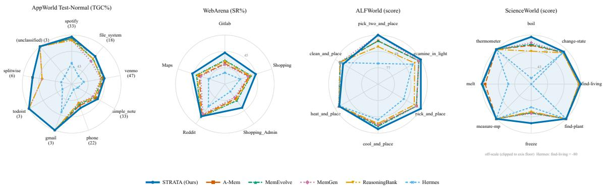  
Fi<sub>gure</sub> 3<sub>:</sub> P<sub>er-ca</sub>t<sub>egory scores on</sub> D<sub>eep</sub>S<sub>ee</sub>k<sub>-</sub>V4<sub>-</sub>P<sub>ro.</sub> N<sub>o-</sub>M<sub>emory an</sub>d Fl<sub>a</sub>t<sub>-</sub>M<sub>emory are om</sub>itt<sub>e</sub>d f<sub>or</sub> l<sub>eg</sub>ibilit<sub>y; eac</sub>h <sub>ra</sub>di<sub>a</sub>l <sub>ax</sub>i<sub>s</sub> <sub>s</sub>t<sub>ar</sub>t<sub>s a</sub>t <sub>a</sub> l<sub>a</sub>b<sub>e</sub>ll<sub>e</sub>d <sub>non-zero</sub> fl<sub>oor an</sub>d <sub>o</sub>f<sub>-sca</sub>l<sub>e va</sub>l<sub>ues are c</sub>li<sub>ppe</sub>d <sub>an</sub>d <sub>anno</sub>t<sub>a</sub>t<sub>e</sub>d<sub>.</sub> G<sub>a</sub>i<sub>ns concen</sub>t<sub>ra</sub>t<sub>e on</sub> l<sub>ong-</sub>t<sub>a</sub>il <sub>ca</sub>t<sub>egor</sub>i<sub>es.</sub> P<sub>er-</sub>b<sub>ac</sub>kb<sub>one vers</sub>i<sub>ons</sub> f<sub>or a</sub>ll f<sub>our</sub> b<sub>enc</sub>h<sub>mar</sub>k<sub>s are</sub> i<sub>n</sub> A<sub>ppen</sub>di<sub>x</sub> H<sub>.</sub>

## Component Ablation

and gitlab (33.8 → 43.8), its two most compositional <sub>s</sub>it<sub>es.</sub> Thi<sub>s</sub> i<sub>s</sub> th<sub>e s</sub>i<sub>gna</sub>t<sub>ure we expec</sub>t f<sub>rom an a</sub>b<sub>s</sub>t<sub>rac</sub>ti<sub>on</sub> l<sub>ayer: me</sub>t<sub>a no</sub>d<sub>es</sub> l<sub>e</sub>t <sub>a</sub> t<sub>as</sub>k f<sub>am</sub>il<sub>y w</sub>ith f<sub>ew</sub> di<sub>rec</sub>t <sub>examp</sub>l<sub>es</sub> i<sub>n</sub>h<sub>er</sub>it <sub>s</sub>t<sub>ruc</sub>t<sub>ure</sub> f<sub>rom re</sub>l<sub>a</sub>t<sub>e</sub>d f<sub>am</sub>ili<sub>es, w</sub>hi<sub>c</sub>h i<sub>s prec</sub>i<sub>se</sub>l<sub>y</sub> <sub>w</sub>h<sub>ere a</sub> fl<sub>a</sub>t <sub>per-</sub>i<sub>ns</sub>t<sub>ance memory</sub> h<sub>as no</sub>thi<sub>ng</sub> t<sub>o re</sub>t<sub>r</sub>i<sub>eve.</sub>

Table 2 removes one mechanism at a time. The ordering is tag term (−13.1 average) > contrast edges (−6.5) > adaptive threshold (−5.9) > meta layer (−4.7) > pressure collection (−2.2). The tag term dominating matches our motivation: <sub>w</sub>ith<sub>ou</sub>t <sub>an opera</sub>ti<sub>on</sub>/t<sub>arge</sub>t <sub>s</sub>i<sub>gna</sub>l th<sub>e con</sub>t<sub>en</sub>t <sub>em</sub>b<sub>e</sub>ddi<sub>ng</sub> <sub>merges exper</sub>i<sub>ences</sub> th<sub>a</sub>t dif<sub>er</sub> i<sub>n w</sub>h<sub>a</sub>t th<sub>ey</sub> d<sub>o, an</sub>d b<sub>ecause</sub> th<sub>e</sub> <sub>same</sub> <sub>s</sub>i<sub>m</sub>il<sub>ar</sub>it<sub>y</sub> b<sub>u</sub>ild<sub>s</sub> th<sub>e</sub> <sub>me</sub>t<sub>a</sub> <sub>grap</sub>h <sub>an</sub>d th<sub>e</sub> <sub>co</sub>ll<sub>ec</sub>t<sub>or</sub>’<sub>s</sub> <sub>ac</sub>ti<sub>va</sub>ti<sub>on</sub> t<sub>erm,</sub> <sub>every</sub> d<sub>owns</sub>t<sub>ream</sub> <sub>mec</sub>h<sub>an</sub>i<sub>sm</sub> i<sub>n</sub>h<sub>er</sub>it<sub>s</sub> th<sub>e</sub> error.

W<sub>e repor</sub>t th<sub>e excep</sub>ti<sub>on.</sub> O<sub>n</sub> ALFW<sub>or</sub>ld STRATA <sub>reac</sub>h<sub>es</sub> 100 on pick\_two\_and\_place, examine\_in\_light and pick\_and\_place, but trails MemEvolve and Mem-Gen on heat\_and\_place (96.7 vs. 97.1) and drops to 93.6 on clean\_and\_place, behind every memory baseline. Onl<sub>y</sub> heat\_and\_place is covered b<sub>y</sub> the contrast l<sub>ex</sub>i<sub>con,</sub> <sub>w</sub>h<sub>ere</sub> <sub>a</sub> “d<sub>o</sub> <sub>no</sub>t <sub>con</sub>f<sub>use</sub>” <sub>warn</sub>i<sub>ng</sub> <sub>p</sub>l<sub>aus</sub>ibl<sub>y</sub> <sub>ma</sub>k<sub>es</sub> th<sub>e</sub> <sub>agen</sub>t <sub>more</sub> <sub>conserva</sub>ti<sub>ve</sub> <sub>on</sub> th<sub>e</sub> t<sub>as</sub>k<sub>s</sub> it <sub>pro</sub>t<sub>ec</sub>t<sub>s;</sub> th<sub>e</sub> clean\_and\_place deficit we cannot attribute to an<sub>y</sub> <sub>mec</sub>h<sub>an</sub>i<sub>sm</sub> <sub>an</sub>d <sub>repor</sub>t <sub>as</sub> <sub>an</sub> <sub>unexp</sub>l<sub>a</sub>i<sub>ne</sub>d l<sub>oss.</sub>

Th<sub>e con</sub>t<sub>ras</sub>t<sub>-e</sub>d<sub>ge resu</sub>lt i<sub>s</sub> th<sub>e mos</sub>t i<sub>n</sub>f<sub>orma</sub>ti<sub>ve</sub> b<sub>ecause</sub> its cost is concentrated: removing contrast edges costs 9.1 points on ALFWorld and 18.0 on ScienceWorld but only 1.8 <sub>on</sub> W<sub>e</sub>bA<sub>rena.</sub> W<sub>e</sub>b <sub>nav</sub>i<sub>ga</sub>ti<sub>on</sub> h<sub>as</sub> f<sub>ew</sub> di<sub>rec</sub>ti<sub>ona</sub>ll<sub>y oppo-</sub> <sub>s</sub>it<sub>e</sub> <sub>opera</sub>t<sub>or</sub> <sub>pa</sub>i<sub>rs,</sub> <sub>w</sub>h<sub>ereas</sub> <sub>em</sub>b<sub>o</sub>di<sub>e</sub>d <sub>an</sub>d <sub>sc</sub>i<sub>en</sub>tifi<sub>c</sub> <sub>env</sub>i<sub>-</sub> <sub>ronmen</sub>t<sub>s</sub> <sub>are</sub> f<sub>u</sub>ll <sub>o</sub>f th<sub>em.</sub> A b<sub>ene</sub>fit th<sub>a</sub>t <sub>appears</sub> <sub>on</sub>l<sub>y</sub> <sub>w</sub>h<sub>ere</sub> it<sub>s</sub> <sub>precon</sub>diti<sub>on</sub> h<sub>o</sub>ld<sub>s</sub> i<sub>s</sub> <sub>ev</sub>id<sub>ence</sub> <sub>o</sub>f th<sub>e</sub> <sub>c</sub>l<sub>a</sub>i<sub>me</sub>d <sub>mec</sub>h<sub>an</sub>i<sub>sm</sub> <sub>ra</sub>th<sub>er</sub> th<sub>an a gener</sub>i<sub>c regu</sub>l<sub>ar</sub>i<sub>zer.</sub>

<table><tr><td>Variant</td><td>AW-TN</td><td>AW-TC</td><td>WebA.</td><td>ALF.</td><td>SciW.</td><td>Avg</td></tr><tr><td>Full STRATA</td><td>71.7</td><td>51.9</td><td>45.6</td><td>98.6</td><td>96.7</td><td>72.9</td></tr><tr><td>w/o tag term</td><td>55.0</td><td>38.8</td><td>35.7</td><td>89.1</td><td>80.3</td><td>59.8</td></tr><tr><td>w/o contrast edges</td><td>69.7</td><td>50.1</td><td>43.8</td><td>89.5</td><td>78.7</td><td>66.4</td></tr><tr><td>w/o adaptive threshold</td><td>64.9</td><td>46.5</td><td>40.1</td><td>94.2</td><td>89.3</td><td>67.0</td></tr><tr><td>w/o meta layer</td><td>66.8</td><td>47.7</td><td>40.8</td><td>95.1</td><td>90.8</td><td>68.2</td></tr><tr><td>w/o pressure GC</td><td>70.6</td><td>50.8</td><td>41.0</td><td>96.6</td><td>94.4</td><td>70.7</td></tr></table>

Table 2: Com<sub>p</sub>onent ablation on Dee<sub>p</sub>Seek-V4-Pro (A<sub>pp</sub>World columns are the TGC/SGC mean). Removin<sub>g</sub> an<sub>y</sub> sin<sub>g</sub>le <sub>mec</sub>h<sub>an</sub>i<sub>sm cos</sub>t<sub>s accuracy;</sub> th<sub>e</sub> t<sub>ag</sub> t<sub>erm an</sub>d <sub>con</sub>t<sub>ras</sub>t <sub>e</sub>d<sub>ges ma</sub>tt<sub>er mos</sub>t<sub>, an</sub>d th<sub>e con</sub>t<sub>ras</sub>t l<sub>oss</sub> i<sub>s concen</sub>t<sub>ra</sub>t<sub>e</sub>d i<sub>n</sub> th<sub>e</sub> t<sub>wo</sub> <sub>env</sub>i<sub>ronmen</sub>t<sub>s</sub> th<sub>a</sub>t <sub>ac</sub>t<sub>ua</sub>ll<sub>y con</sub>t<sub>a</sub>i<sub>n</sub> di<sub>rec</sub>ti<sub>on-oppos</sub>it<sub>e opera</sub>t<sub>ors.</sub>

## Negative Transfer: A Case Study

The clearest instance is ScienceWorld’s find-living family, where Hermes scores −100 (Flash) and −80 (Pro) <sub>w</sub>hil<sub>e a memory</sub>l<sub>ess agen</sub>t <sub>so</sub>l<sub>ves</sub> th<sub>e</sub> t<sub>as</sub>k<sub>.</sub> Th<sub>e memory re-</sub> t<sub>r</sub>i<sub>eves a concre</sub>t<sub>e proce</sub>d<sub>ure</sub> f<sub>or a super</sub>fi<sub>c</sub>i<sub>a</sub>ll<sub>y s</sub>i<sub>m</sub>il<sub>ar</sub> b<sub>u</sub>t di<sub>rec</sub>ti<sub>ona</sub>ll<sub>y oppos</sub>it<sub>e goa</sub>l<sub>, w</sub>hi<sub>c</sub>h th<sub>e agen</sub>t <sub>execu</sub>t<sub>es ver</sub>b<sub>a-</sub> ti<sub>m</sub> i<sub>n</sub>t<sub>o</sub> <sub>a</sub> <sub>score</sub>d<sub>-nega</sub>ti<sub>ve</sub> <sub>s</sub>t<sub>a</sub>t<sub>e:</sub> <sub>a</sub> fl<sub>a</sub>t <sub>memory</sub> <sub>o</sub>f <sub>concre</sub>t<sub>e</sub> <sub>proce</sub>d<sub>ures</sub> d<sub>oes</sub> <sub>no</sub>t <sub>mere</sub>l<sub>y</sub> f<sub>a</sub>il t<sub>o</sub> h<sub>e</sub>l<sub>p,</sub> it <sub>conver</sub>t<sub>s</sub> <sub>a</sub> <sub>so</sub>l<sub>va</sub>bl<sub>e</sub> t<sub>as</sub>k i<sub>n</sub>t<sub>o</sub> <sub>a</sub> l<sub>arge</sub> <sub>pena</sub>lt<sub>y.</sub>

A<sub>ppen</sub>di<sub>x</sub> F i<sub>so</sub>l<sub>a</sub>t<sub>es</sub> th<sub>e repa</sub>i<sub>r: con</sub>t<sub>ras</sub>t <sub>e</sub>d<sub>ges</sub> lift S<sub>c</sub>i<sub>ence-</sub> World from 78.7 to 89.8 with hand-placed edges and to 96.7 by rule over the operator lexicon, and ALFWorld from 89.5 to 98.6. Retrieval is reliable, injecting the opposing warning and the correctly-directed experience in 3/3 trap tasks, but <sub>en</sub>d<sub>-</sub>t<sub>o-en</sub>d <sub>success a</sub>l<sub>so</sub> d<sub>epen</sub>d<sub>s on</sub> th<sub>e</sub> b<sub>ac</sub>kb<sub>one</sub> h<sub>onour</sub>i<sub>ng</sub> it<sub>.</sub>

This exposes a structure vs. abstraction trade-of. Concrete <sub>p</sub>rocedural memories (AWM, Hermes) transfer stron<sub>g</sub>l<sub>y</sub> be-<sub>cause</sub> th<sub>ey are execu</sub>t<sub>a</sub>bl<sub>e, an</sub>d <sub>are</sub> d<sub>angerous</sub> f<sub>or</sub> th<sub>a</sub>t <sub>same</sub> reason; abstract reasonin<sub>g</sub> items (Reasonin<sub>g</sub>Bank) are safer b<sub>u</sub>t <sub>wea</sub>k<sub>er.</sub> C<sub>on</sub>t<sub>ras</sub>t <sub>e</sub>d<sub>ges</sub> k<sub>eep</sub> th<sub>e</sub> f<sub>ormer</sub>’<sub>s</sub> t<sub>rans</sub>f<sub>er s</sub>t<sub>reng</sub>th <sub>w</sub>ith<sub>ou</sub>t it<sub>s ca</sub>t<sub>as</sub>t<sub>rop</sub>hi<sub>c</sub> f<sub>a</sub>il<sub>ure mo</sub>d<sub>e.</sub>

## What the Memory Graph Looks Like

The memory does not track task count: WebArena’s 812 tasks condense to 112 workflows under 16 meta nodes, AppWorld Test-Challenge’s 417 to 33 and 5, so the abstraction layer <sub>converges ra</sub>th<sub>er</sub> th<sub>an pro</sub>lif<sub>era</sub>ti<sub>ng.</sub> A<sub>ppen</sub>di<sub>x</sub> A <sub>g</sub>i<sub>ves</sub> th<sub>e</sub> full statistics, including bridge protection firing 1–6 times <sub>per</sub> b<sub>enc</sub>h<sub>mar</sub>k<sub>.</sub>

## Eficiency

A <sub>s</sub>t<sub>ruc</sub>t<sub>ure</sub>d <sub>memory m</sub>i<sub>g</sub>ht b<sub>e expec</sub>t<sub>e</sub>d t<sub>o cos</sub>t <sub>more;</sub> T<sub>a-</sub> bl<sub>e</sub> 3 <sub>s</sub>h<sub>ows</sub> th<sub>e oppos</sub>it<sub>e.</sub> A<sub>mong</sub> th<sub>e seven memory sys-</sub> tems STRATA has the lowest latency (58.7s vs. 60.2–72.4), the fewest output tokens (5,217) and the fewest environment steps (11.7); only Hermes uses fewer input tokens (21,964), <sub>an</sub>d it i<sub>s</sub> th<sub>e wea</sub>k<sub>es</sub>t <sub>me</sub>th<sub>o</sub>d <sub>overa</sub>ll<sub>.</sub> Th<sub>e c</sub>h<sub>a</sub>i<sub>n</sub> i<sub>s co</sub>h<sub>eren</sub>t<sub>:</sub> b<sub>oun</sub>d<sub>e</sub>d<sub>,</sub> d<sub>e</sub>d<sub>up</sub>li<sub>ca</sub>t<sub>e</sub>d <sub>memory y</sub>i<sub>e</sub>ld<sub>s a sma</sub>ll <sub>prec</sub>i<sub>se su</sub>b<sub>-</sub> <sub>grap</sub>h <sub>ra</sub>th<sub>er</sub> th<sub>an a</sub> dil<sub>u</sub>t<sub>e</sub>d <sub>con</sub>t<sub>ex</sub>t<sub>, so</sub> th<sub>e agen</sub>t t<sub>a</sub>k<sub>es</sub> f<sub>ewer</sub> wrong turns. STRATA pays 6.3s over the memoryless agent but buys 11.5 TGC points on AppWorld Test-Normal. Ap-<sub>pen</sub>di<sub>ces</sub> D<sub>–</sub>F i<sub>so</sub>l<sub>a</sub>t<sub>e</sub> <sub>eac</sub>h <sub>mec</sub>h<sub>an</sub>i<sub>sm</sub> <sub>on</sub> it<sub>s</sub> <sub>own,</sub> <sub>w</sub>ith th<sub>e</sub> di<sub>agnos</sub>ti<sub>cs accuracy a</sub>l<sub>one canno</sub>t <sub>s</sub>h<sub>ow.</sub>

<table><tr><td>Method</td><td>Lat. (s)</td><td>In tok /task</td><td>Out tok /task /task</td><td>Steps Mem lines /task</td></tr><tr><td>No-Memory</td><td>52.4 17,850</td><td>6,020</td><td>13.2</td><td>0</td></tr><tr><td>Flat-Memory</td><td>64.8 45,120</td><td>6,137</td><td>12.8</td><td>35.6</td></tr><tr><td>ReasoningBank</td><td>65.1 35,472</td><td>5,813</td><td>12.3</td><td>16.1</td></tr><tr><td>Hermes</td><td>60.2 21,964</td><td>5,856</td><td>13.4</td><td>7.8</td></tr><tr><td>A-Mem</td><td>62.5 38,960</td><td>5,480</td><td>12.0</td><td>41.9</td></tr><tr><td>MemEvolve</td><td>68.9 41,780</td><td>5,660</td><td>11.9</td><td>28.5</td></tr><tr><td>MemGen</td><td>72.4 36,220</td><td>6,010</td><td>12.4</td><td>19.4</td></tr><tr><td>STRATA</td><td>58.7 34,630</td><td>5,217</td><td>11.7</td><td>23.3</td></tr></table>

T<sub>a</sub>bl<sub>e</sub> 3<sub>:</sub> C<sub>os</sub>t <sub>per</sub> t<sub>as</sub>k <sub>on</sub> D<sub>eep</sub>S<sub>ee</sub>k<sub>-</sub>V4<sub>-</sub>P<sub>ro.</sub> A<sub>mong</sub> <sub>memory-augmen</sub>t<sub>e</sub>d <sub>me</sub>th<sub>o</sub>d<sub>s</sub> STRATA i<sub>s</sub> f<sub>as</sub>t<sub>es</sub>t<sub>,</sub> <sub>uses</sub> th<sub>e</sub> f<sub>ewes</sub>t <sub>ou</sub>t<sub>pu</sub>t t<sub>o</sub>k<sub>ens,</sub> <sub>an</sub>d t<sub>a</sub>k<sub>es</sub> th<sub>e</sub> f<sub>ewes</sub>t <sub>env</sub>i<sub>ronmen</sub>t <sub>s</sub>t<sub>eps.</sub> Mem lines counts lines of retrieved memory in the prompt, <sub>no</sub>t t<sub>o</sub>k<sub>ens.</sub>

## Conclusions and Future Work

W<sub>e p</sub>r<sub>ese</sub>nt<sub>e</sub>d STRATA<sub>, a</sub> t<sub>ype</sub>d thr<sub>ee-</sub>l<sub>aye</sub>r <sub>age</sub>nt m<sub>e</sub>m<sub>o</sub>r<sub>y</sub> th<sub>a</sub>t <sub>ma</sub>i<sub>n</sub>t<sub>a</sub>i<sub>ns</sub> it<sub>se</sub>lf<sub>:</sub> <sub>a</sub>b<sub>s</sub>t<sub>rac</sub>ti<sub>ng</sub> <sub>recurr</sub>i<sub>ng</sub> <sub>wor</sub>kfl<sub>ows</sub> i<sub>n</sub>t<sub>o</sub> <sub>me</sub>t<sub>a-</sub>f<sub>ramewor</sub>k<sub>s,</sub> f<sub>orge</sub>tti<sub>ng un</sub>d<sub>er pressure, an</sub>d <sub>warn</sub>i<sub>ng</sub> <sub>a</sub>b<sub>ou</sub>t di<sub>rec</sub>ti<sub>on-oppos</sub>it<sub>e exper</sub>i<sub>ences a</sub>t <sub>re</sub>t<sub>r</sub>i<sub>eva</sub>l<sub>.</sub> It i<sub>s</sub> th<sub>e</sub> <sub>s</sub>t<sub>ronges</sub>t <sub>memory on average across</sub> f<sub>our</sub> b<sub>enc</sub>h<sub>mar</sub>k<sub>s an</sub>d t<sub>wo</sub> f<sub>rozen</sub> b<sub>ac</sub>kb<sub>ones, an</sub>d th<sub>e</sub> f<sub>as</sub>t<sub>es</sub>t <sub>we pro</sub>fil<sub>e.</sub> T<sub>wo</sub> di<sub>ag-</sub> <sub>noses recur: s</sub>i<sub>ng</sub>l<sub>e-</sub>l<sub>eve</sub>l <sub>memory</sub> l<sub>oses s</sub>t<sub>an</sub>di<sub>ng as</sub> t<sub>as</sub>k <sub>se</sub>t<sub>s</sub> <sub>grow, an</sub>d <sub>concre</sub>t<sub>e memory w</sub>ith<sub>ou</sub>t <sub>an</sub>ti<sub>-con</sub>f<sub>us</sub>i<sub>on can</sub> h<sub>ur</sub>t <sub>more</sub> th<sub>an</sub> h<sub>e</sub>l<sub>p.</sub>

S<sub>evera</sub>l di<sub>rec</sub>ti<sub>ons rema</sub>i<sub>n open.</sub> O<sub>ur resu</sub>lt<sub>s use a s</sub>i<sub>ng</sub>l<sub>e</sub> model famil<sub>y</sub> (Dee<sub>p</sub>Seek-V4) and should be re<sub>p</sub>licated across b<sub>ac</sub>kb<sub>ones, s</sub>i<sub>nce</sub> th<sub>e con</sub>t<sub>ras</sub>t <sub>mec</sub>h<sub>an</sub>i<sub>sm</sub> d<sub>epen</sub>d<sub>s on a</sub> b<sub>ac</sub>k<sub>-</sub> bone honouring an injected warning. Contrast edges are in-<sub>s</sub>t<sub>an</sub>ti<sub>a</sub>t<sub>e</sub>d <sub>over a</sub> h<sub>an</sub>d<sub>-spec</sub>ifi<sub>e</sub>d l<sub>ex</sub>i<sub>con o</sub>f <sub>oppos</sub>it<sub>e opera-</sub> t<sub>ors, so recover</sub>i<sub>ng oppos</sub>iti<sub>on w</sub>ith<sub>ou</sub>t <sub>a pre</sub>d<sub>e</sub>fi<sub>ne</sub>d <sub>voca</sub>b<sub>u-</sub> l<sub>ary wou</sub>ld <sub>ma</sub>k<sub>e</sub> th<sub>e mec</sub>h<sub>an</sub>i<sub>sm genera</sub>l <sub>ra</sub>th<sub>er</sub> th<sub>an</sub> d<sub>oma</sub>i<sub>n-</sub> fitt<sub>e</sub>d<sub>.</sub> A<sub>n</sub>d <sub>a con</sub>t<sub>ro</sub>ll<sub>e</sub>d <sub>s</sub>t<sub>u</sub>d<sub>y</sub> th<sub>a</sub>t fi<sub>xes</sub> th<sub>e eva</sub>l<sub>ua</sub>ti<sub>on se</sub>t <sub>an</sub>d <sub>var</sub>i<sub>es</sub> <sub>on</sub>l<sub>y</sub> th<sub>e</sub> <sub>num</sub>b<sub>er</sub> <sub>o</sub>f <sub>accumu</sub>l<sub>a</sub>t<sub>e</sub>d <sub>exper</sub>i<sub>ences</sub> <sub>wou</sub>ld <sub>separa</sub>t<sub>e sca</sub>l<sub>e</sub> f<sub>rom</sub> difi<sub>cu</sub>lt<sub>y, w</sub>hi<sub>c</sub>h <sub>our</sub> b<sub>enc</sub>h<sub>mar</sub>k<sub>-</sub>l<sub>eve</sub>l com<sub>p</sub>ar<sup>i</sup>sons cannot.

## References

Asai, A.; Wu, Z.; Wang, Y.; Sil, A.; and Hajishirzi, H. 2024<sub>.</sub> S<sub>e</sub>lf<sub>-</sub>RAG<sub>:</sub> L<sub>earn</sub>i<sub>ng</sub> t<sub>o</sub> <sub>re</sub>t<sub>r</sub>i<sub>eve,</sub> <sub>genera</sub>t<sub>e,</sub> <sub>an</sub>d <sub>cr</sub>i<sub>-</sub> tique through self-reflection. In International Conference on Learning Representations.

Bl<sub>on</sub>d<sub>e</sub>l<sub>,</sub> V<sub>.</sub> D<sub>.;</sub> G<sub>u</sub>ill<sub>aume,</sub> J<sub>.-</sub>L<sub>.;</sub> L<sub>am</sub>bi<sub>o</sub>tt<sub>e,</sub> R<sub>.; an</sub>d L<sub>e</sub>f<sub>e</sub>b<sub>-</sub> <sub>vre,</sub> E<sub>.</sub> 2008<sub>.</sub> F<sub>as</sub>t <sub>un</sub>f<sub>o</sub>ldi<sub>ng</sub> <sub>o</sub>f <sub>commun</sub>iti<sub>es</sub> i<sub>n</sub> l<sub>arge</sub> <sub>ne</sub>t<sub>-</sub> works. Journal of statistical mechanics: theory and experiment, 2008(10): P10008.

Chhik<sub>a</sub>r<sub>a,</sub> P<sub>.;</sub> Kh<sub>a</sub>nt<sub>,</sub> D<sub>.;</sub> Ar<sub>ya</sub>n<sub>,</sub> S<sub>.;</sub> Sin<sub>g</sub>h<sub>,</sub> T<sub>.; a</sub>nd Y<sub>a</sub>d<sub>av,</sub> D<sub>.</sub> 2025<sub>.</sub> M<sub>em</sub>0<sub>:</sub> B<sub>u</sub>ildi<sub>ng pro</sub>d<sub>uc</sub>ti<sub>on-rea</sub>d<sub>y</sub> AI <sub>agen</sub>t<sub>s w</sub>ith <sub>sca</sub>l<sub>-</sub> able long-term memory. arXiv preprint arXiv:2504.19413.

D<sub>e</sub>n<sub>g,</sub> X<sub>.;</sub> G<sub>u,</sub> Y<sub>.;</sub> Zh<sub>e</sub>n<sub>g,</sub> B<sub>.;</sub> Ch<sub>e</sub>n<sub>,</sub> S<sub>.;</sub> St<sub>eve</sub>n<sub>s,</sub> S<sub>.;</sub> W<sub>a</sub>n<sub>g,</sub> B<sub>.;</sub> S<sub>u</sub>n<sub>,</sub> H<sub>.; a</sub>nd S<sub>u,</sub> Y<sub>.</sub> 2023<sub>.</sub> Mind2W<sub>e</sub>b<sub>:</sub> T<sub>owa</sub>rd<sub>s a ge</sub>n<sub>-</sub> eralist agent for the web. Advances in Neural Information Processing Systems, 36: 28091–28114.

Ed<sub>ge,</sub> D<sub>.;</sub> Trinh<sub>,</sub> H<sub>.;</sub> Ch<sub>e</sub>n<sub>g,</sub> N<sub>.;</sub> Br<sub>a</sub>dl<sub>ey,</sub> J<sub>.;</sub> Ch<sub>ao,</sub> A<sub>.;</sub> M<sub>o</sub>d<sub>y,</sub> A<sub>.;</sub> Tr<sub>u</sub>itt<sub>,</sub> S<sub>.;</sub> M<sub>e</sub>tr<sub>opo</sub>lit<sub>a</sub>n<sub>s</sub>k<sub>y,</sub> D<sub>.;</sub> N<sub>ess,</sub> R<sub>.</sub> O<sub>.; a</sub>nd L<sub>a</sub>r<sub>so</sub>n<sub>,</sub> J<sub>.</sub> 2024<sub>.</sub> F<sub>rom</sub> l<sub>oca</sub>l t<sub>o</sub> <sub>g</sub>l<sub>o</sub>b<sub>a</sub>l<sub>:</sub> A <sub>grap</sub>h RAG <sub>approac</sub>h t<sub>o</sub> <sub>query-</sub> focused summarization. arXiv preprint arXiv:2404.16130.

Ef<sub>ron,</sub> B<sub>.; an</sub>d M<sub>orr</sub>i<sub>s,</sub> C<sub>.</sub> 1973<sub>.</sub> St<sub>e</sub>i<sub>n</sub>’<sub>s es</sub>ti<sub>ma</sub>ti<sub>on ru</sub>l<sub>e an</sub>d its competitors—an empirical Bayes approach. Journal of the American Statistical Association, 68(341): 117–130.

G<sub>ao,</sub> L<sub>.;</sub> M<sub>a,</sub> X<sub>.;</sub> Lin<sub>,</sub> J<sub>.; a</sub>nd C<sub>a</sub>ll<sub>a</sub>n<sub>,</sub> J<sub>.</sub> 2023<sub>.</sub> Pr<sub>ec</sub>i<sub>se ze</sub>r<sub>o-</sub> shot dense retrieval without relevance labels. In Proceedings ofthe 61st Annual Meeting ofthe Associationfor Computational Linguistics (Volume 1: Long Papers), 1762–1777.

G<sub>u</sub>tiérr<sub>ez,</sub> B<sub>.</sub> J<sub>.;</sub> Sh<sub>u,</sub> Y<sub>.;</sub> G<sub>u,</sub> Y<sub>.;</sub> Y<sub>asu</sub>n<sub>aga,</sub> M<sub>.;</sub> <sub>a</sub>nd S<sub>u,</sub> Y<sub>.</sub> 2024<sub>.</sub> Hi<sub>ppo</sub>RAG<sub>:</sub> N<sub>euro</sub>bi<sub>o</sub>l<sub>og</sub>i<sub>ca</sub>ll<sub>y</sub> i<sub>nsp</sub>i<sub>re</sub>d l<sub>ong-</sub>t<sub>erm</sub> memory for large language models. Advances in neural information processing systems, 37: 59532–59569.

Gutiérrez, B. J.; Shu, Y.; Qi, W.; Zhou, S.; and Su, Y. 2025. Fr<sub>o</sub>m RAG t<sub>o</sub> m<sub>e</sub>m<sub>o</sub>r<sub>y:</sub> N<sub>o</sub>n<sub>-pa</sub>r<sub>a</sub>m<sub>e</sub>tri<sub>c</sub> <sub>co</sub>ntin<sub>ua</sub>l l<sub>ea</sub>rnin<sub>g</sub> for large language models. arXivpreprint arXiv:2502.14802.

Izacard, G.; Caron, M.; Hosseini, L.; Riedel, S.; Bojanowski, P<sub>.;</sub> J<sub>ou</sub>li<sub>n,</sub> A<sub>.;</sub> <sub>an</sub>d G<sub>rave,</sub> E<sub>.</sub> 2021<sub>.</sub> U<sub>nsuperv</sub>i<sub>se</sub>d d<sub>ense</sub> i<sub>n-</sub> formation retrieval with contrastive learning. arXiv preprint arXiv:2112.09118.

K<sub>a</sub>r<sub>pu</sub>khin<sub>,</sub> V<sub>.;</sub> O<sub>guz,</sub> B<sub>.;</sub> Min<sub>,</sub> S<sub>.;</sub> L<sub>ew</sub>i<sub>s,</sub> P<sub>.;</sub> W<sub>u,</sub> L<sub>.;</sub> Ed<sub>u</sub>n<sub>ov,</sub> S<sub>.;</sub> Ch<sub>e</sub>n<sub>,</sub> D<sub>.; a</sub>nd Yih<sub>,</sub> W<sub>.-</sub>t<sub>.</sub> 2020<sub>.</sub> D<sub>e</sub>n<sub>se passage</sub> r<sub>e</sub>tri<sub>eva</sub>l for open-domain question answering. In Proceedings of the 2020 conference on empirical methods in natural language processing (EMNLP), 6769–6781.

Kirk<sub>pa</sub>tri<sub>c</sub>k<sub>,</sub> J<sub>.;</sub> P<sub>asca</sub>n<sub>u,</sub> R<sub>.;</sub> R<sub>a</sub>bin<sub>ow</sub>it<sub>z,</sub> N<sub>.;</sub> V<sub>e</sub>n<sub>ess,</sub> J<sub>.;</sub> D<sub>es-</sub> jardins, G.; Rusu, A. A.; Milan, K.; Quan, J.; Ramalho, T.; G<sub>ra</sub>b<sub>s</sub>k<sub>a-</sub>B<sub>arw</sub>i<sub>ns</sub>k<sub>a,</sub> A<sub>.;</sub> <sub>e</sub>t <sub>a</sub>l<sub>.</sub> 2017<sub>.</sub> O<sub>vercom</sub>i<sub>ng</sub> <sub>ca</sub>t<sub>as-</sub> trophic forgetting in neural networks. Proceedings of the national academy ofsciences, 114(13): 3521–3526.

L<sub>ew</sub>i<sub>s,</sub> P<sub>.;</sub> P<sub>erez,</sub> E<sub>.;</sub> Pikt<sub>us,</sub> A<sub>.;</sub> P<sub>e</sub>t<sub>ron</sub>i<sub>,</sub> F<sub>.;</sub> K<sub>arpu</sub>khi<sub>n,</sub> V<sub>.;</sub> G<sub>oya</sub>l<sub>,</sub> N<sub>.;</sub> Küttl<sub>er,</sub> H<sub>.;</sub> L<sub>ew</sub>i<sub>s,</sub> M<sub>.;</sub> Yih<sub>,</sub> W<sub>.-</sub>t<sub>.;</sub> R<sub>oc</sub>ktä<sub>sc</sub>h<sub>e</sub>l<sub>,</sub> T<sub>.;</sub> <sub>e</sub>t <sub>a</sub>l<sub>.</sub> 2020<sub>.</sub> R<sub>e</sub>t<sub>r</sub>i<sub>eva</sub>l<sub>-augmen</sub>t<sub>e</sub>d <sub>genera</sub>ti<sub>on</sub> f<sub>or</sub> k<sub>now</sub>l<sub>e</sub>d<sub>ge-</sub> intensive NLP tasks. Advances in neural information processing systems, 33: 9459–9474.

Li<sub>u,</sub> X<sub>.;</sub> Y<sub>u,</sub> H<sub>.;</sub> Zh<sub>ang,</sub> H<sub>.;</sub> X<sub>u,</sub> Y<sub>.;</sub> L<sub>e</sub>i<sub>,</sub> X<sub>.;</sub> L<sub>a</sub>i<sub>,</sub> H<sub>.;</sub> G<sub>u,</sub> Y<sub>.;</sub> Din<sub>g,</sub> H<sub>.;</sub> M<sub>e</sub>n<sub>,</sub> K<sub>.;</sub> Y<sub>a</sub>n<sub>g,</sub> K<sub>.;</sub> <sub>e</sub>t <sub>a</sub>l<sub>.</sub> 2024<sub>.</sub> A<sub>ge</sub>ntB<sub>e</sub>n<sub>c</sub>h<sub>:</sub> Evaluating LLMs as agents. In International Conference on Learning Representations.

M<sub>a</sub>d<sub>aa</sub>n<sub>,</sub> A<sub>.;</sub> T<sub>a</sub>nd<sub>o</sub>n<sub>,</sub> N<sub>.;</sub> G<sub>up</sub>t<sub>a,</sub> P<sub>.;</sub> H<sub>a</sub>llin<sub>a</sub>n<sub>,</sub> S<sub>.;</sub> G<sub>ao,</sub> L<sub>.;</sub> Wi<sub>eg</sub>r<sub>e</sub>f<sub>e,</sub> S<sub>.;</sub> Al<sub>o</sub>n<sub>,</sub> U<sub>.;</sub> D<sub>z</sub>iri<sub>,</sub> N<sub>.;</sub> Pr<sub>a</sub>bh<sub>u</sub>m<sub>oye,</sub> S<sub>.;</sub> Y<sub>a</sub>n<sub>g,</sub> Y<sub>.; e</sub>t <sub>a</sub>l<sub>.</sub> 2023<sub>.</sub> S<sub>e</sub>lf<sub>-</sub>R<sub>e</sub>fi<sub>ne:</sub> It<sub>era</sub>ti<sub>ve re</sub>fi<sub>nemen</sub>t <sub>w</sub>ith <sub>se</sub>lf<sub>-</sub> feedback. Advances in neural information processing systems, 36: 46534–46594.

M<sub>c</sub>Cl<sub>e</sub>ll<sub>a</sub>nd<sub>,</sub> J<sub>.</sub> L<sub>.;</sub> M<sub>c</sub>N<sub>aug</sub>ht<sub>o</sub>n<sub>,</sub> B<sub>.</sub> L<sub>.; a</sub>nd O’R<sub>e</sub>ill<sub>y,</sub> R<sub>.</sub> C<sub>.</sub> 1995<sub>.</sub> Wh<sub>y</sub> th<sub>ere</sub> <sub>are</sub> <sub>comp</sub>l<sub>emen</sub>t<sub>ary</sub> l<sub>earn</sub>i<sub>ng</sub> <sub>sys</sub>t<sub>ems</sub> i<sub>n</sub> th<sub>e</sub> hi<sub>ppocampus an</sub>d <sub>neocor</sub>t<sub>ex:</sub> i<sub>ns</sub>i<sub>g</sub>ht<sub>s</sub> f<sub>rom</sub> th<sub>e successes</sub> <sub>an</sub>d f<sub>a</sub>il<sub>ures</sub> <sub>o</sub>f <sub>connec</sub>ti<sub>on</sub>i<sub>s</sub>t <sub>mo</sub>d<sub>e</sub>l<sub>s</sub> <sub>o</sub>f l<sub>earn</sub>i<sub>ng</sub> <sub>an</sub>d <sub>memory.</sub> Psychological review, 102(3): 419.

M<sub>c</sub>Cl<sub>os</sub>k<sub>ey,</sub> M<sub>.; a</sub>nd C<sub>o</sub>h<sub>e</sub>n<sub>,</sub> N<sub>.</sub> J<sub>.</sub> 1989<sub>.</sub> C<sub>a</sub>t<sub>as</sub>tr<sub>op</sub>hi<sub>c</sub> int<sub>e</sub>r<sub>-</sub> f<sub>erence</sub> i<sub>n connec</sub>ti<sub>on</sub>i<sub>s</sub>t <sub>ne</sub>t<sub>wor</sub>k<sub>s:</sub> Th<sub>e sequen</sub>ti<sub>a</sub>l l<sub>earn</sub>i<sub>ng</sub> problem. In Psychology of learning and motivation, vol-<sub>ume</sub> 24<sub>,</sub> 109<sub>–</sub>165<sub>.</sub> El<sub>sev</sub>i<sub>er.</sub>

N<sub>ew</sub>m<sub>a</sub>n<sub>,</sub> M<sub>.</sub> E<sub>.</sub> J<sub>.; a</sub>nd Gir<sub>va</sub>n<sub>,</sub> M<sub>.</sub> 2004<sub>.</sub> Findin<sub>g a</sub>nd <sub>eva</sub>l<sub>u-</sub> ating community structure in networks. Physical Review E, 69(2): 026113.

O<sub>uya</sub>n<sub>g,</sub> S<sub>.;</sub> Y<sub>a</sub>n<sub>,</sub> J<sub>.;</sub> H<sub>su,</sub> I<sub>.;</sub> Ch<sub>e</sub>n<sub>,</sub> Y<sub>.;</sub> Ji<sub>a</sub>n<sub>g,</sub> K<sub>.;</sub> W<sub>a</sub>n<sub>g,</sub> Z<sub>.;</sub> H<sub>an,</sub> R<sub>.;</sub> L<sub>e,</sub> L<sub>.</sub> T<sub>.;</sub> D<sub>aru</sub>ki<sub>,</sub> S<sub>.;</sub> T<sub>ang,</sub> X<sub>.; e</sub>t <sub>a</sub>l<sub>.</sub> 2025<sub>.</sub> R<sub>eason</sub>i<sub>ng</sub>B<sub>an</sub>k<sub>:</sub> S<sub>ca</sub>li<sub>ng</sub> <sub>agen</sub>t <sub>se</sub>lf<sub>-evo</sub>l<sub>v</sub>i<sub>ng</sub> <sub>w</sub>ith <sub>reason</sub>i<sub>ng</sub> memory. arXiv preprint arXiv:2509.25140.

P<sub>ac</sub>k<sub>e</sub>r<sub>,</sub> C<sub>.;</sub> F<sub>a</sub>n<sub>g,</sub> V<sub>.;</sub> P<sub>a</sub>til<sub>,</sub> S<sub>.</sub> G<sub>.;</sub> Lin<sub>,</sub> K<sub>.;</sub> W<sub>oo</sub>d<sub>e</sub>r<sub>s,</sub> S<sub>.; a</sub>nd G<sub>o</sub>n<sub>za</sub>l<sub>ez,</sub> J<sub>.</sub> E<sub>.</sub> 2023<sub>.</sub> M<sub>e</sub>mGPT<sub>:</sub> t<sub>owa</sub>rd<sub>s</sub> LLM<sub>s</sub> <sub>as</sub> <sub>ope</sub>r<sub>a</sub>tin<sub>g</sub> systems. arXiv preprint arXiv:2310.08560.

P<sub>ar</sub>i<sub>s</sub>i<sub>,</sub> G<sub>.</sub> I<sub>.;</sub> K<sub>em</sub>k<sub>er,</sub> R<sub>.;</sub> P<sub>ar</sub>t<sub>,</sub> J<sub>.</sub> L<sub>.;</sub> K<sub>anan,</sub> C<sub>.; an</sub>d W<sub>erm</sub>t<sub>er,</sub> S<sub>.</sub> 2018<sub>.</sub> C<sub>on</sub>ti<sub>nua</sub>l lif<sub>e</sub>l<sub>ong</sub> l<sub>earn</sub>i<sub>ng w</sub>ith <sub>neura</sub>l <sub>ne</sub>t<sub>wor</sub>k<sub>s:</sub> A review. arXiv preprint arXiv:1802.07569, 990.

P<sub>a</sub>rk<sub>,</sub> J<sub>.</sub> S<sub>.;</sub> O’Bri<sub>e</sub>n<sub>,</sub> J<sub>.;</sub> C<sub>a</sub>i<sub>,</sub> C<sub>.</sub> J<sub>.;</sub> M<sub>o</sub>rri<sub>s,</sub> M<sub>.</sub> R<sub>.;</sub> Li<sub>a</sub>n<sub>g,</sub> P<sub>.;</sub> <sub>a</sub>nd B<sub>e</sub>rn<sub>s</sub>t<sub>e</sub>in<sub>,</sub> M<sub>.</sub> S<sub>.</sub> 2023<sub>.</sub> G<sub>e</sub>n<sub>e</sub>r<sub>a</sub>ti<sub>ve</sub> <sub>age</sub>nt<sub>s:</sub> Int<sub>e</sub>r<sub>ac-</sub> tive simulacra of human behavior. In Proceedings of the 36th annual acm symposium on user interface software and technology, 1–22.

R<sub>e</sub>im<sub>e</sub>r<sub>s,</sub> N<sub>.; a</sub>nd G<sub>u</sub>r<sub>evyc</sub>h<sub>,</sub> I<sub>.</sub> 2019<sub>.</sub> S<sub>e</sub>nt<sub>e</sub>n<sub>ce-</sub>BERT<sub>:</sub> S<sub>e</sub>n<sub>-</sub> tence embeddings using siamese bert-networks. In Proceedings ofthe 2019 conference on empirical methods in natural language processing and the 9th international joint conference on natural language processing (EMNLP-IJCNLP), 3982<sub>–</sub>3992<sub>.</sub>

Robertson, S.; and Zaragoza, H. 2009. The probabilistic relevance framework: BM25 and beyond, volume 4. Now P<sub>u</sub>bli<sub>s</sub>h<sub>ers</sub> I<sub>nc.</sub>

S<sub>a</sub>l<sub>a</sub>m<sub>a,</sub> R<sub>.;</sub> C<sub>a</sub>i<sub>,</sub> J<sub>.;</sub> Y<sub>ua</sub>n<sub>,</sub> M<sub>.;</sub> C<sub>u</sub>rr<sub>ey,</sub> A<sub>.;</sub> S<sub>u</sub>nk<sub>a</sub>r<sub>a,</sub> M<sub>.;</sub> Zhang, Y.; and Benajiba, Y. 2025. MemInsight: Autonomous memory augmentation for LLM agents. In Proceedings of the 2025 Conference on Empirical Methods in Natural Language Processing, 33124–33140.

S<sub>c</sub>hi<sub>c</sub>k<sub>,</sub> T<sub>.;</sub> D<sub>w</sub>i<sub>ve</sub>di<sub>-</sub>Y<sub>u,</sub> J<sub>.;</sub> D<sub>ess</sub>ì<sub>,</sub> R<sub>.;</sub> R<sub>a</sub>il<sub>eanu,</sub> R<sub>.;</sub> L<sub>ome</sub>li<sub>,</sub> M<sub>.;</sub> H<sub>a</sub>mbr<sub>o,</sub> E<sub>.;</sub> Z<sub>e</sub>ttl<sub>e</sub>m<sub>oye</sub>r<sub>,</sub> L<sub>.;</sub> C<sub>a</sub>n<sub>ce</sub>dd<sub>a,</sub> N<sub>.; a</sub>nd S<sub>c</sub>i<sub>a</sub>l<sub>o</sub>m<sub>,</sub> T<sub>.</sub> 2023<sub>.</sub> T<sub>oo</sub>lf<sub>ormer:</sub> L<sub>anguage mo</sub>d<sub>e</sub>l<sub>s can</sub> t<sub>eac</sub>h th<sub>emse</sub>l<sub>ves</sub> to use tools. Advances in neural information processing systems, 36: 68539–68551.

Shi, J. 2000. Normalized cuts and image segmentation. IEEE Transactions on pattern analysis and machine intelligence, 22(8): 888–905.

Shi<sub>nn,</sub> N<sub>.;</sub> C<sub>assano,</sub> F<sub>.;</sub> G<sub>op</sub>i<sub>na</sub>th<sub>,</sub> A<sub>.;</sub> N<sub>aras</sub>i<sub>m</sub>h<sub>an,</sub> K<sub>.; an</sub>d Y<sub>ao,</sub> S<sub>.</sub> 2023<sub>.</sub> R<sub>e</sub>fl<sub>ex</sub>i<sub>on:</sub> L<sub>anguage agen</sub>t<sub>s w</sub>ith <sub>ver</sub>b<sub>a</sub>l <sub>re-</sub> inforcement learning. Advances in neural information processing systems, 36: 8634–8652.

Sh<sub>r</sub>idh<sub>ar,</sub> M<sub>.;</sub> Y<sub>uan,</sub> X<sub>.;</sub> Côté<sub>,</sub> M<sub>.-</sub>A<sub>.;</sub> Bi<sub>s</sub>k<sub>,</sub> Y<sub>.;</sub> T<sub>r</sub>i<sub>sc</sub>hl<sub>er,</sub> A<sub>.;</sub> <sub>an</sub>d H<sub>aus</sub>k<sub>nec</sub>ht<sub>,</sub> M<sub>.</sub> 2020<sub>.</sub> ALFW<sub>or</sub>ld<sub>:</sub> Ali<sub>gn</sub>i<sub>ng</sub> t<sub>ex</sub>t and embodied environments for interactive learning. arXiv preprint arXiv:2010.03768.

Sn<sub>e</sub>ll<sub>,</sub> C<sub>.;</sub> L<sub>ee,</sub> J<sub>.;</sub> X<sub>u,</sub> K<sub>.;</sub> <sub>a</sub>nd K<sub>u</sub>m<sub>a</sub>r<sub>,</sub> A<sub>.</sub> 2024<sub>.</sub> S<sub>ca</sub>lin<sub>g</sub> LLM t<sub>es</sub>t<sub>-</sub>ti<sub>me compu</sub>t<sub>e op</sub>ti<sub>ma</sub>ll<sub>y can</sub> b<sub>e more e</sub>f<sub>ec</sub>ti<sub>ve</sub> th<sub>an</sub> scaling model parameters. arXiv preprint arXiv:2408.03314.

S<sub>u</sub>m<sub>e</sub>r<sub>s,</sub> T<sub>.</sub> R<sub>.;</sub> Y<sub>ao,</sub> S<sub>.;</sub> N<sub>a</sub>r<sub>as</sub>imh<sub>a</sub>n<sub>,</sub> K<sub>.; a</sub>nd Grifith<sub>s,</sub> T<sub>.</sub> L<sub>.</sub> 2023. Cognitive architectures for language agents. arXiv preprint arXiv:2309.02427.

Tarjan, R. 1972. Depth-first search and linear graph algorithms. SIAMjournal on computing, 1(2): 146–160.

Tr<sub>aag,</sub> V<sub>.</sub> A<sub>.;</sub> W<sub>a</sub>ltm<sub>a</sub>n<sub>,</sub> L<sub>.; a</sub>nd <sub>va</sub>n E<sub>c</sub>k<sub>,</sub> N<sub>.</sub> J<sub>.</sub> 2019<sub>.</sub> Fr<sub>o</sub>m L<sub>ouva</sub>i<sub>n</sub> t<sub>o</sub> L<sub>e</sub>id<sub>en: guaran</sub>t<sub>ee</sub>i<sub>ng we</sub>ll<sub>-connec</sub>t<sub>e</sub>d <sub>commun</sub>i<sub>-</sub> ties. Scientific reports, 9(1): 5233.

T<sub>r</sub>i<sub>ve</sub>di<sub>,</sub> H<sub>.;</sub> Kh<sub>o</sub>t<sub>,</sub> T<sub>.;</sub> H<sub>ar</sub>t<sub>mann,</sub> M<sub>.;</sub> M<sub>an</sub>k<sub>u,</sub> R<sub>.;</sub> D<sub>ong,</sub> V<sub>.;</sub> Li<sub>,</sub> E<sub>.;</sub> G<sub>up</sub>t<sub>a,</sub> S<sub>.;</sub> S<sub>a</sub>bh<sub>arwa</sub>l<sub>,</sub> A<sub>.; an</sub>d B<sub>a</sub>l<sub>asu</sub>b<sub>raman</sub>i<sub>an,</sub> N<sub>.</sub> 2024<sub>.</sub> A<sub>pp</sub>W<sub>or</sub>ld<sub>:</sub> A <sub>con</sub>t<sub>ro</sub>ll<sub>a</sub>bl<sub>e</sub> <sub>wor</sub>ld <sub>o</sub>f <sub>apps</sub> <sub>an</sub>d <sub>peop</sub>l<sub>e</sub> for benchmarking interactive coding agents. In Proceedings of the 62nd Annual Meeting of the Association for Computational Linguistics (Volume 1: Long Papers), 16022–16076.

T<sub>u</sub>l<sub>v</sub>i<sub>ng,</sub> E<sub>.</sub> 1972<sub>.</sub> E<sub>p</sub>i<sub>so</sub>di<sub>c</sub> <sub>an</sub>d <sub>seman</sub>ti<sub>c</sub> <sub>memory.</sub> I<sub>n</sub> T<sub>u</sub>l<sub>v</sub>i<sub>ng,</sub> E.; and Donaldson, W., eds., Organization ofMemory, 381– 403<sub>.</sub> A<sub>ca</sub>d<sub>em</sub>i<sub>c</sub> P<sub>ress.</sub>

W<sub>a</sub>n<sub>g,</sub> G<sub>.;</sub> Xi<sub>e,</sub> Y<sub>.;</sub> Ji<sub>a</sub>n<sub>g,</sub> Y<sub>.;</sub> M<sub>a</sub>ndl<sub>e</sub>k<sub>a</sub>r<sub>,</sub> A<sub>.;</sub> Xi<sub>ao,</sub> C<sub>.;</sub> Zh<sub>u,</sub> Y<sub>.;</sub> F<sub>an,</sub> L<sub>.; an</sub>d A<sub>nan</sub>dk<sub>umar,</sub> A<sub>.</sub> 2023<sub>.</sub> V<sub>oyager:</sub> A<sub>n open-</sub> ended embodied agent with large language models. arXiv preprint arXiv:2305.16291.

W<sub>ang,</sub> L<sub>.;</sub> M<sub>a,</sub> C<sub>.;</sub> F<sub>eng,</sub> X<sub>.;</sub> Zh<sub>ang,</sub> Z<sub>.;</sub> Y<sub>ang,</sub> H<sub>.;</sub> Zh<sub>ang,</sub> J<sub>.;</sub> Ch<sub>en,</sub> Z<sub>.;</sub> T<sub>ang,</sub> J<sub>.;</sub> Ch<sub>en,</sub> X<sub>.;</sub> Li<sub>n,</sub> Y<sub>.; e</sub>t <sub>a</sub>l<sub>.</sub> 2024<sub>a.</sub> A <sub>survey on</sub> l<sub>arge</sub> l<sub>anguage mo</sub>d<sub>e</sub>l b<sub>ase</sub>d <sub>au</sub>t<sub>onomous agen</sub>t<sub>s.</sub> Frontiers of Computer Science, 18(6): 186345.

W<sub>ang,</sub> R<sub>.;</sub> J<sub>ansen,</sub> P<sub>.;</sub> Côté<sub>,</sub> M<sub>.-</sub>A<sub>.; an</sub>d A<sub>mmana</sub>b<sub>ro</sub>l<sub>u,</sub> P<sub>.</sub> 2022<sub>.</sub> S<sub>c</sub>i<sub>ence</sub>W<sub>or</sub>ld<sub>:</sub> I<sub>s your agen</sub>t <sub>smar</sub>t<sub>er</sub> th<sub>an a</sub> 5th <sub>gra</sub>d<sub>er</sub>? In Proceedings of the 2022 Conference on Empirical Methods in Natural Language Processing, 11279–11298.

W<sub>ang,</sub> Z<sub>.</sub> Z<sub>.;</sub> M<sub>ao,</sub> J<sub>.;</sub> F<sub>r</sub>i<sub>e</sub>d<sub>,</sub> D<sub>.; an</sub>d N<sub>eu</sub>bi<sub>g,</sub> G<sub>.</sub> 2024b<sub>.</sub> A<sub>gen</sub>t workflow memory. arXiv preprint arXiv:2409.07429.

W<sub>e</sub>i<sub>,</sub> J<sub>.;</sub> W<sub>a</sub>n<sub>g,</sub> X<sub>.;</sub> S<sub>c</sub>h<sub>uu</sub>rm<sub>a</sub>n<sub>s,</sub> D<sub>.;</sub> B<sub>os</sub>m<sub>a,</sub> M<sub>.;</sub> Xi<sub>a,</sub> F<sub>.;</sub> Chi<sub>,</sub> E.; Le, Q. V.; Zhou, D.; et al. 2022. Chain-of-thou<sub>g</sub>ht prompting elicits reasoning in large language models. Advances in neural information processing systems, 35: 24824–24837.

X<sub>u,</sub> W<sub>.;</sub> Li<sub>ang,</sub> Z<sub>.;</sub> M<sub>e</sub>i<sub>,</sub> K<sub>.;</sub> G<sub>ao,</sub> H<sub>.;</sub> T<sub>an,</sub> J<sub>.; an</sub>d Zh<sub>ang,</sub> Y<sub>.</sub> 2026. A-Mem: Agentic memory for LLM agents. Advances in Neural Information Processing Systems, 38: 17577– 17604<sub>.</sub>

Y<sub>ao,</sub> S<sub>.;</sub> Ch<sub>en,</sub> H<sub>.;</sub> Y<sub>ang,</sub> J<sub>.; an</sub>d N<sub>aras</sub>i<sub>m</sub>h<sub>an,</sub> K<sub>.</sub> 2022<sub>.</sub> W<sub>e</sub>b<sub>s</sub>h<sub>op:</sub> T<sub>owar</sub>d<sub>s sca</sub>l<sub>a</sub>bl<sub>e rea</sub>l<sub>-wor</sub>ld <sub>we</sub>b i<sub>n</sub>t<sub>erac</sub>ti<sub>on w</sub>ith grounded language agents. Advances in Neural Information Processing Systems, 35: 20744–20757.

Y<sub>ao,</sub> S<sub>.;</sub> Y<sub>u,</sub> D<sub>.;</sub> Zh<sub>ao,</sub> J<sub>.;</sub> Sh<sub>a</sub>fr<sub>a</sub>n<sub>,</sub> I<sub>.;</sub> Grifith<sub>s,</sub> T<sub>.;</sub> C<sub>ao,</sub> Y<sub>.;</sub> <sub>an</sub>d N<sub>aras</sub>i<sub>m</sub>h<sub>an,</sub> K<sub>.</sub> 2023<sub>a.</sub> T<sub>ree o</sub>f th<sub>oug</sub>ht<sub>s:</sub> D<sub>e</sub>lib<sub>era</sub>t<sub>e</sub> problem solving with large language models. Advances in neural information processing systems, 36: 11809–11822.

Y<sub>ao,</sub> S<sub>.;</sub> Zh<sub>ao,</sub> J<sub>.;</sub> Y<sub>u,</sub> D<sub>.;</sub> Sh<sub>a</sub>fr<sub>a</sub>n<sub>,</sub> I<sub>.;</sub> N<sub>a</sub>r<sub>as</sub>imh<sub>a</sub>n<sub>,</sub> K<sub>.</sub> R<sub>.; a</sub>nd C<sub>ao,</sub> Y<sub>.</sub> 2023b<sub>.</sub> R<sub>e</sub>A<sub>c</sub>t<sub>:</sub> S<sub>y</sub>n<sub>e</sub>r<sub>g</sub>i<sub>z</sub>in<sub>g</sub> r<sub>easo</sub>nin<sub>g</sub> <sub>a</sub>nd <sub>ac</sub>tin<sub>g</sub> in language models. In International Conference on Learning Representations (ICLR).

Zh<sub>a</sub>n<sub>g,</sub> G<sub>.;</sub> F<sub>u,</sub> M<sub>.;</sub> <sub>a</sub>nd Y<sub>a</sub>n<sub>,</sub> S<sub>.</sub> 2025<sub>.</sub> M<sub>e</sub>mG<sub>e</sub>n<sub>:</sub> W<sub>eav</sub>in<sub>g</sub> generative latent memory for self-evolving agents. arXiv preprint arXiv:2509.24704.

Zh<sub>a</sub>n<sub>g,</sub> G<sub>.;</sub> R<sub>e</sub>n<sub>,</sub> H<sub>.;</sub> Zh<sub>a</sub>n<sub>,</sub> C<sub>.;</sub> Zh<sub>ou,</sub> Z<sub>.;</sub> W<sub>a</sub>n<sub>g,</sub> J<sub>.;</sub> Zh<sub>u,</sub> H<sub>.;</sub> Zh<sub>ou,</sub> W<sub>.;</sub> <sub>an</sub>d Y<sub>an,</sub> S<sub>.</sub> 2025<sub>a.</sub> M<sub>emevo</sub>l<sub>ve:</sub> M<sub>e</sub>t<sub>a-evo</sub>l<sub>u</sub>ti<sub>on</sub> of agent memory systems. arXiv preprint arXiv:2512.18746.

Zhan<sub>g</sub>, Q.; Hu, C.; Upasani, S.; Ma, B.; Hon<sub>g</sub>, F.; Kamanuru, V<sub>.;</sub> R<sub>a</sub>i<sub>n</sub>t<sub>on,</sub> J<sub>.;</sub> W<sub>u,</sub> C<sub>.;</sub> Ji<sub>,</sub> M<sub>.;</sub> Li<sub>,</sub> H<sub>.; e</sub>t <sub>a</sub>l<sub>.</sub> 2025b<sub>.</sub> A<sub>gen</sub>ti<sub>c</sub> <sub>con</sub>t<sub>ex</sub>t <sub>eng</sub>i<sub>neer</sub>i<sub>ng:</sub> E<sub>vo</sub>l<sub>v</sub>i<sub>ng</sub> <sub>con</sub>t<sub>ex</sub>t<sub>s</sub> f<sub>or</sub> <sub>se</sub>lf<sub>-</sub>i<sub>mprov</sub>i<sub>ng</sub> language models. arXiv preprint arXiv:2510.04618.

Zh<sub>a</sub>n<sub>g,</sub> W<sub>.;</sub> D<sub>e</sub>n<sub>g,</sub> L<sub>.;</sub> Zh<sub>a</sub>n<sub>g,</sub> L<sub>.;</sub> <sub>a</sub>nd W<sub>u,</sub> D<sub>.</sub> 2022<sub>.</sub> A <sub>su</sub>r<sub>-</sub> vey on negative transfer. IEEE/CAA Journal of Automatica Sinica, 10(2): 305–329.

Zhao, A.; Huan<sub>g</sub>, D.; Xu, Q.; Lin, M.; Liu, Y.-J.; and Huan<sub>g</sub>, G<sub>.</sub> 2024<sub>.</sub> E<sub>xpe</sub>L<sub>:</sub> LLM <sub>age</sub>nt<sub>s a</sub>r<sub>e expe</sub>ri<sub>e</sub>nti<sub>a</sub>l l<sub>ea</sub>rn<sub>e</sub>r<sub>s.</sub> In Proceedings of the AAAI Conference on Artificial Intelligence, volume 38, 19632–19642.

Zh<sub>e</sub>n<sub>g,</sub> L<sub>.;</sub> W<sub>a</sub>n<sub>g,</sub> R<sub>.;</sub> W<sub>a</sub>n<sub>g,</sub> X<sub>.; a</sub>nd An<sub>,</sub> B<sub>.</sub> 2024<sub>.</sub> S<sub>y</sub>n<sub>apse:</sub> Trajectory-as-exemplar prompting with memory for computer control. In International Conference on Learning Representations.

Zhon<sub>g</sub>, W.; Guo, L.; Gao, Q.; Ye, H.; and Wan<sub>g</sub>, Y. 2024. M<sub>emory</sub>B<sub>an</sub>k<sub>:</sub> E<sub>n</sub>h<sub>anc</sub>i<sub>ng</sub> l<sub>arge</sub> l<sub>anguage</sub> <sub>mo</sub>d<sub>e</sub>l<sub>s</sub> <sub>w</sub>ith l<sub>ong-</sub> term memory. In Proceedings of the AAAI conference on artificial intelligence, volume 38, 19724–19731.

Zh<sub>ou,</sub> S<sub>.;</sub> X<sub>u,</sub> F<sub>.</sub> F<sub>.;</sub> Zh<sub>u,</sub> H<sub>.;</sub> Zh<sub>ou,</sub> X<sub>.;</sub> L<sub>o,</sub> R<sub>.;</sub> S<sub>r</sub>idh<sub>ar,</sub> A<sub>.;</sub> Ch<sub>eng,</sub> X<sub>.;</sub> O<sub>u,</sub> T<sub>.;</sub> Bi<sub>s</sub>k<sub>,</sub> Y<sub>.;</sub> F<sub>r</sub>i<sub>e</sub>d<sub>,</sub> D<sub>.; e</sub>t <sub>a</sub>l<sub>.</sub> 2024<sub>.</sub> W<sub>e</sub>bA<sub>rena:</sub> A <sub>rea</sub>li<sub>s</sub>ti<sub>c</sub> <sub>we</sub>b <sub>env</sub>i<sub>ronmen</sub>t f<sub>or</sub> b<sub>u</sub>ildi<sub>ng</sub> <sub>au</sub>t<sub>onomous</sub> <sub>agen</sub>t<sub>s.</sub> In International Conference on Learning Representations.

## Appendix

Thi<sub>s</sub> <sub>appen</sub>di<sub>x</sub> <sub>expan</sub>d<sub>s</sub> th<sub>e</sub> di<sub>agnos</sub>ti<sub>cs</sub> <sub>summar</sub>i<sub>ze</sub>d i<sub>n</sub> th<sub>e</sub> <sub>ma</sub>i<sub>n</sub> t<sub>ex</sub>t<sub>.</sub> S<sub>ec</sub>ti<sub>ons</sub> A<sub>–</sub>F i<sub>so</sub>l<sub>a</sub>t<sub>e</sub> <sub>one</sub> <sub>mec</sub>h<sub>an</sub>i<sub>sm</sub> <sub>a</sub>t <sub>a</sub> ti<sub>me,</sub> S<sub>ec</sub>ti<sub>on</sub> G li<sub>s</sub>t<sub>s every</sub> h<sub>yperparame</sub>t<sub>er,</sub> S<sub>ec</sub>ti<sub>on</sub> H <sub>g</sub>i<sub>ves</sub> th<sub>e per-</sub>b<sub>ac</sub>kb<sub>one ca</sub>t<sub>egory</sub> b<sub>rea</sub>kd<sub>owns, an</sub>d S<sub>ec</sub>ti<sub>on</sub> I <sub>repro</sub>d<sub>uces</sub> t<sub>wo rea</sub>l <sub>memory</sub> <sub>no</sub>d<sub>es ver</sub>b<sub>a</sub>ti<sub>m.</sub> All <sub>num</sub>b<sub>ers use</sub> th<sub>e</sub> D<sub>eep</sub>S<sub>ee</sub>k<sub>-</sub>V4<sub>-</sub>P<sub>ro</sub> b<sub>ac</sub>kb<sub>one un</sub>l<sub>ess s</sub>t<sub>a</sub>t<sub>e</sub>d <sub>o</sub>th<sub>erw</sub>i<sub>se.</sub>

A World re orts two metrics, Task Goal Com letion (TGC) and Scenario Goal Com letion (SGC), so ever A World score column below is labelled with the one it uses. Table 5 reports TGC, matching the per-metric main results of Table 1. Tables 6 and 9 report the mean (TGC + SGC)/2, matching the component ablation of Table 2, so that each benchmark contributes a <sub>s</sub>i<sub>ng</sub>l<sub>e num</sub>b<sub>er</sub> t<sub>o</sub> th<sub>e</sub> A<sub>vg co</sub>l<sub>umn.</sub> Th<sub>e</sub> t<sub>wo conven</sub>ti<sub>ons are never m</sub>i<sub>xe</sub>d <sub>w</sub>ithi<sub>n a</sub> t<sub>a</sub>bl<sub>e,</sub> b<sub>u</sub>t th<sub>ey</sub> d<sub>o ma</sub>k<sub>e</sub> th<sub>e</sub> A<sub>vg co</sub>l<sub>umn o</sub>f T<sub>a</sub>bl<sub>e</sub> 5 i<sub>ncompara</sub>bl<sub>e</sub> t<sub>o</sub> th<sub>a</sub>t <sub>o</sub>f T<sub>a</sub>bl<sub>es</sub> 6 <sub>an</sub>d 9<sub>: eac</sub>h i<sub>s</sub> i<sub>n</sub>t<sub>erna</sub>ll<sub>y cons</sub>i<sub>s</sub>t<sub>en</sub>t <sub>an</sub>d <sub>s</sub>h<sub>ou</sub>ld b<sub>e rea</sub>d d<sub>own</sub> it<sub>s own co</sub>l<sub>umn, no</sub>t <sub>across</sub> t<sub>a</sub>bl<sub>es.</sub>

## A. Final Memory Graph Statistics

T<sub>a</sub>bl<sub>e</sub> 4 <sub>re or</sub>t<sub>s</sub> th<sub>e com os</sub>iti<sub>on o</sub>f th<sub>e memor ra</sub> h <sub>a</sub>ft<sub>er a</sub> f<sub>u</sub>ll <sub>se uen</sub>ti<sub>a</sub>l <sub>ass over eac</sub>h b<sub>enc</sub>h<sub>mar</sub>k<sub>.</sub> Th<sub>e cen</sub>t<sub>ra</sub>l <sub>o</sub>b<sub>serva</sub>ti<sub>on</sub> is that memory size is decoupledfrom task count: WebArena’s 812 tasks condense into 112 workflows and 16 meta nodes, and AppWorld Test-Challenge’s 417 tasks into 33 workflows and 5 metas. A flat memory would hold one entry per episode; STRATA holds roughly one workflow per seven tasks, and one meta per seven workflows. The abstraction layer therefore converges instead <sub>o</sub>f <sub>pro</sub>lif<sub>era</sub>ti<sub>ng, w</sub>hi<sub>c</sub>h i<sub>s</sub> th<sub>e proper</sub>t<sub>y</sub> th<sub>a</sub>t <sub>ma</sub>k<sub>es re</sub>t<sub>r</sub>i<sub>eva</sub>l <sub>cos</sub>t <sub>s</sub>t<sub>ay</sub> fl<sub>a</sub>t <sub>as exper</sub>i<sub>ence accumu</sub>l<sub>a</sub>t<sub>es.</sub>

Three secondary readings are worth noting. First, bridge protection is not vacuous: it fires between 1 and 6 times per b<sub>enc</sub>h<sub>mar</sub>k<sub>, eac</sub>h <sub>occurrence</sub> b<sub>e</sub>i<sub>ng a no</sub>d<sub>e</sub> th<sub>a</sub>t th<sub>e qua</sub>lit<sub>y score a</sub>l<sub>one wou</sub>ld h<sub>ave</sub> d<sub>e</sub>l<sub>e</sub>t<sub>e</sub>d<sub>.</sub> S<sub>econ</sub>d<sub>,</sub> S<sub>c</sub>i<sub>ence</sub>W<sub>or</sub>ld <sub>recor</sub>d<sub>s zero</sub> <sub>gar</sub>b<sub>age-co</sub>ll<sub>ec</sub>ti<sub>on</sub> d<sub>e</sub>l<sub>e</sub>ti<sub>ons</sub> b<sub>ecause</sub> it<sub>s</sub> <sub>grap</sub>h <sub>never</sub> <sub>reac</sub>h<sub>es</sub> th<sub>e</sub> <sub>cap,</sub> <sub>so</sub> <sub>co</sub>ll<sub>ec</sub>ti<sub>on</sub> i<sub>s</sub> <sub>genu</sub>i<sub>ne</sub>l<sub>y</sub> <sub>pressure-</sub>t<sub>r</sub>i<sub>ggere</sub>d <sub>ra</sub>th<sub>er</sub> th<sub>an</sub> a fixed decay. Third, contrast edges instantiate themselves only where the environment contains opposite operators: just 2 on WebArena against 6 on ScienceWorld and 6 on ALFWorld, which is exactly the pattern predicted by the ablation in Table 9.

<table><tr><td>Component</td><td>AW-TN AW-TC</td><td></td><td>WebA. ALF. SciW.</td><td></td><td></td></tr><tr><td>Tasks</td><td>168</td><td>417</td><td>812</td><td>134</td><td>23</td></tr><tr><td>Atomic nodes</td><td>73</td><td>110</td><td>121</td><td>10</td><td>4</td></tr><tr><td>Workflow nodes</td><td>21</td><td>33</td><td>112</td><td>31</td><td>4</td></tr><tr><td>Meta nodes</td><td>5</td><td>5</td><td>16</td><td>2</td><td>1</td></tr><tr><td>Call edges</td><td>86</td><td>141</td><td>235</td><td>42</td><td>6</td></tr><tr><td>Generalize edges</td><td>8</td><td>22</td><td>56</td><td>15</td><td>3</td></tr><tr><td>Contrast edges</td><td>4</td><td>5</td><td>2</td><td>6</td><td>6</td></tr><tr><td>Communities</td><td>12</td><td>13</td><td>32</td><td>13</td><td>2</td></tr><tr><td>GC deletions</td><td>7</td><td>14</td><td>38</td><td>9</td><td>0</td></tr><tr><td>Bridges protected</td><td>2</td><td>3</td><td>6</td><td>4</td><td>1</td></tr></table>

T<sub>a</sub>bl<sub>e</sub> 4<sub>:</sub> St<sub>ruc</sub>t<sub>ure</sub> <sub>o</sub>f th<sub>e</sub> fi<sub>na</sub>l <sub>memory</sub> <sub>grap</sub>h <sub>per</sub> b<sub>enc</sub>h<sub>mar</sub>k<sub>.</sub> M<sub>emory</sub> <sub>s</sub>i<sub>ze</sub> <sub>grows</sub> f<sub>ar</sub> <sub>more</sub> <sub>s</sub>l<sub>ow</sub>l<sub>y</sub> th<sub>an</sub> th<sub>e</sub> t<sub>as</sub>k <sub>coun</sub>t<sub>,</sub> <sub>an</sub>d th<sub>e</sub> <sub>me</sub>t<sub>a</sub> l<sub>ayer s</sub>t<sub>ays sma</sub>ll <sub>an</sub>d <sub>convergen</sub>t<sub>.</sub>

## B. Similarity Dimensions

T<sub>a</sub>bl<sub>e</sub> 5 <sub>removes one o</sub>f th<sub>e</sub> f<sub>our s</sub>i<sub>m</sub>il<sub>ar</sub>it<sub>y</sub> di<sub>mens</sub>i<sub>ons a</sub>t <sub>a</sub> ti<sub>me, renorma</sub>li<sub>z</sub>i<sub>ng</sub> th<sub>e rema</sub>i<sub>n</sub>i<sub>ng we</sub>i<sub>g</sub>ht<sub>s.</sub> Th<sub>e</sub> t<sub>ag</sub> di<sub>mens</sub>i<sub>on</sub> i<sub>s</sub> decisively the most important: dropping it costs 14.4 average points, more than the other three dimensions combined. This i<sub>s</sub> th<sub>e quan</sub>tit<sub>a</sub>ti<sub>ve</sub> f<sub>orm o</sub>f <sub>our mo</sub>ti<sub>va</sub>ti<sub>ng c</sub>l<sub>a</sub>i<sub>m,</sub> th<sub>a</sub>t <sub>w</sub>ith<sub>ou</sub>t <sub>an exp</sub>li<sub>c</sub>it <sub>opera</sub>ti<sub>on</sub>/t<sub>arge</sub>t <sub>ga</sub>t<sub>e</sub> th<sub>e con</sub>t<sub>en</sub>t <sub>em</sub>b<sub>e</sub>ddi<sub>ng merge</sub> <sub>exper</sub>i<sub>ences</sub> th<sub>a</sub>t dif<sub>er</sub> i<sub>n w</sub>h<sub>a</sub>t th<sub>ey</sub> d<sub>o, an</sub>d b<sub>ecause</sub> th<sub>e same s</sub>i<sub>m</sub>il<sub>ar</sub>it<sub>y a</sub>l<sub>so we</sub>i<sub>g</sub>ht<sub>s</sub> th<sub>e me</sub>t<sub>a-</sub>i<sub>n</sub>d<sub>uc</sub>ti<sub>on grap</sub>h <sub>an</sub>d th<sub>e co</sub>ll<sub>ec</sub>t<sub>or</sub>’ <sub>ac</sub>ti<sub>va</sub>ti<sub>on</sub> t<sub>erm,</sub> th<sub>e error propaga</sub>t<sub>es</sub> i<sub>n</sub>t<sub>o every</sub> d<sub>owns</sub>t<sub>ream mec</sub>h<sub>an</sub>i<sub>sm.</sub>

Th<sub>e</sub> l<sub>as</sub>t <sub>row</sub> i<sub>s</sub> th<sub>e mos</sub>t di<sub>rec</sub>tl<sub>y compara</sub>bl<sub>e</sub> t<sub>o pr</sub>i<sub>or wor</sub>k<sub>: con</sub>t<sub>en</sub>t<sub>-on</sub>l<sub>y re</sub>t<sub>r</sub>i<sub>eva</sub>l i<sub>s w</sub>h<sub>a</sub>t <sub>a</sub> fl<sub>a</sub>t <sub>em</sub>b<sub>e</sub>ddi<sub>ng-</sub>i<sub>n</sub>d<sub>exe</sub>d <sub>memory</sub> does, and it scores 59.3 against STRATA’s 75.3. Note also that removing any single embedding dimension costs only 2.5–3.7 <sub>po</sub>i<sub>n</sub>t<sub>s.</sub> Th<sub>e</sub> f<sub>our s</sub>i<sub>gna</sub>l<sub>s are</sub> th<sub>ere</sub>f<sub>ore genu</sub>i<sub>ne</sub>l<sub>y comp</sub>l<sub>emen</sub>t<sub>ary ra</sub>th<sub>er</sub> th<sub>an re</sub>d<sub>un</sub>d<sub>an</sub>t <sub>cop</sub>i<sub>es o</sub>f <sub>one ano</sub>th<sub>er:</sub> th<sub>e em</sub>b<sub>e</sub>ddi<sub>ngs</sub> <sub>supp</sub>l<sub>y reca</sub>ll<sub>, an</sub>d th<sub>e</sub> t<sub>ag</sub> t<sub>erm supp</sub>li<sub>es prec</sub>i<sub>s</sub>i<sub>on.</sub>

<table><tr><td>Similarity variant</td><td>AW-TNTGC</td><td>AW-TCTGC</td><td>WebA.</td><td>ALF.</td><td>SciW.</td><td>Avg</td></tr><tr><td>Full (multi-dimensional)</td><td>78.4</td><td>57.2</td><td>45.6</td><td>98.6</td><td>96.7</td><td>75.3</td></tr><tr><td>w/o content dim.</td><td>75.8</td><td>53.7</td><td>42.1</td><td>95.8</td><td>92.4</td><td>72.0</td></tr><tr><td>w/o index dim.</td><td>76.6</td><td>54.9</td><td>43.3</td><td>96.1</td><td>93.0</td><td>72.8</td></tr><tr><td>w/o tag dim.</td><td>60.5</td><td>39.6</td><td>35.1</td><td>88.7</td><td>80.5</td><td>60.9</td></tr><tr><td>w/o lexical dim.</td><td>75.2</td><td>53.5</td><td>42.0</td><td>95.4</td><td>92.0</td><td>71.6</td></tr><tr><td>Content-only (naive RAG)</td><td>58.9</td><td>37.8</td><td>34.6</td><td>86.9</td><td>78.2</td><td>59.3</td></tr></table>

T<sub>a</sub>bl<sub>e</sub> 5<sub>:</sub> D<sub>ropp</sub>i<sub>ng one s</sub>i<sub>m</sub>il<sub>ar</sub>it<sub>y</sub> di<sub>mens</sub>i<sub>on a</sub>t <sub>a</sub> ti<sub>me.</sub> Th<sub>e</sub> t<sub>ag</sub> di<sub>mens</sub>i<sub>on</sub> i<sub>s</sub> b<sub>y</sub> f<sub>ar</sub> th<sub>e mos</sub>t i<sub>mpor</sub>t<sub>an</sub>t<sub>; con</sub>t<sub>en</sub>t<sub>-on</sub>l<sub>y re</sub>t<sub>r</sub>i<sub>eva</sub>l<sub>,</sub> the default in flat memories, loses 16 points of average. AppWorld columns report TGC.

## C. Adaptive Reflection Thresholds

T<sub>a</sub>bl<sub>e</sub> 6 <sub>eva</sub>l<sub>ua</sub>t<sub>es</sub> th<sub>e per-group emp</sub>i<sub>r</sub>i<sub>ca</sub>l<sub>-</sub>B<sub>ayes</sub> th<sub>res</sub>h<sub>o</sub>ld<sub>s.</sub> Th<sub>e</sub> fi<sub>na</sub>l <sub>co</sub>l<sub>umn,</sub> th<sub>e num</sub>b<sub>er o</sub>f <sub>wor</sub>kfl<sub>ow no</sub>d<sub>es surv</sub>i<sub>v</sub>i<sub>ng</sub> th<sub>e</sub> run, is what makes this table informative: it must be read together with accuracy, because neither more nor fewer memories is i<sub>n</sub>t<sub>r</sub>i<sub>ns</sub>i<sub>ca</sub>ll<sub>y</sub> b<sub>e</sub>tt<sub>er,</sub> th<sub>e goa</sub>l b<sub>e</sub>i<sub>ng</sub> th<sub>e r</sub>i<sub>g</sub>ht <sub>num</sub>b<sub>er.</sub>

A <sub>s</sub>i<sub>ng</sub>l<sub>e</sub> fi<sub>xe</sub>d <sub>g</sub>l<sub>o</sub>b<sub>a</sub>l b<sub>an</sub>d f<sub>a</sub>il<sub>s</sub> i<sub>n</sub> t<sub>wo</sub> di<sub>rec</sub>ti<sub>ons a</sub>t <sub>once.</sub> O<sub>n app</sub>li<sub>ca</sub>ti<sub>ons w</sub>h<sub>ose s</sub>i<sub>m</sub>il<sub>ar</sub>it<sub>y sca</sub>l<sub>e</sub> i<sub>s</sub> hi<sub>g</sub>h it <sub>over-merges,</sub> f<sub>o</sub>ldi<sub>ng</sub> <sub>genu</sub>i<sub>ne</sub>l<sub>y</sub> di<sub>s</sub>ti<sub>nc</sub>t t<sub>as</sub>k<sub>s</sub> i<sub>n</sub>t<sub>o one wor</sub>kfl<sub>ow an</sub>d l<sub>os</sub>i<sub>ng</sub> th<sub>e</sub> di<sub>s</sub>ti<sub>nc</sub>ti<sub>on; on</sub> l<sub>ow-sca</sub>l<sub>e app</sub>li<sub>ca</sub>ti<sub>ons</sub> it <sub>over-</sub>f<sub>ragmen</sub>t<sub>s, crea</sub>ti<sub>ng</sub> near-duplicate workflows for tasks that are really the same. The net efect is the worst of both: 236 workflows, the most of any configuration, at the lowest accuracy (63.9). Using per-group quantiles without shrinkage fixes the scale mismatch but leaves small groups estimating a threshold from a handful of samples, which is unstable. Full shrinkage produces 201 workflows at 72.9: fewer memories, higher accuracy.

This sweep refines the single w/o adaptive threshold row of Table 2, which disables the mechanism as one block (67.0 average). S<sub>epara</sub>ti<sub>ng</sub> it<sub>s</sub> t<sub>wo</sub> i<sub>ngre</sub>di<sub>en</sub>t<sub>s</sub> <sub>s</sub>h<sub>ows</sub> th<sub>a</sub>t <sub>ne</sub>ith<sub>er</sub> <sub>a</sub>l<sub>one</sub> <sub>accoun</sub>t<sub>s</sub> f<sub>or</sub> th<sub>e</sub> l<sub>oss:</sub> <sub>remov</sub>i<sub>ng</sub> <sub>per-group</sub> <sub>sca</sub>li<sub>ng</sub> <sub>as</sub> <sub>we</sub>ll <sub>cos</sub>t<sub>s</sub> <sub>more</sub> (63.9), keeping per-group quantiles but dropping shrinkage costs less (69.1), and the Table 2 figure falls between them. Scale <sub>a</sub>d<sub>ap</sub>t<sub>a</sub>ti<sub>on an</sub>d <sub>s</sub>h<sub>r</sub>i<sub>n</sub>k<sub>age are</sub> th<sub>ere</sub>f<sub>ore comp</sub>l<sub>emen</sub>t<sub>ary ra</sub>th<sub>er</sub> th<sub>an re</sub>d<sub>un</sub>d<sub>an</sub>t<sub>.</sub>
<table><tr><td>Threshold config.</td><td>AW-TNMean</td><td> $\mathbf { A W - T C _ { \mathrm { M e a n } } }$ </td><td>WebA.</td><td>ALF.</td><td>SciW.</td><td>Avg</td><td>#WF</td></tr><tr><td>Fixed global bands</td><td>62.4</td><td>43.2</td><td>37.6</td><td>91.0</td><td>85.4</td><td>63.9</td><td>236</td></tr><tr><td>Per-group, no shrinkage</td><td>68.9</td><td>49.5</td><td>42.4</td><td>94.1</td><td>90.6</td><td>69.1</td><td>223</td></tr><tr><td>Full adaptive (STRATA)</td><td>71.7</td><td>51.9</td><td>45.6</td><td>98.6</td><td>96.7</td><td>72.9</td><td>201</td></tr></table>

T<sub>a</sub>bl<sub>e</sub> 6<sub>:</sub> #WF i<sub>s</sub> th<sub>e num</sub>b<sub>er o</sub>f <sub>wor</sub>kfl<sub>ow no</sub>d<sub>es a</sub>t th<sub>e en</sub>d <sub>o</sub>f th<sub>e run.</sub> A fi<sub>xe</sub>d b<sub>an</sub>d b<sub>o</sub>th <sub>over-merges</sub> hi<sub>g</sub>h<sub>-sca</sub>l<sub>e app</sub>li<sub>ca</sub>ti<sub>ons</sub> and over-fragments low-scale ones, producing more memories at lower accuracy. AppWorld columns are the mean of TGC and $\mathrm { S G C , M e a n } = ( \mathrm { T G C + S G C ) / 2 } .$

## D. Forgetting and Bridge Protection

T<sub>a</sub>bl<sub>e</sub> 7 <sub>separa</sub>t<sub>es</sub> th<sub>e</sub> t<sub>wo ques</sub>ti<sub>ons a</sub> f<sub>orge</sub>tti<sub>ng mec</sub>h<sub>an</sub>i<sub>sm mus</sub>t <sub>answer: w</sub>h<sub>e</sub>th<sub>er</sub> t<sub>o</sub> f<sub>orge</sub>t <sub>a</sub>t <sub>a</sub>ll<sub>, an</sub>d <sub>w</sub>hi<sub>c</sub>h it<sub>em</sub> t<sub>o</sub> f<sub>orge</sub>t<sub>.</sub> Th<sub>e</sub> first row answers the first question. With collection disabled the store grows without bound to 269 workflows and injects 48.7 lines of memory per task, yet scores lower than the bounded configurations. Unbounded memory is not merely expensive, it is actively worse, because stale and redundant entries compete for the top-k retrieval slots with the entries that would actually h<sub>ave</sub> h<sub>e</sub>l<sub>pe</sub>d<sub>.</sub>

Th<sub>e secon</sub>d <sub>an</sub>d thi<sub>r</sub>d <sub>rows answer</sub> th<sub>e secon</sub>d <sub>ques</sub>ti<sub>on, an</sub>d <sub>are ma</sub>t<sub>c</sub>h<sub>e</sub>d <sub>on every</sub>thi<sub>ng</sub> th<sub>a</sub>t <sub>cou</sub>ld <sub>con</sub>f<sub>oun</sub>d it<sub>:</sub> id<sub>en</sub>ti<sub>ca</sub>l fi<sub>na</sub>l memory size (201) and identical number of deletions (68). The only diference is whether articulation points of the similarity <sub>grap</sub>h <sub>are exemp</sub>t f<sub>rom</sub> d<sub>e</sub>l<sub>e</sub>ti<sub>on.</sub> W<sub>e measure regre</sub>t<sub>,</sub> th<sub>e</sub> f<sub>rac</sub>ti<sub>on o</sub>f d<sub>e</sub>l<sub>e</sub>t<sub>e</sub>d <sub>wor</sub>kfl<sub>ows w</sub>h<sub>ose</sub> t<sub>as</sub>k t<sub>ype recurs</sub> l<sub>a</sub>t<sub>er, w</sub>hi<sub>c</sub>h f<sub>a</sub>ll from 13.2% to 4.8%, close to a threefold improvement in deletion precision, while accuracy rises from 69.8 to 72.9. Protecting 16 bridge nodes is therefore not a marginal refinement: deleting a node that holds two experience clusters together destroys <sub>s</sub>t<sub>ruc</sub>t<sub>ure</sub> th<sub>a</sub>t th<sub>e nex</sub>t <sub>roun</sub>d <sub>o</sub>f <sub>commun</sub>it<sub>y</sub> d<sub>e</sub>t<sub>ec</sub>ti<sub>on canno</sub>t <sub>recover.</sub>

<table><tr><td>Configuration</td><td>size</td><td>Mem Succ. (%)</td><td>Retr. lines</td><td>(%)</td><td></td><td>Regret Del. Bridges kept</td></tr><tr><td>No GC (unbounded)</td><td>269</td><td>70.7</td><td>48.7</td><td></td><td>0</td><td>0</td></tr><tr><td>GC w/o bridge protection</td><td>201</td><td>69.8</td><td>24.1</td><td>13.2</td><td>68</td><td>0</td></tr><tr><td>GC (STRATA full)</td><td>201</td><td>72.9</td><td>23.3</td><td>4.8</td><td>68</td><td>16</td></tr></table>

T<sub>a</sub>bl<sub>e</sub> 7<sub>:</sub> R<sub>egre</sub>t i<sub>s</sub> th<sub>e</sub> f<sub>rac</sub>ti<sub>on</sub> <sub>o</sub>f d<sub>e</sub>l<sub>e</sub>t<sub>e</sub>d <sub>wor</sub>kfl<sub>ows</sub> <sub>w</sub>h<sub>ose</sub> t<sub>as</sub>k t<sub>ype</sub> <sub>recurs</sub> l<sub>a</sub>t<sub>er.</sub> B<sub>r</sub>id<sub>ge</sub> <sub>pro</sub>t<sub>ec</sub>ti<sub>on</sub> <sub>near</sub>l<sub>y</sub> t<sub>r</sub>i<sub>p</sub>l<sub>es</sub> d<sub>e</sub>l<sub>e</sub>ti<sub>on</sub> <sub>prec</sub>i<sub>s</sub>i<sub>on</sub> at identical memory size and deletion count. Succ. is the five-benchmark average, with AppWorld entering as (TGC + SGC)/2 <sub>p</sub>er s<sub>p</sub><sup>li</sup>t.

## E. Meta-Layer Quality

T<sub>a</sub>bl<sub>e</sub> 8 <sub>eva</sub>l<sub>ua</sub>t<sub>es</sub> th<sub>e a</sub>b<sub>s</sub>t<sub>rac</sub>ti<sub>on</sub> l<sub>ayer on</sub> fi<sub>ve axes ra</sub>th<sub>er</sub> th<sub>an accuracy a</sub>l<sub>one,</sub> b<sub>ecause a me</sub>t<sub>a</sub> l<sub>ayer can</sub> b<sub>e use</sub>l<sub>ess</sub> i<sub>n</sub> t<sub>wo</sub> <sub>oppos</sub>it<sub>e</sub> <sub>ways:</sub> b<sub>y</sub> <sub>never</sub> fi<sub>r</sub>i<sub>ng,</sub> <sub>or</sub> b<sub>y</sub> fi<sub>r</sub>i<sub>ng</sub> <sub>so</sub> <sub>o</sub>ft<sub>en</sub> th<sub>a</sub>t it f<sub>ragmen</sub>t<sub>s</sub> i<sub>n</sub>t<sub>o</sub> <sub>near-</sub>d<sub>up</sub>li<sub>ca</sub>t<sub>es.</sub> Th<sub>e</sub> fi<sub>rs</sub>t <sub>row</sub> di<sub>sa</sub>bl<sub>es</sub> th<sub>e</sub> l<sub>ayer</sub> <sub>en</sub>ti<sub>re</sub>l<sub>y</sub> and loses 4.7 points, establishing that the third layer earns its place.

The comparison between the last two rows isolates the novelty gate. Without it the system creates 47 metas with average support 2.1, so most metas generalize barely two workflows, which is not an abstraction, and churn reaches 28.6%, meaning more than

<sub>a quar</sub>t<sub>er o</sub>f <sub>me</sub>t<sub>a wr</sub>it<sub>es re</sub>b<sub>u</sub>ild <sub>a near-</sub>d<sub>up</sub>li<sub>ca</sub>t<sub>e o</sub>f <sub>an ex</sub>i<sub>s</sub>ti<sub>ng no</sub>d<sub>e</sub> i<sub>ns</sub>t<sub>ea</sub>d <sub>o</sub>f <sub>ex</sub>t<sub>en</sub>di<sub>ng</sub> it<sub>.</sub> With th<sub>e ga</sub>t<sub>e</sub> th<sub>e coun</sub>t f<sub>a</sub>ll<sub>s</sub> t<sub>o</sub> 29, support rises to 3.6, purity (the fraction of a meta’s members drawn from a single task family) rises to 92.7%, and churn colla ses to 3.1%. Injection rate simultaneousl rises from 21.8% to 27.4%: fewer but better metas are retrieved more often, <sub>w</sub>hi<sub>c</sub>h i<sub>s w</sub>h<sub>a</sub>t <sub>one wou</sub>ld <sub>expec</sub>t if th<sub>e ga</sub>t<sub>e</sub> i<sub>s suppress</sub>i<sub>ng spur</sub>i<sub>ous no</sub>d<sub>es ra</sub>th<sub>er</sub> th<sub>an use</sub>f<sub>u</sub>l <sub>ones.</sub>
<table><tr><td>Configuration</td><td></td><td>#Meta Supp. Purity 1</td><td>(%)</td><td>(%)</td><td>(%)</td><td>Inj. Succ. Churn (%)</td></tr><tr><td>No meta (2-layer)</td><td>0</td><td></td><td></td><td>0</td><td>68.2</td><td></td></tr><tr><td>Meta w/o novelty gate</td><td>47</td><td>2.1</td><td>86.4</td><td>21.8</td><td>70.5</td><td>28.6</td></tr><tr><td>Meta (STRATA full)</td><td>29</td><td>3.6</td><td>92.7</td><td>27.4</td><td>72.9</td><td>3.1</td></tr></table>

T<sub>a</sub>bl<sub>e</sub> 8<sub>:</sub> S<sub>u or</sub>t i<sub>s</sub> th<sub>e mean num</sub>b<sub>er o</sub>f <sub>wor</sub>kfl<sub>ows a me</sub>t<sub>a enera</sub>li<sub>zes; ur</sub>it i<sub>s</sub> th<sub>e</sub> f<sub>rac</sub>ti<sub>on o</sub>f <sub>a me</sub>t<sub>a</sub>’<sub>s mem</sub>b<sub>ers</sub> f<sub>rom a s</sub>i<sub>n</sub> l<sub>e</sub> t<sub>as</sub>k f<sub>am</sub>il<sub>y; c</sub>h<sub>urn</sub> i<sub>s</sub> th<sub>e</sub> f<sub>rac</sub>ti<sub>on o</sub>f <sub>me</sub>t<sub>a wr</sub>it<sub>es</sub> th<sub>a</sub>t <sub>re</sub>b<sub>u</sub>ild <sub>ra</sub>th<sub>er</sub> th<sub>an ex</sub>t<sub>en</sub>d<sub>.</sub> S<sub>ucc.</sub> i<sub>s</sub> th<sub>e</sub> fi<sub>ve-</sub>b<sub>enc</sub>h<sub>mar</sub>k <sub>average, w</sub>ith A<sub>pp</sub>W<sub>or</sub>ld <sub>en</sub>t<sub>er</sub>i<sub>ng as</sub> $( \mathrm { T G C } + \mathrm { S G C } ) / 2$ <sub>p</sub>er s<sub>p</sub><sup>li</sup>t.

## F. Contrast-Edge Ablation

Table 9 decomposes the contrast mechanism into the value of the edges and the value of instantiating them by rule. Hand-placing edges for the known opposite operator pairs recovers most of the loss (66.4 → 70.5 average), confirming that the retrieval-time <sub>warn</sub>i<sub>n</sub> i<sub>s w</sub>h<sub>a</sub>t <sub>ma</sub>tt<sub>ers ra</sub>th<sub>er</sub> th<sub>an an</sub> i<sub>nc</sub>id<sub>en</sub>t<sub>a</sub>l <sub>c</sub>h<sub>an e</sub> t<sub>o</sub> th<sub>e ra</sub> h<sub>.</sub> I<sub>ns</sub>t<sub>an</sub>ti<sub>a</sub>ti<sub>n</sub> th<sub>e same e</sub>d <sub>es</sub> b <sub>ru</sub>l<sub>e over</sub> th<sub>e o era</sub>t<sub>or</sub> l<sub>ex</sub>i<sub>con recovers</sub> th<sub>e rema</sub>i<sub>n</sub>d<sub>er</sub> $( 7 0 . 5 \stackrel { \cdot } {  } 7 2 . 9 )$ <sub>,</sub> b<sub>ecause</sub> th<sub>e ru</sub>l<sub>e</sub> fi<sub>n</sub>d<sub>s every</sub> l<sub>ex</sub>i<sub>con-ma</sub>t<sub>c</sub>hi<sub>ng pa</sub>i<sub>r,</sub> i<sub>nc</sub>l<sub>u</sub>di<sub>ng ones a</sub> h<sub>an</sub>d <sub>pass</sub> misses. The rule does not discover opposition: the operator pairs are supplied.

The gains are concentrated exactly where the precondition holds. ALFWorld gains 9.1 points and ScienceWorld 18.0 between the first and last rows, while WebArena gains 1.8. Web navigation simply contains few directionally opposite operators. A <sub>mec</sub>h<sub>an</sub>i<sub>sm w</sub>h<sub>ose</sub> b<sub>ene</sub>fit <sub>appears on</sub>l<sub>y w</sub>h<sub>ere</sub> it<sub>s precon</sub>diti<sub>on</sub> i<sub>s sa</sub>ti<sub>s</sub>fi<sub>e</sub>d i<sub>s</sub> b<sub>e</sub>h<sub>av</sub>i<sub>ng as c</sub>l<sub>a</sub>i<sub>me</sub>d <sub>ra</sub>th<sub>er</sub> th<sub>an ac</sub>ti<sub>ng as a gener</sub>i<sub>c</sub> <sub>regu</sub>l<sub>ar</sub>i<sub>zer.</sub>
<table><tr><td>Configuration</td><td> $\mathbf { A W - T N _ { M e a n } }$ </td><td> $\mathbf { A W - T C _ { \mathrm { M e a n } } }$ </td><td>WebA.</td><td>ALF.</td><td>SciW.</td><td>Avg</td></tr><tr><td>w/o contrast</td><td>69.7</td><td>50.1</td><td>43.8</td><td>89.5</td><td>78.7</td><td>66.4</td></tr><tr><td>+ contrast (manual)</td><td>71.2</td><td>51.1</td><td>44.9</td><td>95.4</td><td>89.8</td><td>70.5</td></tr><tr><td>+ contrast (rule-based)</td><td>71.7</td><td>51.9</td><td>45.6</td><td>98.6</td><td>96.7</td><td>72.9</td></tr></table>

T<sub>a</sub>bl<sub>e</sub> 9<sub>:</sub> C<sub>on</sub>t<sub>ras</sub>t<sub>-e</sub>d<sub>ge</sub> <sub>a</sub>bl<sub>a</sub>ti<sub>on.</sub> H<sub>an</sub>d<sub>-p</sub>l<sub>ace</sub>d <sub>con</sub>t<sub>ras</sub>t <sub>e</sub>d<sub>ges</sub> <sub>recover</sub> <sub>mos</sub>t <sub>o</sub>f th<sub>e</sub> l<sub>oss;</sub> <sub>ru</sub>l<sub>e-</sub>b<sub>ase</sub>d i<sub>ns</sub>t<sub>an</sub>ti<sub>a</sub>ti<sub>on</sub> <sub>over</sub> th<sub>e</sub> <sub>opera</sub>t<sub>or</sub> l<sub>ex</sub>i<sub>con recovers</sub> th<sub>e res</sub>t<sub>.</sub> A<sub>pp</sub>W<sub>or</sub>ld <sub>co</sub>l<sub>umns are</sub> th<sub>e mean o</sub>f TGC <sub>an</sub>d SGC<sub>,</sub> $\mathbf { M e a n } = ( \mathbf { T G C } + \mathbf { S G C } ) / 2$

## G. Hyperparameters

T<sub>a</sub>bl<sub>e</sub> 10 li<sub>s</sub>t<sub>s</sub> <sub>every</sub> h<sub>yperparame</sub>t<sub>er</sub> <sub>o</sub>f th<sub>e</sub> <sub>sys</sub>t<sub>em.</sub> All <sub>o</sub>f th<sub>em</sub> <sub>are</sub> h<sub>e</sub>ld fi<sub>xe</sub>d <sub>across</sub> <sub>a</sub>ll f<sub>our</sub> b<sub>enc</sub>h<sub>mar</sub>k<sub>s</sub> <sub>an</sub>d b<sub>o</sub>th b<sub>ac</sub>kb<sub>ones;</sub> th<sub>e on</sub>l<sub>y per-</sub>d<sub>a</sub>t<sub>ase</sub>t <sub>se</sub>tti<sub>ng</sub> i<sub>s</sub> th<sub>e wor</sub>kfl<sub>ow cap</sub> th<sub>a</sub>t t<sub>r</sub>i<sub>ggers co</sub>ll<sub>ec</sub>ti<sub>on, w</sub>hi<sub>c</sub>h i<sub>s sca</sub>l<sub>e</sub>d t<sub>o</sub> th<sub>e s</sub>i<sub>ze o</sub>f th<sub>e</sub> t<sub>as</sub>k <sub>se</sub>t<sub>.</sub> W<sub>e</sub> did <sub>no</sub>t t<sub>une</sub> <sub>per</sub> b<sub>enc</sub>h<sub>mar</sub>k<sub>,</sub> <sub>so</sub> th<sub>e</sub> <sub>repor</sub>t<sub>e</sub>d <sub>num</sub>b<sub>ers</sub> <sub>s</sub>h<sub>ou</sub>ld b<sub>e</sub> <sub>rea</sub>d <sub>as</sub> <sub>a</sub> <sub>s</sub>i<sub>ng</sub>l<sub>e</sub> <sub>con</sub>fi<sub>gura</sub>ti<sub>on</sub> <sub>eva</sub>l<sub>ua</sub>t<sub>e</sub>d fi<sub>ve</sub> ti<sub>mes</sub> <sub>ra</sub>th<sub>er</sub> th<sub>an</sub> fi<sub>ve</sub> t<sub>une</sub>d <sub>con</sub>fi<sub>gura</sub>ti<sub>ons.</sub>

<table><tr><td>Symbol</td><td>Meaning</td><td>Value</td></tr><tr><td> $W _ { \mathrm { c } } , W _ { \mathrm { i } } , W _ { \mathrm { t } } , W _ { \mathrm { l } }$ </td><td>similarity weights</td><td>.40/.25/.30/.05</td></tr><tr><td> $\theta _ { \mathrm { m i n } }$ </td><td>retrieval confidence gate</td><td>0.35</td></tr><tr><td> $\beta _ { \mathrm { l a y e r } }$ </td><td>layer bias (prefers general)</td><td>0.15</td></tr><tr><td> $G _ { \mathrm { l o w } } , G _ { \mathrm { h i g h } }$ </td><td>global reflection priors</td><td>0.33 / 0.62</td></tr><tr><td> $p _ { \mathrm { l o } } , p _ { \mathrm { h i } }$ </td><td>threshold quantiles</td><td>0.25 / 0.92</td></tr><tr><td> $\kappa$ </td><td>threshold shrinkage strength</td><td>30</td></tr><tr><td> $w _ { A } , w _ { G }$ </td><td>quality-score weights</td><td>0.35 / 0.65</td></tr><tr><td> $\alpha , \beta , \gamma$ </td><td>aging / competition / rejuvenation 0.02 / 1.0 / 0.5</td><td></td></tr><tr><td>hyst</td><td>collection hysteresis</td><td>0.15</td></tr><tr><td> $\theta _ { \mathrm { i n t r a } } , \theta _ { \mathrm { c r o s s } }$ </td><td>edge thresholds</td><td>0.40 / 0.55</td></tr><tr><td> $\kappa _ { E }$ </td><td>edge-threshold shrinkage</td><td>6</td></tr><tr><td> $K _ { \mathrm { N N } }$ </td><td>kNN sparsification degree</td><td>6</td></tr><tr><td> $_ { \mathrm { \tiny ~ \ r e s o l u t i o n } }$ </td><td>Louvain resolution</td><td>1.5</td></tr><tr><td> $\Phi$ </td><td>conductance ceiling (tight)</td><td>0.6</td></tr><tr><td> $R _ { \mathrm { m e t a } }$ </td><td>meta novelty radius</td><td>0.6</td></tr></table>

T<sub>a</sub>bl<sub>e</sub> 10<sub>:</sub> H<sub>yperparame</sub>t<sub>ers,</sub> h<sub>e</sub>ld fi<sub>xe</sub>d <sub>across a</sub>ll b<sub>enc</sub>h<sub>mar</sub>k<sub>s an</sub>d b<sub>ac</sub>kb<sub>ones.</sub>

## H. Per-Benchmark Category Breakdowns

Fi<sub>gures</sub> 4<sub>–</sub>7 <sub>g</sub>i<sub>ve</sub> th<sub>e per-ca</sub>t<sub>egory scores</sub> b<sub>e</sub>hi<sub>n</sub>d Fi<sub>gure</sub> 3<sub>,</sub> f<sub>or</sub> b<sub>o</sub>th b<sub>ac</sub>kb<sub>ones an</sub>d <sub>a</sub>ll f<sub>our</sub> b<sub>enc</sub>h<sub>mar</sub>k<sub>s.</sub> N<sub>o-</sub>M<sub>emory an</sub>d Fl<sub>a</sub>t<sub>-</sub> M<sub>emory are om</sub>itt<sub>e</sub>d th<sub>roug</sub>h<sub>ou</sub>t f<sub>or</sub> l<sub>eg</sub>ibilit<sub>y.</sub> E<sub>ac</sub>h <sub>ra</sub>di<sub>a</sub>l <sub>ax</sub>i<sub>s</sub> b<sub>eg</sub>i<sub>ns a</sub>t <sub>a</sub> l<sub>a</sub>b<sub>e</sub>ll<sub>e</sub>d <sub>non-zero</sub> fl<sub>oor, so po</sub>l<sub>ygon area s</sub>h<sub>ou</sub>ld <sub>no</sub>t b<sub>e</sub> <sub>rea</sub>d <sub>as propor</sub>ti<sub>ona</sub>l t<sub>o score;</sub> th<sub>e</sub> fl<sub>oor</sub> i<sub>s pr</sub>i<sub>n</sub>t<sub>e</sub>d <sub>on every pane</sub>l<sub>.</sub> V<sub>a</sub>l<sub>ues</sub> th<sub>a</sub>t f<sub>a</sub>ll b<sub>e</sub>l<sub>ow</sub> th<sub>e</sub> fl<sub>oor are c</sub>li<sub>ppe</sub>d t<sub>o</sub> it <sub>an</sub>d <sub>anno</sub>t<sub>a</sub>t<sub>e</sub>d beneath the <sub>p</sub>anel, which afects onl<sub>y</sub> Hermes on ScienceWorld’s find-living cate<sub>g</sub>or<sub>y</sub>, the ne<sub>g</sub>ative-transfer case anal<sub>y</sub>sed i<sub>n</sub> th<sub>e ma</sub>i<sub>n</sub> t<sub>ex</sub>t<sub>.</sub>

T<sub>wo pa</sub>tt<sub>erns recur across pane</sub>l<sub>s.</sub> STRATA’<sub>s marg</sub>i<sub>n</sub> i<sub>s</sub> l<sub>arges</sub>t <sub>on</sub> th<sub>e ca</sub>t<sub>egor</sub>i<sub>es w</sub>ith th<sub>e</sub> f<sub>ewes</sub>t t<sub>ra</sub>i<sub>n</sub>i<sub>ng</sub> t<sub>as</sub>k<sub>s, an</sub>d <sub>sma</sub>ll<sub>es</sub>t <sub>on sa</sub>t<sub>ura</sub>t<sub>e</sub>d hi<sub>g</sub>h<sub>-</sub>f<sub>requency ca</sub>t<sub>egor</sub>i<sub>es w</sub>h<sub>ere every me</sub>th<sub>o</sub>d i<sub>s near ce</sub>ili<sub>ng.</sub> Th<sub>e excep</sub>ti<sub>on, v</sub>i<sub>s</sub>ibl<sub>e</sub> i<sub>n</sub> Fi<sub>gure</sub> 5<sub>,</sub> i<sub>s</sub> ALFW<sub>or</sub>ld’<sub>s</sub> heat\_and\_place and clean\_and\_place, the two cate<sub>g</sub>ories that carr<sub>y</sub> contrast ed<sub>g</sub>es, where STRATA is mar<sub>g</sub>inall<sub>y</sub> b<sub>e</sub>l<sub>ow</sub> M<sub>em</sub>E<sub>vo</sub>l<sub>ve an</sub>d M<sub>em</sub>G<sub>en.</sub>

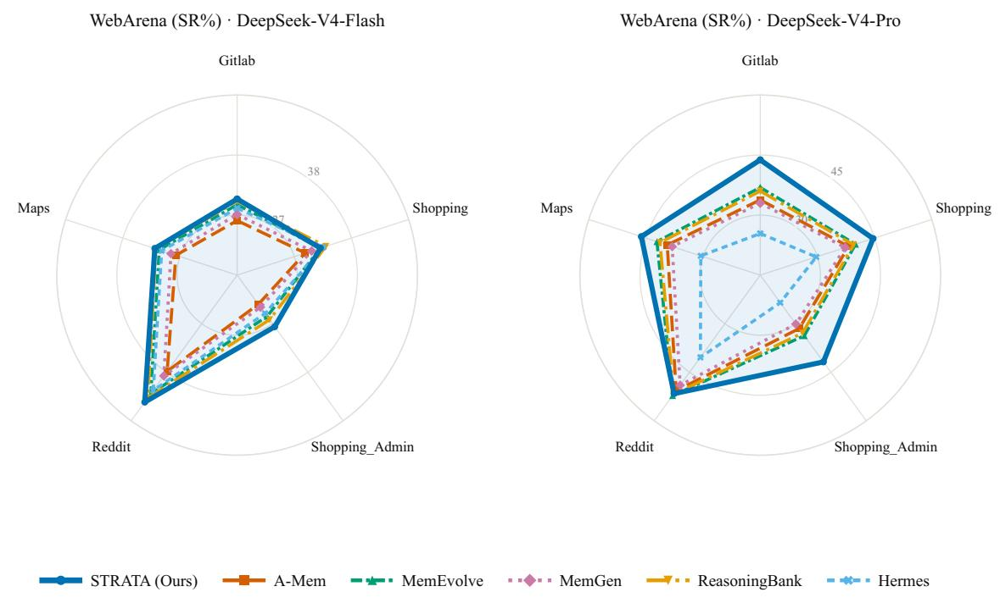  
Fi<sub>gure</sub> 4<sub>:</sub> W<sub>e</sub>bA<sub>rena</sub> <sub>per-s</sub>it<sub>e</sub> <sub>success</sub> <sub>ra</sub>t<sub>e,</sub> b<sub>o</sub>th b<sub>ac</sub>kb<sub>ones.</sub>

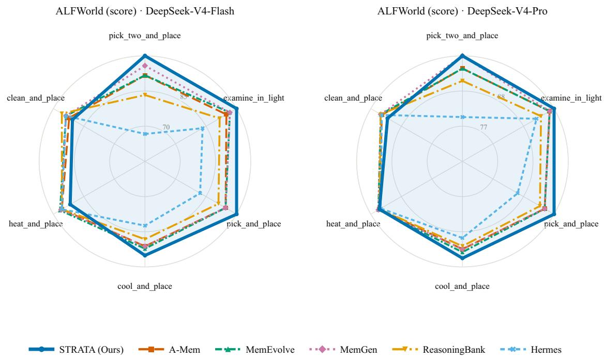

Fi<sub>gure</sub> 5<sub>:</sub> ALFW<sub>or</sub>ld <sub>per-</sub>t<sub>as</sub>k<sub>-</sub>t<sub>ype score,</sub> b<sub>o</sub>th b<sub>ac</sub>kb<sub>ones.</sub>  
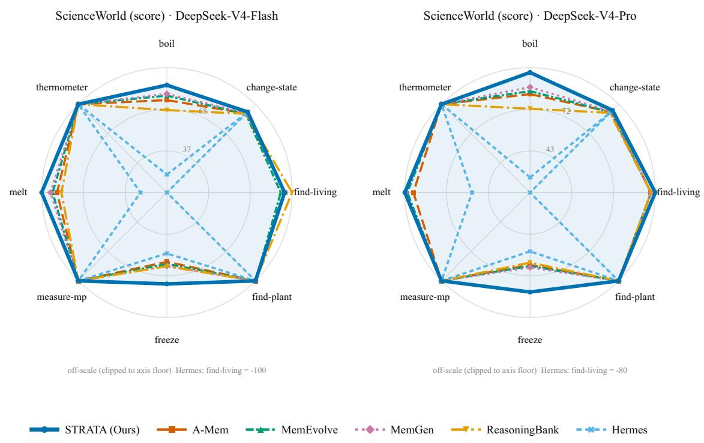  
Figure 6: ScienceWorld per-task-type score, both backbones. Hermes’ find-living value is of-scale (−100/−80) and is <sub>c</sub>li<sub>ppe</sub>d t<sub>o</sub> th<sub>e</sub> <sub>ax</sub>i<sub>s</sub> fl<sub>oor;</sub> thi<sub>s</sub> i<sub>s</sub> th<sub>e</sub> <sub>nega</sub>ti<sub>ve-</sub>t<sub>rans</sub>f<sub>er</sub> <sub>case</sub> <sub>ana</sub>l<sub>yse</sub>d i<sub>n</sub> th<sub>e</sub> <sub>ma</sub>i<sub>n</sub> t<sub>ex</sub>t<sub>.</sub>

## I. Example Memory Nodes

Fi <sub>ures</sub> 8<sub>–</sub>10 <sub>re ro</sub>d<sub>uce</sub> t<sub>wo rea</sub>l <sub>no</sub>d<sub>es</sub> f<sub>rom</sub> th<sub>e</sub> A W<sub>or</sub>ld T<sub>es</sub>t<sub>-</sub>Ch<sub>a</sub>ll<sub>en e ra</sub> h<sub>, ver</sub>b<sub>a</sub>ti<sub>m</sub> i<sub>n</sub> STRATA’<sub>s</sub> t <sub>e</sub>d<sub>-mar</sub>kd<sub>own</sub> serialization. To<sub>g</sub>ether the<sub>y</sub> illustrate one workflow → meta relation: the meta node in Fi<sub>g</sub>ure 10 is one of the 5 metas counted for AppWorld Test-Challenge in Table 4, and the workflow node in Figure 8 is one of the 12 workflows it generalizes.

The workflow node shows what outcome-grounded accumulation roduces in ractice. Fi ure 8 is the node as first cr stallized: the structured app:/obj:/op: ta<sub>g</sub>s that drive the ta<sub>g</sub> term, an applicability strin<sub>g</sub> that forms <sub>p</sub>art of the index view, and one generalized procedure. Figure 9 is everything the reflector added afterwards, namely 23 bullets, of which 7 are pitfall bullets distilled fromfailed episodes and rendered to the agent as things to avoid, and 16 are variant bullets from solved near-neighbour episodes whose similarity fell inside the [τ<sub>l</sub> , τ<sub>hi h</sub>] band. Crucially the procedure itself was never rewritten, since no failed <sub>ep</sub>i<sub>so</sub>d<sub>e ever crys</sub>t<sub>a</sub>lli<sub>ze</sub>d <sub>a</sub> “d<sub>o</sub> thi<sub>s</sub>” <sub>proce</sub>d<sub>ure, an</sub>d <sub>no near-</sub>d<sub>up</sub>li<sub>ca</sub>t<sub>e ever crea</sub>t<sub>e</sub>d <sub>a compe</sub>ti<sub>ng no</sub>d<sub>e.</sub>

Th<sub>e</sub> <sub>me</sub>t<sub>a</sub> <sub>no</sub>d<sub>e</sub> <sub>s</sub>h<sub>ows</sub> <sub>w</sub>h<sub>a</sub>t <sub>commun</sub>it<sub>y</sub> d<sub>e</sub>t<sub>ec</sub>ti<sub>on</sub> <sub>a</sub>b<sub>s</sub>t<sub>rac</sub>t<sub>s.</sub> E<sub>ac</sub>h <sub>mem</sub>b<sub>er</sub> <sub>con</sub>t<sub>r</sub>ib<sub>u</sub>t<sub>es</sub> <sub>one</sub> <sub>var</sub>i<sub>an</sub>t b<sub>u</sub>ll<sub>e</sub>t k<sub>eye</sub>d b<sub>y</sub> it<sub>s</sub> <sub>app</sub>li<sub>ca</sub>bilit<sub>y</sub> condition, so retrievin<sub>g</sub> the meta <sub>g</sub>ives the a<sub>g</sub>ent a routin<sub>g</sub> table over the app:gmail famil<sub>y</sub> rather than a sin<sub>g</sub>le <sub>p</sub>rocedure. It reached support 12 through repeated update rather than repeated create, which is the novelty gate of Table 8 operating on a rea<sup>l</sup> <sub>g</sub>ra<sub>p</sub><sup>h</sup>.

One implementation detail is visible here and worth stating plainly. The tag list is not the union over all 12 children: an update <sub>recompu</sub>t<sub>es</sub> it f<sub>rom</sub> th<sub>e mem</sub>b<sub>ers o</sub>f th<sub>e commun</sub>it<sub>y</sub> d<sub>e</sub>t<sub>ec</sub>t<sub>e</sub>d i<sub>n</sub> th<sub>a</sub>t <sub>roun</sub>d<sub>, so</sub> t<sub>ags con</sub>t<sub>r</sub>ib<sub>u</sub>t<sub>e</sub>d b<sub>y c</sub>hild<sub>ren a</sub>tt<sub>ac</sub>h<sub>e</sub>d i<sub>n ear</sub>li<sub>er</sub> rounds can dro<sub>p</sub> out. That is wh<sub>y</sub> op:delete, carried b<sub>y</sub> the workflow of Fi<sub>g</sub>ure 8, does not a<sub>pp</sub>ear on the meta. Bullets <sub>accumu</sub>l<sub>a</sub>t<sub>e mono</sub>t<sub>on</sub>i<sub>ca</sub>ll<sub>y w</sub>hil<sub>e</sub> t<sub>ags</sub> d<sub>o no</sub>t<sub>.</sub> Si<sub>nce me</sub>t<sub>a</sub> t<sub>ags</sub> f<sub>ee</sub>d <sub>on</sub>l<sub>y</sub> th<sub>e nam</sub>i<sub>ng an</sub>d th<sub>e</sub> t<sub>ag</sub> t<sub>erm o</sub>f <sub>re</sub>t<sub>r</sub>i<sub>eva</sub>l<sub>,</sub> thi<sub>s wea</sub>k<sub>ens</sub> <sub>me</sub>t<sub>a reca</sub>ll <sub>ra</sub>th<sub>er</sub> th<sub>an corrup</sub>ti<sub>ng any wor</sub>kfl<sub>ow; ma</sub>ki<sub>ng</sub> th<sub>e</sub> t<sub>ag se</sub>t <sub>accumu</sub>l<sub>a</sub>t<sub>e</sub> lik<sub>e</sub> th<sub>e</sub> b<sub>u</sub>ll<sub>e</sub>t<sub>s</sub> i<sub>s a one-</sub>li<sub>ne</sub> fi<sub>x we</sub> did <sub>no</sub>t <sub>app</sub>l<sub>y</sub> b<sub>ecause</sub> it <sub>wou</sub>ld i<sub>nva</sub>lid<sub>a</sub>t<sub>e</sub> th<sub>e</sub> <sub>repor</sub>t<sub>e</sub>d <sub>runs.</sub>

AppWorld Test-Normal · DeepSeek-V4-Flash  
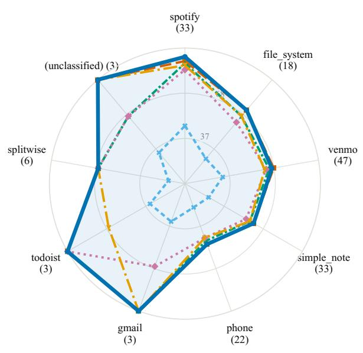  
AppWorld Test-Normal · DeepSeek-V4-Pro

AppWorld Test-Challenge · DeepSeek-V4-Flash  
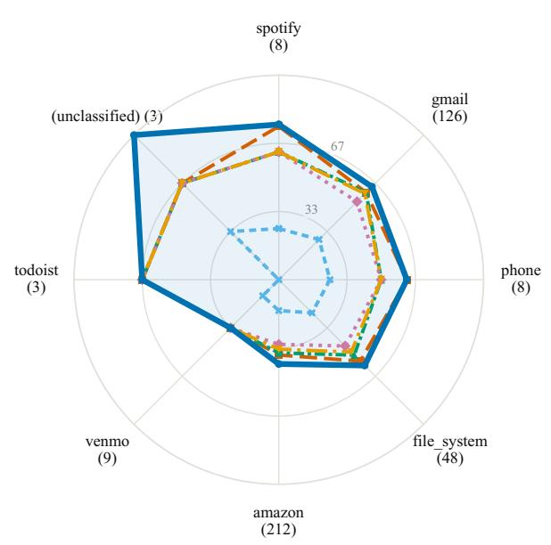  
AppWorld Test-Challenge · DeepSeek-V4-Pro

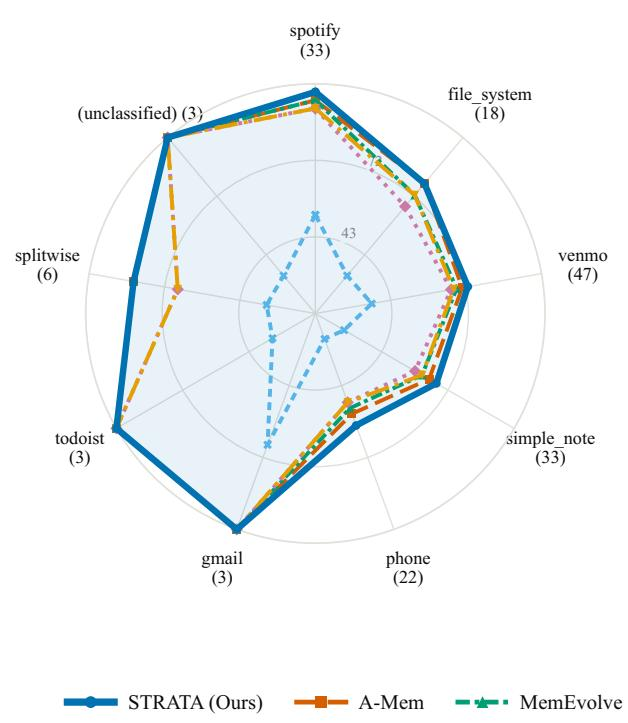

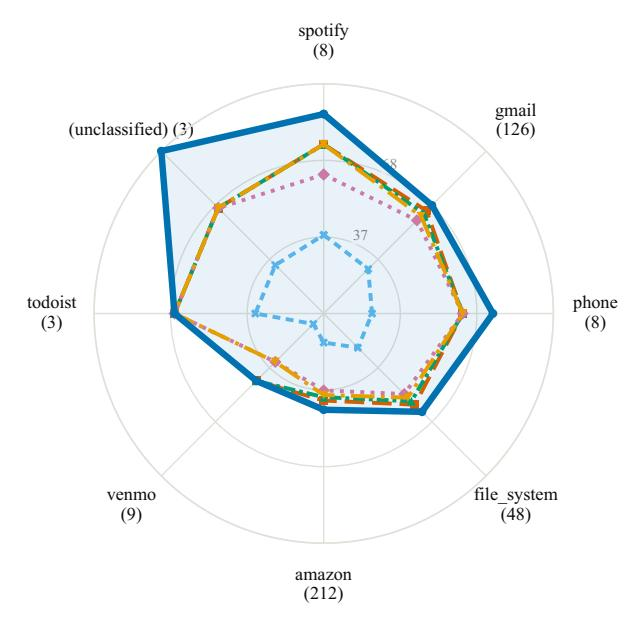  
Fi<sub>gure</sub> 7<sub>:</sub> A<sub>pp</sub>W<sub>or</sub>ld <sub>per-app</sub>li<sub>ca</sub>ti<sub>on</sub> <sub>scores</sub> f<sub>or</sub> b<sub>o</sub>th <sub>sp</sub>lit<sub>s</sub> <sub>an</sub>d b<sub>o</sub>th b<sub>ac</sub>kb<sub>ones.</sub>

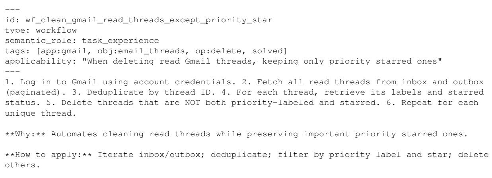  
Figure 8: A workflow node from the AppWorld Test-Challenge graph, verbatim in STRATA’s typed-markdown format: YAML f<sub>ron</sub>t<sub>ma</sub>tt<sub>er carry</sub>i<sub>ng</sub> th<sub>e s</sub>t<sub>ruc</sub>t<sub>ure</sub>d t<sub>ags</sub> th<sub>a</sub>t d<sub>r</sub>i<sub>ve</sub> th<sub>e</sub> t<sub>ag</sub> t<sub>erm,</sub> f<sub>o</sub>ll<sub>owe</sub>d b<sub>y</sub> th<sub>e genera</sub>li<sub>ze</sub>d <sub>proce</sub>d<sub>ure crys</sub>t<sub>a</sub>lli<sub>ze</sub>d f<sub>rom</sub> th<sub>e</sub> fi<sub>rs</sub>t <sub>so</sub>l<sub>ve</sub>d <sub>ep</sub>i<sub>so</sub>d<sub>e.</sub>

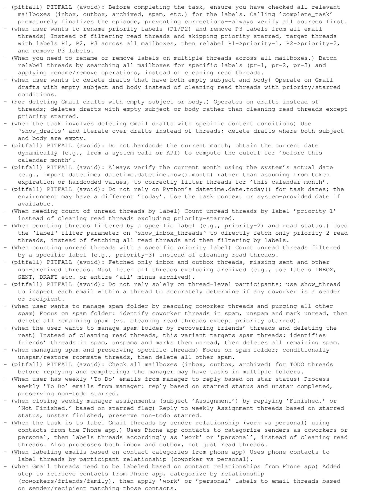  
Fi<sub>gure</sub> 9<sub>:</sub> Th<sub>e</sub> 23 b<sub>u</sub>ll<sub>e</sub>t<sub>s</sub> th<sub>e wor</sub>kfl<sub>ow re</sub>fl<sub>ec</sub>t<sub>or accumu</sub>l<sub>a</sub>t<sub>e</sub>d <sub>on</sub>t<sub>o</sub> th<sub>e no</sub>d<sub>e o</sub>f Fi<sub>gure</sub> 8 <sub>over</sub> 24 l<sub>a</sub>t<sub>er ep</sub>i<sub>so</sub>d<sub>es.</sub> 7 <sub>are pitfall</sub> bullets distilled fromfailed episodes; the rest are variant bullets from solved near-neighbour episodes. The procedure itself was <sub>never rewr</sub>itt<sub>en.</sub>

```csv
id: meta_app_gmail_2
type: meta_framework
semantic_role: task_pattern
tags: [app:gmail, obj:attachment, obj:email, obj:email_invitations, obj:email_thread,
obj:files, op:create, op:transfer, solved]
applicability: "’app:gmail’ family"
Common pattern generalized from: wf_send_hiring_email_replies,
wf_download_email_attachment_to_filesystem, wf_email_files_per_text_request
<sub>**</sub>Why:<sub>**</sub> Recurring community of similar workflows.
<sub>**</sub>How to apply:<sub>**</sub> Route any ’app:gmail’-like task through the matching workflow.
- (when hiring and need to email candidates) variant wf_send_hiring_email_replies: Send hiring
email replies
- (When needing to transfer email attachment to local folder) variant
wf_download_email_attachment_to_filesystem: Download Email Attachment to Filesystem
- (When a contact requests files via text) variant wf_email_files_per_text_request: Email files
per text request
(when phone message requests emailing a file) variant wf_email_file_from_phone_request: Email
file from phone request
- (Forward email thread with extra file and prefixed note) variant
wf_forward_thread_with_note_and_attachment: Forward thread with note and attachment
- (When you need to send personalized bulk emails using a draft template and contact list from
file.) variant wf_send_personalized_bulk_emails_from_draft: Send personalized bulk emails
from draft
- (when need to forward one email from a thread) variant wf_forward_single_email_from_thread:
Forward single email from thread
- (When deleting read Gmail threads, keeping only priority starred ones) variant
wf_clean_gmail_read_threads_except_priority_star: Clean Gmail read threads except priority
starred
- (When away and need to reply to recent unread emails) variant
wf_vacation_auto_reply_to_unresponded_threads: Vacation auto-reply to unresponded threads
- (when draft email contains $TODO prices for Amazon items) variant
wf_fill_draft_prices_from_amazon: Fill draft prices from Amazon
- (When need to forward email with prefixed comment) variant wf_forward_email_with_prefix_note:
Forward email with prefix note
- (when needing to forward email with custom prefix) variant
wf_forward_email_with_prefixed_note: Forward email with prefixed note
```  
Figure 10: The meta-framework node that generalizes the workflow of Figure 8, induced automatically by community detection <sub>over</sub> th<sub>e</sub> <sub>wor</sub>kfl<sub>ow</sub> <sub>s</sub>i<sub>m</sub>il<sub>ar</sub>it<sub>y</sub> <sub>grap</sub>h<sub>.</sub>