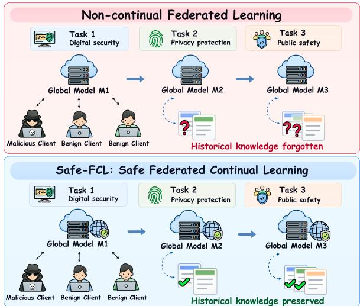
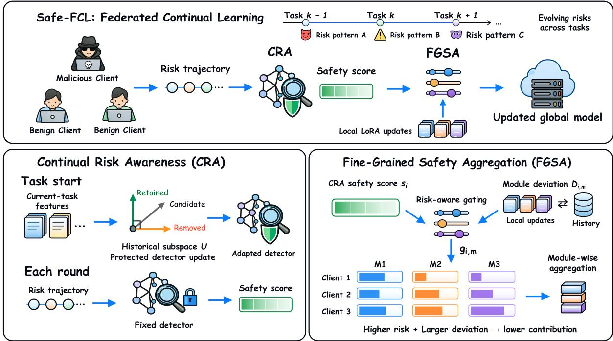
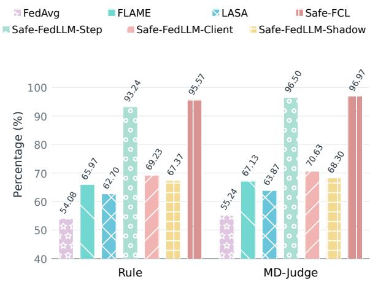
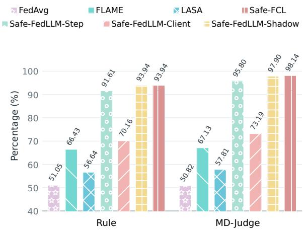

# Safe-FCL: Continual Risk Awareness and Fine-Grained Safety Aggregation for Federated Continual Learning of LLMs

Shuaijie Ma1\* Yongkang Hu1\* Yu Cheng1,2 Jiuan Zhou1,2 Yi Xie1 Yushuo Zhang1 Zhaoxia Yin1† 1East China Normal University 2Shanghai Innovation Institute

## Abstract

Federated fine-tuning enables large language models (LLMs) to learn collaboratively from distributed client data, but malicious client up dates can compromise global model safety. As federated tasks evolve, changing malicious up date patterns challenge the ability of existing defenses to maintain reliable risk detection over time. To address this challenge, we propose Safe-FCL, a framework integrating continual risk awareness with fine-grained safety aggregation for federated continual learning of LLMs. Specifically, the Continual Risk Awareness (CRA) mechanism learns emerging risk patterns across sequential tasks and constrains detector updates using a protective subspace derived from historical features, mitigating forgetting of previously learned malicious patterns while adapting to new risks. To translate risk awareness into aggregation-level safety control, the Fine-Grained Safety Aggregation (FGSA) mechanism combines client-level risk assessments from CRA with module-level devi ations from historical update behavior to adap tively regulate aggregation contributions, suppressing potentially malicious updates while minimizing unnecessary restrictions on benign updates. Extensive experiments demonstrate that Safe-FCL outperforms current SOTA meth ods, improving global-model Rule and MD-Judge scores in federated continual learning by 0.41% and 0.64%, respectively, while in creasing average risk recognition accuracy by 2.01%.

## 1 Introduction

Federated fine-tuning enables large language models (LLMs) to collaboratively learn from distributed client data without requiring the centralization of raw training data (Ye et al., 2024). However, malicious clients may compromise global model safety by manipulating their local model updates (Tao et al., 2026). As federated learning extends from single-task training to continual learning, models must acquire new knowledge while retaining previously learned capabilities (Yoon et al., 2021; Qiu et al., 2026). During this process, malicious update patterns may evolve as training tasks progress, requiring safety defenses not only to address current threats but also to maintain long-term effectiveness across sequential tasks.

  
Figure 1: Comparison of non-continual federated learning and Safe-FCL.

Current studies have explored different strategies to defend against malicious client updates in federated learning. Nguyen et al. (2022) proposed FLAME, which filters suspicious updates to mitigate their impact on the global model. Xu et al. (2025) introduced LASA, employing layeradaptive sparsified aggregation to improve robustness against malicious updates. More recently, Tao et al. (2026) developed Safe-FedLLM, which leverages LoRA update features to assess client risks and regulate aggregation contributions. However, these methods do not explicitly address evolving malicious update patterns across sequential tasks. Fixed risk detectors may miss emerging threats, while continual adaptation can lead to forgetting of previously learned risks. Moreover, client-level risk weighting lacks targeted control over suspicious updates across model modules.

To address these limitations, we propose Safe-FCL, which integrates continual risk awareness with fine-grained safety aggregation to enhance long-term safety in federated continual learning of LLMs. Specifically, Continual Risk Awareness (CRA) learns emerging malicious update patterns from model updates across sequential tasks. It constrains detector updates using historical protective subspaces to mitigate forgetting of previously learned risks. Building upon CRA, Fine-Grained Safety Aggregation (FGSA) combines client-level risk assessments with deviations from historical module update behavior. It then adaptively regulates module-level aggregation contributions through risk-aware gating. Together, these mechanisms leverage cross-task risk awareness to guide module-level aggregation decisions, thereby enhancing long-term safety in federated continual learning. Experimental results demonstrate that Safe-FCL outperforms current SOTA methods, improving global-model Rule and MD-Judge scores by 0.41% and 0.64%, respectively, while increasing continual risk recognition accuracy by 2.01%.

The main contributions of this work are summarized as follows:

• Long-Term Safety Defense for Federated Continual Learning. Safe-FCL is designed to mitigate long-term safety challenges posed by evolving malicious update patterns in federated continual learning of LLMs. By combining cross-task risk awareness with safetyaware aggregation, the framework aims to strengthen defenses across sequential tasks.

• Continual Risk Awareness and Fine-Grained Safety Aggregation. CRA constrains risk detector updates using protective subspaces derived from historical features to mitigate forgetting of previously acquired risk recognition capabilities. FGSA combines client safety scores with module-level historical deviations to adaptively regulate aggregation contributions through risk-aware gating.

• Comprehensive Experimental Evaluation. We evaluate Safe-FCL across sequential safety tasks and an unseen OOD task to examine its long-term safety and generalization capabilities. Compared with current SOTA methods, Safe-FCL improves global-model Rule and MD-Judge scores by 0.41% and 0.64%, respectively, while increasing risk detector average accuracy by 2.01% in federated continual learning.

## 2 Related Work

## 2.1 Federated Continual Learning

Continual learning (CL) aims to learn sequential tasks while mitigating catastrophic forgetting. Representative strategies include parameter regularization (Kirkpatrick et al., 2017), knowledge distillation (Li and Hoiem, 2018), experience replay (Rebuffi et al., 2017; Buzzega et al., 2020), and gradient constraints (Lopez-Paz and Ranzato, 2017; Farajtabar et al., 2020; Saha et al., 2021). Recent studies also explore continual adaptation for AIgenerated image detection (Hu et al., 2026; Zhang et al., 2026). Federated continual learning (FCL) further faces challenges from client data heterogeneity and update conflicts. Existing methods address these challenges through knowledge transfer and distillation-based compensation (Yoon et al., 2021; Dong et al., 2022), feature anchoring and gradient correction (Yu et al., 2025; Zhang et al., 2025a), and multi-expert collaboration (Yi et al., 2025). As federated continual learning extends to LLMs, recent studies have explored federated continual instruction tuning (Guo et al., 2025) and conflict-aware layer selection (Qiu et al., 2026). However, these approaches primarily focus on knowledge retention and task adaptation, leaving long-term safety challenges posed by evolving malicious updates insufficiently explored.

## 2.2 Safety Defenses for Federated LLMs

While recent studies have investigated safety in evolving LLM-based systems (Cheng et al., 2026a,b), federated learning presents an additional challenge: malicious client updates can compromise the global model. Existing defenses include Krum (Blanchard et al., 2017) for robust aggregation, FLTrust (Cao et al., 2021) for trust-based weighting, and FLAME (Nguyen et al., 2022) and FedREDefense (Xie et al., 2024) for anomaly filtering. LASA (Xu et al., 2025) further employs layer-adaptive filtering to enhance aggregation robustness. For federated LLM fine-tuning, Safe-FedLLM (Tao et al., 2026) leverages LoRA update features to identify malicious behavior and mitigate harmful updates through risk-aware aggregation. However, as task distributions and malicious update patterns evolve, adapting to emerging threats while retaining historical risk recognition capabilities remains a key challenge for long-term safety.

## 3 Methodology

## 3.1 Problem Setup and Framework Overview

Federated Continual Learning Setting. Consider a federated continual learning system with $N$ clients that sequentially learns K tasks $\{ \mathcal { T } _ { k } \} _ { k = 1 } ^ { K } ,$ with potentially heterogeneous data across clients and tasks. At communication round $r$ of task $\mathcal { T } _ { k }$ the server selects a subset of clients $\boldsymbol { S } _ { k , r }$ , distributes the global LoRA adapter, and aggregates their locally fine-tuned updates. The global adapter parameters are inherited across tasks.

Safety Threat Model and Objectives. In federated continual learning, malicious clients submit harmful model updates, and their behavior patterns may evolve across tasks. During aggregation, the server cannot access clients’ raw data or know their true malicious identities, and must assess risks based on observable model updates. Therefore, this work aims to adapt to evolving malicious update patterns, preserve historical risk recognition capabilities, and suppress the impact of potentially malicious updates on the global model through fine-grained safety aggregation, thereby enhancing long-term safety in federated continual learning.

Safe-FCL Framework Overview. Safe-FCL integrates continual risk awareness with fine-grained safety aggregation to support safety-aware federated fine-tuning across sequential tasks. During task-level risk detector adaptation, CRA learns emerging risk patterns from current-task update features and constrains detector updates using historical protective subspaces to mitigate forgetting. The detector then assesses client risks based on local update trajectories. FGSA further combines CRA-derived safety scores with historical deviations of actual module updates to adaptively regulate module-level aggregation contributions while maintaining module statistics online. When transitioning to a new task, Safe-FCL retains the global LoRA adapter parameters, risk detector, historical protection bases, and module-level statistics. This allows CRA to adapt to emerging risks while preserving historical risk knowledge, and enables FGSA to assess module updates using accumulated

Table 1: Key notations used in Safe-FCL.
<table><tr><td>Symbol</td><td>Description</td></tr><tr><td> $p _ { \phi } ( x )$ </td><td>Detector risk score</td></tr><tr><td> $U _ { k , \ell }$ </td><td>Historical protection basis</td></tr><tr><td> $\widehat { \rho } _ { i }$ </td><td>Suspicious-update proportion</td></tr><tr><td> $s _ { i }$ </td><td>Client safety score</td></tr><tr><td> $\pi _ { i }$ </td><td>Client aggregation weight</td></tr><tr><td> $E _ { i , m }$ </td><td>Effective LoRA update</td></tr><tr><td> $z _ { i , m } , u _ { i , m }$ </td><td>Magnitude and direction features</td></tr><tr><td> $\mu _ { m }$ </td><td>Historical log-magnitude mean</td></tr><tr><td> $v _ { m }$ </td><td>Historical log-magnitude variance</td></tr><tr><td> $d _ { m }$ </td><td>Historical mean direction</td></tr><tr><td> $a _ { i , m } , b _ { i , m }$ </td><td>Magnitude and directional deviations</td></tr><tr><td> $D _ { i , m }$ </td><td>Overall module deviation</td></tr><tr><td> $g _ { i , m }$ </td><td>Risk-aware retention coefficient</td></tr></table>

historical statistics.

## 3.2 Continual Risk Awareness

As federated continual learning progresses across sequential tasks, malicious client update patterns may evolve. Risk detectors trained on previous tasks may struggle to recognize emerging malicious update patterns, while continual adaptation to new risks may lead to forgetting of previously acquired risk recognition capabilities.

To address this challenge, we propose Continual Risk Awareness (CRA), which enables the risk detector to learn emerging malicious update patterns across sequential tasks while preserving historical risk knowledge. Specifically, CRA collects LoRA update trajectories from benign and malicious clients, extracts risk features from cumulative changes in selected LoRA parameters, and obtains risk scores using the detector $f _ { \phi } \mathrm { . }$

$$
p _ { \phi } ( x ) = \sigma ( f _ { \phi } ( x ) ) .\tag{1}
$$

Here, $\phi$ denotes the detector parameters and $\sigma ( \cdot )$ is the sigmoid function. Higher scores indicate greater predicted risk of malicious updates.

To preserve historical risk recognition capabilities, CRA identifies dominant feature directions from the detector’s layerwise input activations associated with previous tasks. These directions are used to construct an orthonormal protection basis $U _ { k , \ell }$ for each layer. To preserve previously acquired risk knowledge, CRA constrains detector updates along the protected directions, thereby mitigating interference with historical risk representations. During subsequent task adaptation, CRA uses this basis to constrain detector parameter updates, suppressing changes along important historical feature directions to reduce interference between new and previously learned risk knowledge. Let $\bar { W } _ { \ell }$ denote the weights and biases of layer ℓ, and $D _ { \ell } = \bar { W } _ { \ell } ^ { \prime } - \bar { W } _ { \ell }$ denote the parameter change produced by the optimizer. The constrained update is given by:

  
Figure 2: Overview of Safe-FCL. Continual Risk Awareness (CRA) adapts risk detection across sequential tasks while mitigating forgetting. Fine-Grained Safety Aggregation (FGSA) combines client-level risk assessments with module-level historical deviations to adaptively regulate aggregation contributions.

$$
\begin{array} { r } { \bar { W } _ { \ell } ^ { + } = \bar { W } _ { \ell } + D _ { \ell } - ( D _ { \ell } U _ { k , \ell } ) U _ { k , \ell } ^ { \top } . } \end{array}\tag{2}
$$

This constraint suppresses parameter changes along important historical feature directions, thereby reducing interference with previously acquired risk recognition capabilities.

After detector training on the current task, its parameters ϕ remain fixed throughout the corresponding federated training rounds. CRA assesses client risks using local training trajectories separate from the actual updates used for aggregation. For client i in the current communication round, CRA divides its local samples into $T$ equally sized effective batches, extracts update features $x _ { i , u }$ at each step, and applies the risk scoring function $p _ { \phi } ( x )$ to identify suspicious updates. The suspicious-update proportion and client safety score are defined as:

$$
\begin{array} { l l } { \displaystyle \widehat { \rho } _ { i } = \frac { 1 } { T } \sum _ { u = 1 } ^ { T } \mathbb { I } \left( p _ { \phi } ( x _ { i , u } ) \geq \tau _ { \mathrm { c l s } } \right) , } \\ { \displaystyle s _ { i } = ( 1 - \widehat { \rho } _ { i } ) ^ { \eta } . } \end{array}\tag{3}
$$

Here, $\mathbb { I } ( \cdot )$ is an indicator function that equals 1 when the risk score reaches the threshold $\tau _ { \mathrm { c l s } }$ , indicating a suspicious update, and 0 otherwise. The parameter $\eta ~ > ~ 0$ controls the risk suppression strength. A higher safety score $s _ { i }$ indicates lower detected risk and serves as a client-level safety signal to guide subsequent FGSA aggregation decisions.

## 3.3 Fine-Grained Safety Aggregation

Existing safety aggregation methods based on client-level risk typically assign uniform weights to all model modules of the same client, limiting their ability to selectively control localized anomalous updates. To address this limitation, we propose Fine-Grained Safety Aggregation (FGSA), which adaptively regulates module-level aggregation contributions.

For task $\mathcal { T } _ { k }$ at communication round $^ { r , }$ let $s$ denote the set of participating clients. FGSA adjusts client contributions based on the safety scores $s _ { i }$ provided by CRA. If the average safety score of participating clients falls below a threshold $\tau _ { \mathrm { s k i p } } ,$ indicating elevated overall detected risk, aggregation is skipped to prevent potentially harmful updates from affecting the global model, leaving the global parameters and historical module statistics unchanged. Otherwise, the base aggregation weights are computed as:

$$
\pi _ { i } = \frac { n _ { i } s _ { i } } { \sum _ { j \in { \cal S } } n _ { j } s _ { j } } ,\tag{4}
$$

where $n _ { i }$ denotes the number of local training samples at client i.

Building on client-level safety weighting, FGSA further examines module-specific updates to identify localized deviations from historical behavior. To this end, FGSA extracts magnitude and directional features from module updates. For LoRA module m, $E _ { i , m }$ and $z _ { i , m }$ are computed as:

$$
\begin{array} { l } { E _ { i , m } = \kappa ( B _ { i , m } A _ { i , m } - B _ { m } A _ { m } ) , } \\ { \mathrm { ~ } z _ { i , m } = \log \operatorname* { m a x } \left( \frac { \| E _ { i , m } \| _ { F } } { \gamma _ { r } } , \epsilon \right) . } \end{array}\tag{5}
$$

Here, $A _ { m } , B _ { m }$ and $A _ { i , m } , B _ { i , m }$ denote the global and local LoRA parameters, respectively. The terms $\kappa , \gamma _ { r }$ , and ϵ represent the LoRA scaling factor, current learning rate, and numerical stability constant. Meanwhile, FGSA extracts a normalized directional feature $u _ { i , m }$ through a fixed lowdimensional projection to assess module deviations in both magnitude and direction.

Based on these features, FGSA compares current module updates with their historical behavior as follows:

$$
\begin{array} { l } { { a _ { i , m } = \operatorname* { m a x } \left( 0 , \frac { z _ { i , m } - \mu _ { m } } { \sigma _ { m } } - \delta _ { a } \right) , } } \\ { { b _ { i , m } = \operatorname* { m a x } \left( 0 , 1 - \cos ( d _ { m } , u _ { i , m } ) - \delta _ { b } \right) , } } \\ { { D _ { i , m } = \operatorname* { m i n } ( D _ { \operatorname* { m a x } } , a _ { i , m } + b _ { i , m } ) . } } \end{array}\tag{6}
$$

The historical magnitude statistics are maintained over logarithmic update magnitudes. The normalization scale is defined as $\sigma _ { m } =$ max $( \sqrt { v _ { m } } , \sigma _ { \mathrm { m i n } } )$ . The parameters $\delta _ { a }$ and $\delta _ { b }$ control the tolerated magnitude and directional deviations, while $\sigma _ { \mathrm { m i n } }$ and $D _ { \mathrm { m a x } }$ specify the lower normalization bound and upper deviation bound, respectively. The resulting $D _ { i , m }$ provides a basis for subsequent risk-aware gating.

Since deviations from historical behavior do not necessarily indicate malicious activity, FGSA combines the CRA-derived $s _ { i }$ with $D _ { i , m }$ as follows:

$$
g _ { i , m } = \exp [ - \lambda ( 1 - s _ { i } ) D _ { i , m } ] .\tag{7}
$$

Here, $\lambda > 0$ controls the gating strength. When a client exhibits higher detected risk and its module update deviates substantially from historical behavior, $g _ { i , m }$ decreases, strengthening the suppression of potentially harmful updates while avoiding excessive restrictions based solely on normal module variations.

Using these retention coefficients, FGSA performs differentiated safety aggregation across modules. For either LoRA factor $F \in \{ A , B \}$ of module $m .$ , the aggregated parameter is:

$$
F _ { m } ^ { \prime } = F _ { m } + \sum _ { i \in S } \pi _ { i } g _ { i , m } ( F _ { i , m } - F _ { m } ) .\tag{8}
$$

To continuously maintain historical statistics, FGSA updates them after evaluating all participating clients, using only eligible updates with high safety scores, small historical deviations, and limited gating suppression. Let $\bar { z } _ { m }$ and $\bar { u } _ { m }$ denote the average logarithmic magnitude and mean direction of eligible observations, respectively. The historical statistics are updated as:

$$
\begin{array} { l } { \mu _ { m } ^ { \prime } = ( 1 - \beta ) \mu _ { m } + \beta \bar { z } _ { m } , } \\ { v _ { m } ^ { \prime } = ( 1 - \beta ) \left[ v _ { m } + \beta ( \bar { z } _ { m } - \mu _ { m } ) ^ { 2 } \right] , } \\ { d _ { m } ^ { \prime } = ( 1 - \beta ) d _ { m } + \beta \bar { u } _ { m } . } \end{array}\tag{9}
$$

Here, $\mu _ { m } ^ { \prime } , v _ { m } ^ { \prime } .$ , and $d _ { m } ^ { \prime }$ denote the updated historical magnitude mean, variance estimate, and mean direction, respectively, while $\beta \in ( 0 , 1 )$ is the statistical update rate. Historical module statistics are inherited across tasks, providing adaptive references for subsequent deviation assessment and allowing FGSA to suppress suspicious updates while reducing unnecessary interference with benign task learning.

## 4 Experiments

## 4.1 Experimental Setup

Datasets and Task Protocol. We construct five safety-related tasks covering different scenarios, following the sequence T = {physical, public, and material safety; privacy and information protection; property, identity, and information deception; digital security; discrimination and interpersonal harm}. Each task contains 5,000 training samples, 714 validation samples, and 1,429 test samples, with a benign-to-harmful sample ratio of 7:3. Further details on dataset sources, task construction, and data partitioning are provided in Appendices A and B.1. To evaluate the continual learning capability and risk recognition generalization of Safe-FCL, we establish two experimental protocols.

Protocol 1. Under the federated continual learning setting, the system sequentially learns the first four tasks. After each learning stage, global-model safety is evaluated on all tasks learned so far, together with the continual risk recognition performance of the detector.

Table 2: Rule and MD-Judge results (%) across sequential tasks. Bold and underlined averages indicate the best and second-best results per phase and metric, respectively (ties for best are bold).
<table><tr><td rowspan="2">Method</td><td rowspan="2">Task</td><td colspan="5">Rule</td><td colspan="5">MD-Judge</td></tr><tr><td>Task 1</td><td>Task 2</td><td>Task 3</td><td>Task 4</td><td>Avg.</td><td>Task 1</td><td>Task 2</td><td>Task 3</td><td>Task 4</td><td>Avg.</td></tr><tr><td rowspan="4">FedAvg</td><td>T1</td><td>46.62</td><td></td><td>一</td><td></td><td>46.62</td><td>41.26</td><td></td><td>一</td><td></td><td>41.26</td></tr><tr><td>T2</td><td>46.85</td><td>72.49</td><td></td><td></td><td>59.67</td><td>41.72</td><td>77.16</td><td></td><td></td><td>59.44</td></tr><tr><td>T3</td><td>36.60</td><td>66.67</td><td>33.33</td><td></td><td>45.53</td><td>33.57</td><td>65.73</td><td>29.37</td><td></td><td>42.89</td></tr><tr><td>T4</td><td>43.12</td><td>72.03</td><td>42.19</td><td>57.81</td><td>53.79</td><td>40.33</td><td>70.16</td><td>38.93</td><td>61.07</td><td>52.62</td></tr><tr><td rowspan="4">FLAME</td><td>T1</td><td>64.34</td><td></td><td>一</td><td></td><td>64.34</td><td>59.21</td><td></td><td>一</td><td></td><td>59.21</td></tr><tr><td>T2</td><td>60.37</td><td>79.25</td><td></td><td></td><td>69.81</td><td>56.88</td><td>81.12</td><td></td><td></td><td>69.00</td></tr><tr><td>T3</td><td>46.15</td><td>71.33</td><td>36.13</td><td></td><td>51.20</td><td>41.49</td><td>72.73</td><td>32.40</td><td></td><td>48.87</td></tr><tr><td>T4</td><td>46.62</td><td>72.96</td><td>44.99</td><td>72.73</td><td>59.33</td><td>42.19</td><td>73.89</td><td>40.09</td><td>76.92</td><td>58.27</td></tr><tr><td rowspan="4">LASA</td><td>T1</td><td>55.94</td><td></td><td>一</td><td></td><td>55.94</td><td>48.95</td><td></td><td>一</td><td></td><td>48.95</td></tr><tr><td>T2</td><td>55.71</td><td>78.32</td><td></td><td></td><td>67.02</td><td>53.85</td><td>82.98</td><td></td><td></td><td>68.42</td></tr><tr><td>T3</td><td>39.63</td><td>74.36</td><td>34.03</td><td></td><td>49.34</td><td>35.20</td><td>74.36</td><td>29.60</td><td></td><td>46.39</td></tr><tr><td>T4</td><td>47.09</td><td>77.16</td><td>44.29</td><td>61.77</td><td>57.58</td><td>42.19</td><td>77.86</td><td>36.36</td><td>66.43</td><td>55.71</td></tr><tr><td rowspan="4">Safe-FedLLM-Step</td><td>T1</td><td>84.38</td><td></td><td>一</td><td></td><td>84.38</td><td>85.31</td><td></td><td>一</td><td></td><td>85.31</td></tr><tr><td>T2</td><td>92.07</td><td>87.88</td><td></td><td></td><td>89.98</td><td>96.04</td><td>90.91</td><td></td><td></td><td>93.48</td></tr><tr><td>T3</td><td>47.55</td><td>76.92</td><td>44.06</td><td></td><td>56.18</td><td>43.12</td><td>77.62</td><td>38.69</td><td></td><td>53.14</td></tr><tr><td>T4</td><td>92.54</td><td>90.68</td><td>88.81</td><td>91.14</td><td>90.79</td><td>94.17</td><td>92.77</td><td>89.04</td><td>98.60</td><td>93.65</td></tr><tr><td rowspan="4">Safe-FedLLM-Client</td><td>T1</td><td>62.47</td><td></td><td>一</td><td></td><td>62.47</td><td>57.58</td><td></td><td>一</td><td></td><td>57.58</td></tr><tr><td>T2</td><td>61.54</td><td>82.52</td><td></td><td></td><td>72.03</td><td>57.58</td><td>85.78</td><td></td><td></td><td>71.68</td></tr><tr><td>T3</td><td>41.96</td><td>73.43</td><td>35.43</td><td></td><td>50.27</td><td>37.53</td><td>73.43</td><td>31.47</td><td></td><td>47.48</td></tr><tr><td>T4</td><td>68.76</td><td>83.45</td><td>65.50</td><td>80.19</td><td>74.48</td><td>65.03</td><td>85.78</td><td>63.17</td><td>85.78</td><td>74.94</td></tr><tr><td rowspan="4">Safe-FedLLM-Shadow</td><td>T1</td><td>53.38</td><td></td><td></td><td></td><td>53.38</td><td>48.25</td><td></td><td></td><td></td><td>48.25</td></tr><tr><td>T2</td><td>89.98</td><td>91.14</td><td></td><td></td><td>90.56</td><td>96.04</td><td>94.17</td><td></td><td></td><td>95.11</td></tr><tr><td>T3</td><td>79.72</td><td>90.91</td><td>70.86</td><td></td><td>80.50</td><td>84.38</td><td>90.44</td><td>75.29</td><td></td><td>83.37</td></tr><tr><td>T4</td><td>92.77</td><td>93.47</td><td>90.68</td><td>91.61</td><td>92.13</td><td>93.94</td><td>96.04</td><td>92.54</td><td>98.83</td><td>95.34</td></tr><tr><td rowspan="4">Safe-FCL (Ours)</td><td>T1</td><td>90.44</td><td></td><td>–</td><td></td><td>90.44</td><td>92.31</td><td></td><td>一</td><td></td><td>92.31</td></tr><tr><td>T2</td><td>94.41</td><td>92.07</td><td></td><td></td><td>93.24</td><td>97.67</td><td>95.57</td><td></td><td></td><td>96.62</td></tr><tr><td>T3</td><td>85.55</td><td>91.61</td><td>79.25</td><td></td><td>85.47</td><td>88.81</td><td>91.84</td><td>82.05</td><td></td><td>87.57</td></tr><tr><td>T4</td><td>93.71</td><td>92.31</td><td>92.31</td><td>91.84</td><td>92.54</td><td>95.10</td><td>95.10</td><td>94.64</td><td>99.07</td><td>95.98</td></tr></table>

Protocol 2. To evaluate the Global-model and risk detector’s generalization to an unseen domain, we keep the detector parameters learned during the federated continual learning stages fixed on the OOD task, while federated fine-tuning of the global model and FGSA historical-statistics updates continue.

Implementation Details. We adopt Llama-3.1-8B (Grattafiori et al., 2024) as the backbone model and employ LoRA (Hu et al., 2022) for parameterefficient fine-tuning. The federation consists of 10 clients, including 3 malicious clients, with 3 clients randomly selected per communication round. Each task is trained for 100 communication rounds, and each client performs 10 local optimization steps

per round.

Baselines and Evaluation Metrics. We compare Safe-FCL with FedAvg (McMahan et al., 2017), FLAME (Nguyen et al., 2022), LASA (Xu et al., 2025), and the Step-Level, Client-Level, and Shadow-Level variants of Safe-FedLLM (Tao et al., 2026). Global-model safety is evaluated using Rule (Tao et al., 2026) and MD-Judge (Li et al., 2024), which assess rule-based violations and semantic safety of generated responses, respectively. Continual risk recognition is measured by Average Accuracy (AA), Average Forgetting (AF), and New-task Accuracy (New ACC). AA measures average detection accuracy across learned tasks, AF quantifies forgetting of historical risk recognition, and New ACC averages current-task accuracy immediately after each adaptation stage, reflecting adaptation to emerging risks. Federated training settings are described in the Implementation Details paragraph of Section 4.1, and metric definitions are provided in Appendix B.2.

Table 3: Continual risk recognition performance (%) under Protocols 1 and 2. Bold and underlined values indicate the best and second-best results per column, respectively (ties for best are bolded).
<table><tr><td rowspan="2">Method</td><td>Task1</td><td colspan="2">Task2</td><td colspan="2">Task3</td><td colspan="2">Task4</td><td rowspan="2">New ACC ↑</td><td rowspan="2">OOD Task ACC ↑</td></tr><tr><td>AA↑</td><td>AA↑</td><td>AF↓</td><td>AA↑</td><td>AF↓</td><td>AA↑</td><td>AF↓</td></tr><tr><td>Safe-FedLLM-Step</td><td>91.17</td><td>92.59</td><td>-2.33</td><td>81.28</td><td>6.17</td><td>87.04</td><td>-0.50</td><td>86.09</td><td>90.33</td></tr><tr><td>Safe-FedLLM-Client</td><td>88.33</td><td>86.67</td><td>1.66</td><td>91.11</td><td>-9.17</td><td>92.50</td><td>1.11</td><td>88.75</td><td>91.67</td></tr><tr><td>Safe-FedLLM-Shadow</td><td>75.30</td><td>89.35</td><td>-6.43</td><td>85.50</td><td>7.85</td><td>92.25</td><td>1.07</td><td>91.44</td><td>77.17</td></tr><tr><td>Safe-FCL w/o CRA</td><td>92.60</td><td>98.00</td><td>-4.10</td><td>93.13</td><td>7.15</td><td>92.39</td><td>8.04</td><td>97.40</td><td>96.30</td></tr><tr><td>Safe-FCL (Ours)</td><td>94.73</td><td>98.85</td><td>-3.44</td><td>96.70</td><td>3.77</td><td>94.51</td><td>6.53</td><td>98.55</td><td>96.60</td></tr></table>

Table 4: Ablation results for global-model safety (%). Task 1–4 report average Rule and MD-Judge scores across all tasks learned by each stage. OOD reports global-model safety after continued federated fine-tuning on the unseen task with the risk detector fixed. Bold and underlined values indicate the best and second-best results per column, respectively (ties for best are bolded).
<table><tr><td>Method</td><td colspan="2">Task1</td><td colspan="2">Task2</td><td colspan="2">Task3</td><td colspan="2">Task4</td><td colspan="2">OOD</td></tr><tr><td></td><td>Rule</td><td>MD-Judge</td><td>Rule</td><td>MD-Judge</td><td>Rule</td><td>MD-Judge</td><td>Rule</td><td>MD-Judge</td><td>Rule</td><td>MD-Judge</td></tr><tr><td>Safe-FCL w/o FGSA</td><td>90.68</td><td>92.54</td><td>93.01</td><td>96.74</td><td>84.46</td><td>86.95</td><td>92.78</td><td>95.63</td><td>88.58</td><td>93.01</td></tr><tr><td>Safe-FCL w/o CRA</td><td>89.74</td><td>91.61</td><td>91.84</td><td>95.92</td><td>84.62</td><td>87.57</td><td>91.84</td><td>95.69</td><td>90.91</td><td>96.27</td></tr><tr><td>Safe-FCL (Ours)</td><td>90.44</td><td>92.31</td><td>93.24</td><td>96.62</td><td>85.47</td><td>87.57</td><td>92.54</td><td>95.98</td><td>95.57</td><td>96.97</td></tr></table>

  
Figure 3: OOD generalization of federated global models. Rule and MD-Judge values are percentages.

## 4.2 Safety Performance in Federated Continual Learning

Global-model safety is evaluated on the federated continual learning task sequence defined in Protocol 1. For fair comparison, all methods follow the same task order and federated training settings. As shown in Table 2, Safe-FCL achieves the highest average Rule and MD-Judge scores across all learning stages, demonstrating strong long-term safety defense capabilities. Specifically, upon completing federated continual learning, Safe-FCL achieves average Rule and MD-Judge scores of 92.54% and 95.98%, outperforming the current SOTA method by 0.41 and 0.64 percentage points, respectively.

This performance reflects the complementary roles of risk recognition and aggregation control. As malicious update patterns evolve, CRA adapts client risk assessments while limiting interference with previously learned risk knowledge. FGSA further combines these assessments with historical magnitude and directional deviations to regulate individual LoRA modules. Rather than applying the same risk-based weight to every module of a client, this approach enables selective suppression of suspicious contributions, helping maintain global-model safety across changing tasks.

## 4.3 Continual Risk Recognition Performance

The continual learning performance of the risk detector is evaluated on the task sequence defined in Protocol 1. For fair comparison, all methods follow the same task order and evaluation settings. As shown in Table 3, Safe-FCL achieves the highest Average Accuracy across all learning stages, demonstrating strong continual risk recognition capabilities. Specifically, upon completing federated continual learning, Safe-FCL improves AA by 2.01 percentage points over the current SOTA method. In terms of adaptation to new tasks, Safe-FCL improves New ACC by 7.11 percentage points over the current SOTA method. Furthermore, under Protocol 2, Safe-FCL achieves an OOD Task ACC of 96.60%, outperforming the strongest baseline by 4.93 percentage points.

These results demonstrate that Safe-FCL not only adapts to evolving malicious update patterns across sequential tasks but also preserves historical risk recognition capabilities, achieving a favorable balance between stability and plasticity. This benefit mainly stems from CRA, which constrains detector updates using historical orthonormal protection bases to reduce interference between new and previously learned risk knowledge. Moreover, Safe-FCL maintains high risk recognition accuracy on the OOD task without retraining the detector, indicating that CRA not only preserves the ability to recognize historical malicious update patterns but also enables learned risk discrimination capabilities to generalize to unseen task domains.

## 4.4 OOD Generalization of Global-Model Safety

Adapting to an unseen safety domain introduces changes in client update behavior, posing additional challenges for safety-aware aggregation. As shown in Figure 3, Safe-FCL outperforms current SOTA methods by 2.33% in Rule and 0.47% in MD-Judge. The larger improvement in Rule suggests a stronger ability to suppress explicit safety violations, while the MD-Judge gain indicates that semantic-level safety is also preserved during adaptation.

On the unseen task, CRA leverages previously learned risk recognition capabilities to assess participating clients without additional detector training, demonstrating strong generalization performance. FGSA further combines these assessments with historical module-level deviations to selectively suppress suspicious updates rather than applying uniform restrictions across all modules. Meanwhile, by updating historical statistics using eligible observations, FGSA can adapt to shifts in benign update behavior. This adaptive control helps maintain global-model safety as federated fine-tuning continues on the unseen task.

## 4.5 Ablation Study

Component ablations under the same experimental setting as Protocol 1 allow us to assess the effectiveness of CRA and FGSA. As shown in Table 4, the full Safe-FCL improves the final Rule and MD-Judge scores by 0.70 and 0.29 percentage points, respectively, compared with the variant without CRA. This suggests that continually adapting risk recognition helps maintain reliable safety aggregation as task distributions evolve. FGSA provides complementary benefits by regulating safety-critical module updates, with particularly noticeable improvements after the third task. However, its effects are not uniformly positive across all metrics at the final stage, indicating that module-level safety control involves trade-offs between different safety evaluation criteria rather than guaranteeing consistent gains.

The detector comparisons in Table 3 further clarify the role of CRA in preserving historical risk knowledge. Compared with the variant without CRA, Safe-FCL improves final AA by 2.12 percentage points while reducing AF by 1.51 percentage points. Improvements in New ACC and OOD Task ACC further suggest that protecting historical risk representations does not necessarily compromise adaptation to emerging malicious update patterns. Instead, CRA helps balance knowledge retention and plasticity, allowing the detector to recognize newly encountered risks while limiting interference with previously acquired capabilities. Taken together, these results highlight the complementary roles of CRA and FGSA: CRA supports stable risk recognition across sequential tasks, whereas FGSA translates risk awareness into selective control over federated model updates. Results under an alternative task sequence are provided in Appendix C.

## 5 Conclusion

In this paper, we propose Safe-FCL to enhance long-term safety in federated continual learning of LLMs. Safe-FCL integrates CRA, which preserves historical risk knowledge while adapting to emerging threats, and FGSA, which enables risk-aware aggregation through module-level safety control. Experiments demonstrate that Safe-FCL outperforms state-of-the-art methods, improving globalmodel Rule and MD-Judge scores by 0.41% and 0.64%, respectively, while increasing average risk recognition accuracy by 2.01% and OOD accuracy by 4.93%.

## Limitations

Although our empirical results demonstrate the effectiveness of Safe-FCL, several limitations remain. Our evaluation focuses on text-based federated continual learning under controlled maliciousclient settings, while its effectiveness in multimodal and more complex adversarial scenarios, including adaptive attacks and coordinated malicious clients, remains unexplored. Moreover, as the number of clients and tasks grows, evaluation-branch optimization, detector adaptation, and historical feature retention may increase computational and storage overhead. Future work will investigate broader threat scenarios and more efficient trajectory evaluation and historical feature representations to improve the scalability and applicability of Safe-FCL.

## References

Wasi Uddin Ahmad, Jianfeng Chi, Yuan Tian, and Kai-Wei Chang. 2020. PolicyQA: A Reading Comprehension Dataset for Privacy Policies. In Findings ofthe Associationfor Computational Linguistics: EMNLP 2020, pages 743–749.

Atif. n.d. Privacy-Expert-Instructions. Hugging Face dataset repository.

Yuntao Bai, Andy Jones, Kamal Ndousse, Amanda Askell, Anna Chen, Nova DasSarma, Dawn Drain, Stanislav Fort, Deep Ganguli, Tom Henighan, Nicholas Joseph, Saurav Kadavath, Jackson Kernion, Tom Conerly, Sheer El-Showk, Nelson Elhage, Zac Hatfield-Dodds, Danny Hernandez, Tristan Hume, and 12 others. 2022. Training a helpful and harmless assistant with reinforcement learning from human feedback. arXiv preprint arXiv:2204.05862.

Rishabh Bhardwaj and Soujanya Poria. 2023. Redteaming large language models using chain of utterances for safety-alignment. arXiv preprint arXiv:2308.09662.

Peva Blanchard, El Mahdi El Mhamdi, Rachid Guerraoui, and Julien Stainer. 2017. Machine learning with adversaries: Byzantine tolerant gradient descent. In Advances in Neural Information Processing Systems, volume 30.

Pietro Buzzega, Matteo Boschini, Angelo Porrello, Davide Abati, and Simone Calderara. 2020. Dark experience for general continual learning: A strong, simple baseline. In Advances in Neural Information Processing Systems, volume 33, pages 15920–15930.

Xiaoyu Cao, Minghong Fang, Jia Liu, and Neil Zhenqiang Gong. 2021. FLTrust: Byzantine-robust federated learning via trust bootstrapping. In Proceedings of the Network and Distributed System Security Symposium.

Zhiyu Chen, Wenhu Chen, Charese Smiley, Sameena Shah, Iana Borova, Dylan Langdon, Reema Moussa, Matt Beane, Ting-Hao Huang, Bryan R Routledge, et al. 2021. FinQA: A Dataset of Numerical Reasoning over Financial Data. In Proceedings of the 2021 Conference on Empirical Methods in Natural Language Processing, pages 3697–3711.

Yu Cheng, Yongkang Hu, Shuaijie Ma, Zhihang Lin, Weicheng Meng, Jingyang Qiao, Jiuan Zhou, Yushuo Zhang, Yihang Chen, Weilin Luo, Kun Shao, Dong Li, Zhizhong Zhang, Yuan Xie, and Zhaoxia Yin. 2026a. SafeCoEvo: Co-evolving safety harnesses and guards for LLM agents at test-time. arXiv preprint arXiv:2609.36580.

Yu Cheng, Yongkang Hu, Jiuan Zhou, Yushuo Zhang, Yihang Chen, Huichi Zhou, Mingang Chen, Zhizhong Zhang, Kun Shao, Yuan Xie, and Zhaoxia Yin. 2026b. TAME: A trustworthy test-time evolution of agent memory with systematic benchmarking. In Proceedings ofthe 2026 Conference on Empirical Methods in Natural Language Processing.

Chanyeol Choi, Jihoon Kwon, Jaeseon Ha, Hojun Choi, Chaewoon Kim, Yongjae Lee, Jy-yong Sohn, and Alejandro Lopez-Lira. 2025. Finder: Financial dataset for question answering and evaluating retrieval-augmented generation. In Proceedings of the 6th ACM International Conference on AI in Finance, pages 638–646.

Jiahua Dong, Lixu Wang, Zhen Fang, Gan Sun, Shichao Xu, Xiao Wang, and Qi Zhu. 2022. Federated classincremental learning. In 2022 IEEE/CVF Conference on Computer Vision and Pattern Recognition (CVPR), pages 10154–10163.

Mehrdad Farajtabar, Navid Azizan, Alex Mott, and Ang Li. 2020. Orthogonal gradient descent for continual learning. In International conference on artificial intelligence and statistics, pages 3762–3773. PMLR.

Flax Sentence Embeddings Team. 2021. Stack Exchange question pairs. Hugging Face dataset repository.

Shaona Ghosh, Prasoon Varshney, Makesh Narsimhan Sreedhar, Aishwarya Padmakumar, Traian Rebedea, Jibin Rajan Varghese, and Christopher Parisien. 2025. AEGIS2.0: A Diverse AI Safety Dataset and Risks Taxonomy for Alignment of LLM Guardrails. In Proceedings of the 2025 Conference of the Nations of the Americas Chapter of the Association for Computational Linguistics: Human Language Technologies (Volume 1: Long Papers), pages 5992–6026.

Prasoon Goyal, Sattvik Sahai, Michael Johnston, Hangjie Shi, Yao Lu, Shaohua Liu, Anna Rumshisky, Rahul Gupta, Anna Gottardi, Desheng Zhang, Lavina Vaz, Leslie Ball, Lucy Hu, Luke Dai, Samyuth Sagi, Maureen Murray, and Sankaranarayanan Ananthakrishnan. 2026. Adversarial Arena: Crowdsourcing Data Generation through Interactive Competition. In ICLR 2026 Workshop on Navigating and Addressing Data Problemsfor Foundation Models (DATA-FM).

Aaron Grattafiori, Abhimanyu Dubey, Abhinav Jauhri, Abhinav Pandey, Abhishek Kadian, Ahmad Al-Dahle, Aiesha Letman, Akhil Mathur, Alan Schelten, Alex Vaughan, Amy Yang, Angela Fan, Anirudh Goyal, Anthony Hartshorn, Aobo Yang, Archi Mitra, Archie Sravankumar, Artem Korenev, Arthur Hinsvark, and 540 others. 2024. The Llama 3 herd of models. arXiv preprint arXiv:2407.21783.

Gretel. 2024. Gretel Synthetic Safety Alignment Dataset. Hugging Face dataset repository.

Haiyang Guo, Fanhu Zeng, Fei Zhu, Wenzhuo Liu, Da-Han Wang, Jian Xu, Xu-Yao Zhang, and Cheng-Lin Liu. 2025. Federated continual instruction tuning. In Proceedings ofthe IEEE/CVF International Conference on Computer Vision, pages 1325–1335.

Seungju Han, Kavel Rao, Allyson Ettinger, Liwei Jiang, Bill Yuchen Lin, Nathan Lambert, Yejin Choi, and Nouha Dziri. 2024. WildGuard: Open One-stop Moderation Tools for Safety Risks, Jailbreaks, and Refusals of LLMs. In Advances in Neural Information Processing Systems, volume 37, pages 8093– 8131.

Edward J. Hu, Yelong Shen, Phillip Wallis, Zeyuan Allen-Zhu, Yuanzhi Li, Shean Wang, Lu Wang, and Weizhu Chen. 2022. LoRA: Low-rank adaptation of large language models. In International Conference on Learning Representations.

Yongkang Hu, Yu Cheng, Yushuo Zhang, Yuan Xie, and Zhaoxia Yin. 2026. SAIDO: Generalizable detection of AI-generated images via scene-aware and importance-guided dynamic optimization in continual learning. In Proceedings ofthe IEEE/CVF Conference on Computer Vision and Pattern Recognition, pages 3876–3886.

Jiaming Ji, Donghai Hong, Borong Zhang, Boyuan Chen, Josef Dai, Boren Zheng, Tianyi Alex Qiu, Jiayi Zhou, Kaile Wang, Boxun Li, et al. 2025. PKU-SafeRLHF: Towards Multi-Level Safety Alignment for LLMs with Human Preference. In Proceedings of the 63rd Annual Meeting of the Association for Computational Linguistics (Volume 1: Long Papers), pages 31983–32016.

Jiaming Ji, Mickel Liu, Juntao Dai, Xuehai Pan, Chi Zhang, Ce Bian, Boyuan Chen, Ruiyang Sun, Yizhou Wang, and Yaodong Yang. 2023. BeaverTails: Towards Improved Safety Alignment of LLM via a Human-Preference Dataset. In Advances in Neural Information Processing Systems, volume 36, pages 24678–24704.

Liwei Jiang, Kavel Rao, Seungju Han, Allyson Ettinger, Faeze Brahman, Sachin Kumar, Niloofar Mireshghallah, Ximing Lu, Maarten Sap, Yejin Choi, and Nouha Dziri. 2024. WildTeaming at Scale: From In-the-Wild Jailbreaks to (Adversarially) Safer Language Models. In Advances in Neural Information Processing Systems, volume 37, pages 47094–47165.

Alican Kiraz. 2026. Fenrir v2.1 — Cybersecurity Instruction-Tuning Dataset. Hugging Face dataset repository.

James Kirkpatrick, Razvan Pascanu, Neil Rabinowitz, Joel Veness, Guillaume Desjardins, Andrei A. Rusu, Kieran Milan, John Quan, Tiago Ramalho, Agnieszka Grabska-Barwinska, Demis Hassabis, Claudia Clopath, Dharshan Kumaran, and Raia Hadsell. 2017. Overcoming catastrophic forgetting in neural networks. Proceedings ofthe National Academy of Sciences, 114(13):3521–3526.

Seanie Lee, Haebin Seong, Dong Bok Lee, Minki Kang, Xiaoyin Chen, Dominik Wagner, Yoshua Bengio, Juho Lee, and Sung Ju Hwang. 2025. HarmAug: Effective data augmentation for knowledge distillation of safety guard models. In The Thirteenth International Conference on Learning Representations.

Lijun Li, Bowen Dong, Ruohui Wang, Xuhao Hu, Wangmeng Zuo, Dahua Lin, Yu Qiao, and Jing Shao. 2024. SALAD-Bench: A hierarchical and comprehensive safety benchmark for large language models. In Findings ofthe Associationfor Computational Linguistics: ACL 2024, pages 3923–3954.

Zhizhong Li and Derek Hoiem. 2018. Learning without forgetting. IEEE Transactions on Pattern Analysis and Machine Intelligence, 40(12):2935–2947.

LLM-LAT. n.d. harmful-dataset. Hugging Face dataset repository.

David Lopez-Paz and Marc’Aurelio Ranzato. 2017. Gradient episodic memory for continual learning. In Advances in Neural Information Processing Systems, volume 30.

mariiazhiv. n.d. cybersecurity\_qa. Hugging Face dataset repository.

Brendan McMahan, Eider Moore, Daniel Ramage, Seth Hampson, and Blaise Aguera y Arcas. 2017. Communication-efficient learning of deep networks from decentralized data. In Artificial intelligence and statistics, pages 1273–1282. Pmlr.

Thien Duc Nguyen, Phillip Rieger, Huili Chen, Hossein Yalame, Helen Möllering, Hossein Fereidooni, Samuel Marchal, Markus Miettinen, Azalia Mirhoseini, Shaza Zeitouni, Farinaz Koushanfar, Ahmad-Reza Sadeghi, and Thomas Schneider. 2022. FLAME: Taming backdoors in federated learning. In 31st USENIX Security Symposium (USENIX Security 22), pages 1415–1432.

NVIDIA. 2025a. Nemotron-RL-Safety-v1. Hugging Face dataset repository.

NVIDIA. 2025b. Nemotron-SFT-Safety-v1. Hugging Face dataset repository.

NVIDIA. 2026. Nemotron-3.5-Content-Safety-Dataset. Hugging Face dataset repository.

Open Eval Commons. n.d. OpenEval. Hugging Face dataset repository.

Wenqi Qiu, Yipeng Zhou, Lin Zhu, and Laizhong Cui. 2026. Less is more in federated continual learning: RieSelect for conflict-aware layer selection in LLMs. In Proceedings ofthe 43rd International Conference on Machine Learning, volume 306, pages 102408– 102438.

Sylvestre-Alvise Rebuffi, Alexander Kolesnikov, Georg Sperl, and Christoph H Lampert. 2017. icarl: Incremental classifier and representation learning. In 2017 IEEE conference on computer vision and pattern recognition (CVPR), pages 5533–5542.

Responsible AI Labs. n.d. RAIL-HH-10K. Hugging Face dataset repository.

Rowden. n.d. CybersecurityQAA. Hugging Face dataset repository.

Gobinda Saha, Isha Garg, and Kaushik Roy. 2021. Gradient projection memory for continual learning. In International Conference on Learning Representations.

Param Somane, Anushri Eswaran, and Sarvani Kunapareddy. n.d. GPT-OSS-20b Red-Teaming Mass Evaluation. Hugging Face dataset repository.

Mingxiang Tao, Yu Tian, Wenxuan Tu, Yue Yang, Xue Yang, and Xiangyan Tang. 2026. Safe-FedLLM: Delving into the safety of federated large language models. In Proceedings of the 64th Annual Meeting ofthe Associationfor Computational Linguistics (Volume 1: Long Papers), pages 24405–24420.

unalignment. n.d. toxic-dpo-v0.2. Hugging Face dataset repository.

Yueqi Xie, Minghong Fang, and Neil Zhenqiang Gong. 2024. FedREDefense: Defending against model poisoning attacks for federated learning using model update reconstruction error. In Proceedings of the 41st International Conference on Machine Learning, volume 235, pages 54460–54474.

Jiahao Xu, Zikai Zhang, and Rui Hu. 2025. Achieving Byzantine-resilient federated learning via layeradaptive sparsified model aggregation. In Proceedings of the Winter Conference on Applications of Computer Vision, pages 1508–1517.

Rui Ye, Wenhao Wang, Jingyi Chai, Dihan Li, Zexi Li, Yinda Xu, Yaxin Du, Yanfeng Wang, and Siheng Chen. 2024. OpenFedLLM: Training large language models on decentralized private data via federated learning. In Proceedings ofthe 30th ACM SIGKDD Conference on Knowledge Discovery and Data Mining, pages 6137–6147.

Xiaoyang Yi, Yang Liu, Binhan Yang, and Jian Zhang. 2025. Federated continual learning via orchestrating multi-scale expertise. In Advances in Neural Information Processing Systems, volume 38, pages 25847–25876.

Orhan Yildirim. 2025. CyberStrike SFT 120K: Offensive Cybersecurity Training Dataset. Hugging Face dataset repository.

Jaehong Yoon, Wonyong Jeong, Giwoong Lee, Eunho Yang, and Sung Ju Hwang. 2021. Federated continual learning with weighted inter-client transfer. In Proceedings ofthe 38th International Conference on Machine Learning, volume 139, pages 12073–12086.

Hao Yu, Xin Yang, Le Zhang, Hanlin Gu, Tianrui Li, Lixin Fan, and Qiang Yang. 2025. Handling spatial-temporal data heterogeneity for federated continual learning via tail anchor. In Proceedings of the IEEE/CVF Conference on Computer Vision and Pattern Recognition, pages 4874–4883.

Chengchao Zhang, Fanhua Shang, Hongyin Liu, Liang Wan, and Wei Feng. 2025a. FedAGC: Federated continual learning with asymmetric gradient correction. In Proceedings of the IEEE/CVF International Conference on Computer Vision, pages 3841–3850.

Yushuo Zhang, Yu Cheng, Yongkang Hu, Jiuan Zhou, Jiawei Chen, and Zhaoxia Yin. 2026. Face-d (ˆ 2) cl: Multi-domain synergistic representation with dual continual learning for facial deepfake detection. arXiv preprint arXiv:2604.08159.

Zhehao Zhang, Weijie Xu, Fanyou Wu, and Chandan K. Reddy. 2025b. FalseReject: A Resource for Improving Contextual Safety and Mitigating Over-Refusals in LLMs via Structured Reasoning.

Wenting Zhao, Xiang Ren, Jack Hessel, Claire Cardie, Yejin Choi, and Yuntian Deng. 2024. WildChat: 1M ChatGPT Interaction Logs in the Wild. In International Conference on Learning Representations.

Lianmin Zheng, Wei-Lin Chiang, Ying Sheng, Tianle Li, Siyuan Zhuang, Zhanghao Wu, Yonghao Zhuang, Zhuohan Li, Zi Lin, Eric P. Xing, Joseph E. Gonzalez, Ion Stoica, and Hao Zhang. 2024. LMSYS-Chat-1M: A Large-Scale Real-World LLM Conversation Dataset. In International Conference on Learning Representations, volume 2024, pages 22225–22257.

Andy Zou, Long Phan, Justin Wang, Derek Duenas, Maxwell Lin, Maksym Andriushchenko, Rowan Wang, Zico Kolter, Matt Fredrikson, and Dan Hendrycks. 2024. Improving Alignment and Robustness with Circuit Breakers. In Advances in Neural Information Processing Systems, volume 37, pages 83345–83373.

## A Dataset Sources

## A.1 Source Datasets

Our data snapshot contains 49,765 question– answer (QA) pairs selected from 34 upstream repositories. Table 5 summarizes the data sources and their associated references, with related repositories grouped into 29 entries for presentation.

## A.2 Selection and Task Construction

Our dataset contains 49,765 selected question– answer (QA) pairs across five safety domains and four partitions: 25,000 for LLM training, 3,570 for validation, 7,145 for testing, and 14,050 for auxiliary trajectory collection. These counts reflect the retained samples rather than the original sizes of the source datasets.

The five safety domains are defined according to the primary targets and intended actions of requests, rather than directly adopting the taxonomies of source datasets. Related question families are grouped before domain assignment, data partitioning, and quota sampling. We categorize QA pairs into three types: benign requests with safe answers (A), harmful requests with safe answers (B), and harmful requests with harmful answers (C). Types A and B constitute the benign training pool, while type C forms the malicious pool.

## B Experimental Protocol and Evaluation Details

## B.1 Data Construction and Partitioning

Client Data and Threat Labels. Federated training data are partitioned among participating clients for each task. In our controlled threat setting, malicious-client identities are used to construct labeled training examples for the risk detector but are not provided to the server during federated aggregation. Thus, aggregation decisions rely on inferred risks rather than oracle knowledge of client identities.

Risk-detector Examples. CRA uses update-space observations distinct from the examples used for LLM fine-tuning. These observations are constructed from benign and malicious local LoRAupdate trajectories. Each observation consists of a feature vector extracted from cumulative parameter changes relative to a fixed task reference and a binary label indicating the update type. The labels are used for task-level detector adaptation, whereas subsequent aggregation relies only on predicted client risks.

## B.2 Evaluation Metrics

Continual Risk Recognition Metrics. Let $a _ { k , j }$ denote the risk detector’s classification accuracy (%) on task $\tau _ { j }$ after adapting to task $\mathcal { T } _ { k }$ , where $j \leq k$ . Average Accuracy is defined as:

$$
\mathrm { A A } _ { k } = \frac { 1 } { k } \sum _ { j = 1 } ^ { k } a _ { k , j } .\tag{10}
$$

Average Forgetting (AF) measures changes in historical task accuracy relative to the reference accuracy $b _ { k , j }$ specified by the evaluation protocol:

$$
{ \mathrm { A F } } _ { k } = { \frac { 1 } { k - 1 } } \sum _ { j = 1 } ^ { k - 1 } ( b _ { k , j } - a _ { k , j } ) , \quad k \geq 2 .\tag{11}
$$

AF retains signed values, with positive values indicating performance degradation and negative values indicating improvement relative to the reference.

New-task Accuracy (New ACC) measures the average accuracy immediately after learning each new task:

$$
\mathrm { N e w \ A C C } = \frac { 1 } { K } \sum _ { k = 1 } ^ { K } a _ { k , k } .\tag{12}
$$

OOD Task ACC is evaluated on the held-out task using the detector frozen after the final continual learning stage.

Global-model Safety Metrics. Let $G _ { k } ( q )$ denote the global model’s response to query q after learning task $\mathcal { T } _ { k } .$ , and let $\mathcal { Q } _ { j }$ denote the evaluation queries for task $\tau _ { j }$ . For evaluator $m \in$ {Rule, MDJ}, the safety score is computed as:

$$
S _ { k , j } ^ { ( m ) } = \frac { 1 0 0 } { | \mathcal { Q } _ { j } | } \sum _ { q \in \mathcal { Q } _ { j } } \mathbf { 1 } [ \mathcal { T } _ { m } ( q , G _ { k } ( q ) ) = \mathrm { s a f e } ] .\tag{13}
$$

The stage-average safety score is calculated over all tasks learned so far:

$$
\overline { { S } } _ { k } ^ { ( m ) } = \frac { 1 } { k } \sum _ { j = 1 } ^ { k } S _ { k , j } ^ { ( m ) } .\tag{14}
$$

OOD Rule and MD-Judge scores are measured after federated fine-tuning on the held-out task, unlike OOD risk recognition accuracy, which is obtained without detector adaptation.

<table><tr><td>Source IDs</td><td>Dataset or source group</td><td>Reference</td><td>Selected QA</td></tr><tr><td>S01</td><td>Fenrir v2.1 (AlicanKiraz0)</td><td>(Kiraz, 2026)</td><td>108</td></tr><tr><td>S02</td><td>FalseReject</td><td>(Zhang et al., 2025b)</td><td>28</td></tr><tr><td>S03</td><td>HH-RLHF</td><td>(Bai et al., 2022)</td><td>471</td></tr><tr><td>S04</td><td>gpt-oss-20b red-teaming evals (ChestnutKurisu)</td><td>(Somane et al., n.d.)</td><td>73</td></tr><tr><td>S05</td><td>Circuit Breakers</td><td>(Zou et al., 2024)</td><td>456</td></tr><tr><td>S06</td><td>harmful-dataset (LLM-LAT)</td><td>(LLM-LAT, n.d.)</td><td>2,323</td></tr><tr><td>S07</td><td>FinDER</td><td>(Choi et al., 2025)</td><td>600</td></tr><tr><td>S08</td><td>OpenEval (Open-Eval-Commons)</td><td>(Open Eval Commons, n.d.)</td><td>1,246</td></tr><tr><td>S09, S11, S12</td><td>BeaverTails and related releases</td><td>(Ji et al., 2023)</td><td>2,431</td></tr><tr><td>S10, S13</td><td>PKU-SafeRLHF and QA variant</td><td>(Ji et al., 2025)</td><td>17,218</td></tr><tr><td>S14</td><td>CybersecurityQAA (Rowden)</td><td>(Rowden, n.d.)</td><td>382</td></tr><tr><td>S15</td><td>WildChat</td><td>(Zhao et al., 2024)</td><td>356</td></tr><tr><td>S16</td><td>WildGuardMix</td><td>(Han et al., 2024)</td><td>2,525</td></tr><tr><td>S17</td><td>WildJailbreak</td><td>(Jiang et al., 2024)</td><td>7,223</td></tr><tr><td>S18</td><td>Adversarial Arena</td><td>(Goyal et al., 2026)</td><td>1,131</td></tr><tr><td>S19</td><td>FinQA</td><td>(Chen et al., 2021)</td><td>48</td></tr><tr><td>S20</td><td>HarmfulQA</td><td>(Bhardwaj and Poria, 2023)</td><td>108</td></tr><tr><td>S21</td><td>StackExchange title/body QA (flax-sentence-embeddings)</td><td>(Flax Sentence Embeddings Team, 2021)</td><td>953</td></tr><tr><td>S22</td><td>Gretel safety alignment en-v1</td><td>(Gretel, 2024)</td><td>996</td></tr><tr><td>S23</td><td>HarmAug</td><td>(Lee et al., 2025)</td><td>3,996</td></tr><tr><td>S24</td><td>LMSYS-Chat-1M</td><td>(Zheng et al., 2024)</td><td>1,049</td></tr><tr><td>S25</td><td>cybersecurity_qa (mariiazhiv)</td><td>(mariiazhiv, n.d.)</td><td>17</td></tr><tr><td>S26</td><td>Privacy-Expert-Instructions (meeAtif)</td><td>(Atif, n.d.)</td><td>245</td></tr><tr><td>S27</td><td>AEGIS2.0</td><td>(Ghosh et al., 2025)</td><td>165</td></tr><tr><td>S28-S30</td><td>NVIDIA Nemotron safety datasets</td><td>(NVIDIA, 2026, 2025a,b)</td><td>2,995</td></tr><tr><td>S31</td><td>cyberstrike-sft-120k (oyildirim)</td><td>(Yildirim, 2025)</td><td>4</td></tr><tr><td>S32</td><td>RAIL-HH-10K (responsible-ai-labs)</td><td>(Responsible AI Labs, n.d.)</td><td>3</td></tr><tr><td>S33</td><td>toxic-dpo-v0.2 (unalignment)</td><td>(unalignment, n.d.)</td><td>226</td></tr><tr><td>S34</td><td>PolicyQA</td><td>(Ahmad et al., 2020)</td><td>2,389</td></tr><tr><td colspan="4"></td></tr></table>

Table 5: Complete coverage of 34 source repositories, displayed in 29 rows, with 49,765 selected QA pairs across all five domains and all four partitions. The BeaverTails group includes BeaverTails, PKU-SafeRLHF-10K, and PKU-SafeRLHF-30K (S09, S11, S12). The PKU-SafeRLHF group includes PKU-SafeRLHF and PKU-SafeRLHF-QA (S10, S13). The NVIDIA Nemotron group includes Nemotron-3.5-Content-Safety-Dataset, Nemotron-RL-Safetyv1, and Nemotron-SFT-Safety-v1 (S28–S30), contributing 130, 2,229, and 636 selected QA pairs, respectively. All other repositories are listed individually. References cite verified associated papers or dataset repositories. Grouping changes only the presentation, not the recorded source identities.

<table><tr><td>Task Safety Domain</td><td></td><td>Role</td></tr><tr><td> $\mathcal { T } _ { 1 }$ </td><td>Physical, public, and material safety</td><td>CL</td></tr><tr><td> $\mathcal { T } _ { 2 }$ </td><td>Privacy and information protection</td><td>CL</td></tr><tr><td> $\mathcal { T } _ { 3 }$ </td><td>Property, identity, and information de- ception</td><td>CL</td></tr><tr><td> $\tau _ { 4 }$ </td><td>Digital security</td><td>CL</td></tr><tr><td> $\mathcal { T } _ { 5 }$ </td><td>Discrimination and interpersonal harm</td><td>OOD</td></tr></table>

Table 6: Safety task domains and evaluation protocols. Each task contains 5,000 training, 714 validation, and 1,429 test examples, with a benign-to-harmful ratio of 7:3. CL denotes sequential continual learning, and OOD denotes held-out evaluation.

## C Supplementary Results and Analysis

This section presents supplementary experiments to evaluate Safe-FCL under different task sequences. We first report detailed per-task ablation results under the primary task sequence. We then consider an alternative task sequence, in which the four tasks are learned in the following order: digital security; privacy and information protection; property, identity, and information deception; and physical, public, and material safety. Discrimination and interpersonal harm remains the held-out OOD task. Under this alternative sequence, we evaluate globalmodel safety, component ablations, continual risk recognition, and OOD generalization.

## C.1 Per-Task Ablation Analysis of CRA and FGSA

Table 7 provides detailed per-task ablation results under the primary task order. After learning Task 4, Safe-FCL outperforms the variant without CRA on the previously learned Task 3 by 2.80% in Rule and 1.40% in MD-Judge, indicating the benefit of CRA for historical task safety. The effects of FGSA are more task-dependent. On the newly introduced Task 3, FGSA improves Rule and MD-Judge by 1.86% and 0.70%, respectively, whereas its Rule score on Task 4 is lower than that of the variant without FGSA. These results highlight the varying contributions of CRA and FGSA across individual tasks.

## C.2 Safety Performance under an Alternative Task Sequence

Table 8 presents the global-model safety results under the alternative sequence. Safe-FCL achieves the highest average Rule scores across all four learning stages, while attaining the best or tied-best MD-Judge scores at each stage. After completing federated continual learning, Safe-FCL reaches average Rule and MD-Judge scores of 88.11% and 91.43%, outperforming current SOTA methods by 2.38% and 1.04%, respectively.

On the newly introduced Task 4, Safe-FCL achieves Rule and MD-Judge scores of 78.55% and 83.68%, exceeding current SOTA methods by 6.52% and 1.16%, respectively. These results further support the effectiveness of Safe-FCL in maintaining global-model safety across different task sequences.

## C.3 Component Ablation under the Alternative Task Sequence

Tables 9 and 10 present the stage-average and pertask ablation results under the alternative sequence. After Task 4, Safe-FCL improves average Rule and MD-Judge scores by 1.92% and 1.16%, respectively, compared with the variant without CRA. On the previously learned Task 1, the corresponding improvements reach 2.33% and 1.17%, indicating the contribution of CRA to historical task safety. FGSA also provides improvements after Task 3, increasing average Rule and MD-Judge scores by 0.38% and 0.70%, respectively. On the newly introduced Task 3, these gains reach 2.33% and 1.17%.

The contribution of FGSA is particularly evident in OOD safety evaluation. Safe-FCL achieves

Rule and MD-Judge scores of 93.94% and 98.14%, respectively, outperforming the variant without FGSA by 5.60% on both metrics. These results suggest that combining continual risk awareness with module-level safety regulation helps maintain global-model safety across different task sequences, with notable benefits when adapting to an unseen domain.

## C.4 Continual Risk Recognition under an Alternative Task Sequence

Table 11 presents the continual risk recognition results under the alternative sequence. After Task 4, Safe-FCL achieves 99.64% AA and −0.01% AF, improving AA by 8.05% and reducing AF by 10.56% compared with current SOTA methods. Compared with the variant without CRA, Safe-FCL also improves final-stage AA by 0.28% and reduces AF by 0.28%, indicating better retention of historical risk recognition capabilities. Meanwhile, Safe-FCL achieves 99.62% New ACC, exceeding current SOTA methods by 0.11%, suggesting that historical risk knowledge retention does not compromise adaptation to emerging risks.

On the held-out OOD task, Safe-FCL achieves 95.87% detection accuracy, outperforming current SOTA methods by 1.47% and the variant without CRA by 5.94%. Since the detector remains frozen during OOD evaluation, these results further support the ability of CRA to generalize learned risk recognition capabilities to unseen task domains without additional detector adaptation.

## C.5 OOD Global-Model Safety under an Alternative Task Sequence

  
Figure 4: OOD generalization of federated global models under an alternative task order. Rule and MD-Judge values are percentages.

Table 7: Per-task global-model safety ablation results (%) under the primary task sequence. Bold and underlined stage averages indicate the best and second-best results per stage and metric, respectively (ties for best are bolded).
<table><tr><td rowspan="2">Method</td><td rowspan="2">Task</td><td colspan="5">Rule</td><td colspan="5">MD-Judge</td></tr><tr><td>Task 1</td><td>Task 2</td><td>Task 3</td><td>Task 4</td><td>Avg.</td><td>Task 1</td><td>Task 2</td><td>Task 3</td><td>Task 4</td><td>Avg.</td></tr><tr><td rowspan="5">Safe-FCL w/o FGSA</td><td>T1</td><td>90.68</td><td></td><td></td><td></td><td>90.68</td><td>92.54</td><td></td><td></td><td></td><td>92.54</td></tr><tr><td>T2</td><td>93.47</td><td>92.54</td><td></td><td>一</td><td>93.01</td><td>97.67</td><td>95.80</td><td></td><td></td><td>96.74</td></tr><tr><td>T3</td><td>84.62</td><td>91.38</td><td>77.39</td><td></td><td>84.46</td><td>88.81</td><td>90.68</td><td>81.35</td><td></td><td>86.95</td></tr><tr><td>T4</td><td>93.71</td><td>91.38</td><td>92.31</td><td>93.71</td><td>92.78</td><td>95.10</td><td>95.57</td><td>92.77</td><td>99.07</td><td>95.63</td></tr><tr><td>T1</td><td>89.74</td><td></td><td></td><td></td><td>89.74</td><td>91.61</td><td></td><td></td><td></td><td>91.61</td></tr><tr><td rowspan="4">Safe-FCL w/o CRA</td><td>T2</td><td>93.47</td><td>90.21</td><td></td><td></td><td>91.84</td><td>97.20</td><td>94.64</td><td></td><td></td><td>95.92</td></tr><tr><td>T3</td><td>85.78</td><td>92.31</td><td>75.76</td><td></td><td>84.62</td><td>89.74</td><td>91.61</td><td>81.35</td><td></td><td>87.57</td></tr><tr><td>T4</td><td>94.41</td><td>93.01</td><td>89.51</td><td>90.44</td><td>91.84</td><td>95.34</td><td>95.80</td><td>93.24</td><td>98.37</td><td>95.69</td></tr><tr><td>T1</td><td>90.44</td><td>一</td><td>一</td><td>–</td><td>90.44</td><td>92.31</td><td>一</td><td>一</td><td>一</td><td>92.31</td></tr><tr><td rowspan="4">Safe-FCL (Ours)</td><td>T2</td><td>94.41</td><td>92.07</td><td></td><td></td><td>93.24</td><td>97.67</td><td>95.57</td><td></td><td></td><td>96.62</td></tr><tr><td>T3</td><td>85.55</td><td>91.61</td><td>79.25</td><td></td><td>85.47</td><td>88.81</td><td>91.84</td><td>82.05</td><td></td><td>87.57</td></tr><tr><td>T4</td><td>93.71</td><td>92.31</td><td>92.31</td><td>91.84</td><td>92.54</td><td>95.10</td><td>95.10</td><td>94.64</td><td>99.07</td><td>95.98</td></tr><tr><td></td><td></td><td></td><td></td><td></td><td></td><td></td><td></td><td></td><td></td><td></td></tr></table>

Table 8: Global-model Rule and MD-Judge results (%) under the alternative task sequence. Bold and underlined stage averages indicate the best and second-best results per stage and metric, respectively (ties for best are bolded).
<table><tr><td rowspan="2">Method</td><td rowspan="2">Task</td><td colspan="5">Rule</td><td colspan="5">MD-Judge</td></tr><tr><td>Task 1</td><td>Task 2</td><td>Task 3</td><td>Task 4</td><td>Avg.</td><td>Task 1</td><td>Task 2</td><td>Task 3</td><td>Task 4</td><td>Avg.</td></tr><tr><td rowspan="4">FedAvg</td><td>T1</td><td>74.13</td><td></td><td>一</td><td>一</td><td>74.13</td><td>80.19</td><td></td><td>一</td><td>一</td><td>80.19</td></tr><tr><td>T2</td><td>64.57</td><td>60.37</td><td></td><td></td><td>62.47</td><td>66.43</td><td>64.57</td><td></td><td></td><td>65.50</td></tr><tr><td>T3</td><td>69.93</td><td>72.73</td><td>47.09</td><td></td><td>63.25</td><td>69.46</td><td>72.03</td><td>42.19</td><td></td><td>61.23</td></tr><tr><td>T4</td><td>72.73</td><td>80.65</td><td>43.36</td><td>34.03</td><td>57.69</td><td>73.19</td><td>80.19</td><td>38.69</td><td>32.17</td><td>56.06</td></tr><tr><td rowspan="4">FLAME</td><td>T1</td><td>80.19</td><td></td><td>一</td><td></td><td>80.19</td><td>82.98</td><td></td><td></td><td></td><td>82.98</td></tr><tr><td>T2</td><td>73.43</td><td>72.73</td><td></td><td></td><td>73.08</td><td>74.59</td><td>76.22</td><td></td><td></td><td>75.41</td></tr><tr><td>T3</td><td>76.69</td><td>81.35</td><td>58.97</td><td></td><td>72.34</td><td>77.62</td><td>82.75</td><td>54.08</td><td></td><td>71.48</td></tr><tr><td>T4</td><td>73.43</td><td>82.28</td><td>47.55</td><td>35.43</td><td>59.67</td><td>73.19</td><td>83.22</td><td>42.89</td><td>33.33</td><td>58.16</td></tr><tr><td rowspan="4">LASA</td><td>T1</td><td>81.12</td><td></td><td>一</td><td></td><td>81.12</td><td>82.28</td><td></td><td></td><td></td><td>82.28</td></tr><tr><td>T2</td><td>70.86</td><td>64.34</td><td></td><td></td><td>67.60</td><td>71.10</td><td>68.30</td><td></td><td></td><td>69.70</td></tr><tr><td>T3</td><td>74.83</td><td>75.52</td><td>48.25</td><td></td><td>66.20</td><td>74.36</td><td>77.86</td><td>44.06</td><td></td><td>65.43</td></tr><tr><td>T4</td><td>76.22</td><td>80.19</td><td>46.62</td><td>31.24</td><td>58.57</td><td>75.06</td><td>80.65</td><td>41.26</td><td>29.84</td><td>56.70</td></tr><tr><td rowspan="4">Safe-FedLLM-Step</td><td>T1</td><td>85.08</td><td></td><td>一</td><td></td><td>85.08</td><td>92.07</td><td></td><td></td><td></td><td>92.07</td></tr><tr><td>T2</td><td>87.88</td><td>87.18</td><td></td><td></td><td>87.53</td><td>92.54</td><td>94.64</td><td></td><td></td><td>93.59</td></tr><tr><td>T3</td><td>92.77</td><td>87.65</td><td>86.01</td><td></td><td>88.81</td><td>93.47</td><td>92.54</td><td>89.74</td><td></td><td>91.92</td></tr><tr><td>T4</td><td>88.11</td><td>93.71</td><td>79.25</td><td>69.00</td><td>82.52</td><td>88.81</td><td>94.17</td><td>81.35</td><td>74.59</td><td>84.73</td></tr><tr><td rowspan="4">Safe-FedLLM-Client</td><td>T1</td><td>81.82</td><td></td><td></td><td></td><td>81.82</td><td>86.71</td><td></td><td></td><td></td><td>86.71</td></tr><tr><td>T2</td><td>84.38</td><td>80.65</td><td></td><td></td><td>82.52</td><td>87.65</td><td>90.68</td><td></td><td></td><td>89.17</td></tr><tr><td>T3</td><td>87.18</td><td>86.71</td><td>69.46</td><td></td><td>81.12</td><td>87.88</td><td>89.28</td><td>68.76</td><td></td><td>81.97</td></tr><tr><td>T4</td><td>83.92</td><td>92.54</td><td>55.71</td><td>45.45</td><td>69.41</td><td>83.92</td><td>91.84</td><td>51.98</td><td>45.22</td><td>68.24</td></tr><tr><td rowspan="4">Safe-FedLLM-Shadow</td><td>T1</td><td>91.38</td><td></td><td></td><td></td><td>91.38</td><td>96.04</td><td></td><td></td><td></td><td>96.04</td></tr><tr><td>T2</td><td>92.54</td><td>88.81</td><td></td><td></td><td>90.68</td><td>95.34</td><td>98.60</td><td></td><td></td><td>96.97</td></tr><tr><td>T3</td><td>92.07</td><td>93.01</td><td>91.38</td><td></td><td>92.15</td><td>93.01</td><td>96.04</td><td>95.10</td><td></td><td>94.72</td></tr><tr><td>T4</td><td>90.91</td><td>95.34</td><td>84.62</td><td>72.03</td><td>85.73</td><td>92.31</td><td>96.74</td><td>89.98</td><td>82.52</td><td>90.39</td></tr><tr><td rowspan="4">Safe-FCL (Ours)</td><td>T1</td><td>92.31</td><td></td><td></td><td></td><td>92.31</td><td>96.04</td><td></td><td></td><td></td><td>96.04</td></tr><tr><td>T2</td><td>94.64</td><td>89.98</td><td></td><td></td><td>92.31</td><td>95.80</td><td>98.83</td><td></td><td></td><td>97.32</td></tr><tr><td>T3</td><td>92.54</td><td>94.41</td><td>93.47</td><td></td><td>93.47</td><td>93.24</td><td>97.44</td><td>95.34</td><td></td><td>95.34</td></tr><tr><td>T4</td><td>91.61</td><td>95.57</td><td>86.71</td><td>78.55</td><td>88.11</td><td>93.71</td><td>97.20</td><td>91.14</td><td>83.68</td><td>91.43</td></tr></table>

Table 9: Global-model safety ablation results (%) under the alternative task sequence, including OOD evaluation. Bold and underlined values indicate the best and second-best results per column, respectively (ties for best are bolded).
<table><tr><td>Method</td><td colspan="2">Task1</td><td colspan="2">Task2</td><td colspan="2">Task3</td><td colspan="2">Task4</td><td colspan="2">OOD</td></tr><tr><td></td><td>Rule</td><td>MD-Judge</td><td>Rule</td><td>MD-Judge</td><td>Rule</td><td>MD-Judge</td><td>Rule</td><td>MD-Judge</td><td>Rule</td><td>MD-Judge</td></tr><tr><td>Safe-FCL w/o FGSA</td><td>92.07</td><td>96.04</td><td>91.96</td><td>97.32</td><td>93.09</td><td>94.64</td><td>88.00</td><td>91.43</td><td>88.34</td><td>92.54</td></tr><tr><td>Safe-FCL w/o CRA</td><td>91.14</td><td>96.74</td><td>90.09</td><td>96.86</td><td>92.62</td><td>95.34</td><td>86.19</td><td>90.27</td><td>93.94</td><td>97.90</td></tr><tr><td>Safe-FCL (Ours)</td><td>92.31</td><td>96.04</td><td>92.31</td><td>97.32</td><td>93.47</td><td>95.34</td><td>88.11</td><td>91.43</td><td>93.94</td><td>98.14</td></tr></table>

Table 10: Per-task global-model safety ablation results (%) under the alternative task sequence. Bold and underlined stage averages indicate the best and second-best results per stage and metric, respectively (ties for best are bolded).
<table><tr><td rowspan="2">Method</td><td rowspan="2">Task</td><td colspan="5">Rule</td><td colspan="5">MD-Judge</td></tr><tr><td>Task 1</td><td>Task 2</td><td>Task 3</td><td>Task 4</td><td>Avg.</td><td>Task 1</td><td>Task 2</td><td>Task 3</td><td>Task 4</td><td>Avg.</td></tr><tr><td rowspan="4">Safe-FCL w/o FGSA</td><td>T1</td><td>92.07</td><td></td><td></td><td></td><td>92.07</td><td>96.04</td><td></td><td></td><td></td><td>96.04</td></tr><tr><td>T2</td><td>93.24</td><td>90.68</td><td></td><td>一</td><td>91.96</td><td>95.80</td><td>98.83</td><td></td><td></td><td>97.32</td></tr><tr><td>T3</td><td>93.71</td><td>94.41</td><td>91.14</td><td></td><td>93.09</td><td>93.24</td><td>96.50</td><td>94.17</td><td></td><td>94.64</td></tr><tr><td>T4</td><td>91.14</td><td>96.04</td><td>87.41</td><td>77.39</td><td>88.00</td><td>92.07</td><td>97.67</td><td>92.31</td><td>83.68</td><td>91.43</td></tr><tr><td rowspan="4">Safe-FCL w/o CRA</td><td>T1</td><td>91.14</td><td></td><td>一</td><td>一</td><td>91.14</td><td>96.74</td><td></td><td>一</td><td></td><td>96.74</td></tr><tr><td>T2</td><td>92.77</td><td>87.41</td><td></td><td>一</td><td>90.09</td><td>95.34</td><td>98.37</td><td></td><td></td><td>96.86</td></tr><tr><td>T3</td><td>93.71</td><td>91.84</td><td>92.31</td><td></td><td>92.62</td><td>93.24</td><td>97.20</td><td>95.57</td><td></td><td>95.34</td></tr><tr><td>T4</td><td>89.28</td><td>95.10</td><td>86.01</td><td>74.36</td><td>86.19</td><td>92.54</td><td>96.50</td><td>90.44</td><td>81.59</td><td>90.27</td></tr><tr><td rowspan="4">Safe-FCL (Ours)</td><td>T1</td><td>92.31</td><td>一</td><td>一</td><td>一</td><td>92.31</td><td>96.04</td><td>一</td><td>一</td><td>一</td><td>96.04</td></tr><tr><td>T2</td><td>94.64</td><td>89.98</td><td></td><td></td><td>92.31</td><td>95.80</td><td>98.83</td><td></td><td></td><td>97.32</td></tr><tr><td>T3</td><td>92.54</td><td>94.41</td><td>93.47</td><td></td><td>93.47</td><td>93.24</td><td>97.44</td><td>95.34</td><td></td><td>95.34</td></tr><tr><td>T4</td><td>91.61</td><td>95.57</td><td>86.71</td><td>78.55</td><td>88.11</td><td>93.71</td><td>97.20</td><td>91.14</td><td>83.68</td><td>91.43</td></tr></table>

Table 11: Continual risk recognition performance (%) under the alternative task sequence. Bold and underlined values indicate the best and second-best results per column, respectively (ties for best are bolded).
<table><tr><td rowspan="2">Method</td><td>Task1</td><td colspan="2">Task2</td><td colspan="2">Task3</td><td colspan="2">Task4</td><td rowspan="2">New ACC ↑</td><td rowspan="2">OOD Task ACC ↑</td></tr><tr><td>AA↑</td><td>AA↑</td><td>AF↓</td><td>AA↑</td><td>AF↓</td><td>AA↑</td><td>AF↓</td></tr><tr><td>Safe-FedLLM-Step</td><td>94.67</td><td>85.00</td><td>20.67</td><td>91.00</td><td>7.09</td><td>79.62</td><td>17.00</td><td>92.38</td><td>93.00</td></tr><tr><td>Safe-FedLLM-Client</td><td>98.33</td><td>90.84</td><td>13.33</td><td>91.67</td><td>10.00</td><td>86.25</td><td>15.55</td><td>97.08</td><td>88.33</td></tr><tr><td>Safe-FedLLM-Shadow</td><td>99.63</td><td>85.38</td><td>28.80</td><td>90.08</td><td>14.55</td><td>91.59</td><td>10.55</td><td>99.51</td><td>94.40</td></tr><tr><td>Safe-FCL w/o CRA</td><td>99.93</td><td>98.10</td><td>3.70</td><td>99.66</td><td>0.05</td><td>99.36</td><td>0.27</td><td>99.56</td><td>89.93</td></tr><tr><td>Safe-FCL (Ours)</td><td>99.93</td><td>99.99</td><td>-0.04</td><td>99.85</td><td>0.02</td><td>99.64</td><td>-0.01</td><td>99.62</td><td>95.87</td></tr></table>

Figure 4 presents the OOD global-model safety results under the alternative task sequence. Safe-FCL achieves Rule and MD-Judge scores of 93.94% and 98.14%, respectively, matching the best Rule score among the compared baselines and improving MD-Judge by 0.24 percentage points over Safe-FedLLM-Shadow. Compared with Safe-FedLLM-Step, the corresponding improvements are 2.33 and 2.34 percentage points. Together with the primary-sequence results, these findings support the effectiveness of continual risk awareness and fine-grained safety aggregation in maintaining strong global-model safety under both evaluated task orders during adaptation to the held-out domain.