# SafeAdapt-Poker: Counterfactual Risk Calibration for Budgeted Adaptation under Opponent Shift

Miaobo Hu1,2, Shuhao Hu2, Xiaobo Guo2, Xin Wang2 Bokun Wang2, Rui Chen2, Daren Zha2, Jun Xiao1,∗

1School of Artificial Intelligence, University of Chinese Academy of Sciences, Beijing, China 2Institute of Information Engineering, Chinese Academy of Sciences, Beijing, China ∗Corresponding author: xiaojun@ucas.ac.cn

## Abstract

Repeated interaction exposes public evidence about an opponent, but the same history can become misleading after a behavioral shift. SafeAdapt-Poker formulates budgeted adaptation under opponent shift as a dual-counterfactual sequential-control problem using only information available before each decision.

At each decision the controller asks two distinct questions: what local downside a deviation from the frozen anchor would induce un- der matched legal continuations, and what future adaptation value would be lost by consuming part of the remaining deviation budget now. The first question is answered by a monotone strategic-risk model over deviation intensity; the second by a paired budget-state continuation model that prices current budget consumption. The controller selects among support-preserving candidate deviations by trading immediate adaptation value against these two quantities, a pathwise cumulative-KL ledger bounds total anchor-relative deviation, and a finite family of frozen controllers is screened on complete paired calibration sessions before held-out interaction. A finite-candidate perturbation bound shows that the allocation ob- jective degrades continuously with continuation-value estimation error.

Evaluation covers exact-game exploitation and safety, four oppo-nent shifts, local-risk calibration, delayed-opportunity allocation, direct opportunity-value estimation, value-error robustness, factorial mechanism attribution, budget sensitivity, abstract-HUNL cross-play, and player/time-held-out public-history behavior. On exact Leduc the full controller attains a matched weak-pool gain of +0.0718 with a worst-opponent delta of −0.0126, raises delayedopportunity capture from 0.6318 under myopic allocation to 0.7841 under the same session budget, and reaches +42.7 mbb/hand in abstract-HUNL cross-play; the retained public-history screen re-ports 0.5820 action accuracy and 0.9277 log loss versus 0.5039 and 0.9778 for a public prior.

## Keywords

Opponent modeling, Safe adaptation, Imperfect-information games, Poker, Multiagent learning

## 1 Introduction

Poker is a repeated multiagent decision problem: a hero agent chooses legal actions in an imperfect-information game while an opponent agent generates a cross-hand public action history. The hero can exploit recurring behavior, yet must preserve a strong baseline when evidence is sparse, deceptive, or non-stationary [25]. This paper asks: how should an agent spend a bounded amount of deviation from an anchor while adapting only from information observable before the current decision?

Safe opponent exploitation and game-theoretic opponent mod-eling already show that best responses can be brittle and that equilibrium priors can be updated from action frequencies [26– 28, 37, 38, 50]. The remaining design issue is session-level control: an adaptation that is locally plausible can accumulate risk across hands or continue trusting a stale history after an opponent shift. Our formulation makes support, uncertainty, shift, and cumulative deviation first-class online state variables.

SafeAdapt-Poker (Figure 1) uses a frozen anchor and a history- conditioned residual: a public-history encoder produces context- conditioned evidence and candidate deviations, legal counterfactual continuations supervise a strategic-risk curve over deviation intensity, and a return-to-go controller uses that curve, remaining KL, and remaining session length to decide whether to spend or retain budget. The selected distribution is projected onto the an-chor support and debited from a pathwise ledger, a closed-loop calibration stage evaluates frozen controllers on complete sessions, and policy traces are frozen before any outcome, private-card, or value oracle is joined. As in support-preserving ofline RL [41, 44] and D4RL-style protocols [24], the ofline controls and player/time splits are fixed in advance.

Two counterfactuals guide allocation. The action counterfactual measures local downside under a matched anchor continuation; the budget-state counterfactual prices future value lost by spending capacity now. SafeAdapt couples these temporal scales through a pathwise KL ledger and a controller family screened on paired sessions before held-out interaction.

Contributions. (1) Dual-counterfactual formulation of safe adaptation. We formulate repeated opponent adaptation under a finite anchor-relative deviation budget as a sequential allocation problem with two distinct counterfactual estimands: the local strate- gic downside of an action deviation under a matched anchor contin- uation, and the continuation value lost by consuming scarce adaptation capacity at the current decision. The separation distinguishes “whether it is locally safe to adapt” from “whether it is worth spend- ing capacity now.” (2) Counterfactual risk–opportunity control. We instantiate the two estimands with a monotone conditional strategic-risk model supervised by legal matched continuations and a paired budget-state continuation model for opportunity-aware allocation, and we bound how continuation-value estimation error propagates to the candidate-selection objective. On exact Leduc the full controller reaches a +0.0718 weak-pool gain at a −0.0126 worst-opponent delta and captures 0.7841 of delayed high-value opportunities versus 0.6318 for myopic allocation. (3) Multi-scale safety evaluation. One protocol connects decision-level counterfactual calibration, trajectory-level cumulative-KL accounting, and deployment-level finite-family controller selection; its experi- ments separately test local-risk calibration, opportunity-value estimation and robustness, delayed-opportunity allocation, safety– exploitation trade-ofs, four opponent shifts, factorial attribution, abstract-HUNL cross-play, and player/time-held-out public-history generalization.

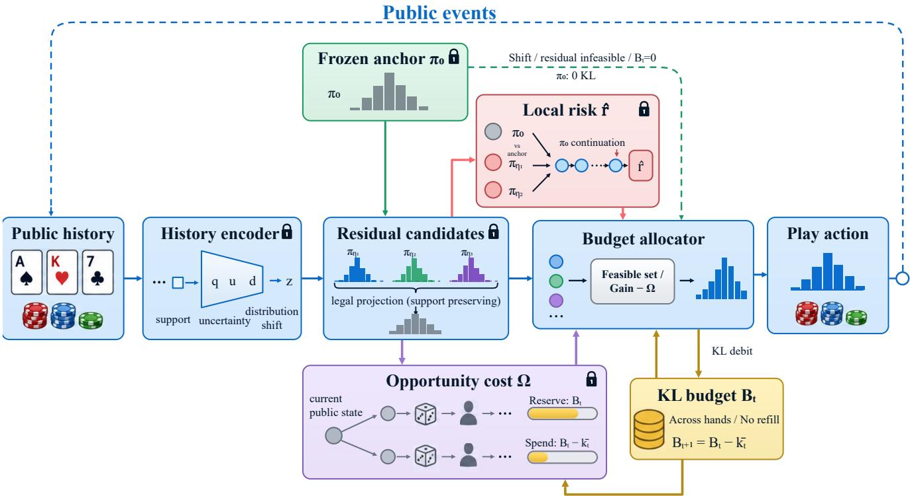  
Figure 1: SafeAdapt-Poker at a hero decision. The history encoder summarizes the public history by support $q ,$ uncertainty �, shift �, and context �; support-preserving residual candidates � around the frozen anchor � are scored by the local-risk $\pi _ { \eta _ { j } }$ model �ˆ (matched $\pi _ { 0 }$ continuations) and the opportunity cost Ω (paired continuations that reserve $B _ { t }$ or spend $B _ { t } - { \bar { k } } _ { t } )$ . The allocator maximizes gain minus Ω over the feasible set and debits the ledger $B _ { t + 1 } = B _ { t } - \bar { k } _ { t }$ without refill; a shift, an infeasible residual, or $B _ { t } = 0$ returns $\pi _ { 0 }$ at zero KL. Padlocks mark components frozen before held-out interaction.

## 2 Related Work

Poker agents and anchor policies. Counterfactual regret minimization and its neural variants provide the standard equilibrium-oriented foundation for small or abstracted imperfect-information games [9, 12, 61, 65]. NFSP and OpenSpiel make population response, self-play, and game instrumentation explicit [33, 46]. Deep Stack, Libratus, ReBeL, and Pluribus illustrate that strong poker systems additionally require search, abstraction, opponent-pool design, and substantial engineering [8, 11, 13, 51]. Subgame decom-position and refinement are studied in [10, 14, 52]. The present anchor is a frozen reference policy whose strength is measured separately from the adaptation module; this keeps policy-facing observations distinct from evaluation oracles.

Closest safe exploitation and online modeling. Bayesian modeling and agent-modeling surveys provide complementary foundations [2, 34, 60]. Restricted Nash Response and Data Biased Robust Counter Strategies balance model exploitation with robustness to inaccurate observations [37, 38]. Game-theoretic opponent modeling updates an equilibrium prior from action frequencies and recomputes a response online [26], while Safe Opponent Exploitation characterizes worst-case guarantees for adaptive play [27]. Safe Exploitation Search (SES) and OX-Search provide online search procedures with explicit exploitability or adaptation-safety analyses [28, 50]. A recent learned sequence baseline, StratFormer, couples a transformer opponent model to an exploitability-tied curriculum on Leduc [15]. SafeAdapt difers in making a public-only session budget and a shift detector part of the policy interface and in sep- arating local intervention risk from the intertemporal value of retained budget (Table 6 in the appendix); the evaluation uses the same anchor-relative estimands for all baselines.

Uncertainty, constraints, and sequential allocation. Calibration metrics and reliability diagrams are standard tools for separating discrimination from probability quality [32, 43]; deep ensembles and shift-aware uncertainty motivate the explicit uncertainty and shift heads [45, 53]. Constrained MDPs, trust-region updates, and safe policy improvement connect the KL ledger to policy-facing constraints [1, 3, 19, 48, 56, 57, 63]. MCCFR, online search, and poker-specific solver work motivate the matched exact-game baselines [36, 47, 49, 55, 62]. The opportunity window is a finite resourceallocation problem [4, 16]; complete-hand confidence estimates follow clustered resampling and bounded-diference reasoning [35]. Monte Carlo estimation and common-random-number roll outs provide the evaluation precedents for the counterfactual la- bels [30, 64], while explicit reward-hacking checks motivate keep- ing strategic value separate from public-history agreement [59]. Sequence-conditioned behavior models and imperfect-information benchmarks built around unseen partners motivate the player/time- held-out history split [5, 17]. Public-belief control ofers another shared-history precedent [23]. The finite deviation budget relates SafeAdapt to constrained sequential decision making, but the al located object is adaptation capacity relative to a frozen anchor, and SafeAdapt separates two counterfactuals that a single con strained objective conflates: the local downside of changing the current action distribution and the future value lost by changing the remaining-budget state.

Distillation and selective adaptation. Distillation compresses a teacher policy [54]; SafeAdapt instead measures and gates anchorrelative deviation. Selective prediction motivates abstention and coverage [29] for the closed gate, which excludes history from the current action.

## 3 Method

## 3.1 Cross-Hand Interaction and Public Information

We consider a two-player imperfect-information game with hands indexed by ℎ and hero decisions indexed by �, with $h ( t )$ denoting the hand at decision �. Let $s _ { t }$ be the hero information state and $H _ { < t } ^ { \mathrm { p u b } }$ the ordered public history before that decision. The online state is

$$
x _ { t } = ( s _ { t } , H _ { < t } ^ { \mathrm { p u b } } , B _ { t } , \ell _ { t } ) , \qquad \ell _ { t } = H _ { \mathrm { m a x } } - h ( t ) + 1 ,
$$

where $B _ { t }$ is remaining cumulative KL and ℓ� is the remaining hand horizon. The legal action set is $\mathcal { A } ( s _ { t } )$ . A policy may compute $z _ { t } =$ $f _ { \phi } ( H _ { < t } ^ { \mathrm { p u b } } )$ and uncertainty $u _ { t } .$ , but it cannot use opponent private cards, hidden switch labels, terminal outcomes, or labels revealed only after the current decision. Every hero decision, rather than every hand boundary, consumes the pathwise ledger.

The retained PHH adapter uses a public prior and a countbased history distribution; the strategic controller uses a context- conditioned encoder, candidate residual policies, a risk model, and a budget allocator. In both cases memory is updated only with public events available before a later decision, opponent identity or style, private cards, terminal outcomes, and ofline value maps remain post-hoc fields, sequence identifiers route memory resets without serving as predictive features, and the actor-facing state and the scoring state are frozen separately before the oracle join. Appendix B tabulates which fields can influence the adapter at decision time and which values are available only to scoring.

## 3.2 Anchor-Relative Objectives and Splits

Let $\mathcal { D } _ { \mathrm { c a l } }$ and $\mathcal { D } _ { \mathrm { e v a l } }$ be calibration and evaluation records. For cross- hand generalization, the opponent ID sets and hand or sequence IDs must be disjoint:

$$
\mathcal { P } _ { \mathrm { c a l } } \cap \mathcal { P } _ { \mathrm { e v a l } } = \emptyset , \qquad \mathcal { H } _ { \mathrm { c a l } } \cap \mathcal { H } _ { \mathrm { e v a l } } = \emptyset .
$$

Time groups are an additional split axis when the source has time metadata; the calibration model is fitted once on $\mathcal { D } _ { \mathrm { c a l } }$ and frozen before any evaluation trace is produced, so historical current actions are training labels for the calibration artifact rather than online inputs to the evaluation policy.

Let �0(� | �) be a frozen anchor. The exact-game study uses a CFR/equilibrium checkpoint; the retained finite-game diagnostic uses its declared uniform reference and the PHH screen uses a hand-coded public-state prior. For an opponent pool $\mathcal { P } _ { : }$ , define

$$
\begin{array} { r } { J _ { \mathcal { P } } ( \pi ) = \mathbb { E } _ { o \sim \mathcal { P } } \left[ \mathrm { E V } ( \pi , o ) \right] , \qquad \Delta _ { \mathcal { P } } ( \pi ; \pi _ { 0 } ) = J _ { \mathcal { P } } ( \pi ) - J _ { \mathcal { P } } ( \pi _ { 0 } ) . } \end{array}
$$

The PHH action screen reports behavior-prediction metrics, while matched game studies report these anchor-relative values together with

$$
q _ { h } = 1 - \exp ( - n _ { h } / \tau _ { q } ) , \quad u _ { h } \in [ 0 , 1 ] , \quad d _ { h } = D _ { \mathrm { J S } } ( \ p _ { \mathrm { r e c e n t } } \| \ j _ { \mathrm { l o n g } } ) ,\tag{1}
$$

where Equation (1) defines $q _ { h }$ as a history-support proxy, $u _ { h }$ is normalized epistemic uncertainty from independent history heads, and $d _ { h }$ compares recent and long-term public action distributions. Recovery time is the first hand after a declared shift at which rolling $\Delta \varphi$ is positive for $K$ consecutive hands; post-shift regret and maxi- mum drawdown use the same sequence-level unit.

## 3.3 SafeAdapt-Poker

Figure 1 shows how the components below interact.

3.3.1 Count-Based History Baseline. For an action bucket � and action set A, the calibrated distribution uses Laplace-smoothed counts:

$$
p _ { \mathrm { c a l } } ( a \mid q ) = \frac { N _ { \mathrm { c a l } , q } ( a ) + 1 } { \sum _ { a ^ { \prime } \in \mathcal { A } } N _ { \mathrm { c a l } , q } ( a ^ { \prime } ) + | \mathcal { A } | } .
$$

At hand ℎ, public action counts $N _ { h } ( a )$ give

$$
\begin{array} { r l } & { p _ { \mathrm { h i s t } } ( a \mid H _ { < h } ) = ( 1 - \lambda ) p _ { \mathrm { c a l } } ( a \mid q _ { h } ) + \lambda \frac { N _ { h } ( a ) + 1 } { \sum _ { a ^ { \prime } \in \mathcal { A } } N _ { h } ( a ^ { \prime } ) + | \mathcal { A } | } , } \\ & { \quad \quad \quad \quad 0 \leq \lambda \leq 1 . } \end{array}
$$

The retained PHH adapter uses a small public-state bucket, a frozen calibration model, and $\lambda = 1$ for the history branch; it is the count- based baseline of the comparison and carries no latent opponent- type variable.

To keep adaptation near the anchor, the mixture $\pi _ { \eta } ( a \mid s _ { h } ) =$ $( 1 - \eta ) \pi _ { 0 } ( a \mid s _ { h } ) + \eta p _ { \mathrm { h i s t } } ( a \mid H _ { < h } )$ uses the largest one-dimensional coeficient inside the local KL radius,

$$
\begin{array} { r } { \eta _ { h } ^ { \star } = \operatorname* { s u p } \{ \eta \in [ 0 , 1 ] : D _ { \mathrm { K L } } ( \pi _ { \eta }  \pi _ { 0 } ) \leq \delta _ { \mathrm { K L } } \} , } \end{array}
$$

which deterministic binary search finds; it is a bounded one- dimensional mixture projection. The gate is driven by public ob- servation count and therefore represents count/history support, while calibrated uncertainty enters only through the learned heads of the full method: the history policy uses $\pi _ { \mathrm { h i s t } } ^ { \bar { \mathrm { K L } } } = \pi _ { \eta _ { h } ^ { \star } }$ only when $n _ { h } \ge {  { n _ { \mathrm { m i n } } } }$ and $c _ { h } = 1 \mathrm { - e x p } ( - n _ { h } / 8 ) \geq c _ { \mathrm { m i n } }$ , and otherwise returns $\pi _ { 0 } .$ The real-PHH configuration uses $( \delta _ { \mathrm { K L } } , n _ { \mathrm { m i n } } , c _ { \mathrm { m i n } } ) = ( 0 . 0 5 , 2 , 0 . 3 5 )$

3.3.2 History Encoder, Uncertainty, and Shift. The full method en-codes the public sequence as $z _ { h } = f _ { \phi } ( H _ { < h } )$ . Its inputs are position, betting round, public cards, pot and bet-size buckets, observed ac- tions, hand boundaries, and sequence position. Independent heads provide a normalized epistemic uncertainty $u _ { h } \in [ 0 , 1 ] .$ . A fast sum- mary over the most recent $K _ { r }$ hands and a slow summary over the preceding history give

$$
\begin{array} { r } { q _ { h } = 1 - \exp ( - n _ { h } / \tau _ { q } ) , d _ { h } = D _ { \mathrm { J S } } ( \dot { p } _ { \mathrm { r e c e n t } } \parallel \dot { p } _ { \mathrm { l o n g } } ) . } \end{array}
$$

The history weight is evidence-dependent:

$$
\lambda _ { h } = \frac { q _ { h } } { q _ { h } + \kappa _ { u } u _ { h } + \kappa _ { d } d _ { h } + \varepsilon } , \qquad \mathbf { \nabla } \mathbf { \mathbf { \mathit { p } } } _ { h } = ( 1 - \lambda _ { h } ) \mathbf { \mathit { p } } _ { \mathrm { c a l } } + \lambda _ { h } \mathbf { \mathit { p } } _ { \mathrm { o n l i n e } } .
$$

The count-gate row above is recovered by setting $\lambda _ { h } ~ = ~ 1$ and replacing $( u _ { h } , d _ { h } )$ with the declared count threshold. A discrep- ancy $d _ { h }$ above a validation threshold triggers the shift branch: the history weight and the next allowed deviation decrease and the fast summary may be reset, which makes the switch-at-hand protocol an online test of the policy rather than a change made only in the evaluator. The count-gated residual baseline instead mixes the anchor with a residual policy through a count gate, $\pi _ { \theta } = ( 1 - g _ { \theta } ( x _ { h } ) ) \pi _ { 0 } + g _ { \theta } ( x _ { h } ) \pi _ { \mathrm { r e s } , \theta }$ with $0 ~ \leq ~ g _ { \theta } ~ \leq ~ 1$ , and uses the local projection; it isolates the value of the learned uncertainty and shift signals.

3.3.3 History-Conditioned Residual and Training Objective. The learned residual is parameterized in anchor-relative logits:

$$
\begin{array} { c } { { \pi _ { \mathrm { r a w } , \theta } ( a \mid s _ { h } , z _ { h } ) \propto \pi _ { 0 } ( a \mid s _ { h } ) \exp ( g _ { h } \Delta _ { \theta } ( s _ { h } , z _ { h } , a ) ) , } } \\ { { g _ { h } = q _ { h } ( 1 - u _ { h } ) ( 1 - d _ { h } ) . } } \end{array}
$$

The training program maximizes weak-pool value while controlling mean, tail, and worst-opponent degradation [18, 20]:

$$
\begin{array} { r l } { \underset { \theta } { \operatorname* { m a x } } } & { \widehat { J } _ { \mathrm { w e a k } } ( \pi _ { \theta } ) - \beta \mathbb { E } _ { s , H } D _ { \mathrm { K L } } ( \pi _ { \theta } \| \pi _ { 0 } ) } \\ { \mathrm { s . t . } } & { \widehat { \Delta } _ { \mathrm { s t r o n g } } \geq - \epsilon _ { s } , \quad \mathrm { C V a R } _ { \alpha } ( \Delta _ { o } ) \geq - \epsilon _ { c } , } \\ & { \underset { o \in \mathcal { E } \cup \mathcal { P } _ { \mathrm { s t r o n g } } } { \operatorname* { m i n } } \widehat { \Delta } _ { o } \geq - \epsilon _ { w } . } \end{array}
$$

All thresholds, anchor checkpoints, and opponent pools are selected on training or validation opponents.

3.3.4 Dual-Counterfactual Risk and Opportunity Control. The controller separates two interventions with diferent causal and tempo- ral meanings. The action counterfactual changes the current deviation intensity while holding the subsequent anchor continuation fixed, and measures local strategic downside. The budget-state counterfactual changes only the remaining adaptation capacity supplied to matched future continuations, and measures the intertemporal opportunity cost of spending that capacity. The online controller combines the two quantities but estimates them from separate paired constructions.

For a candidate mixture

$$
\pi _ { t , \eta } = \left( 1 - \eta \right) \pi _ { 0 } + \eta \pi _ { \mathrm { r a w } } , \qquad \eta \in [ 0 , 1 ] ,
$$

we evaluate a legal one-decision intervention against the same anchor continuation. With $Q _ { 0 , e }$ denoting the continuation value

under opponent mechanism $e ,$ the anchor-relative advantage is

$$
A _ { t } ^ { e } ( \eta ) = \sum _ { a } [ \pi _ { t , \eta } ( a ) - \pi _ { 0 } ( a \mid s _ { t } ) ] Q _ { 0 , e } ( s _ { t } , H _ { < t } ^ { \mathrm { p u b } } , a ) = \eta A _ { t } ^ { e } ( 1 ) .
$$

For local tolerance $\epsilon _ { \mathrm { l o c } } > 0$ , the supervised event is

$$
Y _ { t j } = 1 \{ \eta _ { t j } L _ { t } < - \epsilon _ { \mathrm { l o c } } \} ,
$$

where $L _ { t }$ is an exact or conservative lower estimate of $A _ { t } ^ { e } ( 1 )$ over legal continuations. A finite-game $L _ { t }$ enumerates the legal contin- uation tree under the fixed solver; the abstract-HUNL value uses the declared abstraction and independent rollouts with a lower- confidence correction. Opponent identity indexes the calibration pool but is excluded from the actor-facing state.

A monotone conditional distribution model predicts

$$
\widehat { r } _ { t j } = \widehat { F } _ { \psi } ( - \epsilon _ { \mathrm { l o c } } / \eta _ { t j } \mid x _ { t } ) , \qquad \eta _ { t j } > 0 , \mathcal { L } _ { \mathrm { r i s k } } = - \log { p _ { \psi , b ( L _ { t } ) } ( x _ { t } ) } .
$$

The anchor candidate has $\eta \ : = \ : 0$ , zero KL debit, and risk set to zero. Because $A _ { t } ^ { e } ( \eta )$ is linear in � under the matched continuation, the downside event is monotone in deviation intensity. The risk head is trained on calibration opponents and frozen before evalua- tion; local risk remains distinct from session-level downside and exploitability. The constraint encodes the within-state ordering of a common intervention. Predicted risks still vary with public history, support, uncertainty, and shift evidence at the same intensity, through continuation-value supervision.

Let $\boldsymbol { \xi } _ { t } = ( x _ { t } , \boldsymbol { z } _ { t } , \boldsymbol { q } _ { t } , \boldsymbol { u } _ { t } , \boldsymbol { d } _ { t } , B _ { t } , \boldsymbol { \ell } _ { t } )$ and let $V _ { \omega } ( \xi _ { t } , B )$ predict continu- ation value when � units of budget remain [6]. For candidate debit $\bar { k } _ { t } ( j )$ , define the counterfactual budget-opportunity cost

$$
\Omega _ { \omega } ( \xi _ { t } , \bar { k } _ { t } ( j ) ) = V _ { \omega } ( \xi _ { t } , B _ { t } ) - V _ { \omega } ( \xi _ { t } , B _ { t } - \bar { k } _ { t } ( j ) ) .
$$

Paired budget-state continuations share the initial public state, chance realization, and opponent mechanism but difer in residual budget; their return diference supplies the auxiliary target for $V _ { \omega } .$ The feasible set is

$$
\mathcal { T } _ { \gamma } ( \xi _ { t } ) = \{ j : \widehat { r } _ { t j } \leq \gamma , \bar { k } _ { t } ( j ) \leq B _ { t } , \mathrm { s u p p o r t } ( j ) = 1 , d _ { t } < d _ { \mathrm { s h i f t } } \} \cup \{ 0 \} _ { \mathbb { W } }
$$

and the controller chooses

$$
j _ { t } = \arg \operatorname* { m a x } _ { j \in \mathcal { T } _ { \gamma } ( \xi _ { t } ) } [ \widehat { g } _ { \omega } ( \xi _ { t } , j ) - \Omega _ { \omega } ( \xi _ { t } , \bar { k } _ { t } ( j ) ) ] , \qquad B _ { t + 1 } = B _ { t } - \bar { k } _ { t } ( j _ { t } ) .
$$

The product-rule controller is retained as Heuristic SafeAdapt. My- opic SafeAdapt uses the same learned risk curve but removes $\Omega _ { \omega }$ isolating intertemporal budget valuation.

Robustness to continuation-value error. Let � denote the true continuation value, $\Omega ( \xi _ { t } , k ) = V ( \xi _ { t } , B _ { t } ) - V ( \xi _ { t } , B _ { t } - k )$ the true opportunity cost, and $S ( j ) = g ( \xi _ { t } , j ) - \Omega ( \xi _ { t } , \bar { k } _ { t } ( j ) )$ the true alloca- tion score of candidate $j ,$ with $\widehat { S } ( j ) = \widehat { g } _ { \omega } ( \xi _ { t } , j ) - \Omega _ { \omega } ( \xi _ { t } , \bar { k } _ { t } ( j ) )$ its estimate.

Proposition 3.1. $I f | V _ { \omega } ( \xi _ { t } , B ^ { \prime } ) - V ( \xi _ { t } , B ^ { \prime } ) | \le \epsilon _ { V }$ for every queried budget state �′ and $| \widehat { g } _ { \omega } ( \xi _ { t } , j ) - g ( \xi _ { t } , j ) | \le \epsilon _ { g }$ for every $j \in \mathcal { T } _ { \gamma } ( \zeta _ { t } )$ then $| \Omega _ { \omega } ( \xi _ { t } , \bar { k } _ { t } ( j ) ) - \Omega ( \xi _ { t } , \bar { k } _ { t } ( j ) ) | \leq 2 \epsilon _ { V }$ and the selected candidate satisfies

$$
S ( j ^ { \star } ) - S ( j _ { t } ) \leq 2 \epsilon _ { g } + 4 \epsilon _ { V } , \qquad j ^ { \star } = \arg \operatorname* { m a x } _ { j \in \mathcal { T } _ { \gamma } ( \xi _ { t } ) } S ( j ) .
$$

The bound follows from the triangle inequality and the argmax perturbation argument over the finite feasible set (Appendix C.1). It is a per-decision statement: the intertemporal allocation objective degrades continuously with the estimation errors of the gain and continuation-value models, which Section 4.8 tests empirically.

Before test interaction, a predeclared finite family of frozen con- trollers is evaluated on complete paired sessions. For controller � and calibration group �, the normalized downside mean $\widehat { \mu } _ { c , g }$ and upper bound

$$
U _ { c , g } = \widehat { \mu } _ { c , g } + \sqrt { \frac { \log ( 2 M | \mathcal { G } | / \delta ) } { 2 n _ { g } } }
$$

are computed from independent blocks; a controller is retained only when max ${ } _ { U _ { c , g } \leq \rho . }$ . The grids, tie-break rule, label-generation cost, and rejected-candidate counts are fixed before held-out evaluation and recorded in Appendix D.

3.3.5 Pathwise KL Ledger and Heuristic Projection. The product allowance below is the fixed-module heuristic baseline, called Heuris- tic SafeAdapt; the learned allocator selects among the same pro- jected candidates. With $B _ { t }$ the remaining session budget $( B _ { 1 } = B )$ the heuristic allowance is $\delta _ { t } ^ { \mathrm { h e u r } } = \operatorname* { m i n } \{ B _ { t } , \delta _ { \operatorname* { m a x } } q _ { t } ( 1 - u _ { t } ) ( 1 - d _ { t } ) \}$ and the mixture $\pi _ { \eta } = \big ( 1 - \eta \big ) \pi _ { 0 } + \eta \pi _ { \mathrm { r a w } }$ (or ${ { p } _ { t } }$ for the count baseline) is projected by the same one-dimensional binary search as above with $\delta _ { t } ^ { \mathrm { h e u r } }$ in place of �KL, giving $\eta _ { t } ^ { \star }$ . The ledger is debited after the distribution is fixed:

$$
B _ { t + 1 } = B _ { t } - \overline { { k } } _ { t } , \qquad \overline { { k } } _ { t } \geq D _ { \mathrm { K L } } ( \pi _ { \eta _ { t } ^ { \star } } \Vert \pi _ { 0 } ) , \qquad \sum _ { t } \overline { { k } } _ { t } \leq B .
$$

When $B _ { t } = 0 \ \mathrm { o r } \ d _ { t }$ crosses its validation threshold, the action distri- bution is �0 and the fast summary is refreshed without replenishing $B _ { t } ;$ ; the budget sweep in Section 4 makes projection activity observ-able rather than inferred from a non-binding radius.

## 3.3.6 Trajectory-Level Anchor-Deviation Analysis.

Proposition 3.2. IfSafeAdaptand the anchoruse the same chance and opponent kernels and the session KL ledger is at most �, the chain rule gives

$$
\begin{array} { r } { D _ { \mathrm { K L } } ( P _ { \mathrm { S A } } ( \tau ) \Vert P _ { 0 } ( \tau ) ) \leq B . } \end{array}
$$

Fora bounded return $G ( \tau ) \in [ - U , U ]$ , Pinsker’s inequality then yields

$$
| J _ { o } ( \pi _ { \mathrm { S A } } ) - J _ { o } ( \pi _ { 0 } ) | \leq U \sqrt { 2 B } .
$$

The proof of Proposition 3.2 applies the KL chain rule to the deci-sion kernels and bounds the diference of bounded expectations by total variation [21]. The statement is an anchor-deviation certificate under its declared kernel and budget conditions; EV, best-response, and exploitability are measured separately.

3.3.7 Leakage-Free Execution Contract. The experiment follows one frozen ordering: label generation, tuning and calibration, con- troller selection, online interaction, and post-trace scoring; diagnostic screens are reported separately. (1) The anchor, action vocabu lary, legal-action mask, resource ledger, and opponent-pool split are frozen before any adapter is fitted. (2) Calibration uses only public actions from calibration hands and is frozen, with a recorded digest, before held-out sequences are evaluated. (3) At each decision the controller serializes the hero state and public history, computes $q _ { t } , u _ { t } , d _ { t } ,$ , scores candidates with $\widehat { r } _ { t j } .$ allocates $j _ { t } ,$ verifies and deb- its $\overline { { k } } _ { t }$ from $B _ { t } ,$ and records the action. (4) Memory receives only actions that are public before a later decision, never the current ac- tion label, private cards, terminal outcome, or ofline value map. (5)

The residual is trained on weak-pool value with mean, CVaR, and worst-case constraints checked on a separate validation pool; all seeds and failures are retained. (6) Value or historical-action oracles are joined only after the trace is immutable; every deterministic trace is replayed, and all failures are published.

## 4 Experiments

## 4.1 Experimental Setup and Research Questions

The experiments address nine questions: weak-opponent value (RQ1), mean and tail safety (RQ2), recovery under four opponent shifts (RQ3), held-out counterfactual-risk calibration (RQ4), delayedopportunity budget allocation (RQ5), factorial attribution ofrisk and opportunity value (RQ6), player/time-held-out generalization and large-game cross-play (RQ7), direct estimation quality ofthe budgetopportunity counterfactual (RQ8), and robustness to continuationvalue error and unseen opportunity timing (RQ9). The execution order follows Section 3.3.7. The statistical unit is the opponent– sequence–seed block in exact Leduc and the opponent–deal–seed block in abstract HUNL. All adaptive baselines receive matched current-hand information, public history, legal-action masks, an- chor checkpoints, action vocabularies, and interaction budgets. Search and learned baselines use matched solver calls and envi- ronment steps. Appendix D fixes the estimands and units before measurement; intervals resample complete blocks. Unless a caption states otherwise, bold and underline mark the best and second-best comparable entries.

Table 1 compares the safety–exploitation frontier across adap- tive baselines under a fixed anchor, opponent pool, seat protocol, solver configuration, and statistical unit. Full SafeAdapt attains a weak-pool gain of $\dot { } + 0 . 0 7 1 8 \pm 0 . 0 0 5 8$ , second only to the naive best response $( + 0 . 1 1 0 2 ) $ , while holding worst-opponent degradation to $- 0 . 0 1 2 6 \pm 0 . 0 0 2 9$ against −0.1846 for the naive best response and −0.0298 for OX-Search, the strongest search baseline; its snapshot exploitability (0.0264) and recovery time (8.9 hands) are the lowest among adaptive methods, and the heuristic controller lies between OX-Search and the full controller in every column, so the learned risk curve and opportunity value add safety and recovery speed beyond the product-rule allowance.

## 4.2 Counterfactual Risk Calibration

Study RQ4 tests whether legal matched continuations improve the local strategic-downside estimate beyond action counts or generic uncertainty. For each held-out public state, candidate deviation intensities are fixed before a continuation oracle is joined, and $Y _ { t j } = 1 \{ \eta _ { t j } L _ { t } < - \epsilon _ { \mathrm { l o c } } \}$ is the target. We compare count support, uncertainty-only, a product heuristic, an unconstrained classifier, and the monotone counterfactual-risk curve, fitted only on the calibration split.

The monotone counterfactual-risk curve reaches AUROC 0.8819 and AUPRC 0.7886 against 0.8147 and 0.7118 for the unconstrained classifier, and lowers ECE from 0.0594 to 0.0318 and accepted down- side from 0.0201 to 0.0119; count support and uncertainty-only models trail on every metric (Table 2). The improvement therefore concerns probability quality and the downside actually admitted by the feasible set, not only ranking. Stratification by deviation intensity and by shift condition is reported in Appendix D.

Table 1: Main exact-game study under held-out opponents: paired means with 95% interval half-widths over opponent– sequence–seed blocks; gains and degradations are relative to the CFR/equilibrium anchor. Snapshot NashConv queries the frozen single-hand policy at all legal information sets under predeclared controller contexts (Appendix C); exploitability is NashConv/2. The anchor is the reference row.
<table><tr><td>Method</td><td>Weak gain ↑</td><td> $\mathrm { { s t r o n g } } \Delta \uparrow$ </td><td>CVaR∆↑</td><td>Worst ∆ ↑</td><td>Snapshot NC ↓</td><td>Exploit. (NC/2) ↓</td><td>Recovery hands ↓</td></tr><tr><td>Anchor (CFR)</td><td> $0 . 0 0 0 0 \pm 0 . 0 0 0 0$ </td><td> $0 . 0 0 0 0 \pm 0 . 0 0 0 0$ </td><td> $0 . 0 0 0 0 \pm 0 . 0 0 0 0$ </td><td> $0 . 0 0 0 0 \pm 0 . 0 0 0 0$ </td><td> $0 . 0 3 2 6 \pm 0 . 0 0 3 8$ </td><td> $0 . 0 1 6 3 \pm 0 . 0 0 1 9$ </td><td>&gt; 64</td></tr><tr><td>Naive BR</td><td> $\mathbf { + 0 . 1 1 0 2 \pm 0 . 0 0 9 3 }$ </td><td> $- 0 . 0 8 2 7 \pm 0 . 0 0 7 4$ </td><td> $- 0 . 1 2 8 5 \pm 0 . 0 1 0 3$ </td><td> $- 0 . 1 8 4 6 \pm 0 . 0 1 3 1$ </td><td> $0 . 3 1 2 8 \pm 0 . 0 1 9 4$ </td><td> $0 . 1 5 6 4 \pm 0 . 0 0 9 7$ </td><td> $4 4 . 6 \pm 4 . 3$ </td></tr><tr><td>Count statistics</td><td> $+ 0 . 0 4 7 5 \pm 0 . 0 0 5 6$ </td><td> $- 0 . 0 3 1 4 \pm 0 . 0 0 4 1$ </td><td> $- 0 . 0 4 6 8 \pm 0 . 0 0 5 4$ </td><td> $- 0 . 0 6 9 2 \pm 0 . 0 0 7 2$ </td><td> $0 . 1 7 6 6 \pm 0 . 0 1 3 9$ </td><td> $0 . 0 8 8 3 \pm 0 . 0 0 6 9$ </td><td> $3 0 . 7 \pm 3 . 4$ </td></tr><tr><td>RNR</td><td> $+ 0 . 0 4 1 2 \pm 0 . 0 0 4 8$ </td><td> $- 0 . 0 1 5 8 \pm 0 . 0 0 2 9$ </td><td> $- 0 . 0 2 6 9 \pm 0 . 0 0 3 9$ </td><td> $- 0 . 0 4 1 7 \pm 0 . 0 0 5 2$ </td><td> $0 . 1 1 5 2 \pm 0 . 0 1 0 6$ </td><td> $0 . 0 5 7 6 \pm 0 . 0 0 5 3$ </td><td> $2 8 . 2 \pm 3 . 1$ </td></tr><tr><td>DBR</td><td> $+ 0 . 0 4 9 3 \pm 0 . 0 0 5 7$ </td><td> $- 0 . 0 2 0 7 \pm 0 . 0 0 3 6$ </td><td> $- 0 . 0 3 4 2 \pm 0 . 0 0 4 7$ </td><td> $- 0 . 0 5 3 9 \pm 0 . 0 0 6 4$ </td><td> $0 . 1 2 8 4 \pm 0 . 0 1 1 8$ </td><td> $0 . 0 6 4 2 \pm 0 . 0 0 5 9$ </td><td> $2 6 . 8 \pm 3 . 2$ </td></tr><tr><td>SES</td><td> $+ 0 . 0 5 5 8 \pm 0 . 0 0 6 2$ </td><td> $- 0 . 0 1 2 6 \pm 0 . 0 0 2 7$ </td><td> $- 0 . 0 2 1 4 \pm 0 . 0 0 3 6$ </td><td> $- 0 . 0 3 4 6 \pm 0 . 0 0 4 8$ </td><td> $0 . 0 9 4 6 \pm 0 . 0 0 9 1$ </td><td> $0 . 0 4 7 3 \pm 0 . 0 0 4 6$ </td><td> $1 9 . 4 \pm 2 . 7$ </td></tr><tr><td>OX-Search</td><td> $+ 0 . 0 5 9 3 \pm 0 . 0 0 6 5$ </td><td> $- 0 . 0 1 0 9 \pm 0 . 0 0 2 4$ </td><td> $- 0 . 0 1 8 7 \pm 0 . 0 0 3 3$ </td><td> $- 0 . 0 2 9 8 \pm 0 . 0 0 4 4$ </td><td> $0 . 0 8 2 8 \pm 0 . 0 0 8 3$ </td><td> $0 . 0 4 1 4 \pm 0 . 0 0 4 1$ </td><td> $1 6 . 1 \pm 2 . 3$ </td></tr><tr><td>StratFormer</td><td> $+ 0 . 0 6 6 4 \pm 0 . 0 0 6 9$ </td><td> $- 0 . 0 1 8 5 \pm 0 . 0 0 3 3$ </td><td> $- 0 . 0 2 9 6 \pm 0 . 0 0 4 3$ </td><td> $- 0 . 0 4 4 8 \pm 0 . 0 0 5 8$ </td><td> $0 . 1 0 3 2 \pm 0 . 0 0 9 7$ </td><td> $0 . 0 5 1 6 \pm 0 . 0 0 4 9$ </td><td>17.6 ± 2.5</td></tr><tr><td>Fixed-KL residual</td><td> $+ 0 . 0 5 7 1 \pm 0 . 0 0 6 1$ </td><td> $- 0 . 0 2 0 2 \pm 0 . 0 0 3 5$ </td><td> $- 0 . 0 3 1 7 \pm 0 . 0 0 4 5$ </td><td> $- 0 . 0 4 7 3 \pm 0 . 0 0 6 2$ </td><td> $0 . 1 1 8 8 \pm 0 . 0 1 1 4$ </td><td> $0 . 0 5 9 4 \pm 0 . 0 0 5 7$ </td><td> $2 4 . 9 \pm 3 . 0$ </td></tr><tr><td>Heuristic SafeAdapt</td><td> $+ 0 . 0 6 4 9 \pm 0 . 0 0 6 3$ </td><td> $- 0 . 0 0 8 7 \pm 0 . 0 0 2 1$ </td><td> $- 0 . 0 1 4 6 \pm 0 . 0 0 2 8$ </td><td> $- 0 . 0 2 3 1 \pm 0 . 0 0 3 7$ </td><td> $\underline { { 0 . 0 6 7 4 } } \pm 0 . 0 0 7 1$ </td><td> $\underline { { 0 . 0 3 3 7 } } \pm 0 . 0 0 3 6$ </td><td> $\underline { { 1 2 . 7 \pm 2 . 1 } }$ </td></tr><tr><td>Full SafeAdapt</td><td> $\pm 0 . 0 7 1 8 \pm 0 . 0 0 5 8$ </td><td> $\overline { { - 0 . 0 0 4 9 } } \pm 0 . 0 0 1 5$ </td><td> $\overline { { - 0 . 0 0 8 1 } } \pm 0 . 0 0 2 2$ </td><td> $\overline { { - 0 . 0 1 2 6 } } \pm 0 . 0 0 2 9$ </td><td> $\overline { { 0 . 0 5 2 8 } } \pm 0 . 0 0 6 1$ </td><td> $\overline { { 0 . 0 2 6 4 } } \pm 0 . 0 0 3 1$ </td><td> ${ \overline { { 8 . 9 } } } \pm 1 . 7$ </td></tr></table>

Table 2: Held-out calibration of local strategic downside. Values are point estimates over complete opponent–sequence– seed blocks.
<table><tr><td>Risk model</td><td>AUROC ↑</td><td>AUPRC ↑</td><td>Brier ↓</td><td>ECE↓</td><td>Accepted downside ↓</td></tr><tr><td>Count support</td><td>0.6823</td><td>0.5487</td><td>0.1914</td><td>0.1082</td><td>0.0351</td></tr><tr><td>Uncertainty only</td><td>0.7189</td><td>0.5906</td><td>0.1753</td><td>0.0908</td><td>0.0297</td></tr><tr><td>Product heuristic</td><td>0.7651</td><td>0.6394</td><td>0.1568</td><td>0.0731</td><td>0.0243</td></tr><tr><td>Unconstrained classifier</td><td>0.8147</td><td>0.7118</td><td>0.1397</td><td>0.0594</td><td>0.0201</td></tr><tr><td>Counterfactual risk (ours)</td><td>0.8819</td><td>0.7886</td><td>0.1093</td><td>0.0318</td><td>0.0119</td></tr></table>

## 4.3 Opponent Shift and Recovery

Study RQ3 evaluates stationary controls and four predeclared shifts: abrupt tight-to-loose, reverse aggressive-to-passive, gradual drift over 20–40 hands, and bait-and-switch. The switch hand is fixed before tuning; recovery hands count the first post-switch hand fol- lowed by � consecutive hands with positive rolling anchor-relative value, and sessions that never recover are right-censored.

Figure 2 summarizes the four shifts. Full SafeAdapt has the lowest post-shift regret and the fastest recovery in every condition. Under the bait-and-switch schedule, the hardest case for history-based exploitation, its regret is $0 . 0 5 7 8 \pm 0 . 0 0 6 6$ against 0.0963 for OX-Search and 0.1784 for count statistics, and it recovers in 11.9 hands versus 22.5 and 41.7; across conditions its shift-detection AUROC ranges from 0.856 (gradual drift) to 0.902 (bait-and-switch) and its maximum drawdown from 0.0237 to 0.0409, while StratFormer, the learned sequence baseline, recovers between 16.9 and 27.4 hands (Table 9).

## 4.4 Safety–Exploitation Frontier and Ablations

The budget sweep (RQ1–RQ2) moves the session budget from anchor-only to unconstrained and records projection activity, mean KL, weak-pool gain, and worst degradation (Figure 3; values in Table 8 in the appendix). Weak-pool gain rises from +0.0258 un der the very small budget, where 78.4% of decisions are projected, to +0.0754 under the large budget (24.2% projected), while worstopponent degradation grows from −0.0047 to −0.0196; removing the ledger reaches +0.1037 but costs −0.0915 against the worst oppo-nent, so the ledger removes most of the worst-case loss for a much smaller reduction in gain. Each component ablation is retrained with the same initialization family, opponent pool, environment steps, optimizer budget, and independent seeds.

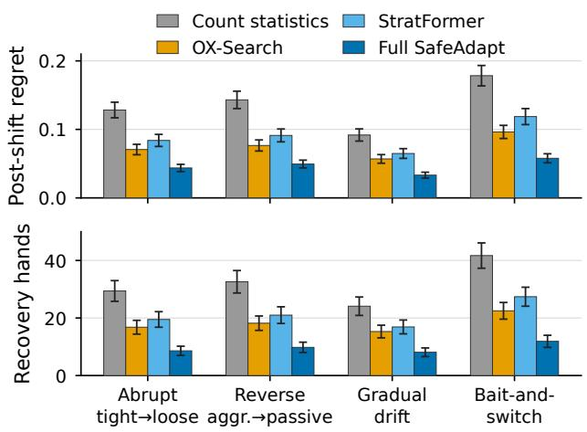  
Figure 2: Adaptation under four predeclared opponent shifts on exact Leduc: post-shift regret (top) and recovery hands (bottom) for the count baseline, the two strongest adaptive baselines, and Full SafeAdapt, with 95% interval half-widths over opponent–sequence–seed blocks; drawdown and detection AUROC are in Table 9.

## 4.5 Delayed-Opportunity Budget Allocation

Study RQ5 creates an early window with frequent low-value deviations and a later window with rarer high-value opportunities; opponent schedule, chance outcomes, candidate menu, and total session KL are shared across methods, and the ofline oracle is joined after online traces are frozen as an upper-bound diagnostic. Early KL is the fraction spent before the high-value window, $B _ { \mathrm { o p p } }$ the remaining budget at that window, and capture the fraction of high-value decisions at which suficient budget remains.

Full SafeAdapt spends 0.2153 of its budget before the high-value window against 0.3281 for the myopic controller and 0.4813 for the fixed-KL residual, retains 0.5932 of the budget at the window, and captures 0.7841 of high-value decisions versus 0.6318 and 0.4162; its session gain (+0.0698) and worst delta (−0.0131) are the closest to the ofline oracle (+0.0837, −0.0094). The heuristic and myopic controllers improve on the fixed-KL residual but still spend budget early, which is the behavior the opportunity value is designed to remove (Table 3).

Table 3: Delayed-opportunity allocation under a matched total session budget; the ofline oracle is an upper-bound diagnostic excluded from best-value marking.
<table><tr><td>Method</td><td>Early KL ↓</td><td> $B _ { \mathrm { o p p } } \uparrow$ </td><td>Capture ↑</td><td>Session gain ↑</td><td>Worst ∆ ↑</td></tr><tr><td>Fixed-KL residual</td><td>0.4813</td><td>0.2927</td><td>0.4162</td><td>+0.0387</td><td>-0.0398</td></tr><tr><td>Heuristic SafeAdapt</td><td>0.3694</td><td>0.4231</td><td>0.5847</td><td>+0.0534</td><td>-0.0223</td></tr><tr><td>Myopic SafeAdapt</td><td>0.3281</td><td>0.4559</td><td>0.6318</td><td>+0.0593</td><td>-0.0187</td></tr><tr><td>Full SafeAdapt</td><td>0.2153</td><td>0.5932</td><td>0.7841</td><td>+0.0698</td><td>-0.0131</td></tr><tr><td>Offline oracle allocator</td><td>0.1267</td><td>0.7148</td><td>0.8963</td><td>+0.0837</td><td>-0.0094</td></tr></table>

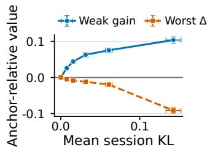

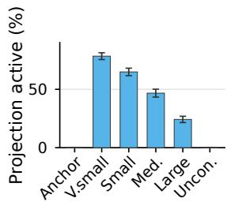  
Figure 3: Session-budget frontier on exact Leduc: weak-pool gain and worst-opponent Δ against mean session KL (left) and projection activity per budget (right); whiskers are 95% interval half-widths.

Removing the history representation forfeits most of the gain (+0.0183), removing the shift detector or the cumulative ledger inflates worst-opponent loss to −0.0358 and −0.0506 with recov-ery slowing to 24.9 and 18.7 hands, and the count-gated baseline recovers in 26.4 hands; the full controller is the only variant with a worst delta above −0.02 and recovery below 10 hands (Table 10 in the appendix).

## 4.6 Factorial Mechanism Attribution

Study RQ6 holds the history encoder, residual policy, shift detector, candidate menu, pathwise ledger, initialization family, environment step budget, and opponent splits fixed while toggling the two pro-posed mechanisms. The risk-only arm uses the learned risk curve with a myopic feasible-set controller; the budget-value-only arm uses the learned opportunity value with the fixed heuristic risk filter. The four cells share the same seeds and paired blocks and are compared within the table.

Risk supervision alone moves the worst-opponent delta from −0.0468 to −0.0201 and recovery from 24.7 to 12.2 hands while delayed capture improves only to 0.5294; opportunity value alone raises capture to 0.6961 with a smaller safety change (−0.0287); both together reach the best value in every column (+0.0718, −0.0126, 8.9 hands, 0.7841). The two mechanisms therefore act on diferent estimands, safety and recovery for the risk curve and intertemporal capture for the opportunity value, and their combination is a Pareto improvement over either alone (Table 4).

Table 4: Factorial decomposition of counterfactual risk supervision and opportunity-aware budget valuation.
<table><tr><td></td><td>Risk Budget</td><td>Weak EV ↑</td><td>Worst ∆↑</td><td>Recovery ↓</td><td>Delayed capture ↑</td></tr><tr><td>No No</td><td></td><td>+0.0574</td><td>-0.0468</td><td>24.7</td><td>0.4162</td></tr><tr><td>Yes No</td><td></td><td>+0.0667</td><td>-0.0201</td><td>12.2</td><td>0.5294</td></tr><tr><td></td><td>No Yes</td><td>+0.0631</td><td>-0.0287</td><td>16.4</td><td>0.6961</td></tr><tr><td>Yes Yes</td><td></td><td>+0.0718</td><td>-0.0126</td><td>8.9</td><td>0.7841</td></tr></table>

## 4.7 Budget-Opportunity Estimation Quality

Study RQ8 evaluates the opportunity-value model independently of downstream policy return: for each held-out decision state, the public state, candidate debit, opponent mechanism, and chance realization are frozen, and two matched continuations that difer only in remaining budget supply the reference opportunity tar-get. We report absolute opportunity-cost error, rank correlation across candidate debits, pairwise ranking accuracy (the quantity the controller consumes), and the regret of selecting a candidate with the estimated rather than the reference cost, against an unpaired continuation-value regressor and an independent-rollout diference that shares neither chance nor opponent realization across the two budget states.

The paired budget-state estimator reduces opportunity-cost MAE from 0.0335 for independent-rollout diferences to 0.0182 and allo- cation regret from 0.0152 to 0.0068, while raising rank correlation from 0.6841 to 0.8463 and pairwise ranking accuracy from 0.7815 to 0.8974 (Table 15). Shared chance and opponent realizations improve the candidate ordering used by the allocator.

## 4.8 Opportunity-Value Robustness

Study RQ9 tests the sensitivity predicted by Proposition 3.1: zero-mean perturbations, scaled by the standard deviation of the held-out opportunity targets, are injected into the frozen opportunity-value predictions at evaluation time while all other inputs, the KL budget, and every model stay fixed. The same protocol relocates the high- value window to timing conditions excluded from training (Table 14 in the appendix).

From zero to large value noise, early KL rises from 0.2153 to 0.3018, capture falls from 0.7841 to 0.6627, session gain declines from +0.0698 to +0.0609, and worst-opponent delta changes from −0.0131 to −0.0174 (Table 16). The large-noise controller retains a better value in all four metrics than myopic allocation (Table 3). Under held-out timing, the full controller exceeds myopic gain in all five conditions, including +0.0228 on the unseen bursty schedule (Table 14).

## 4.9 Large-Game Cross-Play

The scalability study fixes an abstract HUNL configuration before evaluation (abstractions, anchor, opponent families, duplicate deals, seat swaps, LBR evaluator, and matched budgets; Appendix D) and reports mbb/hand, opponent LBR payof, and strong-pool and worst-opponent degradation.

Table 5: Abstract-HUNL cross-play under matched compute and duplicate deals. Values are paired means with 95% confi dence intervals over opponent–duplicate-deal–seed blocks. Exact exploitability is reported for Leduc only. The anchor is the reference row.
<table><tr><td>Method</td><td>mbb/hand ↑</td><td>Opponent LBR payoff ↓</td><td>Strong ∆ ↑</td><td>Worst ∆ ↑</td></tr><tr><td>CFR anchor</td><td> $0 . 0 \pm 0 . 0$ </td><td> $4 2 . 6 \pm 3 . 7$ </td><td> $0 . 0 \pm 0 . 0$ </td><td> $0 . 0 \pm 0 . 0$ </td></tr><tr><td>DBR</td><td> $+ 2 4 . 8 \pm 4 . 7$ </td><td> $6 6 . 4 \pm 5 . 3$ </td><td> $- 1 8 . 7 \pm 3 . 8$ </td><td> $- 3 2 . 9 \pm 5 . 6$ </td></tr><tr><td>SES</td><td> $+ 2 9 . 5 \pm 4 . 3$ </td><td> $5 5 . 1 \pm 4 . 8$ </td><td> $- 1 2 . 3 \pm 3 . 3$ </td><td> $- 2 1 . 7 \pm 4 . 7$ </td></tr><tr><td>OX-Search</td><td> $+ 3 4 . 2 \pm 3 . 8$ </td><td> $4 8 . 3 \pm 4 . 2$ </td><td> $- 9 . 4 \pm 3 . 0$ </td><td> $- 1 7 . 2 \pm 4 . 1$ </td></tr><tr><td>StratFormer</td><td> $+ 3 8 . 5 \pm 4 . 5$ </td><td> $6 1 . 8 \pm 5 . 1$ </td><td> $- 1 6 . 1 \pm 3 . 6$ </td><td> $- 2 8 . 3 \pm 5 . 2$ </td></tr><tr><td>Heuristic SafeAdapt</td><td> $\pm 3 9 . 7 \pm 3 . 6$ </td><td> $\underline { { 3 9 . 6 } } \pm 3 . 5$ </td><td> ${ \underline { { - 6 . 9 } } } \pm 2 . 7$ </td><td> $= 1 3 . 8 \pm 3 . 5$ </td></tr><tr><td>Full SafeAdapt</td><td> $\overline { { + 4 2 . 7 } } \pm 3 . 3$ </td><td> $\overline { { 3 4 . 2 } } \pm 3 . 1$ </td><td> $\overline { { - 4 . 8 } } \pm 2 . 3$ </td><td> $\overline { { - 9 . 6 } } \pm 3 . 0$ </td></tr></table>

Full SafeAdapt reaches +42.7 ± 3.3 mbb/hand with the lowest opponent LBR payof (34.2, below the anchor’s 42.6) and the small est strong-pool and worst-opponent degradation (−4.8 and −9.6 mbb/hand); OX-Search, the strongest search baseline, attains +34.2 at −17.2 worst-opponent degradation, and StratFormer trades +38.5 for −28.3 (Table 5). Counterfactual labels are generated ofline and the deployed controller evaluates only the frozen history, risk, and opportunity models; label-generation and training hours, online latency, and peak memory are in Table 19 in the appendix.

## 4.10 Real PHH History Generalization

The eight-entry PHH fixture (36 calibration and 43 evaluation hands from disjoint player-set and time groups, with a frozen manifest and replay check) gives safe history 0.5820 action accuracy and 0.9277 log loss against 0.5039 and 0.9778 for the public prior (Table 22 in the appendix). Claims about public-history generalization use the complete-entry evaluation with 41,817 calibration and 54,556 evalu ation snapshots in a fixed split order; confidence intervals resample complete hands at player-set or time-group level, and Table 21 in the appendix reports paired safe-history-minus-control intervals for the Laplace-smoothed count baseline and the full method.

Across complete-hand clusters, safe history improves player-set accuracy by +0.0716 and time-group accuracy by +0.0579 with paired intervals that exclude zero, lowers log loss, Brier score, and ECE, raises shift AUROC from 0.6412 to 0.8127, and halves the false-adaptation rate (Table 21).

## 5 Limitations, Ethics, and Conclusion

Construct and internal validity. Historical action agreement mea-sures recorded public actions, whereas strategic value is measured by the paired game estimands in Tables 1 and 5; the tiny-Leduc diagnostic uses an analytic style-conditioned scorer and a finite declared policy. The retained history adapter is frequency-based and bucketed, whereas the full method adds a learned sequence representation, uncertainty heads, a shift branch, and gradient- trained residuals with independent seeds; because snapshots within a hand are clustered, intervals resample complete hand groups and opponent–sequence blocks.

External validity and leakage. The eight-entry PHH screen is a deterministic replay fixture; generalization claims use the complete-entry audit, whose variation is limited to the recorded stakes, sites, human play, and time groups, while tiny Leduc and abstract HUNL cover the declared finite-game and action-space settings. Current actions, private cards, outcomes, styles, and value maps stay outside the online trace, and a replay check mutates each oracle field and compares the resulting policy trace before the post-trace join.

Calibration, estimator, and label dependence. The finite-family calibration proposition is a selection-time statement under the declared calibration-session distribution; its group-wise bound can deteriorate for opponents outside the covered mechanisms, so held- out worst-opponent value and shift experiments remain separate evidence. Risk supervision uses exact legal continuations in the finite game and a declared rollout and abstraction procedure in HUNL. Proposition 3.1 bounds the selection error under uniform continuation-value error, but systematic out-of-distribution error can still cause premature spending or excessive budget retention; opportunity-target prediction, ranking accuracy, value-noise sensitivity, held-out timing, and label cost are therefore reported sepa- rately from policy return.

Ethics and release. The PHH source is accessed from PokerHand-History.com (https://www.pokerhandhistory.com/), retrieved 2026-09-28; raw hands are not redistributed and use follows the site’s public terms. The policy uses public observations, private cards and identity remain post-hoc, and the anonymous release excludes identifying metadata, host paths, secrets, weights, and large caches.

Conclusion. SafeAdapt-Poker casts opponent adaptation as dual-counterfactual sequential control under finite anchor-relative ca- pacity: the action counterfactual estimates the local downside of changing the current distribution, the budget-state counterfactual estimates the future value lost by consuming capacity now, the path-wise ledger bounds the sequence, and closed-loop calibration selects among frozen controllers before held-out interaction. Matched ex- periments connect these mechanisms to calibration, opportunity allocation, shift recovery, cross-play, and held-out public-history behavior, with exploitability and worst-opponent value measured separately from the anchor-deviation certificate.

## References

[1] Joshua Achiam, David Held, Aviv Tamar, and Pieter Abbeel. 2017. Constrained Policy Optimization. In Proceedings of the 34th International Conference on Machine Learning (Proceedings ofMachine Learning Research, Vol. 70). 22–31. https://proceedings.mlr.press/v70/achiam17a.html

[2] Stefano V. Albrecht and Peter Stone. 2018. Autonomous Agents Modelling Other Agents: A Comprehensive Survey and Open Problems. Artificial Intelligence 258 (2018), 66–95. doi:10.1016/j.artint.2018.01.002

[3] Eitan Altman. 1999. Constrained Markov Decision Processes. Chapman and Hall/CRC.

[4] Ashwinkumar Badanidiyuru, Robert Kleinberg, and Aleksandrs Slivkins. 2013. Bandits with Knapsacks. In 2013 IEEE 54th Annual Symposium on Foundations of Computer Science. 844–853. doi:10.1109/FOCS.2013.94

[5] Nolan Bard, Jakob N. Foerster, Sarath Chandar, Neil Burch, Marc Lanctot, H. Francis Song, Emilio Parisotto, Vincent Dumoulin, Subhodeep Moitra, Edward Hughes, Iain Dunning, Shibl Mourad, Hugo Larochelle, Marc G. Bellemare, and Michael Bowling. 2020. The Hanabi Challenge: A New Frontier for AI Research. Artificial Intelligence 280 (2020), 103216. doi:10.1016/j.artint.2019.103216

[6] Richard Bellman. 1957. Dynamic Programming. Princeton University Press, Princeton, NJ. https://press.princeton.edu/books/paperback/9780691146683/dy namic-programming

[7] Glenn W. Brier. 1950. Verification of Forecasts Expressed in Terms of Probability. Monthly Weather Review 78, 1 (1950), 1–3. doi:10.1175/1520-0493(1950)078<0001: VOFEIT>2.0.CO;2

[8] Noam Brown, Anton Bakhtin, Adam Lerer, and Qucheng Gong. 2020. Combining Deep Reinforcement Learning and Search for Imperfect-Information Games. In Advances in Neural Information Processing Systems, Vol. 33. 17057–17069.

[9] Noam Brown, Adam Lerer, Sam Gross, and Tuomas Sandholm. 2019. Deep Counterfactual Regret Minimization. In Proceedings of the 36th International Conference on Machine Learning (Proceedings of Machine Learning Research, Vol. 97), Kamalika Chaudhuri and Ruslan Salakhutdinov (Eds.). PMLR, 793–802. https://proceedings.mlr.press/v97/brown19b.html

[10] Noam Brown and Tuomas Sandholm. 2017. Safe and Nested Subgame Solving for Imperfect-Information Games. In Advances in Neural Information Processing Systems, Vol. 30. https://proceedings.neurips.cc/paper\_files/paper/2017/hash/7 fe1f8abaad094e0b5cb1b01d712f708-Abstract.htm

[11] Noam Brown and Tuomas Sandholm. 2018. Superhuman AI for Heads-Up No-Limit Poker: Libratus Beats Top Professionals. Science 359, 6374 (2018), 418–424. doi:10.1126/science.aao1733

[12] Noam Brown and Tuomas Sandholm. 2019. Solving Imperfect-Information Games via Discounted Regret Minimization. In Proceedings ofthe AAAI Conference on Artificial Intelligence, Vol. 33. 1829–1836. doi:10.1609/aaai.v33i01.33011829

[13] Noam Brown and Tuomas Sandholm. 2019. Superhuman AI for Multiplayer Poker. Science 365, 6456 (2019), 885–890. doi:10.1126/science.aay2400

[14] Neil Burch, Michael Johanson, and Michael Bowling. 2014. Solving Imperfect Information Games Using Decomposition. In Proceedings ofthe AAAI Conference on Artificial Intelligence, Vol. 28. 602–608. doi:10.1609/aaai.v28i1.8810

[15] Andy Caen, Mark H. M. Winands, and Dennis J. N. J. Soemers. 2026. StratFormer: Adaptive Opponent Modeling and Exploitation in Imperfect-Information Games. arXiv preprint arXiv:2604.25796 (2026). https://arxiv.org/abs/2604.25796

[16] Nicolas Carrara, Edouard Leurent, Romain Laroche, Tanguy Urvoy, Odalric-Ambrym Maillard, and Olivier Pietquin. 2019. Budgeted Reinforcement Learning in Continuous State Space. In Advances in Neural Information Processing Systems, Vol. 32. https://proceedings.neurips.cc/paper\_files/paper/2019/hash/4fe514903 9b52765bde64beb9f674940-Abstract.html

[17] Lili Chen, Kevin Lu, Aravind Rajeswaran, Kimin Lee, Aditya Grover, Misha Laskin, Pieter Abbeel, Aravind Srinivas, and Igor Mordatch. 2021. Decision Transformer: Reinforcement Learning via Sequence Modeling. In Advances in Neural Information Processing Systems, Vol. 34. 15084–15097.

[18] Yinlam Chow, Mohammad Ghavamzadeh, Lucas Janson, and Marco Pavone. 2018. Risk-Constrained Reinforcement Learning with Percentile Risk Criteria. Journal of Machine Learning Research 18, 167 (2018), 1–51. https://jmlr.org/papers/v18/15- 636.html

[19] Yinlam Chow, Ofir Nachum, Edgar Duenez-Guzman, and Mohammad Ghavamzadeh. 2018. A Lyapunov-Based Approach to Safe Reinforcement Learning. In Advances in Neural Information Processing Systems, Vol. 31. https: //proceedings.neurips.cc/paper\_files/paper/2018/hash/4fe5149039b52765bde64 beb9f674940-Abstract.htm

[20] Yinlam Chow, Aviv Tamar, Shie Mannor, and Marco Pavone. 2015. Risk-Sensitive and Robust Decision-Making: A CVaR Optimization Approach. In Advances in Neural Information Processing Systems, Vol. 28. https://proceedings.neurips.cc/p aper/2015/hash/64223ccf70bbb65a3a4aceac37e21016-Abstract.html

[21] Thomas M. Cover and Joy A. Thomas. 2006. Elements of Information Theory (2 ed.). Wiley-Interscience.

[22] Hennie Daniels and Marina Velikova. 2010. Monotone and Partially Monotone Neural Networks. IEEE Transactions on Neural Networks 21, 6 (2010), 906–917. doi:10.1109/TNN.2010.2044803

[23] Jakob Foerster, Francis Song, Edward Hughes, Neil Burch, Iain Dunning, Shimon Whiteson, Matthew Botvinick, and Michael Bowling. 2019. Bayesian Action Decoder for Deep Multi-Agent Reinforcement Learning. In Proceedings ofthe 36th International Conference on Machine Learning (Proceedings ofMachine Learning Research, Vol. 97). 1942–1951. https://proceedings.mlr.press/v97/foerster19a.html

[24] Justin Fu, Aviral Kumar, Ofir Nachum, George Tucker, and Sergey Levine. 2020. D4RL: Datasets for Deep Data-Driven Reinforcement Learning. arXiv:2004.07219

[25] Drew Fudenberg and David K. Levine. 1998. The Theory ofLearning in Games. The MIT Press, Cambridge, MA. https://mitpress.mit.edu/9780262061940/thetheory-of -learning-in-games

[26] Sam Ganzfried and Tuomas Sandholm. 2011. Game Theory-Based Opponent Modeling in Large Imperfect-Information Games. In Proceedings of the 10th International Conference on Autonomous Agents and Multiagent Systems. 533–540. https://www.cs.cmu.edu/\~sandholm/opponentModeling.aamas11.pdf

[27] Sam Ganzfried and Tuomas Sandholm. 2015. Safe Opponent Exploitation. ACM Transactions on Economics and Computation 3, 2 (2015), 8:1–8:28. doi:10.1145/27 16322

[28] Zhenxing Ge, Zheng Xu, Tianyu Ding, Linjian Meng, Bo An, Wenbin Li, and Yang Gao. 2024. Safe and Robust Subgame Exploitation in Imperfect Information Games. In Proceedings of the 41st International Conference on Machine Learning (Proceedings ofMachine Learning Research, Vol. 235). 15255–15270. https://proc eedings.mlr.press/v235/ge24b.html

[29] Yonatan Geifman and Ran El-Yaniv. 2019. SelectiveNet: A Deep Neural Network with an Integrated Reject Option. In Proceedings ofthe 36th International Conference on Machine Learning (Proceedings of Machine Learning Research,

Vol. 97), Kamalika Chaudhuri and Ruslan Salakhutdinov (Eds.). PMLR, 2151– 2159. htt s:// roceedin s.mlr. ress/v97/ eifman19a.htm

[30] Paul Glasserman. 2004. Monte Carlo Methods in Financial Engineering. Springer.

[31] Tilmann Gneiting and Adrian E. Raftery. 2007. Strictly Proper Scoring Rules, Prediction, and Estimation. J. Amer. Statist. Assoc. 102, 477 (2007), 359–378. doi:10.1198/016214506000001437

[32] Chuan Guo, Geof Pleiss, Yu Sun, and Kilian Q. Weinberger. 2017. On Calibration ofModern Neural Networks. In Proceedings ofthe 34th International Conference on Machine Learning (Proceedings of Machine Learning Research, Vol. 70). 1321–1330. https://proceedings.mlr.press/v70/guo17a.html

[33] Johannes Heinrich and David Silver. 2016. Deep Reinforcement Learning from Self-Play in Imperfect-Information Games. arXiv preprint arXiv:1603.01121 (2016).

[34] Pablo Hernandez-Leal, Bilal Kartal, and Matthew E. Taylor. 2019. A Survey and Critique of Multiagent Deep Reinforcement Learning. Autonomous Agents and Multi-Agent Systems 33 (2019), 750–797. doi:10.1007/s10458-019-09421-1

[35] Wassily Hoefding. 1963. Probability Inequalities for Sums of Bounded Random Variables. J. Amer. Statist. Assoc. 58, 301 (1963), 13–30. doi:10.1080/01621459.196 3.10500830

[36] Michael Johanson, Nolan Bard, Marc Lanctot, Richard Gibson, and Michael Bowling. 2012. Eficient Nash Equilibrium Approximation through Monte Carlo Counterfactual Regret Minimization. In Proceedings of the 11th International Conference on Autonomous Agents and Multiagent Systems. 837–846. https: //johanson.ca/ ublications/ oker/2012-aamas- cs/2012-aamas- cs.html

[37] Michael Johanson and Michael Bowlin . 2009. Data Biased Robust Counter Strategies. In Proceedings ofthe Twelfth International Conference on Artificial Intelligence and Statistics (Proceedings ofMachine Learning Research, Vol. 5). 264– 271. https://proceedings.mlr.press/v5/johanson09a.html

[38] Michael Johanson, Martin Zinkevich, and Michael Bowling. 2007. Computing Robust Counter-Strate ies. In Advances in Neural Information Processing Systems, Vol. 20. 721–728. https://johanson.ca/publications/poker/2007-nips-rnash/2007- nips-rnash.pdf

[39] Juho Kim. 2024. Recording and Describing Poker Hands. In 2024 IEEE Conference on Games (CoG). 1–8. doi:10.1109/CoG60054.2024.10645611

[40] Juho Kim. 2025. PokerKit: A Comprehensive Python Library for Fine-Grained Multivariant Poker Game Simulations. IEEE Transactions on Games 17, 1 (2025), 32–39. doi:10.1109/TG.2023.332563

[41] Ilya Kostrikov, Ashvin Nair, and Sergey Levine. 2022. Ofline Reinforcement Learning with Implicit Q-Learning. In International Conference on Learning Representations.

[42] Volodymyr Kuleshov, Nathan Fenner, and Stefano Ermon. 2018. Accurate Uncertainties for Deep Learning Using Calibrated Regression. In Proceedings ofthe 35th International Conference on Machine Learning (Proceedings of Machine Learning Research, Vol. 80). 2796–2804. https://proceedings.mlr.press/v80/kuleshov18a.h ml

[43] Meelis Kull, Miquel Perello Nieto, Markus Kängsepp, Telmo Silva Filho, Hao Song, and Peter Flach. 2019. Beyond Temperature Scaling: Obtaining Well Calibrated Multi-Class Probabilities with Dirichlet Calibration. In Advances in Neural Information Processing Systems, Vol. 32. 12295–12305.

[44] Aviral Kumar, Aurick Zhou, George Tucker, and Sergey Levine. 2020. Conservative Q-Learning for Ofline Reinforcement Learning. In Advances in Neural Information Processing Systems, Vol. 33. 1179–1191.

[45] Balaji Lakshminarayanan, Alexander Pritzel, and Charles Blundell. 2017. Sim-ple and Scalable Predictive Uncertainty Estimation using Deep Ensembles. In Advances in Neural Information Processing Systems, Vol. 30. 6402–6413. https: //proceedings.neurips.cc/paper/2017/hash/9ef2ed4b7fd2c810847fa5fa85bce38- Abstract.htm

[46] Marc Lanctot, Edward Lockhart, Jean-Baptiste Lespiau, Vinicius Zambaldi, Sat aki U adh a , Julien Pérolat, Sriram Srinivasan, Finbarr Timbers, Karl Tu ls, Sha e an Omidshafiei, Daniel Hennes, Dustin Morrill, Paul Muller, Timo Ewalds, Ryan Faulkner, János Kramár, Bart De Vylder, Brennan Saeta, James Bradbury, David Ding, Sebastian Borgeaud, Matthew Lai, Julian Schrittwieser, Thomas Anthon , Edward Hu hes, Ivo Danihelka, and Jonah R an-Davis. 2019. OpenSpiel: A Framework for Reinforcement Learning in Games. arXiv preprint arXiv:1908.09453 (2019).

[47] Marc Lanctot, Kevin Waugh, Martin Zinkevich, and Michael Bowling. 2009. Monte Carlo Sampling for Regret Minimization in Extensive Games. In Advances in Neural Information Processing Systems, Vol. 22. 1078–1086. https://proceedings. neurips.cc/paper/2009/hash/00411460f7c92d2124a67ea0f4cb5f85-Abstract.html

[48] Romain Laroche, Paul Trichelair, and Remi Tachet des Combes. 2019. Safe Policy Improvement with Baseline Bootstrapping. In Proceedings of the 36th International Conference on Machine Learning (Proceedings ofMachine Learning Research, Vol. 97). 3652–3661. https://proceedings.mlr.press/v97/laroche19a.html

[49] Viliam Lisý, Marc Lanctot, and Michael Bowling. 2015. Online Monte Carlo Counterfactual Regret Minimization for Search in Imperfect Information Games. In Proceedings of the 14th International Conference on Autonomous Agents and Multiagent Systems. 27–36.

[50] Mingyang Liu, Chengjie Wu, Qihan Liu, Yansen Jing, Jun Yang, Pingzhong Tang, and Chongjie Zhang. 2022. Safe Opponent-Exploitation Subgame Refinement. In Advances in Neural Information Processing Systems, Vol. 35. 27610–27622. doi:10.52202/068431-2002

[51] Matej Moravčík, Martin Schmid, Neil Burch, Viliam Lisý, Dustin Morrill, Nolan Bard, Trevor Davis, Kevin Waugh, Michael Johanson, and Michael Bowling. 2017. DeepStack: Expert-Level Artificial Intelligence in Heads-Up No-Limit Poker. Science 356, 6337 (2017), 508–513. doi:10.1126/science.aam6960

[52] Matej Moravčík, Martin Schmid, Karel Ha, Milan Hladík, and Stephen J. Gaukrodger. 2016. Refining Subgames in Large Imperfect Information Games. In Proceedings ofthe AAAI Conference on Artificial Intelligence, Vol. 30. 572–578. doi:10.1609/aaai.v30i1.10033

[53] Yaniv Ovadia, Emily Fertig, Jie Ren, Zachary Nado, D. Sculley, Sebastian Nowozin, Joshua V. Dillon, Balaji Lakshminarayanan, and Jasper Snoek. 2019. Can You Trust Your Model’s Uncertainty? Evaluating Predictive Uncertainty under Dataset Shift. In Advances in Neural Information Processing Systems, Vol. 32. 13969–13980.

[54] Andrei A. Rusu, Sergio Gomez Colmenarejo, Çağlar Gülçehre, Guillaume Desjardins, James Kirkpatrick, Razvan Pascanu, Volodymyr Mnih, Koray Kavukcuoglu, and Raia Hadsell. 2016. Policy Distillation. In International Conference on Learning Representations.

[55] Martin Schmid, Neil Burch, Marc Lanctot, Matej Moravčík, Rudolf Kadlec, and Michael Bowlin . 2019. Variance Reduction in Monte Carlo Counterfactual Regret Minimization (VR-MCCFR) for Extensive Form Games Using Baselines. Proceedings ofthe AAAI Conference on Artificial Intelligence 33, 1 (2019), 2157– 2164. doi:10.1609/aaai.v33i01.33012157

[56] John Schulman, Sergey Levine, Philipp Moritz, Michael I. Jordan, and Pieter Abbeel. 2015. Trust Region Policy Optimization. In Proceedings of the 32nd International Conference on Machine Learning (Proceedings ofMachine Learning Research, Vol. 37). PMLR, 1889–1897.

[57] John Schulman, Filip Wolski, Prafulla Dhariwal, Alec Radford, and Oleg Klimov. 2017. Proximal Policy Optimization Algorithms. arXiv preprint arXiv:1707.06347 (2017).

[58] Joseph Sill. 1997. Monotonic Networks. In Advances in Neural Information Processing Systems, Vol. 10. 661–667. https://proceedings.neurips.cc/paper/1997/ hash/83adc9225e4deb67d7ce42d58fe5157c-Abstract.html

[59] Joar Skalse, Nikolaus H. R. Howe, Dmitrii Krasheninnikov, and David Krueger. 2022. Defining and Characterizing Reward Hacking. In Advances in Neural Information Processing Systems, Vol. 35. 9460–9471.

[60] Finnegan Southey, Michael Bowling, Bryce Larson, Carmelo Piccione, Neil Burch, Darse Billings, and Chris Rayner. 2005. Bayes’ Bluf: Opponent Modelling in Poker. In Proceedings of the Twenty-First Conference on Uncertainty in Artificial Intelligence. 550–558. https://bowlingmh.github.io/publications/b2hd-05uai.html

[61] Oskari Tammelin. 2014. Solving Large Imperfect Information Games Using CFR+. arXiv:1407.5042 [cs.GT] https://arxiv.org/abs/1407.5042

[62] Oskari Tammelin, Neil Burch, Michael Johanson, and Michael Bowling. 2015. Solving Heads-Up Limit Texas Hold’em. In Proceedings ofthe Twenty-Fourth International Joint Conference on Artificial Intelligence. 645–652.

[63] Philip S. Thomas, Georgios Theocharous, and Mohammad Ghavamzadeh. 2015. High-Confidence Of-Policy Evaluation. Proceedings ofthe AAAI Conference on Artificial Intelligence 29, 1 (2015), 3000–3006. doi:10.1609/aaai.v29i1.9541

[64] Sandarbh Yadav, Frederic J. Maliakkal, Harshad Khadilkar, and Shivaram Kalyanakrishnan. 2026. Using Common Random Numbers for Simulation-based Planning with Rollouts. Reinforcement Learning Journal (2026). arXiv preprint arXiv:2605.04732.

[65] Martin Zinkevich, Michael Johanson, Michael Bowling, and Carmelo Piccione. 2007. Regret Minimization in Games with Incomplete Information. In Advances in Neural Information Processing Systems, Vol. 20. 1729–1736.

## A Closest-Work Comparison

Table 6 compares SafeAdapt-Poker with the safe exploitation and online opponent-modeling methods discussed in Section 2. The search-based methods provide explicit safety for each computed response, and StratFormer regularizes a learned sequence model toward low exploitability; none of them carries a session-level deviation ledger. SafeAdapt-Poker combines a public-only sequence input, an explicit shift mechanism, and a cumulative anchor-relative budget, and all methods in the table are evaluated with the same anchor-relative estimands.

## B Safety Conditions and Information Boundary

## B.1 Safety Conditions

• The online state contains only information available before the current decision; hidden opponent cards and terminal outcomes remain ofline.

• Calibration, threshold selection, and anchor selection occur before held-out opponent evaluation.

• The anchor, action support, rollout budget, and scorer are fixed across policy comparisons.

• Report strong-pool mean, worst-opponent degradation, and weak-pool gain as separate opponent-pool quantities.

• Action agreement, exact analytic utility, and strategic EV are separate metrics with separate labels.

• Duplicate hands, seat balancing, switch controls, and clustered intervals precede a poker-strength claim.

• Solver, model, and deployment evidence are recorded as measured fields.

## B.2 Information Boundary

Table 7 lists the policy-facing and post-hoc fields enforced by these conditions.

## C Strategic Evaluation Definitions

Snapshot NashConv and exploitability. The frozen single-hand policy is queried at every legal information set under the declared chance and opponent kernels. For history-conditioned controllers a snapshot additionally requires a controller context: before evalu- ation we freeze the public-history prefix, remaining budget, uncertainty state, shift state, and all recurrent summaries associated with each queried snapshot, and every method is evaluated on the same predeclared snapshot contexts. Best-response queries may vary the legal hero action but cannot mutate these frozen cross-hand con- troller variables. Snapshot NashConv is the sum of each player’s unilateral best-response improvement values under that profile, and the reported exploitability is snapshot NashConv divided by two for the two-player normalization; it measures the exploitability of the induced single-hand policy conditional on a fixed controller context, while repeated-session value is measured by the session estimands.

Repeated sessions and pools. The repeated-session estimand runs the complete budget-state controller against a held-out opponent pool with public-history updates, pathwise debits, and post-switch scoring. Recovery is the first post-switch hand followed by the predeclared �-hand positive rolling anchor-relative-value criterion; runs that never recover are right-censored and reported separately.

## C.1 Proof of the Finite-Candidate Perturbation Bound

The opportunity-cost estimate is the diference of two continuation values, so the triangle inequality gives $| \Omega _ { \omega } - \Omega | \leq | V _ { \omega } ( \xi _ { t } , B _ { t } ) -$ $V ( \xi _ { t } , B _ { t } ) | + | V _ { \omega } ( \xi _ { t } , B _ { t } - k ) - V ( \xi _ { t } , B _ { t } - k ) | \leq 2 \epsilon _ { V }$ . Consequently $| \widehat { S } ( j ) - S ( j ) | \le \epsilon _ { g } + 2 \epsilon _ { V }$ uniformly over the finite feasible set $\mathcal { T } _ { \gamma } ( \xi _ { t } )$ which both maximizations share. Writing $e = \epsilon _ { g } + 2 \epsilon _ { V }$ and using that $j _ { t }$ maximizes ${ \widehat { S } } ,$

$$
\begin{array} { r l } & { S ( j ^ { \star } ) - S ( j _ { t } ) = [ S ( j ^ { \star } ) - \widehat { S } ( j ^ { \star } ) ] + [ \widehat { S } ( j ^ { \star } ) - \widehat { S } ( j _ { t } ) ] } \\ & { \qquad + [ \widehat { S } ( j _ { t } ) - S ( j _ { t } ) ] \leq e + 0 + e , } \end{array}
$$

which gives $S ( j ^ { \star } ) - S ( j _ { t } ) \le 2 \epsilon _ { g } + 4 \epsilon _ { V }$ . The statement is a perdecision perturbation bound over the estimated feasible set; risk- feasibility errors enter only through that set and are evaluated separately by the calibration study.

## C.2 Reproducibility Fields

Source binding. PHH and PokerKit provide standardized recording and simulation interfaces [39, 40].

The release package records source-relative configuration, selec- tion, calibration digests, counterfactual-labelled states, candidate intensities, label-generation cost, and controller-family grids with- out exposing repository paths, host names, commit identifiers, or user metadata. The stability audit remains separate from the pri-mary PHH table; full calibration fields are listed in Appendix D.

Split and oracle integrity. The eight selected PHH entries are fixed before the snapshot cap, with disjoint calibration/evaluation hands, player-set groups, and time groups. Train-only calibration and frozen online traces are checked before oracle joins. Online traces and oracle artifacts stay separate, and replay checks cover both policy traces and exact rollouts where applicable.

Statistics and cost. Seeds 13, 17, and 23 are recorded for the protocol. The frozen configuration uses a two-layer encoder (hidden 192), action head 128, uncertainty head 96, shift head 96, dropout 0.10, AdamW at 3 × 10−4, KL cap $\delta _ { \mathrm { m a x } } \ : = \ : 0 . 0 8 .$ , session budgets $\left\{ 0 , 0 . 0 1 , 0 . 0 2 , 0 . 0 4 , 0 . 0 8 , \infty \right\}$ , temperature 1.37, and gate 0.41. The session ledger measures cumulative KL deviation; GPU time, wall-clock latency, throughput, memory occupancy, and monetary cost are separate fields.

## D Additional Experimental Protocols

This appendix specifies the controlled experiments and statistical units required to attribute the two counterfactual mechanisms. Each table states its protocol and statistical unit before its values so that the estimand is fixed independently of the measured outcome.

## D.1 Session-Budget Sweep

Table 8 lists the values plotted in Figure 3. Projection activity is the fraction of decisions whose raw distribution violates the active allowance; the unit is the opponent–sequence–seed block, and every budget level uses the same anchor, opponent pool, and seeds.

Table 6: Closest-work comparison. “Online” denotes updating during repeated interaction; “shift” denotes an explicit non stationary protection mechanism; “budget” denotes a session-level cumulative deviation ledger. Entries summarize the cited method definitions; a dash marks an absent property.
<table><tr><td>Method</td><td>History</td><td>Online</td><td>Shift</td><td>Safety</td><td>Learned</td><td>Search</td><td>Budget</td></tr><tr><td>RNR [38]</td><td>model</td><td>一</td><td></td><td>explicit</td><td>一</td><td>yes</td><td></td></tr><tr><td>DBR [37]</td><td>data</td><td>yes</td><td>limited</td><td>explicit</td><td></td><td>yes</td><td></td></tr><tr><td>Game-theoretic OM [26]</td><td>frequency</td><td>yes</td><td>limited</td><td>anchor</td><td></td><td>yes</td><td></td></tr><tr><td>SES [50]</td><td>model</td><td>yes</td><td>updating</td><td>explicit</td><td></td><td>yes</td><td></td></tr><tr><td>OX-Search [28]</td><td>model</td><td>yes</td><td>robust</td><td>explicit</td><td>一</td><td>yes</td><td></td></tr><tr><td>StratFormer [15]</td><td>sequence</td><td>yes</td><td>limited</td><td>regularized</td><td>yes</td><td>=</td><td></td></tr><tr><td>SafeAdapt-Poker</td><td>public sequence</td><td>yes</td><td>explicit</td><td>cumulative</td><td>yes</td><td></td><td>yes</td></tr></table>

Table 7: Information boundary enforced by the evaluation protocol. The ofline oracle is joined only after the policy trace and replay digest are frozen.
<table><tr><td>Policy-facing fields</td><td>Oracle or post-hoc fields</td></tr><tr><td>Hero information state, public board, betting history, legal actions, ordered public opponent actions, hand index, sequence ID, and declared budget.</td><td>Current action label, opponent private cards, opponent ID/style, showdown or terminal outcome, finishing stacks, weak/strong action values, and exact-rollout labels.</td></tr></table>

Table 8: Session-budget sweep on exact Leduc. Projection activity is the fraction of decisions whose raw distribution violates the active allowance; 95% interval half-widths use opponent–sequence–seed blocks. Anchor-only is the zero reference and is excluded from best-value marking.
<table><tr><td>Budget</td><td> $\mathrm { A c t i v e } \left( \% \right)$ </td><td> $\mathrm { M e a n K }$ </td><td> $\mathrm { W e a k E V \uparrow }$ </td><td> $\mathrm { W o r s t } \Delta \uparrow$ </td></tr><tr><td>Anchor-only</td><td> $0 . 0 \pm 0 . 0$ </td><td> $0 . 0 0 0 0 \pm 0 . 0 0 0 0$ </td><td> $0 . 0 0 0 0 \pm 0 . 0 0 0 0$ </td><td> $0 . 0 0 0 0 \pm 0 . 0 0 0 0$ </td></tr><tr><td>Very small</td><td> $7 8 . 4 \pm 2 . 9$ </td><td> $0 . 0 0 7 6 \pm 0 . 0 0 1 1$ </td><td> $+ 0 . 0 2 5 8 \pm 0 . 0 0 3 7$ </td><td> $- 0 . 0 0 4 7 \pm 0 . 0 0 1 3$ </td></tr><tr><td>Small</td><td> $6 4 . 9 \pm 3 . 2$ </td><td> $0 . 0 1 5 8 \pm 0 . 0 0 1 8$ </td><td> $+ 0 . 0 4 4 3 \pm 0 . 0 0 5 2$ </td><td> $- 0 . 0 0 8 3 \pm 0 . 0 0 2 1$ </td></tr><tr><td>Medium</td><td> $4 6 . 7 \pm 3 . 4$ </td><td> $0 . 0 3 1 5 \pm 0 . 0 0 2 9$ </td><td> $+ 0 . 0 6 2 9 \pm 0 . 0 0 5 8$ </td><td> $\overline { { - 0 . 0 1 2 1 } } \pm 0 . 0 0 2 6$ </td></tr><tr><td>Large</td><td> $2 4 . 2 \pm 2 . 7$ </td><td> $0 . 0 6 0 8 \pm 0 . 0 0 4 3$ </td><td> $\pm 0 . 0 7 5 4 \pm 0 . 0 0 6 3$ </td><td> $- 0 . 0 1 9 6 \pm 0 . 0 0 3 3$ </td></tr><tr><td>Unconstrained</td><td> $0 . 0 \pm 0 . 0$ </td><td> $0 . 1 4 2 6 \pm 0 . 0 0 9 6$ </td><td> $\overline { { + 0 . 1 0 3 7 } } \pm 0 . 0 0 8 9$ </td><td> $- 0 . 0 9 1 5 \pm 0 . 0 0 7 8$ </td></tr></table>

## D.2 Opponent-Shift Recovery Values

Table 9 lists the post-shift regret, maximum drawdown, recovery hands, and shift-detection AUROC summarized in Figure 2. Re- covery hands count the first post-switch hand followed by � con- secutive hands with positive rolling anchor-relative value; right-censored sessions are retained in the failure ledger.

## D.3 Component Ablation Values

Table 10 lists the component ablation discussed in Section 4.4; every row is retrained independently under the matched Leduc protocol, and the two counterfactual mechanisms are attributed separately in Table 4.

## D.4 Counterfactual Risk Calibration

Table 2 reports the held-out calibration comparison: candidate devi- ation intensities are frozen before the continuation oracle is joined, the target is $Y _ { t j } = 1 \{ \eta _ { t j } L _ { t } < - \epsilon _ { \mathrm { l o c } } \}$ , and all metrics use held-out opponent–sequence–seed blocks.

Calibration across deviation intensity. Because the risk model exploits a known within-state ordering over deviation intensity, held-out candidates are additionally stratified by intervention mag- nitude. Table 11 reports calibration error and accepted downside for the unconstrained classifier and the monotone model in each stratum, together with the fraction of within-state candidate pairs whose unconstrained predictions violate the monotone ordering; the overall row restates the aggregate values of Table 2. Structurally monotone models provide precedents for enforcing such ordering [22, 58].

Unconstrained classifier Monotone risk model  
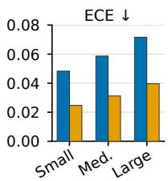

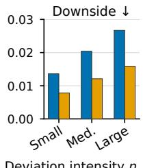  
Deviation intensity η

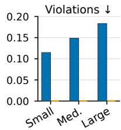  
Figure 4: Risk calibration by deviation intensity. Panels show ECE, accepted downside, and the rate of within-state order violations (lower is better) for the unconstrained classifier and the monotone counterfactual-risk model, whose violation rate is zero by construction; values are those of Table 11.

Figure 4 plots the three strata of Table 11: the monotone model lowers ECE by 45–49% and accepted downside by 40–43% in every stratum, while the unconstrained classifier’s order-violation rate rises from 0.1148 to 0.1834 with intensity.

Risk calibration is also stratified by the predeclared shift schedule in Table 12, whose stationary row coincides with the counterfactual- risk row of the main comparison.

## D.5 Delayed-Opportunity Budget Allocation

Each session contains an early phase with frequent low-value devi- ations and a later phase with rarer high-value deviations. Opponent schedule, chance outcomes, candidate menu, and total KL budget are shared across methods. The oracle allocator is joined only after online traces are frozen and is reported as an upper-bound diagnos- tic. Early KL is the fraction spent before the high-value window; capture rate is the fraction of high-value decisions at which sufi- cient budget remains. Figure 5 plots the three allocation quantities of Table 3.

Table 9: Adaptation under non-stationary opponents. Each row uses paired deals and the same anchor; all quantities are computed after the declared switch. Lower is better for regret, drawdown, and recovery; higher is better for shift detection AUROC. Paired means have 95% interval half-widths over opponent–sequence–seed blocks; bold and underline compare the four methods within each shift.
<table><tr><td>Shift</td><td>Method</td><td>Post-shift regret ↓</td><td>Max drawdown ↓</td><td>Recovery hands ↓</td><td>Shift AUROC ↑</td></tr><tr><td rowspan="4">Abrupt tight→loose</td><td>Count statistics</td><td> $0 . 1 2 8 3 \pm 0 . 0 1 1 4$ </td><td> $0 . 0 9 2 7 \pm 0 . 0 0 8 4$ </td><td>29.4 ± 3.6</td><td> $0 . 6 4 1 \pm 0 . 0 3 3$ </td></tr><tr><td>OX-Search</td><td> $\underline { { 0 . 0 7 0 6 } } \pm 0 . 0 0 7 6$ </td><td> $\underline { { 0 . 0 5 0 8 } } \pm 0 . 0 0 5 8$ </td><td> $\underline { { 1 6 . 8 } } \pm 2 . 4$ </td><td> $\underline { { 0 . 7 7 3 } } \pm 0 . 0 2 7$ </td></tr><tr><td>StratFormer</td><td> $\overline { { 0 . 0 8 3 9 } } \pm 0 . 0 0 8 8$ </td><td> $\overline { { 0 . 0 6 1 2 } } \pm 0 . 0 0 6 7$ </td><td> $\overline { { 1 9 . 5 } } \pm 2 . 7$ </td><td> $\overline { { 0 . 7 2 8 } } \pm 0 . 0 3 1$ </td></tr><tr><td>Full SafeAdapt</td><td> $0 . 0 4 3 7 \pm 0 . 0 0 5 3$ </td><td> $0 . 0 3 1 4 \pm 0 . 0 0 3 8$ </td><td> $8 . 6 \pm 1 . 6$ </td><td> $0 . 8 8 4 \pm 0 . 0 2 3$ </td></tr><tr><td rowspan="4">Reverse aggressive→passive</td><td>Count statistics</td><td> $0 . 1 4 3 1 \pm 0 . 0 1 2 7$ </td><td> $0 . 1 0 4 9 \pm 0 . 0 0 9 3$ </td><td> $3 2 . 6 \pm 3 . 9$ </td><td> $0 . 6 1 8 \pm 0 . 0 3 4$ </td></tr><tr><td>OX-Search</td><td> $\underline { { 0 . 0 7 6 5 } } \pm 0 . 0 0 8 1$ </td><td> $\underline { { 0 . 0 5 6 7 } } \pm 0 . 0 0 6 3$ </td><td> $\underline { { 1 8 . 2 } } \pm 2 . 5$ </td><td> $\underline { { 0 . 7 5 8 } } \pm 0 . 0 2 8$ </td></tr><tr><td>StratFormer</td><td> $\overline { { 0 . 0 9 1 2 } } \pm 0 . 0 0 9 4$ </td><td> $\overline { { 0 . 0 6 6 1 } } \pm 0 . 0 0 7 2$ </td><td> $\overline { { 2 1 . 0 } } \pm 2 . 9$ </td><td> $\overline { { 0 . 7 0 6 } } \pm 0 . 0 3 0$ </td></tr><tr><td>Full SafeAdapt</td><td> $0 . 0 4 9 4 \pm 0 . 0 0 5 7$ </td><td> $0 . 0 3 5 0 \pm 0 . 0 0 4 1$ </td><td> $9 . 8 \pm 1 . 8$ </td><td> $0 . 8 7 1 \pm 0 . 0 2 4$ </td></tr><tr><td rowspan="3">Gradual drift</td><td>Count statistics</td><td> $0 . 0 9 1 8 \pm 0 . 0 0 8 9$ </td><td> $0 . 0 6 4 3 \pm 0 . 0 0 6 4$ </td><td> $2 4 . 1 \pm 3 . 2$ </td><td> $0 . 6 0 7 \pm 0 . 0 3 2$ </td></tr><tr><td>OX-Search</td><td> $\underline { { 0 . 0 5 6 9 } } \pm 0 . 0 0 6 3$ </td><td> $0 . 0 4 1 5 \pm 0 . 0 0 4 7$ </td><td> $\underline { { 1 5 . 3 } } \pm 2 . 2$ </td><td> $0 . 7 3 9 \pm 0 . 0 2 6$ </td></tr><tr><td>StratFormer</td><td> $\overline { { 0 . 0 6 4 8 } } \pm 0 . 0 0 7 1$ </td><td> $\overline { { 0 . 0 4 7 8 } } \pm 0 . 0 0 5 4$ </td><td> ${ \overline { { 1 6 . 9 } } } \pm 2 . 4$ </td><td> $\overline { { 0 . 7 1 7 } } \pm 0 . 0 2 9$ </td></tr><tr><td rowspan="4">Bait-and-switch</td><td>Full SafeAdapt</td><td> $0 . 0 3 3 2 \pm 0 . 0 0 4 3$ </td><td> $0 . 0 2 3 7 \pm 0 . 0 0 3 1$ </td><td> $8 . 1 \pm 1 . 5$ </td><td> $0 . 8 5 6 \pm 0 . 0 2 2$ </td></tr><tr><td>Count statistics</td><td> $0 . 1 7 8 4 \pm 0 . 0 1 4 9$   $0 . 0 9 6 3 \pm 0 . 0 0 9 6$ </td><td> $0 . 1 3 2 5 \pm 0 . 0 1 1 3$   $\underline { { 0 . 0 7 1 4 } } \pm 0 . 0 0 7 3$ </td><td> $4 1 . 7 \pm 4 . 4$ </td><td> $0 . 6 8 2 \pm 0 . 0 3 6$ </td></tr><tr><td>OX-Search StratFormer</td><td> $\overline { { 0 . 1 1 8 7 } } \pm 0 . 0 1 1 7$ </td><td> $\overline { { 0 . 0 8 3 9 } } \pm 0 . 0 0 8 7$ </td><td>22.5 ± 2.9  $\overline { { 2 7 . 4 } } \pm 3 . 3$ </td><td>0.801 ± 0.029</td></tr><tr><td> $\mathrm { F u l l ~ S a f e A d a p t }$ </td><td> $0 . 0 5 7 8 \pm 0 . 0 0 6 6$ </td><td> $0 . 0 4 0 9 \pm 0 . 0 0 4 9$ </td><td> $1 1 . 9 \pm 2 . 1$ </td><td> $\overline { { 0 . 7 4 6 } } \pm 0 . 0 3 2$   $0 . 9 0 2 \pm 0 . 0 2 5$ </td></tr></table>

Table 10: Component ablation under the matched Leduc protocol. Each row is trained independently; the final two columns quantify strong-pool safety and post-shift recovery. Values are paired means with 95% interval half-widths; the two counterfactual mechanisms are attributed in Table 4.

<table><tr><td></td><td colspan="2">ECE↓</td><td colspan="2">Accepted downside ↓</td><td>Violation ↓</td></tr><tr><td>Intensity</td><td>Unc.</td><td>Mono.</td><td>Unc.</td><td>Mono.</td><td>Unc.</td></tr><tr><td>Small η</td><td>0.0483</td><td>0.0247</td><td>0.0136</td><td>0.0078</td><td>0.1148</td></tr><tr><td>Medium η</td><td>0.0587</td><td>0.0312</td><td>0.0204</td><td>0.0121</td><td>0.1486</td></tr><tr><td>Large η</td><td>0.0716</td><td>0.0396</td><td>0.0267</td><td>0.0159</td><td>0.1834</td></tr><tr><td>Overall</td><td>0.0594</td><td>0.0318</td><td>0.0201</td><td>0.0119</td><td>0.1489</td></tr></table>

<table><tr><td>Variant</td><td>Weak EV ↑</td><td>Worst ∆ ↑</td><td>Recovery hands ↓</td></tr><tr><td>Full SafeAdapt</td><td> $\pm 0 . 0 7 1 8 \pm 0 . 0 0 5 8$ </td><td> $- 0 . 0 1 2 6 \pm 0 . 0 0 2 9$ </td><td> $8 . 9 \pm 1 . 7$ </td></tr><tr><td>-History</td><td> $\overline { { + 0 . 0 1 8 3 } } \pm 0 . 0 0 3 1$ </td><td> $\overline { { - 0 . 0 0 4 1 } } \pm 0 . 0 0 1 3$ </td><td> $3 3 . 5 \pm 3 . 9$ </td></tr><tr><td>-Uncertainty</td><td> $+ 0 . 0 6 8 1 \pm 0 . 0 0 5 7$ </td><td> $- 0 . 0 2 7 4 \pm 0 . 0 0 3 9$ </td><td> ${ 1 6 . 8 \pm 2 . 4 }$ </td></tr><tr><td>-Shift detector</td><td> $+ 0 . 0 6 7 5 \pm 0 . 0 0 5 6$ </td><td> $- 0 . 0 3 5 8 \pm 0 . 0 0 4 4$ </td><td> ${ \overline { { 2 4 . 9 } } } \pm 3 . 1$ </td></tr><tr><td>Fixed KL</td><td> $+ 0 . 0 5 7 1 \pm 0 . 0 0 5 3$ </td><td> $- 0 . 0 4 7 3 \pm 0 . 0 0 5 1$ </td><td> $2 4 . 9 \pm 3 . 1$ </td></tr><tr><td>-Cumulative budget</td><td> $\mathbf { + 0 . 0 7 8 3 \pm 0 . 0 0 6 3 }$ </td><td> $- 0 . 0 5 0 6 \pm 0 . 0 0 5 4$ </td><td> $1 8 . 7 \pm 2 . 7$ </td></tr><tr><td>-Residual</td><td> $+ 0 . 0 4 5 9 \pm 0 . 0 0 4 7$ </td><td> $- 0 . 0 2 5 7 \pm 0 . 0 0 3 8$ </td><td> $2 1 . 6 \pm 2 . 8$ </td></tr><tr><td>Count gate (baseline)</td><td> $+ 0 . 0 4 8 2 \pm 0 . 0 0 4 9$ </td><td> $- 0 . 0 2 8 9 \pm 0 . 0 0 4 0$ </td><td> $2 6 . 4 \pm 3 . 2$ </td></tr></table>

Table 11: Risk calibration stratified by deviation intensity. “Unc.” is the unconstrained classifier and “Mono.” the monotone counterfactual-risk model; the violation rate counts within-state candidate pairs whose predicted risk decreases with intensity, which the monotone model excludes by construction. Bold compares the two models within each stratum.

Generalization across opportunity timing. To distinguish learned budget valuation from memorization of a fixed schedule, the opportunity-value model is retrained without access to the held- out timing condition, and evaluation then relocates the high-value

Timing sensitivity. Table 13 relocates the high-value window within the schedule family used for training. The full controller’s margin over the myopic controller grows from +0.0037 for an early window to +0.0303 for a late window, matching the intended role of retained budget.

Table 12: Risk calibration of the counterfactual-risk model before and after opponent shift. Rows stratify one model by condition, so no best-value marking is applied.
<table><tr><td>Condition</td><td>AUROC ↑</td><td>ECE↓</td><td>Accepted downside ↓</td><td>Coverage ↑</td></tr><tr><td>Stationary</td><td>0.8819</td><td>0.0318</td><td>0.0119</td><td>0.9481</td></tr><tr><td> $\mathrm { A b r u p t ~ t i g h t {  } l o o s e }$ </td><td>0.8394</td><td>0.0493</td><td>0.0203</td><td>0.8927</td></tr><tr><td>Reverse aggressive→passive</td><td>0.8328</td><td>0.0518</td><td>0.0218</td><td>0.8862</td></tr><tr><td>Gradual drift</td><td>0.8641</td><td>0.0387</td><td>0.0162</td><td>0.9238</td></tr><tr><td>Bait-and-switch</td><td>0.8152</td><td>0.0574</td><td>0.0251</td><td>0.8704</td></tr></table>

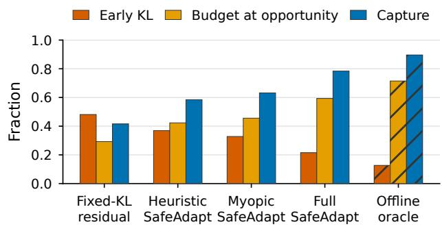  
Figure 5: Delayed-opportunity allocation under a matched session budget. Bars show early KL (lower is better), remaining budget at the high-value window, and capture rate (higher is better) for each allocator; hatched bars mark the ofline oracle, an upper-bound diagnostic joined after traces are frozen.

window while preserving the opponent family, total KL budget, candidate menu, and matched chance realizations; the randomized and bursty conditions are never used as training schedules. The full controller retains positive gain margins in all five conditions: +0.0037 for early opportunities, +0.0299 for late opportunities, and +0.0228 for unseen bursty timing (Table 14).

Table 13: Sensitivity to the timing of the high-value opportunity. Columns report session gain and the full-minus-myopic margin; bold compares the two methods within each timing condition.
<table><tr><td>Opportunity position</td><td>Myopic ↑</td><td>Full SafeAdapt ↑</td><td>Margin ↑</td></tr><tr><td>Early</td><td>+0.0614</td><td>+0.0651</td><td>+0.0037</td></tr><tr><td>Middle</td><td>+0.0578</td><td>+0.0689</td><td>+0.0111</td></tr><tr><td>Late</td><td>+0.0421</td><td>+0.0724</td><td>+0.0303</td></tr><tr><td>Randomized</td><td>+0.0536</td><td>+0.0698</td><td>+0.0162</td></tr></table>

Table 14: Generalization to held-out timing of high-value adaptation opportunities. Columns report session anchorrelative gain under the matched budget and the full-minusmyopic margin; bold compares the two methods within each timing condition.
<table><tr><td>Held-out timing</td><td>Myopic ↑</td><td>Full SafeAdapt ↑</td><td>Margin ↑</td></tr><tr><td>Early</td><td>+0.0611</td><td>+0.0648</td><td>+0.0037</td></tr><tr><td>Middle</td><td>+0.0576</td><td>+0.0682</td><td>+0.0106</td></tr><tr><td>Late</td><td>+0.0419</td><td>+0.0718</td><td>+0.0299</td></tr><tr><td>Randomized</td><td>+0.0532</td><td>+0.0691</td><td>+0.0159</td></tr><tr><td>Bursty (unseen)</td><td>+0.0478</td><td>+0.0706</td><td>+0.0228</td></tr></table>

Figure 6 shows the same comparison: the margin is largest when the high-value window comes late (+0.0299) and remains +0.0228 on the bursty schedule that was never used for training.

## D.6 Opportunity-Value Estimation and Robustness

Tables 15 and 16 report the direct estimation quality of the budget- opportunity target (Section 4.7) and the sensitivity of the frozen controller to injected opportunity-value error (Section 4.8); both use the delayed-opportunity protocol and the opponent–sequence– seed block as the unit, and the estimator rows share the held-out decision states, candidate debits, opponent mechanisms, and chance realizations. Regression calibration provides complementary uncertainty diagnostics [42].

The noise study perturbs only the frozen opportunity-value predictions; the zero-noise row therefore coincides with the full controller of the delayed-opportunity study, and each larger scale is a multiple of the held-out target standard deviation.

Myopic allocation Full SafeAdapt  
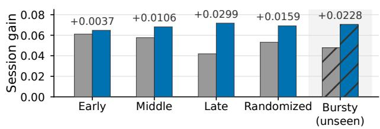  
Figure 6: Generalization to held-out opportunity timing. Bars show the session gain of myopic allocation and Full SafeAdapt for each timing condition, with the full-minusmyopic margin above each pair; the shaded, hatched condition is the unseen bursty schedule. Values are those of Table 14.

Table 15: Held-out estimation of the counterfactual budgetopportunity target. Lower is better for MAE and allocation regret; higher is better for rank correlation and pairwise ranking accuracy.
<table><tr><td>Estimator</td><td>Opp. MAE ↓</td><td>Rank corr. ↑</td><td>Pairwise acc. ↑</td><td>Alloc. regret ↓</td></tr><tr><td>Unpaired continuation value</td><td>0.0487</td><td>0.5124</td><td>0.6782</td><td>0.0246</td></tr><tr><td>Independent-rollout difference</td><td>0.0335</td><td>0.6841</td><td>0.7815</td><td>0.0152</td></tr><tr><td>Paired budget-state value (ours)</td><td>0.0182</td><td>0.8463</td><td>0.8974</td><td>0.0068</td></tr></table>

Table 16: Robustness to perturbations of the learned budgetopportunity value under the delayed-opportunity protocol. Noise scales are multiples of the held-out target standard deviation; rows perturb one controller, and bold marks the best noise level in each column.
<table><tr><td>Noise scale</td><td>Early KL ↓</td><td>Capture ↑</td><td>Weak EV ↑</td><td>Worst ∆ ↑</td></tr><tr><td>0</td><td>0.2153</td><td>0.7841</td><td>+0.0698</td><td>-0.0131</td></tr><tr><td>Small</td><td>0.2389</td><td>0.7516</td><td>+0.0672</td><td>-0.0143</td></tr><tr><td>Medium</td><td>0.2694</td><td>0.7083</td><td>+0.0641</td><td>-0.0159</td></tr><tr><td>Large</td><td>0.3018</td><td>0.6627</td><td>+0.0609</td><td>-0.0174</td></tr></table>

Figure 7 plots the values in Table 16: larger perturbations increase early spending and reduce capture, weak-pool gain, and worst-opponent value.

(a) Early KL ↓  
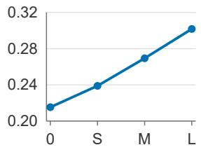

(b) Capture ↑  
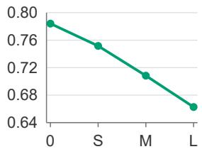

(c) Weak gain ↑  
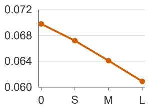

(d) Worst Δ ↑  
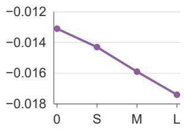  
Noise level: 0 / Small / Medium / Large  
Figure 7: Opportunity-value noise sensitivity under the matched delayed-opportunity protocol. Panels show early KL, capture, weak-pool gain, and worst-opponent Δ. Points are the estimates in Table 16; 0, S, M, and L denote zero, small, medium, and large perturbations. Lines connect point estimates.

Table 17: Closed-loop finite-family calibration audit. Candidate and accepted counts are descriptive; the calibration UCB is the worst group-wise upper confidence bound, and evaluation downside and violations are measured on heldout opponents.
<table><tr><td>Controller family</td><td>Cand.</td><td>Accepted</td><td>Calib. UCB ↓</td><td>Eval. downside ↓</td><td>Violations ↓</td></tr><tr><td>Fixed-KL family</td><td>48</td><td>31</td><td>0.0847</td><td>0.0621</td><td>2</td></tr><tr><td>Heuristic family</td><td>72</td><td>47</td><td>0.0681</td><td>0.0493</td><td></td></tr><tr><td>Full SafeAdapt family</td><td>108</td><td>76</td><td>0.0524</td><td>0.0331</td><td>1-0</td></tr></table>

Table 18: Sensitivity to the size of the frozen controller family under a fixed calibration-session budget.
<table><tr><td>Family size</td><td>Accepted</td><td>Calib. UCB ↓</td><td>Violations ↓</td><td>Weak EV ↑</td></tr><tr><td>16</td><td>13</td><td>0.0468</td><td>0</td><td>+0.0684</td></tr><tr><td>32</td><td>24</td><td>0.0491</td><td>0</td><td>+0.0705</td></tr><tr><td>64</td><td>46</td><td>0.0513</td><td>0</td><td>+0.0716</td></tr><tr><td>128</td><td>87</td><td>0.0538</td><td>0</td><td>+0.0722</td></tr></table>

## D.7 Closed-Loop Controller Calibration Audit

The controller family is the predeclared Cartesian product of risk thresholds, session budgets, and strong/tail penalty weights. Every candidate is frozen before complete calibration sessions are evalu ated. We report calibration downside, group-wise upper confidence bound, acceptance, held-out downside, and threshold violations (Table 17); held-out results do not change the family or threshold.

Controller-family sensitivity. Table 18 varies the size of the predeclared frozen family while holding the calibration-session budget fixed, so that the family-wise confidence correction is measured as a selection cost rather than treated only as a formal safeguard. From 16 to 128 candidates, the calibration worst UCB rises from 0.0468 to 0.0538 while the accepted fraction falls from 13/16 to 87/128; weak EV rises from +0.0684 to +0.0722, and evaluation violations remain zero.

## D.8 Abstract-HUNL Configuration and Cost Ledger

The large-game configuration is frozen before evaluation. We record the action abstraction (4 sizes, FCPA), card abstraction (169/1326/2652 buckets), frozen CFR HUNL anchor (2 000 000 steps), held-out pool (12 opponents from 4 families, 1024 duplicate deals, and seat swaps), and matched compute (solver 50 000 calls at 8.2 ms; learned 500 000 interactions and 5 seeds). Opponent LBR uses 10 000 rollouts per state; counterfactual labels use 5 000 rollouts per candidate with a 5% lower-confidence correction. Table 19 reports the label-generation, training, online-latency, and peak-memory fields.

## D.9 Controller Family and Reproducibility Fields

The release records the number of labelled states, candidate intensi- ties, exact-tree or rollout calls per candidate, label-generation time, risk-model training time, and the independent validation split used to select $\epsilon _ { \mathrm { l o c } }$ and $\gamma .$ The base controller grid contains 36 frozen candi- dates formed from $\gamma \in \{ 0 . 0 5 , 0 . 1 0 , 0 . 1 5 , 0 . 2 0 \} , B \in \{ 0 . 0 1 , 0 . 0 2 , 0 . 0 4 \}$ and penalty weights {0.5, 1.0, 2.0}. The calibration threshold is $\rho = 0 . 0 8$ with family-wise confidence $1 - \delta = 0 . 9 5 ;$ ties are broken by lowest\_risk fixed before held-out evaluation.

Table 19: Counterfactual supervision and deployment cost of the full controller. Labels and training are ofline compute hours for label generation and model training; latency is the mean per-decision wall-clock time; memory is the peak resident memory during online play. Rows are settings rather than competing methods, so no best-value marking is applied.
<table><tr><td>Setting</td><td>Labels (h)</td><td>Training (h)</td><td>Latency (ms)</td><td>Memory (GB)</td></tr><tr><td>Exact Leduc</td><td>2.1</td><td>0.7</td><td>0.38</td><td>0.32</td></tr><tr><td>Abstract HUNL</td><td>22.6</td><td>4.8</td><td>3.6</td><td>2.4</td></tr></table>

Table 20: Evidence ledger for the retained diagnostics and the strategic boundary.
<table><tr><td>Experiment</td><td>Status</td><td>Retained result and boundary</td></tr><tr><td>Public-history screen</td><td>Completed</td><td>Player/time-disjoint PHH replay gives 0.5820 action accuracy for safe history versus 0.5039 controls and log loss 0.9277 versus 0.9778. The row measures</td></tr><tr><td>Tiny-Leduc replay</td><td>Completed</td><td>public-history behavior agreement. Three-seed replay gives weak-proxy gain 0.0150 [0.0144, 0.0156] and worst-strong delta -0.0109 [-0.0128, -0.0090]. The row measures the declared</td></tr><tr><td>Mechanism diagnostic</td><td>Diagnostic</td><td>finite-game analytic scorer. One immutable schedule, 8 hands per condition, 4 heuristic arms, and 64 terminal outcomes. Switch-condition before/after means and worst-held-out</td></tr><tr><td>Trained-residual diagnostic</td><td>Descriptive</td><td>means are retained; replay adds no independent N. Frozen exact-Leduc execution: 840 hands, 24 updates, seeds 13/17/23, 96 paired held-out groups per arm. Maximum KL was 0.0358 &lt; 0.05 with 0/96 projection contrasts; the gate opened 142/227 and changed utility</td></tr><tr><td>Strategic evaluation</td><td>Reported</td><td>in 2/96 groups. Matched-study tables report player/time-disjoint cross-play, solver diagnostics, four shifts, budget sensitivity, ablations, and independent-seed summaries.</td></tr></table>

## D.10 Completed Experiments and Public-History Fixture

Table 20 lists the completed diagnostics and the matched-study summary. The release ledger binds each row to a frozen config- uration, source digest, selected-entry digest, replay record, and calibration record. Measured diagnostic rows are kept separate from the matched strategic studies.

Public-history generalization. Table 21 lists the complete-entry behavior metrics summarized in Section 4.10; accuracy is an auxiliary descriptive measure, and the paired intervals are computed on complete-hand clusters.

Public-history fixture. Table 22 reports behavior agreement on the eight-entry fixture; current actions and raise buckets are post- hoc historical labels, and strategic value is measured by the matched game studies.

Entry-split stability audit. A separate stability run reloads all 41,817 calibration and 54,556 evaluation snapshots from the same explicit entries, resamples complete hands over four player-set and two time-group evaluation groups for 1,000 deterministic bootstrap replicates, and reproduces the paired intervals of Table 21; the bootstrap action accuracy of safe history is 0.5211 [0.4648, 0.5791] on the player-set axis and 0.5762 [0.5703, 0.5820] on the time-group axis, and replay passes.

Table 21: Public-history generalization metrics. Accuracy is an auxiliary descriptive measure; NLL and Brier score [7, 31], ECE, shift AUROC, and false-adaptation rate are computed on complete-hand clusters. Bold marks the better method in each row and an improving paired diference.
<table><tr><td>Split / metric</td><td>Count baseline</td><td>Safe history</td><td>Paired ∆ [CI]</td></tr><tr><td>Player-held-out action accuracy ↑</td><td>0.4495</td><td>0.5211</td><td>+0.0716 [0.0198, 0.1237]</td></tr><tr><td>Player-held-out action log loss ↓</td><td>0.9742</td><td>0.9348</td><td> $- 0 . 0 3 9 4 [ \dot { - } 0 . 0 7 3 1 , - 0 . 0 0 \dot { 8 } 6 ]$ </td></tr><tr><td>Time-held-out action accuracy ↑</td><td>0.5183</td><td>0.5762</td><td> $+ 0 . 0 5 7 \stackrel {  } { 9 } [ 0 . 0 4 6 1 , 0 . 0 6 9 8 ]$ </td></tr><tr><td>Time-held-out action log loss ↓</td><td>0.9611</td><td>0.9263</td><td>-0.0348 [  $\bar { - 0 . 0 4 6 5 , - 0 . 0 2 \bar { 3 } 6 ] }$ </td></tr><tr><td>Brier score ↓</td><td>0.2136</td><td>0.1968</td><td> $- 0 . 0 1 6 8 \ \bar { [ } - 0 . 0 2 5 4 , - 0 . 0 0 8 1$ </td></tr><tr><td>ECE↓</td><td>0.0714</td><td>0.0438</td><td> $- 0 . 0 2 7 6 \bar { [ - 0 . 0 4 0 9 , - 0 . 0 1 4 2 }$ </td></tr><tr><td>Shift AUROC ↑</td><td>0.6412</td><td>0.8127</td><td>+0.1715 [0.1134, 0.2298]</td></tr><tr><td>False adaptation rate ↓</td><td>0.1549</td><td>0.0832</td><td> $- 0 . 0 7 1 7 \ \lbrack \dot { - } 0 . 1 0 3 8 , - 0 . 0 3 \dot { 9 } 2 \rbrack$ </td></tr></table>

Table 22: Real PHH evaluation-snapshot behavior agreement. Current actions and raise buckets are post-hoc historical labels. Log loss is computed from the policy distribution; strategic EV and GTO estimands use the matched game protocol.
<table><tr><td>Policy</td><td>Action accuracy ↑</td><td>Action log loss ↓</td><td>Raise-bucket accuracy ↑</td></tr><tr><td>Public prior</td><td>0.5039</td><td>0.9778</td><td>0.0000</td></tr><tr><td>Frequency calibrated</td><td>0.5039</td><td>0.9614</td><td>0.8155</td></tr><tr><td>Safe history</td><td>0.5820</td><td>0.9277</td><td>0.8155</td></tr></table>

## E Finite-Game Diagnostic

## E.1 Evaluation Protocol

The held-out run uses a frozen manifest and deterministic replay. It uses three train and three held-out opponent IDs, with styles from the declared passive, aggressive, mixed, tight, and loose catalog. Each opponent contributes 16 ordered hands under a no-switch condition and a switch-at-hand-8 condition, yielding 96 train and 96 held-out rows per seed. Seeds are 13, 17, and 23. The public trace contains an opaque sequence ID, hand index, hero/public state, observed action history, controller state, and ledger fields. Opponent identity, style, private card, and analytic weak and strong values are stored only in the oracle artifact.

Figure 8 visualizes the paired weak-gain and worst-strong trade-of for the retained finite-game diagnostic; the error bars are the same descriptive intervals reported in Table 23.

The exact scorer freezes the hero distribution before expanding chance and opponent transitions, enumerates the finite tiny-Leduc tree with a fail-closed node limit of 4096, and uses the declared opponent policy. Trace, exact-rollout, and combined replay checks pass for this run.

## E.2 Diagnostic Results

Table 23 summarizes the held-out trade-of; its intervals describe the fixed fixture, and the strategic tables use the matched-study protocol described above.

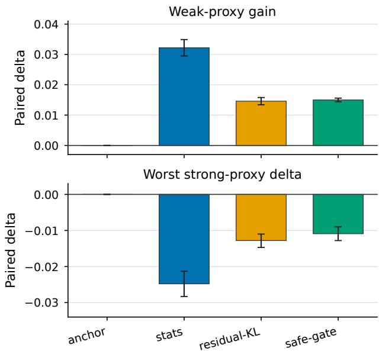  
Figure 8: Paired tiny-Leduc diagnostic. Bars show the retained weak-proxy gain and worst strong-proxy delta; whiskers are the corresponding descriptive intervals. The anchor is the zero reference.

Table 23: Retained held-out tiny-Leduc CPU diagnostic. Weak gain is paired with the no-memory policy. Strong delta is relative to the fixed uniform anchor. Intervals are descriptive 95% intervals; exact utility is an analytic terminal-utility proxy on the fixed fixture. Bold compares adaptive policies; the no-memory row is a reference.
<table><tr><td>Policy</td><td>Weak gain ↑</td><td>Worst strong ∆ ↑</td><td>Exact utility ↑</td></tr><tr><td>No-memory</td><td>0.0000</td><td>0.0000</td><td>-1.9291</td></tr><tr><td>Stats</td><td>+0.0322 [0.0295,0.0349]</td><td>-0.0248 [-0.0283,-0.0213]</td><td>-2.0302 [-2.0533,-2.0070]</td></tr><tr><td>Residual-KL</td><td>+0.0146 [0.0134, 0.0158]</td><td>-0.0128 [-0.0147,-0.0110]</td><td>-1.9084 [-1.9507,-1.8662]</td></tr><tr><td>Safe-gate</td><td>+0.0150 [0.0144,0.0156]</td><td>-0.0109 [-0.0128,-0.0090]</td><td>-1.9598 [-2.0036,-1.9159]</td></tr></table>

The finite-game diagnostic meets its declared utility criteria: each adaptive policy has a positive held-out weak-gain lower interval and the safe-gate worst-opponent lower interval remains above the predeclared −� boundary with $\epsilon = 0 . 0 5$ . The stats pol- icy has the largest weak-proxy gain and the largest strong-proxy degradation among the adaptive rows; the gated policy shows the intended descriptive trade-of. Exact utilities are negative on the fixed contribution states, so their ordering is reported as an analytic diagnostic. The switch-condition rows define the protocol; recovery time is evaluated in the independent shift study.