# Selective Growing Q-Networks (SGQN): An Analysis of Adaptive Action Grids in Decoupled Q-Learning

Parham Nooranbakht

Faculty of Engineering, Department of Computer Science Albert-Ludwigs-Universität Freiburg, Germany

Seyed Mahdi Basiri Azad

Faculty of Engineering, Department of Computer Science Albert-Ludwigs-Universität Freiburg, Germany

Joschka Bödecker

Faculty of Engineering, Department of Computer Science Albert-Ludwigs-Universität Freiburg, Germany

parham.nooranbakht@email.uni-freiburg.de

basiri@cs.uni-freiburg.de

jboedeck@informatik.uni-freiburg.de

## Abstract

One way to tackle reinforcement learning for continuous control is to discretise the action space and apply value-based Q-learning, where the resolution of that discretisation shapes the trade-of between exploration and exploitation. Coarse discretisations facilitate early exploration but limit final precision, while fine discretisations enable precise control but slow convergence. Growing Q-Networks (GQN) address this by growing the resolution uniformly from coarse to fine. We introduce Selective Growing Q-Networks (SGQN), which keeps the decoupled Q-learning framework and replaces uniform growth with an adaptive action grid: bins are added next to bins whose estimated Q-value is high, and bins whose Q-value is low are pruned, with ε-greedy action selection. On eight tasks from the DeepMind Control Suite (DMControl) with 2 to 12 action dimensions, SGQN reaches the highest mean fina return among the compared methods on four of them, is within 1.1% of the best method on three more, and is 3.4% below Bang-Bang MPO on the remaining one (Walker Run), while using on average 7.5 of the 9 available bins per dimension at the end of training. We then test whether the adaptive grid is responsible for these results, and find that it is not. In our runs, growth activates every candidate bin and behaves like uniform growth, and removing pruning changes the return by at most 1.1%. Within SGQN, two other design choices matter instead: starting from a coarse grid, since starting with all 9 bins produces individual seeds that collapse, and ε-greedy selection, since an annealed softmax lowers the return by 23% to 100%. SGQN is insensitive to its growth and pruning hyperparameters. SGQN also difers from the GQN and DecQN baselines in other respects, notably one gradient update per environment step instead of one per eight, and we did not control for these, so we do not attribute its advantage to a single component. We therefore present SGQN as a competitive value-based method and, above all, as an analysis of which ingredients of a growing action grid matter and which do not.

Keywords: reinforcement learning, continuous control, action space discretisation, Q-learning, adaptive resolution, value decomposition

## 1 Introduction

Reinforcement learning for continuous control is commonly approached through actor-critic methods, which directly parameterise a policy over a continuous action space (Lillicrap et al., 2016; Haarnoja et al., 2018; Fujimoto et al., 2018; Schulman et al., 2017). While efective, these methods introduce substantial complexity:

heuristics for training stabilisation, increased compute requirements, and wide hyperparameter search spaces (Seyde et al., 2022). An alternative is action space discretisation, where Q-learning methods, which avoid an explicit policy parameterisation, are equipped with a suitable discretisation of the action space.

Recent work has shown that this is possible. Seyde et al. (2021) showed that Bernoulli (bang-bang) policies are competitive on many locomotion tasks, drawing on Pontryagin’s maximum principle to explain why boundary actions are frequently near-optimal. Building on this, Seyde et al. (2022) demonstrated that Decoupled Q-Networks (DecQN), which decompose the Q-function across action dimensions and apply bang-bang two-bin discretisation, can match state-of-the-art actor-critic performance on standard benchmarks. Seyde et al. (2024) extended this line of work with Growing Q-Networks (GQN), which progressively refine a uniform discretisation from coarse to fine resolution over the course of training.

Despite this progress, GQN activates new bins uniformly across the action range, regardless of which regions have been visited or which the learned Q-function considers promising. This motivates the question of whether the resolution of the grid should instead follow the learned value function.

We propose Selective Growing Q-Networks (SGQN), which is designed to make the active action grid follow the learned values through two mechanisms and uses ε-greedy action selection:

1. Value-guided selective growth. At each growth step, SGQN identifies bins whose running mean Q-value is close to the best bin of the same dimension and activates their neighbours.

2. Lazy pruning. At each pruning step, bins whose running mean Q-value lies below a quantile of the mature bins of that dimension are deactivated, subject to eligibility conditions that protect new bins, the boundary and the centre of the range, and a minimum number of active bins.

SGQN retains full compatibility with the decoupled Q-learning framework of DecQN and GQN (Seyde et al., 2022; 2024), benefiting from its linear-time complexity in the number of action dimensions and bins, and uses standard of-policy training with prioritised experience replay, double Q-learning and twin critics.

We evaluate SGQN on eight tasks from the DeepMind Control Suite (Tassa et al., 2018) with 2 to 12 action dimensions, against five baselines. SGQN reaches the highest mean final return on four of the eight tasks, is within 1.1% of the best method on three more, and trails Bang-Bang MPO by 3.4% on Walker Run. Because the central design claim is that resolution is placed where it matters, we also examine directly where SGQN places resolution (Section 5.3) and test each component in ablations (Section 5.4). We report what we find, including results that weaken the original motivation: the adaptive grid is not what drives the performance.

## Contributions. This paper makes the following contributions:

1. We propose SGQN, an adaptive-grid variant of decoupled Q-learning with selective growth, lazy pruning and ε-greedy selection, and evaluate it on eight DMControl tasks against five baselines. It has the highest mean return on four tasks and is close to the best method on three more.

2. We analyse the learned action grids: which bins are active over training, how the Q-values of active bins compare to those of inactive bins, and which bins are pruned. In our runs the growth rule activates all candidate bins and the retained and removed bins have nearly identical Q-values, while pruning is weakly but consistently biased towards low-Q bins.

3. We study the design through component ablations and a hyperparameter sensitivity study (Section 5.4). Within SGQN, the results attribute the performance to the coarse start and to ε-greedy selection, not to value-guided growth or pruning, and show that the growth and pruning hyperparameters can be varied widely without changing the return.

## 2 Related Work

## 2.1 Value-Based Methods for Continuous Control

Q-learning (Watkins & Dayan, 1992) and its deep extension DQN (Mnih et al., 2015) are natively suited to discrete action spaces. Extending them to continuous actions requires either approximating the argmax over a continuous domain or discretising the space. Gu et al. (2016) proposed Normalised Advantage Functions (NAF), which represent the Q-function in a form that admits closed-form continuous maximisation. Tavakoli et al. (2018) introduced action branching, treating each action dimension as an independent head of a shared network, enabling Q-learning in factored multi-dimensional spaces with linear rather than exponential complexity.

Tang & Agrawal (2020) showed that naive uniform discretisation of continuous action spaces can match policy gradient methods on several tasks when combined with standard Q-learning improvements, challenging the assumption that continuous action representations are necessary. Building on this, Seyde et al. (2022) proposed DecQN, combining bang-bang (two-bin) discretisation with full value decomposition across dimensions. By framing each action dimension as a cooperative agent in a multi-agent RL formulation (Sunehag et al., 2018; Rashid et al., 2018), DecQN achieves linear-time complexity in the number of action dimensions d and bins n per dimension, and competitive performance with SAC and TD3 on standard benchmarks.

## 2.2 Adaptive Action Space Resolution

The trade-of between exploration eficiency and precision is well documented in continuous control. Coarse discretisations reduce coordination complexity and facilitate exploration (Seyde et al., 2022), while fine discretisations enable precise steady-state behaviour. Several approaches have aimed to get the best of both worlds.

Seyde et al. (2024) proposed GQN, which grows the action space resolution from coarse to fine based on a stagnation criterion: growth is triggered when the moving-average return falls below a threshold $G _ { \mathrm { t h r e s h o l d } , t } = \left( 1 - 0 . 0 5 \mathrm { s i g n } ( \mu _ { \mathrm { M A } } ) \right) \mu _ { \mathrm { M A } } + 0 . 9 0 \sigma _ { \mathrm { M A } }$ , where $\mu _ { \mathrm { M A } }$ and $\sigma _ { \mathrm { M A } }$ are the moving-average mean and standard deviation of recent returns. Growth follows a predefined sequence $( \mathrm { e . g . , ~ 2 \to 3 \to 5 \to 9 }$ bins), activating new bins uniformly and warm-starting their Q-values through the shared network trunk.

Seo et al. (2024) proposed Coarse-to-Fine Q-Networks (CQN), which perform hierarchical refinement within each action selection: at each of L levels, the agent selects a bin from a B-bin discretisation of the current interval, then zooms into that bin for the next level. CQN achieves resolution $B ^ { L }$ with only $L \times B$ Q-value evaluations, but errors compound across levels and early mistakes cannot be corrected.

Our work difers from both GQN and CQN. Relative to GQN, SGQN replaces uniform growth with a value-guided expansion rule and adds lazy pruning, with the aim of concentrating resources on promising regions rather than distributing them uniformly. Section 5.3 examines to what extent this happens in practice. Relative to CQN, SGQN maintains a persistent global discretisation that is refined over training, rather than performing per-step hierarchical refinement.

## 2.3 Adaptive Discretisation in Other Contexts

Adaptive discretisation has a long history in function approximation and Monte Carlo methods. In state space, adaptive tile coding (Sutton & Barto, 2018) allocates resolution where the value function varies most rapidly. In tree search, progressive widening (Coulom, 2007) grows the branching factor adaptively. In control, curriculum learning approaches (Czarnecki et al., 2018) start with easier task formulations and progressively increase dificulty. SGQN applies this philosophy specifically to the action space discretisation in deep Q-learning.

## 2.4 Bang-Bang and Boundary-Seeking Policies

Seyde et al. (2021) investigated the empirical observation that trained continuous control agents frequently saturate at action boundaries, drawing theoretical support from optimal control theory: Pontryagin’s maximum principle implies that minimum-time controllers are bang-bang. This motivates the use of binary (Bernoulli) action discretisation, which they show achieves competitive performance on locomotion tasks despite its extreme coarseness. SGQN begins from this insight and is designed to let resolution grow selectively where the Q-function indicates that finer discrimination is valuable.

## 3 Background

## 3.1 Markov Decision Processes and Q-Learning

We consider an agent interacting with a Markov Decision Process (MDP) defined by the tuple $( S , { \mathcal { A } } , { \mathcal { P } } , { \mathcal { R } } , \gamma )$ where S is the state space, $\mathcal { A } \in \mathbb { R } ^ { d }$ is the d-dimensional continuous action space, $\mathcal { P } ( s ^ { \prime } \mid s , a )$ is the transition kernel, $\mathcal { R } ( s , a ) \in \mathbb { R }$ is the reward function, and $\gamma \in [ 0 , 1 )$ is the discount factor. The agent seeks a policy $\pi : { \mathcal { S } }  A$ maximising the expected discounted return $\textstyle \mathbb { E } _ { \pi } [ \sum _ { t = 0 } ^ { \infty } \gamma ^ { t } r _ { t } ]$

The optimal action-value function satisfies the Bellman optimality equation:

$$
Q ^ { * } ( s , a ) = \mathbb { E } \big [ r + \gamma \operatorname* { m a x } _ { a ^ { \prime } } Q ^ { * } ( s ^ { \prime } , a ^ { \prime } ) \mid s , a \big ] .\tag{1}
$$

Deep Q-Networks (Mnih et al., 2015) approximate $Q ^ { * }$ with a neural network $Q ( s , a ; \theta )$ , minimising the TD loss:

$$
\begin{array} { r } { \mathcal { L } ( \theta ) = \mathbb { E } _ { ( s , a , r , s ^ { \prime } ) \sim \mathcal { D } } \big [ ( y _ { t } - Q ( s , a ; \theta ) ) ^ { 2 } \big ] , } \end{array}\tag{2}
$$

where the target uses a periodically updated target network $\theta ^ { - }$ . Double DQN (van Hasselt et al., 2016) uses the online network to select actions but the target network to evaluate them, reducing overestimation bias:

$$
a ^ { * } = \operatorname * { a r g m a x } _ { a ^ { \prime } } Q ( s _ { t + 1 } , a ^ { \prime } ; \theta ) , \qquad y _ { t } = r _ { t } + \gamma Q ( s _ { t + 1 } , a ^ { * } ; \theta ^ { - } ) .\tag{3}
$$

## 3.2 Decoupled Q-Networks

For a d-dimensional action space discretised into n bins per dimension, the joint action space has size $n ^ { d }$ which is intractable for large d. Seyde et al. (2022) propose decomposing the Q-function across dimensions:

$$
Q _ { \mathrm { t o t a l } } ( s , \mathbf { a } ) = \frac { 1 } { d } \sum _ { i = 1 } ^ { d } Q _ { i } ( s , a ^ { i } ) ,\tag{4}
$$

where $Q _ { i } ( s , a ^ { i } )$ evaluates only dimension i of the action. Greedy action selection then decouples:

$$
a ^ { * i } = \underset { a ^ { i } \in \mathcal { A } ^ { i } } { \arg \operatorname* { m a x } } Q _ { i } ( s , a ^ { i } ) , \quad i = 1 , \ldots , d ,\tag{5}
$$

reducing complexity from $O ( n ^ { d } )$ to $O ( d \times n )$ . The decomposition corresponds to the Individual Global Max (IGM) property from cooperative multi-agent RL (Sunehag et al., 2018), which holds exactly when action dimensions are independent and approximately otherwise.

## 3.3 Growing Q-Networks

GQN (Seyde et al., 2024) maintains a binary active mask $m \in \{ 0 , 1 \} ^ { d \times N }$ over a full grid of N bins per dimension, initially activating only $n _ { 0 } \ll N$ uniformly-spaced bins. Growth is triggered by a stagnation criterion and advances the active set through a predefined sequence $n _ { 0 } \to n _ { 1 } \to \cdots \to N$ . All newly activated bins are warm-started via the shared network trunk, exploiting the implicit structure learned at coarser resolution. At each step, Q-values are computed and actions selected only over the currently active bins.

## 4 Selective Growing Q-Networks

SGQN builds on the DecQN and GQN frameworks. It keeps their decoupled value function and replaces the predefined growth schedule with an adaptive active set $m ^ { i }$ per dimension that is changed by two rules, growth and pruning, both driven by running estimates of the Q-value of each bin. Action selection uses ε-greedy exploration over the active bins.

## 4.1 Action Space Representation

For each action dimension $i \in \{ 1 , \ldots , d \}$ , we maintain a fixed full grid $B ^ { i } = \{ b _ { 1 } ^ { i } , \ldots , b _ { N } ^ { i } \}$ of N uniformly-spaced values covering $[ a _ { \mathrm { m i n } } ^ { i } , a _ { \mathrm { m a x } } ^ { i } ]$ , and a binary active mask $m ^ { i } \in \{ 0 , 1 \} ^ { N }$ . Only bins j with $m _ { j } ^ { i } = 1$ participate in action selection and in the Q-value maximisation of the TD target. The active set for dimension i is $\mathcal { A } _ { \mathrm { a c t i v e } } ^ { i } = \{ b _ { j } ^ { i } : m _ { j } ^ { i } = 1 \}$ . We use $N = 9$ and initialise by activating $n _ { 0 } = 3$ bins per dimension, namely the two boundary bins and the centre bin, $j \in \{ 1 , 5 , 9 \}$ (the general rule is $j _ { k } = \mathrm { r o u n d } ( ( k - 1 ) ( N - 1 ) / ( n _ { 0 } - 1 ) ) )$ These three bins are anchors: they are never pruned.

For each bin, SGQN keeps a running mean $\bar { Q } _ { j } ^ { i }$ of the Q-value of that bin over the states on which it was evaluated since the bin was last activated (reset to zero on activation), the number of times the policy selected the bin since activation, and the number of pruning events the bin has lived through (its age).

## 4.2 Action Selection

With probability ε, each dimension independently selects an active bin uniformly at random. Otherwise it selects arg $\mathrm { m a x } _ { j : m _ { i } ^ { i } = 1 } Q _ { i } ( s , b _ { j } ^ { i } )$ . The exploration rate starts at $\varepsilon = 0 . 1$ and is multiplied by 0.995 after every episode down to 0.01. An earlier version of SGQN used a temperature-annealed softmax over active bins instead. We replaced it by ε-greedy selection, which gave more stable learning curves on tasks such as Fish Swim and Hopper Hop in our runs, and we keep it as an ablation (Section 5.4).

## 4.3 Selective Growth

Every $\Delta _ { g }$ episodes after a warm-up of $T _ { \mathrm { w a r m } }$ episodes, SGQN grows each dimension. For dimension $i ,$ the set of high-value bins is

$$
\mathcal { H } ^ { i } = \{ j : m _ { j } ^ { i } = 1 , \bar { Q } _ { j } ^ { i } > \tau _ { Q } \cdot \operatorname* { m a x } _ { j ^ { \prime } : m _ { j ^ { \prime } } ^ { i } = 1 } \bar { Q } _ { j ^ { \prime } } ^ { i } \} ,\tag{6}
$$

where $\tau _ { Q } \in ( 0 , 1 )$ is the growth threshold. For each $j \in \mathcal { H } ^ { i }$ , SGQN activates the inactive immediate neighbours $j \pm 1$ that lie in the grid and are not in their regrow cooldown (a bin pruned less than c pruning events ago is held back):

$$
m _ { j ^ { \prime } } ^ { i } \gets 1 \quad \forall j ^ { \prime } \in \{ j - 1 , j + 1 \} \cap \{ 1 , \dots , N \} \mathrm { ~ w i t h ~ } m _ { j ^ { \prime } } ^ { i } = 0 .\tag{7}
$$

A newly activated bin starts from a warm start. Its output weights, for both the online and the target network, are interpolated from the nearest active bins on either side, and the optimiser moments of those weights are reset to zero. This replaces the implicit warm start of GQN, where new bins inherit their values from the shared trunk. The same rule is applied with all active bins treated as candidates in the uniform growth ablation.

## 4.4 Lazy Pruning

Every $\Delta _ { p }$ episodes, SGQN considers each dimension for pruning. A bin is mature if its age is at least $a _ { \mathrm { m i n } }$ Among the mature active bins of a dimension, a bin is flagged if its running mean Q-value lies below the $\tau _ { p } .$ -quantile of the mature bins’ running means. A flagged bin is pruned only if it is eligible, that is,

$$
j \not \in \mathrm { a n c h o r s ~ \ a n d ~ \ } \big ( \mathrm { v i s i t s } _ { j } ^ { i } \ : \ge v _ { \mathrm { m i n ~ \ o r ~ \ a g e } _ { j } ^ { i } } \ : \ge L _ { \mathrm { m a x } } \big ) ,\tag{8}
$$

so that either the low value has been confirmed by $v _ { \mathrm { m i n } }$ selections since activation, or the policy has repeatedly declined the bin across $L _ { \mathrm { m a x } }$ pruning events. A dimension never drops below $n _ { \mathrm { m i n } }$ active bins. The quantile form of the threshold keeps pruning workable when converged Q-values sit in a narrow band, in which a threshold relative to the maximum would either remove everything or nothing.

## 4.5 Training

SGQN uses the same of-policy training infrastructure as DecQN and GQN. A prioritised experience replay bufer (Schaul et al., 2016) samples transitions with probability proportional to their TD error magnitude, with a constant importance-sampling exponent $\beta = 0 . 4$ (full details in Appendix A). SGQN performs one gradient update per environment step. The Q-network uses the decoupled architecture of DecQN: a shared trunk with layer normalisation (Ba et al., 2016) feeds per-dimension Q-value heads, each outputting N values, one per bin, and SGQN uses twin critics of this form. Only the outputs of active bins are used for selection and for the maximisation in the target. n-step returns with $n = 3$ provide temporal smoothing of the TD target, and gradient clipping with norm 40 stabilises training. The full procedure is given in Algorithm 1.

## 4.6 Computational Complexity

Like GQN and DecQN, SGQN maintains $O ( d \times N )$ Q-values in the network output layer. The growth and pruning operations scan the mask in $O ( d \times N )$ time per check, which is negligible relative to the neural network forward pass.

Algorithm 1 Selective Growing Q-Networks (SGQN)   
Require: Full grid $B ^ { i }$ per dimension i; initial bins $n _ { 0 } ;$ intervals $\Delta _ { g } , \Delta _ { p } ;$ thresholds $\tau _ { Q } , \tau _ { p } ,$ exploration ε with   
decay   
1: Initialise masks $m ^ { i }$ with $n _ { 0 }$ anchor bins per dimension; initialise twin critics, target networks, replay   
bufer D   
2: for episode = 1, 2, . . . do   
3: Collect an episode with ε-greedy selection over the active bins; decay ε   
4: Store transitions in $\mathcal { D } ;$ update running Q-means $\bar { Q } _ { j } ^ { i }$ and selection counts   
5: for each training step do   
6: Sample a batch with prioritised replay; compute the decoupled TD loss over active bins   
7: Update the critics by gradient descent; update the target networks   
8: end for   
9: if episode $> T _ { \mathrm { w a r m } }$ and episode mod $\Delta _ { g } = 0$ then   
10: Grow: activate neighbours of $\mathrm { \ h i g h - Q }$ bins and warm-start them (Section 4.3)   
11: end if   
12: if episode mod $\Delta _ { p } = 0$ then   
13: Prune: remove flagged, eligible bins (Section 4.4)   
14: end if   
15: end for

## 5 Experiments

We evaluate SGQN on eight tasks from the DeepMind Control Suite (Tassa et al., 2018) and compare it against five baselines. Every run uses 1M environment steps, and we target 7 random seeds per method and task. We report the mean episode return and the standard deviation across seeds. A few baseline runs produced no data and are excluded; the afected table entries are marked and listed with Table 2.

## 5.1 Experimental Setup

Tasks. We select tasks covering a range of action dimensionalities and control dificulties: Reacher Easy and Reacher Hard (2 action dimensions), Hopper Hop (4), Fish Swim (5), Cheetah Run, Walker Walk and Walker Run (6), and Quadruped Walk (12). Hopper Hop and Walker Run are hard exploration and locomotion tasks on which several baselines fail.

Baselines.

• Bang-Bang PPO and MPO: Bernoulli policies (Seyde et al., 2021) trained with Proximal Policy Optimisation (PPO) (Schulman et al., 2017) and Maximum a Posteriori Policy Optimisation (MPO) (Abdolmaleki et al., 2018), using binary $\{ - 1 , + 1 \}$ discretisation.

• DecQN: Fixed 3-bin (bang-of-bang) decoupled Q-learning (Seyde et al., 2022), the setting of that paper for state-based tasks.

• GQN: Uniform adaptive growth from 2 to 9 bins (Seyde et al., 2024).

• Coarse-to-Fine Q-Networks (CQN): Hierarchical coarse-to-fine Q-learning, 3 levels × 5 bins (Seo et al., 2024), with the configuration of the oficial implementation, trained for 1M environment frames (500k agent steps with an action repeat of 2). CQN learns from pixels (84×84 images, 3 stacked frames), whereas all other methods observe the proprioceptive state, so its returns are not a like-for-like comparison with theirs. The CQN paper also reports results for state-based tasks, which we did not run, so this comparison contains no state-based CQN.

• SGQN without pruning (earlier implementation): an earlier version of our method without pruning, with diferent default hyperparameters and softmax selection. It is not the ablation of Section 5.4, which changes one component of the current method at a time.

Hyperparameters. Each baseline uses the hyperparameters stated in its original publication. Where the publication does not state a value, or no oficial configuration exists, the baseline uses the default of our code, which Table 1 marks with C. SGQN uses layer normalisation, ELU activations, two hidden layers of 512 units, Adam optimiser with learning rate $1 0 ^ { - 4 }$ , discount $\gamma = 0 . 9 9$ , replay bufer size $1 0 ^ { 6 }$ , batch size 256, 3-step returns, target network hard update every 100 gradient updates, prioritised replay with α = 0.6 and a constant $\beta = 0 . 4$ (Appendix A). SGQN-specific hyperparameters are listed in Table 6. They were set by a small manual search on the tasks and are examined in Section 5.4.

Diferences between SGQN and the baselines. Table 1 lists the components of SGQN, GQN, DecQN and CQN as implemented in our code and, where the original papers state them, as specified there. Three points matter for reading the results. First, SGQN performs one gradient update per environment step, whereas our GQN and DecQN runs perform one per eight (a sample-to-insert ratio of 32 with batch size 256 in the code of both baselines; the DecQN and GQN papers do not state this ratio, and we could not check the oficial DecQN code). With a target update every 100 updates, the target network of SGQN is also refreshed every 100 environment steps against every 800 for GQN. Second, SGQN decays ε from 0.1 to 0.01, whereas GQN and DecQN keep it at 0.1, and it uses a diferent network and a diferent prioritised-replay exponent β. Third, the pieces that are specific to SGQN are the pruning rule, the value-guided growth rule, growth at fixed episodes from three bins, and the interpolated warm start of new bins. Two averaged critics, 3-step returns, the prioritised-replay exponent α and the optimiser settings are shared with GQN and DecQN. Bang-Bang PPO and MPO are policy-gradient methods and have none of these components. None of the diferences in update frequency, ε schedule, β, network or warm start is ablated in this paper.

## 5.2 Main Results

Table 2 reports the mean episode return over the final 100 training episodes.

Where SGQN is best. SGQN has the highest mean return on four tasks. On Cheetah Run it reaches 788, against 741 for the earlier SGQN version, 648 for Bang-Bang MPO and 603 for GQN. On Fish Swim it reaches 715, against 662 for the earlier version and 561 for GQN. On Hopper Hop it reaches 257, against 203 for Bang-Bang MPO and 174 for GQN, and the earlier version learns little (63). On Quadruped Walk, the task with 12 action dimensions, it reaches 924, against 901 for the earlier version, 812 for Bang-Bang MPO and 739 for GQN. The margin to the earlier SGQN version is about one standard deviation of the seeds on Cheetah Run and Fish Swim, and the margins to all other methods are larger. On Hopper Hop and Quadruped Walk SGQN also has a much smaller spread over seeds (standard deviations of 11 and 10) than GQN and Bang-Bang MPO, which have 55 and 30 on Hopper Hop and 208 and 199 on Quadruped Walk.

Reacher tasks. The 2-dimensional Reacher tasks do not separate the strongest methods. On Reacher Easy, SGQN (962), GQN (966), the earlier SGQN version (967) and Bang-Bang MPO (959) are within 1% of each other, and on Reacher Hard SGQN (951), GQN (953) and Bang-Bang MPO (943) are as well. All of these diferences are within about one standard deviation of the seeds, so we do not treat any of these methods as better on these tasks.

Table 1: Components of SGQN and of the Q-learning baselines. C: our implementation, P: the original paper. “Not stated” means the paper does not specify it. Bang-Bang PPO and MPO are policy-gradient methods and are omitted.
<table><tr><td>Component</td><td>SGQN</td><td>GQN</td><td>DECQN</td><td>CQN</td></tr><tr><td>Observations</td><td>State</td><td>State</td><td>State</td><td>Pixels in our runs (84×84, 3 frames); the paper also</td></tr><tr><td>Two averaged critics</td><td>Yes</td><td>Yes (C); double</td><td>Yes (C, P)</td><td>reports state-based tasks Not stated</td></tr><tr><td>n-step, α</td><td>3, 0.6</td><td>learning (P) 3,0.6</td><td>3, 0.6 (C, P)</td><td>3 (1 on Walker tasks)</td></tr><tr><td>Replay exponent β</td><td>0.4, constant</td><td>0.2, constant</td><td>0.2 (C, P)</td><td>Not applicable</td></tr><tr><td>Network</td><td>Layer-norm MLP trunk, 2×512</td><td>Residual layer-norm net-</td><td>Same as GQN (C); 500 hidden units (P)</td><td>Pixel encoder</td></tr><tr><td>Updates per environ-</td><td>1</td><td>work, 512 1/8 (C); not stated (P)</td><td>1/8 (C); not stated (P)</td><td>1 per 2 agent steps</td></tr><tr><td>ment step Exploration</td><td>ε-greedy, 0.1 decayed to</td><td>ε-greedy, constant 0.1 (C);</td><td>ε-greedy, constant 0.1 (C,</td><td>Gaussian noise, std 0.1</td></tr><tr><td>Bins at the start</td><td>0.01 3</td><td>not stated (P)</td><td>P) 3, fixed</td><td>(P) 3 levels × 5 bins</td></tr><tr><td>Growth trigger</td><td>Fixed episodes (300, 600)</td><td>2, then 3, 5, 9 Stagnation criterion</td><td>None</td><td>None</td></tr><tr><td>Bins that grow</td><td>Neighbours of high-Q bins</td><td>All, uniformly</td><td>None</td><td>None</td></tr><tr><td>Pruning</td><td>(in practice all) Yes</td><td>No</td><td>No</td><td>No</td></tr><tr><td>Warm start of new bins</td><td>Interpolated neighbour weights</td><td>Shared network only</td><td>None</td><td>None</td></tr></table>

Table 2: Mean training episode return over the final 100 episodes (mean ± standard deviation over seeds). Bold: highest mean per task over all rows. †: 6 instead of 7 seeds, because the remaining run produced no data (Bang-Bang PPO: Cheetah Run and Reacher Easy; Bang-Bang MPO: Cheetah Run; CQN: Cheetah Run and Quadruped Walk; earlier SGQN version: Quadruped Walk). –: none of the seven runs produced data. CQN learns from pixels, all other methods from the state.
<table><tr><td>Method</td><td></td><td></td><td></td><td>Cheetah Run Fish Swim Hopper Hop Quadruped Walk Reacher Easy Reacher Hard Walker Run Walker Walk</td><td></td><td></td><td></td><td></td></tr><tr><td>SGQN (Ours)</td><td> ${ \bf 7 8 8 \pm 3 7 }$ </td><td> ${ \bf 7 1 5 \pm 1 7 }$ </td><td> ${ \bf 2 5 7 \pm 1 1 }$ </td><td> ${ \bf 9 2 4 } \pm { \bf 1 0 }$ </td><td> $9 6 2 \pm 1 2$ </td><td> $9 5 1 \pm 1 6$ </td><td> $7 1 3 \pm 1 3$ </td><td> $9 5 7 \pm 3$ </td></tr><tr><td>SGQN without pruning (old code)</td><td> $7 4 1 \pm 4 2$ </td><td> $6 6 2 \pm 5 1$ </td><td> $6 3 \pm 7 6$ </td><td> $9 0 1 \pm 1 5 ^ { \dagger }$ </td><td> ${ \bf 9 6 7 \pm 6 }$ </td><td> $9 2 4 \pm 6 7$ </td><td> $7 1 0 \pm 2 2$ </td><td> $9 4 1 \pm 5$ </td></tr><tr><td>GQN</td><td> $6 0 3 \pm 1 4$ </td><td> $5 6 1 \pm 1 9$ </td><td> $1 7 4 \pm 5 5$ </td><td> $7 3 9 \pm 2 0 8$ </td><td> $9 6 6 \pm 4$ </td><td> ${ \bf 9 5 3 \pm 4 }$ </td><td> $5 8 5 \pm 1 1$ </td><td> $9 4 8 \pm 2$ </td></tr><tr><td>DecQN</td><td> $1 7 2 \pm 1 8$ </td><td> $8 0 \pm 4$ </td><td> $1 \pm 0$ </td><td> $1 6 8 \pm 3 0$ </td><td> $1 8 2 \pm 8 9$ </td><td> $9 \pm 2$ </td><td> $1 1 9 \pm 8$ </td><td> $3 8 9 \pm 9 3$ </td></tr><tr><td> $\mathrm { C Q N }$ </td><td> $1 7 9 \pm 1 0 ^ { \dag }$ </td><td> $7 9 \pm 7$ </td><td> $1 0 \pm 4$ </td><td> $1 7 9 \pm 2 3 ^ { \dagger }$ </td><td> $1 6 8 \pm 6 1$ </td><td> $1 1 \pm 7$ </td><td> $1 4 4 \pm 1 8$ </td><td> $4 1 3 \pm 4 9$ </td></tr><tr><td> $\mathrm { B a n g - B a n g \ P P O }$ </td><td> $5 1 5 \pm 9 7 ^ { \dagger }$ </td><td> $1 9 3 \pm 1 2 3$ </td><td> $2 7 \pm 3 1$ </td><td> $3 9 6 \pm 1 9 7$ </td><td> $7 5 4 \pm 4 6 ^ { \dagger }$ </td><td></td><td> $2 5 8 \pm 4 9$ </td><td> $5 4 8 \pm 1 8 6$ </td></tr><tr><td> $\mathrm { B a n g - B a n g \Delta M P O }$ </td><td> $6 4 8 \pm 2 4 4 ^ { \dag }$ </td><td> $4 8 5 \pm 1 3 6$ </td><td> $2 0 3 \pm 3 0$ </td><td> $8 1 2 \pm 1 9 9$ </td><td> $9 5 9 \pm 1 7$ </td><td> $9 4 3 \pm 1 7$ </td><td> ${ \bf 7 3 8 \pm 5 }$ </td><td> ${ \bf 9 6 7 \pm 2 }$ </td></tr></table>

Where SGQN is not best. Bang-Bang MPO has the highest mean on both Walker tasks: 738 against 713 for SGQN on Walker Run (3.4% lower), and 967 against 957 on Walker Walk (1.0% lower). Both gaps are larger than the standard deviations across seeds of either method (13 and 5 on Walker Run, 3 and 2 on Walker Walk), so Bang-Bang MPO is better on these two tasks in our runs. SGQN is ahead of GQN on both (585 and 948), and far ahead of Bang-Bang PPO (258 and 548).

Weak baselines. DecQN and CQN stay below every other method on every task, mostly by a wide margin: their best results are 389 and 413 on Walker Walk, and they reach 1 and 10 on Hopper Hop and 9 and 11 on Reacher Hard. We ran both with the settings of their publications and did not tune them, and we did not investigate the gap further. The comparison with them therefore says little about SGQN beyond the fact that it does not share their failures, and the CQN numbers in particular are not like-for-like because CQN learns from pixels.

What the comparison shows. Over the eight tasks SGQN is ahead of GQN on six (by 185 on Cheetah Run and 154 on Fish Swim, and by 128 on Walker Run), and behind it by 4 and 2 points on the two Reacher tasks, which is within noise. This advantage should not be attributed to the adaptive grid, because the ablations of Section 5.4 show that value-guided growth and pruning do not change the return. SGQN and GQN difer in other respects as well (Table 1): SGQN performs one gradient update per environment step against one per eight for GQN, decays ε from 0.1 to 0.01 where GQN keeps it at 0.1, uses a diferent network

SGQN (Ours) SGQN without pruning (old code) GQN DecQN CQN Bang-Bang PPO Bang-Bang MPO

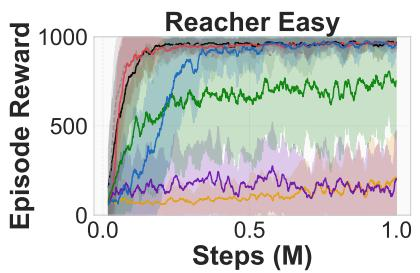  
(a) Reacher Easy.

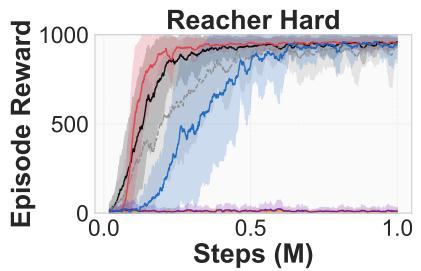  
(b) Reacher Hard.

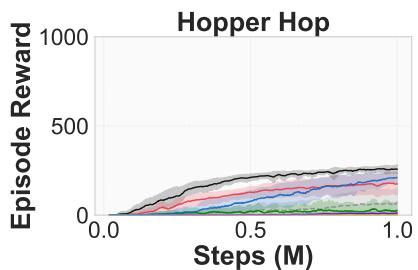  
(c) Hopper Hop.

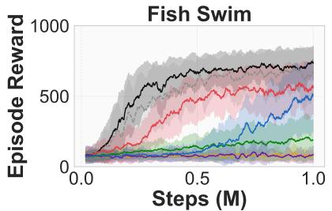  
(d) Fish Swim.

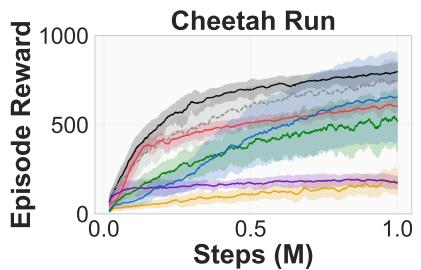  
(e) Cheetah Run.

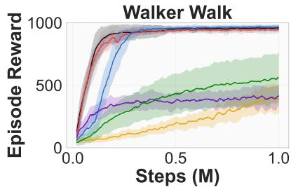  
(f) Walker Walk.

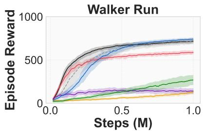  
(g) Walker Run.

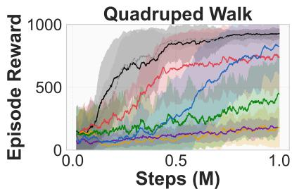  
(h) Quadruped Walk.  
Figure 1: Learning curves on eight DeepMind Control Suite tasks (mean ± standard deviation over the seeds that produced data, 7 for most entries, see Table 2; 1M environment steps).

and replay exponent $\beta ,$ starts from three bins instead of two and grows on a fixed schedule instead of the stagnation criterion, and warm-starts new bins from their neighbours. Both use two averaged critics. We did not run GQN with the update frequency or other settings of SGQN, so we cannot say which of these diferences accounts for the advantage. The larger number of updates per environment step is a candidate that we have not tested.

## 5.3 Where Does SGQN Allocate Resolution?

The motivation of SGQN is that resolution should be concentrated where the value function indicates it matters. We test this directly on the 56 runs (8 tasks, 7 seeds) of the main experiment. Every 25 episodes the run records, for each dimension and bin, whether it is active, its running mean Q-value, and how often it was selected, so that the grid can be compared to the Q-values over the whole training run. Throughout, “Q-value of a bin” is the running mean described in Section 4.

Which bins are active. Figure 2 shows the grid of one dimension of one seed over training. Every task follows the same schedule: three anchor bins until the first growth step at episode 300, seven active bins after it, nine after the growth step at episode 600, and then a cycle of pruning (one bin removed at each of episodes 650 and 700), regrowth at episode 900 and further pruning at episode 950. The schedule is identical across seeds and tasks (Figure 3), because it is determined by $\Delta _ { g } , \Delta _ { p }$ and the regrow cooldown rather than by task-specific values. Averaged over the last 300 episodes (one growth interval), 7.5 of the 9 bins per dimension are active on every task (Table 3).

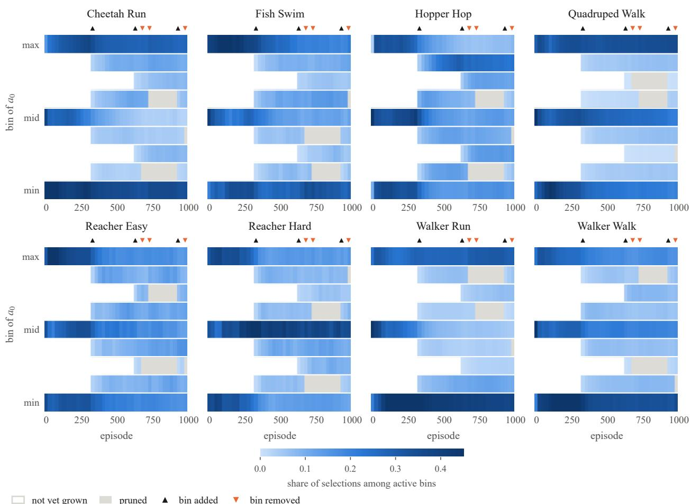  
Figure 2: Active action bins of the first action dimension over training, for one seed per task. Rows are the nine bins (action value increasing upwards), and cell colour is the share of the selections of that dimension that went to the bin in each interval. White cells are bins that have not yet been grown into the grid, gray cells are bins that were pruned, and triangles mark bins that were added (upward) or removed (downward) at that checkpoint.

Growth does not select. The growth rule of Section 4.3 activates neighbours of bins whose running mean Q-value exceeds 0.85 times the best bin of the dimension. In our runs it activated every candidate bin in every dimension: the grid always grows from three to seven to nine bins, as it would under uniform growth. The reason is visible in the Q-values themselves. At the last checkpoint, the range of Q over the nine bins of a dimension is a median of 0.5% to 2.9% of its mean on the eight tasks (Table 3). With such a narrow spread, almost every bin lies above 0.85 times the maximum. The alignment of the active bins with the Q-values, measured as the mean Q of the active bins divided by the mean Q over the whole grid, is 1.000 on every task and 1.001 on Quadruped Walk. In other words, in these runs the Q-values of the bins that SGQN keeps cannot be distinguished from those of the bins it does not, and we found no evidence that growth concentrates resolution in high-value regions. A higher threshold τQ makes growth stricter, and we vary it up to 0.95 in Section 5.4, where it also leaves the return essentially unchanged.

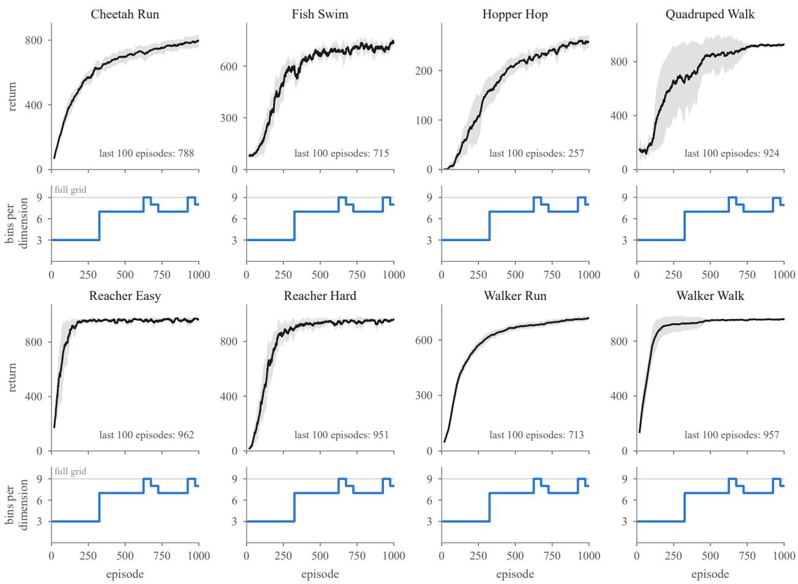  
Figure 3: Return (top of each block, mean ± standard deviation over seeds, window of 20 episodes) and number of active bins per dimension (bottom of each block, mean over seeds and dimensions) over training for the eight tasks. The step profile of the bin count is the same on every task.

Pruning is weakly value-guided. Across the 56 runs there were 903 pruning events. None removed an anchor bin, as intended. For each event, we ranked the bins that were candidates at that moment by their running mean Q-value and recorded the fifth of the ranking that the removed bin fell into (Figure 4b). The removed bin was in the lowest fifth in 29% of events, against 17.8% expected if a candidate were removed at random given the candidate counts of each event, and in the lowest two fifths in 50% of events, against 36% expected. Pruning is therefore biased towards low-Q bins, but the bias is moderate, and about half of the removed bins are not in the lower two fifths. Because the running mean is taken since activation, it is also biased by the age of a bin, which may contribute to which bins are removed. We have not isolated this efect, and we treat the explanation as a hypothesis. Figure 4a shows which bin positions are removed: removals fall on the non-anchor bins, and the distribution over positions is similar across tasks.

Summary. The measurements do not support the statement that SGQN focuses representational capacity where it matters most, if this is read as resolution following the value function. They support a narrower statement: SGQN reaches strong returns on all eight tasks with a grid that is on average smaller than the full grid and that, in these runs, is determined mainly by the growth and pruning schedule, with a weak preference for removing low-Q bins. Whether the performance comes from the adaptive grid itself, from starting coarse, or from ε-greedy selection is what the ablations below separate.

(a) where pruning acts  
Table 3: Action-space resolution of SGQN at the end of training. Active bins is the number of active bins per dimension averaged over the last 300 episodes, which is one full growth interval (the count rises when growth fires and falls at each pruning event, so the last checkpoint alone depends on where in that cycle training stopped). The grid has N = 9 bins per dimension. Alignment is the mean Q of the active bins divided by the mean Q of the full grid at the last checkpoint, and Q spread is the range of Q over the nine bins of a dimension as a share of its mean (median over dimensions). Return is the mean over the final 100 training episodes. All values are means over 7 seeds.
<table><tr><td>Task</td><td>Action dim.</td><td>Active bins</td><td>Alignment</td><td>Q spread</td><td>Return</td></tr><tr><td>Cheetah Run</td><td>6</td><td>7.5 / 9</td><td>1.000</td><td>0.8%</td><td>788</td></tr><tr><td>Fish Swim</td><td>5</td><td>7.5 / 9</td><td>1.000</td><td>1.0%</td><td>715</td></tr><tr><td>Hopper Hop</td><td>4</td><td>7.5 / 9</td><td>1.000</td><td>2.9%</td><td>257</td></tr><tr><td>Quadruped Walk</td><td>12</td><td>7.5 / 9</td><td>1.001</td><td>2.6%</td><td>924</td></tr><tr><td>Reacher Easy</td><td>2</td><td>7.5 / 9</td><td>1.000</td><td>0.5%</td><td>962</td></tr><tr><td>Reacher Hard</td><td>2</td><td>7.5 / 9</td><td>1.000</td><td>0.6%</td><td>951</td></tr><tr><td>Walker Run</td><td>6</td><td>7.5 / 9</td><td>1.000</td><td>1.1%</td><td>713</td></tr><tr><td>Walker Walk</td><td>6</td><td>7.5 / 9</td><td>1.000</td><td>1.0%</td><td>957</td></tr></table>

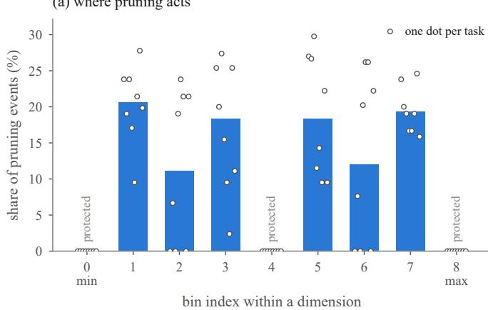

(b) which bins are removed  
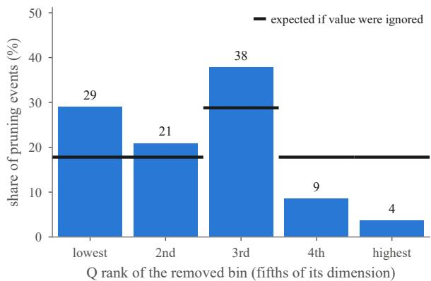  
Figure 4: Which bins are pruned. (a) Share of all pruning events that removed each bin position of the grid, with the share on each individual task as dots. Anchor bins are protected and are never removed. (b) Distribution over the fifths of the Q-ranking (lowest fifth on the left) of the bins that were removed, with the share expected under random removal, computed per event from the number of candidates, as ticks.

## 5.4 Ablations and Hyperparameter Sensitivity

Component ablation. We change one design choice at a time and keep the rest of the method fixed, on Quadruped Walk, Hopper Hop, Walker Run and Fish Swim with 5 seeds each: (i) no pruning, (ii) uniform instead of value-guided growth (all active bins attract their neighbours), (iii) the full grid of 9 bins from the start, which removes growth and pruning altogether, and (iv) the earlier annealed softmax selection instead of ε-greedy. Since growth already behaves like uniform growth in the main runs (Section 5.3), variant (ii) is expected to match the full method, and we report it to confirm that.

Hyperparameter sensitivity. We vary one hyperparameter at a time around the defaults, on Hopper Hop and Walker Run with 3 seeds: the pruning threshold $\tau _ { p } \in \{ 0 . 2 5 , 0 . 5 , 0 . 7 5 \}$ , the growth threshold $\tau _ { Q } \in \{ 0 . 7 , 0 . 8 5 , 0 . 9 5 \}$ , the pruning interval $\Delta _ { p } \in \{ 2 5 , 5 0 , 1 0 0 \}$ , the growth interval $\Delta _ { g } \in \{ 1 5 0 , 3 0 0 , 6 0 0 \}$ , the exploration decay in {0.99, 0.995, 0.999}, and the number of initial bins $n _ { 0 } \in \{ 3 , 5 , 7 \}$ . The defaults were chosen by a small manual search on the main tasks before these experiments, and the study shows how much of the performance depends on that choice.

Table 4: Component ablation. Each row changes one design choice and leaves the rest of the full method unchanged. Values are the mean return over the final 100 training episodes, with the standard deviation across seeds in parentheses. All variants use the same 5 seeds.
<table><tr><td>Variant</td><td>Fish Swim</td><td>Hopper Hop</td><td>Quadruped Walk</td><td>Walker Run</td></tr><tr><td>Full method</td><td>718 (13)</td><td>254 (12)</td><td>927 (10)</td><td>713 (15)</td></tr><tr><td>No pruning</td><td>726 (12)</td><td>255 (12)</td><td>928 (8)</td><td>710 (16)</td></tr><tr><td>Uniform instead of value-guided growth</td><td>718 (13)</td><td>254 (12)</td><td>926 (11)</td><td>713 (15)</td></tr><tr><td>Start with all 9 bins (no growth)</td><td>722 (14)</td><td>252 (32)</td><td>818 (132)</td><td>684 (49)</td></tr><tr><td>Annealed softmax instead of ε-greedy</td><td>508 (19)</td><td>0 (0)</td><td>250 (44)</td><td>547 (21)</td></tr></table>

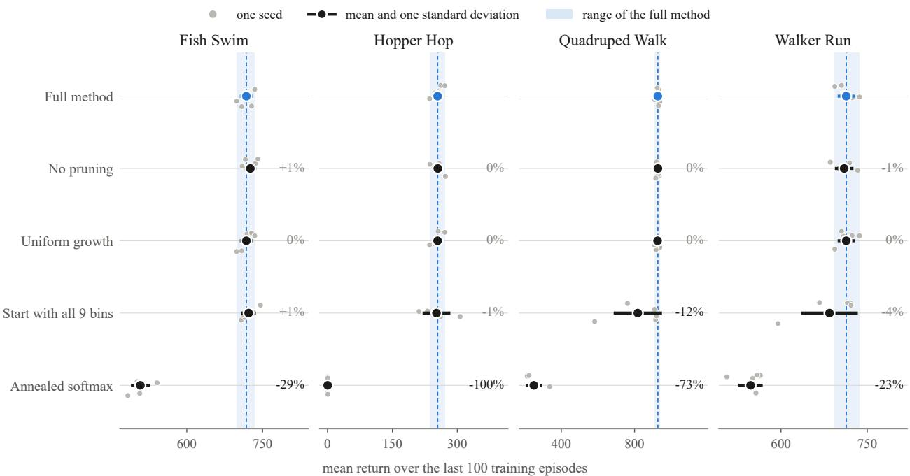  
Figure 5: Component ablation on four tasks with 5 seeds each. Gray dots are single seeds, dark markers are means with one standard deviation, and the shaded band is the range of the full method over the same seeds. The percentage at the right of each row is the mean relative to the full method. Uniform growth and no pruning stay inside the band, starting with all 9 bins produces individual seeds far below it, and annealed softmax is far below it on every task.

Uniform growth is indistinguishable from value-guided growth. The returns of the two variants agree to the rounded value in 19 of 20 runs, and the remaining run (Quadruped Walk, seed 21) difers by 7 points (917 against 924). This follows from Section 5.3: with our thresholds the growth rule already activates every candidate bin, so replacing it by uniform growth leaves the run unchanged. It does not show that value-guided growth is harmless in general, only that in this setting it does not act diferently from uniform growth.

Pruning does not change the return. Without pruning, the mean return difers from the full method by between −0.4% and +1.1% on the four tasks, within one standard deviation across seeds in every case. Pruning removes about 1.5 of the 9 bins per dimension at the end of training (Table 3) without a measurable efect on the return, so its benefit in our experiments is a smaller grid, not a better policy.

Starting coarse makes training more reliable. Starting with all 9 bins gives similar means on Fish Swim (722) and Hopper Hop (252), but a much larger spread on Hopper Hop (standard deviation 32 against

Table 5: Hyperparameter sensitivity. Each hyperparameter is varied alone with the rest at their defaults, which are marked ∗. Values are the mean return over the final 100 training episodes, with the standard deviation across seeds in parentheses.
<table><tr><td>Hyperparameter</td><td>Value</td><td>Hopper Hop</td><td>Walker Run</td></tr><tr><td>prune threshold</td><td>0.25</td><td>257 (15)</td><td>710 (7)</td></tr><tr><td rowspan="4">growth threshold</td><td>0.5 *</td><td>256 (15)</td><td>712 (8)</td></tr><tr><td>0.75</td><td>257 (13)</td><td>713 (11)</td></tr><tr><td>0.7</td><td>256 (15)</td><td>712 (8)</td></tr><tr><td>0.85 *</td><td>256 (15)</td><td>712 (8)</td></tr><tr><td rowspan="3">prune interval</td><td>0.95</td><td>254 (14)</td><td>712 (8)</td></tr><tr><td>25 50 *</td><td>254 (15) 256 (15)</td><td>711 (8) 712 (8)</td></tr><tr><td>100</td><td>257 (12)</td><td>712 (8)</td></tr><tr><td rowspan="3">growth interval</td><td>150</td><td>250 (8)</td><td>724 (13)</td></tr><tr><td>300 *</td><td>256 (15)</td><td>712 (8)</td></tr><tr><td>600</td><td>270 (6)</td><td>727 (7)</td></tr><tr><td rowspan="3">epsilon decay</td><td>0.99</td><td>257 (22)</td><td>711 (23)</td></tr><tr><td>0.995 *</td><td>256 (15)</td><td>712 (8)</td></tr><tr><td>0.999</td><td>233 (49)</td><td>691 (5)</td></tr><tr><td rowspan="3">initial bins</td><td>3 *</td><td>256 (15)</td><td>712 (8)</td></tr><tr><td>5</td><td>226 (7)</td><td>729 (6)</td></tr><tr><td>7</td><td>228 (11)</td><td>730 (5)</td></tr></table>

12), and lower means on Quadruped Walk (818 against 927) and Walker Run (684 against 713). The lower means come from single seeds that fail: two on Quadruped Walk (761 and 582) and one on Walker Run (595), while the other seeds are close to the full method. Growing from three anchor bins therefore protects against occasional failures. Because uniform growth gives the same results as the full method, this benefit comes from starting coarse and growing, not from the choice of which bins are grown.

ε-greedy selection is the largest efect. Annealed softmax lowers the return by 29%, 100%, 73% and 23% on Fish Swim, Hopper Hop, Quadruped Walk and Walker Run, and on Hopper Hop it does not learn (all five seeds stay below 2). The earlier implementation, which used softmax together with other defaults, reached 710 on Walker Run, so softmax is not inherently unable to learn. We did not tune its temperature schedule separately, so the ablation shows that ε-greedy works with our defaults and softmax does not, not that softmax cannot work.

The growth and pruning hyperparameters hardly matter. Varying $\tau _ { p } , \tau _ { Q }$ or $\Delta _ { p }$ over the tested values changes the mean return by at most 3 points on either task, about 1% on Hopper Hop and 0.4% on Walker Run. A growth threshold of 0.7 gives exactly the same returns as 0.85, which again shows that growth does not discriminate between bins, and at 0.95 the return changes by at most 2 points. The defaults are therefore not finely tuned in these respects.

Exploration, growth interval and initial resolution matter more. An exploration decay of 0.999 lowers the return on both tasks (233 on Hopper Hop and 691 on Walker Run, against 256 and 712), because exploration stays high for longer, while a faster decay of 0.99 matches the default. A growth interval of 600 gives higher returns on both tasks (270 and 727), and 150 gives a lower return on Hopper Hop (250) and a higher one on Walker Run (724). With 3 seeds we do not regard these diferences as significant, but they indicate that the default $\Delta _ { g } = 3 0 0$ is not optimal. The number of initial bins acts in opposite directions: 5 or 7 initial bins lower the return on Hopper Hop (226 and 228 against 256) and raise it on Walker Run (729 and 730 against 712). The best starting resolution is therefore task dependent in our runs, and 3 is not uniformly best.

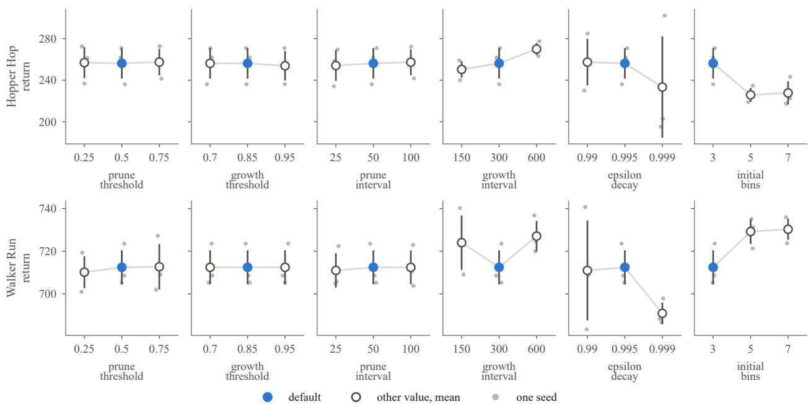  
Figure 6: Hyperparameter sensitivity on Hopper Hop and Walker Run with 3 seeds. Each panel varies one hyperparameter with the others at their defaults. The blue marker is the default, open markers are other values, gray dots are single seeds and bars are one standard deviation. The values on the horizontal axis are evenly spaced in increasing order.

Summary of the ablations. The results are consistent. Among the components we varied, the return of SGQN depends on the coarse start with growth and on ε-greedy selection, and not on value-guided growth or on pruning. These ablations are within SGQN. They do not show why SGQN outperforms the baselines, which share a coarse start and ε-greedy selection. A fixed coarse grid of three bins without growth is not part of our ablation, so we cannot separate the benefit of growth from the benefit of starting coarse.

## 6 Discussion

What the adaptive grid does. The original motivation was that a decoupled Q-function has a peaked landscape around the optimal action, so that selective growth should concentrate new bins near the peak. Our analysis does not show this. At the thresholds we use, the Q-values of the nine bins of a dimension difer by about one percent, which is too little for the growth rule to discriminate between them, and growth acts as uniform growth. Within SGQN, the ablation of Section 5.4 shows that starting coarse and ε-greedy selection matter, while value-guided growth and pruning do not change the return. This does not explain the advantage over the baselines, because GQN and DecQN also start coarse and use ε-greedy selection, and because SGQN difers from them in update frequency and other settings (Table 1). The warm start of new bins, the update frequency and the network were not ablated, and a fixed coarse grid without growth is missing, so we cannot say whether growth itself contributes beyond starting coarse. A possible reason for the flat Q-values is that the Q-value of a bin is evaluated for a state-action pair that is averaged over states, so that diferences between bins are small compared to diferences between states.

How SGQN relates to the baselines. SGQN has the highest mean return on four of eight tasks and is within 1.1% of the best method on three more, but it is not uniformly best: Bang-Bang MPO is better on both Walker tasks, and GQN is nominally ahead on the two Reacher tasks by margins within the seed noise. Because the adaptive grid is not what drives the result, the comparison supports the claim that SGQN as configured is competitive with the strongest baselines here, and not the claim that adaptive discretisation is better than uniform growth. Because SGQN also difers from the baselines in update frequency and other settings, it does not show which of its components is responsible.

The role of lazy pruning. Pruning removes bins with lower Q-values than a random choice would, but the preference is moderate (Section 5.3). The eligibility conditions mean that a bin which the policy repeatedly declines becomes prunable after $L _ { \mathrm { m a x } }$ pruning events even without many selections, so that flagged bins are not held back for long. Removing pruning changes the return by at most 1.1% (Section 5.4), so pruning reduces the size of the grid without a measurable efect on the return.

Why ε-greedy instead of softmax. An earlier version of SGQN used a temperature-annealed softmax over the Q-values of the active bins. With Q-values that difer by about one percent across bins, a softmax over them is close to uniform unless the temperature is very small, and the schedule of the temperature then determines the behaviour. ε-greedy has a single, interpretable exploration parameter, and in the ablation of Section 5.4 the softmax variant reaches 23% to 100% lower returns and does not learn on Hopper Hop. The earlier implementation, which used softmax with other defaults, did learn on Walker Run, so the softmax schedule and the other hyperparameters interact, and we did not tune softmax separately.

Limitations. SGQN introduces hyperparameters compared to GQN $( \tau _ { Q } , \tau _ { p } , \Delta _ { g } , \Delta _ { p } ,$ , vmin, Lmax and the regrow cooldown), and our defaults were chosen on the same tasks that we report. The final grid size depends on where in the growth and pruning cycle training stops, so we report the average over the last growth interval. The grid schedule is the same for all tasks and seeds in our runs, which means SGQN does not currently adapt the resolution to the task. The ablations use 4 tasks with 5 seeds and the sensitivity study 2 tasks with 3 seeds, so small diferences between variants are not resolved. The independence assumption of decoupled Q-learning (Eq. 4) can also be limiting for tasks with strongly coupled action dimensions. We report training returns over the final 100 episodes rather than separate evaluation episodes. The baseline comparison has further limits. CQN learns from pixels and the other methods from the state, so it is not a like-for-like baseline. DecQN and CQN were run with the settings stated in their publications and the defaults of our code where these are not stated, were not tuned, and reach much lower returns than the other methods, which we did not investigate. Some baseline runs produced no data (Table 2), including all seven Bang-Bang PPO runs on Reacher Hard. We ran no significance tests. SGQN performs one gradient update per environment step and our GQN and DecQN runs one per eight, so part of the advantage of SGQN may come from more training per sample. We did not run GQN with the update frequency, exploration rule or network of SGQN, so the advantage over GQN cannot be attributed to a specific design choice.

Future directions. Several extensions are promising: (1) a growth rule that uses a measure of Q-value diferences that is not dominated by their mean, for example the advantage of a bin over the dimension mean in units of its standard deviation, so that growth can actually discriminate between bins, (2) learning per-dimension growth schedules, (3) combining selective discretisation with model-based planning, and (4) applying SGQN to real robotic systems where sample eficiency and discrete actuation align naturally.

## 7 Conclusion

We introduced Selective Growing Q-Networks (SGQN), a value-based continuous control algorithm with an adaptive action grid and ε-greedy selection with a decaying exploration rate. SGQN reaches the highest mean final return on four of eight DeepMind Control Suite tasks, is within 1.1% of the best method on three more, and is 3.4% below Bang-Bang MPO on Walker Run, using on average 7.5 of 9 available bins per dimension. A direct analysis of the grid and a set of ablations show that this performance does not come from the adaptive grid: growth is efectively uniform, the Q-values of retained and removed bins difer by about one percent, and removing pruning changes the return by at most 1.1%. What matters within SGQN in our experiments is starting from a coarse grid, which prevents occasional collapsed seeds, and ε-greedy selection, which an annealed softmax does not match. The growth and pruning hyperparameters can be varied widely without changing the return. We therefore read SGQN as a competitive decoupled Q-learner whose advantage over the baselines we cannot attribute to a single component, since it also difers from them in update frequency and other settings, and a growth rule using value diferences between bins, which our rule does not exploit, remains an open design problem.

## References

Abbas Abdolmaleki, Jost Tobias Springenberg, Yuval Tassa, Rémi Munos, Nicolas Heess, and Martin Riedmiller. Maximum a posteriori policy optimisation. arXiv preprint arXiv:1806.06920, 2018.

Jimmy Lei Ba, Jamie Ryan Kiros, and Geofrey E Hinton. Layer normalization. arXiv preprint arXiv:1607.06450, 2016.

Rémi Coulom. Computing elo ratings of move patterns in the game of go. In Computer Games Workshop, 2007.

Wojciech M Czarnecki, Siddhant M Jayakumar, Max Jaderberg, Leonard Hasenclever, Yee Whye Teh, Nicolas Heess, Simon Osindero, and Razvan Pascanu. Mix and match – agent curricula for reinforcement learning. In International Conference on Machine Learning, 2018.

Scott Fujimoto, Herke van Hoof, and David Meger. Addressing function approximation error in actor-critic methods. In International Conference on Machine Learning, 2018.

Shixiang Gu, Timothy Lillicrap, Ilya Sutskever, and Sergey Levine. Continuous deep q-learning with model-based acceleration. In International Conference on Machine Learning, 2016.

Tuomas Haarnoja, Aurick Zhou, Pieter Abbeel, and Sergey Levine. Soft actor-critic: Of-policy maximum entropy deep reinforcement learning with a stochastic actor. In International Conference on Machine Learning, 2018.

Timothy P Lillicrap, Jonathan J Hunt, Alexander Pritzel, Nicolas Heess, Tom Erez, Yuval Tassa, David Silver, and Daan Wierstra. Continuous control with deep reinforcement learning. In International Conference on Learning Representations, 2016.

Volodymyr Mnih, Koray Kavukcuoglu, David Silver, Andrei A Rusu, Joel Veness, Marc G Bellemare, Alex Graves, Martin Riedmiller, Andreas K Fidjeland, Georg Ostrovski, et al. Human-level control through deep reinforcement learning. Nature, 518(7540):529–533, 2015.

Tabish Rashid, Mikayel Samvelyan, Christian Schroeder, Gregory Farquhar, Jakob Foerster, and Shimon Whiteson. QMIX: Monotonic value function factorisation for decentralised multi-agent reinforcement learning. In International Conference on Machine Learning, 2018.

Tom Schaul, John Quan, Ioannis Antonoglou, and David Silver. Prioritized experience replay. In International Conference on Learning Representations, 2016.

John Schulman, Filip Wolski, Prafulla Dhariwal, Alec Radford, and Oleg Klimov. Proximal policy optimization algorithms. arXiv preprint arXiv:1707.06347, 2017.

Younggyo Seo, Jafar Uruç, and Stephen James. Continuous control with coarse-to-fine reinforcement learning. In Advances in Neural Information Processing Systems, 2024.

Tim Seyde, Igor Gilitschenski, Wilko Schwarting, Bartolomeo Stellato, Martin Riedmiller, Markus Wulfmeier, and Daniela Rus. Is bang-bang control all you need? solving continuous control with Bernoulli policies. In Advances in Neural Information Processing Systems, 2021.

Tim Seyde, Peter Werner, Wilko Schwarting, Igor Gilitschenski, Martin Riedmiller, Daniela Rus, and Markus Wulfmeier. Solving continuous control via q-learning. arXiv preprint arXiv:2210.12566, 2022.

Tim Seyde, Peter Werner, Wilko Schwarting, Markus Wulfmeier, and Daniela Rus. Growing Q-networks: Solving continuous control tasks with adaptive control resolution. In International Conference on Learning Representations, 2024.

Peter Sunehag, Guy Lever, Audrunas Gruslys, Wojciech Marian Czarnecki, Vinicius Zambaldi, Max Jaderberg, Marc Lanctot, Nicolas Sonnerat, Joel Z Leibo, Karl Tuyls, et al. Value-decomposition networks for cooperative multi-agent learning. In International Conference on Autonomous Agents and Multi-Agent Systems, 2018.

Richard S Sutton and Andrew G Barto. Reinforcement Learning: An Introduction. MIT Press, 2nd edition, 2018.

Yunhao Tang and Shipra Agrawal. Discretizing continuous action space for on-policy optimization. In AAAI Conference on Artificial Intelligence, 2020.

Yuval Tassa, Saran Tunyasuvunakool, Alistair Muldal, Yotam Doron, Siqi Liu, Steven Bohez, Josh Merel, Tom Erez, Timothy Lillicrap, and Nicolas Heess. DeepMind control suite. arXiv preprint arXiv:1801.00690, 2018.

Arash Tavakoli, Fabio Pardo, and Petar Kormushev. Action branching architectures for deep reinforcement learning. In AAAI Conference on Artificial Intelligence, 2018.

Hado van Hasselt, Arthur Guez, and David Silver. Deep reinforcement learning with double q-learning. In AAAI Conference on Artificial Intelligence, 2016.

Christopher JCH Watkins and Peter Dayan. Q-learning. Machine Learning, 8(3-4):279–292, 1992.

## A Full Hyperparameter Tables

Table 6: SGQN-specific hyperparameters. All values are passed to the training script as explicit command line options (initial bins, pruning interval, growth interval, minimum age, maximum lives, pruning threshold, growth threshold, regrow cooldown, selection strategy and ε decay); the remaining options keep the defaults of our code.
<table><tr><td>Hyperparameter</td><td>Value</td></tr><tr><td>Full grid bins  $N$ </td><td>9</td></tr><tr><td>Initial bins  $n _ { 0 }$ </td><td>3 (boundary and centre bins, which are protected anchors)</td></tr><tr><td>Growth interval  $\Delta _ { g }$ </td><td>300 episodes</td></tr><tr><td>Pruning interval  $\Delta _ { p }$ </td><td>50 episodes</td></tr><tr><td>Growth threshold  $\tau _ { Q }$ </td><td>0.85 (fraction of the best running mean Q)</td></tr><tr><td>Pruning threshold  $\tau _ { p }$ </td><td>0.5 (quantile of the mature bins)</td></tr><tr><td>Minimum visits  $v _ { \mathrm { m i n } }$ </td><td>2000 selections since activation</td></tr><tr><td>Maximum lives  $L _ { \mathrm { m a x } }$ </td><td>1 pruning event</td></tr><tr><td>Minimum age  $a _ { \mathrm { m i n } }$ </td><td>1 pruning event</td></tr><tr><td>Regrow cooldown c</td><td>3 pruning events</td></tr><tr><td>Minimum active bins  $n _ { \mathrm { m i n } }$ </td><td>3</td></tr><tr><td>Warm-up  $T _ { \mathrm { w a r m } }$ </td><td>50 episodes</td></tr><tr><td>Exploration ε</td><td>0.1, multiplied by 0.995 per episode, minimum 0.01</td></tr><tr><td>Selection (ablation only)</td><td>annealed softmax</td></tr></table>

Table 7: Network and optimisation hyperparameters of SGQN. The baselines use the settings stated in their original publications and the defaults of our code where a publication does not state a value (Table 1).
<table><tr><td>Hyperparameter</td><td>Value</td></tr><tr><td>Optimiser</td><td>Adam</td></tr><tr><td>Learning rate</td><td> $1 \times 1 0 ^ { - 4 }$ </td></tr><tr><td>Discount γ</td><td>0.99</td></tr><tr><td>Replay buffer size</td><td> $1 0 ^ { 6 }$ </td></tr><tr><td>Batch size</td><td>256</td></tr><tr><td>n-step returns</td><td>3</td></tr><tr><td>Target update period</td><td>100 gradient updates (one update per environment step)</td></tr><tr><td>Prioritised replay α Prioritised replay  $\beta$ </td><td>0.6 0.4 (constant)</td></tr><tr><td>Gradient clip norm</td><td>40.0</td></tr><tr><td>Hidden layers</td><td> $2 \times 5 1 2$ </td></tr><tr><td>Activation</td><td>ELU</td></tr><tr><td>Normalisation</td><td>Layer norm</td></tr></table>

## B Environment Details

All methods except CQN use the standard DMControl state-based observation protocol with no frame stacking. CQN learns from 84×84 images with 3 stacked frames and an action repeat of 2, as in its oficial configuration. Episodes run for 1000 environment steps. The random seeds are 0, 11, 21, 37, 42, 73 and 101, and they control both the environment initialisation and the neural network initialisation. No domain randomisation is applied.

Table 8: DeepMind Control Suite task details.
<table><tr><td>Task</td><td>Action Dim.</td><td>State Dim.</td></tr><tr><td>Reacher Easy</td><td>2</td><td>7</td></tr><tr><td>Reacher Hard</td><td>2</td><td>7</td></tr><tr><td>Hopper Hop</td><td>4</td><td>15</td></tr><tr><td>Fish Swim</td><td>5</td><td>26</td></tr><tr><td>Cheetah Run</td><td>6</td><td>17</td></tr><tr><td>Walker Walk</td><td>6</td><td>24</td></tr><tr><td>Walker Run</td><td>6</td><td>24</td></tr><tr><td>Quadruped Walk</td><td>12</td><td>78</td></tr></table>