# Sparse Transformer: a Controlled Testbed for Mechanistic Interpretability

Anton Korznikov\* Alexey Dontsov Elena Tutubalina

Code: github.com/AntonKorznikov/SparseTransformer Models: huggingface.co/AntonKorznikov/SparseTransformer

## Abstract

Mechanistic interpretability aims to decompose neural network computations into humanunderstandable features, yet progress is limited by the absence of ground-truth units to evaluate against. We address this with a Sparse Transformer (ST): a 5-layer language model trained on TinyStories whose wide, TopK-sparse MLP forces neuron specialization. We show that ST neurons are highly interpretable: they outperform a loss-matched dense transformer by 43% on AutoInterp, and circuits of a median of 12 neurons suffice to reproduce individual model predictions. This testbed allows us to directly compare feature learning methods: Transcoder, which approximates the MLP input-output mapping, recovers ST’s neuron vectors with 52.6% higher cosine similarity than Sparse Autoencoder, which only reconstructs outputs. Furthermore, the ST enables a controlled study of polysemanticity: distilling its sparse MLP into a dense counterpart reveals how compression leads to feature superposition. These results show how a known reference basis sharpens evaluation and understanding, a role we hope the ST can serve for the field.

## 1 Introduction

Language model neurons are polysemantic: each responds to many unrelated inputs, making them resistant to human interpretation (Elhage et al., 2022b; Olah et al., 2020). Mechanistic interpretability aims to address this, yet the field faces a persistent methodological bottleneck: the absence of a reliable ground-truth (Sharkey et al., 2025; Chanin and Garriga-Alonso, 2026). When Sparse Autoencoder (SAE) (Bricken et al., 2023) decomposes a model’s residual stream into a sparse sum of monosemantic features, we cannot know whether those features correspond to genuine computational units or are artifacts of the decomposition method (Korznikov et al., 2026; Leask et al., 2025). Similarly, when a circuit is identified as responsible for a behavior, faithfulness metrics remain proxies, as the true circuit is never known (Sutter et al., 2026).

Existing attempts to obtain ground truth rely on toy models with hand-crafted tasks (Elhage et al., 2022b; Nanda et al., 2023; Huben, 2024; Sharkey et al., 2022), which do not process natural language, leaving it unclear how findings transfer to real models. A more principled approach is to train a model whose internal structure is interpretable by design, so that its known units can serve as a reference for interpretability methods on natural language.

We propose the Sparse Transformer (ST) as such a model. ST is a decoder-only transformer whose MLP layers apply a TopK gate after the ReLU nonlinearity: at each forward pass, only K out of $N = M \cdot d _ { \mathrm { m o d e l } }$ neurons activate (M is the width multiplier). When M is large and K is small, each neuron must specialise, with sparsity acting as an inductive bias towards monosemanticity. Thus, ST provides an operational ground truth in two complementary senses. The first is structural: because exactly K neurons fire per pass, the MLP output is a sum of K known value vectors from a known active set, matching the sparse decomposition that SAEs and Transcoders are designed to recover. The second is semantic: we verify empirically that these neurons are monosemantic and human-interpretable. Together, these properties make the ST a controlled testbed for evaluating feature-recovery methods on natural language.

We make the following contributions:

• We show that our primary ST model is highly interpretable: it scores 0.866 on AutoInterp (vs. 0.605 for a loss-matched dense transformer) and admits compact circuits that reproduce individual model predictions.

• In Case Study #1, we use the ST’s known neuron basis to compare SAEs and Transcoders, finding that Transcoders reconstruct MLP outputs 3.8× more accurately (NMSE) and recover true neurons with 52.6% higher cos-sim.

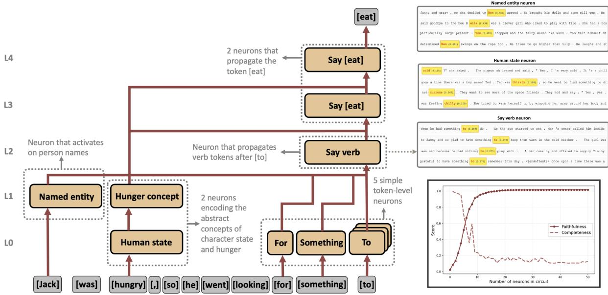  
Figure 1: An interpretable 11-neuron circuit. Given the prompt “Jack was hungry so he went looking for something to”, nodes are MLP neurons grouped by layer (L0–L4); edges indicate causal influence. (top right) Neuron dashboards show top activating contexts for 3 circuit nodes. (bottom right) Faithfulness and completeness as neurons are added by beam search; 11 neurons suffice to reach faithfulness ≥ 0.95.

• In Case Study #2, we distil the ST’s MLP into a dense counterpart and study polysemanticity in a controlled setting, finding each dense neuron superposes ∼150 sparse neurons with its weight vectors reflecting this mixture.

• Additionally, we report an empirical width–sparsity trade-off suggesting that strong sparsity can be offset by moderate width expansion, showing a path toward larger interpretable LLMs.

Together, these contributions establish the ST as a testbed that bridges the gap between toy models and production LLMs: trained on natural language, yet with known computational units at every layer. We publicly release all 35 models trained across the width–sparsity grid, along with checkpoints at every 10% of training, to support systematic study of feature formation, circuit emergence, and interpretability methods evaluation.

## 2 Related Work

Mechanistic Interpretability. Mechanistic interpretability aims to reverse-engineer the computations inside neural networks into human-understandable algorithms (Olah et al.,

2020; Elhage et al., 2021). Its core primitives are features, interpretable properties of the input that a model represents (e.g., “past tense”, “character names”, “sentiment”), and circuits, groups of features that interact to produce a specific behavior (Wang et al., 2022; Tigges et al., 2024; Lindsey et al., 2025; Marks et al., 2025). The most natural feature unit would be a single neuron, but language-model neurons are typically polysemantic, responding to many unrelated concepts, which motivates the search for more disentangled representations (Olah et al., 2017; Bricken et al., 2023; Kopf et al., 2026).

SAEs and Transcoders. The polysemanticity has motivated methods that decompose dense activations into sparse, interpretable features. These methods rest on the superposition hypothesis (Elhage et al., 2022b; Olah et al., 2020): any dense activation vector x ∈ Rdmodel can be uniquely represented as a sparse linear combination of feature vectors. Both Sparse Autoencoders (SAEs) (Bricken et al., 2023; Rajamanoharan et al., 2024; Lieberum et al., 2024; Gao et al., 2025a) and Transcoders (Dunefsky et al., 2024; Ameisen et al., 2025; Paulo et al., 2025) operationalize this by learning a dictionary whose size D is much larger than the model’s hidden dimension $( D \gg d _ { \mathrm { m o d e l } } )$ , while enforcing that only a small number K ≪ dmodel of features are active on any input. This sparsity pressure forces each latent to specialize to a coherent, human-understandable concept (Cunningham et al., 2023).

An SAE reconstructs a target dense activation vector x (e.g., from the residual stream or an MLP output) via $\hat { \mathbf { x } } = \mathbf { W } ^ { \mathrm { d e c } } \mathrm { T o p K } \big ( \mathbf { W } ^ { \mathrm { e n c } } \mathbf { x } + \mathbf { b } ^ { \mathrm { e n c } } \big ) + \mathbf { b } ^ { \mathrm { d e c } }$ where ${ \bf W } ^ { \mathrm { e n c } } \in \mathbb { R } ^ { D \times d _ { \mathrm { m o d e l } } }$ and $\mathbf { W } ^ { \mathrm { d e c } } \in \mathbb { R } ^ { \overset { \cdot } { d } _ { \mathrm { m o d e l } } \times D }$ The TopK gate retains only the K largest latent coefficients and zeros the rest, so the reconstruction is a sparse sum of K selected columns from $\mathbf { W } ^ { \mathrm { d e c } }$

A Transcoder usually adopts the same TopKsparse, overcomplete architecture but targets the functional behavior of a component (e.g. MLP) rather than its output representation. Given a module’s input x, it approximates the module’s output y as $\hat { \mathbf { y } } = \mathbf { W } _ { \mathrm { o u t } } \mathrm { T o p K } \big ( \mathbf { W } _ { \mathrm { i n } } \mathbf { x } _ { \mathrm { i n } } + \mathbf { b } _ { \mathrm { i n } } \big ) + \mathbf { b } _ { \mathrm { o u t } }$ . Because the Transcoder must reproduce the full input-output mapping rather than merely reconstruct activations, it is conjectured to learn more mechanistically faithful latents (Paulo et al., 2025). However, both methods only claim to recover the true sparse decomposition, and without ground truth one cannot verify whether discovered latents are genuine features or geometric artifacts of reconstruction (Korznikov et al., 2026; Leask et al., 2025). In Section 5, we use the Sparse Transformer’s known neuron basis to directly test which method more faithfully recovers the ground-truth MLP vectors.

Evaluating Interpretability Methods. Rigorous evaluation of feature extraction and circuit discovery requires known ground-truth units. Two categories of proxies exist: synthetic activation settings where sparse features are explicitly defined (Sharkey et al., 2022; Chanin and Garriga-Alonso, 2025; Korznikov et al., 2026; Chanin and Garriga-Alonso, 2026), and toy models with hand-crafted tasks such as modular arithmetic (Nanda et al., 2023), board-state prediction (Huben, 2024), or simple superposition (Elhage et al., 2022b). Both categories share a key limitation: they do not process natural language, making it unclear how findings transfer to real models. ST bridges this gap with a known reference basis in a language model.

Sparse Architectures and Interpretability. Elhage et al. (2022a) introduce SoLU to reduce average neuron activity, but soft sparsity provides no monosemanticity guarantee: as the authors note, reduced activations can mask polysemantic neurons rather than eliminate them. Gao et al. (2025b) enforce weight sparsity to yield compact, inspectable circuits, a different inductive bias than activation sparsity. Mixture-of-Experts models (Shazeer et al.,

2017; Fedus et al., 2022) and sparse attention (Child et al., 2019; Zhao et al., 2019) reduce FLOPs by activating subsets of parameters or positions, but do not target interpretability and their activated units remain polysemantic (Guo et al., 2026). ST differs from all of these: a TopK gate enforces exact activation sparsity within the MLP, keeping precisely K neurons active per forward pass to force specialisation for interpretability.

## 3 Sparse Transformer

## 3.1 Architecture

Our ST is a decoder-only transformer (Vaswani et al., 2017) with 5 layers, hidden size $d _ { \mathrm { m o d e l } } { = } 2 5 6$ and 8 attention heads. We use RoPE positional embeddings (Su et al., 2024), untied input/output embeddings, and RMSNorm (Zhang and Sennrich, 2019). The MLP at each layer has $N = M \cdot d _ { \mathrm { m o d e l } }$ neurons (M is the width multiplier) and computes

$$
\begin{array} { r } { \mathbf { M L P } ( \mathbf { x } ) = V _ { \mathrm { o u t } } \cdot \mathrm { T o p K } \big ( \mathrm { R e L U } ( V _ { \mathrm { i n } } \mathbf { x } ) \big ) , } \end{array}
$$

where TopK(·) retains the K largest activations and zeros the rest, following the same mechanism and motivation as TopK SAEs (Gao et al., 2025a). The output is thus exactly a sparse sum of K value vectors $\mathbf { v } _ { i } { = } V _ { \mathrm { o u t } } [ : , i ]$

## 3.2 Training Setup

We train on the TinyStories dataset (Eldan and Li, 2023), a corpus of short children’s stories generated by GPT-4 (Achiam et al., 2023) that is rich enough for meaningful language modelling while being tractable for a small model.

We train the full Cartesian product of:

$$
\begin{array} { r } { M \in \{ 1 , 2 , 4 , 8 , 1 6 , 3 2 , 6 4 \} } \\ { K \in \{ 8 , 1 6 , 3 2 , 6 4 , \mathrm { N o n e } \} } \end{array}
$$

yielding 35 models. K=None removes the TopK constraint entirely, providing a dense baseline.

All models are trained for 300,000 steps (≈4.9B tokens) with AdamW (Loshchilov and Hutter, 2017), batch size 64, and a cosine schedule decaying learning rate from $3 \times 1 0 ^ { - 4 } \mathrm { t o } 1 0 ^ { - 5 }$ . Context length is 256 tokens. To prevent dead neurons, we apply neuron resampling every 1,000 steps following standard SAE practice (Bricken et al., 2023; Gao et al., 2025a): any neuron with activation frequency below $5 \times 1 0 ^ { - 6 }$ is randomly reinitialised. All 35 models share the same random seed and data order. We release all checkpoints, including snapshots at every 10% of training.

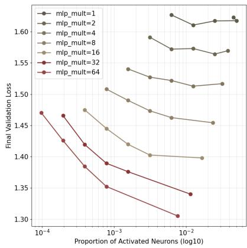

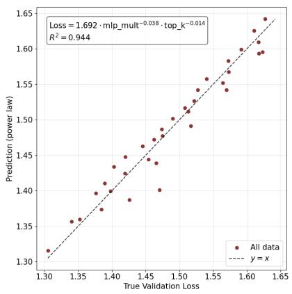

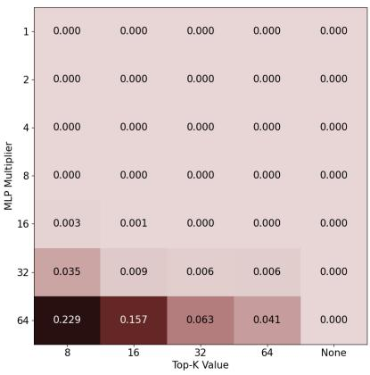

Figure 2: Width–sparsity trade-off. (left) Validation loss vs. proportion of activated neurons for each MLP width multiplier M; loss decreases monotonically with both width and activation rate. (middle) Power-law predictions vs. true validation loss across all 35 models $( R ^ { 2 } { = } 0 . 9 4 4 )$ . (right) Fraction of dead neurons across the (M, K) grid; negligible for $M \leq 1 6$ but rising at large width and small $K$
<table><tr><td>Parameter</td><td>Estimate</td><td>95% CI</td></tr><tr><td>C</td><td>1.696</td><td>[1.667, 1.725]</td></tr><tr><td>α</td><td>-0.038</td><td>[-0.041, -0.034]</td></tr><tr><td>β</td><td>-0.015</td><td>[−0.018, -0.013]</td></tr></table>

Table 1: Power-law fit coefficients for ${ \mathcal { L } } ( M , K )$

## 3.3 Width–Sparsity Trade-off

We first characterize how MLP width multiplier (M) and activation sparsity (K) jointly determine language modeling performance. We find that the 35-entry validation loss matrix across the (M, K) grid is nearly rank-1 (first singular values: $\sigma _ { 1 } { = } 7 . 9 1 , \sigma _ { 2 } { = } 0 . 0 8 )$ , indicating that M and K contribute as approximately separable, multiplicative factors. This motivates a power-law fit for the final validation loss:

$$
\mathcal { L } ( M , K ) = c \cdot M ^ { \alpha } \cdot K ^ { \beta } ,
$$

following the functional form commonly used in LLMs scaling (Kaplan et al., 2020; Hoffmann et al., 2022). The model achieves $R ^ { 2 } { = } 0 . 9 4 4$ (Fig. 2, middle), substantially outperforming linear and logarithmic alternatives, indicating strong predictive power. Fitted coefficients are shown in Table 1.

Interpretation. The exponents $\alpha { = } { - } 0 . 0 3 8$ and $\beta { = } { - } 0 . 0 1 5$ show that validation loss is more sensitive to MLP width than to sparsity: the ratio $\beta / \alpha \approx 0 . 4$ means width must grow as $K ^ { 0 . 4 }$ to hold loss constant. Concretely, within our grid, tightening sparsity from K=64 to K=8 requires only $\mathbf { a } \sim 2 . 3 \times$ increase in M (since $8 ^ { 0 . 4 } \approx 2 . 3 )$ This sub-linear trade-off appears achievable in practice: Mixture-of-Experts architectures (Mu and

Lin, 2025) routinely expand effective MLP width by 8–64× without proportionally increasing compute, suggesting that highly sparse, and thus interpretable, transformers may not need to sacrifice language modelling performance.

Dead neurons and model selection. Following standard SAE practice (Bricken et al., 2023), a neuron is counted as dead if its activation frequency falls below $1 0 ^ { - 6 }$ over the validation set. Dead neurons are negligible for $M \leq 3 2$ but rise to 22.9% at $( M { = } 6 4 , K { = } 8 )$ and 15.7% at (M=64, K=16) (Figure 2, right). We select M=32, K=8 for all subsequent experiments: the sparsest configuration with an acceptably low dead-neuron rate (3.5%), achieving validation loss 1.466, in the same range as the 5-layer models of Eldan and Li (2023).

## 4 Interpretability of Sparse Transformer

Having established the scaling properties of the ST, we now verify that our primary ST model (M=32, K=8) achieves its core objective: being highly interpretable at the neuron and circuit level.

## 4.1 Monosemanticity

We quantify interpretability with the AutoInterp score, which has been shown to align closely with human assessments of neuron interpretability (Paulo et al., 2024; Karvonen et al., 2025). For each of 100 randomly sampled neurons, GPT-4omini (Hurst et al., 2024) first describes the neuron’s top-activating contexts, then uses only that description to classify 20 held-out examples (10 active, sampled proportionally to activation strength, and 10 silent). The score is the mean classification accuracy over the 100 neurons.

<table><tr><td>Model</td><td>AutoInterp</td><td>95% CI</td></tr><tr><td>Random guessing</td><td>0.500</td><td></td></tr><tr><td>Dense (M=1)</td><td>0.565</td><td>[0.51, 0.61]</td></tr><tr><td>Dense (M=4, loss-matched)</td><td>0.605</td><td>[0.55, 0.65]</td></tr><tr><td>Dense (M=32, width-matched)</td><td>0.667</td><td>[0.61, 0.72]</td></tr><tr><td>ST (M=32, K=8)</td><td>0.866</td><td>[0.82, 0.91]</td></tr></table>

Table 2: AutoInterp scores. TopK sparsity yields substantially more interpretable neurons: ST (M=32, K=8) scores 0.866 vs. 0.605 for the loss-matched and 0.667 for the width-matched dense baseline.

As presented in Table 2 our ST (M=32, K=8) reaches an AutoInterp score of 0.866, providing quantitative evidence that its neurons are substantially more interpretable. By contrast, a dense model that achieves the same validation loss (M=4, K=None) scores only 0.605, while a minimal dense baseline (M=1, K=None) scores 0.565, barely above the 0.5 chance level. Even at matched width (M=32, K=None), the dense model scores only 0.667, so the gain is attributable to sparsity rather than width. A 43% relative improvement over the loss-matched dense baseline suggests that TopK sparsity yields substantially more interpretable neurons in this setting.

To complement the AutoInterp score, we manually constructed activation dashboards for 20 randomly sampled neurons. Each dashboard shows top-activating contexts at multiple intensity tiers. Each of the 20 sampled neurons activates on a specific, human-interpretable concept: for example, L0-N7792 responds to planning verbs (plan, brainstorm, discuss), L2-N3125 fires at the moral lesson at the end of a story, and L4-N4150 activates on loud sounds (loud noise, loud bang). A full set of 20 dashboards is provided in App. C, with the complete neuron set available in the released repository.

## 4.2 Circuit Analysis

We ask whether ST computations form complete, human-readable circuits, not just monosemantic neurons in isolation. We focus on an illustrative example from the original TinyStories work (Eldan and Li, 2023), the prompt “Jack was hungry so he went lookingfor something to”, where the model assigns probability 0.98 to the next token [eat].

Circuit extraction. We follow the standard ablation-based protocol (Conmy et al., 2023; Arora et al., 2026): neurons are ranked by their causal effect on $P ( [ \mathsf { e a t } ] )$ and added via beam search to the circuit until two complementary metrics are satisfied. Faithfulness (F) measures how well the circuit alone reproduces the full model’s behaviour; Completeness (C) measures how much performance collapses when the circuit is ablated1:

$$
F = \frac { P _ { \mathrm { c i r c u i t } } ( [ \mathsf { e a t } ] ) } { P _ { \mathrm { f u l l } } ( [ \mathsf { e a t } ] ) } \qquad C = \frac { P _ { \mathrm { a b l a t e d } } ( [ \mathsf { e a t } ] ) } { P _ { \mathrm { f u l l } } ( [ \mathsf { e a t } ] ) }
$$

where $P _ { \mathrm { f u l l } }$ is the intact model probability, $P _ { \mathrm { c i r c u i t } }$ is the probability when all neurons outside the circuit are zeroed, and $P _ { \mathrm { a b l a t e d } }$ is the probability when the circuit neurons themselves are zeroed. A perfect circuit thus has F=1 and $C { = } 0 ^ { 2 }$

Circuit description. The resulting circuit is shown in Figure 1 and achieves F=0.95, C=0.2 with only 11 neurons. It decomposes into three functional groups: token-level neurons at L0 firing on [for], [something], [to]; concept neurons at L0–L1 encoding a character’s hunger-related internal state and named-entity identity; and output neurons at L2–L4 propagating verb tokens and directly promoting [eat]. The circuit reads as a human-interpretable program: a named character in a hunger-related state went looking for something to do ⇒ predict a food-consumption verb. This functional logic is confirmed by targeted ablations within the circuit; for instance, clamping the hunger-concept neuron’s activation to −5× sharply reduced probabilities for [eat], [eating], and [ate] while raising those of unrelated verbs like [spin], [point], and [wonder].

This qualitative example illustrates that the sparse neuron basis of our ST can support humanreadable, mechanistically grounded circuit analysis in a genuine natural-language model. To confirm this finding is not specific to a single prompt, we extract circuits for 15 additional examples using the same ablation protocol; 14 of them reach $F \geq 0 . 9 5$ within 50 neurons, with a median of 12 (App. B, Tables 4 and 5). We view this testbed as an invitation to the field to apply systematic circuit discovery methods to natural-language models with a known reference basis.

## 5 Case Study #1: SAE vs. Transcoder

## 5.1 Motivation

A key advantage of the ST is that the true MLP computation is known by construction: the MLP output is a sparse sum of K value vectors $\mathbf { v } _ { i } ,$ , one per active neuron. Recovering exactly these vectors is the stated goal of both SAEs and Transcoders – an SAE by decomposing the $\mathbf { M L P } \mathbf { \bar { s } }$ output activation, a Transcoder by approximating the full input-output mapping. We can therefore measure directly, by cosine similarity to the true $\mathbf { v } _ { i } .$ , whether each method achieves what it claims.

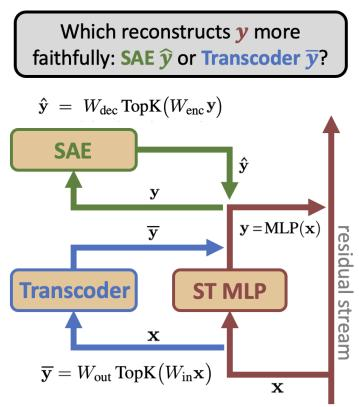

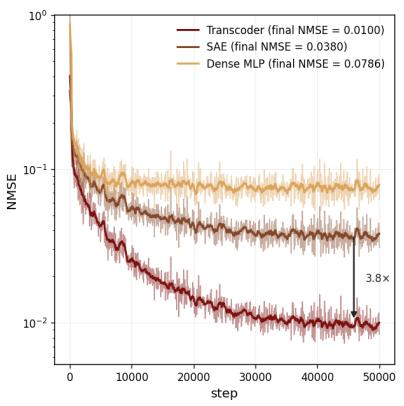

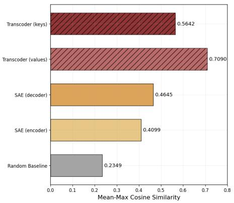  
Figure 3: Feature recovery results (Case Study #1). (left) Schematic of the experiment: comparing Transcoder (trained to approximate the MLP’s input–output mapping) and SAE (trained to reconstruct MLP output activations) against the ground-truth ST neuron vectors. (middle) NMSE training curves for Transcoder and SAE. Transcoder achieves 3.8× lower final NMSE than SAE. (right) Average cosine similarity between each true ST latent and its closest SAE/Transcoder latent. Transcoder value vectors achieve +52.6% improvement over SAE decoder vectors.

## 5.2 Setup

We focus on layer 2 of the primary ST $\scriptstyle ( M = 3 2$ $K { = } 8 )$ , which captures richer semantic features than early layers (tied to surface statistics) or late layers (tied to next-token prediction) (Rogers et al., 2020; Skean et al., 2025). Both methods target the output of this MLP layer: the SAE reconstructs it from the output itself, while the Transcoder predicts it from the MLP’s own input. They are trained with identical hyperparameters: dictionary size D=8,192 and sparsity $K { = } 8 .$ , matching the true MLP’s width (N) and sparsity (K).

For each ST neuron i, the ground-truth vectors are its key $\mathbf { k } _ { i } ~ = ~ V _ { \mathrm { i n } } [ i , : ]$ (the input pattern that causes it to activate) and its value $\mathbf { v } _ { i } = V _ { \mathrm { o u t } } [ : , i ]$ (the vector it adds to the residual stream when active). To measure how well a method recovers these vectors, we use mean-max cosine similarity (MMCS) (Chanin and Garriga-Alonso, 2025; Sharkey et al., 2022): for each true vector, we find the closest learned latent, then average over all true vectors. Formally, let $\mathbf { U } = \{ \mathbf { u } _ { i } \} _ { i = 1 } ^ { N }$ be the set of N ground-truth neuron vectors and $\mathbf { \bar { R } } = \{ \mathbf { r } _ { j } \} _ { j = 1 } ^ { D }$ the set of D learned latents; then:

$$
\mathbf { M M C S } ( \mathbf { U } , \mathbf { R } ) = \frac { 1 } { N } \sum _ { i = 1 } ^ { N } \operatorname* { m a x } _ { j } \cos ( \mathbf { u } _ { i } , \mathbf { r } _ { j } ) .
$$

We apply MMCS to match (1) true value vectors $\mathbf { v } _ { i }$ against SAE encoder and decoder vectors, and (2) true key and value vectors ki, vi against Transcoder input and output weight vectors respectively.

## 5.3 Results

The Transcoder converges to a Normalized Mean Squared Error (NMSE) of 0.01 compared to 0.038 for the SAE, a 3.8× improvement (Fig. 3, middle), and its features align better with ground truth across all comparisons (Fig. 3, right). For value recovery, Transcoder value vectors achieve an average cosine similarity of 0.709 with true value vectors, compared to 0.465 for the SAE decoder (+52.6%) and 0.410 for the SAE encoder (+72.9%). These gaps are consistent and large: the ranking holds for K∈{4, 16} and for BatchTopK (Bussmann et al., 2024) and Matryoshka (Bussmann et al., 2025) variants, each with 3 seeds (App. A, Table 3).

## 5.4 Discussion

This result may appear counter-intuitive. From an optimisation standpoint, the Transcoder faces the harder task: the SAE receives its target as input, whereas the Transcoder must learn a nonlinear mapping between two spaces, jointly discovering keys and values (see detailed discussion in App. A). Yet the Transcoder outperforms the SAE on both reconstruction and feature recovery. We attribute this to the stronger inductive bias of the function-level objective: the SAE can achieve low reconstruction error with features that are geometrically convenient but mechanistically unfaithful (Korznikov et al., 2026), whereas the Transcoder, constrained to reproduce the MLP’s behaviour across the input distribution, cannot resort to such solutions. These findings suggest that function-level methods, such as Transcoders or Crosscoders (Ameisen et al., 2025), may recover model features more reliably.

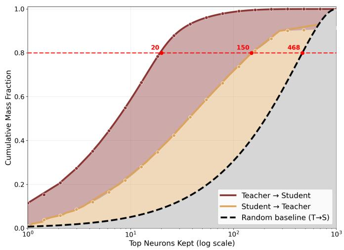  
Figure 4: Teacher-student mapping and polysemanticity. (left) Cumulative mass functions for both mapping directions. At the 80% level, each teacher neuron $t _ { i }$ maps to ∼20 student neurons $s _ { j }$ , while each student neuron draws from ∼150 teacher neurons. (right) Student neuron $s _ { 3 1 0 }$ superposes four semantically unrelated teacher neurons: body-part tokens, verb propagation after [they], [again]/[in] propagation, and time-expression tokens.

## 6 Case Study #2: Emergence of Polysemanticity Under Compression

## 6.1 Motivation

The superposition hypothesis (Elhage et al., 2022b) proposes that polysemanticity arises because a dense MLP approximates the function of a much wider sparse one: each dense neuron superposes multiple sparse features to compensate for reduced width. Prior tests of this account have used toy models where sparse features and weights are defined by the experimenter (Elhage et al., 2022b; Sharkey et al., 2022), a controlled but artificial setting. Our ST provides a more realistic test: sparse features that emerge from training on natural language, with distillation into a dense student serving as a controlled analogue of the compression that produces polysemanticity in production LLMs.

## 6.2 Setup

We work with layer 2 of the primary ST (M=32, $K { = } 8 )$ . This layer’s sparse MLP (the teacher) has $N _ { T } { = } 8 , 1 9 2$ neurons $\{ t _ { i } \} _ { i = 1 } ^ { N _ { T } }$ We train a dense student MLP to approximate the teacher’s input– output mapping. The student has $\scriptstyle N _ { S } = 1 , 0 2 4$ neurons $( 8 \times$ fewer than the teacher) with no TopK constraint, trained for 50,000 steps on input–output pairs drawn from the teacher. The student is trained solely to minimise MSE on the teacher’s input–output pairs, with no language-modelling objective. It achieves NMSE=0.078, indicating a faithful approximation of the teacher (Fig. 3).

## 6.3 Teacher–Student Neuron Mapping

To characterise how teacher neurons are encoded in the student, we associate each teacher neuron $t _ { i }$ with a distribution over student neurons via the conditional expectation

$$
a ( s _ { j } \mid t _ { i } ) \propto \mathbb { E } [ s _ { j } \mid t _ { i } { \mathrm { i s ~ a c t i v e } } ] ,
$$

normalised to sum to one over all $N _ { S }$ student neurons. The reverse mapping $b ( t _ { i } ~ \mid ~ s _ { j } )$ is defined analogously. The key question is whether these distributions are concentrated on a small number of neurons or spread uniformly. Concentration would imply structured reuse, while uniform spread would suggest no systematic alignment.

## 6.4 Results

Quantifying polysemanticity. Figure 4 (left) shows the cumulative mass functions for both mapping directions, with a random baseline confirming that the observed structure is specific to the trained student. The two directions are sharply asymmetric. In the forward direction $a ( s _ { j } \mid t _ { i } )$ , 80% of a teacher neuron’s mass concentrates on roughly 20 student neurons: each sparse feature maps to a localised region of the dense model rather than spreading uniformly. In the reverse direction $b ( t _ { i } \mid s _ { j } )$ , each student neuron draws 80% of its mass from roughly 150 teacher neurons, consistent with the 8× compression ratio $( 2 0 \times 8 \approx 1 6 0 )$ . This asymmetry is the expected signature of superposition: compression forces each dense neuron to absorb many sparse features, while each sparse feature retains a concentrated footprint in the dense representation.

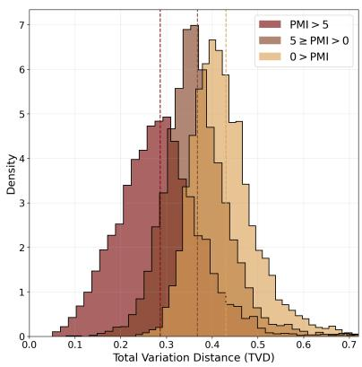

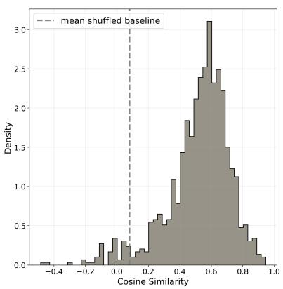

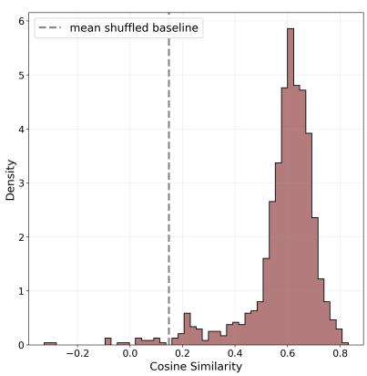  
Figure 5: Feature composition and geometric alignment. (left) TVD between student-space distributions of teacher neuron pairs, stratified by PMI. High-PMI pairs show lower TVD, indicating co-occurring features map to overlapping student regions. (middle) Cosine similarity between student value vectors and the teacher-distributionweighted average of teacher value vectors, far above the shuffled baseline (≈0.15). (right) Same analysis for key vectors, confirming geometric alignment holds for both input and output projections.

Qualitative example. Figure 4 (right) shows student neuron $s _ { 3 1 0 }$ . Its four most influential teacher neurons encode entirely unrelated concepts: activating on [own] and propagating body-part tokens; activating on [they] and propagating verb tokens; activating on [together] and propagating [again]/[in]; and activating on [upon] and propagating time expressions. This is a direct, visually interpretable instance of polysemanticity.

Feature composition and absorption. We ask whether teacher neurons that frequently co-occur (pointwise mutual information PMI > 5) map to similar regions of student space. Figure 5 (left) shows the distribution of Total Variation Distance (TVD) between the student-space distributions of teacher neuron pairs, stratified by PMI. High-PMI pairs show substantially lower TVD (mean ≈0.29) than anti-correlated pairs (mean ≈0.44). Co-occurring features are absorbed into the same dense neurons, mirroring the feature absorption and composition phenomena reported for SAEs (Chanin et al., 2026; Korznikov et al., 2025).

Geometric alignment. We test whether a student neuron’s weight vectors are a weighted average of its constituent teacher neurons’ weight vectors. For each student neuron $s _ { j }$ , we calculate

$$
\hat { \mathbf { w } } _ { j } = \sum _ { i = 1 } ^ { N _ { T } } b ( t _ { i } \mid s _ { j } ) \mathbf { w } _ { i } ^ { ( t ) }
$$

where $\mathbf { w } _ { i } ^ { ( t ) }$ is either the key $\mathbf { k } _ { i } ^ { ( t ) }$ or value $\mathbf { v } _ { i } ^ { ( t ) }$ of teacher neuron $t _ { i }$ . The cosine similarity between $\hat { \mathbf { w } } _ { j }$ and the true student weight vectors concentrates at 0.60, well above the shuffled baseline of 0.15 (Figure 5, middle and right). Thus, the weight structure of a polysemantic neuron is not arbitrary: it is a linear combination of the sparse features it encodes, providing a concrete mechanistic account of how compression shapes internal representations.

## 7 Conclusion

We introduced Sparse Transformer (ST), a language model with TopK-sparse MLPs, and found that this sparsity yields highly monosemantic neurons. Our primary model (M=32, K=8) reaches an AutoInterp score of 0.866 and supports compact, human-readable circuits. The two case studies exploit the known neuron basis of the ST to compare feature-learning methods and to trace how compression produces polysemanticity. An empirical power-law relationship between width, sparsity, and loss further indicates that extreme sparsity can be offset by moderate width increases, suggesting a route toward scalable interpretable architectures.

Looking ahead, the ST testbed provides a controlled setting for evaluating interpretability methods against a known reference basis in naturallanguage models. We hope this facilitates systematic comparison of feature-learning techniques and empirical testing of theoretical claims regarding polysemanticity and superposition. We release all models and checkpoints to support such work.

## Limitations

Our models are trained on TinyStories and contain only 5 layers with a hidden dimension of 256. This setting is sufficient to establish the ST as a ground-truth testbed and to support interpretable circuits over concrete, narrative-level concepts, but the model’s limited capacity constrains the range and abstraction of recoverable features. Neurons specialise in surface-level syntactic patterns, character states, and simple narrative conventions; features encoding abstract reasoning, world knowledge, or long-range dependencies lie outside what this scale can represent. Our scaling results suggest a path to addressing this directly, and training a larger ST along the identified width–sparsity frontier is a natural direction for future work.

## References

Josh Achiam, Steven Adler, Sandhini Agarwal, Lama Ahmad, Ilge Akkaya, Florencia Leoni Aleman, Diogo Almeida, Janko Altenschmidt, Sam Altman, Shyamal Anadkat, and 1 others. 2023. Gpt-4 technical report. arXiv preprint arXiv:2303.08774.

Emmanuel Ameisen, Jack Lindsey, Adam Pearce, Wes Gurnee, Nicholas L. Turner, Brian Chen, Craig Citro, David Abrahams, Shan Carter, Basil Hosmer, Jonathan Marcus, Michael Sklar, Adly Templeton, Trenton Bricken, Callum McDougall, Hoagy Cunningham, Thomas Henighan, Adam Jermyn, Andy Jones, and 8 others. 2025. Circuit tracing: Revealing computational graphs in language models. Transformer Circuits Thread.

Aryaman Arora, Zhengxuan Wu, Jacob Steinhardt, and Sarah Schwettmann. 2026. Language model circuits are sparse in the neuron basis. arXiv preprint arXiv:2601.22594.

Trenton Bricken, Adly Templeton, Joshua Batson, Brian Chen, Adam Jermyn, Tom Conerly, Nick Turner, Cem Anil, Carson Denison, Amanda Askell, Robert Lasenby, Yifan Wu, Shauna Kravec, Nicholas Schiefer, Tim Maxwell, Nicholas Joseph, Zac Hatfield-Dodds, Alex Tamkin, Karina Nguyen, and 6 others. 2023. Towards monosemanticity: Decomposing language models with dictionary learning. Transformer Circuits Thread. Https://transformercircuits.pub/2023/monosemanticfeatures/index.html.

Bart Bussmann, Patrick Leask, and Neel Nanda. 2024. Batchtopk sparse autoencoders. arXiv preprint arXiv:2412.06410.

Bart Bussmann, Noa Nabeshima, Adam Karvonen, and Neel Nanda. 2025. Learning multi-level features with matryoshka sparse autoencoders. arXiv preprint arXiv:2503.17547.

David Chanin and Adrià Garriga-Alonso. 2025. Sparse but wrong: Incorrect l0 leads to incorrect features in sparse autoencoders. arXiv preprint arXiv:2508.16560.

David Chanin and Adrià Garriga-Alonso. 2026. Synthsaebench: Evaluating sparse autoencoders on scalable realistic synthetic data. arXiv preprint arXiv:2602.14687.

David Chanin, James Wilken-Smith, Tomáš Dulka, Hardik Bhatnagar, Satvik Golechha, and Joseph Bloom. 2026. A is for absorption: Studying feature splitting and absorption in sparse autoencoders. Advances in Neural Information Processing Systems, 38:82318–82355.

Rewon Child, Scott Gray, Alec Radford, and Ilya Sutskever. 2019. Generating long sequences with sparse transformers. arXiv preprint arXiv:1904.10509.

Arthur Conmy, Augustine Mavor-Parker, Aengus Lynch, Stefan Heimersheim, and Adrià Garriga-Alonso. 2023. Towards automated circuit discovery for mechanistic interpretability. Advances in Neural Information Processing Systems, 36:16318–16352.

Hoagy Cunningham, Aidan Ewart, Logan Riggs, Robert Huben, and Lee Sharkey. 2023. Sparse autoencoders find highly interpretable features in language models. arXiv preprint arXiv:2309.08600.

Jacob Dunefsky, Philippe Chlenski, and Neel Nanda. 2024. Transcoders find interpretable llm feature circuits. Advances in Neural Information Processing Systems, 37:24375–24410.

Ronen Eldan and Yuanzhi Li. 2023. Tinystories: How small can language models be and still speak coherent english? arXiv preprint arXiv:2305.07759.

Nelson Elhage, Tristan Hume, Catherine Olsson, Neel Nanda, Tom Henighan, Scott Johnston, Sheer ElShowk, Nicholas Joseph, Nova DasSarma, Ben Mann, Danny Hernandez, Amanda Askell, Kamal Ndousse, Andy Jones, Dawn Drain, Anna Chen, Yuntao Bai, Deep Ganguli, Liane Lovitt, and 14 others. 2022a. Softmax linear units. Transformer Circuits Thread. Https://transformercircuits.pub/2022/solu/index.html.

Nelson Elhage, Tristan Hume, Catherine Olsson, Nicholas Schiefer, Tom Henighan, Shauna Kravec, Zac Hatfield-Dodds, Robert Lasenby, Dawn Drain, Carol Chen, and 1 others. 2022b. Toy models of superposition. arXiv preprint arXiv:2209.10652.

Nelson Elhage, Neel Nanda, Catherine Olsson, Tom Henighan, Nicholas Joseph, Ben Mann, Amanda Askell, Yuntao Bai, Anna Chen, Tom Conerly, Nova DasSarma, Dawn Drain, Deep Ganguli, Zac Hatfield-Dodds, Danny Hernandez, Andy Jones, Jackson Kernion, Liane Lovitt, Kamal

Ndousse, and 6 others. 2021. A mathematical framework for transformer circuits. Transformer Circuits Thread. Https://transformercircuits.pub/2021/framework/index.html.

William Fedus, Barret Zoph, and Noam Shazeer. 2022. Switch transformers: Scaling to trillion parameter models with simple and efficient sparsity. Journal of Machine Learning Research, 23(120):1–39.

Leo Gao, Tom Dupre la Tour, Henk Tillman, Gabriel Goh, Rajan Troll, Alec Radford, Ilya Sutskever, Jan Leike, and Jeffrey Wu. 2025a. Scaling and evaluating sparse autoencoders. In International Conference on Learning Representations, volume 2025, pages 26721–26754.

Leo Gao, Achyuta Rajaram, Jacob Coxon, Soham V Govande, Bowen Baker, and Dan Mossing. 2025b. Weight-sparse transformers have interpretable circuits. arXiv preprint arXiv:2511.13653.

Hongcan Guo, Haolang Lu, Guoshun Nan, Bolun Chu, Jialin Zhuang, Yuan Yang, Wenhao Che, Xinye Cao, Sicong Leng, Qimei Cui, and 1 others. 2026. Advancing expert specialization for better moe. Advances in Neural Information Processing Systems, 38:48767– 48809.

Jordan Hoffmann, Sebastian Borgeaud, Arthur Mensch, Elena Buchatskaya, Trevor Cai, Eliza Rutherford, DDL Casas, Lisa Anne Hendricks, Johannes Welbl, Aidan Clark, and 1 others. 2022. Training compute-optimal large language models. arXiv preprint arXiv:2203.15556, 10.

Robert Huben. 2024. Research report: Sparse autoencoders find only 9/180 board state features in othellogpt. URL https://www. lesswrong. com/posts/BduCMgmjJnCtc7jKc/researchreport-sparse-autoencoders-find-only-9-180-board.

Aaron Hurst, Adam Lerer, Adam P Goucher, Adam Perelman, Aditya Ramesh, Aidan Clark, AJ Ostrow, Akila Welihinda, Alan Hayes, Alec Radford, and 1 others. 2024. Gpt-4o system card. arXiv preprint arXiv:2410.21276.

Jared Kaplan, Sam McCandlish, Tom Henighan, Tom B Brown, Benjamin Chess, Rewon Child, Scott Gray, Alec Radford, Jeffrey Wu, and Dario Amodei. 2020. Scaling laws for neural language models. arXiv preprint arXiv:2001.08361.

Adam Karvonen, Can Rager, Johnny Lin, Curt Tigges, Joseph Bloom, David Chanin, Yeu-Tong Lau, Eoin Farrell, Callum McDougall, Kola Ayonrinde, and 1 others. 2025. Saebench: A comprehensive benchmark for sparse autoencoders in language model interpretability. arXiv preprint arXiv:2503.09532.

Laura Kopf, Nils Feldhus, Kirill Bykov, Philine L Bommer, Anna Hedström, Marina Höhne, and Oliver Eberle. 2026. Capturing polysemanticity with prism: A multi-concept feature description framework. Advances in Neural Information Processing Systems, 38:82938–82974.

Anton Korznikov, Andrey Galichin, Alexey Dontsov, Oleg Rogov, Ivan Oseledets, and Elena Tutubalina. 2026. Sanity checks for sparse autoencoders: Do saes beat random baselines? arXiv preprint arXiv:2602.14111.

Anton Korznikov, Andrey Galichin, Alexey Dontsov, Oleg Rogov, Elena Tutubalina, and Ivan Oseledets. 2025. Ortsae: Orthogonal sparse autoencoders uncover atomic features. arXiv preprint arXiv:2509.22033.

Patrick Leask, Bart Bussmann, Michael Pearce, Joseph Bloom, Curt Tigges, Noura Al Moubayed, Lee Sharkey, and Neel Nanda. 2025. Sparse autoencoders do not find canonical units of analysis. In International Conference on Learning Representations, volume 2025, pages 53617–53642.

Tom Lieberum, Senthooran Rajamanoharan, Arthur Conmy, Lewis Smith, Nicolas Sonnerat, Vikrant Varma, János Kramár, Anca Dragan, Rohin Shah, and Neel Nanda. 2024. Gemma scope: Open sparse autoencoders everywhere all at once on gemma 2. In Proceedings of the 7th BlackboxNLP Workshop: Analyzing and Interpreting Neural Networks for NLP, pages 278–300.

Jack Lindsey, Wes Gurnee, Emmanuel Ameisen, Brian Chen, Adam Pearce, Nicholas L. Turner, Craig Citro, David Abrahams, Shan Carter, Basil Hosmer, Jonathan Marcus, Michael Sklar, Adly Templeton, Trenton Bricken, Callum McDougall, Hoagy Cunningham, Thomas Henighan, Adam Jermyn, Andy Jones, and 8 others. 2025. On the biology of a large language model. Transformer Circuits Thread.

Ilya Loshchilov and Frank Hutter. 2017. Decoupled weight decay regularization. arXiv preprint arXiv:1711.05101.

Samuel Marks, Can Rager, Eric Michaud, Yonatan Belinkov, David Bau, and Aaron Mueller. 2025. Sparse feature circuits: Discovering and editing interpretable causal graphs in language models. In International Conference on Learning Representations, volume 2025, pages 23888–23923.

Siyuan Mu and Sen Lin. 2025. A comprehensive survey of mixture-of-experts: Algorithms, theory, and applications. arXiv preprint arXiv:2503.07137.

Neel Nanda, Lawrence Chan, Tom Lieberum, Jess Smith, and Jacob Steinhardt. 2023. Progress measures for grokking via mechanistic interpretability. arXiv preprint arXiv:2301.05217.

nostalgebraist. 2020. interpreting gpt: the logit lens. LessWrong.

Chris Olah, Nick Cammarata, Ludwig Schubert, Gabriel Goh, Michael Petrov, and Shan Carter. 2020. Zoom in: An introduction to circuits. Distill, 5(3):e00024– 001.

Chris Olah, Alexander Mordvintsev, and Ludwig Schubert. 2017. Feature visualization. Distill, 2(11):e7.

Gonçalo Paulo, Alex Mallen, Caden Juang, and Nora Belrose. 2024. Automatically interpreting millions of features in large language models. arXiv preprint arXiv:2410.13928.

Gonçalo Paulo, Stepan Shabalin, and Nora Belrose. 2025. Transcoders beat sparse autoencoders for interpretability. arXiv preprint arXiv:2501.18823.

Senthooran Rajamanoharan, Tom Lieberum, Nicolas Sonnerat, Arthur Conmy, Vikrant Varma, János Kramár, and Neel Nanda. 2024. Jumping ahead: Improving reconstruction fidelity with jumprelu sparse autoencoders. arXiv preprint arXiv:2407.14435.

Anna Rogers, Olga Kovaleva, and Anna Rumshisky. 2020. A primer in bertology: What we know about how bert works. Transactions ofthe associationfor computational linguistics, 8:842–866.

Lee Sharkey, Dan Braun, and Beren Millidge. 2022. Taking features out of superposition with sparse autoencoders. In AI Alignment Forum, volume 6, pages 12–13.

Lee Sharkey, Bilal Chughtai, Joshua Batson, Jack Lind sey, Jeff Wu, Lucius Bushnaq, Nicholas Goldowsky-Dill, Stefan Heimersheim, Alejandro Ortega, Joseph Bloom, and 1 others. 2025. Open problems in mechanistic interpretability. arXiv preprint arXiv:2501.16496.

Noam Shazeer, Azalia Mirhoseini, Krzysztof Maziarz, Andy Davis, Quoc Le, Geoffrey Hinton, and Jeff Dean. 2017. Outrageously large neural networks: The sparsely-gated mixture-of-experts layer. arXiv preprint arXiv:1701.06538.

Oscar Skean, Md Rifat Arefin, Dan Zhao, Niket Patel, Jalal Naghiyev, Yann LeCun, and Ravid Shwartz-Ziv. 2025. Layer by layer: Uncovering hidden representations in language models. arXiv preprint arXiv:2502.02013.

Jianlin Su, Murtadha Ahmed, Yu Lu, Shengfeng Pan, Wen Bo, and Yunfeng Liu. 2024. Roformer: Enhanced transformer with rotary position embedding. Neurocomputing, 568:127063.

Denis Sutter, Julian Minder, Thomas Hofmann, and Tiago Pimentel. 2026. The non-linear representation dilemma: Is causal abstraction enough for mechanistic interpretability? Advances in Neural Information Processing Systems, 38:149455–149503.

Curt Tigges, Michael Hanna, Qinan Yu, and Stella Biderman. 2024. Llm circuit analyses are consistent across training and scale. Advances in Neural Information Processing Systems, 37:40699–40731.

Ashish Vaswani, Noam Shazeer, Niki Parmar, Jakob Uszkoreit, Llion Jones, Aidan N Gomez, Łukasz Kaiser, and Illia Polosukhin. 2017. Attention is all you need. Advances in neural information processing systems, 30.

Kevin Wang, Alexandre Variengien, Arthur Conmy, Buck Shlegeris, and Jacob Steinhardt. 2022. Interpretability in the wild: a circuit for indirect object identification in gpt-2 small. arXiv preprint arXiv:2211.00593.

Biao Zhang and Rico Sennrich. 2019. Root mean square layer normalization. Advances in neural information processing systems, 32.

Guangxiang Zhao, Junyang Lin, Zhiyuan Zhang, Xuancheng Ren, Qi Su, and Xu Sun. 2019. Explicit sparse transformer: Concentrated attention through explicit selection. arXiv preprint arXiv:1912.11637.

## A Robustness of Case Study #1

To test whether the SAE–Transcoder ranking depends on the sparsity mechanism or sparsity level, we additionally train both methods with $K \in \{ 4 , 1 6 \}$ and with BatchTopK (Bussmann et al., 2024) and Matryoshka (Bussmann et al., 2025) sparsity, each over 3 seeds (Table 3). We fix $\scriptstyle D = N = 8 , 1 9 2$ so that the dictionary can represent the true basis exactly and MMCS is comparable across methods. The Transcoder is better on every metric in every configuration.

Interpreting the gap. Let the ST MLP compute $\begin{array} { r } { \mathbf { y } = f ( \mathbf { x } ) = V _ { \mathrm { o u t } } \mathrm { T o p K } \big ( \mathrm { R e L U } ( V _ { \mathrm { i n } } \mathbf { x } ) \big ) } \end{array}$ . The SAE and the Transcoder minimise, respectively,

$$
\begin{array} { r } { \mathcal { L } _ { \mathrm { S A E } } = \mathbb { E } \big \| \mathbf { y } - \mathbf { W } ^ { \mathrm { d e c } } \operatorname { T o p } \mathbf { K } ( \mathbf { W } ^ { \mathrm { e n c } } \mathbf { y } ) \big \| _ { 2 } ^ { 2 } , } \end{array}\tag{1}
$$

$$
\begin{array} { r } { \mathcal { L } _ { \mathrm { T C } } = \mathbb { E } \big \| \mathbf { y } - \mathbf { W } _ { \mathrm { o u t } } \mathrm { T o p K } ( \mathbf { W } _ { \mathrm { i n } } \mathbf { x } ) \big \| _ { 2 } ^ { 2 } . } \end{array}\tag{2}
$$

From an optimisation standpoint, the Transcoder faces the harder problem. The SAE observes its target y directly and only needs to find a sparse code for it, whereas the Transcoder never observes y at its input: it must approximate the nonlinear map f between two distinct spaces, which requires jointly identifying the keys $\mathbf { k } _ { i }$ that determine the active set from x and the values $\mathbf { v } _ { i }$ that produce y. At the same time, the testbed realises the SAE’s generative assumption exactly. By construction,

$$
\mathbf { y } = \sum _ { i \in S ( \mathbf { x } ) } a _ { i } ( \mathbf { x } ) \mathbf { v } _ { i } , \qquad | S ( \mathbf { x } ) | = K , \ a _ { i } ( \mathbf { x } ) \geq 0 ,
$$

so every MLP output is a K-sparse non-negative combination of a fixed dictionary of N vectors, and with $D { = } N$ the choice $\mathbf { W } ^ { \mathrm { d e c } } { = } V _ { \mathrm { o u t } }$ lies within the SAE’s hypothesis class. This is the regime in which output reconstruction is best positioned to identify the true features, yet the SAE’s value MMCS remains between 0.365 and 0.469 across all configurations. Finally, the Transcoder’s advantage does not rest on matching the ST MLP architecture. With $K \in \{ 4 , 1 6 \}$ , BatchTopK, or Matryoshka sparsity, its gating differs from the ST’s per-token TopK with $K { = } 8$ , so it no longer shares the functional form of f. Nevertheless, it outperforms the SAE on every metric in each of these configurations, with value MMCS at least 1.5× higher in all of them (e.g., 0.661 vs. 0.378 at $K { = } 4 ; 0 . 7 0 1$ vs. 0.411 with BatchTopK). The gap therefore persists whether or not the Transcoder can represent $f$ exactly, which points to a genuine difference between reconstructing a representation and approximating a computation.

## B Circuit Metrics and Additional Circuits

To test whether the circuit in Section 4.2 is representative, we extract circuits for 15 additional prompts in the style of TinyStories, all with target token probability $P _ { 0 } ~ { \ge } ~ 0 . 8 0$ . For each prompt, we apply the same beam-search ablation protocol with a budget of 50 neurons and record $F$ and C at every circuit size $n \in [ 1 , 5 0 ]$ . Table 4 reports per-prompt metrics, and Table 5 aggregates them by circuit size.

Reading the metrics. C is defined such that lower is better: $C { = } 0 . 2$ means that ablating the circuit reduces the target probability fivefold. As a reference, ablating 11 random neurons leaves P([eat]) virtually unchanged (C≈0.998). F can exceed 1 when the neurons outside the circuit are net-suppressive; the circuit then reproduces the net effect of the full model rather than its exact probability.

Results. A median of 12 neurons suffices to reach $F \geq 0 . 9 5$ , achieved by 15 of 16 prompts within the budget. At a fixed budget of 20 neurons, F averages 1.01 and C has a median of 0.12; 14 of 16 circuits reach $F \ge 0 . 9 5$ and 11 of 16 reach $C \le 0 . 2$ at this size. Faithfulness saturates faster than completeness: for some prompts (e.g., [mirror], [read]), a small circuit reproduces the prediction while its ablation leaves much of the target probability intact, indicating redundant pathways that support the same token. Overall, compact circuits are a stable property of the model across prediction probabilities (81.5%–99.9%) and semantic contexts. Figures 6–20 show the F and C curves for each prompt..

## C Neuron Dashboards

This appendix presents dashboards for 20 randomly sampled neurons (4 per layer). For each neuron, we display its top activating contexts at multiple intensity tiers. To aid interpretation, we also project the input weight vector $W _ { \mathrm { i n } }$ onto the embedding space and the output weight vector $W _ { \mathrm { o u t } }$ onto the unembedding space-a Logit Lens (nostalgebraist, 2020) applied to individual MLP neurons. The resulting top positive and negative logits reveal what patterns the neuron detects and which tokens it promotes or suppresses. Together, these examples illustrate that ST neurons encode clear, specific concepts.

<table><tr><td>Setting</td><td>Method</td><td>NMSE↓</td><td>MMCS enc./key ↑</td><td>MMCS dec./value ↑</td></tr><tr><td rowspan="2">TopK (K=8)</td><td>Transcoder</td><td> $0 . 0 0 9 4 \pm 0 . 0 0 0 5$ </td><td> $0 . 5 6 4 \pm 0 . 0 0 0 2$ </td><td> $0 . 7 0 9 \pm 0 . 0 0 0 1$ </td></tr><tr><td>SAE</td><td> $0 . 0 3 5 8 \pm 0 . 0 0 2 0$ </td><td> $0 . 4 1 0 \pm 0 . 0 0 0 1$ </td><td> $0 . 4 6 4 \pm 0 . 0 0 0 1$ </td></tr><tr><td rowspan="2">TopK (K=4)</td><td>Transcoder</td><td> $0 . 0 2 3 7 \pm 0 . 0 0 1 2$ </td><td> $0 . 4 9 3 \pm 0 . 0 0 0 2$ </td><td> $0 . 6 6 1 \pm 0 . 0 0 0 1$ </td></tr><tr><td>SAE</td><td> $0 . 0 6 8 1 \pm 0 . 0 0 3 7$ </td><td> $0 . 3 4 0 \pm 0 . 0 0 0 0$ </td><td> $0 . 3 7 8 \pm 0 . 0 0 0 0$ </td></tr><tr><td rowspan="2">TopK (K=16)</td><td>Transcoder</td><td> $0 . 0 0 6 8 \pm 0 . 0 0 0 4$ </td><td> $0 . 5 9 3 \pm 0 . 0 0 0 1$ </td><td> $0 . 7 2 0 \pm 0 . 0 0 0 1$ </td></tr><tr><td>SAE</td><td> $0 . 0 2 4 7 \pm 0 . 0 0 1 3$ </td><td> $0 . 4 1 5 \pm 0 . 0 0 0 1$ </td><td> $0 . 4 6 9 \pm 0 . 0 0 0 2$ </td></tr><tr><td rowspan="2">BatchTopK (K=8)</td><td>Transcoder</td><td> $0 . 0 0 9 9 \pm 0 . 0 0 0 5$ </td><td> $0 . 5 6 4 \pm 0 . 0 0 0 2$ </td><td> $0 . 7 0 1 \pm 0 . 0 0 0 1$ </td></tr><tr><td>SAE</td><td> $0 . 0 4 5 1 \pm 0 . 0 0 2 5$ </td><td> $0 . 3 6 2 \pm 0 . 0 0 0 1$ </td><td> $0 . 4 1 1 \pm 0 . 0 0 0 1$ </td></tr><tr><td rowspan="2">Matryoshka (K=8)</td><td>Transcoder</td><td> $0 . 0 3 6 1 \pm 0 . 0 0 1 7$ </td><td> $0 . 4 2 2 \pm 0 . 0 0 0 1$ </td><td> $0 . 5 5 9 \pm 0 . 0 0 0 1$ </td></tr><tr><td>SAE</td><td> $0 . 0 5 2 8 \pm 0 . 0 0 2 9$ </td><td> $0 . 3 1 4 \pm 0 . 0 0 0 1$ </td><td> $0 . 3 6 5 \pm 0 . 0 0 0 1$ </td></tr></table>

Table 3: SAE vs. Transcoder under alternative sparsity settings (mean ± std over 3 seeds). As in Section 5, SAE encoder and decoder vectors (“enc.”, “dec.”) are matched against the true value vectors, whereas Transcoder input and output vectors (“key”, “value”) are matched against the true keys and values, respectively.

<table><tr><td>#</td><td>Target</td><td> $P _ { 0 } \left( \% \right)$ </td><td> $n _ { F }$ </td><td> $F ( n _ { F } )$ </td><td> $C ( n _ { F } )$ </td><td> $n _ { C }$ </td><td> $F ( 2 0 )$ </td><td> $C ( 2 0 )$ </td></tr><tr><td>1</td><td>[eat]</td><td>98.3</td><td>11</td><td>0.956</td><td>0.198</td><td>11</td><td>1.010</td><td>0.142</td></tr><tr><td>2</td><td>[hug]</td><td>89.1</td><td>12</td><td>0.961</td><td>0.114</td><td>9</td><td>1.082</td><td>0.063</td></tr><tr><td>3</td><td>[chase]</td><td>81.5</td><td>13</td><td>0.968</td><td>0.467</td><td>39</td><td>1.112</td><td>0.338</td></tr><tr><td>4</td><td>[prince]</td><td>96.9</td><td>14</td><td>0.951</td><td>0.139</td><td>11</td><td>0.982</td><td>0.085</td></tr><tr><td>5</td><td>[voice]</td><td>94.8</td><td>5</td><td>0.986</td><td>0.331</td><td>6</td><td>1.054</td><td>0.057</td></tr><tr><td>6</td><td>[day]</td><td>99.1</td><td>12</td><td>0.954</td><td>0.149</td><td>10</td><td>0.996</td><td>0.089</td></tr><tr><td>7</td><td>[treasure]</td><td>91.7</td><td>12</td><td>0.954</td><td>0.606</td><td>37</td><td>1.027</td><td>0.379</td></tr><tr><td>8</td><td>[table]</td><td>98.8</td><td>19</td><td>0.961</td><td>0.008</td><td>4</td><td>0.968</td><td>0.008</td></tr><tr><td>9</td><td>[door]</td><td>99.9</td><td>49</td><td>0.952</td><td>0.016</td><td>27</td><td>0.906</td><td>0.711</td></tr><tr><td>10</td><td>[read]</td><td>88.8</td><td>10</td><td>0.961</td><td>0.596</td><td>一</td><td>0.976</td><td>0.378</td></tr><tr><td>11</td><td>[paper]</td><td>97.7</td><td>一</td><td></td><td></td><td>18</td><td>0.939</td><td>0.166</td></tr><tr><td>12</td><td>[better]</td><td>99.7</td><td>10</td><td>0.973</td><td>0.044</td><td>9</td><td>1.000</td><td>0.003</td></tr><tr><td>13</td><td>[mirror]</td><td>99.9</td><td>3</td><td>0.961</td><td>0.905</td><td>一</td><td>1.000</td><td>0.625</td></tr><tr><td>14</td><td>[oven]</td><td>99.6</td><td>14</td><td>0.961</td><td>0.055</td><td>10</td><td>1.002</td><td>0.018</td></tr><tr><td>15</td><td>[cry]</td><td>83.8</td><td>15</td><td>0.989</td><td>0.009</td><td>3</td><td>1.041</td><td>0.006</td></tr><tr><td>16</td><td>[tall]</td><td>87.2</td><td>8</td><td>0.953</td><td>0.534</td><td>20</td><td>1.075</td><td>0.150</td></tr><tr><td colspan="2">Median [min, max]</td><td>97.3</td><td>12 [3, 49]</td><td>一</td><td>一</td><td>10.5 [3, 39]</td><td>1.00</td><td>0.12</td></tr></table>

Table 4: Per-prompt circuit metrics. $P _ { 0 }$ is the full-model probability of the target token. $n _ { F }$ is the smallest circuit size with $F \geq 0 . 9 5$ (reached by 15 of 16 prompts), and $F ( n _ { F } )$ $C ( n _ { F } )$ are the metrics at that size; $n _ { C }$ is the smallest size with $C \leq 0 . 2$ (reached by 14 of 16 prompts); F(20), C(20) are the metrics at a fixed budget of 20 neurons. Entries marked – are not reached within the 50-neuron budget; medians of $n _ { F }$ and $n _ { C }$ are over prompts that reach the threshold. Row 1 is the circuit in Figure 1.

<table><tr><td>Neurons n</td><td>1</td><td>2</td><td>3</td><td>5</td><td>8</td><td>10</td><td>15</td><td>20</td><td>25</td><td>30</td><td>40</td><td>50</td></tr><tr><td>F mean</td><td>0.11</td><td>0.21</td><td>0.30</td><td>0.49</td><td>0.74</td><td>0.85</td><td>0.98</td><td>1.01</td><td>1.02</td><td>1.03</td><td>1.03</td><td>1.03</td></tr><tr><td>F std</td><td>0.16</td><td>0.25</td><td>0.29</td><td>0.29</td><td>0.22</td><td>0.16</td><td>0.06</td><td>0.05</td><td>0.05</td><td>0.06</td><td>0.06</td><td>0.06</td></tr><tr><td>F median</td><td>0.04</td><td>0.09</td><td>0.16</td><td>0.47</td><td>0.82</td><td>0.90</td><td>0.99</td><td>1.00</td><td>1.00</td><td>1.00</td><td>1.01</td><td>1.01</td></tr><tr><td>C mean</td><td>0.92</td><td>0.84</td><td>0.76</td><td>0.62</td><td>0.45</td><td>0.35</td><td>0.26</td><td>0.20</td><td>0.17</td><td>0.12</td><td>0.09</td><td>0.07</td></tr><tr><td>C std</td><td>0.14</td><td>0.18</td><td>0.23</td><td>0.24</td><td>0.26</td><td>0.28</td><td>0.25</td><td>0.22</td><td>0.17</td><td>0.12</td><td>0.09</td><td>0.07</td></tr><tr><td>C median</td><td>0.96</td><td>0.89</td><td>0.86</td><td>0.66</td><td>0.41</td><td>0.26</td><td>0.19</td><td>0.12</td><td>0.11</td><td>0.08</td><td>0.06</td><td>0.06</td></tr></table>

Table 5: Faithfulness (F, higher is better) and completeness (C, lower is better) as a function of circuit size n, aggregated over the 16 prompts (population std). Per-prompt values for every $n \in [ 1 , 5 0 ]$ are in the released repository.

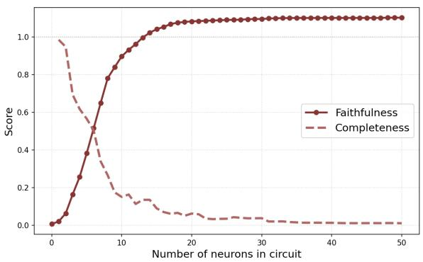  
Figure 6: Circuit for “Shefelt very sad so herfriend gave her a big warm” → [hug] $( p { = } 8 9 . 1 \% )$ .

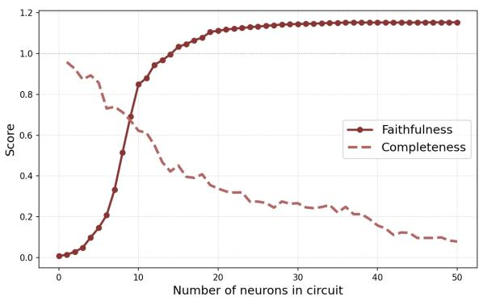  
Figure 7: Circuit for $\mathbf { \mu } ^ { \epsilon } T h e$ cat saw a mouse and started $\mathbf { \delta } _ { t o } ^ { \mathbf { , 3 } } $ [chase] (p=81.5%).

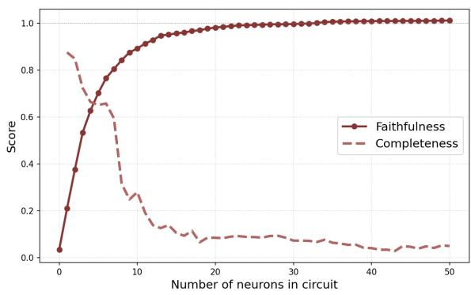  
Figure 8: Circuit for “The princess kissed the frog and it turned into a handsome” → [prince] $( p { = } 9 6 . 9 \% )$ .

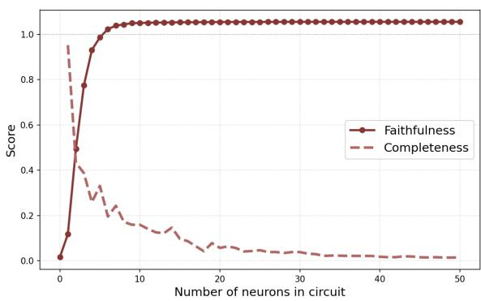  
Figure 9: Circuit for “The robot beeped and said in a $f r i e n d l y ^ { , 9 } $ [voice] $( p { = } 9 4 . 8 \% )$

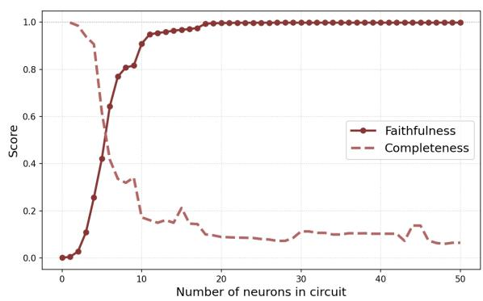  
Figure 10: Circuit for “Sheplanted a seed and watered it every” → [day] $( p { = } 9 9 . 1 \% )$

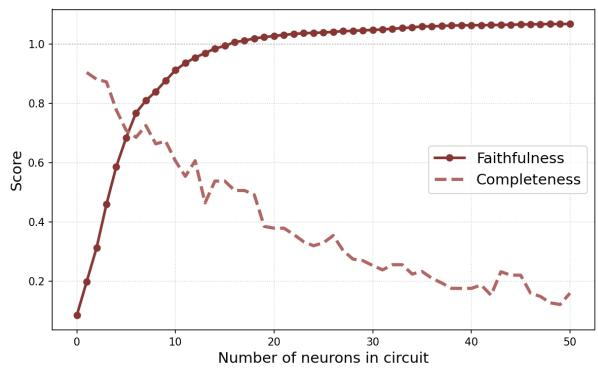  
Figure 11: Circuit for “The pirate looked at the map tofind the $h i d d e n ^ { \prime \prime } $ [treasure] (p=91.7%).

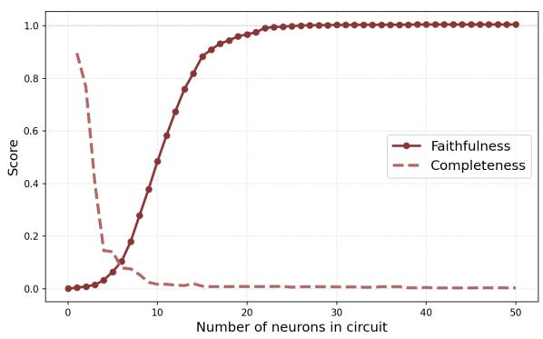  
Figure 12: Circuit for $\mathbf { \omega } ^ { \prime \ 6 } H e$ washed his hands before sitting at the $d i n n e r ^ { 3 7 } $ [table] $( p { = } 9 8 . 8 \% )$ .

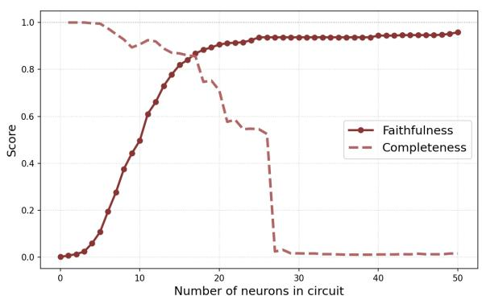  
Figure 13: Circuit for $^ { 6 } S h e p u t$ on her shoes and ran out $t h e ^ { , 9 } $ [door] $( p { = } 9 9 . 9 \% )$ .

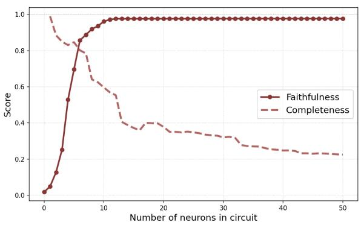  
Figure 14: Circuit for $^ { \bullet } S h e$ opened the book and started $\mathbf { \delta } _ { t o } ^ { \mathbf { , 3 } } $ [read] $( p { = } 8 8 . 8 \% )$ .

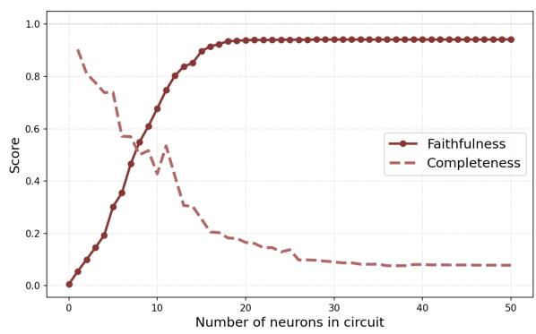  
Figure 15: Circuit for $\mathbf { \omega } ^ { \prime \prime } \mathbf { \widetilde { \Gamma } } ^ { q } e$ wrapped the gift in colorful $s h i n y ^ { \prime \prime } $ [paper] $( p { = } 9 7 . 7 \% )$

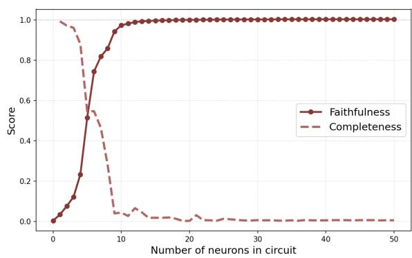  
Figure 16: Circuit for $^ { \bullet } S h e$ drank the hot soup and felt much $! ^ { \pmb { \mathscr { P } } } \longrightarrow$ [better] $( p { = } 9 9 . 7 \% )$ .

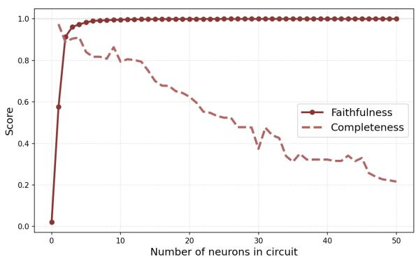  
Figure 17: Circuit for $^ { 6 6 } { \bf \delta } ^ { \prime }$ brushed her hair and looked in $t h e ^ { , 9 } $ [mirror] $( p { = } 9 9 . 9 \% )$

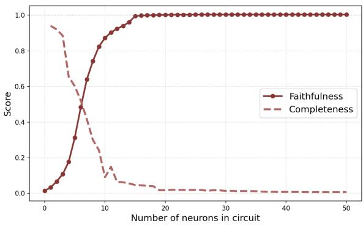  
Figure 18: Circuit for $^ { \prime \prime } \mathbf { S } h e$ baked a cake andput it in $t h e ^ { , 9 } $ [oven] $( p { = } 9 9 . 6 \% )$

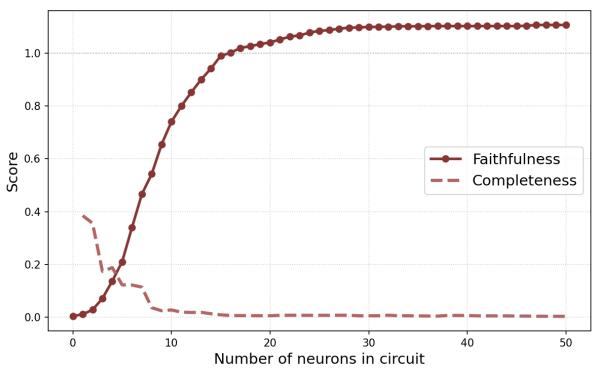  
Figure 19: Circuit for $\mathbf { \mu } ^ { \prime \ 6 } T h e$ baby dropped her toy and started $\mathbf { \delta } _ { t o } ^ { \mathbf { , 3 } } $ [cry] $( p { = } 8 3 . 8 \% )$

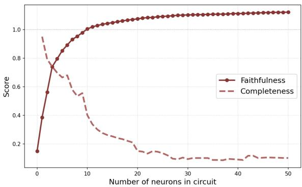  
Figure 20: Circuit for $\mathbf { \omega } ^ { \prime \prime } \mathbf { \widetilde { \Gamma } } ^ { q } e$ stacked the blocks until the tower was $\nu e r y ^ { 3 9 } \to [ \tt t a l 1 ]$ $( p { = } 8 7 . 2 \% )$ .

  
Figure 21: L0-N2286 activates on positive adjectives (good, great) and friendly interpersonal contexts.

  
Figure 22: L0-N2993 detects the relative pronoun who (and its variants whom) in narrative contexts, particularly after a character introduction.

  
Figure 23: L0-N7792 responds to planning and discussion verbs (discussed, brainstorm, plan).

  
Figure 24: L1-N222 activates on the preposition in in contexts where a character notices or discovers something in their surroundings (e.g. “a bright light in the sky”, “something in the distance”). Its output weight vector promotes calm, positive continuations (relax, comfortable, enjoy, trust).

  
Figure 25: L1-N3150 activates on the comma following a character’s speech or completed action, marking a narrative continuation point. Its output weight vector promotes continuation tokens (and, he, it, change), suggesting it signals that another clause or reaction is about to follow.

  
Figure 26: L1-N3675 activates on the verb listen in negated contexts (“did not listen”, “does not listen”), typically in scenes involving disobedience or conflict between characters. Negative logits include tape, hides, reward.

  
Figure 27: L1-N5005 detects geological objects: stone, mineral, crystal. Its top examples consistently mention finding or holding a stone.

  
Figure 28: L2-N467 marks the word Today at the beginning of a narrative sentence, often followed by a comma, signalling a temporal shift in the story.

  
Figure 29: L2-N1091 encodes a character’s enjoyment of an activity: top phrases are “loved to play”, “loved to crawl”, “loved to draw”.

Layer 2 Neuron 1441  
  
Figure 30: L2-N1441 activates on sentence-initial pronouns (She, He, They) that introduce a new action or dialogue, e.g. “She held her pocket tight”.

  
Figure 31: L2-N3125 detects a moral or lesson learned: top activations contain “learned a lesson”, “learned a hard lesson”, often at the end of a story.

  
Figure 32: L3-N1169 represents the action of throwing: top examples are “threw stones”, “threw the model”, “threw a newspaper”.

  
Figure 33: L3-N1609 activates on the gerund being at moments of emotional or behavioural shift in a character - particularly when a character is described as being naughty, being stubborn, or stopped being a certain way. Its output weight vector promotes anger- and emotion-related tokens (angry, upset, jealous, naughty, mad).

  
Figure 34: L3-N3412 activates on the prepositionfrom in the construction “tiredfrom [activity]” (e.g. “tiredfrom playing”, “tired from working”, “tired from all the walking”), signalling physical exhaustion caused by a preceding effort.

  
Figure 35: L3-N3501 activates on the punctuation mark (colon or dash) that follows a phrase like “something they had never seen before”, “something beautiful”, or “something strange” - the moment just before the surprising object is revealed or described.

  
Figure 36: L4-N2893 represents dizziness or spinning: top examples contain “dizzy” (often split as “dizz y”) from spinning too much.

  
Figure 37: L4-N3860 marks a temporal turning point: “From then on”, “From now on”, signalling that a character changes behaviour after an event

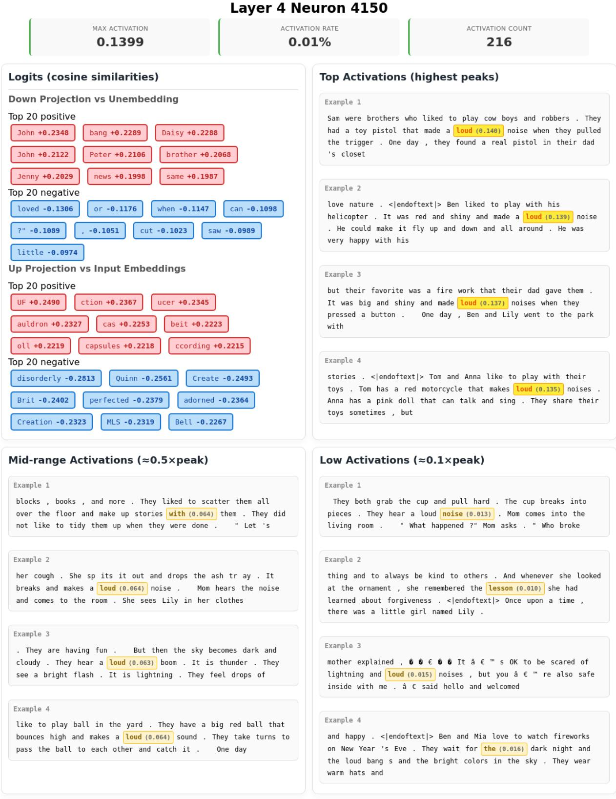  
Figure 38: L4-N4150 detects loud sounds: top activations are “loud noise”, “loud bang”, “loud noises”, often from fireworks or broken objects.

  
Figure 39: L4-N5981 encodes a commitment or resolution: “From that day on, [character] made sure to always” followed by a cautious behaviour.

  
Figure 40: L4-N6211 activates on verbs describing a downward or de-escalating motion (calmed, bent,fell, broke) in the construction “[verb] down”, particularly when a character or situation settles or physically descends. Negative logits include up, down (as standalone tokens) and loves.