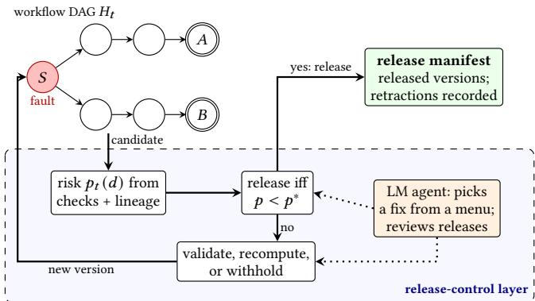
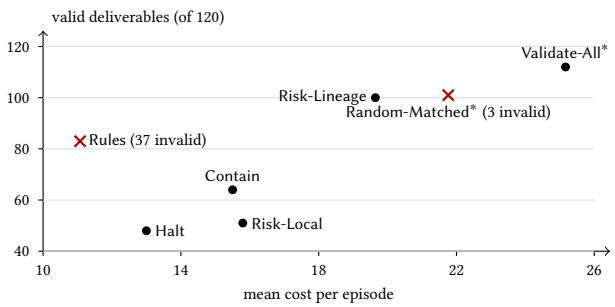

# Structure Before Intelligence: Gating What Agentic Scientific Workflows Release

Ashish Acharya   
aacha003@odu.edu   
Department of Computer Science   
Old Dominion University   
Norfolk, Virginia, USA   
Aman Al Amin   
malam007@odu.edu   
Department of Computer Science   
Old Dominion University   
Norfolk, Virginia, USA   
Hong Qin<sup>∗</sup>   
hqin@odu.edu   
Department of Computer Science   
School of Data Science   
Old Dominion University   
Norfolk, Virginia, USA

## Abstract

An agentic scientific workflow can run to completion and still re lease wrong results: a silent numerical error, a stale input, or a defect in a shared upstream step can contaminate several outputs while a sibling branch stays correct. We treat trust in such results as a release decision. A harness around the workflow’s directed acyclic graph (DAG) decides which outputs may be used: it enforces mandatory checks, contains failures to the afected branch, recomputes from tracked versions, adds validators, and releases a result only if a risk model estimates its probability of being invalid as low. Language-model agents work inside the harness, choosing correc tive actions and reviewing releases, but cannot override it. On 60 held-out paired instances of two workflows with injected faults, we switched components on and of. Each supplied a diferent property. Containment and recovery raised the number of correct results. Validation supplied safety: fixed rules without validation released 37 invalid results, while validating every candidate released none. Risk estimation supplied eficiency, matching that safety with 31% fewer validators at somewhat lower yield, although better targeting than random validation was not shown. Lineage evidence helped on one workflow. The language model added no measurable benefit: whether invalid results escaped depended on the harness, not the model. This proof of concept points to a practical path: placing agents inside explicit release-control structure can keep released scientific results trustworthy, and it gives more capable agents a measurable baseline to improve on.

## CCS Concepts

• Software and its engineering → Software reliability; • Computing methodologies → Artificial intelligence; • General and reference → Evaluation.

## Keywords

scientific workflows, agentic science, runtime assurance, artifact provenance, selective release, risk estimation, recovery

## 1 Introduction

A computational analysis can finish without error and still support the wrong scientific conclusion. A parameter can be transcribed incorrectly, a summary can be computed from a superseded input, or a numerical solver can return a trajectory whose accuracy is insuficient for the quantity reported. Execution completion, file integrity, and artifact availability are necessary, but none of them establishes that a released number satisfies the scientific task. The gap matters more as language-model agents plan and execute analyses and as published papers are turned into executable agents [17]: more computation is produced with less direct human inspection of intermediate results.

Scientific workflows share ancestors. A defect in a shared normalization or parameter file can contaminate several deliverables, while a sibling branch remains valid and worth releasing. Evidence also arrives over time: a late diagnostic, or a correction to a source after release, can change which artifacts should be trusted. Two simple responses fail. Halting the whole workflow at the first failed check avoids invalid release but discards valid work. Validating every artifact exhaustively is expensive and still leaves the question of what to do when a check fails.

We therefore treat trust in such results as a release decision and study a directed acyclic graph (DAG) harness that makes it. During execution, a controller enforces mandatory checks and release closure, contains failed branches, and decides which validators to insert, which artifacts to retry, repair, or recompute from approved inputs, and which deliverables to release, withhold, or retract. A release manifest, not the presence of an output file, is the authoritative statement of what a consumer may use. In the risk-guided policies a fixed model estimates the probability that the current candidate is invalid, from runtime evidence and, in one variant, its actual lineage (evidence about ancestors along the versions actually consumed); a candidate is released only if this risk is below a threshold �<sup>∗</sup> set from contract costs. Language-model agents operate inside the harness: they choose corrective actions and review releases, but cannot override mandatory checks or the release rule (Figure 1).

This is a proof of concept. With the same contract, validator library, action costs, and budget caps (spent cost difers by policy and is reported, not matched), we ask which harness component supplies which property: do containment and recovery raise valid yield; does validation prevent invalid release; does risk estimation reduce the validation needed, and does lineage help beyond local evidence; and does a language model inside the harness change any of these? In our experiments the answer was structural: reliability came from the harness, not from the model. The scope is narrow: two workflows, 16 evaluation case groups, synthetic faults, one published source study, and disclosed post-hoc addenda (Section 9.1). Dependency tracking, conditional execution, runtime enforcement for agents, and selective prediction all exist (Section 2); the contribution is a controlled decomposition of how they combine into a release decision when the outcome is scientific validity, labeled by oracles separate from the runtime checks.

  
Figure 1: The harness as a release gate: it decides which outputs may be used. A fault in shared ancestor � can reach both deliverables � and �. For each candidate the controller estimates $p _ { t } ( d )$ from check evidence and, optionally, lineage; it releases if $\boldsymbol { p } ^ { \mathrm { ~ < ~ } } \boldsymbol { p } ^ { * }$ and otherwise validates, recomputes, or withholds. Only the manifest states what may be used, and later evidence is recorded as a retraction. The languagemodel agent acts inside the layer and cannot override the release rule.

Contributions. Within the scope stated in Section 9.1:

(1) Release control as a harness. A formulation that separates scientific validity from completion, integrity, and availabil ity, defines deliverable risk $p _ { t } ( d )$ conditional on runtime evidence and actual lineage (Section 3), and releases a candidate if a fixed risk estimate satisfies $\boldsymbol { p } < \boldsymbol { p } ^ { * }$ (Section 5).

(2) Fixed controller semantics in which mandatory checks, typed dependencies, persistent issues, bounded graph changes, versioned recovery, release closure, and retraction hold for every policy, so that policies difer only in validation and recovery choices (Section 4).

(3) An agent inside the harness. A language model proposes corrective actions from a fixed menu and reviews releases; malformed or of-menu output becomes abstention, and every call is logged and replayable (Section 6).

(4) A paired proof-of-concept benchmark of two source-linked workflows, six scenario families, five deterministic poli cies, agentic variants on three open-weight models (two paid models in a supplementary addendum), post-hoc validation ablations, and outcome oracles separate from the runtime, with predefined denominators and case-groupdisjoint splits (Section 7).

(5) A per-workflow decomposition (Section 8, Table 3). Contain ment and recovery raised valid yield; validation, not risk estimation, removed invalid releases; risk estimation reduced the validation needed, although better targeting than random placement was not shown; lineage helped in one workflow through one mechanism; and a language model inside the harness changed none of these.

## 2 Related Work

Paper-derived agents. Paper2Agent converts a research paper and its codebase into a tool-invoking agent: multiple agents build a Model Context Protocol server exposing the paper’s tools and workflows, generate and run tests to make it robust, and validate that the resulting agents reproduce the original papers’ results [17]. Building tools from papers, testing them, and running agentic scientific workflows are therefore not new here. We assume the task and workflow are already specified and study a narrower question: how runtime evidence should govern validation, recovery, and release within one execution. We do not reproduce Paper2Agent’s evaluation or assume its tools lack validation.

Workflow engines and dynamic execution. Snakemake [15] and Nextflow [9] organize reproducible computation through declared dependencies. Snakemake checkpoints re-evaluate the job DAG after a checkpoint’s outputs are produced, enabling data-dependent conditional execution [24], and rules can declare output-property checks [25]. Dynamic graphs and user-defined validation are thus established features. Our baselines receive the same validators, and our object of study is how validation results, lineage, and risk estimates determine release, not whether an engine can run a check. Provenance models such as PROV-DM [20] supply concepts for derivation and invalidation that our execution history follows; we do not propose a new provenance model.

Provenance, recomputation, and data validation. CWL [7] and Galaxy [27] make workflows portable and record what ran. noWorkflow captures provenance of scripts [21], and ReproZip packages an execution for re-running [5]. Build systems such as make and Bazel recompute only out-of-date targets; Mokhov et al. formalize this family of systems [19]. Our invalidate-and-recompute action reuses this idea, but it is triggered by scientific evidence rather than by changed inputs. TensorFlow Data Validation [4] and Great Expectations [11] check data against declared schemas and expectations. Such checks play the role of our validators. We study when to run them and how their results gate release.

LLM science agents and benchmarks. The AI Scientist automates an ML research loop end to end [16], and Biomni is a generalpurpose biomedical agent [13]. BixBench [18], CORE-Bench [23], and PaperBench [26] measure agents on computational biology analyses, computational reproduction of published research, and replication of ML papers. These benchmarks score task outcomes. We hold the workflow fixed and score which artifacts are released.

Scientific agent control. ControlA identifies detection, containment, recovery, and provenance as requirements for reliable agentic science and connects workflow instrumentation with agent safeguards [12]. Its motivation is close to ours. Our study contributes a comparative evaluation of specific release policies against oraclelabeled scientific outcomes, with cost reported, rather than an architecture.

Runtime enforcement and information flow. Shield synthesis enforces specified properties at runtime while minimally interfering with a system [3]. AgentSpec provides a language of triggers, predicates, and enforcement actions for LLM agents [28]. Sherlock selects where to verify within an agentic workflow and uses speculative execution with rollback [22]; topology-aware and cost-aware verification with recovery is therefore prior art. CaMeL separates control from data flow to defeat prompt injection [8], and Fides tracks integrity and confidentiality labels through agent actions [6]. These systems inform our mandatory blocking and containment semantics, which every policy shares. Our evaluation target difers: scientific validity of released deliverables and the useful partial release of unafected branches, not security properties. We do not claim those systems could not be extended to this setting.

LLMs as reviewers. Strong LLM judges can agree with human preferences, but they show position, verbosity, and self enhancement biases [31]. Changing the order of the candidates alone can change an LLM evaluator’s verdict [29]. Our reviewer therefore only gates release; it cannot release a blocked version. We report its agreement with the oracle per model.

Selective prediction and risk control. Selective classification trades coverage for lower error by abstaining [10]. Conformal risk control [2] and Learn-then-Test [1] give finite-sample guarantees on expected monotone losses or risk under exchangeability-type assumptions. Release with withholding is a selective decision, so these results frame our metrics: invalid releases per released output is a conditional (selective) risk, while invalid releases per requested output is unconditional. Our small logistic model, fit to a synthetic fault mixture with adaptive, correlated, policy-dependent episodes, does not inherit those guarantees, and we report calibration only as an empirical property of the benchmark.

## 3 Problem Formulation

Task contract. A task contract fixes, before execution, the scientific target, evidence tier (arithmetic over a published table, or synthetic parameters), source identities by content hash, the logical nodes and primary deliverables �, units and tolerances for each deliverable, the mandatory and optional checks with declared costs, the admissible actions, approved computational alternatives, and budget caps (attempts per node, total repairs, total cost). No policy or model may change the target or a tolerance to make a candidate pass.

Execution history. Execution produces an append-only directed acyclic graph $H _ { t }$ of attempts, artifact versions, check records, and decision events. Each artifact version � has a unique identity, a content digest, a producing attempt, and the versions it actually consumed, each tagged as a scientific input (values consumed as accepted inputs) or a diagnostic control (inspected, never consumed). A retry or repair always creates a new version; no identity is reused. A logical deliverable $d \in D$ may therefore have several versions; lin<sub>�</sub> (�) denotes the scientific-input ancestors of � in $H _ { t }$

Validity versus other properties. A version � of deliverable � is scientifically valid if its value satisfies the contract and tolerance for �, as judged by a separate oracle after execution. This is distinct from: completion (the producing attempt terminated successfully), integrity (bytes match the recorded digest and consumed versions are the recorded ones), and availability (a version exists and can be released). A completed, intact, available artifact can be invalid; a valid artifact can be withheld. Oracle verdicts are valid, invalid, or unobserved when a candidate is absent or the oracle’s applicability conditions do not hold; unobserved is never imputed.

Deliverable risk. For deliverable � at time �, let $\mathcal { E } _ { t }$ be the evidence observable at runtime (check records, diagnostics, issues, decision events) and $\operatorname* { l i n } _ { t } ( d )$ the actual lineage of the current candidate. We define

$$
p _ { t } ( d ) \ = \ \mathrm { P r } \big ( \mathrm { c a n d i d a t e ~ f o r ~ } d \mathrm { ~ i s ~ s c i e n t i f i c a l l y ~ i n v a l i d } \ \big | \ \mathcal E _ { t } , \ \operatorname* { l i n } _ { t } ( d ) \big ) .\tag{1}
$$

The probability is with respect to the benchmark’s declared fault mixture, not real-world failure prevalence. Fault labels, scenario identities, and oracle outputs are not part of $\boldsymbol { \mathcal { E } } _ { t }$

Release control. A policy maps the observable state to an admissible action: run, insert a validator, retry, select an approved alternative, repair, invalidate and recompute descendants, release, retract, abstain, or stop globally. An episode ends with a release manifest listing released version identities, and a record of any later retractions. The objective trades three quantities: invalid releases, valid deliverables withheld, and resource cost. Section 7 fixes the corresponding metrics and denominators.

## 4 Controller Semantics

All policies run on one controller. The rules below are fixed and cannot be overridden by any policy or risk estimate; policies choose only among the actions these rules admit.

Versions and states. History is append-only. Every attempt (run, retry, alternative, repair, recompute) creates a fresh version with its own identity and producing attempt, in one of the states staged, accepted, blocked, abstained, released, superseded, or retracted. Failed versions are kept. Repair is an attempt outcome, not a state. The history graph is asserted acyclic at the end of every episode.

Blocking and issues. A mandatory check that fails, is missing, has no implementation, or raises (unknown) blocks the version whatever the policy or risk; a non-candidate “accept” is forced to abstain. A consumed input that is a superseded version raises a version issue from provenance. Issues propagate without attenuation to all scientific-input descendants under a shared issue and cause identifier. An issue is cleared only by a resolution record naming one of two rules, superseded by a fresh version (evidence: the accepted replacement) or source update applied (evidence: the scheduled update), and the evidence must exist in the history.

Containment. Blocking propagates along scientific-input edges only. Diagnostic-control edges (a validator or repair inspecting a version) are recorded for provenance but never make the inspected version a scientific ancestor. Halt stops the whole episode at the first blocker; deliverables accepted before the stop are still released, so Halt depends on branch order, which each scenario fixes. Contain contains the failure to its branch.

Bounded graph changes. Dynamic policies may change the graph only by the contract’s admissible actions: insert a validator (run declared optional checks), retry, select an approved alternative, repair from approved inputs, or invalidate and recompute. Each change is checked for acyclicity before it is applied and recorded with the graph before and after; the graph revision only increases. Budgets cap attempts per node, total repairs, and total cost. When a cap prevents a wanted recovery, the controller records an abstention with outcome exhausted.

Release and late evidence. For dynamic policies, “accept” at a candidate admits a version; deliverables are released only at closure. Closure rechecks, along the whole scientific lineage, stored-byte integrity against digests, current-version consistency, mandatory checks, and unresolved issues, with at most three recovery rounds; a deliverable that still fails is withheld. Late evidence is invalidating only and attaches to the target’s logical node: before release it invalidates the afected lineage, which is recomputed only when the evidence carries a corrected runtime input and is otherwise withheld; after release it is recorded as a retraction. Retracted versions stay counted as released. Scheduled events fire at a logical checkpoint and occurrence that counts first-run productions only, so recovery attempts never shift them.

Policy boundary and fixed estimators. Policies see runtime observations only; no policy receives the scenario identity, family, or event schedule, and a test checks that decisions do not change across scenario identities. Risk policies call one estimator interface (Section 5). If the estimator cannot produce a risk, the episode ends with status error; there is no fallback to another policy. Before loading, the risk model, its benefit table, and its loss weights are checked against pinned hashes, and any mismatch stops the run. Each episode manifest records which model, table, and weights ran. A side record, hashed into the manifest, keeps the full local and ancestral feature vector of every consultation under every policy.

Isolation boundary. Runtime code receives only the scenario package (inputs, runtime-visible events, branch order). Fault labels, expected values, and oracle verdicts are stored separately and joined to runtime records by version identity only after an episode; no runtime module imports the oracle, which tests enforce statically and dynamically. This is a research-harness boundary, not an operating-system sandbox.

## 5 Risk Model and Action Selection

Two policies use the risk model: Risk-Local sees local evidence about the candidate only, and Risk-Lineage also sees its lineage.

Features. Features come from one source, the controller’s declared feature functions, so policy and model cannot drift apart. Risk-Local uses 18 local features of the candidate: a check summary (including the maximum normalized residual |error|/tolerance), attempt and recovery state, and unresolved-issue counts by kind. Risk-Lineage adds 9 ancestral features over the actual scientificinput lineage, in which each shared issue cause is counted once (full list in Supplement S3). Diagnostic edges are not traversed, and node reliabilities are never multiplied as if independent. A missing residual is flagged by its availability indicator and filled with a fixed 0, never imputed from labels. A leakage guard rejects hidden metadata, oracle records, scenario or case identifiers, and future events. Nine features are constant on all development rows and carry no information: unknown-check count, infrastructure error, four issue kinds (execution, integrity, closure, input), and three ancestral fields (fails, unknowns, distinct causes). Risk-Local thus efectively uses 12 of 18 local features, and Risk-Lineage 6 of its 9 additional ones.

Training and calibration rows. A row is a labeled policy consultation in any situation (candidate, blocked after a mandatory failure, or invalidated by late evidence); a version checked before and after a validator gives two rows. Development rows come from Rules and a development-only exploration variant of it that, with probability 0.2, picks a random admissible recovery or, where Rules would accept, inserts the validator instead. Calibration rows come from Rules only. The development fit uses 2000 rows (636 invalid) from 33 case groups; calibration uses 477 rows (154 invalid) from 16 disjoint groups. Unobserved labels are excluded and counted; none occurred.

Estimator and calibration. Both models are ℓ<sub>2</sub>-regularized logistic regressions (penalty 1.0, L-BFGS-B, standardization fit on development rows only, deterministic refit). The calibrator is the identity on the raw output. Thresholds fixed before any fit require at least 20 fitting rows and 30 calibration rows with at least five per class, and permit the word “probability” only if expected calibration error (ECE) on the calibration split is at most 0.10 and the Brier score beats the prevalence reference. Both models pass on the full calibration set: ECE 0.020 (Risk-Local) and 0.011 (Risk-Lineage); Brier 0.190 and 0.184 against a reference of 0.219. We therefore call the output a probability, conditional on the benchmark’s fault mixture. On the evaluation split this holds for the risk at a version’s final consultation, which usually includes validator evidence (Section 8); we use the word only in that sense. Discrimination is modest. On the 459 candidate rows, AUC is 0.62 (Risk-Local) and 0.65 (Risk-Lineage). The overall AUC (0.67, 0.69) is inflated by blocked and invalidated rows, which are all invalid (10 and 8 rows, one class, below the support threshold; disclosed, not gating). The fitted models and their hashes are released with the artifact.

One-step action criterion. Let � be the estimated risk of the version under decision, �(�) the measured action cost, and $\lambda _ { I } , \lambda _ { W }$ the costs of an invalid release and of leaving an eligible deliverable without a valid release. The loss is

$$
\begin{array} { r } { L ( \mathrm { a b s t a i n } ) = \lambda _ { W } , \qquad L ( \mathrm { a c c e p t } ) = \left( \lambda _ { I } + \lambda _ { W } \right)  { p } , } \\ { L ( a ) = c ( a ) + \operatorname* { m i n } \bigl ( ( \lambda _ { I } + \lambda _ { W } )  { p ^ { \prime } } , \lambda _ { W } \bigr ) , \qquad } \\ { p ^ { \prime } = p \left( 1 - f _ { a } \right) + \left( 1 - p \right) b _ { a } , \qquad } \end{array}\tag{2}
$$

for a corrective action � with fix rate $f _ { a }$ and break rate $b _ { a } . \mathrm { A }$ validator’s loss is $\begin{array} { r } { c + \sum _ { o } \operatorname* { P r } ( o ) } \end{array}$ min $( ( \lambda _ { I } + \lambda _ { W } ) p _ { o } , \lambda _ { W } )$ over outcomes � ∈ {flag, pass}, with Bayes posteriors $\mathit { p _ { o } }$ from its sensitivity and false-alarm rate. The policy takes the argmax of �(abstain) − �(�) over admissible, supported actions; abstention scores 0 and wins ties. At a candidate it compares accept, validator, and abstain. Accept beats abstain if ${ p < p ^ { * } = \lambda _ { W } / ( \lambda _ { I } + \lambda _ { W } ) }$ . Weights are anchored to the contract rather than to behavior: $\lambda _ { W }$ is the contract cost budget per deliverable $( 6 0 / 2 = 3 0$ for both workflows) and $\lambda _ { I } = 5 \lambda _ { W } = 1 5 0 .$ so $p ^ { * } = 1 / 6 ;$ terminal costs are 0. Mandatory blockers apply before Eq. (2), and no loss can release a blocked version. The loss charges intermediate candidates with the deliverable-level �, which only approximates downstream value.

Action benefits. Risk alone does not identify which repair works. Fix, break, sensitivity, and false-alarm rates are estimated per action and context from development action records (Supplement S3). One support rule, set before the fit, covers every action: an action without enough labeled records is not scored, and the policy abstains rather than take it. Where valid-before records are scarce, a worstcase bound replaces the break or false-alarm rate; because the loss is non-decreasing in it, the bound can only lower the benefit of recovery, biasing against Risk-Local and Risk-Lineage. Table and weights are identical for the two risk policies, which difer only in features.

## 6 Agentic Proposer and Reviewer

The agent operates inside the release-control layer. A language model is placed in two bounded roles on top of a base policy (Halt, Rules, or Risk-Lineage), giving the arms Halt+Agent, Rules+Agent, and Risk-Lineage+Agent. The base policy still chooses the action class (validate, correct, release, abstain, or stop), and every controller rule of Section 4, including the risk release rule under Risk-Lineage, still applies. The question is whether the agent changes valid yield or invalid release relative to the same base policy, with cost reported alongside.

Proposer. When the base policy chooses to correct, the model picks the concrete corrective action and its declared parameters from a per-workflow proposal menu. Each option is a recovery action (retry, select an approved alternative, repair, or invalidate and recompute) applied to the node under decision. The menu is intersected with the actions admissible at that point. Solver settings are reachable only through the contract’s approved alternative solvers, and declared parameters are recorded but not executed (menus in Supplement S2). Admissibility, budgets, and acyclicity are checked exactly as for any other action.

Reviewer. By construction, the reviewer cannot reject a candidate it sees. The controller consults it only for a candidate with no unresolved issue (a failed check or a mandatory unknown has already blocked release), and for exactly this state the prompt instructs approval. The model returns a verdict (approve, reject, or uncertain, with a reason), recorded as a review check; release requires approve, and any other verdict blocks release in that round, after which the base policy may correct, validate, or abstain. A reject path exists in code and the prompt permits rejection on contradictory evidence, but the reviewer approved every candidate it saw (Section 8). It can only withhold, never release a version the controller blocks, and its verdict is not a risk-model feature. We make no safety claim for it; its approval rate reflects this structure, not reviewer quality, so the agentic arms test the proposer. Because Halt never invokes the proposer, Halt+Agent is Halt plus a reviewer gate.

Evidence and output. Prompts contain only runtime-visible evidence: contract text, check results, open issues, a lineage summary, and remaining budgets. The leakage guard scans every prompt for scenario identifiers, family names, fault labels, and oracle fields. A test checks that decisions do not change when scenario identifiers are renamed. Responses are JSON, constrained by a schema where the server supports it. Output that cannot be parsed, an of-menu choice, a timeout, or a server error is recorded as an error and becomes abstention for that decision. A reviewer error also blocks release. Errors are never repaired, and there is no deterministic fallback.

Models, audit, and cost. The panel has three open-weight models, Llama 3.3 70B, Gemma 3 27B, and Mistral Small 3.2 24B, served locally by Ollama with Q4\_K\_M weights and pinned by manifest digest. Decoding uses temperature 0, a fixed seed, a context of 8,192 tokens, at most 512 output tokens, and no retries (Supplement S2). Every call is appended to a per-episode call log (role, prompt, response, model digest, options, timing, tokens) whose hash enters the episode manifest. A replay adapter re-executes an episode from its log without a GPU, and an automated audit by a separate read-only agent replayed every agentic episode byte-identically. Re-running a model is not a substitute: in a check outside the harness (16 development prompts, six calls each), decisions were stable on repeated calls but output text was not byte-reproducible, because Ollama’s prompt-cache state depends on call order. Prompts are written from contract and action semantics only, piloted on development, sanitychecked on calibration, and never tuned on evaluation. One revision of the reviewer prompt was allowed, on development data only: under the first version the reviewer answered “uncertain” whenever optional validators had not run, so Rules+Agent, which inserts none, made no releases in the development pilot. The revision gives the reviewer the contract’s required and optional checks. A missing optional check alone is no longer grounds for “uncertain” or “reject”; “uncertain” is reserved for missing or failed required checks and contradictory evidence. The revision has no workflow-, fault-, or scenario-specific wording, and both versions are kept (Supplement S2). Actions are charged to contract cost as under every policy, and a reviewer call is not charged as a validator; calls and tokens are reported separately and counted from the call logs (the runner’s own summaries omit tokens; Supplement S6). A later addendum with two paid API models is reported only in Supplement S7.

## 7 Experimental Design

## 7.1 Workflows and Oracles

Each workflow has seven logical nodes: one shared upstream node and two three-node branches, each ending in a deliverable (Table 1). Contracts, targets, and tolerances were fixed by content hash before any scenario was generated; no event or alternative changes them. Published table. From a hash-verified transcription of Table 1 of a published evaluation of variant-calling pipelines [30] (28 conditions, five strata), branch A reports mean Matthews correlation per calling padding over the nine non-commercial conditions; branch B ranks all 28 conditions. A runtime query selects the strata. All instances derive from this one source study. SIR model. Two branches with different transmission rates integrate the closed, frequency-dependent Kermack–McKendrick model [14] from a verified registry of synthetic rates and initial fractions; each summary reports $R _ { 0 } ,$ peak size and time, final size, and attack fraction.

Oracles. The oracles label every version of every logical node, intermediates included; runtime working copies are never read. Table references are exact decimals recomputed from the oracle’s own hash-verified copy of the source table. SIR references are analytical (phase-plane invariant, final-size equation, peak, and a quadrature time map) and never integrate the ODE; full definitions are in Supplement S4. A field outside its applicability conditions is unobserved. A version is invalid if any field fails or is malformed, unobserved if any remaining field is unobservable, and valid otherwise. Intermediate fields borrow the tolerance of the deliverable field they feed, since contracts set none. A label states whether a version’s checkable content satisfies the contract. A defect in a setting the contract leaves unconstrained (here a loose SIR solver tolerance) is thus labeled valid where it originates and invalid where it appears downstream; this afects 9 intermediate versions in development and calibration. Labels never come from generator metadata. On development and calibration, oracle verdicts agree with the generator’s deviation labels on all 600 checked deliverable versions, and no node has an unobserved label.

Table 1: Workflow contracts (both: 7 logical nodes, at most 3 attempts per node, 6 repairs, and cost 60).
<table><tr><td></td><td>Published table</td><td>SIR model</td></tr><tr><td>Evidence tier</td><td>Published values</td><td>Synthetic parameters</td></tr><tr><td>Shared node</td><td>source table</td><td>model specification</td></tr><tr><td>Deliverables</td><td>A report, B report</td><td>summary A, summary B</td></tr><tr><td>Checks (mand./opt.)</td><td>3/5</td><td>4/4</td></tr><tr><td>Alternatives</td><td>rebuild from verified source; decimal mean</td><td>load from registry; 3 tighter solvers</td></tr></table>

## 7.2 Scenario Families

Each workflow has six families, each instance accepted only after a static reference run against the clean baseline of its case group: clean (no events, alarms, or deviations); benign (a semantically equivalent input variant, such as reformatting, units, or a more accurate solver, with no alarms or deviations); silent error (exactly one deliverable deviates, no mandatory alarm, at least one optional alarm); stale (a superseded upstream version is consumed, which the controller detects from provenance rather than from checks); shared ancestor (both deliverables deviate through a shared node or input, no mandatory alarm); and late invalidation (an invalidating notice arrives during the run or after release; 6 of 10 in-run in evaluation). Late evidence is never confirming. For every faulted instance an approved recovery restores all deliverables within tolerance. Events attach to logical checkpoints, so added attempts do not shift them across policies.

## 7.3 Policies

All policies share contracts, mandatory checks, validator library, costs, and budgets (Table 2). Halt and Contain run every declared check, optional ones included, as strong-check static baselines; the cost of checking everything is reported. The dynamic policies (Rules, Risk-Local, Risk-Lineage) run mandatory checks and add optional ones only by inserting a validator; they share admissible actions and caps. Rules inserts all available validators when any normalized residual reaches 0.5, and recovers a blocked version by a fixed ladder: retry an infrastructure error; recompute after a version, integrity, late, or closure issue; else select an untried approved alternative; else repair; else abstain. Its validator trigger never fired on development (0 insertions in 120 Rules episodes) or calibration (0 of 477 consultations in 60 episodes), because mandatory-check residuals stayed below threshold in the families as accepted. We report this as a property of the fixed rule; the threshold was not retuned. Two sensitivity arms rerun both risk policies with their original loss weights (Supplement S6). Two post-hoc ablation arms reuse the rules and recovery ladder of Rules and vary only validation (Table 2).

Table 2: Policies. <sup>∗</sup>Post-hoc ablation arms (Section 7.6).
<table><tr><td>Policy</td><td>Behavior</td><td>Comparison enabled</td></tr><tr><td>Halt</td><td>Static graph, all checks, global stop</td><td>Global intervention baseline</td></tr><tr><td>Contain</td><td>Static graph, all checks, branch containment</td><td>Value of containment</td></tr><tr><td>Rules</td><td>Dynamic, fixed-rule validation and recovery</td><td>Value of bounded adaptation</td></tr><tr><td>Risk-Local</td><td>Dynamic, risk-guided, local evidence</td><td>Value of estimated risk</td></tr><tr><td>Risk-Lineage</td><td>Dynamic, risk-guided, local + ancestral evidence</td><td>Value of lineage</td></tr><tr><td>Validate-All*</td><td>Rules, validating every candidate</td><td>Value of validation</td></tr><tr><td>Random-Matched*</td><td>Rules, random validation at</td><td>Value of risk targeting</td></tr></table>

## 7.4 Splits and Sample Size

The benchmark has 240 instances: 120 development, 60 calibration, and 60 evaluation (10, 5, and 5 per workflow and family). Case groups are disjoint across splits: the 25 query pairs of the published table split 13/6/6 and the 40 sampled SIR registries 20/10/10. The evaluation set has 2 workflows × 6 families × 5 instances × 5 policies = 300 primary episodes, i.e. 60 paired instances; the predeclared reduction to four instances per family was not needed. The two sensitivity arms add 120 episodes. Repeating a deterministic run does not add an independent unit. Primary and sensitivity arms make no language-model calls.

## 7.5 Agentic Arms

The agentic set has Halt+Agent, Rules+Agent, and Risk-Lineage+ Agent, each run with the three models: 9 arms on the same 60 evaluation instances and seeds (540 episodes), paired with the deterministic episodes by instance and seed. The pre-declared comparisons are each agentic arm versus its base policy per model, and Risk-Lineage+Agent versus Rules+Agent per model. Across models we report the error rate (of-menu output counts as an error), the reviewer approval rate, reviewer agreement with the oracle (computed after evaluation), calls, and tokens (Supplement S1); wall time is recorded but was not audited and is not reported. A reduction rule fixed in advance would have dropped arms if the development pilot had projected too much compute; the projection kept the full set.

## 7.6 Protocol and Disclosure

Contracts, scenario instances, splits, policies, risk models, loss weights, metrics, and primary comparisons were fixed and hashed before any evaluation episode ran, and nothing was tuned on the evaluation split. The agentic arms were added after the deterministic episodes had run but before any evaluation oracle output was computed, and were fixed in the same way before their own run. Four analyses were decided after evaluation results had been seen and are post hoc: the validation ablation (Validate-All, Random-Matched), the no-release-control reference, a recomputation of calibration that corrects a defect in the original analysis, and an addendum with two paid API models. Tables mark them with <sup>∗</sup>; they are never pooled with the planned arms, and no conclusion rests on the paid-API addendum (Supplement S7). Changes adopted before evaluation but after development or calibration behavior had been seen, such as the loss weights, are listed with the four post-hoc analyses in the deviation log (Supplement S6). For every comparison a null result was an acceptable outcome.

## 7.7 Metrics

Metrics are computed from raw episode manifests and oracle records; every ratio is reported with numerator and denominator. The primary eligibility rule counts every contract deliverable: 60 × 2 = 120 deliverables per policy (60 per workflow). A secondary rule counts only deliverables outside the structural lineage of the injected fault, 64 per policy (clean 20, benign 20, silent error 10, stale 10, late 4, shared 0), to measure collateral loss such as over-containment.

• Invalid per released: invalid released versions / oraclelabeled released versions. Undefined, not zero, when noth ing is released; released but unlabeled versions are reported separately.

• Invalid per requested: invalid released versions / requested outputs.

• Valid yield: eligible deliverables with at least one released, non-retracted, oracle-valid version / eligible deliverables. Eligibility is identical for all policies, so a policy gains nothing by failing to produce a candidate.

• False blocking (clean and benign, 40 deliverables): eligible deliverables with no released, non-retracted version / eligible deliverables. A withheld candidate is not counted as incorrect.

• Recovery success: deliverables targeted by a recovery action whose final released, non-retracted version is oraclevalid / deliverables targeted; also attempts, checks, and descendants recomputed.

• Cost: declared action cost and wall time.

• Calibration (Risk-Local, Risk-Lineage): Brier score and tenbin reliability with bin counts, for all labeled versions and for the released subset, to expose policy-induced selection.

Retracted versions count as released but never toward valid yield. Infrastructure failures and episodes ending in error are reported separately, never dropped. Paired diferences between policies use per-instance counts; 95% percentile intervals resample whole case groups (ablation and reference intervals resample scenarios) and are conditional on the two workflows and the fault generator. The

Table 3: What each harness component supplied (evaluation split; evidence in the paragraphs below).
<table><tr><td>Component</td><td>Supplies</td><td>Key evidence</td><td>Caveat</td></tr><tr><td>Containment, valid yield recovery</td><td></td><td>Contain above Halt; Rules above Contain</td><td>the Rules gain came with invalid releases</td></tr><tr><td>Validation</td><td>safety</td><td>Rules: 37 invalid; Validate-All: 0</td><td>highest cost</td></tr><tr><td>Risk estimation</td><td>efficiency</td><td>Risk-Lineage: 0 invalid, 31% fewer validators than Validate-All</td><td>lower yield; targeting not shown</td></tr><tr><td>Lineage</td><td>yield, one workflow</td><td>Risk-Lineage above Risk-Local on the published table only</td><td>one mechanism</td></tr><tr><td>Language model</td><td>nothing shown</td><td>policy</td><td>no agent arm beat its base reviewer cannot reject</td></tr></table>

Table 4: Deterministic policies, evaluation split. Valid yield is of 60 requested deliverables per workflow; invalid releases and false blocking (clean and benign deliverables not released, of 40) pool both workflows; validators are inserted validator runs (total); cost is mean contract cost per instance. Released versions include those retracted after late evidence (Rules 7 (all invalid), Risk-Local 4, Risk-Lineage 6, Validate-All 7, Random-Matched 7; none otherwise), which never count toward valid yield. Every retracted valid version was built on a replacement, made by recovery before release, of the node that a post-release notice named; because a notice attaches to the logical node, not to a version, these retractions were unnecessary and cost valid yield. <sup>∗</sup>Post hoc (Section 7.6).

<table><tr><td></td><td colspan="2">Valid yield</td><td>Invalid/</td><td>False</td><td>Vali-</td><td></td></tr><tr><td>Policy</td><td>Pub. table</td><td>SIR</td><td>released</td><td>block</td><td>dators</td><td>Cost</td></tr><tr><td>Halt</td><td>26/60</td><td>22/60</td><td>0/48</td><td>0</td><td>0</td><td>13.00</td></tr><tr><td>Contain</td><td>32/60</td><td>32/60</td><td>0/64</td><td>0</td><td>0</td><td>15.50</td></tr><tr><td>Rules</td><td>42/60</td><td>41/60</td><td>37/120</td><td>0</td><td>0</td><td>11.07</td></tr><tr><td>Risk-Local</td><td>2/60</td><td>49/60</td><td>0/55</td><td>20</td><td>235</td><td>15.80</td></tr><tr><td>Risk-Lineage</td><td>51/60</td><td>49/60</td><td>0/106</td><td>0</td><td>248</td><td>19.65</td></tr><tr><td>Validate-All*</td><td>56/60</td><td>56/60</td><td>0/119</td><td>0</td><td>359</td><td>25.17</td></tr><tr><td>Random-Matched*</td><td>52/60</td><td>49/60</td><td>3/111</td><td>0</td><td>251</td><td>21.76</td></tr></table>

primary comparisons, fixed before evaluation, are Risk-Lineage versus Risk-Local (value of lineage) and each risk policy versus Rules (value of risk guidance over fixed rules); Contain versus Halt and Rules versus Contain are secondary.

## 8 Results

Every number in this section is generated by script from the evaluation outputs and an automated audit by a separate read-only agent. A diference Δ is a mean per paired instance (two requested deliverables) over 60 instances, with a case-group bootstrap 95% interval over 16 case groups (6 published table, 10 SIR); ablation and reference intervals resample scenarios. Intervals are not corrected for multiplicity. All 960 planned episodes ran to a recorded final status with 0 infrastructure errors, and every released version has an oracle label (Supplement S1). Table 3 summarizes what each component supplied, Table 4 and Figure 2 give the outcomes, and per-family tables are in Supplement S1.

  
Figure 2: Valid deliverables (of 120) against mean cost per episode for each arm of Table 4. Crosses mark arms that released invalid deliverables (count in parentheses); <sup>∗</sup>post hoc.

Without release control. A descriptive reference (post hoc, Supplement S6) releases every deliverable’s first version unchecked. Because Halt stops at its first mandatory blocker, 67 of 120 deliverables were never produced, so the invalid fraction lies between 5/120 (0.042, [0.008, 0.075]) and 72/120 (0.600, [0.492, 0.708]); these are bounds, not an estimate. The generator’s labels mark 55/120 deliverables as fault-afected (0.458, [0.358, 0.558]), a property of this benchmark’s fault mix, not a natural error rate. Without release control all 55 would be released. This is a reference, not a policy arm.

Containment and recovery supply yield. Contain released more valid deliverables than Halt (Δ = 0.267 [0.182, 0.346]), and neither released an invalid one. Rules raised valid yield over Contain (Δ = 0.317 [0.180, 0.458]) at the price of invalid releases $( \Delta ~ = ~ 0 . 6 1 7$ [0.434, 0.783]). Recovery succeeded in 12/12, 2/2, and 4/4 attempted recoveries for Rules, Risk-Local, and Risk-Lineage.

Validation supplies safety. The Rules policy’s validator trigger never fired, and it released 37 invalid deliverables (of 120 released), all among the 55 fault-afected ones: all 20 shared-ancestor and 10 silent-error deliverables and 7 of 15 late-invalidation ones; its 10 stale-input deliverables were released valid. Release closure alone therefore did not stop content faults. Validating every candidate (Validate-All) removed all invalid releases (0/119) and gave the highest valid yield (112/120), at the highest cost.

Risk-guided release supplies eficiency; targeting is not shown. Against Rules, Risk-Lineage raised valid yield (Δ = 0.283 [0.073, 0.492]), removed invalid releases $\left( \Delta = - 0 . 6 1 7 \left[ - 0 . 7 9 1 , - 0 . 4 3 3 \right] \right)$ and cost 8.57 [7.56, 9.53] more units per instance; Risk-Local also removed invalid releases $( \Delta ~ = ~ - 0 . 6 1 7 )$ but lowered valid yield $\left( \Delta \ = \ - 0 . 5 3 3 \ [ - 0 . 9 5 2 , - 0 . 0 1 8 ] \right)$ . The ablation shows that validation, not risk estimation, removed them. Against Validate-All, Risk-Lineage inserted 31% fewer validators and cost 22% less $( \Delta = - 5 . 5 2$ [−7.50, −3.91] units), at a lower valid-yield fraction $( \Delta = - 0 . 1 0 0$ [−0.167, −0.042]). At matched volume (251 insertions against Risk-Lineage’s 248), random validation released 3 invalid deliverables against Risk-Lineage’s 0, a diference our 60 instances cannot resolve (invalid per released $\Delta = - 0 . 0 2 7 \left[ - 0 . 0 6 3 , 0 . 0 0 0 \right]$ ; the interval reaches 0 only because resamples that omit the few afected scenarios contain no invalid release). Risk targeting is therefore not shown; a larger instance set is the test. Risk-Lineage was cheaper $( \Delta = - 2 . 1 2 \left[ - 3 . 8 6 , - 0 . 3 8 \right]$ units) at similar yield $\left( \Delta = - 0 . 0 0 8 \left[ - 0 . 0 7 5 _ { \mathrm { { ; } } } \right. \right.$ 0.058]). All 5 risk-gated arms (Risk-Local, Risk-Lineage, and Risk-Lineage+Agent with each open-weight model) released 0 invalid deliverables; the paid-API addendum is consistent (Supplement S7).

Calibration<sup>∗</sup>. Scored at the last consultation of each labeled version (a post-hoc recomputation, Supplement S6), the risk usually follows validator evidence, so it describes validator-informed risk, not a pre-validation prediction: Brier 0.0153 [0.0108, 0.0218] for Risk-Local (reference 0.086) and 0.0036 [0.0015, 0.0076] for Risk-Lineage (reference 0.085).

Lineage helps on one workflow. Risk-Lineage released more valid deliverables than Risk-Local, Δ = 0.817 [0.346, 1.212], and neither released an invalid one. The whole gain is on the published-table workflow $\left( \Delta = 1 . 6 3 3 \left[ 1 . 5 3 3 , 1 . 7 6 9 \right] \right)$ ; on SIR the two tie $( \Delta = 0 . 0 0 0 )$ On the published table Risk-Local released 2 of 60 deliverables valid and withheld all 20 clean and benign ones: a local-only risk model bought safety by over-withholding. The lineage efect therefore rests on one mechanism in one workflow.

No agent benefit is shown. The 540 agentic episodes made 1,020 model calls with 0 errors (calls and tokens per model in Supplement S1). With Llama and Mistral, every agentic arm matched its base policy exactly on all 60 instances (every paired diference 0). Rules+Agent released exactly what Rules released for every model; Gemma’s trajectories difered in 5 scenarios (a repair instead of invalidate-and-recompute, with the same outputs and cost). The only non-null diference is Gemma under Risk-Lineage+Agent, which lowered valid yield relative to Risk-Lineage $( \Delta = - 0 . 2 6 7$ [−0.443, −0.117]) without releasing an invalid deliverable; Risk-Lineage+Agent versus Rules+Agent was then $\Delta = 0 . 0 1 7 \ [ - 0 . 1 2 5 ,$ 0.138] for Gemma, and identical to Risk-Lineage versus Rules for the other models. Thus 2 of 3 open-weight models reproduced every base-policy decision; the two paid models of the post-hoc addendum did as well (Supplement S7).

The reviewer, which by construction cannot reject what it sees (Section 6), approved all 846 candidates, so this arm tests the proposer. Each model approved 44 oracle-invalid candidates, all under Rules+Agent: 37 were released (the invalid releases of Rules) and 7 were superseded before release when late evidence arrived during the run. Agreement with the oracle, 0.844 [0.818, 0.867], equals the share of valid candidates (Cohen’s � = 0.00). With every model, invalid releases followed the control layer (37 under Rules+Agent, none under Risk-Lineage+Agent), not the model: the language model alone did not supply reliability.

## 9 Limitations

## 9.1 Threats to Validity

This is a proof of concept, and we make no general claim. We state every conclusion per workflow; neither workflow is taken to represent scientific workflows in general.

• Synthetic fault mixture. Faults, benign changes, and their frequencies are designed. Risk probabilities, calibration, and every interval are conditional on this mixture. They are not estimates of real-world failure prevalence or a distributionfree safety guarantee. Stale inputs are detected from provenance, and late evidence is never confirming.

• Small, narrow sample. There are five evaluation instances per family and workflow (60 paired instances) from 16 case groups (6 published table, 10 SIR), and comparisons are not corrected for multiplicity. The published-table workflow derives from a single study, and the SIR oracle covers only the closed model.

• Deterministic runs. Repeating a run adds no independent unit, so intervals reflect only case-group (or scenario) variation. Agentic arms use one temperature-0 sample per decision from Ollama’s default 4-bit quantized models. They therefore capture neither sampling variability nor full-precision behavior.

• Weak fixed-rule baseline. The Rules policy’s validator trigger never fired, before or on evaluation (0 validators inserted), so Rules acts as a dynamic baseline without validators. The validation ablation (Section 8) indicates that validation, not risk estimation, removed invalid releases.

• Declared validators. The same team designed the faults and the validators, and validators raised no false alarm on development. Safety assumes the declared validators detect the faults they target, and placement matters: random validation at matched volume released 3 invalid deliverables.

• Changes after observation. The loss accounting and weights and the fit on all situations were adopted after development and calibration behavior had been observed, though before evaluation (Supplement S6); the original weights are run as a sensitivity arm. The reviewer prompt received one revision on development data, and four analyses are post hoc (Section 7.6).

• Modest risk model. Candidate AUC is 0.62 (Risk-Local) and 0.65 (Risk-Lineage); higher overall AUC comes from blocked rows, which are almost all invalid. At candidates the validator dominates: with no false alarm on development, a pass sharply lowers the posterior. Nine features are constant on development, so Risk-Lineage efectively adds 6 ancestral features, not 9. The one-step loss and worst-case valid-before bound bias against recovery.

• Single mechanism for lineage. In development smoke runs, Risk-Local released 0 of 8 published-table deliverables and Risk-Lineage released 6. At nodes where no validator is admissible, Risk-Local’s risk exceeds �<sup>∗</sup> and it abstains. On that workflow, Risk-Lineage−Risk-Local may therefore largely measure one mechanism.

• Coarse retraction. A post-release notice attaches to a logical node, so it also retracts releases that were already built on a replacement of that node and were valid. This cost the risk and validation-ablation arms some valid yield (Table 4); version-level attachment would avoid it.

• Labels and audit. A label states whether checkable content satisfies the contract. A defect in an unconstrained setting counts as valid where it originates (9 intermediate versions) and invalid downstream, and intermediates borrow deliverable tolerances. The oracles share the task specification and source transcription with production, so an error common to both would go undetected. Their agreement with the generator’s labels (600/600 deliverables, development and calibration only; none was computed on evaluation) is a consistency check, not independent validation.

• Model involvement. Language models act only in the agentic arms, as a menu-bounded proposer and a release reviewer; the arms are not evidence about open-ended agent autonomy. All 9 agentic arms ran with all three models, with no reduction or fallback. The reviewer is reached only where its prompt instructs approval, so the arms test the proposer, not reviewer judgment. The paid-API models (Supplement S7) are pinned by endpoint name only, so that addendum is reproducible only by log replay.

• Tool defects. Defects found after the runs were left unfixed in the evaluated code (Supplement S6).

## 10 Conclusion

This proof of concept asked which part of a DAG release-control harness makes agentic workflow results safe to release. On two workflows with synthetic faults, the answer was structural. Containment and recovery supplied yield, validation supplied safety, and risk estimation supplied eficiency: it kept invalid releases at zero with less validation than validating everything, but better targeting than random validation was not shown. Lineage helped on one workflow only, and no benefit from the language model was shown: invalid releases followed the harness, not the model. The ablations are post hoc, and zero observed invalid releases is a count, not a guarantee.

## Acknowledgments

This work was supported in part by an a2 Pilot Award from the University of Pennsylvania Penn Artificial Intelligence and Technology Collaboratory for Healthy Aging (PennAITech), an initiative funded by the National Institute on Aging (NIA) of the National Institutes of Health (Grant No. P30AG073105), and by Old Dominion University through MonarchSphere: AI Incubator, powered by Google Cloud. This work was also supported in part by a grant of access to OpenAI models through the ChatGPT for Academic Researchers program.

## References

[1] Anastasios N. Angelopoulos, Stephen Bates, Emmanuel J. Candès, Michael I. Jordan, and Lihua Lei. 2025. Learn then Test: Calibrating Predictive Algorithms to Achieve Risk Control. The Annals of Applied Statistics 19, 2 (2025), 1641–1662. doi:10.1214/24-AOAS1998

[2] Anastasios N. Angelopoulos, Stephen Bates, Adam Fisch, Lihua Lei, and Tal Schus ter. 2024. Conformal Risk Control. In International Conference on Learning Representations. arXiv:2208.02814 https://openreview.net/forum?id=33XGfHLtZg

[3] Roderick Bloem, Bettina Könighofer, Robert Könighofer, and Chao Wang. 2015. Shield Synthesis: Runtime Enforcement for Reactive Systems. In Tools and Algorithms for the Construction and Analysis of Systems. 533–548. https: //arxiv.org/abs/1501.02573

[4] Emily Caveness, Paul Suganthan G. C., Zhuo Peng, Neoklis Polyzotis, Sudip Roy, and Martin Zinkevich. 2020. TensorFlow Data Validation: Data Analysis and Validation in Continuous ML Pipelines. In Proceedings ofthe 2020 ACM SIGMOD International Conference on Management ofData. 2793–2796. doi:10.1145/3318464. 3384707

[5] Fernando Chirigati, Rémi Rampin, Dennis Shasha, and Juliana Freire. 2016. ReproZip: Computational Reproducibility With Ease. In Proceedings of the 2016 International Conference on Management of Data (SIGMOD). 2085–2088. doi:10.1145/2882903.289940

[6] Manuel Costa, Boris Köpf, Aashish Kolluri, Andrew Paverd, Mark Russinovich, Ahmed Salem, Shruti Tople, Lukas Wutschitz, and Santiago Zanella-Béguelin. 2025. Securing AI Agents with Information-Flow Control. arXiv:2505.23643 https://arxiv.org/abs/2505.23643

[7] Michael R. Crusoe, Sanne Abeln, Alexandru Iosup, Peter Amstutz, John Chilton, Nebojša Tijanić, Hervé Ménager, Stian Soiland-Reyes, Bogdan Gavrilović, Carole Goble, and The CWL Community. 2022. Methods Included: Standardizing Computational Reuse and Portability with the Common Workflow Language. Commun. ACM 65, 6 (2022), 54–63. doi:10.1145/3486897

[8] Edoardo Debenedetti, Ilia Shumailov, Tianqi Fan, Jamie Hayes, Nicholas Carlini, Daniel Fabian, Christoph Kern, Chongyang Shi, Andreas Terzis, and Florian Tramèr. 2025. Defeating Prompt Injections by Design. arXiv:2503.18813 https: //arxiv.org/abs/2503.18813

[9] Paolo Di Tommaso, Maria Chatzou, Evan W. Floden, Pablo Prieto Barja, Emilio Palumbo, and Cedric Notredame. 2017. Nextflow enables reproducible computational workflows. Nature Biotechnology 35, 4 (2017), 316–319. doi:10.1038/nbt. 3820

[10] Yonatan Geifman and Ran El-Yaniv. 2017. Selective Classification for Deep Neural Networks. In Advances in Neural Information Processing Systems, Vol. 30. https://papers.nips.cc/paper\_files/paper/2017/hash/ 4a8423d5e91fda00bb7e46540e2b0cf1-Abstract.html

[11] Great Expectations. 2026. Introduction to GX Core. https://docs. greatexpectations.io/docs/core/introduction/. Accessed 5 October 2026.

[12] Amal Gueroudji, Tanwi Mallick, Renan Souza, Rafael Ferreira da Silva, Robert Ross, Matthieu Dorier, Philip Carns, Kyle Chard, and Ian Foster. 2025. ControlA: Agentic Workflow Control Mechanisms for Reliable Science. In 2025 IEEE International Conference on eScience. 415–426. doi:10.1109/eScience65000.2025.00086

[13] Kexin Huang, Serena Zhang, Hanchen Wang, Yuanhao Qu, Yingzhou Lu, Yusuf Roohani, Ryan Li, Lin Qiu, Gavin Li, Junze Zhang, Di Yin, Shruti Marwaha, Jennefer N. Carter, Xin Zhou, Matthew Wheeler, Jonathan A. Bernstein, Mengdi Wang, Peng He, Jingtian Zhou, Michael Snyder, Le Cong, Aviv Regev, and Jure Leskovec. 2025. Biomni: A General-Purpose Biomedical AI Agent. bioRxiv. doi:10.1101/2025.05.30.656746

[14] William Ogilvy Kermack and A. G. McKendrick. 1927. A Contribution to the Mathematical Theory of Epidemics. Proceedings ofthe Royal Society ofLondon. Series A 115, 772 (1927), 700–721. doi:10.1098/rspa.1927.0118

[15] Johannes Köster and Sven Rahmann. 2012. Snakemake—a scalable bioinformatics workflow engine. Bioinformatics 28, 19 (2012), 2520–2522. doi:10.1093/ bioinformatics/bts480

[16] Chris Lu, Cong Lu, Robert Tjarko Lange, Jakob Foerster, Jef Clune, and David Ha. 2024. The AI Scientist: Towards Fully Automated Open-Ended Scientific Discovery. arXiv:2408.06292. arXiv:2408.06292

[17] Jiacheng Miao, Joe R. Davis, Yaohui Zhang, Jonathan K. Pritchard, and James Zou. 2026. Reimagining Research Papers as Interactive and Reliable AI Agents. Nature (2026). doi:10.1038/s41586-026-11044-y

[18] Ludovico Mitchener, Jon M. Laurent, Alex Andonian, Benjamin Tenmann, Siddharth Narayanan, Geemi P. Wellawatte, Andrew White, Lorenzo Sani, and Samuel G. Rodriques. 2025. BixBench: A Comprehensive Benchmark for LLM-Based Agents in Computational Biology. arXiv:2503.00096. arXiv:2503.00096

[19] Andrey Mokhov, Neil Mitchell, and Simon Peyton Jones. 2018. Build Systems à la Carte. Proceedings ofthe ACM on Programming Languages 2, ICFP (2018), 1–29. doi:10.1145/3236774

[20] Luc Moreau and Paolo Missier. 2013. PROV-DM: The PROV Data Model. W3C Recommendation. https://www.w3.org/TR/2013/REC-prov-dm-20130430/ Luc Moreau and Paolo Missier, editors.

[21] Leonardo Murta, Vanessa Braganholo, Fernando Chirigati, David Koop, and Juliana Freire. 2015. noWorkflow: Capturing and Analyzing Provenance ofScripts. In Provenance and Annotation ofData and Processes (IPAW2014) (Lecture Notes in Computer Science, Vol. 8628). Springer, 71–83. doi:10.1007/978-3-319-16462-5\_6

[22] Yeonju Ro, Haoran Qiu, Íñigo Goiri, Rodrigo Fonseca, Ricardo Bianchini, Aditya Akella, Zhangyang Wang, Mattan Erez, and Esha Choukse. 2025. Sherlock: Reliable and Eficient Agentic Workflow Execution. arXiv:2511.00330 https: //arxiv.org/abs/2511.00330

[23] Zachary S. Siegel, Sayash Kapoor, Nitya Nadgir, Benedikt Stroebl, and Arvind Narayanan. 2024. CORE-Bench: Fostering the Credibility of Published Research Through a Computational Reproducibility Agent Benchmark. arXiv:2409.11363. arXiv:2409.11363

[24] Snakemake contributors. 2026. Snakefiles and Rules: Data-Dependent Conditional Execution. https://snakemake.readthedocs.io/en/stable/snakefiles/rules. html#data-dependent-conditional-execution Snakemake 9.27.0 documentation; accessed 1 October 2026.

[25] Snakemake contributors. 2026. Snakefiles and Rules: Ensuring Output File Properties. https://snakemake.readthedocs.io/en/stable/snakefiles/rules.html Accessed 22 September 2026.

[26] Giulio Starace, Oliver Jafe, Dane Sherburn, James Aung, Jun Shern Chan, Leon Maksin, Rachel Dias, Evan Mays, Benjamin Kinsella, Wyatt Thompson, Johannes Heidecke, Amelia Glaese, and Tejal Patwardhan. 2025. PaperBench: Evaluating AI’s Ability to Replicate AI Research. arXiv:2504.01848. arXiv:2504.01848

[27] The Galaxy Community. 2024. The Galaxy Platform for Accessible, Reproducible, and Collaborative Data Analyses: 2024 Update. Nucleic Acids Research 52, W1 (2024), W83–W94. doi:10.1093/nar/gkae410

[28] Haoyu Wang, Christopher M. Poskitt, and Jun Sun. 2026. AgentSpec: Customizable Runtime Enforcement for Safe and Reliable LLM Agents. In Proceedings of the 48th IEEE/ACM International Conference on Software Engineering. 2938–2950. doi:10.1145/3744916.3764546

[29] Peiyi Wang, Lei Li, Liang Chen, Zefan Cai, Dawei Zhu, Binghuai Lin, Yunbo Cao, Lingpeng Kong, Qi Liu, Tianyu Liu, and Zhifang Sui. 2024. Large Language Models are not Fair Evaluators. In Proceedings ofthe 62nd Annual Meeting ofthe Association for Computational Linguistics (Volume 1: Long Papers). 9440–9450. doi:10.18653/v1/2024.acl-long.51

[30] Maria Zanti, Kyriaki Michailidou, Maria A. Loizidou, Christina Machattou, Panagiota Pirpa, Kyproula Christodoulou, George M. Spyrou, Kyriacos Kyriacou, and Andreas Hadjisavvas. 2021. Performance Evaluation of Pipelines for Mapping, Variant Calling and Interval Padding, for the Analysis of NGS Germline Panels. BMC Bioinformatics 22 (2021), 218. doi:10.1186/s12859-021-04144-1

[31] Lianmin Zheng, Wei-Lin Chiang, Ying Sheng, Siyuan Zhuang, Zhanghao Wu, Yonghao Zhuang, Zi Lin, Zhuohan Li, Dacheng Li, Eric P. Xing, Hao Zhang, Joseph E. Gonzalez, and Ion Stoica. 2023. Judging LLM-as-a-Judge with MT-Bench and Chatbot Arena. In Advances in Neural Information Processing Systems (Datasets and Benchmarks Track). https://arxiv.org/abs/2306.05685

# Supplement to: Structure Before Intelligence: Gating What Agentic Scientific Workflows Release

Ashish Acharya   
aacha003@odu.edu   
Department of Computer Science   
Old Dominion University   
Norfolk, Virginia, USA   
Aman Al Amin   
malam007@odu.edu   
Department of Computer Science   
Old Dominion University   
Norfolk, Virginia, USA   
Hong Qin<sup>∗</sup>   
hqin@odu.edu   
Department of Computer Science   
School of Data Science   
Old Dominion University   
Norfolk, Virginia, USA

This supplement accompanies the main paper. Sections S1–S7 are cited there by number, and S8 prints the prompt templates; section and equation numbers without an “S” refer to the main paper. Evaluation results are generated as described in Section 8. Protocol constants, the paid-API call and spend counts (S7), the developmentonly trace (S5), and the development and calibration weight sweep (S6) are transcribed from the run records. Hashes, digests, and run identifiers are released with the artifact rather than printed here.

## S1 Per-Family Results

Valid yield and invalid releases per requested output, each given as numerator/denominator, by scenario family and policy. There is one table per workflow, because conclusions are stated per workflow. Tables S1 and S2 give the per-family cells. Agentic cells are reported per model (Llama 3.3 70B, Gemma 3 27B, Mistral Small 3.2 24B) where they difer; where the generator asserts identical cells they share a column. The two sensitivity arms with the original weights released no deliverable in any family (Section S6).

Execution integrity. Table S3 gives the episode counts and final statuses of the evaluation runs: all 960 planned episodes (300 deterministic, 120 sensitivity, 540 agentic) ran to a recorded final status with 0 infrastructure errors. Every released version has an oracle record, so no release is unlabeled. The audit re-derived oracle labels on a sample of episodes without discrepancy, reproduced all 375 paired-diference rows, and replayed all 540 agentic episodes byte-identically from their call logs without a GPU. Of the ablation episodes, 1 (Validate-All) and 7 (Random-Matched) ended with the budget exhausted; they are counted, not dropped.

Calibration. Table S4 gives the calibration scores behind Section 8, including the original analysis and fill sensitivity values, and Table S5 the reliability bins.

Agentic arms. Table S6 gives the per-model agentic outcomes, calls, and tokens behind Section 8.

Validation ablation. Table S7 gives the post-hoc validation ab lation behind Section 8, including the defective first matched-rate arm Random-Defective and the paired diferences (disclosures in Section S6).

Table S1: Published-table workflow, evaluation split. Each cell: valid yield (of requested); invalid releases; bold cells released at least one invalid deliverable. Agent columns: Halt+Agent and Rules+Agent give the same cells for all three models, and Risk-Lineage+Agent the same for Llama and Mistral (L/M; G: Gemma; asserted by the generator).
<table><tr><td></td><td colspan="5">Deterministic policies</td><td colspan="4">With agent (+Agent)</td></tr><tr><td>Family</td><td>Halt</td><td>Contain</td><td>Rules</td><td>Risk-Local</td><td>Risk-Lineage</td><td>Halt</td><td>Rules</td><td>Risk-Lineage L/M</td><td>Risk-Lineage G</td></tr><tr><td>Clean</td><td>10/10; 0</td><td>10/10; 0</td><td>10/10; 0</td><td>0/10; 0</td><td>10/10; 0</td><td>10/10; 0</td><td>10/10; 0</td><td>10/10; 0</td><td>10/10; 0</td></tr><tr><td>Benign</td><td>10/10; 0</td><td>10/10; 0</td><td>10/10;0</td><td>0/10; 0</td><td>10/10; 0</td><td>10/10; 0</td><td>10/10; 0</td><td>10/10; 0</td><td>10/10; 0</td></tr><tr><td>Silent error</td><td>2/10; 0</td><td>5/10; 0</td><td>5/10; 5</td><td>0/10; 0</td><td>9/10; 0</td><td>2/10; 0</td><td>5/10; 5</td><td>9/10; 0</td><td>6/10; 0</td></tr><tr><td>Stale</td><td>3/10; 0</td><td>5/10; 0</td><td>10/10; 0</td><td>2/10; 0</td><td>10/10; 0</td><td>3/10; 0</td><td>10/10; 0</td><td>10/10; 0</td><td>10/10; 0</td></tr><tr><td>Shared ancestor</td><td>0/10;0</td><td>0/10; 0</td><td>0/10; 10</td><td>0/10; 0</td><td>10/10; 0</td><td>0/10; 0</td><td>0/10; 10</td><td>10/10; 0</td><td>8/10; 0</td></tr><tr><td>Late invalidation</td><td>1/10; 0</td><td>2/10; 0</td><td>7/10; 3</td><td>0/10; 0</td><td>2/10; 0</td><td>1/10; 0</td><td>7/10; 3</td><td>2/10; 0</td><td>2/10; 0</td></tr></table>

Table S2: SIR workflow, evaluation split. Each cell: valid yield (of requested); invalid releases; bold cells released at least one invalid deliverable. Agent columns: Halt+Agent and Rules+Agent give the same cells for all three models, and Risk-Lineage+ Agent the same for Llama and Mistral (L/M; G: Gemma; asserted by the generator).
<table><tr><td></td><td colspan="5">Deterministic policies</td><td colspan="4">With agent (+Agent)</td></tr><tr><td>Family</td><td>Halt</td><td>Contain</td><td>Rules</td><td>Risk-Local</td><td>Risk-Lineage</td><td>Halt</td><td>Rules</td><td>Risk-Lineage L/M</td><td>Risk-Lineage G</td></tr><tr><td>Clean</td><td>10/10; 0</td><td>10/10; 0</td><td>10/10; 0</td><td>10/10; 0</td><td>10/10; 0</td><td>10/10; 0</td><td>10/10; 0</td><td>10/10; 0</td><td>10/10; 0</td></tr><tr><td>Benign</td><td>10/10; 0</td><td>10/10; 0</td><td>10/10; 0</td><td>10/10; 0</td><td>10/10; 0</td><td>10/10; 0</td><td>10/10; 0</td><td>10/10; 0</td><td>10/10;0</td></tr><tr><td>Silent error</td><td>0/10; 0</td><td>5/10; 0</td><td>5/10; 5</td><td>7/10; 0</td><td>7/10; 0</td><td>0/10; 0</td><td>5/10; 5</td><td>7/10; 0</td><td>6/10; 0</td></tr><tr><td>Stale</td><td>0/10; 0</td><td>5/10; 0</td><td>10/10; 0</td><td>10/10; 0</td><td>10/10; 0</td><td>0/10; 0</td><td>10/10; 0</td><td>10/10; 0</td><td>10/10; 0</td></tr><tr><td>Shared ancestor</td><td>0/10; 0</td><td>0/10; 0</td><td>0/10; 10</td><td>10/10; 0</td><td>10/10;0</td><td>0/10; 0</td><td>0/10; 10</td><td>10/10; 0</td><td>0/10; 0</td></tr><tr><td>Late invalidation</td><td>2/10; 0</td><td>2/10;0</td><td>6/10; 4</td><td>2/10; 0</td><td>2/10; 0</td><td>2/10; 0</td><td>6/10; 4</td><td>2/10; 0</td><td>2/10; 0</td></tr></table>

Table S3: Execution integrity of the evaluation runs (episode counts and final status, generated from the run records). Sensitivity: the two risk policies with their original weights (Section S6).
<table><tr><td>Arm set</td><td>Arms</td><td>Ep.</td><td>Infra.</td><td>Compl. Budget</td><td></td><td>Stop</td><td>Error</td></tr><tr><td>Deterministic</td><td>5</td><td>300</td><td>0</td><td>260</td><td>0</td><td>40</td><td>0</td></tr><tr><td>Sensitivity</td><td>2</td><td>120</td><td>0</td><td>120</td><td>0</td><td>0</td><td>0</td></tr><tr><td>Agentic</td><td>9</td><td>540</td><td>0</td><td>403</td><td>17</td><td>120</td><td>0</td></tr></table>

Infra.: infrastructure errors. Final status: Compl. completed, Budget budget exhausted, Stop global stop (controller stopped the episode), Error runner error. Every episode ran to a recorded final status.

Risk-Lineage−Random-Matched: invalid/released −0.027 [−0.063, 0.000], not resolved at � = 60; yield −0.008 [−0.075, 0.058]; cost −2.12 [−3.86, −0.38].   
Risk-Lineage−Validate-All: invalid/released 0.000 [0.000, 0.000]; yield −0.100 [−0.167, −0.042]; cost −5.52 [−7.50, −3.91].

Table S4: Calibration on the evaluation split. Post hoc (primary): risk of the latest consultation of each labeled version before release or withholding, usually after validator evidence. Fill sensitivity: the original analysis’s risk where it exists, the post-hoc risk otherwise. Original: the original analysis (omits accepts; keeps the latest event’s risk). Missing: versions without any consultation (external stale inputs, missing by design). Intervals: scenario-clustered bootstrap, 2000 replicates. On released subsets no version is invalid, so the reference Brier is 0 and skill is undefined.
<table><tr><td>Arm</td><td>n (invalid)</td><td>Missing</td><td>Brier [95% CI]</td><td>Ref.</td><td>Skill</td><td>ECE [95% CI]</td><td>Fill / orig. Brier (orig. n, missing)</td></tr><tr><td>Risk-Local</td><td>327 (31)</td><td>7</td><td>0.0153 [0.0108, 0.0218]</td><td>0.086</td><td>0.82</td><td>0.078 [0.065, 0.092]</td><td>0.110 / 0.122 (296, 38)</td></tr><tr><td>Risk-Lineage</td><td>447 (42)</td><td>10</td><td>0.0036 [0.0015, 0.0076]</td><td>0.085</td><td>0.96</td><td>0.021 [0.015, 0.025]</td><td>0.050 / 0.083 (255, 202)</td></tr><tr><td>Risk-Local (orig.)</td><td>60 (16)</td><td>0</td><td>0.1956 [0.1491, 0.2498]</td><td>0.196</td><td>0.00</td><td>0.001</td><td>0.196 / 0.196 (60, 0)</td></tr><tr><td>Risk-Lineage (orig.)</td><td>60 (16)</td><td>0</td><td>0.1956 [0.1478, 0.2513]</td><td>0.196</td><td>0.00</td><td>0.005</td><td>0.196 / 0.196 (60, 0)</td></tr><tr><td>Risk-Lineage+Agent Gemma</td><td>401 (74)</td><td>10</td><td>0.0038 [0.0015, 0.0082]</td><td>0.150</td><td>0.97</td><td>0.022 [0.016, 0.027]</td><td>0.056 / 0.079 (268, 143)</td></tr></table>

Released subsets: Risk-Local � = 55, Risk-Lineage � = 106, Risk-Lineage+Agent Gemma � = 84; 0 invalid in each. Risk-Lineage+Agent with Llama, Mistral, and both API models: identical to Risk-Lineage.

Table S5: Post-hoc reliability bins, all labeled versions (nonempty bins only).
<table><tr><td>Arm</td><td>Bin</td><td>n</td><td>Mean risk</td><td>Observed invalid</td></tr><tr><td>Risk-Local</td><td>[0.0, 0.1)</td><td>236</td><td>0.048</td><td>0.000</td></tr><tr><td>Risk-Local</td><td>[0.1, 0.2)</td><td>3</td><td>0.145</td><td>0.000</td></tr><tr><td>Risk-Local</td><td>[0.2, 0.3)</td><td>58</td><td>0.250</td><td>0.017</td></tr><tr><td>Risk-Local</td><td>[0.9, 1.0]</td><td>30</td><td>0.999</td><td>1.000</td></tr><tr><td>Risk-Lineage</td><td>[0.0, 0.1)</td><td>361</td><td>0.015</td><td>0.000</td></tr><tr><td>Risk-Lineage</td><td>[0.1, 0.2)</td><td>45</td><td>0.107</td><td>0.022</td></tr><tr><td>Risk-Lineage</td><td>[0.9, 1.0]</td><td>41</td><td>0.997</td><td>1.000</td></tr></table>

Table S6: Agentic arms, evaluation split (60 instances, 120 requested deliverables per arm). Calls and tokens are summed over Halt+Agent, Rules+Agent, and Risk-Lineage+Agent and counted from the call logs. Every oracle-invalid approval was under Rules+Agent. Δ is per instance (two deliverables), with a case-group bootstrap 95% interval.  
Table S7: Post-hoc validation ablation, evaluation split (60 instances, 120 requested deliverables per arm). All three arms reuse the rules and recovery ladder of Rules. Validators: mean inserted validator runs per instance; cost: mean contract cost per instance. Diferences: ratio-of-sums (invalid/released, yield) or per-instance mean (cost), scenario bootstrap 95% interval.

<table><tr><td></td><td>Llama 3.3</td><td>Gemma 3</td><td>Mistral S. 3.2</td></tr><tr><td>Calls, proposer / reviewer</td><td>52 /  290</td><td>70  / 266</td><td>52 / 290</td></tr><tr><td>Tokens, prompt / completion</td><td>326.3k / 14.1k</td><td>344.4k / 14.7k</td><td>338.0k / 9.8k</td></tr><tr><td>Reviewer approvals</td><td>290/290</td><td>266/266</td><td>290/290</td></tr><tr><td>of which oracle-invalid</td><td>44</td><td>44</td><td>44</td></tr><tr><td>Valid yield, Risk-Lineage+Agent</td><td>100/120</td><td>84/120</td><td>100/120</td></tr><tr><td>Invalid/released, Rules+Agent</td><td>37/120</td><td>37/120</td><td>37/120</td></tr><tr><td>∆ valid, Risk-Lineage+Agent vs. base</td><td>0.00</td><td>-0.27</td><td>0.00</td></tr><tr><td>95% interval</td><td>[0.00, 0.00]</td><td>[−0.44, −0.12]</td><td>[0.00, 0.00]</td></tr></table>

<table><tr><td>Arm</td><td>Validation</td><td>Invalid/ released</td><td>Valid yield</td><td>Vali- dators</td><td>Cost</td></tr><tr><td>Rules</td><td>rule, never fired</td><td>37/120</td><td>83/120</td><td>0.00</td><td>11.07</td></tr><tr><td>Validate-All</td><td>always</td><td>0/119</td><td>112/120</td><td>5.98</td><td>25.17</td></tr><tr><td>Random-Defective†</td><td>random, low volume</td><td>14/113</td><td>99/120</td><td>2.32</td><td>17.32</td></tr><tr><td>Random-Matched</td><td>random, matched</td><td>3/111</td><td>101/120</td><td>4.18</td><td>21.76</td></tr><tr><td>Risk-Lineage</td><td>risk-targeted</td><td>0/106</td><td>100/120</td><td>4.13</td><td>19.65</td></tr></table>

<sup>†</sup>Defective specification (Supplement S6): the matched rate was defined per candidate consultation but applied only where a validator was admissible, so Random-Defective made 139 validator insertions against Risk-Lineage’s 248. It is reported for completeness and is not evidence about targeting. Random-Matched corrects the rate (251 insertions, within the pre-set 211–285 band). At matched volume the safety diference is not resolved at � = 60 (targeting not shown); Risk-Lineage was cheaper.

## S2 Proposal Menus and Prompts

Each menu option is one recovery action (retry, select an approved alternative, repair, or invalidate and recompute) applied to the node under decision. Options carry no scenario identifiers, family names, fault labels, or oracle fields. The menus and prompts are released as files with the artifact.

Model settings. Ollama’s native chat API, temperature 0, seed 20261004, a context of 8,192 tokens, at most 512 output tokens, a timeout of 300 s, and no retries. All three models use Ollama’s default Q4\_K\_M quantization and are pinned by manifest digest. Every call log entry carries a hash over the four prompt templates and the two JSON response schemas, and verification refuses any entry with another hash; the hashes and digests are in the artifact.

Proposal menus. Table S8 lists every option. An option applies only to the node under decision and only at the nodes listed. Declared parameters (for example a solver’s tolerances) are recorded with the call but are not passed to the operation; a solver setting is executed only through the named, contract-approved alternative.

Prompts. The proposer and reviewer prompts are printed in full in Section S8. The development pilot and the calibration sanity run used an earlier reviewer prompt, replaced by the single development-only revision (Section S6) before any evaluation episode ran; the proposer templates are unchanged. The earlier templates were never committed to the repository. They were recovered from the logged command that wrote them and verified two ways: with the proposer templates they reproduce the earlier prompt hash exactly, and the system prompt equals the one recorded in the pilot call logs. They are also printed in Section S8.

Table S8: Proposal menus, as fixed before the agentic evaluation run. “Any”: every node of the workflow.
<table><tr><td>Option</td><td>Action</td><td>Nodes</td><td>Description</td></tr><tr><td colspan="4">Published table workflow</td></tr><tr><td>retry</td><td>retry</td><td>any</td><td>Run the node&#x27;s current operation again on the same inputs, with no changes.</td></tr><tr><td>repair</td><td>repair</td><td>any</td><td>Run the node&#x27;s current operation again with the previous attempt&#x27;s check results attached as diagnostics.</td></tr><tr><td>recompute</td><td>invalidate, recompute</td><td>any</td><td>Invalidate the current version and recompute the node from its current inputs, applying any input updates published</td></tr><tr><td>table_from_ verified_ transcription</td><td>select alternative</td><td>source_table</td><td>during the run. Rebuild the source table from the frozen verified transcription of the publication instead of the runtime table text.</td></tr><tr><td>means_decimal</td><td>select alternative</td><td>a_means</td><td>Recompute the per-padding means with exact decimal arithmetic instead of floating point.</td></tr><tr><td colspan="4">SIR workflow</td></tr><tr><td>retry</td><td>retry</td><td>any</td><td>Run the node&#x27;s current operation again on the same inputs, with no changes.</td></tr><tr><td>repair</td><td>repair</td><td>any</td><td>Run the node&#x27;s current operation again with the previous attempt&#x27;s check results attached as diagnostics.</td></tr><tr><td>recompute</td><td>invalidate, recompute</td><td>any</td><td>Invalidate the current version and recompute the node from its current inputs, applying any input updates published</td></tr><tr><td>spec_from_ registry</td><td>select alternative</td><td>model_spec</td><td>during the run. Build the model specification from the registry parameters in the runtime inputs instead of the working configuration.</td></tr><tr><td>solver_rk45_</td><td>select</td><td>trajectory_a,</td><td>Re-solve the ODE system with RK45 at rtol</td></tr><tr><td>tight</td><td>alternative</td><td>trajectory_b</td><td>1e-11 and atol 1e-13.</td></tr><tr><td>solver_lsoda</td><td>select alternative</td><td>trajectory_a,</td><td>Re-solve the ODE system with LSODA at trajectory_b rtol 1e-11 and atol 1e-13.</td></tr><tr><td>solver_dop853</td><td>select</td><td></td><td>trajectory_a, Re-solve the ODE system with DOP853 at</td></tr><tr><td></td><td>alternative</td><td></td><td>trajectory_b rtol 1e-11 and atol 1e-13.</td></tr></table>

## S3 Risk Model Details

Features. Features are computed by the controller’s declared feature functions. A check summary over a set of check records has five fields: the number of checks, failed checks, optional checks run, the maximum absolute check value, and an indicator that a value is available; unknown outcomes are counted separately (Table S9). “Constant” marks features with a single value on all 2000 development rows. Ancestors are taken along scientific-input edges only, one entry per distinct ancestor version; diagnostic edges are not traversed.

Action benefits. Fix, break, sensitivity, and false-alarm rates are estimated per (action, context) from development action records, with a pooled fallback (Table S10). One rule, fixed before the fit, covers every action. An entry needs at least five invalid-before records with a labeled outcome; otherwise the action is not scored and the policy abstains rather than take it. With fewer than five valid-before records, the valid-before rate takes its worst case: $b _ { a } = 1$ for corrective actions, and false alarm equal to sensitivity (an uninformative validator). Because the loss of Eq. (2) is non-decreasing in $b _ { a } ,$ this bound can only lower the benefit of recovery, biasing against Risk-Local and Risk-Lineage. Every corrective entry uses the bound: almost all labeled pre-action versions at blocked or invalidated consultations were invalid. Pooled entries are repair (fix 0.146; 48/0), select alternative (0.889; 9/0), and invalidate-and-recompute (1.0; 51/2). Repair and select alternative at version-blocked states lack support (3 and 1 records). The validator’s measured cost is 1.98. Table and weights are identical for Risk-Local and Risk-Lineage, which difer only in features; this matched pair was checked before the models were fixed.

Table S9: Risk features. L: local (Risk-Local, Risk-Lineage); A: ancestral (Risk-Lineage only).
<table><tr><td>Feature</td><td>Set</td><td>Meaning</td><td>Constant</td></tr><tr><td>n_checks</td><td>L</td><td>checks recorded on the version</td><td></td></tr><tr><td>n_fail</td><td>L</td><td>failed checks</td><td></td></tr><tr><td>n_unknown</td><td>L</td><td>checks with unknown outcome</td><td>yes</td></tr><tr><td>n_optional</td><td>L</td><td>optional checks run</td><td></td></tr><tr><td>max_value</td><td>L</td><td>maximum absolute check value</td><td></td></tr><tr><td>has_value</td><td>L</td><td>a check value is available</td><td></td></tr><tr><td>attempts_used</td><td>L</td><td>attempts used on the node</td><td></td></tr><tr><td>is_recovery_attempt</td><td>L</td><td>produced by a recovery</td><td></td></tr><tr><td>is_deliverable</td><td>L</td><td>action node is a deliverable</td><td>yes</td></tr><tr><td>infra_error</td><td>L</td><td>last attempt had an</td><td></td></tr><tr><td>optional_available</td><td>L</td><td>infrastructure error optional checks still available</td><td></td></tr><tr><td>issue_check</td><td>L</td><td>open check issues</td><td></td></tr><tr><td>issue_execution</td><td>L</td><td>open execution issues</td><td>yes</td></tr><tr><td>issue_version</td><td>L</td><td>open version issues</td><td></td></tr><tr><td>issue_integrity</td><td>L</td><td>open integrity issues</td><td>yes</td></tr><tr><td>issue_late</td><td>L</td><td>open late-evidence issues</td><td></td></tr><tr><td>issue_closure</td><td>L</td><td>open closure issues</td><td>yes</td></tr><tr><td>issue_input</td><td>L</td><td>open input issues</td><td>yes</td></tr><tr><td>anc_n_checks</td><td>A</td><td>checks over all ancestors</td><td></td></tr><tr><td>anc_n_fail</td><td>A</td><td>failed ancestral checks</td><td>yes</td></tr><tr><td>anc_n_unknown</td><td>A</td><td>unknown ancestral checks</td><td>yes</td></tr><tr><td>anc_n_optional</td><td>A</td><td>optional ancestral checks run</td><td></td></tr><tr><td>anc_max_value</td><td>A</td><td>maximum absolute ancestral check value</td><td></td></tr><tr><td>anc_has_value</td><td>A</td><td>an ancestral value is available</td><td></td></tr><tr><td>anc_count</td><td>A</td><td>distinct ancestor versions</td><td></td></tr><tr><td>anc_recovered</td><td>A</td><td>ancestors produced by recovery</td><td></td></tr><tr><td>anc_resolved_issues</td><td>A</td><td>distinct issue causes in the lineage, each counted once</td><td>yes</td></tr></table>

Table S10: Action-benefit table (development records only). Entries are action, situation, mandatory-fail status, and issue kind. “Bound”: worst-case valid-before rate (fewer than five valid-before records).
<table><tr><td>Entry</td><td>Rate</td><td>Inv.</td><td>Val.</td><td>Source</td></tr><tr><td>validator, candidate, no fail</td><td>se 0.842, fa 0.000</td><td>38</td><td>110</td><td>estimated</td></tr><tr><td>repair, blocked, fail, check</td><td>fix 0.089</td><td>45</td><td>0</td><td>bound</td></tr><tr><td>select alt., blocked, fail, check</td><td>fix 0.875</td><td>8</td><td>0</td><td>bound</td></tr><tr><td>recompute, blocked, no fail, version</td><td>fix 1.0</td><td>36</td><td>0</td><td>bound</td></tr><tr><td>recompute, invalidated, no fail, late</td><td>fix 1.0</td><td>15</td><td>2</td><td>bound</td></tr></table>

Pre-evaluation choice diagnostic. Replaying the calibration consultations without budget limits, Risk-Local and Risk-Lineage choose the validator at 351 and 340 of 459 candidates, accept 49 and 60, and abstain on 59 each; they choose invalidate-and-recompute at all 10 blocked and all 8 invalidated consultations.

## S4 Oracle Definitions

Verdicts. Each candidate version receives one of three verdicts. It is unobserved if there is no candidate (missing version or value), no binding for the deliverable, or the reference does not apply (parameters outside the analytical domain, or a horizon too short for an asymptotic target). Unobserved records are never counted as valid or invalid. It is invalid if a candidate exists and is malformed, nonfinite, or outside the contract tolerance of the reference, and valid if a candidate exists and agrees with the reference. Intermediate fields borrow the tolerance of the deliverable field they feed. The oracle never runs production code and never derives a reference from the candidate, runtime tables, or hidden expected answers.

Published table. References are exact decimal computations (50- digit precision) on the oracle’s own hash-verified copy of the source table. No production routine is imported. Group means are exact. Rankings treat exact decimal equality on the published threedecimal values as ties, and tied conditions may appear in any order.

SIR model. With populations normalized by $N , \dot { s } = - \beta s i , \dot { i } =$ $\beta s i - \gamma i , \dot { r } = \gamma i$ , and $R _ { 0 } = \beta / \gamma$ . No relation below integrates the ODE.

• Phase-plane invariant: $i ( s ) = i _ { 0 } + s _ { 0 } - s + R _ { 0 } ^ { - 1 } \ln ( s / s _ { 0 } )$

• Final size: $s _ { \infty }$ is the unique root of � (�) = 0 in the interval $\left( 0 , \operatorname* { m i n } ( s _ { 0 } , 1 / R _ { 0 } ) \right]$ . It is solved by bisection in log � and crosschecked against the Lambert-W closed form; $r _ { \infty } = 1 - s _ { \infty }$

• Peak: if $R _ { 0 } s _ { 0 } > 1 , i _ { \operatorname* { m a x } } = i _ { 0 } + s _ { 0 } - R _ { 0 } ^ { - 1 } \big ( 1 + \ln R _ { 0 } s _ { 0 } \big )$ at � = 1/�<sub>0</sub>; otherwise $i _ { \mathrm { m a x } } = i _ { 0 } \mathrm { a t } t = 0 .$

• Time map: $\begin{array} { r } { t ( s ) = \int _ { \ln s } ^ { \ln s _ { 0 } } \mathrm { d } u / ( \beta i ( e ^ { u } ) ) } \end{array}$ by adaptive Gauss– Legendre quadrature. It is inverted by bisection to give �, �, and � at a finite horizon.

Asymptotic targets such as final size and an interior peak are observable only if the horizon is long enough. Otherwise the field is unobserved, never guessed.

## S5 Worked Recovery Trace (Development Scenario)

This is a development late-invalidation episode under Rules, taken from the development pilot of the evaluation arm set; it is never an evaluation episode. Its manifest and decision record are released with the artifact, and verification re-checks the manifest digest held in the decision record.

• Scenario. Published-table workflow, family late invalidation. The working copy of the source table swaps the 50 and 100 bp padding labels of one condition (BWA-MEM with GATK HaplotypeCaller). No mandatory check can see this. An erratum with the corrected table arrives after a\_report has run.

• Before the issue. All seven nodes ran on the corrupted copy and passed their mandatory checks: source\_table.v1, then b\_rows, b\_ranking, b\_report (v2–v4) and a\_rows, a\_means, a\_report (v5–v7). The unreleased a\_report.v7 gave 50 bp as the best padding (mean MCC 0.284 at 50 bp, 0.247 at 100 bp).

• Issue raised. The erratum opens a late-evidence issue on source\_table.v1 and on all six descendants built from it. The situation is “invalidated”, and the admissible actions are abstain, global stop, and invalidate-and-recompute.

• Decision and risk. The fixed rule of Rules chose invalidateand-recompute at source\_table. Rules uses no risk model, so none was recorded.

• Graph change. Revision 0 to 1 adds one edge, from the recompute attempt to source\_table, to the six-edge graph. No edge is removed.

• Recomputed descendants. source\_table.v8 was rebuilt from the corrected table. The six descendants were then recomputed in the scenario’s branch order as v9–v14 (b\_rows, b\_ranking, b\_report, a\_rows, a\_means, a\_report). Versions v1–v7 were superseded. The recomputation cost 10.25, the same as the first pass, for a total of 20.5 against a budget of 60.

• Outcome. Release closure was verified, and a\_report.v14 and b\_report.v11 were released. Nothing was withheld or retracted. The best padding is now 100 bp (0.269 against 0.262), and in the ranking the 50 and 100 bp variants of the afected condition trade ranks 9 and 12. The pilot used a stub oracle, so no validity verdict was recorded. Recomputing the padding means directly from the corrected table gives exactly the released values.

## S6 Deviation Log

Every change below to the protocol fixed before execution, except the four marked post hoc, was decided and fixed before any evaluation oracle output was computed or opened. The changes marked observed were made after development or calibration behavior had been seen; we disclose them as selection on non-evaluation data.

(1) Candidate decisions by loss, not thresholds. Risk-Local and Risk-Lineage originally had fixed validate and abstain thresholds. They now decide at candidates through Eq. (2). Rules keeps its fixed rule. Fixed before any fit, together with the fitting, calibration, and terminology thresholds.

(2) Candidate-point exploration (observed). The develop ment exploration policy first explored only non-candidate points (29 of 913 consultations). Because Rules never inserted a validator, there were no validator outcome records. The policy now also inserts the validator with probability � where Rules would accept. Rules itself was not changed, and the development trajectories were regenerated. An earlier development run had been refused for code drift and was not used.

(3) Support rule and worst-case bound. Corrective actions at blocked states could never reach valid-before support. Rather than inventing a prior, every action now uses the support rule and worst-case bound of Section 5. Adopted before any fit. Applied to the loss as first formulated, the bound could raise benefit. A correction charging a broken valid version made the loss monotone; the next item supersedes it.

(4) Loss accounting and weight scale (observed). The original models used $\lambda _ { I } = 1 0 , \lambda _ { W } = 2 ,$ , the scafold’s test constants, with no non-delivery term. With these weights the criterion reduced to “accept if $\begin{array} { r } { p < 1 / 6 , } \end{array}$ else abstain”. On the calibration split Risk-Lineage abstained on 417 of 477 consultations and Risk-Local on 428; validators and corrective actions were never chosen. The accounting was aligned with the predefined valid-yield outcome, and the weights were anchored to the contract budget (Section 5); the 5:1 harm ratio and $p ^ { * }$ are unchanged. The result was fixed as an intermediate version.

(5) Risk rows from all situations (observed). The intermediate models were fitted on candidate rows only, so mandatory-failure features were efectively constant. At blocked states they gave $p \approx 0 . 2 5 – 0 . 3 6$ although every labeled blocked version was invalid. On the calibration split, their candidate choices were the same as those of the final models, but both abstained at all 10 blocked and all 8 invalidated consultations. On development, both chose 106 abstentions and 8 alternatives at blocked states. Refitting on all labeled situations with features, estimator, table, and weights unchanged gave the final models, used for evaluation. This was the last pre-evaluation change. The intermediate version is superseded and was not run on evaluation.

(6) Label semantics. Labels were kept as oracle output for the 9 intermediate versions with an unconstrained solver setting (Section 7). No cause label was created, and the contracts were not changed.

(7) Agentic arms (added after primary execution). The proposer/reviewer arms (Section 6) were added by author decision after the primary evaluation episodes had run and before any evaluation oracle output was computed or opened. They run under their own protocol, fixed before their run, and are never pooled with the deterministic arms, whose analyses are unchanged.

(8) Reviewer-prompt revision (observed, development only; pilot note). Under the first reviewer prompt, Rules+Agent made 0 releases in the development pilot: the reviewer returned “uncertain” because optional validators had not run, and at that state the menu ofers only repair. One generic revision followed (Section 6), the pilot was rerun, and the prompt was fixed with that result whatever it showed. Adding a validator option to the menu was rejected, because it would give Rules+Agent Risk-Lineage’s action space. Calibration data served only as a sanity check.

(9) Calibration analysis (post hoc, after evaluation). The original analysis has two biases. It took predicted risk only from decisions that targeted a version; accepts record none, so low-risk accepts were missing from the calibration pairs. It also kept the risk of the latest such decision, often the consultation before a validator ran, so the risk it scored was stale. The evaluated code was not changed. A separate post-hoc module, written and run by the automated auditor (a separate agent, read-only on the runs), pairs each labeled version with the risk of its latest consultation in the digest-verified decision record (scenario-clustered bootstrap, 2000 replicates). It reproduces the original values exactly when restricted to the original pairing, is the source for all calibration claims, and the original values are kept (Table S4). Versions never consulted (external stale inputs) remain unpaired by design.

(10) Paid-API addendum (post hoc, after the agentic results had been seen). By author decision, Halt+Agent, Rules+ Agent, and Risk-Lineage+Agent were rerun with two paid models on Vertex AI under a new protocol fixed before the run: 360 evaluation episodes after a 54-episode development pilot, with a spend cap of USD 10. It is not part of the planned study, is never pooled, and is reported only in Supplement S7. Further API runs are limited to development and calibration data. Adding the API client changed four files whose hashes had been recorded for the open-weight agentic run, after that run had finished. Its results are unaffected: the original files were rebuilt, verified against the recorded hashes, and archived with the artifact, so its replays use the original code.

(11) Validation ablation (post hoc, after evaluation; prompted by the Rules policy’s validator trigger never firing). Three arms reuse that policy’s rules and recovery ladder on the same 60 evaluation instances, budgets, and oracle, with new code only and no hashed file changed, a development smoke run, and a fixed specification before each evaluation run (180 episodes, no model calls). Validate-All inserts every available optional validator wherever insertion is admissible. Random-Defective was meant to validate at random at Risk-Lineage’s observed rate, an evaluation statistic used by design as a matched control, but the rate was defined per candidate consultation and applied only where insertion was admissible, so it made 139 insertions against Risk-Lineage’s 248. This specification error is ours; Random-Defective is reported for completeness (Table S7) and is not evidence about targeting. Random-Matched ap plies the corrected per-admissible rate, fixed anew before its run, and made 251 insertions, inside the pre-set 211–285 band. Its reading rule (targeting shown only if Random-Matched released an invalid deliverable and the interval for Risk-Lineage−Random-Matched in invalid per released lay entirely below 0) was fixed while the run was in progress, before any outcome was computed or inspected; the outcome is “targeting not shown”.

(12) No-release-control reference (post hoc, a descriptive reference, not a policy arm; prompted by the question “compared with what?”). For each of the 120 eligible evaluation deliverables it takes the first version produced by execution in the Halt episode, before any check, block, or recovery could act on it, and labels it with the oracle. The definition was pinned before any computation and amended, also before computation, to report bounds because Halt stops at its first mandatory blocker (67/120 deliverables never produced). The stored-label source for the point value was chosen after a feasibility pass had displayed per-category counts; no rule was changed. The generator’s no-intervention labels agreed with the oracle on all 113 deliverables whose first version no recovery action shaped in any of the five deterministic policies; the other 7 could not be cross-checked and are all labeled afected. First-produced content was identical across arms wherever compared (25/120 deliverables produced in all five arms; no mismatch pairwise). No episode, model call, or oracle run was added. Comparisons with policy arms are descriptive, without paired intervals.

Known tool defects. Found after the runs; the evaluated code was not changed. (i) The original analysis took predicted risk only from decisions that targeted a version, so accepts, which record none, were missing from the calibration pairs, and the risk kept was often a pre-validator one; calibration claims use the post-hoc recomputation (item 9). (ii) The agentic runner’s summaries read a token field that the call-log summary does not emit, so they record zero tokens; the paper’s token counts come from the call logs. (iii) The release-closure code can construct a dependency without a version, and crash, when an upstream ofender is withheld. No reported run reached this path: no episode recorded a closure decision or a controller error, while a reproduction still crashes. (iv) Verification does not re-check the record of pinned hashes itself, and episode status, arm role, case group, and the hidden labels lie outside the hashed files.

Sensitivity arms. Risk-Local (orig.) and Risk-Lineage (orig.) run the original models (item 4) with $\lambda _ { I } = 1 0 , \lambda _ { W } = 2 ,$ , and the original accounting on the evaluation split. They were pre-declared when the weights were changed and add 120 episodes, reported here only. Both released nothing: valid yield 0/120 and 0/120, and all 40 clean and benign deliverables withheld, at a mean cost of 1.75 per instance (episode counts in Table S3). Their risk is constant on evaluation (Brier 0.196 and 0.196 against a reference of 0.196; Table S4).

Weight sweep (final models, development and calibration only). Written with the final models, before any evaluation episode, and never used to choose weights, the sweep re-scores the one-step choice of the final Risk-Local and Risk-Lineage models at every recorded consultation (477 calibration, 2000 development) on a grid �<sub>�</sub> = � · 30, � ∈ {0.25, 0.5, 1, 2, 4}, and �<sub>�</sub> = ��<sub>�</sub>, � ∈ {2, 5, 10, 20}. It is not part of the audited evaluation outputs. The harm ratio � matters far more than the scale �. On calibration at the chosen point $( s = 1 , r = 5 )$ , Risk-Local and Risk-Lineage release at 49 and 60 consultations, insert a validator at 351 and 340, and abstain at 59. At � = 2 neither abstains at any scale (107 to 119 releases). At � = 20 they abstain at 410 and 399 of 477 at every scale. The 18 blocked and invalidated calibration consultations go to invalidateand-recompute at every grid point. Development shows the same pattern (at the chosen point 304 and 271 abstentions of 2000; at � = 20 about 1550 to 1780 at every scale).

## S7 Post-Hoc Paid-API Addendum

This addendum is a disclosed deviation (Section S6): it was requested by the authors after the agentic results of Section 6 had been seen, and it is not part of the planned study. Its episodes are paired with the deterministic evaluation by instance and seed but are never pooled with any other arm. The main paper cites it only as consistent with the open-weight results; no conclusion rests on it.

Llama’s and Mistral’s, for each model and arm (180 of 180 episodes per model). Gemma difers in 36 of 180.

Table S11: Post-hoc paid-API addendum (not pooled). Valid yield of 120; calls proposer/reviewer and tokens prompt/- completion from the call logs, excluding Gemini’s reasoning tokens (69.1k in total, billed as output); all reviewer verdicts were approvals.
<table><tr><td>Model</td><td>Arm</td><td>Valid</td><td>Inv./rel.</td><td>Calls</td><td>Tokens</td></tr><tr><td>Grok 4.3</td><td>Halt+Agent</td><td>48</td><td>0/48</td><td>0/48</td><td>63.0k/2.2k</td></tr><tr><td></td><td>Rules+Agent</td><td>83</td><td>37/120</td><td>16/128</td><td>184.8k/7.0k</td></tr><tr><td></td><td>Risk-Lineage+Agent</td><td>100</td><td>0/106</td><td>36/114</td><td>191.3k/7.8k</td></tr><tr><td>Gemini 3.6 Flash</td><td>Halt+Agent</td><td>48</td><td>0/48</td><td>0/48</td><td>55.0k/1.7k</td></tr><tr><td></td><td>Rules+Agent</td><td>83</td><td>37/120</td><td>16/128</td><td>160.8k/5.4k</td></tr><tr><td></td><td>Risk-Lineage+Agent</td><td>100</td><td>0/106</td><td>36/114</td><td>166.6k/6.0k</td></tr></table>

Protocol. The arms Halt+Agent, Rules+Agent, and Risk-Lineage+ Agent of Section 6 were run with two commercial models served through Vertex AI (generateContent, global endpoint), Grok 4.3 and Gemini 3.6 Flash, giving 360 evaluation episodes under a separate protocol fixed before the run. Prompts, menus, roles, and controller semantics are those of the open-weight arms. Decoding uses temperature 0, the same seed, and a JSON response schema. The output limit is 4,096 tokens, not 512, because Gemini’s reasoning tokens count against it. Reasoning was left at each model’s default. A model reply is never repaired or re-asked, as in the openweight arms. Unlike them, a request that received no reply (HTTP 429 or 5xx, or a connection error) could be re-sent up to four times with backof, and every attempt is logged. A 54-episode develop ment pilot preceded the evaluation run. The spend cap was USD 10; the pilot and the evaluation run cost about USD 0.12 and USD 1.19 at list price, including Gemini’s reasoning tokens. The models are pinned by a hash of the endpoint identity (project, location, publisher, model), not by weights. Each call log records the response identifier and, where the provider reports it, the served model version. Gemini reported gemini-3.6-flash; Grok reported none. Because a provider can change the model behind a name, the runs can be reproduced only by replaying the call logs. Further API calls are restricted to development and calibration data.

Results. Table S11 gives the addendum outcomes. Both API models produced, in all 360 episodes, the same final releases and trajectories as Llama and Mistral in the open-weight arms, and an automated audit by a separate read-only agent replayed all 360 episodes from their call logs. The reviewer approved all 580 candi dates it saw, including 88 oracle-invalid ones; as in the main paper, this is structural and carries no safety evidence. These results are never pooled with any other arm. All 684 calls returned a parseable, on-menu reply, with 0 errors. Grok was rate-limited (HTTP 429) on 45 of its 342 calls; every one succeeded on a re-send, but 3 calls needed all five allowed attempts, so one more refusal would have become an error and an abstention. Gemini needed no re-sends. Agreement with the open-weight arms holds at the level of individual decisions: every proposer choice and reviewer verdict equals

## S8 Prompt Templates

The four templates used in every agentic evaluation episode, followed by the two earlier reviewer templates used only in the development pilot and the calibration sanity run. Each file is reproduced verbatim and matches the hash recorded before the evaluation run. Lines are wrapped for printing; the arrow marks a continuation.

## Proposer, system prompt

You are the corrective-action proposer inside a provenance-tracking scientific workflow controller.   
The controller has already decided that the current artifact must be corrected rather than accepted, validated, withheld or stopped. Your   
↩→ only task is to choose exactly ONE corrective option from the menu you are given.   
Action semantics (fixed by the task contract):   
- retry: re-run the same operation unchanged; appropriate for transient infrastructure errors.   
- select\_alternative: run a contract-approved alternative method for this artifact.   
repair: re-derive the artifact from its approved inputs using the declared repair procedure.   
- invalidate\_recompute: discard the current version and recompute it from current inputs (applies pending source updates).   
Rules:   
- Use only the evidence shown: the contract, check results, open issues, the lineage summary, and the remaining budgets.   
- Prefer the option whose declared effect addresses the open issues; consider remaining attempts, repairs and cost.   
- You cannot release, accept or skip; every correction is re-checked by the controller before any use.   
- Reply with a single JSON object matching the schema: {"option\_id": <one of the listed ids>, "rationale": <one or two sentences>}. No other   
↩→ text.

## Proposer, user prompt template

```jinja
## Task contract
Workflow: {{ contract.workflow }}
Scientific target: {{ contract.scientific_target }}
Evidence tier: {{ contract.evidence_tier }}
Deliverables: {{ contract.deliverables | join(", ") }}
Declared checks for this artifact:
- {{ c.name }} ({{ "mandatory" if c.mandatory else "optional" }}, cost {{ c.cost }})
- none

## Artifact needing correction
Artifact: {{ obs.logical_id }}{{ " (deliverable)" if obs.is_deliverable else "" }}
Situation: {{ obs.situation }}
Produced by: {{ obs.produced_by }}; last attempt outcome: {{ obs.last_outcome }}
Check results on this version:
- {{ c.name }}: {{ c.outcome }}{{ " (mandatory)" if c.mandatory else "" }}, normalised
↩→ value {{ c.value }}; {{ c.message }}
- none recorded

Open issues:
- [{{ i.kind }}] {{ i.description }}
- {{ obs.issue_kinds | join(", ") if obs.issue_kinds else "none" }}

Lineage (scientific-input ancestors):
- {{ a.logical_id }}: produced by {{ a.produced_by }}; checks {{ a.n_pass }} pass / {{ a.n_fail }} fail / {{
↩→ a.n_unknown }} unknown; resolved issues {{ a.resolved }}
- none

## Budgets
Attempts on this artifact: {{ obs.attempts_used }} of {{ obs.max_attempts }}
Repairs remaining (episode): {{ obs.repairs_remaining }}
Cost remaining (episode): {{ obs.cost_remaining }}
## Menu (choose exactly one option_id)
- {{ o.option_id }}: {{ o.action }} [{{ o.alternative }}] -- {{ o.description }} (params: {{ o.params | tojson }})

```

## Reviewer, system prompt

You are the release reviewer inside a provenance-tracking scientific workflow controller.   
A deliverable artifact has passed every blocking check and the controller proposes to accept it for release. You must decide whether the   
↩→ recorded evidence supports releasing it.   
The task contract divides the checks on an artifact into two kinds:

- Required checks: the contract marks them mandatory; they are the contract's release criteria for this artifact. Optional checks: extra validators the contract offers at additional cost but does not require for release. They may or may not have been ↩→ run.

- Use only the evidence shown: the contract, the required and optional check results, open issues, the lineage summary, and the remaining ↩→ budgets.

- Judge the artifact on the evidence that was recorded. Read check values and messages, and the lineage, for anything that contradicts the ↩→ contract.

- An optional check that has not been run is not, by itself, grounds for uncertain or reject. Do not ask for checks the contract does not ↩→ require.

- An optional check that was run is evidence: weigh its result like any other evidence.

- approve: every required check passed and the recorded evidence supports release.

- reject: the evidence indicates the artifact is likely wrong or not what the contract asks for (for example a failed check, or values or ↩→ lineage results that contradict the contract).

- uncertain: reserve this for a required check that is missing, not run or inconclusive, or for evidence that is contradictory.

- Anything other than approve blocks release of this version; the controller may then correct the artifact or withhold it.

- Reply with a single JSON object matching the schema: {"verdict": "approve" | "reject" | "uncertain", "reason": <one or two sentences>}. No ↩→ other text.

## Reviewer, user prompt template

```jinja
## Task contract
Workflow: {{ contract.workflow }}
Scientific target: {{ contract.scientific_target }}
Evidence tier: {{ contract.evidence_tier }}
Deliverables: {{ contract.deliverables | join(", ") }}
Declared tolerances:
- {{ name }}: abs {{ t.abs_tol }}, rel {{ t.rel_tol }} ({{ t.unit }})
- none

## Release candidate
Artifact: {{ obs.logical_id }} (deliverable)
Produced by: {{ obs.produced_by }}; last attempt outcome: {{ obs.last_outcome }}
Required checks for this artifact (contract release criteria):
- {{ c.name }}: {{ c.status }}, normalised value {{ c.value }}; {{ c.message }}
- none declared

Optional checks for this artifact (not required for release by the contract):
- {{ c.name }}: {{ c.status }}, normalised value {{ c.value }}; {{ c.message }}
- none declared

Other recorded checks on this version:
- {{ c.name }}: {{ c.status }}{{ " (mandatory)" if c.mandatory else "" }}, normalised
↩→ value {{ c.value }}; {{ c.message }}

Lineage (scientific-input ancestors):
- {{ a.logical_id }}: produced by {{ a.produced_by }}; checks {{ a.n_pass }} pass / {{ a.n_fail }} fail / {{
↩→ a.n_unknown }} unknown; resolved issues {{ a.resolved }}
- none

## Budgets
Attempts on this artifact: {{ obs.attempts_used }} of {{ obs.max_attempts }}
Repairs remaining (episode): {{ obs.repairs_remaining }}
Cost remaining (episode): {{ obs.cost_remaining }}
```

## Earlier reviewer, system prompt (pilot only)

You are the release reviewer inside a provenance-tracking scientific workflow controller.   
A deliverable artifact has passed every blocking check and the controller proposes to accept it for release. You must decide whether the   
↩→ recorded evidence supports releasing it.   
Rules:   
- Use only the evidence shown: the contract, check results, open issues, the lineage summary, and the remaining budgets.   
- approve: the evidence supports release.   
- reject: the evidence indicates the artifact is likely wrong or not what the contract asks for.   
- uncertain: the evidence is insufficient to decide.   
- Anything other than approve blocks release of this version; the controller may then correct the artifact or withhold it.   
- Reply with a single JSON object matching the schema: {"verdict": "approve" | "reject" | "uncertain", "reason": <one or two sentences>}. No   
↩→ other text.

## Earlier reviewer, user prompt template (pilot only)

```jinja
## Task contract
Workflow: {{ contract.workflow }}
Scientific target: {{ contract.scientific_target }}
Evidence tier: {{ contract.evidence_tier }}
Deliverables: {{ contract.deliverables | join(", ") }}
Declared tolerances:
- {{ name }}: abs {{ t.abs_tol }}, rel {{ t.rel_tol }} ({{ t.unit }})
- none
Declared checks for this artifact:
- {{ c.name }} ({{ "mandatory" if c.mandatory else "optional" }}, cost {{ c.cost }})
- none

## Release candidate
Artifact: {{ obs.logical_id }} (deliverable)
Produced by: {{ obs.produced_by }}; last attempt outcome: {{ obs.last_outcome }}
Optional validators not yet run: {{ obs.optional_checks_available | join(", ") if obs.optional_checks_available else "none" }}
Check results on this version:
- {{ c.name }}: {{ c.outcome }}{{ " (mandatory)" if c.mandatory else "" }}, normalised
↩→ value {{ c.value }}; {{ c.message }}
- none recorded

Lineage (scientific-input ancestors):
- {{ a.logical_id }}: produced by {{ a.produced_by }}; checks {{ a.n_pass }} pass / {{ a.n_fail }} fail / {{
↩→ a.n_unknown }} unknown; resolved issues {{ a.resolved }}
- none

## Budgets
Attempts on this artifact: {{ obs.attempts_used }} of {{ obs.max_attempts }}
Repairs remaining (episode): {{ obs.repairs_remaining }}
Cost remaining (episode): {{ obs.cost_remaining }}
```